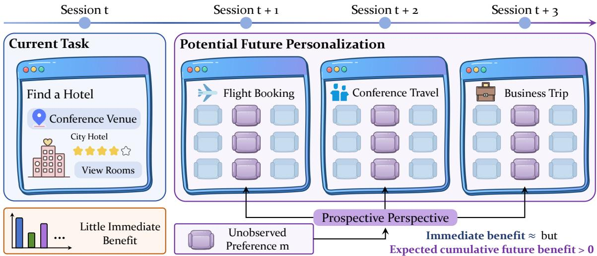
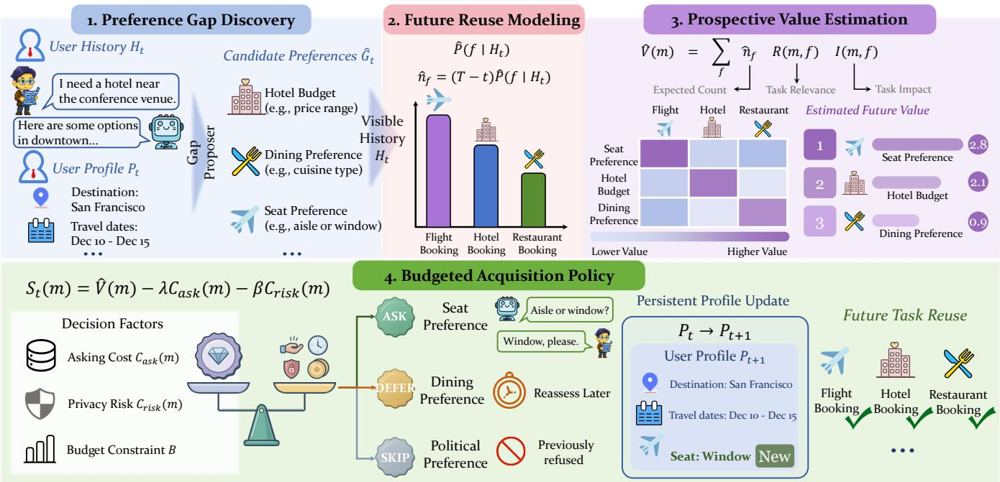
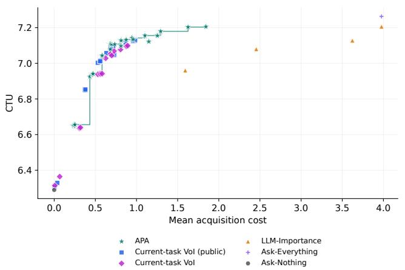
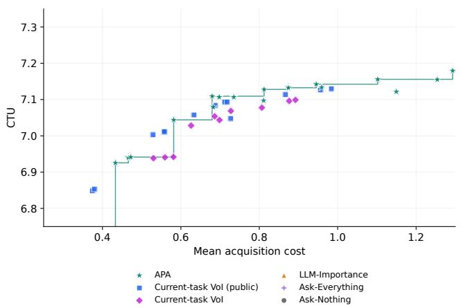
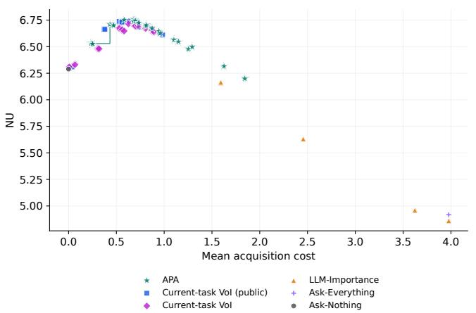
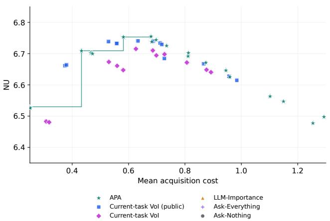
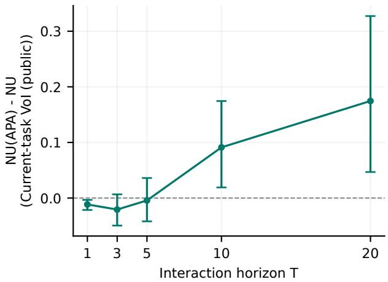
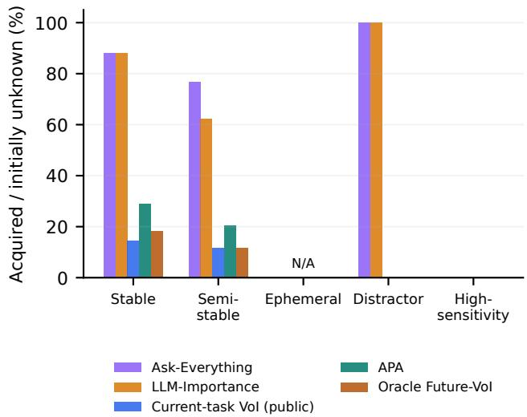
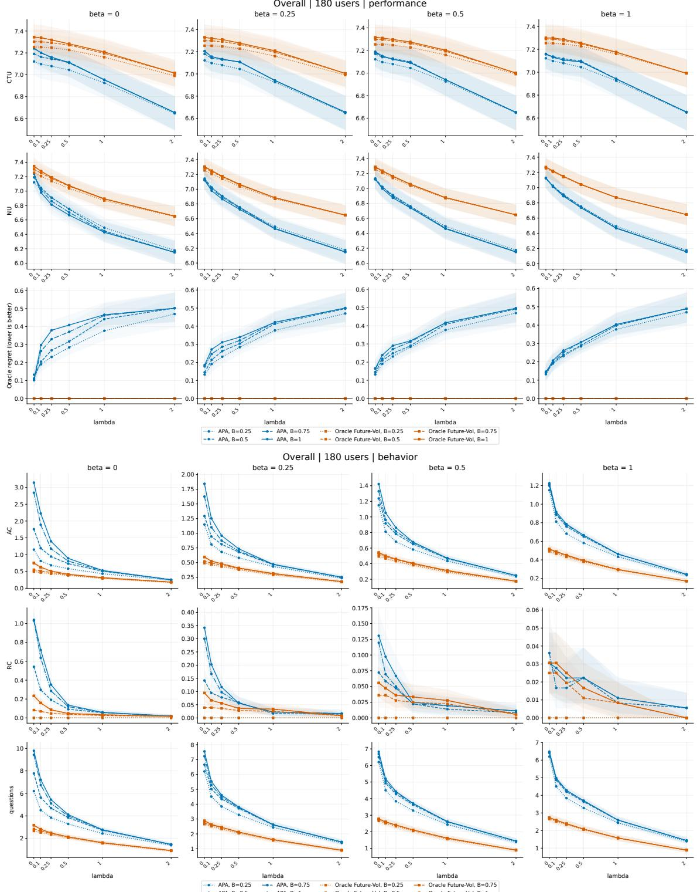

# Learning What to Ask for Tomorrow: Active Preference Acquisition for Long-Term Personalized Web Agents

Yi<sub>q</sub>i Wan<sub>g</sub><sup>∗</sup>, Zizhi Zen<sub>g</sub>, Jia<sub>q</sub>i Zhan<sub>g</sub>, Yi<sub>q</sub>un Duan, Min<sub>g</sub>kai Zhen<sub>g</sub>, Taotao Cai <sup>∗</sup>yiqi.wang.jennie@gmai<sup>l</sup>.com

## Abstract

Web a<sub>g</sub>ents increasin<sub>g</sub>l<sub>y</sub> serve the same user across re<sub>p</sub>eated online t<sub>as</sub>k<sub>s</sub> <sub>suc</sub>h <sub>as</sub> b<sub>oo</sub>ki<sub>ng</sub> t<sub>rave</sub>l<sub>,</sub> <sub>s</sub>h<sub>opp</sub>i<sub>ng,</sub> <sub>an</sub>d <sub>sc</sub>h<sub>e</sub>d<sub>u</sub>li<sub>ng,</sub> <sub>so</sub> th<sub>e</sub>i<sub>r</sub> l<sub>ong-</sub>t<sub>erm use</sub>f<sub>u</sub>l<sub>ness</sub> d<sub>epen</sub>d<sub>s on</sub> h<sub>ow we</sub>ll th<sub>ey</sub> k<sub>now</sub> th<sub>e user</sub>’<sub>s</sub> <sub>p</sub>references. Passive memor<sub>y</sub> and <sub>p</sub>ersonalization methods cannot <sub>o</sub>bt<sub>a</sub>i<sub>n pre</sub>f<sub>erences</sub> th<sub>e user never revea</sub>l<sub>s, an</sub>d <sub>c</sub>l<sub>ar</sub>ifi<sub>ca</sub>ti<sub>on me</sub>th<sub>o</sub>d<sub>s</sub> th<sub>a</sub>t <sub>va</sub>l<sub>ue a ques</sub>ti<sub>on</sub> b<sub>y</sub> it<sub>s</sub> b<sub>ene</sub>fit t<sub>o</sub> th<sub>e curren</sub>t t<sub>as</sub>k <sub>over</sub>l<sub>oo</sub>k the benefit of reusing the answer in later tasks. We study Active Preference Acquisition (APA): which missing preferences are worth the cost of asking? We define the Prospective Personalization Value (PPV) of a missin<sub>g p</sub>reference as its ex<sub>p</sub>ected cumulative utilit<sub>y</sub> <sub>ga</sub>i<sub>n over</sub> f<sub>u</sub>t<sub>ure</sub> t<sub>as</sub>k<sub>s m</sub>i<sub>nus</sub> th<sub>e e</sub>f<sub>or</sub>t <sub>an</sub>d di<sub>sc</sub>l<sub>osure-r</sub>i<sub>s</sub>k <sub>cos</sub>t <sub>o</sub>f askin<sub>g,</sub> and select <sub>q</sub>uestions under a <sub>p</sub>er-interaction bud<sub>g</sub>et. We c<sup>h</sup>aracterize w<sup>h</sup>en cumu<sup>l</sup>ative reuse justi<sup>fi</sup>es acquisition <sup>d</sup>espite i<sub>nsu</sub>fi<sub>c</sub>i<sub>en</sub>t <sub>s</sub>i<sub>ng</sub>l<sub>e-</sub>t<sub>as</sub>k b<sub>ene</sub>fit<sub>, an</sub>d <sub>eva</sub>l<sub>ua</sub>t<sub>e</sub> thi<sub>s reg</sub>i<sub>me w</sub>ith <sub>an</sub> initial-<sub>p</sub>rofile dia<sub>g</sub>nostic. APA com<sub>pu</sub>tes the co<sub>u</sub>nterfact<sub>u</sub>al <sub>g</sub>ain <sub>o</sub>f <sub>eac</sub>h <sub>can</sub>did<sub>a</sub>t<sub>e pre</sub>f<sub>erence on pu</sub>bli<sub>c</sub> t<sub>as</sub>k <sub>pro</sub>t<sub>o</sub>t<sub>ypes w</sub>ith th<sub>e</sub> <sub>agen</sub>t’<sub>s own</sub> t<sub>as</sub>k <sub>so</sub>l<sub>ver an</sub>d <sub>aggrega</sub>t<sub>es</sub> it b<sub>y</sub> th<sub>e expec</sub>t<sub>e</sub>d <sub>reuse</sub> <sub>o</sub>f <sub>eac</sub>h t<sub>as</sub>k f<sub>am</sub>il<sub>y.</sub> W<sub>e</sub> <sub>eva</sub>l<sub>ua</sub>t<sub>e</sub> it <sub>on</sub> A<sub>c</sub>ti<sub>ve</sub>W<sub>e</sub>bP<sub>re</sub>f<sub>,</sub> <sub>a</sub> <sub>con</sub>t<sub>ro</sub>ll<sub>e</sub>d l<sub>ong</sub>it<sub>u</sub>di<sub>na</sub>l b<sub>enc</sub>h<sub>mar</sub>k <sub>w</sub>ith hidd<sub>en</sub> b<sub>u</sub>t <sub>querya</sub>bl<sub>e user pro</sub>fil<sub>es</sub> <sub>an</sub>d <sub>exac</sub>t t<sub>as</sub>k <sub>u</sub>tiliti<sub>es.</sub> At <sub>a</sub> h<sub>or</sub>i<sub>zon o</sub>f 20 t<sub>as</sub>k<sub>s,</sub> 34<sub>.</sub>4% <sub>o</sub>f b<sub>u</sub>d<sub>ge</sub>t<sub>-</sub> f<sub>eas</sub>ibl<sub>e</sub> <sub>va</sub>l<sub>ua</sub>bl<sub>e</sub> <sub>m</sub>i<sub>ss</sub>i<sub>ng</sub> <sub>pre</sub>f<sub>erences</sub> <sub>are</sub> <sub>amor</sub>ti<sub>za</sub>ti<sub>on-</sub>d<sub>epen</sub>d<sub>en</sub>t<sub>;</sub> APA <sub>acqu</sub>i<sub>res</sub> 80<sub>.</sub>3% <sub>o</sub>f th<sub>em, w</sub>h<sub>ereas curren</sub>t<sub>-</sub>t<sub>as</sub>k <sub>va</sub>l<sub>ue o</sub>f i<sub>n</sub>f<sub>or-</sub> mation ac<sub>q</sub>uires 5.1%. Under <sub>p</sub>er-user askin<sub>g</sub>-cost ca<sub>p</sub>s matched to APA’<sub>s rea</sub>li<sub>ze</sub>d <sub>expen</sub>dit<sub>ure,</sub> APA <sub>ac</sub>hi<sub>eves</sub> hi<sub>g</sub>h<sub>er ne</sub>t <sub>u</sub>tilit<sub>y</sub> th<sub>an</sub> <sub>ran</sub>d<sub>om,</sub> f<sub>requency-</sub>b<sub>ase</sub>d<sub>,</sub> i<sub>mpac</sub>t<sub>-</sub>b<sub>ase</sub>d <sub>an</sub>d LLM<sub>-ran</sub>k<sub>e</sub>d <sub>se</sub>l<sub>ec</sub>ti<sub>on.</sub> In our cost settin<sub>g,</sub> askin<sub>g</sub> about ever<sub>y</sub> unknown <sub>p</sub>reference <sub>y</sub>ields l<sub>owe</sub>r n<sub>e</sub>t <sub>u</sub>tilit<sub>y</sub> th<sub>a</sub>n n<sub>o</sub>t <sub>as</sub>kin<sub>g, w</sub>hil<sub>e</sub> APA r<sub>ecove</sub>r<sub>s</sub> 84<sub>.</sub>2% <sub>o</sub>f it<sub>s</sub> utilit<sub>y</sub> <sub>g</sub>ain with 27.6% of its <sub>q</sub>uestions. The value of ac<sub>q</sub>uirin<sub>g</sub> a <sub>user pre</sub>f<sub>erence s</sub>h<sub>ou</sub>ld <sub>accoun</sub>t f<sub>or</sub> it<sub>s reuse across</sub> f<sub>u</sub>t<sub>ure</sub> t<sub>as</sub>k<sub>s, no</sub>t <sub>on</sub>l<sub>y</sub> it<sub>s</sub> b<sub>ene</sub>fit t<sub>o</sub> th<sub>e</sub> t<sub>as</sub>k <sub>a</sub>t h<sub>an</sub>d<sub>.</sub>

## CCS Concepts

• Information systems → Personalization; • Human-centered computing → Human computer interaction (HCI); • Computing methodologies → Natural language processing.

## Keywords

Personalized Web a<sub>g</sub>ents<sub>,</sub> user modelin<sub>g,</sub> <sub>p</sub>reference elicitation<sub>,</sub> <sub>va</sub>l<sub>ue</sub> <sub>o</sub>f i<sub>n</sub>f<sub>orma</sub>ti<sub>on,</sub> l<sub>ong-</sub>t<sub>erm</sub> <sub>memory</sub>

## 1 Introduction

Web a<sub>g</sub>ents can now carr<sub>y</sub> out realistic Web tasks such as online sho<sub>pp</sub>in<sub>g</sub> and navi<sub>g</sub>atin<sub>g</sub> real-world websites [9, 41, 52], and the<sub>y</sub> are mo<sub>v</sub>in<sub>g</sub> from one-shot assistance to <sub>p</sub>ersistent ser<sub>v</sub>ice. The same <sub>agen</sub>t <sub>may</sub> b<sub>oo</sub>k <sub>a user</sub>’<sub>s con</sub>f<sub>erence</sub> t<sub>rave</sub>l i<sub>n</sub> M<sub>arc</sub>h<sub>, or</sub>d<sub>er o</sub>fi<sub>ce</sub> su<sub>pp</sub>lies in A<sub>p</sub>ril<sub>,</sub> and reserve a team dinner in Ma<sub>y</sub>. Its usefulness <sub>over</sub> ti<sub>me</sub> th<sub>en</sub> d<sub>epen</sub>d<sub>s</sub> l<sub>ess</sub> <sub>on</sub> <sub>any</sub> <sub>s</sub>i<sub>ng</sub>l<sub>e</sub> t<sub>as</sub>k th<sub>an</sub> <sub>on</sub> h<sub>ow</sub> <sub>we</sub>ll it knows the user: that the user avoids red-eye flights, keeps hotels under a <sub>p</sub>er-ni<sub>g</sub>ht bud<sub>g</sub>et<sub>,</sub> and needs ve<sub>g</sub>etarian o<sub>p</sub>tions. This <sub>p</sub>a<sub>p</sub>er <sub>s</sub>t<sub>u</sub>di<sub>es</sub> th<sub>a</sub>t <sub>user-mo</sub>d<sub>e</sub>li<sub>ng</sub> <sub>pro</sub>bl<sub>em</sub> f<sub>or</sub> <sub>users</sub> <sub>o</sub>f <sub>pers</sub>i<sub>s</sub>t<sub>en</sub>t W<sub>e</sub>b a<sub>g</sub>ents: which missin<sub>g</sub> <sub>p</sub>references a <sub>p</sub>ersistent Web a<sub>g</sub>ent should ac<sub>q</sub>uire<sub>,</sub> and when doin<sub>g</sub> so <sub>p</sub>a<sub>y</sub>s of.

V<sub>a</sub>l<sub>ua</sub>bl<sub>e</sub> <sub>pre</sub>f<sub>erences,</sub> h<sub>owever,</sub> <sub>nee</sub>d <sub>no</sub>t <sub>appear</sub> i<sub>n</sub> th<sub>e</sub> i<sub>n</sub>t<sub>erac</sub>ti<sub>on</sub> histor<sub>y</sub>. Personalization methods condition on <sub>p</sub>ast behavior [33] or infer <sub>p</sub>rofiles from what users have said [48], and lon<sub>g</sub>-term <sub>memory sys</sub>t<sub>ems</sub> d<sub>ec</sub>id<sub>e</sub> h<sub>ow</sub> t<sub>o ex</sub>t<sub>rac</sub>t<sub>, s</sub>t<sub>ore, re</sub>t<sub>r</sub>i<sub>eve, an</sub>d <sub>up</sub>d<sub>a</sub>t<sub>e</sub> observed information [7, 27, 32, 40, 51]. These methods work with <sub>ev</sub>id<sub>ence</sub> th<sub>a</sub>t <sub>ex</sub>i<sub>s</sub>t<sub>s; a pre</sub>f<sub>erence</sub> th<sub>e user</sub> h<sub>as never</sub> h<sub>a</sub>d <sub>reason</sub> t<sub>o men</sub>ti<sub>on or</sub> t<sub>o revea</sub>l th<sub>roug</sub>h b<sub>e</sub>h<sub>av</sub>i<sub>or canno</sub>t b<sub>e ex</sub>t<sub>rac</sub>t<sub>e</sub>d <sub>or</sub> <sub>re</sub>t<sub>r</sub>i<sub>eve</sub>d<sub>.</sub>

A<sub>s</sub>ki<sub>ng can</sub> fill <sub>suc</sub>h <sub>gaps,</sub> b<sub>u</sub>t <sub>as</sub>ki<sub>ng</sub> i<sub>s no</sub>t f<sub>ree: eac</sub>h <sub>ques</sub>ti<sub>on</sub> <sub>cos</sub>t<sub>s</sub> th<sub>e user e</sub>f<sub>or</sub>t<sub>, an</sub>d <sub>eac</sub>h <sub>answer</sub> di<sub>sc</sub>l<sub>oses persona</sub>l i<sub>n</sub>f<sub>orma-</sub> tion. An a<sub>g</sub>ent therefore cannot sim<sub>p</sub>l<sub>y</sub> ask about ever<sub>y</sub>thin<sub>g;</sub> in our ex<sub>p</sub>eriments<sub>,</sub> askin<sub>g</sub> about ever<sub>y</sub> unknown <sub>p</sub>reference<sub>,</sub> or about <sub>w</sub>h<sub>a</sub>t<sub>ever an</sub> LLM d<sub>eems mos</sub>t <sub>wor</sub>th k<sub>now</sub>i<sub>ng, y</sub>i<sub>e</sub>ld<sub>s</sub> l<sub>ower ne</sub>t utilit<sub>y</sub> than not askin<sub>g</sub> at all (§6).

V<sub>a</sub>l<sub>u</sub>i<sub>ng eac</sub>h <sub>ques</sub>ti<sub>on</sub> b<sub>y</sub> th<sub>e curren</sub>t t<sub>as</sub>k d<sub>oes no</sub>t <sub>reso</sub>l<sub>ve</sub> thi<sub>s</sub> either. Current-task clarification and value-of-information (VoI) <sub>me</sub>th<sub>o</sub>d<sub>s</sub> <sub>as</sub>k <sub>w</sub>h<sub>en</sub> <sub>a</sub> <sub>ques</sub>ti<sub>on</sub> i<sub>mproves</sub> th<sub>e</sub> <sub>curren</sub>t t<sub>as</sub>k <sub>enoug</sub>h t<sub>o</sub> justif<sub>y</sub> its cost [1, 11, 30, 43]. While bookin<sub>g</sub> a hotel, the a<sub>g</sub>ent can fi<sub>n</sub>i<sub>s</sub>h <sub>w</sub>ith<sub>ou</sub>t th<sub>e user</sub>’<sub>s sea</sub>t <sub>pre</sub>f<sub>erence, so curren</sub>t<sub>-</sub>t<sub>as</sub>k V<sub>o</sub>I d<sub>oes</sub> not ask (Fi<sub>g</sub>ure 1). Wh<sub>y</sub> not wait and ask when a fli<sub>g</sub>ht is booked? Because even then<sub>,</sub> a sin<sub>g</sub>le bookin<sub>g</sub>’s <sub>g</sub>ain ma<sub>y</sub> not cover the cost of askin<sub>g;</sub> onl<sub>y</sub> reuse across man<sub>y</sub> later bookin<sub>g</sub>s does. A criterion th<sub>a</sub>t <sub>va</sub>l<sub>ues</sub> <sub>a</sub> <sub>ques</sub>ti<sub>on</sub> <sub>on</sub>l<sub>y</sub> b<sub>y</sub> th<sub>e</sub> t<sub>as</sub>k <sub>a</sub>t h<sub>an</sub>d th<sub>en</sub> <sub>never</sub> <sub>acqu</sub>i<sub>res</sub> such a <sub>p</sub>reference, however often it is reused (Pro<sub>p</sub>osition 1).

An <sub>age</sub>nt th<sub>e</sub>r<sub>e</sub>f<sub>o</sub>r<sub>e</sub> n<sub>ee</sub>d<sub>s</sub> t<sub>o</sub> <sub>va</sub>l<sub>ue</sub> <sub>acqu</sub>i<sub>s</sub>iti<sub>o</sub>n <sub>ac</sub>r<sub>oss</sub> t<sub>as</sub>k<sub>s</sub>:

## Which currently unknown user preferences are worth acquiring, because their benefit across future tasks outweighs the cost of asking?

We ca<sup>ll</sup> t<sup>h</sup>is prob<sup>l</sup>em Active Preference Acquisition (APA). At <sub>eac</sub>h i<sub>n</sub>t<sub>erac</sub>ti<sub>on</sub> th<sub>e agen</sub>t h<sub>o</sub>ld<sub>s a par</sub>ti<sub>a</sub>l <sub>pro</sub>fil<sub>e an</sub>d <sub>can a</sub>l<sub>rea</sub>d<sub>y</sub> <sub>comp</sub>l<sub>e</sub>t<sub>e</sub> th<sub>e curren</sub>t t<sub>as</sub>k<sub>;</sub> it d<sub>ec</sub>id<sub>es w</sub>hi<sub>c</sub>h <sub>m</sub>i<sub>ss</sub>i<sub>ng pre</sub>f<sub>erences</sub> t<sub>o as</sub>k <sub>a</sub>b<sub>ou</sub>t <sub>an</sub>d <sub>s</sub>t<sub>ores</sub> th<sub>e answers pers</sub>i<sub>s</sub>t<sub>en</sub>tl<sub>y.</sub> U<sub>n</sub>lik<sub>e co</sub>ld<sub>-s</sub>t<sub>ar</sub>t <sub>e</sub>li<sub>c</sub>it<sub>a</sub>ti<sub>o</sub>n <sub>o</sub>r <sub>w</sub>ithin-<sub>sess</sub>i<sub>o</sub>n <sub>c</sub>l<sub>a</sub>rifi<sub>ca</sub>ti<sub>o</sub>n<sub>,</sub> APA int<sub>e</sub>rl<sub>eaves acqu</sub>i<sub>s</sub>ition with on<sub>g</sub>oin<sub>g</sub> service and values <sub>p</sub>ersistent attributes b<sub>y</sub> their reuse across heterogeneous future tasks. We define the Prospective Personalization Value (PPV) of a missing preference: its expected <sub>u</sub>tilit<sub>y ga</sub>i<sub>n across</sub> f<sub>u</sub>t<sub>ure</sub> t<sub>as</sub>k<sub>s, m</sub>i<sub>nus</sub> th<sub>e e</sub>f<sub>or</sub>t <sub>an</sub>d di<sub>sc</sub>l<sub>osure-r</sub>i<sub>s</sub>k cost of askin<sub>g</sub>. PPV com<sub>p</sub>lements clarification rather than <sub>g</sub>eneralizin<sub>g</sub> it<sub>,</sub> and the ke<sub>y</sub> distinction is in how a <sub>p</sub>reference is valued<sub>,</sub> <sub>no</sub>t <sub>w</sub>h<sub>en</sub> it i<sub>s</sub> <sub>as</sub>k<sub>e</sub>d<sub>:</sub> <sub>a</sub> <sub>cross-</sub>t<sub>as</sub>k <sub>cr</sub>it<sub>er</sub>i<sub>on</sub> <sub>may</sub> <sub>s</sub>till <sub>as</sub>k <sub>a</sub>t th<sub>e</sub> fi<sub>rs</sub>t <sub>re</sub>l<sub>evan</sub>t t<sub>as</sub>k<sub>.</sub>

We estimate PPV by counterfactual reuse valuation. For each can did<sub>a</sub>t<sub>e</sub> <sub>m</sub>i<sub>ss</sub>i<sub>ng</sub> <sub>pre</sub>f<sub>erence,</sub> th<sub>e</sub> <sub>agen</sub>t’<sub>s</sub> <sub>own</sub> t<sub>as</sub>k <sub>so</sub>l<sub>ver</sub> <sub>compu</sub>t<sub>es</sub> h<sub>ow</sub> <sub>muc</sub>h k<sub>now</sub>i<sub>ng</sub> it <sub>wou</sub>ld <sub>c</sub>h<sub>ange</sub> <sub>u</sub>tilit<sub>y</sub> <sub>on</sub> <sub>pu</sub>bli<sub>c</sub> t<sub>as</sub>k <sub>pro</sub>t<sub>o-</sub> t<sub>yp</sub>es<sub>,</sub> and these <sub>g</sub>ains are a<sub>gg</sub>re<sub>g</sub>ated b<sub>y</sub> the ex<sub>p</sub>ected reuse of each t<sub>as</sub>k f<sub>am</sub>il<sub>y;</sub> <sub>ques</sub>ti<sub>ons</sub> <sub>are</sub> th<sub>en</sub> <sub>se</sub>l<sub>ec</sub>t<sub>e</sub>d <sub>un</sub>d<sub>er</sub> <sub>as</sub>ki<sub>ng</sub> <sub>cos</sub>t<sub>,</sub> di<sub>sc</sub>l<sub>o-</sub> <sub>sure r</sub>i<sub>s</sub>k <sub>an</sub>d <sub>a per-</sub>i<sub>n</sub>t<sub>erac</sub>ti<sub>on</sub> b<sub>u</sub>d<sub>ge</sub>t<sub>.</sub> T<sub>o</sub> t<sub>es</sub>t <sub>w</sub>h<sub>en</sub> thi<sub>s</sub> h<sub>e</sub>l<sub>ps an</sub>d b<sub>y</sub> h<sub>ow muc</sub>h<sub>, we</sub> b<sub>u</sub>ild A<sub>c</sub>ti<sub>ve</sub>W<sub>e</sub>bP<sub>re</sub>f<sub>, a con</sub>t<sub>ro</sub>ll<sub>e</sub>d l<sub>ong</sub>it<sub>u</sub>di<sub>na</sub>l t<sub>es</sub>tb<sub>e</sub>d <sub>mo</sub>d<sub>e</sub>l<sub>e</sub>d <sub>on persona</sub>li<sub>ze</sub>d W<sub>e</sub>b <sub>serv</sub>i<sub>ces, w</sub>ith hidd<sub>en</sub> b<sub>u</sub>t <sub>querya</sub>bl<sub>e</sub> <sub>user</sub> <sub>pro</sub>fil<sub>es,</sub> <sub>mu</sub>lti<sub>-</sub>d<sub>oma</sub>i<sub>n</sub> t<sub>as</sub>k <sub>sequences,</sub> <sub>an</sub>d <sub>exac</sub>t task utilities. It isolates the value of <sub>p</sub>reference ac<sub>q</sub>uisition<sub>,</sub> which existin<sub>g</sub> memor<sub>y</sub> benchmarks do not measure [25, 37], and does not evaluate a<sub>g</sub>ents actin<sub>g</sub> on live websites.

  
Figure 1: A preference that is useless now can be valuable later. In session � the user asks for a hotel, and the seat preference � is unknown. For the current task, knowing � has no value $( V _ { \mathbf { c u r r e n t } } ( m ) \approx 0 )$ , so a clarification agent does not ask. Every later seat selection needs it, so $V _ { \mathbf { f u t u r e } } ( m ) > 0 ;$ when this expected cumulative benefit exceeds the one-time cost of asking, acquiring it once and reusing it is worthwhile.

## Contributions.

(1) Problem. We <sup>f</sup>ormu<sup>l</sup>ate Active Pre<sup>f</sup>erence Acquisition and define PPV. We show that a criterion valuin<sub>g</sub> onl<sub>y</sub> the current t<sub>as</sub>k <sub>never</sub> <sub>acqu</sub>i<sub>res</sub> <sub>a</sub> <sub>pre</sub>f<sub>erence</sub> <sub>w</sub>h<sub>ose</sub> b<sub>ene</sub>fit <sub>on</sub> <sub>every</sub> <sub>s</sub>i<sub>ng</sub>l<sub>e</sub> t<sub>as</sub>k i<sub>s</sub> b<sub>e</sub>l<sub>ow</sub> th<sub>e as</sub>ki<sub>ng cos</sub>t<sub>,</sub> h<sub>owever o</sub>ft<sub>en</sub> it i<sub>s reuse</sub>d<sub>, w</sub>h<sub>ereas</sub> PPV <sub>ass</sub>i<sub>g</sub>n<sub>s</sub> it <sub>pos</sub>iti<sub>ve va</sub>l<sub>ue o</sub>n<sub>ce cu</sub>m<sub>u</sub>l<sub>a</sub>ti<sub>ve</sub> r<sub>euse cove</sub>r<sub>s</sub> th<sub>a</sub>t cost (Pro<sub>p</sub>osition 1).

(2) Method. APA estimates PPV by counter<sup>f</sup>actua<sup>l</sup> reuse va<sup>l</sup>uation: th<sub>e</sub> <sub>agen</sub>t’<sub>s</sub> <sub>own</sub> t<sub>as</sub>k <sub>so</sub>l<sub>ver</sub> <sub>compu</sub>t<sub>es</sub> <sub>eac</sub>h <sub>can</sub>did<sub>a</sub>t<sub>e</sub>’<sub>s</sub> <sub>ga</sub>i<sub>n</sub> <sub>on</sub> <sub>pu</sub>bli<sub>c</sub> t<sub>as</sub>k <sub>pro</sub>t<sub>o</sub>t<sub>ypes,</sub> <sub>we</sub>i<sub>g</sub>ht<sub>e</sub>d b<sub>y</sub> th<sub>e</sub> <sub>expec</sub>t<sub>e</sub>d <sub>reuse</sub> <sub>o</sub>f <sub>eac</sub>h task famil<sub>y,</sub> and an ada<sub>p</sub>tive <sub>g</sub>reed<sub>y p</sub>olic<sub>y</sub> selects <sub>q</sub>uestions <sub>un</sub>d<sub>er</sub> <sub>as</sub>ki<sub>ng</sub> <sub>cos</sub>t<sub>,</sub> di<sub>sc</sub>l<sub>osure</sub> <sub>r</sub>i<sub>s</sub>k <sub>an</sub>d <sub>a</sub> <sub>per-</sub>i<sub>n</sub>t<sub>erac</sub>ti<sub>on</sub> b<sub>u</sub>d<sub>ge</sub>t (§4).

(3) Benchmark. ActiveWebPre<sup>f</sup> is a contro<sup>ll</sup>ed <sup>l</sup>ongitudina<sup>l</sup> benc<sup>h</sup>- <sub>mar</sub>k <sub>w</sub>ith 16 t<sub>as</sub>k f<sub>am</sub>ili<sub>es,</sub> hidd<sub>en</sub> b<sub>u</sub>t <sub>querya</sub>bl<sub>e user pro-</sub> fil<sub>es an</sub>d <sub>exac</sub>t t<sub>as</sub>k <sub>u</sub>tiliti<sub>es, so</sub> th<sub>e coun</sub>t<sub>er</sub>f<sub>ac</sub>t<sub>ua</sub>l <sub>va</sub>l<sub>ue o</sub>f <sub>an</sub> <sub>unas</sub>k<sub>e</sub>d <sub>pre</sub>f<sub>erence can</sub> b<sub>e measure</sub>d<sub>; an</sub> i<sub>n</sub>iti<sub>a</sub>l<sub>-pro</sub>fil<sub>e</sub> di<sub>agnos-</sub> tic identifies amortization-de<sub>p</sub>endent <sub>p</sub>references (§5). Code, data and <sub>p</sub>rom<sub>p</sub>ts are available at htt<sub>p</sub>s://<sub>g</sub>ithub.com/xiao<sub>q</sub>i-7/A<sub>c</sub>ti<sub>ve</sub>-Pr<sub>e</sub>f<sub>e</sub>r<sub>e</sub>n<sub>ce</sub>-A<sub>cqu</sub>i<sub>s</sub>iti<sub>o</sub>n<sub>.</sub>

(4) Findings. At a <sup>h</sup>orizon o<sup>f</sup> $T ~ = ~ 2 0$ t<sub>as</sub>k<sub>s,</sub> 34<sub>.</sub>4% <sub>o</sub>f b<sub>u</sub>d<sub>ge</sub>t feasible valuable initiall<sub>y</sub> missin<sub>g</sub> <sub>p</sub>references are amortizationd<sub>epe</sub>nd<sub>e</sub>nt<sub>;</sub> APA <sub>acqu</sub>ir<sub>es</sub> 80<sub>.</sub>3% <sub>o</sub>f th<sub>e</sub>m <sub>a</sub>nd C<sub>u</sub>rr<sub>e</sub>nt-t<sub>as</sub>k V<sub>o</sub>I (<sub>p</sub>ublic) 5.1%, while the NU-maximizin<sub>g</sub> oracle ac<sub>q</sub>uires 44.9%, <sub>so</sub> th<sub>e</sub> <sub>a</sub>im i<sub>s</sub> <sub>se</sub>l<sub>ec</sub>ti<sub>ve</sub> r<sub>a</sub>th<sub>e</sub>r th<sub>a</sub>n m<sub>a</sub>xim<sub>a</sub>l <sub>acqu</sub>i<sub>s</sub>iti<sub>o</sub>n<sub>.</sub> Am<sub>o</sub>n<sub>g</sub> <sub>use</sub>r<sub>s w</sub>ith <sub>a</sub>t l<sub>eas</sub>t <sub>o</sub>n<sub>e suc</sub>h <sub>p</sub>r<sub>e</sub>f<sub>e</sub>r<sub>e</sub>n<sub>ce,</sub> APA im<sub>p</sub>r<sub>oves w</sub>h<sub>o</sub>l<sub>e</sub>- se<sub>q</sub>uence net utilit<sub>y</sub> over Current-task VoI (<sub>p</sub>ublic) at $T = 2 0$ (Holm $p = 0 . 0 2 1 )$ b<sub>u</sub>t <sub>no</sub>t <sub>s</sub>i<sub>gn</sub>ifi<sub>can</sub>tl<sub>y a</sub>t $T = 1 0$ . Under <sub>p</sub>er-<sub>use</sub>r <sub>as</sub>kin<sub>g</sub>-<sub>cos</sub>t <sub>caps</sub> m<sub>a</sub>t<sub>c</sub>h<sub>e</sub>d t<sub>o</sub> APA’<sub>s</sub> r<sub>ea</sub>liz<sub>e</sub>d <sub>e</sub>x<sub>pe</sub>ndit<sub>u</sub>r<sub>e,</sub> APA <sub>ac</sub>hi<sub>eves</sub> hi<sub>g</sub>h<sub>e</sub>r n<sub>e</sub>t <sub>u</sub>tilit<sub>y</sub> th<sub>a</sub>n r<sub>a</sub>nd<sub>o</sub>m<sub>,</sub> fr<sub>eque</sub>n<sub>cy</sub>-b<sub>ase</sub>d<sub>,</sub> im<sub>p</sub>act-based and LLM-ranked selection (all Holm $p \leq 0 . 0 0 2 5 )$ In our cost settin<sub>g,</sub> cost-blind askin<sub>g y</sub>ields lower net utilit<sub>y</sub> th<sub>an</sub> <sub>no</sub>t <sub>as</sub>ki<sub>ng,</sub> <sub>w</sub>hil<sub>e</sub> APA <sub>recovers</sub> 84<sub>.</sub>2% <sub>o</sub>f <sub>ex</sub>h<sub>aus</sub>ti<sub>ve</sub> <sub>as</sub>k<sub>-</sub> in<sub>g</sub>’s utilit<sub>y</sub> <sub>g</sub>ain with 27.6% of its <sub>q</sub>uestions (§6).

## 2 Related Work

User modeling and personalization. Personalized systems condition <sub>g</sub>eneration or rankin<sub>g</sub> on user <sub>p</sub>rofiles<sub>, g</sub>iven as ex<sub>p</sub>licit <sub>p</sub>ersona statements [46] or drawn from behavioral histor<sub>y</sub> [33]. Recent LLM <sub>agen</sub>t<sub>s</sub> <sub>con</sub>ti<sub>nuous</sub>l<sub>y</sub> i<sub>n</sub>f<sub>er</sub> <sub>an</sub>d <sub>re</sub>fi<sub>ne</sub> <sub>a</sub> <sub>un</sub>ifi<sub>e</sub>d <sub>user</sub> <sub>pro</sub>fil<sub>e</sub> f<sub>rom</sub> dialo<sub>g</sub>ue turns [48], or u<sub>p</sub>date <sub>p</sub>reference memories as user behavior evolves b<sub>y</sub> fusin<sub>g</sub> short- and lon<sub>g</sub>-term avera<sub>g</sub>es [35]. These methods infer preferences from evidence that already exists. They <sub>canno</sub>t <sub>recover</sub> <sub>a</sub> <sub>pre</sub>f<sub>erence</sub> th<sub>a</sub>t h<sub>as</sub> <sub>never</sub> b<sub>een</sub> <sub>expresse</sub>d <sub>or</sub> <sub>re-</sub> <sub>vea</sub>l<sub>e</sub>d th<sub>roug</sub>h b<sub>e</sub>h<sub>av</sub>i<sub>or, an</sub>d th<sub>ey</sub> d<sub>o no</sub>t d<sub>ec</sub>id<sub>e w</sub>hi<sub>c</sub>h <sub>uno</sub>b<sub>serve</sub>d <sub>pre</sub>f<sub>erences are wor</sub>th <sub>e</sub>li<sub>c</sub>iti<sub>ng</sub> f<sub>or</sub> f<sub>u</sub>t<sub>ure</sub> t<sub>as</sub>k<sub>s.</sub>

Preference elicitation. Decision-theoretic preference elicitation frames <sub>qu</sub>estion askin<sub>g</sub> as a POMDP that trades <sub>qu</sub>estion cost a<sub>g</sub>ainst the <sub>q</sub>ualit<sub>y</sub> of a final decision [5]. Recommender s<sub>y</sub>stems ask new users to rate items in a cold-start interview [31], <sub>p</sub>ossibl<sub>y</sub> ada<sub>p</sub>tin<sub>g</sub> the next item to earlier answers with a decision tree [14], and use active learnin<sub>g</sub> in collaborative filterin<sub>g</sub> more broadl<sub>y</sub> [13]. C<sub>o</sub>n<sub>ve</sub>r<sub>sa</sub>ti<sub>o</sub>n<sub>a</sub>l r<sub>eco</sub>mm<sub>e</sub>nd<sub>e</sub>r<sub>s</sub> d<sub>ec</sub>id<sub>e</sub> <sub>w</sub>ithin <sub>a</sub> <sub>sess</sub>i<sub>o</sub>n <sub>w</sub>hi<sub>c</sub>h it<sub>e</sub>m or attribute to ask about next [8, 10, 16, 21, 22, 36]. LLMs have <sub>a</sub>l<sub>so</sub> b<sub>een</sub> <sub>use</sub>d t<sub>o</sub> <sub>e</sub>li<sub>c</sub>it <sub>pre</sub>f<sub>erences</sub> th<sub>roug</sub>h <sub>open-en</sub>d<sub>e</sub>d <sub>ques</sub>ti<sub>ons:</sub> GATE <sub>p</sub>rom<sub>p</sub>ts models to elicit a user’s intended task behavior [23], <sub>a</sub>nd ST<sub>a</sub>R-GATE fin<sub>e</sub>-t<sub>u</sub>n<sub>es a ques</sub>ti<sub>o</sub>n<sub>e</sub>r t<sub>o as</sub>k <sub>use</sub>f<sub>u</sub>l <sub>c</sub>l<sub>a</sub>rif<sub>y</sub>in<sub>g</sub> questions [2]. APA difers from this work in three ways. (i) When and why to ask. Conversational elicitation asks in order to finish the current session. Cold-start interviews do ask for future benefit, b<sub>u</sub>t in <sub>a s</sub>in<sub>g</sub>l<sub>e o</sub>nb<sub>oa</sub>rdin<sub>g s</sub>t<sub>ep</sub> b<sub>e</sub>f<sub>o</sub>r<sub>e a</sub>n<sub>y</sub> t<sub>as</sub>k i<sub>s se</sub>r<sub>ve</sub>d<sub>.</sub> In APA<sub>,</sub> <sub>ques</sub>ti<sub>ons are</sub> i<sub>n</sub>t<sub>er</sub>l<sub>eave</sub>d <sub>w</sub>ith <sub>ongo</sub>i<sub>ng</sub> t<sub>as</sub>k<sub>s</sub> th<sub>a</sub>t <sub>can a</sub>l<sub>rea</sub>d<sub>y</sub> b<sub>e</sub> comp<sup>l</sup>ete<sup>d</sup>, an<sup>d</sup> eac<sup>h</sup> question is justi<sup>fi</sup>e<sup>d b</sup>y its expecte<sup>d</sup> e<sup>f</sup>ect on future tasks. (ii) Scope. Elicitation targets item ratings or attributes within a sin<sub>g</sub>le catalo<sub>g</sub>. APA ac<sub>qu</sub>ires <sub>p</sub>ersistent <sub>u</sub>ser attrib<sub>u</sub>tes that <sub>are</sub> <sub>reuse</sub>d <sub>across</sub> h<sub>e</sub>t<sub>erogeneous</sub> t<sub>as</sub>k f<sub>am</sub>ili<sub>es,</sub> <sub>suc</sub>h <sub>as</sub> fli<sub>g</sub>ht<sub>s,</sub> h<sub>o</sub>t<sub>e</sub>l<sub>s,</sub> dining, and scheduling. (iii) Valuation target. Like prior elicitation, APA <sub>we</sub>i<sub>g</sub>h<sub>s</sub> b<sub>e</sub>n<sub>e</sub>fit <sub>aga</sub>in<sub>s</sub>t th<sub>e</sub> <sub>cos</sub>t <sub>o</sub>f <sub>as</sub>kin<sub>g;</sub> th<sub>e</sub> dif<sub>e</sub>r<sub>e</sub>n<sub>ce</sub> i<sub>s</sub> th<sub>a</sub>t th<sub>e</sub> b<sub>ene</sub>fit i<sub>s</sub> <sub>coun</sub>t<sub>e</sub>d <sub>across</sub> th<sub>e</sub> h<sub>e</sub>t<sub>erogeneous</sub> f<sub>u</sub>t<sub>ure</sub> t<sub>as</sub>k<sub>s</sub> th<sub>a</sub>t <sub>reuse</sub> th<sub>e</sub> <sub>answer,</sub> <sub>ra</sub>th<sub>er</sub> th<sub>an</sub> <sub>w</sub>ithi<sub>n</sub> <sub>one</sub> d<sub>ec</sub>i<sub>s</sub>i<sub>on</sub> <sub>or</sub> <sub>sess</sub>i<sub>on.</sub> APA b<sub>u</sub>ild<sub>s</sub> <sub>on</sub> <sub>es</sub>t<sub>a</sub>bli<sub>s</sub>h<sub>e</sub>d <sub>va</sub>l<sub>ue-o</sub>f<sub>-</sub>i<sub>n</sub>f<sub>orma</sub>ti<sub>on</sub> <sub>an</sub>d <sub>pre</sub>f<sub>erence-</sub> elicitation <sub>p</sub>rinci<sub>p</sub>les [5, 15], o<sub>p</sub>erationalizin<sub>g</sub> them for <sub>p</sub>ersistent <sub>pre</sub>f<sub>erences reuse</sub>d <sub>across</sub> h<sub>e</sub>t<sub>erogeneous</sub> t<sub>as</sub>k<sub>s, an</sub>d <sub>a</sub>dd<sub>s a</sub> b<sub>enc</sub>h<sub>-</sub> <sub>mar</sub>k i<sub>n w</sub>hi<sub>c</sub>h th<sub>e coun</sub>t<sub>er</sub>f<sub>ac</sub>t<sub>ua</sub>l <sub>va</sub>l<sub>ue o</sub>f <sub>an unas</sub>k<sub>e</sub>d <sub>pre</sub>f<sub>erence</sub> <sub>can</sub> b<sub>e measure</sub>d<sub>.</sub>

Long-term memory for agents. Surveys organize agent memor<sub>y</sub> b<sub>y</sub> its sources, forms, and o<sub>p</sub>erations (writin<sub>g</sub>, mana<sub>g</sub>ement, and readin<sub>g</sub>) [49]. Memor<sub>y</sub> architectures <sub>g</sub>ive LLM a<sub>g</sub>ents <sub>p</sub>ersistent state throu<sub>g</sub>h hierarchical context mana<sub>g</sub>ement [27], memor<sub>y</sub> streams with reflection [28], for<sub>g</sub>ettin<sub>g</sub>-aware stores [51], scalable extraction and retrieval [7], and tem<sub>p</sub>oral knowled<sub>g</sub>e <sub>g</sub>ra<sub>p</sub>hs [32]. Pr<sub>o</sub>M<sub>e</sub>m im<sub>p</sub>r<sub>oves</sub> m<sub>e</sub>m<sub>o</sub>r<sub>y e</sub>xtr<sub>ac</sub>ti<sub>o</sub>n it<sub>se</sub>lf: it <sub>e</sub>xtr<sub>ac</sub>t<sub>s</sub> d<sub>e</sub>t<sub>a</sub>il<sub>s,</sub> <sub>even</sub>t<sub>s,</sub> <sub>an</sub>d <sub>re</sub>l<sub>a</sub>ti<sub>ons</sub> <sub>separa</sub>t<sub>e</sub>l<sub>y,</sub> <sub>c</sub>h<sub>ec</sub>k<sub>s</sub> <sub>comp</sub>l<sub>e</sub>t<sub>eness</sub> t<sub>o</sub> <sub>recover</sub> missed events, and verifies atomic facts [40]. Benchmarks such as LongMemEval [37] and LoCoMo [25] test whether facts present in the history can be recalled. PrefEval tests whether models follow stated or im<sub>p</sub>licit <sub>p</sub>references [50], and PersonaMem whether the<sub>y</sub> track <sub>p</sub>references that evolve across sessions [17]; both find that <sub>pre</sub>f<sub>erences a</sub>l<sub>rea</sub>d<sub>y expresse</sub>d <sub>are o</sub>ft<sub>en no</sub>t f<sub>o</sub>ll<sub>owe</sub>d<sub>.</sub> Th<sub>ese sys-</sub> tems answer how to retain and use what is known. APA addresses which unknown information should be learned, and can run on top <sub>o</sub>f <sub>any o</sub>f th<sub>em.</sub>

Clarification and value of information. Asking clarifying questions has been studied in information retrieval [1, 43] and in NLP, f<sub>or examp</sub>l<sub>e</sub> b<sub>y ran</sub>ki<sub>ng ques</sub>ti<sub>ons</sub> b<sub>y expec</sub>t<sub>e</sub>d <sub>va</sub>l<sub>ue o</sub>f <sub>per</sub>f<sub>ec</sub>t i<sub>n</sub>f<sub>or-</sub> mation [30]. For LLM a<sub>g</sub>ents, the IN3 benchmark annotates which details of a va<sub>g</sub>ue task are missin<sub>g,</sub> and Mistral-Interact is trained to ask about them before executin<sub>g</sub> [29], and Ask-before-Plan studies clarification before travel <sub>p</sub>lannin<sub>g</sub> [47]. Proactive A<sub>g</sub>ent instead antici<sub>p</sub>ates and ofers hel<sub>p</sub> that the user has not re<sub>q</sub>uested [24]. Don<sub>g</sub> et al. [11] formalize when an a<sub>g</sub>ent should ask rather than act b<sub>y</sub> wei<sub>g</sub>hin<sub>g</sub> the ex<sub>p</sub>ected utilit<sub>y g</sub>ain of a <sub>q</sub>uestion on the current decision a<sub>g</sub>ainst the cost it im<sub>p</sub>oses on the user. Two lines of work l<sub>oo</sub>k b<sub>eyon</sub>d th<sub>e curren</sub>t <sub>response: one</sub> l<sub>a</sub>b<sub>e</sub>l<sub>s response pre</sub>f<sub>erences</sub> b<sub>y s</sub>i<sub>mu</sub>l<sub>a</sub>ti<sub>ng</sub> f<sub>u</sub>t<sub>ure conversa</sub>ti<sub>on</sub> t<sub>urns,</sub> t<sub>eac</sub>hi<sub>ng mo</sub>d<sub>e</sub>l<sub>s w</sub>h<sub>en</sub> t<sub>o</sub> ask clarif<sub>y</sub>in<sub>g q</sub>uestions [45], and CollabLLM trains models with <sub>a mu</sub>ltit<sub>urn-aware rewar</sub>d <sub>es</sub>ti<sub>ma</sub>t<sub>e</sub>d f<sub>rom s</sub>i<sub>mu</sub>l<sub>a</sub>t<sub>e</sub>d f<sub>u</sub>t<sub>ure con-</sub> versations [38]. Their horizon, however, is later turns of the same <sub>conversa</sub>ti<sub>on, w</sub>h<sub>ereas</sub> th<sub>e</sub> h<sub>or</sub>i<sub>zon o</sub>f APA i<sub>s</sub> f<sub>u</sub>t<sub>ure</sub> t<sub>as</sub>k<sub>s across</sub> <sub>sess</sub>i<sub>ons.</sub> Ab<sub>s</sub>t<sub>rac</sub>ti<sub>ng</sub> f<sub>rom</sub> th<sub>ese me</sub>th<sub>o</sub>d<sub>s, curren</sub>t<sub>-</sub>t<sub>as</sub>k <sub>c</sub>l<sub>ar</sub>ifi<sub>ca</sub>ti<sub>on</sub> scores a <sub>q</sub>uestion about <sub>�</sub> as

$$
V _ { \mathrm { c u r } } ( m ) = \Delta U ( \tau _ { t } ; m ) - C ( m ) ,
$$

<sub>w</sub>h<sub>ereas</sub> APA <sub>scores</sub> th<sub>e same pre</sub>f<sub>erence</sub> b<sub>y</sub> it<sub>s va</sub>l<sub>ue over</sub> th<sub>e</sub> t<sub>as</sub>k<sub>s</sub> th<sub>a</sub>t f<sub>o</sub>ll<sub>ow,</sub>

$$
\begin{array} { r } { P P V _ { T } ( m ) = \mathbb { E } \bigg [ \sum _ { k = t + 1 } ^ { T } \Delta U ( \tau _ { k } ; m ) \bigg ] - C ( m ) . } \end{array}
$$

The t<sub>w</sub>o scores ans<sub>w</sub>er diferent <sub>qu</sub>estions and are com<sub>p</sub>lementar<sub>y</sub>. H<sub>owar</sub>d’<sub>s</sub> f<sub>ormu</sub>l<sub>a</sub>ti<sub>on va</sub>l<sub>ues</sub> i<sub>n</sub>f<sub>orma</sub>ti<sub>on</sub> f<sub>or a s</sub>i<sub>ng</sub>l<sub>e</sub> d<sub>ec</sub>i<sub>s</sub>i<sub>on</sub> <sub>p</sub>roblem [15], and the non-m<sub>y</sub>o<sub>p</sub>ic VoI of Krause and Guestrin [20] se<sup>l</sup>ects a <sup>b</sup>u<sup>d</sup>get-constraine<sup>d</sup> set o<sup>f</sup> o<sup>b</sup>servations joint<sup>l</sup>y, rat<sup>h</sup>er t<sup>h</sup>an <sub>g</sub>reedil<sub>y,</sub> to reduce uncertaint<sub>y</sub> in one fixed model. These <sub>p</sub>rinci<sub>p</sub>les <sub>can</sub> <sub>accommo</sub>d<sub>a</sub>t<sub>e</sub> l<sub>ong-</sub>t<sub>erm</sub> b<sub>ene</sub>fit<sub>;</sub> APA i<sub>ns</sub>t<sub>an</sub>ti<sub>a</sub>t<sub>es</sub> th<sub>em</sub> <sub>as</sub> <sub>a</sub> longitudinal personalization decision. The information is stored, and it <sub>pays</sub> <sub>o</sub>f <sub>across</sub> <sub>many</sub> f<sub>u</sub>t<sub>ure</sub> t<sub>as</sub>k<sub>s</sub> d<sub>rawn</sub> f<sub>rom</sub> <sub>an</sub> <sub>uncer</sub>t<sub>a</sub>i<sub>n</sub> t<sub>as</sub>k di<sub>s</sub>trib<sub>u</sub>ti<sub>o</sub>n<sub>.</sub>

Web agents. Benchmarks for Web agents such as WebShop [41], Mind2Web [9], and WebArena [52] <sub>p</sub>ose each e<sub>p</sub>isode as a sin-<sub>g</sub>l<sub>e, se</sub>lf<sub>-con</sub>t<sub>a</sub>i<sub>ne</sub>d i<sub>ns</sub>t<sub>ruc</sub>ti<sub>on, w</sub>ith <sub>no user s</sub>t<sub>a</sub>t<sub>e carr</sub>i<sub>e</sub>d <sub>across</sub> t<sub>as</sub>k<sub>s.</sub> P<sub>ersona</sub>li<sub>ze</sub>d W<sub>e</sub>b <sub>agen</sub>t<sub>s</sub> h<sub>ave recen</sub>tl<sub>y</sub> b<sub>een s</sub>t<sub>u</sub>di<sub>e</sub>d th<sub>roug</sub>h P<sub>ersona</sub>lWAB<sub>, w</sub>hi<sub>c</sub>h <sub>pa</sub>i<sub>rs s</sub>i<sub>mu</sub>l<sub>a</sub>t<sub>e</sub>d <sub>users</sub>’ <sub>pro</sub>fil<sub>es an</sub>d b<sub>e</sub>h<sub>av</sub>i<sub>or</sub> hi<sub>s</sub>t<sub>or</sub>i<sub>es</sub> <sub>w</sub>ith <sub>persona</sub>li<sub>ze</sub>d <sub>searc</sub>h<sub>,</sub> <sub>recommen</sub>d<sub>a</sub>ti<sub>on,</sub> <sub>an</sub>d <sub>rev</sub>i<sub>ew</sub> t<sub>as</sub>k<sub>s</sub> <sub>an</sub>d <sub>w</sub>h<sub>ose</sub> <sub>mu</sub>lti<sub>-</sub>t<sub>urn</sub> t<sub>rac</sub>k l<sub>e</sub>t<sub>s</sub> th<sub>e</sub> <sub>agen</sub>t <sub>c</sub>l<sub>ar</sub>if<sub>y</sub> <sub>a</sub> <sub>reques</sub>t with a simulated user [6], and Persona2Web, which re<sub>q</sub>uires a<sub>g</sub>ents on the o<sub>p</sub>en Web to resolve ambi<sub>g</sub>uous <sub>q</sub>ueries from lon<sub>g</sub> user histories [19]. Both <sub>p</sub>ersonalize mainl<sub>y</sub> from histories, and an<sub>y</sub> <sub>q</sub>uestions serve the current re<sub>q</sub>uest. Neither studies which missin<sub>g</sub> <sub>pre</sub>f<sub>erences</sub> <sub>an</sub> <sub>agen</sub>t <sub>s</sub>h<sub>ou</sub>ld <sub>acqu</sub>i<sub>re</sub> f<sub>or</sub> f<sub>u</sub>t<sub>ure</sub> t<sub>as</sub>k<sub>s.</sub>

## 3 Problem Formulation

Persistent user–agent interaction. A user � interacts with an agent <sub>over a sequence o</sub>f t<sub>as</sub>k<sub>s</sub> $\tau _ { 1 } , . . . , \tau _ { T } .$ . Each task belongs to a task family $f ( \tau ) \in \mathcal { F }$ <sub>, suc</sub>h <sub>as</sub> fli<sub>g</sub>ht b<sub>oo</sub>ki<sub>ng,</sub> h<sub>o</sub>t<sub>e</sub>l <sub>se</sub>l<sub>ec</sub>ti<sub>on, res</sub>t<sub>auran</sub>t reservation<sub>,</sub> or meetin<sub>g</sub> schedulin<sub>g</sub>. At ste<sub>p</sub> � the a<sub>g</sub>ent observes the int<sub>e</sub>r<sub>ac</sub>ti<sub>o</sub>n hi<sub>s</sub>t<sub>o</sub>r<sub>y</sub> $H _ { t }$ and maintains a <sub>p</sub>ersistent <sub>p</sub>rofile $P _ { t }$ , a set of attribute–value pairs such as (seat, aisle). The user has a hidden <sub>groun</sub>d<sub>-</sub>t<sub>ru</sub>th <sub>pro</sub>fil<sub>e</sub> $P _ { u } ^ { * } ,$ <sub>an</sub>d th<sub>e</sub> <sub>agen</sub>t’<sub>s</sub> <sub>pro</sub>fil<sub>e</sub> i<sub>s</sub> <sub>a</sub> <sub>su</sub>b<sub>se</sub>t <sub>o</sub>f it<sub>,</sub> $P _ { t } \subseteq P _ { u } ^ { * }$ <sub>.</sub> Gi<sub>ven a</sub> t<sub>as</sub>k <sub>an</sub>d <sub>a pro</sub>fil<sub>e,</sub> th<sub>e agen</sub>t’<sub>s</sub> t<sub>as</sub>k <sub>so</sub>l<sub>ver se</sub>l<sub>ec</sub>t<sub>s</sub> an action <sub>w</sub>hose <sub>u</sub>tilit<sub>y</sub> $U ( \tau \mid P ) \in [ 0 , 1 ]$ i<sub>s</sub> d<sub>e</sub>t<sub>erm</sub>i<sub>ne</sub>d b<sub>y</sub> $P _ { u } ^ { * } .$ In ActiveWebPref, � is com<sub>p</sub>uted exactl<sub>y</sub> from the hidden <sub>p</sub>rofile (§5).

Preference gaps. The gap at step � is the set of attributes the agent d<sub>oes no</sub>t k<sub>now:</sub>

$$
G _ { t } = \{ m \in P _ { u } ^ { * } \setminus P _ { t } \} .
$$

We focus on attributes that are genuinely unobserved: they cannot b<sub>e ex</sub>t<sub>rac</sub>t<sub>e</sub>d f<sub>rom</sub> $H _ { t }$ <sub>or re</sub>li<sub>a</sub>bl<sub>y</sub> i<sub>n</sub>f<sub>erre</sub>d f<sub>rom</sub> it<sub>.</sub> Thi<sub>s exc</sub>l<sub>u</sub>d<sub>es</sub> f<sub>ac</sub>t<sub>s</sub> th<sub>a</sub>t <sub>were s</sub>t<sub>a</sub>t<sub>e</sub>d b<sub>u</sub>t <sub>no</sub>t <sub>s</sub>t<sub>ore</sub>d<sub>, w</sub>hi<sub>c</sub>h i<sub>s</sub> th<sub>e</sub> t<sub>arge</sub>t <sub>o</sub>f <sub>memory</sub> extraction [40], and facts that can be inferred from the dialo<sub>g</sub>ue, which is the tar<sub>g</sub>et of <sub>p</sub>rofile inference [48].

Utility gain and task relevance. The gain from knowing � on t<sub>as</sub>k <sub>�</sub> i<sub>s</sub>

$$
\Delta U ( \tau ; m ) = U ( \tau \mid P _ { t } \cup \{ m \} ) - U ( \tau \mid P _ { t } ) .
$$

Let ${ \mathcal { R } } ( m ) \subseteq { \mathcal { F } }$ b<sub>e</sub> th<sub>e</sub> t<sub>as</sub>k f<sub>am</sub>ili<sub>es</sub> i<sub>n w</sub>hi<sub>c</sub>h <sub>� can c</sub>h<sub>ange</sub> th<sub>e</sub> <sub>so</sub>l<sub>ver</sub>’<sub>s ac</sub>ti<sub>on.</sub> Th<sub>en</sub> $\Delta U ( \tau ; m ) = 0$ <sub>w</sub>h<sub>enever</sub> $f ( \tau ) \not \in { \mathcal { R } } ( m )$ <sub>.</sub> Th<sub>e</sub> a<sub>g</sub>ent can execute an available action without additional <sub>q</sub>uestions<sub>;</sub> clarification ma<sub>y</sub> still im<sub>p</sub>rove its <sub>q</sub>ualit<sub>y;</sub> APA se<sub>p</sub>aratel<sub>y</sub> values <sub>reuse a</sub>ft<sub>er</sub> th<sub>e curren</sub>t i<sub>n</sub>t<sub>erac</sub>ti<sub>on.</sub>

  
Figure 2: Overview of APA. ○1 Gap discovery proposes preferences $\mathcal { G } _ { t }$ missing from the profile $P _ { t } . \textcircled { 2 }$ Future reuse modeling estimates how often each may be reused, from a coarse distribution over task families. ○3 Prospective value estimation scores each by relevance and impact. $\textcircled{4}$ Cost-aware acquisition subtracts asking cost and disclosure risk and chooses Ask, Defer, or Skip. Here, the seat preference is asked; the dining preference, rarely reused because restaurant tasks are rare, is deferred for later re-scoring, as is the hotel budget once the seat question has used this interaction’s budget; and a previously refused political preference, which never enters the candidate set, is skipped. Answers update the profile for future tasks.

Acquisition cost. Asking about � incurs a fixed public per-<sub>a</sub>tt<sub>r</sub>ib<sub>u</sub>t<sub>e cos</sub>t $C _ { \mathrm { a s k } } ( m ) \ = \ c _ { m } .$ <sub>,</sub> i<sub>nc</sub>l<sub>u</sub>di<sub>ng</sub> <sub>on</sub> <sub>re</sub>f<sub>usa</sub>l<sub>.</sub> S<sub>uccess</sub>f<sub>u</sub>ll<sub>y</sub> di<sub>sc</sub>l<sub>os</sub>i<sub>ng � a</sub>l<sub>so</sub> i<sub>ncurs</sub> di<sub>sc</sub>l<sub>osure r</sub>i<sub>s</sub>k $C _ { \mathrm { r i s k } } ( m ) ;$ <sub>,</sub> d<sub>e</sub>t<sub>erm</sub>i<sub>ne</sub>d b<sub>y</sub> <sub>a</sub>ttrib<sub>u</sub>t<sub>e se</sub>n<sub>s</sub>iti<sub>v</sub>it<sub>y.</sub> W<sub>e w</sub>rit<sub>e</sub> $C _ { \lambda } ^ { \beta } ( m ) ~ = ~ \lambda C _ { \mathrm { a s k } } ( m ) + \beta C _ { \mathrm { r i s k } } ($ (�). These are t<sub>w</sub>o se<sub>p</sub>arate terms<sub>,</sub> so no com<sub>p</sub>onent of the cost is <sub>coun</sub>t<sub>e</sub>d t<sub>w</sub>i<sub>ce.</sub>

Prospective Personalization Value. Future tasks are drawn from a distribution conditioned on the histor<sub>y,</sub> $\tau _ { t + 1 : T } \sim P ( \cdot \mid H _ { t } )$ . We model this distribution over task families, not specific future events. The value of ac<sub>q</sub>uirin<sub>g �</sub> at ste<sub>p</sub> � is

$$
\begin{array} { r } { P P V _ { T } ( m ) = \underbrace { \mathbb { E } _ { \tau _ { t + 1 : T } \sim P ( \cdot | H _ { t } ) } \left[ \sum _ { k = t + 1 } ^ { T } \Delta U ( \tau _ { k } ; m ) \right] } _ { \mathrm { e x p e c t e d p e r s o n a l i z a t i o n b e n e f i t } } - C _ { \lambda } ^ { \beta } ( m ) . } \end{array}\tag{1}
$$

Th<sub>e</sub> <sub>cos</sub>t i<sub>s</sub> <sub>pa</sub>id <sub>once,</sub> <sub>w</sub>hil<sub>e</sub> th<sub>e</sub> b<sub>ene</sub>fit <sub>accumu</sub>l<sub>a</sub>t<sub>es</sub> <sub>over</sub> <sub>every</sub> future task in R (�). PPV thus evaluates whether an unknown <sub>p</sub>reference is worth ac<sub>q</sub>uirin<sub>g</sub> for reuse after the current interaction<sub>;</sub> i<sub>mprov</sub>i<sub>ng</sub> th<sub>e curren</sub>t t<sub>as</sub>k it<sub>se</sub>lf i<sub>s</sub> l<sub>e</sub>ft t<sub>o c</sub>l<sub>ar</sub>ifi<sub>ca</sub>ti<sub>on.</sub>

Decision. For each $\begin{array} { r l r } { m } & { { } \in } & { \mathcal { G } _ { t } } \end{array}$ th<sub>e</sub> <sub>agen</sub>t <sub>c</sub>h<sub>ooses</sub> $a _ { m } \in \mathbf { \Sigma }$ {Ask, Defer, Skip}. Defer retains a reco<sub>g</sub>nized but unasked candidate for re-evaluation at a later ac<sub>q</sub>uisition o<sub>pp</sub>ortunit<sub>y;</sub> Skip excludes a blocked candidate. Questions asked in the same i<sub>n</sub>t<sub>erac</sub>ti<sub>on</sub> <sub>s</sub>h<sub>are</sub> <sub>a</sub> b<sub>u</sub>d<sub>ge</sub>t �<sub>,</sub> <sub>so</sub> th<sub>e</sub> <sub>agen</sub>t <sub>se</sub>l<sub>ec</sub>t<sub>s</sub>

$$
\begin{array} { r l } & { S ^ { \star } = \arg \operatorname* { m a x } _ { S \subseteq { \mathcal G } _ { t } } { \mathbb E } \Big [ \sum _ { k } \Delta U ( \tau _ { k } ; S ) \Big ] - \sum _ { m \in S } C _ { \lambda } ^ { \beta } ( m ) } \\ & { \qquad \mathrm { s . t . ~ } \sum _ { m \in S } C _ { \mathrm { a s k } } ( m ) \le B . } \end{array}\tag{2}
$$

H<sub>e</sub>r<sub>e</sub> $\Delta U ( \tau ; S )$ is t<sup>h</sup>e joint gain o<sup>f</sup> t<sup>h</sup>e set �. It may <sup>b</sup>e sma<sup>ll</sup>er t<sup>h</sup>an th<sub>e</sub> <sub>sum</sub> <sub>o</sub>f i<sub>n</sub>di<sub>v</sub>id<sub>ua</sub>l <sub>ga</sub>i<sub>ns</sub> <sub>w</sub>h<sub>en</sub> <sub>a</sub>tt<sub>r</sub>ib<sub>u</sub>t<sub>es</sub> <sub>are</sub> <sub>corre</sub>l<sub>a</sub>t<sub>e</sub>d<sub>,</sub> f<sub>or</sub> exam<sub>p</sub>le a cabin class and a seat <sub>p</sub>reference. E<sub>q</sub>uation (2) defines a per-opportunity acquisition o<sup>b</sup>jective over t<sup>h</sup>e remaining tas<sup>k</sup>s, rather than an o<sub>p</sub>timal <sub>p</sub>olic<sub>y</sub> over future ac<sub>q</sub>uisition o<sub>pp</sub>ortunities.

Current-task versus cross-task valuation. Current-task VoI [11] <sub>scores � a</sub>t t<sub>as</sub>k � b<sub>y</sub> $g _ { k } ^ { \mathrm { c u r } } ( m ) - C _ { \lambda } ^ { \beta } ( m )$ <sub>, w</sub>h<sub>ere</sub> $g _ { k } ^ { \mathrm { c u r } } ( m )$ i<sub>s</sub> th<sub>e ex-</sub> <sub>p</sub>ected <sub>g</sub>ain of knowin<sub>g</sub> <sub>�</sub> on $\tau _ { k }$ <sub>un</sub>d<sub>er</sub> th<sub>e</sub> <sub>pro</sub>fil<sub>e</sub> $P _ { k }$ th<sub>a</sub>t th<sub>e</sub> <sub>po</sub>l<sub>-</sub> i<sub>cy</sub> h<sub>as reac</sub>h<sub>e</sub>d<sub>, an</sub>d it i<sub>s app</sub>li<sub>e</sub>d <sub>anew a</sub>t <sub>every</sub> t<sub>as</sub>k<sub>:</sub> th<sub>e na</sub>t<sub>ura</sub>l wait-until-needed strategy. PPV instead sums the fixed-profile gains $g _ { k | t } ^ { \mathrm { f i x } } ( m ) = \mathbb { E } [ \Delta U ( \tau _ { k } ; m ) ]$ of E<sub>q</sub>. (1), all evaluated at the current <sub>p</sub>rofil<sub>e</sub> $P _ { t } .$ <sub>.</sub> Th<sub>e</sub> t<sub>wo co</sub>i<sub>nc</sub>id<sub>e w</sub>h<sub>en o</sub>th<sub>er acqu</sub>i<sub>s</sub>iti<sub>ons</sub> l<sub>eave</sub> th<sub>e va</sub>l<sub>ue o</sub>f <sub>�</sub> <sub>unc</sub>h<sub>ange</sub>d<sub>,</sub> b<sub>u</sub>t dif<sub>er</sub> i<sub>n</sub> <sub>genera</sub>l<sub>.</sub>

Proposition 1 (What current-task valuation misses).

(i) $I f g _ { k } ^ { \mathrm { c u r } } ( m ) < C _ { \lambda } ^ { \beta } ( m )$ at every task �, in the decision states the policy actually reaches, then current-task VoI never acquires �, at any step and for any horizon.

(ii) $\begin{array} { r } { ) P P V _ { T } ( m ) = \sum _ { k = t + 1 } ^ { T } g _ { k | t } ^ { \mathrm { f i x } } ( m ) - C _ { \lambda } ^ { \beta } ( m ) , s o P P V _ { T } ( m ) > 0 } \end{array}$ if and only $i f { \sum _ { k = t + 1 } ^ { T } } g _ { k | t } ^ { \mathrm { f i x } } ( m ) > C _ { \lambda } ^ { \beta } ( m )$

(iii) Ifeach relevant future task yields the same fixed-profile gain $g ( m )$ , then $P P V _ { T } ( m ) ~ > ~ 0 ~ i f$ and only if the expected number of relevant future tasks exceeds $C _ { \lambda } ^ { \beta } ( m ) / g ( m )$

We call � amortization-dependent at step � if max<sub>�</sub> $g _ { k | t } ^ { \mathrm { f i x } } ( m ) <$ $C _ { \lambda } ^ { \beta } ( m )$ b<sub>u</sub>t $\begin{array} { r } { \sum _ { k } g _ { k | t } ^ { \mathrm { f i x } } ( m ) > C _ { \lambda } ^ { \beta } ( m ) } \end{array}$ <sub>:</sub> <sub>a</sub>t th<sub>e</sub> <sub>curren</sub>t <sub>pro</sub>fil<sub>e</sub> <sub>no</sub> <sub>s</sub>i<sub>ng</sub>l<sub>e</sub> task justifies askin<sub>g</sub>, <sub>y</sub>et reuse does. B<sub>y</sub> (ii), PPV assi<sub>g</sub>ns such a <sub>pre</sub>f<sub>erence</sub> <sub>pos</sub>iti<sub>ve</sub> <sub>ne</sub>t <sub>va</sub>l<sub>ue,</sub> <sub>w</sub>h<sub>e</sub>th<sub>er</sub> th<sub>e</sub> <sub>agen</sub>t th<sub>en</sub> <sub>as</sub>k<sub>s</sub> <sub>now</sub> or at the first relevant task; b<sub>y</sub> (i), current-task VoI never ac<sub>q</sub>uires it unless other answers raise its current <sub>g</sub>ain above the cost. The <sub>resu</sub>lt i<sub>s</sub> <sub>an</sub> <sub>e</sub>l<sub>emen</sub>t<sub>ary</sub> <sub>consequence</sub> <sub>o</sub>f th<sub>e</sub> d<sub>e</sub>fi<sub>n</sub>iti<sub>ons;</sub> it<sub>s</sub> <sub>ro</sub>l<sub>e</sub> i<sub>s</sub> t<sub>o</sub> define a dia<sub>g</sub>nostic re<sub>g</sub>ime that we measure in §6.2. The <sub>p</sub>roof is in A<sub>ppe</sub>ndix A<sub>.</sub>

## 4 The APA Framework

APA <sub>es</sub>ti<sub>ma</sub>t<sub>es</sub> th<sub>e</sub> t<sub>erms o</sub>f $\operatorname { E q . } \left( 1 \right)$ with four modules (Fi<sub>g</sub>ure 2). Its core is counterfactual reuse valuation (§4.3) combined with costsensitive bud<sub>g</sub>eted selection (§4.4); <sub>g</sub>a<sub>p</sub> discover<sub>y</sub> (§4.1) and future reuse modelin<sub>g</sub> (§4.2) are im<sub>p</sub>lementation com<sub>p</sub>onents that su<sub>pp</sub>l<sub>y</sub> <sub>ca</sub>ndid<sub>a</sub>t<sub>es a</sub>nd r<sub>euse es</sub>tim<sub>a</sub>t<sub>es.</sub> T<sub>o</sub> i<sub>so</sub>l<sub>a</sub>t<sub>e</sub> th<sub>e acqu</sub>i<sub>s</sub>iti<sub>o</sub>n d<sub>ec</sub>i<sub>s</sub>i<sub>o</sub>n<sub>,</sub> <sub>a</sub>ll LLM <sub>ro</sub>l<sub>es s</sub>h<sub>are</sub> th<sub>e same</sub> b<sub>ac</sub>kb<sub>one, an</sub>d <sub>a</sub>ll <sub>po</sub>li<sub>c</sub>i<sub>es s</sub>h<sub>are</sub> th<sub>e</sub> <sub>sa</sub>m<sub>e</sub> d<sub>e</sub>t<sub>e</sub>rmini<sub>s</sub>ti<sub>c</sub> t<sub>as</sub>k <sub>so</sub>l<sub>ve</sub>r<sub>.</sub> Pr<sub>o</sub>m<sub>p</sub>t<sub>s a</sub>r<sub>e g</sub>i<sub>ve</sub>n in A<sub>ppe</sub>ndix D<sub>.</sub>

## 4.1 Preference Gap Discovery

Th<sub>e agen</sub>t k<sub>nows a comp</sub>l<sub>e</sub>t<sub>e pu</sub>bli<sub>c a</sub>tt<sub>r</sub>ib<sub>u</sub>t<sub>e ca</sub>t<sub>a</sub>l<sub>ogue</sub> b<sub>u</sub>t <sub>no</sub>t th<sub>e user</sub>'<sub>s m</sub>i<sub>ss</sub>i<sub>ng va</sub>l<sub>ues;</sub> it <sub>se</sub>l<sub>ec</sub>t<sub>s w</sub>hi<sub>c</sub>h <sub>un</sub>k<sub>nown</sub> fi<sub>e</sub>ld<sub>s</sub> t<sub>o</sub> <sub>eva</sub>l<sub>ua</sub>t<sub>e</sub> f<sub>o</sub>r <sub>acqu</sub>i<sub>s</sub>iti<sub>o</sub>n<sub>.</sub> Gi<sub>ve</sub>n $( H _ { t } , P _ { t } )$ <sub>an</sub>d th<sub>e arr</sub>i<sub>ve</sub>d t<sub>as</sub>k (null before the se<sub>q</sub>uence), a <sub>p</sub>ro<sub>p</sub>oser LLM selects min $\left( K , \left| \mathcal { R } _ { t } \right| \right)$ di<sub>s</sub>ti<sub>nc</sub>t ID<sub>s</sub> f<sub>rom</sub> th<sub>e</sub> <sub>a</sub>ll<sub>owe</sub>d <sub>un</sub>k<sub>nown-</sub>fi<sub>e</sub>ld <sub>se</sub>t ${ \mathcal { A } } _ { t } ,$ <sub>p</sub>redictin<sub>g</sub> stabilit<sub>y</sub> and a natural-lan<sub>g</sub>ua<sub>g</sub>e <sub>q</sub>uestion $q _ { i }$ . The catalo<sub>g</sub>ue su<sub>pp</sub>lies <sub>eac</sub>h d<sub>escr</sub>i<sub>p</sub>ti<sub>on, so</sub> th<sub>e resu</sub>lti<sub>ng can</sub>did<sub>a</sub>t<sub>es re</sub>t<sub>a</sub>i<sub>n</sub> th<sub>e</sub> f<sub>orm</sub> $( m _ { i } ,$ descri<sub>p</sub>tion , stabilit<sub>y�</sub>, <sub>��</sub>). The <sub>p</sub>ro<sub>p</sub>oser must follow the f<sub>o</sub>ll<sub>ow</sub>i<sub>ng ru</sub>l<sub>es:</sub>

• exclude attributes alread<sub>y</sub> in $P _ { t }$ <sub>or</sub> <sub>s</sub>t<sub>a</sub>t<sub>e</sub>d i<sub>n</sub> $H _ { t } ,$ <sub>,</sub> th<sub>e</sub>i<sub>r</sub> <sub>pu</sub>bli<sub>c</sub>l<sub>y</sub> d<sub>ec</sub>l<sub>are</sub>d <sub>exac</sub>t <sub>a</sub>li<sub>ases,</sub> k<sub>nown re</sub>f<sub>usa</sub>l<sub>s, an</sub>d ID<sub>s a</sub>l<sub>rea</sub>d<sub>y pen</sub>di<sub>ng;</sub>

• <sub>p</sub>refer reusable <sub>p</sub>references, includin<sub>g</sub> constraints valid within the <sub>p</sub>lannin<sub>g</sub> window<sub>,</sub> over transient details<sub>;</sub> infer stabilit<sub>y</sub> from <sub>pu</sub>bli<sub>c</sub> d<sub>escr</sub>i<sub>p</sub>ti<sub>ons, w</sub>ith<sub>ou</sub>t <sub>go</sub>ld l<sub>a</sub>b<sub>e</sub>l<sub>s;</sub>

• never <sub>g</sub>uess a value;

C<sub>an</sub>did<sub>a</sub>t<sub>e</sub> ID<sub>s</sub> <sub>are</sub> <sub>va</sub>lid<sub>a</sub>t<sub>e</sub>d <sub>aga</sub>i<sub>ns</sub>t th<sub>e</sub> <sub>pu</sub>bli<sub>c</sub> <sub>ca</sub>t<sub>a</sub>l<sub>ogue;</sub> th<sub>e</sub> <sub>eva</sub>l<sub>u-</sub> ator com<sub>p</sub>utes <sub>g</sub>a<sub>p</sub> recall a<sub>g</sub>ainst missin<sub>g</sub>-field annotations (§7).

## 4.2 Future Reuse Modeling

APA <sub>nee</sub>d<sub>s an es</sub>ti<sub>ma</sub>t<sub>e o</sub>f h<sub>ow o</sub>ft<sub>en eac</sub>h <sub>can</sub>did<sub>a</sub>t<sub>e may</sub> b<sub>e reuse</sub>d<sub>.</sub> We instantiate this throu<sub>g</sub>h a coarse distribution over future task families rather than <sub>p</sub>redictin<sub>g</sub> s<sub>p</sub>ecific events<sub>,</sub> such as a <sub>p</sub>articular <sub>co</sub>nf<sub>e</sub>r<sub>e</sub>n<sub>ce</sub> tri<sub>p.</sub> It <sub>es</sub>tim<sub>a</sub>t<sub>es</sub> <sub>a</sub> di<sub>s</sub>trib<sub>u</sub>ti<sub>o</sub>n <sub>ove</sub>r t<sub>as</sub>k f<sub>a</sub>mili<sub>es,</sub> $\hat { P } ( f \mid$ $H _ { t } )$ <sub>, an</sub>d th<sub>e expec</sub>t<sub>e</sub>d <sub>num</sub>b<sub>er o</sub>f <sub>occurrences o</sub>f <sub>eac</sub>h f<sub>am</sub>il<sub>y</sub> i<sub>n</sub> th<sub>e</sub> r<sub>e</sub>m<sub>a</sub>inin<sub>g</sub> h<sub>o</sub>riz<sub>o</sub>n<sub>,</sub> $\hat { n } _ { f } = ( T - t ) \hat { P } ( f \mid H _ { t } )$ <sub>.</sub> Th<sub>e</sub> LLM <sub>es</sub>tim<sub>a</sub>t<sub>es</sub> nonne<sub>g</sub>ative wei<sub>g</sub>hts $w _ { f }$ f<sub>rom</sub> <sub>v</sub>i<sub>s</sub>ibl<sub>e</sub> hi<sub>s</sub>t<sub>ory,</sub> <sub>pro</sub>fil<sub>e</sub> <sub>an</sub>d <sub>arr</sub>i<sub>ve</sub>d t<sub>as</sub>k<sub>; co</sub>d<sub>e norma</sub>li<sub>zes</sub> $\hat { P } ( f ) = w _ { f } / \sum _ { g } w _ { g }$ <sub>.</sub> F<sub>or</sub> <sub>examp</sub>l<sub>e,</sub> <sub>a</sub> <sub>user</sub> <sub>w</sub>h<sub>o</sub> h<sub>as</sub> b<sub>oo</sub>k<sub>e</sub>d t<sub>wo</sub> <sub>con</sub>f<sub>erence</sub> h<sub>o</sub>t<sub>e</sub>l<sub>s</sub> i<sub>s</sub> lik<sub>e</sub>l<sub>y</sub> t<sub>o</sub> b<sub>oo</sub>k fli<sub>g</sub>ht<sub>s.</sub>

## 4.3 Prospective Value Estimation

F<sub>or eac</sub>h <sub>can</sub>did<sub>a</sub>t<sub>e � an</sub>d f<sub>am</sub>il<sub>y</sub> $f ,$ <sub>co</sub>d<sub>e es</sub>ti<sub>ma</sub>t<sub>es re</sub>l<sub>evance</sub> $R ( m , f ) \in [ 0 , 1 ]$ as the fraction of <sub>p</sub>ublic <sub>p</sub>rotot<sub>yp</sub>es whose active utilit<sub>y</sub> terms reference $m ,$ and im<sub>p</sub>act $I ( m , f )$ <sub>as</sub> th<sub>e</sub>i<sub>r</sub> <sub>mean</sub> si<sub>g</sub>ned counterfactual utilit<sub>y</sub> increment. $N _ { \mathrm { p r o t o } } = 3$ p<sup>rotot</sup>yp<sup>es</sup> p<sup>er</sup> famil<sub>y</sub> (48 in total) are <sub>g</sub>enerated b<sub>y</sub> the <sub>p</sub>ublic task <sub>g</sub>enerator f<sub>rom</sub> th<sub>e ca</sub>t<sub>a</sub>l<sub>ogue,</sub> i<sub>n</sub>d<sub>epen</sub>d<sub>en</sub>tl<sub>y o</sub>f <sub>eva</sub>l<sub>ua</sub>t<sub>e</sub>d <sub>users an</sub>d f<sub>u</sub>t<sub>ure</sub> se<sub>q</sub>uences. <sup>L</sup>et $J ( m , f )$ b<sub>e</sub> th<sub>e</sub> <sub>s</sub>t<sub>ruc</sub>t<sub>ura</sub>ll<sub>y</sub> <sub>re</sub>l<sub>evan</sub>t <sub>pro</sub>t<sub>o</sub>t<sub>ypes.</sub> Th<sub>en</sub> $R = | J | / N _ { \mathrm { p r o t o } }$ <sub>an</sub>d $\begin{array} { r } { I = | J | ^ { - 1 } \sum _ { \tau \in J } G _ { q } ( m ; \tau , P _ { t } ) } \end{array}$ (zero for em<sub>p</sub>t<sub>y</sub> $J ) _ { : }$ <sub>,</sub> <sub>w</sub>h<sub>ere</sub>

$$
\begin{array} { l } { { G _ { q } ( m ; \tau , P _ { t } ) = \displaystyle \sum _ { z } q _ { P _ { t } } ( z ) \Delta _ { \tau } ( m , z ; P _ { t } ) , } } \\ { { \Delta _ { \tau } ( m , z ; P _ { t } ) = U _ { \tau } ( D _ { \tau } ( P _ { t } \cup \{ m = z _ { m } \} ) , z ) } } \\ { { \quad \quad \quad \quad - U _ { \tau } ( D _ { \tau } ( P _ { t } ) , z ) . } } \end{array}
$$

H<sub>e</sub>r<sub>e</sub> $D _ { \tau }$ i<sub>s</sub> th<sub>e s</sub>h<sub>are</sub>d <sub>so</sub>l<sub>ver an</sub>d $q _ { P _ { t } }$ i<sub>s a</sub> fi<sub>n</sub>it<sub>e pu</sub>bli<sub>c</sub> b<sub>e</sub>li<sub>e</sub>f <sub>over</sub> l<sub>ega</sub>l <sub>un</sub>k<sub>nown-va</sub>l<sub>ue</sub> <sub>s</sub>t<sub>a</sub>t<sub>es:</sub> <sub>ca</sub>t<sub>egor</sub>i<sub>ca</sub>l <sub>suppor</sub>t<sub>s</sub> <sub>an</sub>d <sub>represen</sub>t<sub>a-</sub> tive numeric <sub>p</sub>oints, res<sub>p</sub>ectin<sub>g</sub> cou<sub>p</sub>led constraints (A<sub>pp</sub>endix B). Rebuildin<sub>g</sub> this finite a<sub>pp</sub>roximation after observin<sub>g</sub> an answer can <sub>p</sub>roduce si<sub>g</sub>ned increments<sub>;</sub> structural relevance does not re<sub>q</sub>uire a chan<sub>g</sub>ed choice. For o<sub>p</sub>tion $^ { o , }$ l<sub>e</sub>t $Q _ { \tau } ( o ) \in [ 0 , 1 ]$ d<sub>eno</sub>t<sub>e pu</sub>bli<sub>c</sub> o<sub>p</sub>tion <sub>q</sub>ualit<sub>y</sub> and $\phi _ { j } ( o , z ) \in [ 0 , 1 ]$ its <sup>fi</sup>t to so<sup>f</sup>t pre<sup>f</sup>erence �. T<sup>h</sup>e i<sub>mp</sub>l<sub>emen</sub>t<sub>e</sub>d t<sub>as</sub>k <sub>u</sub>tilit<sub>y an</sub>d <sub>s</sub>h<sub>are</sub>d d<sub>ec</sub>i<sub>s</sub>i<sub>on ru</sub>l<sub>e are</sub>

$$
\begin{array} { l } { { \displaystyle s _ { \tau } ( o , z ) = w _ { q } Q _ { \tau } ( o ) + \sum _ { j \in S _ { \tau } } w _ { j } \phi _ { j } ( o , z ) } , } \\ { { \displaystyle U _ { \tau } ( o , z ) = \left\{ \begin{array} { l l } { { \displaystyle 0 , } } & { { \mathrm { a h a r d ~ c o n s t r a i n t ~ f a i l s , } } } \\ { { \displaystyle 0 . 2 + 0 . 8 s _ { \tau } ( o , z ) , } } & { { \mathrm { o t h e r w i s e } , } } \end{array} \right. } } \\ { { \displaystyle D _ { \tau } ( P ) = \arg \operatorname* { m a x } _ { o } \sum _ { z } q _ { P } ( z ) U _ { \tau } ( o , z ) } . } \end{array}
$$

With <sub>so</sub>ft t<sub>erms,</sub> $w _ { q } = 0 . 3$ and the remainin<sub>g</sub> 0<sub>.</sub>7 is divided e<sub>q</sub>uall<sub>y</sub> <sub>among</sub> th<sub>ose</sub> t<sub>erms;</sub> <sub>o</sub>th<sub>erw</sub>i<sub>se</sub> $w _ { q } = 1 . \mathrm { A }$ <sub>p</sub>reference-inactive task h<sub>as no pre</sub>f<sub>erence cons</sub>t<sub>ra</sub>i<sub>n</sub>t<sub>s or</sub> fit t<sub>erms.</sub> Ti<sub>es are</sub> b<sub>ro</sub>k<sub>en</sub> b<sub>y op</sub>ti<sub>on</sub> ID<sub>.</sub> Th<sub>us</sub> $G _ { q }$ i<sub>n</sub>t<sub>egra</sub>t<sub>es</sub> th<sub>e u</sub>tilit<sub>y c</sub>h<sub>ange o</sub>f thi<sub>s</sub> fi<sub>xe</sub>d <sub>so</sub>l<sub>ver</sub> b<sub>e</sub>f<sub>ore</sub> and after an answer<sub>,</sub> rather than an LLM-assi<sub>g</sub>ned im<sub>p</sub>ortance score.

Th<sub>e</sub> <sub>es</sub>ti<sub>ma</sub>t<sub>e</sub>d b<sub>ene</sub>fit d<sub>ecomposes</sub> <sub>over</sub> t<sub>as</sub>k f<sub>am</sub>ili<sub>es:</sub>

$$
\hat { V } ( m ) = \sum _ { f \in \mathcal { F } } \hat { n } _ { f } R ( m , f ) I ( m , f ) .\tag{3}
$$

This decom<sub>p</sub>osition kee<sub>p</sub>s ho<sub>w</sub> often a famil<sub>y</sub> occ<sub>u</sub>rs $( \hat { n } _ { f } )$ <sup>se</sup>p<sup>arate</sup> f<sub>rom</sub> h<sub>ow</sub> <sub>muc</sub>h <sub>�</sub> <sub>ma</sub>tt<sub>ers</sub> <sub>w</sub>ithi<sub>n</sub> th<sub>a</sub>t f<sub>am</sub>il<sub>y</sub> $( R \cdot I )$ <sub>.</sub> Th<sub>e</sub> <sub>acqu</sub>i<sub>s</sub>iti<sub>o</sub>n <sub>score su</sub>bt<sub>rac</sub>t<sub>s</sub> th<sub>e cos</sub>t <sub>es</sub>ti<sub>ma</sub>t<sub>e:</sub> S<sub>core</sub> $( m ) = \hat { V } ( m ) - \lambda \hat { C } _ { \mathrm { a s k } } ( m ) -$ $\beta \hat { C } _ { \mathrm { r i s k } } ( m )$ <sub>.</sub> I<sub>n</sub> th<sub>e</sub> <sub>ma</sub>i<sub>n</sub> <sub>exper</sub>i<sub>men</sub>t<sub>s,</sub> <sub>cos</sub>t<sub>s</sub> <sub>come</sub> f<sub>rom</sub> th<sub>e</sub> b<sub>enc</sub>h<sub>mar</sub>k metadata. The estimator a<sub>pp</sub>roximates E<sub>q</sub>. (1), which counts onl<sub>y</sub> t<sub>as</sub>k<sub>s</sub> $k > t$ that have not <sub>y</sub>et arrived. Within an o<sub>pp</sub>ortunit<sub>y,</sub> the f<sub>am</sub>il<sub>y</sub> f<sub>orecas</sub>t i<sub>s</sub> h<sub>e</sub>ld fi<sub>xe</sub>d <sub>w</sub>hil<sub>e</sub> <sub>answers</sub> t<sub>r</sub>i<sub>gger</sub> <sub>marg</sub>i<sub>na</sub>l<sub>-va</sub>l<sub>ue</sub> recom<sub>p</sub>utation. Stabilit<sub>y</sub> is a <sub>p</sub>ro<sub>p</sub>osal label<sub>,</sub> not a multi<sub>p</sub>lier in $\hat { V } .$

## 4.4 Budgeted Acquisition Policy

We o<sub>p</sub>timize E<sub>q</sub>. (2) with an ada<sub>p</sub>tive <sub>g</sub>reed<sub>y</sub> heuristic that selects b<sub>y</sub> mar<sub>g</sub>inal score <sub>p</sub>er unit cost (Al<sub>g</sub>orithm 1); we do not claim an a<sub>pp</sub>roximation <sub>g</sub>uarantee<sub>,</sub> since monotonicit<sub>y</sub> and submodularit<sub>y</sub> o<sup>f</sup> t<sup>h</sup>e o<sup>b</sup>jective are not esta<sup>bl</sup>is<sup>h</sup>e<sup>d</sup>. T<sup>h</sup>e va<sup>l</sup>ue o<sup>f</sup> a can<sup>d</sup>i<sup>d</sup>ate is <sub>recompu</sub>t<sub>e</sub>d <sub>a</sub>ft<sub>er</sub> <sub>eac</sub>h <sub>o</sub>b<sub>serve</sub>d <sub>answer</sub> <sub>us</sub>i<sub>ng</sub> th<sub>e</sub> <sub>up</sub>d<sub>a</sub>t<sub>e</sub>d <sub>pro</sub>fil<sub>e,</sub> <sub>w</sub>hi<sub>c</sub>h di<sub>scoun</sub>t<sub>s</sub> <sub>re</sub>d<sub>un</sub>d<sub>an</sub>t i<sub>n</sub>f<sub>orma</sub>ti<sub>on.</sub> S<sub>e</sub>l<sub>ec</sub>ti<sub>on</sub> <sub>s</sub>t<sub>ops</sub> <sub>w</sub>h<sub>en</sub> <sub>no</sub> <sub>can</sub>did<sub>a</sub>t<sub>e</sub> h<sub>as</sub> <sub>a</sub> <sub>pos</sub>iti<sub>ve</sub> <sub>marg</sub>i<sub>na</sub>l <sub>score</sub> <sub>or</sub> th<sub>e</sub> b<sub>u</sub>d<sub>ge</sub>t i<sub>s</sub> <sub>ex</sub>h<sub>aus</sub>t<sub>e</sub>d<sub>.</sub>

Algorithm 1 Adaptive greedy acquisition <sup>h</sup>euristic at step �   
1: $S \gets \emptyset , b \gets B$   
2: while an e<sup>l</sup>igib<sup>l</sup>e a<sup>f</sup>ordab<sup>l</sup>e candidate remains do   
3: for � ∈ $\widehat { G } _ { t } \ \backslash$ � do   
4: $\delta _ { m } \gets \hat { V } ( m \mid P _ { t } ) - \lambda \hat { C } _ { \mathrm { a s k } } ( m ) - \beta \hat { C } _ { \mathrm { r i s k } } ( m )$   
5: end for   
6: $m ^ { \star } \gets \arg \operatorname* { m a x } _ { m : 0 < \hat { C } _ { \mathrm { a s k } } ( m ) \leq b } \ \delta _ { m } / \hat { C } _ { \mathrm { a s k } } ( m )$   
7: Pri<sub>o</sub>ritiz<sub>e pos</sub>iti<sub>ve</sub>-<sub>va</sub>l<sub>ue</sub> fr<sub>ee ca</sub>ndid<sub>a</sub>t<sub>es</sub>   
8: if $m ^ { \star }$ is unde<sup>fi</sup>ned or $\delta _ { m ^ { \star } } \leq 0$ then break   
9: end if   
10: $S \gets S \cup \{ m ^ { \star } \} ; b \gets b - \hat { C } _ { \mathrm { a s k } } ( m ^ { \star } )$   
11: $a _ { m ^ { \star } } \gets .$ Ask<sub>; o</sub>bt<sub>a</sub>i<sub>n answer</sub> $( q _ { m ^ { \star } } )$   
12: $P _ { t } \gets P _ { t } \cup \{ ( m ^ { \star }$ , answer $( q _ { m } \star ) ) \}$ on a t<sub>yp</sub>ed answer<sub>;</sub> otherwise   
<sub>recor</sub>d <sub>re</sub>f<sub>usa</sub>l <sub>erm</sub>i<sub>ss</sub>i<sub>on</sub>   
13: end while   
14<sub>:</sub> R<sub>e</sub>t<sub>a</sub>i<sub>n</sub> <sub>recogn</sub>i<sub>ze</sub>d <sub>unas</sub>k<sub>e</sub>d fi<sub>e</sub>ld<sub>s</sub> <sub>as</sub> D<sub>efer;</sub> <sub>om</sub>it k<sub>nown</sub>/<sub>re</sub>f<sub>use</sub>d fi<sub>e</sub>ld<sub>s</sub>   
15: $P _ { t + 1 }  P _ { t }$

Reco<sub>g</sub>nized unasked attributes remain <sub>p</sub>endin<sub>g</sub> and are re-scored <sub>a</sub>t l<sub>a</sub>t<sub>er oppor</sub>t<sub>un</sub>iti<sub>es;</sub> k<sub>nown or re</sub>f<sub>use</sub>d fi<sub>e</sub>ld<sub>s are remove</sub>d<sub>.</sub> S<sub>cores</sub> within floatin<sub>g</sub>-<sub>p</sub>oint tolerance of zero are treated as zero. Positivevalue free <sub>q</sub>uestions have <sub>p</sub>riorit<sub>y</sub>. Al<sub>g</sub>orithm 1 uses ${ \widehat { G } } _ { t } \subseteq G _ { t }$ <sub>,</sub> th<sub>e</sub> reco<sub>g</sub>nized missin<sub>g</sub> attributes that are not known to be un<sub>q</sub>uer<sub>y</sub>able.

## 4.5 Profile Update and Reuse

Answers are written as t<sub>yp</sub>ed attribute–value <sub>p</sub>airs to a structured <sub>pers</sub>i<sub>s</sub>t<sub>en</sub>t <sub>pro</sub>fil<sub>e;</sub> <sub>user-</sub>l<sub>oca</sub>l <sub>perm</sub>i<sub>ss</sub>i<sub>on</sub> i<sub>s</sub> <sub>up</sub>d<sub>a</sub>t<sub>e</sub>d <sub>a</sub>ft<sub>er</sub> <sub>success</sub> <sub>or</sub> refusal. Source<sub>,</sub> ste<sub>p</sub> and sensitivit<sub>y</sub> are retained in the ex<sub>p</sub>eriment lo<sub>g</sub>s. Ever<sub>y</sub> later task in an<sub>y</sub> domain can read them. In the main <sub>compar</sub>i<sub>son,</sub> <sub>a</sub>ll <sub>po</sub>li<sub>c</sub>i<sub>es</sub> <sub>s</sub>h<sub>are</sub> th<sub>e</sub> <sub>same</sub> <sub>s</sub>i<sub>mp</sub>l<sub>e</sub> <sub>pro</sub>fil<sub>e</sub> <sub>s</sub>t<sub>ore,</sub> <sub>so</sub> diferences in results come from ac<sub>q</sub>uisition alone.

## 5 ActiveWebPref and Experimental Setup

Existin<sub>g</sub> lon<sub>g</sub>-term memor<sub>y</sub> benchmarks either <sub>p</sub>lace the infor-<sub>ma</sub>ti<sub>on nee</sub>d<sub>e</sub>d f<sub>or eac</sub>h <sub>ques</sub>ti<sub>on</sub> i<sub>n</sub> th<sub>e</sub> hi<sub>s</sub>t<sub>ory or as</sub>k <sub>mo</sub>d<sub>e</sub>l<sub>s</sub> t<sub>o</sub> abstain when it is absent [25, 37]; none rewards ac<sub>q</sub>uirin<sub>g</sub> missin<sub>g</sub> information. APA instead requires preferences that are useful but initially absent from the history. It also requires task utilities that <sub>can</sub> b<sub>e</sub> <sub>compu</sub>t<sub>e</sub>d <sub>exac</sub>tl<sub>y,</sub> <sub>so</sub> th<sub>a</sub>t th<sub>e</sub> b<sub>ene</sub>fit <sub>o</sub>f <sub>a</sub> <sub>ques</sub>ti<sub>on</sub> <sub>can</sub> b<sub>e</sub> measure<sup>d</sup> wit<sup>h</sup>out an LLM ju<sup>d</sup>ge. We t<sup>h</sup>ere<sup>f</sup>ore <sup>b</sup>ui<sup>ld</sup> ActiveWe<sup>b</sup>Pre<sup>f</sup> <sub>as a con</sub>t<sub>ro</sub>ll<sub>e</sub>d l<sub>ong</sub>it<sub>u</sub>di<sub>na</sub>l t<sub>es</sub>tb<sub>e</sub>d<sub>.</sub> Th<sub>e</sub> b<sub>enc</sub>h<sub>mar</sub>k<sub>s</sub> di<sub>scusse</sub>d i<sub>n</sub> §2 do not directl<sub>y p</sub>rovide a <sub>p</sub>rotocol with hidden but <sub>q</sub>uer<sub>y</sub>able <sub>pro</sub>fil<sub>es</sub> <sub>an</sub>d <sub>coun</sub>t<sub>er</sub>f<sub>ac</sub>t<sub>ua</sub>l <sub>u</sub>tiliti<sub>es</sub> <sub>o</sub>f <sub>unas</sub>k<sub>e</sub>d <sub>pre</sub>f<sub>erences.</sub> A<sub>c-</sub> ti<sub>ve</sub>W<sub>e</sub>bP<sub>re</sub>f i<sub>s</sub> d<sub>e</sub>lib<sub>era</sub>t<sub>e</sub>l<sub>y con</sub>t<sub>ro</sub>ll<sub>e</sub>d <sub>so</sub> th<sub>a</sub>t th<sub>e coun</sub>t<sub>er</sub>f<sub>ac</sub>t<sub>ua</sub>l <sub>u</sub>tilit<sub>y</sub> <sub>o</sub>f <sub>an</sub> <sub>unas</sub>k<sub>e</sub>d <sub>pre</sub>f<sub>erence</sub> i<sub>s</sub> k<sub>nown</sub> <sub>exac</sub>tl<sub>y,</sub> <sub>a</sub>ll<sub>ow</sub>i<sub>ng</sub> <sub>us</sub> t<sub>o</sub> <sub>measure w</sub>h<sub>e</sub>th<sub>er eac</sub>h <sub>ques</sub>ti<sub>on was wor</sub>th <sub>as</sub>ki<sub>ng.</sub> Thi<sub>s con</sub>t<sub>ro</sub>l comes at the cost of realism, which we discuss in §8.

## 5.1 Benchmark Construction

Domains and task families. ActiveWebPref covers five service domains: Travel (flight booking, hotel selection, ground transport, conference trips), Dining (restaurant choice, reservation, takeaway), Shopping (product selection, gifts, repeat purchases), Scheduling (meetings, recurring events, appointments), and Work/Conference (conference, coordination, work events): 16 task families in total.

Task o<sub>p</sub>tions are s<sub>y</sub>nthetic str<sub>u</sub>ct<sub>u</sub>red alternati<sub>v</sub>es<sub>,</sub> rather than items t<sub>a</sub>k<sub>en</sub> f<sub>rom</sub> li<sub>ve</sub> W<sub>e</sub>b <sub>ca</sub>t<sub>a</sub>l<sub>ogues.</sub>

Hidden user profiles. Each synthetic user has 27 attributes. Each <sub>a</sub>tt<sub>r</sub>ib<sub>u</sub>t<sub>e</sub> h<sub>as</sub> <sub>a</sub> <sub>groun</sub>d<sub>-</sub>t<sub>ru</sub>th <sub>va</sub>l<sub>ue</sub> <sub>an</sub>d th<sub>e</sub> f<sub>o</sub>ll<sub>ow</sub>i<sub>ng</sub> <sub>me</sub>t<sub>a</sub>d<sub>a</sub>t<sub>a:</sub>

• stability: stable, semi-stable, or ephemeral;

• sensitivity: low, medium, or high;

• a normalized fixed askin<sub>g</sub> cost $c _ { m } \in [ 0 , 1 ] ;$

• the set of relevant task families R(�) and an im<sub>p</sub>act level;

• whether it is initiall<sub>y</sub> observed;

• whether it is <sub>q</sub>uer<sub>y</sub>able.

B<sub>e</sub>t<sub>ween</sub> 40% <sub>an</sub>d 60% <sub>o</sub>f <sub>use</sub>f<sub>u</sub>l <sub>a</sub>tt<sub>r</sub>ib<sub>u</sub>t<sub>es are</sub> hidd<sub>en a</sub>t $t ~ = ~ 0$ P<sub>ro</sub>fil<sub>es are s</sub>t<sub>ore</sub>d <sub>separa</sub>t<sub>e</sub>l<sub>y</sub> f<sub>rom</sub> di<sub>a</sub>l<sub>ogues an</sub>d <sub>are v</sub>i<sub>s</sub>ibl<sub>e on</sub>l<sub>y</sub> t<sub>o</sub> th<sub>e user s</sub>i<sub>mu</sub>l<sub>a</sub>t<sub>or an</sub>d th<sub>e eva</sub>l<sub>ua</sub>t<sub>or.</sub> Th<sub>e pr</sub>i<sub>v</sub>il<sub>ege</sub>d <sub>orac</sub>l<sub>e a</sub>l<sub>so</sub> <sub>accesses</sub> th<sub>e</sub> hidd<sub>en</sub> <sub>pro</sub>fil<sub>e;</sub> <sub>prac</sub>ti<sub>ca</sub>l <sub>po</sub>li<sub>c</sub>i<sub>es</sub> <sub>rece</sub>i<sub>ve</sub> th<sub>e</sub> <sub>pu</sub>bli<sub>c</sub> <sub>ca</sub>t<sub>a</sub>l<sub>ogue</sub> <sub>an</sub>d <sub>v</sub>i<sub>s</sub>ibl<sub>e</sub> <sub>pro</sub>fil<sub>e</sub>/hi<sub>s</sub>t<sub>ory</sub> <sub>on</sub>l<sub>y.</sub>

Task sequences. For each user we save a separate initial context <sub>an</sub>d 20 f<sub>u</sub>t<sub>ure</sub> t<sub>as</sub>k<sub>s.</sub> M<sub>a</sub>i<sub>n</sub> CTU <sub>eva</sub>l<sub>ua</sub>t<sub>es</sub> th<sub>e</sub> fi<sub>rs</sub>t $T = 1 0$ f<sub>u</sub>t<sub>ure</sub> t<sub>as</sub>k<sub>s;</sub> h<sub>or</sub>i<sub>zon</sub> <sub>sca</sub>li<sub>ng</sub> <sub>uses</sub> <sub>nes</sub>t<sub>e</sub>d <sub>pre</sub>fi<sub>xes</sub> $T \in \{ 1 , 3 , 5 , 1 0 , 2 0 \}$ <sub>.</sub> Th<sub>e</sub> <sub>g</sub>enerator varies reuse fre<sub>q</sub>uenc<sub>y,</sub> cross-domain relevance<sub>,</sub> ac<sub>q</sub>uisition cost<sub>,</sub> sensitivit<sub>y,</sub> and attribute de<sub>p</sub>endence<sub>,</sub> to evaluate their <sub>e</sub>f<sub>ec</sub>t<sub>s on acqu</sub>i<sub>s</sub>iti<sub>on</sub> d<sub>ec</sub>i<sub>s</sub>i<sub>ons.</sub> It i<sub>nc</sub>l<sub>u</sub>d<sub>es</sub> fi<sub>ve</sub> ki<sub>n</sub>d<sub>s o</sub>f <sub>a</sub>tt<sub>r</sub>ib<sub>u</sub>t<sub>es:</sub>

• attributes with hetero<sub>g</sub>eneous reuse: some are used once, some re<sub>p</sub>eate<sup>dl</sup><sub>y</sub>, some never;

• cross-domain attributes (e.<sub>g</sub>., meetin<sub>g</sub> mode) as well as domains<sub>p</sub>ecific ones (e.<sub>g</sub>., seat <sub>p</sub>reference);

• distractors: attributes that look personal but never afect utility;

• attributes that are hi<sub>g</sub>h-value but also hi<sub>g</sub>h-cost or hi<sub>g</sub>h-<sub>se</sub>n<sub>s</sub>iti<sub>v</sub>it<sub>y;</sub>

• correlated attributes, whose joint value ma<sub>y</sub> be less than the sum <sub>o</sub>f th<sub>e</sub>i<sub>r</sub> i<sub>n</sub>di<sub>v</sub>id<sub>ua</sub>l <sub>va</sub>l<sub>ues.</sub>

Exact utilities and user simulator. As in evaluations that separate user-side <sub>p</sub>rivate information from the a<sub>g</sub>ent [4, 42, 44], each task h<sub>as</sub> <sub>a</sub> <sub>can</sub>did<sub>a</sub>t<sub>e</sub> <sub>se</sub>t<sub>,</sub> f<sub>or</sub> <sub>examp</sub>l<sub>e</sub> fli<sub>g</sub>ht <sub>op</sub>ti<sub>ons</sub> <sub>w</sub>ith <sub>sea</sub>t<sub>,</sub> l<sub>ayover,</sub> <sub>an</sub>d <sub>pr</sub>i<sub>ce a</sub>tt<sub>r</sub>ib<sub>u</sub>t<sub>es.</sub> Th<sub>e so</sub>l<sub>ver p</sub>i<sub>c</sub>k<sub>s</sub> th<sub>e</sub> b<sub>es</sub>t <sub>can</sub>did<sub>a</sub>t<sub>e un</sub>d<sub>er</sub> th<sub>e</sub> <sub>agen</sub>t’<sub>s curren</sub>t <sub>pro</sub>fil<sub>e, an</sub>d <sub>u</sub>tilit<sub>y</sub> i<sub>s</sub> th<sub>e score o</sub>f th<sub>a</sub>t <sub>p</sub>i<sub>c</sub>k <sub>un</sub>d<sub>er</sub> $P _ { u } ^ { * } .$

The simulator answers onl<sub>y</sub> <sub>q</sub>uestions that ma<sub>p</sub> to a sin<sub>g</sub>le <sub>querya</sub>bl<sub>e a</sub>tt<sub>r</sub>ib<sub>u</sub>t<sub>e an</sub>d <sub>never revea</sub>l<sub>s o</sub>th<sub>er a</sub>tt<sub>r</sub>ib<sub>u</sub>t<sub>es.</sub> R<sub>eques</sub>t<sub>s</sub> f<sub>or non-querya</sub>bl<sub>e or</sub> hi<sub>g</sub>h<sub>-sens</sub>iti<sub>v</sub>it<sub>y</sub> fi<sub>e</sub>ld<sub>s are re</sub>f<sub>use</sub>d<sub>, an</sub>d th<sub>e</sub> refused <sub>q</sub>uestion still incurs its askin<sub>g</sub> cost. Risk is char<sub>g</sub>ed onl<sub>y</sub> <sub>o</sub>n <sub>success</sub>f<sub>u</sub>l di<sub>sc</sub>l<sub>osu</sub>r<sub>e.</sub> Th<sub>e</sub> m<sub>a</sub>in <sub>e</sub>x<sub>pe</sub>rim<sub>e</sub>nt<sub>s</sub> <sub>use</sub> <sub>a</sub> d<sub>e</sub>t<sub>e</sub>rmini<sub>s</sub>ti<sub>c</sub> <sub>s</sub>t<sub>ruc</sub>t<sub>ure</sub>d <sub>answer mo</sub>d<sub>e.</sub>

Splits. The two disjoint test splits contain IID users and users <sub>w</sub>ith <sub>unseen</sub> <sub>pre</sub>f<sub>erence</sub> <sub>com</sub>bi<sub>na</sub>ti<sub>ons.</sub> All <sub>sp</sub>lit<sub>s</sub> <sub>were</sub> f<sub>rozen</sub> b<sub>e</sub>f<sub>ore</sub> an<sub>y</sub> test-set evaluation. The train s<sub>p</sub>lit is not used b<sub>y</sub> an<sub>y</sub> <sub>p</sub>olic<sub>y,</sub> for <sub>p</sub>arameter selection<sub>,</sub> or for <sub>p</sub>rotot<sub>yp</sub>e sam<sub>p</sub>lin<sub>g;</sub> it is retained as <sub>a</sub> b<sub>enc</sub>h<sub>mar</sub>k <sub>sp</sub>lit <sub>an</sub>d <sub>use</sub>d t<sub>o</sub> <sub>ver</sub>if<sub>y</sub> th<sub>a</sub>t th<sub>e</sub> <sub>unseen</sub> <sub>com</sub>bi<sub>na</sub>ti<sub>ons</sub> <sub>occu</sub>r in n<sub>e</sub>ith<sub>e</sub>r tr<sub>a</sub>in n<sub>o</sub>r d<sub>ev.</sub> T<sub>a</sub>bl<sub>e</sub> 1 <sub>g</sub>i<sub>ves</sub> <sub>s</sub>t<sub>a</sub>ti<sub>s</sub>ti<sub>cs.</sub>

## 5.2 Baselines

All <sub>po</sub>li<sub>c</sub>i<sub>es</sub> <sub>s</sub>h<sub>are</sub> th<sub>e</sub> t<sub>as</sub>k <sub>so</sub>l<sub>ver,</sub> <sub>pro</sub>fil<sub>e</sub> <sub>s</sub>t<sub>ore</sub> <sub>an</sub>d <sub>s</sub>i<sub>mu</sub>l<sub>a</sub>t<sub>or;</sub> <sub>every</sub> LLM <sub>ro</sub>l<sub>e</sub> <sub>uses</sub> th<sub>e</sub> <sub>same</sub> b<sub>ac</sub>kb<sub>one.</sub> Th<sub>e</sub> <sub>ma</sub>i<sub>n</sub> t<sub>a</sub>bl<sub>e</sub> <sub>compares</sub> th<sub>e</sub> <sub>core measure</sub>d <sub>po</sub>li<sub>c</sub>i<sub>es;</sub> th<sub>e</sub> i<sub>mp</sub>l<sub>emen</sub>t<sub>a</sub>ti<sub>on a</sub>l<sub>so</sub> i<sub>nc</sub>l<sub>u</sub>d<sub>es</sub> th<sub>e s</sub>i<sub>mp</sub>l<sub>e</sub> <sub>po</sub>li<sub>c</sub>i<sub>es</sub> li<sub>s</sub>t<sub>e</sub>d b<sub>e</sub>l<sub>ow.</sub>

Table 1: ActiveWebPref statistics by primary-user domain. Test combines 90 IID + 90 unseen users; each cell aggregates its 36 test users unless train/dev counts are shown. Attribute inventories are shared across domains; hidden fractions use all 27 fields. Structural use is counted over the first � = 10 future tasks.
<table><tr><td>Statistic</td><td>Travel</td><td>Dining</td><td>Shopping</td><td>Scheduling</td><td>Work</td></tr><tr><td># users (train/dev/test)</td><td>18/18/36</td><td>18/18/36</td><td>18/18/36</td><td>18/18/36</td><td>18/18/36</td></tr><tr><td># task families</td><td>4</td><td>3</td><td>3</td><td></td><td>3</td></tr><tr><td># attributes / user</td><td>27</td><td>27</td><td>27</td><td>27</td><td>27</td></tr><tr><td>% hidden at t = 0</td><td>53.1</td><td>53.1</td><td>53.1</td><td>53.1</td><td>53.1</td></tr><tr><td>% high-sensitivity</td><td>11.1</td><td>11.1</td><td>11.1</td><td>11.1</td><td>11.1</td></tr><tr><td>mean uses / used field</td><td>1.687</td><td>2.000</td><td>1.862</td><td>1.780</td><td>2.178</td></tr></table>

• Controls. Ask-Nothing uses only the initially observed profile. Ask-Everything asks all unknown publicly eligible fields without a bindin<sub>g</sub> bud<sub>g</sub>et and <sub>p</sub>a<sub>y</sub>s for ever<sub>y</sub> attem<sub>p</sub>ted <sub>q</sub>uestion<sub>,</sub> i<sub>nc</sub>l<sub>u</sub>di<sub>ng re</sub>f<sub>usa</sub>l<sub>s.</sub>

• Simple policies. Se<sup>l</sup>ection obeys t<sup>h</sup>e acquisition-cost cap.

– Random-�: random candidates, averaged over 5 seeds.

– Frequency: estimated reuse only.

– Impact-only: ranks candidates by $\mathrm { m a x } _ { f \in \mathcal { F } } I ( m , f )$ <sub>,</sub> th<sub>e</sub> l<sub>arges</sub>t f<sub>am</sub>il<sub>y-spec</sub>ifi<sub>c</sub> <sub>coun</sub>t<sub>er</sub>f<sub>ac</sub>t<sub>ua</sub>l i<sub>mpac</sub>t<sub>,</sub> <sub>w</sub>ith<sub>ou</sub>t <sub>reuse</sub> wei<sub>g</sub>htin<sub>g</sub> or cost/risk <sub>p</sub>enalties in the rankin<sub>g</sub>.

– LLM-Importance: the same backbone ranks “which unknown f<sub>ac</sub>t<sub>s</sub> <sub>are</sub> <sub>mos</sub>t <sub>wor</sub>th k<sub>now</sub>i<sub>ng</sub>”<sub>,</sub> <sub>w</sub>ith<sub>ou</sub>t t<sub>as</sub>k d<sub>ecompos</sub>iti<sub>on.</sub>

• Current-task VoI [11]: an adaptation c<sup>l</sup>oser to t<sup>h</sup>e LLM-based current-task VoI formulation of Don<sub>g</sub> et al. (ACL 2026), in which Qwen predicts relative probabilities of unknown preference <sub>s</sub>t<sub>a</sub>t<sub>es</sub> f<sub>or</sub> th<sub>e curren</sub>t t<sub>as</sub>k<sub>.</sub> Th<sub>e s</sub>h<sub>are</sub>d <sub>so</sub>l<sub>ver compu</sub>t<sub>es</sub> th<sub>e re</sub> <sub>su</sub>lti<sub>n curren</sub>t<sub>-</sub>t<sub>as</sub>k i<sub>n</sub>f<sub>orma</sub>ti<sub>on a</sub>i<sub>n; no</sub> f<sub>u</sub>t<sub>ure</sub> t<sub>as</sub>k i<sub>s use</sub>d<sub>.</sub> At the default settin<sub>g</sub> it reaches NU 6.480 (CTU 6.640, AC 0.318, 1.82 <sub>q</sub>uestions), below the <sub>p</sub>ublic-belief version, which we therefore <sub>use as</sub> th<sub>e s</sub>t<sub>ronger curren</sub>t<sub>-</sub>t<sub>as</sub>k b<sub>ase</sub>li<sub>ne.</sub>

• Current-task VoI (public): a current-tas<sup>k</sup> ru<sup>l</sup>e using t<sup>h</sup>e same <sub>pu</sub>bli<sub>c</sub> fi<sub>n</sub>it<sub>e</sub> b<sub>e</sub>li<sub>e</sub>f <sub>over</sub> <sub>un</sub>k<sub>nown</sub> <sub>pre</sub>f<sub>erence</sub> <sub>s</sub>t<sub>a</sub>t<sub>es</sub> <sub>as</sub> APA<sub>,</sub> <sub>w</sub>ith th<sub>e same so</sub>l<sub>ver, cos</sub>t/<sub>r</sub>i<sub>s</sub>k <sub>coe</sub>fi<sub>c</sub>i<sub>en</sub>t<sub>s an</sub>d <sub>pos</sub>iti<sub>ve-score se</sub>l<sub>ec</sub>ti<sub>on.</sub> It h<sub>as no access</sub> t<sub>o</sub> f<sub>u</sub>t<sub>ure</sub> t<sub>as</sub>k<sub>s.</sub>

• Next-Task Only: pub<sup>l</sup>ic-be<sup>l</sup>ie<sup>f</sup> va<sup>l</sup>ue <sup>f</sup>or t<sup>h</sup>e actua<sup>l</sup> next tas<sup>k</sup> i<sub>ns</sub>t<sub>ance, w</sub>ith<sub>ou</sub>t hidd<sub>en answers;</sub> thi<sub>s</sub> i<sub>s pr</sub>i<sub>v</sub>il<sub>ege</sub>d l<sub>oo</sub>k<sub>a</sub>h<sub>ea</sub>d<sub>.</sub>

• Oracle Future-VoI: uses exact c<sup>h</sup>rono<sup>l</sup>ogica<sup>l</sup> subset dynamic programming to joint<sup>l</sup>y optimize acquisitions an<sup>d</sup> t<sup>h</sup>eir timing, maximizin<sub>g</sub> NU at the evaluation <sub>p</sub>rices under the bud<sub>g</sub>et<sub>,</sub> with <sub>access</sub> t<sub>o</sub> hidd<sub>en answers an</sub>d th<sub>e ac</sub>t<sub>ua</sub>l f<sub>u</sub>t<sub>ure</sub> t<sub>as</sub>k <sub>sequence.</sub> It is a <sub>p</sub>rivile<sub>g</sub>ed reference<sub>,</sub> not a <sub>p</sub>ractical com<sub>p</sub>etin<sub>g</sub> method<sub>;</sub> oracle re<sub>g</sub>ret is measured relative to it. Its d<sub>y</sub>namic <sub>p</sub>ro<sub>g</sub>ram and tie-breakin<sub>g</sub> are s<sub>p</sub>ecified in A<sub>pp</sub>endix B.

• Oracle Future-VoI (unlimited): Orac<sup>l</sup>e Future-VoI wit<sup>h</sup>out a b<sub>u</sub>d<sub>ge</sub>t li<sub>m</sub>it<sub>.</sub>

• Cost-matched heuristics. Random-�, Frequency, Impact-on<sup>l</sup>y <sub>an</sub>d LLM<sub>-</sub>I<sub>mpor</sub>t<sub>ance</sub> <sub>are</sub> <sub>a</sub>ll <sub>rerun</sub> <sub>un</sub>d<sub>er</sub> <sub>eac</sub>h <sub>user</sub>’<sub>s</sub> <sub>rea</sub>li<sub>ze</sub>d APA <sub>acqu</sub>i<sub>s</sub>iti<sub>o</sub>n b<sub>u</sub>d<sub>ge</sub>t<sub>,</sub> $\begin{array} { r } { C _ { \mathrm { b a s e l i n e } , u } ^ { \mathrm { t o t a l } } \le C _ { \mathrm { A P A } , u } ^ { \mathrm { t o t a l } } , } \end{array}$ i<sub>n a</sub>dditi<sub>on</sub> t<sub>o</sub> th<sub>e</sub> <sub>p</sub>er-interaction ca<sub>p</sub> �. This se<sub>p</sub>arates ac<sub>qu</sub>isition <sub>qu</sub>alit<sub>y</sub> from resource use.

W<sub>e compare</sub> APA <sub>w</sub>ith <sub>curren</sub>t<sub>-</sub>t<sub>as</sub>k V<sub>o</sub>I <sub>no</sub>t b<sub>ecause</sub> th<sub>e</sub> t<sub>wo so</sub>l<sub>ve</sub> id<sub>en</sub>ti<sub>ca</sub>l d<sub>ec</sub>i<sub>s</sub>i<sub>ons,</sub> b<sub>u</sub>t b<sub>ecause curren</sub>t<sub>-</sub>t<sub>as</sub>k V<sub>o</sub>I <sub>represen</sub>t<sub>s</sub> th<sub>e</sub> <sub>na</sub>t<sub>ura</sub>l <sub>wa</sub>it<sub>-un</sub>til<sub>-nee</sub>d<sub>e</sub>d <sub>s</sub>t<sub>ra</sub>t<sub>egy.</sub> Th<sub>e</sub> <sub>compar</sub>i<sub>son</sub> t<sub>es</sub>t<sub>s</sub> <sub>w</sub>h<sub>e</sub>th<sub>er</sub> <sub>p</sub>ros<sub>p</sub>ective ac<sub>q</sub>uisition <sub>p</sub>rovides value be<sub>y</sub>ond deferrin<sub>g</sub> ever<sub>y q</sub>uestion <sub>u</sub>ntil it afects the c<sub>u</sub>rrent task. This com<sub>p</sub>arison e<sub>v</sub>al<sub>u</sub>ates cross-task a<sub>g</sub>ainst current-task valuation under their res<sub>p</sub>ective ac<sub>q</sub>uisition <sub>p</sub>rotocols<sub>,</sub> includin<sub>g</sub> APA’s additional <sub>p</sub>re-se<sub>q</sub>uence o<sub>p</sub>- <sub>p</sub>ortunit<sub>y;</sub> it does not se<sub>p</sub>aratel<sub>y</sub> identif<sub>y</sub> the efect of ac<sub>q</sub>uisition timin<sub>g</sub>. Ever<sub>y</sub> <sub>p</sub>olic<sub>y</sub> is run with the same <sub>p</sub>er-interaction bud<sub>g</sub>et �, exce<sub>p</sub>t Ask-Ever<sub>y</sub>thin<sub>g</sub> and Oracle Future-VoI (unlimited). The ca<sub>p</sub> resets at each arrival. Pros<sub>p</sub>ective <sub>p</sub>olicies also receive one <sub>p</sub>rese<sub>q</sub>uence o<sub>pp</sub>ortunit<sub>y</sub> with no current task<sub>;</sub> current-task <sub>p</sub>olicies do not. Pareto swee<sub>p</sub>s var<sub>y</sub> � and � for ever<sub>y p</sub>olic<sub>y</sub>.

## 5.3 Metrics and Implementation

Metrics. Benefit is measured as cumulative task utility, CTU = $\textstyle \sum _ { t } U ( \tau _ { t } )$ . Cost is measured as acquisition cost $\mathrm { A C } = \sum C _ { \mathrm { a s k } }$ <sub>an</sub>d risk cost $\begin{array} { r } { \mathrm { R C } = \sum C _ { \mathrm { r i s k } } ; } \end{array}$ <sub>we</sub> <sub>a</sub>l<sub>so</sub> <sub>repor</sub>t th<sub>e</sub> <sub>raw</sub> <sub>num</sub>b<sub>er</sub> <sub>o</sub>f <sub>ques</sub>ti<sub>ons.</sub> Our primary metric is net utility, $\begin{array} { r } { \mathbf { N U } = \mathbf { C T U } - \lambda \mathbf { A C } - \beta \mathbf { R C } . } \end{array}$ . We further re<sub>p</sub>ort: utilit<sub>y</sub> <sub>p</sub>er <sub>q</sub>uestion relative to Ask-Nothin<sub>g;</sub> oracle <sup>re</sup>g<sup>ret</sup> $( \mathrm { N U _ { o r a c l e } - N U } )$ ; unnecessary query rate, the fraction of asked attributes with zero realized utility within the horizon; missed valuable rate; gap precision and recall; and the rank agreement between <sub>p</sub>redicted and oracle value (NDCG [18] and S<sub>p</sub>earman correlation).

Statistics. The resampling unit is a user’s task sequence. We re-<sub>p</sub>ort means with 95% <sub>p</sub>ointwise <sub>p</sub>ercentile bootstra<sub>p</sub> confidence intervals [12] and use two-sided centered <sub>p</sub>aired bootstra<sub>p</sub> tests (2,000 resam<sub>p</sub>les, <sub>p</sub>lus-one correction) with Holm correction within se<sub>p</sub>arate families: the 15 main-com<sub>p</sub>arison contrasts (five com<sub>p</sub>arators on IID, unseen and Overall), the four cost-matched contrasts, th<sub>e</sub> t<sub>wo</sub> <sub>amor</sub>ti<sub>za</sub>ti<sub>on-co</sub>h<sub>or</sub>t <sub>con</sub>t<sub>ras</sub>t<sub>s,</sub> th<sub>e</sub> 15 <sub>a</sub>bl<sub>a</sub>ti<sub>on</sub> <sub>con</sub>t<sub>ras</sub>t<sub>s,</sub> th<sub>e</sub> 15 horizon contrasts, and the three end<sub>p</sub>oint-<sub>g</sub>rowth tests (Table 9).

Implementation. All LLM roles use Qwen3-8B [39], temperature 0 <sub>an</sub>d thi<sub>n</sub>ki<sub>ng</sub> di<sub>sa</sub>bl<sub>e</sub>d<sub>,</sub> f<sub>or can</sub>did<sub>a</sub>t<sub>e recogn</sub>iti<sub>on,</sub> f<sub>orecas</sub>ti<sub>ng an</sub>d LLM b<sub>ase</sub>lin<sub>es.</sub> V<sub>a</sub>l<sub>ue</sub> int<sub>eg</sub>r<sub>a</sub>ti<sub>o</sub>n <sub>a</sub>nd t<sub>as</sub>k <sub>so</sub>l<sub>v</sub>in<sub>g a</sub>r<sub>e</sub> d<sub>e</sub>t<sub>e</sub>rmini<sub>s</sub>ti<sub>c.</sub> The exact <sub>p</sub>rom<sub>p</sub>ts are listed in A<sub>pp</sub>endix D. U<sub>p</sub> to � = 10 fresh can<sup>did</sup>ates are <sub>p</sub>ro<sub>p</sub>ose<sup>d</sup> <sub>p</sub>er o<sub>pp</sub>ortun<sup>i</sup>t<sub>y</sub>; reco<sub>g</sub>n<sup>i</sup>ze<sup>d</sup> <sub>p</sub>en<sup>di</sup>n<sub>g</sub> candid<sub>a</sub>t<sub>es are re</sub>t<sub>a</sub>i<sub>ne</sub>d <sub>separa</sub>t<sub>e</sub>l<sub>y.</sub> All <sub>mo</sub>d<sub>e</sub>l <sub>ou</sub>t<sub>pu</sub>t<sub>s are cac</sub>h<sub>e</sub>d<sub>, an</sub>d <sub>every</sub> t<sub>a</sub>bl<sub>e</sub> <sub>an</sub>d fi<sub>gure</sub> i<sub>s</sub> <sub>genera</sub>t<sub>e</sub>d f<sub>rom</sub> th<sub>e</sub> l<sub>ogge</sub>d <sub>resu</sub>lt<sub>s.</sub> D<sub>e</sub>f<sub>au</sub>lt<sub>s</sub> are $B = 0 . 5 , \lambda = 0 . 5 , \beta = 0 . 2 5 , T = 1 0 , K = 1 0$ <sub>.</sub> All <sub>repor</sub>t<sub>e</sub>d O<sub>vera</sub>ll values <sub>p</sub>ool IID and unseen users. A develo<sub>p</sub>ment-set com<sub>p</sub>arison su<sub>pp</sub>orts � = 0.5: lowerin<sub>g</sub> it from 1 to 0.5 chan<sub>g</sub>es CTU b<sub>y</sub> −0.007, increases NU b<sub>y</sub> 0.034 and reduces oracle re<sub>g</sub>ret (� = 1: CTU 7.074, NU 6.681, re<sub>g</sub>ret 0.336; � = 0.5: CTU 7.067, NU 6.715, re<sub>g</sub>ret 0.298, over 90 develo<sub>p</sub>ment users); test results at � = 1 are re<sub>p</sub>orted in A<sub>pp</sub>endix C.

## 6 Results

W<sub>e</sub> <sub>organ</sub>i<sub>ze</sub> th<sub>e</sub> <sub>resu</sub>lt<sub>s</sub> <sub>aroun</sub>d f<sub>our</sub> <sub>researc</sub>h <sub>ques</sub>ti<sub>ons.</sub>

## 6.1 RQ1: Does active acquisition improve long-term personalization?

T<sub>a</sub>bl<sub>e</sub> 2 r<sub>epo</sub>rt<sub>s</sub> th<sub>e</sub> m<sub>a</sub>in <sub>co</sub>m<sub>pa</sub>ri<sub>so</sub>n<sub>.</sub> APA <sub>ac</sub>hi<sub>eves</sub> th<sub>e</sub> hi<sub>g</sub>h<sub>es</sub>t mean net utilit<sub>y</sub> amon<sub>g</sub> the measured <sub>p</sub>ractical core <sub>p</sub>olicies<sub>,</sub> at 6<sub>.</sub>755<sub>, compare</sub>d <sub>w</sub>ith 6<sub>.</sub>664 f<sub>or</sub> th<sub>e s</sub>t<sub>ronges</sub>t b<sub>ase</sub>li<sub>ne,</sub> C<sub>urren</sub>t<sub>-</sub>t<sub>as</sub>k VoI (<sub>p</sub>ublic) (<sub>p</sub>aired diference 0.091; 95% CI [0.019, 0.174]; Holm $\begin{array} { r } { p = 0 . 0 6 1 5 ) } \end{array}$ . Ask-Ever<sub>y</sub>thin<sub>g</sub> attains the hi<sub>g</sub>hest raw CTU amon<sub>g</sub> these <sub>p</sub>ractical <sub>p</sub>olicies<sub>,</sub> but asks 3.62 times as man<sub>y</sub> <sub>q</sub>uestions. After <sub>cos</sub>t<sub>s,</sub> it<sub>s</sub> n<sub>e</sub>t <sub>u</sub>tilit<sub>y</sub> f<sub>a</sub>ll<sub>s</sub> b<sub>e</sub>l<sub>ow</sub> th<sub>a</sub>t <sub>o</sub>f APA<sub>.</sub> Th<sub>e</sub> <sub>co</sub>m<sub>pa</sub>ri<sub>so</sub>n <sub>w</sub>ith <sub>e</sub>xh<sub>aus</sub>ti<sub>ve</sub> <sub>as</sub>kin<sub>g</sub> <sub>suppo</sub>rt<sub>s</sub> <sub>se</sub>l<sub>ec</sub>ti<sub>ve</sub> <sub>acqu</sub>i<sub>s</sub>iti<sub>o</sub>n: APA r<sub>e</sub>t<sub>a</sub>in<sub>s</sub> m<sub>os</sub>t <sub>o</sub>f th<sub>e u</sub>tilit<sub>y ga</sub>i<sub>n w</sub>hil<sub>e as</sub>ki<sub>ng</sub> f<sub>ewer ques</sub>ti<sub>ons.</sub> R<sub>esu</sub>lt<sub>s</sub> f<sub>or a</sub>ll twelve <sub>p</sub>olicies at � = 1 are in A<sub>pp</sub>endix C (Table 6).

Cost-matched controls (Table 2; A<sub>pp</sub>endix Table 7) rerun the h<sub>eu</sub>ri<sub>s</sub>ti<sub>cs w</sub>ith <sub>eac</sub>h <sub>use</sub>r’<sub>s as</sub>kin<sub>g cos</sub>t <sub>cappe</sub>d <sub>a</sub>t APA’<sub>s</sub> r<sub>ea</sub>liz<sub>e</sub>d ex<sub>p</sub>enditure at $B = 0 . 5$ (mean AC 0.654–0.666 versus 0.680). Under matched cost ca<sub>p</sub>s, APA’s NU (6.755) exceeds that of Random-� (6.234), Fre<sub>q</sub>uenc<sub>y</sub> (6.400), and LLM-Im<sub>p</sub>ortance (6.188) (Random-�<sub>:</sub> $\Delta \mathrm { N U } = \ 0 . 5 2 1$ , 95% CI [0.425, 0.635], Holm $p \ = \ 0 . 0 0 2 0 ;$ ; Freq<sup>uenc</sup>y<sup>:</sup> $\Delta \mathrm { N U } = 0 . 3 5 5$ , 95% CI [0.280, 0.435], Holm $p = 0 . 0 0 2 0 ;$ LLM-<sup>I</sup>m<sub>p</sub>ortance: $\Delta \mathrm { N U } = 0 . 5 6 7$ , 95% CI [0.481, 0.655], Holm $p = 0 . 0 0 2 0 )$ su<sub>pp</sub>ortin<sub>g</sub> better <sub>q</sub>uestion selection under the same s<sub>p</sub>endin<sub>g</sub> ceilin<sub>g</sub>. Im<sub>p</sub>act-onl<sub>y</sub> comes close (6.683; ΔNU = 0.072, 95% CI [0.031, 0.114], Holm $p = 0 . 0 0 2 5 )$ : the <sub>g</sub>a<sub>p</sub> remains si<sub>g</sub>nificant under the same <sub>p</sub>er-<sub>u</sub>ser s<sub>p</sub>endin<sub>g</sub> ca<sub>p</sub>. This sho<sub>w</sub>s that APA o<sub>u</sub>t<sub>p</sub>erforms the I<sub>mpac</sub>t<sub>-on</sub>l<sub>y</sub> h<sub>eur</sub>i<sub>s</sub>ti<sub>c</sub> i<sub>mp</sub>l<sub>emen</sub>t<sub>e</sub>d h<sub>ere, w</sub>hi<sub>c</sub>h <sub>a</sub>l<sub>so</sub> dif<sub>ers</sub> f<sub>rom</sub> APA in famil<sub>y</sub> a<sub>gg</sub>re<sub>g</sub>ation<sub>,</sub> cost terms and selection r<sub>u</sub>le<sub>;</sub> it is not a <sub>p</sub>ure ablation of reuse wei<sub>g</sub>htin<sub>g</sub>. The tests <sub>p</sub>air 180 users<sub>,</sub> use 2<sub>,</sub>000 b<sub>oo</sub>t<sub>s</sub>t<sub>rap</sub> <sub>rep</sub>li<sub>ca</sub>t<sub>es</sub> <sub>w</sub>ith <sub>g</sub>l<sub>o</sub>b<sub>a</sub>l <sub>resamp</sub>li<sub>ng</sub> <sub>o</sub>f th<sub>e</sub> fi<sub>ve</sub> R<sub>an</sub>d<sub>om-</sub>� see<sup>d</sup>s, an<sup>d</sup> app<sup>l</sup>y Ho<sup>l</sup>m correction joint<sup>l</sup>y to t<sup>h</sup>ese <sup>f</sup>our NU contrasts.

O<sub>ne poss</sub>ibl<sub>e exp</sub>l<sub>ana</sub>ti<sub>on</sub> f<sub>or</sub> th<sub>e mo</sub>d<sub>es</sub>t <sub>overa</sub>ll <sub>gap</sub> t<sub>o</sub> C<sub>urren</sub>t<sub>-</sub> task VoI (<sub>p</sub>ublic) is that a <sub>p</sub>reference stron<sub>g</sub>l<sub>y</sub> useful on a later task <sub>can</sub> b<sub>e acqu</sub>i<sub>re</sub>d b<sub>y a wa</sub>it<sub>-un</sub>til<sub>-nee</sub>d<sub>e</sub>d <sub>po</sub>li<sub>cy</sub> th<sub>en;</sub> th<sub>e overa</sub>ll <sub>mean</sub> <sub>a</sub>l<sub>one</sub> d<sub>oes</sub> <sub>no</sub>t <sub>es</sub>t<sub>a</sub>bli<sub>s</sub>h thi<sub>s</sub> <sub>mec</sub>h<sub>an</sub>i<sub>sm.</sub> W<sub>e</sub> th<sub>ere</sub>f<sub>ore</sub> <sub>nex</sub>t <sub>exam</sub>i<sub>ne</sub> w<sup>h</sup>ere repeate<sup>d</sup> reuse matters <sup>b</sup>ut no in<sup>d</sup>ivi<sup>d</sup>ua<sup>l</sup> tas<sup>k</sup> justi<sup>fi</sup>es as<sup>k</sup>ing.

## 6.2 RQ2: What does current-task valuation miss?

Pro<sub>p</sub>osition 1 <sub>p</sub>redicts a re<sub>g</sub>ime in <sub>w</sub>hich c<sub>u</sub>rrent-task <sub>v</sub>al<sub>u</sub>ation <sub>canno</sub>t <sub>acqu</sub>i<sub>re va</sub>l<sub>ua</sub>bl<sub>e pre</sub>f<sub>erences.</sub> W<sub>e</sub> fi<sub>rs</sub>t <sub>as</sub>k <sub>w</sub>h<sub>e</sub>th<sub>er</sub> thi<sub>s</sub> re<sub>g</sub>ime occurs at meanin<sub>g</sub>ful scale. We classif<sub>y</sub> ever<sub>y</sub> (user, initiall<sub>y</sub> unknown, <sub>q</sub>uer<sub>y</sub>able, non-hi<sub>g</sub>h-sensitivit<sub>y</sub> attribute) <sub>p</sub>air in the test set b<sub>y</sub> its <sub>p</sub>er-task <sub>g</sub>ains and wei<sub>g</sub>hted askin<sub>g</sub> cost. Here $g _ { k | 0 } ^ { \mathrm { f i x } } ( m ) = G _ { q } ( m ; \tau _ { k } , P _ { 0 } )$ i<sub>s</sub> th<sub>e</sub> fi<sub>xe</sub>d<sub>-pro</sub>fil<sub>e ga</sub>i<sub>n o</sub>f P<sub>ropos</sub>iti<sub>on</sub> 1 <sub>on save</sub>d f<sub>u</sub>t<sub>ure</sub> t<sub>as</sub>k $\tau _ { k } ,$ <sub>un</sub>d<sub>er</sub> th<sub>e same pu</sub>bli<sub>c</sub> b<sub>e</sub>li<sub>e</sub>f th<sub>a</sub>t C<sub>urren</sub>t<sub>-</sub> task VoI (<sub>p</sub>ublic) uses and the initial visible <sub>p</sub>rofile $P _ { 0 } ;$ we wr<sup>i</sup>te <sub>��</sub> f<sub>or</sub> it b<sub>e</sub>l<sub>ow, an</sub>d $C = \lambda c _ { m } + \beta C _ { \mathrm { r i s k } } ( m )$ with the evaluation <sub>p</sub>rices $\lambda = 0 . 5$ <sub>an</sub>d $\beta = 0 . 2 5$ . We call this the initial-profile amortization diagnostic: because it uses fixed-profile gains at $P _ { 0 }$ <sub>ra</sub>th<sub>er</sub> th<sub>an</sub> <sub>cur-</sub> rent gains a<sup>l</sup>ong t<sup>h</sup>e trajectory, Proposition 1 <sup>d</sup>oes not guarantee that Current-task VoI (<sub>p</sub>ublic) ac<sub>q</sub>uires none of these <sub>p</sub>airs, and we r<sub>epo</sub>rt it<sub>s</sub> <sub>acqu</sub>i<sub>s</sub>iti<sub>o</sub>n r<sub>a</sub>t<sub>e</sub> <sub>as</sub> <sub>a</sub>n <sub>o</sub>b<sub>se</sub>r<sub>va</sub>ti<sub>o</sub>n<sub>.</sub> A<sub>ppe</sub>ndix A <sub>e</sub>x<sub>p</sub>l<sub>a</sub>in<sub>s</sub> the observed ac<sub>q</sub>uisitions of dia<sub>g</sub>nostic amortization-de<sub>p</sub>endent attributes by Current-task VoI (public). The classes are single-use justified (max<sub>�</sub> $g _ { k } \geq C )$ , amortization-dependent (max<sub>�</sub> $g _ { k } < C$ b<sub>u</sub>t $\begin{array} { r } { \sum _ { k } g _ { k } > C \mathcal { ) } _ { : } } \end{array}$ , and not worth acquiring $\begin{array} { r } { ( \sum _ { k } g _ { k } \le C ) } \end{array}$ . We call a <sub>p</sub>air a budget-feasible valuable missing preference i $\begin{array} { r } { : \sum _ { k } g _ { k } > C } \end{array}$ <sub>an</sub>d it<sub>s</sub> <sub>as</sub>ki<sub>n cos</sub>t fit<sub>s</sub> th<sub>e er-</sub>i<sub>n</sub>t<sub>erac</sub>ti<sub>on</sub> b<sub>u</sub>d <sub>e</sub>t<sub>,</sub> $c _ { m } \leq B ;$ <sub>p</sub>airs <sub>w</sub>ith $c _ { m } > B$ <sub>canno</sub>t b<sub>e</sub> <sub>as</sub>k<sub>e</sub>d b<sub>y</sub> <sub>a</sub> b<sub>u</sub>d<sub>ge</sub>t<sub>e</sub>d <sub>po</sub>li<sub>cy</sub> <sub>an</sub>d <sub>are</sub> <sub>exc</sub>l<sub>u</sub>d<sub>e</sub>d<sub>.</sub> Six <sub>a</sub>ttrib<sub>u</sub>t<sub>es</sub> h<sub>ave</sub> $c _ { m } > B$ <sub>an</sub>d <sub>are exc</sub>l<sub>u</sub>d<sub>e</sub>d<sub>;</sub> t<sub>wo o</sub>f th<sub>em wou</sub>ld otherwise be amortization-de<sub>p</sub>endent in 26 <sub>p</sub>airs at $T = 2 0 , { \mathrm { A t } }$ $T = 2 0$ <sub>an</sub>d $B = 0 . 5 ,$ , 198 <sub>p</sub>airs across 120 users (63 IID, 57 unseen) <sub>are</sub> <sub>amor</sub>ti<sub>za</sub>ti<sub>on-</sub>d<sub>epen</sub>d<sub>en</sub>t<sub>:</sub> 198/576<sub>,</sub> <sub>or</sub> 34<sub>.</sub>4%<sub>,</sub> <sub>o</sub>f b<sub>u</sub>d<sub>ge</sub>t<sub>-</sub>f<sub>eas</sub>ibl<sub>e</sub> <sub>va</sub>l<sub>ua</sub>bl<sub>e</sub> mi<sub>ss</sub>in<sub>g p</sub>r<sub>e</sub>f<sub>e</sub>r<sub>e</sub>n<sub>ces.</sub> At $T = 1 0 ,$ <sub>,</sub> th<sub>e correspon</sub>di<sub>ng</sub> fi<sub>gures</sub> are 91 <sub>p</sub>airs across 71 users (36 IID, 35 unseen), 91/430 or 21.2%; 2 <sub>a</sub>dditi<sub>ona</sub>l <sub>amor</sub>ti<sub>za</sub>ti<sub>on-</sub>d<sub>epen</sub>d<sub>en</sub>t <sub>pa</sub>i<sub>rs are exc</sub>l<sub>u</sub>d<sub>e</sub>d f<sub>or excee</sub>di<sub>ng</sub> �. Current-task VoI (<sub>p</sub>ublic) ac<sub>q</sub>uires 10/198 (5.1%) of these <sub>p</sub>airs at $T = 2 0$ and 3/91 (3.3%) at $T = 1 0$ . APA ac uires 70.3% (64/91) at $T = 1 0$ and 80.3% (159/198) at $T = 2 0 ;$ Or<sub>ac</sub>l<sub>e</sub> F<sub>u</sub>t<sub>u</sub>r<sub>e</sub>-V<sub>o</sub>I <sub>acqu</sub>ir<sub>es</sub> 42.9% (39/91) and 44.9% (89/198), res<sub>p</sub>ectivel<sub>y</sub> (Table 3). The ora c<sup>l</sup>e optimizes joint net uti<sup>l</sup>ity, rat<sup>h</sup>er t<sup>h</sup>an acquisition rate. Orac<sup>l</sup>e Future-VoI ac<sub>q</sub>uires none of these <sub>p</sub>airs before their first use (Ta ble 3). Because its d<sub>y</sub>namic <sub>p</sub>ro<sub>g</sub>ram breaks ties in favor of deferral (A<sub>pp</sub>endix B), this shows that an NU-o<sub>p</sub>timal schedule within the <sub>orac</sub>l<sub>e</sub>’<sub>s can</sub>did<sub>a</sub>t<sub>e poo</sub>l <sub>never nee</sub>d<sub>s</sub> t<sub>o acqu</sub>i<sub>re</sub> th<sub>em ear</sub>li<sub>er, no</sub>t that waitin<sub>g</sub> is strictl<sub>y</sub> better<sub>;</sub> what se<sub>p</sub>arates it from Current-task VoI (<sub>p</sub>ublic) is that it <sub>p</sub>rices cross-task reuse, not that it asks earlier. APA ac<sub>q</sub>uires more of these <sub>p</sub>airs than the oracle (80.3% versus 44.9% at $T = 2 0 )$ but realizes less attributed <sub>g</sub>ain (0.307 versus 0.369), <sub>co</sub>n<sub>s</sub>i<sub>s</sub>t<sub>e</sub>nt <sub>w</sub>ith l<sub>ess p</sub>r<sub>ec</sub>i<sub>se se</sub>l<sub>ec</sub>ti<sub>o</sub>n <sub>o</sub>r <sub>ove</sub>r-<sub>acqu</sub>i<sub>s</sub>iti<sub>o</sub>n <sub>w</sub>ithin thi<sub>s</sub> <sub>c</sub>l<sub>ass, an</sub>d <sub>w</sub>ith th<sub>e mo</sub>d<sub>es</sub>t <sub>ran</sub>k <sub>agreemen</sub>t <sub>o</sub>f it<sub>s va</sub>l<sub>ue es</sub>ti<sub>ma</sub>t<sub>es</sub> (S<sub>p</sub>earman 0.296 on this $T \ = \ 2 0$ cohort; A<sub>pp</sub>endix F). A hi<sub>g</sub>her ac<sub>qu</sub>isition rate is therefore not itself the <sub>g</sub>oal: the NU-maximizin<sub>g</sub> <sub>orac</sub>l<sub>e acqu</sub>i<sub>res</sub> f<sub>ewer</sub> th<sub>an</sub> h<sub>a</sub>lf <sub>o</sub>f th<sub>ese pre</sub>f<sub>erences, so</sub> th<sub>e</sub> t<sub>as</sub>k i<sub>s</sub> t<sub>o</sub> <sub>se</sub>l<sub>ec</sub>t th<sub>ose</sub> <sub>w</sub>h<sub>ose</sub> <sub>reuse</sub> <sub>repays</sub> th<sub>e</sub>i<sub>r</sub> <sub>cos</sub>t<sub>,</sub> <sub>an</sub>d APA’<sub>s</sub> l<sub>ower</sub> <sub>a</sub>ttrib<sub>u</sub>t<sub>e</sub>d <sub>ga</sub>in l<sub>eaves</sub> r<sub>oo</sub>m f<sub>o</sub>r m<sub>o</sub>r<sub>e</sub> <sub>p</sub>r<sub>ec</sub>i<sub>se</sub> <sub>se</sub>l<sub>ec</sub>ti<sub>o</sub>n<sub>.</sub> Attrib<sub>u</sub>t<sub>e</sub>d <sub>ga</sub>i<sub>n</sub> f<sub>o</sub>ll<sub>ows</sub> th<sub>e ac</sub>t<sub>ua</sub>l <sub>or</sub>d<sub>er o</sub>f <sub>ques</sub>ti<sub>ons:</sub> f<sub>or eac</sub>h d<sub>es</sub>i<sub>gna</sub>t<sub>e</sub>d <sub>ac</sub> <sub>qu</sub>i<sub>s</sub>iti<sub>o</sub>n<sub>,</sub> it i<sub>s</sub> th<sub>e</sub> <sub>s</sub>i<sub>g</sub>n<sub>e</sub>d <sub>c</sub>h<sub>a</sub>n<sub>ge</sub> in r<sub>ea</sub>liz<sub>e</sub>d CTU <sub>o</sub>n th<sub>e</sub> <sub>a</sub>rri<sub>ve</sub>d <sub>an</sub>d <sub>rema</sub>i<sub>n</sub>i<sub>ng</sub> t<sub>as</sub>k<sub>s w</sub>h<sub>en</sub> th<sub>a</sub>t <sub>answer</sub> i<sub>s a</sub>dd<sub>e</sub>d t<sub>o</sub> th<sub>e answers o</sub>b t<sub>a</sub>i<sub>ne</sub>d b<sub>e</sub>f<sub>ore</sub> it<sub>.</sub> It i<sub>s ross o</sub>f <sub>as</sub>ki<sub>n cos</sub>t<sub>, summe</sub>d <sub>over</sub> d<sub>es</sub>i <sub>na</sub>t<sub>e</sub>d <sub>acqu</sub>i<sub>s</sub>iti<sub>ons, an</sub>d <sub>average</sub>d <sub>over a</sub>ll <sub>co</sub>h<sub>or</sub>t <sub>users, w</sub>ith <sub>users w</sub>h<sub>o</sub> ac<sub>q</sub>uire none counted as $_ \mathrm { z e r o } { \cdot }$ b<sub>ecause</sub> it <sub>co</sub>nditi<sub>o</sub>n<sub>s o</sub>n <sub>ea</sub>rli<sub>e</sub>r <sub>a</sub>n <sub>swers,</sub> it dif<sub>ers</sub> f<sub>rom remov</sub>i<sub>ng one a</sub>tt<sub>r</sub>ib<sub>u</sub>t<sub>e</sub> f<sub>rom</sub> th<sub>e</sub> fi<sub>na</sub>l <sub>pro</sub>fil<sub>e.</sub> Amon<sub>g u</sub>sers <sub>w</sub>ith at least one desi<sub>g</sub>nated <sub>p</sub>air<sub>,</sub> APA’s im<sub>p</sub>ro<sub>v</sub>ement in whole-se<sub>q</sub>uence NU over Current-task VoI (<sub>p</sub>ublic) (<sub>p</sub>aired mean dif<sub>erences</sub> 0<sub>.</sub>148 <sub>a</sub>t $T = 1 0$ <sub>an</sub>d 0<sub>.</sub>263 <sub>a</sub> $T = 2 0 )$ is si<sub>g</sub>nificant at $T = 2 0$ (raw $p = 0 . 0 1 0$ <sub>,</sub> H<sub>o</sub>l<sub>m</sub> $p = 0 . 0 2 1$ over the two horizons) b<sub>u</sub>t <sub>no</sub>t <sub>a</sub>t $T = 1 0 \left( p = 0 . 0 7 4 \right)$ (Tables 4 and 9). The tests <sub>p</sub>air the same 120 users at $T = 2 0$ <sub>an</sub>d 71 <sub>a</sub>t $T = 1 0$ <sub>, eac</sub>h <sub>w</sub>ith <sub>a</sub>t l<sub>eas</sub>t <sub>one</sub> f<sub>eas</sub>ibl<sub>e amor</sub>ti<sub>za</sub>ti<sub>on-</sub>d<sub>epen</sub>d<sub>en</sub>t <sub>pa</sub>i<sub>r;</sub> th<sub>ey use</sub> 2<sub>,</sub>000 t<sub>wo-s</sub>id<sub>e</sub>d <sub>cen</sub> t<sub>ere</sub>d <sub>user-</sub>b<sub>oo</sub>t<sub>s</sub>t<sub>rap resamp</sub>l<sub>es w</sub>ith <sub>a p</sub>l<sub>us-one correc</sub>ti<sub>on.</sub> H<sub>o</sub>l<sub>m</sub> <sub>co</sub>rr<sub>ec</sub>ti<sub>o</sub>n <sub>cove</sub>r<sub>s</sub> th<sub>ese</sub> t<sub>wo</sub> NU <sub>co</sub>ntr<sub>as</sub>t<sub>s,</sub> n<sub>o</sub>t <sub>a</sub>ttrib<sub>u</sub>t<sub>e pa</sub>ir<sub>s o</sub>r th<sub>e</sub> attributed <sub>g</sub>ains in Table 3. These results su<sub>pp</sub>ort an advanta<sub>g</sub>e for th<sub>ese users,</sub> b<sub>u</sub>t d<sub>o no</sub>t <sub>a</sub>tt<sub>r</sub>ib<sub>u</sub>t<sub>e</sub> th<sub>e w</sub>h<sub>o</sub>l<sub>e ga</sub>i<sub>n</sub> t<sub>o</sub> th<sub>e</sub> d<sub>es</sub>i<sub>gna</sub>t<sub>e</sub>d <sub>a</sub>t t<sub>r</sub>ib<sub>u</sub>t<sub>es.</sub> U<sub>n</sub>d<sub>er</sub> th<sub>e</sub> i<sub>n</sub>iti<sub>a</sub>l <sub>pro</sub>fil<sub>e, pre</sub>f<sub>erences</sub> th<sub>a</sub>t <sub>nee</sub>d <sub>cumu</sub>l<sub>a</sub>ti<sub>ve</sub> <sub>reuse</sub> t<sub>o cover</sub> th<sub>e</sub>i<sub>r as</sub>ki<sub>ng cos</sub>t th<sub>us ma</sub>k<sub>e up a su</sub>b<sub>s</sub>t<sub>an</sub>ti<sub>a</sub>l <sub>s</sub>h<sub>are</sub> of valuable missin<sub>g p</sub>references; Current-task VoI (<sub>p</sub>ublic) rarel<sub>y</sub> <sub>acqu</sub>i<sub>res</sub> th<sub>em,</sub> <sub>an</sub>d th<sub>e</sub> <sub>resu</sub>lti<sub>ng</sub> <sub>a</sub>d<sub>van</sub>t<sub>age</sub> <sub>o</sub>f <sub>cross-</sub>t<sub>as</sub>k <sub>va</sub>l<sub>ua</sub>ti<sub>on</sub> a<sub>pp</sub>ears at the lon<sub>g</sub>er horizon.

Table 2: Main results on ActiveWebPref: Overall = 90 IID + 90 unseen users, $T = 1 0 , B = 0 . 5 , \lambda = 0 . 5 , \beta = 0 . 2 5 , K = 1 0 .$ CTU: cumulative task utility; AC/RC: asking/disclosure risk cost; NU: net utility; #Q: questions; Unn.: unnecessary query rate. Cost-matched rows obey both the per-interaction budget and a per-user cap on total asking cost (Appendix B); Random-� averages five seeds. Pointwise 95% CIs appear in Table 8; paired tests are in Table 9.
<table><tr><td>Policy</td><td>CTU↑</td><td>AC↓</td><td>RC↓</td><td>NU↑</td><td>#Q↓</td><td>Unn.↓</td><td>Regret↓</td></tr><tr><td>Ask-Nothing</td><td>6.289</td><td>0.000</td><td>0.000</td><td>6.289</td><td>0.000</td><td></td><td>0.769</td></tr><tr><td>Ask-Everything</td><td>7.263</td><td>3.977</td><td>1.428</td><td>4.918</td><td>13.472</td><td>0.728</td><td>2.147</td></tr><tr><td>LLM-Importance</td><td>7.080</td><td>2.455</td><td>0.883</td><td>5.631</td><td>11.294</td><td>0.741</td><td>1.427</td></tr><tr><td colspan="8">Heuristics with per-user asking cost capped at APA&#x27;s realized expenditure</td></tr><tr><td>Random-k (cost-matched)</td><td>6.585</td><td>0.654</td><td>0.096</td><td>6.234</td><td>3.696</td><td>0.698</td><td>0.824</td></tr><tr><td>Frequency (cost-matched)</td><td>6.748</td><td>0.659</td><td>0.072</td><td>6.400</td><td>3.783</td><td>0.592</td><td>0.658</td></tr><tr><td>Impact-only (cost-matched)</td><td>7.037</td><td>0.666</td><td>0.083</td><td>6.683</td><td>3.744</td><td>0.462</td><td>0.376</td></tr><tr><td>LLM-Importance (cost-matched)</td><td>6.603</td><td>0.660</td><td>0.339</td><td>6.188</td><td>3.011</td><td>0.704</td><td>0.870</td></tr><tr><td colspan="8">Value-based policies, per-interaction budget only</td></tr><tr><td>Current-task VoI (public)</td><td>6.853</td><td>0.379</td><td>0.000</td><td>6.664</td><td>2.044</td><td>0.314</td><td>0.395</td></tr><tr><td>APA (ours) Oracle Future-VoI</td><td>7.109</td><td>0.680</td><td>0.058</td><td>6.755</td><td>3.717</td><td>0.387</td><td>0.304</td></tr><tr><td></td><td>7.265</td><td>0.400</td><td>0.028</td><td>7.058</td><td>2.122</td><td>0.029</td><td>0.000</td></tr></table>

Re<sub>g</sub>ret is relative to Oracle Future-VoI, exce<sub>p</sub>t for Ask-Ever<sub>y</sub>thin<sub>g</sub>, whose re<sub>g</sub>ret is relative to Oracle Future-VoI (unlimited). The full-<sub>p</sub>olic<sub>y</sub> com<sub>p</sub>arison at $B = 1 { \mathrm { i s } } { \mathrm { i n } }$ A<sub>pp</sub>endix C<sub>,</sub> Table 6.

Table 3: Initial-profile amortization diagnostic: feasible pairs with $c _ { m } \leq B = 0 . 5 , \lambda = 0 . 5 , \beta = 0 . 2 5 , K = 1 0 .$ . Overall cohorts contain at least one such pair. Rates divide by all designated pairs, including unacquired pairs; counts appear in parentheses.
<table><tr><td></td><td colspan="3">T = 10: 91 pairs, 71 users (36 IID + 35 unseen)</td><td colspan="3">T = 20: 198 pairs, 120 users (63 IID + 57 unseen)</td></tr><tr><td>Policy</td><td>Acquired</td><td>Before use</td><td>Attr. gain</td><td>Acquired</td><td>Before use</td><td>Attr. gain</td></tr><tr><td>Ask-Nothing</td><td>0.0% (0)</td><td>0.0% (0)</td><td>0.000</td><td>0.0% (0)</td><td>0.0% (0)</td><td>0.000</td></tr><tr><td>Ask-Everything</td><td>100.0% (91)</td><td>100.0% (91)</td><td>0.254</td><td>100.0% (198)</td><td>100.0% (198)</td><td>0.576</td></tr><tr><td>LLM-Importance</td><td>100.0% (91)</td><td>35.2% (32)</td><td>0.204</td><td>100.0% (198)</td><td>49.0% (97)</td><td>0.431</td></tr><tr><td>Current-task VoI (public)</td><td>3.3% (3)</td><td>0.0% (0)</td><td>-0.001</td><td>5.1% (10)</td><td>0.0% (0)</td><td>0.017</td></tr><tr><td>APA</td><td>70.3% (64)</td><td>33.0% (30)</td><td>0.227</td><td>80.3% (159)</td><td>46.5% (92)</td><td>0.307</td></tr><tr><td>Oracle Future-VoI</td><td>42.9% (39)</td><td>0.0% (0)</td><td>0.279</td><td>44.9% (89)</td><td>0.0% (0)</td><td>0.369</td></tr></table>

B<sub>e</sub>f<sub>ore use means ac u</sub>i<sub>re</sub>d <sub>s</sub>t<sub>r</sub>i<sub>c</sub>tl b<sub>e</sub>f<sub>ore</sub> th<sub>e arr</sub>i<sub>va</sub>l <sub>o</sub>f th<sub>e</sub> fi<sub>rs</sub>t f<sub>u</sub>t<sub>ure</sub> t<sub>as</sub>k <sub>w</sub>h<sub>ose ac</sub>ti<sub>ve u</sub>tilit t<sub>erms re</sub>f<sub>erence</sub> th<sub>a</sub>t fi<sub>e</sub>ld<sub>; ac u</sub>i<sub>s</sub>iti<sub>on u on</sub> th<sub>a</sub>t <sub>arr</sub>i<sub>va</sub>l i<sub>s no</sub>t <sub>coun</sub>t<sub>e</sub>d<sub>.</sub> Attrib<sub>u</sub>ted <sub>g</sub>ain is the si<sub>g</sub>ned realized CTU chan<sub>g</sub>e o<sub>v</sub>er the arri<sub>v</sub>ed and remainin<sub>g</sub> tasks <sub>w</sub>hen a desi<sub>g</sub>nated ans<sub>w</sub>er is added<sub>,</sub> conditionin<sub>g</sub> on all earlier ans<sub>w</sub>ers<sub>,</sub> s<sub>u</sub>mmed over desi<sub>g</sub>nated ac<sub>q</sub>uisitions and avera<sub>g</sub>ed over all cohort users (zero if none). This chronolo<sub>g</sub>ical attribution is <sub>g</sub>ross utilit<sub>y</sub>, not NU or a se<sub>p</sub>arate si<sub>g</sub>nificance test. Oracle Future-VoI breaks ties in favor of deferral (A<sub>pp</sub>endix B); Ask-Ever<sub>y</sub>thin<sub>g</sub> has no bud<sub>g</sub>et ca<sub>p</sub>.

Table 4: Whole-sequence outcomes on the budget-feasible initial-profile amortization cohorts: each user has at least one designated pair. $B = 0 . 5 , \lambda = 0 . 5 , \beta = 0 . 2 5 , K = 1 0$ . MVMR is the missed valuable rate (Appendix B); ΔCTU is the paired-cohort mean gain over Ask-Nothing.
<table><tr><td></td><td colspan="3">T = 10: 71 users (36 IID + 35 unseen)</td><td colspan="3"> $T = 2 0 \colon 1 2 0 \mathrm { ~ u s e r s } \left( 6 3 \mathrm { I I D } + 5 7 \mathrm { u n s e e n } \right)$ </td></tr><tr><td>Policy</td><td>MVMR↓</td><td>ΔCTU↑</td><td>NU↑</td><td>MVMR↓</td><td>ΔCTU↑</td><td>NU↑</td></tr><tr><td>Ask-Nothing</td><td>1.000</td><td>0.000</td><td>6.291</td><td>1.000</td><td>0.000</td><td>12.437</td></tr><tr><td>Ask-Everything</td><td>0.000</td><td>1.044</td><td>4.988</td><td>0.000</td><td>2.098</td><td>12.153</td></tr><tr><td>LLM-Importance</td><td>0.027</td><td>0.903</td><td>5.726</td><td>0.041</td><td>1.864</td><td>12.817</td></tr><tr><td>Current-task VoI (public)</td><td>0.459</td><td>0.516</td><td>6.639</td><td>0.463</td><td>1.231</td><td>13.462</td></tr><tr><td>APA</td><td>0.188</td><td>0.868</td><td>6.787</td><td>0.150</td><td>1.862</td><td>13.725</td></tr><tr><td>Oracle Future-VoI</td><td>0.109</td><td>1.068</td><td>7.138</td><td>0.167</td><td>2.109</td><td>14.267</td></tr></table>

Outcomes cover all tasks in each cohort user’s se<sub>q</sub>uence, not onl<sub>y</sub> desi<sub>g</sub>nated attributes. Undefined MVMR denominators are omitted: 49 users contribute at � = 10 and 102 at � = 20 for ever<sub>y p</sub>olic<sub>y</sub>. Ask-Ever<sub>y</sub>thin<sub>g</sub> has no bud<sub>g</sub>et ca<sub>p</sub>.

## 6.3 RQ3: Is selective acquisition more eficient than exhaustive asking?

Fi<sub>g</sub>ures 3 and 4 swee<sub>p</sub> the ac<sub>q</sub>uisition bud<sub>g</sub>et and selection <sub>p</sub>enalt<sub>y</sub> f<sub>or</sub> CTU <sub>an</sub>d NU<sub>,</sub> <sub>respec</sub>ti<sub>ve</sub>l<sub>y;</sub> <sub>eac</sub>h <sub>s</sub>h<sub>ows</sub> th<sub>e</sub> <sub>g</sub>l<sub>o</sub>b<sub>a</sub>l <sub>v</sub>i<sub>ew</sub> <sub>on</sub> th<sub>e</sub> l<sub>e</sub>ft <sub>an</sub>d th<sub>e</sub> <sub>en</sub>l<sub>arge</sub>d <sub>v</sub>i<sub>ew</sub> <sub>on</sub> th<sub>e</sub> <sub>r</sub>i<sub>g</sub>ht<sub>.</sub> APA <sub>reac</sub>h<sub>es</sub> 84<sub>.</sub>2% <sub>o</sub>f A<sub>s</sub>k<sub>-</sub> Ever<sub>y</sub>thin<sub>g</sub>'s utilit<sub>y</sub> <sub>g</sub>ain over Ask-Nothin<sub>g</sub> usin<sub>g</sub> 27.6% of its <sub>q</sub>uesti<sub>o</sub>n<sub>s a</sub>t th<sub>e</sub> d<sub>e</sub>f<sub>au</sub>lt <sub>se</sub>ttin<sub>g.</sub> A<sub>c</sub>r<sub>oss</sub> th<sub>e save</sub>d <sub>sweep,</sub> APA '<sub>s o</sub>b<sub>se</sub>r<sub>ve</sub>d CTU <sub>enve</sub>l<sub>ope excee</sub>d<sub>s</sub> th<sub>e</sub> b<sub>es</sub>t f<sub>eas</sub>ibl<sub>e prac</sub>ti<sub>ca</sub>l<sub>-</sub>b<sub>ase</sub>li<sub>ne con</sub>fi<sub>gu-</sub> rations over re<sub>p</sub>resentative mean-cost ceilin<sub>g</sub>s [0.680, 1.844); the corres<sub>p</sub>ondin<sub>g q</sub>uestion-count ran<sub>g</sub>e is [3.717, 7.550). For NU the res<sub>p</sub>ective ran<sub>g</sub>es are [0.582, 1.844) and [3.284, 7.550). The com-<sub>p</sub>arison includes Current-task VoI and Current-task VoI (<sub>p</sub>ublic), Ask-Nothin<sub>g,</sub> Ask-E<sub>v</sub>er<sub>y</sub>thin<sub>g</sub> and LLM-Im<sub>p</sub>ortance. These finite-<sub>gr</sub>id <sub>mean enve</sub>l<sub>opes</sub> d<sub>escr</sub>ib<sub>e</sub> th<sub>e o</sub>b<sub>serve</sub>d t<sub>ra</sub>d<sub>e-o</sub>f<sub>;</sub> th<sub>ey</sub> d<sub>o no</sub>t <sub>es</sub>t<sub>a</sub>bli<sub>s</sub>h <sub>s</sub>i<sub>mu</sub>lt<sub>aneous s</sub>t<sub>a</sub>ti<sub>s</sub>ti<sub>ca</sub>l d<sub>om</sub>i<sub>nance.</sub> E<sub>n</sub>l<sub>arge</sub>d <sub>v</sub>i<sub>ews ma</sub>k<sub>e</sub> th<sub>e c</sub>l<sub>ose</sub>l<sub>y space</sub>d <sub>con</sub>fi<sub>gura</sub>ti<sub>ons v</sub>i<sub>s</sub>ibl<sub>e w</sub>ith<sub>ou</sub>t <sub>c</sub>h<sub>ang</sub>i<sub>ng</sub> th<sub>e</sub>i<sub>r</sub> <sub>coor</sub>di<sub>na</sub>t<sub>es.</sub>





Figure 3: Acquisition cost versus CTU: global view (left) and enlarged central region (right). Overall = 90 IID + 90 unseen users, $T = 1 0 , K = 1 0 , \beta = 0 . 2 5 ;$ all � ∈ {0.25, 0.5, 0.75, 1} and selection � ∈ {0, 0.1, 0.25, 0.5, 1, 2} settings. Points retain the saved mean coordinates; the APA step line is its observed configuration envelope.  


  
Figure 4: Acquisition cost versus NU: global view (left) and enlarged central region (right). Overall = 90 IID + 90 unseen users, � = 10, � = 10, � = 0.25; all $B \in \{ 0 . 2 5 , 0 . 5 , 0 . 7 5 , 1 \}$ and selection $\lambda \in \{ 0 , 0 . 1 , 0 . 2 5 , 0 . 5 , 1 , 2 \}$ settings. Points retain the saved mean coordinates; the APA step line is its observed configuration envelope. NU uses common evaluation prices $\lambda = 0 . 5 , \beta = 0 . 2 5$

## 6.4 RQ4: Does the benefit grow with the horizon?

Fi<sub>g</sub>ure 5 varies �. At � = 1 their mean NU diference is −0.011 <sub>ra</sub>th<sub>er</sub> th<sub>an zero.</sub> Th<sub>e</sub> i<sub>mp</sub>l<sub>emen</sub>t<sub>e</sub>d APA <sub>va</sub>l<sub>ues on</sub>l<sub>y</sub> t<sub>as</sub>k<sub>s</sub> th<sub>a</sub>t h<sub>ave</sub> not <sub>y</sub>et arrived (§4.3): with a sin<sub>g</sub>le task, it can act onl<sub>y</sub> before the task arrives, whereas Current-task VoI (<sub>p</sub>ublic) can still ask about th<sub>a</sub>t t<sub>as</sub>k <sub>once</sub> it i<sub>s</sub> k<sub>nown.</sub> F<sub>or</sub> APA<sub>, eac</sub>h � <sub>uses a ma</sub>t<sub>c</sub>hi<sub>ng va</sub>l<sub>-</sub> <sub>ua</sub>ti<sub>on</sub> h<sub>or</sub>i<sub>zon,</sub> d<sub>ecreas</sub>i<sub>ng w</sub>ith th<sub>e</sub> t<sub>as</sub>k<sub>s s</sub>till t<sub>o arr</sub>i<sub>ve, so</sub> l<sub>onger</sub> horizons leave more reuse to amortize the one-time askin<sub>g</sub> cost. Over lon<sub>g</sub>er interaction <sub>p</sub>refixes<sub>,</sub> from $T = 1 \ \mathrm { t o } \ T = 2 0$ <sub>,</sub> th<sub>e mean</sub> advanta<sub>g</sub>e increases from −0.011 to 0.175, consistent with the amortization h<sub>yp</sub>othesis<sub>;</sub> the increase is not monotone at short horizons (Table 10). Individual horizon contrasts are Holm-corrected across all 15 horizon tests, so the � = 10 contrast has a larger adjusted � here than in the main-comparison family of RQ1. Paired endpoint <sub>g</sub>rowth is 0.186 (95% CI [0.057, 0.339]; Holm $\mathnormal { p } = 0 . 0 3 3 0$ i<sub>n</sub> th<sub>e</sub> th<sub>ree</sub> end<sub>p</sub>oint-<sub>g</sub>rowth tests).

## 7 Analysis

Observation 1: Modeling cost prevents over-asking; modeling risk changes what is asked. Without the cost term, CTU rises by 0.070, but the number of <sub>q</sub>uestions <sub>g</sub>rows to 1.79 times the ori<sub>g</sub>inal count and common-<sub>p</sub>rice NU dro<sub>p</sub>s b<sub>y</sub> 0.257 (Holm $\begin{array} { r } { p = 0 . 0 0 7 5 ) } \end{array}$ <sub>.</sub> With<sub>ou</sub>t th<sub>e r</sub>i<sub>s</sub>k t<sub>erm, success</sub>f<sub>u</sub>l di<sub>sc</sub>l<sub>osure r</sub>i<sub>s</sub>k <sub>r</sub>i<sub>ses</sub> f<sub>rom</sub> 0<sub>.</sub>058 t<sub>o</sub> 0<sub>.</sub>092<sub>,</sub> <sub>w</sub>hil<sub>e</sub> CTU <sub>c</sub>h<sub>a</sub>n<sub>ges</sub> b<sub>y</sub> 0<sub>.</sub>007<sub>.</sub> Th<sub>e</sub> NU <sub>co</sub>ntr<sub>as</sub>t h<sub>as</sub> H<sub>o</sub>lm $p = 0 . 0 6 6 0 \mathrm { ; }$ hi<sub>g</sub>h-sensitivit<sub>y</sub> re<sub>q</sub>uests are refused in ever<sub>y</sub> variant.

Observation 2: Supplying the complete candidate catalogue leaves NU unchanged. The proposer reaches gap recall of 0.500 and precision of 1.000 a<sub>g</sub>ainst the eval<sub>u</sub>ator's missin<sub>g</sub>-field set. Precision i<sub>s</sub> <sub>cons</sub>t<sub>ra</sub>i<sub>ne</sub>d b<sub>y</sub> <sub>ca</sub>t<sub>a</sub>l<sub>ogue</sub> <sub>va</sub>lid<sub>a</sub>ti<sub>on,</sub> <sub>ra</sub>th<sub>er</sub> th<sub>an</sub> h<sub>uman</sub> <sub>seman-</sub> tic assessment. Su<sub>pp</sub>l<sub>y</sub>in<sub>g</sub> ever<sub>y</sub> <sub>p</sub>ublicl<sub>y</sub> eli<sub>g</sub>ible missin<sub>g</sub>-field ID chan<sub>g</sub>es NU from 6.755 to 6.753<sub>,</sub> without reducin<sub>g</sub> oracle re<sub>g</sub>ret. It <sub>supp</sub>li<sub>es</sub> <sub>no</sub> hidd<sub>en</sub> <sub>answers</sub> <sub>or</sub> <sub>go</sub>ld <sub>s</sub>t<sub>a</sub>bilit<sub>y</sub> l<sub>a</sub>b<sub>e</sub>l<sub>s;</sub> thi<sub>s</sub> <sub>resu</sub>lt d<sub>oes</sub> not isolate all remainin<sub>g</sub> error sources.

  
Figure 5: Horizon scaling: paired NU(APA) minus NU(Current-task VoI (public)), Overall 180 users, $B \ = \ 0 . 5 ,$ $\lambda = 0 . 5 , \beta = 0 . 2 5 , K = 1 0 ,$ , nested saved prefixes. Error bars are pointwise 95% user-bootstrap CIs.

Table 5: Ablations: Overall 180 users, $T = 1 0 , B = 0 . 5 , K = 1 0 .$ NU always uses evaluation $\lambda \ : = \ : 0 . 5 , \beta \ : = \ : 0 . 2 5 ;$ No Cost/No Risk change only the selection coeficient. No FutureDist uses uniform task-family weights. Next-Task Only values the actual next task instance, a privileged lookahead without hidden answers. Gold Candidate Schema bypasses � with the complete publicly eligible missing-field pool.
<table><tr><td>Variant</td><td>NU↑</td><td>Unn.↓</td></tr><tr><td>APA (full)</td><td>6.755</td><td>0.387</td></tr><tr><td>No FutureDist</td><td>6.760</td><td>0.342</td></tr><tr><td>Next-Task Only</td><td>6.683</td><td>0.315</td></tr><tr><td>No Cost (λ = 0)</td><td>6.498</td><td>0.557</td></tr><tr><td>No Risk (β = 0)</td><td>6.727</td><td>0.397</td></tr><tr><td>Gold Candidate Schema</td><td>6.753</td><td>0.378</td></tr></table>

Observation 3: Acquisition rates difer across attribute classes. Fig-<sub>u</sub>re 6 breaks ac<sub>qu</sub>isitions do<sub>w</sub>n b<sub>y</sub> attrib<sub>u</sub>te class. APA ac<sub>qu</sub>ires 28<sub>.</sub>8% <sub>o</sub>f i<sub>n</sub>iti<sub>a</sub>ll<sub>y</sub> <sub>un</sub>k<sub>nown</sub> <sub>s</sub>t<sub>a</sub>bl<sub>e</sub> fi<sub>e</sub>ld<sub>s</sub> <sub>an</sub>d 0<sub>.</sub>0% <sub>o</sub>f di<sub>s</sub>t<sub>rac</sub>t<sub>ors.</sub> LLM-Im<sub>po</sub>rt<sub>a</sub>n<sub>ce</sub> <sub>acqu</sub>ir<sub>es</sub> 100<sub>.</sub>0% <sub>o</sub>f initi<sub>a</sub>ll<sub>y</sub> <sub>u</sub>nkn<sub>ow</sub>n di<sub>s</sub>tr<sub>ac</sub>t<sub>o</sub>r<sub>s.</sub> Rankin<sub>g</sub> a<sub>g</sub>reement is shown in A<sub>pp</sub>endix F<sub>,</sub> Table 11: the S<sub>p</sub>earman <sub>corre</sub>l<sub>a</sub>ti<sub>on</sub> b<sub>e</sub>t<sub>ween pre</sub>di<sub>c</sub>t<sub>e</sub>d <sub>an</sub>d <sub>orac</sub>l<sub>e va</sub>l<sub>ue</sub> i<sub>s</sub> 0<sub>.</sub>215<sub>.</sub>

Observation 4: Learnedfamily weights provide no measured gain over a uniform prior in this benchmark. Replacing the learned distrib<sub>u</sub>tion o<sub>v</sub>er f<sub>u</sub>t<sub>u</sub>re task families <sub>w</sub>ith a <sub>u</sub>niform <sub>p</sub>rior lea<sub>v</sub>es NU essentiall<sub>y</sub> unchan<sub>g</sub>ed (Table 5). To<sub>g</sub>ether with Observation 2, this <sub>s</sub>h<sub>ows</sub> <sub>no</sub> <sub>measura</sub>bl<sub>e</sub> <sub>per</sub>f<sub>ormance</sub> d<sub>rop</sub> f<sub>rom</sub> th<sub>e</sub> <sub>comp</sub>l<sub>e</sub>t<sub>e</sub> <sub>can</sub>di d<sub>a</sub>t<sub>e</sub> <sub>ca</sub>t<sub>a</sub>l<sub>ogue</sub> <sub>or</sub> <sub>a</sub> <sub>un</sub>if<sub>orm</sub> f<sub>am</sub>il<sub>y</sub> di<sub>s</sub>t<sub>r</sub>ib<sub>u</sub>ti<sub>on</sub> i<sub>n</sub> thi<sub>s</sub> b<sub>enc</sub>h<sub>mar</sub>k<sub>,</sub> n<sub>o</sub>t th<sub>a</sub>t APA i<sub>s</sub> ind<sub>epe</sub>nd<sub>e</sub>nt <sub>o</sub>f th<sub>ese</sub> <sub>co</sub>m<sub>po</sub>n<sub>e</sub>nt<sub>s.</sub>

  
Figure 6: What each policy chooses to learn: successful acquisitions divided by initially unknown fields in each class, pooled over 90 IID + 90 unseen users, $T = 1 0 , B = 0 . 5 , \lambda = 0 . 5$ $\beta = 0 . 2 5 , K = 1 0 .$ . Classes overlap; no ephemeral fields occur (N/A). High-sensitivity fields are refused.

Unseen preference combinations and parameter sensitivity. APA’s NU <sub>ga</sub>in <sub>ove</sub>r A<sub>s</sub>k-N<sub>o</sub>thin<sub>g</sub> i<sub>s</sub> 0<sub>.</sub>400 <sub>o</sub>n IID <sub>use</sub>r<sub>s</sub> <sub>a</sub>nd 0<sub>.</sub>531 <sub>o</sub>n <sub>use</sub>r<sub>s</sub> with unseen <sub>p</sub>reference combinations<sub>;</sub> s<sub>p</sub>lit-s<sub>p</sub>ecific main results <sub>a</sub>r<sub>e</sub> in A<sub>ppe</sub>ndix G<sub>,</sub> T<sub>a</sub>bl<sub>es</sub> 12 <sub>a</sub>nd 13<sub>.</sub> O<sub>ve</sub>r<sub>a</sub>ll <sub>coe</sub>fi<sub>c</sub>i<sub>e</sub>nt/b<sub>u</sub>d<sub>ge</sub>t <sub>se</sub>n<sub>s</sub>iti<sub>v</sub>it<sub>y</sub> i<sub>s</sub> <sub>s</sub>h<sub>ow</sub>n in Fi<sub>gu</sub>r<sub>e</sub> 7<sub>.</sub>

Case studies. As an illustrative mechanism, seat preference can be <sub>va</sub>l<sub>ue</sub>d b<sub>e</sub>f<sub>ore</sub> <sub>a</sub> l<sub>a</sub>t<sub>er</sub> fli<sub>g</sub>ht <sub>even</sub> <sub>w</sub>hil<sub>e</sub> th<sub>e</sub> <sub>curren</sub>t <sub>con</sub>t<sub>ex</sub>t <sub>concerns</sub> a hotel. A favorite color distractor has no task-utility terms and therefore has zero <sub>p</sub>ros<sub>p</sub>ective <sub>g</sub>ain.

## 8 Limitations and Ethical Considerations

Simulated users. ActiveWebPref uses synthetic profiles and a <sub>s</sub>i<sub>mu</sub>l<sub>a</sub>t<sub>e</sub>d <sub>user,</sub> <sub>w</sub>hi<sub>c</sub>h <sub>ma</sub>k<sub>es</sub> <sub>exac</sub>t <sub>u</sub>tiliti<sub>es</sub> <sub>an</sub>d <sub>con</sub>t<sub>ro</sub>ll<sub>e</sub>d <sub>a</sub>bl<sub>a</sub>ti<sub>ons</sub> <sub>poss</sub>ibl<sub>e</sub> b<sub>u</sub>t <sub>canno</sub>t f<sub>u</sub>ll<sub>y</sub> <sub>re</sub>fl<sub>ec</sub>t <sub>rea</sub>l <sub>user</sub> b<sub>e</sub>h<sub>av</sub>i<sub>or.</sub> R<sub>ea</sub>l <sub>users</sub> <sub>may</sub> answer va<sub>g</sub>uel<sub>y,</sub> chan<sub>g</sub>e their minds<sub>,</sub> or find <sub>q</sub>uestions anno<sub>y</sub>in<sub>g</sub> in wa<sub>y</sub>s that our cost model onl<sub>y</sub> a<sub>pp</sub>roximates<sub>;</sub> the validit<sub>y</sub> re<sub>q</sub>uire-<sub>men</sub>t<sub>s</sub> <sub>an</sub>d li<sub>m</sub>it<sub>a</sub>ti<sub>ons</sub> <sub>o</sub>f LLM<sub>-</sub>b<sub>ase</sub>d <sub>user</sub> <sub>s</sub>i<sub>mu</sub>l<sub>a</sub>t<sub>ors</sub> <sub>are</sub> di<sub>scusse</sub>d in [4]. No com<sub>p</sub>leted blinded human evaluation, <sub>p</sub>ara<sub>p</sub>hrase/noise <sub>ro</sub>b<sub>us</sub>t<sub>ness</sub> <sub>s</sub>t<sub>u</sub>d<sub>y,</sub> <sub>or</sub> li<sub>ve-</sub>W<sub>e</sub>b d<sub>ep</sub>l<sub>oymen</sub>t i<sub>s</sub> <sub>repor</sub>t<sub>e</sub>d<sub>.</sub> Th<sub>e</sub> d<sub>e</sub>t<sub>er-</sub> mini<sub>s</sub>ti<sub>c s</sub>im<sub>u</sub>l<sub>a</sub>t<sub>o</sub>r bind<sub>s s</sub>tr<sub>uc</sub>t<sub>u</sub>r<sub>e</sub>d <sub>a</sub>ttrib<sub>u</sub>t<sub>e</sub> ID<sub>s</sub> t<sub>o</sub> t<sub>e</sub>xt<sub>;</sub> thi<sub>s</sub> d<sub>oes</sub> <sub>no</sub>t <sub>va</sub>lid<sub>a</sub>t<sub>e</sub> h<sub>ow a rea</sub>l <sub>user un</sub>d<sub>ers</sub>t<sub>an</sub>d<sub>s a genera</sub>t<sub>e</sub>d <sub>ques</sub>ti<sub>on.</sub>

Single backbone and benchmark. All LLM roles use Qwen3-8B, <sub>an</sub>d <sub>a</sub>ll <sub>resu</sub>lt<sub>s come</sub> f<sub>rom one con</sub>t<sub>ro</sub>ll<sub>e</sub>d b<sub>enc</sub>h<sub>mar</sub>k<sub>; w</sub>h<sub>e</sub>th<sub>er</sub> th<sub>e</sub> fi<sub>n</sub>di<sub>ngs</sub> h<sub>o</sub>ld <sub>w</sub>ith <sub>s</sub>t<sub>ronger</sub> b<sub>ac</sub>kb<sub>ones, o</sub>th<sub>er so</sub>l<sub>vers, or o</sub>th<sub>er</sub> t<sub>as</sub>k di<sub>s</sub>t<sub>r</sub>ib<sub>u</sub>ti<sub>ons</sub> <sub>rema</sub>i<sub>ns</sub> t<sub>o</sub> b<sub>e</sub> t<sub>es</sub>t<sub>e</sub>d<sub>.</sub> APA <sub>a</sub>l<sub>so</sub> <sub>re</sub>li<sub>es</sub> <sub>on</sub> <sub>a</sub> <sub>pu</sub>bli<sub>c</sub> <sub>sc</sub>h<sub>ema</sub> f<sub>or eac</sub>h t<sub>as</sub>k f<sub>am</sub>il<sub>y</sub> t<sub>o genera</sub>t<sub>e pro</sub>t<sub>o</sub>t<sub>ypes, so ex</sub>t<sub>en</sub>d<sub>-</sub> in<sub>g</sub> it to unseen task families would re<sub>q</sub>uire inferrin<sub>g</sub> such schemas<sub>,</sub> f<sub>or</sub> <sub>examp</sub>l<sub>e</sub> <sub>w</sub>ith th<sub>e</sub> LLM b<sub>ac</sub>kb<sub>one.</sub>

Limited evidence for learned future-task weights. Replacing $\hat { P } ( f \mid$ $H _ { t } )$ with a uniform <sub>p</sub>rior chan<sub>g</sub>es NU from 6.755 to 6.760 (Table 5);

the <sub>p</sub>aired contrast is not si<sub>g</sub>nificant after Holm correction. Restrictin<sub>g</sub> value estimation to the actual next task lowers mean NU b<sub>y</sub> 0.072<sub>;</sub> this contrast is also not si<sub>g</sub>nificant after correction. Two <sub>p</sub>os-<sub>s</sub>ibl<sub>e exp</sub>l<sub>ana</sub>ti<sub>ons rema</sub>i<sub>n un</sub>t<sub>es</sub>t<sub>e</sub>d<sub>.</sub> Fi<sub>rs</sub>t<sub>,</sub> th<sub>e</sub> b<sub>enc</sub>h<sub>mar</sub>k'<sub>s regu</sub>l<sub>ar</sub> task-famil<sub>y</sub> desi<sub>g</sub>n ma<sub>y</sub> make a uniform distribution a stron<sub>g</sub> a<sub>p</sub>- <sub>prox</sub>i<sub>ma</sub>ti<sub>on,</sub> l<sub>eav</sub>i<sub>ng</sub> littl<sub>e</sub> <sub>room</sub> f<sub>or</sub> th<sub>e</sub> l<sub>earne</sub>d f<sub>orecas</sub>t t<sub>o</sub> i<sub>mprove</sub> selection. Second, Qwen3-8B's limited capacity may constrain prediction <sub>q</sub>ualit<sub>y</sub>. The current forecast uses <sub>p</sub>rom<sub>p</sub>tin<sub>g</sub> alone<sub>,</sub> without dedicated trainin<sub>g,</sub> calibration<sub>,</sub> or a theoretical accurac<sub>y</sub> <sub>g</sub>uarantee. Its reliabilit<sub>y</sub> and the desi<sub>g</sub>n of future-task-wei<sub>g</sub>ht <sub>p</sub>rediction th<sub>ere</sub>f<sub>ore</sub> <sub>nee</sub>d f<sub>ur</sub>th<sub>er</sub> i<sub>nves</sub>ti<sub>ga</sub>ti<sub>on.</sub>

Per-interaction budget. Under $B = 0 . 5 ,$ <sub>,</sub> <sub>a</sub>tt<sub>r</sub>ib<sub>u</sub>t<sub>es</sub> <sub>w</sub>h<sub>ose</sub> <sub>as</sub>ki<sub>ng</sub> <sub>cos</sub>t <sub>excee</sub>d<sub>s</sub> th<sub>e per-</sub>i<sub>n</sub>t<sub>erac</sub>ti<sub>on</sub> b<sub>u</sub>d<sub>ge</sub>t <sub>canno</sub>t b<sub>e as</sub>k<sub>e</sub>d b<sub>y a</sub> b<sub>u</sub>d gete<sup>d</sup> po<sup>l</sup>icy, even w<sup>h</sup>en t<sup>h</sup>eir cumu<sup>l</sup>ative va<sup>l</sup>ue wou<sup>ld</sup> justi<sup>f</sup>y t<sup>h</sup>e cost<sub>;</sub> at $T = 2 0$ thi<sub>s exc</sub>l<sub>u</sub>d<sub>es</sub> 26 <sub>o</sub>th<sub>erw</sub>i<sub>se amor</sub>ti<sub>za</sub>ti<sub>on-</sub>d<sub>epen</sub>d<sub>en</sub>t <sub>pa</sub>i<sub>rs.</sub> A b<sub>u</sub>d<sub>ge</sub>t th<sub>a</sub>t <sub>accumu</sub>l<sub>a</sub>t<sub>es</sub> <sub>across</sub> i<sub>n</sub>t<sub>erac</sub>ti<sub>ons</sub> <sub>wou</sub>ld <sub>a</sub>d<sub>m</sub>it th<sub>em.</sub>

Misspecifiedfutures and drifting preferences. PPV depends on the <sub>es</sub>ti<sub>ma</sub>t<sub>e</sub>d di<sub>s</sub>t<sub>r</sub>ib<sub>u</sub>ti<sub>on o</sub>f f<sub>u</sub>t<sub>ure</sub> t<sub>as</sub>k<sub>s.</sub> If th<sub>a</sub>t <sub>es</sub>ti<sub>ma</sub>t<sub>e</sub> i<sub>s wrong,</sub> th<sub>e</sub> <sub>agen</sub>t <sub>as</sub>k<sub>s</sub> <sub>a</sub>b<sub>ou</sub>t <sub>pre</sub>f<sub>erences</sub> th<sub>a</sub>t <sub>are</sub> <sub>never</sub> <sub>use</sub>d<sub>.</sub> A<sub>cqu</sub>i<sub>re</sub>d <sub>pre</sub>f<sub>er-</sub> <sub>e</sub>n<sub>ces</sub> m<sub>ay a</sub>l<sub>so</sub> b<sub>eco</sub>m<sub>e s</sub>t<sub>a</sub>l<sub>e, a</sub>nd <sub>co</sub>mbinin<sub>g</sub> APA <sub>w</sub>ith <sub>p</sub>r<sub>e</sub>f<sub>e</sub>r<sub>e</sub>n<sub>ce</sub>- u<sub>p</sub>date methods [35] is a natural extension.

Privacy and consent. An agent that asks questions proactively <sub>cou</sub>ld b<sub>e m</sub>i<sub>suse</sub>d t<sub>o co</sub>ll<sub>ec</sub>t <sub>more persona</sub>l d<sub>a</sub>t<sub>a</sub> th<sub>an nee</sub>d<sub>e</sub>d<sub>.</sub> LLM<sub>s</sub> and LLM a<sub>g</sub>ents alread<sub>y</sub> leak <sub>p</sub>rivate information in contexts where disclosure is ina<sub>pp</sub>ro<sub>p</sub>riate [26, 34], and data minimization, <sub>g</sub>ivin<sub>g</sub> <sub>an agen</sub>t <sub>access on</sub>l<sub>y</sub> t<sub>o</sub> th<sub>e</sub> d<sub>a</sub>t<sub>a a</sub> t<sub>as</sub>k <sub>nee</sub>d<sub>s,</sub> h<sub>as</sub> b<sub>een propose</sub>d <sub>as</sub> a defense [3]. APA is desi<sub>g</sub>ned to limit such over-collection. Its <sub>g</sub>oal is selective acquisition, not maximal profile completion. Privacy <sub>r</sub>i<sub>s</sub>k i<sub>s a mo</sub>d<sub>e</sub>l<sub>e</sub>d <sub>cos</sub>t t<sub>erm, no</sub>t <sub>a ca</sub>lib<sub>ra</sub>t<sub>e</sub>d <sub>pr</sub>i<sub>vacy guaran</sub>t<sub>ee.</sub> Th<sub>e</sub> simulator refuses all hi<sub>g</sub>h-sensitivit<sub>y</sub> re<sub>q</sub>uests and char<sub>g</sub>es askin<sub>g</sub> cost even on refusal. Practical <sub>p</sub>olicies can still attem<sub>p</sub>t intrusive <sub>ques</sub>ti<sub>ons</sub> b<sub>e</sub>f<sub>ore</sub> l<sub>earn</sub>i<sub>ng</sub> <sub>a</sub> <sub>re</sub>f<sub>usa</sub>l<sub>;</sub> th<sub>e</sub> i<sub>mp</sub>l<sub>emen</sub>t<sub>e</sub>d <sub>ru</sub>l<sub>e</sub> d<sub>oes</sub> <sub>no</sub>t enforce an exce<sub>p</sub>tion for task-re<sub>q</sub>uired sensitive disclosure. In de-<sub>p</sub>l<sub>oymen</sub>t<sub>,</sub> <sub>acqu</sub>i<sub>re</sub>d <sub>a</sub>tt<sub>r</sub>ib<sub>u</sub>t<sub>es</sub> <sub>s</sub>h<sub>ou</sub>ld b<sub>e</sub> <sub>v</sub>i<sub>s</sub>ibl<sub>e</sub> t<sub>o</sub> <sub>users,</sub> <sub>e</sub>dit<sub>a</sub>bl<sub>e,</sub> <sub>an</sub>d d<sub>e</sub>l<sub>e</sub>t<sub>a</sub>bl<sub>e, an</sub>d <sub>as</sub>ki<sub>ng s</sub>h<sub>ou</sub>ld <sub>requ</sub>i<sub>re consen</sub>t<sub>.</sub> All d<sub>a</sub>t<sub>a</sub> i<sub>n</sub> A<sub>c-</sub> tiveWebPref is s<sub>y</sub>nthetic and contains no real <sub>p</sub>ersonal information.

## 9 Conclusion

Th<sub>e pass</sub>i<sub>ve persona</sub>li<sub>za</sub>ti<sub>on an</sub>d <sub>memory me</sub>th<sub>o</sub>d<sub>s</sub> di<sub>scusse</sub>d h<sub>ere</sub> <sub>use on</sub>l<sub>y</sub> th<sub>e pre</sub>f<sub>erences</sub> th<sub>a</sub>t <sub>users</sub> h<sub>appen</sub> t<sub>o revea</sub>l<sub>.</sub> W<sub>e argue</sub>d th<sub>a</sub>t lon<sub>g</sub>-term Web a<sub>g</sub>ents should selectivel<sub>y</sub> ac<sub>q</sub>uire missin<sub>g</sub> user information w<sup>h</sup>en expecte<sup>d</sup> reuse justi<sup>fi</sup>es its cost. We <sup>f</sup>orma<sup>l</sup>ize<sup>d</sup> t<sup>h</sup>is as A<sub>c</sub>ti<sub>ve</sub> P<sub>re</sub>f<sub>erence</sub> A<sub>cqu</sub>i<sub>s</sub>iti<sub>on,</sub> d<sub>e</sub>fi<sub>ne</sub>d P<sub>rospec</sub>ti<sub>ve</sub> P<sub>ersona</sub>li<sub>za</sub>ti<sub>on</sub> V<sub>a</sub>l<sub>ue over</sub> f<sub>u</sub>t<sub>ure</sub> t<sub>as</sub>k<sub>s as a comp</sub>l<sub>emen</sub>t t<sub>o curren</sub>t<sub>-</sub>t<sub>as</sub>k <sub>c</sub>l<sub>ar</sub>ifi<sub>ca</sub>ti<sub>on,</sub> <sub>an</sub>d <sub>c</sub>h<sub>arac</sub>t<sub>er</sub>i<sub>ze</sub>d <sub>an amor</sub>ti<sub>za</sub>ti<sub>on reg</sub>i<sub>me</sub> th<sub>a</sub>t <sub>curren</sub>t<sub>-</sub>t<sub>as</sub>k <sub>va</sub>l<sub>ua-</sub> tion systematica<sup>ll</sup>y misses <sup>b</sup>ecause no sing<sup>l</sup>e use justi<sup>fi</sup>es t<sup>h</sup>e cost of askin<sub>g</sub>. In controlled lon<sub>g</sub>-term <sub>p</sub>ersonalization tasks<sub>,</sub> our ex<sub>p</sub>eriments su<sub>pp</sub>ort the reuse-based motivation: at $T = 2 0$ <sub>,</sub> amortizationd<sub>epen</sub>d<sub>en</sub>t <sub>pre</sub>f<sub>erences</sub> <sub>ma</sub>k<sub>e</sub> <sub>up</sub> 34<sub>.</sub>4% <sub>o</sub>f b<sub>u</sub>d<sub>ge</sub>t<sub>-</sub>f<sub>eas</sub>ibl<sub>e</sub> <sub>va</sub>l<sub>ua</sub>bl<sub>e</sub> initiall<sub>y</sub> missin<sub>g</sub> <sub>p</sub>references<sub>,</sub> and APA ac<sub>q</sub>uires 80.3% of them while Current-task VoI (<sub>p</sub>ublic) ac<sub>q</sub>uires 10 of 198; under matched askin<sub>g</sub> <sub>cos</sub>t <sub>caps,</sub> APA <sub>se</sub>l<sub>ec</sub>t<sub>s</sub> b<sub>e</sub>tt<sub>e</sub>r <sub>ques</sub>ti<sub>o</sub>n<sub>s</sub> th<sub>a</sub>n h<sub>eu</sub>ri<sub>s</sub>ti<sub>c</sub> b<sub>ase</sub>lin<sub>es;</sub> cross-task<sub>,</sub> cost-aware ac<sub>q</sub>uisition recovers most of exhaustive askin<sub>g</sub>’s utilit<sub>y</sub> <sub>g</sub>ain with far fewer <sub>q</sub>uestions<sub>,</sub> and its mean advanta<sub>g</sub>e is lar<sub>g</sub>er at $T = 2 0$ th<sub>an a</sub>t $T = 1$ <sub>.</sub> F<sub>u</sub>t<sub>ure wor</sub>k <sub>s</sub>h<sub>ou</sub>ld t<sub>es</sub>t th<sub>e e</sub>f<sub>ec</sub>t <sub>un</sub>d<sub>er r</sub>i<sub>c</sub>h<sub>er</sub> t<sub>as</sub>k di<sub>s</sub>t<sub>r</sub>ib<sub>u</sub>ti<sub>ons an</sub>d <sub>w</sub>ith <sub>rea</sub>l <sub>users.</sub> A <sub>persona</sub>l<sub>-</sub> i<sub>ze</sub>d <sub>agen</sub>t <sub>s</sub>h<sub>ou</sub>ld l<sub>earn</sub> <sub>no</sub>t <sub>every</sub>thi<sub>ng</sub> <sub>a</sub>b<sub>ou</sub>t <sub>a</sub> <sub>user,</sub> b<sub>u</sub>t th<sub>e</sub> thi<sub>ngs</sub> <sub>w</sub>h<sub>ose reuse ma</sub>k<sub>es</sub> th<sub>em wor</sub>th <sub>as</sub>ki<sub>ng a</sub>b<sub>ou</sub>t<sub>.</sub>

## References

[1] Mohammad Aliannejadi, Hamed Zamani, Fabio Crestani, and W. Bruce Croft. 2019. Asking Clarifying Questions in Open-Domain Information-Seeking Con versations. In Proceedings ofthe 42nd International ACM SIGIR Conference on Research and Development in Information Retrieval (SIGIR ’19). ACM, 475–484. doi:10.1145/3331184.3331265

[2] Chinma<sub>y</sub>a Andukuri, Jan-Phili<sub>pp</sub> Fränken, Tobias Gerstenber<sub>g</sub>, and Noah D. G<sub>oo</sub>dm<sub>a</sub>n<sub>.</sub> 2024<sub>.</sub> ST<sub>a</sub>R-GATE: T<sub>eac</sub>hin<sub>g</sub> L<sub>a</sub>n<sub>guage</sub> M<sub>o</sub>d<sub>e</sub>l<sub>s</sub> t<sub>o</sub> A<sub>s</sub>k Cl<sub>a</sub>rif<sub>y</sub>in<sub>g</sub> Questions. In First Conference on Language Modeling (COLM).

[3] Eu<sub>g</sub>ene Ba<sub>g</sub>dasarian, Ren Yi, Sahra Ghalebikesabi, Peter Kairouz, Marco Gruteser, Sewoong O<sup>h</sup>, Borja Ba<sup>ll</sup>e, an<sup>d</sup> Danie<sup>l</sup> Ramage. 2024. AirGapAgent: Protecting Privacy-Conscious Conversational Agents. In Proceedings ofthe 2024 on ACM SIGSAC Conference on Computer and Communications Security (CCS ’24). ACM, 3868–3882. doi:10.1145/3658644.3690350

[4] Krisztian Balo<sub>g</sub> and Chen<sub>g</sub>Xian<sub>g</sub> Zhai. 2025. User Simulation in the Era of G<sub>e</sub>n<sub>e</sub>r<sub>a</sub>ti<sub>ve</sub> AI: U<sub>se</sub>r M<sub>o</sub>d<sub>e</sub>lin <sub>,</sub> S nth<sub>e</sub>ti<sub>c</sub> D<sub>a</sub>t<sub>a</sub> G<sub>e</sub>n<sub>e</sub>r<sub>a</sub>ti<sub>o</sub>n<sub>, a</sub>nd S <sub>s</sub>t<sub>e</sub>m E<sub>va</sub>l<sub>ua</sub>ti<sub>o</sub>n<sub>.</sub> arXiv preprint arXiv:2501.04410 (2025).

[5] Crai<sub>g</sub> Boutilier. 2002. A POMDP Formulation of Preference Elicitation Problems. In Proceedings of the Eighteenth National Conference on Artificial Intelligence (AAAI).

[6] Hongru Cai, Yongqi Li, Wenjie Wang, Fengbin Zhu, Xiaoyu Shen, Wenjie Li, and Tat-Sen<sub>g</sub> Chua. 2025. Lar<sub>g</sub>e Lan<sub>g</sub>ua<sub>g</sub>e Models Em<sub>p</sub>owered Personalized Web Agents. In Proceedings of the ACM on Web Conference 2025 (WWW ’25). ACM, 198–215. doi:10.1145/3696410.3714842

[7] Prateek Chhikara, Dev Khant, Saket Aryan, Taranjeet Singh, and Deshraj Yadav. 2025<sub>.</sub> M<sub>e</sub>m0: B<sub>u</sub>ildin<sub>g</sub> Pr<sub>o</sub>d<sub>uc</sub>ti<sub>o</sub>n-R<sub>ea</sub>d<sub>y</sub> AI A<sub>ge</sub>nt<sub>s w</sub>ith S<sub>ca</sub>l<sub>a</sub>bl<sub>e</sub> L<sub>o</sub>n<sub>g</sub>-T<sub>e</sub>rm Memory. In ECAI 2025. IOS Press. doi:10.3233/faia251160

[8] Konstantina Christako<sub>p</sub>oulou, Fili<sub>p</sub> Radlinski, and Katja Hofmann. 2016. Towards Conversational Recommender Systems. In Proceedings ofthe 22nd ACM SIGKDD International Conference on Knowledge Discovery and Data Mining (KDD ’16). ACM<sub>,</sub> 815–824<sub>.</sub> d<sub>o</sub>i:10<sub>.</sub>1145/2939672<sub>.</sub>2939746

[9] Xian<sub>g</sub> Den<sub>g</sub>, Yu Gu, Bo<sub>y</sub>uan Zhen<sub>g</sub>, Shijie Chen, Sam Stevens, Boshi Wan<sub>g</sub>, H<sub>ua</sub>n S<sub>u</sub>n<sub>,</sub> <sub>a</sub>nd Y<sub>u</sub> S<sub>u.</sub> 2023<sub>.</sub> Mind2W<sub>e</sub>b: T<sub>owa</sub>rd<sub>s</sub> <sub>a</sub> G<sub>e</sub>n<sub>e</sub>r<sub>a</sub>li<sub>s</sub>t A<sub>ge</sub>nt f<sub>o</sub>r th<sub>e</sub> Web. In Advances in Neural Information Processing Systems 36 (NeurIPS 2023). Neural Information Processin<sub>g</sub> S<sub>y</sub>stems Foundation, Inc. (NeurIPS), 28091–28114. doi:10.52202/075280-1220

[10] Yan<sub>g</sub> Den<sub>g</sub>, Yalian<sub>g</sub> Li, Fei Sun, Bolin Din<sub>g</sub>, and Wai Lam. 2021. Unified Con-<sub>v</sub>ersational Recommendation Polic<sub>y</sub> Learnin<sub>g v</sub>ia Gra<sub>p</sub>h-based Reinforcement Learning. In Proceedings ofthe 44th International ACM SIGIR Conference on Research and Development in Information Retrieval (SIGIR ’21). ACM, 1431–1441. doi:10.1145/3404835.3462913

[11] Yijian<sub>g</sub> River Don<sub>g</sub>, Tianchen<sub>g</sub> Hu, Zhen<sub>g</sub> Hui, Cai<sub>q</sub>i Zhan<sub>g</sub>, Ivan Vulić, And<sub>reea</sub> B<sub>o</sub>b<sub>u, an</sub>d Ni<sub>ge</sub>l C<sub>o</sub>lli<sub>er.</sub> 2026<sub>.</sub> V<sub>a</sub>l<sub>ue o</sub>f I<sub>n</sub>f<sub>orma</sub>ti<sub>on:</sub> A F<sub>ramewor</sub>k f<sub>or</sub> Human-Agent Communication. In Proceedings ofthe 64th Annual Meeting ofthe Association for Computational Linguistics (Volume 1: Long Papers). Association for Com<sub>p</sub>utational Lin<sub>g</sub>uistics<sub>,</sub> 42879–42896. doi:10.18653/v1/2026.acl-lon<sub>g</sub>.1987

[12] Bradley Efron and R.J. Tibshirani. 1994. An Introduction to the Bootstrap. Chapman and Hall/CRC. doi:10.1201/9780429246593

[13] Mehdi Elahi, Francesco Ricci, and Neil Rubens. 2016. A surve<sub>y</sub> of active learnin<sub>g</sub> in collaborative filtering recommender systems. Computer Science Review 20 (Ma 2016), 29–50. doi:10.1016/j.cosrev.2016.05.002

[14] Nadav Golbandi, Yehuda Koren, and Ronn<sub>y</sub> Lem<sub>p</sub>el. 2011. Ada<sub>p</sub>tive bootstra<sub>pp</sub>in<sub>g</sub> of recommender s stems usin decision trees. In Proceedings ofthe fourth ACM international conference on Web search and data mining (WSDM’11). ACM, 595– 604. doi:10.1145/1935826.1935910

[15] Ronald Howard. 1966. Information Value Theory. IEEE Transactions on Systems Science and Cybernetics 2, 1 (1966), 22–26. doi:10.1109/tssc.1966.300074

[16] Dietmar Jannach, Ahtsham Manzoor, Wanlin<sub>g</sub> Cai, and Li Chen. 2021. A Surve<sub>y</sub> on Conversational Recommender Systems. Comput. Surveys 54, 5 (May 2021), 1–36. doi:10.1145/3453154

[17] Bowen Jian<sub>g</sub>, Zhuo<sub>q</sub>un Hao, Youn<sub>g</sub>-Min Cho, Br<sub>y</sub>an Li, Yuan Yuan, Sihao Chen, L<sub>y</sub>le Un<sub>g</sub>ar, Camillo J. Ta<sub>y</sub>lor, and Dan Roth. 2025. Know Me, Res<sub>p</sub>ond to Me: Benchmarkin<sub>g</sub> LLMs for D<sub>y</sub>namic User Profilin<sub>g</sub> and Personalized Res<sub>p</sub>onses at Scale. In Second Conference on Language Modeling (COLM).

[18] Kalervo Järvelin and Jaana Kekäläinen. 2002. Cumulated <sub>g</sub>ain-based evaluation of IR techniques. ACM Transactions on Information Systems 20, 4 (Oct 2002), 422–446. doi:10.1145/582415.582418

[19] Serin Kim, San<sub>g</sub>am Lee, and Don<sub>g</sub>ha Lee. 2026. Persona2Web: Benchmark in<sub>g</sub> P<sub>e</sub>r<sub>so</sub>n<sub>a</sub>liz<sub>e</sub>d W<sub>e</sub>b A<sub>ge</sub>nt<sub>s</sub> f<sub>o</sub>r C<sub>o</sub>nt<sub>e</sub>xt<sub>ua</sub>l R<sub>easo</sub>nin<sub>g w</sub>ith U<sub>se</sub>r Hi<sub>s</sub>t<sub>o</sub>r<sub>y.</sub> In Proceedings ofthe 43rd International Conference on Machine Learning (ICML).

arXiv:2602.17003.

[20] Andreas Krause and Carlos Guestrin. 2005. Near-o<sub>p</sub>timal Nonm<sub>y</sub>o<sub>p</sub>ic Value of Information in Graphical Models. In Proceedings ofthe 21st Conference on Uncertainty in Artificial Intelligence (UAI). 324–331.

[21] Wen<sub>q</sub>ian<sub>g</sub> Lei, Xian<sub>g</sub>nan He, Yison<sub>g</sub> Miao, Qin<sub>gy</sub>un Wu, Richan<sub>g</sub> Hon<sub>g</sub>, Min-Yen K<sub>a</sub>n<sub>,</sub> <sub>a</sub>nd T<sub>a</sub>t-S<sub>e</sub>n<sub>g</sub> Ch<sub>ua.</sub> 2020<sub>.</sub> E<sub>s</sub>tim<sub>a</sub>ti<sub>o</sub>n-A<sub>c</sub>ti<sub>o</sub>n-R<sub>e</sub>fl<sub>ec</sub>ti<sub>o</sub>n: T<sub>owa</sub>rd<sub>s</sub> D<sub>eep</sub> Interaction Between Conversational and Recommender Systems. In Proceedings ofthe 13th International Conference on Web Search and Data Mining (WSDM ’20). ACM<sub>,</sub> 304–312<sub>.</sub> d<sub>o</sub>i:10<sub>.</sub>1145/3336191<sub>.</sub>3371769

[22] Wen<sub>q</sub>ian<sub>g</sub> Lei, Gan<sub>gy</sub>i Zhan<sub>g</sub>, Xian<sub>g</sub>nan He, Yison<sub>g</sub> Miao, Xian<sub>g</sub> Wan<sub>g</sub>, Lian<sub>g</sub> Ch<sub>e</sub>n<sub>, a</sub>nd T<sub>a</sub>t-S<sub>e</sub>n<sub>g</sub> Ch<sub>ua.</sub> 2020<sub>.</sub> Int<sub>e</sub>r<sub>ac</sub>ti<sub>ve</sub> P<sub>a</sub>th R<sub>easo</sub>nin<sub>g o</sub>n Gr<sub>ap</sub>h f<sub>o</sub>r C<sub>o</sub>n<sub>ve</sub>r sational Recommendation. In Proceedings ofthe 26th ACM SIGKDD International Conference on Knowledge Discovery & Data Mining (KDD ’20). ACM, 2073–2083. doi:10.1145/3394486.3403258

[23] Belinda Z. Li, Alex Tamkin, Noah Goodman, and Jacob Andreas. 2025. Eliciting Human Preferences with Language Models. In The Thirteenth International Conference on Learning Representations (ICLR).

[24] Yaxi Lu, Shenzhi Yang, Cheng Qian, Guirong Chen, Qinyu Luo, Yesai Wu, H<sub>ua</sub>d<sub>o</sub>n<sub>g</sub> W<sub>a</sub>n<sub>g,</sub> Xin C<sub>o</sub>n<sub>g,</sub> Zh<sub>o</sub>n<sub>g</sub> Zh<sub>a</sub>n<sub>g,</sub> Y<sub>a</sub>nk<sub>a</sub>i Lin<sub>,</sub> W<sub>e</sub>i<sub>we</sub>n Li<sub>u,</sub> Y<sub>as</sub>h<sub>e</sub>n<sub>g</sub> W<sub>a</sub>n<sub>g,</sub> Zhi<sub>yua</sub>n Li<sub>u,</sub> F<sub>a</sub>n<sub>g</sub>min<sub>g</sub> Li<sub>u, a</sub>nd M<sub>aoso</sub>n<sub>g</sub> S<sub>u</sub>n<sub>.</sub> 2025<sub>.</sub> Pr<sub>oac</sub>ti<sub>ve</sub> A<sub>ge</sub>nt: Shifting LLM Agents from Reactive Responses to Active Assistance. In The Thirteenth International Conference on Learning Representations (ICLR).

[25] Ad<sub>y</sub>asha Maharana, Don<sub>g</sub>-Ho Lee, Ser<sub>g</sub>e<sub>y</sub> Tul<sub>y</sub>akov, Mohit Bansal, Francesco B<sub>a</sub>rbi<sub>e</sub>ri<sub>, a</sub>nd Y<sub>uwe</sub>i F<sub>a</sub>n<sub>g.</sub> 2024<sub>.</sub> E<sub>va</sub>l<sub>ua</sub>tin<sub>g</sub> V<sub>e</sub>r<sub>y</sub> L<sub>o</sub>n<sub>g</sub>-T<sub>e</sub>rm C<sub>o</sub>n<sub>ve</sub>r<sub>sa</sub>ti<sub>o</sub>n<sub>a</sub>l Memory of LLM Agents. In Proceedings ofthe 62nd Annual Meeting ofthe Association for Computational Linguistics (Volume 1: Long Papers). Association for Com<sub>p</sub>utational Lin<sub>g</sub>uistics<sub>,</sub> 13851–13870. doi:10.18653/v1/2024.acl-lon<sub>g</sub>.747

[26] Niloofar Miresh<sub>g</sub>hallah, H<sub>y</sub>unwoo Kim, Xuhui Zhou, Yulia Tsvetkov, Maarten Sap, Reza S<sup>h</sup>o<sup>k</sup>ri, an<sup>d</sup> Yejin C<sup>h</sup>oi. 2024. Can LLMs Keep a Secret? Testing Privacy Im lications of Lan ua e Models via Contextual Inte rit Theor . In The Twelfth International Conference on Learning Representations (ICLR).

[27] Charles Packer, Sarah Wooders, Kevin Lin, Vivian Fan<sub>g</sub>, Shishir G. Patil, Ion Stoica, and Jose<sub>p</sub>h E. Gonzalez. 2023. MemGPT: Towards LLMs as O<sub>p</sub>eratin<sub>g</sub> Systems. arXiv preprint arXiv:2310.08560 (2023).

[28] Joon Sun<sub>g</sub> Park, Jose<sub>p</sub>h O’Brien, Carrie Jun Cai, Meredith Rin<sub>g</sub>el Morris, Perc<sub>y</sub> Li<sub>a</sub>n<sub>g, a</sub>nd Mi<sub>c</sub>h<sub>ae</sub>l S<sub>.</sub> B<sub>e</sub>rn<sub>s</sub>t<sub>e</sub>in<sub>.</sub> 2023<sub>.</sub> G<sub>e</sub>n<sub>e</sub>r<sub>a</sub>ti<sub>ve</sub> A<sub>ge</sub>nt<sub>s</sub>: Int<sub>e</sub>r<sub>ac</sub>ti<sub>ve</sub> Sim<sub>u</sub>l<sub>ac</sub>r<sub>a</sub> of Human Behavior. In Proceedings ofthe 36th Annual ACM Symposium on User Interface Software and Technology (UIST ’23). ACM, 1–22. doi:10.1145/3586183. 3606763

[29] Cheng Qian, Bingxiang He, Zhong Zhuang, Jia Deng, Yujia Qin, Xin Cong, Zhon<sub>g</sub> Zhan<sub>g</sub>, Jie Zhou, Yankai Lin, Zhi<sub>y</sub>uan Liu, and Maoson<sub>g</sub> Sun. 2024. Tell M<sub>e</sub> M<sub>o</sub>r<sub>e</sub>! T<sub>owa</sub>rd<sub>s</sub> Im<sub>p</sub>li<sub>c</sub>it U<sub>se</sub>r Int<sub>e</sub>nti<sub>o</sub>n Und<sub>e</sub>r<sub>s</sub>t<sub>a</sub>ndin<sub>g o</sub>f L<sub>a</sub>n<sub>guage</sub> M<sub>o</sub>d<sub>e</sub> Driven Agents. In Proceedings ofthe 62nd Annual Meeting ofthe Association for Computational Linguistics (Volume 1: Long Papers). Association for Computational Lin <sub>u</sub>istics 1088–1113. doi:10.18653/v1/2024.acl-lon .6

[30] Sudha Rao and Hal Daumé III. 2018. Learnin<sub>g</sub> to Ask Good Questions: Rankin<sub>g</sub> Clarification Questions using Neural Expected Value of Perfect Information. In Proceedings ofthe 56th Annual Meeting ofthe Association for Computational Linguistics (Volume 1: Long Papers). Association for Computational Linguistics, 2737–2746. doi:10.18653/v1/<sub>p</sub>18-1255

[31] Al Mamunur Rashid, Istvan Albert, Dan Cosle<sub>y</sub>, Sh<sub>y</sub>on<sub>g</sub> K. Lam, Sean M. McNee, Jose<sub>p</sub>h A. Konstan, and John Riedl. 2002. Gettin<sub>g</sub> to know <sub>y</sub>ou: learnin<sub>g</sub> new user preferences in recommender systems. In Proceedings ofthe 7th international conference on Intelligent user interfaces (IUI02). ACM, 127–134. doi:10.1145/502716. 502737

[32] Preston Rasmussen, Pavlo Pali<sub>y</sub>chuk, Travis Beauvais, Jack R<sub>y</sub>an, and Daniel Chalef. 2025. Ze<sub>p</sub>: A Tem<sub>p</sub>oral Kno<sub>w</sub>led<sub>g</sub>e Gra<sub>p</sub>h Architect<sub>u</sub>re for A<sub>g</sub>ent Memor<sub>y</sub>. arXiv preprint arXiv:2501.13956 (2025).

[33] Alireza Salemi, Sheshera M<sub>y</sub>sore, Michael Bendersk<sub>y</sub>, and Hamed Zamani. 2024. LaMP: When Large Language Models Meet Personalization. In Proceedings ofthe 62nd Annual Meeting ofthe Association for Computational Linguistics (Volume 1: Long Papers). Association for Computational Linguistics, 7370–7392. doi:10. 18653/v1/2024.acl-lon<sub>g</sub>.399

[34] Yijia Shao, Tianshi Li, Wei<sub>y</sub>an Shi, Yanchen Liu, and Di<sub>y</sub>i Yan<sub>g</sub>. 2024. Privac<sub>y</sub>Lens: Evaluating Privacy Norm Awareness of Language Models in Action. In Advances in Neural Information Processing Systems 37 (NeurIPS 2024). Neural Information Processin<sub>g</sub> S<sub>y</sub>stems Foundation, Inc. (NeurIPS), 89373–89407. doi:10.52202/ 079017-2837

[35] Haoran Sun, Zekun Zhan<sub>g</sub>, and Shaonin<sub>g</sub> Zen<sub>g</sub>. 2026. Preference-Aware Memor<sub>y</sub> Update for Long-Term LLM Agents. In Findings of the Association for Computational Linguistics: ACL 2026. Association for Computational Linguistics, 783–793. d<sub>o</sub>i<sub>:</sub>10<sub>.</sub>18653/<sub>v</sub>1/2026<sub>.</sub>fi<sub>n</sub>di<sub>ngs-ac</sub>l<sub>.</sub>38

[36] Yuemin<sub>g</sub> Sun and Yi Zhan<sub>g</sub>. 2018. Conversational Recommender S<sub>y</sub>stem. In The 41st International ACM SIGIR Conference on Research & Development in Information Retrieval (SIGIR ’18). ACM, 235–244. doi:10.1145/3209978.3210002

[37] Di Wu, Hon<sub>g</sub>wei Wan<sub>g</sub>, Wenhao Yu, Yuwei Zhan<sub>g</sub>, Kai-Wei Chan<sub>g</sub>, and Don<sub>g</sub> Yu. 2025<sub>.</sub> L<sub>o</sub>n<sub>g</sub>M<sub>e</sub>mE<sub>va</sub>l: B<sub>e</sub>n<sub>c</sub>hm<sub>a</sub>rkin<sub>g</sub> Ch<sub>a</sub>t A<sub>ss</sub>i<sub>s</sub>t<sub>a</sub>nt<sub>s o</sub>n L<sub>o</sub>n<sub>g</sub>-T<sub>e</sub>rm Int<sub>e</sub>r<sub>ac</sub>ti<sub>ve</sub> Memory. In The Thirteenth International Conference on Learning Representations

(ICLR).

[38] Shirle<sub>y</sub> Wu, Michel Galle<sub>y</sub>, Baolin Pen<sub>g</sub>, Hao Chen<sub>g</sub>, Gavin Li, Yao Dou, Weixin Cai, James Zou, Jure Leskovec, and Jianfen<sub>g</sub> Gao. 2025. CollabLLM: From Passive Responders to Active Collaborators. In Proceedings of the 42nd International Conference on Machine Learning (ICML).

[39] An Yan<sub>g</sub>, Anfen<sub>g</sub> Li, Baoson<sub>g</sub> Yan<sub>g</sub>, Beichen Zhan<sub>g</sub>, Bin<sub>y</sub>uan Hui, Bo Zhen<sub>g</sub>, Bowen Yu, Chang Gao, Chengen Huang, Chenxu Lv, et al. 2025. Qwen3 Technical Report. arXiv preprint arXiv:2505.09388 (2025).

[40] Chen<sub>gy</sub>uan Yan<sub>g</sub>, Ze<sub>q</sub>un Sun, Wei Wei, and Wei Hu. 2026. Be<sub>y</sub>ond Static Summarization: Proactive Memory Extraction for LLM Agents. In Findings ofthe Association for Computational Linguistics: EMNLP 2026. arXiv:2601.04463.

[41] Shun<sub>y</sub>u Yao, Howard Chen, John Yan<sub>g</sub>, and Karthik Narasimhan. 2022. WebSho<sub>p</sub>: Towards Scalable Real-World Web Interaction with Grounded Lan<sub>g</sub>ua<sub>g</sub>e A<sub>g</sub>ents. In Advances in Neural Information Processing Systems 35 (NeurIPS 2022). Neural Information Processin S stems Foundation, Inc. (NeurIPS), 20744–20757. doi:10. 52202/068431-1508

[42] Shun<sub>y</sub>u Yao, Noah Shinn, Pedram Razavi, and Karthik Narasimhan. 2025. �- b<sub>enc</sub>h<sub>:</sub> A B<sub>enc</sub>h<sub>mar</sub>k f<sub>or</sub> T<sub>oo</sub>l<sub>-</sub>A<sub>gen</sub>t<sub>-</sub>U<sub>ser</sub> I<sub>n</sub>t<sub>erac</sub>ti<sub>on</sub> i<sub>n</sub> R<sub>ea</sub>l<sub>-</sub>W<sub>or</sub>ld D<sub>oma</sub>i<sub>ns.</sub> In The Thirteenth International Conference on Learning Representations (ICLR).

[43] Hamed Zamani, Susan Dumais, Nick Craswell, Paul Bennett, and Gord Lueck. 2020. Generating Clarifying Questions for Information Retrieval. In Proceedings ofThe Web Conference 2020 (WWW ’20). ACM, 418–428. doi:10.1145/3366423. 3380126

[44] An Zhan<sub>g</sub>, Yuxin Chen, Lehen<sub>g</sub> Shen<sub>g</sub>, Xian<sub>g</sub> Wan<sub>g</sub>, and Tat-Sen<sub>g</sub> Chua. 2024. On Generative Agents in Recommendation. In Proceedings ofthe 47th International ACM SIGIR Conference on Research and Development in Information Retrieval (SIGIR 2024). ACM, 1807–1817. doi:10.1145/3626772.3657844

[45] Michael J.Q. Zhan<sub>g</sub>, W. Bradle<sub>y</sub> Knox, and Eunsol Choi. 2025. Modelin<sub>g</sub> Future Conversation Turns to Teach LLMs to Ask Clarifying Questions. In The Thirteenth International Conference on Learning Representations (ICLR)

[46] Saizhen<sub>g</sub> Zhan<sub>g</sub>, Emil<sub>y</sub> Dinan, Jack Urbanek, Arthur Szlam, Douwe Kiela, and Jason Weston. 2018. Personalizin<sub>g</sub> Dialo<sub>g</sub>ue A<sub>g</sub>ents: I have a do<sub>g</sub>, do <sub>y</sub>ou have pets too?. In Proceedings of the 56th Annual Meeting of the Association for Computational Linguistics (Volume 1: Long Papers). Association for Computational Lin <sub>u</sub>i<sub>s</sub>ti<sub>cs,</sub> 2204–2213<sub>.</sub> d<sub>o</sub>i:10<sub>.</sub>18653/<sub>v</sub>1/ 18-1205

[47] Xuan Zhan<sub>g</sub>, Yan<sub>g</sub> Den<sub>g</sub>, Zifen<sub>g</sub> Ren, See-Kion<sub>g</sub> N<sub>g</sub>, and Tat-Sen<sub>g</sub> Chua. 2024. Ask-before-Plan: Proactive Language Agents for Real-World Planning. In Findings ofthe Association for Computational Linguistics: EMNLP 2024. Association for Com<sub>p</sub>utational Lin<sub>g</sub>uistics<sub>,</sub> 10836–10863. doi:10.18653/v1/2024.findin<sub>g</sub>s-emnl<sub>p</sub>. 636

[48] Xiaotian Zhan<sub>g</sub>, Yuan Wan<sub>g</sub>, Ruizhe Chen, Ze<sub>y</sub>a Wan<sub>g</sub>, Runchen Hou, and Z<sub>uoz</sub>h<sub>u</sub> Li<sub>u.</sub> 2026<sub>.</sub> T<sub>owar</sub>d<sub>s</sub> P<sub>roac</sub>ti<sub>ve</sub> P<sub>ersona</sub>li<sub>za</sub>ti<sub>on</sub> th<sub>roug</sub>h P<sub>ro</sub>fil<sub>e</sub> C<sub>us</sub>t<sub>om</sub>i<sub>za-</sub> tion for Individual Users in Dialogues. In Findings ofthe Association for Computational Linguistics: ACL 2026. Association for Computational Linguistics, 3221<sub>–</sub>3240<sub>.</sub> d<sub>o</sub>i<sub>:</sub>10<sub>.</sub>18653/<sub>v</sub>1/2026<sub>.</sub>fi<sub>n</sub>di<sub>ngs-ac</sub>l<sub>.</sub>159

[49] Ze<sub>y</sub>u Zhan<sub>g</sub>, Quan<sub>y</sub>u Dai, Xiaohe Bo, Chen Ma, Rui Li, Xu Chen, Jiemin<sub>g</sub> Zhu, Zhenhua Don<sub>g</sub>, and Ji-Ron<sub>g</sub> Wen. 2025. A Surve<sub>y</sub> on the Memor<sub>y</sub> Mechanism of Large Language Model-based Agents. ACM Transactions on Information Systems 43, 6 (Se<sub>p</sub>t 2025), 1–47. doi:10.1145/3748302

[50] Si<sub>y</sub>an Zhao, Min<sub>gy</sub>i Hon<sub>g</sub>, Yan<sub>g</sub> Liu, Devaman<sub>y</sub>u Hazarika, and Kaixian<sub>g</sub> Lin. 2025<sub>.</sub> D<sub>o</sub> LLM<sub>s</sub> R<sub>ecog</sub>niz<sub>e</sub> Y<sub>ou</sub>r Pr<sub>e</sub>f<sub>e</sub>r<sub>e</sub>n<sub>ces</sub>? E<sub>va</sub>l<sub>ua</sub>tin<sub>g</sub> P<sub>e</sub>r<sub>so</sub>n<sub>a</sub>liz<sub>e</sub>d Pr<sub>e</sub>f<sub>e</sub>r ence Following in LLMs. In The Thirteenth International Conference on Learning Representations (ICLR).

[51] Wanjun Zhong, Lianghong Guo, Qiqi Gao, He Ye, and Yanlin Wang. 2024. MemoryBank: Enhancing Large Language Models with Long-Term Memory. Proceedings ofthe AAAI Conference on Artificial Intelligence 38, 17 (Mar 2024), 19724– 19731<sub>.</sub> d<sub>o</sub>i:10<sub>.</sub>1609/<sub>aaa</sub>i<sub>.v</sub>38i17<sub>.</sub>29946

[52] Shu<sub>y</sub>an Zhou, Frank F. Xu, Hao Zhu, Xuhui Zhou, Robert Lo, Abishek Sridhar, Xi<sub>a</sub>n<sub>y</sub>i Ch<sub>e</sub>n<sub>g,</sub> Ti<sub>a</sub>n<sub>yue</sub> O<sub>u,</sub> Y<sub>o</sub>n<sub>a</sub>t<sub>a</sub>n Bi<sub>s</sub>k<sub>,</sub> D<sub>a</sub>ni<sub>e</sub>l Fri<sub>e</sub>d<sub>,</sub> Uri Al<sub>o</sub>n<sub>, a</sub>nd Gr<sub>a</sub>h<sub>a</sub>m N<sub>eu</sub>bi<sub>g.</sub> 2024<sub>.</sub> W<sub>e</sub>bAr<sub>e</sub>n<sub>a</sub>: A R<sub>ea</sub>li<sub>s</sub>ti<sub>c</sub> W<sub>e</sub>b En<sub>v</sub>ir<sub>o</sub>nm<sub>e</sub>nt f<sub>o</sub>r B<sub>u</sub>ildin<sub>g</sub> A<sub>u</sub>t<sub>o</sub>n<sub>o</sub>m<sub>ous</sub> Agents. In The Twelfth International Conference on Learning Representations (ICLR).

## A Proof of Proposition 1

(i) At any step �, current-task VoI asks for � only if $g _ { k } ^ { \mathrm { c u r } } ( m ) ~ -$ $C _ { \lambda } ^ { \beta } ( m ) > 0 ;$ <sub>,</sub> <sub>w</sub>hi<sub>c</sub>h f<sub>a</sub>il<sub>s</sub> <sub>a</sub>t <sub>every</sub> <sub>reac</sub>h<sub>e</sub>d <sub>s</sub>t<sub>ep</sub> b<sub>y</sub> <sub>assump</sub>ti<sub>on,</sub> <sub>so</sub> <sub>�</sub> is never acquired, whatever the horizon. (ii) By Eq. (1), in which Δ� is evaluated at the fixed <sub>p</sub>rofile $P _ { t } ,$ and linearit<sub>y</sub> of ex<sub>p</sub>ectation<sub>,</sub> $\begin{array} { r } { { P P V } _ { T } ( m ) = \sum _ { k = t + 1 } ^ { T } \mathbb { E } [ \Delta U ( \tau _ { k } ; m ) ] - C _ { \lambda } ^ { \beta } ( m ) = \sum _ { k = t + 1 } ^ { T } g _ { k | t } ^ { \mathrm { f i x } } ( m ) - } \end{array}$ $C _ { \lambda } ^ { \beta } ( m )$ . (iii) If $\Delta U ( \tau _ { k } ; m ) = g ( m )$ <sub>w</sub>h<sub>en</sub> $f ( \tau _ { k } ) \in \mathcal { R } ( m )$ <sub>an</sub>d 0 <sub>o</sub>th<sub>-</sub> <sub>erw</sub>i<sub>se,</sub> th<sub>en</sub> $P P V _ { T } ( m ) = g ( m ) \mathbb { E } [ N _ { T } ( m ) ] - C _ { \lambda } ^ { \beta } ( m )$ <sub>w</sub>ith $N _ { T } ( m ) =$ $| \{ k \in [ t + 1 , T ] : f ( \tau _ { k } ) \in \mathcal { R } ( m ) \} | . \perp$

Fixed-profile classification and current gains. The diagnostic of §6.2 evaluates fixed-<sub>p</sub>rofile <sub>g</sub>ains $g _ { k | 0 } ^ { \mathrm { f i x } } ( m )$ at $P _ { 0 } ,$ whereas <sub>p</sub>art (i) concerns the current <sub>g</sub>ains $g _ { k } ^ { \mathrm { c u r } } ( m )$ a<sup>l</sup>ong t<sup>h</sup>e rea<sup>l</sup>ize<sup>d</sup> trajectory. A<sub>n answer a</sub>b<sub>ou</sub>t <sub>ano</sub>th<sub>er a</sub>tt<sub>r</sub>ib<sub>u</sub>t<sub>e can c</sub>h<sub>ange</sub> th<sub>e so</sub>l<sub>ver</sub>’<sub>s</sub> d<sub>ec</sub>i<sub>s</sub>i<sub>on</sub> <sub>an</sub>d h<sub>ence</sub> $g _ { k } ^ { \mathrm { c u r } } ( m )$ <sub>,</sub> so a <sub>p</sub>air that is amortization-de<sub>p</sub>endent at $P _ { 0 }$ <sub>can</sub> b<sub>ecome wor</sub>th <sub>as</sub>ki<sub>ng</sub> f<sub>or a s</sub>i<sub>ng</sub>l<sub>e</sub> t<sub>as</sub>k l<sub>a</sub>t<sub>er.</sub> Th<sub>e</sub> d<sub>ec</sub>i<sub>s</sub>i<sub>on</sub> l<sub>ogs</sub> <sub>con</sub>fi<sub>rm</sub> thi<sub>s</sub> f<sub>or</sub> <sub>a</sub>ll 3 <sub>suc</sub>h <sub>acqu</sub>i<sub>s</sub>iti<sub>ons</sub> <sub>a</sub>t $T = 1 0$ <sub>an</sub>d <sub>a</sub>ll 10 at $T = 2 0$ <sub>:</sub> f<sub>or a cu</sub>i<sub>s</sub>i<sub>ne pre</sub>f<sub>erence,</sub> th<sub>e</sub> l<sub>arges</sub>t fi<sub>xe</sub>d<sub>-pro</sub>fil<sub>e ga</sub>i<sub>n</sub> is 0.06968 $< C = 0 . 0 7 5$ <sub>,</sub> b<sub>u</sub>t <sub>once</sub> th<sub>e res</sub>t<sub>auran</sub>t<sub>-ra</sub>di<sub>us a</sub>tt<sub>r</sub>ib<sub>u</sub>t<sub>e</sub> i<sub>s</sub> kn<sub>ow</sub>n it<sub>s</sub> <sub>cu</sub>rr<sub>e</sub>nt <sub>ga</sub>in <sub>o</sub>n <sub>a</sub> dinin<sub>g</sub> t<sub>as</sub>k i<sub>s</sub> 0<sub>.</sub>09476<sub>.</sub> Th<sub>ese</sub> <sub>a</sub>r<sub>e</sub> <sub>exac</sub>tl<sub>y</sub> th<sub>e cases</sub> i<sub>n w</sub>hi<sub>c</sub>h <sub>curren</sub>t <sub>an</sub>d fi<sub>xe</sub>d<sub>-pro</sub>fil<sub>e ga</sub>i<sub>ns</sub> dif<sub>er, no</sub>t counterexam<sub>p</sub>les to <sub>p</sub>art (i).

## B Implementation and Metric Details

Prototypes and public belief. Each task family has $N _ { \mathrm { p r o t o } } = 3$ p<sup>ro-</sup> tot<sub>yp</sub>es (48 in total), <sub>p</sub>roduced once b<sub>y</sub> the <sub>p</sub>ublic task <sub>g</sub>enerator <sub>w</sub>ith fi<sub>xe</sub>d <sub>see</sub>d<sub>s</sub> <sub>an</sub>d <sub>s</sub>h<sub>are</sub>d b<sub>y</sub> <sub>a</sub>ll <sub>users;</sub> th<sub>e</sub> <sub>genera</sub>t<sub>or</sub> <sub>rea</sub>d<sub>s</sub> <sub>no</sub> t<sub>es</sub>t <sub>user</sub> <sub>or</sub> f<sub>u</sub>t<sub>ure</sub> t<sub>as</sub>k<sub>.</sub> Th<sub>e</sub> b<sub>e</sub>li<sub>e</sub>f $q _ { P _ { t } }$ k<sub>eeps</sub> k<sub>nown</sub> <sub>app</sub>li<sub>ca</sub>bl<sub>e</sub> <sub>va</sub>l<sub>ues</sub> fi<sub>xe</sub>d<sub>.</sub> A<sub>n</sub> <sub>un</sub>k<sub>nown</sub> <sub>ca</sub>t<sub>egor</sub>i<sub>ca</sub>l <sub>a</sub>tt<sub>r</sub>ib<sub>u</sub>t<sub>e</sub> t<sub>a</sub>k<sub>es</sub> <sub>every</sub> l<sub>ega</sub>l <sub>va</sub>l<sub>ue;</sub> <sub>an</sub> <sub>un</sub>k<sub>nown</sub> <sub>sca</sub>l<sub>ar</sub> t<sub>a</sub>k<sub>es</sub> it<sub>s</sub> l<sub>ower</sub> b<sub>oun</sub>d<sub>,</sub> i<sub>n</sub>t<sub>eger</sub> <sub>m</sub>id<sub>po</sub>i<sub>n</sub>t <sub>an</sub>d u<sub>pp</sub>er bound; an unknown <sub>p</sub>rice ran<sub>g</sub>e within [minimum, ceilin<sub>g</sub>] takes the <sub>p</sub>ro<sub>p</sub>ortions (0, 0.4), (0.3, 0.6) and $( 0 . 6 , 0 . 9 )$ <sub>, an</sub>d <sub>a</sub> k<sub>nown</sub> <sub>range ra</sub>i<sub>ses</sub> th<sub>e</sub> l<sub>ower</sub> b<sub>oun</sub>d <sub>o</sub>f <sub>an un</sub>k<sub>nown ce</sub>ili<sub>ng.</sub> P<sub>re</sub>f<sub>erre</sub>d time windows take {9–12, 13–17, 18–21} and blocked windows {12–13, 17–18, 19–20} (hours, half-o<sub>p</sub>en). A ceilin<sub>g</sub> and a ran<sub>g</sub>e, <sub>an</sub>d th<sub>e</sub> t<sub>wo</sub> ti<sub>me w</sub>i<sub>n</sub>d<sub>ows,</sub> f<sub>orm coup</sub>l<sub>e</sub>d <sub>groups:</sub> ill<sub>ega</sub>l <sub>com</sub>bi<sub>na-</sub> tions are removed<sub>,</sub> du<sub>p</sub>licates mer<sub>g</sub>ed<sub>,</sub> and the remainin<sub>g</sub> states are wei<sub>g</sub>hted e<sub>q</sub>uall<sub>y</sub> within a <sub>g</sub>rou<sub>p</sub> and inde<sub>p</sub>endentl<sub>y</sub> across <sub>g</sub>rou<sub>p</sub>s. R<sub>e</sub>b<sub>u</sub>ildi<sub>ng</sub> thi<sub>s</sub> fi<sub>n</sub>it<sub>e</sub> b<sub>e</sub>li<sub>e</sub>f <sub>a</sub>ft<sub>er an answer can pro</sub>d<sub>uce s</sub>i<sub>gne</sub>d increments.

Oracle Future-VoI.. The oracle solves a dynamic program over � + 1 decision nodes: the <sub>p</sub>re-se<sub>q</sub>uence o<sub>pp</sub>ortunit<sub>y</sub>, which <sub>y</sub>ields <sub>no u</sub>tilit<sub>y, an</sub>d th<sub>e arr</sub>i<sub>va</sub>l <sub>o</sub>f <sub>eac</sub>h t<sub>as</sub>k<sub>;</sub> th<sub>e va</sub>l<sub>ue a</sub>ft<sub>er</sub> th<sub>e</sub> l<sub>as</sub>t <sub>no</sub>d<sub>e</sub> i<sub>s zero.</sub> Th<sub>e s</sub>t<sub>a</sub>t<sub>e</sub> i<sub>s</sub> th<sub>e no</sub>d<sub>e an</sub>d th<sub>e se</sub>t � <sub>o</sub>f <sub>a</sub>tt<sub>r</sub>ib<sub>u</sub>t<sub>es ac-</sub> <sub>q</sub>uired so far<sub>;</sub> an action asks an<sub>y</sub> subset � of unac<sub>q</sub>uired attributes <sub>w</sub>ith $\begin{array} { r } { \sum _ { m \in S } c _ { m } \ \leq \ B } \end{array}$ <sub>.</sub> B<sub>ecause</sub> th<sub>e</sub> b<sub>u</sub>d<sub>ge</sub>t <sub>rese</sub>t<sub>s a</sub>t <sub>every no</sub>d<sub>e, no</sub> <sub>rema</sub>i<sub>n</sub>i<sub>ng-</sub>b<sub>u</sub>d<sub>ge</sub>t di<sub>mens</sub>i<sub>on</sub> i<sub>s nee</sub>d<sub>e</sub>d<sub>.</sub> V<sub>a</sub>l<sub>ues use</sub> hidd<sub>en answers,</sub> th<sub>e ac</sub>t<sub>ua</sub>l f<sub>u</sub>t<sub>ure</sub> t<sub>as</sub>k<sub>s,</sub> th<sub>e s</sub>h<sub>are</sub>d <sub>so</sub>l<sub>ver an</sub>d NU <sub>a</sub>t th<sub>e eva</sub>l<sub>ua-</sub> ti<sub>on pr</sub>i<sub>ces.</sub> C<sub>an</sub>did<sub>a</sub>t<sub>es exc</sub>l<sub>u</sub>d<sub>e</sub> k<sub>nown, non-querya</sub>bl<sub>e an</sub>d hi<sub>g</sub>h<sub>-</sub> <sub>se</sub>n<sub>s</sub>iti<sub>v</sub>it<sub>y a</sub>ttrib<sub>u</sub>t<sub>es, a</sub>ttrib<sub>u</sub>t<sub>es w</sub>ith $c _ { m } > B ,$ <sub>an</sub>d <sub>a</sub>tt<sub>r</sub>ib<sub>u</sub>t<sub>es no</sub> t<sub>as</sub>k in the se<sub>q</sub>uence uses, leavin<sub>g</sub> 4–12 attributes <sub>p</sub>er user at � = 0.5. All f<sub>eas</sub>ibl<sub>e su</sub>b<sub>se</sub>t<sub>s a</sub>t <sub>every no</sub>d<sub>e are enumera</sub>t<sub>e</sub>d <sub>w</sub>ith <sub>memo</sub>i<sub>za</sub>ti<sub>on</sub> <sub>an</sub>d <sub>no</sub> <sub>prun</sub>i<sub>ng,</sub> <sub>so</sub> th<sub>e</sub> <sub>so</sub>l<sub>u</sub>ti<sub>on</sub> i<sub>s</sub> <sub>exac</sub>t f<sub>or</sub> thi<sub>s</sub> <sub>can</sub>did<sub>a</sub>t<sub>e</sub> <sub>poo</sub>l<sub>;</sub> th<sub>e</sub> l<sub>arges</sub>t <sub>num</sub>b<sub>er o</sub>f <sub>cac</sub>h<sub>e</sub>d <sub>s</sub>t<sub>a</sub>t<sub>es</sub> i<sub>s</sub> 36<sub>,</sub>404 <sub>over a</sub>ll <sub>users a</sub>t $T = 1 0$ <sub>an</sub>d 77<sub>,</sub>364 <sub>over</sub> th<sub>e amor</sub>ti<sub>za</sub>ti<sub>on co</sub>h<sub>or</sub>t <sub>a</sub>t $T = 2 0$ (bound (� + 2) 2<sup>�</sup> for � candidates). Values within $1 0 ^ { - 1 2 }$ <sub>are</sub> ti<sub>e</sub>d <sub>an</sub>d b<sub>ro</sub>k<sub>en</sub> b<sub>y</sub> th<sub>e</sub> <sub>sma</sub>ll<sub>es</sub>t <sub>cumu</sub>l<sub>a</sub>ti<sub>ve as</sub>ki<sub>ng cos</sub>t <sub>so</sub> f<sub>ar,</sub> th<sub>en</sub> th<sub>e</sub> f<sub>ewes</sub>t <sub>acqu</sub>i<sub>s</sub>iti<sub>ons,</sub> th<sub>en</sub> th<sub>e</sub> bit<sub>mas</sub>k<sub>, w</sub>hi<sub>c</sub>h f<sub>avors</sub> d<sub>e</sub>f<sub>err</sub>i<sub>ng an acqu</sub>i<sub>s</sub>iti<sub>on w</sub>h<sub>en</sub> d<sub>e-</sub> f<sub>erra</sub>l l<sub>oses no</sub>thi<sub>ng.</sub> Th<sub>e</sub> 0% b<sub>e</sub>f<sub>ore-use ra</sub>t<sub>e</sub> i<sub>n</sub> T<sub>a</sub>bl<sub>e</sub> 3 th<sub>ere</sub>f<sub>ore</sub> <sub>s</sub>h<sub>ows</sub> th<sub>a</sub>t <sub>an</sub> NU<sub>-op</sub>ti<sub>ma</sub>l <sub>sc</sub>h<sub>e</sub>d<sub>u</sub>l<sub>e w</sub>ithi<sub>n</sub> thi<sub>s can</sub>did<sub>a</sub>t<sub>e poo</sub>l <sub>never nee</sub>d<sub>s</sub> t<sub>o acqu</sub>i<sub>re</sub> th<sub>ese a</sub>tt<sub>r</sub>ib<sub>u</sub>t<sub>es</sub> b<sub>e</sub>f<sub>ore</sub> fi<sub>rs</sub>t <sub>use, no</sub>t th<sub>a</sub>t waitin<sub>g</sub> is strictl<sub>y</sub> better. Askin<sub>g</sub> earlier can be strictl<sub>y</sub> better when th<sub>e</sub> b<sub>u</sub>d<sub>ge</sub>t bi<sub>n</sub>d<sub>s:</sub> th<sub>e</sub> l<sub>ogs con</sub>t<sub>a</sub>i<sub>n</sub> t<sub>wo suc</sub>h <sub>ear</sub>l<sub>y acqu</sub>i<sub>s</sub>iti<sub>ons a</sub>t $T = 1 0$ (all users) and two at $T = 2 0$ (amortization cohort), none of a desi<sub>g</sub>nated attribute. For exam<sub>p</sub>le<sub>,</sub> a restaurant-radius <sub>q</sub>uestion (cost 0.2) and a meal-bud<sub>g</sub>et <sub>q</sub>uestion (cost 0.4) do not fit to<sub>g</sub>ether <sub>w</sub>ithin $B = 0 . 5$ <sub>a</sub>t th<sub>e</sub> t<sub>as</sub>k th<sub>a</sub>t <sub>uses</sub> b<sub>o</sub>th<sub>, so</sub> th<sub>e ra</sub>di<sub>us</sub> i<sub>s acqu</sub>i<sub>re</sub>d <sub>one</sub> t<sub>as</sub>k <sub>ear</sub>li<sub>er.</sub>

Cost-matched heuristics. Random-� shufles the remaining candid<sub>a</sub>t<sub>es</sub> <sub>w</sub>ith <sub>one</sub> <sub>o</sub>f fi<sub>ve</sub> fi<sub>xe</sub>d <sub>see</sub>d<sub>s</sub> <sub>a</sub>t <sub>eac</sub>h <sub>oppor</sub>t<sub>un</sub>it<sub>y;</sub> F<sub>requency</sub> <sub>ran</sub>k<sub>s</sub> b<sub>y</sub> th<sub>e es</sub>ti<sub>ma</sub>t<sub>e</sub>d <sub>reuse</sub> $\textstyle \sum _ { f } { \hat { n } } _ { f } R ( m , f )$ of §4.2; Im<sub>p</sub>act-onl<sub>y</sub> ran<sup>k</sup>s <sup>b</sup><sub>y</sub> max<sub>�</sub> $I ( m , f )$ <sub>, recompu</sub>t<sub>e</sub>d <sub>a</sub>ft<sub>er eac</sub>h <sub>answer, w</sub>ith ti<sub>es</sub> b<sub>ro</sub>k<sub>en</sub> b<sub>y a</sub>tt<sub>r</sub>ib<sub>u</sub>t<sub>e</sub> ID<sub>;</sub> LLM<sub>-</sub>I<sub>mpor</sub>t<sub>ance</sub> k<sub>eeps</sub> th<sub>e</sub> b<sub>ac</sub>kb<sub>one</sub>’<sub>s ran</sub>k<sub>-</sub> in<sub>g</sub> within an o<sub>pp</sub>ortunit<sub>y</sub>. None a<sub>pp</sub>lies a <sub>p</sub>ositive-value threshold: <sub>eac</sub>h <sub>as</sub>k<sub>s can</sub>did<sub>a</sub>t<sub>es</sub> i<sub>n ran</sub>k <sub>or</sub>d<sub>er, s</sub>ki<sub>pp</sub>i<sub>ng any</sub> th<sub>a</sub>t d<sub>oes no</sub>t fit <sub>an</sub>d <sub>con</sub>ti<sub>nu</sub>i<sub>ng</sub> <sub>w</sub>ith l<sub>a</sub>t<sub>er</sub> <sub>ones,</sub> <sub>un</sub>d<sub>er</sub> th<sub>e</sub> <sub>sma</sub>ll<sub>er</sub> <sub>o</sub>f th<sub>e</sub> <sub>rema</sub>i<sub>n</sub>i<sub>ng</sub> <sub>p</sub>er-interaction bud<sub>g</sub>et and the user’s remainin<sub>g</sub> total ca<sub>p,</sub> which i<sub>s se</sub>t t<sub>o</sub> APA’<sub>s</sub> r<sub>ea</sub>liz<sub>e</sub>d t<sub>o</sub>t<sub>a</sub>l <sub>as</sub>kin<sub>g cos</sub>t<sub>;</sub> r<sub>e</sub>f<sub>use</sub>d <sub>ques</sub>ti<sub>o</sub>n<sub>s a</sub>l<sub>so</sub> <sub>consume</sub> th<sub>e cap.</sub> Th<sub>e caps</sub> b<sub>oun</sub>d <sub>expen</sub>dit<sub>ure</sub> b<sub>u</sub>t d<sub>o no</sub>t <sub>equa</sub>li<sub>ze</sub> it.

Missed valuable rate. An initially missing preference � of user � is valuable if adding its true answer alone to $P _ { 0 }$ <sub>ra</sub>i<sub>ses rea</sub>li<sub>ze</sub>d CTU <sub>ove</sub>r th<sub>e use</sub>r ${ \bf { \bar { s } } } { \bf { \Lambda } } { T }$ t<sub>as</sub>k<sub>s</sub> b<sub>y more</sub> th<sub>an</sub> it<sub>s we</sub>i<sub>g</sub>ht<sub>e</sub>d <sub>cos</sub>t $\lambda c _ { m }$ + $\beta C _ { \mathrm { r i s k } } ( m )$ <sub>p</sub>l<sub>us</sub> <sub>a</sub> fi<sub>xe</sub>d <sub>marg</sub>i<sub>n</sub> <sub>o</sub>f 0<sub>.</sub>2<sub>,</sub> <sub>so</sub> th<sub>a</sub>t <sub>on</sub>l<sub>y</sub> <sub>pre</sub>f<sub>erences</sub> <sub>w</sub>ith <sub>a</sub> clear net <sub>g</sub>ain<sub>,</sub> not an<sub>y</sub> <sub>p</sub>ositive <sub>g</sub>ain<sub>,</sub> count as valuable. The mar<sub>g</sub>in i<sub>s a</sub> d<sub>escr</sub>i<sub>p</sub>ti<sub>ve</sub> th<sub>res</sub>h<sub>o</sub>ld th<sub>a</sub>t <sub>was never</sub> t<sub>une</sub>d<sub>;</sub> it <sub>a</sub>f<sub>ec</sub>t<sub>s on</sub>l<sub>y w</sub>hi<sub>c</sub>h <sub>p</sub>r<sub>e</sub>f<sub>e</sub>r<sub>e</sub>n<sub>ces</sub> MVMR <sub>cou</sub>nt<sub>s,</sub> n<sub>o</sub>t <sub>a</sub>n<sub>y acqu</sub>i<sub>s</sub>iti<sub>o</sub>n d<sub>ec</sub>i<sub>s</sub>i<sub>o</sub>n<sub>.</sub> Unlik<sub>e</sub> the dia<sub>g</sub>nostic of §6.2, this uses realized rather than <sub>p</sub>ublic-belief <sub>ga</sub>i<sub>ns an</sub>d d<sub>oes no</sub>t filt<sub>er</sub> b<sub>y</sub> �<sub>.</sub> MVMR i<sub>s</sub> th<sub>e</sub> f<sub>rac</sub>ti<sub>on o</sub>f<sub>�</sub>’<sub>s va</sub>l<sub>ua</sub>bl<sub>e</sub> <sub>p</sub>references that the <sub>p</sub>olic<sub>y</sub> did not ac<sub>q</sub>uire<sub>;</sub> it is avera<sub>g</sub>ed over users with at least one valuable <sub>p</sub>reference (49 at � = 10 and 102 at $T = 2 0$ in the amortization cohorts), and undefined for the others.

## C Full-Policy Comparison

Table 6 re<sub>p</sub>orts all twelve <sub>p</sub>olicies under bud<sub>g</sub>et � = 1, on the <sub>poo</sub>l<sub>e</sub>d IID <sub>an</sub>d <sub>unseen-user</sub> t<sub>es</sub>t <sub>se</sub>t<sub>s.</sub> It <sub>comp</sub>l<sub>emen</sub>t<sub>s</sub> th<sub>e</sub> d<sub>e</sub>f<sub>au</sub>lt <sub>compar</sub>i<sub>son</sub> i<sub>n</sub> T<sub>a</sub>bl<sub>e</sub> 2<sub>;</sub> th<sub>e</sub> dif<sub>eren</sub>t b<sub>u</sub>d<sub>ge</sub>t<sub>s</sub> <sub>are</sub> <sub>s</sub>t<sub>a</sub>t<sub>e</sub>d <sub>exp</sub>li<sub>c</sub>itl<sub>y</sub> <sub>ra</sub>th<sub>er</sub> th<sub>an com</sub>bi<sub>ne</sub>d<sub>.</sub>

T<sub>a</sub>bl<sub>e</sub> 7 <sub>repor</sub>t<sub>s</sub> th<sub>e cos</sub>t<sub>-ma</sub>t<sub>c</sub>h<sub>e</sub>d <sub>con</sub>t<sub>ro</sub>l<sub>s a</sub>t th<sub>e</sub> d<sub>e</sub>f<sub>au</sub>lt $B = 0 . 5$ <sub>w</sub>ith th<sub>e</sub> <sub>same</sub> <sub>seven</sub> <sub>me</sub>t<sub>r</sub>i<sub>cs</sub> <sub>as</sub> T<sub>a</sub>bl<sub>e</sub> 2<sub>;</sub> R<sub>an</sub>d<sub>om-</sub>� h<sub>as</sub> fi<sub>ve</sub> <sub>see</sub>d<sub>s</sub> <sub>per</sub> <sub>user</sub> <sub>an</sub>d th<sub>e</sub> <sub>o</sub>th<sub>er</sub> <sub>con</sub>t<sub>ro</sub>l<sub>s</sub> <sub>one,</sub> f<sub>or</sub> 1<sub>,</sub>440 <sub>sequences</sub> <sub>over</sub> th<sub>e</sub> same 180 test users.

## D Prompts

En<sub>g</sub>lish translations of the s<sub>y</sub>stem instructions and user-messa<sub>g</sub>e tem<sub>p</sub>lates used in the ex<sub>p</sub>eriments are <sub>g</sub>iven below<sub>;</sub> the ori<sub>g</sub>inal in-<sub>s</sub>t<sub>ruc</sub>ti<sub>ons were</sub> i<sub>n</sub> Chi<sub>nese.</sub> A<sub>ng</sub>l<sub>e-</sub>b<sub>rac</sub>k<sub>e</sub>t <sub>p</sub>l<sub>ace</sub>h<sub>o</sub>ld<sub>ers are rep</sub>l<sub>ace</sub>d with visible in<sub>p</sub>uts or counts before sendin<sub>g</sub>. The JSON blocks are user-messa<sub>g</sub>e content<sub>,</sub> includin<sub>g</sub> the out<sub>p</sub>ut-format exam<sub>p</sub>les act<sub>ua</sub>ll<sub>y sen</sub>t t<sub>o</sub> th<sub>e mo</sub>d<sub>e</sub>l<sub>.</sub> API <sub>response-</sub>f<sub>orma</sub>t <sub>sc</sub>h<sub>emas are no</sub>t <sub>repro</sub>d<sub>uce</sub>d<sub>.</sub>

Table 6: Full-policy comparison at � = 1: Overall = 90 IID + 90 unseen users, � = 1, � = 0.5, � = 0.25, � = 10, � = 10. Ask-Everything and Oracle Future-VoI (unlimited) have no budget cap; Random-� uses five seeds. These measurements use � = 1, unlike Table 2 (� = 0.5).
<table><tr><td>Policy</td><td>CTU↑</td><td>AC↓</td><td>RC↓</td><td>NU↑</td><td>#Q↓</td><td>Unn.↓</td><td>Regret↓</td></tr><tr><td>Ask-Nothing</td><td>6.289</td><td>0.000</td><td>0.000</td><td>6.289</td><td>0.000</td><td></td><td>0.776</td></tr><tr><td>Ask-Everything</td><td>7.263</td><td>3.977</td><td>1.428</td><td>4.918</td><td>13.472</td><td>0.728</td><td>2.147</td></tr><tr><td>Random-k</td><td>6.605</td><td>0.684</td><td>0.086</td><td>6.241</td><td>3.981</td><td>0.700</td><td>0.824</td></tr><tr><td>Frequency</td><td>7.248</td><td>3.977</td><td>1.428</td><td>4.903</td><td>13.472</td><td>0.736</td><td>2.162</td></tr><tr><td>Impact-only</td><td>7.250</td><td>3.977</td><td>1.428</td><td>4.904</td><td>13.472</td><td>0.742</td><td>2.161</td></tr><tr><td>LLM-Importance</td><td>7.206</td><td>3.977</td><td>1.428</td><td>4.860</td><td>13.472</td><td>0.739</td><td>2.204</td></tr><tr><td>Current-task VoI</td><td>6.640</td><td>0.318</td><td>0.000</td><td>6.480</td><td>1.822</td><td>0.277</td><td>0.584</td></tr><tr><td>Current-task VoI (public)</td><td>6.853</td><td>0.379</td><td>0.000</td><td>6.664</td><td>2.044</td><td>0.314</td><td>0.401</td></tr><tr><td>Next-Task Only</td><td>6.872</td><td>0.380</td><td>0.000</td><td>6.683</td><td>2.050</td><td>0.315</td><td>0.382</td></tr><tr><td>APA (ours)</td><td>7.107</td><td>0.735</td><td>0.056</td><td>6.725</td><td>3.811</td><td>0.401</td><td>0.340</td></tr><tr><td>Oracle Future-VoI</td><td>7.278</td><td>0.408</td><td>0.036</td><td>7.065</td><td>2.122</td><td>0.029</td><td>0.000</td></tr><tr><td>Oracle Future-VoI (unlimited)</td><td>7.278</td><td>0.408</td><td>0.036</td><td>7.065</td><td>2.122</td><td>0.029</td><td>0.000</td></tr></table>

R<sub>an</sub>d<sub>om-</sub>� i<sub>s</sub> th<sub>e</sub> i<sub>mp</sub>l<sub>emen</sub>t<sub>e</sub>d <sub>cos</sub>t<sub>-ma</sub>t<sub>c</sub>h<sub>e</sub>d <sub>ran</sub>d<sub>om</sub> b<sub>ase</sub>li<sub>ne;</sub> it<sub>s</sub> <sub>rea</sub>li<sub>ze</sub>d <sub>ques</sub>ti<sub>on</sub> <sub>coun</sub>t <sub>nee</sub>d <sub>no</sub>t <sub>equa</sub>l APA'<sub>s.</sub> O<sub>rac</sub>l<sub>e</sub> <sub>can</sub>did<sub>a</sub>t<sub>es</sub> <sub>are</sub> <sub>res</sub>t<sub>r</sub>i<sub>c</sub>t<sub>e</sub>d t<sub>o</sub> <sub>answera</sub>bl<sub>e</sub> <sub>non-</sub>hi<sub>g</sub>h<sub>-</sub> sensitivit<sub>y</sub> fields. Re<sub>g</sub>ret is relative to the oracle with the same bud<sub>g</sub>et re<sub>g</sub>ime.

Table 7: Cost-matched comparison: Overall = 90 IID + 90 unseen users; $B = 0 . 5 , \lambda = 0 . 5 , \beta = 0 . 2 5 , T = 1 0 , K = 1 0 .$ . Each control pays every attempted asking cost and obeys both the per-arrival cap and its user's realized APA total-cost cap. Random-� uses five seeds.
<table><tr><td>Policy</td><td>CTU↑</td><td>AC↓</td><td>RC↓</td><td>NU↑</td><td>#Q↓</td><td>Unn.↓</td><td>Regret↓</td></tr><tr><td>Random-k (cost-matched)</td><td>6.585</td><td>0.654</td><td>0.096</td><td>6.234</td><td>3.696</td><td>0.698</td><td>0.824</td></tr><tr><td>Frequency (cost-matched)</td><td>6.748</td><td>0.659</td><td>0.072</td><td>6.400</td><td>3.783</td><td>0.592</td><td>0.658</td></tr><tr><td>Impact-only (cost-matched)</td><td>7.037</td><td>0.666</td><td>0.083</td><td>6.683</td><td>3.744</td><td>0.462</td><td>0.376</td></tr><tr><td>LLM-Importance (cost-matched)</td><td>6.603</td><td>0.660</td><td>0.339</td><td>6.188</td><td>3.011</td><td>0.704</td><td>0.870</td></tr><tr><td>APA (ours)</td><td>7.109</td><td>0.680</td><td>0.058</td><td>6.755</td><td>3.717</td><td>0.387</td><td>0.304</td></tr></table>

APA i<sub>s</sub> th<sub>e</sub> <sub>unc</sub>h<sub>ange</sub>d <sub>re</sub>f<sub>erence</sub> f<sub>rom</sub> T<sub>a</sub>bl<sub>e</sub> 2<sub>.</sub> R<sub>egre</sub>t <sub>uses</sub> th<sub>e</sub> <sub>same</sub> b<sub>u</sub>d<sub>ge</sub>t <sub>orac</sub>l<sub>e.</sub> A <sub>cumu</sub>l<sub>a</sub>ti<sub>ve</sub> <sub>cos</sub>t <sub>cap</sub> <sub>nee</sub>d <sub>no</sub>t f<sub>orce</sub> <sub>equa</sub>l <sub>rea</sub>li<sub>ze</sub>d <sub>expen</sub>dit<sub>ure</sub> <sub>or</sub> <sub>equa</sub>l <sub>ques</sub>ti<sub>on</sub> <sub>coun</sub>t<sub>s.</sub>

You are responsible for discovering user preferences that are not yet known and can be reused in later tasks. Do not extract facts that have already been stated. Known attributes are determined by memory/history.observed\_attributes and publicly declared exact aliases. Only the following public groups declare exact aliases: <public\_alias\_groups>. Different groups are not guaranteed to have the same value and cannot be inferred from one another. history.past\_task\_families records only past task categories; it never means that preferences for those categories have been stated. A null current\_task means that the task sequence has not started and there is no current task: identify missing preferences useful for future tasks using only visible history and memory; do not invent a current task or domain. Attribute IDs whose values are known or that this user has refused to answer are <known\_or\_blocked\_ids>; do not output these IDs. Candidate IDs already identified but not yet answered are <pending\_ids>; their values remain unknown and the controller will continue to re-evaluate them, so do not propose them again. queryability\_observed describes only the current user; a missing entry means unknown and permits asking. Do not assume that this user has refused an attribute because another user refused it or because the field is privacy-sensitive. Select <target> unstated attributes from the complete attribute\_catalogue. Prioritize preferences that can be reused over the long term or within an explicitly defined planning window and may improve tasks; a stability label alone does not imply future value. Infer stability from public attribute descriptions and output stable/semi-stable/ephemeral; no gold labels are provided. Use visible history to judge which preferences are worth learning for later use, without guessing attribute values. Visible historical task counts are <visible\_history\_family\_counts>; prioritize unknown, reusable preferences needed by repeatedly occurring categories, without treating the occurrence of a task as evidence that its preferences are known. Do not prioritize ephemeral small-talk fields when other reusable unknown preferences remain. Do not substitute catalogue display order for a value judgment. Generate a natural-language question for each attribute that asks only about that attribute; do not say that the user has already mentioned its unknown value. Each question must match the field's allowed\_values or value\_schema. Do not mix numerical values with different units or scopes; preserve the ranges and windows defined by canonical\_question. Return only JSON

{"candidates":{"<attribute\_id>":{"stability":"...","question":"..."},...}}. candidates must be a dictionary of exactly <target> distinct unknown attributes, keyed by attribute ID, with only stability/question in each value; do not use an array or an attribute\_id subfield, and do not repeat keys. Stability and future usefulness are independent concepts; even a stable small-talk preference may yield no task benefit. A hard numerical budget ceiling and an ideal range are different information and must not be treated as exact aliases. value\_schema and canonical\_question define the currency, units, scope, and questioning window; preserve these semantics and ask about only the corresponding attribute. When selecting candidates, first check unknown constraints that determine feasibility in repeatedly occurring historical contexts, then consider soft preferences that can change the chosen option. A hard resource limit can be reused within a planning window even if it remains fixed only within that window; do not rank it below small-talk fields for that reason. Hard ceilings and ideal ranges play different roles; an unknown one cannot automatically be treated as known from the

Wh<sub>en a curren</sub>t t<sub>as</sub>k i<sub>s presen</sub>t<sub>, rep</sub>l<sub>ace</sub> th<sub>e nu</sub>ll<sub>-</sub>t<sub>as</sub>k <sub>sen</sub>t<sub>ence w</sub>ith<sub>:</sub> The current\_task can already be completed; still identify missing preferences useful for future tasks.

## User-message template.

```json
{
"attribute_catalogue": "<attribute_catalogue>",
"current_task": "<current_task>",
"history": "<history>",
"memory": "<memory>",
"recognized_pending_attribute_ids": "<pending_ids; key present only when
nonempty>"
}
```

## Future-family forecasting (Module B).. System message.

Using all visible information, including history, memory, and the current\_task being faced. explicitly predict the relative likelihoods of future task families that have not yet arrived, rather than specific events. A null current\_task means that the task sequence has not started and there is no current task; in that case use only history and memory, without inventing a current task or domain. A non-null current\_task may inform the future context, but do not count the current task itself as a future task or add it to history again. Return only JSON containing weights. Include all 16 families in task\_families, including work\_event. Each weight must be a nonnegative number from 0 to 100, and at least one must be positive. Assign larger weights to more likely families. The weights need not sum to 1; the program computes probabilities as w\_f divided by the total weight. output\_shape\_example illustrates only the structure; its example numbers are not your prediction. Do not output distribution, candidate importance, or attribute values.

User-message template.

{   
"current\_task": "<current\_task>",   
"history": "<history>",   
"memory": "<memory>",   
"output\_shape\_example": {"weights": {"<each\_task\_family>": 1.0}},

"request\_type": "future\_distribution",   
"task\_families": ["flight", "hotel", "ground\_transport", "conference\_trip",   
"restaurant", "reservation", "takeaway", "product", "gift", "repeat\_purchase",   
"meeting", "recurring\_event", "appointment", "conference", "coordination",   
"work\_event"],   
"task\_taxonomy": [{"domain": "travel", "family": "flight"}, {"domain":   
"travel", "family": "hotel"}, {"domain": "travel", "family":   
"ground\_transport"}, {"domain": "travel", "family": "conference\_trip"},   
{"domain": "dining", "family": "restaurant"}, {"domain": "dining", "family":   
"reservation"}, {"domain": "dining", "family": "takeaway"}, {"domain":   
"shopping", "family": "product"}, {"domain": "shopping", "family": "gift"},   
{"domain": "shopping", "family": "repeat\_purchase"}, {"domain": "scheduling",   
"family": "meeting"}, {"domain": "scheduling", "family": "recurring\_event"},   
{"domain": "scheduling", "family": "appointment"}, {"domain": "work", "family":   
"conference"}, {"domain": "work", "family": "coordination"}, {"domain": "work",   
"family": "work\_event"}]

## LLM-Importance ranking. System message.

For this user, which unknown facts among the given candidates are most worth knowing? Rank them directly from most to least important, without explicitly decomposing future task families. Return only JSON containing ranking, with exactly <candidate\_count> IDs. Each ID in allowed\_attribute\_ids must appear exactly once, and no ID outside that list may appear. history/memory provide background only; their known attributes are not candidates and must not be added. output\_shape\_example specifies only the complete output format, not the ranking.

## User-message template.

{   
"allowed\_attribute\_ids": "<allowed\_attribute\_ids>",   
"candidates": "<candidates>",   
"history": "<history>",   
"memory": "<memory>",   
"output\_shape\_example": {"ranking": ["<each\_allowed\_id\_exactly\_once>"]}   
}

## Current-task VoI: current-state prior. System message.

Using only visible history/memory/current\_task, assign relative likelihood weights to unknown hypothetical states in the current task's public factor\_scenarios. The support consists of generic integration points, not the user's hidden ground truth, and must not be written into memory. Return factor\_weights JSON containing exactly all factor\_id and state\_id entries. Each weight must be an integer from 1 to 100; assign larger weights to more likely states. Equal weights are allowed when evidence is insufficient, but do not set all weights to zero. The weights need not sum to 1: the program computes p = weight / sum(weights) separately for each factor. Deterministic singleton factors are assigned probability 1 locally from visible memory and are not included in the request. Factors are assumed independent; the hard budget ceiling and soft range, and the two meeting windows, are each coupled within their respective factors. Do not predict future tasks.

## User-message template.

```json
{
"belief_support_source": "generic public solver factors; no user hidden
profile or future instances",
"current_task": "<current_task>",
"factor_scenarios": "<factor_scenarios>",
"factorization_assumption": "independent factors; monetary ceiling/range and
meeting windows coupled internally",
"history": "<history>",
"memory": "<memory>",
"request_type": "current_task_relative_factor_prior_v2",
"weight_definition": "positive_integer_1_to_100; normalize_per_factor;
visible_singletons_probability_one"
}
```

## Gap-output correction.

The previous output was invalid: it may have been truncated, or different attribute IDs may have used exactly the same question text. Regenerate the candidates using only the visible history, memory, current\_task, and public attribute catalogue already present in the original message. Strictly satisfy the candidate count and allowed IDs specified by the original JSON schema. Each ID may occur at most once, and different IDs must not have identical question text. Each question must match its ID's public description, ask about only that attribute, and preserve its necessary units, ranges, and temporal semantics. The top level must contain only candidates; each candidate must contain only question and stability. Output one complete, compact, single-line JSON object. Do not output explanations, code fences, indentation, newlines, or padding whitespace.

## Earlier gap-output correction.

The previous output was incomplete because it reached the token limit. Regenerate h did i l h i ibl hi k d bli attribute catalogue already present in the original message. Strictly satisfy the candidate count and allowed IDs specified by the original JSON schema. Each ID may occur at most once; each question must ask about only its ID's attribute and preserve its necessary units, ranges, and temporal semantics. The top level must contain only candidates; each candidate must contain only question and stability. Output one complete, compact, single-line JSON object. Do not output explanations, code fences, indentation, newlines, or padding whitespace.

## Future-family output correction.

The previous output did not satisfy the JSON contract for future-task prediction. Predict again and output only valid weights JSON: include every family in task\_families, with each value between 0 and 100 and at least one strictly positive weight. An all-zero output is invalid; individual families may have zero weight. Continue to use only the same history, memory, and current\_task. Do not add facts or invent unknown attribute values or actual future tasks. Do not repair the previous output using uniform fill-in values or mechanical replacement.

## Current-state prior length correction.

The previous generation was incomplete because it reached the output token limit. Using only the visible history, memory, current\_task, and factor\_scenarios already present in this request, output one complete single-line JSON object again. The top level must contain only factor\_weights. Each supplied factor\_id must occur exactly once, and each supplied state\_id within each factor must also occur exactly once. Each weight must be an integer from 1 to 100; assign larger weights to more likely states. Equal weights are allowed when evidence is insufficient. Do not output indentation, comments, code fences, explanations, extra keys, or padding whitespace. Do not use hidden user ground truth or actual future tasks.

## Importance-ranking correction.

The previous ranking output violated the complete-permutation constraint and cannot be used. Rank again from most to least important using the original criterion of which unknown facts about this user are most worth knowing. Check allowed\_attribute\_ids in this user message item by item: each ID must occur exactly once, with no omissions, duplicates, or additional IDs. Do not add known attributes from history or memory to the ranking. Return only {"ranking":[...]}. Preserve the original ranking criterion; do not prescribe any particular rank or minimum importance, and do not add new user facts.

## Gap sequence retry.

This is the sole independent rerun of the previously failed task sequence. Both the previous candidate output and its one correction assigned the same question to different attributes. Execute the original candidate-generation requirements again, reading description and canonical\_question for each selected ID in attribute\_catalogue. Do not copy another ID's canonical question, and do not confuse the preferred meeting-start window with the window in which meetings are unwanted. Each question must ask only about the attribute described by its ID, and different IDs must have different question text. Continue to select candidate IDs and stability according to the original requirements.

## Importance-ranking sequence retry.

This is the sole independent rerun of the previously failed task sequence. Both the previous ranking and its one correction repeated IDs and omitted allowed IDs. Rank again using the original importance criterion and the original visible information. Each ID in allowed\_attribute\_ids must occur exactly once. First verify set equality and the absence of duplicates, then output the complete JSON. Do not prescribe any ID's rank or add new user facts.

## E Confidence Intervals and Significance

T<sub>a</sub>bl<sub>e</sub> 8 <sub>g</sub>i<sub>ves po</sub>i<sub>n</sub>t<sub>w</sub>i<sub>se</sub> 95% <sub>con</sub>fid<sub>ence</sub> i<sub>n</sub>t<sub>erva</sub>l<sub>s</sub> f<sub>or a</sub>ll <sub>seven ma</sub>i<sub>n</sub> metrics on O<sub>v</sub>erall<sub>;</sub> its ro<sub>w</sub>s are metrics and col<sub>u</sub>mns are <sub>p</sub>olicies. Table 9 re<sub>p</sub>orts <sub>p</sub>aired NU contrasts for the main com<sub>p</sub>arison<sub>,</sub> amortization subset and ablation. Table 10 <sub>g</sub>ives the corres<sub>p</sub>ondin<sub>g</sub> horizon contrasts. The resam<sub>p</sub>lin<sub>g</sub> unit is the user se<sub>q</sub>uence. Holm f<sub>am</sub>ili<sub>es</sub> <sub>are</sub> <sub>spec</sub>ifi<sub>e</sub>d i<sub>n</sub> T<sub>a</sub>bl<sub>e</sub> 9<sub>;</sub> i<sub>n</sub>di<sub>v</sub>id<sub>ua</sub>l h<sub>or</sub>i<sub>zon</sub> <sub>con</sub>t<sub>ras</sub>t<sub>s</sub> <sub>use</sub> 15 t<sub>es</sub>t<sub>s,</sub> <sub>w</sub>hil<sub>e</sub> th<sub>e</sub> th<sub>ree</sub> <sub>en</sub>d<sub>po</sub>i<sub>n</sub>t<sub>-grow</sub>th t<sub>es</sub>t<sub>s</sub> f<sub>orm</sub> <sub>a</sub> <sub>separa</sub>t<sub>e</sub> f<sub>am</sub>il<sub>y.</sub>

Table 8: Overall main results with pointwise 95% user-bootstrap CIs: 180 pooled IID/unseen users, $T = 1 0 , B = 0 . 5 , \lambda = 0 . 5 , \beta = 0 . 2 5 ,$ � = 10; 2,000 replicates, seed 20261003. No-question Unn. is undefined. Cost-matched controls follow Table 7; Random-� CIs resample five seeds, and Unn. uses 179 defined users.
<table><tr><td colspan="10"></td></tr><tr><td rowspan="2">Metric</td><td rowspan="2">Ask- Nothing 6.289</td><td rowspan="2">Ask- Everything</td><td rowspan="2">LLM- Importance</td><td rowspan="2">Current-task VoI (public)</td><td rowspan="2">APA (ours)</td><td rowspan="2">Oracle</td><td rowspan="2">Random-k (cost-matched)</td><td rowspan="2">Frequency (cost-matched)</td><td rowspan="2">Impact-only (cost-matched)</td><td rowspan="2">Importance (cost-matched) 6.603</td></tr><tr><td>Future-VoI</td></tr><tr><td>CTU↑</td><td>[6.112, 6.455]</td><td>7.263 [7.142, 7.382]</td><td>7.080 [6.947, 7.205]</td><td>6.853 [6.717, 6.984]</td><td>7.109 [6.985, 7.233]</td><td>7.265 [7.148, 7.380]</td><td>6.585 [6.426, 6.739]</td><td>6.748 [6.592, 6.895]</td><td>7.037 [6.901, 7.170]</td><td>[6.448, 6.751]</td></tr><tr><td rowspan="2">AC↓</td><td>0.000 [0.000, 0.000]</td><td>3.977</td><td>2.455</td><td>0.379</td><td>0.680</td><td>0.400</td><td>0.654</td><td>0.659</td><td>0.666</td><td>0.660</td></tr><tr><td></td><td>[3.851, 4.101]</td><td>[2.382, 2.528]</td><td>[0.351, 0.410]</td><td>[0.642, 0.720]</td><td>[0.366, 0.436]</td><td>[0.614, 0.692]</td><td>[0.622, 0.698]</td><td>[0.629, 0.706]</td><td>[0.622, 0.698]</td></tr><tr><td rowspan="2">RC↓</td><td>0.000 [0.000, 0.000]</td><td>1.428</td><td>0.883</td><td>0.000</td><td>0.058</td><td>0.028</td><td>0.096</td><td>0.072</td><td>0.083</td><td>0.339</td></tr><tr><td>6.289</td><td>[1.339, 1.514] 4.918</td><td>[0.808, 0.956] 5.631</td><td>[0.000, 0.000]</td><td>[0.036, 0.081]</td><td>[0.011, 0.047]</td><td>[0.057, 0.137]</td><td>[0.047, 0.103]</td><td>[0.058, 0.111]</td><td>[0.294, 0.386]</td></tr><tr><td>NU↑</td><td>[6.112, 6.455]</td><td>[4.772, 5.067]</td><td>[5.491, 5.776]</td><td>6.664 [6.524, 6.793]</td><td>6.755 [6.626, 6.880]</td><td>7.058 [6.939, 7.175]</td><td>6.234 [6.071, 6.394]</td><td>6.400 [6.240, 6.549]</td><td>6.683 [6.547, 6.819]</td><td>6.188 [6.029, 6.341]</td></tr><tr><td>#Q↓</td><td>0.000 [0.000, 0.000]</td><td>13.472 [13.183, 13.750]</td><td>11.294 [11.044, 11.550]</td><td>2.044 [1.878, 2.206]</td><td>3.717 [3.522, 3.917]</td><td>2.122 [1.950, 2.311]</td><td>3.696 [3.451, 3.936]</td><td>3.783 [3.572, 4.000]</td><td>3.744 [3.544, 3.961]</td><td>3.011 [2.822, 3.206]</td></tr><tr><td>Unn.↓</td><td></td><td>0.728 [0.713, 0.743]</td><td>0.741 [0.722, 0.758]</td><td>0.314</td><td>0.387 [0.350, 0.426]</td><td>0.029 [0.015, 0.044]</td><td>0.698</td><td>0.592</td><td>0.462</td><td>0.704</td></tr><tr><td></td><td>0.769</td><td>2.147</td><td>1.427</td><td>[0.263, 0.366] 0.395</td><td>0.304</td><td>0.000</td><td>[0.667, 0.728] 0.824</td><td>[0.552, 0.633] 0.658</td><td>[0.420, 0.503] 0.376</td><td>[0.664, 0.743] 0.870</td></tr><tr><td></td><td></td><td></td><td></td><td>[0.329, 0.475]</td><td></td><td></td><td></td><td></td><td></td><td></td></tr><tr><td></td><td></td><td></td><td></td><td></td><td>[0.266, 0.341]</td><td>[0.000, 0.000]</td><td>[0.735, 0.934]</td><td></td><td></td><td></td></tr><tr><td>Regret↓</td><td>[0.661, 0.882]</td><td>[2.061, 2.233]</td><td>[1.354, 1.505]</td><td></td><td></td><td></td><td></td><td>[0.585, 0.740]</td><td>[0.330, 0.424]</td><td>[0.787, 0.962]</td></tr><tr><td></td><td></td><td></td><td></td><td></td><td></td><td></td><td></td><td></td><td></td><td></td></tr><tr><td></td><td></td><td></td><td></td><td></td><td></td><td></td><td></td><td></td><td></td><td></td></tr><tr><td></td><td></td><td></td><td></td><td></td><td></td><td></td><td></td><td></td><td></td><td></td></tr><tr><td></td><td></td><td></td><td></td><td></td><td></td><td></td><td></td><td></td><td></td><td></td></tr><tr><td></td><td></td><td></td><td></td><td></td><td></td><td></td><td></td><td></td><td></td><td></td></tr></table>

Table 9: Paired Overall NU contrasts (APA minus comparator). Holm families comprise 15 main and 15 ablation contrasts across IID, unseen and Overall. The amortization family has two Overall contrasts: � = 10 (71 paired users) and � = 20 (120 paired users), each using 2,000 paired resamples (seed 20261003). Settings match the corresponding main, subset or ablation experiment. The cost-matched rows form a separate four-test Overall Holm family (180 paired users; 2,000 replicates, seed 20261003).
<table><tr><td>Experiment</td><td>Comparator</td><td>ΔNU</td><td>95% CI</td><td>p</td><td>PHolm</td></tr><tr><td>Main comparison</td><td>Ask-Nothing</td><td>0.466</td><td>[0.349, 0.583]</td><td>0.0005</td><td>0.0075</td></tr><tr><td>Main comparison</td><td>Ask-Everything</td><td>1.837</td><td>[1.750, 1.922]</td><td>0.0005</td><td>0.0075</td></tr><tr><td>Main comparison</td><td>LLM-Importance</td><td>1.123</td><td>[1.049, 1.197]</td><td>0.0005</td><td>0.0075</td></tr><tr><td>Main comparison</td><td>Current-task VoI (public)</td><td>0.091</td><td>[0.019, 0.174]</td><td>0.0205</td><td>0.0615</td></tr><tr><td>Main comparison</td><td>Oracle Future-VoI</td><td>-0.304</td><td>[-0.342, -0.265]</td><td>0.0005</td><td>0.0075</td></tr><tr><td>Main comparison</td><td>Random-k (cost-matched)</td><td>0.521</td><td>[0.425, 0.635]</td><td>0.0005</td><td>0.0020</td></tr><tr><td>Main comparison</td><td>Frequency (cost-matched)</td><td>0.355</td><td>[0.280, 0.435]</td><td>0.0005</td><td>0.0020</td></tr><tr><td>Main comparison</td><td>Impact-only (cost-matched)</td><td>0.072</td><td>[0.031, 0.114]</td><td>0.0025</td><td>0.0025</td></tr><tr><td>Main comparison</td><td>LLM-Importance (cost-matched)</td><td>0.567</td><td>[0.481, 0.655]</td><td>0.0005</td><td>0.0020</td></tr><tr><td>Amortization (T = 10)</td><td>Current-task VoI (public)</td><td>0.148</td><td>[0.003, 0.324]</td><td>0.0740</td><td>0.0740</td></tr><tr><td>Amortization (T = 20)</td><td>Current-task VoI (public)</td><td>0.263</td><td>[0.071, 0.479]</td><td>0.0105</td><td>0.0210</td></tr><tr><td>Ablation</td><td>No FutureDist</td><td>-0.005</td><td>[-0.053, 0.053]</td><td>0.8581</td><td>1.0000</td></tr><tr><td>Ablation</td><td>Next-Task Only</td><td>0.072</td><td>[0.003, 0.154]</td><td>0.0640</td><td>0.6397</td></tr><tr><td>Ablation</td><td>No Cost (λ = 0)</td><td>0.257</td><td>[0.210, 0.306]</td><td>0.0005</td><td>0.0075</td></tr><tr><td>Ablation</td><td>No Risk (β = 0)</td><td>0.028</td><td>[0.009, 0.046]</td><td>0.0055</td><td>0.0660</td></tr><tr><td>Ablation</td><td>Gold Candidate Schema</td><td>0.001</td><td>[-0.010, 0.011]</td><td>0.7901</td><td>1.0000</td></tr></table>

Table 10: Overall horizon contrasts, APA minus Current-task VoI (public); � = 0.5, � = 0.5, � = 0.25, nested prefixes, 180 users. Pointwise CIs; Holm adjustment across 15 horizon contrasts.
<table><tr><td>T</td><td>ΔNU</td><td>95% CI</td><td>PHolm</td></tr><tr><td>1</td><td>-0.011</td><td>[-0.021, -0.003]</td><td>0.2664</td></tr><tr><td>3</td><td>-0.021</td><td>[-0.049, 0.007]</td><td>1.0000</td></tr><tr><td>5</td><td>-0.004</td><td>[-0.042, 0.036]</td><td>1.0000</td></tr><tr><td>10</td><td>0.091</td><td>[0.019, 0.174]</td><td>0.2664</td></tr><tr><td>20</td><td>0.175</td><td>[0.047, 0.327]</td><td>0.2474</td></tr></table>

## F Value Calibration

Table 11 re<sub>p</sub>orts the Overall NDCG and S<sub>p</sub>earman dia<sub>g</sub>nostics for ever<sub>y</sub> main-com<sub>p</sub>arison <sub>p</sub>olic<sub>y,</sub> to<sub>g</sub>ether with the corres<sub>p</sub>ondin<sub>g</sub> di<sub>agnos</sub>ti<sub>cs</sub> <sub>on</sub> th<sub>e</sub> b<sub>u</sub>d<sub>ge</sub>t<sub>-</sub>f<sub>eas</sub>ibl<sub>e</sub> i<sub>n</sub>iti<sub>a</sub>l<sub>-pro</sub>fil<sub>e</sub> <sub>amor</sub>ti<sub>za</sub>ti<sub>on</sub> <sub>co-</sub> horts at � = 10 and � = 20. NDCG uses nonne<sub>g</sub>ative realized <sub>p</sub>endin<sub>g</sub>-task <sub>g</sub>ain and tie-avera<sub>g</sub>ed ranks<sub>;</sub> S<sub>p</sub>earman uses si<sub>g</sub>ned realized <sub>g</sub>ain. These are rankin<sub>g</sub>-a<sub>g</sub>reement dia<sub>g</sub>nostics rather than <sub>a comp</sub>l<sub>e</sub>t<sub>e ca</sub>lib<sub>ra</sub>ti<sub>on</sub> t<sub>es</sub>t<sub>.</sub> U<sub>n</sub>d<sub>e</sub>fi<sub>ne</sub>d di<sub>agnos</sub>ti<sub>cs are s</sub>h<sub>own as –.</sub>

## G Generalization and Robustness

## G.1 IID / unseen-user results

T<sub>a</sub>bl<sub>es</sub> 12 <sub>a</sub>nd 13 <sub>sepa</sub>r<sub>a</sub>t<sub>e</sub> th<sub>e</sub> m<sub>a</sub>in <sub>co</sub>m<sub>pa</sub>ri<sub>so</sub>n int<sub>o</sub> it<sub>s</sub> 90-<sub>use</sub>r IID and unseen-user cohorts. Both use the default � = 0.5 and re<sub>p</sub>ort th<sub>e same seven me</sub>t<sub>r</sub>i<sub>cs as</sub> T<sub>a</sub>bl<sub>e</sub> 2<sub>.</sub>

## G.2 Sensitivity to $\lambda , \beta$ and �

Fi<sub>gure</sub> 7 i<sub>nc</sub>l<sub>u</sub>d<sub>es</sub> th<sub>e</sub> O<sub>vera</sub>ll <sub>per</sub>f<sub>ormance an</sub>d b<sub>e</sub>h<sub>av</sub>i<sub>or gr</sub>id<sub>s</sub> f<sub>or</sub> all 96 parameter settings per method. Columns vary �, line styles <sub>vary</sub> �<sub>,</sub> <sub>an</sub>d th<sub>e</sub> h<sub>or</sub>i<sub>zon</sub>t<sub>a</sub>l <sub>ax</sub>i<sub>s</sub> <sub>var</sub>i<sub>es</sub> �<sub>.</sub> O<sub>n</sub>l<sub>y</sub> th<sub>e</sub> <sub>poo</sub>l<sub>e</sub>d 180<sub>-user</sub> <sub>resu</sub>lt<sub>s are</sub> di<sub>sp</sub>l<sub>aye</sub>d h<sub>ere.</sub>

  
Figure 7: Overall sensitivity (90 IID + 90 unseen users): performance (top: CTU, NU, regret) and behavior (bottom: AC, RC, questions). Each grid has $\beta \in \left\{ 0 , 0 . 2 5 , 0 . 5 , 1 \right\}$ by column and $B \in \{ 0 . 2 5 , 0 . 5 , 0 . 7 5 , 1 \}$ by line style; $\lambda \in \{ 0 , 0 . 1 , 0 . 2 5 , 0 . 5 , 1 , 2 \}$ on each horizontal axis. $T = 1 0 , K = 1 0$ . Shading shows pointwise 95% CIs. NU uses each cell's own � and �. All saved means and CI endpoints are retained.

Table 11: Ranking diagnostics for the main comparison and the initial-profile amortization cohorts: main comparison, Overall 180 IID/unseen users; � = 10, � = 0.5, � = 0.5, � = 0.25, � = 10. Amortization cohorts contain 71 users at $T = 1 0$ and 120 at $T = 2 0 ,$ with the same $B , \lambda , \beta$ and �. Means are over users with defined diagnostics; – indicates no recorded ranking diagnostic.
<table><tr><td></td><td colspan="2">Main comparison (n = 180)</td><td colspan="2">Amortization  $( T = 1 0 , n = 7 1 )$ </td><td colspan="2">Amortization  $( T = 2 0 , n = 1 2 0 )$ </td></tr><tr><td>Policy</td><td>NDCG</td><td>Spearman</td><td>NDCG</td><td>Spearman</td><td>NDCG</td><td>Spearman</td></tr><tr><td>Ask-Nothing</td><td>一</td><td></td><td>一</td><td></td><td>一</td><td></td></tr><tr><td>Ask-Everything</td><td>1</td><td></td><td>一</td><td></td><td>一</td><td>1</td></tr><tr><td>LLM-Importance</td><td>0.608</td><td>0.020</td><td>0.625</td><td>0.032</td><td>0.657</td><td>0.023</td></tr><tr><td>Current-task VoI (public)</td><td>0.550</td><td>0.072</td><td>0.538</td><td>0.057</td><td>0.584</td><td>0.164</td></tr><tr><td>APA (ours)</td><td>0.681</td><td>0.215</td><td>0.669</td><td>0.176</td><td>0.691</td><td>0.296</td></tr><tr><td>Oracle Future-VoI</td><td></td><td></td><td></td><td></td><td></td><td></td></tr></table>

At � = 10, NDCG is defined for 69 LLM-Im<sub>p</sub>ortance users, 66 Current-task VoI (<sub>p</sub>ublic) users and 68 APA users; S<sub>p</sub>earman is defined for all 71 users for these three <sub>p</sub>olicies. At � = 20, both dia<sub>g</sub>nostics use all 120 users for these <sub>p</sub>olicies.

Table 12: IID: 90 users, $T = 1 0 , B = 0 . 5 , \lambda = 0 . 5 , \beta = 0 . 2 5 , K = 1 0 ,$ . Definitions and regret references match Table 2. Cost-matched rows use the per-user caps of Table 7; Random-� averages five seeds.
<table><tr><td>Policy</td><td>CTU↑</td><td>AC↓</td><td>RC↓</td><td>NU↑</td><td>#Q↓</td><td>Unn.↓</td><td>Regret↓</td></tr><tr><td>Ask-Nothing</td><td>6.430</td><td>0.000</td><td>0.000</td><td>6.430</td><td>0.000</td><td></td><td>0.691</td></tr><tr><td>Ask-Everything</td><td>7.360</td><td>3.966</td><td>1.411</td><td>5.024</td><td>13.522</td><td>0.726</td><td>2.098</td></tr><tr><td>LLM-Importance</td><td>7.202</td><td>2.463</td><td>0.883</td><td>5.750</td><td>11.378</td><td>0.744</td><td>1.371</td></tr><tr><td>Current-task VoI (public)</td><td>6.959</td><td>0.383</td><td>0.000</td><td>6.768</td><td>2.067</td><td>0.332</td><td>0.353</td></tr><tr><td>APA (ours)</td><td>7.191</td><td>0.694</td><td>0.056</td><td>6.830</td><td>3.800</td><td>0.387</td><td>0.291</td></tr><tr><td>Oracle Future-VoI</td><td>7.328</td><td>0.399</td><td>0.028</td><td>7.121</td><td>2.133</td><td>0.028</td><td>0.000</td></tr><tr><td>Random-k (cost-matched)</td><td>6.717</td><td>0.669</td><td>0.094</td><td>6.359</td><td>3.800</td><td>0.698</td><td>0.762</td></tr><tr><td>Frequency (cost-matched)</td><td>6.862</td><td>0.674</td><td>0.072</td><td>6.507</td><td>3.856</td><td>0.585</td><td>0.614</td></tr><tr><td>Impact-only (cost-matched)</td><td>7.153</td><td>0.683</td><td>0.083</td><td>6.791</td><td>3.867</td><td>0.472</td><td>0.330</td></tr><tr><td>LLM-Importance (cost-matched)</td><td>6.775</td><td>0.673</td><td>0.283</td><td>6.367</td><td>3.156</td><td>0.683</td><td>0.754</td></tr></table>

Table 13: Unseen users: 90 users, $T = 1 0 , B = 0 . 5 , \lambda = 0 . 5 , \beta = 0 . 2 5 , K = 1 0 .$ Definitions and regret references match Table 2. Cost-matched rows use the per-user caps of Table 7; Random-� averages five seeds. Cost-matched Unn. excludes one no-question user (89 defined users).
<table><tr><td>Policy</td><td>CTU↑</td><td>AC↓</td><td>RC↓</td><td>NU↑</td><td> $\# \mathrm { Q } \downarrow$ </td><td>Unn.↓</td><td>Regret↓</td></tr><tr><td>Ask-Nothing</td><td>6.149</td><td>0.000</td><td>0.000</td><td>6.149</td><td>0.000</td><td>一</td><td>0.847</td></tr><tr><td>Ask-Everything</td><td>7.166</td><td>3.988</td><td>1.444</td><td>4.811</td><td>13.422</td><td>0.731</td><td>2.196</td></tr><tr><td>LLM-Importance</td><td>6.957</td><td>2.447</td><td>0.883</td><td>5.513</td><td>11.211</td><td>0.737</td><td>1.483</td></tr><tr><td>Current-task VoI (public)</td><td>6.747</td><td>0.376</td><td>0.000</td><td>6.560</td><td>2.022</td><td>0.295</td><td>0.436</td></tr><tr><td>APA (ours)</td><td>7.027</td><td>0.665</td><td>0.061</td><td>6.680</td><td>3.633</td><td>0.387</td><td>0.316</td></tr><tr><td>Oracle Future-VoI</td><td>7.203</td><td>0.401</td><td>0.028</td><td>6.996</td><td>2.111</td><td>0.029</td><td>0.000</td></tr><tr><td>Random-k (cost-matched)</td><td>6.453</td><td>0.639</td><td>0.098</td><td>6.110</td><td>3.591</td><td>0.698</td><td>0.886</td></tr><tr><td>Frequency (cost-matched)</td><td>6.633</td><td>0.644</td><td>0.072</td><td>6.293</td><td>3.711</td><td>0.598</td><td>0.703</td></tr><tr><td>Impact-only (cost-matched)</td><td>6.920</td><td>0.649</td><td>0.083</td><td>6.574</td><td>3.622</td><td>0.452</td><td>0.422</td></tr><tr><td>LLM-Importance (cost-matched)</td><td>6.431</td><td>0.646</td><td>0.394</td><td>6.009</td><td>2.867</td><td>0.725</td><td>0.987</td></tr></table>