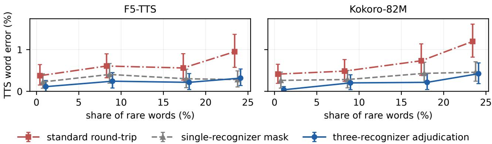

# MEASURING THE VERIFIER’S FLOOR: HOW MUCH APPARENT RARE-WORD TEXT-TO-SPEECH ERROR IS ASR ERROR?

Kirill Borodin1, Vasilii Kudryavtsev1, Nikita Vasiliev1, Grach Mkrtchian2

1BitmanagerAI, Dubai, UAE 2lab260, Yerevan, Armenia

kborodin.research@gmail.com

## ABSTRACT

Text-to-speech (TTS) is usually evaluated by transcribing its output with an automatic speech recognition (ASR) system, so the word error rate also counts recognizer errors. We measure these errors on human recordings of the test sentences. On LibriSpeech and FLEURS, the evaluation recognizer misses 33–67% of very rare words even in human speech, and all three recognizers miss 22–42%. Checking every word with two more recognizer families lowers the apparent TTS error on words that at least one recognizer hears two- to three-fold (very rare LibriSpeech words: from 10–13% to 3–5%), yet very rare words remain the hardest. Ignoring words the recognizer misses in human speech is biased: the other recognizers find TTS errors far more often on these words (4–6% vs. 0.2–0.3%) and overturn about half of the errors this mask keeps. As half of the remaining adjudicated errors may be spelling variants, a listening test is needed.

Index Terms— speech synthesis, evaluation, word error rate, speech recognition, rare words

## 1. INTRODUCTION

The standard test of whether a text-to-speech (TTS) system says the right words is the ASR round-trip: the synthetic speech is transcribed by a speech recognizer, and the word error rate (WER) is computed against the input text [1, 2]. Recent sys tems also use the recognizer at inference: they generate several candidates and keep the one it transcribes best [3, 4, 5].

This test measures two systems at once. If the recognizer cannot transcribe a word even when a person says it, an error on this word tells us little about the TTS system. Such words are mostly rare words, names and foreign words, which is exactly where TTS errors are reported to concentrate.

A recent study [4] calls rare words “a genuine limit rather than a sampling problem”, but notes that it “did not measure its false-positive floor on ground-truth audio”. We measure this floor. We use corpora in which every test sentence has its original human recording, and we run the same recognizers on human and on synthetic speech. The error on human speech is a diagnostic baseline, not a strict bound, because synthetic speech can be easier or harder to recognize.

We compare three estimates of TTS word error: the standard round-trip, a single-recognizer mask that ignores words the recognizer misses in human speech, and a three-recognizer adjudication in which two more recognizers check every word. Our main findings are:

1. The recognizer error depends strongly on word frequency. In human LibriSpeech recordings it misses 1.5% of common but 32.9% of very rare words.

2. Adjudication lowers the apparent TTS error two- to three-fold. Very rare words remain the hardest, though about half of the remaining errors may be spelling variants.

3. The single-recognizer mask is biased. It removes the words on which the other recognizers find TTS errors most often, and they overturn half of those it keeps.

## 2. RELATED WORK

ASR transcripts are widely used instead of listener transcripts to test TTS intelligibility [6], although ASR WER agrees only loosely with listeners [7]. Yu and Kang [5] show that best-of-N results depend on the recognizer family used as judge. Luo and Wan [8] report the opposite error to ours: a recognizer can hide real TTS mistakes by writing what the text should say.

The closest work is Appendix C of [9] (not in the ICML version [7]). It compares ASR WER with listener transcripts of synthetic and human speech for one TTS system, at corpus level. We add the dependence on word frequency, word-level checks with three recognizer families, and their effect on rareword results such as [4], whose system we do not re-run.

## 3. METHOD

## 3.1. Word decisions

For each test sentence we have its text, the original human recording and N synthetic versions. Three recognizers, A, B and C, transcribe all of them. C is the evaluator (the verifier) whose round-trip we study; A and B are only used to check C.

Texts are normalized with the Whisper English text normalizer and aligned. A reference word is recovered (the recognizer hears it) if it matches exactly, or if up to three words differ from the transcript only in spaces (any thing vs. anything). We ignore insertions, so our rates are word miss rates, not WER.

Table 1. Four words from the F5-TTS LibriSpeech set: recognizers that hear the word in the human recording, the most frequent transcript of $\mathrm { ~ A ~ / ~ B ~ / ~ C ~ }$ over the 8 synthetic versions (=: correct), and the decision of estimates (1)–(3).
<table><tr><td>word</td><td>human TTS output (A / B / C)</td><td>(1)</td><td>(2)</td><td>(3)</td></tr><tr><td></td><td>Phoebe A, B, C fuby / pube / fuby</td><td>error</td><td>error</td><td>error</td></tr><tr><td>Tessa</td><td>A, B, C = / = / tess</td><td>error</td><td>error</td><td>correct</td></tr><tr><td>stile</td><td>A, B  $= / = / { \mathrm { s t y l e } }$ </td><td></td><td>error ignored correct</td><td></td></tr><tr><td>Veolan A</td><td>violan / violan / tullyviolen error ignored error</td><td></td><td></td><td></td></tr></table>

For recognizer X, $h _ { X } ( w )$ is true if X hears word w in the human recording, and $s _ { X } ( w )$ is true if X hears w in at least one of the N synthetic versions. Our rates are therefore any-of-N rates, which fall as N grows. We also report $N { = } 1$ and the one candidate that a best-of-N system would keep.

## 3.2. Three estimates of TTS error

Word w is a TTS error under (1) the standard round-trip if $\neg s _ { C } ( w )$ , and under (2) the single-recognizer mask if $h _ { C } ( w ) \wedge$ $\neg s _ { C } ( w )$ , that is, words that C misses in human speech are ignored. Under (3) three-recognizer adjudication,

$$
\begin{array} { r } { \mathrm { e r r } ( w ) = \big [ h _ { A } ( w ) \vee h _ { B } ( w ) \vee h _ { C } ( w ) \big ] ~ } \\ { \wedge \neg \big [ s _ { A } ( w ) \vee s _ { B } ( w ) \vee s _ { C } ( w ) \big ] . } \end{array}\tag{1}
$$

A word is judged if at least one recognizer hears it in the human recording. Under (3), a judged word is an error only if no recognizer hears it in any synthetic version. We report all three estimates per judged word.

The mask can fail in two ways. The ignored words may also be TTS errors, and an error it keeps may still be a mistake of C. Adjudication reduces both problems but does not remove them. It leaves out words that no recognizer hears, and a recognizer may guess a word from context [8]; both lower the error. Spelling variants and shared recognizer failures raise it.

Table 1 shows four real words. All recognizers mishear Phoebe in every synthetic version, so all estimates count an error. For Tessa and stile only C fails in the synthetic speech, so adjudication counts no error. Veolan is heard only by A in the human recording and by no recognizer in the synthetic speech: the mask ignores it, but adjudication counts it.

## 3.3. Word frequency

We measure word frequency with the wordfreq library [10] on the Zipf scale, where z=3 means once per million words. Very rare words have $z { < } 2 . 5$ and common words $z { \geq } 4 . 5$ . Tokens with digits are not assigned to a band.

The LibriSpeech sentences were selected with a simpler corpus measure: a word is rare if it occurs at most twice in about 11k LibriSpeech transcripts. This measure is also the x-axis of Fig. 1. Per sentence, it correlates with the share of words below z=3 at $r { = } 0 . 6 0$ , and we repeat the trend analysis with this Zipf share.

## 4. EXPERIMENTAL SETUP

Data. The main set has 500 LibriSpeech [11] test and dev sentences of 15–30 words (mean 20.8). The share of rare words varies from 0 to 41%, while the mean length stays between 20.0 and 21.5 words across the bins of Fig. 1.

The first 300 sentences had only 37 with more than 15% rare words and gave unclear trends. We then added the 200 remaining sentences with the highest shares (18–41%). This was decided after seeing the first results, so the trend analysis is exploratory.

We repeat the measurement on the first 200 FLEURS en\_us [12] test recordings with 12–30 words and 3–16 s of audio. They cover 161 sentences (39 recorded twice) with more names and numbers.

Systems. F5-TTS [2] generates N=8 versions with random seeds (N=4 on FLEURS) and clones the voices of five LibriSpeech test-clean speakers. Kokoro-82M [13] is deterministic, so its N=4 versions use four voices. Since N and the kind of variation differ, we do not compare the two systems.

The recognizers are A: Whisper large-v3-turbo [14], B: wav2vec 2.0 large [15] (CTC, no language model) and C: OWSM v3.1 [16], all with greedy decoding.

Statistics. Words in a sentence are not independent, so 95% confidence intervals (CIs) come from a percentile bootstrap over sentences (4,000 resamples). Repeated FLEURS sentences are resampled together. A cell with no errors gets the 95% Clopper–Pearson upper limit, which assumes independent words.

Trends are Pearson correlations over sentences between the share of rare words and the error per judged word. No parameters were fitted to these data, but the word matching rule was revised after inspecting alignments from these sets.

## 5. RESULTS

## 5.1. ASR errors on human speech

Table 2 shows that the recognizer error on human speech grows quickly as words get rarer. C misses 1.5% of common LibriSpeech words but 32.9% of very rare ones (3.2% and 66.7% on FLEURS). On LibriSpeech, A and B also miss 31.8% and 30.3% of them.

For 54% of the words that C misses (55% on FLEURS), A or B does transcribe them from the same recording. This points to a problem of C rather than of the audio, although A or B may also guess a word from context. The rest may be unclear audio, dialect spellings that all recognizers normalize (hisself → himself) or shared blind spots.

  
Fig. 1. TTS word error per judged word (any-of-N) against the share of rare words (corpus measure) in the 500 LibriSpeech sentences, split into four bins at the quartiles (124, 124, 111 and 141 sentences). Points are bin means; bars are 95% CIs.

Table 2. ASR error on human speech and TTS error by word frequency (Zipf band z; tokens with digits excluded). Unjudged: no recognizer hears the word in the human recording. Standard: C misses the word in all N synthetic versions (LibriSpeech: F5-TTS / Kokoro). Adjudicated: Eq. (1), with 95% CIs; †no errors, 95% Clopper–Pearson upper limit. All values in %.
<table><tr><td></td><td></td><td colspan="2">ASR on human speech</td><td colspan="2">standard TTS error</td><td colspan="2">adjudicated TTS error</td></tr><tr><td>band</td><td>words</td><td>unjudged</td><td>C misses</td><td>all words</td><td>judged words</td><td>F5-TTS</td><td>Kokoro</td></tr><tr><td colspan="8">LibriSpeech, 500 sentences</td></tr><tr><td>very rare (z&lt;2.5)</td><td>380</td><td>21.6</td><td>32.9</td><td>21.8 / 25.0</td><td>10.1 / 13.4</td><td>3.4 [1.4, 5.4]</td><td>4.7 [2.5, 7.2]</td></tr><tr><td>rare (2.5–3.5)</td><td>783</td><td>4.3</td><td>8.9</td><td>4.3 / 2.6</td><td>2.8 / 1.1</td><td>1.5 [0.7, 2.4]</td><td>0.4 [0.0, 0.9]</td></tr><tr><td>mid (3.5–4.5)</td><td>1319</td><td>1.4</td><td>4.7</td><td>0.9 / 1.1</td><td>0.5 / 0.8</td><td>0.2 [0.0, 0.4]</td><td>0.2 [0.0, 0.4]</td></tr><tr><td>common (z≥4.5)</td><td>7930</td><td>0.5</td><td>1.5</td><td>0.2 / 0.3</td><td>0.1 / 0.2</td><td>0.0 [0, 0.05]†</td><td>0.0 [0.0, 0.1]</td></tr><tr><td colspan="8">FLEURS en_us, F5-TTS, 200 recordings of 161 sentences</td></tr><tr><td>very rare (z&lt;2.5)</td><td>60</td><td>41.7</td><td>66.7</td><td>50.0</td><td>31.4</td><td>11.4 [2.4, 24.1]</td><td></td></tr><tr><td>rare (2.5–3.5)</td><td>185</td><td>11.9</td><td>27.0</td><td>15.1</td><td>10.4</td><td>1.8 [0.0, 4.6]</td><td></td></tr><tr><td>mid (3.5–4.5)</td><td>619</td><td>3.2</td><td>7.8</td><td>3.2</td><td>2.3</td><td>1.0 [0.2, 2.1]</td><td></td></tr><tr><td>common (z≥4.5)</td><td>3096</td><td>1.3</td><td>3.2</td><td>0.5</td><td>0.4</td><td>0.1 [0.0, 0.3]</td><td></td></tr></table>

All three recognizers miss 21.6% of the very rare LibriSpeech words (41.7% on FLEURS), so these words cannot be judged at all.

## 5.2. TTS error under the three estimates

Table 3 compares the estimates on the same judged words. With any-of-N, adjudication lowers the error from 0.63% to 0.22% for F5-TTS and from 0.72% to 0.22% for Kokoro. The ratio of standard to adjudicated error is 2.8 [2.1, 4.1] and 3.2 [2.4, 4.8] (3.3 [2.3, 5.6] on FLEURS).

By definition the adjudicated error cannot exceed the standard error, so the size of the gap is the result. Part of it comes from pooling, because an adjudicated error must survive 3N transcripts instead of N.

The gap remains for a single candidate and for the candidate a best-of-N system would keep. For the latter the ratio is

1.9 [1.5, 2.4] and 2.5 [2.0, 3.4] (2.1 [1.6, 3.2] on FLEURS); this is conservative, as the selection also removes some of C’s own errors.

Rare words remain the hardest. On very rare LibriSpeech words, the adjudicated error is 3.4% for F5-TTS (10 of 298) and 4.7% for Kokoro (14 of 298), against 0 of 7,889 and 3 of 7,889 common words (Table 2).

Part of this evidence is weak. 4 of the 10 and 5 of the 14 very rare errors fall on the 32 words that only one recognizer hears in the human recording. On the words that all three hear, each system has errors on 3 of 215 words, mostly spelling variants (Sec. 5.3).

The error also rises with the share of rare words in a sentence (Fig. 1, Table 3). The adjudicated trend is significant for Kokoro with the corpus measure and for both systems with the Zipf share. With the corpus measure, it does not differ significantly from the standard trend (+0.063 [−0.010, +0.145] and +0.032 [−0.045, +0.107]).

Table 3. TTS word error per judged word (%) and its correlation r with the share of rare words per sentence (corpus measure/Zipf share; ∗: the 95% CI excludes zero). Kept: the version with the fewest words missed by C.
<table><tr><td rowspan="2">estimate</td><td colspan="2">LibriSpeech</td><td rowspan="2">FLEURS F5-TTS</td></tr><tr><td>F5-TTS</td><td>Kokoro</td></tr><tr><td rowspan="3"></td><td>any-of-N standard</td><td>0.63</td><td>0.72</td><td>1.52</td></tr><tr><td>mask</td><td>0.30</td><td>0.36</td><td>0.66</td></tr><tr><td>adjudicated</td><td>0.22</td><td>0.22</td><td>0.46</td></tr><tr><td rowspan="2">N=1</td><td>standard</td><td>1.51</td><td>2.26</td><td>2.56</td></tr><tr><td>adjudicated</td><td>0.63</td><td>0.43</td><td>1.11</td></tr><tr><td rowspan="2">kept</td><td>standard</td><td>0.71</td><td>0.80</td><td>1.62</td></tr><tr><td>adjudicated</td><td>0.38</td><td>0.32</td><td>0.76</td></tr><tr><td rowspan="3">r</td><td>standard</td><td> $+ 0 . 1 4 ^ { * } / + 0 . 2 3 ^ { * }$ </td><td> $+ 0 . 1 6 ^ { * } / + 0 . 2 8 ^ { * }$ </td><td>一</td></tr><tr><td>mask</td><td> $+ 0 . 0 4 / + 0 . 1 1 ^ { \ast }$ </td><td> $+ 0 . 0 6 / + 0 . 1 3 ^ { \ast }$ </td><td>一</td></tr><tr><td>adjudicated</td><td> $+ 0 . 0 8 / + 0 . 1 5 ^ { \ast }$ </td><td> $+ 0 . 1 3 ^ { * } / + 0 . 1 8 ^ { * }$ </td><td>一</td></tr></table>

Table 4. Test of the single-recognizer mask with A and B as judges, counting only words that A or B hears in human speech. Left: TTS error on words that C misses or hears there. Right: share of the mask’s kept errors that A or B hears in a synthetic version. Values in % with 95% CIs.
<table><tr><td rowspan="2"></td><td colspan="2">TTS error on words C...</td><td rowspan="2">kept errors A/B hear</td></tr><tr><td>misses on human hears on human</td><td></td></tr><tr><td>LS, F5-TTS</td><td>3.9 [1.5, 6.8]</td><td>0.2 [0.1, 0.3]</td><td>53 [35, 71]</td></tr><tr><td>LS, Kokoro</td><td>4.9 [2.2, 8.1]</td><td>0.2 [0.1, 0.3]</td><td>64 [48, 79]</td></tr><tr><td>FLEURS, F5-TTS</td><td>6.0 [2.3, 10.4]</td><td>0.3 [0.1, 0.6]</td><td>56 [35, 79]</td></tr></table>

## 5.3. What the remaining errors are

There are 23, 23 and 18 adjudicated errors in the three sets, mostly names, archaic or foreign words and, on FLEURS, abbreviations.

In 15, 8 and 12 cases the recognizer transcripts point to a different pronunciation, for example Phoebe as “fuby” or BCE as “beasts”. The other 8, 15 and 6 are spelling variants or homophones (Bessy/Bessie, buoy/boy) or text artifacts. No transcript-based metric can tell these apart from mispronunciations.

Counting only the first group, the TTS error is 1.7%, 1.7% and 5.7% on very rare words and 0.15%, 0.08% and 0.30% overall, so rare words are still the hardest.

## 5.4. The single-recognizer mask is biased

Table 4 uses A and B as judges. On the words that C misses in human speech, they find a TTS error in 3.9% (F5-TTS) and 4.9% (Kokoro) of cases, but only in 0.2% of the words that C hears. The mask thus removes the words that TTS gets wrong most often, by more than an order of magnitude.

The mask also keeps false errors. Of its kept errors on words that A or B hears in human speech, A or B hears 16 of 30 (F5-TTS) and 23 of 36 (Kokoro) in a synthetic version, so adjudication overturns about half. Words that C misses are also hard for A and B, who both hear only 30% of them in human speech (against 99% of the words C hears), so part of the contrast may be shared difficulty.

Computing the mask only over the words C hears (94– 96% of words) changes its rate by less than 0.03 points, so the denominator does not drive Table 3. With the corpus measure, neither the mask’s trend nor the difference between the adjudicated and the mask trend (+0.037 [−0.034, +0.108] and $+ 0 . 0 6 8 \left[ - 0 . 0 1 7 , + 0 . 1 5 4 \right] )$ is significant, so we claim only that the mask is biased.

## 6. DISCUSSION

We first planned to adapt N to each sentence and to stop when C hears all words of a candidate. With this rule, 66–75% of the sentences (recordings on FLEURS) are accepted by the second candidate. Of the sentences never accepted, 69–80% contain a word that C misses in the human recording and in all N versions, so C cannot tell whether TTS or C is at fault.

Our results suggest four practices for round-trip evaluation: (i) report the recognizer error on the human recordings, by word frequency; (ii) do not simply drop the words that the recognizer misses there; (iii) check disputed rare words with other recognizer families or, better, with listeners; (iv) report N=1 next to any-of-N.

## 7. LIMITATIONS

No listening test. All TTS-error decisions come from recognizers, which share blind spots. A listening test on these 23+23+18 errors, a sample of removed errors and control words has been prepared but not yet run.

Few errors. With 23, 23 and 18 adjudicated errors, the rare-word estimates and trends have wide intervals.

Scope. We use English read speech from two corpora. B and C were trained on LibriSpeech, and C is both evaluator and judge.

## 8. CONCLUSION

An ASR round-trip scores the recognizer as well as the TTS system, and the recognizer’s own errors are concentrated on rare words. With three recognizers on human and synthetic speech, the apparent TTS error on judged words is two to three times the adjudicated error, very rare words remain the hardest, and ignoring words one recognizer misses is a biased correction that discards true errors and keeps false ones. A listening test is needed to confirm these results. We will release code, sentence lists and all transcripts.

## 9. COMPLIANCE WITH ETHICAL STANDARDS

This research study was conducted retrospectively using human subject data made available in open access under the CC BY 4.0 license by LibriSpeech [11] and FLEURS [12]. No new recordings were made and no listening tests were run, so ethical approval was not required.

## 10. ACKNOWLEDGMENTS

The authors have no relevant financial or non-financial interests to disclose. Claude Opus 5.5 (Anthropic) was used only to polish the text of this paper. All ideas and experiments were conceived and carried out by the authors, who take full responsibility for the content.

## 11. REFERENCES

[1] Philip Anastassiou et al., “Seed-TTS: A family of high-quality versatile speech generation models,” arXiv preprint arXiv:2406.02430, 2024.

[2] Yushen Chen, Zhikang Niu, Ziyang Ma, Keqi Deng, Chunhui Wang, Jian Zhao, Kai Yu, and Xie Chen, “F5- TTS: A fairytaler that fakes fluent and faithful speech with flow matching,” in Proc. ACL, 2025, pp. 6255–6271.

[3] Zhen Ye, Xinfa Zhu, Chi-Min Chan, Xinsheng Wang, Xu Tan, Jiahe Lei, Yi Peng, Haohe Liu, Yizhu Jin, Zheqi Dai, Hongzhan Lin, Jianyi Chen, Xingjian Du, Liumeng Xue, Yunlin Chen, Zhifei Li, Lei Xie, Qiuqiang Kong, Yike Guo, and Wei Xue, “Llasa: Scaling train-time and inference-time compute for Llama-based speech synthesis,” arXiv preprint arXiv:2502.04128, 2025.

[4] Ali Asaria, Tony Salomone, and Deep Gandhi, “Reliable neural-codec text-to-speech by ASR self-verification and distillation: Near-zero catastrophic failures across models and codecs,” arXiv preprint arXiv:2606.18323, 2026.

[5] Taehyung Yu and Seongjae Kang, “Best-of-N TTS evaluation is confounded by ASR family alignment,” in ICML 2026 Workshop on Machine Learningfor Audio, 2026, arXiv:2607.08256.

[6] Jason Taylor and Korin Richmond, “Confidence intervals for ASR-based TTS evaluation,” in Proc. Interspeech, 2021, pp. 2791–2795.

[7] Yifan Yang, Hui Wang, Bing Han, Shujie Liu, Jinyu Li, Yong Qin, and Xie Chen, “Position: Towards responsible evaluation for text-to-speech,” in Proc. ICML, 2026, arXiv:2510.06927.

[8] Shijun Luo and Lizhi Wan, “ASR-roundtrip evaluation can mask context- and convention-dependent

reading errors in Chinese news TTS,” arXiv preprint arXiv:2608.10606, 2026.

[9] Yifan Yang, Hui Wang, Bing Han, Shujie Liu, Jinyu Li, Yong Qin, and Xie Chen, “Position: Towards responsible evaluation for text-to-speech,” arXiv preprint arXiv:2510.06927v2, 2026, Version 2 (29 Jan 2026); its Appendix C is not in the ICML 2026 version.

[10] Robyn Speer, “rspeer/wordfreq: v3.0,” Sept. 2022, Zenodo, doi:10.5281/zenodo.7199437; run as wordfreq 3.1.1.

[11] Vassil Panayotov, Guoguo Chen, Daniel Povey, and Sanjeev Khudanpur, “Librispeech: An ASR corpus based on public domain audio books,” in Proc. ICASSP, 2015, pp. 5206–5210.

[12] Alexis Conneau, Min Ma, Simran Khanuja, Yu Zhang, Vera Axelrod, Siddharth Dalmia, Jason Riesa, Clara Rivera, and Ankur Bapna, “FLEURS: Few-shot learning evaluation of universal representations of speech,” in Proc. IEEE SLT, 2023, pp. 798–805.

[13] hexgrad, “Kokoro-82M,” https://huggingface. co/hexgrad/Kokoro-82M, 2025.

[14] Alec Radford, Jong Wook Kim, Tao Xu, Greg Brockman, Christine McLeavey, and Ilya Sutskever, “Robust speech recognition via large-scale weak supervision,” in Proc. ICML, 2023, pp. 28492–28518.

[15] Alexei Baevski, Yuhao Zhou, Abdelrahman Mohamed, and Michael Auli, “wav2vec 2.0: A framework for selfsupervised learning of speech representations,” in Proc. NeurIPS, 2020, vol. 33, pp. 12449–12460.

[16] Yifan Peng, Jinchuan Tian, William Chen, Siddhant Arora, Brian Yan, Yui Sudo, Muhammad Shakeel, Kwanghee Choi, Jiatong Shi, Xuankai Chang, Jee-weon Jung, and Shinji Watanabe, “OWSM v3.1: Better and faster open Whisper-Style speech models based on E-Branchformer,” in Proc. Interspeech, 2024, pp. 352–356.