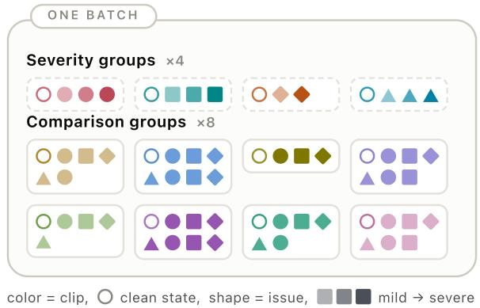
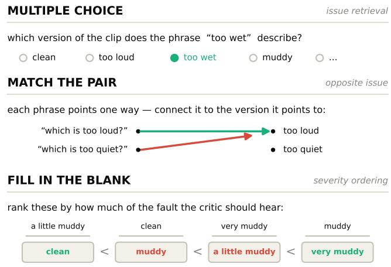
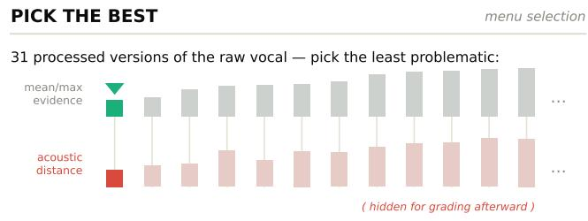

# MIXJUDGE: LEARNING A LANGUAGE-QUERYABLE CRITIC FOR VOCAL MIXING

Kuan-Hsun Ho1, Yuan-Chiao Cheng2, Yen-Tung Yeh3, Yi-Hsuan Yang3,4

1Independent Researcher 2Music Informatics Group, Georgia Institute of Technology 3Music and AI Lab, National Taiwan University 4AI-CoRE, National Taiwan University

## ABSTRACT

Mixing requires not only applying processing but also assessing the resulting mix. Audio-language models can provide conversational mixing advice, but existing evaluations do not separately test whether they can judge specific mixing issues. Since professional supervision for such judgments is scarce, we construct a curriculum of 11 vocal-mix issues at multiple severity levels and use it to train MixJudge, a language-queryable audio critic. MixJudge shows its ability to retrieve mixing issues, distinguish opposite issues, and order the severity of an issue. Moreover, its judgments transfer to menu selection: given a set of processing candidates, MixJudge often favors versions acoustically closer to a held-out professional version, demonstrating how explicit mixing judgment can support comparison and downstream mixing decisions.

Index Terms— automatic music mixing, audio-language critic, vocal mixing, contrastive learning, audio quality assessment

## 1. INTRODUCTION

Mixing is a central stage of music production in which engineers process and combine recorded tracks into a coherent whole [1]. Balancing level, tone, dynamics, space, and source interaction requires domain expertise, and the appropriate treatment of a source depends on the surrounding arrangement [2, 3]. Mixing is also not a singleanswer problem: engineers working with the same material still produce substantially different results [4, 5]. In practice, demo mixes and reference songs are used to communicate and establish expectations for the desired outcome [6]. These properties make mixing not only a problem of producing a treatment, but also one of assessing the resulting mix state.

Existing automatic mixing research primarily addresses the production side of this problem. Reference-free systems infer processing directly from source stems (isolated tracks) [2, 3, 7, 8], while reference-conditioned mixing style transfer uses an example recording to communicate desired production characteristics [9, 10]. Both settings focus on producing a mixing outcome from the source material and, optionally, an audio reference, rather than separately assessing the resulting mix.

Audio-language research provides natural-language interfaces for reasoning about audio. Existing work supports audio-text representation learning [11], text-guided editing and effect control [12, 13], and executable effect chains [14]. Closest to our setting, Mix-Assist fine-tunes audio-language models to generate audio-grounded conversational mixing advice and evaluates the usefulness of the generated advice as a whole [15]. This establishes conversational mixing assistance, but does not separately examine whether a model can make issue-specific audio judgments that vary consistently with the severity of an issue.

We study a complementary role: an explicit critic that assesses a mix state with respect to a language-specified issue. Applying the same judgment to different versions of a mix then provides a common basis for comparing processing alternatives. Such judgment depends on an experience-shaped expectation of what constitutes a plausible mix outcome for the song, which we call a mixing prior. Language then enables an engineer to ask whether a mix is too loud, dull, or affected by another issue rather than receiving only an opaque quality score.

Training data for this kind of judgment are scarce. Public datasets rarely contain both unprocessed multitracks and their professional mixes, and multiple professional realizations of the same material are rarer still [2, 8, 9]. We instead synthesize known mixing issues at multiple severity levels and pair them with text, allowing a model to contrast a clean clip with its degraded versions while musical content remains fixed. To keep the synthetic degradations controlled while preserving a meaningful source-context relationship, we focus on vocals and their musical backing (sum of all non-vocal sources). We present MixJudge, a language-queryable audio critic that learns from this curriculum to assess whether a vocal mix exhibits a language-specified issue.

We evaluate MixJudge in two stages: a critic’s exam of its mixing judgments, followed by menu selection to test their use in a downstream mixing decision. This work makes three contributions: 1) a vocal-mix curriculum providing paired audio-text supervision over 11 issues and multiple severity levels; 2) MixJudge, a languagequeryable critic that judges whether a vocal mix exhibits a specified issue; and 3) menu selection, a concrete comparison-based form of mixing assistance showing how these judgments can support decisions.

## 2. VOCAL-MIX CURRICULUM

Here, a clip denotes a 10-second vocal-and-backing excerpt, an issue names an audible problem, a recipe is signal processing that instantiates an issue, and a state is one processed version of a clip.

The curriculum covers 11 issue labels plus clean, where the issues form a teaching vocabulary rather than an exhaustive account of mixing quality, and clean denotes no injected problem rather than a universally optimal mix. The issue labels are too loud, too quiet, muddy, thin, harsh, dull, too wet (excessive reverberation), too dry (insufficient reverberation), over-compressed, under-compressed, and masking (the backing obscures the vocal). The first 10 labels form 5 opposite pairs. Masking has no explicitly named opposite in text vocabulary, so we do not force a twelfth symmetric label. In general, the 11 issue labels use common mixing terminology and cover level, tone, space, dynamics, and source interaction, reflecting the perceptual features studied in multitrack music mixtures [4].

We keep the audio states mono to limit construction and modeling complexity, thus excluding stereo-width issues. Phase is also omitted because the available public stems do not preserve the multimicrophone relationships required to construct realistic phase problems.

Audio and caption synthesis. Each recipe follows three stages. First, an eligibility check determines whether the clip contains the audio material needed to express the issue. Second, the recipe applies a degradation at one of three severity levels: mild, medium, or severe. Then, most non-level recipes normalize the loudness of the affected source so that the intended issue is not confounded by an overall level change. Third, recipe-specific acceptance rules retain only states that satisfy recipe-specific acoustic checks, proxy thresholds, and safety conditions. These rules provide implementationlevel filtering rather than perceptual validation. The curriculum contains 18 heuristic recipes; some issues use multiple recipes so that one issue is not tied to only one signal transformation.

Each retained state receives a template-generated caption following “The [subject] [is/sounds] [optional degree] [quality] [optional scope].” After the issue and severity are chosen, the generator samples subjects, degree words, issue phrases, and scopes from a fixed lexicon.1 Taking recipe muddy tone as an example, the recipe requires the vocal’s low-mid energy ratio to exceed an eligibility threshold, then boosts the low-mid region according to severity, and normalizes the loudness of the affected source. One accepted severe state may pair this audio with “The [voice] [sounds] [completely] [muddy] [in the low mids].”

## 3. MIXJUDGE

MixJudge comprises CLAP audio and text encoders [11], learned role embeddings, and a relational fusion network. For a state $A =$ $( b , v , m )$ , it receives backing $b ,$ vocal v, their blend $m ,$ and a text description q naming the issue to judge. The audio encoder maps the three audio inputs to $h _ { b } , h _ { v } .$ , and $h _ { m }$ . A fusion network F then forms a state embedding

$$
z _ { A } = \mathrm { n o r m } { \cal F } ( [ \tilde { h } _ { b } , \tilde { h } _ { v } , \tilde { h } _ { m } , \tilde { h } _ { v } - \tilde { h } _ { b } , \tilde { h } _ { m } - \tilde { h } _ { b } ] ) ,\tag{1}
$$

where norm $( x ) = x / \| x \| _ { 2 }$ and $\tilde { h } _ { r } = h _ { r } + e _ { r }$ with $e _ { r }$ denoting a learnable role embedding. The intuition for forming role-marked slots and difference features is to expose how the vocal and resulting blend relate to the backing. With text encoder mapping $q$ to a normalized embedding $z _ { q } , s ( A , q ) = z _ { A } ^ { \top } z _ { q }$ formulates the cosine similarity between the audio state and the issue description.

## 3.1. Training

To prevent the model from using song or singer identity as a shortcut, every training group contains different states of the same clip. A severity group contains the clean state and every available severity of one recipe, providing severity-order supervision. On the other hand, a comparison group contains the clean state and up to seven recipes at the same nominal severity, providing issue discrimination (Fig. 1).

Training combines state matching, two auxiliary margin losses, and severity ranking. State-level matching uses a pairwise sigmoid loss $\mathcal { L } _ { \mathrm { s i g } }$ following SigLIP [16]. Unlike diagonal-only InfoNCE [17], it can mark multiple audio-caption pairs as positive. Audio state and caption pairs sharing the same recipe and nominal severity are positive, including pairs from different clips; all other pairs are negative. This dense supervision encourages audio-text correspondence for curriculum states while reducing reliance on musical content.

  
Fig. 1. Same-content training batch construction.

To enhance semantic discrimination among issues, we introduce two auxiliary margin losses: the issue-selectivity loss $\mathcal { L } _ { \mathrm { s e l } }$ and the opposite-issue loss $\mathcal { L } _ { \mathrm { o p p } }$ . Since batch-sampled captions vary and do not guarantee coverage of every issue, both losses use one fixed issue anchor $q _ { i }$ per issue as a stable comparison axis. Each anchor also follows the caption template without a degree modifier. Let $A _ { i } ^ { s }$ denote a clip rendered with issue i at severity $s ,$ and let $A _ { i } ^ { 0 } \equiv A ^ { \tilde { 0 } }$ denote its clean state. For the issue-selectivity loss, define the cleanrelative score change $\Delta _ { j } = s ( A _ { i } ^ { s } , q _ { j } ) - s ( A ^ { 0 } , q _ { j } )$ , then

$$
\mathcal { L } _ { \mathrm { s e l } } = \mathrm { R e L U } [ 0 . 0 5 - \Delta _ { i } + \operatorname* { m a x } _ { j \neq i } \Delta _ { j } ] .\tag{2}
$$

For the opposite-issue loss, let $q _ { i }$ name the opposite of issue i:

$$
\mathcal { L } _ { \mathrm { o p p } } = \mathrm { R e L U } [ 0 . 1 0 - s ( A _ { i } ^ { s } , q _ { i } ) + s ( A _ { i } ^ { s } , q _ { \bar { i } } ) ] .\tag{3}
$$

Masking is omitted from this loss due to its lack of the opposite label.

As for severity-order supervision, the ranking loss $\mathcal { L } _ { \mathrm { r a n k } }$ [18] uses every ordered pair in a severity group, including clean-todegraded comparisons:

$$
{ \mathcal { L } } _ { \mathrm { r a n k } } = { \mathrm { s o f t p l u s } } [ - \{ s ( A _ { i } ^ { s _ { 2 } } , q _ { i } ) - s ( A _ { i } ^ { s _ { 1 } } , q _ { i } ) \} ] , \qquad s _ { 2 } > s _ { 1 } .\tag{4}
$$

Finally, the full objective is

$$
\mathcal { L } = \mathcal { L } _ { \mathrm { s i g } } + . 3 \mathcal { L } _ { \mathrm { r a n k } } + . 1 \mathcal { L } _ { \mathrm { s e l } } + . 1 \mathcal { L } _ { \mathrm { o p p } } ,\tag{5}
$$

where the margins and weights were set heuristically.

Implementation Details. The fusion network maps its 2,560- dimensional input through 2,048- and 1,024-unit GELU layers with 0.1 dropout to 512 dimensions. We train for 60 epochs with AdamW (weight decay $1 0 ^ { - 2 } ) .$ , using learning rates $3 \times \hat { 1 } 0 ^ { - 4 }$ for fusion and $3 \times \mathrm { 1 0 ^ { - 5 } }$ for adapted encoders. We report MixJudge with both CLAP encoders frozen (fusion-only) and with its audio and text encoders also adapted (adapted). Fusion-only updates the fusion network, role embeddings, and SigLIP scale/bias; adapted additionally updates the final HTSAT stage, final two RoBERTa layers, and their projections.

  
Fig. 2. The critic’s exam. Green marks correct responses; red marks errors.

## 4. EXPERIMENTAL SETUP

We evaluate whether MixJudge acquires the issue-level judgments targeted by the curriculum through the critic’s exam, and whether those judgments support a downstream mixing decision through menu selection.

For training, data synthesis yields 78,740 state-caption examples from 236 MoisesDB [19] and 134 MUSDB18-HQ [20] songs. For evaluation, we construct 4,557 synthetic examples and 88 raw/professionally processed vocal pairs from 23 selected songs drawn from the combined MedleyDB 1.0 and 2.0 releases [21, 22]. We exclude classical songs, songs with multiple vocal stems or fewer than three usable stems, and songs failing the vocal-audibility floor. The training set excludes tracks shared with the MedleyDB evaluation set. All audio is sampled at 44.1 kHz.

## 4.1. Baselines

We compare against frozen CLAP as a joint audio-text embedding baseline, and against Music Flamingo [23], Audio Flamingo Next [24], and Qwen2.5-Omni [25] as generative audio-language model baselines. Following AQAScore [26], we ask each generative model a fixed yes/no question for every issue and use the YES–NO logit margin as its score. The compared systems receive only the blend, whereas MixJudge receives the vocal, backing, and blend. Every applicable system is evaluated on identical candidates and pools, although its architecture and scoring interface remain native to that system. We also include Chance, the expected performance of random ranking or selection given the same evaluation inputs.

## 4.2. The critic’s exam

The critic’s exam comprises issue retrieval, opposite-issue discrimination, and severity ordering (Fig. 2).

Issue retrieval. Given multiple states of one clip, a text description must retrieve a state expressing its issue; any state with the queried issue is considered relevant, regardless of recipe or severity. Each description ranks a same-clip pool shared by all systems, while chance is computed from the pool size and number of relevant states. The reverse task retrieves the corresponding issue description from audio. We report Recall@1 (R@1) and mean reciprocal rank (MRR)

  
Fig. 3. Menu selection. Gray shows issue evidence; red shows each candidate’s D to professional version.

in both text-to-audio $( T \to A )$ and audio-to-text (A → T) retrieval directions.

Opposite-issue discrimination. For an opposite issue pair, each text description makes a two-way choice between the corresponding states. Both-poles accuracy $A _ { \mathrm { o p p } }$ counts a pair as correct only when both queries choose correctly.

Severity ordering. Within each clip, the queried issue score should rise from clean state through increasing degradation strengths. We report three metrics: 1) severity correlation $\rho _ { \mathrm { s e v } } ,$ Spearman’s ρ with the known order; 2) full-order accuracy $A _ { \mathrm { c h a i n } } ,$ the proportion of complete clean-to-severe sequences ordered correctly; and 3) selectivity $S _ { \mathrm { s e l } } ,$ the proportion of severity sequences whose injected issue shows the largest standardized clean-to-severe increase among all 11 issue scores.

## 4.3. Menu selection

Menu selection tests one downstream use of MixJudge’s issue scores in a concrete mixing decision (Fig. 3). For each raw vocal, we render the same fixed menu of 31 processing candidates: no edit, 18 single-control settings spanning gain, low- and mid-band equalization, compression, and reverb, and 12 two-control combinations drawn from the same operations. Thus, each candidate is the audible outcome of a particular processing treatment and is evaluated against the same backing.

For candidate A, let q denote the clean-state description. The evidence for issue i is $e _ { i } ( A ) = s ( A , q _ { i } ) - s ( A , q _ { 0 } )$ . We form two selection policies: mean evidence summarizes the 11 evidence values, while maximum evidence uses the strongest issue evidence. Each policy selects the candidate with the lowest aggregate value. Only after selection do we reveal the professionally processed vocal. We measure its acoustic distance D from each candidate using the absolute RMS-level difference plus the mean absolute log-energy difference across eight octave bands from 62 Hz to 16 kHz. Although the professional version is one realization rather than a uniquely best mix, approaching it tests whether the learned issue evidence transfers beyond synthesized curriculum states. We report three metrics: 1) closer rate C, the proportion of selections having D lower than that of no edit; 2) whole-menu correlation $\rho _ { \mathrm { m e n u } } .$ , Spearman’s ρ between ascending aggregated issue evidence and ascending D; and 3) median recovery $R _ { \mathrm { { m e d } } }$ , computed over per-clip values,

$$
R = ( D _ { 0 } - D _ { \mathrm { p i c k } } ) / ( D _ { 0 } - D _ { \mathrm { o r a c l e } } ) ,\tag{6}
$$

where $D _ { 0 }$ is no-edit distance and $D _ { \mathrm { o r a c l e } }$ is the minimum distance among candidates. Here, $R = 0$ denotes no improvement, $R = 1$ reaches the menu oracle, and $R < 0$ moves away from the professional version.

Table 1. Results of the critic’s exam and menu selection. Retrieval entries report R@1/MRR. $A _ { \mathrm { o p p } }$ is both-poles accuracy; $\rho _ { \mathrm { s e v } } .$ , severity correlation; $A _ { \mathrm { c h a i n } }$ , full-order accuracy; $S _ { \mathrm { s e l } }$ , selectivity; $C ,$ closer rate; $\rho _ { \mathrm { m e n u } } ,$ whole-menu correlation; and $\bar { R } _ { \mathrm { m e d } }$ , median recovery. Slashseparated menu entries correspond to mean/max evidence policies. Green marks the best result; red marks performance below chance.
<table><tr><td rowspan="3">System</td><td colspan="6">The critic&#x27;s exam</td><td rowspan="2" colspan="3">Menu selection</td></tr><tr><td>Issue retrieval</td><td></td><td>Opposite issue </td><td>Severity ordering</td><td></td><td></td></tr><tr><td>T→A</td><td>A→T</td><td> $A _ { \mathrm { o p p } }$ </td><td> $\rho _ { \mathrm { s e v } }$ </td><td> $A _ { \mathrm { c h a i n } }$ </td><td> $S _ { \mathrm { s e l } }$ </td><td>C</td><td>ρmenu</td><td> $R _ { \mathrm { m e d } }$ </td></tr><tr><td>Frozen CLAP</td><td>.050/.203</td><td>.066/.230</td><td>.266</td><td>.331</td><td>.442</td><td>.172</td><td>.330/.284</td><td>.146/.147</td><td>-.552/-.636</td></tr><tr><td>Music Flamingo</td><td>.097/.255</td><td>.061/.212</td><td>.250</td><td>.235</td><td>.189</td><td>.119</td><td>.364/.318</td><td>.168/.056</td><td>-.218/-.303</td></tr><tr><td>Audio Flamingo Next</td><td>.093/.237</td><td>.041/.191</td><td>.243</td><td>.175</td><td>.170</td><td>.129</td><td>.523/.386</td><td>.350/.082</td><td>.134/-.466</td></tr><tr><td>Qwen2.5-Omni</td><td>.142/.296</td><td>.057/.203</td><td>.374</td><td>.309</td><td>.239</td><td>.197</td><td>.398/.386</td><td>.290/.305</td><td>-.060/-.211</td></tr><tr><td>MixJudge (ours, fusion-only)</td><td>.112/.274</td><td>.097/.254</td><td>.727</td><td>.768</td><td>.713</td><td>.793</td><td>.705/.648</td><td>.609/.638</td><td>.567/.500</td></tr><tr><td>MixJudge (ours, adapted)</td><td>.164/.321</td><td>.117/.297</td><td>.839</td><td>.971</td><td>.922</td><td>.838</td><td>.727/.716</td><td>.730/.721</td><td>.665/.684</td></tr><tr><td>Chance</td><td>.064/.214</td><td>.064/.214</td><td>.250</td><td>.000</td><td>.048</td><td>.091</td><td>.380/.380</td><td>.000/.000</td><td>-.291/-.291</td></tr></table>

Table 2. Objective ablation.
<table><tr><td rowspan="3">Objective</td><td colspan="3">The critic&#x27;s exam</td><td colspan="2">Menu selection</td></tr><tr><td> $T \to A$ </td><td> $A _ { \mathrm { o p p } }$   $\rho _ { \mathrm { s e v } }$ </td><td> $S _ { \mathrm { s e l } }$ </td><td>C</td><td>ρmenu</td></tr><tr><td>InfoNCE</td><td>.144/.317</td><td>.812 .611</td><td>.495</td><td>.636/.682</td><td>.501/.650</td></tr><tr><td> $\mathcal { L } _ { \mathrm { s i g } }$ </td><td>.119/.317</td><td>.725</td><td>.578 .356</td><td>.739/.773</td><td>.728/.728</td></tr><tr><td> $+ \mathcal { L } _ { \mathrm { r a n k } }$ </td><td>.098/.259</td><td>.786</td><td>.916 .384</td><td></td><td>.705/.614.680/.558</td></tr><tr><td> $+ \mathcal { L } _ { \mathrm { s e l , o p p } }$ </td><td>.164/.321</td><td>.839</td><td>.971</td><td>.838</td><td>.727/.716.730/.721</td></tr></table>

## 5. RESULTS

## 5.1. What MixJudge learns

Table 1 shows that the baselines exhibit some issue-retrieval ability, but their opposite-issue discrimination and severity-ordering measures remain well below MixJudge. For the generative audiolanguage models, text-to-audio retrieval is also consistently stronger than audio-to-text retrieval. This asymmetry is consistent with recent findings of text bias in large audio-language models, although our evaluation does not isolate its cause [27]. Adapted MixJudge achieves the highest values across every reported critic-exam metric, showing that it acquired the abilities targeted by the curriculum and training objectives. This does not establish that the tested large audio-language models lack mixing knowledge; rather, their scores under this interface do not reliably solve the individual critic tasks. This also supports the need for evaluating mixing judgment through separate capabilities using defined evaluators instead of a single holistic score [28].

## 5.2. From known issues to mixing assistance

As shown in the menu-selection columns of Table 1, MixJudge performs strongly on three criteria: selecting a candidate with distance smaller than D0, ranking candidates consistently with their D, and recovering a substantial fraction of the improvement available on the menu. Together, these results suggest that the learned judgment is not limited to recognizing synthetic degradations: its evidence remains informative for ordering processing outcomes relative to a held-out professional version.

We further audit whether this result is explained by the candidate menu or a fixed processing shortcut. An improving candidate exists in 83 of 88 menus. Conditioned on these 83 actionable menus, Mix-Judge selects an improving candidate in 77.1% and 75.9% of cases using mean and max evidence policies, respectively. Its choices span 22 of the 31 candidates, showing that the result is distributed across processing alternatives instead of being concentrated on one treatment.

## 5.3. What each objective contributes

Table 2 shows that the training objectives contribute complementary properties rather than improving all metrics uniformly. Overall, critic’s exam and downstream selection are related, but improvements in one do not translate monotonically to the other. InfoNCE performs better than plain $\mathcal { L } _ { \mathrm { s i g } }$ on most critic-exam measures, whereas $\mathcal { L } _ { \mathrm { s i g } }$ transfers better to menu selection. Yet weaker opposite-issue discrimination, severity ordering, and issue selectivity make strong downstream performance difficult to attribute to the intended issue semantics. Adding $\mathcal { L } _ { \mathrm { r a n k } }$ substantially improves severity ordering, but leaves poor issue selectivity and inferior menu selection. The $\mathcal { L } _ { \mathrm { s e l } }$ and $\mathcal { L } _ { \mathrm { o p p } }$ then sharply improve all critic-exam metrics, while recovering strong menu correlation. The full objective makes the scores more consistent with the intended issue identity and severity structure while retaining strong downstream utility.

## 6. CONCLUSION

MixJudge shows that a vocal-mix curriculum can train a languagequeryable critic to make explicit mixing judgments. On the critic’s exam, MixJudge recognizes queried issues, discriminates opposite issues, and orders issue severity, while menu selection shows that its issue evidence can transfer beyond synthetic degradations to support decisions. Together, these results establish explicit judgment and comparison as a complementary form of language-assisted mixing. Future work can expand the curriculum to broader mixing issues, develop MixJudge as an interactive language-queryable critic, or extend menu selection into a practical mixing workflow, where treatments can be proposed, their outcomes judged, and the proposals iteratively refined.

## 7. REFERENCES

[1] Brecht De Man, Ryan Stables, and Joshua D. Reiss, Intelligent Music Production, Focal Press, 2019.

[2] M. A. Mart´ınez-Ram´ırez, W.-H. Liao, G. Fabbro, S. Uhlich, C. Nagashima, and Y. Mitsufuji, “Automatic music mixing with deep learning and out-of-domain data,” in Proc. ISMIR, 2022.

[3] Y.-T. Yeh, C.-J. Chan, Y.-N. Hung, and Y.-H. Yang, “Rethinking automatic music mixing as sequential stem blending,” in Proc. ISMIR, 2026.

[4] B. De Man, B. Leonard, R. King, and J. D. Reiss, “An analysis and evaluation of audio features for multitrack music mixtures,” in Proc. ISMIR, 2014.

[5] B. De Man and J. D. Reiss, “The mix evaluation dataset,” in Proc. DAFx, 2017.

[6] S. S. Vanka, M. Safi, J.-B. Rolland, and G. Fazekas, “The role of communication and reference songs in the mixing process: Insights from professional mix engineers,” J. Audio Eng. Soc., vol. 72, no. 1/2, pp. 5–15, 2024.

[7] C. J. Steinmetz, J. Pons, S. Pascual, and J. Serra, “Automatic\` multitrack mixing with a differentiable mixing console of neural audio effects,” in Proc. IEEE ICASSP, 2021.

[8] E. Moliner, M. A. Mart´ınez-Ram´ırez, J. Koo, W.-H. Liao, K. W. Cheuk, J. Serra, V. V\` alim¨ aki, and Y. Mitsufuji, “Au-¨ tomatic music mixing using a generative model of effect embeddings,” in Proc. IEEE ICASSP, 2026.

[9] J. Koo, M. A. Mart´ınez-Ram´ırez, W.-H. Liao, S. Uhlich, K. Lee, and Y. Mitsufuji, “Music mixing style transfer: A contrastive learning approach to disentangle audio effects,” in Proc. IEEE ICASSP, 2023.

[10] S. S. Vanka, C. Steinmetz, J.-B. Rolland, J. D. Reiss, and G. Fazekas, “Diff-MST: Differentiable mixing style transfer,” in Proc. ISMIR, 2024.

[11] B. Elizalde, S. Deshmukh, M. Al Ismail, and H. Wang, “CLAP: Learning audio concepts from natural language supervision,” in Proc. IEEE ICASSP, 2023.

[12] A. Chu, P. O’Reilly, J. Barnett, and B. Pardo, “Text2FX: Harnessing CLAP embeddings for text-guided audio effects,” in Proc. IEEE ICASSP, 2025.

[13] Y. Zhang, Y. Ikemiya, W. Choi, N. Murata, M. A. Mart´ınez-Ram´ırez, L. Lin, G. Xia, W.-H. Liao, Y. Mitsufuji, and S. Dixon, “Instruct-MusicGen: Unlocking text-to-music editing for music language models via instruction tuning,” in Proc. ISMIR, 2025.

[14] S. Doh, J. Koo, M. Mart´ınez-Ram´ırez, W. Choi, W.-H. Liao, Q. Wu, J. Nam, and Y. Mitsufuji, “LLM2Fx-Tools: Tool calling for music post-production,” in Proc. ICLR, 2026.

[15] M. Clemens and A. Marasovic, “MixAssist: An audio-´ language dataset for co-creative AI assistance in music mixing,” in Proc. COLM, 2025.

[16] X. Zhai, B. Mustafa, A. Kolesnikov, and L. Beyer, “Sigmoid loss for language image pre-training,” in Proc. IEEE/CVF ICCV, 2023.

[17] A. van den Oord, Y. Li, and O. Vinyals, “Representation learning with contrastive predictive coding,” arXiv preprint arXiv:1807.03748, 2018.

[18] C. Burges, T. Shaked, E. Renshaw, A. Lazier, M. Deeds, N. Hamilton, and G. Hullender, “Learning to rank using gradient descent,” in Proc. ICML, 2005.

[19] I. Pereira, F. Araujo, F. Korzeniowski, and R. Vogl, “Moi-´ sesDB: A dataset for source separation beyond 4-stems,” in Proc. ISMIR, 2023.

[20] F.-R. Stoter, A. Liutkus, and N. Ito, “The 2018 signal separa-¨ tion evaluation campaign,” arXiv preprint arXiv:1804.06267, 2018.

[21] R. M. Bittner, J. Salamon, M. Tierney, M. Mauch, C. Cannam, and J. P. Bello, “MedleyDB: A multitrack dataset for annotation-intensive MIR research,” in Proc. ISMIR, 2014.

[22] R. M. Bittner, J. Wilkins, H. Yip, and J. P. Bello, “MedleyDB 2.0: New data and a system for sustainable data collection,” in Proc. ISMIR Late-Breaking/Demo, 2016.

[23] S. Ghosh, A. Goel, L. Koroshinadze, et al., “Music flamingo: Scaling music understanding in audio language models,” arXiv preprint arXiv:2511.10289, 2025.

[24] S. Ghosh, A. Goel, K. Jayakumar, et al., “Audio flamingo next: Next-generation open audio-language models for speech, sound, and music,” arXiv preprint arXiv:2604.10905, 2026.

[25] J. Xu, Z. Guo, J. He, H. Hu, T. He, S. Bai, K. Chen, J. Wang, Y. Fan, K. Dang, B. Zhang, X. Wang, Y. Chu, and J. Lin, “Qwen2.5-Omni technical report,” arXiv preprint arXiv:2503.20215, 2025.

[26] C.-Y. Kuan, K.-W. Chang, and H.-Y. Lee, “AQAScore: Evaluating semantic alignment in text-to-audio generation via audio question answering,” arXiv preprint arXiv:2601.14728, 2026.

[27] C. Wang, G. Deng, X. Yang, H. Qiu, and T. Zhang, “When audio and text disagree: Revealing text bias in large audiolanguage models,” in Proc. EMNLP, 2025, pp. 4878–4888.

[28] H. Li, T. Tan, Y. Yang, S. Yang, and X. Chen, “AnyAudio-Judge: A dynamic rubric-based benchmark and evaluator for audio instruction following,” arXiv preprint arXiv:2606.03116, 2026.