# MULTI-TOKEN PREDICTION AND ALTERNATIVE TOKENIZATION IMPROVE LEARNING LATENT MULTI-HOP GRAPH SEARCH AT SCALE

Arvid Frydenlund University of Toronto, Vector Institute, Manulife Applied AI Research, arvie@cs.toronto.edu

Katherine Lambert   
University of Toronto,   
katherine.lambert@mail.utoronto.ca

FuTe Wong University of Toronto, Vector Institute, fute@cs.toronto.edu

Frank Rudzicz   
Dalhousie University, Vector Institute,   
frank@dal.ca

## ABSTRACT

Given an unseen graph, a start node, s, and an end node, t, can a language model generate the shortest path from s to t? Prior work has found that models fail to learn this task as the graphs scale. We show that this failure has two causes: the supervision signal and the tokenization. First, we theoretically establish and empirically demonstrate the effectiveness of multi-token prediction (MTP), and show that the benefits of MTP are topologically agnostic. Second, we introduce alternative tokenizations and show that the two causes are orthogonal. Using these methods, we break through the scaling wall observed by prior work, consistently and stably learning to solve the task at scales far beyond previous limits.

## 1 INTRODUCTION

Can a language model learn to search? A direct way to answer this is to test whether the model can recover a shortest path in an unseen graph from a symbolic description alone. Here, success would not measure world knowledge or memorization, but whether the model can carry out a multihop computation over structure it has not seen before. Our purpose is not to benchmark models but to understand why the task is hard to learn despite being within the capacity of small transformers. Prior work has studied learnable search in controlled settings as a model for general planning and multihop reasoning (Bachmann & Nagarajan, 2024; Saparov et al., 2025; Cohen et al., 2025), outlined below.

A multihop reasoning task is a tuple (W, $q , a )$ where W is a world model (a set of facts, axioms, etc.), q is a query, and a is a target answer. The task is solved by a sequence of $k \geq 1$ inferential steps that connect q to a, each licensed by some relation or rule derivable from W. Importantly, W induces a latent reasoning graph, $\mathcal { G } = ( \mathcal { N } , \mathcal { E } )$ , where nodes are reasoning states and edges are viable inference steps. The task solution is a path $\pi = q u _ { 1 } \ldots u _ { k - 1 } a$ . When $k > 1$ , a cannot be directly inferred from q in a single step, but must be found by discovering a path π in G which connects q to a. This is graph search; the difficulty of which is characterized by the topology of G, with the branching factor and the path length k determining the size of the search space. As the reasoning graph is latent, its topology is unknown, and we can not make topological assumptions. Crucially, search as a process requires no prior knowledge of G’s topology: it discovers π by traversal alone. This makes graph search a natural theoretical model for multihop reasoning as it captures the essential structural and compositional difficulty without presupposing topological properties (unstated in prior work; C).

Studying multihop reasoning using natural language data with LLMs introduces confounds that obscure whether a model is genuinely traversing a reasoning graph, as it may produce the ‘answer’ via memorized semantic shortcuts rather than structural inference; shortcuts which come from cooccurrences in the inaccessible training data (Ju et al., 2024; Balesni et al., 2024; Yang et al., 2025b).

Indeed, LLMs often ignore relational structure necessary for multihop reasoning in favour of semantic shortcuts, even when it is explicitly given (Huang et al., 2024; Xu et al., 2025; Guan et al., 2025).

These confounds motivate the use of a highly controlled environment to study multihop reasoning via graph search, which we inherit (Bachmann & Nagarajan, 2024; Saparov et al., 2025, §1.1). Graph search in this environment is not easy for an LM to learn. Bachmann & Nagarajan (2024) found the existence of a structural shortcut that can prevent learning the task on a specific graph topology with next-token prediction (NTP), which can be ameliorated via certain training conditions (§1.2). However, even with better training conditions, prior work has found the models fail to learn this task as graphs scale in size and path length, hitting a scaling wall at ≈50 nodes, where learning becomes increasingly unstable (Frydenlund, 2025; Saparov et al., 2025, especially their Fig. 6).

We investigate and break through this scaling wall. As prior work has identified an issue with NTP, and suggested MTP as a potential solution, we begin by considering if NTP is the cause of poor scaling. To do this, we extend the results of Bachmann & Nagarajan (2024) to general topologies (§2), and then elucidate how MTP overcomes the issues of NTP in a (nearly) topological-agnostic manner, and the various benefits this has for learnability (§2.1). We then hypothesize two other suspects: the causal constraint and lack of permutation-invariance. These motivate the development of alternative tokenization methods (§3 and 4). Together, these methods allow us to stably learn the task at scale.

Prior work has eliminated obvious alternative suspects: model size and scratchpads (Saparov et al., 2025). Larger models do not improve training as the graph scales. This aligns with our strong empirical results with small models (implying larger models are unnecessary), and theoretical results that transformers with O(log k) layers can express the task (Sanford et al., 2024b;a; Frydenlund, 2024; Merrill & Sabharwal, 2025).1 Test-time compute via scratchpads/CoT is not a viable solution. We show that a BFS scratchpad, while learnable, introduces its own tokenization difficulties. Critically, it also reduces the latent reasoning graph to a linear chain, breaking the theoretical model ( L.4).

## 1.1 THE SHORTEST-PATH TASK

Let $\mathcal { G } = ( \mathcal { N } , \mathcal { E } )$ be an unweighted graph, directed or not, with $| \mathcal { N } |$ nodes and |E| edges. Let $s , t \in \mathcal { N }$ be the start and end nodes of the shortest path, $\pi = u _ { 0 } u _ { 1 } \ldots u _ { k }$ of length $k + 1$ nodes. Then, given some tokenization of G and a query, $Q \doteq \cdot ( s t ) ^ { , }$ s.t. $s = u _ { 0 } , t = u _ { k } ,$ , the task is to generate the shortest path from s to t, node-by-node; thus modelling $p ( \pi _ { b } \mid s _ { b } , t _ { b } , \mathcal G _ { b } )$ for the $b ^ { \mathrm { t h } }$ sample $( \mathcal { G } _ { b } , \pi _ { b } )$

Each graph is tokenized as a list of edges, $E = [ ^ { \ast } u _ { i } u _ { j } ] ^ { \ast } : \forall ( u _ { i } , u _ { j } ) \in \mathcal { E } ]$ where ‘|’ is the endof-edge marker. The list is shuffled before concatenation to avoid providing structural information (Bachmann & Nagarajan, 2024), $\mathrm { e . g }$ . ordered by BFS from s (Ge et al., 2025). The source-side prefix is the concatenation [Q, E] (Frydenlund, 2024). The target-side is π tokenized with start- and end-of-task tokens. As the source-side must be supplied, we restrict prediction to the target-side ( O). Thus, the task must be learned from the supervision provided by the single path, π.

The graphs are synthetically generated; nodes are sampled from a global node vocabulary, ${ \mathcal { N } } _ { b } \subseteq { \mathcal { V } } ,$ and the edges are sampled via some topology-specific process. Nodes are represented by their one-hot IDs and are thus semanticless in that there is no relationship between nodes, i.e. ‘atomic facts’. This prevents homophily shortcuts (Huang et al., 2024; McPherson et al., 2001; Xu et al., 2025; Guan et al., 2025). Thus, the model must learn to solve the task via the structural information provided by the prefix alone. We generate unique instances during training (Saparov et al., 2025; Frydenlund, 2025). This is critical to avoid spurious correlations (Frydenlund, 2024; Wang et al., 2023).

This is an implicit latent multihop reasoning task, excluding inference-time procedures such as beam search or explicit intermediate token generations via scratchpads or CoT (Pan et al., 2026; Li et al., 2025; Nye et al., 2022; Wei et al., 2022, L.4). As we train on many different graphs and evaluate on unseen graphs, this is the in-context setting of the task (Noroozizadeh et al., 2026, C.4). This contrasts with the in-weights setting, which trains on a single graph and evaluates on unseen paths. Altogether, this setting allows us to isolate the defining challenge of multihop reasoning: the ability to compose and chain individual inference steps into a coherent solution path ( C).

## 1.2 THE SEQUENTIAL SUPERVISION PROBLEM WITH NEXT-TOKEN PREDICTION

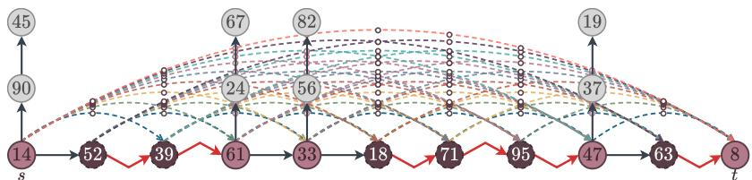  
Figure 1: A path from 14 to $^ { 8 , }$ s.t. 14, 61, 33, and 47 are choice nodes. The CHC absorbs supervision from non-choice nodes (zigzag red) under NTP. Whereas MTP induces a dense quadratic latent multihop supervision supergraph (dashed rainbow). The rainbow displays the hop-length mixture. This supergraph is agnostic to the underlying topology (See Fig. 10 in E for the full example).

Given a single training instance, $( \mathcal { G } , \pi )$ , where $| \pi | = k + 1$ , NTP results in learning a joint distribution of $p ( \pi | s , t , \mathcal { E } ) = p ( s | s , t ) p ( u _ { 1 } | s , t ) \ldots p ( u _ { i } | \pi _ { < u _ { i } } , t ) \ldots p ( t | \pi _ { < t } , t )$ with $k + 1$ terms. The model learns positional shortcuts to trivially predict the first and last terms since s and t start and end π (Frydenlund, 2025). This leaves $k - 1$ intra-sample terms, giving a sequential sample efficiency (SSE) of $k - 1$ input-target supervision pairs or loss terms. However, another topology-induced shortcut exists that can also absorb the supervision provided by these terms, further reducing the SSE.

Bachmann & Nagarajan (2024) introduced the adversarially designed path-star task to undermine the SSE under NTP with star-shaped graphs (Fig. 8). Each graph has a centre node, s, with d arms of length k. The query is $( s , t )$ , where t ends an arm, making π the arm containing t. Let $d ( u _ { i } )$ be the degree of node $u _ { i } .$ Then $d ( s ) = d$ and all other nodes have degree 2 or 1. This topology creates an unsympathetic interaction with NTP due to teacher-forcing, which conditions each prediction on the prior ground-truth sequence (Williams & Zipser, 1989). Consider $p ( u _ { i } \mid \pi _ { < u _ { i } } , t , \mathcal { E } )$ when $1 < i \leq k - 1$ . By conditioning on the subpath, $\pi _ { < u _ { i } }$ , the model can trivially predict that $u _ { i }$ follows $u _ { i - 1 }$ via the single edge $( u _ { i - 1 } , u _ { i } ) \in \mathcal { E } \mathrm { a s } d ( u _ { i - 1 } ) = 2$ . Such a prediction does not support learning multihop reasoning and, this shortcut, called the Clever Hans Cheat (CHC), will absorb all terms except $p ( u _ { 1 } \mid s , t )$ , reducing the SSE from $k - 1$ to 1 supervision pair on path-star graphs under NTP.

This leads to very unfavourable learning conditions, where LMs using NTP fail to learn the task on graphs with only 9 nodes $( d = 2$ and $k = 4 )$ . Bachmann & Nagarajan (2024) showed that a type of multi-token prediction (MTP) can ameliorate this complete failure, seemingly by restoring the SSE.

However, the CHC not only reduces the amount of supervision, but also the type. Consider the remaining term, $p ( u _ { 1 } \mid s , t )$ . This requires k hops to solve, as the model needs to reconstruct the subpath, $\pi ( u _ { 1 } , t ) = u _ { 1 } \ldots t ,$ to predict $u _ { 1 }$ (done backwards). Now consider the terms the CHC absorbed. Each term requires reconstruction of a subpath, each one hop shorter than the last, e.g. $p ( u _ { 2 } \mid s u _ { 1 } , t )$ requires $| \bar { \pi } ( u _ { 2 } , t ) | = k - 1$ , etc. Thus, if not for the CHC, these terms would have provided a mixture of supervision at $k ^ { \prime } = 2 , \ldots , k - 1$ hops, as each term is a decomposed subtask, inducing a curriculum-like range of difficulties (Bengio et al., 2009). As the original path-star task was trained on graphs of the same size, the model is only provided supervision at exactly k hops.

The complete failure to learn on path-star graphs can be ameliorated by training on a mixture of hop lengths, i.e. mixed multihop training (MMHT; $\mathbb { \otimes } \mathrm { A . 1 ) }$ . Frydenlund (2025) showed that this can be achieved in multiple ways: by sampling graphs of $k ^ { \prime } \leq k$ or sampling an arm-interior node to be the target, t′. These methods explicitly mix values of $k ^ { \prime } \leq k$ at the population level or inner-sample. This can also be achieved implicitly intra-sample via MTP, which is equivalent to token masking and discrete diffusion ( D.7), or by training on different topologies (§2). Thus, both the density and the type of supervision matter. The importance of MMHT for efficient multihop learning has been established for other tasks (Sanford et al., 2024b; Wang et al., 2025; Yao et al., 2025).2

Frydenlund (2025) considered MTP as it induces MMHT; while insufficient alone to break the scaling wall, this motivates a analysis of when the CHC induces topological shortcuts and prevents MMHT under $\mathrm { N T P } ( \ S 2 ) . ^ { 3 }$ We then show MTP overcomes this by simultaneously increasing supervision density and inducing implicit MMHT, with both benefits nearly topology-independent (§2.1).

We then hypothesize two further suspects for the scaling wall: the causal constraint of causal LMs and permutation sensitivity. These motivate the development of alternative tokenization schemes which prove highly effective, breaking the scaling wall (§3 and §4). However, we find evidence that their success is not fully explained by their motivating hypotheses (§6).

## 2 CHARACTERIZING SAMPLE EFFICIENCY WITH GENERAL TOPOLOGIES

We now formalize when and how sequential supervision supports learning beyond star-graphs to general topologies by characterizing the SSE under NTP. We will then extend this to MTP in §2.1.

Let A be the adjacency matrix of $\mathcal { G }$ s.t. $A ( u , v ) = 1 { \mathrm { i f } } ( u , v ) \in { \mathcal { E } } .$ , else 0. We say a node, $u _ { i - 1 }$ at step $i - 1$ , is a choice node for a path, π, if there is more than one possible continuation from $u _ { i - 1 } .$ given the subpath $\pi _ { \leq u _ { i - 1 } } = \pi ( s , u _ { i - 1 } )$ . We define $c ( u _ { i - 1 } , \pi _ { \leq u _ { i - 1 } } )$ as the choice set of node $u _ { i - 1 }$ containing the unseen neighbours of $u _ { i - 1 }$ which may continue the prior path s.t. $c ( u _ { i - 1 } , \pi _ { \le u _ { i - 1 } } ) =$ $\{ v \in \mathcal { N } : v \notin \pi _ { \leq u _ { i - 1 } }$ and $A ( u _ { i - 1 } , v ) = 1 \}$ . The choice degree is $| c ( u _ { i - 1 } , \pi _ { \bar { } { s u } _ { i - 1 } } ) | = d \bar { ( u _ { i - 1 } ) } -$ $\scriptstyle \sum _ { v \in \pi _ { \leq u _ { i - 1 } } } A ( u _ { i - 1 } , v )$ , thus $| c ( s , \{ s \} ) | = d ( s )$ and $| c ( u _ { i - 1 } , \pi _ { \leq u _ { i - 1 } } ) | < d ( \bar { u } _ { i - 1 } )$ , otherwise. A node is a choice node when $| c ( u _ { i - 1 } , \pi _ { \le u _ { i - 1 } } ) | > 1$ , since if $| c ( u _ { i - 1 } , \pi _ { \le u _ { i - 1 } } ) | = 1$ , there is only a single node that can continue the path and the CHC is sufficient for predicting it via the only viable edge $( u _ { i - 1 } , v \in c ( u _ { i - 1 } , \pi _ { \leq u _ { i - 1 } } ) )$ Only choice nodes support learning under NTP, as they require the model to perform a latent multihop traversal of the graph to predict the succeeding node from the choice set. The CHC absorbs all other nodes. Thus, the SSE for general topologies depends on both G and π and is just the number of choice nodes in $\pi , c ( \pi )$

For undirected graphs, any interior node $u _ { i - 1 }$ with $d ( u _ { i - 1 } ) \geq 3$ is a choice node. Proof: $u _ { i - 1 }$ is adjacent to only one observed node $( u _ { i - 2 } )$ , as an edge to any earlier $u _ { i } \left( j < i - 2 \right)$ would yield a shorter path to $u _ { i - 1 }$ , contradicting it being a shortest path; thus $| c ( u _ { i - 1 } , \bar { \pi } _ { \le u _ { i - 1 } } ) | = d ( u _ { i - 1 } ) - 1 \ge 2$

Multiple choice nodes induce a subtask decomposition, implicitly providing MMHT. Proof sketch: assume s and $u ^ { \prime } = u _ { i - 1 }$ are choice nodes in $\pi = s \ldots u _ { i - 1 } \ldots t .$ Then multiple nodes could follow $u ^ { \prime } .$ . To determine which node in the choice set is correct, the model needs to reconstruct the subpath $\pi ( u _ { i - 1 } , t )$ , which requires $k ^ { \prime } = k - i + 1 < k$ hops. Hence, the subtask is simpler, with the position of the choice nodes controlling the sub-sample difficulty in terms of hop size. As a consequence, SSE and hop difficulty under NTP depend on both the graph topology and the sampled path. We could maximize SSE and the mixture distribution by training on a topology that branches at each step in the path, i.e. d-ary trees. This is not a scalable strategy when considering larger – more difficult $- k ,$ , as it requires graphs of size $| { \mathcal { N } } | = d ^ { k }$ . However, MTP strongly reduces this dependency on topology.

## 2.1 THE SEQUENTIAL SAMPLE EFFICIENCY OF MULTI-TOKEN PREDICTION

MTP generalizes NTP to predict up to n future tokens from a given position. Consider conditioning on the prior-path, $\pi _ { \leq u _ { i - 1 } } , \operatorname { i . e . }$ up to position $i - 1$ . Predicting one step into the future, $j = i ,$ recovers NTP. Predicting two steps, $j = i + 1$ , results in a skip in the conditioning information since the prior node is unobserved, i.e. implicitly masked out. Let D be the distance matrix of $\mathcal { G } _ { : }$ s.t. $D ( u , v )$ is the distance between u and v. We extend the definition of a choice set to MTP as $c ( u _ { j - 1 } , \pi _ { \le u _ { i - 1 } } ) = \{ v \in \mathcal { N } : v \notin \pi _ { \le u _ { i - 1 } }$ and $D ( u _ { i - 1 } , v ) = j - i + 1 \}$ for $u _ { j }$ , when conditioning on $\pi _ { \leq u _ { i - 1 } }$ . Thus, the choice set for node $u _ { j }$ contains all unseen nodes $j - i + \bar { 1 }$ hops from $u _ { i - 1 }$

Under NTP, when $j ~ = ~ i$ , non-choice nodes with $| c ( u _ { i - 1 } , \pi _ { \le u _ { i - 1 } } ) | \ = \ 1$ do not contribute to supervision as they do not require multihop reasoning to predict the following node. This is not true under MTP when $j - i > 0$ , which introduces a skip of length $j - i ,$ . This is because $u _ { j }$ is $j - i + 1$ edges from $u _ { i - 1 }$ , so any prediction must traverse $j - i + 1$ edges and no single edge lookup suffices. This multihop mechanism is different than when $| c ( u _ { i - 1 } , \pi _ { \le u _ { i - 1 } } ) | > 1$ . For either $\mathrm { N T P }$ or MTP, when we have a choice node, multihop reasoning must be used to predict the following token from the choice set. However, for NTP, construction of the choice set is trivial, whereas it is not for MTP with $\mathrm { ~ a ~ } j - i > 0$ skip. Thus, MTP forces the model to perform an additional multihop computation, thereby increasing the SSE despite using the same sampled π with the same c(π).

To calculate the increase in SSE, we consider Ranking-into-the-Future (RITF) for our MTP method (Frydenlund, 2025). RITF allows for a dynamic future window n $\mathbf { s } . \mathbf { t } . \ n = k$ maximally, which, as we will see, makes it optimal for this task.4 It requires no model modification (allowing for a fair comparison with NTP), except for an optional additional prediction head. Unlike Frydenlund (2025), who implemented RITF with a pairwise loss, we use the Plackett-Luce loss, which is probabilistic and is an ordered multi-label generalization of softmax-CE (Luce et al., 1959; Plackett, 1975; Xia et al., 2008; Frydenlund et al., 2022). This defines the preference probability

$$
p ( u _ { i } \succ \dots \succ u _ { k } ) = \prod _ { j = i } ^ { k } p ( u _ { j } \mid \pi _ { < u _ { i } } , s , t , \mathcal { E } ) = \prod _ { j = i } ^ { k } \sigma \big ( u _ { j } ^ { i } ; \mathcal { Z } _ { j } \big ) ,\tag{1}
$$

where ≻ denotes preference order, $u _ { j } ^ { i }$ is the logit for node $u _ { j }$ produced from the hidden state $h _ { i }$ , and $\sigma ( \cdot ; \mathcal { Z } _ { j } )$ is softmax over the candidate set $\mathcal { Z } _ { j } = \mathcal { N } \setminus \{ u _ { \ell } : i \leq \ell < j \}$ . Each succeeding softmax removes previously ranked nodes from ${ \mathcal { Z } } _ { j }$ , so the first step is standard softmax-CE ( D.6 and H).

We define NTP with positional shortcuts removed (Eq. 2); MTP uses a superset of $k ( k { + } 1 ) / 2 { - } 1$ terms (Eq. 3). Correcting for the $k { - } 1 { - } c ( \pi )$ terms the CHC absorbs gives an SSE of $k ( k { + } 1 ) / 2 { - } ( k { - } c ( \pi ) )$ This residual topological dependency is linear, thus dominated by the quadratic MTP terms as k grows, making MTP nearly topology-independent while NTP remains strongly topology-dependent.

$$
L _ { \mathrm { N T P } } = - \sum _ { i = 1 } ^ { k - 1 } \log p ( u _ { i } \mid \pi _ { < u _ { i } } , s , t , \mathcal { E } ) . \ ( 2 ) \quad L _ { \mathrm { M T P } } = - \sum _ { i = 1 } ^ { k - 1 } \sum _ { j = i } ^ { k } \log p ( u _ { j } \mid \pi _ { < u _ { i } } , s , t , \mathcal { E } ) .\tag{3}
$$

Eq. 3 has an optimal SSE and hop mixture. Proofsketch: There are $k ( k + 1 ) / 2$ non-trivial sub-paths in π, and each of these matches a term in the full version of Eq. 3. As no other sub-paths exist to support more terms, it must have optimal SSE (same for an optimal hop mixture, proof in I).

As we have shown, multiple choice nodes induce implicit MMHT, but this is topology-dependent for NTP. Thus, MTP has multiple advantages over NTP for this task: (1) It has optimal SSE with respect to the sampled path, (2) it induces implicit MMHT, and, importantly, (3) these advantages are nearly topologically independent. We empirically verify that MTP outperform NTP on shortest path search and other symbolic multihop tasks (§6, L.1, L.2, and L.3).

We motivated the study of graph search as a theoretical model for multihop reasoning because the latent reasoning graph has unknown topology, thus making topological assumptions impermissible (§1). Given that our theoretical model was constructed to be agnostic to topology, and our finding that the theoretical advantages of MTP share this agnosticism, we conjecture that the advantages of MTP uncovered here apply to any multihop reasoning task. This would make MTP a principled objective for any multihop reasoning task in general. Evaluating this is non-trivial, as our results rest on each target token corresponding to exactly one hop, which is untrue for natural language ( B).

A preliminary glance at Fig. 2 shows that MTP improves learnability at scale. However, the results remain noisy with high variance across seeds. This motivates investigating two further hypotheses.

## 3 THE CAUSAL CONSTRAINT, SPARSITY, AND FRAGMENTED ROUTING

Causal LMs derive expressive power from sequential computation, but are restricted to prior tokens only (Vaswani et al., 2017). Frydenlund (2024); Saparov et al. (2025) identified that the causal constraint hinders information routing. We show this problem is severely compounded with fragmented routing due to an interaction between the causal constraint, graph sparsity, and tokenization. The model must route information across edges, which can only occur after an edge is observed. Since our graphs are sparse and E is shuffled (to prevent structural shortcuts), the edge stream forms many disconnected components until most of E is seen.5 As a result, routing is deferred until most of E has been processed, exhausting the model’s sequential computation (Fig. 11 in F).

The causal constraint can be bypassed via repeating inputs (Xu et al., 2024; Springer et al., 2025; Kukic et al., 2026). Thus, if we tokenized the input as ´ [Q, E, E], then the second edge list can fully observe the first. However, E provides an inconsistent scaffold, so we consider the node list, N, as [Q, E, N] for a consistent means of accumulating edge information. N is sorted by order of appearance of each node in the shuffled E, i.e. E is shuffled, but N is ordered relative to E.

To test the hypothesis that the node list bypasses issues relating to routing, we consider both causal LMs and prefix LMs without causal masking on the source-side prefix (Raffel et al., 2020; Saparov et al., 2025). Thus, if the only benefit to using the edge list is that it avoids routing issues, then we would expect to see performance gains with the causal LM over a baseline, but not the prefix LM. We refer to experiments that include the node list as ‘+ N’ compared to the baseline of only [Q, E].

## 4 POSITIONAL EMBEDDINGS AND PERMUTATION SENSITIVITY

Non-causal models like prefix LMs have been explored both to remove the attention restriction (as per above) and for their perceived permutation invariance (Frydenlund, 2024; Saparov et al., 2025). Permutation invariance is important; it reduces the space of possible tokenization orderings and spurious correlations. Since permutation invariance of E is inherent to the task, this inductive bias is well-motivated. However, prior work failed to adequately address this, as a more clandestine issue breaks permutation invariance: positional embeddings (Chen et al., 2023b). This is clandestine as positional embeddings are ubiquitous in LMs given their necessity for serial tokenization.

Standard transformers take a T-length sequence of content token IDs x alongside positional IDs ϕ. Tokenizing an edge as ‘u v |’ means any node ID recurring at multiple positions is only distinguishable through ϕ. Positional embeddings are thus necessary because tokens are not unique, but they break the desired permutation invariance, so we make every ‘token’ unique without ϕ.

Note how the edge-marker creates sequential annotations of the edges. We follow Saparov et al. (2025) in concatenating and projecting the content and positional embeddings for the baseline models. Thus, the input to the model is really $z = [ x , \phi ] \in \mathcal { Z } _ { + } ^ { T \times 2 }$ . We now do a simple trick, where we make each edge a unique super-token by treating it as a structured column input, $\hat { z } \in \mathcal { Z } _ { + } ^ { T \times 3 }$ s.t. $\hat { z } _ { \hat { i } } = [ x _ { i } , x _ { i + 1 } , x _ { i + 2 } = \cdot | ^ { \prime } ]$ , where the edge-marker annotation replaces $\phi _ { i }$ . As no positional information leaks into the edge tokenization, this supports permutation invariance (Fig. 12 in G).

Thus, we have moved from sequential annotation (SEAN) to structural annotation (STAN). However, only edges contain 3 tokens of information. For other tokens, we replicate content tokens as padding. For node list tokens, where $x _ { i } = u$ , we use $\hat { z } _ { i } = [ x _ { i } , x _ { i } , ^ { \cdot } / ^ { \star } ]$ , where $\cdot _ { / } ,$ is the node-marker, making $\mathcal { N }$ permutation-invariant. We retain sequential positional embeddings for the query and target tokens, necessary for output generation. As we were already concatenating content and positional embeddings, the primary change is how the input sequence is presented, not the model itself. We use ‘STAN’ instead of ‘permutation invariance’ to separate the method from the motivating hypothesis, since STAN can apply to causal LMs, which are incapable of permutation invariance. STAN has the practical benefit of reducing the sequential tokenization of E to $1 / 3$ the original length.

## 5 METHODOLOGY

We consider three topologies: Erdos-Rényi graphs (ERG), Euclidean graphs (EG), and path-star˝ graphs (PSG) (Erdos & Rényi, 1959; Penrose, 2003; Bachmann & Nagarajan, 2024). We use NTP ˝ during inference. We consider the per-token accuracy (ACC) and the per-sequence accuracy (SACC), which is correct if all tokens are correct. Both depend on a ground-truth sequence. As the shortest path is not unique, the task accuracy is whether a valid shortest path was generated (TACC) ( N). Each experiment is performed with 5 trial seeds and evaluated on $b = 1 0 \mathbf { k } \ \mathbf { \bar { ( } } \mathcal { G } _ { b } , \pi _ { b } )$ instances.

Unless stated, we consider small LMs with L = 11 layers and learned positional embeddings. We sample $k ^ { \prime } \in \{ 3 , \ldots , k \}$ and $| \mathcal { N } | ^ { \prime } \in \{ k { + } 1 , ~ . ~ . ~ . ~ , ~ N \}$ for various max k and $| \mathcal { N } |$ via a true curriculum.

Training runs to a max of 75k steps with a batch size of 1000 instances, stopping early at $> 9 5 \%$ TACC. Each model for every experiment is trained from scratch (for ≈ 2900 exps.), see J.

## 6 EXPERIMENTS, RESULTS, AND DISCUSSION

We consider a prefix LM baseline (SEAN and no node list) using ERGs at $\vert \mathcal { N } \vert \in \{ 3 0 , 4 0 , 5 0 \}$ max nodes (Fig. 2), then, we perform ablation at $| \mathcal { N } | = 5 0$ on the STAN and N methods (Fig. 2). We then scale to $| \mathcal { N } | \in \{ 5 0 , ^ { 7 5 , 1 0 0 , 1 2 5 } \}$ with STAN and N with a prefix LM (Fig. 3) and a causal LM (Fig. 4). Each NTP experiment is paired with a corresponding MTP experiment (in a lighter shade and hatched). The results in Figs. 2, 3, and 4 are comparable, but be careful to note the scale of the y-axis and the graph sizes. We sample paths and graphs in $k ^ { \prime } \in [ 3 , k ]$ and $| \mathcal { N } | ^ { \prime } \in [ k + 1 , | \mathcal { N } | ]$

We see that the baselines are noisy (consistent with prior work on PSGs or variants; Saparov et al. 2025; Frydenlund 2025), with a lower number of nodes being easier $( | \mathcal { N } | = 3 0 \mathrm { v s . 5 0 } )$ . However, scaling does not clearly depend on k, which is very unexpected, as fewer hops should be easier.

Among the ablations, including the node list $( + N )$ has the most dramatic effect. Since +N still improves performance with a prefix LM, its benefit extends beyond bypassing the causal constraint (this does not rule out that it also provides that benefit for causal LMs). Despite this, +N alone leaves models noisy across trials. STAN resolves this variance and induces the expected behaviour where convergence scales with $k ,$ but does not consistently outperform the baseline. We also observe divergent trends between causal and prefix LM ablations, with causal LMs showing clearer trends, indicating a clear performance difference due to the different model parametrizations (Fig. 20, K.2).

STAN and N together significantly improve learnability for prefix LMs; consistently solving it in a fraction of the steps and leading to expected scaling behaviour (Fig. 3). In solving the variance issue, we have greatly decreased the cost of future experimentation ( J.1). As expected, the prefix LMs outperform the causal LMs (Fig. 3 vs. Fig. 4). However, the fact that STAN also improves the causal LMs implies either that permutation invariance is not why it is effective or that causal LMs can, at least partially, get these benefits despite not being capable of true permutation invariance.

We demonstrate that MTP outperforms NTP on average across scales and methods, and that this difference increases as k and $| \mathcal { N } |$ grow, thereby verifying its usefulness for scaling the task. This also indicates that MTP and the alternative tokenization are orthogonal methods, and thus solve different underlying issues. While we see less difference between NTP and MTP on EGs (Fig. 21 in K.3), we see a dramatic difference between them with PSGs in the following Section.

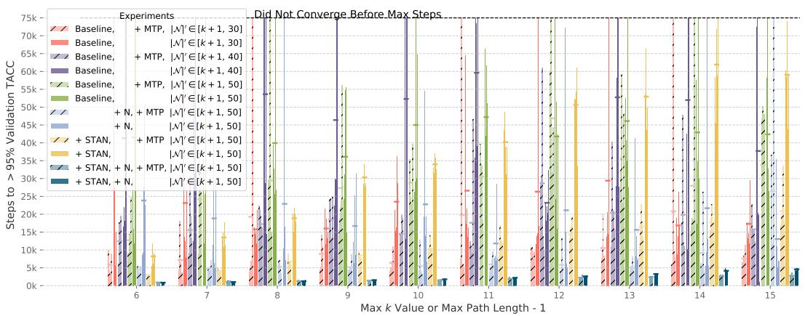  
Figure 2: Baseline $( | \mathcal { N } | \in \{ 3 0 , 4 0 , 5 0 \} )$ and ablation $( | \mathcal { N } | = 5 0 )$ results using prefix LMs on ERGs for the shortest-path task. Each experiment represents different seeds, illustrating the large variance.

## 6.1 PATH-STAR GRAPHS

For all PSG experiments, we use $L = 8 ,$ , a max of 50k steps, and no true curriculum learning. We consider models with a max $k \in \left[ 6 , 1 5 \right]$ and a max $d \in [ 2 , 1 0 ]$ . By construction, the size of each graph is coupled to k and d s.t. $| \mathcal { N } | = d \dot { k } + 1$ . Thus, our largest experiments consider $| \mathcal { N } | = 1 5 1$

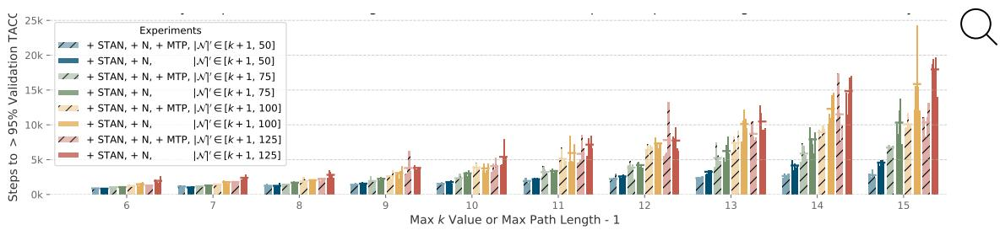  
Figure 3: STAN and N results using prefix LMs on ERGs. The experiments at $| { \mathcal N } | = 5 0$ (blue) are also shown in Fig. 2, demonstrating a dramatic improvement in learning and variance compared to the baselines. This then allows us to scale to much larger graph sizes: 50 through 75, 100, and 125. Fig. 2 and Fig. 4 display a max of 75k steps vs. 25k here, showing a large difference between models.

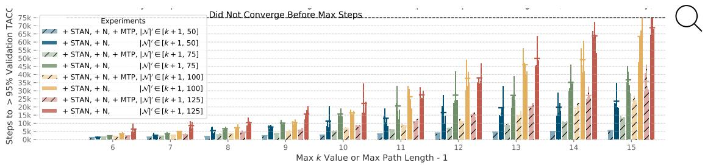  
Figure 4: STAN and N results using causal LMs on ERGs, for comparison to prefix LMs in Fig. 3. We see that MTP halves the cost of learning compared to NTP, thus demonstrating its importance to scaling, even if the tokenization methods account for the largest empirical gains.

Our results are shown in Fig. 5. To our knowledge, these are the first results to consistently solve PSGs using NTP beyond $k = 4$ hops with only inter-sample MMHT and no other methods such as MTP, diffusion, ${ \mathrm { R L } } ,$ or novel architectures ( D.4). As such, these results provide strong counterevidence to claims that NTP is insufficient to learn to plan (Bachmann & Nagarajan, 2024; Wu et al., 2024b). We can consistently scale NTP to $\lvert \mathcal { N } \rvert = 6 5 ^ { \circ } ( k = 8$ and $d = 8 )$ with STAN and +N, but these are insufficient alone to scale higher. Also applying MTP makes the task trivial across all scales. The fact that PSGs have the largest disparity between NTP and MTP conforms with theory, as PSGs are adversarial to NTP. An explanation for the size of this disparity is that PSGs allow solutions which do not generalize to arbitrary topology, e.g. the model can identify all final nodes by their degree, $d = 1$ , then walk back all arms to s in parallel to identify the correct arm (Frydenlund, 2024).

We observe the expected pattern where task difficulty grows with k and $| { \mathcal { N } } |$ ; however, it is not gradual, but spikes sharply. To explain this, we consider the model’s learning dynamics, and Fig. 6 reveals why. Here, rises in SACC between plateaus correspond to the model incrementally learning to solve the task at $d ^ { \prime } < d$ and $k ^ { \prime } < k ,$ from smallest to largest. Once solved at $d ^ { \prime }$ or $k ^ { \prime }$ , those samples provide a near-zero loss and cease contributing to the learning signal. Thus, the models have locked themselves out of a hop-mixture including lower $k ^ { \prime }$ terms. Without the lower- $k ^ { \prime }$ terms, models behave as if MMHT was never provided (Bachmann & Nagarajan, 2024; Frydenlund, 2025), thus explaining the spikes. We confirm this by training on a restricted MMHT sampling only $k ^ { \prime } \in [ 6 , 9 ]$ rather than $k ^ { \prime } \in [ 3 , 9 ]$ . These models fail to learn the task, just as if they had no MMHT (Fig. 22 in K.4).

This confirms the importance of MMHT, while providing a new insight in that the actual mixture distribution is also critical. It also exposes two related issues: poor learning dynamics with NTP and failure to learn a generalized solution. Importantly, the latter issue can occur only if the models fail to generalize their partial solutions at lower $k ^ { \prime }$ to larger $k ^ { \prime }$ (as Fig. 6 demonstrates).

The CHC is a topological shortcut which causes the model to lose almost all supervision on PSGs. This lockout phenomenon has a different root cause but leads to a similar loss of supervision and poor learning dynamics. However, lockout may not be topology-dependent. We find that models can get stuck at high ACC without meeting the > 95% TACC threshold. At such times, less than 1% of the targets are contributing to the loss (Pezeshki et al., 2021). Thus, such models have failed to generalize and may have locked themselves out of learning from the easier samples required for generalization.

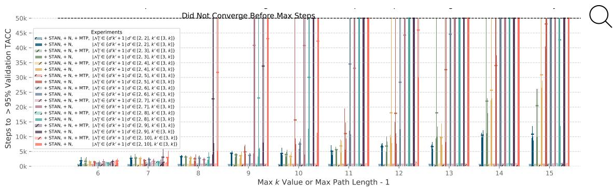

Figure 5: STAN and N results on PSGs. Each colour increments d. Notice that in the STAN and N setting, MTP makes the task trivial to learn across all scales (please zoom in for the MTP results).  
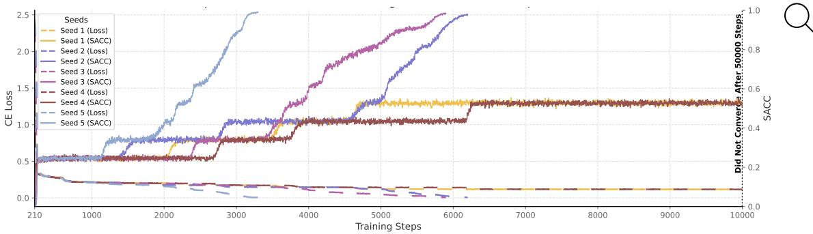  
Figure 6: The PSG experiment where k = 9 and $d = 8$ from Fig. 5. Here, three seeds learn the task, and two seeds do not. Jumps in SACC indicate learning the task for a specific $k ^ { \prime }$ and $d ^ { \prime }$ graph size.

Sampling different graph sizes $k ^ { \prime }$ induces an explicit MMHT, which we have shown is insufficient for learning with PSGs and NTP at scale. MTP induces an implicit MMHT, and does not lead to lockout. Thus, a final benefit of MTP is that the objective remains challenging – so you don’t lose your loss.

## 7 CONCLUSION AND LIMITATIONS

We make several contributions showing that MTP and alternative tokenization enable learning latent multihop graph search at scale. We demonstrate the utility of shortest-path generation on unseen graphs as a controlled setting of latent multihop reasoning in transformer LMs. We extend Bachmann & Nagarajan (2024)’s adversarial path-star analysis to general topologies via a formal notion of choice nodes, characterizing precisely when and why supervision degrades under NTP. Our central finding, established both theoretically and empirically, is that MTP substantially improves supervision for this task through increased supervision density, mixed-hop supervision, and better learning dynamics, and, importantly, these advantages hold regardless of the underlying graph topology.

Multihop reasoning is intrinsically graph-structured, so our results on shortest-path search using MTP should extend to multihop reasoning more broadly. We empirically verify that similar benefits exist for MTP on other multihop reasoning tasks, including Khops (Sanford et al., 2024b), Khops-Gen (a novel variant), and a BFS scratchpad variant of shortest-path search ( L.1, L.2, and L.3). That MTP’s advantages hold irrespective of topology was, itself, an unexpected finding. Our theoretical model was constructed to be topology-agnostic and we did not expect MTP to inherit this property, which leads us to conjecture that MTP’s benefits apply to any multihop reasoning task ( B).

A major trend in prior work is to use CoT or scratchpads to solve difficult reasoning tasks (Nye et al., 2022; Wei et al., 2022; Cho et al., 2025; Alberghi et al., 2025; Zhang et al., 2026c; Xu et al., 2026a), which changes how the task can be expressed, and thus its learnability (Wies et al., 2023; Dziri et al., 2023; Feng et al., 2023; Merrill & Sabharwal, 2024; Abbe et al., 2024; Li et al., 2024c; Kim & Suzuki, 2025). The BFS scratchpad we consider in L.3 is learnable, but its sequence length makes training impractical and it does not overcome the scaling wall. More critically, it reduces the latent reasoning graph to a linear chain, breaking the theoretical model of §1, reducing it to the multihop backtrack of Khops-Gen. Showing that the latent solution is the scalable solution bucks this trend.

While MTP yields strong theoretical and empirical gains, it alone does not break the scaling wall of prior work. This motivated us to search for other suspects, and we identified two: the causal constraint of causal LMs, which results in a fragmented routing problem, and positional embeddings, which break the permutation invariance. These hypotheses motivated two simple modifications: the node list (+N), for routing, and structural annotation (STAN), for permutation invariance, which we isolate with ablations over causal vs. prefix LMs, with and without +N and STAN.

We find that both lead to strong empirical gains, allowing us to consistently learn the task at graph sizes well beyond the limits of prior work, and, together with MTP, to break the scaling wall. Scaling to 2.5× the size while training in 1/3 as many steps (Fig. 2 vs. Fig. 3) is a substantial gain given that the scaling trend is super-linear (Fig. 3). However, the ablations provide counter-evidence to these hypotheses: +N improves prefix LMs, which should be unaffected by the causal constraint, and STAN improves causal LMs, which are incapable of true permutation invariance. Both methods are highly effective, but their benefits must extend beyond the hypotheses that motivated them. Why they work so well, especially in combination, remains an open question ( B).

Path-star graphs have received significant attention, spurring many follow-up works proposing novel methods to address their adversarial nature to NTP ( D.4). While PSGs are useful in exposing supervision pathologies, they can be solved in ways that may not reflect arbitrary reasoning or planning. We strongly caution against using PSGs as a benchmark. As we show, the task is trivial, given the proper conditions. Thus, the main benefit of PSGs is as a tool for studying those conditions (Bachmann & Nagarajan, 2024; Xu et al., 2026b). We also caution against viewing the results on PSGs with NTP as a generalizable limitation of NTP. As we show, these limitations are limited to a specific adversarial topology, and NTP is actually sufficient for learning (at moderate scales and under the correct conditions). However, our results do support the claim that MTP is much more efficient than NTP at learning multihop graph search, and that this matters at scale.

## AI USE STATEMENT

In this work, we used generative AI tools for code generation, proof generation and verification, and minimal writing and editing. In particular, we used LLMs to assist in coding; however, this was done only for small sections of code at a time, allowing for human verification. We engaged an LLM to verify the validity of our proofs (which led to various improvements). We used AI to make the illustrations but not the plots, which were manually done to ensure integrity. For the writing component, AI was mostly used to make arguments more succinct to meet space limitations in the main paper and help with the appendices. This was monitored closely. We also used the AI tool Grammarly for proofreading. We have reviewed all AI-assisted work. We take responsibility for the final content of this work, including any artifacts produced with the aid of generative AI.

## REPRODUCIBILITY STATEMENT

The main engineering challenge in this work is the online dataset and the PL-RITF cost function. We have already released these components, and the complete repository will follow upon acceptance.

## ACKNOWLEDGMENTS

We thank Vaishnavh Nagarajan for his insightful feedback. A significant chunk of my Ph.D. was dedicated to working on a problem he and Bachmann first proposed, so their work has had a big impact on me. We thank Abulhair Saparov for releasing his C++ graph generation code (Saparov et al., 2025). While we didn’t use it directly, understanding it was critical for our own code.

We also thank Shariyar Murtaza, Eugene Wen, and Manulife for providing a seamless transition of this project from my Ph.D. to working at Manulife.

Resources used in preparing this research were provided, in part, by the Province of Ontario, the Government of Canada through CIFAR, companies sponsoring the Vector Institute, and the Digital Research Alliance of Canada.

## REFERENCES

Emmanuel Abbe, Samy Bengio, Aryo Lotfi, Colin Sandon, and Omid Saremi. How far can transformers reason? the globality barrier and inductive scratchpad. In The Thirty-eighth Annual Conference on Neural Information Processing Systems, 2024. URL https://openreview. net/forum?id=FoGwiFXzuN. 9, 47

Roman Abramov, Felix Steinbauer, and Gjergji Kasneci. Grokking in the wild: Data augmentation for real-world multi-hop reasoning with transformers. In Forty-second International Conference on Machine Learning, 2025. URL https://openreview.net/forum?id=lyUJH51URt. 47

Kwangjun Ahn, Alex Lamb, and John Langford. Efficient joint prediction of multiple future tokens. arXiv preprint arXiv:2503.21801, 2025. 48

Riccardo Alberghi, Elizaveta Demyanenko, Luca Biggio, and Luca Saglietti. On the bias of nexttoken predictors toward systematically inefficient reasoning: A shortest-path case study. In The Thirty-ninth Annual Conference on Neural Information Processing Systems, 2025. URL https://openreview.net/forum?id=l8razJItEy. 9, 48

Zachary Ankner, Rishab Parthasarathy, Aniruddha Nrusimha, Christopher Rinard, Jonathan Ragan-Kelley, and William Brandon. Hydra: Sequentially-dependent draft heads for medusa decoding. In First Conference on Language Modeling, 2024. URL https://openreview.net/forum? id=FbhjirzvJG. 50

Jacob Austin, Daniel D. Johnson, Jonathan Ho, Daniel Tarlow, and Rianne van den Berg. Structured denoising diffusion models in discrete state-spaces. In A. Beygelzimer, Y. Dauphin, P. Liang, and J. Wortman Vaughan (eds.), Advances in Neural Information Processing Systems, 2021. URL https://openreview.net/forum?id=h7-XixPCAL. 48, 51

Ansar Aynetdinov and Alan Akbik. Babies learn to look ahead: Multi-token prediction in small LMs. In Lucas Charpentier, Leshem Choshen, Ryan Cotterell, Mustafa Omer Gul, Michael Y. Hu, Jing Liu, Jaap Jumelet, Tal Linzen, Aaron Mueller, Candace Ross, Raj Sanjay Shah, Alex Warstadt, Ethan Gotlieb Wilcox, and Adina Williams (eds.), Proceedings of the First BabyLM Workshop, pp. 566–577, Suzhou, China, November 2025. Association for Computational Linguistics. URL https://aclanthology.org/2025.babylm-main.41/. 49

Gregor Bachmann and Vaishnavh Nagarajan. The pitfalls of next-token prediction. In Ruslan Salakhutdinov, Zico Kolter, Katherine Heller, Adrian Weller, Nuria Oliver, Jonathan Scarlett, and Felix Berkenkamp (eds.), Proceedings ofthe 41st International Conference on Machine Learning, volume 235 of Proceedings ofMachine Learning Research, pp. 2296–2318. PMLR, 21–27 Jul 2024. URL https://proceedings.mlr.press/v235/bachmann24a.html. 1, 2, 3, 4, 6, 8, 9, 10, 32, 35, 36, 37, 39, 40, 45, 47, 49, 51, 54, 63, 69, 70, 75

Artur Back De Luca and Kimon Fountoulakis. Simulation of graph algorithms with looped transformers. In Ruslan Salakhutdinov, Zico Kolter, Katherine Heller, Adrian Weller, Nuria Oliver, Jonathan Scarlett, and Felix Berkenkamp (eds.), Proceedings of the 41st International Conference on Machine Learning, volume 235 of Proceedings of Machine Learning Research, pp. 2319–2363. PMLR, 21–27 Jul 2024. URL https://proceedings.mlr.press/v235/ back-de-luca24a.html. 34, 45

Gökhan Bakır, Thomas Hofmann, Bernhard Schölkopf, Alexander J. Smola, Ben Taskar, and S. V. N. Vishwanathan (eds.). Predicting Structured Data. MIT Press, 2007. 49

Mikita Balesni, Tomek Korbak, and Owain Evans. Lessons from studying two-hop latent reasoning. arXiv preprint arXiv:2411.16353, 2024. 1, 42, 43, 45

Maya Bechler-Speicher, Gilad Yehudai, Gil Harari, Clayton Sanford, Amir Globerson, and Joan Bruna. Lost in tokenization: Fundamental trade-offs in graph tokenization for transformers. arXiv preprint arXiv:2605.22471, 2026. 46, 49, 80

Ali Behrouz, Ali Parviz, Mahdi Karami, Clayton Sanford, Bryan Perozzi, and Vahab Mirrokni. Best of both worlds: Advantages of hybrid graph sequence models. In Forty-second International Conference on Machine Learning, 2025. URL https://openreview.net/forum?id= GJKe8WYHxq. 49

Yoshua Bengio, Réjean Ducharme, Pascal Vincent, and Christian Jauvin. A neural probabilistic language model. Journal ofmachine learning research, 3(Feb):1137–1155, 2003. 49

Yoshua Bengio, Jérôme Louradour, Ronan Collobert, and Jason Weston. Curriculum learning. In Proceedings of the 26th annual international conference on machine learning, pp. 41–48, 2009. 3, 32

Maciej Besta, Nils Blach, Ales Kubicek, Robert Gerstenberger, Michal Podstawski, Lukas Gianinazzi, Joanna Gajda, Tomasz Lehmann, Hubert Niewiadomski, Piotr Nyczyk, and Torsten Hoefler. Graph of thoughts: Solving elaborate problems with large language models. Proceedings of the AAAI Conference on Artificial Intelligence, 38(16):17682–17690, Mar. 2024. doi: 10.1609/aaai.v38i16.29720. URL https://ojs.aaai.org/index.php/AAAI/article/view/29720. 39

Sarat Chandra Bobbili, Ujwal Dinesha, Dheeraj Narasimha, and Srinivas Shakkottai. Pita: Preferenceguided inference-time alignment for llm post-training. arXiv preprint arXiv:2507.20067, 2025. 48

Bernd Bohnet, Michael Curtis Mozer, Aaron T Parisi, Kevin Swersky, William A Cunningham, Kathleen Kenealy, and Noah Fiedel. Analysis of optimality of large language models on planning problems. In Third Conference on Language Modeling, 2026. URL https://openreview. net/forum?id=YzMhzSuaIn. 48

Tom Brown, Benjamin Mann, Nick Ryder, Melanie Subbiah, Jared D Kaplan, Prafulla Dhariwal, Arvind Neelakantan, Pranav Shyam, Girish Sastry, Amanda Askell, Sandhini Agarwal, Ariel Herbert-Voss, Gretchen Krueger, Tom Henighan, Rewon Child, Aditya Ramesh, Daniel Ziegler, Jeffrey Wu, Clemens Winter, Chris Hesse, Mark Chen, Eric Sigler, Mateusz Litwin, Scott Gray, Benjamin Chess, Jack Clark, Christopher Berner, Sam McCandlish, Alec Radford, Ilya Sutskever, and Dario Amodei. Language models are few-shot learners. In H. Larochelle, M. Ranzato, R. Hadsell, M.F. Balcan, and H. Lin (eds.), Advances in Neural Information Processing Systems, volume 33, pp. 1877–1901. Curran Associates, Inc., 2020. URL https://proceedings.neurips.cc/paper\_files/paper/ 2020/file/1457c0d6bfcb4967418bfb8ac142f64a-Paper.pdf. 43

Tianle Cai, Yuhong Li, Zhengyang Geng, Hongwu Peng, Jason D. Lee, Deming Chen, and Tri Dao. Medusa: Simple LLM inference acceleration framework with multiple decoding heads. In Forty-first International Conference on Machine Learning, 2024. URL https://openreview. net/forum?id=PEpbUobfJv. 5, 49, 50

Zhe Cao, Tao Qin, Tie-Yan Liu, Ming-Feng Tsai, and Hang Li. Learning to rank: from pairwise approach to listwise approach. In Proceedings of the 24th international conference on Machine learning, pp. 129–136, 2007. 50, 57

Changyu Chen, Xiting Wang, Ting-En Lin, Ang Lv, Yuchuan Wu, Xin Gao, Ji-Rong Wen, Rui Yan, and Yongbin Li. Masked thought: Simply masking partial reasoning steps can improve mathematical reasoning learning of language models. In Lun-Wei Ku, Andre Martins, and Vivek Srikumar (eds.), Proceedings of the 62nd Annual Meeting of the Association for Computational Linguistics (Volume 1: Long Papers), pp. 5872–5900, Bangkok, Thailand, August 2024a. Association for Computational Linguistics. doi: 10.18653/v1/2024.acl-long.320. URL https://aclanthology.org/2024.acl-long.320. 52

Charlie Chen, Sebastian Borgeaud, Geoffrey Irving, Jean-Baptiste Lespiau, Laurent Sifre, and John Jumper. Accelerating large language model decoding with speculative sampling. arXiv preprint arXiv:2302.01318, 2023a. 50

Liang Chen, Li Shen, Yang Deng, Xiaoyan Zhao, Bin Liang, and Kam-Fai Wong. PEARL: Towards permutation-resilient LLMs. In The Thirteenth International Conference on Learning Representations, 2025. URL https://openreview.net/forum?id=txoJvjfI9w. 48

Runjin Chen, Tong Zhao, Ajay Jaiswal, Neil Shah, and Zhangyang Wang. Llaga: large language and graph assistant. In Proceedings ofthe 41st International Conference on Machine Learning, ICML’24. JMLR.org, 2024b. 44

Yongqiang Chen, Binghui Xie, Kaiwen Zhou, Bo Han, Yatao Bian, and James Cheng. Positional information matters for invariant in-context learning: A case study of simple function classes. arXiv preprint arXiv:2311.18194, 2023b. 6, 48

Kewei Cheng, Nesreen K. Ahmed, Theodore L. Willke, and Yizhou Sun. Structure guided prompt: Instructing large language model in multi-step reasoning by exploring graph structure of the text. In Yaser Al-Onaizan, Mohit Bansal, and Yun-Nung Chen (eds.), Proceedings ofthe 2024 Conference on Empirical Methods in Natural Language Processing, pp. 9407–9430, Miami, Florida, USA, November 2024. Association for Computational Linguistics. doi: 10.18653/v1/2024.emnlp-main. 528. URL https://aclanthology.org/2024.emnlp-main.528/. 37, 38, 39

Hanseul Cho, Jaeyoung Cha, Pranjal Awasthi, Srinadh Bhojanapalli, Anupam Gupta, and Chulhee Yun. Position coupling: Improving length generalization of arithmetic transformers using task structure. In The Thirty-eighth Annual Conference on Neural Information Processing Systems, 2024. URL https://openreview.net/forum?id=5cIRdGM1uG. 48

Hanseul Cho, Jaeyoung Cha, Srinadh Bhojanapalli, and Chulhee Yun. Arithmetic transformers can length-generalize in both operand length and count. In The Thirteenth International Conference on Learning Representations, 2025. URL https://openreview.net/forum?id= eIgGesYKLG. 9, 49

Andrew Cohen, Andrey Gromov, Kaiyu Yang, and Yuandong Tian. Spectral journey: How transformers predict the shortest path. arXiv preprint arXiv:2502.08794, 2025. 1, 40, 45, 49

Yingqian Cui, Zhenwei Dai, Bing He, Zhan Shi, Hui Liu, Rui Sun, Zhiji Liu, Yue Xing, Jiliang Tang, and Benoit Dumoulin. How do latent reasoning methods perform under weak and strong supervision? arXiv preprint arXiv:2602.22441, 2026. 49

Andrew M Dai and Quoc V Le. Semi-supervised sequence learning. In C. Cortes, N. Lawrence, D. Lee, M. Sugiyama, and R. Garnett (eds.), Advances in Neural Information Processing Systems, volume 28. Curran Associates, Inc., 2015. URL https://proceedings.neurips.cc/paper\_files/paper/2015/file/ 7137debd45ae4d0ab9aa953017286b20-Paper.pdf. 49

Xinnan Dai, Qihao Wen, Yifei Shen, Hongzhi Wen, Dongsheng Li, Jiliang Tang, and Caihua Shan. Revisiting the graph reasoning ability of large language models: Case studies in translation, connectivity and shortest path. arXiv preprint arXiv:2408.09529, 2024. 43, 44

Rajarshi Das, Shehzaad Dhuliawala, Manzil Zaheer, Luke Vilnis, Ishan Durugkar, Akshay Krishnamurthy, Alex Smola, and Andrew McCallum. Go for a walk and arrive at the answer: Reasoning over paths in knowledge bases using reinforcement learning. In International Conference on Learn ing Representations, 2018. URL https://openreview.net/forum?id=Syg-YfWCW. 38

Nicola De Cao, Wilker Aziz, and Ivan Titov. Question answering by reasoning across documents with graph convolutional networks. In Jill Burstein, Christy Doran, and Thamar Solorio (eds.), Proceedings ofthe 2019 Conference ofthe North American Chapter ofthe Associationfor Computational Linguistics: Human Language Technologies, Volume 1 (Long and Short Papers), pp. 2306–2317, Minneapolis, Minnesota, June 2019. Association for Computational Linguistics. doi: 10.18653/v1/N19-1240. URL https://aclanthology.org/N19-1240/. 37, 38

Ming Ding, Chang Zhou, Qibin Chen, Hongxia Yang, and Jie Tang. Cognitive graph for multihop reading comprehension at scale. In Anna Korhonen, David Traum, and Lluís Màrquez (eds.), Proceedings ofthe 57th Annual Meeting ofthe Associationfor Computational Linguistics, pp. 2694–2703, Florence, Italy, July 2019. Association for Computational Linguistics. doi: 10.18653/v1/P19-1259. URL https://aclanthology.org/P19-1259/. 37, 38

Zhichen Dong, Zhanhui Zhou, Zhixuan Liu, Chao Yang, and Chaochao Lu. Emergent response planning in LLMs. In Forty-second International Conference on Machine Learning, 2025. URL https://openreview.net/forum?id=Ce79P8ULPY. 51

Nouha Dziri, Ximing Lu, Melanie Sclar, Xiang Lorraine Li, Liwei Jiang, Bill Yuchen Lin, Sean Welleck, Peter West, Chandra Bhagavatula, Ronan Le Bras, Jena D. Hwang, Soumya Sanyal, Xiang Ren, Allyson Ettinger, Zaid Harchaoui, and Yejin Choi. Faith and fate: Limits of transformers on compositionality. In Thirty-seventh Conference on Neural Information Processing Systems, 2023. URL https://openreview.net/forum?id=Fkckkr3ya8. 9, 47

Nelson Elhage, Neel Nanda, Catherine Olsson, Tom Henighan, Nicholas Joseph, Ben Mann, Amanda Askell, Yuntao Bai, Anna Chen, Tom Conerly, et al. A mathematical framework for transformer circuits. Transformer Circuits Thread, 1(1):12, 2021. 71

P Erdos and A Rényi. On random graphs i. ˝ Publ. math. debrecen, 6(1):290–297, 1959. 6, 63

Ying Fan, Yilun Du, Kannan Ramchandran, and Kangwook Lee. Looped transformers for length generalization. In The Thirteenth International Conference on Learning Representations, 2025. URL https://openreview.net/forum?id=2edigk8yoU. 34, 35

Bahare Fatemi, Jonathan Halcrow, and Bryan Perozzi. Talk like a graph: Encoding graphs for large language models. In The Twelfth International Conference on Learning Representations, 2024. URL https://openreview.net/forum?id=IuXR1CCrSi. 43

Guhao Feng, Bohang Zhang, Yuntian Gu, Haotian Ye, Di He, and Liwei Wang. Towards revealing the mystery behind chain of thought: A theoretical perspective. In Thirty-seventh Conference on Neural Information Processing Systems, 2023. URL https://openreview.net/forum? id=qHrADgAdYu. 9

Arvid Frydenlund. The mystery of the pathological path-star task for language models. In Yaser Al-Onaizan, Mohit Bansal, and Yun-Nung Chen (eds.), Proceedings ofthe 2024 Conference on Empirical Methods in Natural Language Processing, pp. 12493–12516, Miami, Florida, USA, November 2024. Association for Computational Linguistics. doi: 10.18653/v1/2024.emnlp-main. 695. URL https://aclanthology.org/2024.emnlp-main.695. 2, 5, 6, 8, 39, 41, 45, 46, 48, 61, 64, 71

Arvid Frydenlund. Language models, graph searching, and supervision adulteration: When more supervision is less and how to make more more. In Wanxiang Che, Joyce Nabende, Ekaterina Shutova, and Mohammad Taher Pilehvar (eds.), Proceedings of the 63rd Annual Meeting of the Associationfor Computational Linguistics (Volume 1: Long Papers), pp. 29011–29059, Vienna, Austria, July 2025. Association for Computational Linguistics. ISBN 979-8-89176-251-0. doi: 10.18653/v1/2025.acl-long.1409. URL https://aclanthology.org/2025.acl-long. 1409/. 2, 3, 5, 7, 8, 32, 33, 36, 37, 47, 48, 50, 51, 57, 70, 74, 78, 79, 84

Arvid Frydenlund, Gagandeep Singh, and Frank Rudzicz. Language modelling via learning to rank. Proceedings of the AAAI Conference on Artificial Intelligence, 36(10):10636–10644, Jun. 2022. doi: 10.1609/aaai.v36i10.21308. URL https://ojs.aaai.org/index.php/ AAAI/article/view/21308. 5, 51, 57, 58, 82, 83

Yuyao Ge, Shenghua Liu, Baolong Bi, Yiwei Wang, Lingrui Mei, Wenjie Feng, Lizhe Chen, and Xueqi Cheng. Can graph descriptive order affect solving graph problems with LLMs? In Wanxiang Che, Joyce Nabende, Ekaterina Shutova, and Mohammad Taher Pilehvar (eds.), Proceedings of the 63rd Annual Meeting ofthe Associationfor Computational Linguistics (Volume 1: Long Papers), pp. 6404–6420, Vienna, Austria, July 2025. Association for Computational Linguistics. ISBN 979-8-89176-251-0. doi: 10.18653/v1/2025.acl-long.321. URL https://aclanthology. org/2025.acl-long.321/. 2, 41, 43, 79

Anastasios Gerontopoulos, Spyros Gidaris, and Nikos Komodakis. Multi-token prediction needs registers. In The Thirty-ninth Annual Conference on Neural Information Processing Systems, 2025. URL https://openreview.net/forum?id=WDdBhcwzGe. 48, 50, 51

Marjan Ghazvininejad, Omer Levy, Yinhan Liu, and Luke Zettlemoyer. Mask-predict: Parallel decoding of conditional masked language models. In Proceedings of the 2019 Conference on Empirical Methods in Natural Language Processing and the 9th International Joint Conference on Natural Language Processing (EMNLP-IJCNLP), pp. 6112–6121, Hong Kong, China, November 2019. Association for Computational Linguistics. doi: 10.18653/v1/D19-1633. URL https: //aclanthology.org/D19-1633. 48, 51

Angeliki Giannou, Shashank Rajput, Jy-Yong Sohn, Kangwook Lee, Jason D. Lee, and Dimitris Papailiopoulos. Looped transformers as programmable computers. In Andreas Krause, Emma Brunskill, Kyunghyun Cho, Barbara Engelhardt, Sivan Sabato, and Jonathan Scarlett (eds.), Proceedings ofthe 40th International Conference on Machine Learning, volume 202 of Proceedings ofMachine Learning Research, pp. 11398–11442. PMLR, 23–29 Jul 2023. URL https://proceedings.mlr.press/v202/giannou23a.html. 34, 35

Fabian Gloeckle, Badr Youbi Idrissi, Baptiste Roziere, David Lopez-Paz, and Gabriel Synnaeve. Better & faster large language models via multi-token prediction. In Forty-first International Conference on Machine Learning, 2024. URL https://openreview.net/forum?id= pEWAcejiU2. 5, 36, 49, 50

Sebastian Goodman, Nan Ding, and Radu Soricut. TeaForN: Teacher-forcing with n-grams. In Bonnie Webber, Trevor Cohn, Yulan He, and Yang Liu (eds.), Proceedings of the 2020 Conference on Empirical Methods in Natural Language Processing (EMNLP), pp. 8704–8717, Online, November 2020. Association for Computational Linguistics. doi: 10.18653/v1/2020.emnlp-main.702. URL https://aclanthology.org/2020.emnlp-main.702. 49

Jiatao Gu and Xiang Kong. Fully non-autoregressive neural machine translation: Tricks of the trade. In Findings of the Association for Computational Linguistics: ACL-IJCNLP 2021, pp. 120–133, Online, August 2021. Association for Computational Linguistics. doi: 10.18653/v1/2021. findings-acl.11. URL https://aclanthology.org/2021.findings-acl.11. 52

Jiatao Gu, James Bradbury, Caiming Xiong, Victor OK Li, and Richard Socher. Non-autoregressive neural machine translation. In International Conference on Learning Representations, 2018. 48, 52

Zhong Guan, Likang Wu, Hongke Zhao, Ming He, and Jianping Fan. Attention mechanisms perspective: Exploring LLM processing of graph-structured data. In Forty-second International Conference on Machine Learning, 2025. URL https://openreview.net/forum?id= 16oBNUlWyB. 2, 41, 43, 44

Jiayan Guo, Lun Du, Hengyu Liu, Mengyu Zhou, Xinyi He, and Shi Han. GPT4Graph: Can large language models understand graph structured data? an empirical evaluation and benchmarking. arXiv preprint arXiv:2305.15066, 2023. 43

Haoyu Han, Yaochen Xie, Hui Liu, Xianfeng Tang, Sreyashi Nag, William Headden, Yang Li, Chen Luo, Shuiwang Ji, Qi He, and Jiliang Tang. Reasoning with graphs: Structuring implicit knowledge to enhance LLMs reasoning. In Wanxiang Che, Joyce Nabende, Ekaterina Shutova, and Mohammad Taher Pilehvar (eds.), Findings of the Association for Computational Linguistics: ACL 2025, pp. 25698–25714, Vienna, Austria, July 2025. Association for Computational Linguistics. ISBN 979-8-89176-256-5. doi: 10.18653/v1/2025.findings-acl.1319. URL https://aclanthology.org/2025.findings-acl.1319/. 38, 39

Shibo Hao, Sainbayar Sukhbaatar, DiJia Su, Xian Li, Zhiting Hu, Jason E Weston, and Yuandong Tian. Training large language models to reason in a continuous latent space. In Second Conference on Language Modeling, 2025. URL https://openreview.net/forum?id=Itxz7S4Ip3. 32, 49, 52

Andre He, Sean Welleck, and Daniel Fried. Reasoning with latent tokens in diffusion language models. arXiv preprint arXiv:2602.03769, 2026. 51, 63

Edward S. Hu, Kwangjun Ahn, Qinghua Liu, Haoran Xu, Manan Tomar, Ada Langford, Dinesh Jayaraman, Alex Lamb, and John Langford. The belief state transformer. In The Thirteenth International Conference on Learning Representations, 2025. URL https://openreview. net/forum?id=ThRMTCgpvo. 48

Jianhao Huang, Zhanpeng Zhou, Renqiu Xia, Baharan Mirzasoleiman, Weijie J Su, and Wei Huang. How transformers learn to plan via multi-token prediction. In Third Conference on Language Modeling, 2026. URL https://openreview.net/forum?id=1uj8eRv3aJ. 36, 48

Jin Huang, Xingjian Zhang, Qiaozhu Mei, and Jiaqi Ma. Can LLMs effectively leverage graph structural information through prompts, and why? Transactions on Machine Learning Research, 2024. ISSN 2835-8856. URL https://openreview.net/forum?id=L2jRavXRxs. 2, 41, 43, 44

Laya Iyer, Pranav Somani, Alice Guo, Dan Jurafsky, and Chen Shani. Beyond tokens: Conceptlevel training objectives for LLMs. In Vera Demberg, Kentaro Inui, and Lluís Marquez (eds.), Proceedings ofthe 19th Conference ofthe European Chapter ofthe Associationfor Computational Linguistics (Volume 2: Short Papers), pp. 457–474, Rabat, Morocco, March 2026. Association for Computational Linguistics. ISBN 979-8-89176-381-4. doi: 10.18653/v1/2026.eacl-short.34. URL https://aclanthology.org/2026.eacl-short.34/. 83

Wenzel Jakob, Jason Rhinelander, and Dean Moldovan. pybind11 — seamless operability between c++11 and python, 2016. https://github.com/pybind/pybind11. 63

Erik Jenner, Shreyas Kapur, Vasil Georgiev, Cameron Allen, Scott Emmons, and Stuart Russell. Evidence of learned look-ahead in a chess-playing neural network. In The Thirty-eighth Annual Conference on Neural Information Processing Systems, 2024. URL https://openreview. net/forum?id=8zg9sO4ttV. 51

Bowen Jin, Chulin Xie, Jiawei Zhang, Kashob Kumar Roy, Yu Zhang, Zheng Li, Ruirui Li, Xianfeng Tang, Suhang Wang, Yu Meng, and Jiawei Han. Graph chain-of-thought: Augmenting large language models by reasoning on graphs. In Lun-Wei Ku, Andre Martins, and Vivek Srikumar (eds.), Findings of the Association for Computational Linguistics: ACL 2024, pp. 163–184, Bangkok, Thailand, August 2024. Association for Computational Linguistics. doi: 10.18653/v1/ 2024.findings-acl.11. URL https://aclanthology.org/2024.findings-acl.11/. 39

Tianjie Ju, Yijin Chen, Xinwei Yuan, Zhuosheng Zhang, Wei Du, Yubin Zheng, and Gongshen Liu. Investigating multi-hop factual shortcuts in knowledge editing of large language models. In Lun-Wei Ku, Andre Martins, and Vivek Srikumar (eds.), Proceedings of the 62nd Annual Meeting of the Association for Computational Linguistics (Volume 1: Long Papers), pp. 8987– 9001, Bangkok, Thailand, August 2024. Association for Computational Linguistics. doi: 10.18653/ v1/2024.acl-long.486. URL https://aclanthology.org/2024.acl-long.486/. 1, 44

Mikail Khona, Maya Okawa, Jan Hula, Rahul Ramesh, Kento Nishi, Robert P. Dick, Ekdeep Singh Lubana, and Hidenori Tanaka. Towards an understanding of stepwise inference in transformers: A synthetic graph navigation model. In Forty-first International Conference on Machine Learning, 2024. URL https://openreview.net/forum?id=8VEGkphQaK. 40, 41, 44, 45, 46

Juno Kim and Taiji Suzuki. Transformers provably solve parity efficiently with chain of thought. In The Thirteenth International Conference on Learning Representations, 2025. URL https: //openreview.net/forum?id=n2NidsYDop. 9

Lecheng Kong, Jiarui Feng, Hao Liu, Chengsong Huang, Jiaxin Huang, Yixin Chen, and Muhan Zhang. GOFA: A generative one-for-all model for joint graph language modeling. In The Thirteenth International Conference on Learning Representations, 2025. URL https://openreview. net/forum?id=mIjblC9hfm. 44

Matija Luka Kukic, Marko´ Culjak, David Dukiˇ c, Martin Tutek, and Jan Šnajder. Sequence repetition´ enhances token embeddings and improves sequence labeling with decoder-only language models. In Vera Demberg, Kentaro Inui, and Lluís Marquez (eds.), Findings ofthe Associationfor Computational Linguistics: EACL 2026, pp. 6442–6456, Rabat, Morocco, March 2026. Association for Computational Linguistics. ISBN 979-8-89176-386-9. doi: 10.18653/v1/2026.findings-eacl.339. URL https://aclanthology.org/2026.findings-eacl.339/. 6

Jason Lee, Elman Mansimov, and Kyunghyun Cho. Deterministic non-autoregressive neural sequence modeling by iterative refinement. In Proceedings ofthe 2018 Conference on Empirical Methods in Natural Language Processing, pp. 1173–1182, Brussels, Belgium, October-November 2018. Association for Computational Linguistics. doi: 10.18653/v1/D18-1149. URL https:// aclanthology.org/D18-1149. 51

Jin Hwa Lee, Andrew K Lampinen, Aaditya K Singh, and Andrew M Saxe. Distinct computations emerge from compositional curricula in in-context learning. arXiv preprint arXiv:2506.13253, 2025a. 32

Justin Lee, Gabriel Bernier-Colborne, Tegan Maharaj, and Sowmya Vajjala. Methods, applications, and directions of learning-to-rank in NLP research. In Kevin Duh, Helena Gomez, and Steven Bethard (eds.), Findings ofthe Association for Computational Linguistics: NAACL 2024, pp. 1900–1917, Mexico City, Mexico, June 2024a. Association for Computational Linguistics. doi: 10.18653/v1/2024.findings-naacl.123. URL https://aclanthology.org/2024. findings-naacl.123/. 50

Nayoung Lee, Kartik Sreenivasan, Jason D. Lee, Kangwook Lee, and Dimitris Papailiopoulos. Teaching arithmetic to small transformers. In The Twelfth International Conference on Learning Representations, 2024b. URL https://openreview.net/forum?id=dsUB4bst9S. 48

Nayoung Lee, Ziyang Cai, Avi Schwarzschild, Kangwook Lee, and Dimitris Papailiopoulos. Selfimproving transformers overcome easy-to-hard and length generalization challenges. In Fortysecond International Conference on Machine Learning, 2025b. URL https://openreview. net/forum?id=ZtX0MBT6mf. 47, 48

Michael A Lepori, Tal Linzen, Ann Yuan, and Katja Filippova. Language models struggle to use representations learned in-context. arXiv preprint arXiv:2602.04212, 2026. 44

Yaniv Leviathan, Matan Kalman, and Yossi Matias. Fast inference from transformers via speculative decoding. In Proceedings ofthe 40th International Conference on Machine Learning, volume 202, pp. 19274–19286. PMLR, 2023. 50

Jindong Li, Yali Fu, Li Fan, Jiahong Liu, Yao Shu, Chengwei Qin, Menglin Yang, Irwin King, and Rex Ying. Implicit reasoning in large language models: A comprehensive survey. arXiv preprint arXiv:2509.02350, 2025. 2

Shanda Li, Chong You, Guru Guruganesh, Joshua Ainslie, Santiago Ontanon, Manzil Zaheer, Sumit Sanghai, Yiming Yang, Sanjiv Kumar, and Srinadh Bhojanapalli. Functional interpolation for relative positions improves long context transformers. In The Twelfth International Conference on Learning Representations, 2024a. URL https://openreview.net/forum?id= rR03qFesqk. 35

Yuhan Li, Zhixun Li, Peisong Wang, Jia Li, Xiangguo Sun, Hong Cheng, and Jeffrey Xu Yu. A survey of graph meets large language model: Progress and future directions. In Kate Larson (ed.), Proceedings ofthe Thirty-Third International Joint Conference on Artificial Intelligence, IJCAI-24, pp. 8123–8131. International Joint Conferences on Artificial Intelligence Organization, 8 2024b. doi: 10.24963/ijcai.2024/898. URL https://doi.org/10.24963/ijcai.2024/898. Survey Track. 44

Zhaoyi Li, Jiatong Li, Gangwei Jiang, Linqi Song, Defu Lian, and Ying Wei. Scaling reasoning hop exposes weaknesses: Demystifying and improving hop generalization in large language models. In The Fourteenth International Conference on Learning Representations, 2026. URL https://openreview.net/forum?id=qK4JKOu0Gx. 45, 47

Zhiyuan Li, Hong Liu, Denny Zhou, and Tengyu Ma. Chain of thought empowers transformers to solve inherently serial problems. In The Twelfth International Conference on Learning Representations, 2024c. URL https://openreview.net/forum?id=3EWTEy9MTM. 9

Yi Liao, Xin Jiang, and Qun Liu. Probabilistically masked language model capable of autoregressive generation in arbitrary word order. In Proceedings of the 58th Annual Meeting of the Association for Computational Linguistics, pp. 263–274, Online, July 2020. Association for Computational Linguistics. doi: 10.18653/v1/2020.acl-main.24. URL https://aclanthology.org/ 2020.acl-main.24. 48

Tianhe Lin, Jian Xie, Siyu Yuan, and Deqing Yang. Implicit reasoning in transformers is reasoning through shortcuts. In Wanxiang Che, Joyce Nabende, Ekaterina Shutova, and Mohammad Taher Pilehvar (eds.), Findings ofthe Associationfor Computational Linguistics: ACL 2025, pp. 9470– 9487, Vienna, Austria, July 2025. Association for Computational Linguistics. ISBN 979-8-89176- 256-5. doi: 10.18653/v1/2025.findings-acl.493. URL https://aclanthology.org/2025. findings-acl.493/. 45

Xi Victoria Lin, Richard Socher, and Caiming Xiong. Multi-hop knowledge graph reasoning with reward shaping. In Ellen Riloff, David Chiang, Julia Hockenmaier, and Jun’ichi Tsujii (eds.), Proceedings of the 2018 Conference on Empirical Methods in Natural Language Processing, pp. 3243–3253, Brussels, Belgium, October-November 2018. Association for Computational Linguistics. doi: 10.18653/v1/D18-1362. URL https://aclanthology.org/D18-1362/. 38

Daria Lioubashevski, Tomer M. Schlank, Gabriel Stanovsky, and Ariel Goldstein. Looking beyond the top-1: Transformers determine top tokens in order. In Forty-second International Conference on Machine Learning, 2025. URL https://openreview.net/forum?id=2B11W1Z6ID. 51

Aixin Liu, Bei Feng, Bing Xue, Bingxuan Wang, Bochao Wu, Chengda Lu, Chenggang Zhao, Chengqi Deng, Chenyu Zhang, Chong Ruan, et al. DeepSeek-v3 technical report. arXiv preprint arXiv:2412.19437, 2024a. 36, 49, 50

Bingbin Liu, Jordan T. Ash, Surbhi Goel, Akshay Krishnamurthy, and Cyril Zhang. Transformers learn shortcuts to automata. In The Eleventh International Conference on Learning Representations, 2023. URL https://openreview.net/forum?id=De4FYqjFueZ. 46

Chang Liu and Bo Wu. Evaluating large language models on graphs: Performance insights and comparative analysis. arXiv preprint arXiv:2308.11224, 2023. 43

Emmy Liu, Kaiser Sun, Millicent Li, Isabelle Lee, Lindia Tjuatja, Jen-tse Huang, and Graham Neubig. What do language models learn and when? the implicit curriculum hypothesis. arXiv preprint arXiv:2604.08510, 2026. 32

Hong Liu, Zhiyuan Li, David Leo Wright Hall, Percy Liang, and Tengyu Ma. Sophia: A scalable stochastic second-order optimizer for language model pre-training. In The Twelfth International Conference on Learning Representations, 2024b. URL https://openreview.net/forum? id=3xHDeA8Noi. 63

Tie-Yan Liu. Learning to rank for information retrieval. Foundations and Trends® in Information Retrieval, 3(3):225–331, 2009. 49, 50, 57

Xiaohao Liu, Xiaobo Xia, Weixiang Zhao, Manyi Zhang, Xianzhi Yu, Xiu Su, Shuo Yang, See-Kiong Ng, and Tat-Seng Chua. L-MTP: Leap multi-token prediction beyond adjacent context for large language models. In The Thirty-ninth Annual Conference on Neural Information Processing Systems, 2025. URL https://openreview.net/forum?id=0VDmWjW456. 33, 50

Kenneth Locey. Random integer partitions with restricted numbers of parts. Semantic Scholar CorpusID:124354951, 2013. URL https://api.semanticscholar.org/CorpusID: 124354951. 75

Charles London and Varun Kanade. Pause tokens strictly increase the expressivity of constant-depth transformers. In The Thirty-ninth Annual Conference on Neural Information Processing Systems, 2025. URL https://openreview.net/forum?id=eG5oh8l1WZ. 34, 46

R Duncan Luce et al. Individual choice behavior, volume 4. Wiley New York, 1959. 5, 50, 57

Kangyang Luo, Zichen Ding, Zhenmin Weng, Lingfeng Qiao, Meng Zhao, Xiang Li, Di Yin, and Jinlong Shu. Let’s be self-generated via step by step: A curriculum learning approach to automated reasoning with large language models. In Wanxiang Che, Joyce Nabende, Ekaterina Shutova, and Mohammad Taher Pilehvar (eds.), Findings of the Association for Computational Linguistics: ACL 2025, pp. 15343–15420, Vienna, Austria, July 2025. Association for Computational Linguistics. ISBN 979-8-89176-256-5. doi: 10.18653/v1/2025.findings-acl.795. URL https://aclanthology.org/2025.findings-acl.795/. 32

Linhao Luo, Yuan-Fang Li, Gholamreza Haffari, and Shirui Pan. Reasoning on graphs: Faithful and interpretable large language model reasoning. In The Twelfth International Conference on Learning Representations, 2024a. URL https://openreview.net/forum?id=ZGNWW7xZ6Q. 38, 44

Zihan Luo, Xiran Song, Hong Huang, Jianxun Lian, Chenhao Zhang, Jinqi Jiang, Xing Xie, and Hai Jin. Graphinstruct: Empowering large language models with graph understanding and reasoning capability. arXiv preprint arXiv:2403.04483, 2024b. 52

Jiaqi Ma, Xinyang Yi, Weijing Tang, Zhe Zhao, Lichan Hong, Ed Chi, and Qiaozhu Mei. Learningto-rank with partitioned preference: Fast estimation for the plackett-luce model. In International Conference on Artificial Intelligence and Statistics, pp. 928–936. PMLR, 2021. 57

Xuetao Ma, Wenbin Jiang, and Hua Huang. Problem-solving logic guided curriculum in-context learning for LLMs complex reasoning. In Wanxiang Che, Joyce Nabende, Ekaterina Shutova, and Mohammad Taher Pilehvar (eds.), Findings ofthe Associationfor Computational Linguistics: ACL 2025, pp. 8394–8412, Vienna, Austria, July 2025. Association for Computational Linguistics. ISBN 979-8-89176-256-5. doi: 10.18653/v1/2025.findings-acl.440. URL https://aclanthology. org/2025.findings-acl.440/. 32

Divyat Mahajan, Sachin Goyal, Badr Youbi Idrissi, Mohammad Pezeshki, Ioannis Mitliagkas, David Lopez-Paz, and Kartik Ahuja. Beyond multi-token prediction: Pretraining LLMs with future summaries. In The Fourteenth International Conference on Learning Representations, 2026. URL https://openreview.net/forum?id=aeYIFVn4vb. 48, 50

Sean Michael McLeish, Arpit Bansal, Alex Stein, Neel Jain, John Kirchenbauer, Brian R. Bartoldson, Bhavya Kailkhura, Abhinav Bhatele, Jonas Geiping, Avi Schwarzschild, and Tom Goldstein. Transformers can do arithmetic with the right embeddings. In The 4th Workshop on Mathematical Reasoning and AI at NeurIPS’24, 2024. URL https://openreview.net/forum?id= cBFsFt1nDW. 48

Miller McPherson, Lynn Smith-Lovin, and James M Cook. Birds of a feather: Homophily in social networks. Annual review of sociology, 27(1):415–444, 2001. 2, 41, 44

Tianyi Men, Pengfei Cao, Zhuoran Jin, Yubo Chen, Kang Liu, and Jun Zhao. Unlocking the future: Exploring look-ahead planning mechanistic interpretability in large language models. In Yaser Al-Onaizan, Mohit Bansal, and Yun-Nung Chen (eds.), Proceedings of the 2024 Conference on Empirical Methods in Natural Language Processing, pp. 7713–7724, Miami, Florida, USA, November 2024. Association for Computational Linguistics. doi: 10.18653/v1/2024.emnlp-main. 440. URL https://aclanthology.org/2024.emnlp-main.440. 51

William Merrill and Ashish Sabharwal. The expressive power of transformers with chain of thought. In The Twelfth International Conference on Learning Representations, 2024. URL https: //openreview.net/forum?id=NjNGlPh8Wh. 9, 34

William Merrill and Ashish Sabharwal. A little depth goes a long way: The expressive power of log-depth transformers. In The Thirty-ninth Annual Conference on Neural Information Processing Systems, 2025. URL https://openreview.net/forum?id=5pHfYe10iX. 2, 46

Tomas Mikolov, Kai Chen, Greg Corrado, and Jeffrey Dean. Efficient estimation of word representations in vector space. arXiv preprint arXiv:1301.3781, 2013. 58

Gouki Minegishi, Jingyuan Feng, Hiroki Furuta, Takeshi Kojima, Yusuke Iwasawa, and Yutaka Matsuo. Emergent analogical reasoning in transformers. In Forty-third International Conference on Machine Learning, 2026. URL https://openreview.net/forum?id=GxTkgMBiz8. 43

Giovanni Monea, Armand Joulin, and Edouard Grave. PaSS: Parallel speculative sampling. arXiv preprint arXiv:2311.13581, 2023. 48, 49, 52

Giovanni Monea, Yair Feldman, Shankar Padmanabhan, Kianté Brantley, and Yoav Artzi. Breadcrumbs reasoning: Memory-efficient reasoning with compression beacons. arXiv preprint arXiv:2510.13797, 2025. 48

Maximilian Mordig, Andreas Opedal, Weiyang Liu, and Bernhard Schölkopf. Rethinking easyto-hard: Limits of curriculum learning in post-training for deductive reasoning. arXiv preprint arXiv:2603.27226, 2026. 47, 76

Allen Newell and Herbert A. Simon. Computer science as empirical inquiry: symbols and search. Communications ofthe ACM, 19(3):113–126, 1976. 38

Allen Newell and Herbert Alexander Simon. Human problem solving, volume 104. Prentice-hall Englewood Cliffs, NJ, 1972. 38

Shen Nie, Fengqi Zhu, Zebin You, Xiaolu Zhang, Jingyang Ou, Jun Hu, Jun Zhou, Yankai Lin, Ji-Rong Wen, and Chongxuan Li. Large language diffusion models. In The Thirty-ninth Annual Conference on Neural Information Processing Systems, 2026. URL https://openreview. net/forum?id=KnqiC0znVF. 48, 51

Lorenzo Noci, Gregor Bachmann, Seyed-Mohsen Moosavi-Dezfooli, and Moin Nabi. Thinking into the future: Latent lookahead training for transformers. arXiv preprint arXiv:2603.20219, 2026. 51

Shahriar Noroozizadeh, Vaishnavh Nagarajan, Elan Rosenfeld, and Sanjiv Kumar. Deep sequence models tend to memorize geometrically; it is unclear why. In Forty-third International Conference on Machine Learning, 2026. URL https://openreview.net/forum?id=CT2tSmahVQ. 2, 37, 40, 42, 43, 84

Maxwell Nye, Anders Johan Andreassen, Guy Gur-Ari, Henryk Michalewski, Jacob Austin, David Bieber, David Dohan, Aitor Lewkowycz, Maarten Bosma, David Luan, Charles Sutton, and Augustus Odena. Show your work: Scratchpads for intermediate computation with language models. In Deep Learning for Code Workshop, 2022. URL https://openreview.net/ forum?id=HBlx2idbkbq. 2, 9, 76

Myle Ott, Sergey Edunov, Alexei Baevski, Angela Fan, Sam Gross, Nathan Ng, David Grangier, and Michael Auli. fairseq: A fast, extensible toolkit for sequence modeling. In Waleed Ammar, Annie Louis, and Nasrin Mostafazadeh (eds.), Proceedings ofthe 2019 Conference ofthe North American Chapter ofthe Associationfor Computational Linguistics (Demonstrations), pp. 48–53, Minneapolis, Minnesota, June 2019. Association for Computational Linguistics. doi: 10.18653/v1/ N19-4009. URL https://aclanthology.org/N19-4009/. 63

Koyena Pal, Jiuding Sun, Andrew Yuan, Byron Wallace, and David Bau. Future lens: Anticipating subsequent tokens from a single hidden state. In Jing Jiang, David Reitter, and Shumin Deng (eds.), Proceedings of the 27th Conference on Computational Natural Language Learning (CoNLL), pp. 548–560, Singapore, December 2023. Association for Computational Linguistics. doi: 10.18653/ v1/2023.conll-1.37. URL https://aclanthology.org/2023.conll-1.37. 51

Liangming Pan, Jason Liang, Jiaran Ye, Minglai Yang, Xinyuan Lu, and Fengbin Zhu. Opening the black box: A survey on the mechanisms of multi-step reasoning in large language models. arXiv preprint arXiv:2601.14270, 2026. 2

Core Francisco Park, Andrew Lee, Ekdeep Singh Lubana, Yongyi Yang, Maya Okawa, Kento Nishi, Martin Wattenberg, and Hidenori Tanaka. ICLR: In-context learning of representations. In The Thirteenth International Conference on Learning Representations, 2025. URL https: //openreview.net/forum?id=pXlmOmlHJZ. 44

Dhruvesh Patel, Aishwarya Sahoo, Avinash Amballa, Tahira Naseem, Tim G. J. Rudner, and Andrew McCallum. Insertion language models: Sequence generation with arbitrary-position insertions. In NeurIPS 2025 Workshop on Structured Probabilistic Inference & Generative Modeling, 2025. URL https://openreview.net/forum?id=IbVGvSDFQV. 48

Dhruvesh Patel, Durga Prasad Maram, Sai Sreenivas Chintha, Benjamin Rozonoyer, and Andrew McCallum. xLM: A python package for non-autoregressive language models. In Danilo Croce, Jochen Leidner, and Nafise Sadat Moosavi (eds.), Proceedings of the 19th Conference of the European Chapter of the Association for Computational Linguistics (Volume 3: System Demonstrations), pp. 445–456, Rabat, Marocco, March 2026. Association for Computational Linguistics. ISBN 979-8-89176-382-1. doi: 10.18653/v1/2026.eacl-demo.31. URL https://aclanthology.org/2026.eacl-demo.31/. 48

Bowen Peng, Théo Gigant, and Jeffrey Quesnelle. Efficient pre-training with token superposition. arXiv preprint arXiv:2605.06546, 2026. 49, 50

Mathew Penrose. Random geometric graphs, volume 5. OUP Oxford, 2003. 6, 63

Bryan Perozzi, Bahare Fatemi, Dustin Zelle, Anton Tsitsulin, Mehran Kazemi, Rami Al-Rfou, and Jonathan Halcrow. Let your graph do the talking: Encoding structured data for LLMs. arXiv preprint arXiv:2402.05862, 2024. 43, 49

Mohammad Pezeshki, Sékou-Oumar Kaba, Yoshua Bengio, Aaron Courville, Doina Precup, and Guillaume Lajoie. Gradient starvation: A learning proclivity in neural networks. In A. Beygelzimer, Y. Dauphin, P. Liang, and J. Wortman Vaughan (eds.), Advances in Neural Information Processing Systems, 2021. URL https://openreview.net/forum?id=aExAsh1UHZo. 8

Quang Hieu Pham, Thuy Duong Nguyen, Tung Pham, Anh Tuan Luu, and Dat Quoc Nguyen. ClozeMath: Improving mathematical reasoning in language models by learning to fill equations. In Wanxiang Che, Joyce Nabende, Ekaterina Shutova, and Mohammad Taher Pilehvar (eds.), Findings of the Association for Computational Linguistics: ACL 2025, pp. 14322–14329, Vienna, Austria, July 2025. Association for Computational Linguistics. ISBN 979-8-89176-256-5. doi: 10.18653/ v1/2025.findings-acl.738. URL https://aclanthology.org/2025.findings-acl. 738/. 52

Charilaos Pipis, Shivam Garg, Vasilis Kontonis, Vaishnavi Shrivastava, Akshay Krishnamurthy, and Dimitris Papailiopoulos. Wait, wait, wait... why do reasoning models loop? arXiv preprint arXiv:2512.12895, 2025. 48

Robin L Plackett. The analysis of permutations. Journal ofthe Royal Statistical Society: Series C (Applied Statistics), 24(2):193–202, 1975. 5, 50, 57

Nicky Pochinkov, Yulia Volkova, Anna Vasileva, and Sai VR Chereddy. Parascopes: What do language models activations encode about future text? arXiv preprint arXiv:2511.00180, 2025. 51

Jatin Prakash and Anirudh Buvanesh. What can you do when you have zero rewards during rl? arXiv preprint arXiv:2510.03971, 2025. 48

Muhammad Fetrat Qharabagh, Artur Back de Luca, George Giapitzakis, and Kimon Fountoulakis. Learning to execute graph algorithms exactly with graph neural networks. In Forty-third International Conference on Machine Learning, 2026. URL https://openreview.net/forum? id=YKEmoqwkE9. 45

Weizhen Qi, Yu Yan, Yeyun Gong, Dayiheng Liu, Nan Duan, Jiusheng Chen, Ruofei Zhang, and Ming Zhou. ProphetNet: Predicting future n-gram for sequence-to-SequencePre-training. In Trevor Cohn, Yulan He, and Yang Liu (eds.), Findings of the Association for Computational Linguistics: EMNLP 2020, pp. 2401–2410, Online, November 2020. Association for Computational Linguistics. doi: 10.18653/v1/2020.findings-emnlp.217. URL https://aclanthology.org/2020. findings-emnlp.217. 49

Colin Raffel, Noam Shazeer, Adam Roberts, Katherine Lee, Sharan Narang, Michael Matena, Yanqi Zhou, Wei Li, and Peter J Liu. Exploring the limits of transfer learning with a unified text-to-text transformer. Journal ofmachine learning research, 21(140):1–67, 2020. 6

Rahul Ramesh, Ekdeep Singh Lubana, Mikail Khona, Robert P. Dick, and Hidenori Tanaka. Compositional capabilities of autoregressive transformers: A study on synthetic, interpretable tasks. In Forty-first International Conference on Machine Learning, 2024. URL https: //openreview.net/forum?id=L1eJ3NKPCd. 44

Sashank Reddi, Rama Kumar Pasumarthi, Aditya Menon, Ankit Singh Rawat, Felix Yu, Seungyeon Kim, Andreas Veit, and Sanjiv Kumar. Rankdistil: Knowledge distillation for ranking. In Arindam Banerjee and Kenji Fukumizu (eds.), Proceedings ofThe 24th International Conference on Artificial Intelligence and Statistics, volume 130 of Proceedings of Machine Learning Research, pp. 2368–2376. PMLR, 13–15 Apr 2021. URL https://proceedings.mlr.press/v130/ reddi21a.html. 50

Xubin Ren, Jiabin Tang, Dawei Yin, Nitesh Chawla, and Chao Huang. A survey of large language models for graphs. In Proceedings of the 30th ACM SIGKDD Conference on Knowledge Discovery and Data Mining, pp. 6616–6626, 2024. 49

Michael Rizvi-Martel, Guillaume Rabusseau, and Marius Mosbach. The illusion of superposition? a principled analysis of latent thinking in language models. In Third Conference on Language Modeling, 2026. URL https://openreview.net/forum?id=49kLxSRDzL. 49

Anian Ruoss, Grégoire Delétang, Tim Genewein, Jordi Grau-Moya, Róbert Csordás, Mehdi Bennani, Shane Legg, and Joel Veness. Randomized positional encodings boost length generalization of transformers. In Anna Rogers, Jordan Boyd-Graber, and Naoaki Okazaki (eds.), Proceedings ofthe 61st Annual Meeting ofthe Associationfor Computational Linguistics (Volume 2: Short Papers), pp. 1889–1903, Toronto, Canada, July 2023. Association for Computational Linguistics. doi: 10.18653/ v1/2023.acl-short.161. URL https://aclanthology.org/2023.acl-short.161. 35

Mohammad Samragh, Arnav Kundu, David Harrison, Kumari Nishu, Devang Naik, Minsik Cho, and Mehrdad Farajtabar. Your LLM knows the future: Uncovering its multi-token prediction potential. arXiv preprint arXiv:2507.11851, 2025. 51

Clayton Sanford, Bahare Fatemi, Ethan Hall, Anton Tsitsulin, Mehran Kazemi, Jonathan Halcrow, Bryan Perozzi, and Vahab Mirrokni. Understanding transformer reasoning capabilities via graph algorithms. In The Thirty-eighth Annual Conference on Neural Information Processing Systems, 2024a. URL https://openreview.net/forum?id=AfzbDw6DSp. 2, 34, 40, 45, 46, 47, 71, 74

Clayton Sanford, Daniel Hsu, and Matus Telgarsky. Transformers, parallel computation, and logarithmic depth. In Ruslan Salakhutdinov, Zico Kolter, Katherine Heller, Adrian Weller, Nuria Oliver, Jonathan Scarlett, and Felix Berkenkamp (eds.), Proceedings of the 41st International Conference on Machine Learning, volume 235 of Proceedings ofMachine Learning Research, pp. 43276–43327. PMLR, 21–27 Jul 2024b. URL https://proceedings.mlr.press/ v235/sanford24a.html. 2, 3, 9, 33, 46, 73

Abulhair Saparov and He He. Language models are greedy reasoners: A systematic formal analysis of chain-of-thought. In The Eleventh International Conference on Learning Representations, 2023. URL https://openreview.net/forum?id=qFVVBzXxR2V. 44

Abulhair Saparov, Srushti Ajay Pawar, Shreyas Pimpalgaonkar, Nitish Joshi, Richard Yuanzhe Pang, Vishakh Padmakumar, Mehran Kazemi, Najoung Kim, and He He. Transformers struggle to learn to search. In The Thirteenth International Conference on Learning Representations, 2025. URL https://openreview.net/forum?id=9cQB1Hwrtw. 1, 2, 5, 6, 7, 10, 32, 35, 36, 37, 40, 48, 49, 64, 71, 76, 82

Nikunj Saunshi, Nishanth Dikkala, Zhiyuan Li, Sanjiv Kumar, and Sashank J. Reddi. Reasoning with latent thoughts: On the power of looped transformers. In The Thirteenth International Conference on Learning Representations, 2025. URL https://openreview.net/forum? id=din0lGfZFd. 34, 35, 73

Apoorv Saxena, Aditay Tripathi, and Partha Talukdar. Improving multi-hop question answering over knowledge graphs using knowledge base embeddings. In Dan Jurafsky, Joyce Chai, Natalie Schluter, and Joel Tetreault (eds.), Proceedings ofthe 58th Annual Meeting ofthe Associationfor Computational Linguistics, pp. 4498–4507, Online, July 2020. Association for Computational Linguistics. doi: 10.18653/v1/2020.acl-main.412. URL https://aclanthology.org/ 2020.acl-main.412/. 38

Amrith Setlur, Saurabh Garg, Xinyang Geng, Naman Garg, Virginia Smith, and Aviral Kumar. RL on incorrect synthetic data scales the efficiency of LLM math reasoning by eight-fold. In The Thirty-eighth Annual Conference on Neural Information Processing Systems, 2024. URL https://openreview.net/forum?id=9m87e9Keq1. 48

Ruoqi Shen, Sébastien Bubeck, Ronen Eldan, Yin Tat Lee, Yuanzhi Li, and Yi Zhang. Positional description matters for transformers arithmetic. arXiv preprint arXiv:2311.14737, 2023. 48

Sola Shirai, Kavitha Srinivas, Julian Dolby, Michael Katz, Horst Samulowitz, and Shirin Sohrabi. Less is more: Learning graph tasks with just llms. arXiv preprint arXiv:2508.10115, 2025. 49

Jeremy G Siek, Lie-Quan Lee, and Andrew Lumsdaine. The Boost Graph Library: User Guide and Reference Manual. Addison-Wesley, 2002. 63

Petru Soviany, Radu Tudor Ionescu, Paolo Rota, and Nicu Sebe. Curriculum learning: A survey. International Journal ofComputer Vision, 130(6):1526–1565, 2022. 76

Jacob Mitchell Springer, Suhas Kotha, Daniel Fried, Graham Neubig, and Aditi Raghunathan. Repetition improves language model embeddings. In The Thirteenth International Conference on Learning Representations, 2025. URL https://openreview.net/forum?id=Ahlrf2HGJR. 6

Mitchell Stern, Noam Shazeer, and Jakob Uszkoreit. Blockwise parallel decoding for deep autoregressive models. Advances in Neural Information Processing Systems, 31, 2018. 49, 50

Ayhan Suleymanzade, Halil Alperen Gozeten, Ismail Ilkan Ceylan, and Jinwoo Kim. MUX: Continuous reasoning via multiplexed tokens. In ICLR 2026 Workshop on Logical Reasoning of Large Language Models, 2026. URL https://openreview.net/forum?id=Ee78Uqsq0a. 51

Haitian Sun, Bhuwan Dhingra, Manzil Zaheer, Kathryn Mazaitis, Ruslan Salakhutdinov, and William Cohen. Open domain question answering using early fusion of knowledge bases and text. In Ellen Riloff, David Chiang, Julia Hockenmaier, and Jun’ichi Tsujii (eds.), Proceedings ofthe 2018 Conference on Empirical Methods in Natural Language Processing, pp. 4231–4242, Brussels, Belgium, October-November 2018. Association for Computational Linguistics. doi: 10.18653/v1/ D18-1455. URL https://aclanthology.org/D18-1455/. 38

Haitian Sun, Tania Bedrax-Weiss, and William Cohen. PullNet: Open domain question answering with iterative retrieval on knowledge bases and text. In Kentaro Inui, Jing Jiang, Vincent Ng, and Xi aojun Wan (eds.), Proceedings ofthe 2019 Conference on Empirical Methods in Natural Language Processing and the 9th International Joint Conference on Natural Language Processing (EMNLP-IJCNLP), pp. 2380–2390, Hong Kong, China, November 2019. Association for Computational Linguistics. doi: 10.18653/v1/D19-1242. URL https://aclanthology.org/D19-1242/. 38

Jiashuo Sun, Chengjin Xu, Lumingyuan Tang, Saizhuo Wang, Chen Lin, Yeyun Gong, Lionel Ni, Heung-Yeung Shum, and Jian Guo. Think-on-graph: Deep and responsible reasoning of large language model on knowledge graph. In International Conference on Learning Representations, volume 2024, pp. 3868–3898, 2024. 37, 39

Anej Svete and Ashish Sabharwal. On the reasoning abilities of masked diffusion language models. In The Fourteenth International Conference on Learning Representations, 2026. URL https: //openreview.net/forum?id=BVnIsh4Nz1. 36, 51

Wenhui Tan, Jiaze Li, Jianzhong Ju, Zhenbo Luo, Ruihua Song, and Jian Luan. Think silently, think fast: Dynamic latent compression of LLM reasoning chains. In The Thirty-ninth Annual Conference on Neural Information Processing Systems, 2025. URL https://openreview. net/forum?id=AQsko3PPUe. 49

Wenhui Tan, Minghao Li, Xiaoqian Ma, Siqi Fan, Xiusheng Huang, Liujie Zhang, Ruihua Song, and Weihang Chen. Pair-in, pair-out: Latent multi-token prediction for efficient llms. arXiv preprint arXiv:2605.27255, 2026. 49, 50

Jiabin Tang, Yuhao Yang, Wei Wei, Lei Shi, Lixin Su, Suqi Cheng, Dawei Yin, and Chao Huang. Graphgpt: Graph instruction tuning for large language models. In Proceedings of the 47th International ACM SIGIR Conference on Research and Development in Information Retrieval, SIGIR ’24, pp. 491–500, New York, NY, USA, 2024. Association for Computing Machinery. ISBN 9798400704314. doi: 10.1145/3626772.3657775. URL https://doi.org/10.1145/ 3626772.3657775. 44

Jianheng Tang, Qifan Zhang, Yuhan Li, Nuo Chen, and Jia Li. Grapharena: Evaluating and exploring large language models on graph computation. In The Thirteenth International Conference on Learning Representations, 2025. URL https://openreview.net/forum?id=Y1r9yCMzeA. 43

Yao Tang, Li Dong, Yaru Hao, Qingxiu Dong, Furu Wei, and Jiatao Gu. Multiplex thinking: Reasoning via token-wise branch-and-merge. arXiv preprint arXiv:2601.08808, 2026a. 49

Zhiwei Tang, Yuanyu He, Yizheng Han, Wangbo Zhao, Jiasheng Tang, Fan Wang, and Bohan Zhuang. K-forcing: Joint next-k-token decoding via push-forward language modeling. arXiv preprint arXiv:2606.10820, 2026b. 51

Qwen Team. Qwen3.5-omni technical report. arXiv preprint arXiv:2604.15804, 2026. 36, 49

Jayden Teoh, Manan Tomar, Kwangjun Ahn, Edward S. Hu, Pratyusha Sharma, Riashat Islam, Alex Lamb, and John Langford. Next-latent prediction transformers learn compact world models. In Bridging Planning and Reasoning in Natural Language with Foundational Models, 2026. URL https://openreview.net/forum?id=Lh4ayjJIAW. 48

Abitha Thankaraj, Yiding Jiang, J Zico Kolter, and Yonatan Bisk. Looking beyond the next token. arXiv preprint arXiv:2504.11336, 2025. 48

Yao Tong, Jiayuan Ye, Anastasia Borovykh, and Reza Shokri. Generalization in LLM problem solving: The case of the shortest path. In The Fourteenth International Conference on Learning Representations, 2026. URL https://openreview.net/forum?id=RnRHNEeqvI. 43

Itamar Trainin, Shauli Ravfogel, Omri Abend, and Amir Feder. Discrete diffusion models exploit asymmetry to solve lookahead planning tasks. arXiv preprint arXiv:2602.19980, 2026. 48, 84

Muhammed Ustaomeroglu, Baris Askin, Gauri Joshi, Carlee Joe-Wong, and Guannan Qu. Internal planning in language models: Characterizing horizon and branch awareness. In The Fourteenth International Conference on Learning Representations, 2026. URL https://openreview. net/forum?id=dqGWQdFdTC. 51

Ashish Vaswani, Noam Shazeer, Niki Parmar, Jakob Uszkoreit, Llion Jones, Aidan N Gomez, Łukasz Kaiser, and Illia Polosukhin. Attention is all you need. Advances in neural information processing systems, 30, 2017. 5

Boshi Wang, Xiang Yue, Yu Su, and Huan Sun. Grokking of implicit reasoning in transformers: A mechanistic journey to the edge of generalization. In The Thirty-eighth Annual Conference on Neural Information Processing Systems, 2024a. URL https://openreview.net/forum? id=D4QgSWxiOb. 44

Duo Wang, Yuan Zuo, Fengzhi Li, and Junjie Wu. LLMs as zero-shot graph learners: Alignment of GNN representations with LLM token embeddings. In The Thirty-eighth Annual Conference on Neural Information Processing Systems, 2024b. URL https://openreview.net/forum? id=32g9BWTndc. 44

Heng Wang, Shangbin Feng, Tianxing He, Zhaoxuan Tan, Xiaochuang Han, and Yulia Tsvetkov. Can language models solve graph problems in natural language? In Thirty-seventh Conference on Neural Information Processing Systems, 2023. URL https://openreview.net/forum? id=UDqHhbqYJV. 2, 41, 43

Xinyi Wang, Shawn Tan, Shenbo Xu, Mingyu Jin, William Yang Wang, Rameswar Panda, and Yikang Shen. Finding the minimal parameter budget for implicit reasoning: A data complexity driven scaling law for language models. In Forty-third International Conference on Machine Learning, 2026a. URL https://openreview.net/forum?id=iuIPAhZpxz. 43, 47

Yuxiang Wang, Yu Xiang, Baojian Zhou, Qifang Zhao, Keyue Jiang, Yanghua Xiao, and Xiaoxiao Xu. On the trainability of masked diffusion language models via blockwise locality. arXiv preprint arXiv:2604.24832, 2026b. 48

Zixuan Wang, Eshaan Nichani, Alberto Bietti, Alex Damian, Daniel Hsu, Jason D Lee, and Denny Wu. Learning compositional functions with transformers from easy-to-hard data. In Nika Haghtalab and Ankur Moitra (eds.), Proceedings ofThirty Eighth Conference on Learning Theory, volume 291 of Proceedings ofMachine Learning Research, pp. 5632–5711. PMLR, 30 Jun–04 Jul 2025. URL https://proceedings.mlr.press/v291/wang25a.html. 3, 32, 34, 47, 74

Zixuan Wang, Xingyu Dang, Jason D. Lee, and Kaifeng Lyu. The power of power law: Asymmetry enables compositional reasoning. In Forty-third International Conference on Machine Learning, 2026c. URL https://openreview.net/forum?id=K83orsg2X9. 47, 61, 76

Jason Wei, Xuezhi Wang, Dale Schuurmans, Maarten Bosma, Brian Ichter, Fei Xia, Ed Chi, Quoc V Le, and Denny Zhou. Chain-of-thought prompting elicits reasoning in large language models. Advances in neural information processing systems, 35:24824–24837, 2022. 2, 9, 39

Stanley Wei and Juno Kim. Provable benefits of RLVR over SFT for reasoning models: Learning to backtrack efficiently. In ICLR 2026 2nd Workshop on Deep Generative Model in Machine Learning: Theory, Principle and Efficacy, 2026. URL https://openreview.net/forum? id=Xawq2LhmeN. 48

Haodong Wen, Yiran Zhang, Yingfa Chen, and Kaifeng Lyu. Frontier language models struggle to copy: Text can be better viewed in 2d. In ICML 2026 Workshop on Foundations of Deep Generative Models: Understanding Memorization, Generalization, and Reasoning, 2026. 49

Yilin Wen, Zifeng Wang, and Jimeng Sun. MindMap: Knowledge graph prompting sparks graph of thoughts in large language models. In Lun-Wei Ku, Andre Martins, and Vivek Srikumar (eds.), Proceedings of the 62nd Annual Meeting of the Association for Computational Linguistics (Volume 1: Long Papers), pp. 10370–10388, Bangkok, Thailand, August 2024. Association for Computational Linguistics. doi: 10.18653/v1/2024.acl-long.558. URL https://aclanthology.org/2024.acl-long.558/. 39

Noam Wies, Yoav Levine, and Amnon Shashua. Sub-task decomposition enables learning in sequence to sequence tasks. In The Eleventh International Conference on Learning Representations, 2023. URL https://openreview.net/forum?id=BrJATVZDWEH. 9, 32, 47

Ronald J Williams and David Zipser. A learning algorithm for continually running fully recurrent neural networks. Neural computation, 1(2):270–280, 1989. 3, 82

Wilson Wu, John Xavier Morris, and Lionel Levine. Do language models plan ahead for future tokens? In First Conference on Language Modeling, 2024a. URL https://openreview. net/forum?id=BaOAvPUyBO. 51

Xixi Wu, Yifei Shen, Caihua Shan, Kaitao Song, Siwei Wang, Bohang Zhang, Jiarui Feng, Hong Cheng, Wei Chen, Yun Xiong, et al. Can graph learning improve planning in llm-based agents? In The Thirty-eighth Annual Conference on Neural Information Processing Systems, 2024b. 8

Yicong Wu, Guangyue Lu, Yuan Zuo, Huarong Zhang, and Junjie Wu. Graph-r1: Incentivizing the zero-shot graph learning capability in LLMs via explicit reasoning. In Christos Christodoulopoulos, Tanmoy Chakraborty, Carolyn Rose, and Violet Peng (eds.), Proceedings of the 2025 Conference on Empirical Methods in Natural Language Processing, pp. 23909–23927, Suzhou, China, November 2025. Association for Computational Linguistics. ISBN 979-8-89176-332- 6. doi: 10.18653/v1/2025.emnlp-main.1220. URL https://aclanthology.org/2025. emnlp-main.1220/. 44

Fen Xia, Tie-Yan Liu, Jue Wang, Wensheng Zhang, and Hang Li. Listwise approach to learning to rank: theory and algorithm. In Proceedings ofthe 25th international conference on Machine learning, pp. 1192–1199, 2008. 5, 50, 57

Heming Xia, Tao Ge, Peiyi Wang, Si-Qing Chen, Furu Wei, and Zhifang Sui. Speculative decoding: Exploiting speculative execution for accelerating seq2seq generation. In Houda Bouamor, Juan Pino, and Kalika Bali (eds.), Findings of the Association for Computational Linguistics: EMNLP 2023, pp. 3909–3925, Singapore, December 2023. Association for Computational Linguistics. doi: 10.18653/v1/2023.findings-emnlp.257. URL https://aclanthology.org/2023. findings-emnlp.257/. 50

Bangjun Xiao, Bingquan Xia, Bo Yang, Bofei Gao, Bowen Shen, Chen Zhang, Chenhong He, Chiheng Lou, Fuli Luo, Gang Wang, et al. MiMo-V2-Flash technical report. arXiv preprint arXiv:2601.02780, 2026. 36, 49

Zheyang Xiong, Shivam Garg, Max Yu, Vaishnavi Shrivastava, Haoyu Zhao, Anastasios Kyrillidis, and Dimitris Papailiopoulos. Superthoughts: Reasoning tokens in superposition. arXiv preprint arXiv:2606.13862, 2026. 49, 50

Haotian Xu, Yuning You, and Tengfei Ma. When structure doesn’t help: LLMs do not read textattributed graphs as effectively as we expected. In The Fourth Learning on Graphs Conference, 2025. URL https://openreview.net/forum?id=ijQTdlHJze. 2, 41, 43, 44

Liyan Xu, Mo Yu, Fandong Meng, and Jie Zhou. How far ahead do LLMs plan? uncovering the latent horizon in chain-of-thought reasoning. In Forty-third International Conference on Machine Learning, 2026a. URL https://openreview.net/forum?id=pZqloVjqHd. 9

Xiaohan Xu, Chongyang Tao, Tao Shen, Can Xu, Hongbo Xu, Guodong Long, Jian-Guang Lou, and Shuai Ma. Re-reading improves reasoning in large language models. In Yaser Al-Onaizan, Mohit Bansal, and Yun-Nung Chen (eds.), Proceedings of the 2024 Conference on Empirical Methods in Natural Language Processing, pp. 15549–15575, Miami, Florida, USA, November 2024. Association for Computational Linguistics. doi: 10.18653/v1/2024.emnlp-main.871. URL https://aclanthology.org/2024.emnlp-main.871/. 6

Yi Xu, Philipp Jettkant, and Laura Ruis. The depth ceiling: On the limits of large language models in discovering latent planning. In Third Conference on Language Modeling, 2026b. URL https://openreview.net/forum?id=K8FSifPQ3s. 10, 34, 36, 47, 48

Haotong Yang, Yi Hu, Shijia Kang, Zhouchen Lin, and Muhan Zhang. Number cookbook: Number understanding of language models and how to improve it. In The Thirteenth International Conference on Learning Representations, 2025a. URL https://openreview.net/forum?id= BWS5gVjgeY. 44

Liu Yang, Kangwook Lee, Robert D Nowak, and Dimitris Papailiopoulos. Looped transformers are better at learning learning algorithms. In The Twelfth International Conference on Learning Representations, 2024. URL https://openreview.net/forum?id=HHbRxoDTxE. 34

Sohee Yang, Nora Kassner, Elena Gribovskaya, Sebastian Riedel, and Mor Geva. Do large language models perform latent multi-hop reasoning without exploiting shortcuts? In Wanxiang Che, Joyce Nabende, Ekaterina Shutova, and Mohammad Taher Pilehvar (eds.), Findings ofthe Associationfor Computational Linguistics: ACL 2025, pp. 3971–3992, Vienna, Austria, July 2025b. Association for Computational Linguistics. ISBN 979-8-89176-256-5. doi: 10.18653/v1/2025.findings-acl.205. URL https://aclanthology.org/2025.findings-acl.205/. 1, 38, 42, 43, 44

Zhilin Yang, Peng Qi, Saizheng Zhang, Yoshua Bengio, William Cohen, Ruslan Salakhutdinov, and Christopher D. Manning. HotpotQA: A dataset for diverse, explainable multi-hop question answer ing. In Ellen Riloff, David Chiang, Julia Hockenmaier, and Jun’ichi Tsujii (eds.), Proceedings of the 2018 Conference on Empirical Methods in Natural Language Processing, pp. 2369–2380, Brussels, Belgium, October-November 2018. Association for Computational Linguistics. doi: 10.18653/v1/D18-1259. URL https://aclanthology.org/D18-1259/. 38

Zhilin Yang, Zihang Dai, Yiming Yang, Jaime Carbonell, Russ R Salakhutdinov, and Quoc V Le. Xlnet: Generalized autoregressive pretraining for language understanding. Advances in neural information processing systems, 32, 2019. 48

Shunyu Yao, Dian Yu, Jeffrey Zhao, Izhak Shafran, Thomas L. Griffiths, Yuan Cao, and Karthik R Narasimhan. Tree of thoughts: Deliberate problem solving with large language models. In Thirty-seventh Conference on Neural Information Processing Systems, 2023. URL https: //openreview.net/forum?id=5Xc1ecxO1h. 39

Yuekun Yao, Yupei Du, Dawei Zhu, Michael Hahn, and Alexander Koller. Language models can learn implicit multi-hop reasoning, but only if they have lots of training data. In Christos Christodoulopoulos, Tanmoy Chakraborty, Carolyn Rose, and Violet Peng (eds.), Proceedings

ofthe 2025 Conference on Empirical Methods in Natural Language Processing, pp. 9684–9702, Suzhou, China, November 2025. Association for Computational Linguistics. ISBN 979-8-89176- 332-6. doi: 10.18653/v1/2025.emnlp-main.490. URL https://aclanthology.org/2025. emnlp-main.490/. 3, 32, 46, 47, 74

Jiacheng Ye, Jiahui Gao, Shansan Gong, Lin Zheng, Xin Jiang, Zhenguo Li, and Lingpeng Kong. Beyond autoregression: Discrete diffusion for complex reasoning and planning. In The Thirteenth International Conference on Learning Representations, 2025a. URL https://openreview. net/forum?id=NRYgUzSPZz. 48, 51, 63

Jiacheng Ye, Zhenyu Wu, Jiahui Gao, Zhiyong Wu, Xin Jiang, Zhenguo Li, and Lingpeng Kong. Implicit search via discrete diffusion: A study on chess. In The Thirteenth International Conference on Learning Representations, 2025b. URL https://openreview.net/forum?id= A9y3LFX4ds. 51, 63

Jiasheng Ye, Zaixiang Zheng, Yu Bao, Lihua Qian, and Quanquan Gu. Diffusion language models can perform many tasks with scaling and instruction-finetuning. arXiv preprint arXiv:2308.12219, 2023. 48

Qilin Ye, Deqing Fu, Robin Jia, and Vatsal Sharan. Transformers provably learn algorithmic solutions for graph connectivity, but only with the right data. In Forty-third International Conference on Machine Learning, 2026. URL https://openreview.net/forum?id=AhRuQzYHzY. 46

Ruosong Ye, Caiqi Zhang, Runhui Wang, Shuyuan Xu, and Yongfeng Zhang. Language is all a graph needs. In Yvette Graham and Matthew Purver (eds.), Findings of the Association for Computational Linguistics: EACL 2024, pp. 1955–1973, St. Julian’s, Malta, March 2024. Association for Computational Linguistics. URL https://aclanthology.org/2024.findings-eacl.132/. 44

Gilad Yehudai, Clayton Sanford, Maya Bechler-Speicher, Orr Fischer, Ran Gilad-Bachrach, and Amir Globerson. Depth-width tradeoffs for transformers on graph tasks. In The Thirty-ninth Annual Conference on Neural Information Processing Systems, 2025. URL https://openreview. net/forum?id=A2pmNL7L1E. 34, 46, 49

Yongjing Yin, Junran Ding, Kai Song, and Yue Zhang. Semformer: Transformer language models with semantic planning. In Yaser Al-Onaizan, Mohit Bansal, and Yun-Nung Chen (eds.), Proceedings of the 2024 Conference on Empirical Methods in Natural Language Processing, pp. 18669–18680, Miami, Florida, USA, November 2024. Association for Computational Linguistics. doi: 10.18653/v1/2024.emnlp-main.1039. URL https://aclanthology.org/2024. emnlp-main.1039. 48, 50

Michelle Yuan, Weiyi Sun, Amir H. Rezaeian, Jyotika Singh, Sandip Ghoshal, Yao-Ting Wang, Miguel Ballesteros, and Yassine Benajiba. Barriers to discrete reasoning with transformers: A survey across depth, exactness, and bandwidth. In Vera Demberg, Kentaro Inui, and Lluís Marquez (eds.), Proceedings ofthe 19th Conference ofthe European Chapter ofthe Association for Computational Linguistics (Volume 1: Long Papers), pp. 1966–1978, Rabat, Morocco, March 2026. Association for Computational Linguistics. ISBN 979-8-89176-380-7. doi: 10.18653/v1/ 2026.eacl-long.87. URL https://aclanthology.org/2026.eacl-long.87/. 47

Zike Yuan, Ming Liu, Hui Wang, and Bing Qin. GraCoRe: Benchmarking graph comprehension and complex reasoning in large language models. In Owen Rambow, Leo Wanner, Marianna Apidianaki, Hend Al-Khalifa, Barbara Di Eugenio, and Steven Schockaert (eds.), Proceedings of the 31st International Conference on Computational Linguistics, pp. 7925–7948, Abu Dhabi, UAE, January 2025. Association for Computational Linguistics. URL https://aclanthology. org/2025.coling-main.531/. 41, 43

Fengting Yuchi, Li Du, and Jason Eisner. LLMs know more about numbers than they can say. In Vera Demberg, Kentaro Inui, and Lluís Marquez (eds.), Proceedings ofthe 19th Conference ofthe European Chapter of the Association for Computational Linguistics (Volume 2: Short Papers), pp. 659–673, Rabat, Morocco, March 2026. Association for Computational Linguistics. ISBN 979-8-89176-381-4. doi: 10.18653/v1/2026.eacl-short.47. URL https://aclanthology. org/2026.eacl-short.47/. 44

Manzil Zaheer, Satwik Kottur, Siamak Ravanbakhsh, Barnabas Poczos, Russ R Salakhutdinov, and Alexander Smola. Deep sets. In I. Guyon, U. Von Luxburg, S. Bengio, H. Wallach, R. Fergus, S. Vishwanathan, and R. Garnett (eds.), Advances in Neural Information Processing Systems, volume 30. Curran Associates, Inc., 2017. URL https://proceedings.neurips.cc/paper\_files/paper/2017/ file/f22e4747da1aa27e363d86d40ff442fe-Paper.pdf. 48

Christine Zhang, Dan Jurafsky, and Chen Shani. Learning concepts, not tokens: Self-supervised semantic alignment for language models. arXiv preprint arXiv:2603.29123v2, 2026a. 83

Min-Ling Zhang and Zhi-Hua Zhou. A review on multi-label learning algorithms. IEEE Transactions on Knowledge and Data Engineering, 26(8):1819–1837, 2014. doi: 10.1109/TKDE.2013.39. 49

Xiangdong Zhang, Debing Zhang, Shaofeng Zhang, Xiaohan Qin, Yu Cheng, and Junchi Yan. NITP: Next implicit token prediction for LLM pre-training. In Forty-third International Conference on Machine Learning, 2026b. URL https://openreview.net/forum?id=oPQmCKS1tV. 84

Yi Zhang, Arturs Backurs, Sébastien Bubeck, Ronen Eldan, Suriya Gunasekar, and Tal Wagner. Unveiling transformers with LEGO: a synthetic reasoning task. arXiv preprint arXiv:2206.04301, 2022. 44

Yuanhe Zhang, Ilja Kuzborskij, Jason D. Lee, Chenlei Leng, and Fanghui Liu. DAG-math: Graphof-thought guided mathematical reasoning in LLMs. In The Fourteenth International Conference on Learning Representations, 2026c. URL https://openreview.net/forum?id= ylr6WArKQN. 9

Zhen Zhang, Xuehai He, Weixiang Yan, Ao Shen, Chenyang Zhao, and Xin Eric Wang. Soft thinking: Unlocking the reasoning potential of LLMs in continuous concept space. In The Thirty-ninth Annual Conference on Neural Information Processing Systems, 2026d. URL https: //openreview.net/forum?id=ByQdHPGKgU. 49

Xingyu Zhao, Darsh Sharma, Rheeya Uppaal, and Yiqiao Zhong. Shattered compositionality: Counterintuitive learning dynamics of transformers for arithmetic. arXiv preprint arXiv:2601.22510, 2026. 47

Hong-Kai Zheng and Piji Li. Temporal guidance for large language models. arXiv preprint arXiv:2601.21744, 2026. 50

Qimin Zhong, Hao Liao, Siwei Wang, Mingyang Zhou, Xiaoqun Wu, Rui Mao, and Wei Chen. Understanding and enhancing the planning capability of language models via multi-token prediction. arXiv preprint arXiv:2509.23186, 2025. 43, 51

Qimin Zhong, Hao Liao, Haiming Qin, Mingyang Zhou, Rui Mao, Wei Chen, and Naipeng Chao. Toward consistent world models with multi-token prediction and latent semantic enhancement. In Maria Liakata, Viviane P. Moreira, Jiajun Zhang, and David Jurgens (eds.), Proceedings of the 64th Annual Meeting of the Association for Computational Linguistics (Volume 1: Long Papers), pp. 13582–13602, San Diego, California, United States, July 2026. Association for Computational Linguistics. ISBN 979-8-89176-390-6. doi: 10.18653/v1/2026.acl-long.618. URL https://aclanthology.org/2026.acl-long.618/. 51

Hattie Zhou, Arwen Bradley, Etai Littwin, Noam Razin, Omid Saremi, Joshua M. Susskind, Samy Bengio, and Preetum Nakkiran. What algorithms can transformers learn? a study in length generalization. In The Twelfth International Conference on Learning Representations, 2024a. URL https://openreview.net/forum?id=AssIuHnmHX. 47, 48

Huachi Zhou, Jiahe Du, Chuang Zhou, Chang Yang, Yilin Xiao, Yuxuan Xie, and Xiao Huang. Each graph is a new language: Graph learning with LLMs. In Wanxiang Che, Joyce Nabende, Ekaterina Shutova, and Mohammad Taher Pilehvar (eds.), Findings ofthe Associationfor Computational Linguistics: ACL 2025, pp. 17548–17559, Vienna, Austria, July 2025a. Association for Computational Linguistics. ISBN 979-8-89176-256-5. doi: 10.18653/v1/2025.findings-acl.902. URL https://aclanthology.org/2025.findings-acl.902/. 44

Jin Peng Zhou, Kaiwen Wang, Jonathan Daniel Chang, Zhaolin Gao, Nathan Kallus, Kilian Q Weinberger, Kianté Brantley, and Wen Sun. \$q\sharp\$: Provably optimal distributional RL for LLM post-training. In The Thirty-ninth Annual Conference on Neural Information Processing Systems, 2025b. URL https://openreview.net/forum?id=MrRdupucYb. 48

Yongchao Zhou, Uri Alon, Xinyun Chen, Xuezhi Wang, Rishabh Agarwal, and Denny Zhou. Transformers can achieve length generalization but not robustly. In ICLR 2024 Workshop on Mathematical and Empirical Understanding of Foundation Models, 2024b. URL https: //openreview.net/forum?id=DWkWIh3vFJ. 47

Hanlin Zhu, Shibo Hao, Zhiting Hu, Jiantao Jiao, Stuart Russell, and Yuandong Tian. Reasoning by superposition: A theoretical perspective on chain of continuous thought. In The Thirtyninth Annual Conference on Neural Information Processing Systems, 2025a. URL https: //openreview.net/forum?id=UdOEZgWJLc. 49

Rui-Jie Zhu, Zixuan Wang, Kai Hua, Tianyu Zhang, Ziniu Li, Haoran Que, Boyi Wei, Zixin Wen, Fan Yin, He Xing, et al. Scaling latent reasoning via looped language models. arXiv preprint arXiv:2510.25741, 2025b. 34

Xiaofeng Zhu and Diego Klabjan. Listwise learning to rank by exploring unique ratings. In Proceedings of the 13th international conference on web search and data mining, pp. 798–806, 2020. 57

Zayd Muhammad Kawakibi Zuhri, Erland Hilman Fuadi, and Alham Fikri Aji. Predicting the order of upcoming tokens improves language modeling. In Forty-third International Conference on Machine Learning, 2026. URL https://openreview.net/forum?id=wmROqgop27. 33, 35, 48, 50, 57

## APPENDIX TABLE OF CONTENTS

A Notation and Abbreviations 31   
A.1 A Note on MMHT and Curriculum Terminology . 32   
B Further Discussion of Contributions, Limitations, and Scope 32   
C Graph Search as a Theoretical Model of Multihop Reasoning 37   
C.1 Defining a Multihop Reasoning Task . 37   
C.2 The Underlying Claims 37   
C.2.1 Claims 1, 2, and 3 38   
C.2.2 Claims 4 and 5 39   
C.3 Our Instantiation 40   
C.4 The In-Weights Model 42   
D Extended Relevant Work 43   
D.1 Graphs and LLMs 43   
D.2 Controlled Settings and Synthetic Data . 44   
D.3 Expressibility and Learnability of Graph and other Compositional Tasks 45   
D.4 The Path-Star Task and Path-Star Graphs . 47   
D.5 Alternative Inputs or Tokenizations 48   
D.6 Multi-Token Prediction 49   
D.7 Masking, Non-Autoregressive Models, and Discrete Diffusion Models 51   
E A Visualization of the Sequential Supervision Problem under NTP and the Benefits of   
MTP 52   
F A Visualization of the Causal Constraint, Sparsity, and Fragmented Routing 55   
G A Visualization of Tokenization and Causal Parameterization 56   
H Ranking-into-the-Future with Plackett-Luce 57   
I Proof of Optimal MTP Sequential Sample Efficiency 60   
I.1 Masked Discrete Diffusion Models Supervise A Subset of the Sub-Paths Supervised   
by MTP 61   
J Extended Experimental Details 63   
J.1 Computation 64   
K Extended Experimental Results on Shortest Path Task 64   
K.1 Full-Page Versions of the Main Results Figures 64   
K.2 Causal LM baseline 64   
K.3 Results on Euclidean Graphs 70   
K.4 Restricted MMHT Path-Star Graph Experiments 70   
L Auxiliary Multihop Tasks: Khops, Khops-Gen, and BFS Scratchpads 71   
L.1 Khops 71   
L.1.1 Causal LMs and Mixed Multi-Length Training 73   
L.1.2 A Surrogate for MTP on Khops 73   
L.1.3 Khops Experiments and Results 73   
L.2 Khops-Gen 74   
L.2.1 Khops-Gen Experiments and Results 75   
L.3 BFS Scratchpad . 76   
L.3.1 Tokenization Matters for Scratchpads Too! 78   
L.3.2 BFS-SP Experiments and Results 78   
L.4 Scratchpads Substantially Change the Shortest Path Task and Break the Theoretical   
Multihop Reasoning Model . 78   
M The k-Lookahead Issue 82   
N Multiple Shortest Paths and Semantic Label Smoothing 82   
O Notes on Source-Side – Full-Sequence – Training with NTP 84   
A NOTATION AND ABBREVIATIONS

Notation:

$\mathcal { G } = ( \mathcal { N } , \mathcal { E } )$ : the graph with a set of nodes and edges. We use the style $\mathcal { G }$ to indicate sets. Note that we are considering the in-context version of the task, so we sample many different graphs $\mathcal { G } _ { b } .$ , where $b \leq 7 5 \mathbf { M }$ . We drop the specific index since we are almost always talking about a particular graph instance.

$G , Q , N ,$ and $E \colon$ the sequentially tokenized graph, query, node list and edge list.

$[ Q , E ]$ : the concatenation of Q and E.

• $| { \mathcal { N } } | ;$ : the number of nodes. Also, the maximum number of nodes in a given experiment.

$\nu \mathrm { : }$ the set of vocabulary tokens. In practice, $| \mathcal { V } | = | \mathcal { N } | + 2 3$ special tokens (not all special tokens are used for all tasks; however, they are included in each model for simplicity).

$\pi = u _ { 0 } u _ { 1 } u _ { 2 } \ldots u _ { k - 1 } u _ { k } = s u _ { 1 } u _ { 2 } \ldots u _ { k - 1 } t$ : the shortest path of length $k + 1 .$ , starting at s and ending at t. We refer to both of these as nodes and tokens, depending on the context.

$\pi _ { < u _ { i } } .$ a sub-path of π

• k: the number of hops, generally equivalent to the path length minus one. Also, the maximum path length in a given experiment.

$k ^ { \prime } \colon$ a sampled or intermediate value of $\leq k$

$| { \mathcal { N } } | ^ { \prime } \colon$ a sampled or intermediate number of nodes $\leq | \mathcal { N } |$

• d: the degree of a node or the degree parameter of path-star graphs, depending on context.

• A: the adjacency matrix.

• $D \colon$ the distance matrix.

$c ( u , \pi _ { \leq u } )$ : the choice set of node u.

$c ( \pi )$ : the number of choice nodes in π.

• x, ϕ, z: the input, positional embedding, or concatenated ids.

• L: the number of layers in the model.

## Abbreviations:

• NTP and MTP: next- and multi-token prediction.

• CHC: the Clever Hans Cheat. A topologically-dependent learning shortcut (Bachmann & Nagarajan, 2024).

• MMHT and MMLT: Mixed Multihop Training and Mixed Multi-length Training ( L.1.1).

• SSE: Sequential Sample Efficiency. The number of input-target supervision pairs that contribute to learning in a single instance.

• ERG, EG, and PSG: Erdos-Renyi, Euclidean, and path-star graph topologies.˝

• SEAN and STAN: one-dimensional sequential annotation and multidimensional structural annotation.

• ACC, SACC, and TACC: per-token accuracy, sequential accuracy, and task accuracy (which depends on the task, and so is different for shortest path, Khops, Khops-Gen, and the scratchpad tasks).

## A.1 A NOTE ON MMHT AND CURRICULUM TERMINOLOGY

MMHT has been called ‘composition’ or ‘subtask decomposition’ (Frydenlund, 2025; Wies et al., 2023). Others have called it a ‘curriculum’ in a broad sense, or ‘implicit curriculum via data mixture (Wang et al., 2025; Yao et al., 2025). Subtask decomposition addresses how a task can be recursively decomposed and how this can be expressed implicitly and intra-sample via sequential supervision, which is a property of the task. Curriculum learning is generally explicit and inner-sample, and more often concerned with the order the samples are presented in, i.e. easy to hard (Bengio et al., 2009). Thus, we use ‘mixed multihop training’ as a generic name to cover both inner- and intra-sample data mixing, which is not concerned with order or explicitness, or with whether the specific task is compositional (the task can be fuzzily compositional (Frydenlund, 2025)).

We employ a true curriculum data sampling algorithm for sampling path lengths. Because tasks can also have implicit MMHT due to being truly compositional or via MTP this distinction is important.

In general, ‘curriculum’ is an overloaded term, and no longer applies to a specific pre-training supervision method (Bengio et al., 2009). It can be applied to in-context learning (Luo et al., 2025; Ma et al., 2025; Lee et al., 2025a). Hao et al. (2025) used a masking curriculum where parts of reasoning traces are systematically removed to promote the model relying on continuous CoT inputs instead. It can also be applied across tasks in a multitask setting (Liu et al., 2026). Note that they use ‘curriculum’ to describe a phenomenon where models naturally learn tasks in order of difficulty, instead of the curriculum being a form of training supervision.

## B FURTHER DISCUSSION OF CONTRIBUTIONS, LIMITATIONS, AND SCOPE

We summarize our contributions for quick reference.

1. Theoretical Model Framing. We spell out the theoretical model underlying the study of multihop reasoning via shortest-path search, which prior work assumes but leaves unstated. We inherit this controlled setting (Bachmann & Nagarajan, 2024; Saparov et al., 2025, C).

2. Topological shortcuts under NTP. We generalize the Clever Hans Cheat from path-star graphs to arbitrary topologies via choice nodes, giving an SSE of c(π) which is thus strongly topology-dependent under NTP (§2). Bachmann & Nagarajan (2024)’s speculation that the problem is broad has spurred much follow-up work ( D.4); by characterizing exactly when the CHC arises, and how it affects learning, we delimit its extent.

3. MTP is optimal, NTP is not. We prove that MTP attains an optimal SSE and hop mixture over the sampled path, giving $k ( k { + } \dot { 1 } ) / 2 { - } ( k { - } c ( { \pi } ) )$ terms after correcting for those the CHC absorbs (§2.1 and I). This residual topological dependency is linear, and thus dominated by the quadratic MTP terms as k grows, making MTP nearly topology-independent while NTP remains strongly topology-dependent (§2.1). We also show that masked discrete diffusion yields a strict subset of MTP’s terms ( I.1).

4. A novel MTP method. We introduce a probabilistic listwise Plackett-Luce formulation of Ranking-into-the-Future, in contrast to the non-probabilistic pairwise and listwise losses of Frydenlund (2025) and Zuhri et al. (2026) respectively ( H).

5. Fragmented routing and the node list. We show that the causal constraint is severely compounded by graph sparsity and edge-list shuffling, deferring routing until most of E has been observed and exhausting the model’s sequential computation (§3). This motivates including the node list (+N) to bypass the causal constraint and accumulate edge information.

6. Permutation sensitivity and structural annotation. Positional embeddings break the permutation invariance inherent to the task (§4). This motivates structural annotation (STAN), which makes each edge a unique super-token, removing positional leakage.

7. Breaking the scaling wall. This is the focus of this work. Prior work could not stably learn the task beyond 50 nodes. STAN and +N account for the largest empirical gains, and together with MTP they break this wall. We show that (a) we learn stably up to |N| = 125 in about 1/3 the steps (§6). Note that the scaling trend is super-linear (Fig. 3), so scaling to 2.5× the graph size is a substantial gain; (b) the variance issue between seeds reported by prior work is solved, greatly reducing the cost of running future experiments ( J.1); (c) MTP beats NTP across scale with this gap growing with k and |N|; (d) the performance of MTP is orthogonal to the tokenization. Thus, they solve different underlying scaling problems; and (e) we solve path-star graphs with NTP well beyond prior work using only inter-sample MMHT and MTP makes them trivial at all scales.

8. Auxiliary tasks ( L). We consider three further latent multihop tasks: Khops ( L.1) (Sanford et al., 2024b), Khops-Gen (a generative variant we introduce, L.2), and a BFS scratchpad (BFS-SP, L.3). These serve two purposes. First, they show that MTP’s benefits are not limited to shortest-path search, but hold across symbolic multihop tasks. Second, they let us show that while BFS-SP is learnable, it suffers its own tokenization issues and its sequence length grows too quickly to scale. More importantly, we show it collapses the latent reasoning graph into a linear chain, which breaks the established theoretical model. ( L.4). Thus, it is not a viable ‘solution’. We show this by reducing it to Khops-Gen. Additionally, we find that hop-length is not the only dimension of difficulty that matters, as mixed multi-length training (MMLT, L.1.1) is necessary for learning Khops-Gen.

This work considers a scaling issue encountered in prior work. We overcame that scaling wall via both alternative tokenization and MTP. The fact that MTP’s advantages are nearly topologyindependent is an unexpected finding. We analyzed MTP to explain why it ameliorates a known, topology-specific pathology, and the topology-independence fell out of that analysis. However, this leads to a natural conjecture. We motivated graph search as a model for multihop reasoning precisely because the latent reasoning graph has unknown topology, so no topological assumptions are permissible. If MTP’s advantages do not depend on topology, then they should hold for any multihop reasoning task, making MTP a principled training objective for multihop reasoning in general. Had this been our starting hypothesis, this would be a different paper, with methodology built around testing that conjecture rather than around scaling.

Evaluating it is non-trivial. Our results rest on the fact that each target token corresponds to exactly one hop, so a window spanning k tokens also spans k hops. This correspondence breaks for natural language. A potential solution is non-contiguous windows (Liu et al., 2025), but designing hopaligned targets for arbitrary tasks would itself be a non-trivial research contribution. So it remains a conjecture and not an established claim.

Regardless, this paper would still be necessary. It is by investigating the scaling issue that we establish MTP’s benefits, both theoretically and empirically. But MTP alone does not break the scaling wall. The tokenization methods account for the majority of the empirical gains, and they are orthogonal to MTP, so any work concerned with scaling must consider both. This orthogonality makes our methodology disjointed, but this is a reflection of the underlying causes being disjointed. This also means MTP’s benefits hold independently of our tokenization changes. A paper on MTP alone would be cleaner, but, unfortunately, the most interestingfinding is not necessarily the most important one in terms of performance gain.

The most significant limitation is that our motivating hypotheses do not fully explain why STAN and +N work so well. Both methods are well motivated. Fragmented routing and the loss of permutation invariance are real properties of the setting, and we show that both hold (§3, §4). The question is not whether these issues exist, but the extent to which they contribute to the scaling wall.

We ablate using two model parameterizations in an attempt to answer this, since each hypothesis predicts where its method should have no effect. The causal constraint does not apply to prefix LMs, and causal LMs cannot be permutation-invariant. The design is thus falsifiable, but it falsified our own explanations. +N still improves prefix LMs, and STAN still improves causal LMs. Importantly, the counter-evidence shows that each benefit extends beyond its motivating hypothesis, not that the hypothesis is wrong. Indeed, prefix LMs outperform causal LMs on ERGs (Fig. 3 vs. Fig. 4), which shows that the causal constraint matters. Note that both issues ultimately stem from the causal constraint; Fragmented routing arises from the interaction of causal masking with graph sparsity and tokenization, and permutation invariance requires both the removal of causal masking and positional embeddings. Thus, while this design can falsify a hypothesis, it cannot isolate the two, since changing the parameterization changes the conditions for both at once.

STAN in particular is hard to ablate further as it does three modifications that are intrinsically coupled: it moves positional information into the annotation channel, it makes E permutation-invariant, and it reduces E to 1/3 its length. Length is an interesting factor as it affects expressiveness (Sanford et al., 2024a; Merrill & Sabharwal, 2024; London & Kanade, 2025). Yehudai et al. (2025) likewise changed the tokenization and the token count together and attributed the gain to the tokenization. Note also that +N increases the sequence length while STAN decreases it, and both improve performance; thus, raw length changes alone do not explain their performance. Also, STAN removes the variance across trials and induces the expected behaviour, where convergence scales with k (§6). The baseline does not behave this way.6 A task whose difficulty grows with the number of hops should look like the former, not the latter. The deficiency therefore lies in the original tokenization rather than in the task, even if we cannot say precisely what that deficiency is.

We thus have strong positive empirical results but a negative result for our hypotheses. We leave closing this gap to future work. We note four things. First, the ablations still establish the tokenization as a cause of the scaling wall. The same model, task, and data learn differently under different tokenizations, so the failure lies in the tokenization and what remains open is which of its properties is responsible. Second, fragmented routing and the loss of permutation invariance are real issues, so these experiments were necessary regardless of which hypothesis ultimately explains the gains. Third, neither method breaks the theoretical model ( L.3). Finally, we emphasize that the MTP results are theoretically grounded and orthogonal to the tokenization, and thus hold with or without STAN and +N.

We observe the lockout phenomenon only on PSGs. This is a novel finding, only made visible by scaling NTP on PSGs beyond prior work (as prior models fail to the CHC before lockout can manifest). Unlike the CHCH, its mechanism, where targets of different lengths cease contributing once solved, is not obviously tied to the PSG topology. However, since PSGs are an adversarial topology to learning under NTP, we may only see this phenomenon in this adversarial setting. We suspect looped models would solve this, as tying parameters across hops forces the model to reuse the same computation across hops (Giannou et al., 2023; Back De Luca & Fountoulakis, 2024; Yang et al., 2024; Fan et al., 2025; Saunshi et al., 2025; Zhu et al., 2025b). We do not test this as it would require training an entirely new set of models. Note that this concerns in-domain learning dynamics and is separate from the case for looped models in OOD settings (below).

We cannot fully formalize learnability. We demonstrate scalability trends empirically. On the theoretical side, we formalize some characteristics of learnability, showing that sequential sample efficiency is strongly topology-dependent under NTP, but becomes nearly topology-independent and increases substantially under MTP. However, other characteristics that affect learnability remain unformalized, such as the number of paths from a choice node (Xu et al., 2026b). We thus cannot formalize learnability, and so scalability, as one can for simpler tasks (Wang et al., 2025). Given the theoretical model, such a formalization would be a holy grail for learnability theory. We make partial progress towards this; however, the larger point, and a key takeaway from our work, is that precisely specifying learnability for this task is very difficult.

We address other limitations, which we consider as questions of scope.

Why did you not consider out-of-distribution generalization? Ourfocus is the scaling wall, which is an in-domainfailure. Prior work could not learn the task at scale even when training and testing on the same distribution. Solving the scaling issue in-domain is a prerequisite to asking anything about OOD. While this makes OOD evaluation an obvious next step, it also places it beyond the scope of the motivating phenomenon of this work. Moreover, OOD evaluation is not trivial. There are at least three OOD dimensions, and each is difficult to evaluate for its own reasons.

The first is path length and graph size. This requires positional embeddings capable of length generalization (Ruoss et al., 2023; Li et al., 2024a). We use learnt embeddings because they carry no inductive bias, which lets us rule them out as a cause of the scaling wall. Using OOD-capable embeddings only makes sense now that the scaling wall is solved, and would have otherwise been a confound for the question we were asking. Beyond this, we know a static model cannot scale to arbitrary k, so looped models would be required (Giannou et al., 2023; Saunshi et al., 2025; Fan et al., 2025). But looped models tie parameters across latent hops, which changes in-domain learnability in its own right. Any OOD result would thus be entangled with an in-domain change, which is a further confound. In both cases, we would have to train an entirely new set of models, as this cannot be evaluated with the ones we have. Note this is the only OOD question that actually concerns scale.

The second is topology. Saparov et al. (2025) consider exactly this, training on one topology to test generalization to another, and it did not solve the scaling wall. It also raises the question of which topologies support generalization to others. Our analysis of choice nodes suggests trees may be the best candidate, but this is beyond the in-domain scaling issue.

The third is task. Does learning to search help on other graph tasks? Search is a fundamental building block, so it is reasonable to expect that it does, but this too is beyond the scaling question.

Why did you not consider other topologies? Adding topologies multiplies the experiments required, leading to experimental scope creep. We consider three topologies, whereas prior work prioritize one (Bachmann & Nagarajan, 2024; Saparov et al., 2025). This is because we wish to answer questions about how topology affects scale. The CHC (Bachmann & Nagarajan, 2024) and our generalization to arbitrary topology make path-star graphs the most adversarial topology to NTP, which is why they get so much attention in the paper. We then show MTP is nearly topology-independent. Path length is what matters for scaling, so the relevant topologies are those supporting long paths. This rules out dense and small-world graphs, where most paths are short. It also makes deep trees computationally prohibitive, since long paths require exponentially more nodes. We would consider any topology with a property expected to contradict the theory, but testing topologies without such a reason has diminishing returns at a large computational cost in our experimental setup( J.1).

Why did you not consider other tasks? Connectivity, connected components, and reachability all reduce to shortest path search, so a model that learns that should learn these. However, determining the correct tokenization for these tasks is non-trivial, as we see both with direct shortest path and the BFS scratchpad. Weighted shortest paths in the style of Dijkstra’s algorithm further require tokenizing edge weights, which introduces a representational choice we would then have to control for. Ourfocus is not on benchmarking language models on various graph tasks.

Why not report FLOPs? We report steps rather than throughput because our claim concerns supervision; thus, FLOPs are not the appropriate metric. This is not a benchmarking paper.

Why not consider other MTP methods? We introduce a novel MTP without comparison to other methods. Ours is designed to support our theory. All we need to demonstrate is that such a method exists and performs well. This is not a benchmarking paper of MTP methods on this task. Readers wanting a rank-based MTP evaluated on natural language data should see Zuhri et al. (2026).

Why did you not consider discrete diffusion? We do consider it, theoretically. Masked discrete diffusion models (MDM) induce MMHT in the same way MTP does ( D.7), and produce a subset of the MTP cost terms for this task ( I.1). However, MDM changes both the loss and the model parameterization at once, combining a masking-based loss with a non-causal architecture. This is not a controlled comparison, and inducing the same cost terms does not imply the same expressibility or learnability (Svete & Sabharwal, 2026). More importantly, MDM can potentially generate in any order. This admits the reverse ‘solution’, where the path is produced from t back to s for PSGs (Bachmann & Nagarajan, 2024). This requires no multihop reasoning, and thus potentially bypasses the very thing we care about. Thus, they are a much harder model to study even in controlled settings.

Why did you not use LLMs or larger models? Prior work has already shown that LLMs cannot solve the task on path-star graphs (Bachmann & Nagarajan, 2024; Xu et al., 2026b), and that model size is not why the task is hard to learn at scale (Saparov et al., 2025).There is no benefit in repeating established negative results. Small models can express the problem, and we show they can learn it at scale. A separate question is whether our methods transfer to larger or pretrained models. MTP has been part of foundation models for some time (Liu et al., 2024a; Xiao et al., 2026; Team, 2026), and the node list is easily applicable to LLMs. STAN induces a new input format, and there is no reason to expect this to harm a larger model trained from scratch. Applying STAN to a pretrained LLM may be an engineering problem, but that sits outside the question of learnability, and is not a claim we make. The purpose of this work is not to benchmark LLMs on the task, but to understand why the task is hard to learn, which requires a controlled setting LLMs are ill-suited for ( C).

Why did you not probe the model or use explainability methods? Because the experimental design makes them unnecessary. Probing is required when a correct output does not entail that the intended computation occurred, as memorization, world knowledge, or surface heuristics can produce it. This is why we spend so long on the theoretical model ( C). Assumptions 1–5 remove these ( C.3). As test graphs are unseen, the edge set exists only in the current input, and a correct path entails a multihop search over it. Task performance is therefore direct evidence of the behaviour being studied, rather than a proxy for it. Fig. 6 is an example of this: SACC decomposed by k′ and d′ reads out which sub-problems the model has solved and when it acquires them, and the restricted MMHT experiment ( K.4) confirms the reading by intervention. We claim that latent multihop computation occurs, not how the model computes it, and nothing in this work depends on the latter.

Is it not already known that MTP helps on this task? That MTP helps is known; why it helps is notfully known, and prior results were tied to specific topologies, PSGs, at small scales. Bachmann & Nagarajan (2024) proposed ‘teacherless’ training for path-star graphs and attributed its benefit to avoiding the CHC, but did not give a full account. The CHC results from a bad interaction with teacher-forcing, yet removing teacher-forcing entirely is not the answer. Teacherless training induces only the k terms where i = 1 in Eq. 3, which are the hardest, as they condition on no target-side tokens, whereas the remaining terms require $1 < i \leq j$ , and thus use partial teacher-forcing. Frydenlund (2025) also used MTP without giving a complete explanation. Gloeckle et al. (2024) speculated that MTP upweights informally defined ‘choice points’, which are not the choice nodes we define ( D.6). Huang et al. (2026) proved that MTP and NTP induce different learning dynamics for $d = 2 , k = 2$ PSGs (concurrent to this work). The scaling wall only appears as the graphs grow, and Xu et al. (2026b) learned PSGs up to k = 5 with NTP alone. The small-scale MTP results should be compared against this NTP result. Results at these scales are therefore not results about the phenomenon we address. We give the mechanism for general topologies, show that the benefit does not depend on the topology, and demonstrate this at scales far beyond these works. Several other works have applied MTP to PSGs ( D.4), but did so to benchmark a method rather than to explain why MTP helps.

See Fig. 7 for further clarification of the work’s scope.

  
Figure 7: An illustration of the work’s scope

## C GRAPH SEARCH AS A THEORETICAL MODEL OF MULTIHOP REASONING

This section sets out the theoretical model we adopt. Modelling multihop reasoning as graph search is common, but doing so commits one to a set of claims which are rarely stated. We first define a multihop reasoning task and the graph it induces, and show that the definition admits two settings depending on how the learning problem is defined ( C.1). We then state the five claims the model commits us to, and justify them by establishing their prior use ( C.2). We then expand on assumptions our own setting adds ( C.3). Finally, we describe the second setting, in which the graph is held in the weights, and which supports answering different questions from our setting ( C.4).

This section also acts as a tutorial to our experimental setup, which is inherited from prior work (Bachmann & Nagarajan, 2024; Saparov et al., 2025; Frydenlund, 2025).

## C.1 DEFINING A MULTIHOP REASONING TASK

In $\ S 1 .$ we defined a multihop reasoning task as a tuple $( \mathcal { W } , q , a )$ . We now expand on this.

$\mathcal { W }$ is any information which licenses inference, i.e. a set of facts, axioms, rules, or relations. The task is solved by $k \geq 1$ inferential steps connecting q to $^ { a , }$ where each step is licensed by W. Thus, W induces the reasoning graph $\mathcal { G } = \mathbf { \bar { \Psi } } ( \mathcal { N } , \mathcal { E } )$ , and the solution is a path $\pi = q u _ { 1 } \ldots u _ { k - 1 }$ a in $\mathcal { G } . ^ { 7 }$

W need not surface $\mathcal { G } _ { : }$ , which may instead have to be inferred. This matters because inferring $\mathcal { G }$ and traversing it are separate problems, and only the latter is unique to multihop reasoning. Either way, $\pi$ is latent, and finding it is what makes the task multihop. Importantly, the topology is not known in advance. $\mathcal { G }$ is determined by W, which is arbitrary, so no topology can be built into a solution method, even when $\mathcal { G }$ is given explicitly and its topology is readable at inference.

Multihop question answering (QA) is an important special case. Here, W is a knowledge base $\mathscr { R } = ( \mathfrak { E } , \mathfrak { R } )$ of entities E and relations R, q is a question, and a is its answer. G is then a knowledge graph, with entities as nodes and relations as edges.8 The task is solved by finding a path $\pi =$ $( n _ { 0 } , n _ { 1 } , . . . , n _ { k } )$ in $\mathcal { G }$ s.t. $n _ { 0 }$ corresponds to $q$ and $n _ { k }$ corresponds to $a .$

However, in multihop QA, the graph is often a single static dataset. This leads to two distinct theoretical models. W can either be supplied as many independent instances, which supports inference over an unobserved W, or as a single fixed (partially) observed dataset to be learnt during training.9 Call these the in-context and in-weights settings (Noroozizadeh et al., 2026).10 In-context, W varies across instances, so memorization is not viable and the model must compute over the provided context. In-weights, W is the same for every instance, so memorization is viable and, indeed, is necessary. Note that the task definition is agnostic to this choice, as the split arises from how the learning problem is set up, i.e. what varies across the data and what is fixed. Thus, the same definition yields two distinct theoretical models, each of which supports answering different questions ( C.4).

## C.2 THE UNDERLYING CLAIMS

Modelling multihop reasoning as graph search reduces to the following five claims.

Claim 1. All multihop reasoning tasks induce a reasoning graph.

Claim 2. All multihop reasoning tasks require traversal of the reasoning graph.11

Claim 3. Search is a specific type of traversal often used in multihop reasoning.

Claim 4. A theoretical model of multihop reasoning must apply to an arbitrary reasoning graph.

Claim 5. Graph search is such a model.

We use the term ‘claim’ to unify these five ideas, as they are not of the same kind. Claims 1 and 2 hold by construction from the definition ( C.1). Claim 3 is definitional, and that search is often used is established by the literature. Claim 4 is a modelling assumption; one could instead want a restricted model, whereas we require generality because W is arbitrary. Claim 5 is the resulting theoretical choice, and follows from search assuming no structure in G while isolating the behaviour we study.

To our knowledge, no prior work explicitly states all five claims. However, there is a long history of prior work which assumes one or more of them, and we justify the claims by establishing their prior use. Because multihop reasoning and graph search are very broad areas, these claims are often not the focus of – or even stated in – prior work, and thus must be inferred from their methods.12

## C.2.1 CLAIMS 1, 2, AND 3

Claims 1, 2, and 3 are highly coupled, and prior work generally supports them together. As noted, the quantifiers in Claims 1 and 2 are by construction, so prior work serves to establish coverage, i.e. specific cases where multihop reasoning induces a reasoning graph or requires traversal. Claim 3 follows from elementary graph search algorithms, and prior work establishes that this also holds in the multihop context.

For Claim 1, the reasoning graph is often implicit. However, it can also be explicit, and appears under various names such as a ‘knowledge graph’, ‘knowledge base’, or ‘entity graph’. Prior work which constructs an explicit graph from implicit information provides evidence for the existence of an underlying reasoning graph. Works which support Claims 1 through 3 fall into three groups: those which construct an explicit graph from unstructured text, those which surface reasoning structure at inference time, and those which search over a given graph directly.

Constructing an explicit reasoning graph. Yang et al. (2018) introduced one of the earliest multihop question-answering datasets for LLMs. They explicitly constructed their dataset as a graph in which edges represent Wikipedia hyperlinks and nodes are the first paragraph of each article (Claim 1). They studied question answering, which they framed as a search on the reasoning graph (Claim 2). They also demonstrated that different kinds of questions induce different types of multihop reasoning tasks; however, traversal or search is a necessary subroutine in each of these (Claims 2 and 3).

De Cao et al. (2019) framed multihop question answering as ‘an inference problem over a graph’, i.e. search over a graph (Claim 3). To support this, they converted text to an explicit graph, with nodes representing named entities and edges as relations between them (Claim 1). Similarly, Ding et al. (2019) constructs and searches over a ‘cognitive’ graph (Claims 1 and 2).

Sun et al. (2018) used text to augment missing gaps in a knowledge base, demonstrating that the graph can mix both explicit (knowledge base) and implicit (inferred from text) graph structures (Claim 1). They also plainly stated the relation that multihop question answering has to graph traversal: ‘many questions require multi-hop reasoning, which follows a path from a seed node mentioned in the question to the target answer node’ (Claim 2). Note that Claim 3 can also be inferred from this, if finding the path is non-trivial.

Further evidence for Claims 1, 2, and 3 similar to the above works can be found in (Das et al., 2018; Lin et al., 2018; Sun et al., 2019; Saxena et al., 2020; Luo et al., 2024a; Han et al., 2025; Yang et al., 2025b). Also consider Cheng et al. (2024), who developed a method which ‘explicitly converts unstructured text into a graph via LLMs and instructs them to navigate this graph using task-specific strategies to formulate responses’ specifically for multihop tasks.

Surfacing the reasoning graph at inference time. Not only have these claims been observed in the literature since the dawn of the LLM age, but Claims 1 and 2 are implied by the most ubiquitous method employed for solving multihop reasoning tasks with LLMs: Chain-of-Thought (CoT) (Wei et al., 2022). CoT combines prompting with test-time compute. The CoT chain generates a reasoning path. Thus, CoT explicitly surfaces an underlying latent path in the latent graph, which assumes such a graph exists (Claim 1) and that traversal is required (Claim 2). Follow-up work extended this by surfacing more complex structures such as trees and full graphs (Yao et al., 2023; Besta et al., 2024; Jin et al., 2024; Wen et al., 2024, Claims 1 and 2). These structures require search to traverse (Claim 3), leading to the direct incorporation of actual search algorithms such as breadth- or depth-first search (BFS or DFS) into the inference procedure (Yao et al., 2023). Han et al. (2025) considered prompting an LLM to explicitly generate a fine-grained graph over which reasoning is then conducted, and compared this to CoT, ToT, and GoT for various multihop reasoning tasks, including search (Claims 1, 2, and 3).

Searching over a given graph. Sun et al. (2024) introduced ‘think-on-graph’, which treats an LLM as an agent that searches over an explicit knowledge graph for multihop reasoning. They motivated this by identifying that other methods which use a knowledge graph do not search over the graph directly but rather retrieve information from the graph, which is then incorporated into the prompt context. This converts the graph to a different format which is easier to incorporate into an LLM. However, by doing this, the LLM is then forced to perform search over a latent sub-graph, thus inducing a ‘loose coupling’ with the original explicit graph. To solve this, their method forces the model to perform beam search over the explicit knowledge graph using test-time compute. This work thus addresses how the reasoning graph can be treated as implicit or explicit, and the relation of search to reasoning (Claims 1, 2, and 3).

## C.2.2 CLAIMS 4 AND 5

Not all multihop reasoning tasks are framed as search tasks. For example, arithmetic, aggregation, and analogical reasoning all require multihop reasoning but not ‘search’. However, solving each of these requires traversing the reasoning graph (this is why Claims 2 and 3 are separate). An arithmetic expression induces a chain or tree of operations, given by the expression itself, and aggregation induces a set of nodes sharing a relation. This structure is known in advance, and can thus be built into a solution method as an inductive bias. Search assumes no such structure.

Claim 4 largely follows from the definition, as G is determined by W and W is arbitrary ( C.1). It is a modelling assumption rather than a corollary because a restricted model is a legitimate thing to want, e.g. one covering only the structures induced by a particular class of questions. We require generality, as we are modelling multihop reasoning rather than a subclass of it. Cheng et al. (2024) make the diversity explicit, acknowledging ‘the diversity of queries and their corresponding graph structures’, and categorizing reasoning tasks such that each ‘is aligned with a unique graph structure’, including graph sorting, graph querying, and logical inference.

Claim 4 is uncontroversial, but can be violated in practice. The path-star literature illustrates this danger, as the topology admits solutions which exploit it and do not generalize. The reverse ‘solution’, which requires no multihop reasoning is the prime example (Bachmann & Nagarajan, 2024), but other non-generalizable solutions exist as well (Frydenlund, 2024). Thus, results obtained under one topology need not hold under another. A theoretical model which assumed a topology would then describe that topology rather than multihop reasoning in general.

Claim 4 gives rise to Claim 5. Search assumes no topology, and is thus defined for an arbitrary reasoning graph. Importantly, search enables this while also allowing us to isolate the behaviour we want to study. This is because search depends only on the structure of G; to find π, we need to know which nodes connect to which, and nothing about what any node means. We can thus define the task as a multihop traversal over a structural description of G, without retrieval, entity resolution, or language generation.

This provides a clean window into how models learn structural reasoning, i.e. whether the model learns to traverse G. Consider a search task defined with and without isolating structural traversal from these other aspects. If a model does better with them, the gain cannot have come from traversal, as traversal is what we isolated. Thus, it came from bypassing traversal, i.e. a shortcut. If a model does worse, then the added aspects are the cause, and they are worth studying on their own. Thus either case justifies isolating traversal. Note that this justifies isolation, but this doesn’t imply that traversal does not interact with these other aspects. However, such interactions should be studied under a separate theoretical model, which we will discuss in C.4.

The works above used graphs as a practical model in order to develop methods. Graph search has also been used as a theoretical model.

Saparov et al. (2025) stated this most directly. They noted that search ‘is the backbone of many reasoning problems as it is equivalent to proof search in a simplified logic which is a subset of almost any logic’. Thus, ‘the model must solve this task if there is any chance to generalize to more complex search and reasoning tasks’.

Bachmann & Nagarajan (2024) designed the path-star task as ‘a minimal setting that captures the core essence of what it means to solve problems with lookahead, without irrelevant confounding factors’. They expected their failure result to extend to more general tasks such as story telling.

Khona et al. (2024) framed their setup in order ‘to design and study an abstraction which enables a precise understanding of stepwise inference in Transformers’. They argued that ‘tasks which see maximum benefit from stepwise inference can be cast as a graph navigation problem’, and gave examples such as the Tower of Hanoi.

Note that prior work often considered graph search under the name planning (Bachmann & Nagarajan, 2024; Khona et al., 2024). This speaks to the task being achieved latently across layers. Planning requires committing to a path before acting on it, so if, instead, a model is allowed to act and revise that action, it is no longer a planning problem.

Cohen et al. (2025) motivated the controlled setting, and chose graph search to instantiate it. They noted there was no ‘quantitative, verifiable definition of planning or reasoning’, and that benchmarks ‘cannot distinguish “true reasoning/planning” from pattern matching or retrieval due to web-scale training and possible data contamination’. Their solution was to ‘study language model internal dynamics in settings with carefully controlled, structured data’, using graph connectivity. Similarly, Sanford et al. (2024a) asked ‘how can we analyze reasoning capabilities of neural networks?’ and answered that ‘one approach is to study algorithms executable with their internal representation’.

Finally, Claim 5 concerns the theoretical model, and thus holds for both settings. Noroozizadeh et al. (2026) adopted the same model in-weights, describing path-finding on path-star graphs as ‘a (symbolic) implicit reasoning task’.

Importantly, while these works used graph search as a theoretical model, they did not formally specify it, leaving the underlying claims to be inferred. This is why we state them here. Making the commitments explicit allows them to be discussed or rejected rather than left implicit. Thus, future work can state which claims it adopts, and which it does not.

## C.3 OUR INSTANTIATION

The claims above establish graph search as the theoretical model, i.e. they justify that this is the thing to study. We now consider the assumptions we make when instantiating that model in practice. That is, we still need an experimental setup which forces the model to solve the task by traversal alone. Importantly, each assumption is made because it prevents alternative ways to produce a correct answer without traversing. These assumptions are separate from the claims, as one can adopt the theoretical model but reject the instantiation. Importantly, these assumptions are not made to make the task easier to learn. Indeed, most restrict how the model must learn to solve the task by avoiding ‘solutions’ which do not require multihop reasoning or search.

Assumption 1: traversal is latent. We exclude chain-of-thought, scratchpads, and test-time search, so that the traversal occurs within the forward pass in a single step. Bachmann & Nagarajan (2024) give the argument for why search on path-star graphs must be latent. The first emitted token commits to an arm, so the target must already have been located before generation begins, and the search cannot be spread across the generated sequence.13

By enforcing that the model performs a latent computation of the path, we prevent a solution via enumeration. When test-time compute is permitted, the model easily learns the one-hop adjacency and then walks from the start node until it reaches the target. The walk is not quite Markovian, as the model learns not to repeat paths it has already produced, and we never train it to do this. This finds a path without performing multihop reasoning. Khona et al. (2024) observed the same ordering in a setting which permitted test-time compute, where their models first learned to avoid generating edges that do not exist in the graph, and only later learned to reach the goal node.

Test-time compute admits a second kind of solution. Here the model does perform multihop reasoning, but it does so over a known structure. An example of this is using a BFS scratchpad reduces the search state to a linear chain which the model then follows via a multihop traversal. As such, it cannot model multihop reasoning in general (Claim 4). We demonstrate that a BFS scratchpad does this, thus breaking the theoretical model (and that it does not scale, making it an impractical ‘solution’ to boot; L.3, L.4).

Both solutions need test-time compute. Thus, we disallow it and thus require a latent solution.

Assumption 2: the target is a shortest path. We could instead ask for reachability, connectivity, or any path from s to t. The problem is that these do not constrain the length of the output. The model can then backtrack and wander, and the generated path itself provides test-time compute. This thus allows for the enumeration solution above, where the walk is the generation. Requiring a shortest path fixes the output length, thus preventing such a solution. The model must instead compare the alternatives at each choice node, and it is this which makes the task a search.

Assumption 3: the edge list is shuffled. The edges are presented in a random order (§1.1). If the order is allowed to carry information, then the edges can be listed in breadth-first order from s (Ge et al., 2025). This gives the same structural reduction as the scratchpad above, except that it is supplied in the input rather than generated. Randomizing the order prevents any such ordering. Ge et al. (2025) compared BFS, DFS, and PageRank edge orderings against a shuffled list, and found BFS ordering improved shortest-path accuracy by 70.1%. Yuan et al. (2025) similarly found that sequentially ordering node names outperformed random ordering, with the largest gains on path reasoning.

Assumption 4: nodes are semanticless. Node identifiers carry no relationship to one another, which prevents semantic and homophily shortcuts (Huang et al., 2024; McPherson et al., 2001; Xu et al., 2025; Guan et al., 2025). One could retain semantics and audit each shortcut as it arises, but the set of possible shortcuts is not known in advance, whereas removing semantics guarantees their absence. Without doing this, then producing a correct answer would not be direct evidence that a k-hop traversal was performed. Semantic relations between nodes allow the answer to be produced by other means, so accuracy no longer measures the behaviour we wish to study. Removing semantics restores the correspondence, as the only information available is the structure given in the prefix. Semanticless nodes require relabelling, since no natural corpus is semanticless. One could relabel a natural graph and preserve its topology, but Assumption 5 requires a fresh graph for every instance, which a fixed corpus does not supply. Synthetic data is therefore not an independent choice but a consequence of these two assumptions ( D.2).

Assumption 5: training instances are unique. Uniqueness addresses two separate problems, which arise at two different scales. The first is an alternative solution, in-weights storage, where a fixed graph, or a small set of them, lets the model store the structure in its weights. Either the answer is recalled outright, or the k-hop composition is amortized over training, and the forward pass reduces to a lookup of its result. Amortization requires a fixed graph, since the cost is paid once and reused across instances ( C.4). Thus, this leaves the forward pass as the only place the traversal can occur, which is the object of our study. The second is a learning problem. A large but finite set of graphs is past the in-weights regime, but repeated subgraphs give spurious correlations (Frydenlund, 2024; Wang et al., 2023). Generating every instance uniquely removes both, leaving the forward pass as the only place the traversal can occur.

The last two assumptions are of a different kind from the first three. Assumptions 1 to 3 would be adopted by anyone asking our question, whereas Assumptions 4 and 5 are specific to it. Semantics and memorization are not confounds in general, and there are questions for which they are the object of study rather than something to be removed. Dropping Assumption 5 gives rise to the in-weights setting, which we describe next ( C.4). Assumption 4 is an independent choice within that setting, and multihop question answering drops both.

## C.4 THE IN-WEIGHTS MODEL

Assumptions 4 and 5 are the ones most likely to give pause. Recall that multihop question answering is the special case in which W is a knowledge base, $\mathscr { R } = ( \mathfrak { E } , \mathfrak { R } )$ , so that the nodes of G are entities and its edges are relations ( C.1). Both assumptions are violated there. Entities carry meaning and stand in relation to one another, and K is fixed and seen many times over training rather than generated anew for each question. Thus, these two assumptions rule out the most ubiquitous multihop reasoning task in NLP.

Claim 5 warned that the aspects we remove may interact with traversal, and studying that interaction requires a setting in which they are present. The definition already provides one ( C.1); rather than supplying W anew for each instance, fix it and learn it during training. G then resides in the weights rather than in the context, providing the in-weights setting.

The two settings support different questions. We ask whether a model can learn to perform multihop traversal without memorization. The in-weights setting asks how a model learns when memorization is allowed. Importantly, the two settings have very different learning dynamics.

Noroozizadeh et al. (2026) demonstrated how much this change matters. They studied the path-star task with the graph held in the weights and learnt over training, rather than supplied in the context. Importantly, theirs is a controlled study, and it is controlled in the same way ours is, so the only substantive difference is whether G is supplied in the context or held in the weights. The paths had a fixed length, so there is no MMHT. The train and test paths are disjoint, so they evaluate on held-out paths (though every edge was seen during training). Whereas the original in-context task is unlearnable with NTP and without MMHT on small graphs, they easily scaled to massive graphs of up to $5 \times 1 0 ^ { 4 }$ nodes with k of 6 to 10. Thus, the task is the same and the controls are the same, so only the setting can account for this difference in results, which implies different learning dynamics.

They attribute this to how the graph is stored. The model organizes the node embeddings so that their geometry reflects the multihop structure of the graph. This geometry arises from training on the individual edges alone, with no path supervision whatsoever. Importantly, the multihop aspect of the task then collapses to a lookup at inference. The composition still happens, but it is amortized over training rather than performed at inference. This matters because multihop reasoning is generally taken to be a traversal performed at inference, and not the learning of compositional facts. Thus, dropping Assumption 5 does not relax our setting, rather, it replaces it.

The in-weights setting does not merely make traversal easier, it can remove the need for it. This is counterintuitive given how the setting is generally studied. Work on multihop QA holds the knowledge base in the weights, yet asks whether the model traverses it at inference, such as by locating a bridge entity within the forward pass (Yang et al., 2025b; Balesni et al., 2024). Traversal is assumed to be the thing which is learnt, and a failure is read as an inability to compose. However, the setting itself admits a solution in which no traversal occurs at inference, which is the remarkable finding of Noroozizadeh et al. (2026). A failure may then indicate that the structure was not stored, rather than that the model cannot traverse it. Thus, an in-weights result may be about how structure is stored rather than about multihop reasoning as it is usually meant.

The two settings are therefore not variants of a single model, they are different models. Which of the two a result is about determines what that result can be taken to show. We strongly support Noroozizadeh et al. (2026)’s emphasis on this point, where they wrote that ‘a takeaway from [their] work is to be deliberate not to conflate insights from the in-context setting with that of the in-weights setting (a distinction that is rarely made explicit in literature)’. They give a fuller account of the distinction, along with an organized list of prior works under each setting, and we defer to it rather than duplicating it here.

The two settings are best read as limits. In the in-weights limit, G is fixed and can be committed to memory in full, so traversal can in principle be eliminated. In the in-context limit, G is unseen and nothing about it can have been stored, so all of the structure must be computed at inference. Most tasks of interest sit between the two. Multihop QA is the clearest case, as the entities and relations are held in the weights, whereas the question, and often retrieved evidence, are supplied at inference.

Frequently occurring compositions may well be stored, whereas rare ones must be composed. Note that we offer this as a conjecture about where real tasks sit rather than as a result.

Semantics is an independent choice within the in-weights setting. Noroozizadeh et al. (2026) kept their nodes semanticless, and Wang et al. (2026a) compared semantic and semanticless representations of the same knowledge graph, so the setting does not require semantics. Indeed, they found the natural language forms gave noisy scaling trends whereas random identifiers gave a clear and reproducible one, which they attribute to the information carried by the lexical form of the entity and relation names. Multihop QA drops both. However, retaining semantics makes auditing unavoidable, since the set of possible shortcuts is not known in advance. This auditing is what limits the scale, and Yang et al. (2025b) and Balesni et al. (2024) are both restricted to two hops as a result ( D.2).

Minegishi et al. (2026) trained a single-layer transformer on two-hop compositions over a fixed relational graph, plus an analogical mapping between two copies of it, proving a in-weights setting that supports analogical reasoning. They also formalized analogy as a functor between categories, and showed that it is acquired later than composition.

Wang et al. (2026a) studied scale in the in-weights setting along a different axis, namely the parameter budget. They trained on the individual triples of a fixed knowledge graph and tested on triples which follow from the latent rules the graph was generated under. They found that the minimal parameter budget required scales linearly with what they call the graph search entropy, which is the entropy rate of a maximal entropy random walk over the graph, and that the largest model was not the best one.

Zhong et al. (2025) studied multi-token prediction in the in-weights setting. They found that multitoken prediction improved path prediction over next-token prediction, and that the gain was largest on the paths which required the most inference beyond what was observed in the training data. They attribute this to a transfer layer which learns the powers of the adjacency matrix, which is the same object as the distance matrix our skips require the model to compute (§2.1). The difference is where it resides, as the powers are stored in the weights of a single graph there, whereas here they must be computed within the forward pass for a graph which has never been seen. Multi-token prediction thus helped in both settings, and by supplying supervision on the same structure, but the learning dynamics of the two settings differ.

Given the different learning dynamics in the two settings, we strongly recommend that future researchers be very clear about which setting they are evaluating, as this detail is often a single line hidden in the method section, or is not stated at all and must be inferred from the experimental details. Tong et al. (2026) illustrates the difficulty. They considered generalization to unseen graphs and to longer path lengths for in-weights shortest path search. Their use of multiple graphs makes the setup look like the in-context task, and the test graphs even have disjoint node sets, but the number of graphs is minimal, and the models were pretrained on random walks over all of them, so the graphs are only unseen during finetuning. They found that models generalize across graphs, which is expected given that pretraining, but that even in the in-weights setting they fail to generalize to out-of-distribution lengths.

## D EXTENDED RELEVANT WORK

## D.1 GRAPHS AND LLMS

There is a strong interest in applying LLMs to non-text-based tasks, despite LLMs being designed for and trained on language (Brown et al., 2020). However, applying LLMs to graph-based tasks is challenging due to a mismatch between data and model design. LLMs were designed to process sequential data. Thus, graphs must be encoded linearly for an LM; however, there is no canonical linearization of a graph, and the chosen order has a large effect on performance (Fatemi et al., 2024; Ge et al., 2025; Yuan et al., 2025).

LLMs often perform surprisingly poorly on graph-based tasks (Wang et al., 2023; Liu & Wu, 2023; Fatemi et al., 2024; Guo et al., 2023; Dai et al., 2024; Perozzi et al., 2024; Ge et al., 2025; Tang et al., 2025).

Importantly, prior work has shown that LLMs fail to understand and exploit graph topology when it is given as part of the prompt (Huang et al., 2024; Xu et al., 2025; Guan et al., 2025). Instead, LLMs largely ignore explicit structure in favour of inferring structure from node semantics (Huang et al., 2024). This is possible for some tasks due to local homophily, a phenomenon in which semantically similar nodes tend to connect more closely in natural data (McPherson et al., 2001). Xu et al. (2025) corroborated these findings under different graph encodings, stating that ‘most structural encoding strategies offer marginal or even negative gains’ and that this was consistent across LLM sizes and even for a ‘reasoning’ model. This led them to suggest that using structure is unnecessary for LLMs. Also, the attention patterns of LLMs do not correspond to graph structures, implying a lack of traversal across the graphs to solve tasks (Guan et al., 2025).

Prior work has considered how to use natural language to describe graph structure and semantics (Ye et al., 2024; Chen et al., 2024b; Zhou et al., 2025a). Dai et al. (2024) showed the limits of using text descriptions of graphs for graph tasks.

Park et al. (2025) showed how in-context representations of graph structure emerge for graph navigation on grid topologies. Note that here ‘in-context’ is in-context learning using LLMs. The provided graph tokenization is a series of random walks over the graph. Interestingly, this will act as a replication of the adjacency list, which will bypass the causal constraint as in §3. This was followed up by Lepori et al. (2026), who showed that even though models can use in-context learning to represent graph structure, models often then fail to take advantage of this structure in downstream tasks.

Even though knowledge graphs are a rich source of structured information, incorporating this into LLMs is an open problem (Li et al., 2024b; Tang et al., 2024; Chen et al., 2024b; Wang et al., 2024b; Luo et al., 2024a; Kong et al., 2025; Wu et al., 2025, among many others).

## D.2 CONTROLLED SETTINGS AND SYNTHETIC DATA

Studying graph search in natural language introduces confounds that obscure whether a model is genuinely traversing the reasoning graph. The latent graph G is unknown and must be inferred from text; world knowledge and memorization can produce correct answers without actual path discovery; and surface-level correlations can yield shortcuts, particularly when k is small. There are also retrieval and reading-comprehension limitations which are unrelated to the multihop search process itself. These confounds make it difficult to isolate the core difficulty of multihop reasoning.

We control for them by using language models trained from scratch on synthetic data, where there is no prior knowledge to exploit, the graph structure is explicit and varied, and the only path to a correct answer is structural traversal. This makes learnable graph search a controlled environment for studying multihop reasoning, where success is evidence of latent structural computation.

Controlled settings with synthetic data are widely used when studying reasoning in LMs. Saparov & He (2023) generated synthetic ontologies with fictional concept names in order to avoid confounds from knowledge acquired during pretraining, and analyzed the generated chain-of-thought rather than the predicted label. More broadly, many used synthetic symbolic tasks to ensure a controlled environment when studying multihop reasoning (Zhang et al., 2022; Ramesh et al., 2024; Khona et al., 2024; Wang et al., 2024a).

Yang et al. (2025b) provides a nice comparison with our work under different motivations, as they studied the extent to which pretrained LLMs can perform latent multihop reasoning without shortcuts. Considering LLMs introduces multiple practical issues, which we avoid. First, they need to identify when and how LLMs employ shortcuts. This leads them to focus their inquiry on a single type of shortcut based on co-occurrence information (Ju et al., 2024). This doesn’t rule out other types of shortcuts. Second, because LLM data is generally inaccessible, they must use a ‘proxy corpus’ to create a test set such that head and answer entities never occurred in the proxy corpus. This does not rule out such co-occurrences happening in the true training data. This co-occurrence-based filtering led to the creation of a small dataset, which only considers 1- and 2-hop questions. Finally, as most LLMs default to using CoT, they need to suppress test-time compute behaviour by framing the question and prompting the model to ‘fill in the blank’ with an immediate answer. They find that the specific semantics of the bridge entities is the largest determiner of performance. For example, the best models perform latent multihop reasoning when bridging on a county but fail when bridging on a year. This does not rule out that these models just have poor representations of years, which is a known issue (Yang et al., 2025a; Yuchi et al., 2026).

Similarly, Balesni et al. (2024) used synthetic data to try to bypass these practical issues with LLMs. Their argument is similar to the use of a proxy corpus, in that synthetic data will have a low chance of being in the training data, where they stated that ‘by using synthetic facts, we rule out memorization and reasoning shortcuts as explanations for two-hop performance’. Again, this data issue limits their study to 2-hop questions. They found that fine-tuned LLMs fail to reason when composing two synthetic facts, and require that one fact be non-synthetic, learned from pretraining. This result implies that memorization or neural language representation remains a confound in this setup. Li et al. (2026) ‘resynthesized’ the data by randomly substituting entity names and numerical values. This was done to ameliorate the related – and broader – issue of data leakage from LLM pretraining.

We are not framing the limitations of these works negatively; rather, they are examples that demonstrate how difficult it is to control for various confounds when using LLMs with realworld data; while these issues can be alleviated, they can not be entirely ruled out, and they affect the conclusions of these works. These examples thus justify the use of a strictly controlled setting using purely synthetic data and language models trained from scratch to avoid these confounds.

Lin et al. (2025) found a structural shortcut that can be learnt for simple multihop addition and subtraction statements. This shortcut arises due to an asymmetry between addition and subtraction, where the former is commutative and the latter is not. This allows the model to learn addition and subtraction when the variable is left-side via chaining terms, which is not a viable method for subtraction when the variable is on the right-side. This shortcut can be analyzed in relation to our work, where addition and left-side subtraction induce a latent linear graph (hence the ‘chain’ solution), where right-side subtraction induces a latent tree.14

## D.3 EXPRESSIBILITY AND LEARNABILITY OF GRAPH AND OTHER COMPOSITIONAL TASKS

There are theoretical motivations for applying small LMs to graph-based tasks. Small LMs provide a controlled environment, allowing one to probe the limits of expressibility and learnability of LMs and the underlying model, such as transformers (Back De Luca & Fountoulakis, 2024; Sanford et al., 2024a; Khona et al., 2024; Cohen et al., 2025; Qharabagh et al., 2026).

Expressibility concerns the question: can model M compute task T, which relies on a precise definition of both M and T. This includes the computational budget of M. For transformers, this concerns the number of layers, the embedding dimension, and sequential computation (which is often tied to the task). Expressibility results for graph tasks are stated in terms of the number of layers and the embedding dimension, as a function of the graph size. This means one can select a model which is large enough for the task by construction, and attribute any remaining failure to learnability. This is how we select our model size ( J).

Learnability asks the question: can model M actually learn task T under learning conditions C. A task being expressible implies that there exists a model parameterization that can solve the task, but not that the task is easily learnable, as finding that parameterization may be very difficult. The path-star task is a prime example of this, where it is easy to express (Frydenlund, 2024), but very difficult to learn (because it is designed to be adversarial to learn) (Bachmann & Nagarajan, 2024, D.4).

Expressibility. Sanford et al. (2024a) developed four computational classes for transformer expressibility on graph tasks, stated over the depth L and the embedding dimension m with $\bar { N = { O ( | \mathcal { N } | } ^ { - } | E | ) }$ . These range from a single wide-enough layer (Depth1), to $L = O ( \log N )$ with $m = O ( N ^ { \epsilon } ) \mathrm { ( L o g D e p t h ) }$ , to either adding a polynomial number of pause tokens (LogDepthPause) or instead widening to m $= O ( N ^ { 1 / 2 + \epsilon } )$ (LogDepthWide). They then grouped graph tasks into three families: retrieval tasks such as edge existence are solved in Depth1, parallelizable tasks such as connectivity are solved in LogDepth, and search tasks are the hardest family. Shortest path is a search task, and is solved in LogDepthWide, so logarithmic depth and polynomial width suffice without any pause tokens.

A transformer can express various multihop reasoning tasks with k hops using log(k) layers. This includes Khops (Sanford et al., 2024b), shortest path on path-star graphs (Frydenlund, 2024), and graph connectivity (Sanford et al., 2024a; Merrill & Sabharwal, 2025; Ye et al., 2026). These are instances of a general phenomenon identified by Liu et al. (2023), who showed that a shallow nonrecurrent transformer can exactly simulate any semiautomaton on a length-T input with O(log T) layers, and with O(1) layers when the associated group is solvable. They called these shortcut solutions.15

Depth can be traded off against width. Yehudai et al. (2025) showed that one can trade off model depth for dimensional width when solving various graph tasks. They show that this is valuable, since width is parallelizable on GPUs, leading to empirical speedups. Their lower bounds are stated for a specific tokenization, where each token is a row of the adjacency matrix, and thus, as discussed below with Bechler-Speicher et al. (2026), expressibility results are tied to the tokenization used. This illustrates that one must be very careful when translating different results across graph tasks and experimental setups. We discuss their comparison of graph tokenizations in D.5. Yao et al. (2025) proved a similar trade-off for their k-hop task, where the product of the depth, width, number of heads, and bits of precision must grow linearly in k. Their bound holds when the attention pattern does not depend on the query entity, and they noted that shortcuts using fewer layers exist for some relation sets.

London & Kanade (2025) proved that including ‘pause tokens’ strictly increases the expressibility of transformers. Sanford et al. (2024a) also found that these lead to a different expressibility family. Our inclusion of the node list will act in a similar way to pause tokens, and so this change in expressibility may explain the observed change in learnability. Note that shortest path is expressible without pause tokens given sufficient width, so this is not a statement that the extra positions are necessary. These are asymptotic regimes, and satisfying their form at a fixed graph size does not certify a particular finite model, so we cannot rule out that +N changes what our model can express. What is interesting is that STAN decreases the overall token count for the edges to 1/3. Thus, this improvement can not be explained solely by raw token count.

Bechler-Speicher et al. (2026) considered the expressibility of three different graph tokenization schemes for graphs: adjacency lists (per node), random walks, and spectral encodings. They show that while the latter two encodings are derived from adjacency lists, transformer models can not convert between encodings under a fixed depth, and that the different representations have different expressibility for certain graph tasks. Note that the latter two ‘tokenizations’ are more of a feature preprocessing that encodes graph-global information into each node encoding. This is orthogonal to our work, which only encodes singular edge or node information into each token (via raw edge- and node-lists), and encoding graph-global information would run contrary to our core scientific question, which is how language models can learn graph-global information from local encodings efficiently at scale.

Our model design follows from these results. These bounds imply that our tasks are expressible by small transformers, as the required depth and width grow slowly in the size of the graph and in the number of hops. We therefore use models of L = 11 layers and m = 256 dimensions or smaller ( J), which satisfy the depth and width required at our graph sizes. Any remaining failure is then attributable to learnability rather than to expressibility.

Learnability. A model with enough depth and width to express a task will not necessarily learn the intended solution Liu et al. (2023) found that these ‘shortcut’ solutions are learned by standard training, but that they are brittle. Their models failed to generalize to unseen sequence lengths and degraded under limited supervision, while a recurrent LSTM was unaffected. They showed that a recency-biased scratchpad could guide the transformer towards the recurrent solution instead, so what is learned depends on the supervision rather than on the depth. Ye et al. (2026), who consider in-weights graph connectivity, noted that training models within their expressibility limits can lead to learning the underlying algorithmic solution; however, exceeding this will result in learning shortcut solutions. Khona et al. (2024) found no qualitative change in the learning dynamics of their in-weights shortest-path task as they varied the number of layers. They instead attributed failure to a simplicity bias, where the model prefers a shallower solution than the task requires. They then found a critical embedding dimension, around 20 for a graph of 200 nodes, above which their model generalized to all held-out node pairs, so width and not depth was the binding constraint in their setting. Yao et al. (2025) likewise found that their model performed the task by looking up one hop per layer, which is what their bound predicts when the width is held fixed. Sanford et al. (2024a) expected shortest path to require a very large model, and only their pre-trained 60M-parameter model approached optimal performance, whereas we solve the harder in-context version with ≈ 6M parameters trained from scratch.

Li et al. (2026) found that LLMs do not generalize to longer hop lengths, even when provided with test-time compute. Xu et al. (2026b) studied how many latent planning steps a model can learn to perform. They found that transformers trained from scratch discovered at most three latent steps, while finetuned frontier models reached five and a frontier model reached seven with few-shot prompting. They also found that a strategy discovered at five steps generalized to eight steps at test time, separating the difficulty of discovering a strategy from the difficulty of executing it, and that this separation was not resolved by scale. Wang et al. (2026a) similarly found that the largest model was not the best, and that the optimal parameter budget scaled with the entropy of the graph search task rather than with model capacity.

Lee et al. (2025b) showed how a ‘self-improving’ process can act as a form of extended curriculum. They show OOD length generalization by training the model on its own OOD predictions, thereby extending its in-domain distribution without extra human supervision or annotation. This technique is interesting in that it blurs the lines of what OOD means. They consider mazes, which are topologically equivalent to random trees with $| { \mathcal N } | = 3 0$

How task decomposition affects learnability has been studied (Wies et al., 2023; Dziri et al., 2023; Abbe et al., 2024; Wang et al., 2025). This often concerns length or other OOD generalization (Zhou et al., 2024a;b). Zhao et al. (2026) considered the learning dynamics of arithmetic and sorting tasks. They find that models learn multiple sub-skills in parallel. This is similar to our finding that models do not learn to generalize across $\hat { k ^ { \prime } }$ on path-star graphs, where each $k ^ { \prime }$ is a sub-skill. They concluded that training data correlation and distributional shifts were the cause of this. However, that can not be the reason for failure in our case, as we only consider in-domain distributions and go to great lengths to avoid spurious correlations with the training data.

As mentioned in Sec 1.2, Yao et al. (2025) considered a synthetic natural language k ≤ 4-hop task. They empirically demonstrated that the number of unique training instances needed to learn the task grows exponentially with k. MMHT improves this to be polynomial with k. They called this an increase in ‘training budget’, but the growth is in the number of instances, not training steps (as is our main concern). We suggest readers consider this an ‘annotation budget’, where, despite using a synthetic dataset, they asked the question, ‘if one has a k-hop task, how many training instances do we need to annotate?’ and answered that it grows exponentially with k without the use of MMHT. An increase in data, even when it is ‘non-factual’, can help accelerate grokking (Abramov et al., 2025). Wang et al. (2026c) showed that for some tasks, uniform data sampling is sub-optimal, and sampling from a power distribution leads to a significant improvement in learnability.

Compositional tasks also relate to curriculum learning due to the impact of MMHT (Frydenlund, 2025; Yao et al., 2025). Mordig et al. (2026) found no advantages to using a difficulty-based curriculum on arithmetic and logic tasks. The benefits of a true explicit inter-sample curriculum may be masked or already provided by implicit intra-sample MMHT, for many compositional or multihop reasoning tasks. They considered that difficulty can be characterized in various ways. We believe this to be an important point that is often neglected. We also show this as the number-of-hops and task-length are different sources of difficulty (leading to both MMHT and MMLT in L.1.1).

We recommend Yuan et al. (2026) as a primer on theoretical issues concerning discrete reasoning with language models.

## D.4 THE PATH-STAR TASK AND PATH-STAR GRAPHS

Here we list works that consider either the path-star task proper, a modified version, or path-star graphs.16 The task originally set out by Bachmann & Nagarajan (2024) did not use MMHT. This is important as introducing MMHT, which can be done in various ways – and ways which may not be obvious – will significantly change the difficulty of the task (Frydenlund, 2025). For example, various works introduce MMHT: (Saparov et al., 2025; Frydenlund, 2025; Prakash & Buvanesh, 2025; Patel et al., 2025; 2026; 2025; Bohnet et al., 2026). Others modify or replace the graph topology (Saparov et al., 2025; Frydenlund, 2025; Lee et al., 2025b), or introduce other changes (Thankaraj et al., 2025; Pipis et al., 2025). This is often done without consideration that this itself changes the learnability of the task. See Xu et al. (2026b) for a work which explicitly considers the original task without using MMHT. They find that small LMs can learn the task for k = 4 for d ∈ {2, 3, 4, 5} and that certain LLMs can be finetuned to learn it consistently up to $k = 5 ,$ . Interestingly, when this happens, they show that such models also get OOD generation to up to $k ^ { \prime } = k + 4 .$

We group the works by method (some using multiple methods): next-token prediction: (Saparov et al., 2025; Lee et al., 2025b; Xu et al., 2026b), multi-token prediction: (Yin et al., 2024; Frydenlund, 2025; Gerontopoulos et al., 2025; Zuhri et al., 2026; Mahajan et al., 2026; Teoh et al., 2026; Huang et al., 2026), discrete diffusion: (Ye et al., 2023; Frydenlund, 2024; Ye et al., 2025a; Patel et al., 2025; 2026; Trainin et al., 2026; Wang et al., 2026b), reinforcement learning: (Setlur et al., 2024; Zhou et al., 2025b; Bobbili et al., 2025; Prakash & Buvanesh, 2025; Monea et al., 2025; Wei & Kim, 2026)17, novel architectures (sometimes to support MTP): (Yin et al., 2024; Hu et al., 2025; Ahn et al., 2025; Mahajan et al., 2026; Teoh et al., 2026), and scratchpads or intermediate sequential reasoning: (Frydenlund, 2025; Thankaraj et al., 2025; Alberghi et al., 2025; Xu et al., 2026b).

We reiterate that we do not believe the path-star task or path-star graphs should be used to benchmark novel methods. Solving the task is not the point of the task; understanding why it is difficult is the point.

Concurrent to this work, Huang et al. (2026) studied the learning dynamics of MTP on the path-star task and proved that MTP and NTP induce different dynamics. Their theoretical analysis was limited to $d = 2 , k = 2$ graphs and a two-layer disentangled transformer. Their experiments used $d \in \{ 2 , 5 \}$ with k = 4. These results should be compared against the NTP results of Xu et al. (2026b), who learned graphs of this size without MTP, and against our MTP results. We encourage the reader to consult their work directly, as the methodology and scale differ substantially from ours.

Bohnet et al. (2026) showed an equivalence between Blocksworld and the topology of path-star graphs, where each stack in Blocksworld corresponds to an arm in a path-star graph. To identify a stack containing a target block, the model must traverse the stack to find a target block, which requires solving the same task as the path-star task. Thus, a subproblem of Blocksword is expressible as the path-star task. However, they use stacks of different sizes, thus inducing MMHT (Frydenlund, 2025). Also, they only consider using reasoning-enhanced LLMs and evaluating the task via one-shot in-context learning with (non-latent) CoT. Hence, it was evaluated under very different conditions, and any insights on learnability or performance are very different.

## D.5 ALTERNATIVE INPUTS OR TOKENIZATIONS

Our alternative input scheme, STAN, relates to multiple lines of work. First, work on permutation invariance (Zaheer et al., 2017; Chen et al., 2023b). This relates to alternative model parameterizations which forego the causal constraint, including non- and iterative-autoregressive models, discrete diffusion models, and other architectures (Gu et al., 2018; Ghazvininejad et al., 2019; Monea et al., 2023; Austin et al., 2021; Nie et al., 2026; Yang et al., 2019; Liao et al., 2020; Chen et al., 2025).

Second, work on positional embeddings to structure task information. Much like the path-star task, multi-digit arithmetic is a seemingly simple latent multihop reasoning task that is non-trivial for LMs to learn (Lee et al., 2024b; Zhou et al., 2024a).18 This often has to do with the positional embeddings used (Shen et al., 2023). One solution which makes the task more learnable is to structure the input by reusing or coupling positional embeddings for both operands (McLeish et al., 2024; Cho et al., 2024;

2025). For STAN, we essentially reuse the same ‘positional’ token ‘|’ for all edges (and likewise we reuse ‘/’ for all the nodes).

Wen et al. (2026) recently showed that LLMs fail to learn simple copy tasks. To address this, they proposed a 2D variant of RoPe that couples positions along the new dimension. They showed (a) empirically allows the models to solve the task and (b) expands the expressivity of 1-layer models to solve this task. Note that this couples positional embeddings; however, the underlying inductive bias is that similar positions have similar or related content. As such, an alternative strategy is to couple the content tokens under a single positional embedding, which is what we do.19

Third, work on compressing or reducing the size of the input stream, which often also relates to the use of continuous representations as inputs (Zhang et al., 2026d; Hao et al., 2025; Tan et al., 2025; Tang et al., 2026a). This has been used in conjunction with MTP to improve both training and inference efficiencies (Peng et al., 2026; Tan et al., 2026; Xiong et al., 2026).

As an aside, this relates to continuous chain-of-thought, which autoregressively inputs the model’s prior hidden-state into the model instead of decoding this to a discrete token (Hao et al., 2025). This leads to the concept that this hidden- or latent-state is a ‘super-position’ of multiple potential discrete tokens, and that these can encode multiple reasoning paths in parallel, thus acting as a form of implicit search across multiple paths (see Cui et al. (2026) and Rizvi-Martel et al. (2026) for demarcations of this behaviour). Zhu et al. (2025a) then proved that this continuous CoT allows a two-layer LM to express graph reachability more efficiently than discrete $\mathrm { C o T } . ^ { 2 0 }$ On the surface, such work looks highly related to ours; however, it is different despite having similar terminology. First, when they describe a latent process, they are not performing implicit latent multihop reasoning across layers as in our setup. Rather, reasoning is performed explicitly by sequentially generating autoregressive ‘latent’ tokens, which are ‘latent’ by the fact that they are not articulated or surfaced as discrete tokens. Thus, expressibility and learnability are very different. Second, they hypothesize that their compressed superposition inputs are encoding multiple search paths. This differs from us and the work above, which explicitly compresses multiple sequential tokens from a single path. Note that in our latent multihop reasoning, such multi-path ‘super-position’ hidden-states may also exist, just across the model layers (Saparov et al., 2025; Cohen et al., 2025).

Finally, work on alternative encodings specifically designed for graph data (often using a GNN as an encoder or ‘prefix’) (Ren et al., 2024; Perozzi et al., 2024; Shirai et al., 2025; Behrouz et al., 2025; Bechler-Speicher et al., 2026, among many others). Yehudai et al. (2025) compared three graph tokenizations: edge-lists, rows of the adjacency matrix, and Laplacian eigenvectors. They found that adjacency rows outperformed edge-lists on three molecular property prediction tasks. This reduced the number of tokens from $O ( | \mathcal { E } | )$ to $O ( | \mathcal { N } | )$ , which was their stated motivation. Like STAN, this changes how local edge information is packed into tokens while also reducing the token count. Unlike our setup, they did not separate the effect of the tokenization from that of the shorter sequence.

## D.6 MULTI-TOKEN PREDICTION

Multi-token prediction is a generalization of the NTP learning paradigm (Bengio et al., 2003; Dai & Le, 2015). NTP uses a sequential self-supervision rule that algorithmically creates a single target for each input. MTP generalizes this sequential self-supervision rule to create multiple targets per input, where the labels are in some future window of size n (Stern et al., 2018; Goodman et al., 2020; Q et al., 2020; Monea et al., 2023; Gloeckle et al., 2024; Cai et al., 2024). Thus, MTP is actually a form of multi-label or structured prediction (Zhang & Zhou, 2014; Bakır et al., 2007; Liu, 2009).

Various LLMs have incorporated MTP into their pre-training (Liu et al., 2024a; Xiao et al., 2026; Team, 2026). In addition to improving inference and regular pre-training, MTP can also improve RL post-training (Xiao et al., 2026). MTP also benefits small LMs (Aynetdinov & Akbik, 2025).

MTP provides benefits during training, where it can lead to better models and/or faster convergence (Gloeckle et al., 2024; Peng et al., 2026). Gloeckle et al. (2024) speculated that MTP upweights ‘choice points’, citing Bachmann & Nagarajan (2024), via a counting argument over a single fixed sequence. Their choice points are not formally defined and are not the choice nodes we define, which follow from the graph topology. Their tasks were induction over natural language and polynomial arithmetic, neither of which is a search over a graph, so our theoretical model does not hold for them. They speculated as to why MTP helps and did not prove it.

It can also improve inference-time throughput when paired with speculative decoding (Stern et al., 2018; Cai et al., 2024; Xia et al., 2023; Chen et al., 2023a; Leviathan et al., 2023). However, as our work concerns learnability and scalability, we do not consider the benefits of MTP for inference.21

The main practical challenge of MTP is inducing multiple predictions at a single time step. This can be achieved in various ways; however, the most common way is to modify the architecture to parameterize n predictions for each step (Gloeckle et al., 2024; Cai et al., 2024). This can be made dynamic by using a sequential model (Ankner et al., 2024; Liu et al., 2024a).

Alternatively, Gerontopoulos et al. (2025) introduced the idea that new hidden-states can be induced via inputting mock ‘register’ tokens. These are a kind of masked token with positional information telling the model which target token to predict from a given register input. A major limitation of this is the increased sequence length. As such, they need to subsample tokens in the future window, resulting in non-contiguous windows (Liu et al., 2025). Zheng & Li (2026) used a method which combines both projective MTP and mock registers.22 The relationship between MTP and sequence length has been explored in other recent works (Peng et al., 2026; Tan et al., 2026; Xiong et al., 2026).

Another alternative for MTP with a dynamic future window can be achieved without modifying the model or the inputs. This is done by treating the MTP as a multi-label or structured prediction task, where future tokens are predicted using a structured loss function that encodes the future predictions into a given pre-existing hidden-state (Yin et al., 2024; Frydenlund, 2025).

The most intuitive method for this is the BoW MTP method introduced by Yin et al. (2024).23 This models the assumption that each future token is equally valid at position i. Thus, BoW is equivalent to uniform label smoothing over the future window (Frydenlund, 2025). This lack of order is a major limitation for this method. We know that the above assumption is not true, and it ignores temporal or sequential information for which we have explicit supervision. This issue can be solved by using a structured loss that preserves the order, using the learning-to-rank paradigm (Luce et al., 1959; Plackett, 1975; Cao et al., 2007; Xia et al., 2008; Liu, 2009; Reddi et al., 2021; Lee et al., 2024a). Examples of these are a pairwise ranking loss (Frydenlund, 2025) or the Plackett-Luce loss defined in Eq. 1. See H for more technical details of Plackett-Luce.

The major limitation of this approach is that all tokens in the dynamic future window must be unique in order to support ranking, so the size of that window is data-dependent. As such, the benefits of this MTP approach will be minimal when there are many repeated targets in the sequence. Practically, this issue can be addressed by just masking out repeats (Zuhri et al., 2026, L.1).

Other recent works considered a structured BoW loss (Mahajan et al., 2026; Peng et al., 2026). Zuhri et al. (2026) introduced a near-identical rank-based MTP method as Frydenlund (2025), except they used a non-probabilistic listwise loss instead of a non-probabilistic pairwise loss (and we use the probabilistic listwise Plackett-Luce loss in this work). Both works applied it to the path-star task; however, Zuhri et al. (2026) also considered other tasks in natural language modelling as well, and their work was otherwise far more focused on evaluating the method itself, whereas Frydenlund (2025) was focused on the effect of MMHT on the path-star task.

Various works showing that hidden-states naturally encode future information support the structured prediction view of MTP (Pal et al., 2023; Wu et al., 2024a; Pochinkov et al., 2025). Men et al. (2024), Jenner et al. (2024), and Dong et al. (2025) considered how this behaviour leads to planning. Models trained using NTP also encode their most probable tokens in early layers, with their next probable token being encoded next, etc. (Lioubashevski et al., 2025). We suspect that MTP will lead to a similar saturation order, and the layer one uses to perform MTP may affect such behaviour. Zhong et al. (2026) showed how projection-based MTP promotes compressed belief-states, and that it can lead to incorrectly prioritizing far-future tokens. They applied it to in-weights path search, both on synthetic ER graphs and urban street graphs. Zhong et al. (2025) also showed the effectiveness of MTP on in-weights path search. Ustaomeroglu et al. (2026) considers the interpretability of models trained for the in-context shortest path task for both NTP and MTP; however, they use a max size of N = 28 and k = {4, 6}.

Tang et al. (2026b) used noise to induce a joint distribution over the n predictions, which relates to both MTP, masked discrete diffusion, and other noise-based generative models.

Samragh et al. (2025) showed how to convert an NTP-trained LLM to generate multiple tokens via masking, similar to Gerontopoulos et al. (2025).

Noci et al. (2026) showed how to self-supervise continuous chain-of-thought via MTP where the continuous chain-of-thought is used to create hidden-states to support MTP.

As an aside, Suleymanzade et al. (2026) considered how to train continuous chain-of-thought via direct supervision on the latent thought tokens. They use distillation from a teacher model to produce reasoning traces. They then create a weighted token embedding to represent an entire n-length sub-span of the full trace. This has an insightful relationship with MTP and multi-label prediction. Because no ground-truth reasoning traces exist, they can not use the sequential self-supervision rule employed by MTP to algorithmically establish ground-truth multi-tokens and thus must resort to a pre-existing LLM, leading to a distillation process. However, once individual targets were found, they then used a weighted BoW loss to compress these into a single latent supertoken. They considered three different weightings, which are handcrafted or data-independent. This is because the teacher model can not form a distribution that is restricted to just these sequential labels. Thus, distillation provides labels but not weights. This means that the core problem is the same as the multi-label version of MTP, with the complication that the ground truths can not be algorithmically determined, and they solved the weighted BoW problem using handcrafted weighting functions. Frydenlund et al. (2022) showed how this can be converted to a ranking task. This work also showed that no single weighting outperformed all the others in all situations. However, these different weightings created different orderings between the tokens. This suggests that the inductive bias we assume with RITF in that the tokens are ordered from near to far may not be universal. They also choose the weighting functions specifically for their ability to reconstruct the original labels, suggesting these methods may be useful for MTP.

## D.7 MASKING, NON-AUTOREGRESSIVE MODELS, AND DISCRETE DIFFUSION MODELS

Token masking, non-autoregressive models (NAR), masked discrete diffusion models (MDM) are closely related to MTP when applied to multihop reasoning tasks due to the fact that all three methods induce MMHT in a similar way (Frydenlund, 2025). Whereas MTP results in a latent skip of conditional information, this is done explicitly with masking, which is a necessary aspect to both training and inference of NAR and MDM models (Lee et al., 2018; Ghazvininejad et al., 2019; Austin et al., 2021; Nie et al., 2026). This may also explain the success of MDM on other symbolic multihop reasoning tasks (Ye et al., 2025a;b; He et al., 2026). This connection is easy to see in light of the method of Gerontopoulos et al. (2025), which explicitly uses masks or registers to support MTP. One outcome of this is that discrete diffusion induces a subset of the MTP cost terms for graph tasks (See I.1). Note that inducing the same cost terms does not imply that expressibility or learnability is the same between LMs and discrete diffusion models Svete & Sabharwal (2026). Additionally, NAR and MDM combine a masking-based loss with a non-causal model architecture. This is related to our use of prefix LMs.

Bachmann & Nagarajan (2024) used a ‘teacher-less’ model, which masks out all input tokens (Monea et al., 2023). This is a special case where it is equivalent to a ’fully’ non-autoregressive model in terms of its induced cost terms (Gu et al., 2018; Gu & Kong, 2021).24 It is also an MTP model, as this ‘teacher-less’ method leads to learning the terms in Eq. 3 when i = 1. This also helps explain why this ‘teacherless’ method is less preformative than other MTP methods, as it only induces k terms, and these are the most difficult terms as they fully mask or skip all target-side conditional information.

Hao et al. (2025) used a masking curriculum to remove parts of reasoning traces. This promotes the model to instead use its own auto-regressively produced latent states to conduct multihop reasoning. This masking out steps in the reasoning trace may induce MMHT. Masking has been shown to be effective in other graph and reasoning tasks, which frames it as a form of ‘dependency regularization (Luo et al., 2024b; Chen et al., 2024a; Pham et al., 2025).

## E A VISUALIZATION OF THE SEQUENTIAL SUPERVISION PROBLEM UNDER NTP AND THE BENEFITS OF MTP

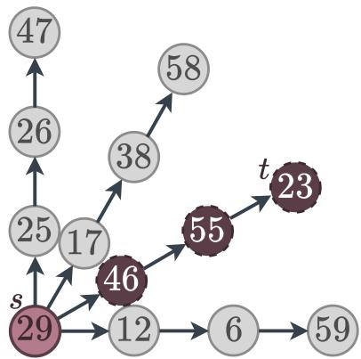  
Figure 8: A path-star graph with query, Q = (29, 23). Node 29 is the sole choice node, with 55 and 23 predictable by shortcuts.

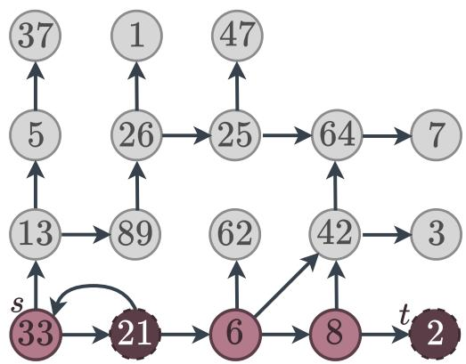  
Figure 9: A directed graph with $Q = ( 3 3 , 2 )$ . 33, 6, and 8 are choice nodes. 21 is not, despite having out-degree 2; as 33 is in the path, it is removed from consideration. The backward edge from 21 to 33 is why the choice set must be defined over unseen neighbours rather than by out-degree alone.

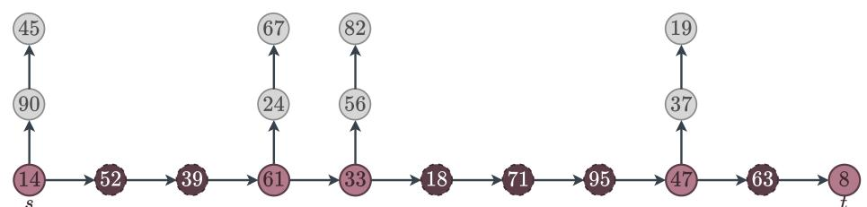

(a) A graph with a sampled path s to t. Choice nodes (light maroon) support learning under NTP.

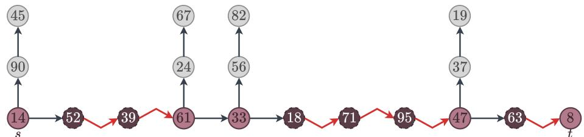  
(b) Non-choice nodes (dark maroon) support trivial predictions via the CHC (red zigzag edges), absorbing sequential supervision (Bachmann & Nagarajan, 2024). This shows where it happens on an arbitrary topology.

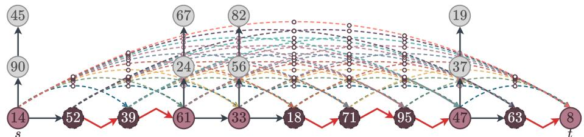

(c) MTP induces dense quadratic (to k) supervision. MTP restores non-choice nodes by inducing supervision connections. Unlike regular edges, these are latent connections (dashed), and thus are not in the source-side prefix and do not support the CHC. They also require multihop learning (tiny nodes), with the edge colour indicating the number of hops.

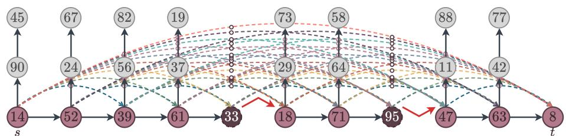

(d) A good graph topology leading to a path with more choice nodes. Notice how the MTP supergraph remains the same, showing that MTP is topologically independent (outside of the NTP connections).

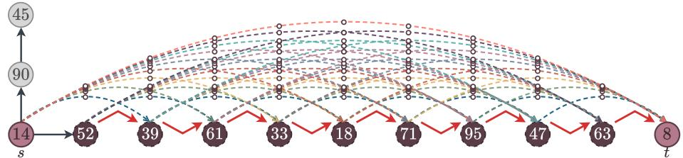

(e) A bad graph topology, such as with an adversarial path-star graph leading to a path with a single choice node.   
However, the MTP supergraph remains the same.

Figure 10: The Benefits of MTP. MTP supervision (c) is dense, unlike NTP (b), and topologyinvariant as shown by (d)-(e).

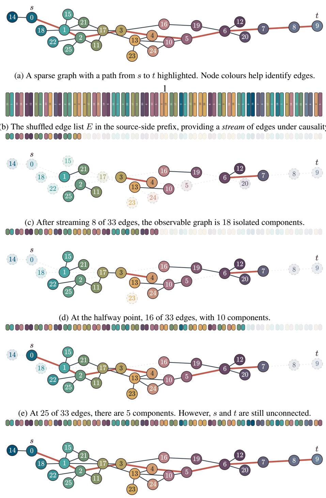  
(f) Only once all edges are observed does the shortest path from s to t exist.

F A VISUALIZATION OF THE CAUSAL CONSTRAINT, SPARSITY, AND FRAGMENTED ROUTING

Figure 11: Fragmented routing. A sparse graph with |V| = 26, |E| = 33 and k = 9. Panels (c)–(f) show the graph as a stream of edges under a causal LM. As information can only be routed across an edge once that edge has been observed, routing will be fragmented (with dotted edges and faded nodes not yet observed). The strip above each of (c)–(f) reproduces the stream of E from (b) at a given time in the stream.

## G A VISUALIZATION OF TOKENIZATION AND CAUSAL PARAMETERIZATION

This section provides visualizations of the two tokenizations: sequential annotation (SEAN) vs. structural annotation (STAN), and the two model parameterizations: causal LM vs. prefix-LM. See Fig. 12.

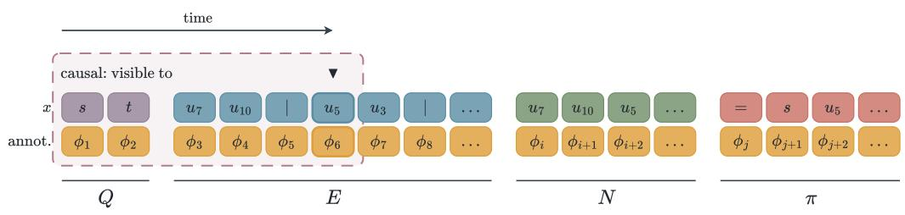

(a) Causal attention with SEAN. Every token attends only to its left context, so the highlighted query token cannot see the remainder of the edge list E that defines the graph it must search over.  
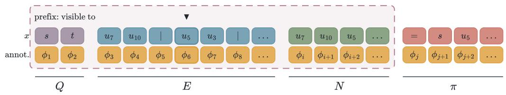  
(b) Prefix attention with SEAN. The query Q, edge list E and node list N form a bidirectional prefix, so the same query token attends to the whole graph; only the path π remains causally masked.

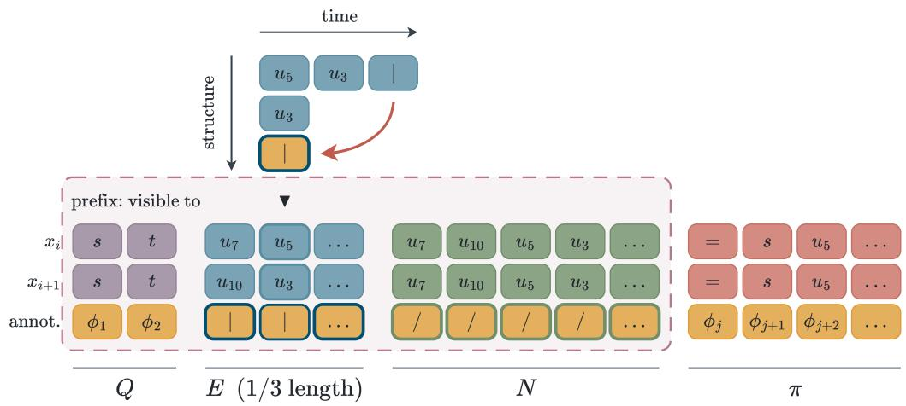  
(c) Prefix attention with STAN. The structure that SEAN spends separator tokens on is moved into the annotation channel, so an edge u v occupies a single position. One can view this as a transposition from the time dimension to the structural dimension. As a consequence, E becomes 1/3 the length. Combining STAN with the prefix-LM allows for true permutation invariance.  
Figure 12: Attention pattern (causal vs. prefix) and tokenization (SEAN vs. STAN). The bottom row of every panel is the annotation channel: SEAN fills it with positional annotations ϕ, whereas STAN overwrites it with structural markers (| for edge boundaries, / for node-list entries). The shaded region marks what the highlighted token (▼) can attend to.

## H RANKING-INTO-THE-FUTURE WITH PLACKETT-LUCE

This section gives a brief tutorial on learning-to-rank and Plackett-Luce, and details how we apply it to MTP.

Consider a supervised task where, for each input $x _ { i } .$ we are given labels $y _ { i } = y _ { i } ^ { 1 } , \ldots , y _ { i } ^ { n }$ and a preferred ordering $r _ { i }$ among them, and we want a model whose scores $l _ { i } = l _ { i } ^ { 1 } , . . . , l _ { i } ^ { n } = h _ { i } W _ { o }$ reflect this ordering. Learning-to-rank methods differ based on what kind of structural information $r _ { i }$ provides. A point-wise approach treats $r _ { i }$ as a set of interval scores and regresses $l _ { i }$ against them directly. A pairwise approach instead assumes $r _ { i }$ only gives partial or relative information, e.g. $y _ { i } ^ { 5 } \succ y _ { i } ^ { 3 }$ , and converts this into pairwise comparisons, optimizing $l _ { i } ^ { 5 } > l _ { i } ^ { 3 }$ , etc.; this is the approach used for RITF by Frydenlund (2025). A listwise approach assumes $r _ { i }$ gives a full (or near-full) ordering over $y _ { i }$ and models this directly (Cao et al., 2007; Xia et al., 2008; Liu, 2009).

MTP is naturally listwise. We construct $r _ { i }$ using the MTP self-supervision rule, letting $y _ { i }$ be the next n tokens after position $i ,$ and assuming tokens closer in time are preferred to those farther away. This gives a full ordering over $y _ { i }$ , but only a partial ordering with respect to the vocabulary, since $n \ll | \nu |$ in general.25

There are multiple ways to implement a listwise loss (Cao et al., 2007; Liu, 2009; Zhu & Klabjan, 2020). Zuhri et al. (2026) use a non-probabilistic loss based on ListNet (Cao et al., 2007). We instead use the probabilistic Plackett-Luce loss, which models the maximum likelihood of the observed ordering, i.e. log $p ( r _ { i } ^ { 1 } \succ \cdots \succ r _ { i } ^ { n } )$ (Luce et al., 1959; Plackett, 1975; Xia et al., 2008).

For MTP, the labels $y _ { i } ^ { 1 } , \ldots , y _ { i } ^ { n }$ are just the path nodes $u _ { i } , \ldots , u _ { i + n - 1 }$ , and $r _ { i }$ realizes the temporal order $u _ { i } \succ u _ { i + 1 } \succ \dots \succ u _ { i + n - 1 }$ used in the main text $( \mathrm { E q . 1 } )$ . We therefore drop the generic $y _ { i } ^ { j } / r _ { i } ^ { j }$ notation from here on and write everything in terms of the nodes directly, matching Eq. 1.

Recall from the main text that $u _ { j } ^ { i }$ denotes the logit for node $u _ { j }$ produced from the hidden state $h _ { i } .$ , and that the softmax in Eq. 1 is taken over $\mathcal { Z } _ { j } = \mathcal { N } \backslash \{ u _ { i } , . . . , u _ { j - 1 } \}$ , the set of nodes not yet ranked at step j. We restate this here without the softmax shorthand $\sigma ,$ and correct $\mathcal { N }$ to V: the normalization is technically over the full token vocabulary, not just the node vocabulary, since the logit vector $l _ { i } = h _ { i } W _ { o } \in \mathbb { R } ^ { | \mathcal { V } | }$ assigns mass to every vocabulary item, node or otherwise.26 Thus,

$$
\begin{array} { r l } & { p ( u _ { i } \succ \dots \succ u _ { i + n - 1 } ) = \displaystyle \prod _ { j = i } ^ { i + n - 1 } p ( u _ { j } \mid u _ { i } , \dots , u _ { j - 1 } ) } \\ & { \qquad = \displaystyle \prod _ { j = i } ^ { i + n - 1 } \frac { e ^ { u _ { j } ^ { i } } } { \displaystyle \sum _ { v \in \mathcal { Z } _ { j } } e ^ { v ^ { i } } } , \quad \mathrm { w h e r e ~ } \mathcal { Z } _ { j } = \mathcal { V } \setminus \{ u _ { i } , \dots , u _ { j - 1 } \} . } \end{array}\tag{4}
$$

For implementation, it is convenient to reindex by rank-step rather than by absolute future offset: let $l _ { i } \in \mathbb { R } ^ { | \nu | }$ be the logit vector at step i, permuted so that $l _ { i } ^ { j } = u _ { i + j - 1 } ^ { i } \operatorname { f o r } j = 1 , \dots , n - \mathrm { i . e }$ . position $j$ holds the logit of the token $j$ steps into the future, so rank order and temporal order coincide for MTP. Since ${ \mathcal { Z } } _ { j }$ excludes exactly the $j - 1$ already-ranked nodes, and these occupy the first $j - 1$ positions of $l _ { i }$ after reindexing, the set-sum over ${ \mathcal { Z } } _ { j }$ collapses to a contiguous range, $\begin{array} { r } { \sum _ { v \in \mathcal { Z } _ { j } } e ^ { v ^ { i } } = \sum _ { v = j } ^ { | \mathcal { V } | } e ^ { l _ { i } ^ { v } } } \end{array}$ giving

$$
p ( l _ { i } ^ { 1 } \succ \dots \succ l _ { i } ^ { n } ) = \prod _ { j = 1 } ^ { n } p ( l _ { i } ^ { j } \mid l _ { i } ^ { 1 } , \dots , l _ { i } ^ { j - 1 } ) = \prod _ { j = 1 } ^ { n } { \frac { e ^ { l _ { i } ^ { j } } } { \sum _ { v = j } ^ { | \mathcal { V } | } e ^ { l _ { i } ^ { v } } } } ,\tag{5}
$$

and the loss for a single time-step at i is simply the negative log-likelihood of this,

$$
{ \cal L } _ { \mathrm { R I T F } } = - \log p ( l _ { i } ^ { 1 } \succ \cdots \succ l _ { i } ^ { n } ) = \sum _ { j = 1 } ^ { n } \log \sum _ { v = j } ^ { | v | } e ^ { l _ { i } ^ { v } } - l _ { i } ^ { j } = \sum _ { j = 1 } ^ { n } \log \Big ( { \cal Z } _ { i } - \sum _ { v < j } e ^ { l _ { i } ^ { v } } \Big ) - l _ { i } ^ { j } ,\tag{6}
$$

where $\begin{array} { r } { Z _ { i } = \sum _ { v = 1 } ^ { | \mathcal { V } | } e ^ { l _ { i } ^ { v } } } \end{array}$ is the full partition function or normalizing term i.e. the scalar realization of summing over $\dot { \mathcal { Z } } _ { 1 } = \mathcal { V } .$ . This distribution represents a generative process of sampling a softmax distribution without replacement and works by re-normalizing the distribution at each rank-step j by excluding previous samples. This is described by the iterative implementation in Alg. 1.

Algorithm 1 The Plackett-Luce Loss Given a Ground-Truth Rank Ordering via an Iterative Renor  
malization Process.   
Require: Vector of ordered logits $l _ { i } = [ l _ { i } ^ { 1 } , l _ { i } ^ { 2 } , \ldots , l _ { i } ^ { | \nu | } ]$ at time-step i   
Require: The number of rank labels n   
1: Initialize:   
2: $\textstyle Z _ { i } \gets \sum _ { u = 1 } ^ { | \bar { \nu } | } e ^ { l _ { i } ^ { u } }$ {Compute initial full partition function}   
3: $\mathcal { L }  0 ^ { \overline { { } } }$ {Initialize log-likelihood accumulator}   
4: for rank-step $j = 1$ to n do   
5: $Z _ { i } ^ { j } \gets Z _ { i }$ {When $j = 1$ this is just regular softmax-CE}   
6: $\mathbf { i f } ^ { \prime } j > 1$ then   
7: $\begin{array} { r } { Z _ { i } ^ { j }  Z _ { i } - \sum _ { v = 1 } ^ { j - 1 } e ^ { l _ { i } ^ { v } } } \end{array}$ {Exclude accumulated past sample masses from partition function}   
8: end if   
9: $\begin{array} { r } { p _ { j } \gets \frac { e ^ { l _ { i } ^ { j } } } { Z _ { i } ^ { j } } } \end{array}$ {Compute step-dependent renormalized probability}   
10: $\mathcal { L }  \mathcal { L } _ { } + \log ( p _ { j } )$ {Accumulate rank-step likelihood}   
11: end for   
12: return $- \mathcal { L }$

Frydenlund et al. (2022) showed how this iteration over the rank-steps in $\mathrm { A l g }$ . 1 can be vectorized for efficient parallel computation on a GPU. This is done by treating $\sum _ { \boldsymbol { v } < j } e ^ { l _ { i } ^ { \boldsymbol { v } } }$ as a padded cumulative summation. This is illustrated in Fig. 13. Thus, the main cost compared to NTP using regular softmax CE is a gathering call to order the logits by the ground-truth rank order to support the cumulative summation. Note that Alg. 1 is written in probability space for exposition. Our implementation works in log-space, obtaining each log $Z _ { i } ^ { j }$ by a cumulative log-sum-exp over the candidate set rather than by subtraction. This is stable whenever n $\ll | \nu |$ , which holds in all our experiments. The instability that remains arises only as n approaches |V|, where ${ \mathcal { Z } } _ { j }$ reduces to a single element and the two quantities being cancelled become equal.

We do not actually want to use the hidden-state from the final layer to create our logits, i.e. $l _ { i } = h _ { i } W _ { o } ,$ since this hidden-state parameterizes the model’s semantic next-token distribution where high-scoring tokens there are semantically related (Mikolov et al., 2013). Whereas the ranking loss instead needs a sequential distribution, where high-scoring tokens are temporally related. Reusing the same hidden-state would conflate these two distributions. Instead, we use the hidden-state produced by the second-to-last layer, as illustrated in Fig. 14.

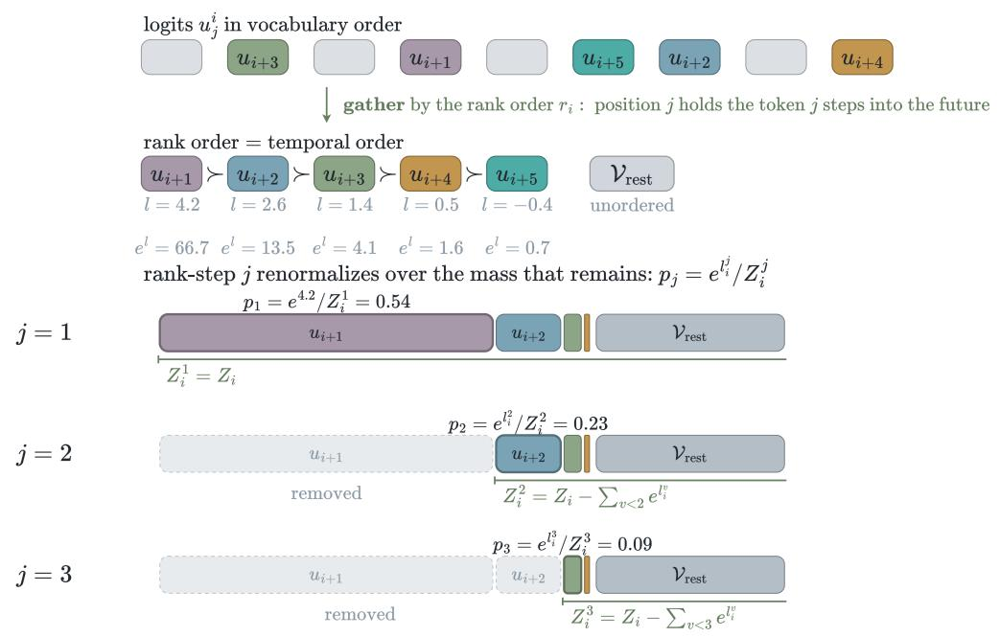  
Figure 13: The Plackett-Luce loss of the MTP head (Alg. 1), with concrete example logits. A gather puts the logits into the rank order $r _ { i } ,$ which for MTP is the temporal order: position $j$ holds the token j steps ahead. Bar widths are the softmax of the logits shown, on one absolute scale across all three rows, so mass leaving the partition function is visible in place. At rank-step j the already-ranked tokens are struck out and $Z _ { i } ^ { j }$ spans only the remainder: each ranked token is removed from the partition function, so the next step renormalizes and competes only over what is left, i.e. sampling without replacement in the context of it modelling a generative process.

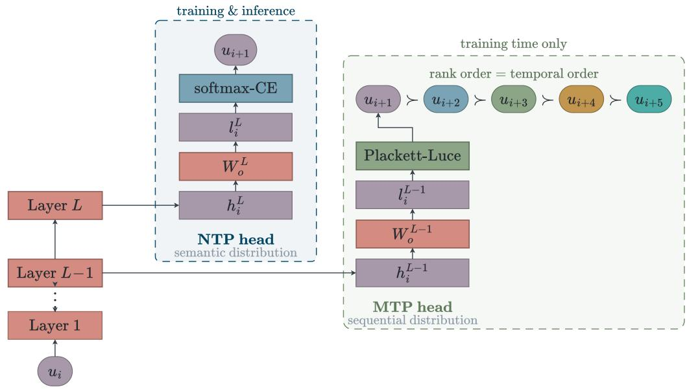  
Figure 14: Architecture. The NTP head uses the last layer $L ,$ feeding the usual unembedding $W _ { o } ^ { L }$ and a softmax-CE loss over the next token: the semantic distribution. It is active during both training and inference. The MTP head instead taps the second-to-last layer $L - 1$ , feeding a second projection $W _ { o } ^ { L - 1 }$ – the only new parameters (or $W _ { o } ^ { \dot { L } }$ can be reused) – into a Plackett-Luce loss over the ordering of the next n tokens: the sequential distribution. The MTP head exists at training time only, so inference is unchanged. Squared boxes are parameters and operations, while rounded boxes are data.

## I PROOF OF OPTIMAL MTP SEQUENTIAL SAMPLE EFFICIENCY

We prove that MTP covers every possible non-trivial sub-path of π, establishing optimality of SSE and hop mixture. Term $( i , j )$ conditions on $\pi _ { < u _ { i } } ,$ , so its last observed node is $u _ { i - 1 }$ and it corresponds to the sub-path $( u _ { i - 1 } , u _ { j } )$ , putting the full set of $k ( k + 1 ) / 2$ terms in bijection with the non-trivial sub-paths of $\pi .$ Note that s is given in the query and is never a target, so it is not a term in either loss. The one positional shortcut is the (k, k) term, which predicts t at the final position, and it is excluded by the sum bounds of both Eqs. 2 and 3. Predicting t is only trivial at the final position, where it is given by the query and the sequence has ended. Predicting t at an earlier position is not trivial, as the model must also determine that the path terminates there, which requires knowing the remaining distance. Eq. 3 is therefore the full set less that term, giving $k ( k + 1 ) / 2 - 1$ , and Eq. 2 is its diagonal less that term, giving $k - 1$ . Relative to predicting all $k + 1$ nodes, NTP loses two terms, for s and for t, while MTP loses the $i = 0$ row and one further term. The $i = 0$ row goes because it contains the prediction of s and because its remaining terms condition on $\pi _ { < u _ { 0 } } = \varnothing$ , which is identical to $\pi _ { < u _ { 1 } } = \{ s \}$ and so duplicates the $i = 1 \ \mathrm { r o w }$

A non-trivial path contains at least 1 edge. There are $C = k ( k + 1 ) / 2$ non-trivial sub-paths in a k length path. Let $\pi = u _ { 0 } , \ldots , u _ { k }$ be a shortest path with $k + 1$ nodes and k edges. Let $e _ { 1 } , \ldots , e _ { k }$ be the edges in the path with $e _ { i } = ( u _ { i - 1 } , u _ { i } )$ . Then any two nodes form a non-trivial sub-path s.t.

$$
P = { \binom { k + 1 } { 2 } } = { \frac { ( k + 1 ) ! } { 2 ! ( ( k + 1 ) - 2 ) ! } } = { \frac { ( k + 1 ) k } { 2 } } .\tag{7}
$$

Then, MTP has optimal sequential sample efficiency as every term in the loss corresponds to a non-trivial sub-path. Proof: The full version of Eq. 3 is,

$$
{ \begin{array} { l } { { \displaystyle L _ { \mathrm { M T P } } ^ { \mathrm { f u l l } } = \sum _ { i = 1 } ^ { k } \sum _ { j = i } ^ { k } \log p ( u _ { j } \mid \pi _ { < u _ { i } } , s , t , \mathcal { E } ) } } \\ { ~ } \\ { \qquad = \log p ( u _ { 1 } \mid u _ { 0 } , \dots ) + \log p ( u _ { 2 } \mid u _ { 0 } , \dots ) } \\ { \qquad + \dots + \log p ( u _ { k } \mid u _ { 0 } , \dots ) } \\ { \qquad + \log p ( u _ { 2 } \mid u _ { 0 } , u _ { 1 } , \dots ) + \log p ( u _ { 3 } \mid u _ { 0 } , u _ { 1 } , \dots ) } \\ { \qquad + \dots + \log p ( u _ { k } \mid u _ { 0 } , u _ { 1 } , \dots ) } \end{array} }\tag{i = 1}
$$

(i = 2)

$$
\begin{array} { l } { \dot { \mathbf { \mu } } _ { + \log p ( u _ { k } \mid u _ { 0 } , . . . , u _ { k - 1 } , . . . ) } } \end{array}\tag{i = k}
$$

s.t. i is the start of a sub-path and $j$ the end of that subpath. Thus, each pair of indices $( i , j )$ in the above Eq. corresponds to a unique non-trivial subpath. The total number of terms in the expansion of $L _ { \mathrm { M T P } }$ is

$$
P = \sum _ { i = 1 } ^ { k } ( k - i + 1 ) = k + ( k - 1 ) + \cdots + 1 = { \frac { ( k + 1 ) k } { 2 } } = C .\tag{8}
$$

Since $P = C .$ , every possible non-trivial sub-path maps to exactly one unique term in the $L _ { \mathrm { M T P } } ^ { \mathrm { f u l l } }$ loss. Then, as no other sub-path exists, there can be no other terms in the loss, thus achieving optimal sequential sample efficiency. Likewise, as no other sub-path exists, there can be no other paths of different lengths, tthus having an optimal mixture of lengths. Eq. 3 is $L _ { \mathrm { M T P } } ^ { \mathrm { f u l l } }$ less the (k, k) term, so it retains one term for every non-trivial sub-path that is not trivially predicted, and the same optimality holds. Note that this assumes an autoregressive model, i.e. models the target sequence causally, as with both the prefix LMs and causal LMs. We consider non-autoregressive discrete diffusion below ( I.1). This also assumes that the tokenization for the task is such that each token provides a single hop (§2.1).

An additional property is that, under MTP, the proportion of terms with hop length h follows a linearly decreasing distribution.

Proof: The full MTP loss has $k ( k + 1 ) / 2$ terms total. Term $( i , j )$ predicts $u _ { j }$ conditioned on $\pi _ { < u _ { i } }$ so the last observed node is $u _ { i - 1 }$ and the hop length is:

$$
h = j - ( i - 1 ) = j - i + 1
$$

The number of terms with hop length $h$ is:

$$
N _ { h } = | \{ ( i , j ) : 1 \leq i \leq j \leq k , \ j - i + 1 = h \} | = | \{ ( i , i + h - 1 ) : 1 \leq i \leq k - h + 1 \} | = k - h + 1
$$

So the proportion of terms at hop length h is:

$$
P ( H = h ) = \frac { k - h + 1 } { k ( k + 1 ) / 2 } = \frac { 2 ( k - h + 1 ) } { k ( k + 1 ) } , \quad h = 1 , \dots , k
$$

This sums to 1: $\begin{array} { r } { \sum _ { h = 1 } ^ { k } \frac { 2 ( k - h + 1 ) } { k ( k + 1 ) } = \frac { 2 } { k ( k + 1 ) } \cdot \frac { k ( k + 1 ) } { 2 } = 1 } \end{array}$

Thus, the distribution is non-uniform and linearly decreasing: $\begin{array} { r } { P ( H = 1 ) = \frac { 2 } { k + 1 } \mathrm { v s } P ( H = k ) = } \end{array}$ $\frac { 2 } { k ( k { + } 1 ) }$ , a ratio of $k .$

## We visualize both properties: the quadratic increase in supervision and the distribution of hop lengths as the MTP rainbow in Fig. 10. This applies to any task with MTP (Fig. 26 and Fig. 31).

The distribution of lengths is interesting, as Wang et al. (2026c) recently showed that there exist latent compositional multihop reasoning tasks where the learnability of the task increases under a data sample distribution that follows a power-law instead of a uniform distribution.27 Intuitively, this restricts the sample space during learning, which allows for learning the underlying algorithm without being distracted by data-specific values, and once this is done, the model can then learn to generalize to unseen/unsampled values $\cdot ^ { 2 8 }$ We suspect that a similar phenomenon may exist for the sample distribution across hop sizes, as once the model learns to compose for a small number of hops, it should be easier to generalize that to a larger number of hops; thus, one may expect that we should sample $k ^ { \prime }$ non-uniformly and prioritize small values over larger ones. What we show is that MTP implicitly provides such a non-uniform distribution over $k ,$ weighted towards the easier terms. NTP induces one term per position, so each hop length has multiplicity one, and the best case is a uniform mixture (only on choice-node dense path). MTP gives hop length h a multiplicity of $k - h + 1$ , which is what produces the skew. This is thus another potential benefit of MTP. However, we do not know how to isolate this specific property to empirically validate this hypothesis (though it may be possible to demonstrate this with NTP (under a carefully chosen topology)).

## I.1 MASKED DISCRETE DIFFUSION MODELS SUPERVISE A SUBSET OF THE SUB-PATHS SUPERVISED BY MTP

Here we compare masked discrete diffusion models (MDM) to MTP in terms of the induced loss terms. Several works have proposed MDM for the path-star task ( D.4). Masking induces supervision over sub-paths of varying hop length, which creates similar density and mixed-hop supervision as MTP (§2). This offers insight into why MDM can learn the task, as masking provides a form of the supervision we attribute to $\mathbf { M T P } _ { \cdot } ^ { 2 9 }$ The analysis also bounds what masking provides, as MDM supervises a subset of the sub-paths supervised by MTP and induces at most $k - \bar { 1 }$ terms per sample.

This analysis holds under the theoretical model of the shortest-path task ( L.3), where nodes are semanticless and the target is a single path, so a term’s supervision is determined by which sub-path it reconstructs. It is an analysis of which sub-paths each loss supervises rather than of learnability directly, and we do not claim it transfers to tasks where the relevant information is distributed across many tokens.

Let $\pi = u _ { 0 } , u _ { 1 } , \ldots , u _ { k }$ be a shortest path and let $M \subseteq \{ 1 , \dots , k - 1 \}$ be a sampled mask that designates which path tokens are unobserved, with $\bar { M } = \{ 0 , \ldots , k \} \setminus$ M being the complementary observed positions. Note $u _ { 0 } = s$ and $u _ { k } = t$ are always observed. The MDM loss for a given mask M is

$$
{ \cal L } _ { \mathrm { M D M } } ( M ) = \sum _ { j \in M } \log p ( u _ { j } \mid \pi _ { \bar { M } } , \mathcal { E } ) ,\tag{9}
$$

where $\pi _ { \bar { M } } = \{ u _ { i } : i \in \bar { M } \}$ are the observed tokens.

The masked positions M partition naturally into maximal contiguous blocks, each of which defines a subpath. Let such a subpath be $\pi ( u _ { a } , u _ { b } )$ with $u _ { a }$ and $u _ { b }$ being observed nodes forming the left and right observed boundaries, respectively, i.e. $a , b \in { \bar { M } }$ , of length $k ^ { \prime } = b - a$ , s.t. the interior nodes $u _ { a + 1 } , \ldots , u _ { b - 1 }$ are all masked, i.e. $\{ a ^ { \cdot } + 1 , \dots , b - 1 \} \subseteq M$

In the case where $\pi ( \boldsymbol { u } _ { 0 } , \boldsymbol { u } _ { k } )$ is the fully masked path, then:

1. Full masking induces $k - 1$ loss terms. $M = \{ 1 , \dots , k - 1 \}$ yields one block with $b - a - 1 =$ $k - 0 - 1 = k - 1$ interior nodes, hence $k - 1$ terms:

$$
L _ { \mathrm { M D M } } ( \{ 1 , \ldots , k - 1 \} ) = \sum _ { j = 1 } ^ { k - 1 } \log p ( u _ { j } \mid u _ { 0 } = s , u _ { k } = t , \mathcal { E } ) .
$$

Let $S ( L )$ denote the set of sub-paths supervised by a loss L. Thus, every MDM term supervises the same sub-path as a unique MTP term, so $S ( L _ { \mathrm { M D M } } ( M ) ) \subset S ( L _ { \mathrm { M T P } } )$ (Eq. 3), although the corresponding terms differ in their conditioning, as MDM also observes the right boundary. Since $\bar { L } _ { \mathrm { M D M } } ( \bar { M } )$ induces at most $k - 1$ terms, this means that MDM has a strictly worse SSE than MTP.

2. Each MDM term for interior node $u _ { j } \in \pi ( u _ { a } , u _ { b } )$ predicts $u _ { j }$ given left boundary $u _ { a }$ as its nearest observed left context, which corresponds to MTP term $( a + 1 , { \overset { . } { j } } )$ in $\operatorname { E q . 3 }$ , and conditions on $\pi _ { < u _ { a + 1 } }$ with $u _ { a }$ as the last observed node. The MDM term additionally conditions on the right boundary $u _ { b } ,$ but the same sub-path $( a + 1 , j )$ is supervised. Thus, every MDM term corresponds to a unique MTP term, and $L _ { \mathrm { M D M } } ( M )$ induces a subset of the terms in $L _ { \mathrm { M T P } }$ (Eq. 3). Since $L _ { \mathrm { M D M } } ( M )$ induces at most $k - 1$ terms, this means that MDM has a strictly worse SSE than MTP. The conditioning difference is discussed below.

3. Full masking induces a mixture of $k - 1$ hop lengths. Each term predicts $u _ { j }$ from the left boundary u , requiring a j-hop computation. The terms $j = 1 , \ldots , k - 1$ cover hop lengths $1 , 2 , \ldots , k - \dot { 1 }$ resulting in a mixture of all $k - 1$ hop lengths. Thus, MDM induces a uniform mixture of hop lengths between 1 and $k - 1 .$ , whereas MTP induces a non-uniform mixture weighted toward shorter subpaths, as hop length h appears in $k - h + 1$ terms of $L _ { \mathrm { M T P } }$

4. Full masking induces a maximum number of loss terms with the longest hops. Since $| M | \leq k - 1$ for any mask, any MDM sample induces at most $k - 1$ terms. Full masking achieves this bound. It also achieves the maximum hop length $k - 1 { \mathrm { ; } }$ any partial mask produces subpaths of length $k ^ { \prime } < k$ This must necessarily break up the longest contiguous subpath, thus reducing the maximum hop to $k ^ { \prime } - 1 < k - 1$

Now consider the case where we have partial masking.

5. Observing interior nodes splits the path into shorter subpaths with fewer total terms. Observing r additional interior nodes partitions M into $r + 1$ blocks. Each block $\pi ( u _ { a } , u _ { b } )$ contributes $k ^ { \prime } - 1 = b - a - 1$ terms. The total across all blocks is $k - 1 - r$ terms, i.e. one fewer per additional observed node.

6. Shorter subpaths induce shorter hop mixtures. Subpath $\pi ( u _ { a } , u _ { b } )$ of length $k ^ { \prime } = b - a$ induces hops $1 , \ldots , k ^ { \prime } - 1$ from its left boundary $u _ { a }$ . Since $k ^ { \prime } \overset { \cdot } { \leq } k$ , the maximum hop per subpath decreases. The overall hop mixture is the union over all blocks, which covers only a subset of $\{ \bar { 1 } , \ldots , k - 1 \}$

7. For a general subpath $\pi ( u _ { a } , u _ { b } )$ of length $k ^ { \prime } = b - a$ , the MDM terms predict $u _ { j }$ for $j =$ $a + 1 , \dotsc , b - 1$ with $u _ { a }$ as the nearest observed left context. Each such term corresponds to MTP term $( a + 1 , j )$ in Eq. 3, i.e. a contiguous prefix of row $i = a + 1$ , covering hops $1 , \ldots , k ^ { \prime } - 1$ from $u _ { a } .$ Thus, for any mask M, every MDM term across every block supervises the same sub-path as a unique MTP term. Thus $S ( L _ { \mathrm { M D M } } ( M ) ) \subset S ( L _ { \mathrm { M T P } } )$ holds for all masks M, not just full masking, with the same difference in conditioning noted above.

In this analysis, we have made a Markovian assumption that only the left and right boundaries of the subpath matter. This is not strictly true for the shortest path. Recall that a choice node in $\pi$ is one where multiple nodes could follow that node. A choice node does not depend only on the current observed node, but also on the prior observed path, i.e. not just the left boundary, since the model can use the observed partial path to exclude nodes from the choice set. However, this is a property that affects learnability, not the analysis of which loss terms are induced, which is our focus here.

Note, however, that this non-Markovian property is precisely why the reduction in terms and the change in MMHT distribution need not imply worse learnability for MDM. This is because the MDM term also conditions on the right boundary $u _ { b }$ , and on observed nodes elsewhere in the sequence, which may provide additional or different structural information beyond what the corresponding MTP term observes, and which may compensate for the fewer terms (we expect this to be more true of natural language tasks, where information is spread across multiple tokens).

For completeness with the prior section on MTP, full-masking induces a uniform distribution over $k ^ { \prime } ,$ and partial masking (using random Bernoulli masking) induces a geometric distribution.

The main takeaway here is that, while MTP and MDM are different, a majority of the benefits of MTP when applied to multihop reasoning are also enjoyed by MDM due to the masking procedure in the loss. Thus, we would expect that MDM also outperforms NTP on such tasks. This may also explain the success of MDM on other symbolic multihop reasoning tasks (Ye et al., 2025a;b; He et al., 2026).

## J EXTENDED EXPERIMENTAL DETAILS

Model. Unless stated, we consider LMs with $L = 1 1$ layers, 256 dim., and 4 attention heads. Embeddings are initialized as one-hot but are learnable. Positional embeddings are learned. These sizes were chosen so that the task is expressible by the model, making any failure more plausibly attributable to learnability than to expressibility ( D.3).

Training. For optimization, we use Sophia (Liu et al., 2024b) and a linear-then-decreasing scheduler. We used a learning rate of 0.0005, a warm-up of 500 steps, and no L1 or L2 regularization. We also do not use dropout or attention dropout. We find that this is critical for these kinds of discrete algorithm tasks. The effective batch size is 1000 instances, leading to a max of 75M instances (> 12B tokens). Training is evaluated every 100 steps and stopped after achieving > 95% TACC (averaged across $k ^ { \prime } \in \{ k - 5 , \ldots , k \} $ ) on consecutive evals, or to a max of 75k steps. Each model for every experiment is trained from scratch (for ≈ 2900 exps. outlined in J.1).

Data. We consider three topologies: Erdos-Renyi graphs (ERG) with an edge probability of˝ $1 / | \mathcal { N } | ^ { \prime }$ the giant threshold for a sampled size $| \mathcal { N } | ^ { \prime }$ , Euclidean graphs (EG) with a connectivity radius of $1 / \sqrt { | \mathcal { N } | ^ { \prime } }$ , and path-star graphs (PSG) (Erdos & Rényi, 1959; Penrose, 2003; Bachmann & Nagarajan,˝ 2024). The ERG and EG random processes produce graphs with many unconnected components. We merge all components randomly for ERG, or by distance for EG, using a single edge per component to support paths with large $k .$ . When sampling paths at some $k ^ { \prime } ,$ we use an ad hoc method that also tries to choose a path in which the start node is a choice node (which is already done by construction for PSG). This tries to ensure that a sampled path of $k ^ { \prime } + 1$ actually requires $\bar { k } ^ { \prime }$ hops to solve ( M).

We sample $k ^ { \prime } \in \{ 3 , . . . , k \}$ and $| \mathcal { N } | ^ { \prime } \in \{ k + 1 , . . . , N \}$ for various max k and $| \mathcal { N } |$ via a true curriculum (sampling inverse to the training SACC at $k ^ { \prime } )$ . We smooth these sampling probabilities by $1 / 2 k ;$ otherwise, the model would engage in catastrophic forgetting of solutions at various $k ^ { \prime }$ it had perfected prior. We do not use a curriculum for PSG. The curriculum removes the plateaus in Fig. 6, which are the phenomenon we are measuring.

Implementation. We use the vectorized GPU-friendly version of Plackett-Luce ( H). We use Fairseq to implement our models (Ott et al., 2019). We needed to write our online datastream in C++ in order to generate enough graph instances. In general, because our models are so small, the datastream became the computational bottleneck and limited scaling to larger graphs. For this we made use of PyBind (Jakob et al., 2016) and Boost Graph Library (Siek et al., 2002). We used the

<table><tr><td>Experiment</td><td>Figure</td><td>Num Sub Exps.</td><td>Num k</td><td>Num Trials</td><td>Total Runs</td></tr><tr><td>ERG, Prefix LM, Baselines</td><td>Fig. 2</td><td>10</td><td>10</td><td>5</td><td>500</td></tr><tr><td>ERG, Prefix LM</td><td>Fig. 3</td><td>8</td><td>10</td><td>5</td><td>400</td></tr><tr><td>ERG, Causal LM, Baseline</td><td>Fig. 20</td><td>6</td><td>10</td><td>5</td><td>300</td></tr><tr><td>ERG, Causal LM</td><td>Fig. 4</td><td>8</td><td>10</td><td>5</td><td>400</td></tr><tr><td>EG, Prefix LM</td><td>Fig. 21</td><td>8</td><td>10</td><td>5</td><td>400</td></tr><tr><td>PSG, Prefix LM</td><td>Fig. 5</td><td>18</td><td>10</td><td>5</td><td>900</td></tr><tr><td colspan="4"></td><td></td><td>2900</td></tr></table>

Table 1: Calculation of the total number of runs needed for the main experiments broken down by figure. Overlapping experiments were not double counted.

C++ code provided by Saparov et al. (2025) to understand technical issues such as learning PyBind and how to seed different threads.

## J.1 COMPUTATION

All experiments were run using a NVIDIA L40S 48GB GPU, 16-32 CPUs, and 64GB of RAM. However, the shortest path task and Khop models can easily be trained on a 12GB TitanX. The BFS scratchpad experiments require a larger GPU and are more compute-intensive due to the significant increase in token count. Thus, the main computational cost of this work is in the number of experiments run. Also, experiments like the baselines and the PSGs with NTP that fail to converge are the most expensive in terms of compute, as we must run them to the maximum number of steps. Thus, while the max values we choose are arbitrary in terms of experimental design, they were practically chosen so that each experiment took a maximum of 24 hours to run.

Given this, we provide a rough estimate of the computational cost required to conduct the main experiments. Table 1 lists the number of experiments in Figs. 2, 3, 20, 4, 21, and 5. This lists a total of 2900 experiments conducted. Our cluster did not allow for ease tracking of hours (due to preemption), so we assume that on average each experiment took half a day or 12 GPU hours. Thus, there are 34800 total GPU hours. If one did not have access to a cluster such as we did, a price estimate for this using Runpod either using an L4 GPU (24GB vRAM, 50GB RAM, 12 CPU) at 0.39/hour and an RTX3090 (24GB vRAM, 125GB RAM, 16 CPU) at 0.49/hour gives us a cost of either \$13,572 or \$17,052.30

Importantly, in having solved most of the variance in different seeded trials, we have made it possible to either reduce the number of trials in future work, say 3 instead of 5, or only do a single point estimate. This significantly reduces this compute cost. Also note, we have already benefited from this in this work compared to the prior work of Frydenlund (2024) and Saparov et al. (2025) who used 11 and 14 trials per experiment, respectively.

## K EXTENDED EXPERIMENTAL RESULTS ON SHORTEST PATH TASK

## K.1 FULL-PAGE VERSIONS OF THE MAIN RESULTS FIGURES

We reproduce the main results figures at full-page size for legibility. The data are identical to the main text and only the scale differs.

## K.2 CAUSAL LM BASELINE

As in Fig. 2, we consider the baseline and ablation of STAN and N at $| \mathcal { N } | = 5 0$ , in Fig. 20. Here we observe different patterns from the causal LM, both in the baseline and in the ablations. First, unlike in the prefix LM, we see the expected pattern where task difficulty grows with k and $| \mathcal { N } |$ . It seems like N still leads to the greatest increase in performance at low k, but not at high k compared to STAN. We expect this is because, like the causal LMs, it is noisy, and the increased difficulty of using the causal LM adds to that noise. Unlike the LM prefix, STAN consistently outperforms the

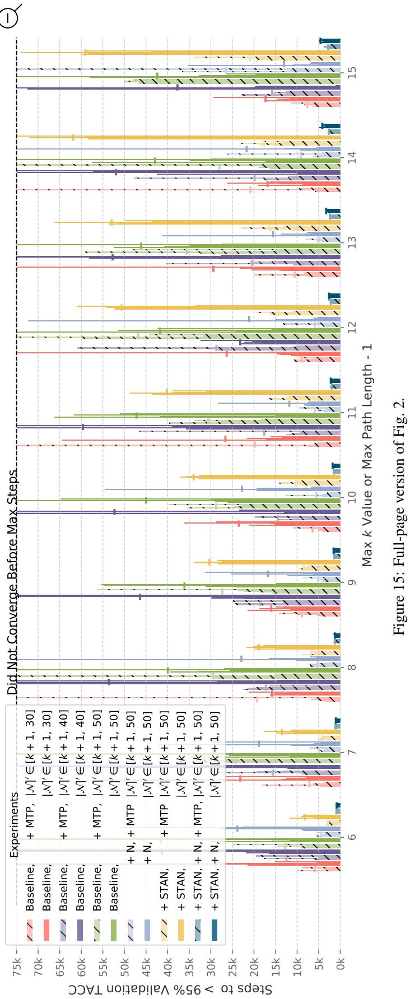

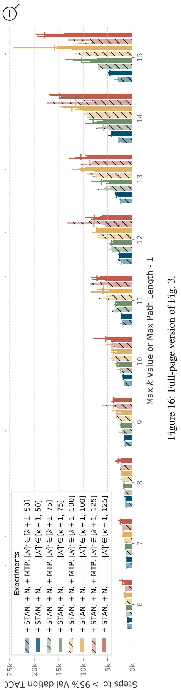

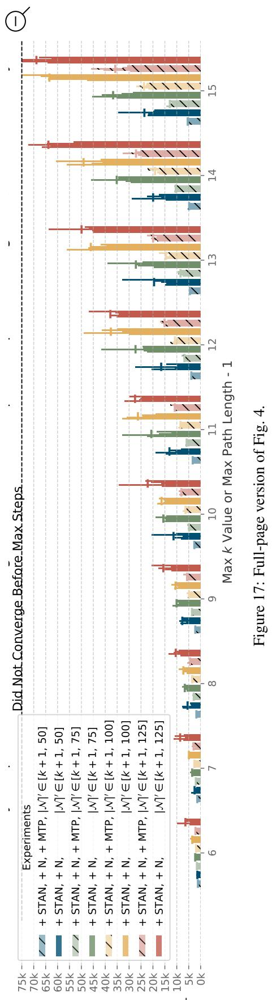  
CCAT n o i t a d i l aV % 5 9 > ot sp etS

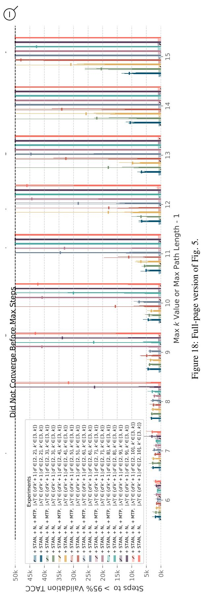

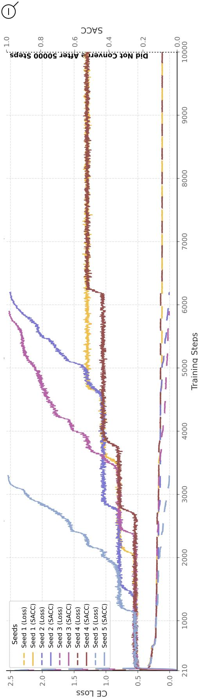  
n of Fig. 6. Note that, unlike in Bachmann & Nagarajan (2024) who did not use MMHT or a mixture ofd′ , ) nalizes over the(k′ , d′mixture. That is, failure to learn the task no longer results in

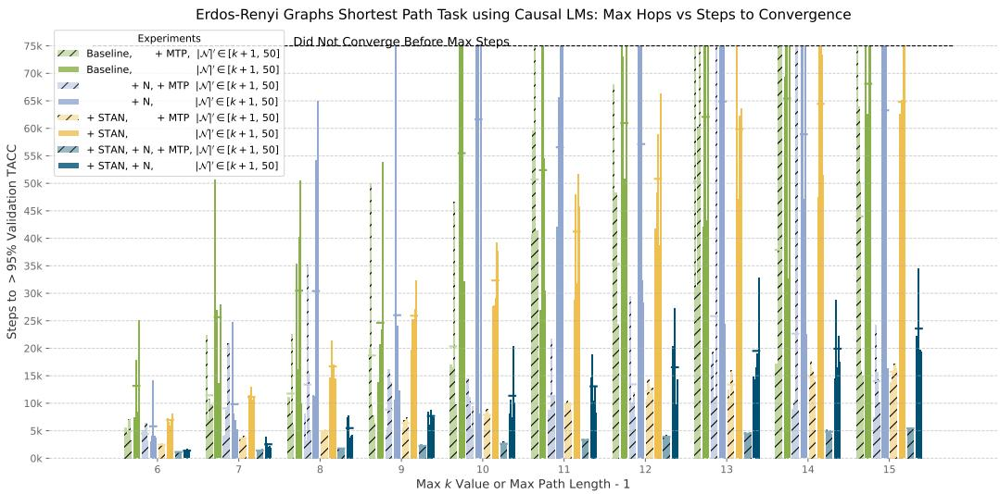  
Figure 20: The baseline and ablation for the causal LM.

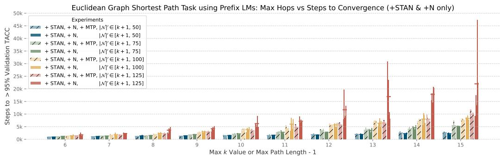  
Figure 21: Results using Euclidean Graphs with Prefix LMs

baseline. In many ways, these results are more expected than the results from the prefix LM baseline.   
This exposes a clear difference in performance between the two models due to parameterization.

## K.3 RESULTS ON EUCLIDEAN GRAPHS

Fig. 21 shows the results of the EGs with Prefix LMs. As we can see, MTP only improves learning once we scale to 125 nodes. We expect that this would be a trend had we experimented with larger graphs.

## K.4 RESTRICTED MMHT PATH-STAR GRAPH EXPERIMENTS

Here we empirically validate our lockout hypothesis on PSGs. We consider two experiments from Fig. 5: where k = 9, d = 6 and where $k = 9 , d = 8$ . Both use full MMHT s.t. $k ^ { \prime } \in [ \bar { 3 } , 9 ]$ . The learning dynamics of the d = 8 experiments are plotted in Fig. 6. We see all the $d = 6$ trials solve the task, but only 3 trials for d = 8 solve the task and two fail. Thus, we have one set in which all succeed and another in which some fail. We then consider restricting the mixture of MMHT to higher $k ^ { \prime } \in [ 6 , 9$ for both d = 6 and d = 8 in Fig. 22. We see that all such models fail, which is behaviour consistent with PSGs when they are not provided with MMHT (Bachmann & Nagarajan, 2024; Frydenlund, 2025).

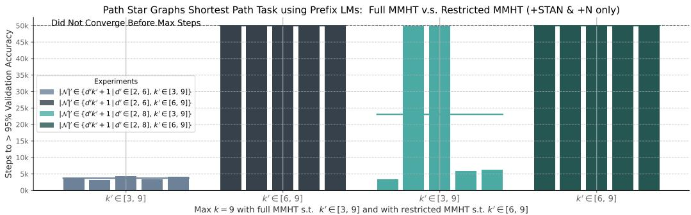  
Figure 22: Restricting the mixture of MMHT to higher k′ fails to learn the task.

## L AUXILIARY MULTIHOP TASKS: KHOPS, KHOPS-GEN, AND BFS SCRATCHPADS

We consider three additional latent multihop reasoning tasks, Khops, Khops-Gen (a novel generative variant), and a BFS scratchpad (BFS-SP), for two reasons. First, they act as further testbeds to establish MTP’s benefits in other symbolic multihop settings. Second, prior work has proposed scratchpads/chain-of-thought as a scalable way to sidestep the difficulty of latent multihop search (Saparov et al., 2025). We show this is not only impractical, since BFS-SP’s sequence length grows too quickly to scale, but, more importantly, that it changes the underlying computational problem. A scratchpad that presents graph structure in traversal order collapses latent search into a much simpler linear-chain traversal task, one that is, in fact, computationally equivalent to Khops-Gen and Khops ( L.4).

We define each task below; Khops ( L.1), Khops-Gen ( L.2), and BFS-SP ( L.3), then return to this unifying argument in L.4.

## L.1 KHOPS

Khops is an in-context latent multihop reasoning task introduced by Sanford et al. (2024a), extending induction heads, a well-studied attention mechanism that drives in-context learning by matching a symbol to its most recent prior occurrence and copying the symbol that followed it (Elhage et al., 2021). Formally, let $x _ { 1 } , \ldots , x _ { N }$ be a series of N symbols in some vocabulary V. An induction head implements $f ( x _ { i } ) = x _ { j + 1 }$ , where j is the most recent prior position with $x _ { j } = x _ { i }$ . Khops extends this to k-fold composition.

It is a sequential labelling task, not a sequential generation task, given to causal LMs. For some k, the model must output the final induction symbol after k hops at each of the N positions where applicable (early positions may lack enough context to form k hops, and hence output no symbol). The targets are $y = y _ { 1 } , . . . , y _ { N }$ , where $y _ { i } = f _ { k } ( . . . f _ { 2 } ( f _ { 1 } ( x _ { i } ) ) )$ ). k is provided as part of the task description, similar to the query in shortest path search. Thus, each instance is really N separate sub-tasks, each with a different, and often reduced, context. The task is illustrated in Fig. 23.

Sanford et al. (2024a) show Khops can be expressed and learned by transformers with O(log k) layers.31 They also induce MMHT by sampling $\bar { k } ^ { \prime } \in [ 1 , k ]$ , but do not evaluate its effect. We perform such an experiment in L.1.3, which shows that the training requires an exponential number of steps as k grows without MMHT. We also introduce a sequential-generation variant, Khops-Gen, needed to properly compare against MTP ( L.2).

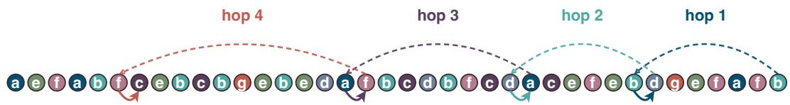

0 1 2 3 4 5 6 7 8 9 10 11 1213141516171819202122232425262728293031323334353637

(a) The task at query position 37 for $k ^ { \prime } = 4$ hops. Each hop matches the most recent occurrence of the current value (dashed), then reads one position to its right (solid). A hop is the composition of the two. Each hop searches strictly left of the previous match due to the causal constraint, so the window of potential matches, and thus the search space, shrinks monotonically. Note that the node IDs are actually their position i.e. we have nodes 0-37, and the letters are their values or semantic content.

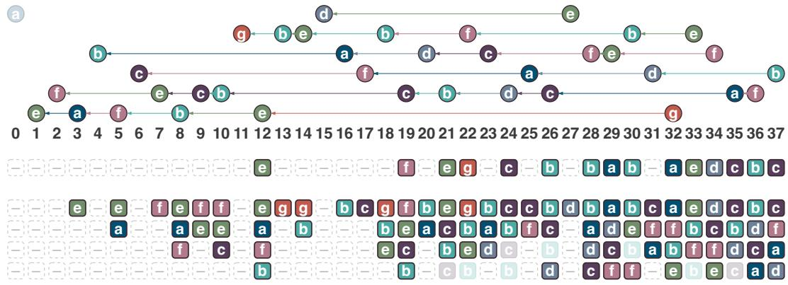

(b) The latent reasoning graph induced by (a), which is a disjoint union of linear chains. The length of these chains defines the search space under the causal constraint. Position 0 can not connect and is ghosted. We show the single label that results after k′ = 4 hops. These are masked out if there is no viable 4-hop solution. Beneath this is the ranking labels used in our MTP surrogate ( L.1.2). We ghost any repeated labels, which are masked out from the ranking ground-truth labels.

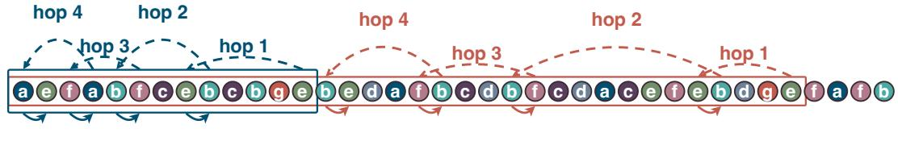

0 1 2 3 4 5 6 7 8 9 10 11 12 13 14 15 16 17 18 19 20 21 22 23 24 25 26 27 28 29 30 31 32 33 34 35 36 37

(c) Two queries from the same instance, at positions 12 (blue) and 33 (red), both supporting a full k = 4 chain. This shows how predicting the task for multiple positions at once induces implicit MMLT, with some positions have a reduced search space relative to others ( L.1.1). Or in other words, a longer context contains far more distractor node, which have the same value as the sought after value that must not be matched.

Figure 23: The Khops task, $k = 4 ,$ one instance throughout. Colours and letters denote symbol values, the numbers denote positions i.e. node IDs. Dashed arrows are the latent content-based match while solid is the deterministic +1 shift.

## L.1.1 CAUSAL LMS AND MIXED MULTI-LENGTH TRAINING

Just as MMHT provides a mixture of hop-distances $k ^ { \prime } \leq k$ within a single sample, we can define an analogous mixed multi-length training (MMLT), a mixture of task sizes $N ^ { \prime } \leq N$ . Where MMHT varies the difficulty of a fixed-size instance, MMLT varies the size of the instance itself. Both are hypothesized to aid learning by exposing the model to a range of task difficulties.

We find that Khops induces MMLT implicitly (in much the same way that multiple choice nodes in a path implicitly induce MMHT (§ 2)). Because each target $y _ { i }$ only depends on symbols before position $i ,$ every position i sees a different amount of preceding context. This creates an implicit mixture of task lengths, uniform across $1 , \ldots , N$ (ignoring invalid positions where i is too small to support k hops). This behaviour is both inherent to the task and a consequence of using a causal LM. Note that the task is not defined for prefix LMs as it relies on causality to provide implicit left-right ordering.

Consider the state space of the task; position i has i tokens available before it, giving a state space of $i ^ { k }$ , up to $N ^ { k }$ at the final position. Thus MMLT gives a mixture of examples spanning a wide range of difficulty for free, without any explicit sampling of $k ^ { \prime }$ or $N ^ { \prime }$

Isolating the effect of this implicit MMLT is difficult on Khops itself, since every position is trained on simultaneously within a single instance. We instead add $\tilde { N }$ noise symbols to the front of the sequence, increasing the state or search space at position i from $i ^ { k } \mathrm { t o } ( \tilde { N } + i ) ^ { k }$ . This has only a small effect on learnability. We find a much larger effect of MMLT on Khops-Gen ( L.2), which, unlike Khops, is trained on only a single instance per example, so MMLT there must be induced explicitly.

## L.1.2 A SURROGATE FOR MTP ON KHOPS

MTP works by predicting several future tokens at once, exploiting the sequence structure of a generation task. Khops has no such structure to exploit directly because it is a labelling task with a single target per position. To meaningfully compare against MTP, we need a sequence-like structure standing in for “future tokens.” The intermediate compositional labels, $f _ { 1 } , \ldots , f _ { k }$ , at each position provide exactly this as they form an ordered sequence of increasingly-composed targets, even though only the final one, $f _ { k }$ , is the task’s actual output.32 We therefore apply a ranking loss over these labels, preferring the final composition $f _ { k }$ (the original single target) most, then $f _ { k - 1 }$ , and so on, mirroring how MTP ranks the immediate next token above later ones.

These labels are not new supervision. Since training already uses MMHT, each intermediate label $f _ { k ^ { \prime } }$ is already seen as a target whenever $k ^ { \prime }$ is sampled. What changes is that we now supply all of them together, per instance, rather than one at a time across different samples. This mirrors how MTP increases supervision density per instance for NTP; however, this also converts batch-level inter-supervision to instance-level intra-supervision. The gain therefore comes from the increase in per-instance supervision density, which is the mechanism we attribute to MTP throughout this work. Separating the two is not possible, as the ranking loss is what makes the denser supervision expressible.

Importantly, we implement this with the same Plackett-Luce ranking loss used for MTP. The only difference is that our model does not need to output multiple labels; we only need to supervise them during training. There is one issue, which is that we may have repeated symbols in the ground-truth composition. We handle this by masking out lower-preference labels once a symbol repeats. Note that this is unnecessary for MTP on our other tasks, where all tokens are unique by task definition. Finally, unlike shortest path search, we do not add a new prediction head, and the loss i applied directly to the last layer’s hidden states, as with softmax-CE.

## L.1.3 KHOPS EXPERIMENTS AND RESULTS

We use models with $L = 7$ layers and train for a maximum of 100k steps. We use $N = 2 5 0$ and $\tilde { N } \in \{ 1 0 0 , 2 0 0 \}$ . Unlike prior work, we use $| \nu | = 1 1$ rather than 4 (Sanford et al., 2024b; Saunshi et al., 2025), chosen to better connect these results to the breadth-first search experiments ( L.3). To our knowledge, no prior work has considered the effect of $| \nu |$ on this task. Note that a larger vocabulary makes it less likely to sample a sequence supporting a large k without also increasing N.

Our results are in Fig. 24 (simplified in Fig. 25). Without MMHT, the task scales very poorly, providing further empirical evidence that MMHT is critical for learning multihop tasks at scale (Sanford et al., 2024a; Wang et al., 2025; Frydenlund, 2025; Yao et al., 2025). Using a ranking loss outperforms the baseline. Although this is not strictly MTP, it captures two MTP-like benefits: increased supervision density, though not quadratic density, and implicit MMHT. Adding front noise makes learning more difficult, and this effect grows more pronounced as k increases. This suggests that disrupting the implicit MMLT provided by causal Khops hurts learning, an effect we will see more clearly in Khops-Gen ( L.2).

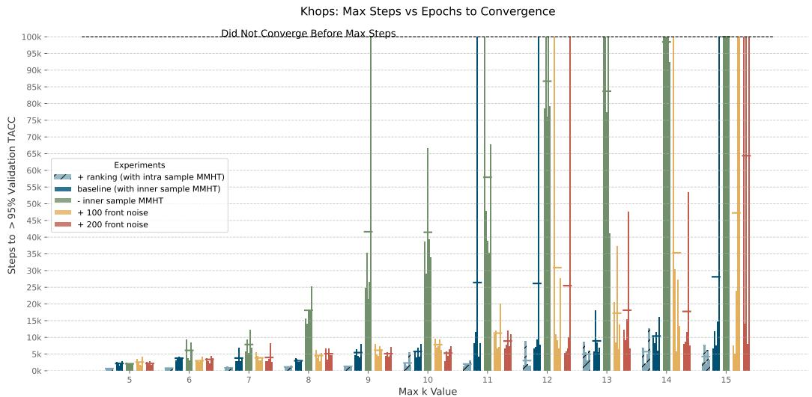  
Figure 24: Khops experiments. Prior work sampled k′, providing inner sample MMHT. We show that this is necessary for learning. Using multi-label ranking provides implicit intra sample MMHT.

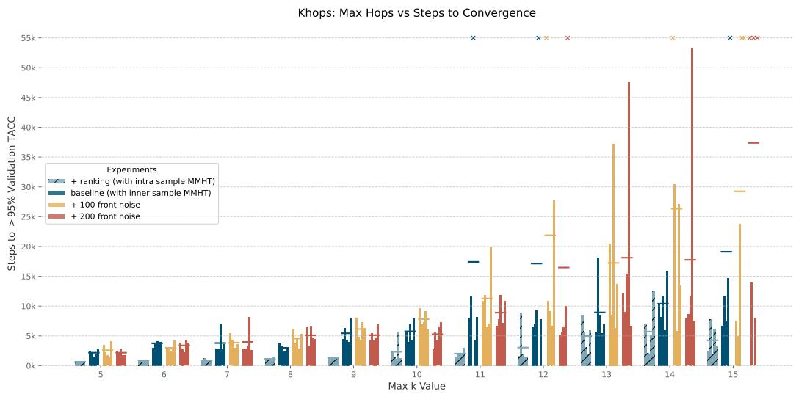  
Figure 25: A simplified version of Fig. 24 with the where we have removed the ‘- inner sample MMHT’ experiment and any experiment which did not converge (‘x’s at top). This better allows us to see the effect of the ranking loss vs. the baseline.

## L.2 KHOPS-GEN

Khops is a sequential labelling task, whereas MTP is designed for sequential generation. Thus, to better compare against MTP, we introduce Khops-Gen, a generative variant of Khops. Instead of predicting the final k-hop label at every position, Khops-Gen starts from a single symbol, $x _ { N }$ (the last one), and generates the full compositional trace. We illustrate the task in Fig. 26.

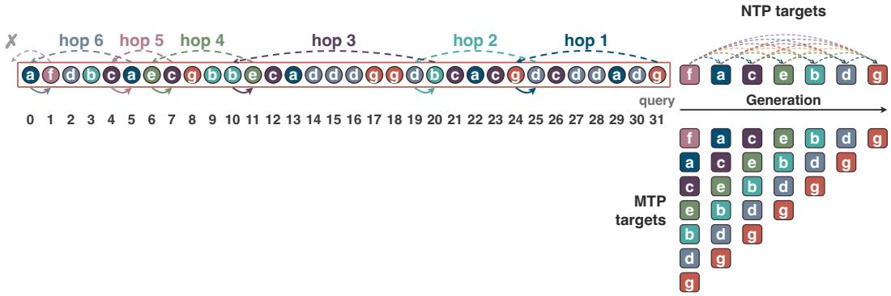  
Figure 26: Khops-Gen. Sequential generation of the full compositional chain from the single query x (position 31). The source-side is on the left in red, with the target-side being generated. Unlike Khops, only one chain is considered in a single instance of the task. Because of this, and as the source-side spans the entire N nodes, there is no implicit MMLT training as in Khops. Thus, MMLT must instead be induced explicitly by sampling $\begin{array} { r } { N ^ { \mathbf { \hat { \prime } } } \leq N \left( \oplus \mathrm { L } . 1 . 1 \right) } \end{array}$ . This also indicates that there is much less supervision in Khops-Gen as there is in Khops. However, the supervision is different. Whereas Khops has implicit MMLT but no implicit MMHT, Khops-Gen is the opposite. Unlike Khops, the chain runs until the context is exhausted and k is not supplied to the model. Note that we sample k′ uniformly, but that does not mean the context window between hops is the same size. On the target side, we show both NTP and MTP. Because this is a genuine generation task, MTP applies directly rather than through the ranking-loss stand-in required for Khops ( L.1.2). Importantly, MTP induces the same quadratic-to-k supergraph (rainbow) as it does in path search (and will for any multihop reasoning task). The MTP target block is a triangle of $k ( k + 1 ) / 2$ terms, matching Eq. 3.

The target sequence is ordered from the hardest prediction to the easiest: $f _ { k } , f _ { k - 1 } , \ldots , f _ { 1 }$ . This is important. Ifwe reverse the generation order, the task becomes trivial under teacherforcing, since each previously generated target directly reveals the next one-hop predecessor. Thus, the ordering is what preserves the need for multihop reasoning. This is similar to the reverse ‘solution’ for path-star graphs (Bachmann & Nagarajan, 2024).

There are multiple changes from Khops. Unlike Khops, k is not provided explicitly. Instead, k is determined by the available context where we construct x so that exactly k hops can be followed before the compositional chain runs out. This gives Khops-Gen an implicit MMHT structure, since generating $f _ { k } , f _ { k - 1 } , \ldots , f _ { 1 }$ decomposes the task into progressively shorter-hop targets within the same sequence. We additionally sample k′ by uniformly sampling integer partitions of an N-length sequence (Locey, 2013).

Unlike Khops, we construct sequences so that no symbol repeats within the generated chain. This (a) allows for a clean version of MTP, similar to the shortest path task, and (b) allows for a direct comparison to the BFS scratchpad task, which also has no repeats and where solving the shortest path from the scratchpad reduces to following a linear backtrack chain ( L.3). In this sense, Khops-Gen is the sequential-generation analogue of Khops and the core multihop subtask of BFS-SP once the graph has been linearized by the scratchpad ( L.4).

Unlike Khops, Khops-Gen does not receive implicit MMLT via the task design. Since we generate from a single starting symbol, the entire N-length sequence is observed before generation begins, rather than producing labels at every position. Thus, we explicitly sample different $\hat { N } ^ { \prime } \leq N$ to induce MMLT for comparison with Khops.

## L.2.1 KHOPS-GEN EXPERIMENTS AND RESULTS

We use the same model and training settings as Khops. We consider experiments at $N \in \{ 5 0 , 1 0 0 \}$ The one exception is the vocabulary size. In both Khops and Khops-Gen, positions act as the node identities, and the chain moves strictly leftward, so positions never repeat within a chain by construction (Fig. 23). The constraint we add for Khops-Gen applies to the emitted symbols rather than to the positions, and it requires at least as many symbols as there are links in the chain. We therefore use $| \nu | = 1 1$ for $k \leq 1 1$ and $| \nu | = 1 6$ for $k > 1 1$ , with special tokens in addition to these. Note that N is the number of positions and is independent of $| \nu |$ , as symbols repeat freely outside the chain. Khops-Gen is much less supervision-efficient than Khops since Khops provides a label at every valid position in the sequence, while Khops-Gen generates only a single compositional chain from $x _ { N }$ . Thus, a single Khops instance provides many supervised subproblems, whereas a single Khops-Gen instance provides only one generated sequence. We therefore use smaller N so the task can be learned efficiently.

Our results are in Fig. 27, with a simplified version in Fig. 28. As expected, the task becomes harder as N and k increase. We also find that MTP significantly improves learning at scale.

MMLT is also important for Khops-Gen. Without explicit MMLT, the task scales poorly, but with a somewhat surprising pattern: lower-k experiments fail while larger-k experiments do not. We believe this occurs because the model can learn that each target lies to the left of the previously generated target, thereby reducing the effective state space. This resembles the implicit MMLT effect in Khops, but is much weaker since Khops has supervision at every position, so it directly exploits the causal LM’s left-context inductive bias across many effective sequence lengths within each instance. Khops-Gen has the same causal inductive bias, but far less supervision per instance, so this structure must be learned from a much weaker signal.

Given this learned behaviour, larger k divides the N-length context into fewer and shorter viable regions, reducing the state space for each prediction. This may explain why the baseline models are relatively uniform across k. It may also be an artifact of using $| \mathcal { N } |$ close to $k ,$ especially at $| { \mathcal N } | \le 5 0$ and $k = 1 5 .$ , where teacher forcing reveals many prior path tokens and removes them from the candidate state space.

These results also highlight a broader point: difficulty, and therefore what counts as a ‘curriculum’, can be multifaceted (Soviany et al., 2022), with surface proxies not necessarily reflecting the relevant reasoning difficulty (Mordig et al., 2026). In our setting, hop-depth and task length are distinct axes of difficulty. MMHT varies the number of hops, $k ^ { \prime } \leq k ,$ while MMLT varies the task length, $N ^ { \prime } \leq N$ To our knowledge, prior work has not considered the effect of length mixtures for Khops. This effect is difficult to isolate in the original task, since MMLT is implicitly induced by causal supervision at every position. Khops-Gen provides a cleaner setting for studying this effect, since it removes this implicit length mixture and requires MMLT to be induced explicitly. The poor scaling without MMLT in Fig. 27 suggests that length mixtures can be as important as hop mixtures for learning sequential multihop generation tasks.

We sample $N ^ { \prime }$ uniformly, but this may not be optimal. From a state-space perspective, smaller $N ^ { \prime }$ produces much easier instances, since the model must search over fewer possible positions at each compositional step. Thus, oversampling smaller $N ^ { \prime }$ may help the model first learn the underlying leftward composition rule in a restricted state space before applying it to larger contexts. This is analogous to the power-law sampling effect of Wang et al. (2026c), where non-uniform sampling improves learning by restricting the effective sample space early in training. We do not test non-uniform length sampling here, but view it as a promising direction for future work.

For the shortest path task, we sample N, which provides MMLT in this context.

## L.3 BFS SCRATCHPAD

The shortest path task should, in principle, be solvable via scratchpads (SP) (Nye et al., 2022). Saparov et al. (2025), who considered general path search (connectivity) rather than shortest path search, used a depth-first search and a ‘selection-inference’ scratchpad. As noted they found that these did not overcome the scaling issues in solving the task. Since we are concerned with shortest path search, we use a breadth-first search scratchpad (BFS-SP).

An SP breaks the task into two computational phases. First, the model generates the scratchpad. Second, given the scratchpad, the model solves the original task. During training, the scratchpad is provided as supervision, but it must be generated by the model during inference. Importantly, the scratchpad constitutes a task-specific inductive bias: it hand-supplies the model with an intermediate structure (here, the BFS ordering) rather than requiring the model to discover that structure on its own. As we will discuss in L.4, supplying this structure can change the underlying computation required to solve the task.

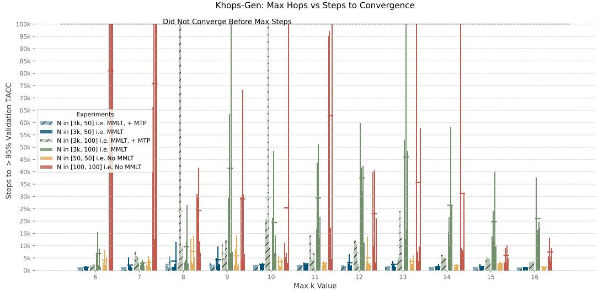  
Figure 27: Khops-Gen experiments. MTP improves learnability at scale. Explicit MMLT is also necessary for efficiently learning the task.

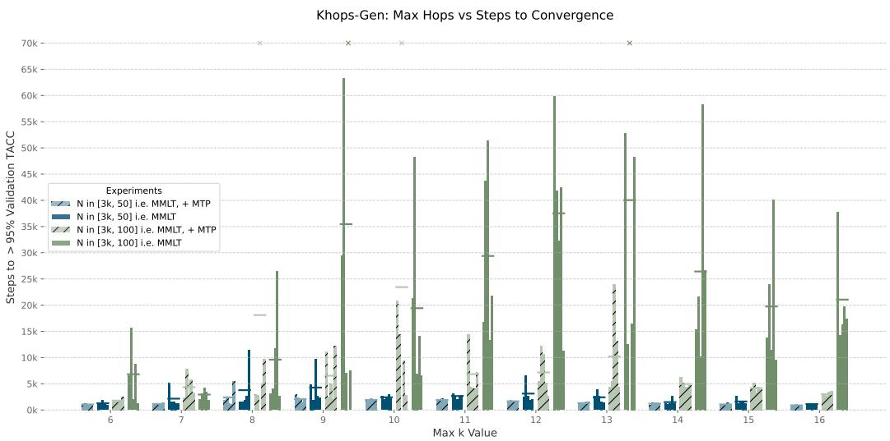  
Figure 28: A simplified version of Fig. 27

BFS-SP therefore requires two types of generation: 1) generating the BFS topologically-ordered scratchpad, then 2) using it to generate the shortest path. The latter is done by tracing the path back from t to s through the scratchpad, which is (nearly) computationally equivalent to Khops-Gen.

We initially tokenize the SP as follows:

• Include the special token D1.

• Tokenize s, followed by its adjacency list, $[ u \in { \mathcal { N } } \mid A ( s , u ) = 1 ]$

• For each subsequent depth, include a special token Dk, followed by each unexplored node from the prior depth’s adjacency lists, each followed in turn by its own adjacency list.

An example tokenization of this is for π = 7, 20, 5, 1, 14, 12, 23, 10, 2, 11, 17, 9, where $s = 7$ and $t = 9$ is

where we keep the adjacency list special tokens ‘[’ and ‘]’ even if it is empty. One can see that backtracking the SP to generate the shortest path is similar to Khops-Gen. The difference is that the connecting symbol lies to the left of the inductive hop, at the head of the adjacency list, rather than adjacent to the symbol itself.

## L.3.1 TOKENIZATION MATTERS FOR SCRATCHPADS TOO!

We found that a number of seemingly minor tokenization decisions had a large effect on learnability.

First, we initially used a distinct depth marker for each depth, i.e. D1, D2, . . . , Dk. This caused the models to fail to learn the task. Using a single shared depth marker D instead resolved this.

Second, when generating the SP, the model often failed to produce the correct adjacency lists. We found this can be addressed in two ways: repeating the adjacency list in reverse order, or including the BFS queue as part of the tokenization. Both prevented repetition mistakes, though at the cost of substantially increasing the length of the SP.

Third, the BFS itself is unordered with respect to the order of adjacency lists, and thus the order in which nodes are explored is not uniquely determined. We instead require the model to explore nodes in the order they appear in the edge list, matching the order used for the node list. This means the model must learn an in-context ordering of nodes based on their position in the edge list, and it makes the SP itself deterministic. By forcing an order, we avoid the need of considering label smoothing over the permutations (Frydenlund, 2025, N).

Thus, our final tokenization is

$$
\begin{array} { r l } & { D \left\{ 7 \right\} 7 \left[ 2 4 2 0 \right] D \left\{ 2 4 2 0 \right\} 2 4 \left[ 1 6 \right] \left\{ 2 4 \right\} 2 0 \left[ 5 \right] D \left\{ 1 6 5 \right\} 1 6 \left[ 1 \right\} \left\{ 5 \right\} 5 \left[ 1 1 5 \right] D \left\{ 1 1 5 \right\} \right] } \\ & { 1 \left[ 1 4 \right] \left\{ 1 1 \right\} 1 5 \left[ 6 \right] D \left\{ 1 4 6 \right\} 1 4 \left[ 1 2 \right] \left\{ 6 \right\} 6 \left[ 1 8 \right] D \left\{ 1 2 1 8 \right\} 1 2 \left[ 2 3 \right] \left\{ 1 8 \right\} 1 8 \left[ 3 \right] D \left\{ 2 3 3 \right\} } \\ & { \left\} 2 3 \left[ 1 0 \right] \left\{ 3 \right\} 3 \left[ 1 D \left\{ 1 0 \right\} 1 0 \right] 1 0 \left[ 2 \right] D \left\{ 2 \right\} 2 \left[ 1 1 \right] D \left\{ 1 1 \right\} 1 1 \left[ 1 7 8 \right] D \left\{ 1 7 9 \right\} 1 7 \left[ 9 2 2 \right] \left\{ 1 8 \right\} } \end{array}
$$

where special tokens ‘{’ and ‘}’ are the BFS queue special tokens.

## L.3.2 BFS-SP EXPERIMENTS AND RESULTS

For the partial task, we gave the model only the SP, omitting the graph description [E, N] and the BFS queue, to reduce token count and let us scale to larger graphs. This lets us consider $\bar { | \mathcal { N } | } \bar { \in } \left\{ 5 0 , 1 0 0 \right\}$ The results are presented in Fig. 29. MTP makes the task much easier at scale. Unlike Khops-Gen, we do not see smaller k being harder to learn, nor is omitting MMLT catastrophic to learnability. Thus, although the two tasks share the same underlying expression, i.e. backtracking over a linear chain, their learnability differs in practice.

For the full task, we only consider $| { \mathcal { N } } | = 4 0 !$ ; we attempted 75 and 50, but training took too long to be practical. Given that directly learning the shortest path task is already scalable (§ 6), we see little motivation to push further on scaling the SP experiments, since we already know they are impractical due to the increase in token length. The results are presented in Fig. 30, where the full task, generating the SP and then the shortest path, is learnable. This takes nearly twice as many steps as the partial task, indicating that learning to generate the SP is harder than solving the shortest path given the SP. Here, MTP does not outperform NTP, since SP generation does not itself require multihop reasoning.

Taken together, these results show that MTP still provides a clear benefit on the partial multihop task even though BFS-SP reduces the latent search problem to a simple chain traversal ( L.4). This is notable, since MTP’s benefits are not restricted to cases involving non-trivial latent topology.

## L.4 SCRATCHPADS SUBSTANTIALLY CHANGE THE SHORTEST PATH TASK AND BREAK THE THEORETICAL MULTIHOP REASONING MODEL

BFS-SP reduces search to a linear traversal. Recall that our theoretical model of multihop reasoning (§ 1) is deliberately agnostic to topology: it makes no assumption about the structure of the latent reasoning graph. The BFS-SP breaks this assumption in two ways. First, it modifies the underlying topology to a search tree, starting at s. Second, the latent reasoning graph reduces further to a linear chain, backtracking along this tree. This backtracking is the structure of Khops-Gen ( L.2). Thus, the general multihop search problem of § 1, which requires resolving a choice node at each step among potentially many candidates in E, is replaced by a traversal problem on a fixed topology where the resulting backtrack is still multihop, but it no longer involves any search. One may view this as the scratchpad not solving the original problem but rather substituting it with a different, strictly simpler problem in its place, one that is no longer a planning problem at all. Thus using a BFS-SP breaks the underlying theoretical model. This is illustrated in Fig. 31.

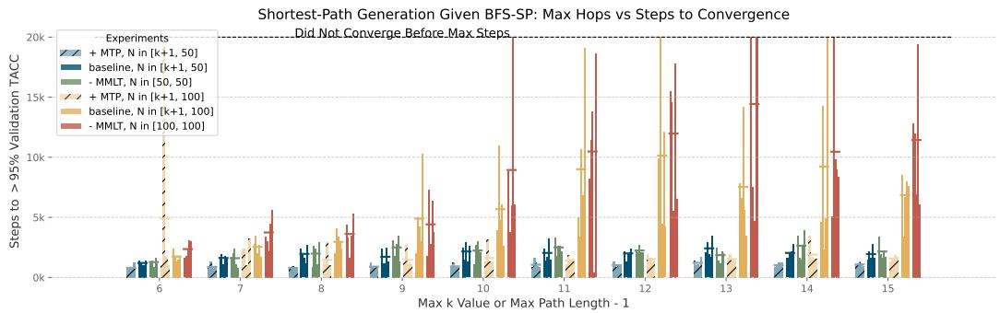  
Figure 29: BFS-SP SP-only results. Given the SP, generate the shortest path, i.e. the partial task. This task is (nearly) computationally equivalent to Khops-Gen.

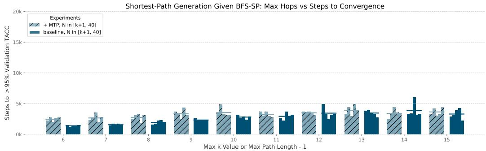  
Figure 30: BFS-SP results. This is both the generation of the SP and the generation of the shortest path, i.e. the full SP task.

BFS-SP is still latent multihop reasoning/traversal.3334 Even though the backtrack removes any branching choice, the total computation performed across generating the SP and then the backtrack is still equivalent to k hops of graph reasoning. To output the correct node following s, the model must work back from t. However, if we now reverse the output in generation, the task requires no multihop reasoning as each step can be produced with a single hop. Thus, such a reverse ‘solution’ works because it replaces latent computation with sequential computation. Note that because backtracking is still a multihop task, this still allows the BFS-SP to act as a testbed for evaluating MTP.

Neither collapse in the original topology requires a shortest path scratchpad. We could also do this by simply ordering the edge list E by BFS distance from s rather than shuffling it (Ge et al., 2025). A BFS-ordered edge list directly encodes, in its position, the same predecessor structure that the SP makes explicit. This is why we must shuffle E before tokenization (§ 1.1). These understandings of the task show that a correct output is not sufficient evidence of multihop reasoning; the task must also be solved for the right reason.

Not all tokenization changes break the model: STAN and +N do not. It would be natural to read § 3 and § 4 as proposing the same kind of intervention as the BFS-SP scratchpad, since all three change the tokenization. They do not. The theoretical model of § 1 forbids us from making any assumption about the topology of the latent reasoning graph. We are therefore free in our choice of surface form insofar as that choice leaves the graph intact. STAN only modifies the representation of a single edge, and edges are still provided independently of one another. The node list is likewise trivially inferred from the edge list. Neither is constructed as a function of the query; any queryconditioned structure must still be learnt by the model, whereas a BFS-SP is built from s and t and so supplies it directly in the input. Note there are other tokenizations that break the theoretical model, such as those that use graph-global information, such as the graph Laplacian. (Bechler-Speicher et al., 2026).

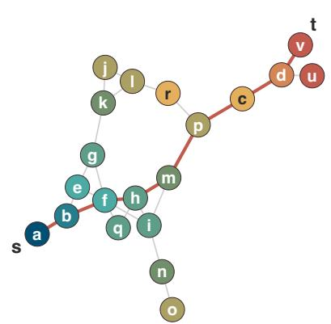  
(a) A sample graph with a sampled path from s to t (red). The graph has 20 nodes and 26 edges, and is used in (b) and (c). Node colour is BFS depth from s.

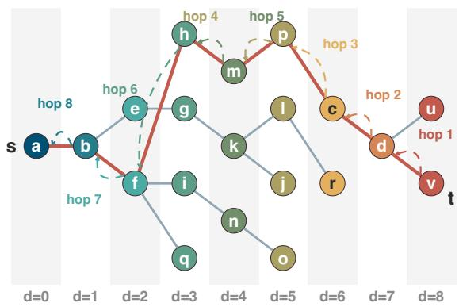  
(b) The same graph after the BFS ordering inductive bias is applied. Note the dropped edges. Ordering the graph only requires looking at neighbours of already-discovered nodes, and thus requires no multihop reasoning itself. Tracing back from t to s does require multihop reasoning over a linear reasoning graph. Thus, we break the theoretical model in two ways: we force a level topology on the graph turning it into a search tree, and then our actual latent reasoning graph reduces to a linear chain.

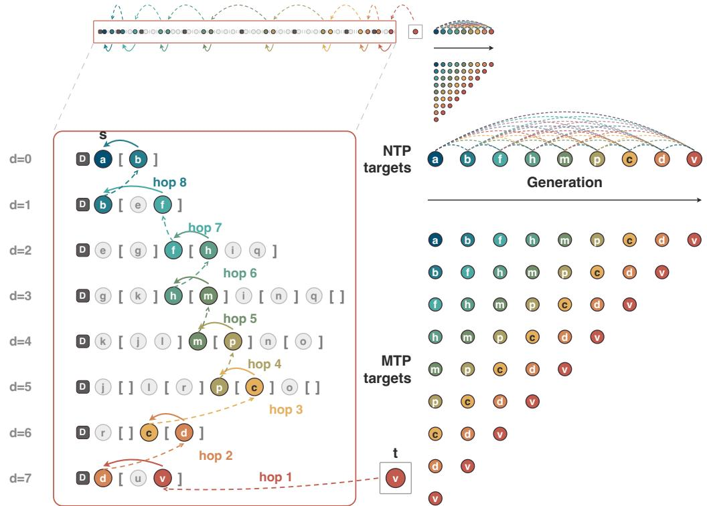  
(c) The same sample as (a)–(b), now as the BFS-SP token sequence. Top: the task mirrors Khops-Gen in Fig. 26. The only major difference is instead of adjacency-right connection, the connecting token is to the left of the start of the adjacency list, ‘[’. Bottom: the same sequence magnified. Here we see the backtrace reduces the latent reasoning graph to a linear chain. We also show how MTP, once again, induces a quadratic supergraph (rainbow).  
Figure 31: The BFS ordering inductive bias changes the topology of the task and reduces the latent reasoning graph to a linear chain.

## M THE k-LOOKAHEAD ISSUE

Saparov et al. (2025) note that, for pathfinding tasks, the characteristic difficulty measure should be the k-lookahead – the number of steps the model must search ahead from the start node to find the goal – not the path length $| \pi | = k + 1$ . These are not equivalent: the model can shortcut prediction of π once all competing arms are exhausted. For example, in a path-star graph with π of length 8 and all other arms of length 5, once 4 hops are taken, the model can determine π is the only remaining viable path by elimination, without any further search.

A related issue arises when s is not a choice node: the true number of required hops is then smaller than $k . \mathrm { ~ I f ~ } u _ { i - 1 }$ is the first choice node in π, only $k ^ { \prime } = k - i + 1 < k$ hops are actually required to solve the task (§2).

Both issues are easy to control for in Saparov et al. (2025)’s setup, since they consider only a restricted variant of path-star graphs: s is a choice node by construction, and at least one non-π arm can be constructed to be at least as long as π. This is much harder for general graph topologies, where we cannot freely construct G and then force the sampled path to have these properties. Consequently, a sampled path of length k + 1 may not actually require k hops to solve. This is a further illustration of why formally defining learnability for this task is difficult in the general setting.

## N MULTIPLE SHORTEST PATHS AND SEMANTIC LABEL SMOOTHING

As mentioned above, multiple valid shortest paths can exist for a query $Q \ = \ ( s , t )$ beyond the sampled ground-truth path π. During inference, this is not a problem: we validate a generated path against $\bar { \mathcal { G } }$ directly rather than against $\pi . ^ { 3 5 }$ During training, however, it is a problem. Under NTP, each token of π is treated as the sole ground truth at that step, and CE tries to match this one-hot distribution. When multiple shortest paths exist, multiple targets are simultaneously valid at a given step, so the correct ground-truth distribution should be uniform over them. In expectation, this would not matter, since the model would still converge to the correct uniform distribution. In practice, though, we sample only a small number of graphs and paths. As such, any alternative valid paths are rarely observed. CE then pushes the model to place all mass on the single sampled path even when others are equally valid, producing a loss spike whenever a well-trained model instead (correctly) spreads mass across them. This matters because, for much of training, we are in a low-loss regime where only a handful of tokens carry any signal, and these spikes are large enough to disrupt training dynamics.

Fortunately, the fix is simple.36 We treat NTP as a multi-label task (in the semantic dimension; see D.6): at each split point where multiple valid paths diverge, every node beginning a valid continuation is treated as a valid target, and we train with multi-label CE. See Fig. 32 for an example.

Then, because we use teacher-forcing, which conditions the sequence on the ground-truth path (Williams & Zipser, 1989), this will resolve multiple valid paths at each step without requiring a structured sequential distribution. This means we do not need to model the joint distribution directly and can still factorize the joint distribution across time steps as in standard language modelling.

We do not apply this correction to the MTP loss. Extending our rank-based MTP to multiple valid paths would require modelling ties correctly (Frydenlund et al., 2022). While possible, it requires engineering overhead and, more importantly, we found this unnecessary in practice, given MTP’s improved training dynamics compared to NTP. The choice node analysis of §2 explains why the correction matters more for NTP. A step with more than one valid continuation has more than one continuation, and is therefore a choice node. The converse does not hold, as most choice nodes have a unique valid target, but it follows that conflicted targets can only land on the $c ( \pi )$ positions that carry signal under NTP, and never on positions absorbed by the CHC. MTP has $k ( \stackrel { \cdot } { k } + 1 ) / 2 - 1$ terms, and these are not restricted to choice nodes, since a skip of $j - i > 0$ requires multihop reasoning at non-choice nodes as well. The same conflicted target is therefore a smaller fraction of the MTP loss and the spike is diluted. Note that this correction improves NTP and is therefore applied in favour of the baseline, so it cannot account for the gains we attribute to MTP. Evaluation is unaffected, as generated paths are validated against G for both losses.

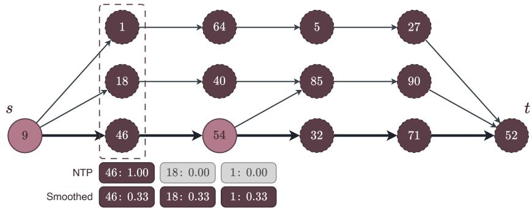

(a) $\pi _ { \leq } = 9 .$ . Each of 46, 18 and 1 starts an equally valid shortest path, so u1 has three correct targets. The sampled ground-truth path is the bottom one with bold edges.  
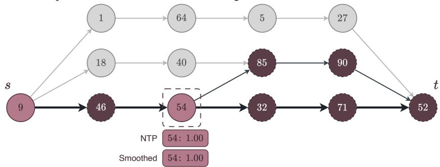

(b) $\pi _ { \leq } = 9$ , 46. Conditioning on the ground-truth path resolves and removes the other two branches, and 46 has a single continuation, so u2 has one correct target.  
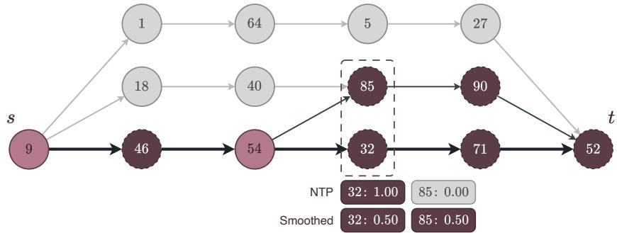  
(c) $\pi _ { \leq } = 9 , 4 6 ,$ 54. A second split occurs at the choice node 54, so u3 again has two correct targets, 32 and 85.

Figure 32: Multiple valid shortest paths from $s = 9 \tan t = 5 2$ require label smoothing. Light marron solid-border nodes are choice nodes, dark dashed-border nodes are not, and grey nodes have been removed from consideration by conditioning on $\pi _ { < }$ . The sampled ground-truth path π is drawn with heavy edges. Below each choice node we give the NTP one-hot target and the correct uniform target over all valid next nodes, using the same encoding. The NTP row greys out the unchosen nodes, asserting they are off-path even though each begins an equally valid shortest path. Smoothing is needed only at the choice nodes, so the two rows coincide in (b).

As an aside, semantic label smoothing is related to MTP when considering MTP as a structured prediction task (Frydenlund et al., 2022; Iyer et al., 2026; Zhang et al., 2026a). The key difference here is that, in the former, the multiple target tokens are across the semantic dimension, while, in the latter, they are across the temporal or sequential dimensions. However, in terms of implementation, the only change can be how the multiple targets are derived. For example, the former created a self-supervised N-gram rule to derive multiple targets of semantically related words per time step. Whereas in this work, we simply use the generalization of the self-supervision rule used in NTP to derive the multiple targets for MTP. However, both that work and this one use the same Plackett-Luce ranking loss to learn the underlying structured multi-label prediction problem. Zhang et al. (2026b) frames semantic prediction as a latent next-token prediction, where they hypothesize that future hidden-states can act as continuous supervision for the current state. This can also be seen as a temporal form of self-distillation, in which the new loss encodes planning for future predictions, thereby relating it to MTP.

## O NOTES ON SOURCE-SIDE – FULL-SEQUENCE – TRAINING WITH NTP

Recently, both Noroozizadeh et al. (2026) and Trainin et al. (2026) have shown positive results when allowing the model to predict the entire input, including the source-side prefix, instead of restricting NTP to the target side. This means the model must predict that u follows v to form edge $( u , v )$ , for all edges in the randomly shuffled edge list.

Noroozizadeh et al. (2026) considered the in-weights setting, where all training examples come from the same graph. Here, having the loss cover the entire input makes sense, since the model can and must learn the (single) graph’s structure to complete the task. However, Trainin et al. (2026), like us, instead considered the in-context setting with path-star graphs, where every sample is a unique, unseen graph. This means the model cannot memorize information about any specific graph, as doing so would induce spurious correlations. They hypothesize that full-sequence training helps because the model learns the underlying generative process for creating graphs: “the model is additionally rewarded for learning to generate legal graph descriptions,” and that “forcing the model to explicitly model the graph structure rather than merely attending to it is crucial for acquiring the necessary look-ahead mechanisms.”

We believe their hypothesis is correct, but argue the critical aspect is specifically that the graph must be ‘legal.’ If the generative process were entirely random, as in Erdos–Rényi graphs, edge generation˝ would be uninformative, and there should be no benefit from source-side training. However, the specific topology of path-star graphs imposes constraints on the generative process, and learning to respect them, we hypothesize, forces the model to engage in auxiliary forms of MMHT.

Concretely, consider the original path-star task, where the number of arms d and arm length k (excluding the start node s) are fixed across graphs, so $| { \mathcal { N } } | = d k + 1$ . This yields three legality constraints: s must have degree d; every node has degree 2 if arm-interior or degree 1 if arm-final; and each arm must contain exactly k unique nodes.

These degree and count constraints restrict which nodes can be selected from the vocabulary at each generation step, and satisfying them can require multihop reasoning. For instance, with $| \dot { \mathcal { N } } | = 5 1$ and $| \nu | = 1 0 0$ , learning to respect the total node budget only requires counting prior nodes in the edge list, not traversing the graph. But learning to count how many nodes have been used within a given arm does require multihop traversal. A further example which requires multihop reasoning is suppose an arm is missing exactly one edge $( u , v )$ , with $( \cdot , u )$ and $( v , \cdot )$ already observed elsewhere in the list: the model can use counting to detect that an edge is missing, and multihop traversal to identify that it must be (u, v) specifically. The number of hops required depends on where this edge falls in the arm.

Such constraints therefore create cases which provide a learning signal that may induce MMHT. If true, this offers further evidence that any source of MMHT signal can make the path-star task learnable, at least at limited scale (Frydenlund, 2025). We expect this particular signal to be minimal and not to scale (Trainin et al., 2026), but we see it as an interesting direction for future work.