# Mixing Matters: Evidence Position Bias Across Sequence Mixers in Long-Context Question Answering

Aman Behera IIT Roorkee

Namit Solanki AISSMS IOIT, Pune

Mehul Anand Independent Researcher

## Abstract

Long-context models often use answer-bearing evidence less effectively when it appears away from a prompt boundary. We compare this position bias across Transformer, state-space, and hybrid Mamba architectures by moving one gold document through a fixed set of nine distractors. The evaluated Transformers show a beginning advantage that the evaluated state-space models lack, while both families favor evidence near the end. A matched pure-versus-hybrid Mamba comparison points in the same direction but remains statistically uncertain. The family difference appears among models that can answer the task. Transformer primacy reappears on synthetic retrieval, where state-space ceiling prevents a family comparison. A corpus swap within one state-space architecture changes overall accuracy without a detectable change in curve shape. Prompt changes can create or nearly remove a beginning advantage. Position remains decodable across architectures even when response curves differ, and attention concentration near initial tokens covaries with beginning sensitivity in the tested Transformer family. These exploratory results show that effective context use depends on the evaluated architecture family, capability, task, and prompt, without isolating the sequence mixer as the sole cause.

## 1 Introduction

Retrieval can place the right document in a prompt without ensuring that a model will use it. In multi-document question answering, accuracy often drops when relevant evidence moves from the context edges toward the middle (Liu et al., 2024). This gap between available and effectively used context matters for retrieval-augmented systems and motivates robust long-context evaluation (Bai et al., 2024; Hsieh et al., 2024).

Most evidence-position studies focus on Transformers. Dense attention can mix information directly across token positions, whereas state-space models carry the prefix through recurrent state (Gu and Dao, 2023; Dao and Gu, 2024). We ask whether these sequence-mixer families exhibit the same position curve. Across our evaluated systems, they do not. Transformers favor evidence near the beginning, the tested state-space models lack the same beginning advantage, and both families favor evidence near the end. The difference emerges only once models can reliably answer the task.

The curve is not an architecture-only signature. A matched hybrid comparison is directionally consistent but uncertain, a corpus swap changes overall accuracy without detectably changing curve shape, and prompt changes can create or nearly erase the beginning advantage. Internal measurements further suggest that position information can remain available even when it is not used equally across positions. Our contribution is therefore an evaluation result: long-context position bias varies across the tested sequence-mixer families and evaluation settings, while current evidence does not establish a causal mechanism.

## 2 Paired position evaluation

Task We use the released Lost-in-the-Middle ten-document question-answering setting, derived from Natural Questions (Liu et al., 2024; Kwiatkowski et al., 2019). Each question has one gold document and nine distractors. For every question, we render ten prompts that hold the question, distractors, and token budget fixed while moving only the gold document. A no-gold prompt measures the floor and a gold-only prompt measures answerability. All reported ten-document results draw from an 800-question exploratory allocation or a subset; the held-out confirmatory split remains unopened.

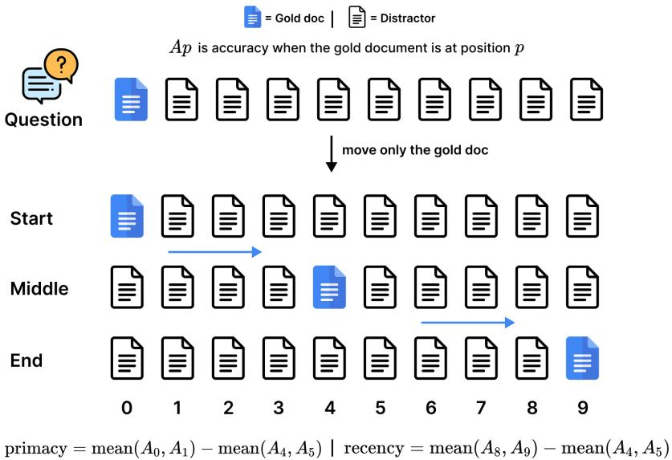  
Figure 1: Paired position intervention. $A _ { p }$ is accuracy when the gold document is at position p. Complete ten-position question bundles are resampled together.

Metrics and inference Primacy is start-minus-middle accuracy and recency is end-minus-middle accuracy, as defined in Figure 1. The question is the unit of analysis. We draw 10,000 paired bootstrap samples of complete ten-position bundles, report percentile 95% confidence intervals, and apply Holm correction within each comparison family (Efron, 1979; Holm, 1979). Intervals quantify variation across questions for fixed prompts and checkpoints, not training-seed variation. Generation is greedy, and the harness preserves prompts, outputs, failures, token counts, model revisions, and software settings.

Controls On a 200-question exploratory Transformer subset, a released key-value task produces the expected edge effect, sham-gold primacy is near zero, and permuting distractor order changes mean accuracy by at most 0.023. These controls check the paired harness in that setting only; they do not cover the matched 8B checkpoints.

## 3 Findings

Sequence-mixer families differ at usable capability In a shared-corpus comparison at similar scale, the Transformer has a positive primacy edge, while two state-space variants do not; all three have positive recency edges (Figure 2a). Paired interactions confirm that the Transformer-versusstate-space primacy differences are unlikely to arise from question sampling alone. Across five approximate size pairs, the family gap is absent at the two smallest scales, where answerability is poor, and appears in the three larger pairs. This is a descriptive family-and-capability trend, not a causal scale threshold.

The tighter comparison is suggestive, not decisive Pure and hybrid state-space checkpoints share training data, tokenizer, scale, depth, and positional setup; the hybrid adds a minority of attention layers (Waleffe et al., 2024). The hybrid shows a larger within-model primacy edge, but the paired hybrid-minus-pure confidence interval includes zero (Figure 2b). This direction agrees with the family comparison but does not isolate a causal attention effect.

Table 1: Primary edge effects. The final row is the paired hybrid-minus-pure interaction; other rows are within-model edges. For that paired row, Holm $p = 0 . 1 4 4$ for primacy and $p = 0 . 0 8 9$ for recency, so neither effect survives correction.
<table><tr><td>System or contrast</td><td>Primacy</td><td>95% CI</td><td>Recency</td><td>95% CI</td><td>Floor</td><td>Ceiling</td></tr><tr><td>Transformer</td><td>+0.052</td><td>[0.032,0.072]</td><td>+0.075</td><td>[0.054, 0.097]</td><td>0.091</td><td>0.640</td></tr><tr><td>State-space v1</td><td>-0.001</td><td> $[ - 0 . 0 1 \dot { 6 } , 0 . 0 1 \dot { 4 } ]$ </td><td>+0.077</td><td>[0.058, 0.097]</td><td>0.115</td><td>0.615</td></tr><tr><td>State-space v2</td><td>-0.018</td><td> $[ - 0 . 0 3 4 , - 0 . 0 0 3 ]$ </td><td>+0.105</td><td>[0.086, 0.124]</td><td>0.128</td><td>0.619</td></tr><tr><td>Hybrid minus pure</td><td>+0.019</td><td> $\left[ - 0 . 0 0 6 , 0 . 0 4 4 \right]$ </td><td>-0.028</td><td> $[ - \mathrm { \dot { 0 } } . 0 5 5 , - 0 . 0 \dot { 0 } 1 ]$ </td><td></td><td></td></tr></table>

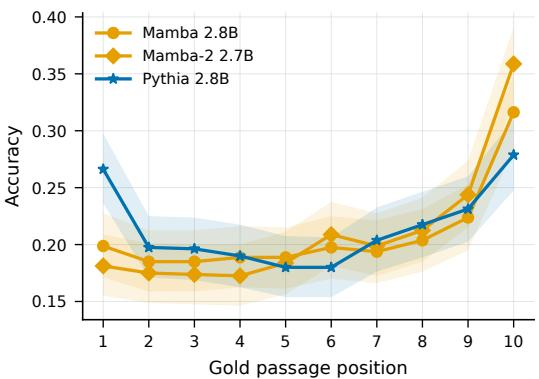  
(a) Shared-corpus family comparison

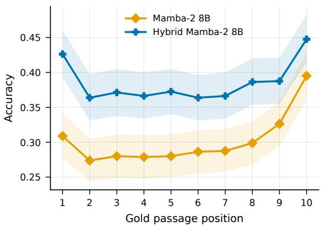  
(b) Matched pure and hybrid comparison

Figure 2: Accuracy as the gold document moves through ten positions on 800 exploratory questions. Shaded bands are 95% question-bootstrap confidence intervals.  
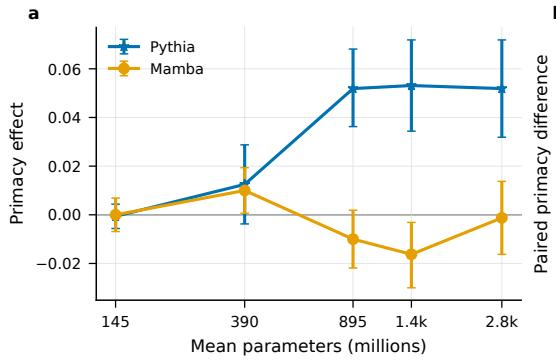

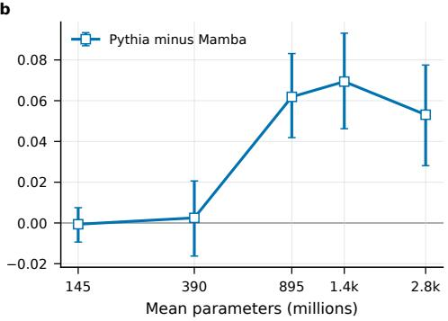  
Figure 3: Primacy across five approximate size pairs. The family gap appears only among systems that can answer the task, making this a capability-and-family trend rather than a causal scale result.

## 4 Discussion and limitations

Mechanism measurements motivate hypotheses Position is linearly decodable from intermediate states in both families relative to shuffled-label controls, even when their response curves differ. Within the tested Transformer family, attention concentration near initial tokens covaries with primacy across scale (Xiao et al., 2024). The probe does not show that answer content is stored or used, scale confounds the attention association, and no valid sink-blocking intervention was completed. The measurements therefore motivate an evidence-utilization hypothesis but do not establish its mechanism.

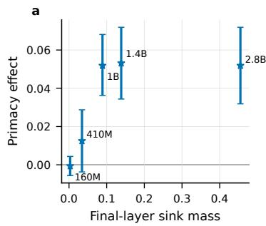

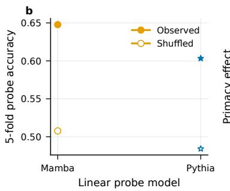

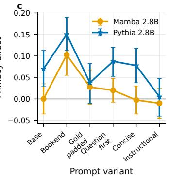  
Figure 4: Exploratory evidence on attention concentration, position decodability, and prompt sensitivity. The sink and probe measurements are correlational, and the prompt variants change multiple prompt properties rather than isolating one causal mechanism.

Implications The central finding is that available context length and effective evidence use are different properties. Models with the same ten documents can exhibit distinct position curves, and prompt layout can alter those curves as much as family choice. Long-context evaluations should therefore report full position curves, hold distractors fixed, use paired question-level inference, and test prompt sensitivity rather than relying on a single aggregate accuracy.

Reproducibility The released materials record the dataset split, prompt builder, scorer, greedy inference settings, phase samples, checkpoint revisions, and raw generations for the standard questionanswering sweeps. The primary sweep contains 9,600 generations per system with no reported generation failure or scored null. The synthetic check lacks raw generations and an environment manifest, and the matched comparison cannot be reconstructed from a recorded clean producing code state.

Limitations The study is limited to a small set of models, architectures, tasks, and prompts, and all ten-document results are exploratory. Family comparisons retain differences in depth, positional encoding, state size, and checkpoint construction; the tighter hybrid contrast is uncertain. The internal evidence is correlational, and the held-out split is unexamined.

Broader impact Position-sensitive evidence use can make retrieval-augmented systems unreliable and privilege facts because of placement rather than relevance. Long-context accuracy should not be interpreted as uniform evidence access.

Conclusion and future directions Position bias varies across the evaluated sequence-mixer families and settings rather than following one universal long-context curve. The shared end advantage and family-dependent beginning behavior also show why a single aggregate long-context score is incomplete. Future work should train matched Transformer, state-space, and hybrid systems under one data and positional setup, then test targeted interventions on how evidence is retained and used. Preregistered evaluation on the held-out questions is needed to confirm the present exploratory results. Extending paired position curves to longer contexts, retrieval-augmented generation, and multi-step tasks would test whether these patterns predict downstream reliability.

## References

Y. Bai, X. Lv, J. Zhang, et al. LongBench: A bilingual, multitask benchmark for long context understanding. In Proceedings ofACL, 2024.

T. Dao and A. Gu. Transformers are SSMs: Generalized models and efficient algorithms through structured state space duality. In Proceedings ofICML, 2024.

B. Efron. Bootstrap methods: Another look at the jackknife. The Annals of Statistics, 7(1):1–26, 1979.

A. Gu and T. Dao. Mamba: Linear-time sequence modeling with selective state spaces. arXiv:2312.00752, 2023.

J. Hewitt and P. Liang. Designing and interpreting probes with control tasks. In Proceedings of EMNLP-IJCNLP, 2019.

S. Holm. A simple sequentially rejective multiple test procedure. Scandinavian Journal of Statistics, 6(2):65– 70, 1979.

C.-P. Hsieh, S. Sun, S. Kriman, et al. RULER: What’s the real context size of your long-context language models? In COLM, 2024.

T. Kwiatkowski, J. Palomaki, O. Redfield, et al. Natural Questions: A benchmark for question answering research. TACL, 7:453–466, 2019.

N. F. Liu, K. Lin, J. Hewitt, et al. Lost in the middle: How language models use long contexts. TACL, 12:157– 173, 2024.

R. Waleffe, W. Byeon, D. Riach, et al. An empirical study of Mamba-based language models. arXiv:2406.07887, 2024.

G. Xiao, Y. Tian, B. Chen, S. Han, and M. Lewis. Efficient streaming language models with attention sinks. In Proceedings ofICLR, 2024.

## A Detailed experimental evidence

The appendix preserves the analyses omitted from the four-page paper. The main claims and their limitations do not depend on appendix-only evidence.

## A.1 Phase and artifact ledger

Table 2: Executed evidence by phase. Counts are questions unless otherwise stated.
<table><tr><td>Phase</td><td>Executed comparison</td><td>Committed source</td><td>Interpretation</td></tr><tr><td>1</td><td>200 QA; 50 key-value</td><td>artifacts/phase1</td><td>Calibration and control</td></tr><tr><td>2</td><td>3 systems, n = 800 each</td><td>artifacts/phase2</td><td>Primary family interaction</td></tr><tr><td>3</td><td>pure and hybrid 8B, n = 800</td><td>artifacts/phase3</td><td>Matched, uncertain contrast</td></tr><tr><td>4</td><td>5 size pairs, n = 800 each</td><td>artifacts/phase4</td><td>Capability and scale trend</td></tr><tr><td>5</td><td>2 corpora, n = 800 each</td><td>artifacts/phase5</td><td>Corpus scope check</td></tr><tr><td>6</td><td>3 systems, 50 at two lengths</td><td>artifacts/phase6</td><td>Synthetic task check</td></tr><tr><td>7</td><td>100–200 per study; 1,200 states</td><td>artifacts/phase7-mechanisms</td><td>Hypothesis generation</td></tr><tr><td>8</td><td>3 systems, n = 800 each</td><td>artifacts/phase8</td><td>Descriptive prevalence</td></tr></table>

The dataset snapshot has 2,655 questions: 800 assigned to exploration and 1,855 assigned to confirmation. The confirmatory questions have not been evaluated.

## A.2 Calibration and positive control

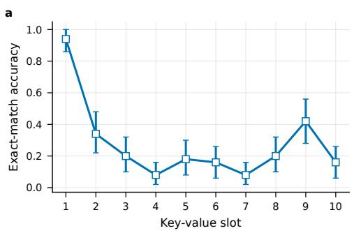

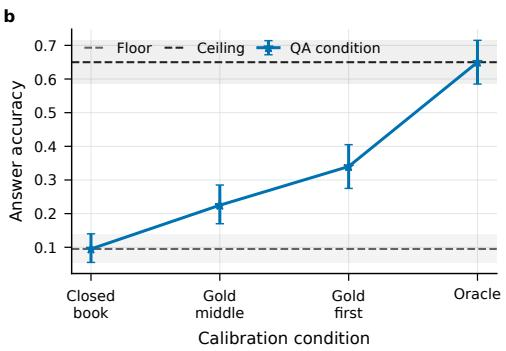  
Figure 5: Calibration of the primary Transformer setting. The key-value task confirms that the pipeline recovers an imposed position signal, and the QA anchors separate guessing, the multidocument conditions, and answerability.

The no-gold floor is 0.095, the gold-only ceiling is 0.650, and moving the gold document from the middle to the first position changes accuracy by +0.115 with 95% CI [0.055, 0.175]. The key-value control produces a +0.38 edge-versus-middle effect.

## A.3 Primary family comparison

The shared-corpus comparison uses one Transformer and two state-space checkpoints at similar parameter counts. The Transformer primacy edge is +0.052 with 95% CI [0.032, 0.072]. The two statespace primacy edges are −0.001 with CI [−0.016, 0.014] and −0.018 with CI [−0.034, −0.003]. Their recency edges are +0.075, +0.077, and +0.105, respectively. The paired state-space-minus-Transformer primacy interactions are −0.053 and −0.070, both Holm-corrected $p < 1 0 ^ { - 4 }$ . The models share training corpus and approximate scale, but not depth, positional encoding, state size, or checkpoint family.

## A.4 Matched hybrid comparison

The pure model’s primacy edge is +0.008 with $\operatorname { C I } \left[ - 0 . 0 0 9 , 0 . 0 2 4 \right]$ , and the hybrid’s is +0.027 with CI [0.008, 0.047]. The paired hybrid-minus-pure primacy effect is +0.019 with $\operatorname { C I } \left[ - 0 . 0 0 6 , 0 . 0 4 4 \right]$ and Holm $p = 0 . 1 4 4$ . The paired recency effect is −0.028 with $\operatorname { C I } \left[ - 0 . 0 5 5 , - 0 . 0 0 1 \right]$ and Holm $p =$

0.089. The paired interaction is the relevant architecture test; different within-model significance levels do not establish a between-model difference.

## A.5 Capability and scale

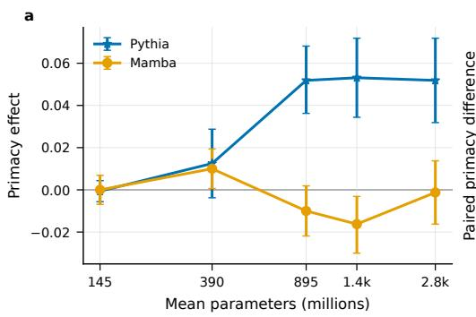

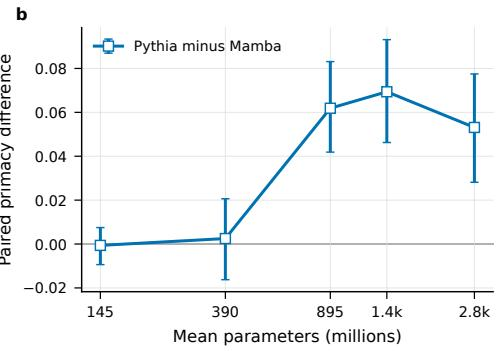  
Figure 6: Primacy across five approximate Transformer-state-space size pairs. The family gap is visible only among models that can answer the task, so the trend combines capability and family.

Across the five pairs, the Transformer-minus-state-space primacy gap is near zero at the two smallest scales and is +0.062, +0.069, and +0.053 in the three larger pairs. The smallest Transformer ceiling is only 0.009, which prevents interpretation as a depth threshold or causal scale transition.

## A.6 Corpus and task checks

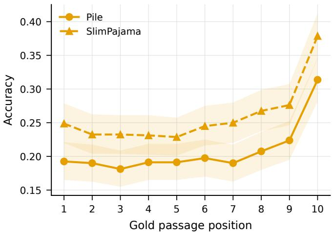  
Figure 7: Fixed architecture with two training corpora. The corpus swap changes overall accuracy without a detectable edge-shape change.

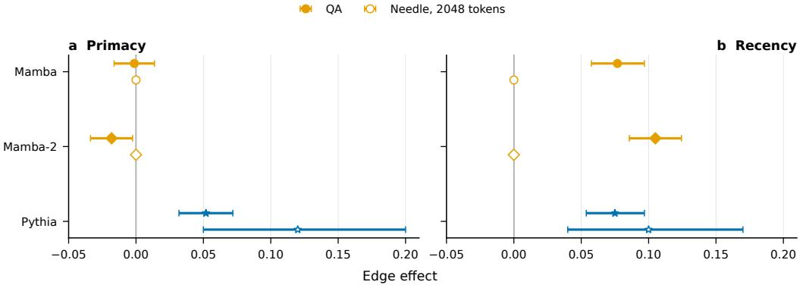  
Figure 8: Primacy and recency on multi-document QA and synthetic retrieval. The synthetic task reproduces Transformer primacy but leaves the state-space systems at ceiling.

Holding the state-space architecture fixed, the Pile-minus-SlimPajama primacy effect is −0.007 with $\bar { \mathrm { C I } } \left[ - 0 . 0 3 0 , 0 . \bar { 0 } 1 6 \right]$ and the recency effect $\mathrm { i s - 0 . 0 1 6 }$ with $\operatorname { C I } \left[ - 0 . 0 \dot { 4 } 4 , 0 . 0 1 \dot { 2 } \right]$ . On 50 RULER single-needle examples at 2K tokens, Transformer primacy is +0.12 with CI [0.05, 0.20], while both state-space models score 1.0 at every tested depth. Raw generations and an environment manifest for this synthetic check are not available in the repository snapshot.

## A.7 Prompt and internal measurements

On 200 exploratory questions, repeating the question before and after the documents changes statespace primacy from 0.000 to +0.103. Placing the question only before the documents yields primacy of $+ 0 . 0 2 0$ and reduces recency from $\bar { + 0 . 0 7 0 \ { \mathrm { t o } } \ + 0 . 0 1 0 } .$ . An alternative template reduces Transformer primacy from $+ 0 . 0 7 0 \mathrm { t o } + 0 . 0 0 5$ . A balanced linear probe predicts edge versus middle position above a shuffled-label control in both families, but this does not establish answer-content storage or causal use.

## A.8 Additional systems

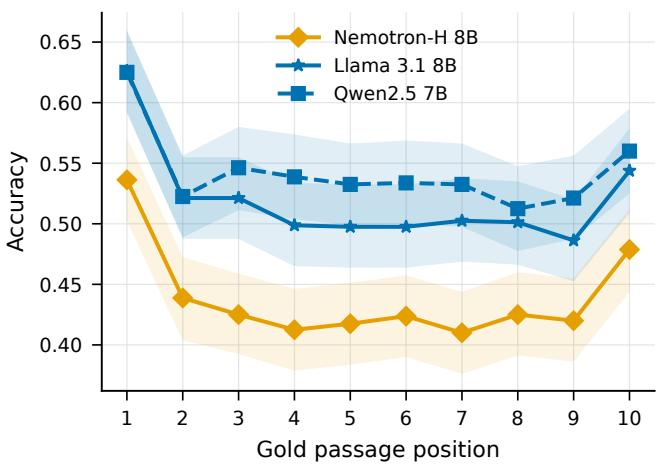  
Figure 9: Descriptive position curves for three additional Transformer and hybrid systems. All show positive primacy, but cross-system differences do not isolate architecture.

The additional systems have primacy edges of $+ 0 . 0 7 6 , + 0 . 0 4 1$ , and +0.067. They differ in architecture, training data, tokenizer, token count, depth, and positional encoding, so the comparison establishes prevalence rather than mechanism.

## B Controls and reproducibility

The released key-value positive control detects a +0.38 edge-versus-middle effect. On the 200- question exploratory Transformer sample, sham-gold primacy is +0.005 with CI [−0.0325, 0.0425], and distractor-order permutation accuracy has a maximum spread of 0.0233. These controls certify the paired position harness only in that setting and do not cover the matched 8B checkpoints. The blinded audit has no human labels, and some control outputs are absent outside the primary setting.

The repository records the dataset split, prompts, scorer, greedy inference settings, phase samples, model revisions, raw generations for standard QA sweeps, and paired-bootstrap analysis. The evaluation used the project compute nodes documented with the released artifacts and required at least approximately 50 single-GPU hours, excluding failed runs, reruns, plotting, and development.

Table 3: Execution environments recorded by the phase artifacts.
<table><tr><td>Phases</td><td>Single-GPU node</td><td>Scope</td></tr><tr><td>1 and 5</td><td>A10G (23 GB)</td><td>Calibration and corpus check</td></tr><tr><td>2-4</td><td>A40 (46 GB)</td><td>Primary, matched, and scale comparisons</td></tr><tr><td>6</td><td>T4 (15 GB) and L40S (46 GB)</td><td>Synthetic retrieval</td></tr><tr><td>7</td><td>L40S (46 GB) and T4 (15 GB)</td><td>Prompt, sink, and probe studies</td></tr><tr><td>8</td><td>L40S (46 GB)</td><td>Additional systems</td></tr></table>

## B.1 Checkpoint provenance

Table 4: Selected checkpoint repositories and pinned revisions.
<table><tr><td>Paper key</td><td>Repository identifier</td><td>Revision</td></tr><tr><td>Transformer 2.8B</td><td>EleutherAI/pythia-2.8b</td><td>2a259cdd96a4</td></tr><tr><td>State-space v1 2.8B</td><td>state-spaces/mamba-2.8b-hf</td><td>96c48e0292b6</td></tr><tr><td>State-space v2 2.7B</td><td>AntonV/mamba2-2.7b-hf</td><td>ef542707386f</td></tr><tr><td>Pure state-space 8B</td><td>nvidia/mamba2-8b-3t-4k</td><td>b915550c63ba</td></tr><tr><td>Hybrid state-space 8B</td><td>nvidia/mamba2-hybrid-8b-3t-4k</td><td>35e8852e2240</td></tr><tr><td>SlimPajama state-space 2.8B</td><td>state-spaces/mamba-2.8b-slimpj</td><td>a7bdd41af90c</td></tr><tr><td>Nemotron-H 8B</td><td>nvidia/Nemotron-H-8B-Base-8K</td><td>94ea861e008c</td></tr><tr><td>Llama 3.1 8B</td><td>meta-1lama/Llama-3.1-8B</td><td>d04e592bb4f6</td></tr><tr><td>Qwen2.5 7B</td><td>Qwen/Qwen2.5-7B</td><td>d14972939875</td></tr></table>