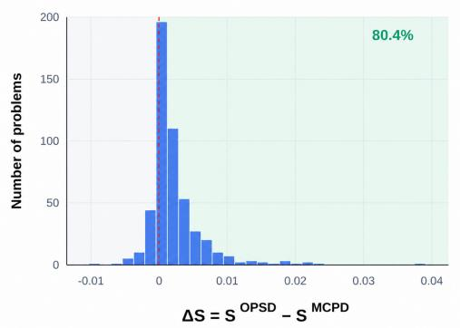
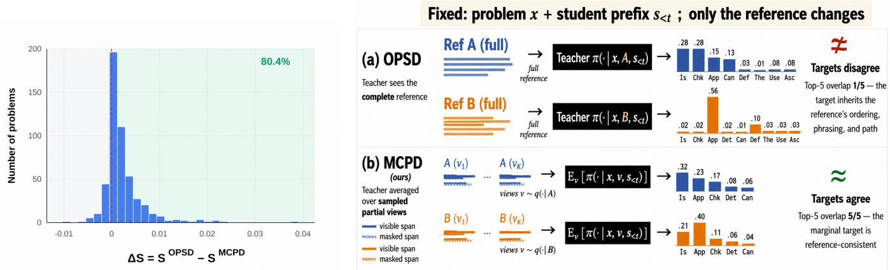
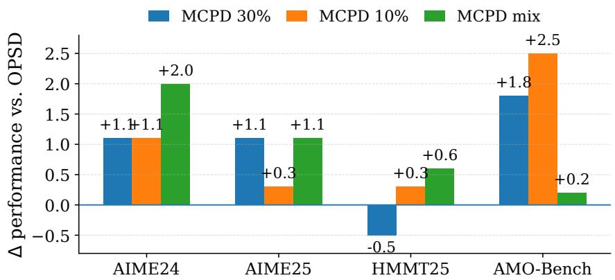
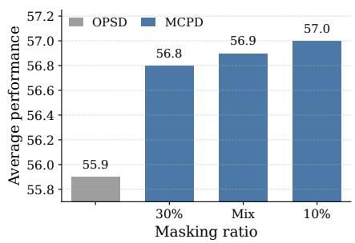
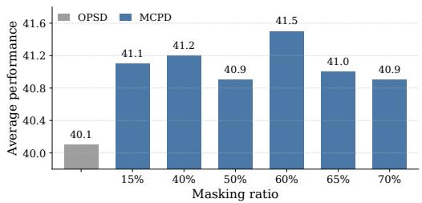
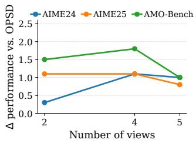
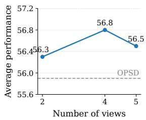
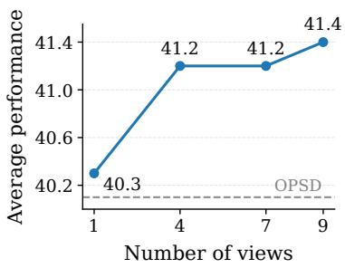

# One Teacher, Many Views: Reducing Reference Sensitivity in On-Policy Self-Distillation

Khouloud Saadi∗, Di Wang

Department of Computer Science King Abdullah University of Science and Technology KAUST, Thuwal, Saudi Arabia

## Abstract

On-policy self-distillation (OPSD) improves reasoning by training a model on its own trajectories with dense token-level supervision from a privileged copy conditioned on a reference solution. Existing methods typically use a single teacher dis- tribution conditioned on the complete reference. We identify a limitation of this formulation: a reference is only one realiza- tion of the reasoning process. Although it provides evidence about the answer, it also encodes an ordering, phrasing, and so- lution path. Full-reference conditioning can therefore produce correct targets that depend excessively on information unavail- able to the student at inference. We show that replacing one valid reference with another, while holding the problem and student state fixed, can substantially alter the teacher distribu- tion, a phenomenon we call reference-induced target instabil- ity. To address this instability, we introduce Monte Carlo Priv- ileged Distillation (MCPD), which models privileged context as a distribution over partial reference views and distills the marginal teacher distribution. MCPD evaluates the teacher under multiple views and averages the resulting next-token distributions. We show that this probability-space average is the exact target induced by minimizing the expected teacher- to-student KL divergence over privileged views. Across math- ematical and scientific reasoning benchmarks, we show that MCPD produces more reference-consistent supervision and consistently improves over full-reference OPSD.

## Introduction

Training strong reasoning models requires more than know- ing whether the final answer is correct; the model also needs feedback on the intermediate reasoning states it actually vis- its during generation (Agarwal et al. 2024; Song and Zheng 2026). Supervised fine-tuning (Yu et al. 2024; Zelikman et al. 2022) provides dense token-level guidance from reference solutions, but trains the model on fixed expert trajectories rather than on its own reasoning paths (Guha et al. 2026). Reinforcement learning (Guo et al. 2025; Yu et al. 2025) instead trains on model-generated trajectories, but typically relies on rewards assigned to complete solutions, providing limited guidance about individual reasoning steps. On-policy distillation (Saadi and Wang 2026; Agarwal et al. 2024; Gu et al. 2024) aims to combine these advantages by supplying dense teacher feedback along trajectories generated by the student itself.

On-Policy Self-Distillation (OPSD) (Zhao et al. 2026;

Nguyen et al. 2026; Song and Zheng 2026) realizes this idea without requiring a separate, stronger model. The stu- dent reasons from the problem and its own generated prefix, whereas a stop-gradient teacher additionally observes a ver- ified reference solution. At each student state, the teacher provides a full next-token distribution that is distilled into the student. This construction combines on-policy state cov- erage, dense supervision, and privileged reasoning informa- tion within a single model. However, we uncover a surprising instability in OPSD: the teacher target can change substan- tially even when the problem and student-generated prefix are held fixed and both privileged references are fully cor- rect. This occurs because the teacher distribution depends not only on the problem and student state, but also on the partic- ular reference solution supplied as privileged context (Zhao et al. 2026). A reference is only one valid realization of the reasoning process, and alternative correct solutions may dif- fer in their decomposition, intermediate quantities, notation, ordering, or reasoning path. Crucially, we find that slightly changing one valid reference can induce significantly difer- ent next-token distributions for exactly the same student state. Consequently, two equivalent references may prescribe con- flicting learning updates, revealing that OPSD supervision can be highly sensitive to incidental properties of the chosen solution. We term this phenomenon reference-induced target instability.

Figure 1 illustrates both an example of this phenomenon and its prevalence. In Figure 1 (Right), the problem and student prefix are fixed and only the valid reference supplied to the teacher slightly changes. Full-reference OPSD produces sharply diferent next-token targets, with only one shared token among the two top-5 sets. In contrast, our approach (MCPD) constructs a marginal target from sampled partial views of each reference, producing complete top-5 overlap in the illustrated state. Figure 1 (Left) shows that this is not an isolated example: MCPD reduces reference sensitivity on 80.4% of the 500 evaluated problems. For this comparison, we use the same pair of valid references for OPSD and MCPD and hold the student trajectory and evaluated states fixed. OPSD compares the targets induced by the two complete references, whereas MCPD separately constructs a marginal target from partial views of each reference.

This matched protocol ensures that diferences between OPSD and MCPD are not confounded by the problem, stu- dent trajectory, evaluated positions, or choice of reference pair.

  
Figure 1: Reference-induced target instability. Left: Distribution ofthe per-problem sensitivity reduction $\Delta S = S ^ { \mathrm { O P S D } } { - } S ^ { \mathrm { M C P D } }$ (defined in Method) over 500 problems sampled from $\mathtt { D e e p M a t h - 1 0 3 K }$ (He et al. 2026) using Qwen3-8B. For each problem, we use two valid reference solutions, generate one unprivileged student rollout, and evaluate both methods at matched prefix positions along the same trajectory. MCPD averages $\dot { \kappa } = \dot { 4 }$ partial views of each reference; positive values indicate lower reference sensitivity than OPSD. Right: Qualitative example with the problem and student prefix fixed, showing that full reference OPSD produces more reference-dependent next-token targets, whereas MCPD yields more consistent marginal targets.

Importantly, MCPD’s lower reference sensitivity is not explained by target flattening. On 270 problems from the same matched evaluation set, MCPD produces lower full- vocabulary entropy than OPSD on 75.6% of problems, while their mean entropy remains comparable (0.33 vs. 0.34). Anal-ysis details are provided in Appendix.

Reference-induced instability arises because a reference serves two roles simultaneously. It provides task-relevant ev- idence about how the problem can be solved, but it also exposes the teacher to one particular presentation of that solution. Conditioning on the complete reference does not distinguish between these two sources of information. The resulting target may therefore encode both useful guidance and reference-specific properties of a particular derivation. Our goal is not to remove privileged information or force all valid reasoning paths to induce identical predictions. Rather, we seek a target that preserves the guidance supplied by the reference while reducing dependence on any single complete presentation of that guidance. This motivates the following:

## Privileged supervision should reflect predictions that remain stable across partial views ofthe reference.

We introduce Monte Carlo Privileged Distillation (MCPD) based on this principle. Instead of treating the com-plete reference as a single deterministic privileged context, we define a distribution over its partial views. Each view re- veals a diferent subset of the same solution and induces a corresponding teacher distribution. We distill the expectation of these distributions rather than the prediction produced by one complete view. For a fixed student state $s _ { t } ,$ reference $r ,$ and random partial-view operator M, we define the marginal privileged target as:

$$
q _ { t } ^ { \star } ( \cdot \mid r ) = \mathbb { E } _ { M } \left[ q \left( \cdot \mid s _ { t } , M ( r ) \right) \right] .\tag{1}
$$

This target has a direct optimization interpretation. Under the standard teacher-to-student KL objective, matching $q _ { t } ^ { \star }$ is exactly equivalent, up to a student-independent constant, to minimizing the expected distillation loss over randomly sam- pled privileged views. Probability-space averaging is there- fore not an auxiliary smoothing heuristic; it is the exact target induced by expected-view distillation. Predictions that vary when diferent parts of the reference are hidden contribute diferently across sampled views, whereas predictions sup- ported across views persist in the marginal target. In practice, we approximate the expectation using a small Monte Carlo sample of independently generated partial views. The central comparison is therefore:

$$
\underbrace { q ( \cdot  { \left| \begin{array} { l l l } { s _ { t } , r } \end{array} \right. } ) } _ { \mathrm { o n e ~ c o m p l e t e ~ p r i v i l e g e d ~ v i e w } } \quad \mathrm { v e r s u s } \quad \underbrace { \mathbb { E } _ { M } \left[ q ( \cdot  { \left| \begin{array} { l l } { s _ { t } , M ( r ) ) } \end{array} \right. } \right] } _ { \mathrm { m a r g i n a l i z e d ~ p r i v i l e g e d ~ t a r g e t } } .\tag{2}
$$

MCPD should not be interpreted as distillation from a single incomplete reference. A single partial view remains an arbitrary realization and may itself induce an unstable target. As shown in Figure 1, MCPD addresses this issue by treating privileged context as a distribution over partial views and distilling the resulting marginal target. Our main contributions are as follows:

• We identify reference-induced target instability as a mea-surable limitation of privileged on-policy self-distillation.

• We introduce MCPD, which replaces a single complete-reference target with a teacher distribution marginalized over partial privileged views, and derive this target di- rectly from expected-view distillation.

• Experiments and ablations on mathematical and scientific reasoning benchmarks show that MCPD produces more reference-consistent supervision and consistently improves over competitive baselines.

## Related Work

Knowledge Distillation. Knowledge distillation transfers ca-pabilities from a teacher model to a student through predic- tive distributions, generated outputs, or intermediate repre- sentations (Schmidhuber 1992; Hinton, Vinyals, and Dean 2015; Wang et al. 2025a). In language-model reasoning, distillation has enabled smaller models to acquire stronger rea- soning (Karan and Du 2026; Guha et al. 2026; Ko et al. 2025; Xu et al. 2026), instruction-following (Gu et al. 2024; Ko et al. 2024; Li et al. 2023; Wang et al. 2025b), and problem-solving abilities (Hübotter et al. 2026). Rather than supervising only final answers, recent methods also transfer intermediate reasoning trajectories, allowing the student to learn how a solution is derived (Wang et al. 2023; Li et al. 2024, 2023). However, most reasoning-distillation methods remain of-policy: supervision is constructed from fixed ref- erence solutions or teacher-generated trajectories that are independent of the student’s own reasoning process (Agarwal et al. 2024; Gu et al. 2024; Kim and Rush 2016). The student is therefore trained on expert reasoning prefixes rather than the imperfect states it may encounter during its own genera- tion, creating a mismatch between training-time supervision and inference-time trajectories (Song and Zheng 2026).

On-Policy Distillation. On-policy distillation addresses this mismatch by providing teacher supervision along trajectories sampled from the student policy (Agarwal et al. 2024; Gu et al. 2024; Ko et al. 2024; Jin et al. 2026). The student first generates a reasoning rollout, after which the teacher provides dense token-level feedback at the same intermediate states. This combines the state coverage of on-policy learning with the fine-grained supervision of knowledge distillation, allowing the model to learn directly from the reasoning states it is likely to visit at inference time.

Privileged On-Policy Self-Distillation. Recent work extends on-policy distillation to self-distillation, where the same underlying model acts as both student and teacher un- der diferent conditioning contexts (Wu et al. 2026a,b; Shenfeld et al. 2026; Zhao et al. 2026; Song and Zheng 2026). Privileged self-distillation further equips the teacher with information unavailable to the student, such as a verified reference solution (Shenfeld et al. 2026; Zhao et al. 2026; N u en et al. 2026; Din 2026). In OPSD, the teacher ob-serves the complete reference and provides a next-token dis- tribution along the student-generated trajectory (Zhao et al. 2026). Although this produces informative dense supervi-sion, it implicitly treats the distribution induced by a single complete reference as a reliable target. We instead study how this target changes when the privileged reference changes. We identify reference-induced target instability, whereby difer-ent valid references can induce substantially diferent teacher distributions for the same student state. MCPD addresses this issue by sampling partial views of the privileged reference and distilling the marginal teacher distribution obtained by averaging their predictions. Recent work has also explored modifying the privileged context used in OPSD (Tan and Hong 2026; Pan et al. 2026) but using a single privileged view. The work most closely related to ours, using multi- views, is AVSD (Nguyen et al. 2026), which combines three fixed, heterogeneous privileged views: the complete refer- ence solution, a partial solution, and the final answer. AVSD extracts a consensus component across these views while se- lectively retaining view-specific residual information. How- ever, this design does not directly eliminate dependence on the particular reference realization. Because the complete- reference prediction remains one of the supervision sources, and reference-specific residuals may be preserved, the result- ing target can still inherit information tied to the wording, or- dering, or reasoning path of the given solution. Empirically, MCPD achieves higher average accuracy than AVSD across all backbones (Table 1).

## Method

## On-Policy Privileged Self-Distillation

Let $\boldsymbol { \mathcal { D } } ~ = ~ \{ ( x _ { i } , r _ { i } ) \} _ { i = 1 } ^ { N }$ be a reasoning dataset, where $x _ { i }$ is a problem and $r _ { i }$ is a verified reference solution. Given a problem $x ,$ the student policy $\pi _ { \theta }$ generates an on-policy reasoning trajectory, $y = ( y _ { 1 } , \dots , y _ { T } ) \sim \pi _ { \theta } ( \cdot \mid x )$ . At token position $t ,$ the student state is $\boldsymbol { s } _ { t } = \left( x , y _ { < t } \right)$ , with next-token distribution $p _ { \theta , t } ( \cdot ) = \pi _ { \theta } ( \cdot \mid s _ { t } )$

A privileged teacher evaluates the same student state while additionally observing the reference solution. We denote the fixed, stop-gradient teacher parameters by ¯θ. The complete- reference teacher distribution is:

$$
q _ { t } ^ { \mathrm { f u l l } } ( \cdot \mid r ) = \pi _ { \bar { \theta } } \left( \cdot \mid x , r , y _ { < t } \right) .\tag{3}
$$

Standard privileged on-policy self-distillation (Zhao et al. 2026) minimizes:

$$
\mathcal { L } _ { \mathrm { f u l l } } = \mathbb { E } _ { \underset { y \sim \pi _ { \theta } ( \cdot | x ) } { \mathbb { E } } \sim \mathcal { D } } \left[ \frac { 1 } { T } \sum _ { t = 1 } ^ { T } \mathrm { K L } \left( q _ { t } ^ { \mathrm { f u l l } } ( \cdot \mid r ) \| p _ { \theta , t } \right) \right] .\tag{4}
$$

This objective provides dense supervision along the student’s own trajectory. However, the target at every state is deter-mined by one complete reference solution.

## Reference-Induced Target Instability

As illustrated in Figure 1, changing the valid reference alone can alter the privileged teacher target. Consider a problem $x ,$ a fixed student-generated trajectory $y = ( y _ { 1 } , \dotsc , y _ { T } )$ , and two valid reference solutions $r ^ { a }$ and $r ^ { b } .$ Let $\mathcal { T } \subseteq \{ 1 , \ldots , T \}$ denote the matched rollout positions at which reference sensi- tivity is evaluated. For both references, we keep the problem, student trajectory, teacher parameters, and evaluated positions fixed. The full-reference OPSD teacher distributions at position $t \in \mathcal { Z }$ are:

$$
q _ { t } ^ { a , \mathrm { f u l l } } = \pi _ { \bar { \theta } } \left( \cdot  { \left| \vphantom { \frac { l } { b } } x , r ^ { a } , y _ { < t } \right. \right. } , \qquad q _ { t } ^ { b , \mathrm { f u l l } } = \pi _ { \bar { \theta } } \left( \cdot  { \left| x , r ^ { b } , y _ { < t } \right. \right. } .\tag{5}
$$

Because only the privileged reference difers, any discrep- ancy between these distributions directly measures depen- dence on the choice of reference. We quantify this discrep- ancy using the Jensen–Shannon (JS) divergence, which pro-vides a symmetric and bounded comparison between prob- ability distributions (Lin 1991; Nielsen 2019). Specifically, we define the token-level reference sensitivity of OPSD as:

$$
S _ { t } ^ { \mathrm { O P S D } } = \mathrm { J S } \left( q _ { t } ^ { a , \mathrm { f u l l } } , q _ { t } ^ { b , \mathrm { f u l l } } \right) ,\tag{6}
$$

where $q _ { t } ^ { a , \mathrm { f u l l } }$ and $q _ { t } ^ { b , \mathrm { f u l l } }$ denote the teacher next-token dis- tributions induced by two valid full references $r ^ { a }$ and $r ^ { b }$ respectively, for the same problem and student state. The JS divergence is defined as:

$$
\mathrm { J S } ( p , q ) = \frac { 1 } { 2 } D _ { \mathrm { K L } } \left( p \Vert m \right) + \frac { 1 } { 2 } D _ { \mathrm { K L } } \left( q \Vert m \right) , \qquad m = \frac { p + q } { 2 } .\tag{7}
$$

A value of zero indicates that the teacher target is invariant to the choice of reference, whereas a larger value indicates greater reference-induced variation in the supervision pro- vided at the same student state.

The corresponding trajectory-level sensitivity is:

$$
S ^ { \mathrm { O P S D } } = \frac { 1 } { \left| \mathcal { T } \right| } \sum _ { t \in \mathcal { T } } S _ { t } ^ { \mathrm { O P S D } } .\tag{8}
$$

For MCPD, we independently sample K partial views for each reference:

$$
M _ { j , 1 } , \ldots , M _ { j , K } \stackrel { \mathrm { i . i . d . } } { \sim } \mu _ { \rho } ( \cdot \mid r ^ { j } ) , \qquad j \in \{ a , b \} .\tag{9}
$$

Each view induces the teacher distribution:

$$
q _ { t } ^ { j , ( k ) } = \pi _ { \bar { \theta } } \left( \cdot \mid x , M _ { j , k } ( r ^ { j } ) , y _ { < t } \right) .\tag{10}
$$

We construct a separate Monte Carlo marginal target for each reference:

$$
\widehat { q } _ { K , t } ^ { j } = \frac { 1 } { K } \sum _ { k = 1 } ^ { K } q _ { t } ^ { j , ( k ) } , \qquad j \in \{ a , b \} .\tag{11}
$$

The token-level and trajectory-level reference sensitivities of MCPD are then:

$$
S _ { t } ^ { \mathrm { M C P D } } = \mathrm { J S } \left( \widehat { q } _ { K , t } ^ { a } , \widehat { q } _ { K , t } ^ { b } \right) , \qquad S ^ { \mathrm { M C P D } } = \frac { 1 } { \vert \mathcal { T } \vert } \sum _ { t \in \mathcal { T } } S _ { t } ^ { \mathrm { M C P D } } .\tag{12}
$$

Finally, for each problem, we measure the reduction in reference sensitivity as $\Delta S = S ^ { \mathrm { O P S D } } - S ^ { \mathrm { M C P D } }$ . A positive value of $\Delta S$ indicates that MCPD produces less reference- dependent teacher targets than full-reference OPSD for the same problem and student trajectory. Therefore, $S ^ { \mathrm { O P S D } }$ iso- lates variation induced by the choice of privileged reference. A larger value indicates that two valid references prescribe more diferent token-level supervision for the same student reasoning states. We refer to this dependence as referenceinduced target instability. This metric does not assume that all valid reasoning paths should induce identical predictions. Rather, it measures the extent to which the supervision at fixed student states depends on the particular valid reference supplied to the teacher. Implementation details are provided in Appendix.

## Privileged Context as a Distribution

Rather than treating the complete reference as a single de- terministic privileged context, we define a distribution over its partial views. Let $M \sim \mu _ { \rho } ( \cdot \mid r )$ denote a random view operator, where $\rho$ controls the fraction of the reference that is hidden. A sampled view $M ( r )$ reveals only part of the ref- erence while preserving the ordering of the visible content.

For a fixed student state $s _ { t } ,$ each view induces a teacher predictive distribution:

$$
q _ { t } ^ { M } ( \cdot \mid r ) = \pi _ { \bar { \theta } } ( \cdot \mid x , M ( r ) , y _ { < t } ) .\tag{13}
$$

All views use the same underlying teacher and the same student state; only the privileged conditioning con- text changes. Thus, MCPD uses one teacher under multiple views. We define the marginal predictive target as:

$$
q _ { t } ^ { \star } ( \cdot \mid r ) = \mathbb { E } _ { M \sim \mu _ { \rho } ( \cdot \mid r ) } \left[ q _ { t } ^ { M } ( \cdot \mid r ) \right] .\tag{14}
$$

The expectation is taken directly in probability space. $\mathrm { B e ^ { - } }$ cause every $q _ { t } ^ { M }$ is a categorical distribution, $q _ { t } ^ { \star }$ is also a valid categorical distribution. This construction marginalizes over partial observations of the available reference.

## Expected-View Distillation

We show that the probability-space average in Eq. (14) is the exact target induced by distillation over random partial views, rather than a heuristic aggregation rule. For compactness, we suppress the explicit conditioning on r and write $\mathbb { E } _ { M }$ for $\mathbb { E } _ { M \sim \mu _ { \rho } ( \cdot | r ) }$ . For a fixed student state $s _ { t }$ and reference $r ,$ consider:

$$
\mathcal { T } _ { t } ( p ) = \mathbb { E } _ { M } \left[ \mathrm { K L } \left( q _ { t } ^ { M } \parallel p \right) \right] ,\tag{15}
$$

where $p$ is any categorical student distribution.

Proposition 1. Let $q _ { t } ^ { \star }$ be defined as in Eq. (14). Then,

$$
\mathcal { T } _ { t } ( p ) = \mathbb { E } _ { M } \left[ \mathrm { K L } \left( q _ { t } ^ { M } \parallel q _ { t } ^ { \star } \right) \right] + \mathrm { K L } \left( q _ { t } ^ { \star } \parallel p \right) .\tag{16}
$$

Consequently,

$$
\begin{array} { r } { \arg \operatorname* { m i n } _ { p } \mathcal { T } _ { t } ( p ) = q _ { t } ^ { \star } . } \end{array}\tag{17}
$$

Proof. Expanding the expected KL divergence gives

$$
\begin{array} { r l } & { \mathcal { J } _ { t } ( \boldsymbol { p } ) = \mathbb { E } _ { M } \left[ \displaystyle \sum _ { v \in \mathcal { V } } q _ { t } ^ { M } ( v ) \log \frac { q _ { t } ^ { M } ( v ) } { p ( v ) } \right] } \\ & { \qquad = \mathbb { E } _ { M } \left[ \displaystyle \sum _ { v \in \mathcal { V } } q _ { t } ^ { M } ( v ) \log \frac { q _ { t } ^ { M } ( v ) } { q _ { t } ^ { \star } ( v ) } \right] } \\ & { \qquad + \displaystyle \sum _ { v \in \mathcal { V } } q _ { t } ^ { \star } ( v ) \log \frac { q _ { t } ^ { \star } ( v ) } { p ( v ) } . } \end{array}\tag{18}
$$

This ields $\operatorname { E q . }$ (16). The first term is inde endent of $p ,$ while the second is minimized when $p = q _ { t } ^ { \star }$ □

Thus, matching the view-marginalized target is equivalent, up to a student-independent term, to minimizing the expected forward-KL loss over random partial views. The first term in Eq. (16) captures disagreement among the view-conditioned teacher predictions, whereas the second measures the stu- dent’s divergence from their view-marginalized target.

## Monte Carlo Approximation

Computing $q _ { t } ^ { \star }$ exactly would require evaluating all possible partial views. We approximate it using K independently sam-pled views: $M _ { 1 } , \dots , M _ { K } \overset { \mathrm { i . i . d . } } { \sim } \mu _ { \rho } ( \cdot \mid r )$ . The Monte Carlo target is: $\begin{array} { r } { \widehat { q } _ { K , t } ( \cdot  { | }  { \boldsymbol { r } } ) = \frac { 1 } { K } \sum _ { k = 1 } ^ { K } q _ { t } ^ { M _ { k } } ( \cdot  { | }  { \boldsymbol { r } } ) } \end{array}$ . For a fixed state and reference, this estimator is unbiased:

$$
\mathbb { E } \left[ \widehat { q } _ { K , t } ( \cdot \mid r ) \right] = q _ { t } ^ { \star } ( \cdot \mid r ) .\tag{19}
$$

Its covariance satisfies:

$$
\operatorname { C o v } \left[ \widehat { q } _ { K , t } ( \cdot \mid r ) \right] = \frac { 1 } { K } \operatorname { C o v } \left[ q _ { t } ^ { M } ( \cdot \mid r ) \right] .\tag{20}
$$

Thus, the variability caused by sampling a finite set of views decreases proportionally to $\mathrm { i } / K$ . This guarantee concerns Monte Carlo estimation for a fixed reference. It does not imply that:

$$
q _ { t } ^ { \star } ( \cdot \mid r ^ { a } ) = q _ { t } ^ { \star } ( \cdot \mid r ^ { b } )\tag{21}
$$

for two distinct valid references. Reduced cross-reference sensitivity is therefore an empirical property of MCPD, rather than a direct theoretical consequence of the $1 / K$ vari- ance reduction.

## Monte Carlo Privileged Distillation

MCPD trains the student against the Monte Carlo marginal target:

$$
\mathcal { L } _ { \mathrm { M C P D } } = \mathbb { E } { \underset { y \sim \pi _ { \theta } ( \cdot | r ) } { \mathbb { E } } } \left[ \frac { 1 } { T } \sum _ { t = 1 } ^ { T } \mathrm { K L } \left( \operatorname { s g } \left[ \widehat { q } _ { K , t } ( \cdot \mid r ) \right] \Vert p _ { \theta , t } \right) \right] .\tag{22}
$$

For each training example, the procedure consists of four steps. First, the student generates one on-policy trajectory from the problem alone. Second, we sample K independent partial views of the same reference. Third, the teacher eval- uates the same student states under every privileged view. Finally, the resulting next-token distributions are averaged at each position, and the student is updated toward the marginal target. All teacher evaluations share the same problem and student-generated prefix. Consequently, variation among the teacher distributions arises only from changes in privileged context, rather than from diferent student trajectories.

In our implementation, each partial view is generated as

$$
M _ { k } ( r ) = \mathrm { M a s k } ( r ; \rho , \xi _ { k } ) ,\tag{23}
$$

where $\xi _ { k }$ denotes an independently sampled masking pattern. Each view hides a fraction $\rho$ of the reference while preserving the order of the visible content. The complete reference, partial views, and masking patterns are used only by the stop-gradient teacher and are never observed by the student. The complete algorithm is provided in Appendix. MCPD requires one student rollout and K teacher evaluations per training example. Since all views share the same student states, the teacher evaluations can be batched across views. Increasing K therefore trades additional teacher-side computation for a lower-variance approximation of the marginal predictive target. In practice, with $K \ = \ 4 ,$ MCPD requires only modest additional wall-clock time: on deepseek-ai/DeepSeek-R1-Distill-Qwen-7B, it trains in 1h 36m, only 10 minutes longer than OPSD and slightly faster than AVSD under the same 100-step training budget. Under its 500-step, 8-rollout configuration, GRPO requires 12h 30m. Full computational-cost results are provided in Appendix Table 2.

<table><tr><td>Method</td><td>AIME24</td><td>AIME25</td><td>HMMT25</td><td>AVG</td></tr><tr><td colspan="5">Qwen3-14B</td></tr><tr><td>Base (Instruct)</td><td>80.8</td><td>68.9</td><td>50.0</td><td>66.6</td></tr><tr><td>+ SFT</td><td>79.7</td><td>73.9</td><td>49.7</td><td>67.7</td></tr><tr><td>+ GRPO</td><td>81.9</td><td>73.6</td><td>53.0</td><td>69.5</td></tr><tr><td>+ OPSD</td><td>81.1</td><td>73.9</td><td>52.2</td><td>69.1</td></tr><tr><td>+ AVSD</td><td>80.6</td><td>73.6</td><td>50.6</td><td>68.3</td></tr><tr><td>+ MCPD (ours)</td><td>82.2</td><td>75.0</td><td>51.7</td><td>69.6</td></tr><tr><td colspan="5">Qwen3-8B</td></tr><tr><td>Base (Instruct)</td><td>75.8</td><td>65.6</td><td>43.9</td><td>61.8</td></tr><tr><td>+ SFT</td><td>72.3</td><td>64.2</td><td>42.9</td><td>59.8</td></tr><tr><td>+ GRPO</td><td>76.4</td><td>68.9</td><td>46.7</td><td>64.0</td></tr><tr><td>+ OPSD</td><td>77.8</td><td>70.8</td><td>45.8</td><td>64.8</td></tr><tr><td>+ AVSD</td><td>77.5</td><td>69.4</td><td>45.3</td><td>64.1</td></tr><tr><td>+ MCPD (ours)</td><td>78.9</td><td>72.8</td><td>46.7</td><td>66.1</td></tr><tr><td colspan="5">Qwen3-4B</td></tr><tr><td>Base (Instruct)</td><td>74.9</td><td>66.4</td><td>42.2</td><td>61.2</td></tr><tr><td>+ SFT</td><td>70.2 75.6</td><td>62.3</td><td>43.4</td><td>58.6</td></tr><tr><td>+ GRPO</td><td></td><td>68.1</td><td>44.4</td><td>62.7</td></tr><tr><td>+ OPSD</td><td>76.4</td><td>68.3</td><td>46.1</td><td>63.6</td></tr><tr><td>+ AVSD + MCPD (ours)</td><td>74.4</td><td>65.0</td><td>47.2</td><td>62.2</td></tr><tr><td></td><td>75.6</td><td>70.6</td><td>48.1</td><td>64.8</td></tr><tr><td colspan="5">DeepSeek-R1-Distill-Qwen-7B</td></tr><tr><td>+ SFT</td><td>54.2</td><td>38.6</td><td>23.9</td><td>38.9</td></tr><tr><td>+ OPSD</td><td>54.4</td><td>41.7</td><td>24.1</td><td>40.1</td></tr><tr><td>+ AVSD</td><td>54.2</td><td>40.3</td><td>25.0</td><td>39.8</td></tr><tr><td>+ MCPD (ours)</td><td>55.0</td><td>43.1</td><td>25.6</td><td>41.2</td></tr></table>

Table 1: Avg@12 accuracy on math benchmarks across four backbones. Best results are in bold. AVG refers to average.

## Experiments

## Mathematical Reasoning

Models and data. We follow the mathematical-reasoning setup of OPSD (Zhao et al. 2026). We experiment with three instruction-tuned Qwen3 backbones (Yang et al. 2025): Qwen3-4B, Qwen3-8B, and Qwen3-14B, as well as DeepSeek-R1-Distill-Qwen-7B (Guo et al. 2025). All post-training methods use the exact 17K-example mathematical-reasoning subset of OpenThoughts used by OPSD (Zhao et al. 2026; Guha et al. 2026), containing problems paired with expert reference solutions. We report our main results on three competition-level benchmarks: AIME 2024 and AIME 2025 (MAA 2025), and HMMT 2025 (Balunovic et al. 2025). AMO-Bench (Liu et al. 2026) is additionally used in the masking-ratio and number-of-views ablations. Full implementation details are provided in Ap- pendix.

Baselines. We compare MCPD with the original instruction-tuned models and four post-training baselines: SFT (Wei et al. 2022; Longpre et al. 2023), GRPO (Shao et al. 2024), OPSD (Zhao et al. 2026), and AVSD (Nguyen et al. 2026), which conditions the teacher on three privileged views, the complete solution, a partial solution, and the final answer, and combines their predictions using its proposed gating mechanism; we use a partial-solution ratio of 0.5 as in Nguyen et al. (2026). Our method, MCPD, constructs K = 4 partial views of the reference solution for each training example. For each view, we randomly mask a fixed fraction of the token positions within the reference-solution span. The masking pattern is sampled independently for each view and resampled in every training batch. We mask 30% of the reference tokens for the Qwen3 models and 40% for DeepSeek-R1-Distill-Qwen-7B. The same frozen teacher evaluates the student states under all views, and the resulting next-token distributions are averaged in probability space to form the Monte Carlo marginal target. The evalua- tion setup is detailed in Appendix.

Results. Table 1 shows that our MCPD achieves the high-est average accuracy among all competing methods for each of the four backbones. The gains are particularly strong on AIME25: compared with OPSD, MCPD improves accuracy by 2.0 percentage points on Qwen3-8B and by 2.3 points on Qwen3-4B. Compared with AVSD, the improvement reaches 5.6 points on AIME25 with Qwen3-4B. MCPD also surpasses GRPO in average accuracy across all Qwen3 models. Overall, these results demonstrate that MCPD im- proves downstream reasoning performance.

## Science Reasoning

Models and data. We evaluate our method on the Sci-KnowEval L3 multiple-choice scientific reasoning bench- mark (Feng et al. 2024), covering biology, chemistry, physics, and materials science. We use the same per-domain Sci- KnowEval splits as in Hübotter et al. (2026), comprising 3,868 training examples and 429 held-out test examples. The training set contains 450 biology, 1,890 chemistry, 687 physics, and 841 materials-science examples. All ex-periments use Qwen3-8B as the backbone and follow the matched OPSD training configuration of Zhao et al. (2026), with a maximum student completion length of 2048 tokens. For MCPD, we use K = 4 independently sampled partial reference views with a masking ratio of ρ = 10%. The eval-uation setup is detailed in the Appendix.

Results. Table 2 shows that MCPD achieves the high-est overall accuracy on SciKnowEval, outperforming both OPSD and AVSD on average. Compared with OPSD, MCPD improves the average score from 49.7 to 50.9, a gain of 1.2 percentage points, with particularly strong improvements of 2.4 points in Biology and 1.8 points in Physics. Relative to AVSD, MCPD achieves a 3.0-point gain in Physics.

<table><tr><td>Method</td><td>Chem</td><td>Physics</td><td>Biology</td><td>Materials</td><td>AVG</td></tr><tr><td>Qwen3-8B</td><td>41.2</td><td>59.2</td><td>30.8</td><td>58.9</td><td>47.5</td></tr><tr><td>+ OPSD</td><td>44.1</td><td>60.4</td><td>35.6</td><td>58.6</td><td>49.7</td></tr><tr><td>+ AVSD</td><td>44.3</td><td>59.2</td><td>37.2</td><td>60.6</td><td>50.3</td></tr><tr><td>+ MCPD</td><td>44.3</td><td>62.2</td><td>38.0</td><td>59.0</td><td>50.9</td></tr></table>

Table 2: Avg@16 across scientific reasoning tasks using Qwen3-8B. Best results are in bold. AVG refers to average.

<table><tr><td>Method</td><td>Chem</td><td>Physics</td><td>Biology</td><td>Materials</td><td>AVG</td></tr><tr><td>OPSD</td><td>41.2</td><td>59.7</td><td>31.1</td><td>58.7</td><td>47.7</td></tr><tr><td>AVSD</td><td>41.7</td><td>59.2</td><td>32.9</td><td>59.4</td><td>48.3</td></tr><tr><td>MCPD</td><td>42.4</td><td>60.5</td><td>32.9</td><td>60.3</td><td>49.0</td></tr></table>

Table 3: Avg@16 comparison of math-trained Qwen3-8B models with OPSD, AVSD, and our MCPD, on SciKnowEval scientific-reasoning domains. AVG refers to average.

Out-of-Domain Science Reasoning We further examine whether the reasoning capabilities acquired through mathe- matical training transfer to an unseen domain. Specifically, we evaluate the Qwen3-8B models trained on mathematical reasoning with OPSD, AVSD, and MCPD on the held-out SciKnowEval L3 test sets, following the evaluation proto- col in the experiment above. As shown in Table 3, MCPD achieves the highest average score. It obtains the strongest performance in Chemistry, Physics, and Materials, while matching AVSD in Biology. Consequently, MCPD improves in-domain mathematical-reasoning performance and trans- fers efectively to out-of-domain scientific reasoning.

## Ablation Studies

Diferent masking ratios. Figure 2 examines the sensitivity of MCPD to the masking ratio across two model families. The number of views is fixed to K = 4. On Qwen3-14B, all evaluated masking configurations improve the average score over OPSD, increasing it from 55.9 to 56.8–57.0. We observe similar robustness on DeepSeek-R1-Distill-Qwen-7B (Figure 3). All evaluated masking ratios achieve higher average accuracy than both OPSD and AVSD. Across all masking ratios, MCPD obtains average scores between 40.9 and 41.5, compared with 40.1 for OPSD and 39.8 for AVSD.

Diferent numbers of views. We study the efect of the number of sampled privileged views, K, on Qwen3-14B (Figure 4) and DeepSeek-R1-Distill-Qwen-7B (Figure 5). Across the evaluated values of K, MCPD exceeds OPSD and remains stronger than AVSD, demonstrating ro- bustness to the number of sampled views. The DeepSeek ab- lation further highlights the importance of aggregating mul- tiple views: using a single randomly masked view achieves an average performance of 40.3, whereas averaging K = 4 views increases it to 41.2. This gap shows that one partial view can produce an unreliable target that depends on a par- ticular masking realization. Monte Carlo averaging instead integrates predictions across several partial views, yielding a more reliable distillation target.

Sampled-token distillation. We evaluate whether MCPD remains efective when distillation is restricted to the sampled student token rather than the full vocabulary. Table 4 shows that MCPD achieves the strongest overall performance, im- proving over OPSD by 4.6 percentage points on AIME25 and 9.4 points on HMMT25. Compared with AVSD, MCPD matches its AIME25 accuracy while improving HMMT25 by 3.4 points. These results indicate that MCPD remains efective under sampled-token supervision.

  
Fi ure 2: Efect of reference-solution maskin on Qwen3-14B. Left: Performance chan es relative to OPSD across individua benchmarks. Right: Average performance for OPSD and each masking configuration across AIME24, AIME25, HMMT25, and AMO-Bench. Mix denotes mixed masking ratios of 0%, 5%, 10%, and 30%.

  
Figure 3: MCPD with diferent masking ratios on DeepSeek- R1-Distill-Qwen-7B, with the number of views fixed at $K =$ 4. Full results are provided in the Appendix.

  
Figure 4: Efect of the number of views. Left: Performance changes relative to OPSD on three benchmarks. Right: Aver-age performance across AIME24, AIME25, HMMT25, and AMO-Bench. The masking ratio is fixed at $\rho = 3 0 \%$

## Conclusion

In this work, we identified reference-induced target insta- bility as an important limitation of privileged OPSD: even when the problem and student state are fixed, replacing one valid reference solution with another can induce substan- tially diferent teacher targets. To address this issue, we intro- duced Monte Carlo Privileged Distillation (MCPD), which treats privileged context as a distribution over partial refer- ence views and distills the resulting marginal teacher dis- tribution. We showed that averaging the view-conditioned predictions in probability space is the exact target induced by minimizing the expected teacher-to-student forward-KL objective over privileged views. Empirically, MCPD produces more reference-consistent supervision and achieves the strongest average performance across four mathematical- reasoning backbones, while also improving scientific reason- ing and out-of-domain transfer from mathematics to science. Ablations further show that the method is robust across mask- ing ratios, benefits from multiple partial views, and remains efective under sampled-token distillation. Therefore, priv- ileged supervision should not be tied to a single complete realization of a solution. Marginalizing over partial views provides a simple and efective way to preserve useful ref- erence information while reducing sensitivity to reference- specific artifacts and reasoning paths. Future work includes extending our approach MCPD beyond mathematical and scientific reasoning, e.g., multi-modal reasoning settings.

Figure 5: MCPD with diferent numbers of views on DeepSeek-R1-Distill-Qwen-7B with the masking ratio fixed at $\rho = 4 0 \%$ . Full results table in Appendix.
<table><tr><td>Method</td><td>AIME25</td><td>HMMT25</td></tr><tr><td>OPSD w/ Sampled-token distillation</td><td>82.1</td><td>57.3</td></tr><tr><td>AVSD w/ Sampled-token distillation</td><td>86.7</td><td>63.3</td></tr><tr><td>MCPD w/ Sampled-token distillation</td><td>86.7</td><td>66.7</td></tr></table>

Table 4: Sampled-token distillation results on Qwen3-4B with a maximum student completion length of 2,048 tokens. We report Pass@8 accuracy on AIME25 and HMMT25 as in Zhao et al. (2026).

## References

Agarwal, R.; Vieillard, N.; Zhou, Y.; Stanczyk, P.; Garea, S. R.; Geist, M.; and Bachem, O. 2024. On-policy distilla- tion of language models: Learning from self-generated mis- takes. In The twelfth international conference on learning representations.

Balunovic, M.; Dekoninck, J.; Petrov, I.; Jovanović, N.; and Vechev, M. 2025. MathArena: Evaluating LLMs on Uncon- taminated Math Competitions. Advances in Neural Information Processing Systems, 38.

Ding, K. 2026. Hdpo: Hybrid distillation policy opti- mization via privileged self-distillation. arXiv preprint arXiv:2603.23871.

Feng, K.; Shen, X.; Wang, W.; Zhuang, X.; Tang, Y.; Zhang, Q.; and Ding, K. 2024. Sciknoweval: Evaluating multilevel scientific knowledge of large language models. arXiv preprint arXiv:2406.09098.

Gu, Y.; Dong, L.; Wei, F.; and Huang, M. 2024. MiniLLM: Knowledge Distillation of Large Language Models. In International Conference on Learning Representations.

Guha, E.; Marten, R.; Keh, S.; Raoof, N.; Smyrnis, G.; Bansal, H.; Nezhurina, M.; Mercat, J.; Vu, T.; Sprague, Z.; et al. 2026. Openthoughts: Data recipes for reasoning mod- els. ICLR.

Guo, D.; Yang, D.; Zhang, H.; Song, J.; Wang, P.; Zhu, Q.; Xu, R.; Zhang, R.; Ma, S.; Bi, X.; et al. 2025. Deepseek-r1: Incentivizing reasoning capability in llms via reinforcement learning. arXiv preprint arXiv:2501.12948.

He, Z.; Liang, T.; Xu, J.; Liu, Q.; Chen, X.; Wang, Y.; Song, L.; Yu, D.; Liang, Z.; Wang, W.; Zhang, Z.; Wang, R.; Tu, Z.; Mi, H.; and Yu, D. 2026. DeepMath-103K: A Large-Scale, Challenging, Decontaminated, and Verifiable Mathematical Dataset for Advancing Reasoning. In The Fourteenth International Conference on Learning Representations.

Hinton, G.; Vinyals, O.; and Dean, J. 2015. Distill- ing the knowledge in a neural network. arXiv preprint arXiv:1503.02531.

Hu, E. J.; Shen, Y.; Wallis, P.; Allen-Zhu, Z.; Li, Y.; Wang, S.; Wang, L.; and Chen, W. 2022. LoRA: Low-Rank Adaptation of Large Language Models. In International Conference on Learning Representations.

Hübotter, J.; Lübeck, F.; Behric, L.; Baumann, A.; Bagatella, M.; Marta, D.; Hakimi, I.; Shenfeld, I.; Buening, T. K.; Guestrin, C.; et al. 2026. Reinforcement Learning via Self- Distillation. ICML.

Jin, W.; Min, T.; Yang, Y.; Wei, D.; Zhou, Y.; Kadhe, S. R.; Baracaldo, N.; and Lee, K. 2026. Entropy-Aware On-Policy Distillation ofLanguage Models. In Forty-third International Conference on Machine Learning.

Karan, A.; and Du, Y. 2026. Reasoning with Sampling: Your Base Model is Smarter Than You Think. In International Conference on Learning Representations.

Kim, Y.; and Rush, A. M. 2016. Sequence-Level Knowl- edge Distillation. In Su, J.; Duh, K.; and Carreras, X., eds., Proceedings of the 2016 Conference on Empirical Methods in Natural Language Processing, 1317–1327. Austin, Texas: Association for Computational Linguistics.

Ko, J.; Chen, T.; Kim, S.; Ding, T.; Liang, L.; Zharkov, I.; and Yun, S.-Y. 2025. DistiLLM-2: A Contrastive Approach Boosts the Distillation of LLMs. In International Conference on Machine Learning, 31044–31062. PMLR.

Ko, J.; Kim, S.; Chen, T.; et al. 2024. DistiLLM: Towards Streamlined Distillation for Large Language Models. In The Forty-first International Conference on Machine Learning. ICML.

Li, L. H.; Hessel, J.; Yu, Y.; Ren, X.; Chang, K.-W.; and Choi, Y. 2023. Symbolic Chain-of-Thought Distillation: Small Models Can Also “Think” Step-by-Step. In Rogers, A.; Boyd-Graber, J.; and Okazaki, N., eds., Proceedings of the 61st Annual Meeting of the Association for Computational Linguistics (Volume 1: Long Papers), 2665–2679. Toronto, Canada: Association for Computational Linguistics.

Li, X.; He, S.; Wu, J.; Yang, Z.; Xu, Y.; Jun, Y. j.; Liu, H.; Liu, K.; and Zhao, J. 2024. MoDE-CoTD: Chain-of-Thought Distillation for Complex Reasoning Tasks with Mixture of Decoupled LoRA-Experts. In Calzolari, N.; Kan, M.-Y.; Hoste, V.; Lenci, A.; Sakti, S.; and Xue, N., eds., Proceedings of the 2024 Joint International Conference on Computational Linguistics, Language Resources and Evaluation (LREC-COLING 2024), 11475–11485. Torino, Italia: ELRA and ICCL.

Lin, J. 1991. Divergence measures based on the Shannon entropy. IEEE Transactions on Information theory, 37(1): 145–151.

Liu, J.; An, S.; Zhou, S.; Ma, D.; Lin, Y.; Lv, X.; Wang, X.; Li, X.; Wang, Z.; Cao, X.; et al. 2026. Amo-bench: Large language models still struggle in high school math compe- titions. In Findings of the Association for Computational Linguistics: ACL 2026, 2120–2137.

Longpre, S.; Hou, L.; Vu, T.; Webson, A.; Chung, H. W.; Tay, Y.; Zhou, D.; Le, Q. V.; Zoph, B.; Wei, J.; et al. 2023. The flan collection: Designing data and methods for efective instruction tuning. In International conference on machine learning, 22631–22648. PMLR.

MAA. 2025. American Invitational Mathematics Examina- tion (AIME). Mathematical Association of America. AIME exam materials.

Nguyen, D.; Xiao, H.; Prasad, A.; Khan, Z.; Das, A.; Zhang, A.; Sahu, S.; Lee, H.; Stengel-Eskin, E.; and Bansal, M. 2026. AVSD: Adaptive-View Self-Distillation by Balancing Consensus and Teacher-Specific Privileged Signals. arXiv preprint arXiv:2605.20643.

Nielsen, F. 2019. On a generalization of the Jensen-Shannon divergence. arXiv preprint arXiv:1912.00610.

Pan, L.; Tao, S.; Zhai, Y.; Zhang, L.; Liu, Z.; Ding, B.; Liu, A.; and Wen, L. 2026. RLCSD: Reinforcement Learning with Contrastive On-Policy Self-Distillation. arXiv preprint arXiv:2606.11709.

Saadi, K.; and Wang, D. 2026. Validity-Calibrated Reasoning Distillation. arXiv preprint arXiv:2605.04078.

Schmidhuber, J. 1992. Learning complex, extended se- quences using the principle of history compression. Neural computation, 4(2): 234–242.

Shao, Z.; Wang, P.; Zhu, Q.; Xu, R.; Song, J.; Bi, X.; Zhang, H.; Zhang, M.; Li, Y.; Wu, Y.; et al. 2024. Deepseekmath: Pushing the limits of mathematical reasoning in open lan- guage models. arXiv preprint arXiv:2402.03300.

Shenfeld, I.; Damani, M.; Hübotter, J.; and Agrawal, P. 2026. Self-Distillation Enables Continual Learning. ICML.

Song, M.; and Zheng, M. 2026. A survey of on-policy distillation for large language models. arXiv preprint arXiv:2604.00626.

Tan, Z.; and Hong, Y. 2026. PAINT: Partial-Solution Adap- tive Interpolated Training for Self-Distilled Reasoners. arXiv preprint arXiv:2604.26573.

Wang, G.; Yang, Z.; Wang, Z.; Wang, S.; Xu, Q.; and Huang, Q. 2025a. ABKD: Pursuing a Proper Allocation of the Probability Mass in Knowledge Distillation via α–β- Divergence. In Forty-second International Conference on Machine Learning.

Wang, L.; Wu, L.; Song, S.; Wang, Y.; Gao, C.; and Wang, K. 2025b. Distilling structured rationale from large language models to small language models for abstractive summariza- tion. In Proceedings of the AAAI Conference on Artificial Intelligence, volume 39, 25389–25397.

Wang, X.; Wei, J.; Schuurmans, D.; Le, Q. V.; Chi, E. H.; Narang, S.; Chowdhery, A.; and Zhou, D. 2023. Self- Consistency Improves Chain of Thought Reasoning in Lan- guage Models. In The Eleventh International Conference on Learning Representations.

Wei, J.; Bosma, M.; Zhao, V.; Guu, K.; Yu, A. W.; Lester, B.; Du, N.; Dai, A. M.; and Le, Q. V. 2022. Finetuned Language Models are Zero-Shot Learners. In International Conference on Learning Representations.

Wu, R.; Wang, X.; Mei, J.; Cai, P.; Fu, D.; Yang, C.; Wen, L.; Yang, X.; Shen, Y.; Wang, Y.; et al. 2026a. From Interactions to Principles: Experience-Driven Self-Distillation for Evolv- ing LLM Agents. In Forty-third International Conference on Machine Learning.

Wu, T.; Liu, Y.; Bai, J.; Jia, Z.; Zhang, S.; Lin, Z.; Wang, Y.; Zhu, S.-C.; and Zhen , Z. 2026b. Native Parallel Reasoner: Reasoning in Parallelism via Self-Distilled Reinforcement Learning. ICML.

Xu, S.; Pang, L.; Zhu, Y.; Gu, J.; Wei, Z.; Deng, J.; Pan, F.; Shen, H.; and Cheng, X. 2026. Rlkd: Distilling llms’ reasoning via reinforcement learning. In Proceedings of the AAAI Conference on Artificial Intelligence, volume 40, 34151–34159.

Yang, A.; Li, A.; Yang, B.; Zhang, B.; Hui, B.; Zheng, B.; Yu, B.; Gao, C.; Huang, C.; Lv, C.; et al. 2025. Qwen3 technical report. arXiv preprint arXiv:2505.09388.

Yu, L.; Jiang, W.; Shi, H.; YU, J.; Liu, Z.; Zhang, Y.; Kwok, J.; Li, Z.; Weller, A.; and Liu, W. 2024. MetaMath: Boot- strap Your Own Mathematical Questions for Large Language Models. In The Twelfth International Conference on Learning Representations.

Yu, Q.; Zhang, Z.; Zhu, R.; Yuan, Y.; Zuo, X.; Yue, Y.; Dai, W.; Fan, T.; Liu, G.; Liu, L.; et al. 2025. DAPO: An Open-Source LLM Reinforcement Learning System at

Scale. Advances in Neural Information Processing Systems, 38: 113222–113244.

Zelikman, E.; Wu, Y.; Mu, J.; and Goodman, N. 2022. Star: Bootstrapping reasoning with reasoning. Advances in Neural Information Processing Systems, 35: 15476–15488.

Zhao, S.; Xie, Z.; Liu, M.; Huang, J.; Pang, G.; Chen, F.; and Grover, A. 2026. Self-Distilled Reasoner: On-Policy Self-Distillation for Large Language Models. ICML 2026.

Table 5: Full-vocabulary target entropy at the matched stu- dent states used for reference-sensitivity evaluation. The paired rate is the percentage of problems on which MCPD produces lower problem-level entropy than OPSD.
<table><tr><td>Method</td><td>Mean entropy</td><td>Paired rate</td></tr><tr><td>OPSD</td><td>0.34</td><td></td></tr><tr><td>MCPD</td><td>0.33</td><td>75.6%</td></tr></table>

## Target Entropy Analysis

We examine whether MCPD’s lower reference sensitivity can be explained by producing more difuse teacher targets. We use 270 problems, together with the same reference pairs, student trajectories, and matched token positions used in the reference-sensitivity analysis.

For method $m \in \{ \mathrm { O P S D }$ , MCPD}, reference $j \in \{ a , b \}$ and matched position $t \ \in \ \mathcal { T } _ { i } .$ , let $q _ { i , t } ^ { m , j }$ denote the corre- sponding full-vocabulary target distribution. For OPSD, this is the teacher distribution conditioned on the complete ref- erence. For MCPD, it is the probability-space average of the $K = 4$ view-conditioned teacher distributions. We compute the Shannon entropy of each target as:

$$
H \Bigl ( q _ { i , t } ^ { m , j } \Bigr ) = - \sum _ { v \in \mathcal { V } } q _ { i , t } ^ { m , j } ( v ) \log q _ { i , t } ^ { m , j } ( v ) ,\tag{24}
$$

where V is the model vocabulary. We use the natural loga-rithm, so entropy is measured in nats.

For each problem i, we average the entropy across both references and all matched student states:

$$
H _ { i } ^ { m } = \frac { 1 } { 2 | \mathcal { T } _ { i } | } \sum _ { j \in \{ a , b \} } \sum _ { t \in \mathcal { T } _ { i } } H \Bigl ( q _ { i , t } ^ { m , j } \Bigr ) .\tag{25}
$$

We report the mean problem-level entropy and the paired rate, defined as the percentage of problems for which $H _ { i } ^ { \mathrm { M C P D } } < H _ { i } ^ { \mathrm { O P S D } }$ . As shown in Table 5, MCPD has com- parable, and slightly lower, mean entropy than OPSD and produces lower entropy on 75.6% of the evaluated problems. Thus, MCPD’s reduction in reference sensitivity is not ex- plained by flattening the target distribution.

## Reference-Sensitivity Implementation Details

We evaluate reference sensitivity on 500 problems sam- pled from the training split of DeepMath-103K (He et al. 2026) using seed 42 and Qwen3-8B (Yang et al. 2025). The same underlying checkpoint is used to generate the unpriv- ileged student rollout and as the frozen privileged teacher. DeepMath-103K provides three verified reference solutions in the fields $\mathtt { r 1 \_ s o l u t i o n \_ l , } \mathtt { r 1 \_ s o l u t i o n \_ 2 , }$ , and $\mathtt { r 1 \_ s o l u t i o n \_ 3 }$ . For each selected problem $x _ { i } .$ , we use the first two verified solutions, denoted $r _ { i } ^ { a }$ and $r _ { i } ^ { b } .$

For each problem, we first generate one unprivileged stu- dent rollout $y _ { i }$ from the problem alone using the Qwen chat template with enable\_thinking=False. Rollouts are sampled with temperature 0.6, $\mathrm { t o p } \mathrm { - } p = 0 . 9 5$ , and a maxi- mum of 1,024 new tokens. The resulting rollout is then held fixed and reused for both references and for both OPSD and MCPD. We evaluate teacher distributions at 20 normalized prefix positions uniformly spaced between 10% and 90% of the rollout length. These positions form the matched evalua- tion set $\mathcal { T } _ { i }$

For all target evaluations, the frozen teacher uses the Qwen chat template with enable\_thinking=True. This configuration is used for both OPSD and MCPD. The teacher does not generate a separate trajectory; it only returns nexttoken distributions at matched prefixes of the fixed student rollout. For OPSD, the teacher conditions on the complete reference solution. For reference $j \in \{ a , b \}$ and position $t \in \mathcal { T } _ { i } .$ , the full-reference teacher distribution is:

$$
q _ { i , t } ^ { j , \mathrm { f u l l } } = \pi _ { \bar { \theta } } \left( \cdot \mid x _ { i } , r _ { i } ^ { j } , y _ { i , < t } \right) ,\tag{26}
$$

where $\bar { \theta }$ denotes the frozen initial checkpoint.

For MCPD, we independently sample K = 4 partial views of each reference by masking 30% of its reference-token positions. The masking pattern is sampled independently for each view, and the ordering of the unmasked tokens is preserved. Let $M _ { s , k }$ denote the k-th masking operator in mask bank s. The resulting Monte Carlo marginal target is:

$$
\widehat { q } _ { i , t , s } ^ { j } = \frac { 1 } { K } \sum _ { k = 1 } ^ { K } \pi _ { \bar { \theta } } \left( \cdot \mid x _ { i } , M _ { s , k } ( r _ { i } ^ { j } ) , y _ { i , < t } \right) , \qquad K = 4 .\tag{27}
$$

To reduce Monte Carlo noise in the sensitivity estimate, we repeat the masking procedure using five reproducible mask banks generated with seeds:

$$
S = \{ 4 2 , 4 3 , 4 4 , 4 5 , 4 6 \} .
$$

For each mask bank, we first average the four view- conditioned teacher distributions in probability space and then compute the reference sensitivity between the two re- sulting marginal targets.

Reference-sensitivity metric. We measure the discrep-anc between the teacher distributions induced b two valid references using the Jensen–Shannon (JS) divergence (Lin 1991). For two categorical distributions p and $q ,$ let $m =$ ${ \frac { 1 } { 2 } } ( p + q )$ . The JS divergence is defined as:

$$
\mathrm { J S } ( p , q ) = \frac { 1 } { 2 } D _ { \mathrm { K L } } ( p \Vert m ) + \frac { 1 } { 2 } D _ { \mathrm { K L } } ( q \Vert m ) .\tag{28}
$$

We use JS divergence because it is symmetric and bounded, and therefore does not privilege either reference as the com- parison direction. It also remains finite when the two dis- tributions assign probability mass to diferent vocabulary tokens.

Using the natural logarithm, its range is:

$$
0 \leq \mathrm { J S } ( p , q ) \leq \log 2 .\tag{29}
$$

A value of zero indicates identical teacher distributions, whereas larger values indicate greater dependence on the selected reference. The maximum value log $2 \approx 0 . 6 9 3$ is at- tained when the two distributions have disjoint support. For each problem, the reference sensitivity of OPSD is:

$$
S _ { i } ^ { \mathrm { O P S D } } = \frac { 1 } { \left| \mathcal { T } _ { i } \right| } \sum _ { t \in \mathcal { T } _ { i } } \mathrm { J S } \left( q _ { i , t } ^ { a , \mathrm { f u l l } } , q _ { i , t } ^ { b , \mathrm { f u l l } } \right) .\tag{30}
$$

Table 6: Wall-clock training time on DeepSeek-R1-Distill-Qwen-7B using four NVIDIA A100 80GB GPUs. Times correspond to the method-specific training configurations used in our experi- ments.

<table><tr><td>Method</td><td>Training time</td></tr><tr><td>OPSD</td><td>1h 26m</td></tr><tr><td>MCPD (ours)</td><td>1h 36m</td></tr><tr><td>AVSD</td><td>1h 40m</td></tr><tr><td>GRPO</td><td>12h 30m</td></tr></table>

The corresponding reference sensitivity of MCPD is:

$$
S _ { i } ^ { \mathrm { M C P D } } = \frac { 1 } { | \mathcal { T } _ { i } | | S | } \sum _ { t \in \mathcal { T } _ { i } } \sum _ { s \in \mathcal { S } } \mathrm { J S } \left( \widehat { q } _ { i , t , s } ^ { a } , \widehat { q } _ { i , t , s } ^ { b } \right) .\tag{31}
$$

The per-problem sensitivity reduction plotted in Figure 1 of the main paper is:

$$
\Delta S _ { i } = S _ { i } ^ { \mathrm { O P S D } } - S _ { i } ^ { \mathrm { M C P D } } .\tag{32}
$$

A positive value indicates that MCPD produces a less reference-dependent target than full-reference OPSD for the same problem, student trajectory, reference pair, and matched student states. MCPD has lower reference sensitivity than OPSD on 80.4% of the 500 evaluated problems.

## Computational Cost

We compare the training cost of all methods using deepseek-ai/DeepSeek-R1-Distill-Qwen-7B. All timing experiments are conducted on the same hardware configuration of four NVIDIA A100 80GB GPUs. OPSD, MCPD, and AVSD are each trained for 100 optimization steps, whereas GRPO is trained for 500 optimization steps with eight sampled rollouts per prompt, following the configurations used in our experiments. MCPD uses $K = 4$ partial reference views per training example. Table 6 reports the wall-clock time of one complete training run for each method.

MCPD requires 10 additional minutes relative to OPSD, corresponding to approximately 11.6% additional wall-clock time, while remaining comparable in cost to AVSD. Under its 500-step and eight-rollout configuration, GRPO requires approximately 7.8× the wall-clock training time of MCPD.

## Experiments

## Mathematical Reasoning

Training configuration. We follow the mathematicalreasoning setup of OPSD (Zhao et al. 2026), in which the same underlying language model acts as an on-policy stu- dent and a frozen privileged teacher under diferent condi- tioning contexts. The student conditions only on the problem and generates an on-policy reasoning trajectory. The teacher evaluates the same student states while additionally con- ditioning on privileged reference information and provides dense token-level supervision. Following Zhao et al. (2026), all post-training methods use LoRA (Hu et al. 2022) with rank 64 and scaling factor 128. The adapters are applied to the q\_proj, k\_proj, v\_proj, o\_proj, gate\_proj, $\looparrowleft _ { \mathbb { Q } } \mathsf { \Pi } _ { \mathbb { Q } } \mathsf { p } \bot \mathsf { o } \dot { \mathsf { 1 } }$ , and down\_proj modules. Unless otherwise specified, we optimize the LoRA parameters using AdamW with a learning rate of $5 \times 1 0 ^ { - 6 }$ , an efective batch size of 32, and a maximum gradient norm of 0.1. OPSD, AVSD, SFT, and MCPD are each trained for 100 optimization steps, with checkpoints saved every 25 steps.

Student rollouts are sampled with temperature 1.1, top-$p = 0 . 9 5 , \mathrm { t o p } { - k } = 2 0$ , and a maximum completion length of 1,024 tokens. The maximum context length is 20,000 tokens. Student prompts are constructed with thinking dis- abled, whereas privileged teacher prompts are constructed with thinking enabled whenever the tokenizer supports the enable\_thinking argument.

Teacher and optimization objective. The teacher is fixed to the initial model checkpoint throughout training. Only the student’s LoRA parameters are updated; the teacher parame- ters receive no gradients and do not incorporate the updated student adapters. OPSD, AVSD, and MCPD minimize the full-vocabulary forward KL divergence,

$$
D _ { \mathrm { K L } } ( p _ { T } \| p _ { S } ) ,\tag{33}
$$

between the privileged teacher and student next-token distri- butions at each valid position ofthe student-generated rollout.

MCPD configuration. MCPD uses $\ K \_ { \begin{array} { r l } { { 4 } } \end{array} }$ inde- pendently sampled partial reference views per train- ing example. For the Qwen3 models, each view masks 30% of the reference-solution token positions. For DeepSeek-R1-Distill-Qwen-7B, each view masks 40% of the reference-token positions. Selected tokens are replaced with the tokenizer’s [MASK] token, while all un-masked tokens retain their original order. Masking patterns are independently sampled for the four views and resam- pled in every training batch. The frozen teacher evaluates the same student states under all four views, and the result- ing next-token distributions are averaged in probability space before computing the distillation loss.

Baselines. For AVSD, we use the complete-solution, partial-solution, and final-answer privileged views and set the partial-solution ratio to 0.5, following Nguyen et al. (2026). The SFT baseline uses the same LoRA configuration, optimizer, efective batch size, and numerical precision as the distillation methods. For GRPO, we sample eight re- sponses per prompt with temperature 1.2, use binary answer-verification rewards, set the KL coeficient to zero, use a maximum prompt length of 2,048 tokens, and train for 500 optimization steps.

## Evaluation Setup

Evaluation metrics. For a benchmark containing N problems, let $c _ { i , k } \in \{ 0 , 1 \}$ indicate whether the k-th independently sampled response to problem i is correct. We define

$$
\operatorname { A v g @ K } = \frac { 1 } { N } \sum _ { i = 1 } ^ { N } \frac { 1 } { K } \sum _ { k = 1 } ^ { K } c _ { i , k } .\tag{34}
$$

Thus, Avg@12 and Avg@16 report the mean correctness across 12 and 16 independently sampled responses per problem, respectively. Unlike a success-at-least-once metric, Avg@K (Zhao et al. 2026; Hübotter et al. 2026) estimates the expected accuracy of a single response under stochastic decoding.

Mathematical-reasoning evaluation. We follow the evaluation setup of Zhao et al. (2026). For each problem, we independently sample 12 responses in thinking mode using temperature 1.0, top- $\cdot p = 0 . 9 5$ , min- $\begin{array} { r } { \mathbf { \nabla } \cdot \boldsymbol { p } = 0 , } \end{array}$ and a maximum generation length of 38,912 tokens. We report Avg@12.

Scientific-reasoning evaluation. We evaluate the held-out SciKnowEval L3 (Feng et al. 2024) multiple-choice test splits for biology, chemistry, physics, and materials science, using the evaluation hyperparameters of Hübotter et al. (2026). For each problem, we independently sample 16 responses using temperature $0 . 6 , \mathrm { t o p } \mathrm { - } \bar { p } = 0 . 9 5$ , no top-k filtering, and a maximum completion length of 8,192 tokens. We report Avg@16. A response is counted as correct when its extracted final option matches the ground-truth answer. Evaluation is conducted separately for biology, chemistry, physics, and materials science, following the evaluation protocol of Zhao et al. (2026), e.g., checkpoint selection, etc.

## Full Numerical Results for Main-Paper Figures

This section reports the complete numerical results corre- sponding to the ablation figures presented in the main pa- per. These tables provide the exact benchmark-level val- ues used to construct Figures 3 and 5. All experiments use DeepSeek-R1-Distill-Qwen-7B, and the re-ported average is computed across AIME24, AIME25, and HMMT25.

## Masking-Ratio Results

Table 7 reports the complete numerical values used to con- struct Figure 3 of the main paper. The number of partial reference views is fixed to $K = 4 .$ . All evaluated masking ra- tios outperform the full-reference OPSD baseline in average accuracy.

<table><tr><td>Method</td><td>AIME24</td><td>AIME25</td><td>HMMT25</td><td>Avg.</td></tr><tr><td>ρ = 15%</td><td>57.8</td><td>40.0</td><td>25.6</td><td>41.1</td></tr><tr><td> $\rho = 4 0 \%$ </td><td>55.0</td><td>43.1</td><td>25.6</td><td>41.2</td></tr><tr><td> $\rho = 5 0 \%$ </td><td>55.6</td><td>41.9</td><td>25.3</td><td>40.9</td></tr><tr><td> $\rho = 6 0 \%$ </td><td>54.2</td><td>41.7</td><td>28.6</td><td>41.5</td></tr><tr><td> $\rho = 6 5 \%$ </td><td>55.8</td><td>41.1</td><td>26.1</td><td>41.0</td></tr><tr><td> $\rho = 7 0 \%$ </td><td>55.8</td><td>41.9</td><td>25.0</td><td>40.9</td></tr></table>

Table 7: Complete numerical results underlying Figure 3 of the main paper. We vary the masking ratio $\rho$ on $\mathtt { D e e p S e e k - R 1 - D i s t i l 1 - Q w e n - 7 B }$ while fixing the number of views to $K = 4 .$ The average is computed across AIME24, AIME25, and HMMT25.

## Number-of-Views Results

Table 8 reports the complete numerical values used to con- struct Figure 5 of the main paper. The masking ratio is fixed to $\rho = 4 \hat { 0 } \%$ . The complete results confirm the improvement obtained by aggregating multiple partial views relative to using a single masked view.

<table><tr><td>Method</td><td>AIME24</td><td>AIME25</td><td>HMMT25</td><td>Avg.</td></tr><tr><td>K = 1</td><td>54.2</td><td>40.3</td><td>26.4</td><td>40.3</td></tr><tr><td>K = 4</td><td>55.0</td><td>43.1</td><td>25.6</td><td>41.2</td></tr><tr><td>K = 7</td><td>55.0</td><td>42.5</td><td>26.1</td><td>41.2</td></tr><tr><td> $K = 9$ </td><td>59.2</td><td>40.0</td><td>25.0</td><td>41.4</td></tr></table>

Table 8: Complete numerical results underlying Figure 5 of the main paper. We vary the number ofpartial reference views K on DeepSeek-R1-Distill-Qwen-7B while fixing the masking ratio to $\rho \ : = \ : 4 0 \%$ . The average is computed across AIME24, AIME25, and HMMT25.

Algorithm 1: Monte Carlo Privileged Distillation   
Require: Training dataset D; student policy $\pi _ { \boldsymbol { \theta } } ;$ frozen   
teacher $\pi _ { \boldsymbol { \bar { \theta } } } ;$ number of views $K ;$ masking ratio $\rho$   
Ensure: Updated student parameters $\theta$   
1: for each training minibatch $B \subset D$ do   
2: $\mathcal { L } _ { B } \gets 0$   
3: $N _ { B } \gets 0$   
4: for each $( x , r ) \in B$ do   
5: Sample one on-policy trajectory $y \quad =$   
$( y _ { 1 } , . . . , y _ { T } ) \sim \pi _ { \theta } ( . . | x )$   
6: for   
7: doSample an independent masking pattern   
$\xi _ { k }$   
8: Construct $r ^ { ( k ) } \gets \mathrm { M a s k } ( r ; \rho , \xi _ { k } )$   
9: Evaluate the frozen teacher along the same   
trajectory:   
10: $q _ { t } ^ { ( k ) } \gets \pi _ { \bar { \theta } } \left( \cdot \ : | \ : x , r ^ { ( k ) } , y _ { < t } \right)$ for $t \_ =$   
$1 , \ldots , T$   
11: end for   
12: for each valid, non-padding rollout position t do   
13: Form the Monte Carlo marginal target   
$\widehat { q } _ { K , t } \gets \frac { 1 } { K } \sum _ { \omega } ^ { K } q _ { t } ^ { ( k ) }$   
14: Compute the student distribution $p _ { \theta , t } \gets$   
$\pi _ { \theta } ( \cdot \mid x , y _ { < t } )$   
15: Accumulate the distillation loss   
16: $\mathcal { L } _ { B } \gets \mathcal { L } _ { B } + D _ { \mathrm { K L } } \left( \mathrm { s g } [ \widehat { q } _ { K , t } ] \Vert p _ { \theta , t } \right)$   
17: $N _ { B } \gets N _ { B } + 1$   
18: end for   
19: end for   
20: Normalize the loss: $\mathcal { L } _ { B }  \mathcal { L } _ { B } / N _ { B }$   
21: Update only $\theta$ using $\nabla _ { \boldsymbol { \theta } } \mathcal { L } _ { B }$   
22: end for   
return θ

## MCPD Training Algorithm

Algorithm 1 summarizes the MCPD training procedure. For each example, the student generates one on-policy trajectory from the problem alone. The frozen teacher evaluates the same student states under K independently sampled partial views of the reference. The teacher distributions are averaged in probability space, and only the student parameters are updated. Here, sg[·] denotes the stop-gradient operator. The same student trajectory is shared across all privileged views, so variation among teacher targets arises only from the partial reference context.