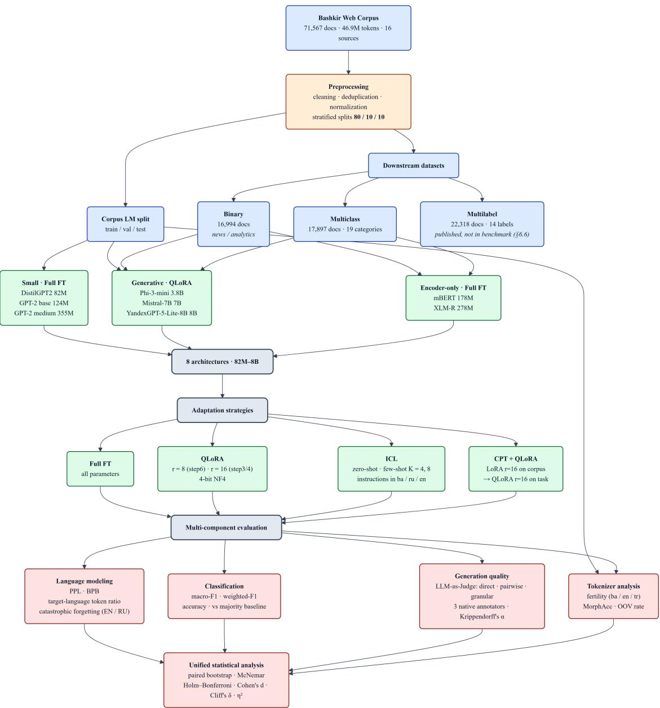

# Parameter-Efficient Adaptation of Large Language Models to a Low-Resource Agglutinative Language: A Corpus, Datasets, and a Reproducible Benchmark for the Bashkir Language

A Preprint

M. K. Arabov∗1 and S. S. Khaybullina†1

1Department of Data Analysis and Programming Technologies, Institute of Computational Mathematics and Information Technologies, Kazan (Volga Region) Federal University, Kazan, Russia

October 23, 2026

## Abstract

Bashkir is a low-resource agglutinative language written in Cyrillic and remains poorly represented in the ecosystem of modern large language models. This work presents an open resource suite for Bashkir and a systematic benchmark of large-language-model adaptation methods: the Bashkir Web Corpus (71,567 documents, 46.9 million tokens, 16 sources) and three labelled datasets for text classification: binary (16,994 documents), multiclass (17,897 documents, 19 categories) and multilabel (22,318 documents, 14 labels); the benchmark is conducted on the first two. Experiments are conducted on eight architectures in the 82M–8B parameter range (DistilGPT2, GPT-2 base, GPT-2 medium, Phi-3-mini, Mistral-7B, YandexGPT-5-Lite-8B, mBERT, XLM-R) and three groups of adaptation strategies: full fine-tuning, QLoRA and in-context learning (zero-shot and few-shot); the benefit of continual pretraining (CPT) on the Bashkir corpus is additionally investigated.

Four results constitute the main contribution of the work. First, QLoRA adaptation of 3.8–8B generative models outperforms full fine-tuning of encoder-only baselines on binary classification: YandexGPT-5-Lite-8B with CPT reaches a macro-F1 of 0.748 versus 0.653 for XLM-R and 0.650 for mBERT; in a pairwise comparison of accuracy for the step6 configurations (0.737 versus 0.659 and 0.652), the diference between QLoRA adaptation and the encoder-only baseline is significant after Holm correction for 15 comparisons $( p _ { \mathrm { H o l m } } < 0 . 0 0 1 )$ . Second, YandexGPT-5-Lite-8B significantly outperforms Mistral-7B and Phi-3-mini on multiclass classification, BPB and native-speaker ratings (mean 3.28 versus 2.52 and 2.22; � = 100; annotator agreement $\alpha = 0 . 6 9 { - } 0 . 7 7 ; p _ { \mathrm { H o l m } } < 0 . 0 5 ) $ zero-shot ICL shows a numerical advantage (0.58–0.68 versus 0.36–0.51 macro-F1), but no formal test was conducted for it; on binary classification, the numerical advantage of YandexGPT-5-Lite-8B is not statistically confirmed within the QLoRA group $( p _ { \mathrm { H o l m } } \ge 0 . 0 8 4 )$ . Third, the efect of CPT depends on both the base model and the task: on perplexity, CPT is significant for all three models but with opposite signs — it improves Phi-3-mini $\left( \Delta = + 0 . 5 8 \right)$ and YandexGPT-5-Lite-8B $( \Delta = + 0 . 3 3 )$ and worsens Mistral-7B $( \Delta = - 1 . 1 5 ,$ , � < 0.001); on binary classification, by contrast, CPT gives the largest gain precisely for Mistral-7B (+4.0 macro-F1 points). Fourth, tokeniser fertility on Bashkir varies by a factor of 2.67 (from 2.92 to 7.80) and is consistent with adaptation quality, whereas perplexity under diferent tokenisers is unsuitable for cross-model comparison.

Practical recommendations: under a limited computational budget, preference should be given to models with a Cyrillic tokeniser and Russian-language pretraining; for assessing generation quality in a low-resource language, direct scoring by LLM judges reproduces native-speaker ratings for grammar and coherence $( \rho = 0 . 3 3 – 0 . 4 6 )$ but not for language correctness $( \rho = 0 . 1 6 , p = 0 . 1 1 )$ ; native-speaker evaluation remains necessary. All artefacts — the corpus, datasets, experiment code and trained adapters — are released under open licences.

Keywords Bashkir language · low-resource languages · agglutinative languages · QLoRA · continual pretraining · tokenisation · LLM-as-Judge · reproducible benchmark

## 1 Introduction

Bashkir belongs to the Turkic language family and is one of the state languages of the Republic of Bashkortostan. Despite this, Bashkir has an extremely limited digital presence: the volume of machine-readable texts, annotated corpora and pretrained language models is substantially smaller than for languages with a high digital presence and than for a number of closely related Turkic languages.

Over the past few years, large language models have made a qualitative leap: growth in the number of parameters, the transition to instruction tuning, the emergence of parameter-eficient adaptation methods and open models have made large language models the main instrument of natural language processing com [2026], Burnashev et al. [2026]. This development, however, is unevenly distributed across languages. The overwhelming majority of modern models are trained on English, which leads to digital inequality: languages with a limited digital presence — including Bashkir — are efectively excluded from the ecosystem of modern language technologies.

This inequality manifests itself at three levels. First, tokenisers of multilingual models fragment agglutinative word forms into excessively long subsequences of subtokens, which reduces processing quality Eyupoglu [2019], Grechachin [2018]. Second, the absence of large open corpora limits the possibilities of both pretraining from scratch and continual training Khudiakova [2025]. Third, existing linguistic resources for Bashkir were created within a paradigm oriented towards search and aggregation of data rather than machine learning Sirazitdinov [2025].

The digitisation of the Bashkir language began in the 2000s and is associated primarily with the creation of the Machine Fund of the Bashkir Language — an integrated information system developed at the Institute of History, Language and Literature, Ufa Federal Research Centre, Russian Academy of Sciences (IIL UFRC RAS) since 2006 Sirazitdinov and Buskunbaeva [2010], Sirazitdinov [2025]. The structure of the Fund includes a general word list, lexicographic, grammatical and experimental-phonetic databases, catalogues of manuscript and early printed books, a dialectological database, and corpus databases of prose, journalistic and folklore texts Sirazitdinov [2025]. The total number of linguistic data databases exceeds 75. These resources became the basis for subsequent corpus and applied developments Sirazitdinov [2024].

However, the architecture of the Machine Fund, developed on the basis of the Oracle relational database management system, is oriented towards search and aggregation of linguistic information and is not intended for training neural network models. The resulting gap between accumulated linguistic data and modern machine-learning methods determined the need to create open corpora suitable for pretraining and fine-tuning transformer architectures.

In parallel, a strand emerged in Turkic studies concerned with the application of natural language processing methods to low-resource languages. Studies show that transfer of knowledge from closely related languages, multilingual training and parameter-eficient fine-tuning make it possible to achieve acceptable quality even with limited data volumes Saykhunov and Suleymanov [2019], Khusainov and Suleymanov [2021], Mirzakhalov et al. [2021], Gatiatullin et al. [2024], Suleymanov et al. [2026]. At the same time, until recently there were no systematic studies for Bashkir comparing diferent strategies for adapting large language models.

The relevance of this work is determined by three factors. First, Bashkir remains a low-resource language, and existing open corpora have a limited volume and source imbalance Khudiakova [2025]. Second, parameter-eficient fine-tuning methods that have proved themselves in other languages com [2026], Burnashev et al. [2026], Arabov et al. [2026a] have not been systematically tested on Bashkir material. Third, practical applications — machine translation Karpov [2026], Maxim [2026], Tyurin [2026], speech recognition and synthesis Radford et al. [2022], Orel et al. [2023], Bekarystankyzy et al. [2024], text classification Smetanina et al. [2020], Arabov et al. [2026a,b] — require reproducible benchmarks and open datasets, which remain insuficient for Bashkir.

This study aims to fill this gap. The work presents three groups of artefacts and results. The first group is resources: the open Bashkir Web Corpus with 46.9 million tokens, as well as three annotated datasets for binary, multiclass and multilabel classification. The second group is empirical results: the application of QLoRA to medium-scale generative models, an assessment of continual pretraining on the Bashkir corpus as a preliminary stage before downstream adaptation, a comparison of in-context learning strategies (zero-shot and few-shot) with parameter updates, and full fine-tuning of small architectures as a baseline. The third group is analysis: measurement of tokeniser fertility and validation of LLM judges against ratings by native Bashkir speakers. Experiments were conducted on eight large language model architectures in the range from 82M to 8B parameters: three small models of the GPT-2 family (DistilGPT2, GPT-2 base, GPT-2 medium), three medium-scale generative models (Phi-3-mini, Mistral-7B, YandexGPT-5-Lite-8B)

and two encoder-only baselines (mBERT, XLM-R). All artefacts — experiment code, preprocessing scripts, trained adapters and the corpus itself — are released under open licences to ensure reproducibility.

The study addresses four research questions. RQ1: How does QLoRA adaptation of generative models of 3,8–8B compare with full fine-tuning of encoder-only baselines (mBERT, XLM-R) on Bashkir text classification tasks? RQ2: Does continual pretraining on the Bashkir corpus produce a measurable gain in perplexity and downstream quality relative to QLoRA without CPT, and is the efect the same for diferent base models? RQ3: How is tokeniser fertility related to adaptation quality, and does it explain the gap between models with a Cyrillic vocabulary and a BPE vocabulary? RQ4: Do LLM judges reproduce the ratings of native Bashkir speakers, and which generation quality criteria remain inaccessible to automatic evaluation?

The work is organised as follows. Section 2 contains a review of the literature on the digitisation of the Bashkir language, corpus linguistics, the morphology of agglutinative languages, PEFT and the application of PEFT to Turkic languages. Section 3 describes the corpus, datasets, models, adaptation strategies, hyperparameters and metrics. Section 4 presents results on language modelling, continual pretraining, binary and multiclass classification, in-context learning, generation quality and tokeniser analysis. Section 5 discusses the factors behind the superiority of YandexGPT-5-Lite-8B, the selective efect of CPT, the divergence between LLM judges and native speakers, the role of tokenisation and practical recommendations. Section 6 formulates limitations, and Section 7 concludes and outlines directions for further work.

## 2 Related Work

## 2.1 Digitisation of the Bashkir Language and the Formation of Linguistic Resources

The first works describing the process of digitising the Bashkir language date from the early 2010s. The article Sirazitdinov and Buskunbaeva [2010] describes in detail the experience of creating national font layouts, the integration of the Bashkir language into operating systems together with Microsoft, and the conceptual foundations and launch of the information system “Machine Fund of the Bashkir Language”. For modern natural language processing, this work is a historical and methodological source explaining the origin and initial architecture of the main linguistic resource.

A generalising article is Khisamitdinova [2016], which summarises the development of Bashkir philology in the post-Soviet period. Particular attention is paid to the creation of the ten-volume “Academic Dictionary of the Bashkir Language” and the conversion of its dictionary databases into digital format — the creation of electronic glossaries and terminological data banks. These lexicographic developments subsequently became the basis for building morphological analysers and automatic dictionaries.

The most complete description of the structure and functional capabilities of the Machine Fund is presented in Sirazitdinov [2025]. The author describes the organisation of ten large sections of the Fund (general word list, lexicographic, grammatical, experimental-phonetic databases, catalogues of manuscript and early printed books, dialectological database, corpus databases). For natural language processing tasks, this material is the main source for understanding how the annotation of source data is organised and where aggregated characteristics are extracted from.

A retrospective analysis of scientific and practical activity in the field of applied linguistics at IIL UFRC RAS over more than 30 years is presented in Sirazitdinov [2024]. Over this period, an infrastructure was created for the functioning of the national language in computer technologies, theoretical foundations for an automatic morphological analyser, and phonetic, lexical and full-text linguistic databases, which made it possible to develop the information systems “Machine Fund of the Bashkir Language” and “Terminological Data Bank”.

## 2.2 Corpus Linguistics of the Bashkir Language

Practical aspects of creating corpora of the Bashkir language are considered in a number of works. In Ishmukhametova [2014], the experience of creating a subcorpus of literary texts of the Machine Fund is described: issues of data cleaning, tokenisation and formats for encoding metatextual annotation (genre, author, year) are considered. These aspects are fundamentally important for selecting and filtering quality data during pretraining of transformer models.

In Buskunbaeva et al. [2018], using the material of the folklore corpus, types of one-member sentences in the proverbial fund of the Bashkir language are described: the structural classification of proverbial constructions and the principles of their annotation in the corpus are considered. This material is important for developing syntactic analysers and for understanding how the annotation of folklore texts in Bashkir corpora is organised.

The dialectological aspect of corpus linguistics is presented in Sirazitdinov et al. [2016], which describes an applied component of the Machine Fund — an integrated Dialectological Database consisting of a lexical subfund, a textologica corpus and an atlas. For natural language processing tasks, the article is valuable for its description of the principles of annotation, tagging and computer recognition of regional variations of the Bashkir folklore and living continuum.

Issues of code-switching using the material of the journalistic corpus are considered in Buskunbaeva [2022]. Structural types of switches and borrowings are analysed, which is necessary for correct tokenisation, dataset cleaning and training transformer models to process the Russian–Bashkir bilingual context. This problem is particularly relevant because real Runet texts often contain a mixture of Russian and Bashkir.

The development of an audio corpus of the eastern dialect of the Bashkir language is the subject of Buskunbaeva and Sirazitdinov [2020]. The methodology of creating an audio corpus, the principles of phonetic and acoustic annotation, the digitisation of live recordings and the alignment of audio segments with text transcripts are described. This material is important for developers of voice assistants, speech recognition systems and speech synthesis models.

Parameters of oral speech segmentation using the material of a media audio corpus are studied in Khamitova and Sirazitdinov [2024]: using the ELAN program, syntagms and phrase volume are analysed. In the field of speech-to-text conversion, this publication provides mathematical and linguistic parameters for segmenting the audio stream and configuring acoustic models for Bashkir speech recognition.

Finally, the Bashqort Raw Corpus dataset Khudiakova [2025] is a collection of Bashkir texts intended for continual training of large language models. The resource is published on the Hugging Face platform and is one of the few open corpora of the Bashkir language.

## 2.3 Lexicography, Orthography and Formal Grammar

The transition of classical lexicography into the digital environment is considered in Yagafarova [2015]: the structure, strengths and weaknesses of existing electronic and online Bashkir dictionaries are analysed. In solving natural language processing tasks, these materials are used to develop automatic parsers, electronic glossaries and machine translation systems.

A fundamental classification of the principles of nomination and thematic groups of Bashkir vocabulary is presented in the doctoral dissertation Yagafarova [2019]. In IT developments, this structure is used to design Bashkir WordNet-like networks, build semantic ontologies, knowledge graphs and named entity extraction systems.

The principles of creating the information and reference portal on Bashkir orthography Belemle.ru are described in Yagafarova [2025]. For developers, the material is valuable for its description of standardised rules underlying spell-checking algorithms, automatic correction of typos and normalisation of Bashkir text before it is fed into neural network models.

The formalisation of Bashkir syntax from the standpoint of computer modelling is presented in Sirazitdinov [2021]: the author identifies strict models and schemes of verbal government using the material of generalised-personal proverbs. In natural language processing tasks, the formalisation of grammar makes it possible to specify rules for accurate semantic-syntactic parsing of text constructions.

## 2.4 Applied Platforms and Services

The software architecture of the Bashkortsoft ecosystem is considered in Gataullin and Mukhametov [2022]: modules for intelligent text analysis, an API for integrating Bashkir dictionaries into third-party IT solutions, algorithms for automatic spell-checking and normalisation of noisy user input are described. This material is important as an example of implementing applied text preprocessing pipelines before feeding data into neural networks.

The process of transferring scientific databases of the Machine Fund into commercial and publicly accessible web interfaces of the Bashkortsoft project is described in Sirazitdinov and Buskunbaeva [2021]. Technical problems of matching encodings, parsing large volumes of dictionary entries and optimising search queries for online translators operating in real time are considered.

The concept of collecting open legally clean datasets for training large language models is presented in Gataullin [2024]: problems of copyright in texts are analysed, and the integration of Bashkir translation on modern IT platforms is described. The architecture of the Bashkorttele repository, including audiobooks, annotated Bashkir epics and works by classical authors, is described in Yusupova and Gataullin [2026]. The data alignment format (each audio fragment is strictly aligned with text in Bashkir and Russian) makes this work a methodological guide for training speech-to-text systems.

Scaling of the Bashkorttele data repository is described in Kilsenbaev [2026]: the structure of a trilingual parallel spoken corpus of 10,000 phrases is disclosed, as well as the integration of an archive of live Bashkir speech with a volume of 53.3 hours of clean audio based on radio programmes of the State Television and Radio Broadcasting Company “Bashkortostan”.

## 2.5 Morphology of Agglutinative Languages

A two-level morphological description of the Bashkir language is presented in Eyupoglu [2019]: the description is based on a lexicon of root words, implemented using XML and connected to the Nuve framework. The phonetic rules of the Bashkir language are encoded using 41 two-level rules. This work is one of the few attempts at a formal description of Bashkir morphology in terms of two-level morphology.

A network model of agglutinative morphology based on graph theory is proposed in Grechachin [2018]. The model is implemented for modern Bashkir and for Old Turkic; on its basis, a morphological parser for the Old Turkic language was created.

A neuro-symbolic approach to the morphology of Bashkir nouns is developed in Isangulov et al. [2025, 2026]. In Isangulov et al. [2025], a hybrid method is presented that combines a large language model and a finite-state automaton to ensure morphological correctness during text generation in agglutinative languages: the system automatically extracts rules from corpus data, generates context-dependent regex rules and LEXC morphotactics; the integration of the finite-state automaton into the language-model loop improved machine translation quality from BLEU 16.14 / ChrF 45.13 to BLEU 25.71 / ChrF 50.87 without retraining the translator. In Isangulov et al. [2026], the previous version of the pipeline is extended: 69.60 % coverage was achieved and 174 of 250 forms were recognised on the same benchmark.

## 2.6 Turkic Languages: Corpora and Machine Translation

The principles of building multilingual Turkic corpora are considered in Saykhunov and Suleymanov [2019]: the architecture of cross-lingual models for closely related languages is studied, and transfer learning algorithms are proposed to improve the quality of machine translation and text classification in the low-resource Bashkir language.

A multilingual neural machine translation system for seven Turkic–Russian language pairs is presented in Khusainov and Suleymanov [2021]: parallel corpora with a total volume of about 7.9 million sentence pairs were created, and for the first time for Turkic languages, transfer learning experiments were conducted on a combined Russian–Turkic parallel corpus.

A large-scale study of machine translation in the Turkic language family is presented in Mirzakhalov et al. [2021]: a parallel corpus covering 22 Turkic languages was created, bilingual baseline models for 26 language pairs were proposed, as well as new test sets in three diferent translation domains.

The toolkit of the “Turkic Morpheme” portal for data augmentation in low-resource machine translation is described in Gatiatullin et al. [2024]: an augmentation method based on morphological translation showed an increase in machine translation quality by the BLEU metric, especially efectively for closely related languages with similar grammar and morphology.

Methods for creating machine translation systems for low-resource languages are considered in Suleymanov et al. [2026]: an approach combining data augmentation and knowledge transfer is proposed; BERT is chosen as the architecture, used both as an encoder and as a decoder. Parallel corpora with a total volume of about 30 million sentence pairs were collected.

The Russian–Bashkir parallel corpus BorisTM [2025] contains 9.7 million sentence pairs filtered by semantic similarity.   
The corpus combines real translations and synthetic data obtained by back-translation.

The application of parameter-eficient fine-tuning to the task of Russian–Bashkir machine translation is presented in Karpov [2026]: fine-tuning of nllb-200-distilled-600M with LoRA on synthetic data achieved chrF++ 46.94 for Bashkir. In Maxim [2026], adaptation of the Tencent HY-MT1.5-7B model with LoRA is described for correcting output from Arabic script to Cyrillic in Russian–Kazakh and Russian–Bashkir pairs. In Tyurin [2026], a comparative study of NLLB-200, M2M-100 and MarianMT architectures was conducted; the best system — a fine-tuned NLLB-200-1.3B with exact-match extraction — reached chrF++ 52.67.

## 2.7 Speech Processing for Turkic Languages

The Whisper speech recognition model Radford et al. [2022] was adapted to Bashkir by reducing the vocabulary to 16,384 tokens. The Bashkort TTS dataset bas is the largest open dataset for speech synthesis in Bashkir: 62,852 audio files, eight speakers and three speech styles.

Multilingual speech synthesis for Turkic languages using transliteration is presented in Yeshpanov et al. [2023]: a system based on Tacotron 2 was trained only on Kazakh data, and to generate speech in other Turkic languages, letters of the alphabets are mapped to International Phonetic Alphabet symbols, which are then converted into Kazakh letters.

Transfer learning from Kazakh for speech recognition of nine Turkic languages is studied in Orel et al. [2023]: most models built using transfer learning outperformed monolingual baselines; the most significant improvement was achieved for Yakut. Multilingual end-to-end speech recognition for five agglutinative Turkic languages with a common Cyrillic script is presented in Bekarystankyzy et al. [2024]: multilingual training improved recognition scores for all languages except Bashkir. In Bekarystankyzy et al. [2025], an integrated end-to-end multilingual speech recognition architecture is proposed, using Connectionist Temporal Classification and an attention mechanism with a language model.

## 2.8 Sentiment Analysis and Text Classification

A software solution for building classifiers for natural language text analysis is presented in Smetanina et al. [2020]: the task of sentiment analysis of Bashkir news texts is formulated, and a hybrid approach including dictionary-based methods and machine-learning methods is proposed. In Suleimanov et al. [2020], a formal description of the term “opinion”, the sentiment analysis task, approaches to its solution and ready-made software implementations are presented; the developed solution based on the support vector machine with stochastic gradient descent demonstrated the highest scores in terms of precision, recall and F-measure.

## 2.9 Parameter-Eficient Fine-Tuning

The methods of parameter-eficient fine-tuning arose as a response to the high cost of full fine-tuning of large language models. LoRA Hu et al. [2022] freezes pretrained weights and adds trainable low-rank matrices, which reduces the number of trainable parameters by several orders of magnitude. QLoRA Dettmers et al. [2023] extends this approach with 4-bit quantisation to the NF4 format, which makes it possible to fine-tune models with billions of parameters on a single GPU. DoRA Liu et al. [2024] decomposes pretrained weights into magnitude and direction, applying LoRA only to the direction update; this decomposition increases the learning capacity and stability of the method. QDoRA combines DoRA weight decomposition with 4-bit quantisation, which makes the method applicable under limited GPU memory.

In this work, QLoRA is used among the methods listed above: it is implemented in all PEFT experiments and forms the basis of the comparative analysis. Unquantised LoRA does not fit into 24 GB of NVIDIA L4 memory for 7–8B models and was not run in the configuration reported here; DoRA and QDoRA are planned as an extension and require further validation of compatibility with 4-bit quantisation in the Colab environment.

## 2.10 Application of PEFT to Turkic Languages

A comparative study of LoRA and QLoRA methods for the Bashkir language is presented in com [2026]: experiments were conducted on a corpus of 71 thousand documents (46.9 million tokens) using DistilGPT2, GPT-2, Phi-2, Qwen2.5- 7B, DeepSeek-7B and Mistral-7B. The best perplexity was obtained for GPT-2 medium with full fine-tuning (3.34), while QLoRA for Mistral-7B (3.79) and Phi-2 (3.81) achieved comparable quality with 40 times fewer trainable parameters.

Application of LoRA and QLoRA to the Tatar language is studied in Burnashev et al. [2026]: QLoRA adaptation of Mistral-7B reached a perplexity of 3.98 on the test set, comparable to fully fine-tuned gpt2-medium (2.91). Mistral-7B outperformed Qwen2.5-7B (perplexity 5.44) and DeepSeek-7B (perplexity 5.32) in adaptation to Tatar. Increasing the LoRA rank from 8 to 16 consistently improved performance across all architectures.

Combining classical and transformer approaches for text classification and topic modelling of the Tatar language is presented in Arabov et al. [2026a]: on a news corpus of 153,162 documents, classical approaches (TF-IDF+LR, FastText+LR) and transformer architectures (mBERT, XLM-R, DistilBERT) were systematically compared on three tasks — binary, multiclass (9 categories) and multilabel (13 categories).

Modelling subword embeddings for low-resource languages in the context of Industry 4.0 is presented in Arabov et al.   
[2026c]: using Tatar as an example, a comparative analysis of Word2Vec and FastText architectures was carried out;   
subword approaches using character n-grams significantly improved robustness to rare and unseen word forms.

A comprehensive study of Tatar text classification methods — from corpus creation and Tatar2Vec vector models to benchmark construction — is presented in Arabov et al. [2026b]: the TatCorp 222M corpus, TatarTokenizers tokenisers, Tatar2Vec models and an annotated dataset of 13,160 texts in ten topic categories were created. It was established that the use of subword BPE tokenisation in the task of topic categorisation of an agglutinative language systematically reduces classification quality.

## 3 Methodology

## 3.1 Overall Research Design

The experimental study is organised as a six-stage pipeline presented in Figure 1. In the first stage, the Bashkir Web Corpus is constructed. In the second, preprocessing and stratified splitting of the data in an 80/10/10 proportion are performed. In the third, three datasets for classification tasks are created from the news sources of the corpus: binary, multiclass and multilabel. In the fourth, eight large language model architectures are selected in the range from 82M to 8B parameters. In the fifth, three groups of adaptation strategies are applied: parameter-eficient fine-tuning, in-context learning and full fine-tuning. In the sixth, a multi-component evaluation is conducted using metrics of language modelling, classification, computational eficiency and generation quality. This organisation makes it possible to trace the path from the source data to the final conclusions sequentially and ensures the reproducibility of each stage.

## 3.2 The Bashkir Web Corpus

The resource basis of the study is the Bashkir Web Corpus BashkirNLPWorld [2026] — a corpus of the Bashkir language with a volume of 71,567 documents and about 46.9 million tokens, collected from 16 open internet resources including news portals, literary journals, social media, books and Wikipedia. The distribution of sources is uneven: the Bashkir Wikipedia (bawiki\_cyrillic) provides 42,262 documents, which constitutes 59.0% of the corpus, the portal azatliqorg provides 7,541 documents (10.5%), while the remaining 14 sources are represented by volumes from 151 to 2,139 documents and together cover 30.5%. A document is described by five fields: title (headline, available for 99.4% of documents), content (main text), category (topic category, 97.8%), source (source identifier) and text (the combined string title + content, prepared for input to the model). The corpus is available in two configurations: full (71,567 documents) and sample (1,000 documents for debugging). The licensing model follows the practice of large web corpora such as HPLT and OSCAR: the source texts retain the rights of authors and publishers, while the structured compilation, metadata and original annotations are distributed under the CC BY-SA 4.0 licence with an active notice-and-takedown procedure and a commitment to respond within 14 working days. The main limitation of the corpus is the imbalance of sources: 59% of documents belong to the encyclopaedic genre, which creates a stylistic shift towards the formal register. Additional limitations are the absence of publication dates, residual web noise and domain unevenness, which must be taken into account when training models and interpreting results.

## 3.3 Datasets for Downstream Tasks

Three datasets covering text classification tasks of varying complexity were formed on the basis of the news sources of the corpus. The binary classification dataset Arabov and Khaybullina [2026a] includes 16,994 documents with two balanced classes: news (label 1) and analysis (label 0), with 8,497 examples in each. The labelling was performed automatically on the basis of normalised source categories: all news categories were assigned to label 1, the rest to label 0. Balancing was achieved by undersampling, during which 7,434 analytical articles were removed. The data were collected from 14 Bashkir online sources, with azatliqorg providing 28% of the documents. The main limitations are related to the possible loss of diversity in the analysis class due to undersampling and to the incomplete correspondence of categories to the intuitive distinction between news and analysis.

The multiclass classification dataset Arabov and Khaybullina [2026b] includes 17,897 documents labelled with 19 topic categories; each document belongs to exactly one category. The threshold for category selection was set at 150 examples. The class distribution is strongly imbalanced: the category “News” (“Яңылыҡтар”) contains 8,497 documents, which constitutes 47.5% of the corpus, whereas the categories “Bashkortostan” and “History” are represented by only 156 and 159 documents (0.9% each). Intermediate categories include “Society” (15.8%), “Education” (4.2%), “Culture” (3.0%), “Religion” (2.1%) and “Sport” (1.0%).

The multilabel classification dataset Arabov and Khaybullina [2026c] includes 22,318 documents with 14 topic labels, where each document may belong to several categories simultaneously, and the average number of labels per document is 3.6. The labelling was performed automatically on the basis of keywords: for each label, a dictionary of Bashkir keywords was formed, which were scanned in the headline and text of the article, and in the absence of matches the original category of the document was applied. The most frequent label is “Society” with 12,251 occurrences (55.1%), the least frequent is “Fiction” with 1,880 occurrences (8.4%). The most common label pairs are “Religion + Society” (22.6%), “World + Society” (20.8%), “Bashkortostan + Society” (19.2%). The limitations of this dataset are related to the possible bias of keyword-based labelling and to the sparsity of rare labels.

For each of the three datasets, stratified splits in an 80/10/10 proportion are formed, preserving the proportions of sources and categories with a fixed random seed, which excludes data leakage between samples and ensures comparability of results. Preprocessing includes extraction of text from HTML markup, removal of duplicates, normalisation of categories and unification of document length; at the stage of dataset formation, length constraints from 50 to 10,000 characters were applied Arabov and Khaybullina [2026a,b,c], and for language modelling experiments the maximum sequence length was set to 128 tokens.

  
Figure 1: Overall experimental pipeline

## 3.4 Models

For the comparative analysis, eight open architectures were selected in the range from 82M to 8B parameters. All models are available for local deployment without proprietary APIs and are distributed under open licences (Apache 2.0 or MIT) permitting academic use. Computations were performed in the Google Colab Pro environment with an NVIDIA L4 GPU (24 GB), which imposes constraints on the maximum model size and GPU memory volume.

Group of small models for full fine-tuning. DistilGPT2 (82M), GPT-2 base (124M), GPT-2 medium (355M). These architectures fit into GPU memory without quantisation and allow full fine-tuning of all parameters, which provides a baseline for comparison with parameter-eficient methods.

Group of medium-scale generative models for PEFT and CPT. Phi-3-mini-4k-instruct (3.8B) — a compact instruction-tuned model with a 4K-token context; Mistral-7B-v0.3 (7B) — a reference architecture widely used in studies on low-resource languages com [2026], Burnashev et al. [2026]; YandexGPT-5-Lite-8B-instruct (8B) — a Russian-language model with a Cyrillic tokeniser, included to test the hypothesis that the language proximity of pretraining (Russian) provides priors for Bashkir. All three models are loaded in 4-bit NF4 quantisation.

Group of encoder-only models for classification. mBERT (bert-base-multilingual-cased, 178M) and XLM-R (xlm-roberta-base, 278M) — standard multilingual baseline architectures trained by full fine-tuning on the same data.

The computational environment imposes three constraints: the maximum model size is limited to ∼14B parameters under 4-bit quantisation; full fine-tuning is impossible for models above 2.7B parameters; the batch size for 7B–8B models is equal to one. These constraints do not afect the correctness of comparing methods within a single architecture, since all methods are applied to the same base model under identical conditions.

## 3.5 Adaptation Strategies

The work compares three groups of strategies for adapting large language models to the Bashkir language: parametereficient fine-tuning (PEFT), in-context learning (ICL) and full fine-tuning (Full FT). In addition, continual pretraining (CPT) is tested as a preliminary stage before PEFT adaptation.

Parameter-eficient fine-tuning. The first group includes two methods: LoRA Hu et al. [2022] and QLoRA Dettmers et al. [2023]. LoRA freezes the original parameters of the model and adds trainable low-rank matrices to the specified layers; rank � = 16 and scaling coeficient $\alpha = 2 r = 3 2$ are used for language modelling, dropout 0.05 and targeting of all linear layers (all-linear: attention projections and MLP blocks). QLoRA Dettmers et al. [2023] extends LoRA with 4-bit weight quantisation to the NF4 format and is applied to all generative models from 2.7B parameters, since quantisation reduces GPU memory requirements and allows models with billions of parameters to be fine-tuned on available resources.

In the paper configuration, the main analysis is conducted for QLoRA. Unquantised LoRA does not fit into 24 GB of NVIDIA L4 memory for 7–8B models (it requires ∼28–32 GB depending on sequence length and batch size), so in the paper preset for medium-scale generative models only QLoRA was run. For small models (DistilGPT2, GPT-2 base, GPT-2 medium), full fine-tuning was performed in the paper configuration (Section 4.1), which for these architectures fits into memory without quantisation and serves as a baseline. LoRA results for small models are not reported in the paper configuration.

For classification tasks (step6), QLoRA with rank � = 8 is used; for downstream adaptation after CPT (step4), QLoRA with rank $r = 1 6$ and $\alpha = 3 2$ . The diference in ranks is due to diferent memory budgets: in step6 the model must simultaneously hold the classification head and the test dataset in memory throughout the run, whereas in step4 downstream adaptation is performed sequentially by model, and rank � = 16 is permissible. Both configurations use the same value max\_seq\_len = 128.

Continual pretraining (CPT). To test the hypothesis of the benefit of additional pretraining on the Bashkir corpus, a separate series of experiments was conducted. LoRA adaptation $( r = 1 6 , \alpha = 3 2 )$ is applied to the base model on the Bashkir Web Corpus (10,000 documents, 1 epoch, $\mathrm { l r } = 1 0 ^ { - 5 } )$ , after which the adapter is merged into the base weights, and QLoRA adaptation $( r = 1 6 , \alpha = 3 2 )$ to the downstream task is performed on the resulting model. The series was conducted for three medium-scale generative models — Phi-3-mini, Mistral-7B and YandexGPT-5-Lite-8B. Two configurations are compared: qlora\_no\_cpt (QLoRA without CPT) and cpt\_then\_qlora (CPT + QLoRA).

In-context learning. The second group of strategies does not involve updating model parameters and includes two modes. In zero-shot mode, the model receives only the instruction without examples; in few-shot mode, 1, 4 or 8 examples in the prompt (the main analysis includes 4 and 8 as more stable; at � = 1 high variance across models and instruction languages is observed). Instructions are presented in three languages: Bashkir, Russian and English; the order of examples is varied. In the paper configuration, ICL was applied to five models: DistilGPT2, Phi-2, Phi-3-mini, Mistral-7B and YandexGPT-5-Lite-8B. DistilGPT2 and Phi-2 do not produce an answer in the required format “Answer: $0 / 1 ^ { , 9 }$ (the parser returns None), so their results in Section 4.5 are 0.000; GPT-2 base and GPT-2 medium were not run in the paper ICL configuration (Section 6.6). The comparison of PEFT and ICL answers the research question of what is more efective for the Bashkir language — updating parameters or in-context learning, given the weak representation of Bashkir in the pretraining of modern LLMs.

Full fine-tuning. The third group updates all parameters of the model on the training data. It is applied to small models (DistilGPT2, GPT-2 base, GPT-2 medium) and to encoder-only baselines (mBERT, XLM-R). For generative models above 2.7B parameters, full fine-tuning was not performed due to computational constraints (24 GB of NVIDIA L4 memory in Google Colab Pro).

Methods not included in the current anal sis. The methods DoRA Liu et al. [2024] and QDoRA, as well as ranks $r = 8$ for language modelling, are planned as an extension of this study. Their inclusion requires further validation of compatibility with 4-bit quantisation in the Colab environment and assessment of computational eficiency under limited GPU memory; therefore these configurations are not included in the current analysis.

## 3.6 Hyperparameters and Metrics

Training was performed using the Transformers (v5.x) and PEFT (v0.21+) libraries. The maximum sequence length is 128 tokens for language modelling and classification, 256 tokens for CPT. The optimiser is AdamW (via paged\_adamw\_8bit for 4-bit models).

The hyperparameters by experiment group are given in Table 1.

Table 1: Hyperparameters by experiment group
<table><tr><td>Group</td><td>lr</td><td>Epochs</td><td>Batch size</td><td>r</td></tr><tr><td>Full FT (step1)</td><td> $2 \times 1 0 ^ { - 4 }$ </td><td>3</td><td>8/4</td><td></td></tr><tr><td>QLoRA (step3)</td><td> $1 0 ^ { - 4 }$ </td><td>2</td><td>2/1</td><td>16</td></tr><tr><td>CPT (step4)</td><td> $1 0 ^ { - 5 }$ </td><td>1</td><td>1</td><td>16</td></tr><tr><td>Downstream QLoRA (step4)</td><td> $1 0 ^ { - 4 }$ </td><td>2</td><td>1</td><td>16</td></tr><tr><td>QLoRA CLS (step6)</td><td> $1 0 ^ { - 4 }$ </td><td>2</td><td>2/1</td><td>8</td></tr><tr><td>Encoder full FT (step6)</td><td> $2 \times 1 0 ^ { - 5 }$ </td><td>3</td><td>16</td><td></td></tr></table>

Random seeds. Two seeds (42, 123) were used for full fine-tuning, which allows the spread of metrics to be estimated For PEFT/CPT experiments, one seed (42) was used due to computational constraints. A single seed limits the statistical power of comparisons between PEFT configurations: the standard deviation of metrics across seeds is not estimated, and conclusions about the superiority of one QLoRA configuration over another are formulated on the basis of point estimates and bootstrap confidence intervals on the test set rather than between-seed variability.

Metrics. Evaluation is conducted across the following groups.

Language modelling. Perplexity on the test set, as well as bits-per-byte (BPB) — a metric normalised by the number of bytes and independent of vocabulary size com [2026], which allows models with diferent tokenisers to be compared.

Classification. Macro-F1 and weighted-F1 for binary and multiclass tasks. Due to the strong class imbalance in the multiclass dataset (47.5% of examples belong to one category), a majority baseline is additionally reported.

Computational eficiency. Number of trainable parameters (absolute and as a percentage of the total), training time and peak GPU memory consumption.

Generation quality. Target-language token ratio — a metric reflecting the model’s tendency to switch to other languages;   
computed for full FT and QLoRA experiments.

Tokeniser analysis. Fertility rate — the average number of subtokens per word on the Bashkir, English and Turkish test sets. Morphological Boundary Accuracy (MorphAcc) — the proportion of subtokens whose right boundary coincides with a morpheme boundary. OOV rate — the proportion of word forms split into individual bytes or characters. The ratio $\mathrm { f e r t i l i t y _ { b a } / f e r t i l i t y _ { t r } }$ is used as a measure of the penalty for low-resource status under fixed agglutinative morphology.

LLM-as-Judge. Three local LLM judges (pollux-judge-7b, M-Prometheus-7B, saiga\_llama3\_8b) are used to assess generation quality in three modes: direct scoring (rating on a 1–5 scale for grammar, coherence and language correctness), granular decomposition (morphology, lexicon, syntax) and pairwise ranking with control for presentation order. Human validation with three native Bashkir speakers $( n = 1 0 0 )$ showed Krippendorf’s $\alpha = 0 . 6 9 4 \mathrm { - } 0 . 7 7 2$ for the three criteria, which exceeds the threshold $\alpha \geq 0 . 6 6 7$ for acceptable agreement ?. Native-speaker ratings are used as a validation signal for LLM-as-Judge and as an independent assessment of generation quality; the sample of 100 texts is unbalanced across models (9–23 per model), which limits the statistical power of pairwise comparisons.

Statistical tests. For pairwise comparisons of accuracy on classification tasks, McNemar’s exact test is used; for paired continuous metrics (perplexity, BPB, native-speaker ratings), a paired bootstrap centred on the observed diference is used. Multiple comparisons are controlled by the Holm–Bonferroni correction with family-wise $\alpha = 0 . 0 5 ;$ the number of comparisons in the family is indicated in the caption of each table (5–18 depending on the section). The number of bootstrap iterations is indicated in the captions of the corresponding tables. Efect size is reported as Cohen’s � and Clif’s �; interpretation of � follows the thresholds negligible (< 0.147), small (0.147–0.33), medium (0.33–0.474), large (≥ 0.474).

## 3.7 Reproducibility

All research artefacts are released under open licences: the source code of the experiments, preprocessing scripts, trained adapters for all configurations presented in Section 4, and the Bashkir Web Corpus itself. The corpus is available in two configurations — full (71,567 documents) and sample (1,000 documents for debugging). The binary, multiclass and multilabel classification datasets are published as separate repositories on Hugging Face with fixed 80/10/10 splits and the random seed indicated.

For PEFT experiments (QLoRA, CPT + QLoRA), one random seed (42) was used; for full fine-tuning, two (42, 123) were used. A single seed for PEFT limits the statistical power of comparisons between methods; this limitation is discussed in more detail in Section 3.6, in the paragraph ‘Random Seeds’. Final confirmation of diferences between QLoRA configurations requires expanding the number of seeds to three or more.

## 4 Results

## 4.1 Language Modelling

The results of adaptation to language modelling are presented in Table 2. Full fine-tuning was applied to three models of the GPT-2 family, and QLoRA (� = 16) to three medium-scale generative models. Perplexity and bits-per-byte are reported together: PPL depends on the tokeniser and does not permit direct comparison of models with diferent vocabularies com [2026]; BPB is used as the primary metric for cross-model comparison.

Table 2: Language modelling: perplexity and bits-per-byte on the test set of the corpus (128 tokens). For Full FT, all parameters; for QLoRA, the proportion of trainable parameters and peak GPU memory
<table><tr><td>Model</td><td>Method</td><td>PPL</td><td>BPB</td><td>Target tokens (ba)</td><td>Trainable parameters, %</td><td>Peak memory, MB</td></tr><tr><td>GPT-2 medium</td><td>Full FT</td><td>2.33</td><td>0.784</td><td>0.271</td><td>100</td><td></td></tr><tr><td>GPT-2 base</td><td>Full FT</td><td>2.49</td><td>0.844</td><td>0.532</td><td>100</td><td></td></tr><tr><td>DistilGPT2</td><td>Full FT</td><td>2.69</td><td>0.917</td><td>0.566</td><td>100</td><td></td></tr><tr><td>Mistral-7B</td><td>QLoRA</td><td>2.90</td><td>0.549</td><td>0.598</td><td>1.10</td><td>4693</td></tr><tr><td>YandexGPT-5-Lite-8B</td><td>QLoRA</td><td>3.29</td><td>0.462</td><td>0.601</td><td>0.91</td><td>6543</td></tr><tr><td>Phi-3-mini</td><td>QLoRA</td><td>4.12</td><td>0.704</td><td>0.592</td><td>1.24</td><td>2563</td></tr></table>

The ranking by PPL and by BPB difers. By PPL, the lowest value is shown by GPT-2 medium (2.33), followed by GPT-2 base (2.49) and DistilGPT2 (2.69); the medium-scale QLoRA models occupy the positions Mistral-7B 2.90, YandexGPT-5-Lite-8B 3.29, Phi-3-mini 4.12. By BPB, YandexGPT-5-Lite-8B leads (0.462), followed by Mistral-7B (0.549) and Phi-3-mini (0.704); the GPT-2 family is at 0.784–0.917. The discrepancy is explained by the diference in tokenisers (Section 4.8): with a fertility rate of 7.80 for GPT-2 versus 3.80–4.81 for Mistral-7B and YandexGPT-5-Lite-8B, each GPT-2 token covers fewer characters, which underestimates perplexity at comparable next-byte prediction quality. The absolute PPL values in this work are lower than in com [2026] on the same corpus (GPT-2 medium: 2.33 versus 3.34; Mistral-7B QLoRA: 2.90 versus 3.79). The diference is explained by diferences in the evaluation procedure: this work uses truncation of test sequences to 128 tokens and per-token NLL aggregation (Section 6.5), whereas com [2026] used a diferent max\_seq\_len value and a diferent NLL aggregation scheme. The relative ordering of models by PPL and by BPB coincides between the works; BPB, which is invariant to the aggregation scheme, is used as the primary metric for cross-model comparison. Within the QLoRA group, the discrepancy between PPL and BPB is confirmed statistically: all six pairwise comparisons (PPL and BPB for three model pairs) are significant after Holm correction $( p _ { \mathrm { H o l m } } < 0 . 0 0 1$ , � = 2000; Table 3).

By BPB, QLoRA adaptation of Mistral-7B (0.549) and YandexGPT-5-Lite-8B (0.462) outperforms full fine-tuning of all three GPT-2 family models (0.784–0.917) with a trainable parameter proportion of 0.91–1.24 % and peak memory of 2.5–6.5 GB versus 100 % of parameters under Full FT. The result is consistent with observations for the Tatar language Burnashev et al. [2026]: QLoRA adaptation of 7B models is comparable to or exceeds full fine-tuning of small architectures with lower memory requirements.

Table 3: Pairwise comparisons of QLoRA models on perplexity and BPB (test set of the corpus, $n = 2 0 0 0$ examples). $\Delta = \mathrm { m e t r i c } _ { b } - \mathrm { m e t r i c } _ { a } ;$ a negative Δ means that model � is better. $p _ { \mathrm { H o l m } }$ is the Holm–Bonferroni correction for 6 comparisons
<table><tr><td>Comparison (a vs b)</td><td>∆PPL [95% CI]</td><td>PPPL</td><td></td><td>∆BPB [95% CI]</td><td>PBPB</td><td>Cohen&#x27;s d C</td></tr><tr><td>Mistral-7B vs Phi-3-mini</td><td>+1.226 [+1.137, +1.319]</td><td> $\overline { { < 0 . 0 0 1 } }$ </td><td></td><td>+0.155 [+0.150, +0.161]</td><td> $\overline { { < 0 . 0 0 1 } }$ </td><td>+0.43</td></tr><tr><td>Mistral-7B vs YandexGPT-5-Lite-8B</td><td>+0.394 [+0.359, +0.431]</td><td> $< 0 . 0 0 1$ </td><td></td><td>-0.087 [-0.091, -0.082]</td><td> $< 0 . 0 0 1$ </td><td>+0.17</td></tr><tr><td>Phi-3-mini vs YandexGPT-5-Lite-8B</td><td>-0.832 [-0.901, -0.760]</td><td>&lt; 0.001</td><td></td><td>-0.242 [-0.250, -0.233]</td><td> $< 0 . 0 0 1$ </td><td>-0.23</td></tr></table>

The proportion of target (Bashkir) tokens in generation is 0.27 for GPT-2 medium, 0.53–0.57 for GPT-2 base and DistilGPT2, and 0.59–0.60 for all three QLoRA models. The lowest proportion of Bashkir tokens is in GPT-2 medium (0.271, that is, 72.9 % of generated tokens belong to other languages, predominantly English); QLoRA maintains a higher proportion of Bashkir regardless of the base architecture.

Catastrophic forgetting. Full fine-tuning of all three small models is accompanied by degradation on the languages of the original pretraining. Table 4 reports perplexity and bits-per-byte on English (WikiText- $\cdot 2 , n = 2 0 0 )$ and Russian (Wikipedia, $n = 2 0 0 )$ before and after full fine-tuning, averaged over two seeds (42, 123); the diference between seeds does not exceed 5 %.

Table 4: Catastrophic forgetting: perplexity and BPB on English and Russian before and after full fine-tuning on Bashkir (� = 200 texts per language, average over two seeds)
<table><tr><td rowspan="2">Model</td><td colspan="2">English (WikiText-2)</td><td colspan="2">Russian (Wikipedia)</td></tr><tr><td> $\mathrm { P P L } _ { \mathrm { b a s e } }  \mathrm { a f t e r }$ </td><td> $\mathbf { B P B _ { b a s e } }  \mathrm { a f t e r }$ </td><td> $\overline { { \mathrm { P P L } _ { \mathrm { b a s e } }  \mathrm { a f t e r } } }$ </td><td> $\overline { { \mathrm { B P B } _ { \mathrm { b a s e } }  \mathrm { a f t e r } } }$ </td></tr><tr><td>GPT-2 medium</td><td> $\overline { { 3 9 . 5 8 \to 1 5 0 4 . 6 7 } }$ </td><td> $\overline { { 1 . 1 6 2 \to 2 . 3 1 0 } }$ </td><td> $\overline { { 9 . 1 1  1 4 . 4 5 } }$ </td><td> $\overline { { 1 . 8 5 4 \to 2 . 2 4 1 } }$ </td></tr><tr><td>GPT-2 base</td><td> $5 4 . 4 9  4 1 2 1 . 1 7$ </td><td> $1 . 2 6 3  2 . 6 3 0$ </td><td> $1 1 . 0 7  1 4 . 1 4$ </td><td> $2 . 0 1 8  2 . 2 2 3$ </td></tr><tr><td>DistilGPT2</td><td> $7 8 . 0 5  2 9 6 3 . 0 8$ </td><td> $1 . 3 7 7  2 . 5 2 6$ </td><td> $1 2 . 6 6 \to 1 4 . 8 7$ </td><td> $2 . 1 3 1  2 . 2 6 6$ </td></tr></table>

By perplexity on English, the degradation is 38–76 times; by BPB, it is 1.83–2.08 times $( 1 . 1 6 { - } 1 . 3 8 \to 2 . 3 1 { - } 2 . 6 3 )$ . The discrepancy is explained by the mechanism described in Section 6.5: after fine-tuning on Bashkir, the model shifts the distribution towards Bashkir BPE tokens, and the number of tokens for encoding English text changes; $\mathrm { P P L } ,$ normalised per token, increases, whereas BPB, normalised per byte, grows moderately. BPB is used as the primary metric for retention of the original competence.

Three observations follow from BPB. First, model size in the range 82M–355M does not reduce forgetting: GPT-2 medium (355M, 1.99×) degrades at the level of DistilGPT2 (82M, 1.83×), and GPT-2 base (124M) degrades the most (2.08×). Forgetting is determined by the domain shift of pretraining rather than by model capacity. Second, degradation on English and Russian difers: English BPB grows by a factor of 1.8–2.1, Russian by a factor of 1.06–1.21. The reason is the overlap of the Cyrillic vocabularies of Bashkir and Russian: fine-tuning on Bashkir does not displace Russian BPE tokens from the distribution, whereas it does displace English ones. Third, forgetting correlates with the proportion of target tokens (Table 2): GPT-2 medium, with the lowest proportion of Bashkir tokens (0.271), shows the greatest switching to English during generation.

QLoRA on 7–8B models (Table 2) preserves a Bashkir proportion of 0.59–0.60 without updating the original weights and is not subject to the observed forgetting. A direct comparison of forgetting between Full FT and QLoRA was not performed: the QLoRA experiments used a single seed and did not save per-example NLL for EN/RU (Section 6.5).

## 4.2 Continual Pretraining

The comparison of the qlora\_no\_cpt and cpt\_then\_qlora configurations is presented in Table 5. Perplexity is computed on the test set of the corpus for the QLoRA-adapted classification model (after applying the CPT adapter and the downstream adapter) and reflects the model’s ability to retain language modelling after adaptation to the classification task. It is not comparable with the perplexity in Table 2, since the models have undergone a diferent set of adaptations. $\mathrm { P P L } _ { \mathrm { n o - C P T } }$ and PPL are reported (rounded to two decimal places), together with the diference $\Delta \mathrm { P \bar { P } L = \mathrm { P P L } _ { n o - C P T } - \mathrm { P P L } _ { C P T + \mathrm { Q L o R A } } }$ (a positive value means that CPT reduces perplexity), the $p \mathrm { - }$ value corrected for multiple comparisons (Holm–Bonferroni correction) and the efect size Clif’s �.

Perplexity aggregation. The PPL values in Table 5 are computed as the aggregate exp $\textstyle \sum _ { i } { \mathrm { N L L } } _ { i } / \sum _ { i }$ tokens�) over all documents of the test set, rather than as the mean per-example $\overline { { \mathrm { e x p } ( { \mathrm { N L L } } _ { i } / \mathrm { t o k e n s } _ { i } ) } }$ . By Jensen’s inequality, these quantities do not coincide, and the mean per-example diference is larger in absolute value than the aggregate diference for all three models: for Mistral-7B −1.46 versus −1.15, for Phi-3-mini +0.64 versus +0.58, and for YandexGPT-5-Lite-8B

+0.39 versus +0.33. The ΔPPL and �-values in Table 5 are computed from unrounded aggregate values. The efect size Clif’s � is computed at the per-example level (exp $\mathrm { \bf N L L } _ { i } / \mathrm { t o k e n s } _ { i } ) )$ and characterises the consistency of the sign of the diference across individual documents.  
Table 5: Efect of continual pretraining on the perplexity of the downstream-adapted model. PPL is the aggregate ex ${ \sf 2 N L L } / { \sum }$ tokens); Clif’s � is at the per-example level
<table><tr><td>Model</td><td> $\overline { { \mathrm { P P L } _ { \mathrm { n o - C P T } } } }$ </td><td> $\overline { { \mathrm { P P L } _ { \mathrm { C P T + Q L o R A } } } }$ </td><td>∆PPL</td><td> ${ \underline { { p _ { \mathrm { H o l m } } } } }$ </td><td> $\overline { { \mathrm { C l i f f s } \delta } }$ </td></tr><tr><td>Mistral-7B</td><td>20.48</td><td>21.63</td><td>-1.15</td><td> $\overline { { < 0 . 0 0 1 } }$ </td><td>large</td></tr><tr><td>Phi-3-mini</td><td>35.81</td><td>35.23</td><td> $+ 0 . 5 8 < 0 . 0 0 1$ </td><td></td><td>large</td></tr><tr><td>YandexGPT-5-Lite-8B</td><td>12.70</td><td>12.37</td><td> $+ 0 . 3 3 \mathrm { ~  ~ { ~ \mathopen { ~ \displaystyle ~ < ~ 0 . 0 0 1 } } ~ }$ </td><td></td><td>large</td></tr></table>

CPT reduces perplexity by 0.33 points for YandexGPT-5-Lite-8B and by 0.58 points for Phi-3-mini; after Holm– Bonferroni correction, both diferences are significant $( p < 0 . 0 0 1 )$ , and the efect size Clif’s � corresponds to large. For Mistral-7B, CPT increases perplexity by 1.15 points; the efect is also significant $( p < 0 . 0 0 1$ , Clif’s � large, negative sign). The direction of the CPT efect on perplexity difers across models: CPT improves language modelling for Phi-3-mini and YandexGPT-5-Lite-8B and worsens it for Mistral-7B.

On the binary classification task (Section 4.3), the CPT efect has a diferent direction. YandexGPT-5-Lite-8B shows the same macro-F1 in both configurations (0.748 with CPT and 0.748 without); Mistral-7B gains +4.0 points $( 0 . 6 8 1  0 . 7 2 1 ) ;$ Phi-3-mini gains $+ 2 . { \bar { 7 } }$ points (0.674 → 0.701). For Mistral-7B, the directions of the CPT efect on LM and on downstream classification are opposite: perplexity increases by 1.15 points, while macro-F1 increases by 4.0 points. For Phi-3-mini and YandexGPT-5-Lite-8B, both efects are positive or neutral.

On the multiclass classification task (Section 4.4), CPT yields a macro-F1 gain for YandexGPT-5-Lite-8B (0.332 → 0.366, +0.034) and Phi-3-mini $( 0 . 1 5 4  0 . 1 6 6 , + 0 . 0 1 2 )$ , and a decrease for Mistral-7B $( 0 . 2 9 8 \to 0 . 2 8 3 , - 0 . 0 1 5 )$

The CPT efect depends on the base model and the task. On perplexity, CPT is positive for Phi-3-mini and YandexGPT-5- Lite-8B and negative for Mistral-7B. On binary classification, CPT is positive for Mistral-7B and Phi-3-mini and neutral for YandexGPT-5-Lite-8B. On multiclass classification, CPT is positive for YandexGPT-5-Lite-8B and Phi-3-mini and negative for Mistral-7B. Improvement in language modelling does not translate unambiguously into improvement in classification. Separation of the efects of CPT and downstream training (for example, evaluating classification only after the CPT adapter, without QLoRA) was not performed in this work.

## 4.3 Binary Classification

The results on the binary classification task (news vs analysis) are presented in Table 6. Three groups of configurations are included: full fine-tuning of small GPT-2 family models, QLoRA adaptation of medium-scale generative models (without CPT with rank � = 8 in step6; without CPT or with CPT with rank � = 16 in step4), and full fine-tuning of encoder-only baselines. The majority baseline is given as a lower bound.

The best result without CPT by point estimate is YandexGPT-5-Lite-8B (0.736 in step6, $r = 8 ; 0 . 7 4 8$ in step4, $r = 1 6 )$ which is higher than XLM-R (0.653) by 8.3–9.5 points of macro-F1 and than mBERT (0.650) by 8.6–9.8 points. Mistral-7B without CPT is 0.681–0.709, with CPT 0.721. Phi-3-mini without CPT is 0.674–0.702, with CPT 0.701. The gap with the majority baseline (0.342) is 33–41 points of macro-F1 (from 0.674 for Phi-3-mini without CPT to 0.748 for YandexGPT-5-Lite-8B with CPT).

Pairwise comparisons on accuracy (paired bootstrap, McNemar, Holm correction for 15 comparisons; Table 7) refine the picture. Within the step6 QLoRA group, the diferences are not significant: Yandex vs Mistral $p _ { \mathrm { H o l m } } = 0 . 1 8 3$ Yandex vs Phi-3 $p _ { \mathrm { H o l m } } ~ = ~ 0 . 0 8 4$ , Mistral vs Phi-3 $p _ { \mathrm { H o l m } } \ = \ 0 . 8 8 2$ All three QLoRA models significantly outperform mBERT $( p _ { \mathrm { H o l m } } ~ \leq ~ 0 . 0 1 8 )$ , XLM-R $( p _ { \mathrm { H o l m } } ~ \le ~ 0 . 0 5 0 )$ and the majority baseline $( p _ { \mathrm { H o l m } } ~ < ~ 0 . 0 0 1 )$ The point advantage of YandexGPT-5-Lite-8B within the QLoRA group is not statistically confirmed; what is robust is the superiority of QLoRA adaptation over the encoder-only baseline. Table 7 presents five comparisons involving YandexGPT-5-Lite-8B as the model with the best point estimate; the remaining ten comparisons (among Mistral-7B, Phi-3-mini, mBERT, XLM-R and the majority baseline) are available in the replication package (step6\_results/tab\_binary\_cross\_model\_stats.tex).

Full fine-tuning of small GPT-2 family models yields macro-F1 0.693–0.699, which is comparable to Phi-3-mini QLoRA (0.702 in step6) with a parameter count of 82M–355M versus 3.8B. The result is consistent with observations for the Tatar language Arabov et al. [2026a]: for classification tasks, small architectures with full fine-tuning achieve quality close to QLoRA on 7B models.

Table 6: Binary classification (news vs analysis): macro-F1, weighted-F1 and accuracy. QLoRA in step6 uses rank � = 8; QLoRA in step4 (with and without CPT) uses rank � = 16
<table><tr><td>Model</td><td>Method</td><td>macro-F1</td><td>weighted-F1</td><td>Accuracy</td><td> $\underline { n } _ { \mathrm { s e e d } }$ </td></tr><tr><td colspan="6">Full fine-tuning (small models)</td></tr><tr><td>GPT-2 medium</td><td>Full FT</td><td>0.699</td><td>0.700</td><td>0.702</td><td>2</td></tr><tr><td>GPT-2 base</td><td>Full FT</td><td>0.698</td><td>0.697</td><td>0.700</td><td>2</td></tr><tr><td>DistilGPT2</td><td>Full FT</td><td>0.693</td><td>0.693</td><td>0.696</td><td>2</td></tr><tr><td colspan="6">QLoRA without CPT (step6, r = 8)</td></tr><tr><td>YandexGPT-5-Lite-8B</td><td>QLoRA</td><td>0.736</td><td>0.736</td><td>0.737</td><td>1</td></tr><tr><td>Mistral-7B</td><td>QLoRA</td><td>0.709</td><td>0.708</td><td>0.713</td><td>1</td></tr><tr><td>Phi-3-mini</td><td>QLoRA</td><td>0.702</td><td>0.702</td><td>0.702</td><td>1</td></tr><tr><td colspan="6">QLoRA without CPT and CPT + QLoRA (step4, r = 16)</td></tr><tr><td>YandexGPT-5-Lite-8B</td><td>QLoRA (no CPT)</td><td>0.748</td><td>0.748</td><td>0.748</td><td>1</td></tr><tr><td>YandexGPT-5-Lite-8B</td><td>CPT + QLoRA</td><td>0.748</td><td>0.748</td><td>0.748</td><td>1</td></tr><tr><td>Mistral-7B</td><td>QLoRA (no CPT)</td><td>0.681</td><td>0.681</td><td>0.681</td><td>1</td></tr><tr><td>Mistral-7B</td><td>CPT + QLoRA</td><td>0.721</td><td>0.721</td><td>0.721</td><td>1</td></tr><tr><td>Phi-3-mini</td><td>QLoRA (no CPT)</td><td>0.674</td><td>0.673</td><td>0.678</td><td>1</td></tr><tr><td>Phi-3-mini</td><td>CPT + QLoRA</td><td>0.701</td><td>0.701</td><td>0.701</td><td>1</td></tr><tr><td colspan="6">Encoder-only baseline (full fine-tuning)</td></tr><tr><td>XLM-R</td><td>Full FT</td><td>0.653</td><td>0.652</td><td>0.659</td><td>1</td></tr><tr><td>mBERT</td><td>Full FT</td><td>0.650</td><td>0.651</td><td>0.652</td><td>1</td></tr><tr><td colspan="6">Baseline</td></tr><tr><td>Majority</td><td></td><td>0.342</td><td>0.356</td><td>0.520</td><td>1</td></tr></table>

Table 7: Binary classification: key pairwise comparisons on accuracy (paired bootstrap, McNemar, Holm correction for 15 comparisons). $\Delta = \operatorname { a c c } _ { b } - \operatorname { a c c } _ { a } ;$ a positive Δ means that model � is better
<table><tr><td>Comparison (a vs b)</td><td> $\operatorname { a c c } _ { a }$ </td><td>accb</td><td>∆[95% CI]</td><td></td><td>PHolm</td></tr><tr><td>Yandex vs Mistral</td><td>0.737</td><td>0.713</td><td></td><td>-0.024 [-0.050, +0.001]</td><td>0.183</td></tr><tr><td>Yandex vs Phi-3</td><td>0.737</td><td>0.702</td><td></td><td>-0.035 [-0.064, -0.004]</td><td>0.084</td></tr><tr><td>Yandex vs mBERT</td><td>0.737</td><td>0.652</td><td></td><td>-0.085 [-0.117, -0.053]</td><td>&lt; 0.001</td></tr><tr><td>Yandex vs XLM-R</td><td>0.737</td><td>0.659</td><td></td><td>-0.078[-0.109, -0.047]</td><td>&lt; 0.001</td></tr><tr><td>Yandex vs majority</td><td>0.737</td><td>0.520</td><td></td><td>-0.217 -0.260,-0.171]</td><td>&lt; 0.001</td></tr></table>

The comparison of the CPT efect on downstream classification is conducted in the step4 configuration (rank � = 16, Table 6). CPT improves macro-F1 for Mistral-7B (0.681 → 0.721, +4.0 points) and Phi-3-mini (0.674 → 0.701, +2.7 points), while for YandexGPT-5-Lite-8B the result does not change (0.748 in both configurations). The largest gain from CPT is observed for Mistral-7B, the model for which CPT reduces language modelling quality (Section 4.2). The directions of the CPT efect on LM and on downstream for Mistral-7B are opposite.

The coincidence of metrics for YandexGPT-5-Lite-8B after rounding to three decimal places in both configurations (step4 no CPT and step4 CPT + QLoRA) requires explanation. The exact values difer at the fifth–sixth decimal place: macro-F1 0.747964 (no CPT) versus 0.747996 (CPT + QLoRA); weighted-F1 0.748085 versus 0.748036; accuracy 0.748 in both cases. The per-example NLL for the two runs difer, that is, the CPT adapter was applied correctly, and the coincidence of aggregated metrics after rounding reflects the stability of the threshold decision on the test set: both configurations yield the same set of correct answers under somewhat diferent probability distributions. This limits the interpretation of the CPT efect for YandexGPT-5-Lite-8B: on this task CPT neither improves nor worsens classification quality, but it does not lead to an identical internal state of the model either.

The diference between the two QLoRA configurations without CPT (step6, � = 8; step4, � = 16) for YandexGPT-5- Lite-8B is 0.012 (0.736 versus 0.748) in favour of the larger rank. For Mistral-7B and Phi-3-mini the diference is opposite (0.709 versus 0.681; 0.702 versus 0.674). The result diverges from the observation in Burnashev et al. [2026] of a stable improvement with � = 16; in our experiments � = 16 helps only YandexGPT-5-Lite-8B. Possible reasons are the diferent volume of training data (10, 000 documents versus a larger corpus in Burnashev et al. [2026]), the type of task (language modelling versus classification) and the type of base model (Cyrillic tokeniser versus BPE). The CPT + QLoRA configuration in step4 for all three models yields a comparable or higher result than QLoRA without CPT in both configurations: YandexGPT-5-Lite-8B 0.748 versus 0.736 (step6) and 0.748 (step4 no CPT); Mistral-7B 0.721 versus 0.709 and 0.681; Phi-3-mini 0.701 versus 0.702 and 0.674.

## 4.4 Multiclass Classification

The results on the multiclass classification task (19 categories) are presented in Table 8. The classes are imbalanced: 47.5 % of documents belong to the category “Новости”. Three QLoRA configurations are included: without CPT in step6 (rank � = 8); without CPT and with CPT in step4 (rank � = 16).

Table 8: Multiclass classification (19 categories): macro-F1, weighted-F1 and accuracy. QLoRA in step6 uses rank � = 8; QLoRA in step4 (with and without CPT) uses rank � = 16
<table><tr><td>Model</td><td>Method</td><td>macro-F1</td><td>weighted-F1</td><td>Accuracy</td><td> $\underline { n } _ { \mathrm { s e e d } }$ </td></tr><tr><td colspan="6">QLoRA (medium-scale generative models)</td></tr><tr><td>YandexGPT-5-Lite-8B</td><td>QLoRA (step6)</td><td>0.368</td><td>0.570</td><td>0.606</td><td>1</td></tr><tr><td>YandexGPT-5-Lite-8B</td><td>QLoRA no CPT (step4)</td><td>0.332</td><td>0.545</td><td>0.573</td><td>1</td></tr><tr><td>YandexGPT-5-Lite-8B</td><td>CPT + QLoRA (step4)</td><td>0.366</td><td>0.567</td><td>0.595</td><td>1</td></tr><tr><td>Mistral-7B</td><td>QLoRA (step6)</td><td>0.292</td><td>0.510</td><td>0.547</td><td>1</td></tr><tr><td>Mistral-7B</td><td>QLoRA no CPT (step4)</td><td>0.298</td><td>0.512</td><td>0.542</td><td>1</td></tr><tr><td>Mistral-7B</td><td>CPT + QLoRA (step4)</td><td>0.283</td><td>0.503</td><td>0.537</td><td>1</td></tr><tr><td>Phi-3-mini</td><td>QLoRA (step6)</td><td>0.119</td><td>0.430</td><td>0.506</td><td>1</td></tr><tr><td>Phi-3-mini</td><td>QLoRA no ČPT (step4)</td><td>0.154</td><td>0.454</td><td>0.526</td><td>1</td></tr><tr><td>Phi-3-mini</td><td>CPT + QLoRA (step4)</td><td>0.166</td><td>0.445</td><td>0.510</td><td>1</td></tr><tr><td colspan="6">Full fine-tuning (small models)</td></tr><tr><td>GPT-2 medium</td><td>Full FT</td><td>0.122</td><td>0.439</td><td>0.516</td><td>2</td></tr><tr><td>GPT-2 base</td><td>Full FT</td><td>0.083</td><td>0.401</td><td>0.489</td><td>2</td></tr><tr><td>DistilGPT2</td><td>Full FT</td><td>0.071</td><td>0.393</td><td>0.483</td><td>2</td></tr><tr><td colspan="6">Encoder-only baseline (full fine-tuning)</td></tr><tr><td>mBERT</td><td>Full FT</td><td>0.053</td><td>0.379</td><td>0.498</td><td></td></tr><tr><td>XLM-R</td><td>Full FT</td><td>0.034</td><td>0.301</td><td>0.470</td><td>1 1</td></tr><tr><td colspan="6">Baseline</td></tr><tr><td>Majority</td><td></td><td>0.034</td><td>0.301</td><td>0.470</td><td>1</td></tr></table>

The maximum macro-F1 value is 0.368 — YandexGPT-5-Lite-8B in the step6 QLoRA (0.368) and step4 CPT + QLoRA (0.366) configurations. QLoRA without CPT in step4 gives 0.332 for the same model. For Mistral-7B the range is 0.283–0.298, for Phi-3-mini 0.119–0.166, and for GPT-2 family models 0.071–0.122. Encoder-only baselines give macro-F1 0.034–0.053 with a majority baseline of 0.034.

Pairwise comparisons on accuracy (paired bootstrap, McNemar, Holm correction for 15 comparisons; Table 9) refine the picture. On the multiclass task, within the QLoRA group all diferences are significant: Yandex vs Mistral $p _ { \mathrm { H o l m } } ~ < ~ 0 . 0 0 1$ , Yandex vs Phi-3 $p _ { \mathrm { H o l m } } ~ < ~ 0 . 0 0 1$ , Mistral vs Phi-3 $p _ { \mathrm { H o l m } } ~ = ~ 0 . 0 3 0 .$ XLM-R does not difer from the majority baseline (accuracy 0.470 versus 0.470, McNemar $p \ = \ 1 . 0 0 0 )$ : the model did not adapt to the task. mBERT outperforms the majority baseline statistically significantly but by a small margin (accuracy 0.498 versus 0.470, Δ = +0.028 [+0.010, +0.047], $p _ { \mathrm { H o l m } } ~ = ~ 0 . 0 0 6 )$ Phi-3-mini does not difer from mBERT (accuracy 0.506 versus 0.498, $p _ { \mathrm { H o l m } } = 1 . 0 0 0 )$ . Table 9 presents five key comparisons; the remaining ten (among all six models, including mBERT, XLM-R and the majority baseline) are available in the replication package (step6\_results/tab\_multiclass\_cross\_model\_stats.tex).

Table 9: Multiclass classification: key pairwise comparisons on accuracy (paired bootstrap, McNemar, Holm correction for 15 comparisons). $\Delta = \operatorname { a c c } _ { b } - \operatorname { a c c } _ { a } ;$ a positive Δ means that model � is better
<table><tr><td>Comparison (a vs b)</td><td> $\operatorname { a c c } _ { a }$ </td><td>accb</td><td></td><td>∆[95% CI]</td><td>PHolm</td></tr><tr><td>Yandex vs Mistral</td><td>0.606</td><td>0.547</td><td></td><td>-0.059 [-0.087, -0.031]</td><td>&lt; 0.001</td></tr><tr><td>Yandex vs Phi-3</td><td>0.606</td><td>0.506</td><td></td><td>-0.100 [-0.128, -0.072]</td><td>&lt; 0.001</td></tr><tr><td>Mistral vs Phi-3</td><td>0.547</td><td>0.506</td><td></td><td>-0.041 [-0.069, -0.013]</td><td>0.030</td></tr><tr><td>XLM-R vs majority</td><td>0.470</td><td>0.470</td><td></td><td>+0.000 [+0.000, +0.000]</td><td>1.000</td></tr><tr><td>Phi-3 vs mBERT</td><td>0.506</td><td>0.498</td><td></td><td>-0.008 [-0.031, +0.015]</td><td>1.000</td></tr></table>

The CPT efect within the step4 configuration (rank $r = 1 6 )$ : CPT yields a macro-F1 gain for YandexGPT-5-Lite-8B (0.332 → 0.366, +0.034) and Phi-3-mini $( 0 . 1 5 4  0 . 1 6 6 , + 0 . 0 1 \dot { 2 } )$ , and a decrease for Mistral-7B (0.298 → 0.283, −0.015). The directions of the CPT efect on the multiclass task coincide with the directions on perplexity (Section 4.2): CPT is positive for YandexGPT-5-Lite-8B and Phi-3-mini, negative for Mistral-7B.

## 4.5 In-Context Learning

The ICL results on the binary task are presented in Table 10. In the paper configuration of ICL, five models were run: DistilGPT2, Phi-2, Phi-3-mini, Mistral-7B and YandexGPT-5-Lite-8B. DistilGPT2 and Phi-2 do not produce an answer in the required format “Answer: $0 / 1 ^ { , 9 }$ (the parser returns None), so their results are 0.000 and are not included in Table 10; GPT-2 base and GPT-2 medium were not run in the paper ICL configuration. The table includes three medium-scale generative models that showed non-zero results.

Table 10: ICL on the binary task: macro-F1 by instruction language and number of examples in the prompt
<table><tr><td rowspan="2">Model</td><td colspan="3">Bashkir (ba)</td><td colspan="3">Russian (ru)</td><td colspan="3">English (en)</td></tr><tr><td>0</td><td>4</td><td>8</td><td>0</td><td>4</td><td>8</td><td>0</td><td>4</td><td>8</td></tr><tr><td>YandexGPT-5-Lite-8B</td><td>0.580</td><td>0.579</td><td>0.634</td><td>0.657</td><td>0.640</td><td>0.565</td><td>0.679</td><td>0.583</td><td>0.627</td></tr><tr><td>Mistral-7B</td><td>0.360</td><td>0.315</td><td>0.421</td><td>0.482</td><td>0.414</td><td>0.452</td><td>0.411</td><td>0.558</td><td>0.397</td></tr><tr><td>Phi-3-mini</td><td>0.513</td><td>0.444</td><td>0.411</td><td>0.506</td><td>0.457</td><td>0.516</td><td>0.400</td><td>0.574</td><td>0.650</td></tr></table>

For YandexGPT-5-Lite-8B, the maximum macro-F1 is achieved in zero-shot (0.657 for Russian, 0.679 for English) and with 8 examples in Bashkir (0.634); adding 4 examples yields no gain. For Phi-3-mini, the largest gain relative to zero shot is observed on moving to 8 examples in English $( 0 . 4 \dot { 0 } 0  0 . 6 \dot { 5 } 0 , + 2 5$ points of macro-F1); in Bashkir, few-shot has a negative efect $( 0 . 5 1 3 \stackrel { - } {  } 0 . 4 1 1 )$ . For Mistral-7B, few-shot yields a gain with 4 examples in English $( 0 . 4 1 1  0 . 5 5 8 )$ and with 8 examples in Bashkir $( 0 . 3 6 0  0 . 4 2 1 )$ ; 8 examples in English reduce quality $( 0 . 5 5 8 \to 0 . 3 9 7 )$

A formal evaluation of the few-shot efect was conducted on the same test examples: paired bootstrap $( N = 5 0 0$ iterations, $n = 1 0 0$ test examples) and McNemar’s exact test for each pair (model, language, �). McNemar’s test and paired bootstrap are applied to the binary correctness metric, so the comparisons are conducted on accuracy rather than on macro-F1; macro-F1 is presented in Table 10. The results are given in Table 11. After Holm–Bonferroni correction for 18 comparisons (3 models × 3 languages × $\{ K { = } 4 , K { = } 8 \} )$ , no comparison is significant: the smallest adjusted �-values are 0.252 for Phi-3-mini in English at �=4 (Δ = +0.130, $p _ { \mathrm { b o o t } } = 0 . 0 1 4 )$ and 0.272 at $K { = } 8 \ ( \Delta = + 0 . 1 7 0$ $p _ { \mathrm { b o o t } } = 0 . 0 1 6 )$ . For YandexGPT-5-Lite-8B and Mistral-7B, all 12 comparisons have $p _ { \mathrm { H o l m } } \geq 0 . 9 9 .$

Table 11: Efect of few-shot demonstrations: diference in accuracy versus zero-shot, 95% bootstrap CI and McNemar � (binary task, $n = 1 0 0$ test examples per language). $p _ { \mathrm { H o l m } }$ is the Holm–Bonferroni correction for 18 comparisons. No comparison is significant after correction.
<table><tr><td>Model</td><td>Language</td><td>K</td><td>Acc0</td><td>Acck</td><td></td><td>∆[95% CI]</td><td> $p _ { \mathrm { M c N e m a r } }$ </td><td>PHolm</td></tr><tr><td rowspan="6">Mistral-7B</td><td>ba</td><td>4</td><td>0.520</td><td>0.460</td><td></td><td>-0.060 [-0.260, +0.130]</td><td>0.610</td><td>1.000</td></tr><tr><td>ba</td><td>8</td><td>0.520</td><td>0.440</td><td></td><td>-0.080 [-0.240, +0.080]</td><td>0.396</td><td>1.000</td></tr><tr><td>en</td><td>4</td><td>0.530</td><td>0.590</td><td></td><td>+0.060 [-0.110, +0.230]</td><td>0.561</td><td>1.000</td></tr><tr><td>en</td><td>8</td><td>0.530</td><td>0.530</td><td></td><td>+0.000 [-0.060, +0.060]</td><td>1.000</td><td>1.000</td></tr><tr><td>ru</td><td>4</td><td>0.510</td><td>0.470</td><td></td><td>−0.040 -0.150, +0.060]</td><td>0.572</td><td>1.000</td></tr><tr><td>ru</td><td>8</td><td>0.510</td><td>0.540</td><td></td><td>+0.030 [-0.130, +0.190]</td><td>0.804</td><td>1.000</td></tr><tr><td rowspan="6">Phi-3-mini</td><td>ba</td><td>4</td><td>0.530</td><td>0.490</td><td></td><td>-0.040 [-0.180, +0.090]</td><td>0.678</td><td>1.000</td></tr><tr><td>ba</td><td>8</td><td>0.530</td><td>0.530</td><td></td><td>+0.000 [-0.160, +0.160]</td><td>1.000</td><td>1.000</td></tr><tr><td>en</td><td>4</td><td>0.480</td><td>0.610</td><td></td><td>+0.130 [+0.030, +0.230]</td><td>0.024</td><td>0.252</td></tr><tr><td>en</td><td>8</td><td>0.480</td><td>0.650</td><td></td><td>+0.170 [+0.040, +0.310]</td><td>0.024</td><td>0.272</td></tr><tr><td>ru</td><td>4</td><td>0.510</td><td>0.520</td><td></td><td>+0.010 [-0.100, +0.120]</td><td>1.000</td><td>1.000</td></tr><tr><td>ru</td><td>8</td><td>0.510</td><td>0.520</td><td></td><td>+0.010 [-0.110, +0.140]</td><td>1.000</td><td>1.000</td></tr><tr><td rowspan="6">YandexGPT-5-Lite-8B</td><td>ba</td><td>4</td><td>0.600</td><td>0.610</td><td></td><td>+0.010 [-0.090, +0.110]</td><td>1.000</td><td>1.000</td></tr><tr><td>ba</td><td>8</td><td>0.600</td><td>0.650</td><td></td><td>+0.050 [-0.080, +0.180]</td><td>0.551</td><td>1.000</td></tr><tr><td>en</td><td>4</td><td>0.680</td><td>0.590</td><td></td><td>-0.090 [-0.190, +0.000]</td><td>0.093</td><td>1.000</td></tr><tr><td>en</td><td>8</td><td>0.680</td><td>0.630</td><td></td><td>-0.050 [-0.140, +0.040]</td><td>0.424</td><td>1.000</td></tr><tr><td>ru</td><td>4</td><td>0.660</td><td>0.650</td><td></td><td>-0.010 [-0.110, +0.090]</td><td>1.000</td><td>1.000</td></tr><tr><td>ru</td><td>8</td><td>0.660</td><td>0.570</td><td></td><td>-0.090 [-0.190, +0.000]</td><td>0.108</td><td>1.000</td></tr></table>

The average gain from few-shot across the three models and three languages (by accuracy) is +0.001 points (range $\Delta \in [ - 0 . 0 \bar { 9 } 0 , + 0 . 1 7 0 ]$ , standard deviation 0.071). For YandexGPT-5-Lite-8B the mean $\Delta = - 0 . 0 3 0$ (few-shot reduces quality), for Mistral-7B −0.015, for Phi-3-mini +0.047; for no model is the average gain significant after Holm correction. The observed picture is one of instability of few-shot: a positive efect in one language is combined with a negative efect in another (Phi-3-mini: +0.170 in English at �=8 and −0.040 in Bashkir at �=4). The zero-shot quality of the instruction-tuned YandexGPT-5-Lite-8B (0.657–0.679 in Russian and English) remains the highest and does not require demonstrations.

The absolute ICL values (0.36–0.68 macro-F1) are comparable to QLoRA adaptation (Section 4.3: 0.70–0.75) with zero trainable parameters; the gap between QLoRA and ICL is 7–12 points of macro-F1.

On the multiclass task, ICL was run for four models (DistilGPT2, Phi-3-mini, Mistral-7B, YandexGPT-5-Lite-8B); for Phi-2, ICL was conducted only on the binary task. The best result on the multiclass task — YandexGPT-5-Lite-8B with a Russian-language instruction and �=1 — is a macro-F1 of 0.251, which is lower than QLoRA adaptation of YandexGPT-5-Lite-8B on the same task (Section $4 . 4 \colon 0 . 3 3 2 - 0 . 3 6 8 )$ . The multiclass ICL results are not included in the main analysis: they are provided in the replication package and discussed in Section 6.6 as an excluded configuration

## 4.6 Generation Quality: LLM-as-Judge

To assess generation quality, three LLM judges were applied (pollux-judge-7b, M-Prometheus-7B, saiga\_llama3\_8b). On 126 generated texts (from 6 to 23 per model), three evaluation modes were conducted: direct scoring (1–5 on the criteria grammar, coherence, language), granular decomposition (morphology, lexicon, syntax) and pairwise ranking with control for presentation order. The results of direct scoring and pairwise ranking are presented in Table 12.

Table 12: Evaluation of generation by LLM judges: direct scoring (mean over three judges, 1–5 scale) and pairwise win rate
<table><tr><td>Model</td><td>Grammar</td><td>Coherence</td><td>Language</td><td>Wins</td><td>Losses</td><td>Ties</td></tr><tr><td>YandexGPT-5-Lite-8B</td><td>2.89</td><td>2.39</td><td>2.56</td><td>16</td><td>0</td><td>20</td></tr><tr><td>Mistral-7B</td><td>2.83</td><td>2.44</td><td>2.58</td><td>18</td><td>0</td><td>16</td></tr><tr><td>Phi-3-mini</td><td>2.75</td><td>2.28</td><td>2.36</td><td>12</td><td>5</td><td>17</td></tr><tr><td>GPT-2 base</td><td>2.37</td><td>2.19</td><td>2.66</td><td>1</td><td>23</td><td>14</td></tr><tr><td>DistilGPT2</td><td>2.35</td><td>2.16</td><td>2.56</td><td>9</td><td>4</td><td>21</td></tr><tr><td>GPT-2 medium</td><td>2.13</td><td>1.89</td><td>2.16</td><td>1</td><td>25</td><td>12</td></tr></table>

In direct scoring mode, YandexGPT-5-Lite-8B leads on grammar (2.89), Mistral-7B on coherence (2.44), and GPT-2 base on language correctness (2.66). The diferences between the three leading models on grammar are 2.75–2.89. GPT-2 family models show lower scores on all criteria (1.89–2.66); GPT-2 medium has the lowest on grammar (2.13) and coherence (1.89).

In pairwise ranking mode, the highest win rate is for Mistral-7B (win rate 0.529, 18 wins and 0 losses out of 34 comparisons), followed by YandexGPT-5-Lite-8B (0.444, 16/0 out of 36), Phi-3-mini (0.353, 12/5), DistilGPT2 (0.265, 9/4), GPT-2 base (0.026, 1/23) and GPT-2 medium (0.026, 1/25). The proportion of ties for all models is 12–21 out of 34–38 comparisons: the judges frequently express no preference for either text.

In pairwise ranking, Mistral-7B outperforms YandexGPT-5-Lite-8B; in direct scoring and in native-speaker ratings (Section 4.7), YandexGPT-5-Lite-8B outperforms Mistral-7B. The discrepancy is explained by the sensitivity of pairwise comparison to length and style: in the absence of length control, pairs of Mistral-7B versus YandexGPT-5-Lite-8B may be biased towards longer texts. The sample of pairs was not controlled for length; the pairwise comparison is interpreted as an additional signal.

The results of granular decomposition (morphology, lexicon, syntax) are given in the replication package (granular.json); in the main text they are not aggregated into a single metric and are not used for cross-model comparison. Spearman’s correlation between the granular and direct criteria on the same 126 generations is $\rho = 0 . 6 0$ for the morphology–grammar pair $( p < 0 . 0 0 1 ) , \ : \rho = 0 . 2 2$ for lexicon–language $( p \ : = \ : 0 . 0 1 4 )$ and $\rho = 0 . 2 2$ for syntax–coherence $( p = 0 . 0 1 4 )$ . A moderate correlation of morphology with grammar is expected: both metrics record inflection. A weak correlation of lexicon with language fluency and of syntax with coherence indicates that the granular criteria record aspects of quality not fully covered by direct scoring: lexical choice and word order are less well captured by a general assessment of language fluency. Since the granular scores are not aggregated in this work, they are presented in the replication package as auxiliary.

## 4.7 Validation by Native Bashkir Speakers

On a random sample of 100 texts (23/23/23 for GPT-2 family models, 11 for Mistral-7B and YandexGPT-5-Lite-8B, 9 for Phi-3-mini), three native Bashkir speakers rated three criteria (grammar, coherence, language) on a 1–5 scale. Annotator agreement was $\alpha = 0 . 7 7 2$ (grammar), 0.694 (coherence) and 0.770 (language correctness) — Krippendorf’s $\alpha ,$ ordinal metric; all three values are above the threshold 0.667 for acceptable agreement ?. The mean ratings by model are given in Table 13.

Table 13: Native Bashkir speaker ratings (mean over three annotators, 1–5 scale, 95% bootstrap CI)
<table><tr><td>Model</td><td>n</td><td>Grammar</td><td>Coherence</td><td>Language</td><td>Mean</td></tr><tr><td>YandexGPT-5-Lite-8B</td><td>11</td><td>2.94 [2.70, 3.15]</td><td>3.09 [2.76, 3.42]</td><td>3.82 [3.61, 3.97]</td><td>3.28</td></tr><tr><td>Mistral-7B</td><td>11</td><td>2.12 [1.97, 2.30]</td><td>2.18 [1.94, 2.48]</td><td>3.24 [3.00, 3.48]</td><td>2.52</td></tr><tr><td>Phi-3-mini</td><td>9</td><td>1.81 [1.56, 2.07]</td><td>1.81 [1.48, 2.11]</td><td>3.04 [2.85, 3.22]</td><td>2.22</td></tr><tr><td>DistilGPT2</td><td>23</td><td>1.48 [1.28, 1.70]</td><td>1.39 [1.22, 1.58]</td><td>2.39 [2.16, 2.62]</td><td>1.75</td></tr><tr><td>GPT-2 base</td><td>23</td><td>1.39 [1.20, 1.59]</td><td>1.30 [1.14, 1.51]</td><td>2.33 [2.16, 2.52]</td><td>1.68</td></tr><tr><td>GPT-2 medium</td><td>23</td><td>1.16 [1.04, 1.30]</td><td>1.22 [1.10, 1.35]</td><td>1.70 [1.45, 1.94]</td><td>1.36</td></tr></table>

YandexGPT-5-Lite-8B leads on all three criteria (grammar 2.94, coherence 3.09, language correctness 3.82), followed by Mistral-7B (2.12, 2.18, 3.24) and Phi-3-mini (1.81, 1.81, 3.04). GPT-2 family models are substantially lower (1.16–2.62), and GPT-2 medium shows the worst results on all three criteria (mean 1.36), despite having the largest number of parameters in the group (355M versus 82M and 124M).

The diferences between the six models are statistically significant for all three criteria (Kruskal–Wallis test: $H _ { \mathrm { g r a m m a r } } =$ 50.81, $p = 9 . 4 \times 1 0 ^ { - 1 0 } ; H _ { \mathrm { c o h e r e n c e } } = 4 9 . 5 8 , p = 1 . 7 \times 1 0 ^ { - 9 } ; H _ { \mathrm { l a n g u a g e } } = 6 1 . 1 8 , p = 6 . 9 \times 1 0 ^ { - 1 2 }$ ; Table 14). Efect sizes $\varepsilon ^ { 2 }$ are 0.47–0.60 and correspond to large efects.

Table 14: Kruskal–Wallis (omnibus) test and the number of significant pairwise comparisons (Mann–Whitney, Holm correction, family = 15 pairs per criterion)
<table><tr><td>Criterion</td><td>H</td><td>p</td><td> $\overline { { \varepsilon ^ { 2 } } }$ </td><td>Significant pairs</td></tr><tr><td>Grammar</td><td>50.81</td><td> $\overline { { 9 . 4 \times 1 0 ^ { - 1 0 } } }$ </td><td>0.487</td><td>9/15</td></tr><tr><td>Coherence</td><td>49.58</td><td> $1 . 7 \times 1 0 ^ { - 9 }$ </td><td>0.474</td><td>9/15</td></tr><tr><td>Language</td><td>61.18</td><td> $6 . 9 \times 1 0 ^ { - 1 2 }$ </td><td>0.598</td><td>13/15</td></tr></table>

After Holm–Bonferroni correction, 9 of 15 pairwise comparisons were significant for grammar and coherence, and 13 of 15 for language correctness. YandexGPT-5-Lite-8B significantly outperforms all three GPT-2 family models on al three criteria with rank-biserial efect size $r = + 0 . 9 6 \mathrm { - } + 0 . 9 9 \left( p _ { \mathrm { H o l m } } < 0 . 0 0 1 \right.$ for all 9 comparisons). Mistral-7B also significantly outperforms all three GPT-2 family models $( p _ { \mathrm { H o l m } } < 0 . 0 5 $ for all 9 comparisons; $p _ { \mathrm { H o l m } } < 0 . 0 1$ for 8 of 9 — the exception is DistilGPT2 grammar with $p _ { \mathrm { H o l m } } = 1 . 3 \times 1 0 ^ { - 2 } )$ , efect size $r = + 0 . 6 4 \mathrm { - } + 0 . 9 6$

The pairwise comparison of YandexGPT-5-Lite-8B with Mistral-7B is significant on all three criteria in favour of YandexGPT-5-Lite-8B: $\Delta _ { \mathrm { g r a m m a r } } ~ = ~ + 0 . 8 2 , ~ r ~ = ~ + 0 . 8 6 , ~ p _ { \mathrm { H o l m } } ~ = ~ 4 . 3 ~ \times ~ 1 0 ^ { - 3 } ; ~ \Delta _ { \mathrm { c o h e r e n c e } } ~ = ~ + 0 . 9 1 , ~ r ~ = ~ + 0 . 7 6 , ~ .$ $p _ { \mathrm { H o l m } } = 1 . 6 \times 1 0 ^ { - 2 } ; ~ \Delta _ { \mathrm { l a n g u a g e } } = + 0 . 5 8 , r = + 0 . 6 6 , p _ { \mathrm { H o l m } } = 2 . 4 \times 1 0 ^ { - 2 }$ . The diferences between Mistral-7B and Phi-3-mini do not reach significance after correction for multiple comparisons (all three criteria, $p _ { \mathrm { H o l m } } > 0 . 0 5 \colon 0 . 2 7$ 1.00 and 0.80 for grammar, coherence and language respectively), which is explained by the small sample size (� = 11 and $n = 9 )$ ; this result does not allow the two medium-scale models to be ordered by native-speaker ratings.

Spearman’s correlation between LLM judge ratings (direct scoring) and native-speaker ratings was $\rho = 0 . 4 6 2$ for grammar $( p < 0 . 0 0 1 , n = 1 0 0 )$ and $\rho = 0 . 3 3 4$ for coherence $( p < 0 . 0 0 1 )$ , but did not reach significance for language correctness $( \rho = 0 . 1 6 2 , p = 0 . 1 1 )$ . The latter indicates that existing multilingual LLM judges are insuficiently sensitive to Bashkir-language fluency proper; for this criterion, native-speaker evaluation remains necessary.

A comparison of the means of LLM judges and native speakers reveals a systematic diference: LLM judges give scores in the range 1.89–2.89 (width 1.00), whereas native-speaker scores cover the range 1.16–3.82 (width 2.66, 2.7 times wider). In particular, LLM judges underestimate the superiority of YandexGPT-5-Lite-8B over the GPT-2 family on grammar: by LLM judges the gap is 2.89 versus 2.13–2.37 (Δ ≈ 0.5–0.8), by native speakers 2.94 versus 1.16–1.48 $\bar { ( \Delta } \approx 1 . 5 \mathrm { - } 1 . \bar { 8 } )$ . Similarly, on the language criterion, LLM judges place GPT-2 base (2.66) above YandexGPT-5-Lite-8B (2.56), whereas native speakers do the opposite (3.82 versus 2.33). This discrepancy should be taken into account when using LLM-as-Judge for low-resource languages: LLM judges compress the scale and in some cases change the ranking of models.

## 4.8 Tokeniser Analysis

The tokeniser analysis was conducted on the Bashkir test set of the corpus with control on the English and Turkish test sets. The fertility rate — the average number of subtokens per word — is given in Table 15.

Table 15: Fertility rate (subtokens per word) on the Bashkir, English and Turkish test sets
<table><tr><td>Model</td><td>Fertility (ba)</td><td>Fertility (en)</td><td>Fertility (tr)</td></tr><tr><td>GPT-2 family (DistilGPT2, base, medium)</td><td>7.80</td><td>1.36</td><td>3.58</td></tr><tr><td>Phi-2 (2.7B)</td><td>7.80</td><td>1.36</td><td>3.58</td></tr><tr><td>Mistral-7B-v0.3</td><td>4.81</td><td>1.32</td><td>3.75</td></tr><tr><td>Qwen2.5-7B</td><td>4.23</td><td>1.37</td><td>3.00</td></tr><tr><td>YandexGPT-5-Lite-8B</td><td>3.80</td><td>1.26</td><td>3.22</td></tr><tr><td>T-lite-2.1</td><td>2.92</td><td>1.37</td><td>3.03</td></tr></table>

On Bashkir, the fertility rate varies by a factor of 2.67 — from 2.92 (T-lite-2.1) to 7.80 (GPT-2 family, Phi-2). All three GPT-2 family models use a single BPE vocabulary; Phi-2 inherits the same vocabulary. YandexGPT-5-Lite-8B (3.80) and Mistral-7B (4.81) use vocabularies with coverage of Cyrillic and Turkic morphology.

Control languages give a diferent picture. On English, the fertility rate for all six models lies in the range 1.26–1.37 (spread 1.09 times). On Turkish — 3.00–3.75 (spread 1.25 times). The spread on Bashkir (2.67) exceeds the spread on Turkish by a factor of 2.14. The discrepancy is explained neither by agglutinative morphology (Turkish is agglutinative, but the variability is low) nor by non-standard script (Cyrillic is present in the vocabularies of all models): the source is the low-resource status of Bashkir.

The ratio fertilityba/fertilitytr measures the penalty for moving from a medium-resource to a low-resource language under fixed agglutinative morphology. The largest penalty is for the GPT-2 family and Phi-2 (7.80/3.58 = 2.18 times): in moving from Turkish to Bashkir, more than half of the tokens are lost. For Mistral-7B the penalty is 1.28 times, for YandexGPT-5-Lite-8B — 1.18 times. T-lite-2.1 processes Bashkir no worse than Turkish (2.92/3.03 = 0.96).

The relationship between fertility and downstream quality can be traced on the three models for which downstream experiments were conducted. On the binary task, the GPT-2 family (fertility 7.80, ratio 2.18) shows macro-F1 0.699; Mistral-7B (4.81, 1.28) — 0.709–0.721; YandexGPT-5-Lite-8B (3.80, 1.18) — 0.736–0.748. On the multiclass task — 0.122, 0.283–0.298, 0.332–0.368 respectively. The Bashkir/Turkish fertility ratio orders these three models identically to downstream quality.

Morphological Boundary Accuracy (MorphAcc) and OOV rate are given in Table 16.

Table 16: Morphological Boundary Accuracy and OOV rate on the Bashkir test set. MorphAcc is the proportion of subtokens whose right boundary coincides with a morpheme boundary; OOV rate is the proportion of word forms split into individual bytes or character
<table><tr><td>Model</td><td>MorphAcc</td><td>OOV rate</td></tr><tr><td>Mistral-7B-v0.3</td><td>0.093</td><td>0.065</td></tr><tr><td>YandexGPT-5-Lite-8B</td><td>0.086</td><td>0.037</td></tr><tr><td>GPT-2 family (DistilGPT2, base, medium)</td><td>0.057</td><td>0.043</td></tr><tr><td>Phi-2 (2.7B)</td><td>0.057</td><td>0.043</td></tr><tr><td>Qwen2.5-7B</td><td>0.047</td><td>0.017</td></tr><tr><td>T-lite-2.1</td><td>0.047</td><td>0.017</td></tr></table>

MorphAcc on Bashkir remains low for all models: the maximum is 0.093 (Mistral-7B), followed by YandexGPT-5-Lite 8B 0.086, the GPT-2 family and Phi-2 0.057, Qwen2.5-7B and T-lite-2.1 0.047. The maximum MorphAcc corresponds to models with Cyrillic vocabularies. The OOV rate is also low: 0.017–0.065 — the proportion of words split into individual characters does not exceed 6.5 % for any model.

MorphAcc and OOV rate distinguish models more weakly than fertility: the range of MorphAcc (0.047–0.093) and of OOV (0.017–0.065) is an order of magnitude narrower than the range of fertility (2.92–7.80). Among the three tokenisation metrics, only fertility directly orders downstream quality.

The DeepSeek-7B model is excluded from Tables 15 and 16: a fertility rate of 0.331 < 1 is physically impossible for a word-level tokeniser (the number of subtokens cannot be less than the number of words) and indicates an artefact of input text normalisation; the value MorphAcc = 0.000 for DeepSeek-7B is a consequence of the same artefact.

## 4.9 Variance Decomposition

To estimate the relative contribution of architecture, adaptation method and random seed, a one-way analysis of variance was applied to each group. The results for the key metrics are given in Table 17. The factors ‘model’ and ‘method’ in the current configuration are confounded: GPT-2 family models (three architectures) were trained only by full fine-tuning, whereas the 3.8–8B generative models (three architectures) were trained only by QLoRA. Therefore $\dot { \eta } _ { \mathrm { m e t h o d } } ^ { 2 }$ should be interpreted as the efect of the group ‘small Full FT versus large QLoRA’, rather than as a pure efect of the adaptation method; separating these efects requires a crossed experimental design (Full FT and QLoRA on the same architectures)

Table 17: Decomposition of variance $( \eta ^ { 2 } )$ for the key metrics
<table><tr><td>Metric</td><td> $\underline { { \eta _ { \mathrm { m o d e l } } ^ { 2 } } }$ </td><td> $\eta _ { \mathrm { m e t h o d } } ^ { 2 }$ </td><td> $\overline { { \eta _ { \mathrm { s e e d } } ^ { 2 } } }$ </td><td>n</td></tr><tr><td>PPL</td><td>0.54</td><td>0.73</td><td>0.13</td><td>15</td></tr><tr><td>BPB</td><td>0.36</td><td>0.72</td><td>0.05</td><td>15</td></tr><tr><td>Proportion of target tokens</td><td>0.81</td><td>0.27</td><td>0.08</td><td>9</td></tr></table>

For PPL, the adaptation method explains 73 % of the variance $( \eta ^ { 2 } = 0 . 7 3 , p = 0 . 0 0 2 )$ , architecture — 54 % $( \eta ^ { 2 } = 0 . 5 4 ,$ $p = 0 . 1 6 ,$ , not significant), seed — 13 % $( \eta ^ { 2 } = 0 . 1 3 , p = 0 . 1 \dot { 8 } .$ , not significant). For BPB the picture is analogous: method $7 2 \% ( p = 0 . 0 0 2 )$ , architecture 36 % $( p = 0 . 4 6 )$ , seed $5 \% ( p = 0 . 4 3 )$ . The reverse pattern is observed for the proportion of target tokens: 81 % of the variance is explained by architecture $( p < 0 . 0 0 1 )$ , method contributes $2 7 \%$ $( p = 0 . 1 5$ , not significant), seed 8 % $( p = 0 . 4 7$ , not significant).

Such a decomposition indicates that the adaptation strategy dominates in explaining perplexity and BPB, whereas architecture dominates in explaining language alignment (the proportion of target tokens). This is consistent with the hypothesis that language alignment is determined primarily by the composition of the pretraining and by the tokeniser, whereas perplexity is determined by the adaptation strategy.

It should be noted that with $n = 1 5$ observations for PPL/BPB and $n = 9$ for the proportion of target tokens, the analysis of variance has limited power; the results should be interpreted as preliminary. In particular, for PPL the contribution of architecture $( \eta ^ { 2 } = 0 . 5 4 )$ does not reach the significance level $( p = 0 . 1 6 )$ at the given sample, although the efect size is large. Final conclusions require expanding the number of configurations (primarily, adding additional random seeds), which constitutes a direction for further work.

## 5 Discussion

## 5.1 Factors Behind the Superiority of YandexGPT-5-Lite-8B

YandexGPT-5-Lite-8B outperforms the other models across the set of downstream metrics. A robust advantage, confirmed statistically, is established on multiclass classification (0.368 in step6 versus 0.292 for Mistral-7B and 0.119 for Phi-3-mini, McNemar $p _ { \mathrm { H o l m } } < 0 . 0 0 1$ for both pairs; Table 8), on BPB (0.462 versus 0.549 and 0.704; Table 3, $p _ { \mathrm { H o l m } } < 0 . 0 0 1 _ { . } ^ { }$ ) and on native-speaker ratings (mean 3.28 versus 2.52 and 2.22, $p _ { \mathrm { H o l m } } < 0 . 0 5 ;$ Table 13). On zero-shot ICL a point advantage is observed (0.580–0.679 versus 0.360–0.482 and 0.400–0.513 macro-F1; Table 10), although no formal test was conducted for this metric in the present work. On binary classification the point advantage of YandexGPT-5-Lite-8B (step6 = 0.736, step4 with $\mathrm { C P T } = 0 . 7 4 8$ versus 0.681–0.721 for Mistral-7B and 0.674–0.702 for Phi-3-mini, Table 6) is also not confirmed statistically within the step6 QLoRA group: Yandex vs Mistra $p _ { \mathrm { H o l m } } = 0 . 1 8 3$ Yandex vs Phi-3 $p _ { \mathrm { H o l m } } = 0 . 0 8 4 ( \mathrm { T a b l e } 7 )$ . Among the metrics suitable for cross-model comparison, YandexGPT-5-Lite 8B is inferior to Mistral-7B only on the pairwise win rate of LLM judges (0.444 versus 0.529, Table 12); as shown in Section 4.7, this discrepancy is explained by the peculiarities of the pairwise mode rather than by model quality. PPL is not among these metrics: by PPL YandexGPT-5-Lite-8B is inferior to Mistral-7B (3.29 versus 2.90, Table 2), but PPL is unsuitable for cross-model comparison under diferent tokenisers (Section 6.5).

Two reasons for the superiority of YandexGPT-5-Lite-8B follow from the analysis of tokenisers and pretraining. The first is a Cyrillic tokeniser with a lower fertility rate: 3.80 subtokens per Bashkir word versus 7.80 for the GPT-2 family (2.05 times, Table 15). A smaller number of subtokens per word form means greater character coverage by each token, and the model uses the limited context length more eficiently (128 tokens in the experiments). The second reason is Russian-language pretraining: Russian uses Cyrillic and has agglutinative features, which gives the model partial morphological priors for Bashkir. An indirect argument in favour of this interpretation is the performance of YandexGPT-5-Lite-8B in zero-shot ICL: macro-F1 0.657–0.679 in Russian and English (in Bashkir 0.580, Table 10), which is expected for a model with a Cyrillic tokeniser and closely related morphology.

A comparison with the GPT-2 family captures both reasons simultaneously. YandexGPT-5-Lite-8B (8B, fertility 3.80) outperforms GPT-2 medium (355M, fertility 7.80) by 1.92 points on the mean native-speaker rating (3.28 versus 1.36) with a 22-fold diference in the number of parameters; fertility for Yandex is lower by a factor of 2.05. Increasing the number of parameters with an unchanged tokeniser yields no gain: GPT-2 medium (355M) is inferior to DistilGPT2 (82M) on native-speaker ratings (1.36 versus 1.75) with the same BPE vocabulary. The comparison with Phi-3-mini is less informative for the fertility hypothesis: Phi-3-mini (3.8B) is inferior to YandexGPT-5-Lite-8B (8B) by 1.06 points (2.22 versus 3.28), but the fertility of Phi-3-mini was not measured in the present work, and the gap cannot be attributed directly to fertility. The observed picture is consistent with the hypothesis that the tokeniser and the language composition of pretraining contribute more to adaptation quality than model size in the 3.8–8B range.

## 5.2 The Selective Efect of Continual Pretraining

The efect of continual pretraining on the Bashkir corpus (10,000 documents, 1 epoch, LoRA $r = 1 6 , \mathrm { l r } = 1 0 ^ { - 5 } )$ difers across three metrics: perplexity, binary and multiclass classification. None of the metrics gives a single ranking of models by the benefit of CPT, and this discrepancy is a substantive result of the work.

Perplexity. By PPL, CPT is positive for Phi-3-mini $( \Delta \mathrm { P P L } = + 0 . 5 8 , p _ { \mathrm { H o l m } } < 0 . 0 0 1$ , Clif’s � large) and YandexGPT-5-Lite-8B (ΔPPL = +0.33, $p _ { \mathrm { H o l m } } < 0 . 0 0 1$ , Clif’s � large) and significantly negative for Mistral-7B (ΔPPL = −1.15, $p _ { \mathrm { H o l m } } < 0 . 0 0 1$ , Clif’s � large, negative sign; Table 5). The direction of the PPL efect difers across models: CPT improves language modelling for Phi-3-mini and YandexGPT-5-Lite-8B and worsens it for Mistral-7B. For the two models with a positive efect, the gain is small in absolute value (0.33–0.58 PPL points), which indicates a limited benefit of CPT in the current configuration: a larger gain would require either more data (10,000 documents is 14 % of the full corpus of $^ { 7 1 , 5 6 7 }$ documents), or more epochs, or a higher learning rate. The observed selectivity is consistent with the hypothesis about the role of the volume of English-language pretraining: Mistral-7B was trained on a substantially larger English-language corpus and presumably has more stable representations, which the conservative learning rate $( 1 0 ^ { = 5 } )$ does not shift towards Bashkir in one epoch; for Phi-3-mini and YandexGPT-5-Lite-8B the same shift yields a positive efect. In absolute magnitude, ΔPPL for Mistral-7B (1.15 points) is larger than for Phi-3-mini and YandexGPT-5-Lite-8B (0.58 and 0.33), but with the opposite sign.

Binary classification. On the binary task (Section 4.3) the picture is diferent: CPT improves macro-F1 for Mistral-7B $( 0 . 6 8 1  0 . 7 2 1 , + 4 . 0$ points) and Phi-3-mini $( 0 . 6 7 4  0 . 7 0 1 , + 2 . 7$ points) and does not change the result for YandexGPT-5-Lite-8B (0.748 in both configurations). The largest gain here is observed for Mistral-7B, the very model for which CPT significantly worsened perplexity. Thus, the hypothesis that ‘CPT helps models with a smaller volume of multilingual pretraining’, which holds for PPL, is not confirmed on binary classification: CPT helps precisely Mistral-7B with the largest English-language pretraining.

Multiclass classification. On the multiclass task (Section 4.4) the CPT efect is heterogeneous. When compared within the step4 configuration (rank � = 16), CPT yields a macro-F1 gain for YandexGPT-5-Lite-8B (0.332 → 0.366, +0.034) and Phi-3-mini $( 0 . 1 5 4  0 . 1 6 6 , + 0 . 0 1 2 )$ , but worsens it for Mistral-7B $( 0 . 2 9 8 \to 0 . 2 8 3 , - 0 . 0 1 5 )$ . Here CPT is positive for the same two models as on perplexity and negative for Mistral-7B, which is consistent with the hypothesis about the role of the volume of pretraining. A possible explanation for the negative efect for Mistral-7B is the strong class imbalance (47.5 % of documents belong to one category), under which the signal from CPT is diluted by the dominant class; for YandexGPT-5-Lite-8B and Phi-3-mini, by contrast, CPT yields a measurable gain.

Summary. Taken together, the three metrics show that the benefit of CPT depends on both the base model and the task: on perplexity CPT is positive for Phi-3-mini and YandexGPT-5-Lite-8B and significantly negative for Mistral-7B; on binary classification, by contrast, CPT gives the largest gain precisely for Mistral-7B; on multiclass classification CPT is positive for YandexGPT-5-Lite-8B and Phi-3-mini and negative for Mistral-7B. A possible explanation for the discrepancy is the diferent sensitivity of perplexity and downstream quality to the shift of representations under CPT: an improvement in language modelling does not necessarily translate into an improvement in classification, and vice versa. A final conclusion on the benefit of CPT requires separating the efects of CPT and downstream training (for example, evaluating classification only after the CPT adapter, without QLoRA), which was not done in the present work, as well as systematic variation of the learning rate and the volume of CPT data.

## 5.3 Divergence Between LLM-as-Judge Modes and Native Speakers

A comparison of three sources of generation quality assessment — LLM judges in direct scoring mode, LLM judges in pairwise ranking mode, and native Bashkir speakers — reveals systematic discrepancies that should be taken into account when interpreting the results.

The first discrepancy is between direct scoring and pairwise ranking. In direct scoring, YandexGPT-5-Lite-8B leads on grammar (2.89 versus 2.83 for Mistral-7B), whereas in pairwise ranking it is inferior (0.444 versus 0.529, Table 12). At the same time, native speakers rate YandexGPT-5-Lite-8B significantly higher than Mistral-7B on all three criteria $( \Delta _ { \mathrm { g r a m m a r } } = + 0 . 8 2 , \Delta _ { \mathrm { c o h e r e n c e } } = + 0 . 9 1 , \Delta _ { \mathrm { l a n g u a g e } } = + 0 . 5 8 , p _ { \mathrm { H o l m } } < 0 . 0 5 $ , Section 4.7). Thus, pairwise ranking by LLM judges yields a ranking opposite to direct scoring and native-speaker ratings. The most likely reason is the absence of length control in the pairs: without explicit normalisation of text length, the judge tends to prefer the longer generation, and this bias may override the diference in language quality. For low-resource languages this means that pairwise ranking by LLM judges without length control should not be used as the primary signal.

The second discrepancy is between direct scoring by LLM judges and native-speaker ratings. The means of the LLM judges lie in the range 1.89–2.89 (width 1.00), whereas the means of the native speakers lie in the range 1.16–3.82 (width 2.66, 2.7 times wider). LLM judges compress the scale towards the middle and underestimate the gap between the best and worst models: by LLM judges YandexGPT-5-Lite-8B outperforms GPT-2 medium on grammar by 0.76 points (2.89 versus 2.13), by native speakers by 1.78 points (2.94 versus 1.16). Similarly, on the language criterion LLM judges place GPT-2 base (2.66) above YandexGPT-5-Lite-8B (2.56), whereas native speakers do the opposite (2.33 versus 3.82). This indicates that multilingual LLM judges (pollux-judge-7b, M-Prometheus-7B, saiga\_llama3\_8b), trained predominantly on Russian and English, are insuficiently sensitive to Bashkir-language fluency proper.

The third discrepancy is the statistical non-significance of the correlation between LLM judges and native speakers on the language criterion $( \rho = 0 . 1 6 2 , p = 0 . 1 1$ , Section 4.7). At the same time, on grammar $( \rho = 0 . 4 6 2 )$ and coherence $( \rho = 0 . 3 3 4 )$ the correlation is significant $( p < 0 . 0 0 1 )$ . This means that LLM judges reproduce human ratings when assessing formal-grammatical aspects, but not when assessing language correctness as such. For low-resource languages, where no LLM judges trained on the target language are available, native-speaker evaluation remains necessary for the language criterion; direct scoring by LLM judges can be used as an additional signal on grammar and coherence.

## 5.4 Tokenisation as a Source of Digital Inequality

The relationship between the fertility rate of a tokeniser and adaptation quality can be traced in three metrics. The fertility rate on Bashkir varies from 2.92 (T-lite-2.1) to 7.80 (the GPT-2 family and Phi-2), that is, by a factor of 2.67 (Table 15). All three GPT-2 family models use a single BPE vocabulary with fertility 7.80; Phi-2 inherits the same vocabulary. YandexGPT-5-Lite-8B (3.80) and Mistral-7B (4.81) use vocabularies covering Cyrillic and Turkic morphology.

The relationship with quality manifests itself in three metrics. By BPB, the GPT-2 family models show 0.784–0.917, whereas YandexGPT-5-Lite-8B shows 0.462 and Mistral-7B 0.549 (Table 2): with fertility 7.80, representing the same text requires more tokens, which complicates the modelling of long dependencies. By native-speaker ratings, the GPT-2 family models receive 1.16–1.48 on grammar versus 2.94 for YandexGPT-5-Lite-8B (Table 13). In pairwise ranking, GPT-2 base and GPT-2 medium win 1 out of 38 comparisons each, whereas YandexGPT-5-Lite-8B and Mistral-7B lose none (Table 12).

The relationship is not deterministic. T-lite-2.1 has the lowest fertility (2.92) but did not participate in the downstream experiments; Qwen2.5-7B (4.23) also did not participate. Phi-3-mini participated in the downstream experiments, but its fertility rate was not measured in the present work: the tokeniser of Phi-3-mini difers from that of Phi-2, and the value 7.80 is not applicable to it. The correlation is established on five models with measured fertility and downstream results: YandexGPT-5-Lite-8B, Mistral-7B, GPT-2 base, GPT-2 medium, DistilGPT2.

Control on Turkish confirms the interpretation. Turkish is an agglutinative language with Latin script and mediumresource status; in Turkish the fertility rate for all six models in the table lies in the range 3.00–3.75 (spread 1.25 times), whereas in Bashkir it is 2.92–7.80 (spread 2.67 times). In English (high-resource) the spread is lower: 1.26–1.37 (1.09 times). The discrepancy is consistent with the hypothesis that the source is the low-resource status of Bashkir rather than agglutinative morphology or non-standard script as such. The ratio fertilit $\mathrm { \ b a / f e r t i l i t y _ { \mathrm { t r } } } .$ which measures the penalty for low-resource status under fixed agglutinative morphology, orders the three models identically to downstream quality on the binary task: GPT-2 (2.18, macro-F1 0.699) < Mistral-7B (1.28, 0.721) < YandexGPT-5-Lite-8B (1.18, 0.748).

Increasing the number of parameters with an unchanged tokeniser does not solve the problem of digital inequality. GPT-2 medium (355M) is inferior to DistilGPT2 (82M) on native-speaker ratings (mean 1.36 versus 1.75) with the same BPE vocabulary with fertility 7.80. By contrast, YandexGPT-5-Lite-8B (8B, fertility 3.80) outperforms GPT-2 medium (355M, fertility 7.80) by 1.92 points (3.28 versus 1.36) with a 22-fold diference in size: fertility for Yandex is lower by a factor of 2.05, which explains part of the gap. Phi-3-mini (3.8B) is inferior to YandexGPT-5-Lite-8B (8B) by 1.06 points (2.22 versus 3.28); the fertility of Phi-3-mini was not measured, so the gap cannot be attributed directly to fertility. For low-resource languages with agglutinative morphology and non-standard script, adapting the tokeniser extending the vocabulary with morphemes of the target language or training BPE from scratch on the target corpus appears a more promising direction than increasing the number of parameters with a fixed vocabulary.

## 5.5 Practical Recommendations

From the set of results, four practical recommendations can be formulated for adapting LLMs to low-resource agglutinative languages with Cyrillic script.

Choice of base model. Under a limited computational budget, preference should be given to models with a Cyrillic tokeniser and Russian-language pretraining (in the present work, YandexGPT-5-Lite-8B), even if they are inferior in the number of parameters. Across the set of six metrics (multiclass classification, BPB, native-speaker ratings, zero-shot ICL, binary classification, pairwise win rate of LLM judges), YandexGPT-5-Lite-8B outperforms both competitor models (Mistral-7B and Phi-3-mini) in 5 of 6; the only exception is the pairwise win rate of LLM judges (0.444 versus 0.529 for Mistral-7B, Section 5.3). On binary classification the point advantage of YandexGPT-5-Lite-8B (0.736–0.748 versus 0.681–0.721 and 0.674–0.702) is not confirmed statistically within the step6 QLoRA group $( p _ { \mathrm { H o l m } } \ge 0 . 0 8 4$ Table 7); on three of these four metrics (multiclass classification, BPB, native-speaker ratings) the superiority is confirmed statistically; for zero-shot ICL no formal test was conducted, and the conclusion is based on point estimates (gap 0.10–0.30 macro-F1). The T-lite-2.1 model has the lowest fertility rate in our analysis (2.92, Section 4.8), but did not participate in the downstream experiments; its adaptation quality remains unknown and constitutes a direction for further work.

Adaptation method. QLoRA with rank � = 8 yields macro-F1 0.736 on binary classification for YandexGPT-5-Lite-8B (Table 6); with CPT the same model reaches 0.748. Both results outperform full fine-tuning of the encoder-only baselines (mBERT 0.650, XLM-R 0.653) by 8.3–9.8 points. For classification tasks, QLoRA on 3.8–8B models is preferable to full fine-tuning of encoder-only models.

Continual pretraining. CPT on 10,000 documents yields a PPL gain of 0.33–0.58 points for Phi-3-mini and YandexGPT-$5 \mathrm { - L i t e } { - } 8 \mathrm { B } ^ { - } ( p _ { \mathrm { H o l m } } < 0 . 0 0 1 )$ and significantly worsens PPL for Mistral-7B $( \Delta = - 1 . 1 5 , p _ { \mathrm { H o l m } } < 0 . 0 0 1 ;$ Table 5). If the base model is Mistral-7B and the target metric is perplexity, CPT in the current configuration is not justified; with a downstream orientation towards binary classification, CPT for Mistral-7B gives the largest gain (+4.0 points of macro-F1). For Phi-3-mini and YandexGPT-5-Lite-8B, CPT is recommended as a preliminary stage.

Quality assessment. For low-resource languages, direct scoring by LLM judges on the criteria of grammar and coherence reproduces native-speaker ratings with moderate correlation $( \rho = 0 . 3 3 – 0 . 4 6 )$ , but not on the criterion of language correctness $( \rho = 0 . 1 6 , p = 0 . 1 1$ , Section 4.7). Pairwise ranking without length control may yield a ranking opposite to direct scoring and native-speaker ratings (Section 4.6) and should not be used as the primary signal. Native-speaker evaluation remains necessary for final conclusions about generation quality in Bashkir.

## 6 Limitations

This study has a number of limitations that define the scope of applicability of the conclusions and outline directions for further work. They are formulated below in descending order of significance for the interpretation of the results.

## 6.1 A Single Random Seed for PEFT Experiments

For the QLoRA and CPT experiments (Sections 4.3, 4.4, 4.2), a single random seed (42) was used; full fine-tuning (Section 4.1) was conducted with two seeds (42, 123). This limits the statistical power of comparisons between PEFT configurations: the standard deviation of metrics across seeds is not estimated, and conclusions about the superiority of one QLoRA configuration over another are formulated on the basis of point estimates and bootstrap confidence intervals on the test set rather than between-seed variability. Bootstrap intervals on the test set (Tables 7, 9) provide an estimate of statistical uncertainty at the level of individual examples, but not at the level of model initialisation. Confirming diferences between QLoRA configurations that are close in quality (for example, YandexGPT-5-Lite-8B 0.736 versus Mistral-7B 0.709 in Table 6; McNemar $p _ { \mathrm { H o l m } } = 0 . 1 8 3$ , Table 7) requires expanding the number of seeds to three or more.

## 6.2 Multiclass Classification

On the multiclass classification task (19 categories, 47.5 % of documents in the dominant class), no configuration exceeded a macro-F1 of 0.37 (Table 8). XLM-R did not outperform the majority baseline (accuracy 0.470 versus 0.470, McNemar $p = 1 . 0 0 0 )$ ; mBERT outperforms the majority baseline statistically significantly but by a small margin (accuracy 0.498 versus $0 . 4 7 0 , \Delta = \dot { + } 0 . 0 2 8 ~ [ + 0 . 0 1 0 , \dot { + } 0 . \dot { 0 4 } 7 ] , p _ { \mathrm { H o l m } } = 0 . 0 0 6 )$ . Both results indicate collapse of the encoder models into the dominant class under standard cross-entropy without weighting. The task remains open: solving it requires a weighted loss function, resampling or a hierarchical classification scheme. The results of the QLoRA models on the multiclass task (0.119–0.368 macro-F1) are interpreted as a lower bound on quality.

## 6.3 Sample and Agreement in Native-Speaker Evaluation

Validation by native Bashkir speakers (Section 4.7) was conducted on 100 texts with three annotators. Krippendorf’s agreement lies in the range $\alpha = 0 . 6 9 4 \mathrm { - } 0 . 7 7 2$ , which exceeds the threshold 0.667 for acceptable agreement ?, but does not reach 0.80 for high agreement. The sample of 100 texts is unbalanced across models $( n = 2 3$ for the three GPT-2 family models, $n = 1 1$ for Mistral-7B and YandexGPT-5-Lite-8B, $n = 9$ for Phi-3-mini), which limits the power of pairwise comparisons between models of similar quality. In particular, the diference between Mistral-7B (2.12) and Phi-3-mini (1.81) on grammar does not reach significance after Holm correction $( p _ { \mathrm { H o l m } } > 0 . 0 5 )$ , although the point diference is 0.31 points. A final ordering of the medium-scale models requires expanding the annotated sample to ≥ 30 texts per model.

## 6.4 Divergence Between LLM-as-Judge and Native Speakers

The correlation of direct scoring by LLM judges with native-speaker ratings is significant for grammar $( \rho = 0 . 4 6 2$ $p < 0 . 0 0 1 )$ and coherence $( \rho = 0 . 3 3 4 , p < 0 . 0 0 1 )$ ), but does not reach significance for language correctness $( \rho = 0 . 1 6 2$ $p = 0 . 1 1$ , Section 4.7). LLM judges systematically compress the scale (range of means 1.89–2.89 versus 1.16–3.82 for native speakers) and in some cases change the ranking of models (on the language criterion, LLM judges place GPT-2 base above YandexGPT-5-Lite-8B, whereas native speakers do the opposite). The pairwise mode of LLM judges yields a ranking opposite to direct scoring and native speakers, which is explained by the absence of length control in the pairs. LLM-as-Judge in the present work is regarded as an additional signal on formal-grammatical aspects, rather than as a replacement for native-speaker evaluation. Training a Bashkir-language LLM judge or explicit length normalisation in the pairwise mode constitute directions for further work.

## 6.5 Scope of the Tokeniser Analysis

The tokeniser analysis (Section 4.8) includes three metrics: fertility rate on Bashkir, English and Turkish; Morphological Boundary Accuracy; OOV rate. MorphAcc remains low for all models (0.047–0.093), which limits its discriminative capacity; the relative order by MorphAcc is consistent with the order by downstream quality, but the diference between models by MorphAcc is smaller than by fertility. The relationship between fertility and adaptation quality is correlational on a sample of five models with measured fertility and downstream results (YandexGPT-5-Lite-8B, Mistral-7B, GPT-2 base, GPT-2 medium, DistilGPT2); establishing a causal relationship requires experiments with controlled vocabulary modification. The DeepSeek-7B model is excluded from the fertility and MorphAcc analysis because of a fertility rate of $0 . 3 3 1 < 1$ , which indicates an artefact of input text normalisation.

For fertility rate, the present work reports only point estimates, without confidence intervals. The point estimate was computed as the ratio of the total number of subtokens to the total number of words on the test set $( \sum$ tokens/Í words), whereas bootstrap resampling was based on per-document ratios (tokens�/words�). By Jensen’s inequality, the mean of ratios does not coincide with the ratio of sums; therefore a standard percentile-bootstrap CI does not cover the point estimate, and such an interval is incorrect as an estimate of uncertainty for $\scriptstyle \sum { \mathrm { t o k e n s } } / \sum$ words. We report only point estimates of fertility and do not use them for statistical inferences about diferences between models: downstream metrics and McNemar’s exact test are used as the primary instrument for cross-model comparisons. Bootstrap intervals for fertility are not published in the replication package; the corresponding columns have been removed from the release CSV (tokenizer\_comparison\_table\_release.csv).

Language modelling (Section 4.1) was conducted with a maximum sequence length of 128 tokens. For documents longer than this threshold, perplexity is computed on truncated sequences, which underestimates PPL for models with a high fertility rate: with fertility 7.80 (GPT-2 family), a test sequence of 128 tokens covers ∼16 Bashkir words, whereas with fertility 3.80 (YandexGPT-5-Lite-8B) it covers ∼34 words. This is precisely why GPT-2 medium shows the lowest PPL (2.33) with the worst BPB (0.784): PPL is computed on short fragments, where next-token prediction is easier, whereas BPB is normalised by the number of bytes. BPB is used as the primary metric for cross-model comparison; PPL values are reported for completeness and are not interpreted as an indicator of language modelling quality on full documents. Controlled experiments with full document length (512 or 1024 tokens) constitute a direction for further work.

The evaluation of catastrophic forgetting (Section 4.1) was conducted on the EN (� = 200, WikiText-2) and RU $( n = 2 0 0 ,$ Wikipedia) test sets, retaining only aggregated PPL and BPB, but without per-example NLL. This limits the possibility of bootstrap estimation of confidence intervals and analysis of the error distribution on individual examples: the observed diferences in forgetting between the three GPT-2 family models (BPB 1.83–2.08× with $n = 2 0 0 )$ are within statistical error and are not interpreted as significant. Forgetting was not evaluated for QLoRA configurations, since the QLoRA experiments used a single seed and did not save per-example NLL for $\mathrm { E N / R U } ;$ a direct comparison of forgetting between

Full FT and QLoRA remains a direction for further work. The sample of $n = 2 0 0$ texts per language is suficient for a stable estimation of means, but small for estimating the tails of the distribution.

## 6.6 Scope of the Model and Excluded Configurations

The experiments are limited to models in the 82M–8B parameter range and to the Google Colab Pro computational environment (NVIDIA L4 GPU, 24 GB). Models above 14B parameters were not tested; full fine-tuning was conducted only for GPT-2 family models (DistilGPT2 82M, GPT-2 base 124M, GPT-2 medium 355M); for larger architectures, full fine-tuning in the current configuration (24 GB GPU) is technically possible only up to ∼2.7B parameters and was not performed in the present work. Conclusions about the superiority of QLoRA over full fine-tuning (Section 4.3) refer to the comparison of QLoRA on 7–8B models with full fine-tuning of 82M–355M models; with full fine-tuning of 3–8B models, the comparison may yield a diferent result.

The DoRA Liu et al. [2024] and QDoRA methods, as well as ranks $r = 8$ for language modelling, were not included in the current analysis: they are planned as an extension of the study and require further validation of compatibility with 4-bit quantisation in the Colab environment.

In the paper configuration of ICL (Section 4.5), five models were run: DistilGPT2, Phi-2, Phi-3-mini, Mistral-7B and YandexGPT-5-Lite-8B. DistilGPT2 and Phi-2 do not produce an answer in the required format “Answer: $0 / 1 ^ { , 9 }$ (the parser returns None), so their results in all configurations are 0.000; GPT-2 base and GPT-2 medium were not run in the paper ICL configuration. For Phi-2, ICL was conducted only on the binary task; for the multiclass task, ICL was run for four models (DistilGPT2, Phi-3-mini, Mistral-7B, YandexGPT-5-Lite-8B) and yielded macro-F1 in the range 0.000–0.251 (the best result — YandexGPT-5-Lite-8B, Russian-language instruction, �=1), which is lower than QLoRA adaptation on the same task (Section 4.4) and is not included in the main analysis.

The Qwen2.5-7B and DeepSeek-7B models mentioned in Section 2 are not included in the downstream experiments: Qwen2.5-7B did not pass validation at the stage of preliminary experiments, and DeepSeek-7B is excluded because of a tokeniser artefact (fertility rate 0.331 < 1, Section 6.5).

The multilabel dataset (22,318 documents, 14 labels) is published as a resource, but is not included in the benchmark in the present work: micro-F1, macro-F1 and subset accuracy metrics for it are planned as an extension, since the keyword-based labelling of the dataset (Section 3.3) requires further validation of quality before use as a reference.

## 6.7 Directions for Further Work

The set of limitations listed above determines five directions for further work. First, expanding the number of random seeds for PEFT experiments to three or more with estimation of between-seed variability. Second, solving the multiclass classification task through a weighted loss function and comparison with hierarchical schemes. Third, expanding the annotated sample for native-speaker validation $\mathrm { t o } \geq 3 0$ texts per model and training a Bashkir-language LLM judge. Fourth, controlled experiments with vocabulary expansion to test the causal relationship between fertility rate and adaptation quality. Fifth, a systematic investigation of approaches to generation grounded in external sources. Pilot experiments with RAG $( n = 3 0$ questions, a QLoRA-adapted Mistral-7B as generator, multilingual-e5-large as retriever) and Multi-Agent Debate (� = 10 questions, two agents and two rounds) are not included in the main analysis: on a sample of $n = 6$ common questions, the paired comparison did not reveal significant diferences (faithfulness $p _ { \mathrm { b o o t } } = 0 . 0 5 6$ , answer relevance $p _ { \mathrm { b o o t } } = 0 . 9 1 2 )$ , the absolute scores of both approaches remain below the neutral point of the scale (faithfulness 1.80–2.50, answer relevance 1.63–2.13 on a 1–5 scale), and the sample is insuficient for final conclusions. Artefacts of the pilot experiments are available in the repository; a systematic investigation of RAG and MAD on Bashkir with an increased sample and tuning of the retriever component constitutes a separate direction. These directions go beyond the scope of the present work, but follow directly from the results obtained.

## 7 Conclusion

The work presents an open resource suite for the Bashkir language and a systematic benchmark of methods for adapting large language models to a low-resource agglutinative language with Cyrillic script. The main artefacts are the Bashkir Web Corpus (71,567 documents, 46.9 million tokens, 16 sources), three labelled datasets for binary, multiclass and multilabel classification, and trained adapters for all configurations presented in Section 4.

The experiments were conducted on eight architectures in the 82M–8B parameter range and three groups of adaptation strategies: full fine-tuning (small models and encoder-only baselines), QLoRA (medium-scale generative models) and in-context learning (zero-shot and few-shot). In addition, the benefit of continual pretraining on the Bashkir corpus as a preliminary stage before QLoRA adaptation was tested.

Four results constitute the main contribution of the work.

First. QLoRA adaptation of 3.8–8B generative models outperforms full fine-tuning of encoder-only baselines on binary classification: YandexGPT-5-Lite-8B with CPT reaches a macro-F1 of 0.748 versus 0.653 for XLM-R and 0.650 for mBERT, that is, 9.5–9.8 points higher (Table 6); in a pairwise comparison of accuracy for the step6 configurations (0.737 versus 0.659 and 0.652), the diference between QLoRA adaptation and the encoder-only baseline is significant after Holm correction for 15 pairwise comparisons (McNemar, $p _ { \mathrm { H o l m } } < 0 . 0 0 1$ , Table 7). Without CPT the same model shows 0.736 (step6, � = 8) and 0.748 (step4, � = 16) — in both cases 8.3–9.8 points above the encoder baseline.

Second. YandexGPT-5-Lite-8B significantly outperforms Mistral-7B and Phi-3-mini on multiclass classification (macro-F1 0.368 versus 0.283–0.298 and 0.119–0.166, $p _ { \mathrm { H o l m } } < 0 . 0 0 1$ ; Table 9), on BPB of language modelling (0.462 versus 0.549 and 0.704, $p _ { \mathrm { H o l m } } < 0 . 0 0 1$ ; Table 3) and on native-speaker ratings across all three criteria (mean 3.28 versus 2.52 and 2.22, $p _ { \mathrm { H o l m } } < 0 . 0 5 ;$ ; Table 13); on zero-shot ICL a point advantage is observed (0.580–0.679 versus 0.360–0.482 and 0.400–0.513; Table 10), although no formal test was conducted for this metric. On binary classification the point advantage of YandexGPT-5-Lite-8B (0.736–0.748 versus 0.681–0.721 and 0.674–0.702) is not statistically confirmed within the step6 QLoRA group: Yandex vs Mistral $p _ { \mathrm { H o l m } } = 0 . 1 8 3$ , Yandex vs Phi-3 $p _ { \mathrm { H o l m } } = 0 . 0 8 4$ (Table 7). The only metric on which YandexGPT-5-Lite-8B is significantly inferior to Mistral-7B is the pairwise win rate of LLM judges (0.444 versus 0.529); as shown in Section 5.3, this discrepancy is explained by the absence of length control in the pairs rather than by model quality. PPL is not among the metrics of cross-model comparison (by PPL YandexGPT-5-Lite-8B is inferior to Mistral-7B, 3.29 versus 2.90, but PPL is unsuitable under diferent tokenisers, Section 6.5).

Third. Continual pretraining on 10,000 documents of the Bashkir corpus yields a significant perplexity gain for Phi-3-mini $( \Delta = + 0 . 5 8 , p _ { \mathrm { H o l m } } < 0 . 0 0 1$ , Clif’s � large) and YandexGPT-5-Lite-8B $( \Delta = + 0 . 3 3 , p _ { \mathrm { H o l m } } < 0 . 0 0 1$ , Clif’s � large), but significantly worsens perplexity for Mistral-7B (Δ = −1.15, $p _ { \mathrm { H o l m } } < 0 . 0 0 1$ , Clif’s � large, negative sign; Table 5). The efect of CPT on downstream tasks has a diferent direction: on binary classification CPT gives the largest gain precisely for Mistral-7B (+4.0 points of macro-F1); on multiclass classification CPT improves YandexGPT-5-Lite-8B (+0.034) and Phi-3-mini (+0.012), but worsens Mistral-7B (−0.015). For Mistral-7B the directions of the CPT efect on LM and on binary classification are opposite: perplexity increases by 1.15 points, while macro-F1 increases by 4.0 points. This indicates that the benefit of CPT depends on both the base model and the task, and requires separation of the efects of CPT and downstream training for final conclusions.

Fourth. The fertility rate of the tokeniser on Bashkir varies by a factor of 2.67 — from 2.92 (T-lite-2.1) to 7.80 (GPT-2 family and Phi-2; Table 15) — and is consistent with the observed adaptation quality: with fertility 7.80, GPT-2 family models show BPB 0.784–0.917 and native-speaker ratings 1.16–1.48, whereas YandexGPT-5-Lite-8B (3.80) shows BPB 0.462 and a mean of 3.28. Perplexity is misleading: GPT-2 medium shows the lowest PPL (2.33) with the worst BPB (0.784), which makes BPB the primary metric for cross-model comparison under diferent tokenisers. The mechanism of this discrepancy is explained in Section 6.5: when test sequences are truncated to 128 tokens, models with a high fertility rate cover fewer Bashkir words per sequence. Control on Turkish confirms the interpretation: the spread of fertility on Bashkir (2.67 times) exceeds the spread on Turkish (1.25 times) and English (1.09 times), and the ratio fertilit $\mathrm { \ y _ { b a } / f e r t i l i t y _ { t r } }$ (2.18 for GPT-2, 1.28 for Mistral-7B, 1.18 for YandexGPT-5-Lite-8B) orders the three models identically to downstream quality on the binary task.

The set of results leads to four practical recommendations for adapting LLMs to low-resource agglutinative languages with Cyrillic script. Under a limited computational budget, preference should be given to models with a Cyrillic tokeniser and Russian-language pretraining (in the present work, YandexGPT-5-Lite-8B), even if they are inferior in the number of parameters. For classification tasks, QLoRA on 3.8–8B models is preferable to full fine-tuning of encoder-only baselines: all QLoRA configurations significantly outperform mBERT, XLM-R and the majority baseline $( p _ { \mathrm { H o l m } } < 0 . 0 0 1$ on the binary task, Table 7). CPT is justified on perplexity for Phi-3-mini and YandexGPT-5-Lite-8B, but significantly worsens PPL for Mistral-7B $( p _ { \mathrm { H o l m } } < 0 . 0 0 1 )$ ; at the same time, on binary classification CPT gives the largest gain precisely for Mistral-7B (+4.0 points of macro-F1). The choice of CPT configuration should be determined by the task. For assessing generation quality in a low-resource language, direct scoring by LLM judges on the criteria of grammar and coherence reproduces native-speaker ratings with moderate correlation $( \rho = 0 . 3 3  – 0 . 4 6 )$ , but not on the criterion of language correctness $( \rho = 0 . 1 6 , p = 0 . 1 1 )$ ; native-speaker evaluation remains necessary.

The limitations of the present work (a single random seed for PEFT experiments, collapse of encoder-only models on the multiclass task, imbalance of the sample in native-speaker evaluation, the correlational nature of the relationship between fertility and adaptation quality on a sample of five models, and truncation of test sequences to 128 tokens in perplexity estimation) determine the immediate directions for further work: expanding the number of seeds to three or more, a weighted loss function for multiclass classification, expanding the annotated sample $\mathrm { t o } \geq 3 0$ texts per model and training a Bashkir-language LLM judge, controlled experiments with vocabulary expansion to test the causal relationship between fertility rate and adaptation quality, and perplexity estimation at full document length (512 or 1024 tokens).

All artefacts — the corpus, datasets, experiment code, trained adapters and evaluation scripts — are released under open licences (https://huggingface.co/BashkirNLPWorld/bashkir-nlp-benchmark). The resource suite and benchmark are intended for further research on adapting large language models to the Bashkir language and to other low-resource agglutinative languages with non-standard script.

## References

Comparative study of lora and qlora for bashkir, 2026. URL https://ar5iv.labs.arxiv.org/html/2605.04948.

R.A. Burnashev, R.A. Gilmullin, and M.K. Arabov. Parameter-eficient fine-tuning of large language models for tatar language: a comparative study of lora and qlora. In 2026 IEEE Ural-Siberian Conference on Biomedical Engineering, Radioelectronics and Information Technology (USBEREIT), pages 1–4, Yekaterinburg, 2026. doi:10.1109/USBEREIT70063.2026.11580544.

C. Eyupoglu. A two-level morphological description of bashkir turkish. Comput. Syst. Sci. Eng., 34(3):113–121, 2019. doi:10.32604/csse.2019.34.113.

V. A. Grechachin. Network model of agglutinative morphology. International Research Journal, (1-4 (67)), 2018. URL https://cyberleninka.ru/article/n/setevaya-model-agglyutinativnoy-morfologii.

K. Khudiakova. Bashqort raw corpus: Bashkir text collection for continual training, 2025. URL https://huggingface. co/datasets/metuKKhud/bashqort-raw.

Z. A. Sirazitdinov. Information system "machine fund of the bashkir language". Proceedings of the Ufa Federal Research Centre ofthe Russian Academy ofSciences. Series: History. Philology. Culture, (3), 2025.

Z. A. Sirazitdinov and L. A. Buskunbaeva. The bashkir language in information technologies. Problems ofOriental Studies, (4 (50)), 2010.

Z. A. Sirazitdinov. Applied linguistics at the order of the badge of honour institute of history, language and literature, ufa federal research centre, ras: Main milestones. Proceedings of the Ufa Federal Research Centre of the Russian Academy of Sciences. Series: History. Philology. Culture, (1), 2024. URL https://cyberleninka.ru/article/n/ prikladnaya-lingvistika-v-ordena-znak-pocheta-institute-istorii-yazyka-i-literatury-ufits-ran-osnovn

R. R. Saykhunov and M. R. Suleymanov. Principles of building multilingual turkic corpora and the place of the bashkir language in them. Computational Linguistics and Intellectual Technologies (Dialogue), pages 234–241, 2019. EDN: DIALOG19.

A. Khusainov and D. Suleymanov. Multilingual neural machine translation system for 7 turkic-russian language pairs. 2021. URL https://api.semanticscholar.org/CorpusID:245474938.

J. Mirzakhalov, A. Babu, D. Ataman, S. Kariev, F. Tyers, O. Abduraufov, M. Hajili, S. Ivanova, A. Khaytbaev, A. Laverghetta Jr, B. Moydinboyev, E. Onal, S. Pulatova, A. Wahab, O. Firat, and S. Chellappan. A large-scale study of machine translation in the turkic languages. arXiv:2109.04593v1, 2021.

A. Gatiatullin, D. Suleymanov, N. Prokopyev, and K. Karpova. "turkic morpheme" portal toolset for data augmentation in low resource machine translation. In 2024 IEEE 3rd International Conference on Problems ofInformatics, Electronics and Radio Engineering (PIERE), pages 1870–1874, Novosibirsk, 2024. doi:10.1109/PIERE62470.2024.10805036.

D. Sh. Suleymanov, A. R. Gatiatullin, and N. A. Prokopyev. Methods for creating machine translation systems for low-resource languages. Scientific Notes ofKazan University. Series: Physical and Mathematical Sciences, 168(1): 152–166, 2026. doi:10.26907/2541-7746.2026.1.152-166.

M.K. Arabov, R.A. Gilmullin, and R.A. Burnashev. Combining classical and transformer-based approaches for text classification and topic modeling of the tatar language. In 2026 IEEE Ural-Siberian Conference on Biomedical Engineering, Radioelectronics and Information Technology (USBEREIT), pages 1–4, Yekaterinburg, 2026a. doi:10.1109/USBEREIT70063.2026.11580632.

D. Karpov. No one-size-fits-all: Building systems for translation to bashkir, kazakh, kyrgyz, tatar and chuvash using synthetic and original data. In Proceedings for the Ninth Workshop on Technologies for Machine Translation of Low Resource Languages (LoResMT 2026), pages 203–208, Rabat, Morocco, 2026. Association for Computational Linguistics. doi:10.18653/v1/2026.loresmt-1.17. URL https://aclanthology.org/2026.loresmt-1.17/.

B. Maxim. Script correction and synthetic pivoting: Adapting tencent hy-mt for low-resource turkic translation. In Proceedingsfor the Ninth Workshop on TechnologiesforMachine Translation ofLow Resource Languages (LoResMT2026), pages 217–221, Rabat, Morocco, 2026. Association for Computational Linguistics. doi:10.18653/v1/2026.loresmt-1.20. URL https://aclanthology.org/2026.loresmt-1.20/.

V. Tyurin. Devlake at loresmt 2026: The impact of pre-training and model scale on russian-bashkir low-resource translation. In Proceedings for the Ninth Workshop on Technologies for Machine Translation of Low Resource Languages (LoResMT 2026), pages 209–212, Rabat, Morocco, 2026. Association for Computational Linguistics. doi:10.18653/v1/2026.loresmt-1.18. URL https://aclanthology.org/2026.loresmt-1.18/.

A. Radford, J.W. Kim, T. Xu, et al. Robust speech recognition via large-scale weak supervision, 2022. URL https://arxiv.org/abs/2212.04356.

D. Orel, R. Yeshpanov, and H.A. Varol. Speech recognition for turkic languages using cross-lingual transfer learning from kazakh. In 2023 IEEE International Conference on Big Data and Smart Computing (BigComp), pages 174–182, Jeju, Korea, Republic of, 2023. doi:10.1109/BigComp57234.2023.00037.

A. Bekarystankyzy, O. Mamyrbayev, M. Mendes, A. Fazylzhanova, and M. Assam. Multilingual end-to-end asr for low-resource turkic languages with common alphabets. Scientific Reports, 14(1):1–10, 2024. doi:10.1038/s41598- 024-64848-1.

O.N. Smetanina, E.Y. Sazonova, A.K. Suleymanov, et al. Software solution on building classifiers for analysis of texts in natural language. Modern High Technologies, (12):119–127, 2020. URL https://top-technologies.ru/en/ article/view?id=38420.

M. K. Arabov, R. N. Gainullin, and S. S. Khaybullina. A comprehensive study of tatar text classification methods: From corpus creation and tatar2vec vector models to benchmark construction. Modelling and Analysis of Information Systems, 33(3):420–440, 2026b. doi:10.18255/1818-1015-2026-3-420-440.

F. G. Khisamitdinova. Bashkir linguistics: Achievements of the past and prospects of the present. Problems of Oriental Studies, (4 (74)), 2016.

A. Sh. Ishmukhametova. Experience in creating a subcorpus of literary texts of the machine fund of the bashkir language. Philological Sciences. Issues of Theory and Practice, Part III(12 (42)):75–78, 2014.

Liliya A. Buskunbaeva, Zinnur A. Sirazitdinov, and Gulnaz G. Shamsutdinova. Types of one-member sentences in proverbial fund of the bashkir language (on materials of folk corpora). Oriental Studies, 11 (6 (40)):120–129, 2018. doi:10.22162/2619-0990-2018-40-6-120-129. URL https://doi.org/10.22162/ 2619-0990-2018-40-6-120-129.

Z. A. Sirazitdinov, L. A. Buskunbaeva, and R. N. Karimova. The dialectological database of the machine fund of the bashkir language as a tool for studying the bashkir dialect continuum. Bulletin of the Kalmyk Institute for Humanities of the Russian Academy of Sciences, (1), 2016.

L. A. Buskunbaeva. Structural types of code-switching in bashkir oral speech. Bulletin ofChelyabinsk State University, (7 (465)), 2022.

L. A. Buskunbaeva and Z. A. Sirazitdinov. Development of an audio corpus of the eastern dialect of the bashkir language: Problems and prospects. Proceedings ofthe Ufa Scientific Centre ofthe Russian Academy ofSciences, (2): 90–97, 2020.

L. R. Khamitova and Z. A. Sirazitdinov. Preliminary data on determining the volume of a phrase in oral speech in bashkir-language mass media. Proceedings ofthe Ufa Federal Research Centre ofthe Russian Academy ofSciences. Series: History. Philology. Culture, (4), 2024.

G. N. Yagafarova. Online dictionaries in lexicographic work. Tiltanym (Linguistics), (1):70–77, 2015.

G. N. Yagafarova. Onomasiological Analysis of the Vocabulary of the Modern Bashkir Language. Dissertation for the degree of doctor of philological sciences: 10.02.02, Kazan, 2019.

G. N. Yagafarova. On the information and reference portal on bashkir orthography belemle.ru. Proceedings of the Ufa Federal Research Centre ofthe Russian Academy ofSciences. Series: History. Philology. Culture, (1), 2025.

Z. A. Sirazitdinov. Models of elementary simple sentences with the structural scheme (s) + nacc + vf in generalisedpersonal proverbs of the bashkir language. Bulletin of the Kalmyk Institute for Humanities of the Russian Academy of Sciences, (4), 2021.

R. Sh. Gataullin and A. R. Mukhametov. Technological solutions of the bashkortsoft platform in automatic processing of bashkir text. Bulletin ofUfa State Aviation Technical University, 2022. EDN: BSOFT22.

Z. A. Sirazitdinov and L. A. Buskunbaeva. Linguistic support of internet services of the bashkortsoft project. In New Information Technologies in Automation ofLanguage Processes, pages 74–81, Ufa, 2021. Institute of History, Language and Literature, Ufa Federal Research Centre, RAS. EDN: LINGVSOFT21.

R. Sh. Gataullin. Digital ecosystem of the bashkir language: Problems of forming open datasets for artificial intelligence. Information Technologies and Linguistic Heritage, pages 45–52, 2024. EDN: DATASET24.

G. R. Yusupova and R. Sh. Gataullin. The bashkorttele project as an open ecosystem of linguistic data for artificial intelligence training. Information Technologies and Intelligent Systems in the Humanities, pages 12–20, 2026.

U. T. Kilsenbaev. Development of parallel and audio corpora for artificial intelligence systems (using the bashkorttele platform as an example). In Digital Transformation ofRegions: Artificial Intelligence Technologies, pages 5–11, Ufa, 2026.

M.V. Isangulov, A.M. Elizarov, A.R. Kunafin, et al. Neuro-symbolic approach to augmented text generation via automated induction of morphotactic rules. Automation Documentation and Mathematical Linguistics, 59(Suppl 5): S415–S422, 2025. URL https://doi.org/10.3103/S0005105525701353.

M. Isangulov, N. Prokopyev, and A. Gatiatullin. Towards fully automated neuro-symbolic morphology via regex rule induction for finite state control. In 2026 IEEE Ural-Siberian Conference on Biomedical Engineering, Radioelectronics and Information Technology (USBEREIT), pages 1–3, Yekaterinburg, 2026. URL https://ieeexplore.ieee. org/stamp/stamp.jsp?tp=&arnumber=11581047.

BorisTM. Russian-bashkir parallel corpus, 2025. URL https://huggingface.co/datasets/BorisTM/ bak-rus-parallel.

Bashkort tts dataset. URL https://huggingface.co/datasets/AigizK/bashkort\_tts\_dataset.

R. Yeshpanov, S. Mussakhojayeva, and Y. Khassanov. Multilingual text-to-speech synthesis for turkic languages using transliteration. In Proc. Interspeech 2023, pages 5521–5525, 2023. doi:10.21437/Interspeech.2023-249.

A. Bekarystankyzy, A. Razaque, and O. Mamyrbayev. Integrated end-to-end multilingual method for low-resource agglutinative languages using cyrillic scripts. Journal of Industrial Information Integration, 43:100750, 2025. URL https://www.sciencedirect.com/science/article/pii/S2452414X24001936.

A.K. Suleimanov, M.A. Sharipova, O.N. Smetanina, E.Y. Sazonova, and K.V. Mironov. Models and methods for sentiment analysis of texts in bashkir language. Modelling, Optimisation and Information Technology, 8(3), 2020. doi:10.26102/2310-6018/2020.30.3.016. URL https://moit.vivt.ru/wp-content/uploads/2020/08/ SuleimanovSoavtors\_3\_20\_1.pdf.

Edward J. Hu, Yelong Shen, Phillip Wallis, Zeyuan Allen-Zhu, Yuanzhi Li, Shean Wang, Lu Wang, and Weizhu Chen. LoRA: Low-rank adaptation of large language models. In International Conference on Learning Representations, 2022. doi:10.48550/arXiv.2106.09685. URL https://arxiv.org/abs/2106.09685.

Tim Dettmers, Artidoro Pagnoni, Ari Holtzman, and Luke Zettlemoyer. QLoRA: Eficient finetuning of quantized LLMs. In Proceedings ofthe 37th International Conference on Neural Information Processing Systems, NIPS ’23, Red Hook, NY, USA, 2023. Curran Associates Inc.

Shih-Yang Liu, Chien-Yi Wang, Hongxu Yin, Pavlo Molchanov, Yu-Chiang Frank Wang, Kwang-Ting Cheng, and Min-Hung Chen. DoRA: Weight-decomposed low-rank adaptation. In International Conference on Machine Learning, volume 235, pages 32100–32121, 2024. URL https://mlanthology.org/icml/2024/liu2024icml-dora/.

M.K. Arabov, R.N. Gainullin, and A.I. Khusaenov. Modelling subword embeddings of low-resource languages for the digitalisation of industry 4.0 industrial systems. In 2026 International Russian Smart Industry Conference (SmartIndustryCon), pages 74–79, Sochi, 2026c. doi:10.1109/SmartIndustryCon68821.2026.11492814.

BashkirNLPWorld. Bashkir web corpus, 2026. URL https://huggingface.co/datasets/BashkirNLPWorld/ bashkir-web-corpus.

Mullosharaf Kurbonovich Arabov and Svetlana Sergeevna Khaybullina. Bashkir news binary classification dataset, 2026a. URL https://huggingface.co/datasets/BashkirNLPWorld/bashkir-news-binary.

Mullosharaf Kurbonovich Arabov and Svetlana Sergeevna Khaybullina. Bashkir news multiclass classification dataset, 2026b. URL https://huggingface.co/datasets/BashkirNLPWorld/bashkir-news-multiclass.

Mullosharaf Kurbonovich Arabov and Svetlana Sergeevna Khaybullina. Bashkir news multilabel classification dataset, 2026c. URL https://huggingface.co/datasets/BashkirNLPWorld/bashkir-news-multilabel.