# Prompting Strategy Effects Depend on the Judge: A Multilingual Study of LLM-as-a-Judge Robustness

Asal Mehrabi1, Mohammad Aliannejadi1, Clemencia Siro2

1University of Amsterdam, Amsterdam, The Netherlands 2Centrum Wiskunde & Informatica (CWI), Amsterdam, The Netherlands

{asalm.1381@gmail.com, m.aliannejadi@uva.nl, c.n.siro@cwi.nl}

## Abstract

LLM-as-a-Judge evaluation is increasingly applied to multilingual tasks, yet prompting strategies such as Chain-of-Thought and Role Conditioning are recommended based solely on English benchmarks. Whether their effectiveness transfers across judge models and languages remains unknown: prompt-sensitivity studies are largely English-centric, while existing multilingual judge studies fix the prompt template. In this work, we address this gap by measuring this interaction through a benchmark of 9 prompting strategies, 4 open-weight judges, 27 languages, and 4 tasks across 13 datasets, yielding over 1M pointwise scores on gold-reference outputs, validated against human judgments. We find that prompting strategies are not transferable: the choice of the judge model dominates the choice of prompting strategy, strategy effects reverse direction across judges, and stability degrades in low-resource languages, where these effects are concealed by aggregate reporting. These findings show that prompting effects in multilingual evaluation are conditioned on the judge, task, and language. Consequently, prompting strategies should be validated for the intended evaluation setting, and cross-study comparisons should account for both judge and prompt configuration.

## 1 Introduction

Multilingual evaluation of generated text relies on reference-based metrics such as BLEU (Papineni et al., 2002) and ROUGE (Lin, 2004), and on learned metrics such as BLEURT (Sellam et al., 2020) and COMET (Rei et al., 2020). These metrics require human-annotated references in the target language. Such references are unavailable for most languages and costly to produce at scale. Recent work therefore employs LLMs as evaluators, a paradigm known as LLM-as-a-judge (Zheng et al., 2023; Gu et al., 2024a,b). A prompt template specifies a role, an evaluation rubric, and an output format, and the judge applies the rubric criteria directly rather than scoring against a reference, which extends evaluation to languages without annotated evaluation data.

A reliable multilingual judge should be languageinvariant: its scores should reflect the quality of the evaluated output and not the language of that output. Fu and Liu (2025a) score parallel data in 25 languages and report a mean Fleiss’ κ of approximately 0.3, with lower agreement on low-resource languages. Neither multilingual pretraining nor increased model scale improves this consistency. This instability is distinct from the generationquality gaps that performance benchmarks report for low-resource languages (Ojo et al., 2025; Li et al., 2025a): generation capability in a language does not predict evaluation reliability in that language. The judge model and the prompting strategy remain the configurable components of the evaluation pipeline.

Chain-of-thought (Wei et al., 2022), few-shot exemplars, self-consistency (Wang et al., 2023), and role conditioning (Salewski et al., 2023) were developed for task solving and later carried over to judging. Studies of judge prompt sensitivity perturb the paraphrasing or format of one template in English rather than comparing distinct strategies (Sclar et al., 2024; Bellibatlu et al., 2026). Fernandes et al. (2023) evaluate in-context prompting for MT quality estimation across several PaLM-2 sizes and language pairs, within a single model family. MM-Eval (Son et al., 2024) scales meta-evaluation to more languages and M-Prometheus (Pombal et al., 2025) trains multilingual judges, and neither varies the prompting strategy. Chung and Freienthal (2026) show that judge-induced system rankings shift across three related European languages, attributing the instability to the judge’s internal language representation rather than to prompt or judge choice, in a setting limited to commercial judges and closely related languages. Whether these findings extend to open-weight judges, lowerresource languages, and different prompting strategies remains untested. We ask: Does the effect ofa prompting strategy on judge scores depend on the judge model applying it and on the resource level ofthe language evaluated?

We benchmark 9 prompting strategies across 4 open-weight judges (Aya Expanse 32B, Gemma 3 27B, Qwen2.5 32B, Qwen2.5 72B), 27 languages, and 4 tasks (machine translation, summarisation, question answering, mathematical reasoning) over 13 datasets, yielding 1.07M pointwise judge scores. The strategies partition into two groups. Languageinvariant strategies, such as chain-of-thought and few-shot exemplars, hold the prompt language constant. Language-varying strategies, such as targetlanguage and cross-lingual prompting, vary the prompt language relative to the evaluated content. The 27 languages span four resource tiers, so resource level varies alongside judge and strategy. Following Fu and Liu (2025a), we score goldreference outputs pointwise. Holding generation quality fixed, attribute score variance to judge configuration rather than to the evaluated content. A task-specific rubric with a holistic 1–5 rating scores each judge, strategy, and language combination (Section 3).

Judge identity accounts for $\eta ^ { 2 } = 0 . 0 8 7$ of score variance, against $\eta ^ { 2 } = 0 . 0 1 2$ for prompting strategy. The judge × strategy interaction reaches $\eta ^ { 2 } = 0 . 0 5 6$ and exceeds the strategy main effect, indicating that strategy effectiveness is conditional on the judge rather than intrinsic to the prompt. Target-language prompting raises the mean score of Gemma 3 by 0.83 and lowers that of Aya Expanse by 0.32 on identical inputs, with a per-language maximum degradation of 2.16 on Yoruba. Interjudge rank agreement over strategies falls from $\rho = 0 . 4 6$ on high-resource machine translation to $\rho = 0 . 0 4$ on the low-resource tier, and is negative on summarisation.

Our contributions are as follows.

C1. We benchmark prompting-strategy transfer for LLM-as-a-judge evaluation across 9 strategies, 4 judges, 27 languages, 4 tasks, and 13 datasets, and release 1.07M pointwise scores, rubric-level dimension scores, and prompt templates.

C2. We decompose score variance across judge, strategy, language, and resource tier, showing that judge identity explains more variance than prompting strategy and that the judge × strategy interaction exceeds the strategy main effect.

C3. We show that target-language prompting produces effects of opposing direction across judges on fixed content and that judgeaveraged reporting conceals these differences.

C4. We evaluate agreement with human judgements on SSA-MTE, SummEval, and WMT MQM, where Role Prompting attains the highest aggregate correlation $( \rho = 0 . 4 8 3 )$ .

## 2 Related Work

LLM-as-a-judge. Zheng et al. (2023) established that capable LLM judges reach agreement with human annotators comparable to interannotator agreement on open-ended generation, motivating LLM-as-a-judge as a substitute for reference-based metrics (Papineni et al., 2002; Lin, 2004; Sellam et al., 2020; Rei et al., 2020). Subsequent work has shifted from validating the paradigm to characterising its failure modes: task complexity, reference quality, and prompt design all affect judge reliability (Gu et al., 2024a), and judge decisions are sensitive to the order in which candidates are presented even when their quality is unchanged (Shi et al., 2024). In multilingual settings, Fu and Liu (2025a) evaluate five judges across 25 languages and report a mean Fleiss’ κ of approximately 0.3, with agreement deteriorating further for low-resource languages regardless of whether the judge was trained for multilingual use; their prompt-related analysis, however, is confined to a single judge (GPT-4o) and does not compare prompting strategies across architectures. We extend this line by treating judge architecture and prompting strategy as jointly varying factors rather than fixing one to study the other.

Prompt sensitivity and prompting strategies. Few-shot exemplars (Brown et al., 2020), chainof-thought reasoning (Wei et al., 2022), and selfconsistency decoding (Wang et al., 2023) were developed for task-solving and later adapted to judging: rubric-conditioned scoring (Kim et al., 2024), persona conditioning (Salewski et al., 2023), and translate-then-evaluate pipelines (Fernandes et al., 2023) are now common judge configurations, alongside calibration-example prompting for translation quality estimation (Kocmi and Federmann, 2023). Bellibatlu et al. (2026) introduce the Judge Sensitivity Score to quantify how often a judge changes its decision under semantically equivalent rephrasing, evaluating 13 judges across four tasks and finding that model scale does not predict stability; their study, like the prompting literature it builds on, is English-only, leaving open whether prompt sensitivity itself is languagedependent. Sclar et al. (2024) report a related finding for task-solving LLMs, that formatting perturbations of a fixed prompt shift performance substantially, again in English. We adapt the comparative logic of these studies, holding content fixed and varying the prompt to a multilingual, multi-judge setting.

Multilingual and low-resource NLP. Benchmark infrastructure for low-resource languages has expanded through Masakhane (Nekoto et al., 2020), FLORES-200 (NLLB Team et al., 2022), and MAFAND-MT (Adelani et al., 2022), yet models continue to underperform on typologically diverse and low-resource languages independent of training-data volume (Teklehaymanot et al., 2026), and cross-lingual transfer remains contingent on linguistic similarity (Qiu et al., 2024). Within LLM-as-a-judge specifically, Chung and Freienthal (2026) generate synthetic dialogues under matched conditions across three Finno-Ugric languages and find that surface-level dimensions (grammar, fluency) are stable across languages while higherlevel judgments (coherence) are not, indicating that some cross-lingual instability originates in the evaluation process itself rather than in the content evaluated. Chang et al. (2025) show that judge– human alignment declines as resource level falls, consistent with Fu and Liu’s findings. MM-Eval (Son et al., 2024) and M-Prometheus (Pombal et al., 2025) extend meta-evaluation and judge training to more languages, respectively, but both fix the prompting protocol; neither varies it as a factor. No existing study crosses prompting strategy with judge architecture and language resource level simultaneously, which is the gap we address.

## 3 Methodology

## 3.1 Experimental Design

We examine the effects of prompting strategy and judge model on multilingual pointwise evaluation. The benchmark comprises four open-weight judges, nine prompting strategies, 27 languages, four tasks, and 13 datasets. Each observation is a score assigned to a candidate output by one judge under

one prompting strategy.

All applicable judge–strategy configurations receive the same source input, candidate output, and task-specific rubric. Except for SSA-MTE, the candidate outputs are human-written references. We separately evaluate alignment with human quality judgements using system outputs from SSA-MTE, SummEval, and WMT MQM.

## 3.2 Tasks and Datasets

We evaluate machine translation (MT), summarisation, question answering (QA), and mathematical reasoning. Table 1 reports the evaluated language splits and sample sizes. Unless otherwise specified, we randomly sample up to 200 instances per dataset–language split using seed 42.

MT instances contain a source sentence and candidate translation. Summarisation instances contain a source document and candidate summary. QA instances contain a question and candidate answer. XQuAD, PersianQA, CatalanQA, and Belebele additionally provide a supporting passage. Mathematical-reasoning instances contain a problem and an annotated solution comprising intermediate reasoning and a final answer.

Language resource groups. We partition the 27 languages into four resource groups: high (n=4), comprising En (English), Fr (French), De (German), and Es (Spanish); mid (n=3), comprising Ca (Catalan), Fa (Persian), and Ar (Arabic); low–mid (n=2), comprising Hau (Hausa) and Swa (Swahili); and low (n=18), comprising Yor (Yoruba), Ibo (Igbo), Kin (Kinyarwanda), Xho (Xhosa), Zul (Zulu), Pcm (Nigerian Pidgin), Twi (Twi), Bem (Bemba), Fon (Fon), Am (Amharic), Sot (Sotho), Tir (Tigrinya), Ewe (Ewe), Lug (Luganda), Lin (Lingala), Orm (Oromo), Som (Somali), and Wol (Wolof). Hausa and Swahili are the only languages represented across all four tasks. Appendix A reports the language coverage of each dataset.

## 3.3 Prompting Strategies

We evaluate nine prompting strategies spanning calibration examples, explicit reasoning, evaluator roles, and prompt language. All strategies use the same task-specific rubric and five-point scoring scale. Table 2 reports their task applicability.

Reasoning and calibration strategies. Zeroshot provides the evaluation instruction, rubric, score definitions, and instance without demonstrations. Few-shot anchored adds high- and lowquality calibration examples (Fernandes et al., 2023; Kocmi and Federmann, 2023). Prometheusstyle prompting elicits criterion-level assessments before the holistic score (Kim et al., 2024). Chainof-Thought requests an explicit stepwise assessment before scoring (Wei et al., 2022). Role prompting assigns a task- and language-specific evaluator role (Salewski et al., 2023). Selfconsistency samples three Chain-of-Thought evaluations and aggregates their holistic scores (Wang et al., 2023).

<table><tr><td>Task</td><td>Dataset</td><td>#Lang.</td><td>Instances/split</td><td>Total</td></tr><tr><td>MT</td><td>FLORES-200 (NLLB Team et al., 2022)</td><td>14</td><td>≤200</td><td>2,395</td></tr><tr><td>MT</td><td>MAFAND-MT (Adelani et al., 2022)</td><td>10</td><td>≤200</td><td>1,998</td></tr><tr><td>MT</td><td>SSA-MTE (Li et al., 2025b)</td><td>11</td><td>848-1,503</td><td>12,565</td></tr><tr><td>Summarisation</td><td>XL-Sum (Hasan et al., 2021)</td><td>13</td><td>≤200</td><td>2,598</td></tr><tr><td>Summarisation</td><td>MLSUM (Scialom et al., 2020)</td><td>2</td><td>200</td><td>400</td></tr><tr><td>Summarisation</td><td>CaSum (de Gibert et al., 2022)</td><td>1</td><td>200</td><td>200</td></tr><tr><td>QA</td><td>AfriQA (Ogundepo et al., 2023)</td><td>9</td><td>196-200</td><td>1,795</td></tr><tr><td>QA</td><td>XQuÅD (Artetxe et al., 2020)</td><td>3</td><td>200</td><td>600</td></tr><tr><td>QA</td><td>PersianQA (Ayoubi and Davoodeh, 2021)</td><td>1</td><td>All</td><td>140</td></tr><tr><td>QA</td><td>CatalanQA (Armengol-Estapé et al., 2021)</td><td>1</td><td>200</td><td>200</td></tr><tr><td>QA</td><td>Belebele (Bandarkar et al., 2024)</td><td>14</td><td>≤900</td><td>12,598</td></tr><tr><td>Mathematics</td><td>AfriMGSM (Adelani et al., 2025)</td><td>16</td><td>8</td><td>128</td></tr><tr><td>Mathematics</td><td>MGSM (Shi et al., 2022)</td><td>4</td><td>8</td><td>32</td></tr></table>

Table 1: Evaluation datasets and sample sizes. “All” indicates that all available instances were retained.

<table><tr><td>Strategy</td><td>MT</td><td>Sum.</td><td>QA Math</td></tr><tr><td>Zero-Shot Few-Shot Anchored</td><td>√</td><td>√</td><td>√ √</td></tr><tr><td>Prometheus-style</td><td>√ √</td><td>√ √</td><td>√ √ √ √</td></tr><tr><td>Chain-of-Thought</td><td>一</td><td>√</td><td>√ V</td></tr><tr><td>Role Prompting</td><td>√</td><td>V</td><td>√ 1</td></tr><tr><td>Self-Consistency</td><td>一</td><td>1</td><td>√ √</td></tr><tr><td>Cross-Lingual</td><td>√</td><td>√</td><td>√ √</td></tr><tr><td>Monolingual</td><td>√</td><td>√</td><td>√ √</td></tr><tr><td>Trans-Eval</td><td>√</td><td>√</td><td>一 一</td></tr></table>

Table 2: Prompting strategies and task applicability.

Language-handling strategies. Cross-Lingual prompting uses English instructions to evaluate target-language candidates (Ahuja et al., 2023). Monolingual prompting translates the instructions, rubric, and score definitions into the candidate language. Trans-Eval first translates the candidate into English and then evaluates the translated output (Fernandes et al., 2023). Appendix C provides the complete prompt templates.

## 3.4 Evaluation Protocol

Each judge assigns task-specific criterion scores and a holistic score from 1 to 5, with higher scores indicating better quality. We use the holistic score for cross-task analyses and the criterion scores for task-specific analyses. Table 3 summarises the criteria.

<table><tr><td>Task</td><td>Criteria</td><td>Basis</td></tr><tr><td>MT</td><td>Adequacy, fluency, termi- MQM (Freitag nology</td><td>et al., 2021)</td></tr><tr><td>Sum.</td><td>Comprehensibility, attribu- SEAHORSE tion, main-idea coverage, (Clark et al., conciseness</td><td>2023); Sum- mEval (Fabbri</td></tr><tr><td>QA</td><td>Relevance, completeness, MM-Eval (Son passage grounding</td><td>et al., 2021) et al., 2024); Prometheus (Kim et al., 2024)</td></tr><tr><td>Math</td><td>Answer correctness, reason- Process ing validity, solution com- Reward (Light- pleteness</td><td>man et al., 2023); GSM8K (Cobbe et al., 2021)</td></tr></table>

Table 3: Task-specific evaluation criteria.

For XQuAD, PersianQA, CatalanQA, and Belebele, passage grounding measures whether the answer is supported by the supplied passage. AfriQA provides no passage, so its rubric contains only relevance and completeness. For mathematical reasoning, judges assess the final answer, validity of the derivation, and completeness of the solution.

We evaluate human-score alignment on SSA-MTE (Li et al., 2025b), SummEval (Fabbri et al., 2021), and WMT MQM (Freitag et al., 2021). SSA-MTE contains 12,565 multilingual system translations, SummEval contains 1,600 English summaries, and the WMT MQM subset contains 500 English translations.

## 3.5 Judge Models and Implementation Details

We use four instruction-tuned open-weight judges: Aya Expanse 32B (Dang et al., 2024), Gemma 3 27B (Gemma Team, 2025), Qwen 2.5 32B, and Qwen 2.5 72B-AWQ (Qwen Team, 2024).

We run batched inference with vLLM (Kwon et al., 2023) on NVIDIA A100 and H100 GPUs. All strategies except self-consistency use temperature 0 and top- $\cdot p = 1 . 0$ . Self-Consistency uses temperature 0.7 and three independently sampled responses. We select the modal holistic score. When all three scores differ, we use their arithmetic mean. We use seed 42 throughout.

Each response contains criterion-level scores, a holistic score, and a short justification. We extract numeric scores from the specified response schema. Outputs without a valid holistic score in the interval [1, 5] are recorded as parsing failures and excluded from score aggregation. The evaluation produced 1,068,528 valid scores.

## 3.6 Statistical Analysis

We compute mean holistic scores within judge– strategy–task–language cells. The range of language-level means quantifies absolute crosslanguage variation. We quantify relative crosslanguage dispersion using the coefficient of variation,

$$
\mathrm { C V } _ { j , p , t } = { \frac { \sigma _ { j , p , t } } { \mu _ { j , p , t } } } ,
$$

where $\mu _ { j , p , t }$ and $\sigma _ { j , p , t }$ denote the mean and standard deviation across languages for judge $j ,$ , strategy $p ,$ and task t. We compute strategy comparisons and CV separately by task.

We measure inter-judge agreement using Spearman’s $\rho$ for strategy rankings and Pearson’s r for strategy-level mean scores. We estimate the following two-way ANOVA separately for each task:

$$
s = \mathrm { J u d g e } + \mathrm { S t r a t e g y } + \mathrm { J u d g e } \times \mathrm { S t r a t e g y } .
$$

Separate one-way ANOVAs quantify variation associated with language and resource group. We report Type-II eta squared,

$$
\eta _ { f } ^ { 2 } = \frac { \mathrm { S S } _ { f } } { \mathrm { S S } _ { \mathrm { t o t a l } } } ,
$$

where ${ \mathrm { S S } } _ { f }$ is the sum of squares associated with factor $f .$ We assess ANOVA terms at $\alpha = 0 . 0 0 1$ We report pairwise strategy comparisons descriptively rather than significance-testing them, because ceiling effects in QA and reference-based

MT compress the score range and would inflate rejection rates.

For each task and strategy, we compute the difference between the English mean and the low-resource-language mean. We measure the language-specific effect of Monolingual prompting relative to Zero-Shot as

$$
\begin{array} { r } { \Delta _ { \mathrm { m o n o } } ( l , j , t ) = \bar { s } _ { \mathrm { M o n o l i n g u a l } , l , j , t } - \bar { s } _ { \mathrm { Z e r o - S h o t } , l , j , t } . } \end{array}
$$

We exclude English because both conditions use English instructions. Languages represented in only one task are excluded from cross-task comparisons.

Finally, we compute instance-level Spearman correlations between holistic judge scores and human annotations on SSA-MTE $( n \approx 1 2 , 5 7 9$ per cell), SummEval $( n = 1 , 6 0 0 )$ , and WMT MQM $( n = 5 0 0 )$ . We estimate correlations separately for each judge and applicable prompting strategy.

## 4 Results

We decompose score variance across judge, strategy, and their interaction (§4.1), measure how strategy effects vary across judges (§4.2) and languages (§4.3), and report agreement with human annotations (§4.4).

Scoring gold-reference outputs yields mean scores above 4.5 on QA and reference-based MT, compressing the range over which strategies can differ. A supplementary evaluation on AfroBench system outputs (Ojo et al., 2025) yields wider dispersion than the gold-reference condition for the same judges (Appendix J). Gemma 27B assigns lower Zero-Shot scores than the other judges (2.29 QA, 3.15 Summarization, 2.90 Math), and its scores under the other strategies fall within the range of the other judges (Appendix E).

## 4.1 Variance Decomposition

Table 4 reports $\eta _ { f } ^ { 2 }$ from a two-way ANOVA over judge and strategy, with language and resource estimated by separate one-way ANOVAs. All terms are significant at $p < 0 . 0 0 1$

Judge identity accounts for $\eta ^ { 2 } = 0 . 0 8 7$ of score variance and prompting strategy for $\eta ^ { 2 } = 0 . 0 1 2 ,$ , a ratio of approximately seven to one. The judge × strategy interaction is $\eta ^ { 2 } = 0 . 0 5 6$ and exceeds the strategy main effect.

Per task. Judge identity accounts for $\eta ^ { 2 } = 0$ .438 on Summarization. On QA the interaction is $\eta ^ { 2 } =$

<table><tr><td>Factor</td><td>All</td><td>MT Sum.</td><td>QA Math</td></tr><tr><td>Judge</td><td>0.087</td><td>0.006 0.438</td><td>0.251 0.222</td></tr><tr><td>Strategy</td><td>0.012</td><td>0.007 0.057</td><td>0.059 0.036</td></tr><tr><td>Judge × strategy</td><td>0.056</td><td>0.017 0.165</td><td>0.247 0.297</td></tr><tr><td>Language†</td><td>0.043</td><td>0.325 0.032</td><td>0.012 0.010</td></tr><tr><td> ${ \mathrm { R e s o u r c e } } ^ { \dagger }$ </td><td>0.007</td><td>0.051 0.010</td><td>0.003 0.001</td></tr></table>

Table 4: Variance decomposition $( \eta ^ { 2 } )$ . All effects have $p < 0 . 0 0 1$ . †One-way ANOVA. Results for MT excluding SSA-MTE are reported in Appendix H.

0.247 against 0.251 for judge identity, and on Math 0.297 against 0.222. On MT, language accounts for $\eta ^ { 2 } = 0 . 3 2 5$ and judge identity for $\eta ^ { 2 } = 0 . 0 0 6$ . Excluding SSA-MTE, the only MT dataset containing system outputs with cross-lingual quality variation, gives a language term of 0.030, a judge term of 0.048, and an interaction of 0.114 (Appendix H).

We also observe that Gemma 27B scores substantially lower under Zero-Shot than the other judges but recovers under other strategies, contributing to its distinctive per-task profile (Appendix E).

## 4.2 Strategy Effects Across Judges

Table 5 reports mean Spearman ρ over the six judge pairs. On MT, agreement is $\rho = 0 . 4 6$ on the highresource tier and $\rho = 0 . 0 4$ on the low-resource tier. Summarization yields negative values in three of four tiers $( - 0 . 3 0 \mathrm { t o } - 0 . 0 2 )$ . QA values lie between −0.08 and +0.02.

Pearson correlations on strategy-level means differ by judge pair. The two Qwen judges correlate at $r ~ = ~ 0 . 8 1 9$ . Aya correlates with Q32 at $r = 0 . 3 8 5$ and with Q72 at $r = 0 . 4 1 1$ . Gemma correlates with the other three between $r = - 0 . 1 7 3$ and $r = 0 . 0 2 5$ . Full matrices are in Appendix F.

<table><tr><td>Task</td><td>High</td><td>Mid</td><td>LM</td><td>Low</td></tr><tr><td>MT</td><td>+0.46</td><td>+0.02</td><td>+0.39</td><td>+0.04</td></tr><tr><td>Sum</td><td>-0.30</td><td>-0.20</td><td>+0.10</td><td>-0.02</td></tr><tr><td>QA</td><td>-0.00</td><td>-0.08</td><td>+0.02</td><td>-0.04</td></tr></table>

Table 5: Inter-judge rank agreement (mean Spearman ρ over 6 judge pairs) by task and resource tier. LM = lowmid. Math excluded for insufficient cross-tier coverage.

## 4.3 Strategy Effects Across Languages

Figure 1 reports mean judge score per strategy and resource tier for MT and Summarization. CoT has the highest mean on Summarization, QA, and Math (Appendix E). Monolingual has the lowest mean on MT and Summarization, and Prometheus the lowest on QA and Math.

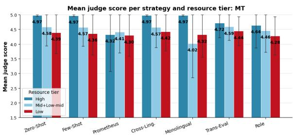

Mean judge score per strategy and resource tier: Sum  
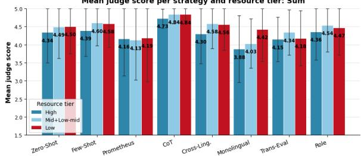  
Figure 1: Mean judge score per strategy and resource tier for MT (top) and Summarization (bottom), averaged over 4 judges. QA and Math panels in Appendix E.

Cross-lingual ranges are wider at lower resource levels (Table 6). On MT the mean range is 0.13 on the high-resource tier and 1.60 on the low-resource tier. At the rubric level the difference is largest on Terminology, which is 3.93–4.59 on low-resource languages against 4.97–5.00 on high-resource languages, while Adequacy and Fluency differ by at most 0.5 points across tiers (Appendix G).

Mean CV ranges from 0.036 for CoT to 0.165 for Prometheus, with Monolingual second highest at 0.162 (Appendix D). Under CoT and Prometheus, the Summarization Main Ideas dimension is 2.99–3.07 against 3.48–3.80 under Zero-Shot, across all four resource tiers.

Figure 2 reports $\Delta _ { \mathrm { m o n o } }$ per language and judge. Monolingual prompting raises Gemma’s mean score by 0.83 and lowers Aya’s by 0.32; the two Qwen judges shift by −0.20 and −0.10. Aya’s largest per-language decreases are on Yor (−2.16), Hau (−1.56), and Swa (−1.20). At the rubric level the decrease is largest on Fluency, which is 3.35– 3.67 across all resource tiers, while Adequacy differs by at most 0.5 points (Appendix G).

Table 7 reports the English minus low-resource difference per strategy. The overall difference ranges from −0.130 for cross-Lingual to +0.206 for CoT, the latter with a Math component of +0.542. Monolingual is +0.009 overall. Excluding SSA-MTE, most MT differences are within 0.11 of zero.

<table><tr><td>Task</td><td>High</td><td>Mid+Low-mid</td><td>Low</td></tr><tr><td>MT</td><td>0.13</td><td>0.29</td><td>1.60</td></tr><tr><td>Sum</td><td>0.41</td><td>0.16</td><td>0.51</td></tr></table>

Table 6: Cross-lingual range (max−min of per-language means) per resource tier, averaged across strategies. Perstrategy breakdown in Appendix E.

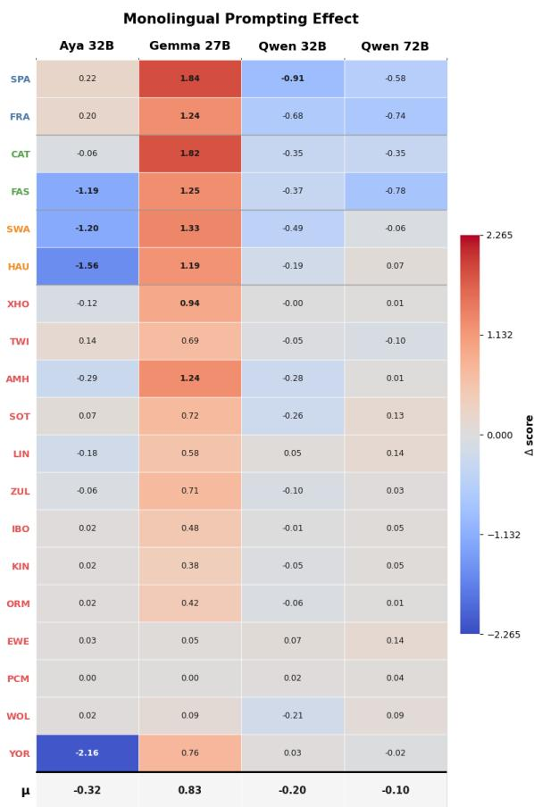  
Figure 2: Monolingual prompting effect by language and judge (∆ = Monolingual − Zero-Shot). Rows ordered by resource tier, then mean effect; bottom row (µ) = mean per judge.

## 4.4 Agreement with Human Judgments

Table 8 reports instance-level Spearman correlations against human quality annotations. All judge– strategy pairs correlate at $\rho ~ = ~ 0 . 2 2 \ – 0 . 4 6$ with $p < 0 . 0 0 1$ . The cross-dataset mean is highest for Role Prompting $( \rho = 0 . 4 8 3 )$ and lowest for Trans-Eval $( \rho = 0 . 3 2 1 )$ . On SSA-MTE, Monolingual is $\rho = 0 . 4 5 5$ for Gemma and $\rho = 0 . 2 1 9$ for Aya, the highest and lowest values in that column.

SSA-MTE provides the only non-English human annotations, so the Summarization, QA, and Math results are not validated against human judgments in the low-resource languages under study.

<table><tr><td>Strategy</td><td>MT</td><td>Sum</td><td>QA</td><td>Math</td><td>Overall</td></tr><tr><td>Cross-Ling.</td><td>+0.091</td><td>-0.097</td><td>-0.197</td><td>-0.789</td><td>-0.130</td></tr><tr><td>Monolingual</td><td>+0.214</td><td>+0.092</td><td>-0.258</td><td>-0.466</td><td>+0.009</td></tr><tr><td>Zero-Shot</td><td>+0.064</td><td>-0.101</td><td>+0.245</td><td>-0.349</td><td>+0.096</td></tr><tr><td>CoT</td><td></td><td>-0.004</td><td>+0.081</td><td>+0.542</td><td>+0.206</td></tr></table>

SSA-MTE excluded. – = excluded by design.

Table 7: English–low-resource difference per strategy (∆ = English − low-resource, averaged over 4 judges). Positive values indicate a higher English mean. Full table (9 strategies) in Appendix I.
<table><tr><td>Strategy</td><td>Aya</td><td>Gemma</td><td>Q32</td><td>Q72</td><td>Mean</td></tr><tr><td>Role</td><td>.404</td><td>.423</td><td>.415</td><td>.366</td><td>.483</td></tr><tr><td>Cross-Ling.</td><td>.326</td><td>.406</td><td>.398</td><td>.335</td><td>.422</td></tr><tr><td>Monolingual</td><td>.219</td><td>.455</td><td>.414</td><td>.356</td><td>.366</td></tr><tr><td>Trans-Eval</td><td>.244</td><td>.331</td><td>.266</td><td>.250</td><td>.321</td></tr></table>

Full table (7 strategies) in Appendix K.  
Table 8: Instance-level Spearman ρ against human scores on SSA-MTE, and cross-dataset mean over SSA-MTE, SummEval, and WMT MQM. All $p < 0 . 0 0 1$

## 5 Discussion

We find that the effect of a prompting strategy on evaluation scores depends on both the Judge and the target language. Judge dependence is quantified by the Judge × strategy interactions, exceeding the strategy’s effect when measured independently. This, however, comes with an exception on Summarization, where we observe that different judges exhibit different preferences w.r.t. the strategies.

Language effect. Language dependence is quantified by $\Delta _ { \mathrm { m o n o } } .$ which is positive for one judge and negative for another on identical content. Note that we observe an-order-of-magnitude wider range of $\Delta _ { \mathrm { m o n o } }$ for low-resource languages in the crosslingual setting. Rescaling does not affect the nature of the observed dependences, which is in line with Bellibatlu et al. (2026) and extends it from within-judge instability under paraphrase to between-judge non-transfer of complete strategies. The fact that the LLM used as the Judge accounts for the larger share of variance is consistent with multilingual evaluation behaviour being determined by properties acquired in pre-training and instruction tuning (Dang et al., 2024; Gemma Team, 2025), rather than by prompt design, though our design does not isolate these sources from other inter-model differences.

Strategy effect. The choice of Strategy has lower effects than the Judge LLM. Nevertheless, it is still not negligible. We observe the strongest Strategy effect for QA and Summarization tasks $( \eta ^ { 2 } ~ = ~ 0 . 0 5 9 ~ \& ~ 0 . 0 5 7 .$ , respectively) with openended semantics where prompt framing shapes which quality aspects the judge attends to. Chainof-Thought shows the lowest cross-lingual variability (mean $\mathrm { C V } = 0 . 0 3 6 )$ , consistent with prior work, suggesting structured reasoning reduces variance by making intermediate steps explicit (Wei et al., 2022; Wang et al., 2023), though it does not consistently achieve the highest human alignment, indicating consistency does not guarantee quality.

Target-language prompting illustrates an architecture-dependent effect: it benefits Gemma $( \Delta = + 0 . 8 3 )$ but harms Aya $( \Delta = - 0 . 3 2 )$ , with severe degradation for low-resource African languages (e.g. Yor: −2.16, Hau: −1.56). Since this holds on identical languages, it likely reflects judge architecture rather than data characteristics, possibly because Aya, trained explicitly for multilingual instruction following (Dang et al., 2024), has developed multilingual processing that target-language prompts disrupt rather than support, while Gemma relies more on prompt language during evaluation, supported by Monolingual achieving Gemma’s highest human alignment $( \rho = 0 . 4 5 5 )$ but Aya’s lowest $( \rho = 0 . 2 1 9 )$ .

Resource level is associated with increased instability throughout: cross-lingual performance ranges widen as language resources decrease, and inter-model rank agreement drops from moderate in high-resource MT $( \rho = 0 . 4 6 )$ to near zero in low-resource MT $( \rho = 0 . 0 4 )$ , consistent with the findings of Fu and Liu (2025b) and Chung and Freienthal (2026), extending their findings by showing instability affects strategy rankings, not only absolute scores.

Language bias. Strategy choice also carries fairness implications, not obvious from mean scores: Cross-lingual is the most balanced strategy overall $( \Delta = - 0 . 1 3 0 )$ , while CoT shows the largest English bias in Maths $( \Delta = + 0 . 5 4 2 )$ , and aggregate reporting can mask this variability. Note that Monolingual’s near-zero overall gap $( \Delta \ = \ + 0 . 0 0 9 )$ hides large positive and negative per-language biases.

Upshot. Judge selection appears more important than prompt selection overall; however, for some tasks the judge × strategy interaction contributes as much as the Judge LLM alone, meaning a prompt optimised for one judge does not necessarily transfer to another, and strategies should be validated on the target judge rather than adopted from a different architecture. Reliability should also be assessed at the language level, since aggregate metrics can hide substantial cross-language variation. Among evaluated strategies, Role Prompting offers the best overall trade-off, achieving the highest human alignment $( \rho = 0 . 4 8 3 )$ while remaining relatively stable across languages. Improving multilingual LLM-asa-Judge reliability therefore requires the combined choice of judge model, prompting strategy, and target languages, not prompt design alone.

## 6 Conclusion

We evaluated nine prompting strategies across four open-weight judges, 27 languages, and four generation tasks. Prompting effects varied across judges: the judge–strategy interaction exceeded the strategy main effect, judges showed limited agreement on strategy rankings, and target-language prompting produced effects of opposing direction across models. The strategy with the lowest cross-language dispersion also differed from that with the highest aggregate correlation with human judgements, indicating that score stability does not imply evaluation validity. Prompt design should therefore be treated as part of the judge configuration and validated for the intended judge, task, and language. Future work should evaluate additional judge families and system-generated outputs spanning a wider quality range, quantify the effects of prompting on system rankings, and develop prompt-selection methods that improve agreement with human judgements across languages.

## Limitations

Evaluation design. Gold-reference evaluation isolates judge behaviour from output variation but introduces ceiling effects in QA and referencebased MT, limiting strategy discrimination for those tasks (Section 4.1); we confirm this directly using AfroBench real system outputs but only for a subset of judges, tasks, and strategies. A related consequence is that Fleiss’ κ collapses toward zero on the skewed gold-reference score distribution despite substantial raw agreement, an artefact of chance-correction under skew rather than genuine disagreement (Appendix J).

Language coverage and verification. Targetlanguage prompts were native-speaker-verified for only a subset of languages; part of the observed Monolingual effect may therefore reflect prompt quality rather than judge behaviour alone. Our language distribution is weighted toward low-resource languages, so cross-tier comparisons should be interpreted with caution, and our two-way ANOVA does not capture language interactions, which we analyse separately via one-way ANOVAs.

Validation and model coverage. SummEval and WMT MQM are English-only, so SRQ4 is fully tested for MT (via SSA-MTE) but not for non-English summarisation or reasoning. We evaluate four open-source judges; our findings on judgespecificity may not generalise to closed-source models, which we test only in a limited, exploratory capacity (Appendix J).

## Ethical considerations.

Our results should not be read as grounds for excluding low-resource languages from LLM-as-ajudge pipelines; rather, they show that judge and strategy choice must be validated per language before deployment, particularly where evaluation outcomes affect downstream model selection or content moderation for these communities. All datasets used are publicly released for research use, and we release our own scores under the same principle to support independent verification. Our experiments consumed substantial GPU compute (Section 3.5); we mitigate this by releasing all 1.07M scores so that others can reuse them without re-running the benchmark.

## References

David Ifeoluwa Adelani, Jesujoba Oluwadara Alabi, Angela Fan, Julia Kreutzer, and 1 others. 2022. A few thousand translations go a long way! leveraging pre-trained models for African news translation. In Proceedings ofNAACL 2022, pages 3053–3070.

David Ifeoluwa Adelani, Jessica Ojo, Israel Abebe Azime, and 1 others. 2025. IrokoBench: A new benchmark for African languages in the age of large language models. In Proceedings of NAACL 2025, pages 2732–2757.

Kabir Ahuja, Harshita Diddee, Rishav Hada, Millicent Ochieng, Krithika Ramesh, Prachi Jain, Akshay Nambi, Tanuja Ganu, Sameer Segal, Kalika Bali, and Sunayana Sitaram. 2023. MEGA: Multilingual evaluation of generative AI. In Proceedings ofEMNLP 2023.

Jordi Armengol-Estapé, Casimiro Pio Carrino, Carlos Rodriguez-Penagos, Ona de Gibert Bonet, Carme

Armentano-Oller, Aitor Gonzalez-Agirre, Maite Melero, and Marta Villegas. 2021. Are multilingual models the best choice for moderately underresourced languages? a comprehensive assessment for Catalan. In Findings ofACL 2021, pages 4933– 4946.

Mikel Artetxe, Sebastian Ruder, and Dani Yogatama. 2020. On the cross-lingual transferability of monolingual representations. In Proceedings ofACL 2020, pages 4623–4637.

Sajjad Ayoubi and Mohammad Yasin Davoodeh. 2021. PersianQA: A dataset for Persian question answering. https://github.com/sajjjadayobi/PersianQA.

Lucas Bandarkar, Davis Liang, Benjamin Muller, Mikel Artetxe, Satya Narayan Shukla, Donald Husa, Naman Goyal, Abhinandan Krishnan, Luke Zettlemoyer, and Madian Khabsa. 2024. The Belebele benchmark: a parallel reading comprehension dataset in 122 language variants. In Proceedings ofACL 2024, pages 749–775.

Rohith Reddy Bellibatlu, Edward Raff, and Wenbin Zhang. 2026. JudgeSense: A benchmark for prompt sensitivity in LLM-as-a-judge systems. arXiv preprint arXiv:2604.23478.

Tom B. Brown, Benjamin Mann, Nick Ryder, Melanie Subbiah, Jared Kaplan, Prafulla Dhariwal, Arvind Neelakantan, Pranav Shyam, Girish Sastry, Amanda Askell, and 1 others. 2020. Language models are few-shot learners. In Proceedings ofNeurIPS 2020.

Jiayi Chang, Mingqi Gao, Xinyu Hu, and Xiaojun Wan. 2025. Exploring the multilingual NLG evaluation abilities of LLM-based evaluators. arXiv preprint arXiv:2503.04360.

Isaac Chung and Linda Freienthal. 2026. Cross-lingual stability of LLM judges under controlled generation: Evidence from Finno-Ugric languages. arXiv preprint arXiv:2602.02287.

Elizabeth Clark, Shruti Rijhwani, Sebastian Gehrmann, Joshua Maynez, Roee Aharoni, Vitaly Nikolaev, Thibault Sellam, Aditya Siddhant, Dipanjan Das, and Ankur Parikh. 2023. SEAHORSE: A multilingual, multifaceted dataset for summarization evaluation. In Proceedings of EMNLP 2023, pages 9397–9413.

Karl Cobbe, Vineet Kosaraju, Mohammad Bavarian, Mark Chen, Heewoo Jun, Lukasz Kaiser, Matthias Plappert, Jerry Tworek, Jacob Hilton, Reiichiro Nakano, Christopher Hesse, and John Schulman. 2021. Training verifiers to solve math word problems. arXiv preprint arXiv:2110.14168.

John Dang, Shivalika Singh, Daniel D’souza, Arash Ahmadian, and 1 others. 2024. Aya expanse: Combining research breakthroughs for a new multilingual frontier. arXiv preprint arXiv:2412.04261.

Ona de Gibert, Ksenia Kharitonova, Blanca Calvo Figueras, Jordi Armengol-Estapé, and Maite Melero. 2022. Sequence-to-sequence resources for Catalan.

Alexander R. Fabbri, Wojciech Krysci´ nski, Bryan Mc-´ Cann, Caiming Xiong, Richard Socher, and Dragomir Radev. 2021. SummEval: Re-evaluating summarization evaluation. Transactions ofthe Associationfor Computational Linguistics, 9:391–409.

Patrick Fernandes, Daniel Deutsch, Mara Finkelstein, Parker Riley, André F. T. Martins, Graham Neubig, Ankush Garg, Jonathan H. Clark, Markus Freitag, and Orhan Firat. 2023. The devil is in the errors: Leveraging large language models for fine-grained machine translation evaluation. In Proceedings of WMT 2023.

Markus Freitag, George Foster, David Grangier, Viresh Ratnakar, Qijun Tan, and Wolfgang Macherey. 2021. Experts, errors, and context: A large-scale study of human evaluation for machine translation. Transactions ofthe Associationfor Computational Linguistics, 9:1460–1474.

Xiyan Fu and Wei Liu. 2025a. How reliable is multilingual LLM-as-a-judge? In Findings of the Associationfor Computational Linguistics: EMNLP 2025, pages 11040–11053, Suzhou, China. Association for Computational Linguistics.

Xiyan Fu and Wei Liu. 2025b. How reliable is multilingual LLM-as-a-judge? In Findings ofEMNLP 2025, pages 11040–11053.

Gemma Team. 2025. Gemma 3 technical report. arXiv preprint arXiv:2503.19786.

Jiawei Gu, Xuhui Jiang, Zhichao Shi, Hexiang Tan, Xuehao Zhai, Chengjin Xu, Wei Li, Yinghan Shen, Shengjie Ma, Honghao Liu, Saizhuo Wang, Kun Zhang, Yuanzhuo Wang, Wen Gao, Lionel Ni, and Jian Guo. 2024a. A survey on LLM-as-a-judge. arXiv preprint arXiv:2411.15594.

Jiawei Gu, Xuhui Jiang, Zhichao Shi, and 1 others. 2024b. From generation to judgment: Opportunities and challenges of LLM-as-a-judge. arXiv preprint arXiv:2411.15594.

Tahmid Hasan, Abhik Bhattacharjee, Md. Saiful Islam, Kazi Mubasshir, Yuan-Fang Li, Yong-Bin Kang, M. Sohel Rahman, and Rifat Shahriyar. 2021. XLsum: Large-scale multilingual abstractive summarization for 44 languages. In Findings ofACL-IJCNLP 2021, pages 4693–4703.

Seungone Kim, Jamin Shin, Yejin Cho, Joel Jang, Shayne Longpre, Hwaran Lee, Sangdoo Yun, Seongjin Shin, Sungdong Kim, James Thorne, and Minjoon Seo. 2024. Prometheus: Inducing finegrained evaluation capability in language models. In Proceedings ofICLR 2024.

Tom Kocmi and Christian Federmann. 2023. Large language models are state-of-the-art evaluators of translation quality. In Proceedings of EAMT 2023, pages 193–203.

Woosuk Kwon, Zhuohan Li, Siyuan Zhuang, Ying Sheng, Lianmin Zheng, Cody Hao Yu, Joseph E. Gonzalez, Hao Zhang, and Ion Stoica. 2023. Efficient memory management for large language model serving with PagedAttention. In Proceedings of SOSP 2023.

Senyu Li, Jiayi Wang, Felermino D. M. A. Ali, Colin Cherry, Daniel Deutsch, Eleftheria Briakou, Rui Sousa-Silva, Henrique Lopes Cardoso, Pontus Stenetorp, and David Ifeoluwa Adelani. 2025a. SSA-COMET: Do LLMs outperform learned metrics in evaluating MT for under-resourced African languages? In Proceedings ofthe 2025 Conference on Empirical Methods in Natural Language Processing, pages 12979–12998, Suzhou, China. Association for Computational Linguistics.

Senyu Li, Jiayi Wang, Felermino D. M. A. Ali, Colin Cherry, Daniel Deutsch, Eleftheria Briakou, Rui Sousa-Silva, Henrique Lopes Cardoso, Pontus Stenetorp, and David Ifeoluwa Adelani. 2025b. SSA-COMET: Do LLMs outperform learned metrics in evaluating MT for under-resourced African languages? arXiv preprint arXiv:2506.04557.

Hunter Lightman, Vineet Kosaraju, Yura Burda, Harri Edwards, Bowen Baker, Teddy Lee, Jan Leike, John Schulman, Ilya Sutskever, and Karl Cobbe. 2023. Let’s verify step by step. arXiv preprint arXiv:2305.20050.

Chin-Yew Lin. 2004. ROUGE: A package for automatic evaluation of summaries. In Text Summarization Branches Out, pages 74–81, Barcelona, Spain. Association for Computational Linguistics.

Wilhelmina Nekoto, Vukosi Marivate, Tshinondiwa Matsila, Timi Fasubaa, Taiwo Fagbohungbe, Solomon Oluwole Akinola, Shamsuddeen Muhammad, Salomon Kabongo Kabenamualu, Salomey Osei, and 1 others. 2020. Participatory research for low-resourced machine translation: A case study in African languages. In Findings of EMNLP 2020, pages 2144–2160.

NLLB Team, Marta R. Costa-jussà, James Cross, Onur Çelebi, and 1 others. 2022. No language left behind: Scaling human-centered machine translation. arXiv preprint arXiv:2207.04672.

Odunayo Ogundepo, Tajuddeen R. Gwadabe, Clara E. Rivera, Jonathan H. Clark, Sebastian Ruder, David Ifeoluwa Adelani, and 1 others. 2023. AfriQA: Cross-lingual open-retrieval question answering for African languages. arXiv preprint arXiv:2305.06897.

Jessica Ojo, Odunayo Ogundepo, Akintunde Oladipo, Kelechi Ogueji, Jimmy Lin, Pontus Stenetorp, and David Ifeoluwa Adelani. 2025. AfroBench: How

good are large language models on African languages? In Findings ofthe Associationfor Computational Linguistics: ACL 2025, pages 19048–19095, Vienna, Austria. Association for Computational Linguistics.

Kishore Papineni, Salim Roukos, Todd Ward, and Wei-Jing Zhu. 2002. Bleu: a method for automatic evaluation of machine translation. In Proceedings ofthe 40th Annual Meeting ofthe Associationfor Computational Linguistics, pages 311–318, Philadelphia, Pennsylvania, USA. Association for Computational Linguistics.

José Pombal, Dongkeun Yoon, Patrick Fernandes, Ian Wu, Seungone Kim, Ricardo Rei, Graham Neubig, and André F. T. Martins. 2025. M-prometheus: A suite of open multilingual LLM judges. In Second Conference on Language Modeling.

Xiaoyu Qiu, Yuechen Wang, Jiaxin Shi, Wengang Zhou, and Houqiang Li. 2024. Cross-lingual transfer for natural language inference via multilingual prompt translator. arXiv preprint arXiv:2403.12407.

Qwen Team. 2024. Qwen2.5 technical report. arXiv preprint arXiv:2412.15115.

Ricardo Rei, Craig Stewart, Ana C Farinha, and Alon Lavie. 2020. COMET: A neural framework for MT evaluation. In Proceedings ofthe 2020 Conference on Empirical Methods in Natural Language Processing (EMNLP), pages 2685–2702, Online. Association for Computational Linguistics.

Leonard Salewski, Stephan Alaniz, Isabel Rio-Torto, Eric Schulz, and Zeynep Akata. 2023. In-context impersonation reveals large language models’ strengths and biases. In Proceedings ofNeurIPS 2023.

Thomas Scialom, Paul-Alexis Dray, Sylvain Lamprier, Benjamin Piwowarski, and Jacopo Staiano. 2020. MLSUM: The multilingual summarization corpus. In Proceedings ofEMNLP 2020, pages 8051–8067.

Melanie Sclar, Yejin Choi, Yulia Tsvetkov, and Alane Suhr. 2024. Quantifying language models’ sensitivity to spurious features in prompt design or: How I learned to start worrying about prompt formatting. In The Twelfth International Conference on Learning Representations.

Thibault Sellam, Dipanjan Das, and Ankur Parikh. 2020. BLEURT: Learning robust metrics for text generation. In Proceedings of the 58th Annual Meeting of the Associationfor Computational Linguistics, pages 7881–7892, Online. Association for Computational Linguistics.

Freda Shi, Mirac Suzgun, Markus Freitag, Xuezhi Wang, Suraj Srivats, Soroush Vosoughi, Hyung Won Chung, Yi Tay, Sebastian Ruder, Denny Zhou, Dipanjan Das, and Jason Wei. 2022. Language models are multilingual chain-of-thought reasoners. arXiv preprint arXiv:2210.03057.

Lin Shi, Chiyu Ma, Wenhua Liang, Xingjian Diao, Weicheng Ma, and Soroush Vosoughi. 2024. Judging the judges: A systematic study of position bias in LLM-as-a-judge. In Proceedings ofEMNLP 2024.

Guijin Son, Dongkeun Yoon, Juyoung Suk, Javier Aula-Blasco, Mano Aslan, Vu Trong Kim, Shayekh Bin Islam, Jaume Prats-Cristìa, Lucía Tormo-Bañuelos, and Seungone Kim. 2024. MM-eval: A multilingual meta-evaluation benchmark for LLM-as-a-judge and reward models. arXiv preprint arXiv:2410.17578.

Hailay Kidu Teklehaymanot, Gebrearegawi Gebremariam, and Wolfgang Nejdl. 2026. LLM probe: Evaluating LLMs for low-resource languages.

Xuezhi Wang, Jason Wei, Dale Schuurmans, Quoc V. Le, Ed H. Chi, Sharan Narang, Aakanksha Chowdhery, and Denny Zhou. 2023. Self-consistency improves chain of thought reasoning in language models. In Proceedings ofICLR 2023.

Jason Wei, Xuezhi Wang, Dale Schuurmans, Maarten Bosma, Brian Ichter, Fei Xia, Ed H. Chi, Quoc V. Le, and Denny Zhou. 2022. Chain-of-thought prompting elicits reasoning in large language models. In Proceedings ofNeurIPS 2022.

Lianmin Zheng, Wei-Lin Chiang, Ying Sheng, Siyuan Zhuang, Zhanghao Wu, Yonghao Zhuang, Zi Lin, Zhuohan Li, Dacheng Li, Eric P. Xing, Hao Zhang, Joseph E. Gonzalez, and Ion Stoica. 2023. Judging LLM-as-a-judge with MT-bench and Chatbot Arena. In Proceedings ofNeurIPS 2023.

## A Additional Methodology Details

Table 9 extends Table 1 from the main text with the complete per-dataset language codes.

## B Task-Specific Rubric Definitions

All rubrics are included in the system prompt for every strategy and judge model. Each dimension is scored independently on a 1–5 scale, followed by a single holistic overall score used for cross-task comparison.

## Machine Translation

MQM framework (Freitag et al., 2021)

Dimension 1: Adequacy (meaning preservation)

5 All meaning from the source preserved; no omissions or additions.

4 Core meaning correct; minor omissions not affecting comprehension.

3 General idea captured but notable information missing or inaccurate.

<table><tr><td>Task</td><td>Dataset</td><td>#Lang.</td><td>Coverage</td><td>Languages</td></tr><tr><td>MT</td><td>FLORES-200 (NLLB Team et al., 2022)</td><td>14</td><td>African and resource languages</td><td>higher- EN, FR, DE, ES, CA, FA, HA, SW, YO, AM, IBO, KIN, XHO, ZUL</td></tr><tr><td>MT</td><td>MAFAND-MT (Adelani et al., 2022)</td><td>10</td><td>African languages</td><td>HA, SW, YO, AM, IBO, KIN, PCM, XHO, ZUL, TWI</td></tr><tr><td>MT</td><td>SSA-MTE (Li et al., 2025b)</td><td>11</td><td>African languages</td><td>HA, SW, YO, AM, IBO, KIN, LUG, SOM, SOT, EWE, XHO</td></tr><tr><td>Summ.</td><td>XL-Sum (Hasan et al., 2021)</td><td>13</td><td>African and higher- resource languages</td><td>EN, FR, ES, FA, HA, YO, SW, AM, IBO, SOM, ORM, PCM, TIR</td></tr><tr><td>Summ. Summ.</td><td>MLSUM (Scialom et al., 2020) CaSum (de Gibert et al., 2022)</td><td>2</td><td>European languages</td><td>ES, FR CA</td></tr><tr><td>QA</td><td>AfriQA (Ogundepo et al., 2023)</td><td>1 9</td><td>Catalan African languages</td><td>HA, SW, YO, ZUL, KIN, IBO,</td></tr><tr><td></td><td></td><td></td><td></td><td>TWI, BEM, FON Higher-resource and Ara- ES, EN, AR</td></tr><tr><td>QA</td><td>XQuAD (Artetxe et al., 2020)</td><td>3</td><td>bic</td><td></td></tr><tr><td>QA QA</td><td>PersianQA (Ayoubi and Davoodeh, 2021)</td><td>1</td><td>Persian</td><td>FA CA</td></tr><tr><td>QA</td><td>CatalanQA (Armengol-Estapé et al., 2021) Belebele (Bandarkar et al., 2024)</td><td>1 15</td><td>Catalan African languages</td><td>15 benchmark languages used in</td></tr><tr><td></td><td></td><td></td><td>African languages</td><td>our QA subset HA, SW, YO, AM, IBO, KIN.</td></tr><tr><td></td><td></td><td></td><td></td><td>LUG, XHO, ZUL, EWE, LIN, ORM, SOT, WOL, TWI, PCM</td></tr><tr><td>Math</td><td>MGSM (Shi et al., 2022)</td><td>4</td><td>Higher-resource guages</td><td>lan- EN, ES, FR, DE</td></tr></table>

Table 9: Datasets, tasks, language coverage, and language codes. Language codes follow the conventions used in each source dataset.

2 Significant meaning distortion; key information missing or mistranslated.

1 Meaning completely lost; translation unrelated to source.

Dimension 2: Fluency (naturalness in target language)

5 Native-like fluency; no grammatical errors; natural tone and register.

4 Mostly natural with minor awkwardness.

3 Understandable but noticeably non-native phrasing.

2 Difficult to read; frequent grammatical errors.

1 Incomprehensible or gibberish.

## Dimension 3: Terminology

5 All domain-specific terms translated correctly and consistently.

4 Most terms correct; minor inconsistencies.

3 Some key terms wrong but meaning partially recoverable.

2 Multiple terminology errors misleading the reader.

1 Key terminology completely wrong or absent.

## Summarization

SEAHORSEframework (Clark et al., 2023; Fabbri et al., 2021)

## Dimension 1: Comprehensibility

5 Perfectly clear and understandable on its own.

4 Mostly clear; minor ambiguity.

3 Understandable with effort; some unclear passages.

2 Difficult to understand; significant clarity issues.

1 Incoherent or incomprehensible.

Dimension 2: Attribution (factual grounding in source)

5 Every claim traceable to the source article.

4 Almost all claims supported; one minor unsupported detail.

3 Most claims supported but some fabrications.

2 Significant fabricated content.

1 Entirely fabricated or contradicts the source.

## Dimension 3: Main Ideas (coverage)

5 All key points of the source captured.

4 Most key points covered; one minor omission.

3 Some key points covered but important information missing.

2 Only peripheral details; main points missing.

1 Misses all important content.

## Dimension 4: Conciseness

5 Optimal length; no redundancy, no critical omissions.

4 Slightly verbose or brief but acceptable.

3 Noticeably too long or too short.

2 Very verbose with repetition, or critically short.

1 Excessively long or short to be unusable.

## QA with Passage

MM-Evalframework (Son et al., 2024; Kim et al., 2024). Applied to XQuAD, PersianQA, CatalanQA, Belebele.

## Dimension 1: Relevance

5 Answer directly and precisely addresses the question asked.

4 Mostly relevant; minor tangential content.

3 Partially relevant; addresses some but not the core of the question.

2 Marginally relevant; mostly off-topic.

1 Completely unrelated to the question.

## Dimension 2: Completeness

5 Fully addresses all aspects of the question.

4 Addresses the main point; minor aspects not covered.

3 Partially addresses the question; key aspects missing.

2 Only tangentially addresses the question.

1 Does not address the question at all.

## Dimension 3: Passage Grounding

5 Answer is directly extractable from or fully supported by the passage.

4 Answer is mostly grounded; uses minor inference beyond the passage.

3 Answer is partially grounded; mixes passage content with external knowledge.

2 Answer is largely not supported by the passage.

1 Answer contradicts the passage or ignores it entirely.

## QA without Passage

MM-Eval framework (Son et al., 2024). Applied to AfriQA (open-retrieval; no passage provided). Passage Grounding is excluded by design.

Uses Relevance and Completeness only, with identical anchors to the QA with Passage rubric above.

## Mathematical Reasoning

Process-reward framework (Lightman et al., 2023; Cobbe et al., 2021). Evaluated as text generation: reasoning quality, not only the final answer. Dimension 1: Answer Correctness

5 Final numerical answer is exactly correct.

4 Very close; minor rounding or unit issue.

3 Wrong but the approach was reasonable.

2 Significantly wrong.

1 No answer or completely wrong.

## Dimension 2: Reasoning Validity

5 Every step logically sound and mathematically correct.

4 Mostly sound; one minor logical gap.

3 Notable gaps but shows some understanding.

2 Largely flawed or incoherent reasoning.

1 No reasoning or completely nonsensical.

## Dimension 3: Solution Completeness

5 All necessary steps shown clearly.

4 Most steps shown; one minor step implicit.

3 Some steps shown but important work missing.

2 Only the final answer with minimal work.

1 Just a number with no work shown.

## C Prompt Examples

All strategies include the task-specific rubric in the system prompt. The complete templates are provided for Zero-Shot (§C), Few-Shot Anchored (§C), Prometheus (§C), Chain-of-Thought (§C), Cross-Lingual (§C), Monolingual Prompting (§C), Translate-then-Evaluate (§C), Role Prompting (§C), and Self-Consistency (§C). Unless otherwise stated, the examples use an English–Swahili machine-translation instance from FLORES-200. The Monolingual Prompting example uses Catalan. Self-Consistency is described separately because it applies only to question answering and mathematical reasoning. Rubric text is abbreviated here; full definitions are in Appendix B.

## Zero-shot

## Prompt C.1: Zero-Shot Evaluation Prompt

[System]

You are an evaluator of machine translation quality.

## Rubric

Adequacy, Fluency, Terminology — full criteria.

[User]

Evaluate the quality of the following machine translation.

Source text (English)

“We now have 4-month-old mice...”

Reference translation (Swahili)

“Sasa tuna panya...”

Model translation

{TEXT TO EVALUATE}

Score each rubric dimension, then provide an overall score from 1 to 5 followed by a brief justification.

## Few-Shot Anchored

Prompt C.2: Few-Shot Anchored Evaluation Prompt

[System]

You are an evaluator of machine translation quality.

Rubric

Adequacy, Fluency, Terminology — full criteria.

Calibration examples

Example 1 (Score: 5)

{PERFECT TRANSLATION EXAMPLE}

Adequacy: 5 | Fluency: 5 | Terminology: 5 | Overall: 5

Example 2 (Score: 1)

{COMPLETELY INCORRECT TRANSLATION EXAMPLE}

Adequacy: 1 | Fluency: 3 | Terminology: 1 | Overall: 1

## [User]

Evaluate the quality of the following machine translation.

Source text (English)

{SOURCE TEXT}

## Reference translation

{REFERENCE TRANSLATION}

## Model translation

{TEXT TO EVALUATE}

Score each rubric dimension, then provide an overall score from 1 to 5 followed by a brief justification.

## Prometheus

Prompt C.3: Prometheus Evaluation Prompt

[System]

You are an evaluator of machine translation quality.

## Rubric

Adequacy, Fluency, Terminology — full criteria.

## Scoring protocol

1. Score each dimension independently from 1 to 5.

2. Provide a holistic overall score from 1 to 5.

3. Report each dimension with its score and a onesentence justification, followed by the overall score.

## [User]

Evaluate the quality of the following machine translation.

## Source text (English)

{SOURCE TEXT}

Reference translation

{REFERENCE TRANSLATION}

## Model translation

{TEXT TO EVALUATE}

## Chain-of-Thought

Prompt C.4: Chain-of-Thought Evaluation Prompt

[System]

You are an evaluator of machine translation quality.

## Rubric

Adequacy, Fluency, Terminology — full criteria.

Before assigning a rating, reason through the evaluation step by step:

1. Identify what the task requires.

2. Score each rubric dimension and explain the score.

3. Identify the translation’s strengths and weaknesses.

4. Assign the final overall score.

[User]

Evaluate the quality of the following machine translation.

Source text (English)

{SOURCE TEXT}

Reference translation

{REFERENCE TRANSLATION}

Model translation

{TEXT TO EVALUATE}

Reason step by step, then provide your overall score.

## Cross-Lingual

## Prompt C.5: Cross-Lingual Evaluation Prompt

## [System]

You are an evaluator of machine translation quality.

## Rubric

Adequacy, Fluency, Terminology — full criteria.

The content below is in Swahili. Evaluate it using the same criteria applied to English content. Do not penalize the output for being written in a non-English language.

## [User]

Evaluate the quality of the following machine translation.

## Source text (English)

{SOURCE TEXT}

## Reference translation (Swahili)

{REFERENCE TRANSLATION}

## Model translation (Swahili)

{TEXT TO EVALUATE}

Score each rubric dimension, then provide an overall score from 1 to 5 followed by a brief justification.

## Monolingual

## Prompt C.6: Monolingual Evaluation Prompt: Catalan

[System]

Ets un expert en avaluació de la qualitat de traduccions.

## Rúbrica

Adequació, fluïdesa i terminologia — criteris complets.

[User]

Avalua la qualitat de la traducció següent.

## Text original (anglès)

{TEXT ORIGINAL}

Traducció de referència (català)

{TRADUCCIÓ DE REFERÈNCIA}

## Traducció del model (català)

{TEXT PER AVALUAR}

1 = Molt dolent | 5 = Excel·lent

Dona una puntuació de l’1 al 5 i una justificació breu.

Equivalent verified templates were usedfor French, Spanish, Catalan, and Persian.

## Translate-then-Evaluate

## Prompt C.7: Translate-then-Evaluate Prompt

## [System]

You are an evaluator of machine translation quality.

## Rubric

Adequacy, Fluency, Terminology — full criteria.

Complete the evaluation in two steps:

1. Mentally translate the Swahili output into English and state your English understanding.

2. Evaluate the output based on this English understanding, applying all rubric criteria.

Show both steps before reporting the final score.

## [User]

Evaluate the quality of the following machine translation.

## Source text (English)

{SOURCE TEXT}

Reference translation (Swahili)

{REFERENCE TRANSLATION}

## Model translation (Swahili)

{TEXT TO EVALUATE}

## Role Prompting

## Prompt C.8: Role-Based Evaluation Prompt

## [System]

You are a professional translator and linguistic evaluator with extensive experience in multilingual translationquality assessment. You are trained in MQM and specialize in English–Swahili evaluation.

## Rubric

Adequacy, Fluency, Terminology — full criteria.

## [User]

Evaluate the quality of the following machine translation.

## Source text (English)

{SOURCE TEXT}

## Reference translation (Swahili)

{REFERENCE TRANSLATION}

## Model translation (Swahili)

{TEXT TO EVALUATE}

Score each rubric dimension, then provide an overall score from 1 to 5 followed by a brief justification.

## Self-Consistency

## Prompt C.9: Self-Consistency Evaluation Prompt

The Chain-of-Thought evaluation prompt is executed independently three times with a sampling temperature of 0.7.

For each execution, the model:

1. identifies the task requirements;

2. scores and explains each rubric dimension;

3. identifies strengths and weaknesses; and

4. assigns a final overall score.

The final score is determined by majority vote. When all three scores differ, the arithmetic mean is used.

This strategy is applied only to question answering and mathematical reasoning tasks.

## D Cross-Language CV by Strategy

## E Per-Model Strategy × Dataset Heatmaps

Figures 3, 4, 5 and 6 provide the full per-model breakdown of mean score and cross-language range per strategy and resource tier across all four tasks, extending the MT and Summarization summary shown in Figure 1 in the main text.

<table><tr><td rowspan="2">Strategy</td><td colspan="5">CV by judge model</td><td colspan="2">Resource tier</td><td colspan="2">Task</td></tr><tr><td>Aya</td><td>Gemma</td><td>Q32</td><td>Q72</td><td>Mean</td><td>High</td><td>Low</td><td>MT</td><td>Sum</td></tr><tr><td>CoT</td><td>0.070</td><td>0.024</td><td>0.012</td><td>0.039</td><td>0.036</td><td>0.030</td><td>0.009</td><td></td><td>0.021</td></tr><tr><td>Trans-Eval</td><td>0.078</td><td>0.105</td><td>0.137</td><td>0.092</td><td>0.103</td><td>0.080</td><td>0.081</td><td>0.086</td><td>0.041</td></tr><tr><td>Cross-Ling.</td><td>0.080</td><td>0.118</td><td>0.140</td><td>0.151</td><td>0.122</td><td>0.057</td><td>0.120</td><td>0.124</td><td>0.030</td></tr><tr><td>Role</td><td>0.093</td><td>0.123</td><td>0.140</td><td>0.160</td><td>0.129</td><td>0.062</td><td>0.125</td><td>0.129</td><td>0.032</td></tr><tr><td>Few-Shot</td><td>0.092</td><td>0.116</td><td>0.141</td><td>0.181</td><td>0.133</td><td>0.059</td><td>0.138</td><td>0.140</td><td>0.025</td></tr><tr><td>Zero-Shot</td><td>0.087</td><td>0.134</td><td>0.146</td><td>0.173</td><td>0.135</td><td>0.075</td><td>0.133</td><td>0.137</td><td>0.031</td></tr><tr><td>Monolingual</td><td>0.186</td><td>0.114</td><td>0.163</td><td>0.184</td><td>0.162</td><td>0.166</td><td>0.122</td><td>0.132</td><td>0.099</td></tr><tr><td>Prometheus</td><td>0.107</td><td>0.236</td><td>0.140</td><td>0.176</td><td>0.165</td><td>0.059</td><td>0.115</td><td>0.117</td><td>0.033</td></tr></table>

Table 10: Cross-language CV per strategy (MT + Summarization), by judge model, resource tier, and task. $\mathrm { C V } = \sigma / \mu$ of per-language means; lower = more consistent. High and Low resource tiers only; Mid and Low-mid excluded $( n = 2$ languages each, insufficient for reliable CV estimation). Bold = most stable per column; italic = least stable.

## F Full Inter-Model Rank Agreement

## G Rubric Dimension Analysis

Figures 8–10 provide the rubric-level evidence discussed in Section 5. MT Terminology and Summarization Main Ideas are the most strategy- and resource-sensitive dimensions respectively.

## H Full Variance Decomposition Table

Table 11 extends Table 4 from the main text with the MT-excluding-SSA-MTE column omitted there for space, isolating the reference-based MT effect.

## I Full English–Low-Resource Gap Table

Table 12 extends Table 7 from the main text with all nine strategies and the Math column.

## J Ceiling Effect Confirmation: Gold vs. AfroBench

To confirm that compressed scores on goldreference tasks reflect a genuine ceiling effect rather than low judge sensitivity, we evaluate a subset of judges on AfroBench real system outputs (Ojo et al., 2025) for MT and Summarization, using a matched set of five strategies (Zero-Shot, CoT, Role Prompting, Monolingual, Monolingual-CoT). Table 13 compares mean and standard deviation between gold references and AfroBench outputs.

Every judge shows a lower mean and higher standard deviation on AfroBench than on gold, confirming that the compression observed on goldreference tasks (Section 4.1) reflects the evaluation design rather than an inherent inability of judges to discriminate quality.

## K External Validity — SummEval and WMT MQM

Figures 11 and 12 show the per-example Spearman correlations underlying Table 8 in the main text, split by dataset. Both datasets are English-only, so results here complement, rather than replace, the multilingual validation against SSA-MTE (Section 4.4). Correlations are broadly consistent across strategies and judges in both datasets, with no strategy performing catastrophically on either external source, suggesting the patterns we observe are not artefacts of a single validation set.

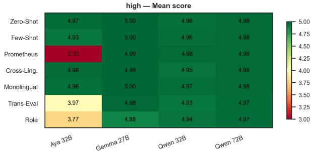

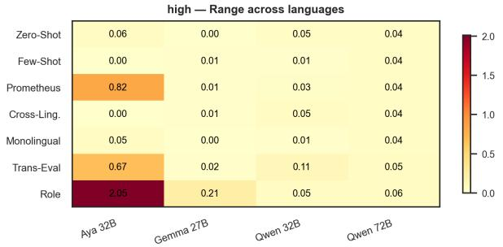

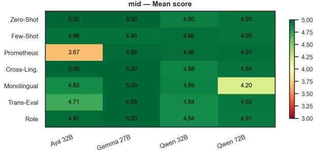

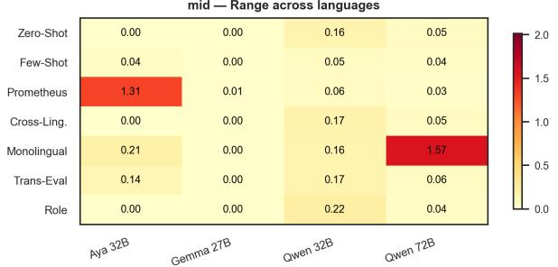

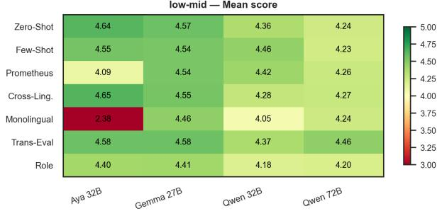

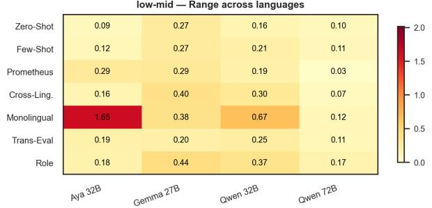

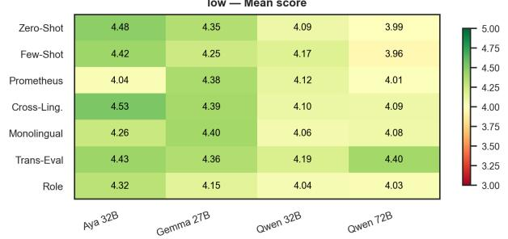

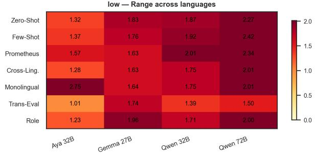

Figure 3: MT: mean score (left) and cross-language range (right) per strategy, judge model, and resource tier. High-resource panels show near-uniform green (ceiling effect on reference-based MT); the range column reveals large inconsistencies for low-resource languages (1.41–2.04) regardless of strategy, consistent with our finding that MT inconsistency is a resource-level phenomenon.
<table><tr><td>Factor</td><td>Overall</td><td>MT</td><td> $\mathbf { M T } ^ { \ddagger }$ </td><td>Sum</td><td>QA</td><td>Math</td></tr><tr><td>Judge model</td><td>0.087</td><td>0.006</td><td>0.048</td><td>0.438</td><td>0.251</td><td>0.222</td></tr><tr><td>Strategy</td><td>0.012</td><td>0.007</td><td>0.035</td><td>0.057</td><td>0.059</td><td>0.036</td></tr><tr><td>Judge × Strat</td><td>0.056</td><td>0.017</td><td>0.114</td><td>0.165</td><td>0.247</td><td>0.297</td></tr><tr><td>Language†</td><td>0.043</td><td>0.325</td><td>0.030</td><td>0.032</td><td>0.012</td><td>0.010</td></tr><tr><td>Resource†</td><td>0.007</td><td>0.051</td><td></td><td>0.010</td><td>0.003</td><td>0.001</td></tr></table>

† One-way ANOVA. ‡ SSA-MTE excluded (reference-based MT only).

Table 11: Full variance decomposition $( \eta ^ { 2 } )$ of judge scores, including the MT column with SSA-MTE excluded.   
All effects significant $( p < 0 . 0 0 1 )$ .

low — Range across languages  
RQ1.1 — Sum: strategy × model, mean (left) and cross-language range (right) by resource tier  
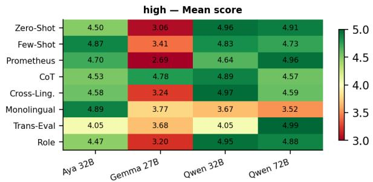

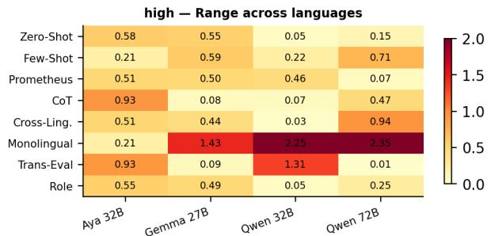

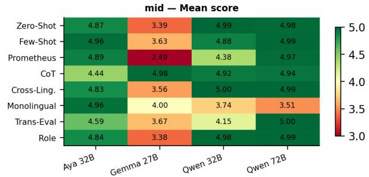

mid — Range across languages  
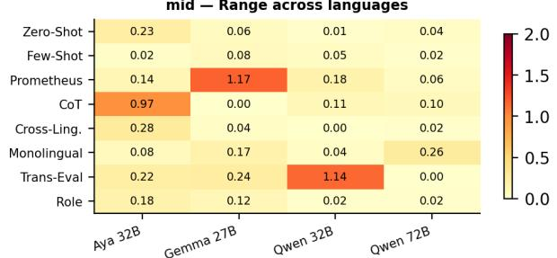

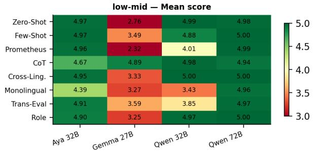

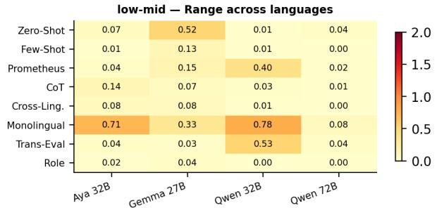

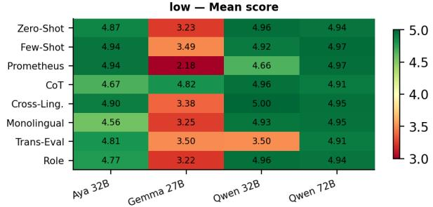

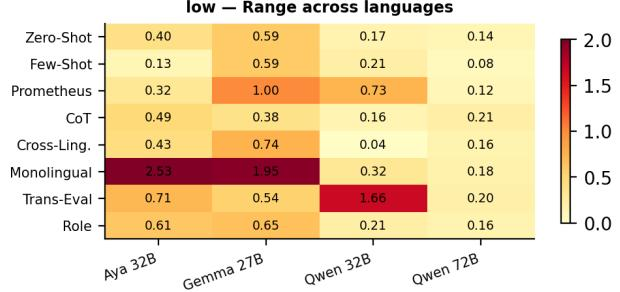  
Figure 4: Summarization: mean score (left) and cross-language range (right) per strategy, judge model, and resource tier. Monolingual shows the highest range for Aya 32B across all resource tiers, while CoT and Role show consistently low range. Strategy effects on Summarization scoring are substantially model-dependent.

## L Use of generative AI

Generative AI tools were used at several stages during the preparation of this study. GitHub Copilot and Claude Code were used as coding assistants during the development of the evaluation pipeline and for debugging. Additionally, LLMs (Grammarly and Claude) were used to support the writing process, specifically for correcting spelling and grammatical inconsistencies, improving clarity, and reducing selected sections to comply with space constraints. Furthermore, all aspects of the research design, methodology, analysis, and conclusions presented in this study are the independent work of the author.

RQ1.1 — QA: strategy × model, mean (left) and cross-language range (right) by resource tier  
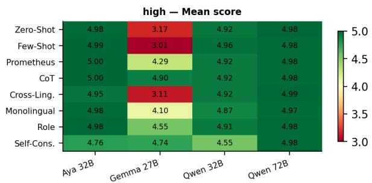

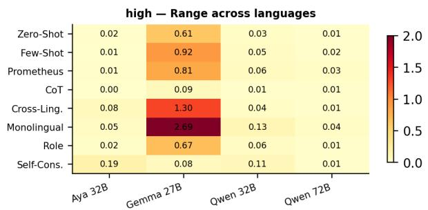

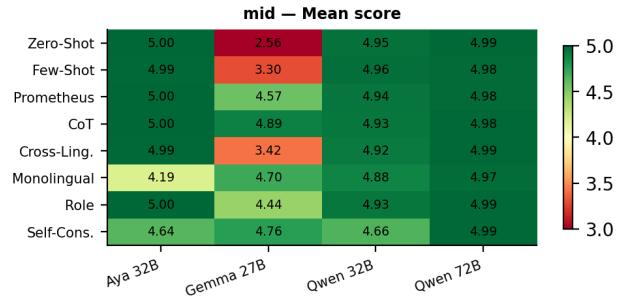

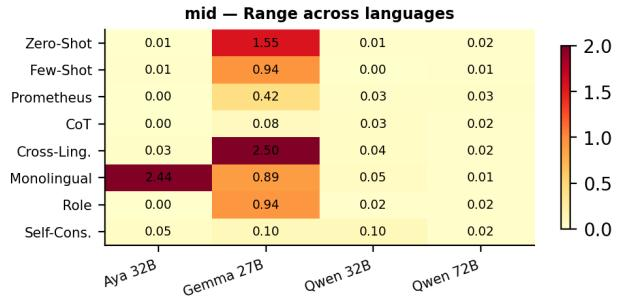

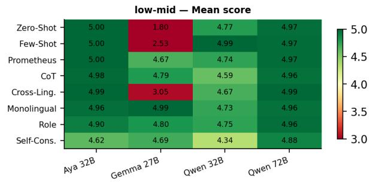

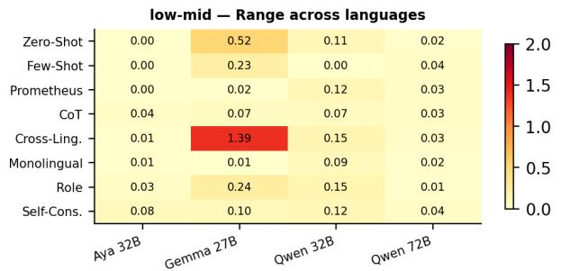

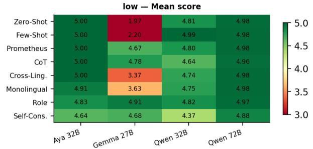

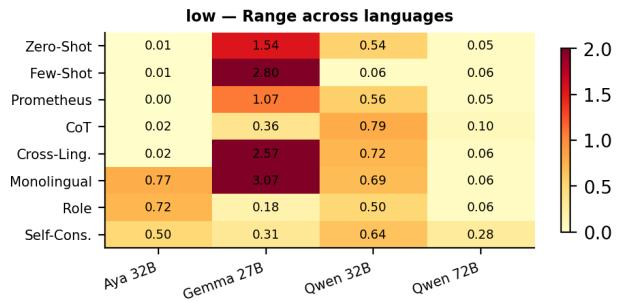  
Figure 5: QA: mean score (left) and cross-language range (right) per strategy, judge model, and resource tier. Near-uniform green across all panels reflects the ceiling effect from gold-reference evaluation; range values are low throughout, consistent with the ceiling interpretation.

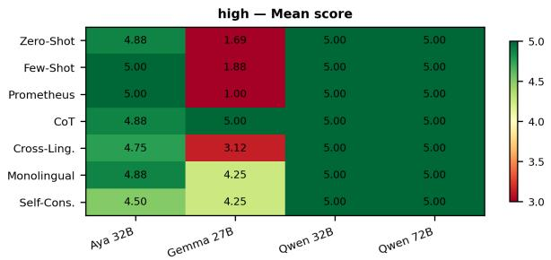

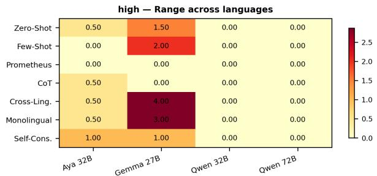

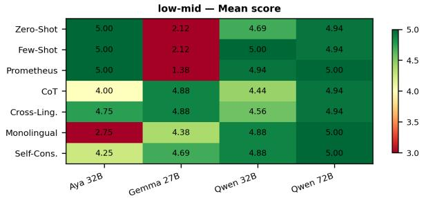

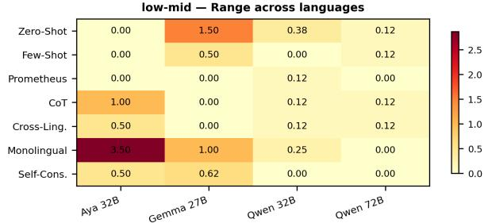

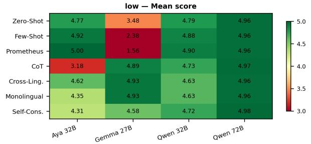

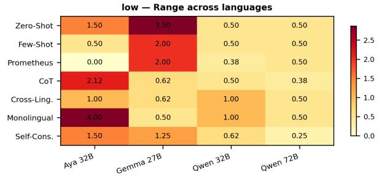  
Figure 6: Math: mean score (left) and cross-language range (right) per strategy, judge model, and resource tier. Gemma 27B shows substantially lower Zero-Shot scores (CoT rescue effect visible in mean panels) and higher range under Monolingual for low-resource languages. Math mid-resource is empty: AfriMGSM covers only low and low-mid languages.

<table><tr><td>Strategy</td><td>MT</td><td> $\mathbf { M T } ^ { \ddagger }$ </td><td>Sum</td><td>QA</td><td>Math</td><td>Overall</td></tr><tr><td>Cross-Ling.</td><td>+0.564</td><td>+0.091</td><td>-0.097</td><td>-0.197</td><td>-0.789</td><td>-0.130</td></tr><tr><td>Monolingual</td><td>+0.670</td><td>+0.214</td><td>+0.092</td><td>-0.258</td><td>-0.466</td><td>+0.009</td></tr><tr><td>Role</td><td>+0.088</td><td>-0.378</td><td>-0.015</td><td>-0.116</td><td>NaN</td><td>-0.014</td></tr><tr><td>Prometheus</td><td>-0.069</td><td>-0.535</td><td>+0.225</td><td>+0.030</td><td>-0.115</td><td>+0.018</td></tr><tr><td>Trans-Eval</td><td>+0.211</td><td>-0.113</td><td>-0.004</td><td>NaN</td><td>NaN</td><td>+0.104</td></tr><tr><td>Zero-Shot</td><td>+0.587</td><td>+0.064</td><td>-0.101</td><td>+0.245</td><td>-0.349</td><td>+0.096</td></tr><tr><td>Few-Shot</td><td>+0.620</td><td>+0.105</td><td>+0.009</td><td>+0.056</td><td>-0.276</td><td>+0.102</td></tr><tr><td>Self-Cons.</td><td>NaN</td><td>NaN</td><td>NaN</td><td>+0.083</td><td>+0.096</td><td>+0.090</td></tr><tr><td>CoT</td><td>NaN</td><td>NaN</td><td>-0.004</td><td>+0.081</td><td>+0.542</td><td>+0.206</td></tr></table>

‡ SSA-MTE excluded (FLORES-200 and MAFAND-MT only).  
Table 12: Full English–low-resource scoring gap per strategy and task (∆ = English mean − low-resource mean, averaged across 4 judge models). Positive values favour English. $\mathbf { M T ^ { \ddagger } }$ excludes SSA-MTE. Single-task languages excluded throughout.

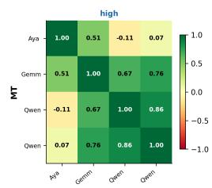

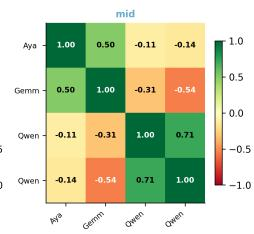

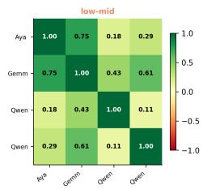

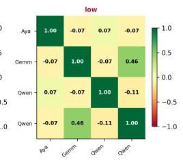

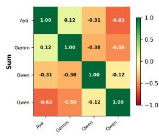

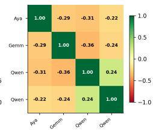

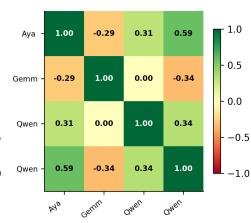

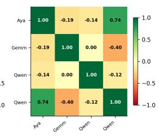

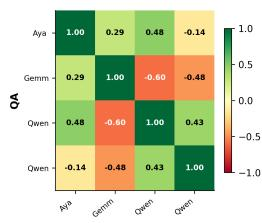

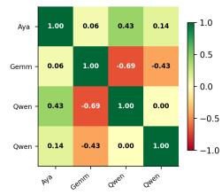

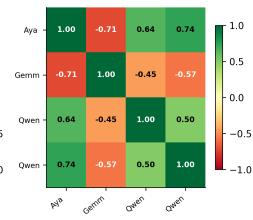

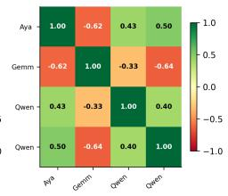

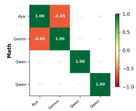

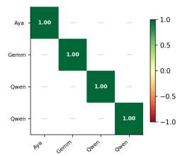

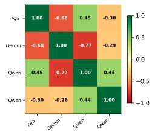

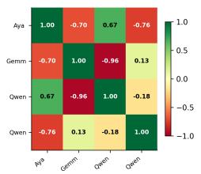  
Figure 7: Inter-model strategy-rank agreement (Spearman ρ) per model pair, task, and resource tier. Each 4 × 4 matrix shows pairwise ρ for one task × resource combination. Green = models agree on best strategy; red = systematic disagreement; — = insufficient data. The averaged values per task and resource tier are reported in the main text. Gemma 27B systematically disagrees with all other models for Summarization, consistent with its divergent zero-shot scoring scale.

<table><tr><td rowspan="2">Judge</td><td colspan="2">Gold</td><td colspan="2">AfroBench</td></tr><tr><td>Mean</td><td>SD</td><td>Mean</td><td>SD</td></tr><tr><td>Aya 32B</td><td>4.35</td><td>0.68</td><td>3.68</td><td>1.41</td></tr><tr><td>Qwen 32B</td><td>4.42</td><td>0.61</td><td>3.35</td><td>1.03</td></tr><tr><td>Qwen 72B</td><td>4.31</td><td>0.72</td><td>3.32</td><td>1.18</td></tr><tr><td>Gemma 27B</td><td>4.02</td><td>0.89</td><td></td><td></td></tr><tr><td>Gemini 2.5†</td><td></td><td></td><td>3.20</td><td>1.87</td></tr></table>

† Gemini evaluated on AfroBench only (MT); included as robustness check for the ceiling effect.  
Table 13: Mean judge score (gold vs. AfroBench), pooled across MT and Summarization. AfroBench scores are consistently lower and more dispersed, confirming the ceiling effect.

Appendix — MT: rubric dimension means by strategy and resource tier (averaged over all 4 judge models)  
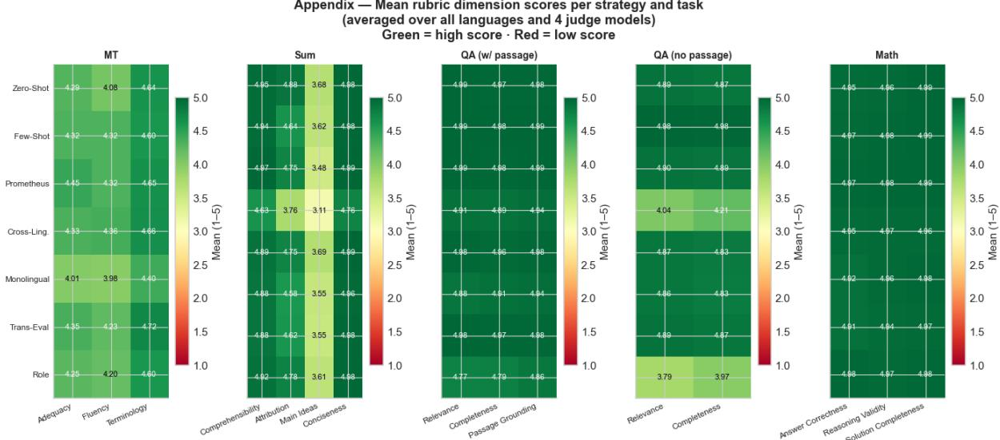  
Figure 8: Mean rubric dimension scores per strategy and task (averaged over all languages and 4 judge models). Green = high score; red = low score (scale 1–5). MT Terminology and Summarization Main Ideas are the most strategy-sensitive dimensions; QA and Math dimensions show near-ceiling values consistent with the gold-reference evaluation design. QA is split into passage-based (XQuAD, PersianQA, CatalanQA, Belebele) and passage-free (AfriQA) variants due to differing rubric dimensions.

  
Figure 9: MT rubric dimension means by strategy and resource tier (averaged over 4 judge models). The resource-level effect concentrates in Terminology (3.93–4.59 for low-resource vs 4.97–5.00 for high-resource) while Adequacy and Fluency remain stable, confirming that judges detect terminological inconsistency as the primary quality signal for low-resource MT.

  
Figure 10: Summarization rubric dimension means by strategy and resource tier (averaged over 4 judge models). Main Ideas drops to 2.99–3.07 under CoT and Prometheus vs 3.48–3.80 for Zero-Shot, consistently across all resource tiers, confirming the pattern is a rubric–strategy interaction rather than a cross-lingual phenomenon.

  
Figure 11: External validity: SummEval (Summarization, English, n = 1,600). Per-example Spearman ρ between judge scores and human quality annotations per strategy and judge model. Significance markers: \* $p < 0 . 0 5 , ^ { * * } p < 0 . 0 1 , ^ { * * * } p < 0 . 0 0 1$

  
Figure 12: External validity: WMT MQM (MT, English→German, n = 500). Per-example Spearman ρ between judge scores and expert MQM error annotations per strategy and judge model.