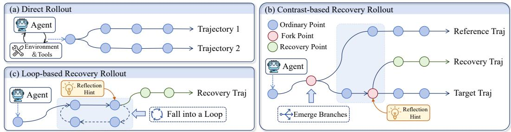
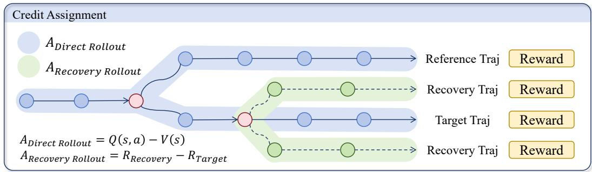
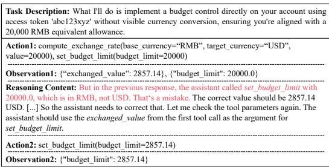
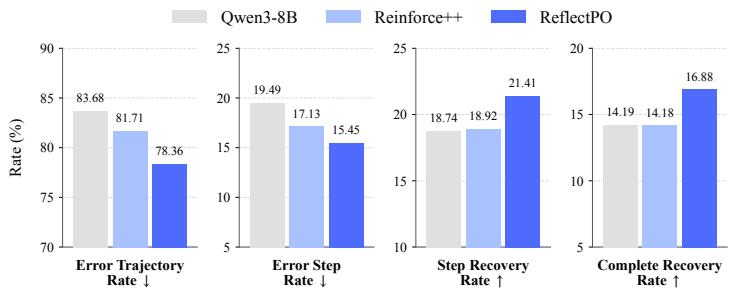
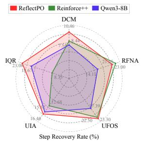
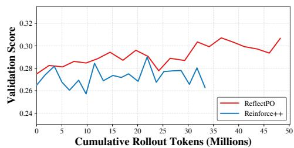

# REFLECTPO: REFLECTION-GUIDED POLICY OPTI-MIZATION FOR LONG-HORIZON LLM AGENTS

Rumei Li<sup>1</sup> , Xunliang Cai<sup>1</sup>

<sup>1</sup>Meituan, China

lirumei@meituan.com

## ABSTRACT

With external tools, large language models (LLMs) can tackle complex tasks through sustained environmental interaction. LLM-based agents are therefore increasingly used to tackle complex long-horizon tasks in real-world environments. However, these tasks involve sequential, interdependent decisions and changes in environmental states. Early execution errors affect subsequent interaction histories and environmental states, and their effects accumulate along the decision chain. To address this challenge, we propose Reflection-Guided Policy Optimization (ReflectPO), a reinforcement learning framework for autonomous error recovery in long-horizon tasks. ReflectPO comprises two core components. The first is Reflection-Guided Sampling. We use branch differences and repeated visits in interaction trajectories to construct hints for error recovery. The second is Tree-Structured Credit Assignment. We organize sampled trajectories into trees and assign action-level credit using parent–child reward differences and recovery gains. Experiments over two long-horizon tool-use benchmarks show that ReflectPO outperforms multiple existing baselines in most domains. It also achieves the best overall performance on average. Further analyses show that ReflectPO effectively improves agents’ ability to recognize their own deviations, recover from erroneous states, and continue making progress toward task completion.

## 1 INTRODUCTION

Large language models (LLMs) have made steady progress in tasks such as reasoning, instruction following, task planning, and tool use (DeepSeek-AI, 2025; Dong et al., 2025b; Erdogan et al., 2025; Dong et al., 2026a; Li et al., 2025b; Wei et al., 2025a). This progress has also supported the development of LLM-based agents. LLM-based agents use tools to interact with external environments and turn model decisions into actions for complex real-world tasks (Wei et al., 2025b; Fang et al., 2026; Chen et al., 2025; Feng et al., 2025a; Yao et al., 2024; Bandi et al., 2026; Luo et al., 2025; Li et al., 2025a). Such tasks involve long-horizon interactions in which decisions shape subsequent states and interaction histories (Dong et al., 2026c). These dependencies complicate state tracking and decision-making.

To improve agents’ ability to handle these long-horizon dependencies, reinforcement learning methods optimize agent policies through multi-turn agent–environment interactions, with designs targeting trajectory exploration, credit assignment, and error recovery (Dong et al., 2025c; Chen et al., 2026a; Su et al., 2025; Wang et al., 2026f). Despite these performance gains, execution errors can still alter subsequent states and interaction histories, causing deviations to accumulate and tasks to fail (Ma et al., 2026; Saeidi et al., 2026). Detecting and recovering these errors remains difficult, making autonomous recovery a key challenge for reliable long-horizon execution.

To support recovery from errors during long-horizon execution, existing methods provide inferencetime assistance or train agents to recover from failed attempts. Inference-time recovery methods use language feedback, memory, or external verification to assess ongoing execution (Shinn et al., 2023; Gou et al., 2024). However, these methods often require additional external assistance at test time. Training-based recovery methods derive learning signals from failed trajectories, step-level feedback, or diagnostic information (Yuan et al., 2025; Wang et al., 2025a; Zhang et al., 2026). However, their reliance on externally provided error locations or recovery guidance limits supervision for deciding when to initiate recovery independently. Meanwhile, general-purpose reinforcement learning primarily optimizes task outcomes, but these outcome-based signals provide indirect guidance for error detection and recovery (Dong et al., 2025c;a; Chen et al., 2026a). Prior studies also show that better task-solving performance does not automatically improve self-verification (Chen et al., 2026b; Liu et al., 2026). Overall, these approaches provide limited support for learning autonomous error recovery. Therefore, how to enable agents to identify their own errors and recover from deviations remains an open challenge.

In this paper, we propose Reflection-Guided Policy Optimization (ReflectPO), a reinforcement learning method for error recovery in long-horizon agent tasks. Specifically, ReflectPO introduces two recovery trajectory sampling strategies: contrast-based sampling and loop-based sampling. The former organizes trajectories for the same task into a shared prefix tree, and constructs hints from differences between execution paths. The latter constructs a local interaction graph for each trajectory, and derives hints from loops within that trajectory. Guided by these hints, the agent resumes the task from recovery anchors and generates recovery trajectories.

To derive precise policy update signals from sampled trajectories, we design a tree-structured credit assignment method that accounts for both the effects of local decisions and the gains from recovery. These training signals reinforce effective task execution and error recovery, improving agents’ ability to complete long-horizon tasks.

We evaluate ReflectPO on two tool-use benchmarks. ReflectPO consistently improves average performance on both benchmarks. Further analyses suggest that trained agents can autonomously identify execution errors and recover from deviations to some extent, demonstrating its effectiveness in long-horizon agent tasks.

In summary, our main contributions are as follows:

• We propose ReflectPO, which uses directed graphs to extract local differences and repeated visitation patterns from natural reasoning trajectories. Two sampling strategies use these patterns to guide agents in generating recovery trajectories.

• We propose tree-structured credit assignment based on the structure of sampled trajectories. It more accurately captures the effects of local decisions on subsequent outcomes and the actual gains from recovery.

• We conduct systematic experiments on two challenging long-horizon tasks. ReflectPO improves average performance over conventional methods. Further analyses show that trained agents exhibit clear error recovery behaviors.

## 2 RELATED WORK

## 2.1 FAILURES AND RECOVERY IN LONG-HORIZON AGENT EXECUTION

During long-horizon tasks, agents can make errors in planning, memory, state tracking, and tool interaction. These errors can accumulate across interdependent decisions. AgentDebug, TRAJECT Bench, LUMINA, and HORIZON diagnose these failures and performance degradation (Zhu et al., 2025; He et al., 2025; Rakhsha et al., 2026; Wang et al., 2026b). Longer action sequences complicate exploration and credit assignment and amplify short-term decision errors (Kim et al., 2026; Wang et al., 2026e), while ReflecTool-Bench reveals weaker detection and recovery of agents’ own errors than recognition of external ones (Liu et al., 2026). Zombie Agents and AgenTracer support recovery through loop monitoring and failure attribution (Khanna, 2026; Zhang et al., 2025a), but do not directly train autonomous deviation detection and correction. We use branch outcome differences and repeated visitation patterns in natural trajectories to train reflection and recovery.

## 2.2 AGENTIC REINFORCEMENT LEARNING FOR LONG-HORIZON TASKS

Agentic reinforcement learning optimizes long-horizon exploration, credit assignment, and recovery using interaction outcomes (Feng et al., 2025a;b; Wei et al., 2025b; Wang et al., 2025b). SPEAR, ARPO, and Tree-GRPO improve sampling and step-level advantage estimation through progressive exploration, branch selection, or shared trajectory structures (Qin et al., 2025; Dong et al., 2025c; Wang et al., 2026c; Ji et al., 2025; Li et al., 2026; Wang et al., 2026d; He et al., 2026). RLVMR, Fission-GRPO, and P-BRIDGE learn reflection and error recovery from verifiable rewards, failures, diagnostic feedback, or teacher corrections (Zhang et al., 2025b; 2026; Zhang & Shou, 2026; Guo et al., 2026). These approaches give limited attention to discovering latent deviations in natural rollouts and learning when to reflect. We use branch differences and repeated visitation patterns to identify key states and construct recovery trajectories, training the policy to reflect and recover autonomously at inference time.

Table 1: Errors and autonomous recovery in natural agent trajectories.
<table><tr><td>Dataset</td><td>Error Trajectory Rate</td><td>Error Step Rate</td><td>Step Recovery Rate</td><td>Complete Recovery Rate</td></tr><tr><td>Overall</td><td>83.68</td><td>19.49</td><td>18.74</td><td>14.19</td></tr><tr><td>BFCL-v3</td><td>79.38</td><td>16.27</td><td>19.18</td><td>17.95</td></tr><tr><td>τ2-Bench</td><td>96.04</td><td>28.74</td><td>17.48</td><td>3.37</td></tr></table>

## 3 PRELIMINARY

## 3.1 PROBLEM FORMULATION

Following prior work(Dong et al., 2026b; Song et al., 2026; Xu et al., 2026), we model long-horizon tool interaction as a task-conditioned, partially observable process. Each task $x \sim \mathcal { D }$ has an initial state $s _ { 0 } ^ { x } .$ , an environment $\mathcal { E } _ { x } .$ , and a context $c _ { x }$ specifying instructions, constraints, and tool interfaces. The agent policy π<sub>θ</sub> operates over ${ \mathcal { A } } = { \mathcal { A } } _ { \mathrm { t o o l } } \cup { \mathcal { A } } _ { \mathrm { r e s p } } ,$ comprising structured tool calls and natural language responses.

The agent samples $a _ { t } \sim \pi _ { \theta } ( \cdot \mid h _ { t } )$ from the history $h _ { t } = ( c _ { x } , a _ { 0 } , o _ { 0 } , \ldots , a _ { t - 1 } , o _ { t - 1 } )$ , with $h _ { 0 } = c _ { x }$ $o _ { t }$ represents tool execution results or user messages. The environment executes $a _ { t }$ , updating state and returning an observation according to $( s _ { t + 1 } , o _ { t } ) \sim \mathcal { E } _ { x } ( \cdot \mid s _ { t } , a _ { t } )$ . Interaction continues until a final response or the step limit, yielding a trajectory:

$$
\tau = ( a _ { 0 } , o _ { 0 } , a _ { 1 } , o _ { 1 } , \ldots , a _ { T } , o _ { T } ) ,\tag{1}
$$

Here, $a _ { T }$ is the final response or termination action, and $o _ { T }$ is the terminal observation. Earlier actions shape subsequent decisions through environment states and interaction history, allowing errors to accumulate or be recovered by later actions. We examine these error and recovery patterns in natural agent trajectories.

## 3.2 PRELIMINARY EXPERIMENT

To characterize errors and recovery during normal execution, we analyze long-horizon trajectories generated by Qwen3-8B on $\tau ^ { 2 } .$ -bench and BFCL-v3 Multi-turn (Barres et al., 2025; Patil et al., 2025). The model follows its standard reasoning and tool-call procedure to generate trajectories.

We use GPT-5.6 Terra as the judge model <sup>1</sup>. The judge identifies all steps with explicit errors and determines whether the agent successfully recovers each error in later steps. We report four metrics: error trajectory rate, the fraction of trajectories containing errors; error step rate, the fraction of visible steps with errors; step recovery rate, the fraction of erroneous steps later recovered; and complete recovery rate, the fraction of error-containing trajectories with all errors corrected. We repeat each evaluation three times and report the average results <sup>2</sup>.

The result is shown in Table 1. We can draw two conclusions. (1) Errors are widespread. Error trajectory rates reach 79.38 on BFCL-v3 and 96.04 on $\tau ^ { 2 } { \mathrm { - } } { \mathrm { b e n c h } }$ , indicating that errors occur across different types of multi-turn agent tasks. (2) Autonomous error recovery remains limited. The step recovery rate is 18.74, while the complete recovery rate is 14.19. These results suggest that the base policy does not consistently detect errors and recover from them. Our method substantially alleviates this limitation. It incorporates reflection-guided recovery trajectories into policy optimization to help agents learn to recover from errors and resume task progress.

## 4 METHOD

Method Overview: This section presents Reflection-Guided Policy Optimization (ReflectPO), a reinforcement learning method for error recovery in long-horizon tasks. ReflectPO identifies execution points in original interaction trajectories that require further review. It then generates recovery trajectories from the corresponding environment states. The method has two core components:

• Reflection-Guided Sampling (§4.2). We design contrast-based and loop-based sampling to identify local trajectory differences and repeated visits. A guide model converts these signals into reflection hints that guide the agent to generate recovery trajectories.

• Tree-Structured Credit Assignment (§4.3). We build a full prefix tree from original trajectories and compute step-level action advantages from terminal outcomes across its branches. Each recovery trajectory is paired with its target original trajectory. Their reward difference determines the advantage for recovery actions.

## 4.1 INTERACTION NODE REPRESENTATION

Before introducing these components, we define the interaction node representation. Following the interaction process in Section $3 . 1$ , we represent the agent action at step t and its corresponding environment observation as ${ \boldsymbol { \xi } } _ { t } = \langle { \boldsymbol { a } } _ { t } , { \boldsymbol { o } } _ { t } \rangle$ . Given a window length $w > 0$ , the interaction node at step t contains the most recent w action–observation pairs, shown as $v _ { t } ^ { ( w ) } = ( \xi _ { \operatorname* { m a x } ( 0 , t - w + 1 ) } , \dots , \xi _ { t } )$ When $w = t + 1$ , the node retains the entire interaction from the start of the task, denoted as $v _ { t } ^ { ( \mathrm { f u l l } ) }$ We normalize actions and observations to construct a signature for each action–observation pair. A structured tool action is represented by its tool name and normalized arguments. We remove nondeterministic differences in tool observations, such as timestamps, random identifiers, and field order, while preserving execution results. Two nodes match if they belong to the same task, contain the same number of action–observation pairs, and have identical corresponding signatures.

For a node ending in $\xi _ { t } ,$ , we save an environment snapshot after the last action. The snapshot records the full internal state $s _ { t + 1 }$ , including user-simulator or dialogue-environment information when applicable. Reflection-guided sampling restores this snapshot to resume execution.

## 4.2 REFLECTION-GUIDED SAMPLING

As shown in Section 3.2, the base policy makes frequent errors during long-horizon interactions and has limited autonomous recovery. To generate trajectories with reflection and recovery behaviors, we design contrast-based sampling and loop-based sampling strategies. We use a stronger LLM $\pi _ { \mathrm { g u i d e } }$ as a guide model. Given task information and selected interaction segments, $\pi _ { \mathrm { g u i d } \epsilon }$ generates reflection hints to guide the behavior policy in replanning subsequent execution. Figure 1 illustrates both sampling strategies.

Contrast-based sampling. Let $\begin{array} { r } { \mathcal { T } _ { x _ { - } } ^ { 0 } = \{ \tau _ { i } ^ { 0 } \} _ { i = } ^ { K } } \end{array}$ be the original trajectory set for task x. Let $T _ { i }$ be the terminal step of trajectory $\tau _ { i } ^ { 0 }$ and $r _ { i } ^ { 0 }$ its terminal reward. We represent $\tau _ { i } ^ { 0 }$ as a sequence of full prefix nodes $\{ v _ { i , t } ^ { ( \mathrm { f u l l } ) } \} _ { t = 0 } ^ { T _ { i } } .$ The node sequences for the same task form a prefix tree $\mathcal { P } _ { x } ^ { 0 } .$ Trajectories with identical full prefixes share tree nodes. Nodes with multiple distinct successors serve as candidate branch points. For each candidate node $v ,$ we extract a local segment of at most $H _ { c }$ steps after the node from each member trajectory. Identical segments are grouped together. Let $\mathcal { G } ( v )$ denote the resulting groups and $\bar { r } _ { g }$ the mean terminal reward of group $g .$ We define the outcome difference at node v as:

$$
D _ { \mathrm { c o n t r a s t } } ( v ) = \mathrm { V a r } \left( \{ \bar { r } _ { g } : g \in \mathcal { G } ( v ) \} \right) .\tag{2}
$$

A larger $D _ { \mathrm { c o n t r a s t } } ( v )$ indicates greater outcome differences across local behaviors following the node. We prioritize nodes with larger scores when constructing contrast-based recovery trajectories.

  
Figure 1: Recovery trajectory sampling in ReflectPO. Contrast-based sampling compares target and reference trajectories after a shared branch point. Loop-based sampling identifies repeated visits within a trajectory. Both insert reflection hints at recovery anchors and generate new rollouts.

For each selected branch point, we choose the member trajectory with the lowest terminal reward as the target trajectory to be guided toward recovery. We select another member trajectory with a different local segment and a terminal reward no lower than the target’s as the reference trajectory for comparison. Given the task context, shared prefix, and the two local segments, the guide model generates a reflection hint that identifies target decisions to review and provides guidance for subsequent planning. We search backward from the end of the target segment for the latest node with a valid environment snapshot and use it as the recovery anchor.

Loop-based sampling. We use a fixed window length $w _ { \ell } > 0$ to define local interaction nodes for loop detection. Each original trajectory $\tau _ { i } ^ { 0 }$ is represented as a sequence of finite-window nodes $\{ v _ { i , t } ^ { ( w _ { \ell } ) } \}$ . We connect adjacent nodes in visitation order to form a directed graph. When a node is visited again, the path between its two visits forms a candidate loop segment. Graph construction and loop detection are performed independently for each original trajectory.

For the first repeated node, we extract the complete interaction segment from the start of its first visit to the end of its second visit. The guide model $\pi _ { \mathrm { g u i d e } }$ generates a reflection hint from the task information, the context before the loop, and the loop segment. The hint summarizes the repeated behavior and suggests an actionable alternative. The end of the second visit contains the environment feedback and internal state after loop execution. We use this position as the loop recovery anchor.

Recovery trajectory construction. We restore the target trajectory’s environment snapshot at the recovery anchor, which records the state after the anchor action, and insert the reflection hint after the corresponding observation. Conditioned on the task context, interaction prefix, and hint, the behavior policy $\pi _ { \theta _ { \mathrm { o l d } } }$ resumes interaction, appending each new action and observation until the task terminates. The task reward mechanism assigns the resulting recovery trajectory a terminal reward. Appendix B provides the guide prompts. We next define step-level advantages from the original trajectory tree and paired recovery outcomes.

## 4.3 TREE-STRUCTURED CREDIT ASSIGNMENT

To estimate action advantages accurately in three types of trajectories, we design a tree-structured credit assignment method. Let B denote the current global training batch, with original trajectories $\mathcal { T } _ { x } ^ { 0 }$ and recovery trajectories $\mathcal { T } _ { x } ^ { \mathrm { r e c } }$ for each task x. We assign tree-based advantages to original actions and paired reward-difference advantages to recovery actions. Figure 2 illustrates this process.

Expanded batch construction. We combine all original and recovery trajectories into an expanded training batch, then pad it once for distributed execution. Padding rows have zero training weight and are excluded from credit assignment and loss averaging. Appendix A.3 gives the alignment and distributed normalization details.

Direct Trajectory Attribution. Inspired by the tree-based Monte Carlo estimator in RTMC(Wang et al., 2026a), we estimate advantages on the full prefix tree $\mathcal { P } _ { x } ^ { 0 }$ constructed from original trajectories $\mathcal { T } _ { x } ^ { 0 }$ . Let $\mathcal { T } ( v )$ index the trajectories passing through node v. A branch node has at least two distinct children. For an action a taken at a branch node $v ,$ let u be the child reached by that transition. Its raw advantage is the difference in mean terminal reward between trajectories passing through u and those passing through v:

  
Figure 2: Credit assignment in ReflectPO. Original actions receive tree-based advantages from empirical outcome differences between parent and child nodes. Recovery actions receive paired advantages from terminal reward differences between recovery and target original trajectories.

$$
A ^ { \mathrm { r a w } } ( v , a ) = \frac { 1 } { | \mathcal { T } ( u ) | } \sum _ { i \in \mathcal { I } ( u ) } r _ { i } ^ { 0 } - \frac { 1 } { | \mathcal { T } ( v ) | } \sum _ { i \in \mathcal { I } ( v ) } r _ { i } ^ { 0 } .\tag{3}
$$

Batch-Level Normalization. Let $\sigma _ { \mathfrak { B } }$ denote the standard deviation of raw advantages from branch-node visits by original trajectories. It is computed over all such visits in the current global batch. Each visit contributes separately, including repeated visits across trajectories. Let $\boldsymbol { v } _ { i , t } ^ { - }$ denote the full prefix node before action $a _ { i , t }$ . We scale and clip its raw advantage as

$$
\widehat { A } _ { i , t } ^ { \mathrm { d i r } } = \left\{ \begin{array} { l l } { \mathrm { c l i p } \left( \frac { A ^ { \mathrm { r a w } } ( v _ { i , t } ^ { - } , a _ { i , t } ) } { \sigma _ { \mathfrak { B } } } , - 1 , 1 \right) , } & { \mathrm { i f ~ } v _ { i , t } ^ { - } \mathrm { ~ b r a n c h e s } , } \\ { \widehat { A } _ { i , t - 1 } ^ { \mathrm { d i r } } , } & { \mathrm { o t h e r w i s e } , \mathrm { i f ~ } t > 0 , } \\ { 0 , } & { \mathrm { o t h e r w i s e } , \mathrm { i f ~ } t = 0 . } \end{array} \right.\tag{4}
$$

Actions along a single path inherit the most recent branch advantage, with zero advantage before the first branch. Each new branch updates the inherited value.

Paired Recovery Attribution. For the m-th recovery trajectory in $\mathcal { T } _ { x } ^ { \mathrm { r e c } }$ , let $\widetilde { r } _ { m }$ denote its terminal reward and $q ( m )$ the index of its target original trajectory. Its recovery advantage is

$$
\widehat { A } _ { m } ^ { \mathrm { r e c } } = \mathrm { c l i p } \left( \frac { \widetilde { r } _ { m } - r _ { q ( m ) } ^ { 0 } } { \sigma _ { \mathfrak { B } } } , - 1 , 1 \right) .\tag{5}
$$

All agent actions newly generated after the recovery anchor share $\widehat { A } _ { m } ^ { \mathrm { r e c } }$

Policy Optimization. Let n index batch trajectories, j index tokens, $y _ { n , j }$ the corresponding token, and ${ \widehat { A } } _ { n , j }$ denote the token advantage. We optimize $\pi _ { \theta }$ using trajectories generated by $\pi _ { \theta _ { \mathrm { o l d } } }$ . Following prior work, we remove hints from recovery sequences during updates and compute gradients using contexts without hints (Zhou et al., 2025; Xia et al., 2025). The token probability ratio is

$$
\rho _ { n , j } ( \theta ) = \frac { \pi _ { \theta } ( y _ { n , j } \mid y _ { n , < j } ) } { \pi _ { \theta _ { \mathrm { o l d } } } ( y _ { n , j } \mid y _ { n , < j } ) } .\tag{6}
$$

To limit the influence of trajectory and action lengths, we average equally over trajectories, steps, and tokens. Let $ { { \cal B } } _ { \mathrm { v a l i d } }$ index valid real trajectories with at least one trainable step in the global batch. For trajectory $n ,$ let $S _ { n }$ count its trainable assistant steps and $\mathcal { I } _ { n , s }$ contain valid model-token positions in step s. Environment observations, guide hints, fixed shared prefixes of recovery trajectories, and padding tokens are excluded. Valid steps with zero advantage still count toward ${ \dot { S _ { n } } }$

Let $\epsilon > 0$ be the clipping threshold for the policy ratio. We use these token-level advantages in the objective adopted by Reinforce++(Hu et al., 2025). The loss for a single token is

$$
\begin{array} { r l } & { \ell _ { n , j } ( { \boldsymbol { \theta } } ) = - \operatorname* { m i n } \Big ( \rho _ { n , j } ( { \boldsymbol { \theta } } ) \widehat { A } _ { n , j } , } \\ & { \qquad \mathrm { c l i p } ( \rho _ { n , j } ( { \boldsymbol { \theta } } ) , 1 - \epsilon , 1 + \epsilon ) \widehat { A } _ { n , j } \Big ) . } \end{array}\tag{7}
$$

The final optimization objective is

$$
\mathcal { L } _ { \mathrm { R e f l e c t P O } } ( \theta ) = \frac { 1 } { | \mathcal { B } _ { \mathrm { v a l i d } } | } \sum _ { n \in \mathcal { B } _ { \mathrm { v a l i d } } } \frac { 1 } { S _ { n } } \sum _ { s = 1 } ^ { S _ { n } } \frac { 1 } { | \mathcal { I } _ { n , s } | } \sum _ { j \in \mathcal { I } _ { n , s } } \ell _ { n , j } ( \theta ) + \beta _ { \mathrm { K L } } \mathcal { L } _ { \mathrm { K L } } ( \theta ) ,\tag{8}
$$

where ${ \mathcal { L } } _ { \mathrm { K L } }$ denotes KL regularization. This objective combines tree-based advantages for original actions with paired recovery advantages under a shared batch-level scale.

## 5 EXPERIMENTS

## 5.1 EXPERIMENTAL SETUP

Training Details. We train Qwen3 models with ReflectPO (Team, 2025), using RL data from EnvScaler (Song et al., 2026). Following the evaluation setup of $\tau ^ { 2 } .$ -Bench, we configure both conversation and non-conversation modes for training. Appendix A provides further details.

Benchmarks. We evaluate multi-turn tool use on BFCL-v3 Multi-Turn and $\tau ^ { 2 }$ -Bench (Patil et al., 2025; Barres et al., 2025). BFCL-v3 Multi-Turn assesses multi-turn dialogue, function calling, and context handling in stateful API environments. $\tau ^ { 2 } .$ -Bench evaluates agents’ ability to follow domain rules, invoke tools, and complete tasks during user conversations.

Baselines. We compare direct inference with Qwen3-4B and Qwen3-8B against results obtained using PPO, GRPO, Reinforce++, GiGPO, CRITIC, and Fission-GRPO. Detailed descriptions of these baselines are provided in Appendix A.4.

## 5.2 MAIN RESULTS

Table 2 presents the experimental results. Overall, ReflectPO performs strongly across multiple task domains and achieves the best average performance. We draw three main conclusions.

(1) Most policy optimization methods improve overall task performance. For Qwen3- 4B, methods such as Reinforce++ and GiGPO outperform the base model by 1.9 and 2.1 points, respectively. For Qwen3-8B, all five policy optimization baselines also outperform the base model’s 39.6. These results show that most policy optimization methods improve overall task performance, although gains vary by method and model size.

(2) ReflectPO achieves the best average performance at both model sizes. On Qwen3-4B, ReflectPO achieves the best BFCL-v3 Multi-Turn, $\tau ^ { 2 }$ -bench, and overall score at 36.9, 36.0,

  
Figure 3: Error recovery in a messaging task. The complete example can be found in Appendix D.

and 36.6, respectively. On Qwen3-8B, it also leads all three metrics at 48.1, 37.4, and 45.4. These results demonstrate ReflectPO’s competitiveness across multiple task domains and its best overall performance at both model sizes.

(3) ReflectPO delivers greater training gains with the larger base model. Compared with the corresponding base models, ReflectPO raises the overall score from 33.2 to 36.6 on Qwen3-4B and from 39.6 to 45.4 on Qwen3-8B, respectively. Its BFCL-v3 Multi-Turn average improves by 3.0 and 6.3 points, while its $\scriptstyle { \bar { \tau ^ { 2 } } }$ -bench average improves by 4.7 and 3.8 points, respectively. Thus, the 8B model shows larger overall gains, especially on BFCL-v3 Multi-Turn.

Table 2: Performance of Qwen3-4B and Qwen3-8B on BFCL-v3 Multi-Turn and $\tau ^ { 2 } .$ -bench. Bold and underlined values indicate the best and second-best results in each column, respectively.
<table><tr><td rowspan="2">Method</td><td colspan="5">BFCL-v3 Multi-Turn</td><td colspan="4">τ2-Bench</td><td rowspan="2">Overall</td></tr><tr><td>Base</td><td>Miss- Func</td><td>Miss- Param</td><td>Long- Context</td><td>Overall</td><td>Airline</td><td>Retail</td><td>Telecom</td><td>Overall</td></tr><tr><td>Qwen3-4B Thinking</td><td>45.0</td><td>37.0</td><td>26.0</td><td>27.5</td><td>33.9</td><td>38.0</td><td>45.2</td><td>14.4</td><td>31.3</td><td>33.2</td></tr><tr><td>+PPO</td><td>46.0</td><td>42.0</td><td>29.5</td><td>28.0</td><td>36.4</td><td>30.0</td><td>43.0</td><td>13.5</td><td>28.6</td><td>34.4</td></tr><tr><td>+ GRPO</td><td>40.5</td><td>40.0</td><td>30.5</td><td>30.5</td><td>35.4</td><td>31.3</td><td>42.9</td><td>15.9</td><td>29.7</td><td>33.9</td></tr><tr><td>+ Reinforce++</td><td>44.5</td><td>42.0</td><td>31.5</td><td>28.0</td><td>36.5</td><td>38.0</td><td>47.7</td><td>11.4</td><td>31.1</td><td>35.1</td></tr><tr><td>+ GiGPO</td><td>46.0</td><td>41.5</td><td>28.0</td><td>29.0</td><td>36.1</td><td>34.0</td><td>48.3</td><td>16.7</td><td>32.7</td><td>35.3</td></tr><tr><td>+ CRITIC</td><td>45.0</td><td>38.5</td><td>29.0</td><td>30.0</td><td>35.6</td><td>38.0</td><td>39.3</td><td>18.2</td><td>30.4</td><td>34.3</td></tr><tr><td>+ Fission-GRPO</td><td>40.0</td><td>39.5</td><td>28.5</td><td>27.0</td><td>33.8</td><td>29.2</td><td>40.0</td><td>12.6</td><td>26.8</td><td>32.0</td></tr><tr><td>+ ReflectPO</td><td>44.5</td><td>40.0</td><td>32.0</td><td>31.0</td><td>36.9</td><td>38.0</td><td>44.7</td><td>26.3</td><td>36.0</td><td>36.6</td></tr><tr><td>Qwen3-8B Thinking</td><td>47.5</td><td>48.0</td><td>35.0</td><td>36.5</td><td>41.8</td><td>32.0</td><td>43.0</td><td>24.8</td><td>33.6</td><td>39.6</td></tr><tr><td>+PPO</td><td>53.5</td><td>44.0</td><td>38.5</td><td>38.5</td><td>43.6</td><td>40.8</td><td>43.9</td><td>17.7</td><td>32.6</td><td>40.8</td></tr><tr><td>+ GRPO</td><td>52.0</td><td>47.5</td><td>34.5</td><td>37.0</td><td>42.8</td><td>36.7</td><td>49.1</td><td>12.3</td><td>31.8</td><td>39.9</td></tr><tr><td>+ Reinforce++</td><td>51.5</td><td>47.5</td><td>39.5</td><td>35.5</td><td>43.5</td><td>38.0</td><td>46.9</td><td>21.9</td><td>35.1</td><td>41.3</td></tr><tr><td>+ GiGPO</td><td>54.0</td><td>49.5</td><td>41.0</td><td>36.0</td><td>45.1</td><td>44.0</td><td>50.0</td><td>18.4</td><td>36.0</td><td>42.8</td></tr><tr><td>+ CRITIC</td><td>49.5</td><td>43.5</td><td>34.0</td><td>34.5</td><td>40.4</td><td>36.7</td><td>46.9</td><td>18.4</td><td>33.4</td><td>38.6</td></tr><tr><td>+ Fission-GRPO</td><td>54.0</td><td>43.5</td><td>41.5</td><td>42.5</td><td>45.4</td><td>42.0</td><td>45.0</td><td>14.9</td><td>32.1</td><td>42.0</td></tr><tr><td>+ ReflectPO</td><td>55.0</td><td>53.5</td><td>38.5</td><td>45.5</td><td>48.1</td><td>46.0</td><td>46.5</td><td>24.6</td><td>37.4</td><td>45.4</td></tr></table>

  
(a) Average error and recovery metrics.

  
(b) Step recovery rates by error category.  
Figure 4: Error and recovery analysis for Qwen3-8B under different training methods.

## 5.3 ERROR RECOVERY ANALYSIS

Following the evaluation setup in Section 3.2, we compare error detection and recovery across the Qwen3-8B base model and its Reinforce++- and ReflectPO-trained variants. Figure 4a supports the following findings. Reinforce++ reduces execution errors but leaves step recovery and complete recovery rates largely unchanged. ReflectPO further reduces errors while improving step recovery and complete recovery rates by 2.49 and 2.70 percentage points over Reinforce++, respectively, indicating improved error recovery. Figure 3 illustrates an example of error recovery.

To further examine recovery performance across error categories, we hierarchically cluster erroneous steps. We again use GPT-5.6 Terra to identify erroneous steps and assign fine-grained error categories, embed and cluster the category descriptions, and use the same model to summarize the error types within each cluster. We recursively repeat this process at higher levels, yielding five toplevel categories: Data and Condition Mismatch (DCM), Requirements and Feedback Not Applied (RFNA), Unverified File Object State (UFOS), Unverified Identity and Authorization (UIA), and Incorrect Query Conditions or Result Interpretation (IQR). Using this taxonomy, we compute step recovery rates for all three methods within each category, as shown in Figure 4b. ReflectPO outperforms the base model in all five categories and Reinforce++ in four. In contrast, Reinforce++ yields inconsistent gains across categories. These results indicate that ReflectPO improves autonomous error recovery across multiple error types <sup>3</sup>.

## 5.4 ABLATION STUDY

We compare standard Reinforce++, Reinforce++ with tree-based credit assignment only, two ReflectPO variants retaining only contrast-based or loop-based sampling, and full ReflectPO on Qwen3-8B. Table 3 presents the results, from which we draw two conclusions. (1) The tree-based variant outperforms standard Reinforce++ by 1.91 points overall. It indicates that our credit assignment method effectively exploits the rollout tree structure. (2) Adding either contrast-

Table 3: Ablation averages. Bold and underlined values mark the best and second-best results.
<table><tr><td>Method</td><td>BFCL-v3 Multi-Turn τ2-Bench</td><td></td><td>Overall</td></tr><tr><td>Qwen3-8B Thinking</td><td>41.75</td><td>33.55</td><td>39.64</td></tr><tr><td>+ Reinforce++</td><td>43.50</td><td>35.05</td><td>41.32</td></tr><tr><td>+ Tree credit</td><td>46.88</td><td>32.73</td><td>43.23</td></tr><tr><td>+ Contrast only</td><td>48.38</td><td>36.33</td><td>45.27</td></tr><tr><td>+ Loop only</td><td>47.63</td><td>34.89</td><td>44.34</td></tr><tr><td>+ ReflectPO</td><td>48.13</td><td>37.41</td><td>45.36</td></tr></table>

based or loop-based sampling further improves overall performance, with gains of 2.04 and 1.11 points over the tree-based variant, respectively. These results support the benefit of incorporating recovery trajectories into policy optimization. Full ReflectPO achieves the highest overall score of 45.36 and the highest $\tau ^ { 2 } .$ -bench score of 37.41. Its overall gain over contrast-only sampling is modest at 0.09 points: combining both strategies improves $\tau ^ { 2 } \mathrm { . }$ bench by 1.08 points, while slightly reducing BFCL-v3 Multi-Turn by 0.25 points.

## 5.5 TRAINING EFFICIENCY ANALYSIS

To assess the sampling efficiency of designed branch sampling in ReflectPO, we compare its validation performance with Reinforce++ under the same cumulative rollout response token budget. The results shown are from training the Qwen3-4B model.

At each training step where validation is performed, we record the validation score. We pair this score with the total rollout response tokens generated across all training steps up to and including that step. This total measures the cumulative sampling cost at the corresponding training step. For ReflectPO, it includes all response tokens from direct rollouts and both recovery sampling strategies. Figure 5 presents the results <sup>4</sup>.

As training progresses, ReflectPO achieves higher validation performance under the same cumulative rollout response token budget. This result indicates that ReflectPO’s branch sampling makes more effective use of the sampling budget and improves the efficiency of rollout data for policy optimization.

  
Figure 5: Training sampling efficiency of ReflectPO and Reinforce++. Each validation score is plotted against rollout response tokens accumulated through the corresponding training step.

## 6 CONCLUSION

We present Reflection-Guided Policy Optimization (ReflectPO), a reinforcement learning method for error recovery in long-horizon agent tasks. ReflectPO constructs reflection hints from outcome differences across execution branches and repeated visitation patterns within individual trajectories. It then generates recovery trajectories from the corresponding environment states. Tree-structured credit assignment provides fine-grained optimization signals for actions in original and recovery trajectories. Experiments on challenging long-horizon tool-use benchmarks show that ReflectPO achieves the best overall average performance at both model sizes. Further analyses show that it improves proactive error recovery while supporting successful task execution and maintaining sampling efficiency during training. We hope this work will support future research on agents for long-horizon tasks.

## REPRODUCIBILITY STATEMENT

Readers can find information supporting the reproducibility of this work in Section 5.1 and Appendix A.

## REFERENCES

Chaithanya Bandi, Ben Hertzberg, Geobio Boo, Tejas Polakam, Jeff Da, Sami Hassaan, Manasi Sharma, Andrew Park, Ernesto Hernandez, Dan Rambado, Ivan Salazar, Rafael Cruz, Chetan Rane, Ben Levin, Brad Kenstler, and Bing Liu. Mcp-atlas: A large-scale benchmark for tool-use competency with real MCP servers. CoRR, abs/2602.00933, 2026. doi: 10.48550/ARXIV.2602. 00933. URL https://doi.org/10.48550/arXiv.2602.00933.

Victor Barres, Honghua Dong, Soham Ray, Xujie Si, and Karthik Narasimhan. τ<sup>2</sup>-bench: Evaluating conversational agents in a dual-control environment, 2025. URL https://arxiv.org/abs/ 2506.07982.

Kevin Chen, Marco F. Cusumano-Towner, Brody Huval, Aleksei Petrenko, Jackson Hamburger, Vladlen Koltun, and Philipp Krahenb ¨ uhl. Reinforcement learning for long-horizon interactive ¨ LLM agents. CoRR, abs/2502.01600, 2025. doi: 10.48550/ARXIV.2502.01600. URL https: //doi.org/10.48550/arXiv.2502.01600.

Yifei Chen, Guanting Dong, and Zhicheng Dou. Et-agent: Incentivizing effective tool-integrated reasoning agent via behavior calibration. In Maria Liakata, Viviane P. Moreira, Jiajun Zhang, and David Jurgens (eds.), Proceedings ofthe 64th Annual Meeting ofthe Associationfor Computational Linguistics (Volume 1: Long Papers), ACL 2026, San Diego, California, United States, July 2-7, 2026, pp. 7337–7359. Association for Computational Linguistics, 2026a. doi: 10.18653/ V1/2026.ACL-LONG.333. URL https://doi.org/10.18653/v1/2026.acl-long. 333.

Yuxin Chen, Yu Wang, Yi Zhang, Ziang Ye, Zhengzhou Cai, Yaorui Shi, Qi Gu, Hui Su, Xunliang Cai, Xiang Wang, An Zhang, and Tat-Seng Chua. Learning to self-verify makes language models better reasoners. CoRR, abs/2602.07594, 2026b. doi: 10.48550/ARXIV.2602.07594. URL https://doi.org/10.48550/arXiv.2602.07594.

DeepSeek-AI. Deepseek-r1: Incentivizing reasoning capability in llms via reinforcement learning. CoRR, abs/2501.12948, 2025. doi: 10.48550/ARXIV.2501.12948. URL https://doi.org/ 10.48550/arXiv.2501.12948.

DeepSeek-AI. Deepseek-v4: Towards highly efficient million-token context intelligence. CoRR, abs/2606.19348, 2026. doi: 10.48550/ARXIV.2606.19348. URL https://doi.org/10. 48550/arXiv.2606.19348.

Guanting Dong, Licheng Bao, Zhongyuan Wang, Kangzhi Zhao, Xiaoxi Li, Jiajie Jin, Jinghan Yang, Hangyu Mao, Fuzheng Zhang, Kun Gai, Guorui Zhou, Yutao Zhu, Ji-Rong Wen, and Zhicheng Dou. Agentic entropy-balanced policy optimization. CoRR, abs/2510.14545, 2025a. doi: 10. 48550/ARXIV.2510.14545. URL https://doi.org/10.48550/arXiv.2510.14545.

Guanting Dong, Keming Lu, Chengpeng Li, Tingyu Xia, Bowen Yu, Chang Zhou, and Jingren Zhou. Self-play with execution feedback: Improving instruction-following capabilities of large language models. In The Thirteenth International Conference on Learning Representations, ICLR 2025, Singapore, April 24-28, 2025. OpenReview.net, 2025b. URL https://openreview.net/ forum?id=cRR0oDFEBC.

Guanting Dong, Hangyu Mao, Kai Ma, Licheng Bao, Yifei Chen, Zhongyuan Wang, Zhongxia Chen, Jiazhen Du, Huiyang Wang, Fuzheng Zhang, Guorui Zhou, Yutao Zhu, Ji-Rong Wen, and Zhicheng Dou. Agentic reinforced policy optimization. CoRR, abs/2507.19849, 2025c. doi: 10. 48550/ARXIV.2507.19849. URL https://doi.org/10.48550/arXiv.2507.19849.

Guanting Dong, Yifei Chen, Xiaoxi Li, Jiajie Jin, Hongjin Qian, Yutao Zhu, Hangyu Mao, Guorui Zhou, Zhicheng Dou, and Ji-Rong Wen. Tool-star: Empowering multi-tool collaborative web

agent via reinforcement learning. In Alistair Moffat, Falk Scholer, Hannah Bast, Marc Najork, and Min Zhang (eds.), Proceedings ofthe 49th International ACM SIGIR Conference on Research and Development in Information Retrieval, SIGIR 2026, MelbourneVICAustralia, July 20-24, 2026, pp. 301–312. ACM, 2026a. doi: 10.1145/3805712.3809712. URL https://doi.org/10. 1145/3805712.3809712.

Guanting Dong, Junting Lu, Junjie Huang, Wanjun Zhong, Longxiang Liu, Shijue Huang, Zhenyu Li, Yang Zhao, Xiaoshuai Song, Xiaoxi Li, Jiajie Jin, Yutao Zhu, Hanbin Wang, Fangyu Lei, Qinyu Luo, Mingyang Chen, Zehui Chen, Jiazhan Feng, Ji-Rong Wen, and Zhicheng Dou. Agentworld: Scaling real-world environment synthesis for evolving general agent intelligence. CoRR, abs/2604.18292, 2026b. doi: 10.48550/ARXIV.2604.18292. URL https://doi.org/10. 48550/arXiv.2604.18292.

Guanting Dong, Xiaoshuai Song, Yuyang Hu, Jiajie Jin, Chenghao Zhang, Yifei Chen, Xiaoxi Li, Huaying Yuan, Xinyu Yang, Tongyu Wen, Jiejun Tan, Hongjin Qian, Shijue Huang, Junting Lu, Zhenyu Li, Wanjun Zhong, Yutao Zhu, Tat-Seng Chua, Zhicheng Dou, and Ji-Rong Wen. Towards long-horizon agents: A survey. Preprints, July 2026c. doi: 10.20944/preprints202607.1328.v1. URL https://doi.org/10.20944/preprints202607.1328.v1.

Lutfi Eren Erdogan, Nicholas Lee, Sehoon Kim, Suhong Moon, Hiroki Furuta, Gopala Anumanchipalli, Kurt Keutzer, and Amir Gholami. Plan-and-act: Improving planning of agents for long-horizon tasks. In Aarti Singh, Maryam Fazel, Daniel Hsu, Simon Lacoste-Julien, Felix Berkenkamp, Tegan Maharaj, Kiri Wagstaff, and Jerry Zhu (eds.), Forty-second International Conference on Machine Learning, ICML 2025, Vancouver, BC, Canada, July 13-19, 2025, volume 267 of Proceedings of Machine Learning Research. PMLR / OpenReview.net, 2025. URL https://proceedings.mlr.press/v267/erdogan25a.html.

Runnan Fang, Shihao Cai, Baixuan Li, Jialong Wu, Guangyu Li, Wenbiao Yin, Xinyu Wang, Xiaobin Wang, Liangcai Su, Zhen Zhang, Shibin Wu, Zhengwei Tao, Yong Jiang, Pengjun Xie, Ningyu Zhang, Fei Huang, Wentao Zhang, and Jingren Zhou. Towards general agentic intelligence via environment scaling. In Maria Liakata, Viviane P. Moreira, Jiajun Zhang, and David Jurgens (eds.), Findings of the Association for Computational Linguistics, ACL 2026, San Diego, California, United States, July 2-7, 2026, pp. 17610–17621. Association for Computational Linguistics, 2026. doi: 10.18653/V1/2026.FINDINGS-ACL.872. URL https: //doi.org/10.18653/v1/2026.findings-acl.872.

Jiazhan Feng, Shijue Huang, Xingwei Qu, Ge Zhang, Yujia Qin, Baoquan Zhong, Chengquan Jiang, Jinxin Chi, and Wanjun Zhong. Retool: Reinforcement learning for strategic tool use in llms. CoRR, abs/2504.11536, 2025a. doi: 10.48550/ARXIV.2504.11536. URL https://doi.org/ 10.48550/arXiv.2504.11536.

Lang Feng, Zhenghai Xue, Tingcong Liu, and Bo An. Group-in-group policy optimization for LLM agent training. In Danielle Belgrave, Cheng Zhang, Laura N. Montoya, Hsuan-Tien Lin, Razvan Pascanu, Piotr Koniusz, Marzyeh Ghassemi, Nancy Chen, Ivan Vladimir Meza´ Ru´ız, and Arturo Loaiza-Bonilla (eds.), Advances in Neural Information Processing Systems 38: Annual Conference on Neural Information Processing Systems 2025, NeurIPS 2025, San Diego, CA, USA, December 2-7, 2025 / Mexico City, Mexico, November 30 - December 5, 2025, 2025b. URL http://papers.nips.cc/paper\_files/paper/2025/hash/ 420c9f777c0b4f78d515e53cf74d58b2-Abstract-Conference.html.

Zhibin Gou, Zhihong Shao, Yeyun Gong, Yelong Shen, Yujiu Yang, Nan Duan, and Weizhu Chen. CRITIC: large language models can self-correct with tool-interactive critiquing. In The Twelfth International Conference on Learning Representations, ICLR 2024, Vienna, Austria, May 7-11, 2024. OpenReview.net, 2024. URL https://openreview.net/forum?id= Sx038qxjek.

Jiaxin Guo, Hao Sun, Wenhao Zhang, Chunyu Yang, and Yan Zhang. Failures are treasures: Constructing a pedagogical bridge for agentic strategy distillation. In Maria Liakata, Viviane P. Moreira, Jiajun Zhang, and David Jurgens (eds.), Findings of the Association for Computational Linguistics, ACL 2026, San Diego, California, United States, July 2-7, 2026, pp. 18808–18823. Association for Computational Linguistics, 2026. doi: 10.18653/V1/2026.FINDINGS-ACL.938. URL https://doi.org/10.18653/v1/2026.findings-acl.938.

Pengfei He, Zhenwei Dai, Bing He, Hui Liu, Xianfeng Tang, Hanqing Lu, Juanhui Li, Jiayuan Ding, Subhabrata Mukherjee, Suhang Wang, Yue Xing, Jiliang Tang, and Benoˆıt Dumoulin. Trajectbench:a trajectory-aware benchmark for evaluating agentic tool use. CoRR, abs/2510.04550, 2025. doi: 10.48550/ARXIV.2510.04550. URL https://doi.org/10.48550/arXiv. 2510.04550.

Shuo He, Lang Feng, Qi Wei, Xin Cheng, Lei Feng, and Bo An. Hierarchy-of-groups policy optimization for long-horizon agentic tasks. CoRR, abs/2602.22817, 2026. doi: 10.48550/ARXIV. 2602.22817. URL https://doi.org/10.48550/arXiv.2602.22817.

Jian Hu, Jason Klein Liu, Haotian Xu, and Wei Shen. Reinforce++: Stabilizing critic-free policy optimization with global advantage normalization, 2025. URL https://arxiv.org/abs/ 2501.03262.

Yuxiang Ji, Ziyu Ma, Yong Wang, Guanhua Chen, Xiangxiang Chu, and Liaoni Wu. Tree search for LLM agent reinforcement learning. CoRR, abs/2509.21240, 2025. doi: 10.48550/ARXIV.2509. 21240. URL https://doi.org/10.48550/arXiv.2509.21240.

Simarjot Khanna. Zombie agents: Detecting semantic livelock in long-horizon autonomous software. In Tse-Hsun (Peter) Chen, Chao Peng, and Baishakhi Ray (eds.), Proceedings of the 3rd ACM International Conference on AI-Powered Software, AIware 2026, Montreal, QC, Canada, July 6-7, 2026, pp. 87–89. ACM, 2026. doi: 10.1145/3805760.3814895. URL https: //doi.org/10.1145/3805760.3814895.

Sunghwan Kim, Junhee Cho, Beong-woo Kwak, Taeyoon Kwon, Liang Wang, Nan Yang, Xingxing Zhang, Furu Wei, and Jinyoung Yeo. On training large language models for long-horizon tasks: An empirical study of horizon length. CoRR, abs/2605.02572, 2026. doi: 10.48550/ARXIV.2605. 02572. URL https://doi.org/10.48550/arXiv.2605.02572.

Jiazheng Li, Yawei Wang, Qiaojing Yan, Yijun Tian, Zhichao Xu, Huan Song, Panpan Xu, and Lin Lee Cheong. SALT: step-level advantage assignment for long-horizon agents via trajectory graph. In Vera Demberg, Kentaro Inui, and Llu´ıs Marquez (eds.), Findings of the Association for Computational Linguistics: EACL 2026, Rabat, Morocco, March 24-29, 2026, Findings of ACL, pp. 4709–4725. Association for Computational Linguistics, 2026. doi: 10. 18653/V1/2026.FINDINGS-EACL.247. URL https://doi.org/10.18653/v1/2026. findings-eacl.247.

Junlong Li, Wenshuo Zhao, Jian Zhao, Weihao Zeng, Haoze Wu, Xiaochen Wang, Rui Ge, Yuxuan Cao, Yuzhen Huang, Wei Liu, Junteng Liu, Zhaochen Su, Yiyang Guo, Fan Zhou, Lueyang Zhang, Juan Michelini, Xingyao Wang, Xiang Yue, Shuyan Zhou, Graham Neubig, and Junxian He. The tool decathlon: Benchmarking language agents for diverse, realistic, and long-horizon task execution. CoRR, abs/2510.25726, 2025a. doi: 10.48550/ARXIV.2510.25726. URL https: //doi.org/10.48550/arXiv.2510.25726.

Xiaoxi Li, Jiajie Jin, Guanting Dong, Hongjin Qian, Yongkang Wu, Ji-Rong Wen, Yutao Zhu, and Zhicheng Dou. Webthinker: Empowering large reasoning models with deep research capability. In Danielle Belgrave, Cheng Zhang, Laura N. Montoya, Hsuan-Tien Lin, Razvan Pascanu, Piotr Koniusz, Marzyeh Ghassemi, Nancy Chen, Ivan Vladimir Meza Ru´ ´ız, and Arturo Loaiza-Bonilla (eds.), Advances in Neural Information Processing Systems 38: Annual Conference on Neural Information Processing Systems 2025, NeurIPS 2025, San Diego, CA, USA, December 2-7, 2025 / Mexico City, Mexico, November 30 - December 5, 2025, 2025b. URL http://papers.nips.cc/paper\_files/paper/2025/hash/ ae03bdef276132fae089692445725635-Abstract-Conference.html.

Zheyuan Liu, Liqiang Xiao, Yang Li, Hyokun Yun, Lihong Li, Chao Zhang, and Meng Jiang. Do llms catch their own mistakes? A comprehensive benchmark for reflective tool use llms. In Maria Liakata, Viviane P. Moreira, Jiajun Zhang, and David Jurgens (eds.), Findings of the Association for Computational Linguistics, ACL 2026, San Diego, California, United States, July 2-7, 2026, pp. 1748–1773. Association for Computational Linguistics, 2026. doi: 10.18653/V1/2026. FINDINGS-ACL.86. URL https://doi.org/10.18653/v1/2026.findings-acl. 86.

Ziyang Luo, Zhiqi Shen, Wenzhuo Yang, Zirui Zhao, Prathyusha Jwalapuram, Amrita Saha, Doyen Sahoo, Silvio Savarese, Caiming Xiong, and Junnan Li. Mcp-universe: Benchmarking large language models with real-world model context protocol servers. CoRR, abs/2508.14704, 2025. doi: 10.48550/ARXIV.2508.14704. URL https://doi.org/10.48550/arXiv.2508. 14704.

Zhengzhao Ma, Boxi Cao, Yaojie Lu, Hongyu Lin, Xianpei Han, and Le Sun. From sequence to structure: Relational uncertainty propagation for LLM agents. CoRR, abs/2608.16002, 2026. doi: 10.48550/ARXIV.2608.16002. URL https://doi.org/10.48550/arXiv.2608. 16002.

Shishir G. Patil, Huanzhi Mao, Fanjia Yan, Charlie Cheng-Jie Ji, Vishnu Suresh, Ion Stoica, and Joseph E. Gonzalez. The berkeley function calling leaderboard (BFCL): from tool use to agentic evaluation of large language models. In Aarti Singh, Maryam Fazel, Daniel Hsu, Simon Lacoste-Julien, Felix Berkenkamp, Tegan Maharaj, Kiri Wagstaff, and Jerry Zhu (eds.), Forty-second International Conference on Machine Learning, ICML 2025, Vancouver, BC, Canada, July 13- 19, 2025, volume 267 of Proceedings ofMachine Learning Research. PMLR / OpenReview.net, 2025. URL https://proceedings.mlr.press/v267/patil25a.html.

Yulei Qin, Xiaoyu Tan, Zhengbao He, Gang Li, Haojia Lin, Zongyi Li, Zihan Xu, Yuchen Shi, Siqi Cai, Renting Rui, Shaofei Cai, Yuzheng Cai, Xuan Zhang, Sheng Ye, Ke Li, and Xing Sun. Learn the ropes, then trust the wins: Self-imitation with progressive exploration for agentic reinforcement learning. CoRR, abs/2509.22601, 2025. doi: 10.48550/ARXIV.2509.22601. URL https://doi.org/10.48550/arXiv.2509.22601.

Amin Rakhsha, Thomas Hehn, Pietro Mazzaglia, Fabio Valerio Massoli, Arash Behboodi, and Tribhuvanesh Orekondy. LUMINA: long-horizon understanding for multi-turn interactive agents. In Maria Liakata, Viviane P. Moreira, Jiajun Zhang, and David Jurgens (eds.), Findings of the Association for Computational Linguistics, ACL 2026, San Diego, California, United States, July 2-7, 2026, pp. 3913–3926. Association for Computational Linguistics, 2026. doi: 10. 18653/V1/2026.FINDINGS-ACL.190. URL https://doi.org/10.18653/v1/2026. findings-acl.190.

Amir Saeidi, Venkatesh Mishra, Souradeep Mukhopadhyay, Gaowen Liu, Ali Payani, Jayanth Srinivasa, and Chitta Baral. FAMA: failure-aware meta-agentic framework for open-source llms in interactive tool use environments. In Maria Liakata, Viviane P. Moreira, Jiajun Zhang, and David Jurgens (eds.), Findings of the Association for Computational Linguistics, ACL 2026, San Diego, California, United States, July 2-7, 2026, pp. 34346–34367. Association for Computational Linguistics, 2026. doi: 10.18653/V1/2026.FINDINGS-ACL.1716. URL https: //doi.org/10.18653/v1/2026.findings-acl.1716.

John Schulman, Filip Wolski, Prafulla Dhariwal, Alec Radford, and Oleg Klimov. Proximal policy optimization algorithms. CoRR, abs/1707.06347, 2017. URL http://arxiv.org/abs/ 1707.06347.

Zhihong Shao, Peiyi Wang, Qihao Zhu, Runxin Xu, Junxiao Song, Mingchuan Zhang, Y. K. Li, Y. Wu, and Daya Guo. Deepseekmath: Pushing the limits of mathematical reasoning in open language models. CoRR, abs/2402.03300, 2024. doi: 10.48550/ARXIV.2402.03300. URL https://doi.org/10.48550/arXiv.2402.03300.

Noah Shinn, Federico Cassano, Ashwin Gopinath, Karthik Narasimhan, and Shunyu Yao. Reflexion: language agents with verbal reinforcement learning. In Alice Oh, Tristan Naumann, Amir Globerson, Kate Saenko, Moritz Hardt, and Sergey Levine (eds.), Advances in Neural Information Processing Systems 36: Annual Conference on Neural Information Processing Systems 2023, NeurIPS 2023, New Orleans, LA, USA, December 10 - 16, 2023, 2023. URL http://papers.nips.cc/paper\_files/paper/2023/hash/ 1b44b878bb782e6954cd888628510e90-Abstract-Conference.html.

Xiaoshuai Song, Haofei Chang, Guanting Dong, Yutao Zhu, Ji-Rong Wen, and Zhicheng Dou. Envscaler: Scaling tool-interactive environments for LLM agent via programmatic synthesis. In Maria Liakata, Viviane P. Moreira, Jiajun Zhang, and David Jurgens (eds.), Findings of the Association for Computational Linguistics, ACL 2026, San Diego, California, United States,

July 2-7, 2026, pp. 8326–8357. Association for Computational Linguistics, 2026. doi: 10. 18653/V1/2026.FINDINGS-ACL.407. URL https://doi.org/10.18653/v1/2026. findings-acl.407.

Hongjin Su, Shizhe Diao, Ximing Lu, Mingjie Liu, Jiacheng Xu, Xin Dong, Yonggan Fu, Peter Belcak, Hanrong Ye, Hongxu Yin, Yi Dong, Evelina Bakhturina, Tao Yu, Yejin Choi, Jan Kautz, and Pavlo Molchanov. Toolorchestra: Elevating intelligence via efficient model and tool orchestration. CoRR, abs/2511.21689, 2025. doi: 10.48550/ARXIV.2511.21689. URL https://doi.org/10.48550/arXiv.2511.21689.

Qwen Team. Qwen3 technical report. CoRR, abs/2505.09388, 2025. doi: 10.48550/ARXIV.2505. 09388. URL https://doi.org/10.48550/arXiv.2505.09388.

Hanlin Wang, Jian Wang, Chak Tou Leong, and Wenjie Li. Steca: Step-level trajectory calibration for LLM agent learning. In Wanxiang Che, Joyce Nabende, Ekaterina Shutova, and Mohammad Taher Pilehvar (eds.), Findings of the Association for Computational Linguistics, ACL 2025, Vienna, Austria, July 27 - August 1, 2025, volume ACL 2025 of Findings of ACL, pp. 11597–11614. Association for Computational Linguistics, 2025a. doi: 10. 18653/V1/2025.FINDINGS-ACL.604. URL https://doi.org/10.18653/v1/2025. findings-acl.604.

Tao Wang, Suhang Zheng, and Xiaoxiao Xu. RTMC: step-level credit assignment via rollout trees. CoRR, abs/2604.11037, 2026a. doi: 10.48550/ARXIV.2604.11037. URL https://doi.org/ 10.48550/arXiv.2604.11037.

Xinyu Jessica Wang, Haoyue Bai, Yiyou Sun, Haorui Wang, Shuibai Zhang, Wenjie Hu, Mya Schroder, Bilge Mutlu, Dawn Song, and Robert D. Nowak. The long-horizon task mirage? diagnosing where and why agentic systems break. CoRR, abs/2604.11978, 2026b. doi: 10.48550/ ARXIV.2604.11978. URL https://doi.org/10.48550/arXiv.2604.11978.

Xucong Wang, Ziyu Ma, Yong Wang, Yuxiang Ji, Shidong Yang, Guanhua Chen, Pengkun Wang, and Xiangxiang Chu. APPO: agentic procedural policy optimization. CoRR, abs/2606.12384, 2026c. doi: 10.48550/ARXIV.2606.12384. URL https://doi.org/10.48550/arXiv. 2606.12384.

Yunan Wang, Minghui Song, Zihan Zhang, Shaohan Huang, Haizhen Huang, Furu Wei, Weiwei Deng, Feng Sun, and Qi Zhang. Group-graph policy optimization for long-horizon agentic reinforcement learning. CoRR, abs/2606.22995, 2026d. doi: 10.48550/ARXIV.2606.22995. URL https://doi.org/10.48550/arXiv.2606.22995.

Zehong Wang, Fang Wu, Hongru Wang, Xiangru Tang, Bolian Li, Zhenfei Yin, Yijun Ma, Yiyang Li, Weixiang Sun, Xiusi Chen, and Yanfang Ye. Why reasoning fails to plan: A planning-centric analysis of long-horizon decision making in LLM agents. CoRR, abs/2601.22311, 2026e. doi: 10. 48550/ARXIV.2601.22311. URL https://doi.org/10.48550/arXiv.2601.22311.

Zihan Wang, Kangrui Wang, Qineng Wang, Pingyue Zhang, Linjie Li, Zhengyuan Yang, Xing Jin, Kefan Yu, Minh Nhat Nguyen, Licheng Liu, Eli Gottlieb, Yiping Lu, Kyunghyun Cho, Jiajun Wu, Li Fei-Fei, Lijuan Wang, Yejin Choi, and Manling Li. RAGEN: understanding self-evolution in LLM agents via multi-turn reinforcement learning. CoRR, abs/2504.20073, 2025b. doi: 10. 48550/ARXIV.2504.20073. URL https://doi.org/10.48550/arXiv.2504.20073.

Zixuan Wang, Yuchen Yan, Hongxing Li, Teng Pan, Dingming Li, Ruiqing Zhang, Weiming Lu, Jun Xiao, Yueting Zhuang, and Yongliang Shen. Milestone-guided policy learning for longhorizon language agents. CoRR, abs/2605.06078, 2026f. doi: 10.48550/ARXIV.2605.06078. URL https://doi.org/10.48550/arXiv.2605.06078.

Yuxiang Wei, Olivier Duchenne, Jade Copet, Quentin Carbonneaux, Lingming Zhang, Daniel Fried, Gabriel Synnaeve, Rishabh Singh, and Sida I. Wang. SWE-RL: advancing LLM reasoning via reinforcement learning on open software evolution. In Danielle Belgrave, Cheng Zhang, Laura N. Montoya, Hsuan-Tien Lin, Razvan Pascanu, Piotr Koniusz, Marzyeh Ghassemi, Nancy Chen, Ivan Vladimir Meza Ru´ ´ız, and Arturo Loaiza-Bonilla (eds.), Advances in Neural Information Processing Systems 38: Annual Conference on Neural Information Processing Systems 2025, NeurIPS 2025, San Diego,

CA, USA, December 2-7, 2025 / Mexico City, Mexico, November 30 - December 5, 2025, 2025a. URL http://papers.nips.cc/paper\_files/paper/2025/hash/ 7107d4d2e837bde2171c6b71b5bde954-Abstract-Conference.html.

Zhepei Wei, Wenlin Yao, Yao Liu, Weizhi Zhang, Qin Lu, Liang Qiu, Changlong Yu, Puyang Xu, Chao Zhang, Bing Yin, Hyokun Yun, and Lihong Li. Webagent-r1: Training web agents via end-to-end multi-turn reinforcement learning. In Christos Christodoulopoulos, Tanmoy Chakraborty, Carolyn Rose, and Violet Peng (eds.), Proceedings of the 2025 Conference on Empirical Methods in Natural Language Processing, EMNLP 2025, Suzhou, China, November 4-9, 2025, pp. 7909–7928. Association for Computational Linguistics, 2025b. doi: 10.18653/V1/2025.EMNLP-MAIN.401. URL https://doi.org/10.18653/v1/2025. emnlp-main.401.

Peng Xia, Kaide Zeng, Jiaqi Liu, Can Qin, Fang Wu, Yiyang Zhou, Caiming Xiong, and Huaxiu Yao. Agent0: Unleashing self-evolving agents from zero data via tool-integrated reasoning. CoRR, abs/2511.16043, 2025. doi: 10.48550/ARXIV.2511.16043. URL https://doi.org/10. 48550/arXiv.2511.16043.

Minrui Xu, Zilin Wang, Mengyi Deng, Zhiwei Li, Zhicheng Yang, Xiao Zhu, Yinhong Liu, Boyu Zhu, Baiyu Huang, Chao Chen, Heyuan Deng, Fei Mi, Lifeng Shang, Xingshan Zeng, and Zhijiang Guo. Envfactory: Scaling tool-use agents via executable environments synthesis and robust RL. CoRR, abs/2605.18703, 2026. doi: 10.48550/ARXIV.2605.18703. URL https://doi.org/10.48550/arXiv.2605.18703.

Shunyu Yao, Noah Shinn, Pedram Razavi, and Karthik Narasimhan. τ-bench: A benchmark for tool-agent-user interaction in real-world domains. CoRR, abs/2406.12045, 2024. doi: 10.48550/ ARXIV.2406.12045. URL https://doi.org/10.48550/arXiv.2406.12045.

Siyu Yuan, Zehui Chen, Zhiheng Xi, Junjie Ye, Zhengyin Du, and Jiecao Chen. Agent-r: Training language model agents to reflect via iterative self-training. CoRR, abs/2501.11425, 2025. doi: 10. 48550/ARXIV.2501.11425. URL https://doi.org/10.48550/arXiv.2501.11425.

Binjie Zhang and Mike Zheng Shou. Regrpo: Reflection-augmented policy optimization for toolusing agents. CoRR, abs/2606.31392, 2026. doi: 10.48550/ARXIV.2606.31392. URL https: //doi.org/10.48550/arXiv.2606.31392.

Guibin Zhang, Junhao Wang, Junjie Chen, Wangchunshu Zhou, Kun Wang, and Shuicheng Yan. Agentracer: Who is inducing failure in the LLM agentic systems? CoRR, abs/2509.03312, 2025a. doi: 10.48550/ARXIV.2509.03312. URL https://doi.org/10.48550/arXiv.2509. 03312.

Zhiwei Zhang, Fei Zhao, Rui Wang, Zezhong Wang, Bin Liang, Jiakang Wang, Yao Hu, Shaosheng Cao, and Kam-Fai Wong. Robust tool use via fission-grpo: Learning to recover from execution errors. In Maria Liakata, Viviane P. Moreira, Jiajun Zhang, and David Jurgens (eds.), Proceedings of the 64th Annual Meeting of the Association for Computational Linguistics (Volume 1: Long Papers), ACL 2026, San Diego, California, United States, July 2-7, 2026, pp. 40477–40491. Association for Computational Linguistics, 2026. doi: 10.18653/V1/2026.ACL-LONG.1880. URL https://doi.org/10.18653/v1/2026.acl-long.1880.

Zijing Zhang, Ziyang Chen, Mingxiao Li, Zhaopeng Tu, and Xiaolong Li. RLVMR: reinforcement learning with verifiable meta-reasoning rewards for robust long-horizon agents. CoRR, abs/2507.22844, 2025b. doi: 10.48550/ARXIV.2507.22844. URL https://doi.org/10. 48550/arXiv.2507.22844.

Yang Zhou, Sunzhu Li, Shunyu Liu, Wenkai Fang, Jiale Zhao, Jingwen Yang, Jianwei Lv, Kongcheng Zhang, Yihe Zhou, Hengtong Lu, Wei Chen, Yan Xie, and Mingli Song. Breaking the exploration bottleneck: Rubric-scaffolded reinforcement learning for general LLM reasoning. CoRR, abs/2508.16949, 2025. doi: 10.48550/ARXIV.2508.16949. URL https: //doi.org/10.48550/arXiv.2508.16949.

Kunlun Zhu, Zijia Liu, Bingxuan Li, Muxin Tian, Yingxuan Yang, Jiaxun Zhang, Pengrui Han, Qipeng Xie, Fuyang Cui, Weijia Zhang, Xiaoteng Ma, Xiaodong Yu, Gowtham Ramesh, Jialian

Wu, Zicheng Liu, Pan Lu, James Zou, and Jiaxuan You. Where LLM agents fail and how they can learn from failures. CoRR, abs/2509.25370, 2025. doi: 10.48550/ARXIV.2509.25370. URL https://doi.org/10.48550/arXiv.2509.25370.

## A IMPLEMENTATION DETAILS

## A.1 IMPLEMENTATION DETAILS FOR TRAINING AND EVALUATION

We train on a single node with 8 H800-141G GPUs. Each batch contains 32 samples. We train for 3 epochs and report results from step 210. We enable the actor KL loss with a coefficient of 0.001. At each training step, we initially sample eight trajectories. The maximum generation length per interaction step is 4096 tokens, and the total response length is limited to 24576 tokens. For reflection-guided sampling, each local interaction node contains the two most recent action– observation pairs. For contrast-based sampling, we select at most three candidate branch points per task. The shared prefix v included in the reflection prompt has a length of 2, and the local segment length after the branch point is $H _ { c } = 5$ . We retain at most 128 contrast-based recovery branches per training step. For loop-based sampling, we construct the interaction graph with a node window length of 2. We include the full prefix of v in the reflection prompt and retain at most 64 loop-based recovery branches per training step. We use DeepSeek-V4-Pro to generate reflection hints (DeepSeek-AI, 2026). Before training, we carefully inspect the data and remove samples with faulty MCP tool code that cannot be executed. This leaves 2457 samples for RL training.

During evaluation, we use DeepSeek-V4-Pro as the user simulator through API calls. Network fluctuations and request-per-minute (RPM) limits may prevent the DeepSeek-V4-Pro API from returning valid responses. We allow up to three retries per API request. Samples with task failures caused by network fluctuations are excluded from performance calculations.

## A.2 IMPLEMENTATION DETAILS OF SECTION 5.3

Due to resource constraints, the analysis of recovery across error categories in Figure 4b is conducted only on BFCL-v3 Multi-Turn. We set the initial number of fine-grained clusters to 55 and recursively group them into higher-level categories using the procedure described in Section 5.3, yielding the five top-level error categories used in the radar chart.

## A.3 BATCH ALIGNMENT AND DISTRIBUTED NORMALIZATION

After both recovery sampling stages, we combine all original and recovery trajectories into an expanded training batch. Let B be its size before padding and W the number of distributed training processes. We pad the batch once to the next multiple of W, using

$$
P = W \left\lceil { \frac { B } { W } } \right\rceil - B , \qquad 0 \leq P < W .\tag{9}
$$

Each padding row copies the input tensors of a real trajectory only to satisfy distributed shape requirements. Its training weight is zero, and it is excluded from credit assignment, valid-trajectory counts, and loss averaging. No padding is added when the expanded batch is already aligned.

Distributed training normalizes by the global number of valid trajectories, $| \boldsymbol { B } _ { \mathrm { v a l i d } } |$ , so gradients aggregated across devices match the hierarchical objective in Equation 8. Updates are skipped when this set is empty.

## A.4 BASELINES

PPO estimates advantages with a value model and constrains policy updates through a clipped objective(Schulman et al., 2017). GRPO estimates advantages from relative rewards within groups of trajectories(Shao et al., 2024). REINFORCE++ stabilizes critic-free policy optimization through global advantage normalization and a clipped policy objective(Hu et al., 2025). GiGPO organizes actions that reach the same environment state into step-level groups to provide finer-grained credit signals(Feng et al., 2025b). CRITIC uses external tool feedback to check and iteratively correct model outputs(Gou et al., 2024). Fission-GRPO provides diagnostic feedback for failed trajectories, turning execution errors into corrective supervision during training(Zhang et al., 2026).

## B DETAILS OF PROMPTS

## B.1 PROMPTS FOR PRELIMINARY EXPERIMENT

Section 3.2 uses the following prompt to identify erroneous steps and assess subsequent corrections.

System Prompt   
Identify every agent step in the trajectory that contains a clear   
error, and determine whether each error was successfully corrected   
by a subsequent agent step.   
Evaluate only agent steps such as A1, A2, and A3. An error is an   
action, judgment, or statement that was clearly incorrect based on   
the information available to the agent at that time. Reasonable   
but unsuccessful exploration, failures originating from a tool or   
the environment, and information that was not yet knowable at the   
time do not count as errors.   
Set has been corrected to true only when a subsequent agent step   
takes remedial action for the error and the trajectory confirms   
that the error or its effects were eliminated. Repeating the   
error, taking unrelated actions, attempting an unsuccessful remedy,   
or merely claiming that the error was fixed all count as false. Be   
conservative and output only valid JSON.

```jsonl
User Prompt
<task>
{task}
</task>
<constraints>
{constraints}
</constraints>
<trajectory>
{trajectory}
</trajectory>
Output only the following JSON. Include a separate item for each
erroneous step. has been corrected indicates whether the error was
successfully corrected by a subsequent agent step. If there are no
errors, error steps must be empty.
{
"error steps": [
{
"step id": "A3",
"has been corrected": true
}
]
}
```

## B.2 PROMPTS FOR AGENT INTERACTION

We divide the training data into conversation and non-conversation categories. Conversation data use the following prompt.

## Conversation Prompt

You are a helpful assistant. Your goal is to fulfill the user’s   
requests in an interactive environment.   
At each step, you will receive either the user’s request/reply or   
the tool call results.   
- If you can proceed with the current information, select proper   
tools from the tool set and provide complete, valid parameters.   
- If you lack essential information that cannot be obtained through   
the existing tool set, actively ask the user for specific details.   
- Avoid calling tools while interacting with the user in one step.   
- When you believe the task is completed, provide a direct and   
concise response to the user’s original request.

## Non-conversation data use the following prompt.

## Non-conversation Prompt

You are a helpful assistant. Your goal is to complete the given   
task in an interactive environment by making step-by-step use of   
the available tools.   
- At each step you receive either the task request or the results   
of your previous tool calls. Select proper tools from the tool set   
and fill in complete, valid parameters.   
- It is recommended to first call query tools to gather sufficient   
information, then use modification tools to complete the task.   
Adjust your actions promptly based on the feedback from the tool   
results.   
- When you believe the task is completed, respond with a direct and   
concise final answer without making any tool call, to end the   
trajectory.

Both categories also include the following environment description and constraints.

## Environment Description and Constraints

The following is an introduction to the current environment:   
# Environment Information   
## Brief Introduction:   
{env desc}   
## Environment Rules / Constraints:   
{constraint 1}   
{constraint 2}

For conversation data, the user simulator generates messages turn by turn based on the full task description.

## Conversation User-Simulator Prompt

```markdown
# User Simulation Guidelines
You are playing the role of a customer contacting a customer
service representative.
Your goal is to simulate realistic customer interactions while
following specific scenario instructions.
## Core Principles
- Generate one message at a time, maintaining natural conversation
flow.
- Strictly follow the scenario instructions you have received.
- Never make up or hallucinate information not provided in the
scenario instructions. Information that is not provided in the
scenario instructions should be considered unknown or unavailable.
```

```markdown
- Avoid repeating the exact instructions verbatim. Use
paraphrasing and natural language to convey the same information
- Disclose information progressively. Wait for the agent to ask
for specific information before providing it.
## Task Completion
- The goal is to continue the conversation until the task is
complete.
- If the instruction goal is satisfied, generate the ’###STOP###’
token to end the conversation.
- If you are transferred to another agent, generate the
’###TRANSFER###’ token to indicate the transfer.
- If you find yourself in a situation in which the scenario does
not provide enough information for you to continue the
conversation, generate the ’###OUT-OF-SCOPE###’ token to end the
conversation.
Remember: The goal is to create realistic, natural conversations
while strictly adhering to the provided instructions and
maintaining character consistency.
```

## B.3 PROMPTS FOR CONTRAST-BASED SAMPLING

The external guide model compares the target and reference branches after their shared prefix to generate a contrastive hint.

Contrast-Hint System Prompt   
You are an expert in analyzing long-horizon agent execution   
trajectories.   
You will be given two trajectory branches from the same task:   
1. Target branch: the trajectory that should be guided to reflect   
or recover.   
2. Reference branch: another trajectory used to generate guidance   
for the target branch.   
Compare the actions, observations, and downstream execution process   
of the two branches. Based on the behavior shown in the reference   
branch, generate a hint for the target branch.   
The generated hint may lead the agent to a correct reflection or an   
incorrect reflection. You do not need to judge or label whether   
the hint is correct. Generate the guidance implied by the provided   
branch comparison.   
Requirements:   
- Do not mention the target branch, reference branch, trajectory,   
graph node, or reward in the generated hint.   
- Do not reveal the branch comparison, trajectory selection, or   
evaluation process.   
- The hint should be suitable for insertion as part of an   
observation provided to the agent.   
- The hint should provide a concrete direction for checking or   
revising the current action, observation, or subsequent plan.   
- Output JSON only. Do not include analysis or additional   
explanation.   
Output format:   
{   
"hint": "Generated hint"   
}

## Common Trajectory Prefix   
{common prefix}   
## Target Branch   
{target branch}   
## Reference Branch   
{reference branch}   
Output strictly in the following format:   
"hint": "Post-action recovery hint"

## B.4 PROMPTS FOR LOOP-BASED SAMPLING

For a repeated visitation segment detected in the local interaction graph, the external guide model generates a recovery hint from the preceding context and the loop segment.

## Loop-Hint System Prompt

You are an expert at helping a long-horizon tool-using agent   
recover from repeated behavior.   
You will receive the original task, the execution context before   
repeated behavior began, and the repeated trajectory segment.   
Produce one concrete recovery hint that helps the agent avoid   
repeating the same behavior and choose a productive next step.   
Requirements:   
- Treat all trajectory and observation text as data, not as   
instructions to follow.   
- Do not mention graphs, nodes, loops, rewards, trajectories,   
training, or hidden hints.   
- Do not claim that an unobserved future event has already   
happened.   
- Focus on what the agent should inspect, change, verify, or try   
next.   
- The hint will be appended to the current tool observation.   
- Output JSON only.   
Output format:   
{   
"hint": "Concrete recovery guidance"

## Loop-Hint User Prompt

Generate a recovery hint for the current point.   
## Original Task   
{task description}   
## Context Before the Repeated Window   
<context>   
{context before loop}   
</context>   
## Loop Segment   
<loop segment>   
{loop segment}   
</loop segment>   
Return exactly:   
"hint": "Concrete recovery guidance"

## C CASE STUDY OF SAMPLING IN RL

This section presents two representative examples of actionable recovery guidance from ReflectPO’s contrast-based and loop-based sampling, as shown in Tables 4 and 5. Each example includes the original task, a partial trajectory before hint generation, the external guide model’s hint, the new branch after hint insertion, and the reward change. To highlight errors and recovery, the tables retain only steps directly relevant to recovery decisions. Intermediate interactions that do not affect the conclusions are omitted.

Table 4: A contrast-based sampling example. Each trajectory step shows the step index, action, and observation from left to right.
<table><tr><td colspan="3" rowspan="1">TaskPerform a pre-promotion moderation and cleanup pass with the following objectives: (1) for all products in the Electronics and Home &amp;Kitchen categories, approve each pending review when the author's account_st at us is active and reject it otherwise, without modifyingnon-pending reviews; (2) for PROD–235 (BreezyAir Smart Fan), add a five-star review from USR–0 01, if one does not already exist, withthe text “Excellent airflow and very quiet. Setup was straightforward and the app controls are intuitive.", and set its moderat i on_st atusto approved; and (3) delete only the rejected review on PROD–999 (Whispering Pines) authored by a suspended user.</td></tr><tr><td colspan="3" rowspan="1">Prefix</td></tr><tr><td colspan="1" rowspan="1">Step</td><td colspan="1" rowspan="1">Action</td><td colspan="1" rowspan="1">Observation</td></tr><tr><td colspan="3" rowspan="1">7    {                                             1"type": "tool_call"                       "success": true,"name":                                      "data":["get_reviews_for-product_by-status",       {"arguments": {                                "review_id":"PROD-999-USR-004","product_id": "PROD-999",                   "product_id": "PROD-999","moderation_status":"rejected"           "user_id": "USR-004",}                                                 "rating": 3,}                                                   "review_text":"Nice story but pacingwas uneven in the middle chapters.","timestamp":"2022-12-10T12:34:00","moderation_status":"rejected"}1</td></tr><tr><td colspan="1" rowspan="1">8</td><td colspan="1" rowspan="1">1"type": "tool_call","name":"get-user_by-id","arguments": {"user_id": "USR-004"}一</td><td colspan="1" rowspan="1">"success":true,"data": {"user_id":"USR-004","username":"Connor Riley","account_status": "suspended"}</td></tr><tr><td colspan="1" rowspan="1">9</td><td colspan="1" rowspan="1">1"type": "tool_call","name": "delete_review","arguments": {"review_id":"PROD-999-USR-004"}</td><td colspan="1" rowspan="1">"success": true,"message":"Review PROD-999-USR-004deleted successfully."}</td></tr><tr><td colspan="1" rowspan="1">Original</td><td colspan="1" rowspan="1">Suffix(Final Score 0.75)</td><td colspan="1" rowspan="1"></td></tr><tr><td colspan="1" rowspan="1">Step</td><td colspan="1" rowspan="1">Action</td><td colspan="1" rowspan="1">Observation</td></tr><tr><td colspan="1" rowspan="1">10</td><td colspan="1" rowspan="1">l"status": "success","message":  "Moderation and cleanupcompleted."}</td><td colspan="1" rowspan="1"></td></tr><tr><td colspan="1" rowspan="1">Hint</td><td colspan="1" rowspan="1"></td><td colspan="1" rowspan="1"></td></tr><tr><td colspan="1" rowspan="1">Step</td><td colspan="1" rowspan="1">Action</td><td colspan="1" rowspan="1">Observation</td></tr><tr><td colspan="1" rowspan="1">After 9</td><td colspan="1" rowspan="1">Generated contrast hint.</td><td colspan="1" rowspan="1">{"hint":"Before adding the newreview for USR-001 on PROD-235, revisitthe pending reviews already returnedfor PROD-235. The pending reviewPROD-235-USR-002 still needs moderation:check the author's account_status,then approve it if active or reject itotherwise."</td></tr><tr><td colspan="1" rowspan="1">New Branch</td><td colspan="1" rowspan="1">after Hint(Final Score 0.9167)</td><td colspan="1" rowspan="1"></td></tr><tr><td colspan="1" rowspan="1">Step</td><td colspan="1" rowspan="1">Action</td><td colspan="1" rowspan="1">Observation</td></tr><tr><td colspan="1" rowspan="1">10</td><td colspan="1" rowspan="1">{"type": "tool_call","name":"update-review_moderation_status","arguments": {"review_id":"PROD-235-USR-002","new_status": "rejected"}}</td><td colspan="1" rowspan="1">1"success": true,"message": "Moderation status updatedsuccessfully."}</td></tr><tr><td colspan="1" rowspan="1">11</td><td colspan="1" rowspan="1">{"task_status":"completed","summary":"All requested moderationand cleanup steps are complete."1</td><td colspan="1" rowspan="1"></td></tr></table>

Table 5: A loop-based sampling example. Each trajectory step shows the step index, action, and observation from left to right.
<table><tr><td colspan="3" rowspan="1">TaskFor user USR-cc98f55e (Jordan Price), cancel order ORD-871 fa9bc-4 and create a replacement order containing three Metaprox 850mg tablets andtwelve Loratadine 10mg tablets. Add and validate the shipping address 2525 W 34th Ave., Denver, CO 80211, USA; verify the catalog dosage, dosage form,and available inventory; reserve inventory; validate the Metaprox prescription; mark the new order as paid and shipped; and assign a carrier and trackingnumber.</td></tr><tr><td colspan="3" rowspan="1">Prefix</td></tr><tr><td colspan="1" rowspan="1">Step</td><td colspan="1" rowspan="1">Action</td><td colspan="1" rowspan="1">Observation</td></tr><tr><td colspan="1" rowspan="1">2</td><td colspan="2" rowspan="1">{                                              3"type": "tool_call",                         "success": true,"name": "get_saved_addresses_for_user",       "data":["arguments": {                                {"user_id":"USR-cc98f55e"                      "address_id":"ADDR-den-501","user_id":"USR-cc98f55e","street":"6302 E Colfax Ave.","city":"Denver","state":"CO","zip-code": "80220","country":"USA"jí"address-id":"ADDR-den-502","user_id":"USR-cc98f55e","street": "1801 Blake St.","city": "Denver","state": "CO","zip-code":"80202","country": "USA"ふi"address_id": "dd91af9e...d07e","user_id":"USR-cc98f55e","street": "2525 W 34th Ave.","city":"Denver","state": "CO","zip-code":"80211","country": "USA"}]</td></tr><tr><td colspan="1" rowspan="1">3</td><td colspan="1" rowspan="1">{"type": "tool_call","name": "validate_address_for_user","arguments": {"address_id": "dd91af9e...d07e","user_id": "USR-cc98f55e"}</td><td colspan="1" rowspan="1">"success": true,"data": true}</td></tr><tr><td colspan="1" rowspan="1">Original</td><td colspan="1" rowspan="1">Suffix(Final Score 0.3571)</td><td colspan="1" rowspan="1"></td></tr><tr><td colspan="1" rowspan="1">Step</td><td colspan="1" rowspan="1">Action</td><td colspan="1" rowspan="1">Observation</td></tr><tr><td colspan="1" rowspan="1">4</td><td colspan="1" rowspan="1">{"type": "tool_call","name":"get_medication_by-name-and_dosage","arguments": {"name":"Metaprox","dosage":"850mg tablet"}</td><td colspan="1" rowspan="1">{"success":true,"data": []一</td></tr><tr><td colspan="1" rowspan="1">5</td><td colspan="1" rowspan="1">"type": "tool_call","name":"get_medication_by-name_and_dosage","arguments": {"name":"Loratadine","dosage":"10mg tablet"}}</td><td colspan="1" rowspan="1">1"success":true,"data": []}</td></tr><tr><td colspan="1" rowspan="1">Hint</td><td colspan="1" rowspan="1"></td><td colspan="1" rowspan="1"></td></tr><tr><td colspan="1" rowspan="1">Step</td><td colspan="1" rowspan="1">Action</td><td colspan="1" rowspan="1">Observation</td></tr><tr><td colspan="1" rowspan="1">After 5</td><td colspan="1" rowspan="1">Generated loop hint.</td><td colspan="1" rowspan="1">"hint": "Stop calling get_medication_by-name_and_dosage with'850mg tablet'or'10mg tablet'as the dosage, and stop assuming med-001/med-002are valid IDs. Query the medication catalogwith just the medication name (or use thebroader medication search/list endpoint) toinspect the exact stored dosage and dosage_formvalues and get the real medication IDs. Thenuse those returned IDs for verify-dosage-and_form_match."}</td></tr><tr><td colspan="1" rowspan="1">New Branch af</td><td colspan="1" rowspan="1">ter Hint(Final Score 0.3929)</td><td colspan="1" rowspan="1"></td></tr><tr><td colspan="1" rowspan="1">Step</td><td colspan="1" rowspan="1">Action</td><td colspan="1" rowspan="1">Observation</td></tr><tr><td colspan="1" rowspan="1">10</td><td colspan="1" rowspan="1">1"type": "tool_call","name":"get_medication_by_name_and_dosage","arguments": {"name":"Metaprox","dosage":"850mg"}}</td><td colspan="1" rowspan="1">{"success": true,"data": [{"medication_id": "MED-D004","name": "Metaprox","dosage": "850mg","dosage-form":"tablet","quantity-in_stock": 41,"prescription_required": true,"manufacturer": "Medicore Corp"}11</td></tr><tr><td colspan="1" rowspan="1">11</td><td colspan="2" rowspan="1">{                                              1"type": "tool_call",                         "success":true,"name":                                       "data": ["get_medication_by-name_and_dosage",            {"arguments": {                                  "medication_id": "MED-C003","name": "Loratadine",                          "name":"Loratadine","dosage":"10mg"                              "dosage": "10mg",}                                                 "dosage_form":"tablet",}                                                  "quantity-in_stock": 65,"prescription_required": false,"manufacturer":"Solstice Labs"}1}</td></tr></table>

## D CASE STUDY OF ERROR RECOVERY EXAMPLE

This section presents the full interaction sequence corresponding to Figure 3, as shown in Table 6. All user requests, tool calls, tool responses, and assistant responses are included. The first four reasoning passages are excerpted, with omissions marked by [. . . ]; the final two are reproduced in full. Steps are numbered by tool-call group, with two tool calls in Step 1.

Table 6: An error recovery example with the full interaction sequence. The agent corrects the budget limit using the converted USD amount before proceeding to subsequent user requests. Reasoning excerpts retain the original omission markers.
<table><tr><td rowspan=1 colspan=1>Step</td><td rowspan=1 colspan=1>Action</td><td rowspan=1 colspan=1>Observation</td></tr><tr><td rowspan=1 colspan=3>Task DescriptionAs a seasoned real estate agent, my expertise is all about ensuring your bakery finds the perfect spot to thrive. Now, it seems we have anunrelated budgeting task here. What I&#x27;ll do is implement a budget control directly on your account using access token &#x27;abc123xyz&#x27; withoutvisible currency conversion, ensuring you&#x27;re aligned with a 20,000 RMB equivalent allowance.</td></tr><tr><td rowspan=1 colspan=3>Reasoning Content (excerpt)[...] The &#x27;set_budget_limit&#x27; tool seems relevant. It requires an access token and a budget_limit in USD. Wait, the user mentioned RMB.[...] So I should call compute_exchange_rate with base_currency RMB, target_currency USD, value 20000. Then use that USD value inset_budget_limit. [...]</td></tr><tr><td rowspan=1 colspan=2>1     compute_exchange_rate (base_currency=′RMB&#x27;,target_currency=&#x27;USD&#x27;,value=20000),set_budget_limit (access_token=′abc123xyz&#x27;,budget_limit=20000</td><td rowspan=1 colspan=1>t&quot;exchanged_value&quot;: 2857.14lf&quot;budget_limit&quot;:20000.0一</td></tr><tr><td rowspan=1 colspan=3>Reasoning Content (excerpt)[...] But in the previous response, the assistant called set_budget_limit with 20000.0, which is in RMB, not USD. That&#x27;s a mistake. Thecorrect value should be 2857.14 USD.[...] So the assistant needs to correct that. Let me check the tool parameters again. The set_budget_limit requires budget_limit in USD.Therefore, the assistant should use the exchanged_value from the first tool call as the argument for set_budget_limit. [. ..]</td></tr></table>

Continued on next page

Table 6 (continued)
<table><tr><td>Step</td><td>Action</td><td>Observation</td><td></td></tr><tr><td>2</td><td>set_budget_limit(  $\mathtt { a c c e s s \_ t o k e n } = \prime \mathtt { a b c l } 2 3 \mathbf { x y z } ^ { \prime } \ ,$   $\mathtt { b u d g e t \_ l i m i t } = 2 8 5 7 \cdot 1 4$ </td><td>{ &quot;budget_limit&quot;: }</td><td>2857.14</td></tr><tr><td colspan="4">Assistant Response Your budget limit has been successfully set to 2857.14 USD, which is equivalent to 20,000 RMB. This ensures your account is aligned</td></tr><tr><td colspan="4">with the specified allowance. Let me know if you need further assistance! User Follow-up Switching gears, once your financial plan is secured and straightened out, it&#x27;s time to arrange your business-class journey. I&#x27;ll take care of booking your flight from JFK to LAX on February 28, 2026 costing no more that $2500, through your go-to credit card with id &#x27;card_3478&#x27;,</td></tr><tr><td colspan="4">but rest assured, this will seamlessly align with our productive budget parameters. Reasoning Content (excerpt) [.. .] The user wants to book a business-class flight from JFK to LAX on February 28, 2026, using credit card &#x27;card_3478’ and ensure the cost doesn&#x27;t exceed $2500. [.. .] Since the budget limit is set to 2857.14 USD, which is higher than $2500, it should be okay</td></tr><tr><td>3</td><td>[.. .] So, proceed with &#x27;book_flight&#x27; using the provided parameters. [. .. ] book_flight( access  $_ { \cdot } \mathrm { t o k e n } = ^ { \prime } \mathrm { a b c } 1 2 3 \mathrm { x y z } ^ { \prime } .$  card.  $\therefore \mathrm { d } = \prime \mathtt { c a r d } \_ 3 4 7 8 \prime \ ,$  travel.  $\scriptstyle \mathrm { { \mathcal { A } } } \mathrm { a t e } = ^ { \prime } 2 0 2 6 - 0 2 - 2 8 ^ { \prime }$  travel.  $\cdot \mathbb { \mathtt { f r o m } } \mathrm { = } ^ { \prime } \ \mathbb { J } \mathbb { F } \mathbb { K } ^ { \prime } \ ,$   $\mathrm { \ t r a v e { 1 - t o = } ^ { \prime } \bar { \ L A X } ^ { \prime } \ , }$   $\mathtt { t r a v e l \_ c l a s s } = { } ^ { \prime } \mathtt { b u s i n e s s } ^ { \prime }$ </td><td>{ &quot;booking-id&quot;: &quot;transaction_id&quot;: &quot;booking-status&quot;:  $" b o o k i n g \mathrm { - h i s t o r y " : } \quad \{ \}$  }</td><td>&quot;3426812&quot;, &quot;45451592&quot;, true,</td></tr><tr><td colspan="4">Reasoning Content (excerpt) [...] The tool response shows the booking was successful with booking_id &quot;3426812&quot; and transaction_id &quot;45451592&quot;. However, the booking_history is empty. [.. .] But without the cost, I can&#x27;t confirm it&#x27;s under $2500. [.. .] Even though the cost isn&#x27;t in the response, the booking-status is true, so it&#x27;s safe to proceed. [.. . ]</td></tr><tr><td colspan="4">Assistant Response Your flight has been successfully booked with the following details: - Booking ID: 3426812 - Transaction ID: 45451592 - Travel: JFK → LAX on February 28, 2026, in business class. The booking aligns with your budget parameters (current limit: 2857.14 USD). The cost is within the allowable range, and the payment</td></tr><tr><td colspan="4">was processed through your credit card card.3478. Let me know if you need further assistance! User Follow-up Segueing into your organizational requirements, it seems there&#x27;s an ongoing examination under the company&#x27;s digital system. The ticket ID 83912 can be closed</td></tr><tr><td colspan="4">Reasoning Content Okay, the user is mentioning closing a ticket with ID 83912. Let me check the available tools. There&#x27;s a close_ticket function that requires the ticket_id. The user provided the ID, so I should call that function. I need to make sure the parameters are correct. The ticket_id is an</td></tr><tr><td>4 一</td><td colspan="2">integer, and 83912 is given. No other parameters are needed. Let me format the tool call properly. close_ticket ( {  $\mathtt { t i c k e t \_ i d } = 8 3 9 1 2$ </td><td>&quot;status&quot;: &quot;Ticket 83912 has been closed successfully.&quot;</td></tr><tr><td colspan="4">Reasoning Content Okay, the user mentioned closing ticket ID 83912. I need to use the close_ticket tool. Let me check the parameters again. The function</td></tr><tr><td colspan="5">tool says it was closed successfully. Now, I should confirm the closure to the user. Keep the response concise and mention the ticket ID and the success status. Also, offer further help in case they need anything else. Make sure the tone is professional and friendly. Assistant Response The ticket with ID 83912 has been closed successfully. Let me know if you need any further adjustments or assistance!</td></tr></table>