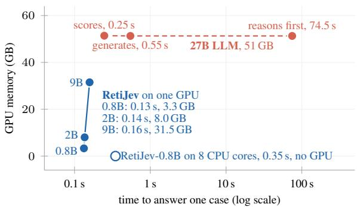
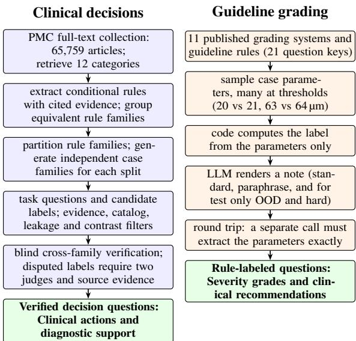
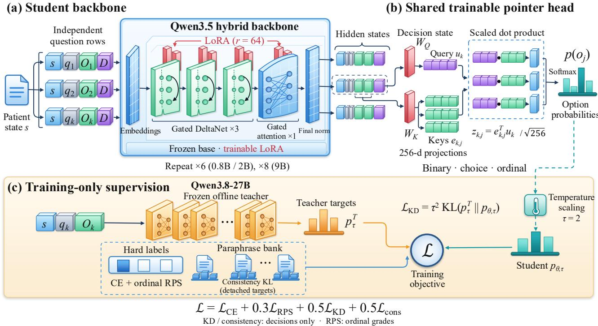
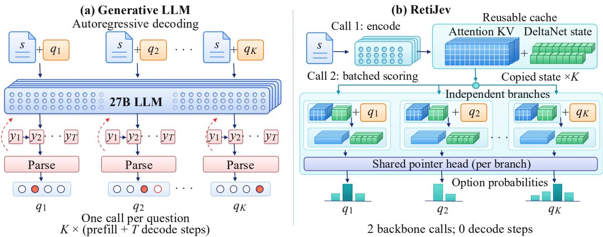
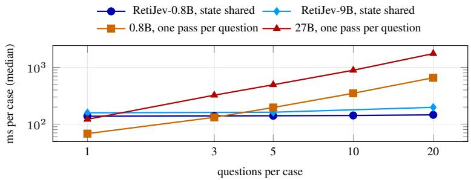

# RetiJev: Fast and Source-Grounded Ophthalmic Decision Models

Bo Liu \* 1 2 6 Lianyu Wang \* 1 2 Meng Wang 1 2 Ching-Yu Cheng 1 2 3 4 Huazhu Fu 5

## Abstract

Ophthalmic clinical decision support requires fast, accurate, and privacy-preserving inference, yet autoregressive large language models (LLMs) incur substantial latency and computational overhead for decisions among predefined actions. We therefore investigate a decision-oriented alternative to generative reasoning. Specifically, we first introduce RetiJev-Data, a source-grounded ophthalmology corpus comprising 78,158 clinicaldecision and diagnosis questions derived from articles in PubMed Central and a MeSH vocabulary covering 531 eye diseases, and 50,074 guideline-grading questions spanning 11 grading systems, along with a 24,662-question evaluation benchmark. Based on this, we develop RetiJev, a family of 0.8B–9B decision models that directly score candidate answers without autoregressive decoding. Across all model sizes, RetiJev outperforms both a 27B LLM and the commercial Jev 1.13 decision model on guideline grading by 10.4–23.0 points. RetiJev-9B further achieves the highest accuracy on clinical decisions, improving over both baselines by 5.4–6.5 points while matching them on diagnosis. It answers a case in 158 ms on one GPU, 3.5× faster than LLM generation and 470× faster than reasoning. Models are released at https: //github.com/Awenbocc/RetiJev.

  
Figure 1. Inference latency and peak GPU memory for ophthalmic case-level decision making. Latency is measured as the median per-case inference time on a single NVIDIA H200 GPU with batch size 1 (averaging 2.65 questions per case). All three RetiJev variants achieve 0.13–0.16 s latency with 3.3–31.5 GB of peak GPU memory, while RetiJev-0.8B also supports CPU-only inference on eight cores. The 27B LLM requires approximately 51 GB of GPU memory and exceeds one minute per case with reasoning enabled.

## 1. Introduction

Timely clinical decision-making is critical in ophthalmic care. A patient with sudden painless vision loss, a red and painful eye after cataract surgery, or a child with a new squint needs, within minutes, answers to a handful of concrete questions: how urgently must this be seen, which investigation comes next, is the planned treatment safe for this patient, and who should manage it? In ophthalmology many of these calls are made by non-specialists (emergency physicians, primary-care doctors, optometrists), because eye complaints are frequent, with roughly two million eyerelated emergency visits a year in the United States (Channa et al., 2016), while ophthalmologists are scarce in much of the world (Resnikoff et al., 2020; Burton et al., 2021). Several eye emergencies are time-critical, such as central retinal artery occlusion, whose treatment window is measured in hours (Mac Grory et al., 2021). Decision support helps only if it keeps pace with the encounter. The first of the “ten commandments” of clinical decision support is “speed is everything” (Bates et al., 2003).

Large language models (LLMs) have demonstrated substantial medical and ophthalmic knowledge (Singhal et al., 2023; Nori et al., 2023; Antaki et al., 2023; Thirunavukarasu et al., 2024), yet their generative paradigm is not well suited to the practical demands of point-of-care decision support. Autoregressive decoding introduces latency, particularly when reasoning or answering multiple questions about the same patient (Wei et al., 2022; DeepSeek-AI, 2025). LLMs also require substantial computational resources, while cloudbased inference raises patient privacy and data governance concerns (Marks & Haupt, 2023; Rocher et al., 2019). Moreover, free-form generation is poorly aligned with clinical decisions involving predefined actions, and guideline adherence remains inconsistent (Hager et al., 2024).

These limitations motivate a different formulation of pointof-care decision support. Many clinical decisions, including urgency assessment, investigation selection, management planning, and guideline grading, involve choosing among predefined options rather than generating free-form responses. Such tasks can instead be addressed by directly scoring candidate answers. Decision models of the Jev family (Palmer, 2026; Ma, 2026; TypeSafe, 2026) follow this paradigm, producing candidate probabilities without autoregressive decoding. However, the general-purpose Jev 1.13 is available only through a hosted API, while the open-source MedJev1 focuses on clinical variable extraction rather than decision-making. Extending this paradigm to ophthalmology requires domain-specific supervision. Existing ophthalmic resources primarily emphasize medical knowledge assessment or image interpretation, offering limited source-grounded supervision for clinical decisions over standardized answer options.

To address this gap, we first introduce RetiJev-Data, a source-grounded ophthalmology corpus comprising two complementary resources. The clinical-decision resource contains 78,158 questions derived from articles of PubMed Central (PMC) and a MeSH vocabulary of 531 eye diseases, with labels tied to explicit source evidence. The guidelinegrading resource contains 50,074 questions across 11 published grading systems, with labels derived from clinical criteria and notes independently verified for fidelity to underlying findings. Together, these resources support the systematic evaluation of clinical action selection, guideline application, and disease recognition. The test split forms RetiJev-Bench, comprising 24,662 questions for standardized evaluation. Dataset statistics and task examples are provided in Sections 3 and K.

Building on this corpus, we develop RetiJev, a family of 0.8B–9B decision models that directly score candidate answers without autoregressive decoding. We evaluate RetiJev against a 27B LLM and the commercial Jev 1.13. Across all model sizes, RetiJev outperforms both baselines on guideline grading by 10.4–23.0 percentage points. RetiJev-9B achieves the highest clinical-decision accuracy while matching the baselines on diagnosis. As shown in Figure 1, it answers a case in 158 ms on a single GPU, compared with 546 ms for direct generation and 74.5 s for reasoning-based generation by the 27B LLM. With 34× fewer parameters, RetiJev-0.8B outperforms both baselines on seen-decisions and achieves comparable accuracy on unseen-decisions. It requires 3.3 GB of GPU memory and runs on eight CPU cores, supporting local deployment without transmitting patient data to external services. These results highlight the potential of compact decision models for accurate, efficient, and privacy-preserving ophthalmic decision support.

In summary, our contributions are threefold:

• We construct RetiJev-Data, a dataset for point-of-care ophthalmic decisions that covers tasks across 12 ophthalmic categories and 11 guideline-grading systems.

• We propose RetiJev, a family of Jev-style decision models from 0.8B to 9B parameters that directly score candidate answers without autoregressive decoding.

• Extensive experiments show that RetiJev outperforms a 27B LLM and Jev 1.13 on guideline grading at all sizes and on clinical decisions at 2B and 9B. It achieves 133–158 ms inference per case on one GPU, with the 0.8B model also supporting CPU-only deployment.

## 2. Related Work

LLMs for clinical knowledge and decisions. LLMs pass licensing-style examinations (Singhal et al., 2023; 2025; Nori et al., 2023) built from question banks such as MedQA, MedMCQA and PubMedQA (Jin et al., 2021; Pal et al., 2022; Jin et al., 2019). Their ophthalmic capabilities have been evaluated through examination questions and patient queries (Antaki et al., 2023; Mihalache et al., 2023; Thirunavukarasu et al., 2024; Bernstein et al., 2023), with further efforts toward domain adaptation (Kim et al., 2024; Gao et al., 2023). However, exam accuracy does not necessarily translate into good decisions: on real inpatient cases LLMs did not follow guidelines and were sensitive to the order of information (Hager et al., 2024). Meanwhile, ophthalmic AI has been mostly image-based, from singledisease screening and referral systems (Gulshan et al., 2016; Abramoff et al.\` , 2018; De Fauw et al., 2018) to retinal foundation models and multimodal benchmarks (Zhou et al., 2023; Qin et al., 2025; Wang et al., 2026). Our RetiJev is complementary, addressing text-based clinical decision support across diverse ophthalmic tasks.

Decision models and efficient inference. Existing approaches to efficient inference either accelerate autoregressive decoding (Kwon et al., 2023; Leviathan et al., 2023; Zhong et al., 2024) or avoid generation for tasks with predefined answers. Letter scoring enables LLMs to evaluate candidate answers directly (Robinson et al., 2023), while encoder-based classifiers provide efficient discriminative predictions (Devlin et al., 2019; Alsentzer et al., 2019; Warner et al., 2024). More recently, Jev-style decision models directly score candidate answers without autoregressive decoding (Li et al., 2026b; TypeSafe, 2026; Palmer, 2026; Li et al., 2026a). Subsequent extensions include MedJev for clinical variable extraction (Ma, 2026) and biomedical sentence-encoder approaches to typed decisions (Deka, 2026). Building on this paradigm, RetiJev supports multiple ophthalmic decision tasks by reusing a shared patient representation and scoring candidate answers in a single prefill.

Synthetic data and model-verified labels. LLMgenerated synthetic data has become an established approach to training language models (Wang et al., 2023; Gunasekar et al., 2023). LLM-based evaluators further enable scalable verification (Zheng et al., 2023), although selfpreference bias and correlated errors can compromise label reliability (Panickssery et al., 2024). To improve supervision quality, we ground clinical decisions in explicit source evidence and verify proposed labels across independent model families. For guideline grading, we instead compute labels from published clinical rules and independently verify the fidelity of generated patient descriptions.

## 3. RetiJev-Data: Source-Grounded Ophthalmic Decisions

We construct RetiJev-Data, a dataset for training and evaluating ophthalmic decision models. It combines two components: clinical decisions and diagnosis, with 78,158 questions from source-grounded and synthetic diagnosis cases; and guideline grading, with 50,074 questions for severity assessment and treatment eligibility based on published criteria. All counts include the training, development, and test splits. Both components comprise synthetic patient descriptions paired with questions, candidate answers, and labels. The following subsections describe the construction and verification of these components (Figure 2), followed by the evaluation sets that form RetiJev-Bench (Table 1).

## 3.1. Clinical Decision Tasks

Literature retrieval and evidence organization. We retrieved PubMed-indexed literature using queries combining the names and synonyms of 1,817 ophthalmic diseases with clinical decision terms. After deduplication and full-text availability screening, we retained 65,759 full-text articles for evidence extraction and characterized their coverage across 12 ophthalmic content categories (Table 7). Guidelines, consensus statements, and clinical reviews provided explicit clinical recommendations, while original studies offered complementary evidence on patient populations, clinical conditions, and outcomes. Relevant passages were organized into disease-specific evidence bundles, preserving PMCIDs, PMIDs and DOIs where available, source locations, and verbatim excerpts for traceability.

  
Figure 2. Construction pipeline of RetiJev-Data. Clinical decisions (left): ophthalmic literature is retrieved and organized into evidence bundles. Conditional rules guide case synthesis, followed by evidence filtering and independent label verification. Guideline grading (right): labels are computed from structured case parameters, and independent parameter re-extraction verifies the fidelity of generated clinical notes.

## 3.1.1. FROM ARTICLES TO SYNTHETIC CASES

Clinical decision rule extraction. An LLM extracts conditional clinical rules from relevant literature passages, including tables and qualifying statements. Each rule links patient findings to a supported diagnosis or clinical action, specifying its applicability conditions, prerequisites, exceptions, and recommendation strength. Verbatim source evidence and document identifiers are retained for traceability. Recommendations are interpreted according to their original strength, so permissive statements do not automatically establish preferred actions. Semantically equivalent rules are grouped across articles into rule families, while differences that affect clinical decisions are preserved. Unresolved conflicts are excluded from unique-answer supervision. The extraction inventory comprises 6,303 rule families.

Rule-family partitioning. We divide rule families into training, development, and held-out sets before case generation. Equivalent decision principles extracted from different articles are assigned to the same pool to prevent cross-split overlap. The Seen evaluation cases are independently generated from rule families represented in training, whereas Unseen cases are generated from held-out rule families. Thus, Seen evaluates new patient presentations of familiar decision principles, while Unseen evaluates principles absent from task-specific training supervision. Each case family, including its clinical variants, paraphrases, and derived questions, remains within a single split. Cases requiring rules from different pools are excluded to prevent leakage.

Synthetic case generation. Based on these rules, an LLM writes related synthetic patient descriptions that differ in a decision-relevant condition, and proposes candidate answers and labels for each case. For example, the retinal pigment epithelial tear article describes characteristic retinal findings and highlights OCT for confirmation. A generated patient presents these findings but has not yet undergone imaging. The generator assigns OCT as the preferred answer to the next-investigation question. Findings that have not been examined remain unknown, and articles without usable decision content yield no cases. More examples can be found in Section K.

## 3.1.2. QUESTIONS AND VERIFIED ANSWERS

Defining tasks and answer options. We organize generated questions into six tasks: referral, next investigation, management direction, plan safety, urgency, and diagnosis rating. The first four action tasks draw from a shared catalog of 53 options, designed to capture clinical decisions that recur across diseases at the level of detail supported by source literature. An ophthalmologist reviewed and approved the scope and granularity of this catalog before case generation (Table 5). Defining the catalog in advance constrains generated options to a clinically reviewed set while allowing cases from different articles to provide training examples for the same actions. For each case in these four tasks, the generator selects candidate actions from the corresponding task’s options. The remaining urgency and diagnosis-rating tasks use four-level and three-level rating scales, respectively. Including these scales, the complete answer-option catalog contains 60 entries.

Constructing questions and labels. For the four action tasks, a case may support multiple reasonable actions, even when one is preferred. A single-best-action question captures the preferred choice but loses supervision about acceptable alternatives. For example, in the synthetic case above, OCT is preferred while fundus photography is also acceptable. Some literature may further support several actions without establishing a unique preference. We therefore construct two question types for these tasks: selecting the preferred action and judging whether an individual candidate is acceptable. The latter retains supervision over reasonable alternatives and allows cases without a unique preferred action to contribute training examples.

We derive both question types from a shared assessment of the candidate actions. Given the patient description and source article, the generator first labels each candidate as preferred (the best-supported action), acceptable (reasonable but not preferred), inappropriate (ruled out by the source or a missing prerequisite), or unresolved (not sufficiently supported or excluded by the source). A single-best-action question is created only when exactly one candidate is preferred. Almost every such question also offers clinician deferral if the listed options are insufficient. Separately, each preferred or acceptable action yields a binary question labelled yes, whereas each inappropriate candidate yields one labelled no. Unresolved candidates are omitted from binary-question generation, preventing absent source evidence from being treated as negative supervision.

We use fixed templates for each task and question type, inserting the relevant action or diagnosis where needed. This keeps the requested judgment consistent across cases while allowing patient evidence and candidate options to vary. For the last two tasks, urgency questions ask for the case’s urgency level, whereas diagnosis questions ask how strongly each candidate diagnosis is supported. The generator assigns answers according to the corresponding rating scales. All proposed labels then undergo the evidence checks and independent verification described below.

Evidence filtering and independent verification. We first apply filters to remove unsupported quotes, invalid candidates, answer leakage, and diagnosis ratings that lack supporting case evidence (details in Section G). An LLM from a different family then independently answers each question using the same source article without access to the proposed label. Questions for which the two answers agree form the agree subset. Disagreements are retained in the adjudicated subset only when two additional model families agree on the same answer, at least one provides a verbatim supporting quote from the source, and neither judges the case to be insufficiently specified. All remaining disagreements are discarded. During training and evaluation, the model receives only the patient description, question, and candidate options, without access to the source article.

## 3.2. Guideline Grading Task

The guideline grading task assesses whether a model can apply published clinical criteria to a patient description. We construct this component from 11 published grading systems and guideline rules (e.g., diabetic retinopathy severity grading and glaucoma visual-field staging). These sources define criteria for assigning grades or clinical decisions, which we apply to synthetically generated patient cases.

From grading rules to synthetic cases. Following Med-Jev (Ma, 2026), we encode each grading system as Python functions that compute answers from structured clinical findings. Cases are generated programmatically by sampling predefined categorical values and numeric ranges, including signs, measurements, and counts. We emphasize values near decision thresholds, where small changes can alter the resulting grade or decision.

Table 1. Training data and evaluation sets. Counts denote the number of questions. Training data composition and evaluation set definitions are detailed in Tables 8 and 14.
<table><tr><td>Training</td><td>94,561</td><td>Development</td><td>9,009</td></tr><tr><td colspan="4">Main test sets (16,332 questions)</td></tr><tr><td>Decision-Unseen</td><td>4,625</td><td>Decision-Seen</td><td>3,106</td></tr><tr><td>Diagnosis-Unseen</td><td>164</td><td>Diagnosis-Seen</td><td>224</td></tr><tr><td>Grading-OOD</td><td>3,983</td><td>Grading-Hard</td><td>4,230</td></tr><tr><td colspan="4">Grading reference sets (8,330 questions)</td></tr><tr><td>Grading-Standard</td><td>4,167</td><td>Grading-Paraphrase</td><td>4,163</td></tr><tr><td>All test questions</td><td></td><td></td><td>24,662</td></tr></table>

An LLM then converts each case into a clinical note without revealing the computed answer. For example, a right eye with microaneurysms and no other retinal abnormalities is assigned mild non-proliferative diabetic retinopathy by the grading function, while the generated note describes only the underlying findings. Each note is paired with a question and its code-computed answer. To verify note fidelity, a separate LLM call re-extracts the structured parameters from each note, and we retain only examples that exactly recover the parameters used for label computation. We additionally generate paraphrased notes for the same underlying cases while keeping labels fixed, to train and evaluate robustness to wording variation (Section H).

Testing robustness to clinical wording. We construct two additional test sets to evaluate robustness to wording and case difficulty. Specifically, grading-OOD contains notes written by an LLM family not used to generate the training notes. Grading-Hard combines cases near decision thresholds with notes containing clinical shorthand and clearly dated information from earlier visits. Both use grading criteria covered during training, and all notes pass the same parameter-recovery check described above. Renderer configurations and the grading-system inventory are provided in Sections B and F.

## 3.3. Training Data and Test Benchmark

RetiJev-Data provides 94,561 training and 9,009 development questions, while its 24,662-question test split defines RetiJev-Bench (Table 1). RetiJev-Bench comprises six main test sets $^ { ( 1 6 , 3 3 2 }$ questions) covering decision making (Decision), diagnosis selection (Diagnosis), and guideline grading (Grading), along with two grading reference sets (8,330 questions). Note that diagnosis selection follows the singlebest-action formulation, converting verified per-candidate diagnosis ratings into a single-best-diagnosis question only when exactly one candidate is labeled as the leading diagnosis. Task definitions and test conditions are detailed in Section E.

## 4. RetiJev: A Single-Pass Decision Model

Given a patient description, a question, and a set of candidate answers, RetiJev learns to score these candidates directly, as shown in Figure 3. Based on the MedJev (Ma, 2026), we use a shared pointer head across all question types and design a unified training objective that combines label supervision, teacher distributions, and paraphrase consistency. At inference, multiple questions reuse the same patient representation while remaining independent of one another, thereby improving efficiency.

## 4.1. Problem Formulation and Candidate Scoring

Figure 3(a,b) illustrates the shared backbone and candidatescoring head. A case consists of a patient state s and $K$ questions. Each question qk contains an instruction and a candidate list $O _ { k } \ = \ \left( o _ { k , 1 } , . . . , o _ { k , m _ { k } } \right)$ . Candidates are actions or diagnoses for choice questions, (no, yes) for binary judgments, and ordered levels for rating or grading questions. The model predicts $p _ { \theta } { \big ( } o _ { k , j } \mid s , q _ { k } { \big ) }$ over the candidates of each question. Predictions depend only on the state and the question being answered, so adding, removing or reordering other questions leaves them unchanged.

Shared scoring head. Candidate sets vary across tasks and cases. To accommodate this variation, we score candidate representations with a pointer head (Vinyals et al., 2015), rather than assign a separate classifier to each task. As shown in Figure 3(a), the input is constructed by concatenating the patient state s, the question instruction $q _ { k }$ and the candidate texts in $O _ { k } .$ , followed by a decision token ⟨D⟩ (denoted as D in the figure). The hidden state at this token position serves as the decision representation. A causal backbone encodes the sequence, so the hidden state at this final token incorporates the preceding state, instruction and all candidates. Each candidate ends with an option-closing token $\langle / 0 \rangle$ , whose hidden state represents that candidate in context. Learned affine projections map the hidden state at ⟨D⟩ to a query $u _ { k }$ and the hidden state at each $\langle / 0 \rangle$ to a key $e _ { k , j }$ , both of dimension $d _ { h }$ (Figure 3(b)). The answer distribution is

$$
p _ { \theta } ( o _ { k , j } \mid s , q _ { k } ) = \mathrm { s o f t m a x } _ { j } \left( \frac { e _ { k , j } ^ { \top } u _ { k } } { \sqrt { d _ { h } } } \right) .\tag{1}
$$

The same head therefore supports different numbers and meanings of candidates without changing its parameters. The predicted answer is the highest-probability candidate.

  
Figure 3. RetiJev architecture and training objective. (a) Independent state–question sequences pass through a shared backbone with frozen base weights and trainable LoRA adapters on attention, DeltaNet and MLP projections. (b) A shared pointer head projects the hidden state at ⟨D⟩ into a query to score the candidate representations. (c) Hard labels supervise all questions, with an additional ordina loss for ordered ratings. Clinical-decision questions can also receive offline teacher distributions and paraphrase-consistency targets when available. Neither auxiliary target is used for guideline grading. Only the adapters and pointer head are trained.

The backbone is Qwen3.5 (Qwen Team, 2026a), which combines attention and Gated DeltaNet layers (Yang et al., 2025). Input details are given in Section J.1.

## 4.2. Training Objective

Figure 3(c) summarizes the supervision used to jointly train the model across the tasks in Section 3. Their supervision has different structures: ordered ratings specify an ordering among answers, clinical decisions can benefit from a teacher’s relative preferences, and paraphrases should preserve the answer to the same question.

Label supervision. Let $y _ { k } \in \{ 1 , \ldots , m _ { k } \}$ be the target candidate index and write $p _ { k , j } \ = p _ { \theta } ( o _ { k , j } \ \mid \ s , q _ { k } )$ . Every training question contributes the cross-entropy loss as

$$
\ell _ { \mathrm { C E } , k } = - \log p _ { k , y _ { k } } .\tag{2}
$$

Following MedJev (Ma, 2026), we add the ranked probability score (RPS) to cross-entropy for ordered ratings. With cumulative probabilities $\begin{array} { r } { F _ { k , r } = \sum _ { j = 1 } ^ { r } p _ { k , j } } \end{array}$ , the ordinal term is

$$
\ell _ { \mathrm { R P S } , k } = \frac { 1 } { m _ { k } - 1 } \sum _ { r = 1 } ^ { m _ { k } - 1 } \left( F _ { k , r } - \mathbf { 1 } [ y _ { k } \leq r ] \right) ^ { 2 } .\tag{3}
$$

This term applies to diagnosis-support ratings, urgency levels and ordinal guideline grades.

Teacher distillation. For clinical-decision questions, the verified hard label remains the primary training target. However, within a given candidate set, a one-hot target does not encode the relative preference among the choices. When available, we therefore augment the hard label with an offline distribution from a frozen teacher (Qwen3.8-27B) (Qwen Team, 2026b). Let $p _ { k } ^ { T }$ denote the teacher distribution over the candidates of question k. We match the temperature-softened teacher and student distributions using knowledge distillation (Hinton et al., 2015):

$$
\ell _ { \mathrm { K D } , k } = \tau ^ { 2 } \mathrm { K L } \left( p _ { k , \tau } ^ { T } \parallel p _ { \theta , k , \tau } \right) ,
$$

where $p _ { k , \tau } ^ { T } ( j ) \propto ( p _ { k } ^ { T } ( j ) ) ^ { 1 / \tau }$ and $p _ { \theta , k , \cdot }$ τ is obtained by applying temperature τ to the student logits. We apply this loss only when the teacher distribution covers all candidates in the question. All teacher queries are confined to training data, and paraphrased versions reuse the distribution of their original case. We do not apply distillation to the guideline grading task, whose targets are computed deterministically from the encoded criteria.

  
Figure 4. Shared-context inference. (a) A generative LLM processes the patient state separately for each question and autoregressively decodes an answer. (b) RetiJev encodes the patient state once, replicates the cached attention and recurrent states across independen question branches, and scores all branches in parallel without autoregressive decoding.

Diagnosis-coverage augmentation. Distillation on existing clinical-decision questions does not directly address the limited coverage of ophthalmic diseases. To broaden disease coverage, we construct additional single-best-diagnosis (diagnosis-choice) training cases using a vocabulary of 531 MeSH eye diseases (Lipscomb, 2000). For each differential diagnosis group, the LLM generates a synthetic patient description, identifies the most likely diagnosis, and provides a probability distribution over the candidate diagnoses. Only cases meeting the filtering criteria in Section C are retained. These cases are used exclusively for training.

Paraphrase consistency. Beyond covering more diseases, the model should produce stable predictions when the same clinical findings are expressed in different words. For clinical-decision training cases with paraphrase partners, we vary the wording of the patient description while keeping the clinical findings, question, candidate answers and target label fixed. We complement the per-example label and distillation losses with an explicit constraint on agreement between predictions across these descriptions.

For each case and question, we maintain an exponential moving average $\bar { p } _ { k }$ of RetiJev’s own previous candidate distributions over the original and paraphrased descriptions. The current prediction is encouraged to match this detached target through

$$
\ell _ { \mathrm { c o n s } , k } = \mathrm { K L } ( \mathrm { s t o p g r a d } ( \bar { p } _ { k } ) \| p _ { \theta , k } ) ,\tag{4}
$$

where $p _ { \theta , k }$ is RetiJev’s candidate distribution for the description currently being processed. The stop-gradient operation holds the target fixed during the update, so gradients flow only through the current prediction. Target updates and the conditions for applying this loss are detailed in Section J.2.

Joint optimization. Let $I _ { k } ^ { \mathrm { o r d } } , I _ { k } ^ { \mathrm { K D } }$ and $I _ { k } ^ { \mathrm { c o n s } }$ be binary indicators for the applicability of the three auxiliary terms. The per-question objective is

$$
\begin{array} { r l } & { \ell _ { k } = \ell _ { \mathrm { { C E } } , k } + \lambda _ { \mathrm { { o r d } } } I _ { k } ^ { \mathrm { { o r d } } } \ell _ { \mathrm { { R P S } } , k } } \\ & { ~ + ~ \lambda _ { \mathrm { { K D } } } I _ { k } ^ { \mathrm { { K D } } } \ell _ { \mathrm { { K D } } , k } + \lambda _ { \mathrm { { c o n s } } } I _ { k } ^ { \mathrm { { c o n s } } } \ell _ { \mathrm { { c o n s } } , k } . } \end{array}\tag{5}
$$

For each training case c with $K _ { c }$ questions, we average the question losses before averaging over the training set $\mathcal { D } .$ This gives equal weight to cases regardless of their number of questions:

$$
\mathcal { L } ( \boldsymbol { \theta } ) = \mathbb { E } _ { c \sim \mathcal { D } } \left[ \frac { 1 } { K _ { c } } \sum _ { k = 1 } ^ { K _ { c } } \ell _ { c , k } \right] .\tag{6}
$$

We use $\lambda _ { \mathrm { o r d } } = 0 . 3 , \lambda _ { \mathrm { K D } } = \lambda _ { \mathrm { c o n s } } = 0 . 5$ and $\tau = 2$ . The base weights and token embeddings remain frozen, with only the LoRA adapters (Hu et al., 2022) and pointer head optimized. Training details are in Table 13.

## 4.3. Shared-Context Inference

When several questions concern the same patient, encoding the patient state separately for each question repeats the same computation. As illustrated in Figure 4, we encode the state once and score all questions in a single batch using its cached representations. Each question is processed with only the patient state and its own instruction and candidates, preserving the independence defined in Section 4.1.

The procedure requires two backbone calls per case: one for the shared state and one for the batched question branches. If the state contains S tokens and question branch k contains $B _ { k }$ tokens, this reduces the number of processed token positions from $\begin{array} { r } { K S + \sum _ { k } B _ { k } \mathrm { t o } S + \sum _ { k } B _ { k } } \end{array}$ . The pointer head returns candidate probabilities without autoregressive decoding. Cache reuse and branch isolation are detailed in Section J.1.

Table 2. Accuracy on RetiJev-Bench (%). Unseen denotes rule families excluded from training, whereas Seen evaluates new patients from topics covered in training. Grading is evaluated on notes generated by an unseen renderer (OOD) and realistic threshold cases (Hard). Statistical markers indicate comparisons with the two baselines using paired bootstrap tests (95% confidence): significantly better than both; ▽significantly worse than at least one; no marker indicates no significant difference from either. Latency is the median time per case (ms) on a single H200 GPU at batch size 1, with the 27B baseline evaluated using the letter-scoring protocol.
<table><tr><td rowspan="2"></td><td rowspan="2"></td><td rowspan="2"></td><td colspan="4">Clinical decisions (source-grounded labels)</td><td colspan="2">Guideline grading (rule-derived labels)</td></tr><tr><td colspan="2">Decision</td><td colspan="2">Diagnosis</td><td colspan="2">Grading</td></tr><tr><td>System</td><td>Params</td><td>Latency</td><td>Unseen</td><td>Seen</td><td>Unseen</td><td>Seen</td><td>OOD</td><td>Hard</td></tr><tr><td>questions</td><td></td><td></td><td>4,625</td><td>3,106</td><td>164</td><td>224</td><td>3,983</td><td>4,230</td></tr><tr><td>Qwen3.8-27B, zero-shot</td><td>27B</td><td>247</td><td>79.5</td><td>77.8</td><td>84.8</td><td>90.6</td><td>77.6</td><td>73.3</td></tr><tr><td>Jev 1.13, zero-shot (API)</td><td>n/a</td><td>API</td><td>79.5</td><td>77.4</td><td>84.8</td><td>90.2</td><td>83.0</td><td>79.4</td></tr><tr><td>MedJev, zero-shot</td><td>0.8B</td><td>133</td><td>39.5</td><td>39.8</td><td>47.0</td><td>53.1</td><td>42.8</td><td>41.4</td></tr><tr><td>RetiJev-0.8B</td><td>0.8B</td><td>133</td><td>80.3</td><td>80.5</td><td>68.9</td><td>86.2</td><td>95.9</td><td>89.8</td></tr><tr><td>RetiJev-2B</td><td>2B</td><td>136</td><td> $8 1 . 4 ^ { \pmb { \mathscr { s } } }$ </td><td> $8 1 . 5 ^ { \mathbf { a } }$ </td><td> $7 2 . 6 ^ { \circ }$ </td><td>87.1</td><td> $9 6 . 1 ^ { \pmb { \mathscr { s } } }$ </td><td> $9 1 . 1 ^ { \pmb { \mathscr { s } } }$ </td></tr><tr><td>RetiJev-9B</td><td>9B</td><td>158</td><td> ${ \bf 8 4 . 9 ^ { \pm } }$ </td><td>83.94</td><td>84.8</td><td>91.5</td><td> $\mathbf { 9 7 . 3 ^ { \mathbf { \Delta } } }$ </td><td> $\mathbf { 9 6 . 3 ^ { \mathbf { 4 } } }$ </td></tr></table>

## 5. Experiments

## 5.1. Setup

Baselines. Slow version: Qwen3.8-27B (Qwen Team, 2026b), evaluated zero-shot under its most accuracyfavorable fast inference setting: letter scoring with reasoning disabled, requiring one forward pass per question (Robinson et al., 2023). Fast version: Jev 1.13, a commercial generalpurpose decision model served through an API (TypeSafe, 2026), also evaluated zero-shot, with one question submitted per request. All benchmark cases are synthetic, so no patient data were transmitted. Same architecture without our data: the released MedJev model (Ma, 2026), which uses the same model family as ours but is trained for clinicalvariable extraction rather than on our decision data.

Evaluation. The primary metric is micro accuracy per test set, taking the highest-probability option as the prediction. We estimate uncertainty with 2,000 bootstrap resamples over cases and consider a pairwise difference significant when the 95% confidence interval of the paired difference excludes zero (Efron & Tibshirani, 1993).

## 5.2. Main Results

Table 2 reports results across three evaluation categories: guideline grading, clinical decision, and diagnosis choice. We discuss these categories separately to distinguish rule application, action selection, and disease recognition.

Rule application transfers across note styles. On the eleven grading systems, every RetiJev model reaches 95.9%–

97.3% when the notes are written by a model it never saw (Grading-OOD) and 89.8%–96.3% on threshold cases written as realistic notes with distractors (Grading-Hard). Both large zero-shot baselines are significantly worse on both sets, by 10.4–23.0 points. This measures the benefit of targeted rule supervision over zero-shot use of general models. These errors reflect failures to apply established clinical criteria despite explicit patient findings. For example, Jev 1.13 incorrectly classifies diabetic retinopathy as severe when more than 20 haemorrhages are present in only three of the four retinal quadrants, and recommends AREDS2 supplementation for early AMD. The gains persist under an unseen renderer and realistic threshold cases, supporting rule application beyond familiar phrasing. That robustness depends on paraphrase training: a model trained with one renderer deteriorated sharply under wording changes (Section H).

Action selection improves with domain supervision and scale. On clinical decision-making tasks, RetiJev-9B significantly outperforms Qwen-27B and Jev 1.13 across Decision-Unseen (84.9% vs. 79.5% for both baselines) and Decision-Seen (83.9% vs. 77.8% and 77.4%), with improvements of 5.4–6.5 percentage points. The 2B variant also achieves significant gains over both baselines. Despite its smaller capacity, RetiJev-0.8B performs comparably to both baselines on Decision-Unseen and significantly outperforms them on Decision-Seen. Task-level results reveal the strengths of the 0.8B model: on unseen-source cases, it significantly outperforms both baselines in management direction and exceeds Jev 1.13 in next investigation and plan safety, while remaining comparable to Qwen-27B (Table 11). These findings demonstrate the effectiveness of RetiJev for clinical action selection across model scales.

Disease recognition remains a constraint for small models. On Diagnosis-Unseen, RetiJev-0.8B reaches 68.9%, compared with 84.8% for both large zero-shot baselines, and the 2B model also remains below them. On Diagnosis-Seen, neither small model differs significantly from either baseline. Scaling to 9B closes this gap: RetiJev-9B reaches 84.8% on Diagnosis-Unseen, with no significant difference from either baseline on either diagnosis set. Because both diagnosis sets are small, these comparisons have limited precision. In contrast to grading and action selection, this pattern suggests that disease recognition is more sensitive to model scale and the breadth of disease supervision (Madrid-Garc´ıa & Merino-Barbancho, 2026).

Table 3. Per-case latency and peak GPU memory. Latency is reported as the median and 95th percentile (ms) on development cases with batch size 1. Peak memory is reported in GB. The 27B baseline is Qwen3.8-27B.
<table><tr><td>System</td><td>Hardware</td><td>p50</td><td>p95</td><td>GB</td></tr><tr><td>RetiJev-0.8B</td><td>H200</td><td>133</td><td>144</td><td>3.3</td></tr><tr><td>RetiJev-0.8B</td><td>CPU, 8 cores</td><td>347</td><td>798</td><td>5.9</td></tr><tr><td>RetiJev-2B</td><td>H200</td><td>136</td><td>162</td><td>8.0</td></tr><tr><td>RetiJev-9B</td><td>H200</td><td>158</td><td>171</td><td>31.5</td></tr><tr><td>27B, letter scoring</td><td>H200</td><td>247</td><td>512</td><td>51.4</td></tr><tr><td>27B, short answer</td><td>H200</td><td>546</td><td>93451.3</td><td></td></tr><tr><td>27B, with reasoning</td><td>H200</td><td>74,489</td><td>211,559</td><td>51.3</td></tr></table>

All GPU rows use one full NVIDIA H200. CPU rows: bf16 on 8 cores (0.8B fp32: 597 ms median). CPU memory is peak resident set size.

## 5.3. Speed

We timed every system from raw text to option probabilities at batch size 1 on development cases, all on one full H200 GPU (Table 3, Section D). RetiJev-0.8B answers a case, 2.65 questions on average, in 133 ms with 3.3 GB of GPU memory, and in 347 ms on eight CPU cores. Its latency is fixed per-call overhead rather than computation, so the 2B and 9B backbones add only 3 and 25 ms (158 ms for RetiJev-9B). Qwen3.8-27B on the same GPU takes 247 ms per case with letter scoring, which decodes nothing. Generating the answer, as LLMs are usually deployed, costs 546 ms, 3.5 times RetiJev-9B, and answering after reasoning takes 74.5 s (794 tokens per question), about 470 times RetiJev-9B. Measurements varying the number of questions per case are in Section D.

## 5.4. Calibration and Deferral

Reliable deployment requires confidence estimates that can support selective deferral. On Decision-Unseen, RetiJev-0.8B and RetiJev-9B achieve expected calibration errors (ECE) of 0.033 and 0.016, respectively, compared with 0.033 and 0.027 for the two large zero-shot baselines. Confidence also ranks errors effectively. The corresponding areas under the risk–coverage curve are 0.072 and 0.045, compared with 0.079 and 0.080 for the baselines. At 80% coverage, RetiJev-0.8B and RetiJev-9B reach 87.8% and 92.1% accuracy, while the deferred 20% of questions contains 51% and 58% of their errors, respectively. These results indicate that RetiJev’s probabilities can support selective prediction, allowing high-confidence decisions to be handled locally while concentrating uncertain cases for escalation.

Table 4. Cumulative ablation of the training objective for RetiJev-0.8B. Starting from cross-entropy, successive rows add KD, paraphrase consistency (Cons.) and RPS; the last row is the full objective. Decision and Diagnosis denote unseen-page accuracy (%); Grading denotes OOD accuracy (%). ECE is on Decision-Unseen (lower is better).
<table><tr><td>Objective</td><td>Decision</td><td>Diagnosis</td><td>Grading</td><td>ECE</td></tr><tr><td>Cross-entropy only</td><td>77.8</td><td>66.5</td><td>95.9</td><td>0.186</td></tr><tr><td>+ KD</td><td>79.7</td><td>65.9</td><td>95.4</td><td>0.045</td></tr><tr><td>+ KD + Cons.</td><td>80.3</td><td>68.9</td><td>95.9</td><td>0.036</td></tr><tr><td>+ KD + Cons. + RPS</td><td>80.3</td><td>68.9</td><td>95.9</td><td>0.033</td></tr></table>

## 5.5. Ablation of the Training Objective

Table 4 examines the contribution of the auxiliary training objectives in RetiJev-0.8B. Starting from cross-entropy supervision, we incrementally add teacher distillation and paraphrase consistency (Section 4.2).

Teacher distillation improves decision learning and calibration. Adding teacher distillation increases Decision accuracy from 77.8% to 79.7% and reduces ECE substantially from 0.186 to 0.045. Diagnosis and Grading accuracy change only slightly. This indicates that the main benefit of distillation lies in improving clinical-decision learning and producing better-calibrated candidate probabilities.

Paraphrase consistency further improves robustness. Adding paraphrase consistency raises Decision accuracy to 80.3% and Diagnosis accuracy to 68.9%, while Grading returns to 95.9% and ECE decreases further to 0.036. These gains suggest that enforcing prediction consistency across alternative renderings helps the model rely more on the underlying clinical evidence than on surface wording. Together, teacher distillation and paraphrase consistency account for the main improvement over the cross-entropy baseline.

## 6. Limitations

Decision labels are source-grounded and cross-verified, but not clinician-adjudicated, and all patient states are synthetic. RetiJev has also not been evaluated prospectively. Clinicianlabelled, real-world evaluation is therefore needed before clinical use.

## 7. Conclusion

We introduced RetiJev, a family of compact models that formulate ophthalmic clinical decisions as candidate scoring rather than text generation. Source-grounded supervision enables strong rule application and clinical action selection, while disease recognition remains more sensitive to model scale and disease coverage. Overall, direct decision scoring provides an efficient alternative to generative inference for structured clinical decisions.

## Impact Statement

This work explores whether clinical decision support can be made fast and local enough for use during an ophthalmic encounter. Compact decision models could reduce dependence on cloud inference, improve responsiveness, and support access to structured ophthalmic knowledge in settings with limited specialist availability or connectivity.

These benefits must be weighed against the risks of incorrect or overconfident recommendations, automation bias, and distribution shift beyond the synthetic cases and source material used here. We mitigate these risks by reporting uncertainty and deferral behavior, transparently documenting failure cases, and limiting our claims to source-grounded benchmark performance. Moreover, RetiJev is a research prototype and should not be used for clinical decision making without independent clinical validation.

## References

Abramoff, M. D., Lavin, P. T., Birch, M., Shah, N., and Folk,\` J. C. Pivotal trial of an autonomous AI-based diagnostic system for detection of diabetic retinopathy in primary care offices. npj Digital Medicine, 1:39, 2018.

Alsentzer, E., Murphy, J., Boag, W., Weng, W.-H., Jindi, D., Naumann, T., and McDermott, M. Publicly available clinical BERT embeddings. In Proceedings of the 2nd Clinical Natural Language Processing Workshop, pp. 72– 78, 2019.

Antaki, F., Touma, S., Milad, D., El-Khoury, J., and Duval, R. Evaluating the performance of ChatGPT in ophthalmology: An analysis of its successes and shortcomings. Ophthalmology Science, 3(4):100324, 2023.

Bates, D. W., Kuperman, G. J., Wang, S., Gandhi, T., Kittler, A., Volk, L., Spurr, C., Khorasani, R., Tanasijevic, M., and Middleton, B. Ten commandments for effective clinical decision support: Making the practice of evidence-based medicine a reality. Journal ofthe American Medical Informatics Association, 10(6):523–530, 2003.

Bernstein, I. A., Zhang, Y. V., Govil, D., et al. Comparison

of ophthalmologist and large language model chatbot responses to online patient eye care questions. JAMA Network Open, 6(8):e2330320, 2023.

Burton, M. J., Ramke, J., Marques, A. P., et al. The Lancet Global Health Commission on Global Eye Health: Vision beyond 2020. The Lancet Global Health, 9(4):e489–e551, 2021.

Chandler, J. R., Langenbrunner, D. J., and Stevens, E. R. The pathogenesis of orbital complications in acute sinusitis. The Laryngoscope, 80(9):1414–1428, 1970.

Channa, R., Zafar, S. N., Canner, J. K., Haring, R. S., Schneider, E. B., and Friedman, D. S. Epidemiology of eye-related emergency department visits. JAMA Ophthalmology, 134(3):312–319, 2016.

De Fauw, J., Ledsam, J. R., Romera-Paredes, B., et al. Clinically applicable deep learning for diagnosis and referral in retinal disease. Nature Medicine, 24:1342–1350, 2018.

DeepSeek-AI. DeepSeek-R1: Incentivizing reasoning capability in LLMs via reinforcement learning. arXiv preprint arXiv:2501.12948, 2025.

Deka, P. From retrieval to typed decisions: Calibrated system one models from biomedical sentence encoders. arXiv preprint arXiv:2610.02486, 2026.

Devlin, J., Chang, M.-W., Lee, K., and Toutanova, K. BERT: Pre-training of deep bidirectional transformers for language understanding. In Proceedings of NAACL-HLT, pp. 4171–4186, 2019.

Early Treatment for Retinopathy of Prematurity Cooperative Group. Revised indications for the treatment of retinopathy of prematurity: Results of the early treatment for retinopathy of prematurity randomized trial. Archives ofOphthalmology, 121(12):1684–1694, 2003.

Efron, B. and Tibshirani, R. J. An Introduction to the Bootstrap. Chapman & Hall, 1993.

Endophthalmitis Vitrectomy Study Group. Results of the Endophthalmitis Vitrectomy Study: A randomized trial of immediate vitrectomy and of intravenous antibiotics for the treatment of postoperative bacterial endophthalmitis. Archives ofOphthalmology, 113(12):1479–1496, 1995.

Ferris, F. L., Wilkinson, C. P., Bird, A., Chakravarthy, U., Chew, E., Csaky, K., and Sadda, S. R. Clinical classification of age-related macular degeneration. Ophthalmology, 120(4):844–851, 2013.

Gao, W., Deng, Z., Niu, Z., et al. OphGLM: Training an ophthalmology large language-and-vision assistant based on instructions and dialogue. arXiv preprint arXiv:2306.12174, 2023.

Gedde, S. J., Vinod, K., Wright, M. M., Muir, K. W., Lind, J. T., Chen, P. P., Li, T., and Mansberger, S. L. Primary open-angle glaucoma preferred practice pattern®. Ophthalmology, 128(1):P71–P150, 2021.

Gulshan, V., Peng, L., Coram, M., et al. Development and validation of a deep learning algorithm for detection of diabetic retinopathy in retinal fundus photographs. JAMA, 316(22):2402–2410, 2016.

Gunasekar, S., Zhang, Y., Aneja, J., et al. Textbooks are all you need. arXiv preprint arXiv:2306.11644, 2023.

Hager, P., Jungmann, F., Holland, R., Bhagat, K., Hubrecht, I., Knauer, M., Vielhauer, J., Makowski, M., Braren, R., Kaissis, G., and Rueckert, D. Evaluation and mitigation of the limitations of large language models in clinical decision-making. Nature Medicine, 30:2613–2622, 2024.

Hinton, G., Vinyals, O., and Dean, J. Distilling the knowledge in a neural network. arXiv preprint arXiv:1503.02531, 2015.

Hodapp, E., Parrish, R. K., and Anderson, D. R. Clinical Decisions in Glaucoma. Mosby, St. Louis, 1993.

Hu, E. J., Shen, Y., Wallis, P., Allen-Zhu, Z., Li, Y., Wang, S., Wang, L., and Chen, W. LoRA: Low-rank adaptation of large language models. In International Conference on Learning Representations, 2022.

Jabs, D. A., Nussenblatt, R. B., Rosenbaum, J. T., and Standardization of Uveitis Nomenclature (SUN) Working Group. Standardization of uveitis nomenclature for reporting clinical data. results of the first international workshop. American Journal of Ophthalmology, 140(3): 509–516, 2005.

Jin, D., Pan, E., Oufattole, N., Weng, W.-H., Fang, H., and Szolovits, P. What disease does this patient have? A large-scale open domain question answering dataset from medical exams. Applied Sciences, 11(14):6421, 2021.

Jin, Q., Dhingra, B., Liu, Z., Cohen, W., and Lu, X. Pub-MedQA: A dataset for biomedical research question answering. In Proceedings of EMNLP-IJCNLP, pp. 2567– 2577, 2019.

Kim, H., Ai, X., Srinivasan, S., Gilson, A., et al. LEME: Open large language models for ophthalmology with advanced reasoning and clinical validation. arXiv preprint arXiv:2410.03740, 2024.

Kwon, W., Li, Z., Zhuang, S., Sheng, Y., Zheng, L., Yu, C. H., Gonzalez, J. E., Zhang, H., and Stoica, I. Efficient memory management for large language model serving with PagedAttention. In Proceedings of the 29th Symposium on Operating Systems Principles, 2023.

Leviathan, Y., Kalman, M., and Matias, Y. Fast inference from transformers via speculative decoding. In International Conference on Machine Learning, 2023.

Li, X., Chang, Q., Ning, J., Xu, C., Zhang, S., Zhang, Y., Luo, L., and Lin, H. Specialized decision models vs. general-purpose llms: Benchmarking jev across knowledge, reasoning, and multilingual tasks. arXiv preprint arXiv:2610.11978, 2026a.

Li, Y., Miao, Y., Krishnan, R., and Padman, R. Jev-asa-judge: Accept when confident, escalate when unsure. arXiv preprint arXiv:2609.26550, 2026b.

Lipscomb, C. E. Medical subject headings (MeSH). Bulletin ofthe Medical Library Association, 88(3):265–266, 2000. URL https://pubmed.ncbi.nlm.nih. gov/10928714/.

Ma, J. MedJev: Ultra-fast clinical variables extraction from free-text notes. https://github.com/JunMa11/ MedJev, 2026.

Mac Grory, B., Schrag, M., Biousse, V., Furie, K. L., Gerhard-Herman, M., Lavin, P. J., Sobrin, L., Tjoumakaris, S. I., Weyand, C. M., and Yaghi, S. Management of central retinal artery occlusion: A scientific statement from the American Heart Association. Stroke, 52(6):e282–e294, 2021.

Madrid-Garc´ıa, A. and Merino-Barbancho, B. Jev in medicine: A benchmark evaluation. preliminary results. arXiv preprint arXiv:2609.34024, 2026.

Marks, M. and Haupt, C. E. AI chatbots, health privacy, and challenges to HIPAA compliance. JAMA, 330(4): 309–310, 2023.

Mihalache, A., Popovic, M. M., and Muni, R. H. Performance of an artificial intelligence chatbot in ophthalmic knowledge assessment. JAMA Ophthalmology, 141(6): 589–597, 2023.

Mourits, M. P., Prummel, M. F., Wiersinga, W. M., and Koornneef, L. Clinical activity score as a guide in the management of patients with Graves’ ophthalmopathy. Clinical Endocrinology, 47(1):9–14, 1997.

Nori, H., King, N., McKinney, S. M., Carignan, D., and Horvitz, E. Capabilities of GPT-4 on medical challenge problems. arXiv preprint arXiv:2303.13375, 2023.

Pal, A., Umapathi, L. K., and Sankarasubbu, M. MedM-CQA: A large-scale multi-subject multi-choice dataset for medical domain question answering. In Proceedings of the Conference on Health, Inference, and Learning, volume 174 of PMLR, pp. 248–260, 2022.

Palmer, J. kev. https://github.com/ jaredpalmer/kev, 2026.

Panickssery, A., Bowman, S. R., and Feng, S. LLM evaluators recognize and favor their own generations. In Advances in Neural Information Processing Systems, 2024.

Qin, Z., Yin, Y., Campbell, D., et al. LMOD: A large multimodal ophthalmology dataset and benchmark for large vision-language models. In Findings of NAACL, 2025.

Qwen Team. Qwen3.5: Towards native multimodal agents. https://qwen.ai/blog?id=qwen3.5, February 2026a.

Qwen Team. Qwen3.8-Max: A new bar for coding and cowork. https://qwen.ai/blog?id=qwen3.8, August 2026b.

Resnikoff, S., Lansingh, V. C., Washburn, L., Felch, W., Gauthier, T.-M., Taylor, H. R., Eckert, K., Parke, D., and Wiedemann, P. Estimated number of ophthalmologists worldwide (International Council of Ophthalmology update): Will we meet the needs? British Journal of Ophthalmology, 104(4):588–592, 2020.

Robinson, J., Rytting, C. M., and Wingate, D. Leveraging large language models for multiple choice question answering. In International Conference on Learning Representations, 2023.

Rocher, L., Hendrickx, J. M., and de Montjoye, Y.-A. Estimating the success of re-identifications in incomplete datasets using generative models. Nature Communications, 10:3069, 2019.

Singhal, K., Azizi, S., Tu, T., et al. Large language models encode clinical knowledge. Nature, 620:172–180, 2023.

Singhal, K., Tu, T., Gottweis, J., et al. Toward expert-level medical question answering with large language models. Nature Medicine, 31:943–950, 2025.

Thirunavukarasu, A. J., Mahmood, S., Malem, A., et al. Large language models approach expert-level clinical knowledge and reasoning in ophthalmology: A head-tohead cross-sectional study. PLOS Digital Health, 3(4): e0000341, 2024.

TypeSafe. Jev 1.13 (System One API). Model typesafe/jev-1.13-20260917, served through OpenRouter, https://openrouter.ai, 2026.

Vinyals, O., Fortunato, M., and Jaitly, N. Pointer networks. In Advances in Neural Information Processing Systems, 2015.

Wang, X., Liu, B., Wang, M., Zhang, Z., Zhu, C., Fu, H., and Liu, J. Towards clinically interpretable ophthalmic vqa via spatially-grounded lesion evidence. arXiv preprint arXiv:2605.22414, 2026.

Wang, Y., Kordi, Y., Mishra, S., Liu, A., Smith, N. A., Khashabi, D., and Hajishirzi, H. Self-instruct: Aligning language models with self-generated instructions. In Proceedings of ACL, 2023.

Warner, B., Chaffin, A., Clavie, B., et al. Smarter, bet-´ ter, faster, longer: A modern bidirectional encoder for fast, memory efficient, and long context finetuning and inference. arXiv preprint arXiv:2412.13663, 2024.

Wei, J., Wang, X., Schuurmans, D., Bosma, M., Ichter, B., Xia, F., Chi, E., Le, Q. V., and Zhou, D. Chain-of-thought prompting elicits reasoning in large language models. In Advances in Neural Information Processing Systems, 2022.

Wilkinson, C. P., Ferris, F. L., Klein, R. E., Lee, P. P., Agardh, C. D., Davis, M., Dills, D., Kampik, A., Pararajasegaram, R., and Verdaguer, J. T. Proposed international clinical diabetic retinopathy and diabetic macular edema disease severity scales. Ophthalmology, 110(9):1677– 1682, 2003.

World Health Organization. World Report on Vision. World Health Organization, Geneva, 2019.

Yang, S., Kautz, J., and Hatamizadeh, A. Gated delta networks: Improving Mamba2 with delta rule. In International Conference on Learning Representations, 2025.

Zheng, L., Chiang, W.-L., Sheng, Y., Zhuang, S., Wu, Z., Zhuang, Y., Lin, Z., Li, Z., Li, D., Xing, E. P., Zhang, H., Gonzalez, J. E., and Stoica, I. Judging LLM-as-ajudge with MT-Bench and Chatbot Arena. In Advances in Neural Information Processing Systems (Datasets and Benchmarks Track), 2023.

Zhong, Y., Liu, S., Chen, J., Hu, J., Zhu, Y., Liu, X., Jin, X., and Zhang, H. DistServe: Disaggregating prefill and decoding for goodput-optimized large language model serving. In USENIX Symposium on Operating Systems Design and Implementation, 2024.

Zhou, Y., Chia, M. A., Wagner, S. K., et al. A foundation model for generalizable disease detection from retinal images. Nature, 622:156–163, 2023.

## A. Action Catalog

Table 5. Clinical-decision tasks and question formats. Action catalogs define the available options, from which case-specific candidates are selected. Urgency uses an ordinal scale, while diagnosis involves both individual disease ratings and most-likely diagnosis selection. The three question formats are detailed below.
<table><tr><td>Task</td><td>Question formats</td><td>Candidates or rating levels</td></tr><tr><td>Urgency level</td><td>score</td><td>4 levels: routine follow-up (weeks-months) &lt; expedited outpatient review (days) &lt; same-day urgent evaluation &lt; immediate emergency management</td></tr><tr><td>Referral target</td><td>noul, choice</td><td>14 actions: manage in current setting; general ophthalmology; cornea/external dis- ease; glaucoma; retina/vitreous; uveitis; neuro-ophthalmology; oculoplastics/orbit; paedi- atric/strabismus; ocular oncology; cataract/anterior-segment surgeon; non-ophthalmic spe-</td></tr><tr><td>Next investigation</td><td>noul, choice</td><td>cialty; emergency department; escalate 21 actions: none needed; clarify history; comprehensive eye examination; visual acuity and refraction; visual field; OCT (macula/RNFL); fundus photography/autofluorescence; fluorescein/ICG angiography; ocular ultrasound; corneal imaging; gonioscopy; anterior- segment OCT/UBM; orbital or neuro-imaging; laboratory/serology; microbiology; genetic</td></tr><tr><td>Management direction noul, choice</td><td></td><td>repeat test; escalate 12 actions: observation only; continue current management; adjust non-surgical management; start topical therapy; start systemic therapy; start intravitreal/periocular therapy; laser or office procedure; individualized surgical evaluation; stop or taper therapy; complete assessment</td></tr><tr><td>Plan safety</td><td>noul, choice</td><td>before deciding; escalate to specialist/MDT; escalate 6 actions: proceed as planned; proceed with modification or precaution; defer until prerequisite completed; contraindicated, choose alternative; specialist decision; escalate</td></tr><tr><td>Diagnosis</td><td>score, choice</td><td>Rating (3 levels): not supported or excluded &lt; possible, needs differentiation &lt; leading work- ing diagnosis. Selection: the most likely diagnosis among case-specific disease candidates.</td></tr></table>

Question formulation. Binary acceptability questions (noul) assess an individual action with answers no and yes. Preferred and acceptable actions receive yes, inappropriate actions receive no, and unresolved actions are not queried. For action selection, a choice question asks for the single best action only when exactly one is preferred. A score question asks for an ordered urgency level or rates each free-text diagnosis candidate from excluded to leading. Verified per-candidate ratings can also yield a most-likely-diagnosis choice question when exactly one candidate is labeled as the leading diagnosis. Each action-choice question shows only the candidates relevant to its case, a median of six, rather than the entire task catalog.

## B. Guideline Grading Systems

The benchmark covers ICDR diabetic retinopathy and macular oedema (Wilkinson et al., 2003), the Beckman AMD classification with AREDS2 eligibility (Ferris et al., 2013), the clinical activity score for thyroid eye disease (Mourits et al., 1997), ETROP treatment criteria for retinopathy of prematurity (Early Treatment for Retinopathy of Prematurity Cooperative Group, 2003), EVS initial management of endophthalmitis (Endophthalmitis Vitrectomy Study Group, 1995), the Chandler classification of orbital cellulitis (Chandler et al., 1970), WHO visual-impairment categories (World Health Organization, 2019), SUN anterior-chamber cell grades and activity change (Jabs et al., 2005), hyphema grade, Hodapp–Parrish–Anderson visual-field staging (Hodapp et al., 1993), and whether an initial target intraocular pressure has been reached (Gedde et al., 2021). Table 6 summarizes the clinical parameters, question types and test-question counts for each system.

Case sampling and rendering. For each grading system, we sample 1,000 structured cases from predefined, clinically plausible ranges, emphasizing values near decision thresholds, such as 20 versus 21 haemorrhages per quadrant and drusen of 63 versus 64 µm. Labels are computed deterministically from the sampled parameters using the corresponding grading rules. DeepSeek-V4.1-Flash converts these cases into clinical notes using either a standard prompt, with one of six documentation styles, or a paraphrase prompt, with two case-specific rewriting directives, such as spelling out numbers or describing the left eye first. Both prompts require preservation of the clinical findings and measurements while omitting the computed grades, stages and decisions. Training includes both standard and paraphrased notes.

Table 6. Grading systems and guideline rules. Labels are determined from the listed clinical information using predefined rules. Test-question counts are reported separately for standard, paraphrased, out-of-distribution, and hard cases.
<table><tr><td>System</td><td>Basis for labeling</td><td>Questions (type, levels)</td><td>Question numbers</td></tr><tr><td>ICDR diabetic retinopathy</td><td>per eye: microaneurysms, quadrant haemorrhage counts, exudates, cotton- wool spots, venous beading, IRMA, new vessels, vitreous/preretinal bleed- ing, macular oedema and centre in- volvement</td><td>DR severity OD/OS (score, 5); centre-involving DME OD/OS (noul); referable DR (nou1)</td><td>910 / 905 / 880 / 1,005</td></tr><tr><td>Beckman AMD</td><td>largest druse within 2 disc diameters of the fovea, pigment changes, geo- graphic atrophy, new vessels</td><td>stage OD/OS (score, 5); AREDS2 supplement indicated (noul)</td><td>621 / 618 / 543 / 636</td></tr><tr><td>Clinical activity score</td><td>seven inflammatory activity items in the assessed eye</td><td>CAS total (score, 8); active TED, CAS ≥ 3 (nou1)</td><td>376 / 380 / 370 / 434</td></tr><tr><td>ROP (ETROP)</td><td>zone, stage, plus-disease status (absent, pre-plus, or plus)</td><td>ETROP type OD/OS (choice, 3); treat now (noul)</td><td>627 / 627 / 627 / 642</td></tr><tr><td>Endophthalmitis (EVS)</td><td>precipitating procedure/event, elapsed time, presenting visual acuity</td><td>initial management (choice, 3)</td><td>201 / 201 / 196 / 220</td></tr><tr><td>Chandler</td><td>orbital imaging, cavernous-sinus thrombosis, proptosis, motility, acuity</td><td>group (score, 5)</td><td>204 / 204 / 190 / 91</td></tr><tr><td>WHO visual impairment</td><td>better-eye presenting visual acuity and central visual-field radius</td><td>category (score, 7)</td><td>207 / 207 / 185 / 214</td></tr><tr><td>SUN anterior chamber cells</td><td>anterior-chamber cell counts at current and previous visits</td><td>grade (score, 6); activity change (choice,3)</td><td>400 / 400 / 388 / 348</td></tr><tr><td>Hyphema</td><td>anterior-chamber blood level</td><td>grade (score, 5)</td><td>193 / 193 / 188 / 209</td></tr><tr><td>HPA visual-field staging</td><td>mean deviation, pattern-deviation counts, central sensitivity, hemifields</td><td>stage (score, 3)</td><td>204 / 204 / 204 / 218</td></tr><tr><td>Initial target IOP</td><td>current IOP relative to the benchmark target (75% of untreated baseline)</td><td>at target (noul)</td><td>224 / 224 / 212 / 213</td></tr></table>

Parameter-recovery verification. For standard and paraphrased notes, a separate call to the same DeepSeek-V4.1-Flash model extracts structured parameters from the generated text. This call receives only the note and the extraction schema, without the original case parameters, computed labels or generation history. Code compares the extracted values with the original parameters, and a note is retained only if all required fields match exactly. Failed drafts are regenerated and rechecked, with up to three generation attempts per case in each rendering run. Standard-note acceptance rates range from 98.7 to 100% across generation batches.

Test-set rendering. Grading-Standard and Grading-Paraphrase use held-out cases rendered with the same model and respective prompts used for training, providing in-distribution references (Section F). Grading-OOD uses the paraphrase prompt with Qwen3.8-Flash. Grading-Hard uses cases selected for proximity to decision thresholds, rendered by Qwen3.8- Flash with clinical shorthand and clearly dated information from earlier visits. For both sets, Qwen3.8-Flash is also used to extract grading parameters. Both OOD and Hard notes must satisfy the same exact parameter-recovery criterion.

Table 7. Ophthalmic content categories. Categories may overlap; Miscellaneous groups topics outside the named categories.  
No. Category   
1 Cataract / Anterior Segment   
2 Cornea / External Disease   
3 Glaucoma   
4 Neuro-ophthalmology / Orbit   
5 Oculoplastics / Orbit   
6 Retina / Vitreous   
7 Pediatric Ophthalmology / Strabismus   
8 Uveitis   
9 Refractive Management / Intervention   
10 Ocular Trauma   
11 Oncology / Pathology   
12 Miscellaneous

## C. Data Generation and Label Verification

## C.1. Source coverage and rule extraction

We collected ophthalmology-related articles indexed in PubMed and removed duplicate records, yielding 3,868,180 articles with accessible full texts. We then applied keyword-based screening to identify articles containing evidence relevant to diagnosis, investigation, management, safety, referral, and urgency. Relevant passages were extracted together with their surrounding context and associated tables. This process excluded 98.3% of the collected articles, retaining approximately 65,759 candidate articles for subsequent rule extraction.

These passages are processed by DeepSeek-V4.1-Flash to extract further structured clinical decision rules. Each rule specifies the clinical task, applicability conditions, prerequisites, exceptions, supported decision, and recommendation strength, together with verbatim supporting evidence and source identifiers for traceability. Semantically equivalent clinical decision rules across articles were consolidated into 6,303 rule families, which were partitioned into disjoint training (80%), development (10%), and held-out (10%) pools. The Seen evaluation cases are independently generated from rule families represented in training, whereas Unseen cases are generated from held-out rule families.

## C.2. Clinical-decision generation and verification

We use DeepSeek-V4.1-Flash and Qwen3.8-Flash for case generation and independent cross-family verification. Each rule is used to generate 2–3 cases when supported by the evidence. Patient descriptions are limited to 200 words, and each supporting excerpt is limited to 40 words. During generation, the models preserve the original prerequisites, exceptions, and recommendation strength without adding unsupported thresholds, drug doses, or time windows. For verification, a model from the other family independently answers each question based on the case and source evidence, without access to the generated label. This step checks whether the answer is supported by the evidence and whether the rule applies to the case. Questions with matching answers pass the initial verification. Disagreements are further reviewed by Gemini-3.8-Flash and GPT-5.4-mini, with answer options presented in random order. These questions are retained only when both judges agree. All retained questions must have at least one direct supporting quote from the source and no insufficient-evidence judgment. Unresolved questions are excluded rather than treated as negative examples.

## C.3. External-disease distillation

To broaden diagnostic coverage, we use an external vocabulary of 531 MeSH eye diseases selected independently of the test sets. The Qwen3.8-27B teacher generates vignettes of 40–150 words and supplies probability distributions over the target disease and differential diagnoses drawn from MeSH siblings or three teacher-selected alternatives. Retention requires agreement between the teacher’s prediction and the intended diagnosis, no explicit candidate names, and word-level Jaccard similarity $\leq 0 . 6$ to every development or test case. This yields 6,933 synthetic cases, supplemented by 3,650 source-derived diagnosis-choice training cases with teacher supervision. Development and test texts are withheld from the teacher.

## D. Latency Measurement Protocol

Measurement scope. We measure end-to-end inference latency per case under a common protocol, including input validation, tokenization and candidate scoring or answer generation. Cases are processed individually (batch size 1), and model loading is excluded. GPU operations are synchronized immediately before and after each measurement, and the first five cases serve as warm-up. The standard sample comprises 300 development cases with 2.65 questions per case on average (sampling seed 0). CPU measurements use 100 cases for the 0.8B model. All latency measurements use development data.

Computational environment. GPU measurements use a single NVIDIA H200 card; CPU measurements use eight host cores. The GPU software environment comprises PyTorch 2.14 with CUDA 13.0, Transformers 5.17, flash-linear-attention 0.5.2 and causal-conv1d 1.7.0. CPU inference uses the reference PyTorch implementations of the DeltaNet and convolution layers. Memory usage is measured as peak allocated GPU memory or peak resident memory on CPU.

Baseline inference settings. For Qwen3.8-27B, we evaluate both candidate scoring and answer generation. Candidate scoring uses the same letter-scoring protocol as the accuracy evaluation. Greedy answer generation uses the model’s chat template, with a limit of 64 new tokens without reasoning (50 cases) or 2,048 new tokens with reasoning (20 cases).

Inference components and throughput. Profiling RetiJev-0.8B on 200 development cases on the same H200 attributes 0.9 ms to input validation and tokenization, 29 ms to state encoding, 1.9 ms to cache replication, and 63 ms to question processing and the prediction head. A separate throughput experiment excludes preprocessing and uses pre-encoded, independent state–question sequences, recomputing the state for each question. This yields 19, 105 and 178 cases per second at batch sizes of 1, 8 and 32 cases, respectively.

Scaling with questions per case. To isolate the cost of answering additional questions, we repeat each case’s questions to obtain exactly K questions while holding its clinical content fixed. The branches remain conditionally independent given the shared state. As K increases from one to twenty, RetiJev-0.8B latency increases from 138 ms to 146 ms, and RetiJev-9B reaches 198 ms (Figure 5). In contrast, processing questions independently incurs approximately linear latency growth, reaching 656 ms for the 0.8B backbone and 1,747 ms for Qwen3.8-27B. Although a single backbone pass is faster for one or two questions, shared state encoding becomes increasingly efficient as the number of questions grows.

  
Figure 5. Shared state encoding limits latency growth as the number of questions increases. Median ms per case on one H200 a batch size 1, with each case’s questions repeated to exactly K. RetiJev encodes the state once and scores all branches together, while the baselines score each question separately.

## E. Test Set Details

Table 8. Composition of the RetiJev-Bench test sets. The six main test sets contain 16,332 questions; the two grading reference sets contain 8,330. Each grading set covers all eleven systems.
<table><tr><td>Test set</td><td>What it tests</td><td>Questions</td></tr><tr><td colspan="3">Main evaluation sets</td></tr><tr><td>Decision-Unseen</td><td>decisions, sources never used in training</td><td>4,625</td></tr><tr><td>Decision-Seen</td><td>decisions, seen sources, new patients</td><td>3,106</td></tr><tr><td>Diagnosis-Unseen</td><td>most likely diagnosis, unseen sources</td><td>164</td></tr><tr><td>Diagnosis-Seen</td><td>most likely diagnosis, seen sources, new patients</td><td>224</td></tr><tr><td>Grading-OOD</td><td>11 systems, renderer never used in training</td><td>3,983</td></tr><tr><td>Grading-Hard</td><td>11 systems, threshold cases, realistic notes</td><td>4,230</td></tr><tr><td colspan="3">Grading reference sets</td></tr><tr><td>Grading-Standard</td><td>11 systems, training renderer (reference)</td><td>4,167</td></tr><tr><td></td><td>Grading-Paraphrase 11 systems, training paraphraser (reference)</td><td>4,163</td></tr><tr><td></td><td>current benchmark total</td><td>24,662</td></tr></table>

Clinical-decision and diagnosis evaluations. Decision-Seen and Decision-Unseen evaluate the six clinical-decision tasks, including diagnosis-support ratings. Decision-Seen comprises new synthetic cases from training rules, with near-duplicates of training cases excluded; Decision-Unseen uses held-out sets. Diagnosis-Seen and Diagnosis-Unseen are derived from the corresponding decision sets by retaining cases with verified ratings for all candidate diagnoses and a unique leading diagnosis. Each retained case yields one single-best-diagnosis question. Candidate order is randomized to control positiona bias: before randomization, 60% of correct answers occupied the first position.

Guideline grading. Grading-OOD evaluates robustness to notes generated by an LLM family not used to produce the training notes. Grading-Hard combines cases near decision thresholds with clinical shorthand and clearly dated findings from earlier visits. Both use grading criteria covered during training. Grading-Standard and Grading-Paraphrase provide reference evaluations using the training generator and corresponding prompts. Generation configurations and detailed results are provided in Sections B and F.

## F. Guideline Grading in Detail

Table 9. Guideline grading in detail (accuracy, %). Top: in-distribution reference sets using the training renderers. Bottom: Grading-Hard results by question type.
<table><tr><td></td><td>n</td><td>27B</td><td>Jev 1.13</td><td>MedJev</td><td>0.8B</td><td>2B</td><td>9B</td></tr><tr><td>Grading-Standard</td><td>4,167</td><td>80.4</td><td>85.0</td><td>43.6</td><td>99.9</td><td>99.9</td><td>99.9</td></tr><tr><td>Grading-Paraphrase</td><td>4,163</td><td>78.3</td><td>83.5</td><td>42.8</td><td>99.1</td><td>98.8</td><td>99.5</td></tr><tr><td>Grading-Hard by question</td><td></td><td></td><td></td><td></td><td></td><td></td><td></td></tr><tr><td>AMD stage</td><td>424</td><td>79</td><td>98</td><td>38</td><td>96</td><td>97</td><td>98</td></tr><tr><td>AREDS2 indicated</td><td>212</td><td>82</td><td>73</td><td>58</td><td>91</td><td>96</td><td>98</td></tr><tr><td>CAS total</td><td>217</td><td>75</td><td>88</td><td>0</td><td>82</td><td>84</td><td>96</td></tr><tr><td>Chandler group</td><td>91</td><td>99</td><td>99</td><td>53</td><td>95</td><td>98</td><td>99</td></tr><tr><td>centre-involving DME</td><td>402</td><td>100</td><td>100</td><td>83</td><td>98</td><td>95</td><td>100</td></tr><tr><td>DR severity</td><td>402</td><td>71</td><td>82</td><td>13</td><td>86</td><td>88</td><td>95</td></tr><tr><td>EVS management</td><td>220</td><td>66</td><td>78</td><td>35</td><td>90</td><td>81</td><td>100</td></tr><tr><td>HPA stage</td><td>218</td><td>57</td><td>72</td><td>36</td><td>86</td><td>87</td><td>89</td></tr><tr><td>hyphema grade</td><td>209</td><td>71</td><td>70</td><td>61</td><td>99</td><td>100</td><td>100</td></tr><tr><td>target IOP reached</td><td>213</td><td>57</td><td>54</td><td>54</td><td>80</td><td>79</td><td>90</td></tr><tr><td>referable DR</td><td>201</td><td>95</td><td>99</td><td>0</td><td>100</td><td>100</td><td>100</td></tr><tr><td>ETROP type</td><td>428</td><td>57</td><td>59</td><td>40</td><td>90</td><td>92</td><td>97</td></tr><tr><td>ROP treat now</td><td>214</td><td>73</td><td>75</td><td>54</td><td>92</td><td>96</td><td>99</td></tr><tr><td>SUN cell grade</td><td>174</td><td>98</td><td>99</td><td>66</td><td>99</td><td>100</td><td>100</td></tr><tr><td>SUN activity change</td><td>174</td><td>69</td><td>66</td><td>41</td><td>81</td><td>85</td><td>89</td></tr><tr><td>active TED</td><td>217</td><td>61</td><td>76</td><td>50</td><td>88</td><td>89</td><td>94</td></tr><tr><td>WHO category</td><td>214</td><td>47</td><td>56</td><td>26</td><td>70</td><td>79</td><td>91</td></tr></table>

Grading-Standard and Grading-Paraphrase assess performance under the training renderers, while Grading-Hard distinguishes performance on cases near decision thresholds (Table 9). Every RetiJev model achieves near-perfect accuracy on standard renderings (99.9%). On Grading-Hard, the lowest accuracies for the 0.8B model occur on WHO visual impairment, target intraocular pressure, SUN activity change and the total clinical activity score. These questions require comparing measurements or combining findings across signs or visits. The 9B model achieves at least 89% accuracy on every question type. For Jev 1.13, the lowest accuracies occur on ETROP type, WHO visual impairment and target intraocular pressure.

## G. Data Quality Criteria

Clinical-decision instances are screened for source fidelity, label consistency and answer leakage. An instance is rejected if (i) a rule quote is not verbatim on the page after repairing near-verbatim quotes (similarity ≥ 0.9); (ii) a candidate is outside the catalog, or the four label sets overlap or do not cover the candidates; (iii) the state leaks the answer (action names, recommendation phrases such as “should” or “the next step is”, or the disease name in a diagnosis state); (iv) the text is not English or the state is outside 20–200 words; (v) a choice instance has no contrast, that is, neither a preferred nor an inappropriate option; (vi) an urgency instance has more than one level; or (vii) a diagnosis labelled “leading” lacks a verbatim supporting phrase from the state. A “possible” diagnosis without such evidence is relabelled as “not supported or excluded”. Soft recommendation language (“may”, “can be considered”) is preserved when assigning preferred and acceptable labels through explicit labelling rules.

## H. Robustness to Wording

Effect of paraphrase augmentation. We compare two 0.8B models in a grading pilot covering diabetic retinopathy, AMD and the clinical activity score. One uses standard renderings only; the other adds one paraphrase per training case while preserving the underlying cases and labels. Evaluation uses standard notes, paraphrased notes from the same generator, and paraphrased notes from an unseen generator. The test cases are held out from training, and each condition is restricted to questions answered by all four systems (Table 10).

Table 10. Effect of paraphrase augmentation on wording robustness. Accuracy (%) in the grading pilot. Standard and paraphrase renderings use DeepSeek-V4.1-Flash; the unseen generator is Qwen3.8-Flash. The two 0.8B columns differ in training-text augmentation; 27B and Jev 1.13 are zero-shot baselines. These pilot models are distinct from the final models in Table 2.
<table><tr><td></td><td></td><td colspan="2">0.8B training renderings</td><td></td><td></td></tr><tr><td>Test rendering</td><td>Questions</td><td>Standard only</td><td>Standard + paraphrase</td><td>27B</td><td>Jev 1.13</td></tr><tr><td>Standard</td><td>1,907</td><td>99.6</td><td>99.9</td><td>87.2</td><td>92.7</td></tr><tr><td>Paraphrase</td><td>1,892</td><td>83.0</td><td>99.5</td><td>84.7</td><td>93.1</td></tr><tr><td>Unseen generator</td><td>1,793</td><td>78.1</td><td>97.4</td><td>83.3</td><td>92.0</td></tr></table>

Standard-only training yields high accuracy on familiar wording but lower accuracy than either baseline under both wording shifts. Paraphrase augmentation improves accuracy under both shifts while preserving in-distribution performance. All final RetiJev models use this augmentation.

## I. Additional Analyses

Table 11. Decision-Unseen accuracy by task (%). For management direction, 0.8B significantly outperforms both baselines, while for investigation and plan safety, it outperforms Jev 1.13 and performs comparably to 27B. At 9B, improvements over both baselines are significant for management direction and plan safety, whereas investigation follows the same pattern as 0.8B (paired bootstrap, 95% confidence intervals). Urgency and referral have insufficient sample sizes for reliable statistical comparisons.

<table><tr><td rowspan="2">Task</td><td colspan="4">RetiJev</td><td rowspan="2">27B</td><td rowspan="2">Jev 1.13</td></tr><tr><td>n</td><td>0.8B</td><td>2B</td><td>9B</td></tr><tr><td>Management direction</td><td>1,925</td><td>83.8</td><td>85.0</td><td>86.9</td><td>79.9</td><td>81.7</td></tr><tr><td>Next investigation</td><td>686</td><td>86.9</td><td>87.3</td><td>87.3</td><td>84.4</td><td>83.1</td></tr><tr><td>Plan safety</td><td>997</td><td>79.6</td><td>80.5</td><td>86.1</td><td>78.9</td><td>74.6</td></tr><tr><td>Diagnosis (per cand.)</td><td>961</td><td>69.5</td><td>70.8</td><td>78.0</td><td>75.3</td><td>77.4</td></tr><tr><td>Urgency</td><td>50</td><td>74.0</td><td>78.0</td><td>84.0</td><td>86.0</td><td>84.0</td></tr><tr><td>Referral</td><td></td><td>6 100.0</td><td>100.0</td><td>100.0</td><td>100.0</td><td>100.0</td></tr></table>

Adaptation settings. Table 12 compares LoRA configurations and full fine-tuning of the 0.8B backbone with the same training data. Rank 64 at a learning rate of $3 \times 1 0 ^ { - 5 }$ has the highest development accuracy among these settings. Increasing adapter rank or updating all backbone parameters does not by itself improve accuracy. Configuration selection uses development data only, and the selected 0.8B training configuration is applied unchanged to the 2B and 9B models.

Table 12. Effects of LoRA configurations and fine-tuning strategies on the accuracy of the 0.8B backbone.
<table><tr><td>Adaptation</td><td>LoRA rank</td><td>Learning rate</td><td>Accuracy (%)</td></tr><tr><td>LoRA</td><td>16</td><td> $1 0 ^ { - 4 }$ </td><td>86.4</td></tr><tr><td>LoRA</td><td>64</td><td> $1 0 ^ { - 4 }$ </td><td>85.1</td></tr><tr><td>LoRA</td><td>64</td><td> $3 \times 1 0 ^ { - 5 }$ </td><td>86.9</td></tr><tr><td>LoRA</td><td>128</td><td> $1 0 ^ { - 4 }$ </td><td></td></tr><tr><td>Full fine-tuning</td><td>一</td><td> $1 0 ^ { - 5 }$ </td><td>85.3</td></tr><tr><td>Full fine-tuning</td><td>一</td><td> $5 \times 1 0 ^ { - 6 }$ </td><td>86.0</td></tr></table>

Generator-family bias. Because Qwen3.8-27B belongs to the Qwen family, questions written by Qwen models could favour it. On the 2,221 DeepSeek-written Decision-Unseen questions, RetiJev-0.8B reaches 85.0%, against 82.3% for 27B and 82.8% for Jev 1.13. On the 2,404 Qwen-written questions, the scores are closer: 76.0% versus 77.0% and 76.5%. The 9B model reaches 88.6% and 81.5% on the two respective groups. For these five systems, all scores are lower on the Qwen-written group, which contains all 961 per-candidate diagnosis questions. This task imbalance prevents attributing the difference to model-family bias alone.

## J. Model and Training Details

## J.1. Input Encoding and Branch Isolation

Following MedJev, question k is rendered as

$$
\begin{array} { r } { \langle \mathsf { S } \rangle s \|  \mathsf { Q }  x _ { k } \big ( \langle \mathsf { O } \rangle o _ { k , j }  / \mathsf { O }  \big ) _ { j = 1 } ^ { m _ { k } } \langle \mathsf { D } \rangle , \qquad k = 1 , \ldots , K . } \end{array}
$$

The five delimiters are existing vocabulary tokens, with no new embeddings. Question identifiers never appear in the text. Each branch restarts its position indices immediately after the state, making its encoding independent of the order in which questions are supplied.

For an attention-only backbone, a block-causal mask can let each branch attend to the state and itself. The Qwen3.5 backbones interleave three Gated DeltaNet layers with each gated full-attention layer. These layers carry recurrent information between tokens, which an attention mask alone does not isolate. The first backbone call caches the attention keys and values together with the DeltaNet recurrent and convolution states. The second call runs all branches as one batch using a separate copy of this cache for each branch (Figure 4). Together with the branch-specific position indices, this gives each question the same causal context as an independent state–question sequence. On RetiJev-Bench, the median state length is 120 tokens and the median branch length is 57, with 2.57 questions per case.

Let $h ( \cdot )$ be a token’s final hidden state. The pointer projections are $u _ { k } = W _ { Q } h ( \left. \mathbf { D } \right. _ { k } ) + b _ { Q }$ and $e _ { k , j } = W _ { K } h ( \langle / 0 \rangle _ { k , j } ) + b _ { K }$ with $W _ { Q } , W _ { K } \in \mathbb { R } ^ { d _ { h } \times d }$ and $d _ { h } = 2 5 6$ . The head supports between 2 and 255 options. Choice options are reshuffled every training epoch.

## J.2. Training Objectives

Supervision by question type. Section 4.2 defines the training objective. Cross-entropy applies to every question, including binary judgments represented as two-candidate distributions. Ordinal supervision applies to score questions, including diagnosis-support ratings and urgency levels as well as ordinal guideline grades. Distillation is enabled only for clinical-decision questions with a teacher distribution containing every current candidate. Candidate identities align the teacher probabilities with the student logits, including after choice-option permutation. Teacher probabilities are clamped below at $1 0 ^ { - 6 }$ , raised to the power $1 / \tau$ and normalized. Paraphrases reuse the teacher distribution of their original case.

Consistency targets. For each case–question pair, consistency supervision uses a detached moving average of previous predictions. The target is applied only when the most recent prediction was obtained from a different rendering of the same case and the candidate identities and order match the current question. After computing the loss, the target is updated as

$$
\begin{array} { r } { \bar { p } _ { k }  0 . 5 \bar { p } _ { k } + 0 . 5 \mathrm { ~ s t o p g r a d } ( p _ { \theta , k } ) . } \end{array}
$$

If no target with matching candidates exists, the current detached prediction initializes it. This update defines an exponential moving average over successive predictions. Paraphrase consistency is restricted to clinical-decision cases. Neither distillation nor consistency applies to deterministically computed grading labels. All active loss terms are averaged over questions within each case and then over cases, as in Equation (6).

## Table 13. Training configuration shared by all RetiJev model sizes.

Backbones Qwen3.5-{0.8B, 2B, 9B}-Base, frozen; 0.75B / 1.88B / 8.95B text parameters   
hybrid layouts: 18 DeltaNet + 6 attention layers (0.8B, 2B), 24 + 8 (9B)   
Adapters LoRA rank 64, α = 128, dropout 0.05, on all attention, DeltaNet and MLP projections   
Head pointer head, d = 256, trained from scratch   
Trainable parameters 43.8M / 68.3M / 175.2M   
Optimizer AdamW, lr 3 × 10−5, weight decay 0.01, one-cycle (5% warm-up), clip 1.0   
Batch, epochs 4 cases per step, 3 epochs, bf16 autocast, gradient checkpointing   
Losses cross-entropy + 0.3 RPS (score); distillation 0.5 (τ = 2, decisions only); consistency 0.5   
Data 42,550 records, 94,561 questions; choice options reshuffled every epoch   
Hardware, time one H200 GPU: 2.5 / 2.4 / 4.4 hours; peak memory 6.1 / 12.4 / 42.0 GiB   
Selection configuration selected on development data at 0.8B using a prespecified criterion; unchanged at 2B and 9B

## J.3. Training Supervision

The training set supports three complementary tasks (Table 14): choosing clinical actions and rating diagnostic support, selecting the most likely diagnosis, and applying guideline criteria. The first two tasks form the clinical-decision and diagnosis component; the third forms the guideline-grading component. Clinical-decision questions use source-derived cases. Diagnosis selection uses 6,882 questions from these cases and 6,933 from synthetic cases covering 531 external disease terms. Guideline-grading labels are computed from the 11 encoded systems and rules described in Section B.

Table 14. Supervision in the training set. All three RetiJev model sizes use this same training set. Counts include the original and paraphrased examples used for training.
<table><tr><td>Task</td><td>Training target</td><td>Questions</td></tr><tr><td>Clinical decisions</td><td>Action selection, action acceptability, urgency, and support ratings for individual candi- date diagnoses.</td><td>51,411</td></tr><tr><td>Diagnosis selection</td><td>The single most likely diagnosis among the candidate diseases for a case.</td><td>13,815</td></tr><tr><td>Guideline grading</td><td>Grades and clinical recommendations determined by the 11 encoded grading systems and rules.</td><td>29,335</td></tr><tr><td>Total</td><td></td><td>94,561</td></tr></table>

## K. Examples of Every Task

## Clinical Decision.

Urgency level. Cherry-Red Spot.

State. A 65-year-old man presents to the emergency department with sudden, painless loss of vision in his right eye that occurred 2 hours ago. He has no history of trauma, recent surgery, or known metabolic disorders. Examination reveals a cherry red spot at the macula of the right eye. The left eye is normal. The team must now decide on the level of urgency for the evaluation.

Question (score): What level of clinical escalation does the current state require?

Levels. Routine follow-up or elective review (weeks to months) < Expedited outpatient evaluation within days < Same-day urgent ophthalmic evaluation < Immediate emergency management; cannot wait for a clinic visit.

Label. Immediate emergency management; cannot wait for a clinic visit.

Retained excerpt (Management): “Cherry red spot at the macula is a clinically significant fundoscopic finding that usually denotes an ocular emergency, especially in the patient who presents with sudden, painless unilateral vision loss and absence of other preceding clinical factors.”

Urgency level. Dysthyroid Optic Neuropathy.

State. A 45-year-old woman with active Graves orbitopathy and recently documented optic nerve dysfunction started intravenous methylprednisolone pulse therapy one week ago. Before treatment her acuity was 20/80 OD with a right afferent pupillary defect and an inferior arcuate field defect; today acuity is 20/30 OD with improved colour vision and a smaller field defect. She remains on weekly pulse therapy. She has mild proptosis, no diplopia, no pain and no new visual symptoms between visits. Blood glucose, blood pressure, liver enzymes and electrolytes are normal. She asks how her vision will be followed over the coming weeks while treatment continues.

Question (score): What level of clinical escalation does the current state require?

Levels. Routine follow-up or elective review (weeks to months) < Expedited outpatient evaluation within days < Same-day urgent ophthalmic evaluation < Immediate emergency management; cannot wait for a clinic visit.

Label. Expedited outpatient evaluation within days.

Retained excerpt (Management > Orbital Decompression): “Urgent orbital decompression is considered if there is no improvement of optic nerve function within 2 weeks following medical treatment.”

Referral target. Ocular Manifestations ofIsotretinoin.

State. A 19-year-old woman has been taking isotretinoin 0.5 mg/kg daily for nodular acne for 6 weeks. She presents to her dermatology clinic reporting 1 week of gritty foreign-body sensation in both eyes that has not improved with over-the-counter artificial tears she has used 4 times daily. Visual acuity is unchanged from baseline, and there is no pain, redness, discharge, or vision loss. The dermatologist must now decide where to direct her care.

Question (choice): Where, if anywhere, does this patient need to be referred at this point? Choose the referral direction.

Options. (1) Manage in the current setting; no referral needed. (2) Refer to general ophthalmology (from primary care, emergency or optometry settings). (3) Refer to cornea / external disease subspecialty. (4) Refer to a non-ophthalmic specialty (neurology, rheumatology, endocrinology, infectious disease, etc.). (5) Outside this catalog; escalate for a human decision.

Labels. preferred: Refer to general ophthalmology (from primary care, emergency or optometry settings). inappropriate: Manage in the current setting; no referral needed.

Also asked (noul): “In the current state, is ’Manage in the current setting; no referral needed’ an acceptable referral decision?” → no; “In the current state, is ’Refer to general ophthalmology (from primary care, emergency or optometry settings)’ an acceptable referral decision?” → yes.

Retained excerpt (Diagnosis > Diagnosis and Workup): “The dermatologist should refer the patient to an ophthalmologist if the patient is experiencing any new ocular pain, eyelid swelling, unresponsive dry eye, decreased vision, reduced night vision, visual field alterations, color perception alterations, persistent foreigh body sensation, eyelid abnormality, and/or conjunctival secretions.”

Referral target. Shaken Baby Syndrome.

State. A 6-month-old infant with a documented earlier episode of suspected abusive head trauma is seen in a pediatric ophthalmology clinic six weeks later. The intraretinal hemorrhages noted at presentation have largely resolved. A dense nonclearing vitreous hemorrhage persists in the right eye, and B-scan ultrasound shows a macula-sparing tractional retinal detachment in that eye. The left eye shows no detachment and no vitreous hemorrhage. No full-thickness macular hole is documented. Peripheral nonperfusion has not been assessed with fluorescein angiography. The infant is medically stable, feeding well, and is not in an emergency department. Pupils are reactive in both eyes. No surgical plan has been made.

Question (choice): Where, if anywhere, does this patient need to be referred at this point? Choose the referral direction.

Options. (1) Refer to the emergency department / systemic emergency pathway. (2) Refer to a non-ophthalmic specialty (neurology, rheumatology, endocrinology, infectious disease, etc.). (3) Refer to retina / vitreous subspecialty. (4) Refer to general ophthalmology (from primary care, emergency or optometry settings). (5) Outside this catalog; escalate for a human decision.

Labels. preferred: Refer to retina / vitreous subspecialty.

Also asked (noul): “In the current state, is ’Refer to retina / vitreous subspecialty’ an acceptable referral decision?” → yes.

Retained excerpt (Shaken Baby Syndrome or Non Accidental Trauma > Management/Treatment): “Surgical vitrectomy may be needed for nonclearing vitreous hemorrhage, macular hole, or retinal detachment, but procedures are complex in infant eyes and often require consultation with a pediatric retina trained surgeon.”

Next investigation. Imaging in Ocular and Ocular Adnexal Trauma.

State. A 29-year-old woman presents after a high-velocity metal injury to the left eye. She reports decreased vision and floaters. Visual acuity is hand motions in the left eye. There is a corneal opacity and a small hyphema, preventing a clear view of the posterior segment. The globe contour appears intact, and there is no obvious subconjunctival air or wound leak. The clinical concern includes a retained intraocular foreign body and associated posterior segment injury. The patient has no known metallic foreign body elsewhere. She is systemically stable.

Question (choice): What is the most appropriate next investigation for the decision at hand? Choose one.

Options. (1) Orbital or neuro-imaging (CT or MRI). (2) Ocular ultrasound (B-scan / A-scan). (3) No additional investigation; current information suffices for this decision. (4) Outside this catalog; escalate for a human decision.

Labels. preferred: Orbital or neuro-imaging (CT or MRI). also acceptable: Ocular ultrasound (B-scan / A-scan).

Also asked (noul): “In the current state, is ’Orbital or neuro-imaging (CT or MRI)’ an acceptable next investigation?” → yes; “In the current state, is ’Ocular ultrasound (B-scan / A-scan)’ an acceptable next investigation?” → yes.

Retained excerpt (Imaging > Computerized tomography (CT scan)): “Computerized tomography is the imaging of choice for evaluating suspected orbital and orbitofacial fractures, intraorbital and intraocular foreign bodies and traumatic optic neuropathies.”

Retained excerpt (Imaging > Ultrasonography): “It is useful in detecting intraocular foreign bodies (IOFB) and outlining soft tissue abnormalities of the eye and orbit in presence of media opacity.”

Next investigation. Retinal Pigment Epithelial Tears.

State. A 76-year-old man with neovascular age-related macular degeneration in the left eye, treated with intravitreal anti-VEGF injections every 6 weeks, presents two days after his latest injection with sudden severe loss of central vision. Visual acuity is 20/400 OS. Dilated fundus examination shows a crescent-shaped, well-defined hyperpigmented line in the macula with an adjacent circumscribed depigmented area of bare choroid, together with scattered subretinal hemorrhages. Intraocular pressure is 15 mmHg. There is no pain and no history of trauma. No retinal imaging has been obtained at today’s visit and no previous imaging is available; the clinical picture is thought to represent a retinal pigment epithelial tear.

Question (choice): What is the most appropriate next investigation for the decision at hand? Choose one.

Options. (1) OCT of the macula and/or optic nerve head RNFL. (2) Fluorescein and/or ICG angiography. (3) Fundus photography and/or fundus autofluorescence. (4) No additional investigation; current information suffices for this decision. (5) Clarify history, medications, family history or symptom details. (6) Outside this catalog; escalate for a human decision.

Labels. preferred: OCT of the macula and/or optic nerve head RNFL. also acceptable: Fluorescein and/or ICG angiography, Fundus photography and/or fundus autofluorescence.

Also asked (noul): “In the current state, is ’OCT of the macula and/or optic nerve head RNFL’ an acceptable next investigation?” → yes; “In the current state, is ’Fluorescein and/or ICG angiography’ an acceptable next investigation?” → yes; and 1 more.

Retained excerpt (Diagnosis): “The diagnosis of RPE tears is clinical, and can be assisted by different imaging modalities, with optical coherence tomography (OCT) imaging being one of the best ways to confirm an RPE tear.”

Management direction. Congenital and Acquired Epiblepharon.

State. A 6-year-old East Asian boy has a 2-year history of bilateral eye rubbing and tearing and has used topical lubricants regularly for the past 6 months with good adherence. Examination shows a medial lower eyelid skin fold with lashes touching the inferomedial cornea in down gaze and adduction; the eyelid margin and posterior lamella are in normal position. No fluorescein staining and no slit lamp documentation of the corneal surface have been performed, so the severity of any keratopathy is not known. His symptoms have persisted during the lubricant trial. There is no history of corneal scarring.

Question (choice): Which management direction is preferred now? Choose the direction, not a specific procedure.

Options. (1) Observation and monitoring without starting treatment. (2) Start topical medical therapy. (3) Proceed to individualized surgical evaluation (procedure not specified). (4) Complete the assessment that determines the management choice before deciding. (5) Outside this catalog; escalate for a human decision.

Labels. preferred: Complete the assessment that determines the management choice before deciding.

Also asked (noul): “In the current state, is ’Complete the assessment that determines the management choice before deciding’ an acceptable management direction?” → yes.

Retained excerpt (Management): “Indications for surgical intervention include persistent symptoms, significant keratopathy despite conservative management or inability to frequently apply lubricants especially in young children..”

Management direction. Diabetic Macular Ischemia.

State. A 63-year-old female with 35 years of type 2 diabetes presents with decreased vision in both eyes, 20/80 OD, 20/50 OS. Examination shows pseudophakia with clear media. Fundus examination reveals a “featureless retina” with minimal hemorrhages and microaneurysms, along with a poor foveal reflex. There is a chronic neovascular frond stable for multiple months. She had extensive panretinal photocoagulation. Central involved macular edema is present on OCT.

Question (choice): Which management direction is preferred now? Choose the direction, not a specific procedure.

Options. (1) Start intravitreal or periocular injection therapy. (2) Observation and monitoring without starting treatment. (3) Start systemic medical therapy. (4) Outside this catalog; escalate for a human decision.

Labels. preferred: Start intravitreal or periocular injection therapy. inappropriate: Observation and monitoring without starting treatment.

Also asked (noul): “In the current state, is ’Start intravitreal or periocular injection therapy’ an acceptable management direction?” → yes.

Retained excerpt (Management > Diabetic Macular Edema with Diabetic Macular Ischemia – Controversies and Response to Therapy): “Anti-VEGF therapy for DME is not a contraindication in the setting of DMI”

Plan safety. Pre-Ophthalmologist Management ofEye Trauma.

State. A 19-year-old man presents 6 hours after blunt trauma to the right eye. A 2 mm layered hyphema occupies the inferior anterior chamber and intraocular pressure is 16 mmHg. angle examination with a contact lens of the right eye shows a shallow anterior chamber with an occludable angle, and there is no history of a prior angle-closure attack. He has no coagulopathy, no sickle cell disease, and takes no anticoagulants. Visual acuity is 20/40 OD. He reports marked photophobia. There is no pain requiring analgesia. The plan is to start topical atropine 1% drops and to discharge him with ophthalmology follow-up.

Question (choice): Given the current state, what is the correct judgement about the proposed plan?

Options. (1) The plan can proceed as planned. (2) Can proceed, but with modification or added precautions. (3) Defer until a prerequisite is completed. (4) Contraindicated; choose an alternative. (5) Escalate for a specialist decision. (6) Outside this catalog; escalate for a human decision.

Labels. preferred: Contraindicated; choose an alternative. inappropriate: The plan can proceed as planned.

Also asked (noul): “In the current state, is ’The plan can proceed as planned’ an acceptable judgement about the proposed plan?”

→ no; “In the current state, is ’Contraindicated; choose an alternative’ an acceptable judgement about the proposed plan?” → yes.

Retained excerpt (Pre-ophthalmologic Management of Threats to Vision > Traumatic Hyphema): “In the absence of narrow angle glaucoma, a mydriatic-cycloplegic such as atropine 1% can attenuate photophobia and stabilize the blood aqueous barrier.”

Plan safety. Preoperative Evaluation for LASIK Surgery.

State. A 28-year-old man is scheduled for LASIK next week in a refractive surgery clinic. Refraction and visual acuity are stable at -4.25 D OU, and anterior chamber, iris, lens, and dilated fundus examination are normal. Meibomian gland evaluation shows lid disease with inspissated orifices. Tear break-up time is 4 seconds OU and Schirmer testing is low-normal; fluorescein and lissamine green staining show punctate keratitis inferiorly OU. Dryness treatment with lid hygiene and tear substitutes was started two weeks ago, and repeat testing today shows the same abnormal tear break-up time and unchanged staining. The surgeon must decide today whether the planned LASIK can go ahead.

Question (choice): Given the current state, what is the correct judgement about the proposed plan?

Options. (1) The plan can proceed as planned. (2) Can proceed, but with modification or added precautions. (3) Defer until a prerequisite is completed. (4) Contraindicated; choose an alternative. (5) Escalate for a specialist decision. (6) Outside this catalog; escalate for a human decision.

Labels. preferred: Defer until a prerequisite is completed. inappropriate: The plan can proceed as planned.

Also asked (noul): “In the current state, is ’The plan can proceed as planned’ an acceptable judgement about the proposed plan?” → no; “In the current state, is ’Defer until a prerequisite is completed’ an acceptable judgement about the proposed plan?” → yes. Retained excerpt (LASIK Testing > Dry Eye Testing): “Patients will need continual follow up and re-evaluation until dryness is improved, before LASIK can be performed.”

## Differential diagnosis. Orbital Cellulitis.

State. A 7-year-old girl presents with left eyelid redness and swelling for 1 day. She has no pain with eye movements, no proptosis, and full extraocular motility. Visual acuity is 20/20 OS with no relative afferent pupillary defect. She is afebrile and well-appearing. The team must now decide which diagnosis best explains the findings.

Questions (score, one per candidate): “Given the current state, how well is the diagnosis X supported?” Levels: not supported or excluded < possible, needs differentiation < leading working diagnosis.

Labels. Orbital cellulitis: not supported; Preseptal cellulitis: leading (evidence: “left eyelid redness and swelling”); Idiopathic inflammation/specific inflammation: not supported; Neoplasia: not supported; Thyroid eye disease: not supported.

Retained excerpt (Diagnosis): “The presence of the following signs is suggestive of orbital involvement: proptosis, chemosis, pain with eye movements, ophthalmoplegia”

Differential diagnosis. Sorsby Macular Dystrophy.

State. A 38-year-old male reports worsening central vision and distorted shapes. His mother experienced similar vision decline in her 30s. Slit lamp exam shows yellow deposits located between Bruch’s membrane and the RPE. No honeycombing or egg-yolk lesions are observed. The team must now determine the leading inherited macular dystrophy diagnosis.

Questions (score, one per candidate): “Given the current state, how well is the diagnosis X supported?” Levels: not supported or excluded < possible, needs differentiation < leading working diagnosis.

Labels. Sorsby Macular Dystrophy: leading (evidence: “yellow deposits located between Bruch’s membrane and the RPE”); Malattia Leventinese: not supported; Pattern dystrophy: possible (evidence: “worsening central vision and distorted shapes”); Best disease: not supported.

Retained excerpt (Diagnosis): “symptoms of central visual blurring prior to the age of 40 years old may be an indication of SMD” Retained excerpt (Diagnosis > Physical Examination): “yellow, extracellular deposits between Bruch’s membrane and the RPE”

## Guideline grading.

ICDR diabetic retinopathy (case parameters). OD: haemorrhages per quadrant (ST, SN, IT, IN) 12, 30, 24, 34; venous beading in 0 quadrants; IRMA quadrants 0; new vessels no; vitreous haemorrhage no; macular oedema non-central. OS: haemorrhages per quadrant (ST, SN, IT, IN) 13, 5, 18, 11; venous beading in 3 quadrants; IRMA quadrants 0; new vessels no; vitreous haemorrhage no; macular oedema central.

Standard rendering. 36-year-old man with type 2 diabetes of 24 years’ duration, HbA1c 10.5%, seen in the diabetic eye clinic. Visual acuity is 6/6 in the right eye and 6/6 in the left eye. On dilated fundus examination of the right eye, microaneurysms and hard exudates are present. Intraretinal haemorrhages by quadrant are superotemporal 12, superonasal 30, inferotemporal 24 and inferonasal 34. There are no cotton-wool spots, no venous beading, no intraretinal microvascular abnormalities, no new vessels at the disc or elsewhere, and no vitreous or preretinal haemorrhage. OCT of the right eye shows retinal thickening and intraretinal fluid outside the central 1 mm subfield, with the central subfield spared. In the left eye, microaneurysms and hard exudates are present, with 4 cotton-wool spots and definite venous beading in 3 quadrants. Intraretinal haemorrhages by quadrant are superotemporal 13, superonasal 5, inferotemporal 18 and inferonasal 11. There are no intraretinal microvascular abnormalities, no new vessels at the disc or elsewhere, and no vitreous or preretinal haemorrhage. OCT of the left eye shows retinal thickening and intraretinal fluid involving the central 1 mm subfield.

Paraphrase rendering. 36yo man, type 2 diabetes 24 yrs, HbA1c 10.5. VA 6/6 both eyes.

OD: MAs present. IRH in all four quadrants: upper temporal 12, upper nasal 30, lower temporal 24, lower nasal 34. HEx present. No CWS, no VB, no IRMA, no NVD/NVE, no VH. OCT: thickening/fluid outside the central 1 mm subfield.

OS: MAs present. IRH: upper temporal 13, upper nasal 5, lower temporal 18, lower nasal 11. HEx present. CWS 4. VB in 3 quadrants.   
No IRMA, no NVD/NVE, no VH. OCT: thickening/fluid involving the central 1 mm subfield.

Labels. dr severity od: Moderate NPDR: more than just microaneurysms but less than severe NPDR; dr severity os: Severe NPDR: any of >20 intraretinal haemorrhages in each of 4 quadrants, definite venous beading in 2 or more quadrants, or prominent IRMA in 1 or more quadrants, and no signs of proliferative retinopathy; dme center involving od: No macular oedema, or oedema sparing the central subfield; dme center involving os: Macular oedema involves the central subfield; referable dr: Refer to an ophthalmologist

Clinical activity score. 55-year-old man, smoker; Graves’ disease, radioiodine 8 months ago; attends thyroid eye clinic. RE more affected. RE: no spontaneous retro-orbital pain; no pain on eye movements; no eyelid redness; no conjunctival redness; no eyelid swelling; chemosis present; caruncle and plica not swollen; reduced up-gaze. Hertel exophthalmometry 22 mm RE, 19 mm LE.

Questions and labels. What is the 7-item Clinical Activity Score ofthe right eye (1 point each: spontaneous retrobulbar pain, pain on eye movement, eyelid redness, conjunctival redness, eyelid swelling, chemosis, caruncle/plica swelling)? → CAS 1/7; Is the thyroid eye disease in the right eye active (7-item Clinical Activity Score of3 or more)? → Inactive disease (CAS 0 to 2)

Retinopathy of prematurity (ETROP). Preterm infant born at 26 weeks’ gestation, birth weight 1320 g, underwent ROP screening examination at 33 weeks postmenstrual age by dilated indirect ophthalmoscopy. In the right eye, retinal vessels end in zone I; there is a flat demarcation line, and the posterior pole vessels are of normal calibre and course. In the left eye, retinal vessels end in zone II; there is a ridge with extraretinal fibrovascular proliferation, and plus disease is present, with dilation and tortuosity of the posterior

## pole vessels.

Questions and labels. By the Early Treatmentfor ROP (ETROP) criteria, how should the right eye be managed now? → Type 2 ROP: no treatment yet; close serial examination; By the Early Treatmentfor ROP (ETROP) criteria, how should the left eye be managed now? → Type 1 ROP: treatment indicated now (ETROP); Does either eye meet the ETROP criteriafor treatment now (type 1 ROP)? → Treat now

Endophthalmitis (EVS). An 85-year-old man presented 2 weeks after an intravitreal injection in the right eye. In the right eye he reported moderate pain and decreasing vision. Visual acuity in the right eye was hand motions. Examination showed conjunctival injection, anterior chamber cells and fibrin, and vitritis. There was no hypopyon. Iris details were visible through the cornea. There was no view of the fundus. B-scan showed vitreous opacities with an attached retina.

Questions and labels. Applying the Endophthalmitis Vitrectomy Study, what is the initial management ofthe right eye? → Outside the EVS population (not acute endophthalmitis within 6 weeks of cataract or secondary IOL surgery); the EVS rule does not directly apply

Orbital infection (Chandler). 59-year-old man with fever and a swollen, red right upper and lower eyelid. Right eyelid swelling is marked; lids cannot be opened unaided. Globe position is symmetric, with no proptosis. Right ocular motility is restricted and painful. Visual acuity is 6/6 in each eye, with no relative afferent pupillary defect. CT orbits with contrast shows a rim-enhancing fluid collection between the medial orbital wall and the periorbita, adjacent to an opacified ethmoid sinus. Left eye examination is normal. Questions and labels. Classify this orbital infection on the Chandler classification. → Group III: subperiosteal abscess

Visual impairment (WHO / ICD-11). Dictated note. This 53-year-old man attended the vision assessment clinic. He wears his usual distance spectacles. Right eye: presenting distance acuity with current spectacles is counting fingers at 1 metre. Left eye: presenting distance acuity with current spectacles is logMAR 1.0; with pinhole, it is logMAR 0.6. Visual fields are full to confrontation in both eyes. Findings are grouped by eye.

Questions and labels. Classify the visual impairment by the WHO / ICD-11 categories, using presenting distance acuity in the better eye (and the central visualfield). → Moderate visual impairment: worse than 6/18, 6/60 or better

Anterior chamber cells (SUN). Dictated note. 69-year-old woman with juvenile idiopathic arthritis-associated uveitis of the right eye, reviewed 3 weeks after the previous visit. RE: At the previous visit, 10 cells counted in a 1 mm by 1 mm slit beam. Today, 5 cells counted in a 1 mm by 1 mm slit beam; moderate flare, iris details clear. Vitreous clear at both visits. LE: Today, 2 cells counted in a 1 mm by 1 mm slit beam.

Questions and labels. Grade today’s anterior chamber cells in the right eye on the SUN scale (cells counted in a 1 mm by 1 mm slit beam). → Grade 0.5+: 1-5 cells; By the SUN activity definitions, how has the right eye’s anterior chamber inflammation changed since the previous visit? → Neither worsening nor improved by the SUN definitions