# SQUAT: SPHERICAL LATTICE VECTOR QUANTIZATION-AWARE TRAINING

Sebastian Loeschcke1,2 University of Copenhagen sbl@di.ku.dk

Tycho F. A. van der Ouderaa Qualcomm AI Research3 touderaa@qti.qualcomm.com

Mart van Baalen Qualcomm AI Research3 mart@qti.qualcomm.com

Markus Nagel Qualcomm AI Research3 markusn@qti.qualcomm.com

Ivan Koryakovskiy1 Qualcomm AI Research3 ivankor@qti.qualcomm.com

Riccardo Del Chiaro Qualcomm AI Research3 rdelchia@qti.qualcomm.com

Paul N. Whatmough Qualcomm AI Research3 pwhatmou@qti.qualcomm.com

## ABSTRACT

Vector quantization (VQ), in particular lattice-based methods, offer strong ratedistortion trade-offs for low-bit large language models (LLMs), yet their behavior under quantization-aware training (VQ-QAT) remains poorly understood. We scale lattice VQ-QAT to billion-parameter LLMs and multi-billion-token training regimes, and introduce SQUAT, a shape-gain VQ-QAT approach trained with a separate straight-through estimator (STE) for the shape and gain. SQUAT decomposes weights into direction and magnitude: normalized directions are quantized using an E -derived spherical codebook, while gains are quantized independently with low-bit scalar quantizers. We show that, unlike a standard STE applied to the full quantizer, which ignores the shape-gain structure, these separate STEs induce tangent-space updates for directions, yielding an implicit form of spherical (Riemannian) optimization. To enable scalability, we develop a distributed exact nearest-neighbor assignment scheme, in which workers quantize disjoint weight blocks and communicate only discrete indices, reducing VQ-QAT training time by 12.8× and allowing us to scale it to 10B tokens. Across instructiontuned LLaMA-3.2-1B/3B, Qwen3-4B, and base Qwen3-1.7B, SQUAT consistently outperforms standard VQ-QAT STE under identical quantizers and initialization, and achieves SOTA VQ-QAT accuracy.

## 1 INTRODUCTION

Large language models (LLMs) contain billions of parameters (Touvron et al., 2023a;b), making weight storage and movement a dominant bottleneck for inference. Even with INT8 or INT4 formats, memory bandwidth remains a limitation for token generation, so aggressive quantization is critical to reduce footprint, while preserving quality (Frantar et al., 2023; Lin et al., 2024; Xiao et al., 2023).

Most practical LLM quantization pipelines rely on integer scalar quantization. However, recent methods have demonstrated that vector quantization (VQ) can offer superior quality–compression trade-offs by quantizing groups of weights jointly (Zhang et al., 2025; Van Baalen et al., 2024; Egiazarian et al., 2024), especially at very low bit-widths. While general VQ requires codebooks that grow exponentially with quantization dimensionality, Structured $\mathrm { v Q }$ methods based on lattices (Tseng et al., 2024a), trellises (Tseng et al., 2024b), or pyramid constructions (van der Ouderaa et al., 2024) avoid storing explicit codebooks. Some methods (van der Ouderaa et al., 2024; 2026) decompose weight vectors into shape (direction) and gain (magnitude), motivated by the observation that distortion is often dominated by angular error, while block norms can be represented with fewer bits (Sabin & Gray, 1982; Yue et al., 2025).

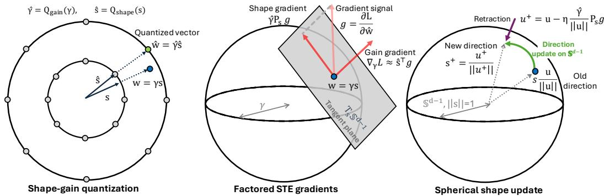  
Figure 1: Overview of SQUAT. Left: a weight block is decomposed as $w = \gamma s ,$ , where $s \in \mathbb { S } ^ { d - 1 }$ is the shape and $\gamma \in \mathbb { R } ^ { + }$ is the gain. The two components are quantized independently and reconstructed as $\hat { w } = \hat { \gamma } \hat { s }$ . Middle: our spherical factored STE applies separate STEs to the gain and shape quantizers, mapping the gradient $g = \partial \mathcal { L } / \partial \hat { w }$ to a scalar gain gradient $\nabla _ { \gamma } \mathcal { L } \approx \hat { s } ^ { \top } g$ and a tangent shape signal $\hat { \gamma } P _ { s } g$ on $T _ { s } \mathbb { S } ^ { d - 1 }$ . Right: the tangent shape signal induces the update $u ^ { + } = u - \eta \hat { \gamma } ( \lVert u \rVert ) ^ { - 1 } P _ { s } g$ on the shape parameter, followed by normalization (retraction back to the unit sphere), $s ^ { + } = u ^ { + } / ( \| u ^ { + } \| )$ .

Quantization-aware training (QAT) for LLMs with carefully chosen low-bit quantizers and sufficient training budget can retain strong model quality (Panferov et al., 2025; Liu et al., 2025). While some work on QAT for VQ exists (e.g., Wang et al. (2026); Malinovskii et al. (2024)), VQ-QAT remains largely unexplored in billion-parameter and multi-billion token regimes. Furthermore, existing work relies on multi-dimensional application of scalar QAT gradient estimation and parameter updates, with no prior work exploiting the shape-gain decomposition in a QAT setting. As a result, it remains unclear how to derive a QAT rule that aligns gradient estimation and parameter updates with spherical VQ geometry.

To address this, we introduce SQUAT, a Spherical Lattice Vector Quantization-Aware Training method for billionparameter LLMs, that trains shape-gain quantizers with afactored straight-through estimator (STE), illustrated in Figure 1. SQUAT represents each weight block using separate trainable direction and gain parameters. In the forward pass, the direction parameter is normalized and quantized with an $E _ { 8 }$ -derived spherical codebook, including normalized spherical E8P12 codebook (Tseng et al., 2024a) or our proposed E8S construction from equal-norm lattice shells, while the gain is quantized independently with a low-bit scalar quantizer. In the backward pass, the STE is applied separately through the direction and gain quantizers, rather than jointly through the reconstructed weight. This factored STE induces tangent-space updates for the direction parameter, yielding spherical optimization of quantized weight directions while decoupling magnitude optimization into the gain parameter. While spherical parameterizations themselves are well established in machine learning (e.g., DoRA (Liu et al., 2024a)) and quantization, prior work has not analyzed how combining such parameterizations with STE-based quantization alters the surrogate gradients and the resulting optimization dynamics.

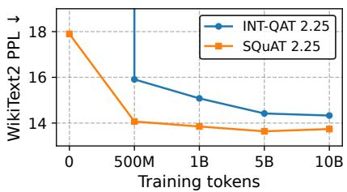  
Figure 2: SQUAT improves WikiText2 perplexity over integer scalar (INT-QAT) at 2.25 bpw on LLaMA-3.2-1B.

To allow practical scaling to billion-parameter models and multi-billion token training, we introduce distributed exact assignment, where workers quantize disjoint weight blocks against a shared codebook and communicate only discrete indices.

We evaluate SQUAT on instruction-tuned LLaMA-3.2-1B/3B, Qwen3-4B, and base Qwen3-1.7B models, with QAT budgets from 0.25B to 10B tokens. SQUAT improves over standard joint-STE VQ-QAT under the same quantizer and initialization, substantially improves over VQ-PTQ baselines after QAT, and remains competitive with mature scalar INT-QAT at comparable bit budgets, see Figure 2.

SQUAT makes the following contributions:

• We propose a novel training rule for shape-gain lattice VQ-QAT, and show that this approach induces tangent-space updates on directions, yielding true Spherical VQ-QAT.

• We propose a novel $E _ { 8 }$ -derived normalized spherical codebook which enables fractional bitwidth quantization, unlocking Pareto-optimal bit rates inaccessible to scalar methods.

• We introduce a fast exact nearest-neighbor assignment implementation with fused kernels, index caching, and distributed assignment, yielding a 12.8× speedup and enabling exact codebookbased VQ-QAT at billion-parameter and multi-billion-token scale.

• Empirically, SQUAT improves over the Standard VQ-QAT baseline under matched quantizers and initialization, and achieves SOTA VQ-QAT accuracy.

• At 2.25 bpw, SQUAT outperforms INT-QAT across all models and training budgets on WikiText2 perplexity, and achieves competitive or better MMLU and CSR, with MMLU gains of up to 7.9 % at 1B token training.

## 2 BACKGROUND

## 2.1 SCALAR QUANTIZATION

Scalar quantization maps each weight independently to a low-precision discrete set, typically using uniform integer levels (Jacob et al., 2018). During QAT, quantization is applied in the forward pass and gradients are propagated with a straight-through estimator (STE). As our scalar INT-QAT baseline, we use Stretched Elastic Quantization (SEQ) (Liu et al., 2025; Lee et al., 2025), which shifts the signed quantization grid by half a step and improves stability in low-bit regimes.

## 2.2 VECTOR AND LATTICE QUANTIZATION

Vector quantization (VQ) groups parameters into blocks $w \in \mathbb { R } ^ { d }$ and maps each block to its nearest codeword from a codebook $\mathcal { C } \overset {  } { = } \{ c _ { 1 } , \ldots , c _ { K } \} \subset \mathbb { R } ^ { d }$

$$
j ^ { \star } = \arg \operatorname* { m i n } _ { j \in \{ 1 , \dots , K \} } \| w - c _ { j } \| _ { 2 } , \qquad Q ( w ) = c _ { j ^ { \star } } .\tag{1}
$$

Here, $j ^ { \star }$ is the discrete codeword index and $Q ( w )$ is the reconstructed quantized block. The storage cost is $\log _ { 2 } ( K ) / d$ bits per weight. By operating in higher dimensions, VQ can exploit the joint parameter distribution and achieve better rate–distortion trade-offs than scalar quantization.

Explicit learned or unstructured codebooks become infeasible in higher dimensions since the number of required codewords (and the cost of nearest-neighbor search) grow exponentially in dimension d. Lattice quantization instead uses implicitly specified, highly structured codebooks with strong packing properties, retaining good rate–distortion behavior (Gibson & Sayood, 1988; Conway & Sloane, 2013) while enabling scalable assignment procedures. Yet, VQ-QAT demands repeated nearest-neighbor (NN) assignments during training, making efficient assignment a central challenge.

## 2.3 SHAPE-GAIN (POLAR) DECOMPOSITION

A common perspective in vector quantization is to decompose a vector into its shape (direction) and gain (magnitude) components, also known as shape-gain quantization (Sabin & Gray, 1982), which has also been successfully applied to vector quantization of LLMs (van der Ouderaa et al., 2024; Yue et al., 2025). For $w \in \mathbb { R } ^ { \breve { d } }$ , write

$$
w = \gamma s , \qquad \gamma = \| w \| _ { 2 } \in \mathbb { R } ^ { + } , \quad s = \frac { w } { \gamma } \in \mathbb { S } ^ { d - 1 } ,\tag{2}
$$

where $\gamma$ and s are the gain and shape, respectively. These can now be quantized independently as

$$
\hat { w } = \hat { \gamma } \hat { s } , \qquad \hat { \gamma } = Q _ { \mathrm { g a i n } } ( \gamma ) , \quad \hat { s } = Q _ { \mathrm { s h a p e } } ( s ; \mathcal { C } ) ,\tag{3}
$$

where $Q _ { \mathrm { s h a p e } } : \mathbb { S } ^ { d - 1 } \to \mathcal { C }$ maps each direction to a codeword in the discrete codebook $\mathcal { C } \subset \mathbb { S } ^ { d - 1 }$ with $\mathbb { S } ^ { d - 1 } \stackrel { \cdot } { = } \left\{ x \in \mathbb { R } ^ { d } \vert \Vert x \Vert _ { 2 } = 1 \right\}$ , and $Q _ { \mathrm { g a i n } } : \mathbb { R } _ { > 0 } \to { \mathcal { C } } _ { \mathrm { g a i n } }$ is a scalar quantizer mapping each gain to a quantized gain in $\mathcal { C } _ { \mathrm { g a i n } } \subset \mathrm { \mathbb { R } } _ { > 0 }$

This separates angular error from gain error: prior VQ work shows that most representational budget should be allocated to direction, while gains can be stored with few bits (Hamkins & Zeger, 2002). Shape-gain decompositions have also been useful for optimization and adaptation, e.g., weight normalization (Salimans & Kingma, 2016) and DoRA (Liu et al., 2024a). However, it remains unclear how to use this geometry in QAT, where weights are repeatedly updated through STEs. In this study, we analyze how STE updates commonly used in VQ interact with shape-gain.

## 2.4 LATTICE CODEBOOKS FROM $E _ { 8 }$

The $E _ { 8 }$ lattice is a highly symmetric lattice in $\mathbb { R } ^ { 8 }$ that achieves the densest known sphere packing in eight dimensions (Conway & Sloane, 2013). Its points are organized into norm shells, where $S _ { r } \stackrel { \smile } { = } \{ x \in E _ { 8 } : \| x \| _ { 2 } ^ { 2 }  = r \}$ . The first nonzero shells contain 240, 2160, 6720, and 17520 points, corresponding to the coefficients of the $E _ { 8 }$ theta series. Using a single shell, or a union of shells, as a codebook yields a spherical code where nearest-neighbor assignment depends on angular alignment. Since $E _ { 8 }$ is infinite, finite low-bit codebooks require truncation. We use them either in Euclidean form, retaining lattice norms, or normalized form, projecting codewords to the unit sphere for shape-gain (SG) quantization. In our notation, non-SG variants use Euclidean form, while SG variants use the normalized spherical form.

We study two $E _ { 8 }$ -derived constructions. First, QuIP# (Tseng et al., 2024a) introduces E8P12, a structured 2-bit-per-weight vector quantizer with $2 ^ { 1 6 }$ possible codewords per 8D block. E8P12 is derived from an $E _ { 8 }$ -related shifted ${ \hat { D } } _ { 8 }$ construction and is designed for compact decoding: its codewords are represented using a small base table together with parity, sign, and shift operations. Second, we introduce E8S, a spherical $E _ { 8 }$ truncation that enumerates points from low-norm $E _ { 8 }$ shells, optionally subsamples the final shell to match fractional bit budgets, and normalizes the selected points to form a spherical code. See App. A for details.

## 3 SQUAT: SPHERICAL LATTICE VQ-QAT

Normally, VQ-QAT maintains full-precision shadow parameters in Euclidean space while emulating low-precision inference by applying quantization only in the forward pass. For vector quantizers, the forward map is typically discrete and thus non-differentiable; gradient-based training therefore requires an explicit surrogate for backpropagation. The most common choice is the straight-through estimator (STE). In shape-gain vector quantization, however, STE can be inserted at multiple plausible locations in the computation graph, and these choices lead to different surrogate gradients and, consequently, different optimization dynamics.

In this work, we study how STE choices affect optimization for shape-gain vector quantization. We analyze two natural cases: in Sec. 3.1 we consider ‘Standard VQ-QAT:’ the standard joint STE applied to the overall vector quantizer, and in Sec. 3.2 we consider our ‘Spherical VQ-QAT’ in which we apply the STE separately to the shape and gain quantizers, coupled with a spherical parameterization of the weights. We show that these choices induce distinct surrogate gradients and therefore different effective updates on the implied Euclidean weight vector. Moreover, we interpret the resulting update of Spherical VQ-QAT as a hyperspherical (Riemannian) update: a tangent-space step for the direction combined with a radial update for the gain, where normalization acts as a retraction. We adopt this update as our training rule, denoted SQUAT, and validate its benefit empirically. We emphasize that SQUAT is a training rule agnostic to the specific spherical codebook used.

## 3.1 STANDARD VQ-QAT: EUCLIDEAN SHADOW WEIGHTS AND STANDARD STE

Let the shadow weights be partitioned into disjoint vectors $w \in \mathbb { R } ^ { d }$ , where d is the vector-quantizer dimensionality. Let

$$
\boldsymbol { g } : = \frac { \partial \mathcal { L } } { \partial \boldsymbol { \hat { w } } } \in \mathbb { R } ^ { d }\tag{4}
$$

denote the gradient backpropagated to the quantized (dequantized) vector $\hat { w } = Q ( w )$

In the standard formulation, the Euclidean vectors w serve as the shadow parameters, and the forward pass applies a vector quantizer $Q ( \cdot )$ to produce wˆ. The straight-through estimator (STE) is applied to the non-differentiable mapping $Q ( w )$ , equivalently, to wˆ viewed as a function of w, by approximating its Jacobian as the identity:

$$
{ \frac { \partial Q ( w ) } { \partial w } } \approx I \quad \Longrightarrow \quad { \frac { \partial { \mathcal { L } } } { \partial w } } \approx g .\tag{5}
$$

Thus, under SGD the shadow vector is updated directly by the upstream gradient. We call this Standard VQ-QAT. Importantly, because the STE treats the entire mapping $Q ( \cdot )$ as the identity in the backward pass, any internal structure of the quantizer is ignored during optimization. For example, even if we were to factor the forward mapping into a shape-gain form,

$$
Q ( w ) = Q _ { \mathrm { s h a p e } } \left( \frac { w } { \| w \| } \right) Q _ { \mathrm { g a i n } } ( \| w \| ) ,\tag{6}
$$

as long as the STE is applied to the overall mapping $Q ( w )$ , using a shape-gain quantizer in itself has no effect on the resulting gradient and effective update of w.

## 3.2 SPHERICAL VQ-QAT: SPHERICAL PARAMETERIZATION AND STE

We note, however, that the optimization dynamics do change once we either (i) parameterize shadow weights in shape-gain variables, or (ii) apply STE separately to the shape and gain quantizers.

Spherical parameterization In this context, it is natural to also parameterize the shadow weights in terms of an (unnormalized) shape u and gain γ as shadow parameters:

$$
u \in \mathbb { R } ^ { d } , \qquad \gamma \in \mathbb { R } _ { \geq 0 } , \qquad n : = \| u \| _ { 2 } + \varepsilon , \qquad s : = \frac { u } { n } \in \mathbb { S } ^ { d - 1 } , \qquad w : = \gamma s .\tag{7}
$$

Now, instead of directly parameterizing $w ,$ it becomes implicitly defined through parameters $( u , \gamma )$ Factored (spherical) STE Since with a spherical parameterization there is no need to form w in the forward pass, it becomes very natural to also consider placing the STE separately on the shape and gain quantizers:

$$
\frac { \partial \hat { s } } { \partial s } \approx I , \qquad \frac { \partial \hat { \gamma } } { \partial \gamma } \approx 1 ,\tag{8}
$$

while differentiating exactly through the smooth maps $u \mapsto s$ and $( s , \gamma ) \mapsto w$ . Since $\hat { w } = \hat { \gamma } \hat { s }$ , the intermediate surrogate gradients are

$$
\frac { \partial \mathcal { L } } { \partial s } \approx \hat { \gamma } g , \qquad \frac { \partial \mathcal { L } } { \partial \gamma } \approx \hat { s } ^ { \top } g .\tag{9}
$$

Using the exact Jacobian of normalization $s = u / n ,$

$$
\frac { \partial s } { \partial u } = \frac { 1 } { n } \left( I - s s ^ { \top } \right) = : \frac { 1 } { n } P _ { s } , \qquad P _ { s } = I - s s ^ { \top } ,\tag{10}
$$

we obtain the surrogate gradient with respect to u:

$$
\frac { \partial \mathcal { L } } { \partial u } \approx \frac { \hat { \gamma } } { n } P _ { s } g , \qquad n = \| u \| _ { 2 } + \varepsilon .\tag{11}
$$

Combining (9) and (11), one step of plain SGD (no momentum) with learning rate η gives

$$
u ^ { + } = u - \eta \frac { \hat { \gamma } } { \lVert u \rVert _ { 2 } + \varepsilon } P _ { s } g , \qquad \gamma ^ { + } = \gamma - \eta ( \hat { s } ^ { \top } g ) , \qquad w ^ { + } : = \gamma ^ { + } \frac { u ^ { + } } { \lVert u ^ { + } \rVert _ { 2 } + \varepsilon } .\tag{12}
$$

Note that our main analysis in $( 9 ) \substack { - } ( 1 1 )$ holds for arbitrary optimizers, including AdamW, which is used in the experiments presented below.

Geometric interpretation of SQUAT. Spherical VQ-QAT (SQUAT) optimizes explicit shape-gain variables (u, γ) while the forward pass uses the quantized reconstruction $\hat { w } = \hat { \gamma } \hat { s }$ . The induced one-step update for plain SGD is given in (12); we interpret this update through its geometry.

The shape update can be viewed as an optimization step on the sphere. In particular, the Jacobian of normalization yields the projector $P _ { s } = \mathbf { \bar { \Phi } } _ { } - s s ^ { \top }$ , where $s = u / ( \bar { | | } u | | _ { 2 } + \varepsilon ) \bar { | | }$ is the current normalized (unquantized) direction. Since $\partial \mathcal { L } / \partial s \approx \hat { \gamma } g ,$ the update direction on u is proportional to $P _ { s } ( \partial \mathcal { L } / \partial s )$ i.e., the Riemannian gradient on $\mathbb { S } ^ { d - 1 }$ (up to the scalar factor $( \lVert u \rVert _ { 2 } + \varepsilon ) ^ { \sp { \perp } - 1 } )$ . After the ambient step in u, the renormalization $s ^ { + } = u ^ { + } / \bar { ( } \| u ^ { + } \| _ { 2 } + \varepsilon )$ maps back to $\mathbb { S } ^ { d - 1 }$ and acts as a retraction. Thus, SQUAT induces the standard “tangent step + retraction” update on directions, coupled with a Euclidean step on the gain $\gamma$ . This interpretation is exact for the one-step SGD analysis and remains a useful description of the induced direction update under common optimizers.

Alternative parameterizations and STE assumptions. While Secs. 3.1–3.2 focus on the two primary regimes, the Euclidean shadow weights with a joint STE (Standard VQ-QAT) and a shapegain parameterization with factored STE (Spherical VQ-QAT, or SQUAT), other parameterization and STE choices are possible. In App. B.1, we isolate the effect of the parameterization by using spherical shadow variables $( u , \gamma )$ but retaining a joint STE; this yields a tangential–radial update similar in form to SQUAT, but driven by the unquantized $( s , \gamma )$ rather than the quantized forward quantities (ˆs, γˆ). Conversely, in App. B.2 we isolate the effect of the STE placement by keeping Euclidean shadow weights w while applying afactored (shape-gain) STE, which induces a direction–magnitude decomposition of the Euclidean update without an explicit retraction step. Finally, App. B.3 shows an implementation trick that recovers the exact Standard VQ-QAT update while storing parameters in a factored form. Together, these variants clarify that both the parameterization and the STE factorization materially shape the effective optimization dynamics.

## 3.3 PRACTICAL QUANTIZERS

We instantiate the shape quantizer with $d { = } 8$ using normalized $E _ { 8 }$ -derived codebooks $\begin{array} { r l } { \mathcal { C } } & { { } = } \end{array}$ $\{ c _ { 1 } , \dotsc , c _ { K } \} \ \subset \ \mathbb { S } ^ { 7 }$ . For a normalized shape s, shape quantization uses exact nearest-neighbor assignment on the sphere,

$$
Q _ { \mathrm { s h a p e } } ( s ) = c _ { j ^ { \star } } , \qquad j ^ { \star } = \arg \operatorname* { m a x } _ { j \in \{ 1 , \ldots , K \} } \langle s , c _ { j } \rangle ,\tag{13}
$$

which is equivalent to minimizing Euclidean distance since both s and $c _ { j }$ are unit norm. We use the normalized forms of E8P12 and our E8S codebooks. Implementation details are given in App. A.

For gain quantization, we use a chi-quantile scalar quantizer. At initialization, gains are derived from pretrained block norms, which are well approximated by a $\chi _ { d }$ distribution under Gaussian weights (van der Ouderaa et al., 2024). For gain bit-width $b _ { \gamma }$ , we precompute $2 ^ { b \cdot }$ levels $\{ \tau _ { \ell } \} _ { \ell = 1 } ^ { 2 ^ { b _ { \gamma } } }$ as evenly spaced quantiles of $\chi _ { d }$ and assign

$$
\ell ^ { \star } = \arg \operatorname* { m i n } _ { \ell } | \gamma - \tau _ { \ell } | , \qquad \hat { \gamma } = Q _ { \mathrm { g a i n } } ( \gamma ) = \tau _ { \ell ^ { \star } } .\tag{14}
$$

Unlike learned codebooks, these levels are specified in closed form by $( d , b _ { \gamma } )$ (up to numerical evaluation of the quantiles), so the gain quantizer introduces no additional learned codebook parameters and requires no extra bits-per-weight beyond the $b _ { \gamma }$ bits used to index the gain level.

## 3.4 SCALABILITY AND IMPLEMENTATION

Exact nearest-neighbor (NN) search is the main computational bottleneck in VQ-QAT. With N weight blocks and a d-dimensional codebook of size $K \approx 2 ^ { d \cdot \mathrm { \breve { b } p w } }$ , bruteforce search costs O(NKd) per quantization step. Unlike PTQ, where search is performed once or a few times, QAT repeats assignment on every forward pass to simulate inference-time quantization. In our implementation, each data-parallel worker computes exact NN (13) for a disjoint subset of vectors using a shared codebook ${ \mathcal { C } } ,$ and only the resulting integer indices are synchronized via all-gather. Furthermore, a new Triton kernel fuses normalization, codeword selection, and reconstruction. We also cache quantized weights across gradient-accumulation steps, so assignment is invoked only once per optimizer step. For E8S on LLaMA-3.2-1B, these optimizations reduce training time from 62.5 s/it for vanilla VQ-QAT to $4 . 9 \mathrm { s } / \mathrm { i t }$

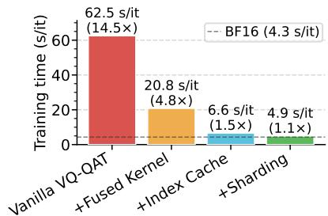  
Figure 3: SQUAT reduces training time via progressively added fused kernels, index caching, and sharded assignment, approaching INT2 (4.4 s/it) and BF16 (4.3 s/it) performance, and allows us to scale VQ-QAT to billions of tokens.

yielding a 12.8× speedup while preserving the exact nearest-neighbor assignment, see Figure 3.   
Overall, our lattice VQ-QAT implementation incurs only moderate overhead relative to scalar QAT.

## 4 EXPERIMENTAL SETUP

Setup. We evaluate SQUAT on instruction-tuned LLaMA-3.2-1B/3B-Instruct (Grattafiori et al., 2024), Qwen3-4B-Instruct-2507 (Yang et al., 2025), and base Qwen3-1.7B (Yang et al., 2025). We drop the “-Instruct” and “-Instruct-2507” suffixes in the text and abbreviate the model names as L1B, L3B, Q4B, and Q1B7 in tables for brevity. QAT fine-tunes a quantized model using DCLM-Edu (allal et al., 2025) dataset with Jensen–Shannon divergence (JSD) distillation (Lee et al., 2025) from a frozen FP16 teacher. We train for 0.25B–10B tokens with batch size 256 and context length 1024. Learning rates are swept at 1B tokens and reused for longer runs. All experiments use blockwise Hadamard rotations following QuIP# (Tseng et al., 2024a). QAT starts with weights initialized from PTQ checkpoints using a QuIP#-style GPTQ reconstruction with OmniQuant scale calibration. Please find additional details in App. C.

Table 1: Standard vs Spherical VQ-QAT (SQUAT) results obtained with the same E8S shape-gain quantizer. Standard VQ-QAT applies STE to the reconstructed block, while Spherical VQ-QAT applies separate STEs to the shape and gain quantizers. App. E.1 extends the table to IFEval and LongBench generative tasks.
<table><tr><td rowspan="2">Method</td><td colspan="3">WikiText2 PPL ↓</td><td colspan="3">CSR, % ↑</td><td colspan="3">MMLU, % ↑</td><td colspan="3">GSM8K, % ↑</td></tr><tr><td>L1B</td><td>L3B</td><td>Q4B</td><td>L1B</td><td>L3B</td><td>Q4B</td><td>L1B</td><td>L3B</td><td>Q4B</td><td>L1B</td><td>L3B</td><td>Q4B</td></tr><tr><td>FP16</td><td>12.15</td><td>10.49</td><td>9.41</td><td>61.0</td><td>67.5</td><td>72.9</td><td>45.4</td><td>59.6</td><td>72.6</td><td>36.8</td><td>65.8</td><td>85.4</td></tr><tr><td>Tok = 1B</td><td></td><td></td><td></td><td></td><td></td><td></td><td></td><td></td><td></td><td></td><td></td><td></td></tr><tr><td>Standard</td><td>14.22</td><td>11.04</td><td>10.17</td><td>58.4</td><td>66.3</td><td>70.2</td><td>39.3</td><td>55.0</td><td>67.1</td><td>14.7</td><td>47.0</td><td>76.3</td></tr><tr><td>Spherical</td><td>13.85</td><td>10.96</td><td>10.03</td><td>58.8</td><td>65.8</td><td>71.0</td><td>40.3</td><td>55.8</td><td>67.4</td><td>18.0</td><td>51.9</td><td>77.0</td></tr><tr><td>Tok = 5B</td><td></td><td></td><td></td><td></td><td></td><td></td><td></td><td></td><td></td><td></td><td></td><td></td></tr><tr><td>Standard</td><td>13.77</td><td>10.88</td><td>10.17</td><td>59.1</td><td>66.8</td><td>71.4</td><td>41.2</td><td>55.8</td><td>68.4</td><td>15.1</td><td>51.8</td><td>78.4</td></tr><tr><td>Spherical</td><td>13.64</td><td>10.84</td><td>10.06</td><td>59.4</td><td>66.4</td><td>71.0</td><td>41.4</td><td>55.7</td><td>68.4</td><td>15.7</td><td>52.0</td><td>79.6</td></tr></table>

Baselines. Our primary scalar baseline, INT-QAT, is SEQ (Liu et al., 2025; Lee et al., 2025), which outperformed Signed quantization in preliminary experiments (App. C). We also compare to VQ and PTQ baselines, including QTIP and PV-Tuning where available.

Evaluation metrics. We report WikiText2 perplexity at sequence length 4096, common-sense reasoning (CSR) and MMLU (Hendrycks et al., 2021) accuracies. The CSR score calculation follows QuIP# (Tseng et al., 2024a) and averages over six tasks. We also report results on long generation tasks (GSM8K (Cobbe et al., 2021), IFEval (Zhou et al., 2023), LongBench (Bai et al., 2024)). All downstream evaluations use the LLM Evaluation Harness (Gao et al., 2023). More details in App. D.

## 5 RESULTS

Standard VQ-QAT vs Spherical VQ-QAT (SQUAT). Table 1 isolates the effect of the QAT training rule. We compare two variants using the same E8S shape-gain quantizer and the same PTQ initialization: Standard VQ-QAT applies a standard STE directly to the reconstructed weight block, while Spherical VQ-QAT applies separate STEs to the quantized direction and gain. This highlights the importance of a spherical parameterization together with separate shape and gain STEs. Spherical VQ-QAT clearly improves WikiText2 perplexity and GSM8K accuracy across all tested models and training budgets, with GSM8K gains reaching up to 4.9 %. CSR and MMLU improve mainly at the 1B token budget (except LLaMA-3.2-3B CSR). Refer to App. E.1 for two more generative task results, App. E.2 for per-seed evaluations, and App. E.3-E.6 for extra SQUAT ablations.

Scaling across model family and QAT budget. Having established the training rule, Table 2 evaluates how SQUAT performs in QAT, comparing against scalar INT-QAT and strong VQ baselines.

Results show that QAT consistently improves over the corresponding PTQ initialization: at 2.25 bpw and 10B tokens, SQUAT reduces WikiText2 perplexity from 17.90 to 13.74 on LLaMA-3.2-1B, from 15.00 to 10.83 on LLaMA-3.2-3B, and from 12.52 to 9.90 on Qwen3-4B. Downstream gains are also substantial; for example, on Qwen3-4B, MMLU improves from 54.2 after PTQ to 69.5 after QAT.

Compared with scalar INT-QAT, SQUAT performs favorably overall. At 2.25 bpw and 10B training tokens, it matches or surpasses INT-QAT on nearly all evaluated models and metrics, with Qwen3-4B CSR as the only exception. At 2.0 bpw, the two methods are broadly comparable, although SQUAT tends to perform better at lower training budgets (< 5B tokens), while INT-QAT often gains an advantage with more extensive training.

Table 2: QAT scaling across instruction-tuned LLaMA and Qwen models. We report WikiText2 perplexity, CSR, and MMLU as a function of QAT token budget. Missing entries indicate results that were not run or not reported under the same protocol.
<table><tr><td rowspan="2">Method</td><td rowspan="2">Tok</td><td rowspan="2">bpw</td><td colspan="3">WikiText2 PPL ↓</td><td colspan="3">CSR, % ↑</td><td colspan="3">MMLU, % ↑</td></tr><tr><td>L1B</td><td>L3B</td><td>Q4B</td><td>L1B</td><td>L3B</td><td>Q4B</td><td>L1B</td><td>L3B</td><td>Q4B</td></tr><tr><td>FP16</td><td>一</td><td>16.0</td><td>12.15</td><td>10.49</td><td>9.41</td><td>61.0</td><td>67.5</td><td>72.9</td><td>45.4</td><td>59.6</td><td>72.6</td></tr><tr><td>QuIP# (fine-tuned)</td><td>52M</td><td>2.0</td><td>16.67</td><td>11.13</td><td></td><td>52.0</td><td>61.0</td><td>一</td><td>26.5</td><td>42.1</td><td>一</td></tr><tr><td>QTIP</td><td>52M</td><td>2.0</td><td>14.47</td><td>10.12</td><td>8.87</td><td>54.3</td><td>62.7</td><td>69.5</td><td>33.0</td><td>49.4</td><td>62.7</td></tr><tr><td>PV-tuning</td><td>1B a</td><td>2.0</td><td>一</td><td>一</td><td>一</td><td>一</td><td>一</td><td>一</td><td>28.9</td><td>48.4</td><td>一</td></tr><tr><td>INT-QAT</td><td>一</td><td>2.0</td><td>2e6</td><td>2e5</td><td>6e6</td><td>36.5</td><td>35.5</td><td>36.8</td><td>25.5</td><td>24.7</td><td>26.9</td></tr><tr><td>INT-QAT</td><td>1B</td><td>2.0</td><td>15.07</td><td>10.45</td><td>11.13</td><td>57.2</td><td>64.8</td><td>68.7</td><td>35.3</td><td>52.9</td><td>64.4</td></tr><tr><td>INT-QAT</td><td>5B</td><td>2.0</td><td>14.42</td><td>11.03</td><td>10.60</td><td>58.7</td><td>66.0</td><td>70.5</td><td>39.6</td><td>55.4</td><td>67.4</td></tr><tr><td>SQUAT (E8S-SG)</td><td>一</td><td>2.0</td><td>22.12</td><td>18.51</td><td>14.78</td><td>51.1</td><td>54.8</td><td>59.3</td><td>27.9</td><td>37.5</td><td>46.1</td></tr><tr><td>SQUAT (E8S-SG)</td><td>1B</td><td>2.0</td><td>14.76</td><td>11.29</td><td>10.50</td><td>57.3</td><td>64.8</td><td>70.2</td><td>36.5</td><td>53.1</td><td>64.8</td></tr><tr><td>SQUAT (E8S-SG)</td><td>5B</td><td>2.0</td><td>14.33</td><td>11.08</td><td>10.41</td><td>57.6</td><td>65.9</td><td>69.9</td><td>39.8</td><td>54.3</td><td>67.3</td></tr><tr><td>INT-QAT</td><td>一</td><td>2.25</td><td>2e6</td><td>1e5</td><td>2e5</td><td>37.0</td><td>35.2</td><td>37.1</td><td>23.6</td><td>23.0</td><td>23.3</td></tr><tr><td>INT-QAT</td><td>1B</td><td>2.25</td><td>15.08</td><td>11.49</td><td>10.96</td><td>57.3</td><td>65.0</td><td>69.3</td><td>32.4</td><td>54.1</td><td>65.1</td></tr><tr><td>INT-QAT</td><td>5B</td><td>2.25</td><td>14.42</td><td>11.03</td><td>10.57</td><td>58.9</td><td>65.8</td><td>70.9</td><td>40.2</td><td>54.9</td><td>66.9</td></tr><tr><td>INT-QAT</td><td>10B</td><td>2.25</td><td>14.33</td><td>10.96</td><td>10.60</td><td>58.9</td><td>65.8</td><td>70.9</td><td>41.0</td><td>55.5</td><td>67.8</td></tr><tr><td>SQUAT (E8S-SG)</td><td>一</td><td>2.25</td><td>17.90</td><td>15.00</td><td>12.52</td><td>52.2</td><td>60.6</td><td>63.8</td><td>29.8</td><td>45.8</td><td>54.2</td></tr><tr><td>SQUAT (E8S-SG)</td><td>1B</td><td>2.25</td><td>13.85</td><td>10.96</td><td>10.03</td><td>58.8</td><td>65.8</td><td>71.0</td><td>40.3</td><td>55.8</td><td>67.4</td></tr><tr><td>SQUAT (E8S-SG)</td><td>5B</td><td>2.25</td><td>13.64</td><td>10.84</td><td>10.06</td><td>59.4</td><td>66.4</td><td>71.0</td><td>41.4</td><td>55.7</td><td>68.4</td></tr><tr><td>SQUAT (E8S-SG)</td><td>10B</td><td>2.25</td><td>13.74</td><td>10.83</td><td>9.90</td><td>59.5</td><td>66.4</td><td>70.7</td><td>41.0</td><td>57.3</td><td>69.5</td></tr></table>

a Performance from HuggingFace; training budget unspecified. Standard PV-tuning uses 1B RedPajama tokens (Malinovskii et al., 2024).

Compared with QTIP, QUIP#, and PV-tuning, SQUAT sometimes yields higher perplexity while achieving substantially stronger downstream accuracy.

Compared with the most recent VQ-QAT method, LC-QAT (Wang et al., 2026), SQUAT achieves higher CSR (61.2 vs. 59.8), outperforming LC-QAT by 1.4 % on Qwen3-1.7B after 1B training tokens. See more details in App. E.5.

Chi-based gain quantization. In App. F, we compare the chi-quantile and uniform integer gain quantizers at matched bit-widths, and include FP8 (E4M3) gains as a high-precision reference. Results shows that a fixed chi-based scale (0 gain bits) outperforms 1-bit uniform integer gain quantization, highlighting the importance of distribution-aware gain design at extreme quantization levels.

E8S vs. E8P12. Table 3 ablates two $E _ { 8 }$ codebooks on LLaMA-3.2-1B under matched 1B-token training. As described in Sec. 2.4, the lattice can be truncated either by selecting complete spherical shells (E8S) or by using structured subsets (E8P12). Compared with E8P12, E8S improves performance both with and without shape-gain, suggesting that shell-based codebooks better match the angular assignment used by SQUAT. At 2.25 bpw, SQUAT consistently improves results for E8P12 and E8S codebooks.

Pareto fronts and gain bits allocation. Figure 4 shows the Pareto fronts of LLaMA-3.2-1B quantized with SQUAT (E8S-SG) after 1B-token QAT for different gain bitwidths. The optimal gain allocation depends on the target bit rate: 0.125 bpw performs best below 2.0 bpw, 0.25 bpw is preferred at up to 2.75 total bpw, while 0.375 gain bpw attains the best performance at 3.0 total bpw. Unlike INT-QAT, E8S supports fractional bitwidths, enabling finer-grained compression-accuracy trade-offs. More detailed plots with downstream metrics can be found in App. E.7.

## 6 RELATED WORK

Post-training quantization (PTQ). Post-training quantization is widely used for compressing large language models. Early approaches relied on scalar quantization with round-to-nearest strategies (Hubara et al., 2021; Wang et al., 2020; Yao et al., 2022; Dettmers et al., 2022; Frantar et al., 2022). GPTQ (Frantar et al., 2023) introduced Hessian-based reconstruction. Subsequent work addressed outliers through activation-aware scaling and sparsity (Lin et al., 2024; Dettmers et al., 2024; Kim et al., 2024). QuIP (Chee et al., 2023) uses Hadamard rotations to make weights more amenable to quantization, while YAQA (Tseng et al., 2026) improves Hessian estimation.

Table 3: The evaluation of E8S and E8P12 codebooks with (-SG) and without shape-gain on LLaMA-3.2-1B after 1B QAT. Bits report codebook + scale/gain bits.
<table><tr><td>Codebook</td><td>Bits</td><td>bpw</td><td>PPL / CSR / MMLU</td></tr><tr><td rowspan="2">E8P12</td><td> $2 . 0 + 0 . 0$ </td><td>2.00</td><td>14.85 / 57.6 / 35.7</td></tr><tr><td> $2 . 0 \ : + \ : 0 . 2 5$ </td><td>2.25</td><td>14.67 / 57.5 / 35.1</td></tr><tr><td rowspan="3">E8S</td><td> $2 . 0 + 0 . 0$ </td><td>2.00</td><td>14.78 / 58.1 / 35.8</td></tr><tr><td> $2 . 0 \ : + \ : 0 . 2 5$ </td><td>2.25</td><td>14.53 / 58.0 / 37.0</td></tr><tr><td> $2 . 2 5 + 0 . 0$ </td><td>2.25</td><td>14.24 / 58.4 / 38.2</td></tr><tr><td>E8P12-SG (SQUAT)</td><td> $2 . 0 \ : + \ : 0 . 2 5$ </td><td>2.25</td><td>13.94 / 58.7 / 38.9</td></tr><tr><td rowspan="2">E8S-SG (SQUAT)</td><td> $1 . 7 5 + 0 . 2 5$ </td><td>2.00</td><td>14.76 / 57.3 / 36.5</td></tr><tr><td> $2 . 0 \ : + \ : 0 . 2 5$ </td><td>2.25</td><td>13.85 / 58.8 / 40.3</td></tr></table>

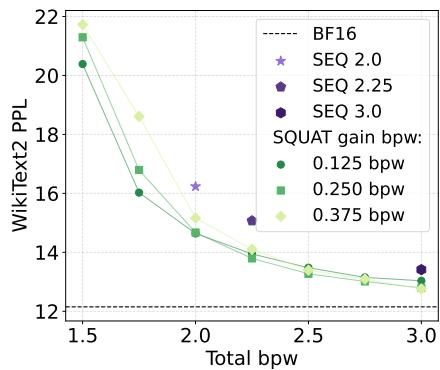  
Figure 4: Pareto fronts of LLaMA-3.2- 1B quantized with SQUAT (E8S-SG) after 1B QAT for different gain bitwidths.

Vector and lattice quantization. Vector quantization (VQ) improves low-bit rate–distortion by exploiting correlations across parameters (Tseng et al., 2024a;b; Liu et al., 2024b; Savkin et al., 2025; van der Ouderaa et al., 2026). Representative approaches include AQLM (Egiazarian et al., 2024), which represents weights as sums of multiple codewords, and GPTVQ (Van Baalen et al., 2024), which leverages high-dimensional effects for accurate compression. However, naive VQ scales poorly due to large codebooks and expensive nearest-neighbor search.

Lattice VQ addresses this by using structured codebooks derived from dense lattices (Gibson & Sayood, 1988; Conway & Sloane, 2013). QuIP# (Tseng et al., 2024a) introduces an efficient finite subset of the $E _ { 8 }$ lattice, QTIP (Tseng et al., 2024b) scales VQ via trellis-based decoding, and recent work explores learning lattice structure directly (Zhang et al., 2025). A few recent VQ methods further decompose weights into shape and gain to allocate bits more efficiently. Pyramid Vector Quantization (PVQ) (van der Ouderaa et al., 2024) projects vectors onto the hypersphere using an implicit lattice, while PCDVQ (Yue et al., 2025) explicitly learns separate codebooks for shape and gain. These approaches primarily focus on post-training quantization.

Quantization-aware training (QAT). Quantization-aware training uses simulated quantization and straight-through estimators during training (Jacob et al., 2018). Prior work improves stability via learned clipping (Choi et al., 2018), learned step sizes (Esser et al., 2020), stochastic rounding (Gupta et al., 2015), and low-rank adaptations (Bondarenko et al., 2024; Loeschcke et al., 2024). Stretched Elastic Quantization (Liu et al., 2025; Lee et al., 2025) further improves low-bit scalar QAT, including in long-horizon LLM training. Only limited work studies QAT with large vector or lattice codebooks. PV-Tuning (Malinovskii et al., 2024) introduces explicit reassignment steps, however they do not study longer token training. LC-QAT (Wang et al., 2026) enables up to 10B QAT through a linearconstrained vector-quantization parameterization. Separately, constraining optimization to spherical manifolds has been shown to improve stability in large-scale LLM training, e.g., via spectral-norm sphere constraints (Xie et al., 2026). DoRA (Liu et al., 2024a) similarly decomposes weights into shape and gain, revealing distinct optimization dynamics in full-precision and low-rank settings. In contrast, we study vector-quantized QAT, where applying separate STEs to shape and gain quantizers induces spherical optimization of quantized weight directions.

## 7 DISCUSSION, FUTURE WORK, AND LIMITATIONS

This work studies lattice VQ-QAT at billion-parameter scale and multi-billion-token horizons. With shape-gain parameterization and spherical $E _ { 8 }$ codebooks, SQUAT substantially improves over VQ-PTQ baselines and a standard joint-STE VQ-QAT baseline under the same quantizer and initialization.

SQUAT outperforms INT-QAT at 2.25 bpw across almost all models, metrics, and QAT token budgets, while remaining competitive at 2.0 bpw. Mature INT-QAT benefits from a wide range of stabilization techniques, whereas VQ-QAT remains relatively underexplored. To our knowledge, this is the first demonstration of exact nearest-neighbor VQ-QAT at billion-parameter and multi-billion-token scale, enabled by an efficient distributed assignment implementation. Future work should explore VQ-specific training improvements, including adaptations of INT-QAT techniques such as clipping.

Our evaluation is limited to E8P12 and E8S codebooks, up to 4B models, and budgets up to 10B tokens. 7B+ models, broader architectures, and higher-bit hierarchical schemes remain future work.

Tseng et al. (2024a) demonstrate the hardware efficiency of the E8P12 codebook through a custom CUDA implementation. However, E8P12 is limited to a fixed 2.0 bpw codebook rate. In contrast, E8S enables flexible rate allocation, but currently lacks an efficient dequantizer. Recent work on Leechlattice VQ (van der Ouderaa et al., 2026) suggests that fast dequantization may also be achievable for spherical lattice codebooks, making efficient E8S implementations a promising direction.

## 8 CONCLUSION

We presented SQUAT, a shape-gain lattice VQ-QAT method for low-bit LLM compression. SQUAT decomposes each weight block into a normalized direction (shape) and scalar gain, quantizes shape with an $E _ { 8 }$ -derived spherical lattice codebook, quantizes gains separately, and applies separate STEs through the two quantizers. This induces spherical optimization of quantized weight directions, and our ablations show that it improves over a standard VQ STE under the same quantizer and PTQ initialization. To make long-horizon lattice VQ-QAT practical, we introduced distributed exact nearest-neighbor assignment for shared lattice codebooks, reducing training time from 62.5 s/it to 4.9 s/it. Across LLaMA-3.2-1B/3B and Qwen3-4B/1.7B models, QAT with SQUAT substantially improves performance over VQ-PTQ baselines and a standard joint-STE VQ-QAT baseline, while remaining competitive with scalar INT-QAT at comparable bit budgets. Our ablations further show the importance of chi-based gain quantization, gain bit rate selection, and shadow-weight updates.

## AI USE STATEMENT

We used large language models (LLMs) to assist with implementing parts of our code and with editing and polishing the wording of the manuscript. All LLM-generated code was reviewed, tested, and verified by the authors. All experimental results, reported numbers, and tables were produced by our own experiments and entered manually. No data or claims were generated by LLMs. The authors take full responsibility for the content of this paper.

## REPRODUCIBILITY STATEMENT

We make every effort to ensure that our results are reproducible. The proposed method is fully described in Sec. 3 and App. A. Complete experimental details, including learning rates, optimizer settings, and a training scheduler are reported in App. C. Datasets, evaluation protocols, and data processing details are provided in Sec. 4 and App. D. We also plan to release the codebase and training scripts upon acceptance to facilitate reproducibility and support future research based on our methods.

## REFERENCES

Loubna Ben allal, Anton Lozhkov, Elie Bakouch, Gabriel Martin Blazquez, Guilherme Penedo, Lewis Tunstall, Andrés Marafioti, Agustín Piqueres Lajarín, Hynek Kydlícek, Vaibhav Srivastav, Joshuaˇ Lochner, Caleb Fahlgren, Xuan Son NGUYEN, Ben Burtenshaw, Clémentine Fourrier, Haojun Zhao, Hugo Larcher, Mathieu Morlon, Cyril Zakka, Colin Raffel, Leandro Von Werra, and Thomas Wolf. SmolLM2: When smol goes big — data-centric training of a fully open small language model. In Second Conference on Language Modeling, 2025.

Yushi Bai, Xin Lv, Jiajie Zhang, Hongchang Lyu, Jiankai Tang, Zhidian Huang, Zhengxiao Du, Xiao Liu, Aohan Zeng, Lei Hou, et al. LongBench: A bilingual, multitask benchmark for long context understanding. In ACL, 2024.

Yonatan Bisk, Rowan Zellers, Jianfeng Gao, Yejin Choi, et al. PIQA: Reasoning about physical commonsense in natural language. In Proceedings of the AAAI conference on artificial intelligence, volume 34, pp. 7432–7439, 2020.

Yelysei Bondarenko, Riccardo Del Chiaro, and Markus Nagel. Low rank quantization-aware training for LLMs. In ICML 2024 Workshop on Efficient Systems for Foundation Models (ES-FoMo-II), 2024.

Jerry Chee, Yaohui Cai, Volodymyr Kuleshov, and Christopher De Sa. QuIP: 2-bit quantization of large language models with guarantees. In Advances in Neural Information Processing Systems, volume 36, pp. 4396–4429, 2023.

Jungwook Choi, Zhuo Wang, Swagath Venkataramani, Pierce I-Jen Chuang, Vijayalakshmi Srinivasan, and Kailash Gopalakrishnan. PACT: Parameterized clipping activation for quantized neural networks. In International Conference on Learning Representations, 2018.

Christopher Clark, Kenton Lee, Ming-Wei Chang, Tom Kwiatkowski, Michael Collins, and Kristina Toutanova. BoolQ: Exploring the surprising difficulty of natural yes/no questions. In NAACL, 2019.

Peter Clark, Isaac Cowhey, Oren Etzioni, Tushar Khot, Ashish Sabharwal, Carissa Schoenick, and Oyvind Tafjord. Think you have solved question answering? Try ARC, the AI2 reasoning challenge. arXiv:1803.05457v1, 2018.

Karl Cobbe, Vineet Kosaraju, Mohammad Bavarian, Mark Chen, Heewoo Jun, Lukasz Kaiser, Matthias Plappert, Jerry Tworek, Jacob Hilton, Reiichiro Nakano, et al. Training verifiers to solve math word problems. arXiv preprint arXiv:2110.14168, 2021.

John Horton Conway and Neil James Alexander Sloane. Sphere packings, lattices and groups, volume 290. Springer Science & Business Media, 2013.

Tim Dettmers, Mike Lewis, Younes Belkada, and Luke Zettlemoyer. LLM.int8(): 8-bit matrix multiplication for transformers at scale. In Advances in Neural Information Processing Systems, volume 35, 2022.

Tim Dettmers, Ruslan Svirschevski, Vage Egiazarian, Denis Kuznedelev, Elias Frantar, Saleh Ashkboos, Alexander Borzunov, Torsten Hoefler, and Dan Alistarh. SpQR: A sparse-quantized representation for near-lossless LLM weight compression. In International Conference on Learning Representations, pp. 5733–5761, 2024.

Vage Egiazarian, Andrei Panferov, Denis Kuznedelev, Elias Frantar, Artem Babenko, and Dan Alistarh. Extreme compression of large language models via additive quantization. In International Conference on Machine Learning, volume 235, pp. 12284–12303, 2024.

Steven K. Esser, Jeffrey L. McKinstry, Deepika Bablani, Rathinakumar Appuswamy, and Dharmendra S. Modha. Learned step size quantization. In International Conference on Learning Representations, 2020.

Elias Frantar, Sidak Pal Singh, and Dan Alistarh. Optimal brain compression: A framework for accurate post-training quantization and pruning. In Advances in Neural Information Processing Systems, volume 35, pp. 4475–4488, 2022.

Elias Frantar, Saleh Ashkboos, Torsten Hoefler, and Dan Alistarh. OPTQ: Accurate quantization for generative pre-trained transformers. In International Conference on Learning Representations, 2023.

Leo Gao, Jonathan Tow, Baber Abbasi, Stella Biderman, Sid Black, Anthony DiPofi, Charles Foster, Laurence Golding, Jeffrey Hsu, Alain Le Noac’h, Haonan Li, Kyle McDonell, Niklas Muennighoff, Chris Ociepa, Jason Phang, Laria Reynolds, Hailey Schoelkopf, Aviya Skowron, Lintang Sutawika, Eric Tang, Anish Thite, Ben Wang, Kevin Wang, and Andy Zou. A framework for few-shot language model evaluation, 12 2023. URL https://zenodo.org/records/10256836.

Jerry D. Gibson and Khalid Sayood. Lattice quantization. In Peter W. Hawkes (ed.), Advances in Electronics and Electron Physics, volume 72 of Advances in Electronics and Electron Physics, pp. 259–330. Academic Press, 1988.

Aaron Grattafiori, Abhimanyu Dubey, Abhinav Jauhri, et al. The LLaMA 3 herd of models. arXiv preprint arXiv:2407.21783, 2024.

Suyog Gupta, Ankur Agrawal, Kailash Gopalakrishnan, and Pritish Narayanan. Deep learning with limited numerical precision. In Proceedings of the 32nd International Conference on Machine Learning, volume 37, pp. 1737–1746, 2015.

Jon Hamkins and Kenneth Zeger. Gaussian source coding with spherical codes. IEEE Trans. Inf. Theory, 48:2980–2989, 2002.

Dan Hendrycks, Collin Burns, Steven Basart, Andy Zou, Mantas Mazeika, Dawn Song, and Jacob Steinhardt. Measuring massive multitask language understanding. In International Conference on Learning Representations, 2021.

Itay Hubara, Yury Nahshan, Yair Hanani, Ron Banner, and Daniel Soudry. Accurate post training quantization with small calibration sets. In Proceedings ofthe 38th International Conference on Machine Learning, volume 139, pp. 4466–4475, 2021.

Benoit Jacob, Skirmantas Kligys, Bo Chen, Menglong Zhu, Matthew Tang, Andrew Howard, Hartwig Adam, and Dmitry Kalenichenko. Quantization and training of neural networks for efficient integer-arithmetic-only inference. In Proceedings ofthe IEEE Conference on Computer Vision and Pattern Recognition, 2018.

Sehoon Kim, Coleman Richard Charles Hooper, Amir Gholami, Zhen Dong, Xiuyu Li, Sheng Shen, Michael W. Mahoney, and Kurt Keutzer. SqueezeLLM: Dense-and-sparse quantization. In International Conference on Machine Learning, volume 235, pp. 23901–23923, 2024.

Jung Hyun Lee, Seungjae Shin, Vinnam Kim, Jaeseong You, and An Chen. Unifying block-wise PTQ and distillation-based QAT for progressive quantization toward 2-bit instruction-tuned LLMs. arXiv preprint arXiv:2506.09104, 2025.

Ji Lin, Jiaming Tang, Haotian Tang, Shang Yang, Wei-Ming Chen, Wei-Chen Wang, Guangxuan Xiao, Xingyu Dang, Chuang Gan, and Song Han. AWQ: Activation-aware weight quantization for on-device LLM compression and acceleration. In Proceedings ofMachine Learning and Systems, volume 6, pp. 87–100, 2024.

Shih-Yang Liu, Chien-Yi Wang, Hongxu Yin, Pavlo Molchanov, Yu-Chiang Frank Wang, Kwang-Ting Cheng, and Min-Hung Chen. DoRA: Weight-decomposed low-rank adaptation. In Proceedings of the 41st International Conference on Machine Learning, volume 235, pp. 32100–32121, 2024a.

Yifei Liu, Jicheng Wen, Yang Wang, Shengyu Ye, Li Lyna Zhang, Ting Cao, Cheng Li, and Mao Yang. VPTQ: Extreme low-bit vector post-training quantization for large language models. In Proceedings of the 2024 Conference on Empirical Methods in Natural Language Processing, pp. 8181–8196, 2024b.

Zechun Liu, Changsheng Zhao, Hanxian Huang, Sijia Chen, Jing Zhang, Jiawei Zhao, Scott Roy, Lisa Jin, Yunyang Xiong, Yangyang Shi, Lin Xiao, Yuandong Tian, Bilge Soran, Raghuraman Krishnamoorthi, Tijmen Blankevoort, and Vikas Chandra. ParetoQ: Improving scaling laws in extremely low-bit LLM quantization. In Advances in Neural Information Processing Systems, volume 38, pp. 91311–91336, 2025.

Sebastian Loeschcke, Mads Toftrup, Michael J. Kastoryano, Serge Belongie, and Vesteinn Snaebjarnarson. LoQT: Low-rank adapters for quantized pretraining. In Advances in Neural Information Processing Systems, volume 37, pp. 115282–115308, 2024.

Vladimir Malinovskii, Denis Mazur, Ivan Ilin, Denis Kuznedelev, Konstantin Burlachenko, Kai Yi, Dan Alistarh, and Peter Richtarik. PV-Tuning: Beyond straight-through estimation for extreme LLM compression. Advances in Neural Information Processing Systems, 37:5074–5121, 2024.

Stephen Merity, Caiming Xiong, James Bradbury, and Richard Socher. Pointer sentinel mixture models. In International Conference on Learning Representations, 2017.

Andrei Panferov, Jiale Chen, Soroush Tabesh, Mahdi Nikdan, and Dan Alistarh. QuEST: Stable training of LLMs with 1-bit weights and activations. In International Conference on Machine Learning, 2025.

Michael J. Sabin and Robert M. Gray. Product code vector quantizers for speech waveform coding. In Globecom 1982-Global Telecommunications Conference, volume 3, pp. 1087–1091, 1982.

Keisuke Sakaguchi, Ronan Le Bras, Chandra Bhagavatula, and Yejin Choi. WinoGrande: An adversarial winograd schema challenge at scale. Communications of the ACM, 64(9):99–106, 2021.

Tim Salimans and Diederik P. Kingma. Weight normalization: A simple reparameterization to accelerate training of deep neural networks. Advances in neural information processing systems, 29, 2016.

Semyon Savkin, Eitan Porat, Or Ordentlich, and Yury Polyanskiy. NestQuant: nested lattice quantization for matrix products and LLMs. In International Conference on Machine Learning, 2025.

Wenqi Shao, Mengzhao Chen, Zhaoyang Zhang, Peng Xu, Lirui Zhao, Zhiqian Li, Kaipeng Zhang, Gao Peng, Yu Qiao, and Ping Luo. Omniquant: Omnidirectionally calibrated quantization for large language models. In International Conference on Learning Representations, volume 2024, pp. 45472–45496, 2024.

Hugo Touvron, Thibaut Lavril, Gautier Izacard, Xavier Martinet, Marie-Anne Lachaux, Timothée Lacroix, Baptiste Rozière, Naman Goyal, Eric Hambro, Faisal Azhar, Aurelien Rodriguez, Armand Joulin, Edouard Grave, and Guillaume Lample. LLaMA: Open and efficient foundation language models. arXiv preprint arXiv:2302.13971, 2023a.

Hugo Touvron, Louis Martin, Kevin Stone, Peter Albert, Amjad Almahairi, Yasmine Babaei, Nikolay Bashlykov, Soumya Batra, Prajjwal Bhargava, Shruti Bhosale, et al. LLaMA 2: Open foundation and fine-tuned chat models. arXiv preprint arXiv:2307.09288, 2023b.

Albert Tseng, Jerry Chee, Qingyao Sun, Volodymyr Kuleshov, and Christopher De Sa. QuIP#: Even better LLM quantization with hadamard incoherence and lattice codebooks. In Proceedings ofthe 41st International Conference on Machine Learning, volume 235, pp. 48630–48656, 2024a.

Albert Tseng, Qingyao Sun, David Hou, and Christopher De. QTIP: Quantization with trellises and incoherence processing. In Advances in Neural Information Processing Systems, volume 37, pp. 59597–59620, 2024b.

Albert Tseng, Zhaofeng Sun, and Christopher De Sa. Model-preserving adaptive rounding. In Forty-third International Conference on Machine Learning, 2026.

Mart Van Baalen, Andrey Kuzmin, Ivan Koryakovskiy, Markus Nagel, Peter Couperus, Cedric Bastoul, Eric Mahurin, Tijmen Blankevoort, and Paul Whatmough. GPTVQ: The blessing of dimensionality for LLM quantization. In ICML 2024 Workshop on Efficient Systemsfor Foundation Models (ES-FoMo-II), 2024.

Tycho F. A. van der Ouderaa, Maximilian L. Croci, Agrin Hilmkil, and James Hensman. Pyramid vector quantization for LLMs. arXiv preprint arXiv:2410.16926, 2024.

Tycho F. A. van der Ouderaa, Mart van Baalen, Paul Whatmough, and Markus Nagel. Leech lattice vector quantization for efficient LLM compression. arXiv preprint arXiv:2603.11021, 2026.

Haoyu Wang, Xingyu Yu, Haiyan Zhao, Fengxiang Wang, and Xu Han. LC-QAT: Data-efficient 2-bit QAT for LLMs via linear-constrained vector quantization. In Forty-third International Conference on Machine Learning, 2026.

Peisong Wang, Qiang Chen, Xiangyu He, and Jian Cheng. Towards accurate post-training network quantization via bit-split and stitching. In Proceedings ofthe 37th International Conference on Machine Learning, volume 119, pp. 9847–9856, 2020.

Guangxuan Xiao, Ji Lin, Mickael Seznec, Hao Wu, Julien Demouth, and Song Han. SmoothQuant: Accurate and efficient post-training quantization for large language models. In Proceedings of the 40th International Conference on Machine Learning, volume 202, pp. 38087–38099, 2023.

Tian Xie, Haoming Luo, Haoyu Tang, Hu Yiwen, Jason Klein Liu, Qingnan Ren, Yang Wang, Xin Zhao, Rui Yan, Bing Su, Chong Luo, and Baining Guo. Controlled LLM training on spectral sphere. In Forty-third International Conference on Machine Learning, 2026.

An Yang, Anfeng Li, Baosong Yang, Beichen Zhang, Binyuan Hui, Bo Zheng, Bowen Yu, Chang Gao, Chengen Huang, Chenxu Lv, et al. Qwen3 technical report. arXiv preprint arXiv:2505.09388, 2025.

Zhewei Yao, Reza Yazdani Aminabadi, Minjia Zhang, Xiaoxia Wu, Conglong Li, and Yuxiong He. ZeroQuant: Efficient and affordable post-training quantization for large-scale transformers. In Advances in Neural Information Processing Systems, volume 35, pp. 27168–27183, 2022.

Yuxuan Yue, Zukang Xu, Zhihang Yuan, Dawei Yang, Jianlong Wu, and Liqiang Nie. PCDVQ: Enhancing vector quantization for large language models via polar coordinate decoupling, 2025.

Rowan Zellers, Ari Holtzman, Yonatan Bisk, Ali Farhadi, and Yejin Choi. HellaSwag: Can a machine really finish your sentence? In Proceedings of the 57th Annual Meeting of the Association for Computational Linguistics, 2019.

Xi Zhang, Xiaolin Wu, Jiamang Wang, and Weisi Lin. Learning grouped lattice vector quantizers for low-bit LLM compression. In The Thirty-ninth Annual Conference on Neural Information Processing Systems, 2025.

Jeffrey Zhou, Tianjian Lu, Swaroop Mishra, Siddhartha Brahma, Sujoy Basu, Yi Luan, Denny Zhou, and Le Hou. Instruction-following evaluation for large language models. arXiv preprint arXiv:2311.07911, 2023.

## A CONSTRUCTING AN $E _ { 8 }$ CODEBOOK AT A TARGET BIT BUDGET

To construct a lattice-based directional codebook with a prescribed bits-per-weight budget $b _ { \mathrm { p w } } .$ , we use the $E _ { 8 }$ lattice as a high-dimensional spherical design. Each codeword represents an 8-dimensional weight block, so the bit budget determines how many distinct directions we may store.

Enumerating $E _ { 8 }$ lattice shells. The $E _ { 8 }$ lattice admits the representation

$$
\begin{array}{c} \begin{array} { r } { { \cal E } _ { 8 } = \left\{ \ v = \frac { 1 } { 2 } w \ : \ w \in { \mathbb Z } ^ { 8 } , \quad { \displaystyle w _ { i } \mathrm { a l l } \mathrm { e v e n } \mathrm { o r } \mathrm { a l l } \mathrm { o d d } } , \right\} \\ { \sum _ { i } { w _ { i } } \equiv 0 \quad ( \mathrm { m o d } \ 4 ) \ } \end{array} } .  \end{array}
$$

The squared norm satisfies $\begin{array} { r } { \| v \| ^ { 2 } = \frac { 1 } { 4 } \sum _ { i } w _ { i } ^ { 2 } } \end{array}$ , hence we may group all vectors of equal norm into

$$
\begin{array} { r l r } { \mathcal { S } ( n ^ { 2 } ) = \big \{ v \in E _ { 8 } : \| v \| ^ { 2 } = n ^ { 2 } \big \} , } & { { } } & { n ^ { 2 } \in \{ n _ { \operatorname* { m i n } } ^ { 2 } , n _ { \operatorname* { m i n } } ^ { 2 } + 2 , \dots , n _ { \operatorname* { m a x } } ^ { 2 } \big \} , } \end{array}
$$

where only even norms occur. Concatenating these shells in increasing norm produces a large candidate set

$$
\mathcal { C } _ { \mathrm { r a w } } = S ( n _ { \operatorname* { m i n } } ^ { 2 } ) \cup S ( n _ { \operatorname* { m i n } } ^ { 2 } + 2 ) \cup \cdots \cup S ( n _ { \operatorname* { m a x } } ^ { 2 } ) .
$$

Mapping bit budget to codebook size. For an 8-dimensional block, storing an index into the codebook uses

$$
b _ { \mathrm { c o d e } } ~ = ~ \left\lfloor 8 b _ { \mathrm { p w } } \right\rfloor
$$

bits per vector, hence the maximal allowable number of directions is

$$
K = 2 ^ { b _ { \mathrm { c o d e } } } .
$$

For the budgets used in our experiments:

$$
\begin{array} { l l l } { { b _ { \mathrm { p w } } = 1 . 7 5 } } & { { \Rightarrow } } & { { b _ { \mathrm { c o d e } } = 1 4 , K = 1 6 , 3 8 4 , } } \\ { { b _ { \mathrm { p w } } = 1 . 8 7 5 } } & { { \Rightarrow } } & { { b _ { \mathrm { c o d e } } = 1 5 , K = 3 2 , 7 6 8 , } } \\ { { b _ { \mathrm { p w } } = 2 . 0 } } & { { \Rightarrow } } & { { b _ { \mathrm { c o d e } } = 1 6 , K = 6 5 , 5 3 6 . } } \end{array}
$$

Selecting exactly K codewords. Typically $| { \mathcal { C } } _ { \mathrm { r a w } } | \gg K$ . We construct the final codebook C by:

1. Including full shells $S ( n ^ { 2 } )$ in order of increasing norm until adding the next shell would exceed $\bar { K }$

2. Denoting by $S ( n _ { j } ^ { 2 } )$ the first shell that would overflow K, we compute the remainder

$$
R = K - \sum _ { i < j } | S ( n _ { i } ^ { 2 } ) | .
$$

From $S ( n _ { i } ^ { 2 } )$ we choose exactly R codewords via sphericalfarthest-point sampling similar to (Yue et al., 2025), which greedily maximizes the minimum pairwise angular separation.

The resulting set

$$
\mathcal { C } = \left( \bigcup _ { i < j } S ( n _ { i } ^ { 2 } ) \right) \cup \mathrm { F P S } \big ( S ( n _ { j } ^ { 2 } ) , R \big )
$$

is our final spherical codebook $E _ { 8 }$

Shell selection for the $E _ { 8 }$ shape–gain codebook. In shape–gain quantization, only the direction of a lattice vector is retained. Each candidate $v \in E _ { 8 }$ is therefore projected onto the unit sphere,

$$
{ \hat { v } } = { \frac { v } { \| v \| } } .
$$

Since $E _ { 8 }$ is a lattice, it is closed under integer scaling: if $v \in E _ { 8 }$ , then $2 v \in E _ { 8 }$ . As a result, a lattice vector and any nonzero integer multiple of that vector correspond to the same normalized direction,

$$
\widehat { 2 v } = \frac { 2 v } { | | 2 v | | } = \frac { 2 v } { 2 | | v | | } = \frac { v } { | | v | | } = \hat { v } .
$$

For budgets 2.0 and 2.25 bpw considered in this work, this creates two redundant shell pairs. The shells $S ( 2 )$ and $S ( 8 )$ generate identical sets of normalized directions, and likewise for $S ( 4 )$ and $S ( 1 6 )$ . To avoid duplicate directions, only the larger-norm shell from each redundant pair is used.

Applying this rule to the two shape–gain budgets:

$b _ { \mathrm { p w } } = 2 . 0 \colon$ the shell pair $\bigl ( S ( 2 ) , S ( 8 ) \bigr )$ is redundant. Discarding $S ( 2 )$ yields the shell range ${ \bar { S } } ( 4 ) , S ( 6 ) , \ldots , S ( 1 2 )$

$b _ { \mathrm { p w } } = 2 . 2 5$ the shell pairs $\left( \mathcal { S } ( 2 ) , \mathcal { S } ( 8 ) \right)$ and $\left( S ( 4 ) , S ( 1 6 ) \right)$ are redundant. Discarding $S ( 2 )$ and $S ( 4 )$ yields the shell range $S ( 6 ) , S ( 8 ) , \ldots , S ( 1 6 )$

In both cases, shell accumulation proceeds exactly as in the unnormalized construction: shells are added in order of increasing squared norm until the cumulative number of codewords reaches $K = 2 ^ { \lfloor 8 b _ { \mathrm { p w } } \rfloor }$ , with farthest-point sampling applied to the final partial shell when necessary.

Redundancy in the E8P12 shape–gain codebook. Unlike the shell-based $E _ { 8 }$ construction, the E8P12 codebook is a fixed coset subset of $E _ { 8 } + \frac { 1 } { 4 }$ with $2 ^ { 1 6 }$ explicitly enumerated vectors, so redundant directions cannot be ruled out analytically. Exhaustive enumeration confirms that exactly two pairs of codewords collapse to the same unit direction after normalisation — in both cases one vector has norm 3 times the other — leaving 65,534 unique directions out of 65,536 total codewords. We neglect this tiny reduction in our reported results.

## B ALTERNATIVE RELATED CHOICES OF PARAMETERIZATION AND STE

While in Section 3 we discussed the two most natural choices of combining STE and shape-gain quantization for QAT, other combinations of STE choices and parameterizations would also be possible. We discuss these possible combinations in this appendix and summarize them in Table 4.

Table 4: Effect of STE choice and parameterization on the effective weight update $w ^ { + }$
<table><tr><td rowspan=1 colspan=1></td><td rowspan=1 colspan=1>Joint / Standard STE $\begin{array} { r } { \frac { \partial \hat { w } } { \partial w } \approx I } \end{array}$ </td><td rowspan=1 colspan=1>Factored (Shape-Gain) STE $\begin{array} { r } { \frac { \partial \hat { s } } { \partial s } \approx I , \frac { \partial \hat { \gamma } } { \partial \gamma } \approx 1 } \end{array}$ </td></tr><tr><td rowspan=1 colspan=1>Euclidean parameterization (w)</td><td rowspan=1 colspan=1> $w ^ { + } = w - \eta g$  ${ \mathrm { S e c . ~ } } 3 . 1$ </td><td rowspan=1 colspan=1> $\begin{array} { r } { \overline { { w ^ { + } = w - \eta \Bigl ( \frac { \hat { \gamma } } { \gamma } P _ { s } g + \bigl ( \hat { s } ^ { \top } g \bigr ) s \Bigr ) } } } \end{array}$  $\mathrm { S e c . } \ \mathrm { B . } 2$ </td></tr><tr><td rowspan=1 colspan=1>Spherical parameterization $( u , \gamma )$ </td><td rowspan=1 colspan=1> $\begin{array} { r } { u ^ { + } = u - \eta \frac { \gamma } { \lVert u \rVert } P _ { s } g } \end{array}$  $\gamma ^ { + } = \gamma - \eta ( s ^ { \top } g )$  $\begin{array} { r } { w ^ { + } = \gamma ^ { + } \frac { u ^ { + } } { \| u ^ { + } \| } } \end{array}$  $\mathrm { A p p . ~ B . l }$ </td><td rowspan=1 colspan=1> $\begin{array} { r } { u ^ { + } = u - \eta \frac { \hat { \gamma } } { \lVert u \rVert } P _ { s } g } \end{array}$  $\gamma ^ { + } = \gamma - \eta ( \hat { s } ^ { \top } g )$  $\begin{array} { r } { w ^ { + } = \gamma ^ { + } \frac { u ^ { + } } { \| u ^ { + } \| } } \end{array}$  ${ \mathrm { S e c . } } 3 . 2$ </td></tr></table>

## B.1 WHAT IF WE USE SPHERICAL SHADOW WEIGHTS, BUT KEEP THE JOINT STE?

In theory, we could consider a spherical parameterization of the shadow weights while still applying a joint STE to the overall quantizer. This choice is somewhat less natural, since the Euclidean variable w is not explicitly present as a free optimization variable in the forward computation graph, yet one can still define such a surrogate for analysis. Concretely, let the optimized variables be the shape and gain parameters $( u , \gamma )$ , as in Eq. 7. The forward pass constructs intermediate quantities via

$$
n : = \| u \| _ { 2 } + \varepsilon , \qquad s : = \frac { u } { n } \in \mathbb { S } ^ { d - 1 } , \qquad w : = \gamma s ,\tag{15}
$$

followed by shape-gain quantization

$$
\hat { s } = Q _ { \mathrm { s h a p e } } ( s ) , \qquad \hat { \gamma } = Q _ { \mathrm { g a i n } } ( \gamma ) , \qquad \hat { w } = \hat { \gamma } \hat { s } .\tag{16}
$$

Thus, w appears only as an intermediate node defined deterministically from $( u , \gamma )$ , rather than as an independent parameter. Nevertheless, we can apply a joint STE at the level of the implied Euclidean

mapping $w \mapsto \hat { w }$ , treating the quantizer as identity in the backward pass,

$$
\frac { \partial \mathcal { L } } { \partial w } \approx g .\tag{17}
$$

Backpropagation then proceeds through the smooth reparameterization $w = \gamma s ( u )$ . From $w = \gamma s$ we obtain

$$
\frac { \partial \mathcal { L } } { \partial \gamma } \approx s ^ { \top } g , \qquad \frac { \partial \mathcal { L } } { \partial s } \approx \gamma g ,\tag{18}
$$

and combining this with the normalization Jacobian

$$
\frac { \partial s } { \partial \boldsymbol { u } } = \frac { 1 } { \| \boldsymbol { u } \| _ { 2 } + \varepsilon } ( \boldsymbol { I } - { s s } ^ { \intercal } ) = : \frac { 1 } { n } P _ { s } ,\tag{19}
$$

yields

$$
\frac { \partial \mathcal { L } } { \partial u } \approx \frac { \gamma } { \Vert u \Vert _ { 2 } + \varepsilon } P _ { s } g .\tag{20}
$$

One step of SGD with learning rate η gives

$$
u ^ { + } = u - \eta \frac { \gamma } { \| u \| _ { 2 } + \varepsilon } P _ { s } g , \qquad \gamma ^ { + } = \gamma - \eta ( s ^ { \top } g ) , \qquad w ^ { + } : = \gamma ^ { + } \frac { u ^ { + } } { \| u ^ { + } \| _ { 2 } + \varepsilon } .\tag{21}
$$

We conclude that just using the spherical shadow weights without factorized STE also produces a tangential update for the direction and a radial update for the gain, similar to Spherical $\scriptstyle \mathrm { V Q - Q A T }$ However, the update depends only on the unquantized quantities $( s , \gamma )$ , rather than the quantized values $\left( \hat { s } , \hat { \gamma } \right)$ used in the forward pass. In contrast, Spherical $\scriptstyle \mathrm { v Q - Q A T }$ replaces $( s , \gamma )$ with $( \hat { s } , \hat { \gamma } )$ in the surrogate gradients, yielding updated rules that are consistent with the quantized forward computation and therefore better aligned with the effective model seen during training.

## B.2 WHAT IF WE USE SPHERICALLY-FACTORED STE, BUT KEEP THE EUCLIDEAN SHADOWWEIGHTS?

For completeness, we also consider maintaining Euclidean shadow weights $w \in \mathbb { R } ^ { d }$ as optimized parameters while applying a shape-gain quantizer with a factored STE. This isolates the effect of the STE choice from the spherical parameterization.

In the forward pass, each vector is decomposed into gain and normalized shape

$$
\gamma : = \| w \| _ { 2 } + \varepsilon , \qquad s : = \frac { w } { \gamma } \in \mathbb { S } ^ { d - 1 } ,\tag{22}
$$

followed by shape-gain quantization

$$
\hat { s } = Q _ { \mathrm { s h a p e } } ( s ) , \qquad \hat { \gamma } = Q _ { \mathrm { g a i n } } ( \gamma ) , \qquad \hat { w } = \hat { \gamma } \hat { s } .\tag{23}
$$

We apply STE separately to the component quantizers,

$$
\frac { \partial \hat { s } } { \partial s } \approx I , \qquad \frac { \partial \hat { \gamma } } { \partial \gamma } \approx 1 ,\tag{24}
$$

while differentiating exactly through the smooth maps $w \mapsto ( s , \gamma )$

Let $g = \partial \mathcal { L } / \partial \hat { w }$ . From $\hat { w } = \hat { \gamma } \hat { s } .$ , the surrogate gradients with respect to $( s , \gamma )$ are

$$
\frac { \partial \mathcal { L } } { \partial s } \approx \hat { \gamma } g , \qquad \frac { \partial \mathcal { L } } { \partial \gamma } \approx \hat { s } ^ { \top } g .\tag{25}
$$

Using

$$
\frac { \partial \gamma } { \partial w } = s , \qquad \frac { \partial s } { \partial w } = \frac { 1 } { \gamma } ( I - s s ^ { \intercal } ) \ = : \ \frac { 1 } { \gamma } P _ { s } ,\tag{26}
$$

the surrogate gradient with respect to w becomes

$$
\frac { \partial \mathcal { L } } { \partial w } \approx \frac { \hat { \gamma } } { \gamma } P _ { s } g + ( \hat { s } ^ { \top } g ) s .\tag{27}
$$

A single SGD step with learning rate η gives

$$
\boldsymbol { w } ^ { + } = \boldsymbol { w } - \eta \left( \frac { \hat { \gamma } } { \gamma } P _ { s } \boldsymbol { g } + \left( \hat { s } ^ { \top } \boldsymbol { g } \right) s \right) .\tag{28}
$$

This update decomposes into a tangential component $\scriptstyle { \frac { \hat { \gamma } } { \gamma } } P _ { s } g$ , which lies in the tangent space $T _ { s } \mathbb { S } ^ { d - 1 }$ and a radial component $( \hat { s } ^ { \top } g ) s$ , aligned with the current direction s. Thus, even without an explicit spherical parameterization, the factored STE induces a direction–magnitude decomposition of the update. However, unlike Spherical VQ-QAT, this update is applied directly in Euclidean space and is not followed by an explicit retraction onto the sphere; consequently, the optimization does not correspond to a clean Riemannian step on $\mathbb { S } ^ { d - 1 }$ . Compared to Standard VQ-QAT, which yields $\partial \mathcal { L } / \partial w \approx g .$ the factored STE introduces structure aligned with the shape-gain decomposition, but only in combination with a spherical parameterization (Spherical VQ-QAT) does this lead to a principled tangent-step plus retraction update using quantized quantities (ˆs, γˆ).

## B.3 IMPLEMENTATION TRICK: PLACING STE SUCH THAT ‘STANDARD VQ-QAT’ UPDATES WITH SHAPE-GAIN PARAMETERS $( u , \gamma )$

Comparing ‘Standard VQ-QAT’ and ‘Spherical VQ-QAT’ can be error prone, due to differences in parameterization, initialization, and scaling. We provide a simple implementation trick that emulates the exact same mathematical update as the Standard/Joint STE with Euclidean shadow weights, while storing the code parameters in an unnormalized factored form (u, γ), with an unconstrained vector $u \in \mathbb { R } ^ { d }$ and a scalar $\gamma \in \mathbb { R } ^ { + }$ . The trick is to define a temporary weight vector that scales u by γ,

$$
\tilde { w } : = \gamma u .\tag{29}
$$

We define the forward quantizer $Q ( \tilde { w } )$ by internally converting w˜ to shape-gain form:

$$
\tilde { \gamma } : = \| \tilde { w } \| _ { 2 } , \qquad s : = \frac { \tilde { w } } { \tilde { \gamma } } , \qquad \hat { w } : = Q _ { \mathrm { g a i n } } ( \tilde { \gamma } ) \cdot Q _ { \mathrm { s h a p e } } ( s ) .\tag{30}
$$

Crucially, we apply a joint straight-through estimator at the outer level:

$$
\frac { \partial \hat { w } } { \partial \tilde { w } } \approx I .\tag{31}
$$

Let $g = \partial \mathcal { L } / \partial \hat { w }$ be the upstream gradient. By (31), we obtain

$$
\frac { \partial \mathcal { L } } { \partial \tilde { w } } \approx g .\tag{32}
$$

Using $\tilde { w } = \gamma u$ , we propagate gradients to $( u , \gamma )$

$$
\frac { \partial \mathcal { L } } { \partial u } = \gamma g , \qquad \frac { \partial \mathcal { L } } { \partial \gamma } = u ^ { \top } g .\tag{33}
$$

Standard VQ-QAT applies a joint STE directly to an unconstrained Euclidean parameter w, yielding

$$
\frac { \partial \mathcal { L } } { \partial w } \approx g .\tag{34}
$$

The construction above is equivalent to Standard VQ-QAT under the reparameterization

$$
w \equiv \tilde { w } = \gamma u .\tag{35}
$$

Indeed, (32) exactly matches (34), showing that optimization proceeds as if w˜ were the Euclidean shadow weights. The gradients on $( u , \gamma )$ in (33) are simply those induced by the linear reparameterization $w = \gamma u$ . Although the forward pass uses a shape-gain decomposition (30), the backward pass ignores this structure due to the outer STE (31).

Table 5: The influence of learning rate scheduler, Hadamard transformation, and quantizer on the performance of the quantized LLama-3.2-1B model after 1B token INT-QAT.
<table><tr><td rowspan="2">bpw</td><td rowspan="2">Scheduler</td><td rowspan="2">Hadamard</td><td colspan="2">WikiText2 perplexity ↓</td><td colspan="2">CSR, % ↑</td><td colspan="2">MMLU, % ↑</td></tr><tr><td>Signed</td><td>SEQ</td><td>Signed</td><td>SEQ</td><td>Signed</td><td>SEQ</td></tr><tr><td>FP16</td><td></td><td></td><td></td><td>12.15</td><td>61.0</td><td></td><td>45.4</td><td></td></tr><tr><td rowspan="3">2.0</td><td>Cosine</td><td></td><td>18.07</td><td>16.97</td><td>54.5</td><td>55.7</td><td>26.0</td><td>28.5</td></tr><tr><td>WSD</td><td></td><td>16.91</td><td>16.25</td><td>54.7</td><td>56.3</td><td>28.1</td><td>30.8</td></tr><tr><td>WSD</td><td>√</td><td>15.91</td><td>15.07</td><td>56.3</td><td>57.3</td><td>28.3</td><td>31.7</td></tr><tr><td rowspan="3">2.25</td><td>Cosine</td><td></td><td>16.71</td><td>16.32</td><td>55.1</td><td>55.8</td><td>31.8</td><td>30.9</td></tr><tr><td>WSD</td><td></td><td>15.96</td><td>15.77</td><td>56.1</td><td>56.7</td><td>29.5</td><td>32.6</td></tr><tr><td>WSD</td><td>√</td><td>15.85</td><td>14.94</td><td>56.8</td><td>57.5</td><td>30.8</td><td>33.6</td></tr></table>

Table 6: Learning rates selected for experiments.
<table><tr><td>Method</td><td>Granularity</td><td>Tokens</td><td>Weight/Shape LR</td><td>Scale/Gain LR</td><td>Model</td></tr><tr><td>SQUAT (E8S-SG)</td><td>all bpv variants</td><td>1B, 5B, 10B</td><td> $3 \times 1 0 ^ { - 5 }$ </td><td> $3 \times 1 0 ^ { - 2 }$ </td><td>L1B, L3B, Q1B7, Q4B</td></tr><tr><td>Standard VQ-QAT</td><td>all bpv variants</td><td>1B,5B</td><td> $3 \times 1 0 ^ { - 5 }$ </td><td></td><td>L1B, L3B</td></tr><tr><td>Standard VQ-QAT</td><td>all bpv variants</td><td>1B,5B</td><td> $1 \times 1 0 ^ { - 4 }$ </td><td></td><td>Q4B</td></tr><tr><td>E8S</td><td>all bpv variants</td><td>1B</td><td> $1 \times 1 0 ^ { - 4 }$ </td><td> $1 \times 1 0 ^ { - 2 }$ </td><td>L1B</td></tr><tr><td>SQUAT (E8P12-SG)</td><td>all bpv variants</td><td>1B</td><td> $3 \times 1 0 ^ { - 5 }$ </td><td> $3 \times 1 0 ^ { - 2 }$ </td><td>L1B</td></tr><tr><td>E8P12</td><td>all bpv variants</td><td>1B</td><td> $1 \times 1 0 ^ { - 4 }$ </td><td> $1 \times 1 0 ^ { - 2 }$ </td><td>L1B</td></tr><tr><td>SEQ</td><td>all bpv variants</td><td>1B, 5B, 10B</td><td> $2 \times 1 0 ^ { - 5 }$ </td><td> $2 \times 1 0 ^ { - 5 }$ </td><td>L1B, L3B, Q4B</td></tr></table>

## C ADDITIONAL EXPERIMENTAL DETAILS

For PTQ initialization, we follow the QuIP# setup (Tseng et al., 2024a): a GPTQ-style column-wise reconstruction with Hessian-based error propagation is used to quantize pretrained weights. For PTQ initialization and scale calibration, we follow OmniQuant (Shao et al., 2024) and use 128 WikiText2 sequences of length 2048 (Merity et al., 2017). Shape-gain uses gain group size 8. For non-shape-gain models at exactly 2 bpw, we apply channel-wise post-scaling and tune Hadamard rotations. We omit auxiliary storage overheads below 0.01 bpw from reported bit budgets; for example, one BF16 scale per channel adds approximately $1 6 / 2 0 4 \bar { 8 } \approx 0 . 0 0 8$ bpw for hidden dimension 2048.

All scalar INT-QAT baselines use the min-error scale estimator with $p = 3 . 0$ . We also experimented with GPTQ-style PTQ initialization for scalar baselines, but found it to match or slightly underperform SEQ after extended QAT. The comparison of SEQ and standard Signed quantizers is shown in Table 5.

We use a block size of 32 and an FP8 (E4M3) gain quantizer when comparing it against the chiquantile quantizer. Consequently, an additional overhead of 0.25 bpw is included in the total bit rate.

QAT uses the GKD trainer with the AdamW optimizer $( \beta _ { 1 } { = } 0 . 9 , \beta _ { 2 } { = } 0 . 9 9 9 , { \epsilon } { = } 1 0 ^ { - 8 }$ , weight decay 0). One billion training runs for 3,815 steps on the DCLM-edu dataset with sequence length 1024, perdevice batch size 32 across 8 GPUs (effective batch size 256, corresponding to ≈1B tokens).

The learning rate schedule is warmup-stable-decay (WSD) in all VQ and INT experiments: 10% warmup, 80% stable phase, 10% cosine decay to 0. The comparison with cosine scheduler was done for the scalar quantizer with and without Hadamard transformation applied. Please refer to Table 5.

We used a grid search to find optimal learning rates for each method except SEQ, for which we used the original learning rate from (Liu et al., 2025). Table 6 shows the selected learning rates. Note that for SQUAT we always used the same learning rates to be compatible with SEQ. For Standard VQ-QAT Qwen3-4B, we used a slightly higher LR found during a grid search.

All runs use bfloat16 precision with gradient checkpointing enabled.

Table 7: Ablation of the STE used in SQUAT at 2.25 bpw across LLaMA-3.2-1B/3B and Qwen3-4B on generative tasks. Both variants use the same E8S shape-gain quantizer and PTQ initialization.
<table><tr><td rowspan="2">Method</td><td rowspan="2">Tok</td><td colspan="3">IFEval, % ↑</td><td colspan="3">LongBench, % ↑</td></tr><tr><td>L1B</td><td>L3B</td><td>Q4B</td><td>L1B</td><td>L3B</td><td>Q4B</td></tr><tr><td>FP16</td><td>一</td><td>57.0</td><td>73.9</td><td>86.3</td><td>28.4</td><td>23.8</td><td>22.4</td></tr><tr><td>Standard VQ-QAT</td><td>1B</td><td>37.8</td><td>63.0</td><td>79.8</td><td>21.1</td><td>19.4</td><td>17.9</td></tr><tr><td>Spherical VQ-QAT (SQUAT)</td><td>1B</td><td>41.4</td><td>62.5</td><td>82.3</td><td>23.6</td><td>21.6</td><td>18.1</td></tr><tr><td>Standard VQ-QAT</td><td>5B</td><td>40.8</td><td>59.5</td><td>78.9</td><td>24.5</td><td>18.4</td><td>17.2</td></tr><tr><td>Spherical VQ-QAT (SQUAT)</td><td>5B</td><td>43.6</td><td>64.2</td><td>82.4</td><td>23.4</td><td>20.7</td><td>17.6</td></tr></table>

## D EVALUATION PROTOCOL

All evaluations use the lm-evaluation-harness framework (Gao et al., 2023) with greedy decoding (do\_sample=False, temperature=0) and batch size 1 throughout.

MMLU (HENDRYCKS ET AL., 2021). Five-shot, multiple-choice log-likelihood scoring (no text generation). The reported score is the mean accuracy across all subtasks, multiplied by 100.

COMMON SENSE REASONING (CSR). Zero-shot, multiple-choice log-likelihood scoring across six tasks: BoolQ (Clark et al., 2019), PIQA (Bisk et al., 2020), WinoGrande (Sakaguchi et al., 2021), HellaSwag (Zellers et al., 2019), ARC-Easy/Challenge (Clark et al., 2018). For each task the metric is length-normalised accuracy (acc\_norm) where available (ARC-Easy, ARC-Challenge, HellaSwag, PIQA), and raw accuracy (acc) otherwise (BoolQ, WinoGrande). CSR is the unweighted macro-average of these six values, multiplied by 100:

$$
\mathrm { C S R } = \frac { 1 } { 6 } \sum _ { t \in \mathcal { T } } \mathrm { a c c } ^ { ( t ) } \times 1 0 0 , \quad \mathcal { T } = \{ \mathrm { B o o l Q } , \mathrm { P I Q A } , \mathrm { W i n o G r a n d e } , \mathrm { H e l l a S w a g } , \mathrm { A R C - E } , \mathrm { A R C - C } \} .\tag{36}
$$

GSM8K (COBBE ET AL., 2021). Eight-shot, generative evaluation (output\_type: generate\_until). Greedy decoding; generation stops at "Question:", "</s>", or "<|im\_end|>". Two filters are applied: a strict filter extracting the number after "####", and a flexible filter extracting the last number in the output; both use exact match as the metric. Reported metric: flexible-extract exact match, multiplied by 100. The flexible filter is preferred as it measures arithmetic correctness independently of output formatting.

IFEVAL. Zero-shot, generative evaluation on the Google IFEval benchmark (Zhou et al., 2023). Greedy decoding; no explicit stop token; maximum 1280 new tokens. Four metrics are available: prompt-level and instruction-level accuracy, each in strict and loose variants. Reported metric: the mean of all four accuracy variants — prompt-level and instruction-level, each in strict and loose form — multiplied by 100. The chat template is applied during evaluation (apply\_chat\_template=True).

LONGBENCH-E. Zero-shot, generative evaluation on the English subset of LongBench-E, covering three task groups: Single-Document QA (Qasper-E, MultifieldQA-EN-E), Multi-Document QA (HotpotQA-E, 2WikiMultihopQA-E), and Summarization (GovReport-E, MultiNews-E). Greedy decoding; maximum 128 new tokens per subtask. QA subtasks use QA-F1 score; summarisation subtasks use ROUGE. Reported metric: unweighted average of the three category scores, multiplied by 100 (following the evaluation protocol of the original LongBench paper (Bai et al., 2024))).

Table 8: Per-seed results for Naive vs. Spherical gradient on LLaMA-3.2-1B-Instruct at 2.25 bpw. PPL: WikiText2 perplexity (↓). CSR: common-sense reasoning (%, ↑). MMLU (%, ↑). For 1B token training, ranges do not overlap for any metric, confirming that the Spherical improvement exceeds run-to-run noise.
<table><tr><td rowspan="2"></td><td colspan="3">Standard VQ-QAT</td><td colspan="3">Spherical VQ-QAT (SQUAT)</td></tr><tr><td>PPL</td><td>CSR</td><td>MMLU</td><td>PPL</td><td>CSR</td><td>MMLU</td></tr><tr><td>1B training tokens</td><td></td><td></td><td></td><td></td><td></td><td></td></tr><tr><td>Seed 0</td><td>14.22</td><td>58.43</td><td>39.28</td><td>13.85</td><td>58.77</td><td>40.26</td></tr><tr><td>Seed 1</td><td>14.29</td><td>58.18</td><td>36.54</td><td>13.90</td><td>58.68</td><td>39.50</td></tr><tr><td>Seed 2</td><td>14.13</td><td>58.27</td><td>38.53</td><td>13.78</td><td>58.65</td><td>40.73</td></tr><tr><td>Mean</td><td>14.21</td><td>58.29</td><td>38.12</td><td>13.84</td><td>58.70</td><td>40.16</td></tr><tr><td>Std</td><td>0.08</td><td>0.13</td><td>1.42</td><td>0.06</td><td>0.06</td><td>0.62</td></tr><tr><td>Min</td><td>14.13</td><td>58.18</td><td>36.54</td><td>13.78</td><td>58.65</td><td>39.50</td></tr><tr><td>Max</td><td>14.29</td><td>58.43</td><td>39.28</td><td>13.90</td><td>58.77</td><td>40.73</td></tr><tr><td>5B training tokens</td><td></td><td></td><td></td><td></td><td></td><td></td></tr><tr><td>Seed 0</td><td>13.77</td><td>59.08</td><td>41.23</td><td>13.64</td><td>59.44</td><td>41.39</td></tr><tr><td>Seed 1</td><td>13.96</td><td>59.12</td><td>40.33</td><td>13.77</td><td>59.27</td><td>40.53</td></tr><tr><td>Seed 2</td><td>13.83</td><td>58.72</td><td>40.88</td><td>13.71</td><td>59.64</td><td>41.69</td></tr><tr><td>Mean</td><td>13.85</td><td>58.97</td><td>40.81</td><td>13.71</td><td>59.45</td><td>41.20</td></tr><tr><td>Std</td><td>0.10</td><td>0.22</td><td>0.45</td><td>0.07</td><td>0.19</td><td>0.60</td></tr><tr><td>Min</td><td>13.77</td><td>58.72</td><td>40.33</td><td>13.64</td><td>59.27</td><td>40.53</td></tr><tr><td>Max</td><td>13.96</td><td>59.12</td><td>41.23</td><td>13.77</td><td>59.64</td><td>41.69</td></tr></table>

## E ADDITIONAL EXPERIMENTAL RESULTS

## E.1 RESULTS ON GENERATIVE TASKS

Table 7 shows Standard vs. Spherical VQ-QAT results on two additional generative tasks, IFEval and LongBench. Across both tasks, Spherical VQ-QAT generally outperforms Standard VQ-QAT.

## E.2 STATISTICAL STABILITY ACROSS RANDOM SEEDS

Statistical significance over seeds is studied in Table 8. For both 1B and 5B QAT, (1) Spherical VQ-QAT (SQUAT) outperforms Standard VQ-QAT on every metric across all three matched seeds, and (2) the differences in mean performance between Spherical and Standard VQ-QAT exceed the standard deviation (std) for both PPL and CSR.

## E.3 EXPLICIT GAIN PARAMETERIZATION AND SHADOW-WEIGHT UPDATES

We ablate how gain is represented and optimized under shape–gain VQ-QAT at a fixed 2.25 bpw budget. As described in Sec. 3.2, the explicit-gain formulation used by SQUAT introduces a learnable per-block gain parameter $\gamma _ { b } ,$ which is optimized and quantized independently and applied after shape quantization. In contrast, the implicit-gain formulation described in Sec. B.2 derives the gain on-the-fly from the shadow weights as $\breve { Q } _ { \mathrm { g a i n } } ( \vert \vert u _ { b } \vert \vert _ { 2 } )$ , coupling scale and shape through the normalization.

In both cases, blocks are normalized before shape quantization. After 1B QAT tokens (Table $9 ) ,$ , the explicit gain achieves a lower perplexity than the implicit alternative (13.85 vs. 14.01) and a higher CSR and MMLU.

Freezing shape weights while training gains and Hadamard parameters degrades MMLU and CSR performance and removing shape-gain further worsens metrics. This ablation highlights the benefit of decoupling shape and gain.

Table 9: Ablation of explicit gain parameterization and shadow-weight updates under a fixed 2.25 bpw budget using 1B tokens and the E8S codebook.
<table><tr><td>Setting</td><td>PPL / CSR / MMLU</td></tr><tr><td>LLaMA-3.2-1B-Instruct</td><td></td></tr><tr><td>Explicit gain parameter (SQUAT, Sec. 3.2)</td><td>13.85 / 58.8 / 40.3</td></tr><tr><td>No separate gain parameter (Sec. B.2)</td><td>14.01 / 58.2 / 38.4</td></tr><tr><td>Without training shape weights</td><td>13.85 / 58.2 / 40.0</td></tr><tr><td>No shape-gain (E8S)</td><td>14.24 / 58.4 / 38.2</td></tr><tr><td>LLaMA-3.2-3B-Instruct</td><td></td></tr><tr><td>Explicit gain parameter (SQUAT, Sec. 3.2)</td><td>10.96 / 65.8 / 55.8</td></tr><tr><td>Without training shape weights</td><td>11.00 / 65.8 / 55.2</td></tr><tr><td>Qwen3-4B-Instruct</td><td></td></tr><tr><td>Explicit gain parameter (SQUAT, Sec. 3.2)</td><td>10.03 / 71.0 / 67.4</td></tr><tr><td>Without training shape weights</td><td>10.08 / 71.0 / 66.7</td></tr></table>

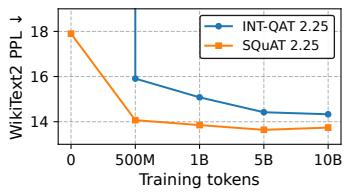  
(a) WikiText2 perplexity.

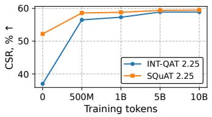  
(b) CSR.

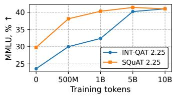  
(c) MMLU.  
Figure 5: Scaling behavior on LLaMA-3.2-1B as a function of QAT training tokens. We compare INT-QAT and SQUAT across WikiText2 perplexity, CSR, and MMLU.

## E.4 ISOLATING THE EFFECT OF THE STE CHOICE FROM THE SPHERICAL PARAMETERIZATION

Table 10 isolates the contribution of each component of SQUAT: the spherical parameterization and the factored STE. Replacing Standard VQ-QAT’s joint STE with a factored STE while keeping Euclidean shadow weights (Sec. B.2) yields inconsistent results—sometimes marginally better, sometimes worse than Standard VQ-QAT, with no clear trend across models or metrics. This is consistent with the analysis in Sec. B.2: the factored STE in Euclidean space does induce a tangential– radial decomposition of the gradient update, but since the update is applied in flat Euclidean space without a retraction step, it does not correspond to a principled Riemannian update and the induced structure does not reliably translate into better optimization.

By contrast, Spherical VQ-QAT (SQUAT) consistently improves over Standard VQ-QAT across all three models and all three metrics except Llama-3.2-3B CSR. In Spherical VQ-QAT, the factored STE is applied within the spherical parameterization, so the shape update is automatically projected onto the tangent space and followed by retraction via renormalization. We therefore conclude that neither component alone is sufficient: the spherical parameterization provides the geometric structure for a principled tangent-step plus retraction update, while the factored STE ensures the update is consistent with the quantized forward quantities (ˆs, γˆ) seen during training.

## E.5 COMPARISON WITH LC-QAT

Table 11 compares SQUAT against LC-QAT on Qwen3-1.7B. Since the original LC-QAT paper reports only the six CSR task accuracies for its 1B-token checkpoint, PPL and MMLU values are unavailable for direct comparison. Nevertheless, after 1B training tokens, SQUAT achieves higher CSR (61.2 vs. 59.8), outperforming LC-QAT by 1.4 %. These results demonstrate that exact codebookbased VQ-QAT can match or exceed the performance of recent scalable VQ-QAT approaches despite directly optimizing discrete codeword assignments.

Table 10: Additional comparison of Euclidean parametrization and Standard vs Spherical VQ-QAT results. Both variants use the same E8S shape-gain quantizer and PTQ initialization. Standard VQ-QAT applies STE to the reconstructed block, while Spherical VQ-QAT applies separate STEs to the shape and gain quantizers. App. E.1 shows results on multiple generative tasks.
<table><tr><td rowspan="2">Method</td><td rowspan="2">Tok</td><td colspan="3">WikiText2 PPL ↓</td><td colspan="3">CSR, % ↑</td><td colspan="3">MMLU, % ↑</td></tr><tr><td>L1B</td><td>L3B</td><td>Q4B</td><td>L1B</td><td>L3B</td><td>Q4B</td><td>L1B</td><td>L3B</td><td>Q4B</td></tr><tr><td>FP16</td><td></td><td>12.15</td><td>10.49</td><td>9.41</td><td>61.0</td><td>67.5</td><td>72.9</td><td>45.4</td><td>59.6</td><td>72.6</td></tr><tr><td>Standard VQ-QAT (Sec. 3.1)</td><td>1B</td><td>14.10</td><td>11.04</td><td>10.17</td><td>58.7</td><td>66.3</td><td>70.2</td><td>37.5</td><td>55.0</td><td>67.1</td></tr><tr><td>Euclidian w + factored STE (Sec. B.2)</td><td>1B</td><td>14.01</td><td>11.11</td><td>10.15</td><td>58.2</td><td>66.0</td><td>70.8</td><td>38.4</td><td>54.6</td><td>66.5</td></tr><tr><td>Spherical VQ-QAT (SQUAT, Sec. 3.2)</td><td>1B</td><td>13.85</td><td>10.96</td><td>10.03</td><td>58.8</td><td>65.8</td><td>71.0</td><td>40.3</td><td>55.8</td><td>67.4</td></tr></table>

Table 11: Qwen3-1.7B quantization results at 2.0 total bpw. We use E8S-SG codebook in SQUAT method. PPL is WikiText2. CSR is the average over 6 common sense reasoning tasks. LC-QAT and SQUAT both use 1B training tokens. PPL and MMLU are not reported for the 1B-token LC-QAT. AE, AC, BQ, HS, WG, and PQ denote ARC-Easy, ARC-Challenge, BoolQ, HellaSwag, WinoGrande, and PIQA, respectively.
<table><tr><td></td><td> $\mathrm { P P L } _ { 2 0 4 8 } \downarrow$ </td><td> $\mathrm { P P L } _ { 4 0 9 6 } \downarrow$ </td><td>AC</td><td>AE</td><td>BQ</td><td>HS</td><td>PQ</td><td>WG</td><td>CSR↑</td><td>MMLU↑</td></tr><tr><td>FP16</td><td>16.72</td><td>15.68</td><td>43.08</td><td>69.69</td><td>77.52</td><td>60.37</td><td>72.14</td><td>61.80</td><td>64.10</td><td>60.12</td></tr><tr><td>LC-QAT</td><td></td><td></td><td>39.51</td><td>64.35</td><td>70.43</td><td>55.01</td><td>71.65</td><td>57.54</td><td>59.75</td><td></td></tr><tr><td>SQUAT</td><td>17.36</td><td>16.19</td><td>39.76</td><td>65.87</td><td>75.66</td><td>54.06</td><td>69.97</td><td>61.72</td><td>61.17</td><td>52.94</td></tr></table>

## E.6 HADAMARD ROTATIONS

Tables 12 and 13 study the effect of blockwise Hadamard rotations after 1B-token QAT on LLaMA-3.2-1B. Across all configurations, Hadamard rotations consistently improve performance. Removing rotations increases perplexity by 0.42–1.65 points and decreases MMLU by 1.9–3.8 points, indicating that input mixing remains beneficial even after QAT.

At the same time, shape-gain provides substantial gains both with and without Hadamard rotations. For example, in the E8S-based setting at 2.25 bpw, SQUAT improves perplexity from 14.53 to 13.85 and MMLU from 37.0 to 40.3 when rotations are enabled. Importantly, the advantage persists even when rotations are removed, where SQUAT achieves 14.89 perplexity and 36.5 MMLU compared to 15.26 and 33.2 without shape-gain. Similar trends are observed for E8P12-based SQUAT. These results suggest that Hadamard rotations and shape-gain offer complementary benefits: Hadamard improves quantization by equalizing statistics, while shape-gain consistently improves accuracy regardless of whether rotations are present.

While Hadamard rotations are beneficial, unfused rotations introduce additional latency overhead and may be unsupported on some deployment targets. Nevertheless, shape-gain retains most of its benefit even without Hadamard rotations, making E8P12-based SQUAT particularly attractive for deployment.

## E.7 PARETO PLOT OF E8S-BASED SQUAT VS. SEQ.

Figure 6 shows Pareto plots for a range of total bpw values and various gain quantization rates. For total bitwidth below 2.0 bpw, a gain of 0.125 bpw is preferred, while for higher total bpw, the quantization of the gain matters less. Furthermore, our proposed E8S normalized spherical codebook construction enables fractional bitwidth at finer granularity than scalar quantization.

## F CHI-BASED VS GROUPED INTEGER GAIN QUANTIZATION

We consider a grouped integer gain quantizer as an alternative to chi-based gain quantizer. Gains $\{ \gamma _ { b } \} _ { b = 1 } ^ { B }$ are partitioned into groups of size $G \left( { \bf e . g . } , G = 1 2 8 \right)$ . For each group t, we compute an

Table 12: Ablation of Hadamard rotations with and without shape-gain on LLaMA-3.2-1B (E8S-SG) after 1B QAT.
<table><tr><td>Setting</td><td>bpw</td><td>Hadamard</td><td>PPL / CSR / MMLU</td></tr><tr><td rowspan="3">SQUAT (grouped)</td><td rowspan="3">2.25</td><td>Yes</td><td>13.85 / 58.8 / 40.3</td></tr><tr><td>No</td><td>14.89 / 58.2 / 36.5</td></tr><tr><td>∆</td><td>1.04 / 0.6 / 3.8</td></tr><tr><td rowspan="3">No SG (grouped)</td><td rowspan="3">2.25</td><td>Yes</td><td>14.53 / 58.0 / 37.0</td></tr><tr><td>No ∆</td><td>15.26 / 57.1 / 33.2</td></tr><tr><td></td><td>0.73 / 0.9 / 3.8</td></tr><tr><td rowspan="3">No SG (channel)</td><td rowspan="3">2.25</td><td>Yes</td><td>14.24 / 58.4 / 38.2</td></tr><tr><td>No</td><td>15.89 / 57.7 / 35.0</td></tr><tr><td>∆</td><td>1.65 / 0.7 / 3.2</td></tr><tr><td rowspan="3">No SG (channel)</td><td rowspan="3">2.00</td><td>Yes</td><td>14.78 / 58.1 / 35.8</td></tr><tr><td>No</td><td>15.53 / 57.5 / 33.3</td></tr><tr><td> $\Delta$ </td><td>0.75 / 0.6 / 2.5</td></tr></table>

Table 13: Ablation of Hadamard rotations with and without shape-gain on LLaMA-3.2-1B (E8P12- SG) after 1B QAT.
<table><tr><td>Setting</td><td>bpw</td><td>Hadamard</td><td>PPL / CSR / MMLU</td></tr><tr><td rowspan="3">SQUAT</td><td rowspan="3">2.25</td><td>Yes</td><td>13.94 / 58.7 / 38.9</td></tr><tr><td>No</td><td>14.36 / 58.3 / 36.9</td></tr><tr><td>∆</td><td>0.42 / 0.3 / 1.9</td></tr><tr><td rowspan="3">No SG</td><td rowspan="3">2.25</td><td>Yes</td><td>14.67 / 57.5 / 35.1</td></tr><tr><td>No</td><td>15.44 / 57.2 / 33.8</td></tr><tr><td>∆</td><td>0.77 / 0.3 / 1.3</td></tr><tr><td rowspan="3">No SG (channel)</td><td rowspan="3">2.00</td><td>Yes</td><td>14.85 / 57.6 / 35.7</td></tr><tr><td>No</td><td>15.69 / 56.9 / 32.5</td></tr><tr><td>∆</td><td>0.84 / 0.7 / 3.3</td></tr></table>

absmax scale

$$
a _ { t } \ = \ \operatorname* { m a x } _ { b \in \mathcal { Z } _ { t } } \gamma _ { b } , \qquad s _ { t } \ = \ \frac { a _ { t } } { 2 ^ { b _ { \gamma } } - 1 } ,\tag{37}
$$

and quantize each gain as

$$
\hat { \gamma } \ : = \ : s _ { t } \cdot \mathrm { c l i p } \left( \left\lfloor \frac { \gamma } { s _ { t } } \right\rceil , 0 , 2 ^ { b _ { \gamma } } - 1 \right) , \quad \quad b \in \mathbb { Z } _ { t } .\tag{38}
$$

This quantizer is distribution-agnostic and simple to implement, but we find it less effective than the chi-quantile quantizer at very low bit-widths, particularly when $b _ { \gamma } \leq 2 $ . Figure 7 shows results for a 2-bit E8P12 codebook. At very low precision (1–2 gain bits, corresponding to $\sim 0 . 1 2 5 - 0 . 2 5$ additional bpw), chi-quantile gains consistently outperform uniform integer quantization. As gain precision increases, the gap narrows and both methods approach FP8 performance. Notably, a fixed chi-based scale (zero gain bits) outperforms 1-bit uniform integer gain quantization, highlighting the importance of distribution-aware gain design in the extremely low-bit regime. We therefore adopt chi-quantile gain quantization as the default for low-bit SQUAT.

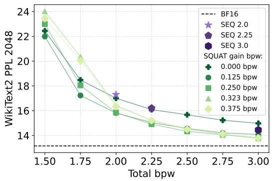

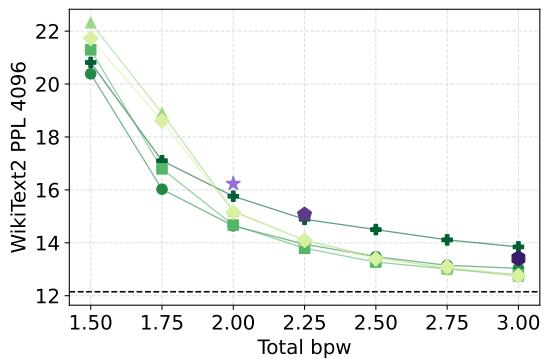

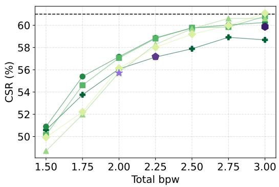

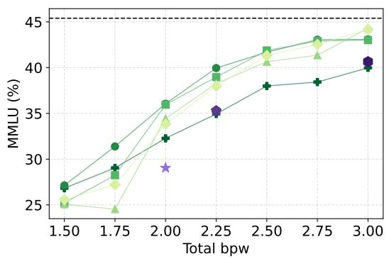  
Figure 6: Pareto fronts of LLaMA-3.2-1B quantized with SQUAT (E8S-SG) vs. SEQ after 1B-token QAT. Each frontier corresponds to a different gain bitwidth. The normalized E8S spherical codebook supports fractional bitwidths at finer granularity than scalar quantization, enabling more precise rate-distortion trade-offs.

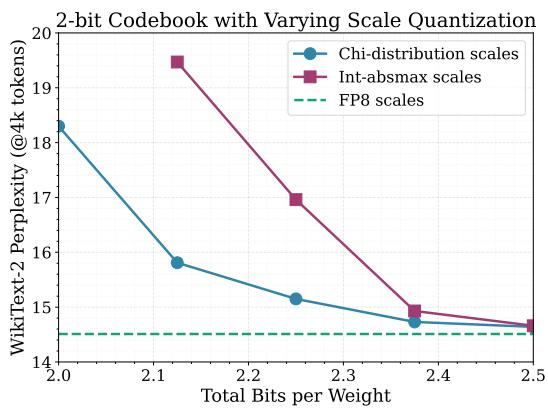  
Figure 7: Scale-quantization ablation with shape-gain. Chi-based gains perform best at very low bit-rates, while all methods approach FP8-level quality as gain precision increases.