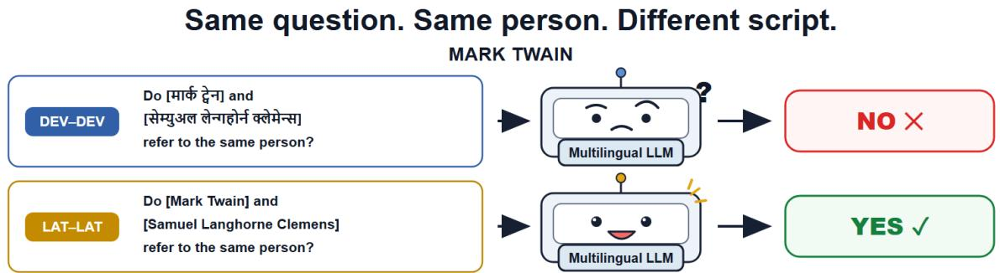
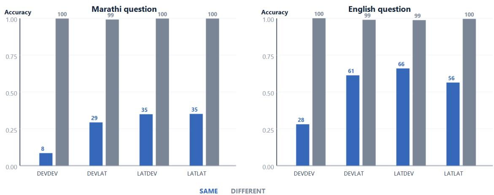
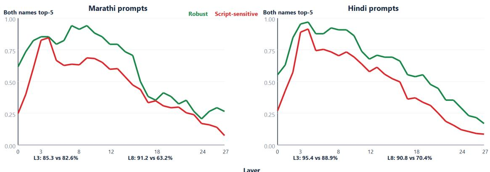
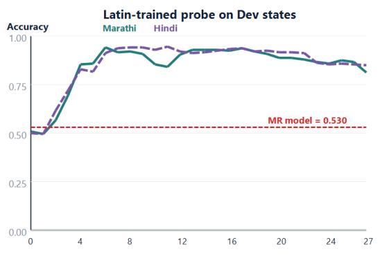
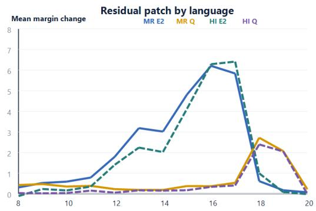
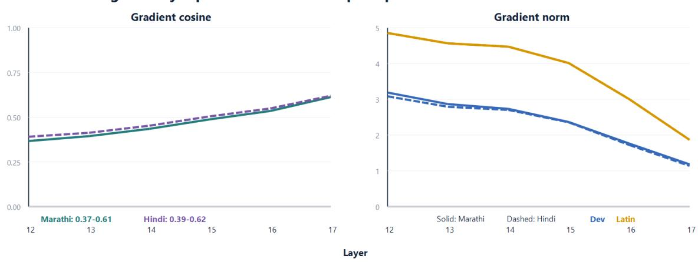
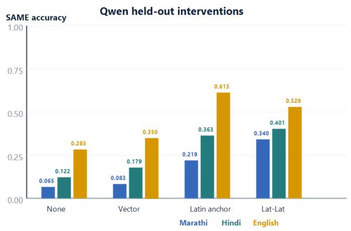
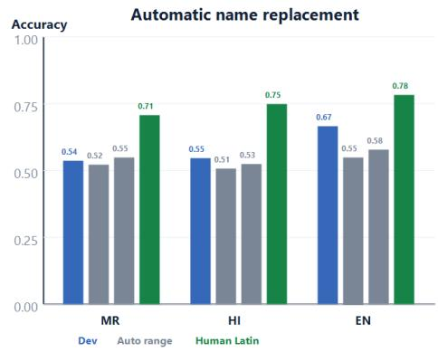

# Same Entity, Different Script: Diagnosing Cross-Script Entity Matching Failures in Language Models

Athira Gopal∗ Patil Prathamesh Pravin∗ Ankush Kadu

Arpit Jain Ashwanth Krishnan

QpiAI India

{athira.g, patil.p, ankush.k, arpit.j, ashwanth.krishnan}@qpiai.tech

## Abstract

Multilingual language models can give differ ent identity judgments when the same people’s names are written in different scripts. We study this effect using 601 audited identity pairs with attested Devanagari and Latin forms, holding the question and relation fixed. Qwen2.5- 7B’s same-person accuracy falls from 35.1% in Latin to 8.5% in Devanagari under Marathi prompts, while different-person accuracy remains above 98%. Evaluation across five models reveals distinct response biases, and reduced tokenization fragmentation does not reliably close the gap. Replicating the design on 374 audited Malayalam pairs built from the same entities reproduces the effect in a second script and language family: same-person accuracy falls to 5.3%, about half the matched Devana gari rate, while the margin still ranks matching above non-matching names at 0.925 AUROC. Latin-trained probes recover label information from Devanagari states, exceeding a string feature baseline under similarity-matched neg atives. Scalar calibration recovers 87% of the raw model–probe balanced-accuracy gap, identifying decision criterion placement as a ma jor contributor. Activation patching localises causal sensitivity to the second entity in Qwen’s middle layers; one shared sensitivity direction transfers about half the full-state margin cor rection. A fact-independent intervention at this site raises held-out Marathi same-person accuracy from 6.5% to 33.5%, with 98.5% differentperson accuracy. Together, these results dis tinguish script-dependent discrimination from criterion placement and identify a causal site for improving identity judgments.

## 1 Introduction

An identity judgment should remain consistent when the same people are presented through corresponding names in different scripts. Yet multilingual models can reject a matching pair in Devanagari and accept its attested Latin forms (Figure 1). This matters for multilingual entity matching: a system must connect aliases, birth names and pseudonyms even when a user’s writing system differs from the model’s most familiar surface forms.

We study this problem through controlled identity verification. Both candidate names are supplied; only their script-associated surface forms change. The question language, people and relation remain fixed. Across 601 audited pairs, Qwen2.5- 7B’s Marathi same-person accuracy drops from 35.1% in Lat–Lat to 8.5% in Dev–Dev, while it continues to reject almost all different-person pairs. The contrast isolates a failure to affirm identity within a task the model can partly solve through other surface forms. A second corpus in Malayalam, a different script and a Dravidian rather than Indo-Aryan language, shows the effect is not specific to Devanagari or to Indo-Aryan languages.

Our analysis connects three levels of evidence. First, we establish the behavioural gap across scripts and prompt languages, separating discrimination from response bias. Five-model evaluation and romanization controls show why tokenization efficiency alone is insufficient. Second, Latintrained probes and output-score calibration establish how much label information remains available when the model answers incorrectly. Third, activation patching and subspace interventions identify where that information can influence the decision.

The resulting account is actionable. In Qwen, the second entity’s middle-layer state is a strong intervention site, and a shared sensitivity direction transfers roughly half the full-state correction. A vector learned from training entities raises held-out Marathi same-person accuracy more than fivefold. Controls on ranking, script condition and position explain this gain: much of it comes from moving the decision criterion at a causally sensitive site. The script contrast also changes discrimination, so calibration and script robustness are distinct evaluation targets. Our contribution is a controlled benchmark and a diagnosis that connects these targets to measurable internal computations.

## 2 Related work

Multilingual models develop shared, Englishaligned representations (Wendler et al., 2024; Wu et al., 2025), yet factual judgments can vary across languages. Qi et al. (2023) examine consistency across translated queries; Ai et al. (2025) study reference in code-mixed coreferential statements across language families and scripts, including activation patching. Our design fixes the question language and varies the two supplied names, following one identity relation across behavioural and internal measurements.

Wang et al. (2025) localise cross-lingual factual inconsistency near the transition to languagespecific final-layer representations and propose a linear shortcut. We examine entity surface forms and find strong middle-layer sensitivity at the second entity. Testing a related linear intervention against output calibration and other script conditions clarifies what its accuracy gain changes. Romanization can improve non-Latin processing (Husain et al., 2024; Liu et al., 2025; Saji et al., 2025); our comparison of automatic and attested forms separates shorter token sequences from reliable behavioural recovery.

We combine activation patching (Meng et al., 2022; Dumas et al., 2025; Nanda and Bloom, 2022) with linear probes (Panchal et al., 2026). The controlled task makes it possible to compare label decodability, output calibration and causal transfer on corresponding inputs.

## 3 Task, data and protocol

Identity pairs. The corpus contains 601 manually audited Wikidata pairs (Vrandeciˇ c and Krötzsch ´ , 2014), each linking a canonical name to an attested alias, birth name, pseudonym or nickname.1 Both names have observed Devanagari and Latin forms. Independently varying the two spans yields Dev– Dev, Dev–Lat, Lat–Dev and Lat–Lat. These are conventional name forms, so the manipulation includes spelling and familiarity differences associated with script. Each positive has a differentperson hard negative, selected by occupation, country and relation tier; 99.8% share occupation. A separate analysis rebuilds negatives for name similarity (§5).

The audit excludes identical Devanagari fields, joined aliases and parenthetical metadata, as well as pairs whose two scripts encode different name relationships. The retained set comprises 404 observedalias relations and 197 relations involving explicit name properties. Names are attested rather than generated by a transliterator, making the Latin condition a comparison with conventional forms of the same identity relation. This design supplies both candidates directly, avoiding the additional requirement to generate an unfamiliar name.

A second script. A Malayalam corpus covers 380 of the same Wikidata entities, with both names given in Malayalam and in the original Latin forms. A Malayalam speaker audited all 380 items and all 380 distractors, rejecting six whose fields carried a generic honorific or a second alias, which leaves 374. Of the 760 Malayalam strings, 171 are exactly attested in Wikidata Malayalam labels or aliases, 18 are spelling variants of an attested form, and 571 are machine-transliterated and then audited; none of the transliterations was rejected. The same speaker checked the three Malayalam question templates. Splits of 222/76/76 are inherited from a seed-reproduced split of the 601-item corpus rather than recomputed, so no probe, vector or threshold from the Devanagari experiments is transferred here. We evaluate Qwen2.5-7B behaviourally on this corpus (Appendix AB).

Languages and scoring. Marathi and Hindi corpora cover the same identities and have byteidentical Latin forms; 528/601 Devanagari pairs differ. Each corpus is queried in its own language and English, with three paraphrases and both yes/no letter assignments. We score the final-position logit margin $m = z _ { \mathrm { y e s } } - z _ { \mathrm { n o } }$ without sampling. Behavioural accuracy pools the six prompts per item and reports positive and negative pairs separately. For entity-level probe and calibration comparisons, margins are averaged across the six prompts before classification. AUROC measures ranking independently of the decision threshold. Confidence intervals use 2,000 item-clustered bootstrap resamples. Appendix Y specifies aggregation for each experiment.

Both Marathi and Hindi templates have been verified by native speakers. Counterbalancing is also used in the knowledge and causal gates: an item counts as known only when both answer-key assignments are correct. A fixed preference for A or B therefore cannot qualify an item for causal analysis. Reporting both pair polarities further distinguishes improved identity recognition from an increase in acceptance that also admits unrelated people.

  
Figure 1: Controlled identity verification. Both names and the English question are supplied; only the attested script-associated name forms change. Qwen and Llama reject this illustrative Dev–Dev pair and accept its Lat–Lat counterpart.

Models and selection. We evaluate Qwen2.5- 7B-Instruct (Qwen Team, 2025), Gemma-2-2bit (Gemma Team, 2024), Llama-3.1-8B-Instruct (Llama Team, AI @ Meta, 2024), Mistral-Small-24B and Sarvam-M-24B. The 24B models use the Marathi corpus. Qwen provides the detailed causal analysis. A fixed split of 361/120/120 target items supplies training, validation and test data; distractors come from a shared pool and can cross splits. Probe layers and intervention settings are chosen on validation. Vector scales use 60 validation items and one template, with evaluation on all three templates. Frozen controls reuse the test set without further fitting. Construction, prompts, gates and compute details appear in Appendices A–C and AA.

## 4 The script gap

## 4.1 Behaviour across models and languages

Qwen’s deficit is concentrated on matching names. Under Marathi prompts, Dev–Dev positive accuracy is 8.5%, compared with 35.1% in Lat–Lat; negative accuracy remains at least 98.6% across the evaluated conditions (Table 1). The gap persists under Hindi and English prompts. It includes a discrimination loss: Lat–Lat exceeds Dev– Dev in margin AUROC by 0.037 [0.025, 0.049] in Marathi, 0.038 [0.026, 0.051] in Hindi and 0.023 [0.014, 0.033] in English over all 601 items.

The effect spans all three paraphrases and substantive relation tiers. Even among 154 pairs with over 80% Latin-form similarity, Marathi accuracy is 10.8% in Dev–Dev and 32.1% in Lat–Lat. The gap is larger among the 58 least-similar pairs: 31.3 points versus 21.3 in the most-similar band (Appendix D; Table 57). Thus, near-duplicate spellings do not account for the phenomenon.

The behavioural polarity varies by model. Gemma accepts most positives and many negatives, whereas Qwen strongly favours rejection. Using the signal-detection measure d′ to separate these biases, the Lat–Lat advantage excludes zero for Qwen in Marathi, Gemma in all three prompt languages and Llama in English (Appendix E). Llama’s Marathi and Hindi outputs exhibit fixedletter instruction failures and are excluded from this interpretation. Mistral-Small-24B has a 25.8- point Marathi positive-accuracy gap, versus 6.9 for the Indic-adapted Sarvam-M-24B. Their negative accuracies and checkpoint versions differ, making this a descriptive family-and-size comparison (Appendix Z).

Mixed scripts reveal a further distinction. Lat– Dev exceeds Lat–Lat positive accuracy by 9.7 points in English and 11.1 in Hindi without better per-template ranking (Appendix V). Script configuration therefore affects criterion placement as well as discrimination, motivating the calibration tests below.

The gap is not specific to Devanagari. On 374 Malayalam items and the same 374 entities in Devanagari, Qwen’s native-script same-person accuracy is 5.3% under Malayalam prompts against 10.4% under Marathi prompts, while negative accuracy is at least 98.6% in every cell of both corpora (Table 2). The script gap is correspondingly larger, 43.5 points [40.0, 47.1] against 30.6 [26.6, 34.5], though the Lat–Lat baselines also differ: of the 12.9-point difference between the two gaps, 5.1 points come from the native cell and 7.8 from the baseline. The margin AUROC gap is larger as well, 0.065 [0.050, 0.082] against 0.045 [0.031, 0.061], so discrimination moves and not only the criterion. The Mlym–Mlym cell is nonetheless this paper’s clearest dissociation: in the same cell, decisions sit near the floor at 5.3% while ranking sits near the ceiling at 0.925. The held-out 76 entities agree, at 39.0 and 28.5 points. Under English prompts, Lat–Mlym exceeds Lat–Lat, 66.4% against 62.9%, reproducing the mixed-script ordering of Table 1 in a second script (Table 66).

Table 1: Accuracy (%) over 601 items, three paraphrases and both answer keys. Pos. and neg. denote same-person and different-person pairs. English rows use the Marathi corpus; the 24B models were evaluated on that corpus only. Textual gaps use unrounded values.
<table><tr><td></td><td></td><td colspan="2">Dev-Dev</td><td colspan="2">Dev-Lat</td><td colspan="2"> $_ \mathrm { L a t - D e v }$ </td><td colspan="2">Lat-Lat</td></tr><tr><td>Model</td><td>Prompt</td><td>pos.</td><td>neg.</td><td>pos.</td><td>neg.</td><td>pos.</td><td>neg.</td><td>pos.</td><td>neg.</td></tr><tr><td>Qwen2.5-7B</td><td>Marathi</td><td>8.5</td><td>99.8</td><td>29.4</td><td>99.1</td><td>35.0</td><td>99.8</td><td>35.1</td><td>99.7</td></tr><tr><td></td><td>Hindi</td><td>16.4</td><td>99.9</td><td>45.2</td><td>98.6</td><td>52.2</td><td>99.5</td><td>41.1</td><td>99.6</td></tr><tr><td></td><td>English</td><td>28.2</td><td>100.0</td><td>61.3</td><td>98.9</td><td>66.0</td><td>98.7</td><td>56.3</td><td>99.6</td></tr><tr><td>Gemma-2-2b</td><td>Marathi</td><td>91.8</td><td>25.2</td><td>96.7</td><td>27.6</td><td>92.2</td><td>29.0</td><td>96.6</td><td>34.1</td></tr><tr><td></td><td>Hindi</td><td>94.1</td><td>44.6</td><td>97.5</td><td>38.4</td><td>91.0</td><td>52.2</td><td>97.2</td><td>49.9</td></tr><tr><td>Llama-3.1-8B</td><td>English</td><td>97.3</td><td>21.7</td><td>99.0</td><td>21.2</td><td>97.1</td><td>32.8</td><td>98.1</td><td>41.5</td></tr><tr><td></td><td>Marathi</td><td>34.2</td><td>66.5</td><td>35.7</td><td>66.7</td><td>34.9</td><td>66.8</td><td>35.5</td><td>68.3</td></tr><tr><td></td><td>Hindi</td><td>19.3</td><td>83.5</td><td>29.8</td><td>83.7</td><td>33.7</td><td>84.0</td><td>28.0</td><td>86.2</td></tr><tr><td></td><td>English</td><td>47.9</td><td>85.3</td><td>66.2</td><td>80.3</td><td>73.8</td><td>87.7</td><td>67.8</td><td>93.7</td></tr><tr><td>Mistral-Small 24B</td><td>Marathi</td><td>14.3</td><td>99.2</td><td>40.0</td><td>97.2</td><td>46.1</td><td>98.8</td><td>40.1</td><td>97.9</td></tr><tr><td></td><td>English</td><td>27.7</td><td>99.9</td><td>64.6</td><td>98.4</td><td>69.6</td><td>98.9</td><td>68.1</td><td>99.3</td></tr><tr><td>Sarvam-M 24B</td><td>Marathi</td><td>75.2</td><td>65.6</td><td>83.9</td><td>64.9</td><td>83.9</td><td>71.1</td><td>82.0</td><td>73.9</td></tr><tr><td></td><td>English</td><td>82.7</td><td>97.2</td><td>87.5</td><td>96.2</td><td>91.3</td><td>94.4</td><td>87.6</td><td>97.2</td></tr></table>

Table 2: Qwen2.5-7B on 374 Malayalam items and the same 374 entities in Devanagari, each corpus queried in its own language. Script configurations are Mlym–Mlym, Mlym–Lat, Lat–Mlym and Lat–Lat for Malayalam, and Dev–Dev, Dev–Lat, Lat–Dev and Lat–Lat for Devanagari. Pos. and neg. are same-person and different-person accuracy; AUROC is entity-averaged over six prompt margins. The gap rows are Lat–Lat minus the both-native condition, paired by entity, with 95% item-clustered intervals over 2,000 resamples. The two accuracy gaps differ by 12.9 points, 5.1 of which come from the both-native cell and 7.8 from the differing Lat–Lat baselines. The Devanagari column is a new run on this 374-item subset with its own distractor map; it is not the 601-item corpus of Table 1 and the two are not interchangeable. English-prompt results and the held-out split appear in Table 66.
<table><tr><td rowspan="2">Name scripts</td><td colspan="3">Malayalam  $( n = 3 7 4 )$ </td><td colspan="3">Devanagari  $( n = 3 7 4 )$ </td></tr><tr><td>pos.</td><td>neg.</td><td>AUROC</td><td>pos.</td><td>neg.</td><td>AUROC</td></tr><tr><td>Both native</td><td>5.3</td><td>100.0</td><td>0.925</td><td>10.4</td><td>100.0</td><td>0.935</td></tr><tr><td>Native, Latin</td><td>33.5</td><td>98.6</td><td>0.941</td><td>33.2</td><td>98.8</td><td>0.960</td></tr><tr><td>Latin, native</td><td>38.1</td><td>99.6</td><td>0.964</td><td>37.8</td><td>99.8</td><td>0.970</td></tr><tr><td>Both Latin</td><td>48.8</td><td>99.9</td><td>0.990</td><td>41.0</td><td>99.6</td><td>0.981</td></tr><tr><td>Gap, points</td><td colspan="3">+43.5 [40.0, 47.1]</td><td colspan="3">+30.6 [26.6, 34.5]</td></tr><tr><td>Gap, AUROC</td><td colspan="3">+0.065 [0.050, 0.082]</td><td colspan="3">+0.045 [0.031, 0.061]</td></tr></table>

## 4.2 Tokenization and familiar forms

Devanagari names are tokenized roughly three times as finely as Latin names. Fragmentation correlates weakly with the Latin-script benefit, and longer names are harder to retrieve in isolation (Appendix F). Nevertheless, surface features predict script-sensitive items at only 0.56–0.60 out-of-fold AUC, versus 0.86–0.96 after adding relation states (Table 18). Five automatic romanizations reduce Qwen’s mean name length from 16.5 tokens to 7.7– 10.4, but replacement yields no reliable recovery. Substitution of the attested Latin form reproduces Lat–Lat within 0.004 in all nine primary model– language cells. The tested reductions in fragmentation are therefore insufficient; spelling fidelity and familiarity remain relevant (Appendix G).

The automatic schemes reproduce the attested

Latin spelling exactly for only 0.8–4.5% of names. Thus, moving into Latin characters and presenting a familiar Latin name are different manipulations. The contrast also appears across models: Gemma and Llama use substantially fewer Devanagari tokens per character than Qwen, yet their behaviour still depends on script. Together, the prediction and substitution tests motivate examining relation-level states beyond surface token counts.

## 5 Available information and decision calibration

We fit ridge classifiers (α = 10) on L2-normalised Lat–Lat hidden states and evaluate on Dev–Dev, so no Devanagari state enters probe training. Layers are selected on validation and accuracy is measured on the 120 test items. Cross-language transfer also succeeds across Qwen, Gemma and Llama (Appendix H).

Label information transfers across scripts. Qwen’s question-mark probe reaches 0.925 balanced accuracy and 0.867 same-person recall on Marathi Dev–Dev inputs. Averaged over layers 10–18, it recovers 78.9% of exact Marathi failures. At the second entity, the validation-selected probe reaches 0.933 balanced accuracy (Table 4). These measurements establish accessible label-relevant structure in states associated with incorrect decisions.

Similarity-matched negatives strengthen the comparison. On the original negative map, a five-feature string classifier reaches 0.933, matching the probe. Its features are sequence similarity, token and character Jaccard overlap, relative length difference and final-token agreement. We rebuild distractors to approximate each positive pair’s name similarity; matching within 0.05 is possible for 144/601 items, including 25 test items (Table 3). Across all 120 test items under this partially matched map, the question-mark probe exceeds the string classifier: 0.908 versus 0.796 in Marathi, a difference of +0.112 [+0.067, +0.163], and +0.083 [+0.025, +0.142] in English. On the tightly matched subset, model separation remains within 0.01 of its original value. The signal extends beyond these five string features; richer orthographic signals and familiarity are not separated from identity retrieval by this test (Appendix T).

Both classifiers are refitted on the rebuilt training negatives, and the probe layer is reselected on validation. This compares their predictive information under the same modified task. Where the string classifier fails, the probe is correct on 65.3% of Marathi pairs and 75.5% of English pairs. The comparison therefore tests complementary information as well as aggregate accuracy.

Calibration explains much of the behavioural shortfall. A single constant added to the model’s margin, selected for balanced accuracy on validation, raises Marathi entity-level balanced accuracy from 0.525 to 0.879. This recovers 87% of the distance to the E2 probe’s 0.933. The probe retains an advantage of +0.054 [+0.017, +0.092] in Marathi and +0.050 [+0.021, +0.079] in English. These are comparisons at their selected operating points, with false-positive rates reported in Table 4. Substantial discriminative information reaches the model’s own output score, and criterion placement accounts for much of its failure to use that information in the final answer.

## 6 Localising causal sensitivity

We replace a Dev–Dev residual state with the corresponding state from a Latin-bearing donor run and measure the change in m. The causal gate requires failure in Dev–Dev and success in the donor condition across paraphrases and answer keys. Held-out gates contain 12 Marathi, 15 Hindi and 24 English items. The layer band 10–18 was fixed from a pilot; intervals resample items, and flip rates are descriptive at these sample sizes (Appendix I).

The second entity is the strongest site. E2 patching raises margins by 2.66–3.16 across languages, while E1 has little effect (Table 5). Reverse patching damages the working run. The matched correct-versus-wrong-entity contrast establishes an entity-specific component in Marathi; the Hindi and English intervals include zero. Joint E1/E2/question-mark patching across layers 12–17 flips 50%, 60% and 71% of held-out Marathi, Hindi and English items. Matched-negative accuracy remains 100%. At layers 18–20 the joint effect falls below one margin point, while sensitivity shifts toward the question mark.

The donor-language control further separates name form from question language. At the peak over layers 10–18, an English Lat–Lat donor changes the Marathi margin by 6.26, comparable to 5.97 from a Marathi Lat–Lat donor; an English Dev–Dev donor gives 0.11. These peak values use a different aggregation from Table 5, so they support the donor contrast rather than an additional site comparison (Table 29). The effective transfer can therefore cross prompt language while retaining the Latin-bearing name context.

Table 3: Question-mark probe and string baseline on the same 120 held-out entities under the original and partially similarity-matched negative maps. Values are balanced accuracy; paired differences include 95% item-clustered intervals. The matched map permits tight matching on 25 test items. Full controls appear in Appendix T.
<table><tr><td>Prompt</td><td>Negative map</td><td>Probe</td><td>String baseline</td><td>Difference</td></tr><tr><td>Marathi</td><td>Original</td><td>0.925</td><td>0.933</td><td> $- 0 . 0 0 8 \left[ - 0 . 0 3 3 , + 0 . 0 1 7 \right]$ </td></tr><tr><td></td><td>Matched</td><td>0.908</td><td>0.796</td><td> $+ 0 . 1 1 2 [ + 0 . 0 6 7 , + 0 . 1 6 3 ]$ </td></tr><tr><td>English</td><td>Original</td><td>0.950</td><td>0.933</td><td> $+ 0 . 0 1 7 \left[ - 0 . 0 0 4 , + 0 . 0 4 2 \right]$ </td></tr><tr><td></td><td>Matched</td><td>0.879</td><td>0.796</td><td> $+ 0 . 0 8 3 \left[ + 0 . 0 2 5 , + 0 . 1 4 2 \right]$ </td></tr></table>

Table 4: Entity-level decisions on 120 held-out Dev–Dev items, averaging six prompt margins before classification. BA is balanced accuracy; TPR/FPR are true-/false-positive rates. All settings are validation-selected. The original negative map is used here; similarity-matched results appear in Table 52.
<table><tr><td></td><td colspan="3">Marathi</td><td colspan="3">English</td></tr><tr><td>Rule</td><td>BA</td><td>TPR</td><td>FPR</td><td>BA</td><td>TPR</td><td>FPR</td></tr><tr><td>Raw model</td><td>0.525</td><td>0.058</td><td>0.008</td><td>0.633</td><td>0.267</td><td>0.000</td></tr><tr><td>Margin + constant</td><td>0.879</td><td>0.808</td><td>0.050</td><td>0.904</td><td>0.875</td><td>0.067</td></tr><tr><td>E2 probe</td><td>0.933</td><td>0.883</td><td>0.017</td><td>0.954</td><td>0.942</td><td>0.033</td></tr><tr><td>String features</td><td>0.933</td><td>0.883</td><td>0.017</td><td>0.933</td><td>0.883</td><td>0.017</td></tr></table>

## 6.1 Position, name and computation

Swapping the canonical name and alias preserves E2 dominance: Marathi E2 patching changes the margin by 4.79 in the original order and 3.78 after swapping, while E1 stays within 0.42 of zero across all six language–order combinations. The effect follows the second slot, the first position that can attend to both names (Appendix K). Nonce names also show E2-over-E1 sensitivity, placing the finding in relational comparison more broadly (Appendix U).

Cumulative attention patches transfer more correction than MLP patches: 5.41 versus 0.51 in Marathi, with the same ordering in Hindi and English. These interventions are not an additive decomposition of residual effects. Multi-head patches exceed individual-head patches, consistent with distributed transfer (Appendix J). Exploratory Llama and Mistral-Small sweeps also show E2-over-E1 sensitivity at different depths and smaller magnitudes (Appendices Q and R).

## 6.2 A shared direction transfers correction

To identify effective directions at E2, we differentiate m with respect to the residual state. Dev– Dev and Lat–Lat local gradients have cosine similarity 0.37–0.61 across layers 12–17 in Marathi, against at most 0.004 in magnitude for random directions. Their partial alignment motivates testing which shared subspaces carry the donor correction (Appendix L).

For an orthonormal basis U, we intervene with

$$
\begin{array} { r } { h _ { D } ^ { \prime } = h _ { D } + U U ^ { \top } ( h _ { L } - h _ { D } ) . } \end{array}\tag{1}
$$

Directions are fitted on training items. The sensitivity direction is the normalised mean Dev–Dev gradient over gated training items; alternatives use the mean donor difference, its principal component, a ridge-probe direction or a random direction. Layer 16 and rank one are validation-selected; the frozen test fold evaluates the held-out paraphrase P2 (Appendix O).

One sensitivity direction transfers a Marathi margin gain of 1.30 [0.73, 1.95], versus 2.54 for a full-state patch, and 2.65 [2.06, 3.34] versus 4.90 in English (Table 6). The probe direction transfers approximately zero under the same donor projection. Linear decodability and donor-projected causal transfer therefore differ at this site. This comparison measures their combination of donor projection and downstream sensitivity; it does not establish that the probe direction is unused.

The mean-difference direction produces larger but broader changes, also moving same-person pairs outside the gate. Negative accuracy remains 1.00 in these subspace tests. The rank-one result concerns margin correction: the substantial answer flips above require multi-layer intervention. The next experiment tests whether a shared vector can achieve gains without a test item’s donor.

Table 5: Held-out Qwen patching: mean margin change with 95% item-clustered intervals. Site effects average layers 10–18 and three Latin-bearing donors. The last row compares correct and wrong-entity Lat–Lat donors on matched layers and items. Full profiles appear in Appendix I.
<table><tr><td>Site / contrast</td><td>Marathi  $( n = 1 2 )$ </td><td>Hindi (n = 15)</td><td>English  $( n = 2 4 )$ </td></tr><tr><td>First entity (E1)</td><td>0.12 [-0.13, 0.38]</td><td>-0.03 [-0.25, 0.16]</td><td>0.27 [0.02, 0.53]</td></tr><tr><td>Second entity (E2)</td><td>2.66 [1.67, 3.71]</td><td>3.16 [2.47, 3.90]</td><td>2.85 [2.28, 3.45]</td></tr><tr><td>Question mark</td><td>0.61 [0.33, 0.97]</td><td>0.33 [0.16, 0.52]</td><td>0.79 [0.59, 1.00]</td></tr><tr><td>Readout</td><td>1.26 [0.96, 1.58]</td><td>1.08 [0.87, 1.30]</td><td>1.33 [1.12, 1.57]</td></tr><tr><td>E2: correct — wrong entity</td><td>2.09 [0.41, 3.84]</td><td>-0.51 [-2.06, 1.08]</td><td>0.70 [-0.21, 1.54]</td></tr></table>

<table><tr><td></td><td colspan="3">Marathi  $( n = 1 2 )$ </td><td colspan="3">English  $( n = 2 4 )$ </td></tr><tr><td>Direction</td><td>repair</td><td>signed</td><td> $| \Delta |$ </td><td>repair</td><td>signed</td><td>|∆|</td></tr><tr><td>Whole patch</td><td>2.54</td><td>0.48</td><td>1.17</td><td>4.90</td><td>1.03</td><td>1.98</td></tr><tr><td>Local sensitivity</td><td>1.30</td><td>0.23</td><td>0.47</td><td>2.65</td><td>0.79</td><td>1.01</td></tr><tr><td>Mean difference</td><td>3.50</td><td>1.81</td><td>1.82</td><td>4.33</td><td>2.67</td><td>2.67</td></tr><tr><td>Donor PCA</td><td>0.09</td><td>-0.05</td><td>0.16</td><td>0.43</td><td>0.19</td><td>0.22</td></tr><tr><td>Probe</td><td>-0.01</td><td>0.00</td><td>0.13</td><td>-0.01</td><td>0.02</td><td>0.08</td></tr><tr><td>Random</td><td>-0.01</td><td>0.01</td><td>0.11</td><td>0.05</td><td>-0.01</td><td>0.09</td></tr></table>

Table 6: Rank-one donor-projected patching at E2, layer 16, held-out fold t01e2. Repair is the gated margin change; signed and $| \Delta |$ measure changes on never-correct same-person pairs outside the gate. Negative accuracy is 1.00 throughout. The whole-state patch is the reference.

The distinction between margin transfer and answer correction connects the two experiments. A state intervention may move the decision score substantially without crossing its threshold. Sustained patching across the middle-layer band produces answer flips that the single-layer tests rarely achieve. This motivates applying a shared correction over the same band, and measuring both its accuracy and the ranking of positive against negative pairs.

## 7 Improving judgments through a shared intervention

At each layer, we estimate a vector from 361 training items by summing the mean E2 changes associated with replacing either name’s script:

$$
a _ { \ell } = \mathbb { E } _ { i \in \mathcal { T } } \big [ h _ { i , \ell } ^ { L D } + h _ { i , \ell } ^ { D L } - 2 h _ { i , \ell } ^ { D D } \big ] ,\tag{2}
$$

$$
h _ { \ell , E 2 } ^ { \prime } = h _ { \ell , E 2 } + \alpha a _ { \ell } / \| a _ { \ell } \| _ { 2 } .\tag{3}
$$

Here LD, DL and DD denote Lat–Dev, Dev–Lat and Dev–Dev. Vectors are layer-specific and shared across items. Validation selects the layers 12–17 window and scale by balanced accuracy, with negative accuracy as a tiebreak; no negative-accuracy floor is imposed (Appendix N).

The gain generalises to held-out entities. Marathi same-person accuracy rises from 0.065 to 0.335, with negative accuracy 0.985; English rises from 0.283 to 0.590, with negative accuracy 0.976. Marathi gains occur on all three templates despite selection on one. The Hindi rendering also improves, with a larger negative-accuracy tradeoff (Table 41). Applying the frozen Marathi intervention at E1 instead yields only 0.071 positive accuracy. The effective position agrees with the patching localisation (Table 60).

The multi-layer setting matters. The earlier single-layer intervention raises Marathi positive accuracy only to 0.083 on test. Holding the scale at 6 while widening to layers 12–17 raises validation accuracy from 0.083 to 0.233; extending the scale search then reaches 0.392. Balanced-accuracy selection returns scales of 12 for Marathi and 24 for English on the Marathi corpus. The held-out gains thus follow a validation-selected combination of depth and magnitude (Appendices M and N).

Controls identify what improves. Entityaveraged AUROC changes are small and their intervals include zero (Table 7). A validationselected scalar offset reaches a nearby Marathi operating point, 0.312 true-positive rate at 0.012 falsepositive rate, versus the vector’s 0.335 at 0.015. An oracle threshold on the test curve matches the vector’s Marathi rate; this is a diagnostic, not a deployable rule. Per-template analysis also reveals a ranking component: on the tuning template the vector reaches 0.425 true-positive rate versus 0.308 for threshold adjustment at a matched false-positive rate, and ranking improves on templates 0 and 2

Table 7: Held-out intervention and calibration. AUROC averages six margins per entity; change includes a 95% item-clustered interval. TPR (FPR) pools prompts. The offset is validation-selected under a negative-accuracy floor; threshold only is an oracle test-curve diagnostic. Appendix Y gives selection rules.
<table><tr><td></td><td colspan="3">Entity-averaged AUROC</td><td colspan="3">TPR (FPR)</td></tr><tr><td>Arm</td><td>Dev-Dev</td><td colspan="2">change</td><td>vector</td><td>offset</td><td>threshold only</td></tr><tr><td>Marathi</td><td>0.952</td><td></td><td>+0.003 [−0.008, +0.015]</td><td>0.335 (0.015)</td><td>0.312 (0.012)</td><td>0.336 (0.015)</td></tr><tr><td>English (mr corpus)</td><td>0.961</td><td></td><td>-0.003 −0.016, +0.012]</td><td>0.590 (0.024)</td><td>0.714 (0.037)</td><td>0.644 (0.024)</td></tr><tr><td>Hindi</td><td>0.935</td><td></td><td>-0.016 [-0.038, +0.005]</td><td>0.546 (0.131)</td><td>0.656 (0.178)</td><td>0.594 (0.131)</td></tr></table>

(Table 62).

The frozen vector improves Lat–Lat too, raising Marathi positive accuracy from 0.340 to 0.629 and English from 0.529 to 0.756. Treating both script conditions narrows the disparity in three of four corpus–language arms and widens it by 1.9 points in Marathi (Appendix W). These controls identify a broadly useful criterion shift with template-dependent ranking effects. The intervention improves identity judgments at the identified site; script-specific parity remains a separate objective.

These measurements distinguish three useful outcomes for multilingual identity verification. Decoding tests whether states support the label; AUROC tests whether the model’s scores separate matching from non-matching names; and accuracy at a reported false-positive rate tests the decisions a user receives. The probe, patch and steering experiments connect these outcomes without assuming that improvement in one guarantees improvement in the others. In particular, evaluating the same frozen intervention in both script conditions reveals whether an accuracy gain also reduces their disparity. This makes the second-entity site useful for controlled improvement and gives subsequent interventions a concrete evaluation protocol.

## 8 Conclusion

Controlled name-form substitutions expose substantial cross-script identity matching failures. Cross-script probes, calibration and causal interventions show that a large behavioural deficit can coexist with accessible label information. In Qwen, the second entity’s middle-layer states provide an effective intervention site: a shared sensitivity direction transfers about half the full-state margin correction, and a fact-independent window intervention raises held-out Marathi same-person accuracy from 6.5% to 33.5% while retaining 98.5% negative accuracy. Evaluating discrimination, decision criterion and both script conditions together makes these gains interpretable and provides a basis for improving multilingual identity verification.

## Limitations

Coverage. The corpus covers 601 person-name relations and two scripts, with Marathi, Hindi and English prompts. Hindi reuses the Marathi identities with different Devanagari renderings, testing transfer across renderings rather than an independent entity sample. A second corpus covers 374 of the same relations in Malayalam and Latin, with Malayalam and English prompts, evaluated behaviourally on Qwen only; no probe, patching or intervention result extends to it. Other writing systems, entity types and factual relations require further study.

Scope of the diagnosis. Detailed mechanistic results concern Qwen. Other models provide behavioural and probe comparisons and exploratory causal analyses, with differing response biases and effective layer ranges. The 24B comparison matches family and parameter count but uses Mistral-Small 3.0, whereas Sarvam-M derives from 3.1; it does not isolate Indic post-training. Sarvam-M’s causal gate contains only one Marathi item.

Information and causal interpretation. Probes establish label decodability, and the matchednegative analysis exceeds a five-feature surface baseline. Neither uniquely identifies retrieval of an identity association: learned orthographic regularities and familiarity may contribute. Tight similarity matching is available for 144/601 items. Nonce names alter response bias as well as entity content, limiting conclusions about entity specificity. The E2 result identifies an intervention site rather than the location of a stored fact; local gradients describe sensitivity near the measured state.

Evaluation dependence. Target items are split into training, validation and test sets, but globally selected distractors can cross those boundaries (Appendix H). The stable causal gate yields only 12–24 held-out items per language, motivating item-level intervals and descriptive flip rates. The same heldout split was evaluated for the single-layer vector, window vector, condition control and site control. Settings were selected on validation and the latter controls were frozen, but these analyses share test items and are not independent replications. The sensitivity-vector steering sweep is validation-only and is reported separately from held-out results.

## References

Xi Ai, Mahardika Krisna Ihsani, and Min-Yen Kan. 2025. Are knowledge and reference in multilingual language models cross-lingually consistent? In Findings ofthe Associationfor Computational Linguistics: EMNLP 2025, pages 4975–5011.

Clément Dumas, Chris Wendler, Veniamin Veselovsky, Giovanni Monea, and Robert West. 2025. Separating tongue from thought: Activation patching reveals language-agnostic concept representations in transformers. In Proceedings ofthe 63rd Annual Meeting of the Association for Computational Linguistics (Volume 1: Long Papers), pages 31822–31841, Vienna, Austria.

Gemma Team. 2024. Gemma 2: Improving open language models at a practical size. Technical report, Google DeepMind. ArXiv:2408.00118.

Jaavid Aktar Husain, Raj Dabre, Aswanth Kumar, Jay Gala, Thanmay Jayakumar, Ratish Puduppully, and Anoop Kunchukuttan. 2024. RomanSetu: Efficiently unlocking multilingual capabilities of large language models via romanization. In Proceedings of the 62nd Annual Meeting ofthe Associationfor Computational Linguistics (ACL).

Yihong Liu, Mingyang Wang, Amir Hossein Kargaran, Ayyoob Imani, Orgest Xhelili, Haotian Ye, Chunlan Ma, François Yvon, and Hinrich Schütze. 2025. How transliterations improve crosslingual alignment. In COLING 2025. ArXiv:2409.17326.

Llama Team, AI @ Meta. 2024. The llama 3 herd of models. Technical report, Meta. ArXiv:2407.21783. Weights obtained from the NousResearch mirror of Llama-3.1-8B-Instruct.

Kevin Meng, David Bau, Alex Andonian, and Yonatan Belinkov. 2022. Locating and editing factual associations in GPT. In Advances in Neural Information Processing Systems (NeurIPS). ArXiv:2202.05262.

Neel Nanda and Joseph Bloom. 2022. TransformerLens: A library for mechanistic interpretability of generative language models. https://github.com/ TransformerLensOrg/TransformerLens.

Mihir Panchal, Deeksha Varshney, Mamta, and Asif Ekbal. 2026. Indic-TunedLens: Interpreting multilingual models in Indian languages. ArXiv:2602.15038.

Jirui Qi, Raquel Fernández, and Arianna Bisazza. 2023. Cross-lingual consistency of factual knowledge in multilingual language models. In Proceedings of the 2023 Conference on Empirical Methods in Natural Language Processing (EMNLP). ArXiv:2310.10378. Outstanding Paper Award.

Qwen Team. 2025. Qwen2.5 technical report. ArXiv:2412.15115.

Alan Saji, Jaavid Aktar Husain, Thanmay Jayakumar, Raj Dabre, Anoop Kunchukuttan, and Ratish

Puduppully. 2025. RomanLens: The role of latent romanization in multilinguality in LLMs. ArXiv:2502.07424.

Denny Vrandeciˇ c and Markus Krötzsch. 2014. Wiki-´ data: A free collaborative knowledgebase. Communications ofthe ACM, 57(10).

Mingyang Wang, Heike Adel, Lukas Lange, Yihong Liu, Ercong Nie, Jannik Strötgen, and Hinrich Schütze. 2025. Lost in multilinguality: Dissecting crosslingual factual inconsistency in transformer language models. In Proceedings of the 63rd Annual Meeting ofthe Associationfor Computational Linguistics (Volume 1: Long Papers), Vienna, Austria.

Chris Wendler, Veniamin Veselovsky, Giovanni Monea, and Robert West. 2024. Do llamas work in English? on the latent language of multilingual transformers. In Proceedings of the 62nd Annual Meeting of the Association for Computational Linguistics (ACL).

Zhaofeng Wu, Xinyan Velocity Yu, Dani Yogatama, Jiasen Lu, and Yoon Kim. 2025. The semantic hub hypothesis: Language models share semantic representations across languages and modalities. In International Conference on Learning Representations (ICLR).

## A Corpus construction

Items are identity relations retrieved from Wikidata (Vrandeciˇ c and Krötzsch´ , 2014): one entity, two attested surface names. Both a Devanagari and a Latin form of each name must be observed in the knowledge base; no Latin form is machinegenerated (generated\_lat is false for all 601 retained items, and the Devanagari language field is Marathi throughout).

The Hindi corpus used in the replication covers the same 601 Wikidata entities with Hindi renderings of the Devanagari forms; the Latin forms are byte-identical to the Marathi corpus in all 601 items, while the Devanagari forms differ in 528 of the 601 items and in 902 of the 1,202 individual name forms. Because the entity set and the Wikidata relations are unchanged, the tier distribution in Table 8 applies to both corpora.

Audit and exclusion. Every candidate was audited automatically for script purity of each field and manually for whether the two fields hold the same name rather than two different names of the same person, which is the failure mode the earlier version of this corpus did not catch. Items whose two Devanagari fields were identical, whose fields carried a parenthetical disambiguator or several aliases joined by a separator, or whose Devanagari was a character mapping of the Latin rather than a Marathi rendering, were removed. The audit record is in data\_audit.csv, in which all 601 retained items pass with no issues recorded. Exclusion happened during corpus construction rather than at pipeline time, so excluded\_rows.csv is empty in every run; the items that were removed are listed in Appendix S.

Hard negatives. Each item is scored against all 600 others and paired with the highest scorer, where the score awards 100 for a shared occupation QID, 20 for a shared country QID, 5 for a matching relation tier and 2 for a matching Devanagari language, plus a hash-based tiebreak below 0.01. Lady Gaga, for example, is paired with Reese Witherspoon rather than an arbitrary entity, so that rejecting the negative takes more than noticing that the two names are unrelated in occupation or country. The pairs are not matched on name similarity, so this does not establish that rejection requires entity knowledge; Appendix T measures what a classifier reading only the strings can do.

Of 601 items, 600 (99.8 percent) are paired with a distractor sharing an occupation and 545 (90.7 percent) with one sharing a recorded country. Five further pairs have no country recorded on either side, which the matcher credits as agreement, so the matcher’s own count of country matches is 550. All share at least one of these attributes; the sole item without an occupation match shares a country. The negatives were constructed once and are shared unchanged across all models, which aids comparability but means this component has not been independently rebuilt.

Splits. Items are partitioned 361 train / 120 validation / 120 test by fact\_id, fixed by seed 20260813 and reused unchanged by every downstream stage.

## B Prompts

Template review. Both Marathi and Hindi question templates have been verified by native speakers.

Prompt count per model per corpus is 601 items × 4 script conditions × 2 polarities × 2 answer keys × 3 paraphrases × 2 prompt languages = 57,696, and 115,392 across the two corpora.

Answer-key counterbalancing. Each question is asked twice, once with A denoting yes and once with B denoting yes. A model that ignores the question and prefers a letter scores exactly one of the two, so an item counts as known only if both orders are answered correctly. This discards letter preference as evidence of knowledge, and is why every accuracy in this paper is pooled over both answer keys.

The question templates. Table 9 gives three paraphrases per prompt language, with [a] and [b] the two supplied names. The source of this paper builds with pdfLATEX and carries no Devanagari font, so the Devanagari strings are transliterated here; the exact forms are in question\_templates.json in the released code. Paraphrase P2 asks whether the canonical name [a] is another name of the alias [b], rather than whether the two denote one person, and it is the hardest paraphrase in every condition, including Lat–Lat (Appendix D). The answer instruction is appended in English for every prompt language, unchanged, so the response format never varies with the script contrast: Answer only A or B. {yes} = yes. {no} = no.

Scoring reads the logits at the final position and takes the difference between the token for the yesletter and the token for the no-letter. No text is generated, so scoring involves no sampling. It is not bitwise reproducible across batch compositions: bfloat16 reductions depend on batch shape, which moves margins by up to 1.5 points near the decision boundary and flips 126 of 28,848 positive prompts, 0.4 percent, without changing any reported comparison.

Table 8: Relation tiers, 601 retained items.
<table><tr><td>Tier</td><td>Items</td></tr><tr><td>Alias observed only</td><td>404</td></tr><tr><td>Explicit relation plus attested alias, birth name</td><td>171</td></tr><tr><td>Explicit plus alias, pseudonym</td><td>13</td></tr><tr><td>Explicit plus alias, nickname</td><td>7</td></tr><tr><td>Explicit relation observed, birth name</td><td>5</td></tr><tr><td>Explicit relation observed, nickname</td><td>1</td></tr><tr><td>Total</td><td>601</td></tr></table>

Table 9: The three question paraphrases per prompt language. Both Marathi and Hindi templates have been verified by native speakers. The paraphrases are matched in function across languages: the same person, names for one person, and whether one is another name for the other.
<table><tr><td>Language</td><td>#</td><td>Template</td></tr><tr><td rowspan="4">Marathi</td><td>0</td><td>[a] ani [b] he ekac vyakti ahet ka?</td></tr><tr><td>1</td><td>Are [a] and [b] one and the same person? [a] ani [b] hi nave ekac vyaktila darshavatat ka?</td></tr><tr><td></td><td>Do the names [a] and [b] denote the same person?</td></tr><tr><td>2</td><td>[a] he [b] yance dusre nav ahe ka? Is [a] another name of [b]?</td></tr><tr><td rowspan="4">Hindi</td><td>0</td><td>kya [a] aur [b] ek hi vyakti hain?</td></tr><tr><td>1</td><td>Are [a] and [b] the same person?</td></tr><tr><td></td><td>kya [a] aur [b] ek hi vyakti ke nam hain? Are [a] and [b] names of the same person?</td></tr><tr><td>2</td><td>kya [a] [b] ka dusra nam hai? Is [a] another name for [b]?</td></tr><tr><td></td><td>0</td><td></td></tr><tr><td></td><td></td><td></td></tr><tr><td>English</td><td></td><td></td></tr><tr><td></td><td></td><td>Do [a] and [b] refer to the same person?</td></tr><tr><td></td><td></td><td></td></tr><tr><td></td><td>1</td><td>Are [a] and [b] names for the same person?</td></tr><tr><td></td><td>2</td><td></td></tr><tr><td></td><td></td><td>Is [a] another name for [b]?</td></tr><tr><td></td><td></td><td></td></tr><tr><td></td><td></td><td></td></tr><tr><td></td><td></td><td></td></tr></table>

## C Knowledge and causal gates

An item counts as known in a script condition only if both answer-key orders are answered correctly, which excludes letter preference from counting as knowledge. In this run, under Marathi prompts, 385 of 601 items are known in at least one condition, 201 correct in Lat–Lat and wrong in Dev– Dev, and 11 in the reverse direction. Under English prompts the counts are 542 known, 180 and 32. The 201 to 11 asymmetry is the first evidence that the effect is directional rather than noise.

The causal gate additionally requires that an item fail in Dev–Dev and succeed in the donor condition, on every paraphrase and both answer keys. In the present run 1202 candidate rows (601 items × 2 prompt languages) yield 169 stable items in Qwen, 53 Marathi and 116 English, and 160 in Gemma under the margin gate read on negative pairs, 33 Marathi and 127 English. On Llama the Marathi arm yields none. Table 10 collects the counts.

Table 11 explains why no Gemma item passes the binary gate. Gemma accepts nearly every positive pair, so Dev–Dev failures essentially do not occur, and a gate defined on binary correctness cannot fire. This is a property of the measuring instrument under a strong acceptance bias, not evidence that the effect is absent in Gemma. The margin gate read on negative pairs, used for Gemma throughout this paper, is the remedy we adopt; this table therefore describes a diagnostic that Gemma fails, not the gate its causal results use.

## D Full behavioural results

Figure 2 shows the shape of the effect in Qwen: the change falls almost entirely on SAME pairs, while DIFFERENT accuracy stays near ceiling in every script combination.

Table 12 gives Qwen’s positive-pair accuracy by paraphrase, and Table 13 gives it by relation tier. The gap is present in every paraphrase and every tier with more than one item, so it spans multiple wordings and relation types.

Paraphrase P2, which asks whether one name is another name of the second rather than whether the two denote one person, is markedly harder in every condition. The script gap survives in all three, but absolute accuracies differ enough that reporting a single paraphrase would misstate the level. All figures in the main text are pooled over the three.

Pseudonyms are hardest and plain observed aliases easiest, and Dev–Dev is the lowest condition in every tier of appreciable size. The ordering of the other three conditions is not preserved across tiers: Lat–Dev exceeds Lat–Lat for observed aliases, 36.3 against 32.5 over 404 items, and falls below it for birth names, 33.0 against 43.0 over 171.

Origin split. Items are labelled by whether the entity is of Indic or foreign origin. Under Marathi prompts both start at essentially the same Devanagari accuracy, 8.3 percent for the 489 foreign-origin entities and 9.4 percent for the 112 Indic-origin ones, and both gain from Latin script, to 35.9 and 32.0 percent respectively. Indic names, which should be best attested in Devanagari, receive no advantage there. We rest the argument on the equality at Devanagari rather than on foreign entities gaining more, since the differential gain, 27.6 against 22.6 points, is small. This is difficult to reconcile with an explanation based on the volume of Devanagari text seen during training.

## E Sensitivity measure

Because the three primary models differ in response bias, raw accuracy on either polarity confounds knowledge with decision threshold. We therefore report $d ^ { \prime } = z ( \mathrm { h i t ~ r a t e } ) -$ z(false alarm rate). For each model, prompt language and script condition, responses are pooled across items, paraphrases and counterbalanced answer keys before computing the hit and false-alarm rates. Every pooled hit and false-alarm rate uses the log-linear estimator $( x + 0 . 5 ) / ( n + 1 )$ before the z transform, not only rates of zero or one. Confidence intervals come from 2000 cluster-bootstrap resamples: items are sampled with replacement and the pooled rates and d′ are recomputed within each resample. Items, rather than individual prompts, are resampled because prompts derived from one item are not independent. Table 14 reports the resulting gaps.

Gemma additionally shows a monotone dose response in English as the number of Latin-script entities increases: 1.14 with neither, 1.44 and 1.53 with one, 1.87 with both, the extremes being the Dev–Dev and Lat–Lat entries above. Qwen’s ordering is not monotone.

Table 10: Causal sample sizes. “Gate” counts all qualifying items, “run” counts executed items after the per-language cap, and “test” counts unique held-out items used for test estimates. Qwen runs its complete gate in every cell; the Gemma and Llama rows retain the cap of 60 they were produced with. Qwen and Llama are gated on positive pairs; Gemma is gated on negative pairs.
<table><tr><td>Model</td><td>Prompt</td><td>Gate</td><td>Run</td><td>Test</td></tr><tr><td>Qwen2.5-7B</td><td>Marathi</td><td>53</td><td>53</td><td>12</td></tr><tr><td></td><td>Hindi</td><td>50</td><td>50</td><td>15</td></tr><tr><td></td><td>English (Marathi run)</td><td>116</td><td>116</td><td>24</td></tr><tr><td></td><td>English (Hindi run)</td><td>107</td><td>107</td><td>24</td></tr><tr><td>Gemma-2-2b</td><td>Marathi</td><td>33</td><td>33</td><td>10</td></tr><tr><td></td><td>Hindi</td><td>65</td><td>60</td><td>12</td></tr><tr><td></td><td>English (Marathi run)</td><td>127</td><td>60</td><td>24</td></tr><tr><td></td><td>English (Hindi run)</td><td>125</td><td>60</td><td>26</td></tr><tr><td>Llama-3.1-8B</td><td>Marathi</td><td>0</td><td>0</td><td>0</td></tr><tr><td></td><td>Hindi</td><td>0</td><td>0</td><td>0</td></tr><tr><td></td><td>English (Marathi run)</td><td>15</td><td>15</td><td>3</td></tr><tr><td></td><td>English (Hindi run)</td><td>17</td><td>17</td><td>3</td></tr></table>

Table 11: Distribution of Dev–Dev positive rate among candidate items. The causal gate requires exactly 0.0.
<table><tr><td>Dev-Dev rate</td><td>0.00</td><td>0.17</td><td>0.33</td><td>0.50</td><td>0.67</td><td>0.83</td><td>1.00</td></tr><tr><td>Qwen</td><td>497</td><td>25</td><td>21</td><td>8</td><td>41</td><td>3</td><td>6</td></tr><tr><td>Gemma</td><td>0</td><td>0</td><td>0</td><td>1</td><td>81</td><td>131</td><td>388</td></tr></table>

Qwen: the script effect is concentrated on SAME decisions  
  
Figure 2: Qwen accuracy across the four ways of writing the two names. The large change is concentrated on SAME pairs; DIFFERENT accuracy remains near ceiling. Values pool all 601 items, three paraphrases and both answer-key orders.

Table 12: Qwen positive-pair accuracy (%) by paraphrase. Negatives, omitted, remain between 97.2 and 100.0 in every cell.
<table><tr><td>Prompt</td><td>Paraphrase</td><td>Dev-Dev</td><td>Dev-Lat</td><td>Lat-Dev</td><td>Lat-Lat</td></tr><tr><td>Marathi</td><td>PO</td><td>10.6</td><td>37.7</td><td>51.0</td><td>43.9</td></tr><tr><td rowspan="4">Hindi</td><td>P1</td><td>11.6</td><td>46.9</td><td>51.2</td><td>51.7</td></tr><tr><td>P2</td><td>3.2</td><td>3.5</td><td>2.7</td><td>9.8</td></tr><tr><td>PO</td><td>14.8</td><td>61.8</td><td>73.4</td><td>50.0</td></tr><tr><td>P1</td><td>28.2</td><td>71.6</td><td>79.7</td><td>59.2</td></tr><tr><td rowspan="4">English</td><td>P2</td><td>6.2</td><td>2.2</td><td>3.5</td><td>14.1</td></tr><tr><td>PO</td><td>35.0</td><td>69.0</td><td>84.1</td><td>60.3</td></tr><tr><td>P1</td><td>34.6</td><td>71.1</td><td>87.1</td><td>65.4</td></tr><tr><td>P2</td><td>14.9</td><td>43.8</td><td>26.9</td><td>43.2</td></tr></table>

Table 13: Qwen positive accuracy (%) by relation tier: Marathi prompts on the Marathi corpus in the upper block, Hindi prompts on the Hindi corpus in the lower.
<table><tr><td>Prompt</td><td>Tier</td><td>Dev-Dev</td><td>Dev-Lat</td><td>Lat-Dev</td><td>Lat-Lat</td><td>n</td></tr><tr><td>Marathi</td><td>Alias observed</td><td>10.4</td><td>27.7</td><td>36.3</td><td>32.5</td><td>404</td></tr><tr><td></td><td>Explicit plus alias, birth name</td><td>4.3</td><td>34.8</td><td>33.0</td><td>43.0</td><td>171</td></tr><tr><td></td><td>Explicit plus alias, pseudonym</td><td>0.0</td><td>9.0</td><td>16.7</td><td>17.9</td><td>13</td></tr><tr><td></td><td>Explicit plus alias, nickname</td><td>14.3</td><td>33.3</td><td>42.9</td><td>45.2</td><td>7</td></tr><tr><td></td><td>Explicit observed, birth name</td><td>13.3</td><td>33.3</td><td>33.3</td><td>16.7</td><td>5</td></tr><tr><td></td><td>Explicit observed, nickname</td><td>0.0</td><td>0.0</td><td>0.0</td><td>0.0</td><td>1</td></tr><tr><td>Hindi</td><td>Alias observed</td><td>19.6</td><td>45.8</td><td>56.2</td><td>39.7</td><td>404</td></tr><tr><td></td><td>Explicit plus alias, birth name</td><td>9.6</td><td>46.4</td><td>46.3</td><td>45.6</td><td>171</td></tr><tr><td></td><td>Explicit plus alias, pseudonym</td><td>10.3</td><td>20.5</td><td>19.2</td><td>24.4</td><td>13</td></tr><tr><td></td><td>Explicit plus alias, nickname</td><td>14.3</td><td>38.1</td><td>47.6</td><td>57.1</td><td>7</td></tr><tr><td></td><td>Explicit observed, birth name</td><td>13.3</td><td>40.0</td><td>33.3</td><td>30.0</td><td>5</td></tr><tr><td></td><td>Explicit observed, nickname</td><td>0.0</td><td>0.0</td><td>0.0</td><td>0.0</td><td>1</td></tr></table>

Table 14: Lat–Lat minus Dev–Dev d′ gap, 95% bootstrap CI over the 601 items of each corpus. Marathi and English rows are from the Marathi run, Hindi from the Hindi run. Llama’s Marathi and Hindi arms (†) are excluded from the analysis as instruction-following failures (Appendix Q); their intervals exclude zero but they are not among the cells interpreted in §4.1.
<table><tr><td>Model</td><td>Prompt</td><td>Dev-Dev</td><td>Lat-Lat</td><td>Gap (CI)</td><td></td></tr><tr><td rowspan="3">Qwen</td><td>Marathi</td><td>1.494</td><td>2.376</td><td></td><td>+0.88 [0.14, 1.55]</td></tr><tr><td>Hindi</td><td>2.122</td><td>2.425</td><td></td><td>+0.30 [−0.22, 0.76]</td></tr><tr><td>English</td><td>2.765</td><td>2.833</td><td></td><td>+0.07 [−0.45, 0.74]</td></tr><tr><td rowspan="3">Gemma</td><td>Marathi</td><td>0.724</td><td>1.410</td><td>+0.69</td><td>9 [0.57, 0.80]</td></tr><tr><td>Hindi</td><td>1.428</td><td>1.910</td><td></td><td>+0.48 [0.33, 0.65]</td></tr><tr><td>English</td><td>1.136</td><td>1.866</td><td></td><td>+0.73 [0.56, 0.91]</td></tr><tr><td rowspan="3">Llama</td><td>Marathi†</td><td>0.020</td><td>0.103</td><td></td><td>+0.08 [0.06, 0.10]</td></tr><tr><td>Hindi†</td><td>0.108</td><td>0.506</td><td></td><td>+0.40 [0.35, 0.44]</td></tr><tr><td>English</td><td>0.994</td><td>1.993</td><td></td><td>+1.00 [0.90, 1.11]</td></tr></table>

The two interpretable cells that do not exclude zero are Qwen’s English and Hindi arms. The reason is a floor on its false-alarm rate rather than an absence of sensitivity: one false alarm in 3606 Dev– Dev English trials, against fourteen in the same number of Lat–Lat trials, leaves the estimate dominated by the $( x + 0 . 5 ) / ( n + 1 )$ correction applied to such rates rather than by the rates themselves. The AUC of the yes-minus-no margin, which needs no such correction, separates the same conditions in every prompt language (§4.1).

## F Fragmentation analyses

We report every fragmentation analysis we ran, including the two that partially favour the tokenizer account. Except where a corpus is named, all figures in this appendix are from the Qwen run on the Marathi corpus.

Segmentation by model and corpus. Devanagari names are cut into 16.5 tokens for Qwen, 10.1 for Llama and 9.3 for Gemma on the Marathi corpus, or 0.98, 0.61 and 0.56 tokens per character. The Hindi corpus gives 16.4, 9.8 and 9.0, or 0.99, 0.60 and 0.55, so the ordering and the near two-fold spread are properties of the tokenizers rather than of one orthography.

Recognition does depend on length. Feeding each Devanagari name in isolation and asking whether its Latin counterpart is the nearest of the 601 candidates at layer 8:

Length matters for recognition. It does not determine it: among 159 names of 11 to 12 tokens, 36 are retrieved and 123 are not.

Fertility on its own predicts nothing. The Devanagari-to-Latin fertility gap does not predict the behavioural gap at the item level: Spearman $\rho = 0 . 0 2 4 \ : ( p = 0 . 5 6 )$ under English prompts and 0.062 (p = 0.12) under Marathi prompts. Holding fertility fixed also barely moves the surprisal correlations, which change by less than 0.05 in every cell. Items the model mostly answers correctly are only slightly less surprising than items it mostly fails, 2.74 against 3.16 per character under Marathi prompts.

Fragmentation predicts the benefit of Latin script, weakly. Table 16 correlates the Devanagarito-Latin token ratio against the margin gained by switching that item to Latin. The pooled relationship is significant and small, ρ = +0.146 over 601 items. It is not merely a between-group artefact of foreign names being both more fragmented and more helped: within the 489 foreign-origin names it is +0.168 and significant, and within the 112 native-origin names +0.091 and not, although that subgroup is small enough that the two are not distinguishable from one another. We therefore do not claim that the within-group relationship is absent. It is present and weak.

Table 17 shows the same relationship as a doseresponse, and on this corpus it is monotone: mean benefit rises from 3.78 to 6.34 across quartiles spanning a token ratio of 2.12 to 4.49. Fragmentation is a genuine covariate of the script effect, not a spurious one, and we say so rather than resting the argument on a null that this corpus does not support.

What fragmentation is not is a sufficient explanation, and the three results the main text relies on do not depend on these correlations. Reducing fragmentation by automatic romanization gives no reliable recovery and lowers performance in most cells, while the human Latin form of the same name makes it better (§4.2). Two models with roughly half the Devanagari fragmentation of the third show gaps of comparable size. And out-of-fold prediction of which items are script-sensitive reaches 0.56 to 0.60 AUC from surface features against 0.86 to 0.96 from mid-network relation states (Table 18): a per-item predictor built from token ratios is close to useless even though the aggregate correlation is real. A covariate that explains this little per item does not account for the effect on its own. Token ratios are an imperfect proxy and downstream representations can carry tokenizer effects a surface count cannot see, so the defensible claim is the narrower one: the reductions in fragmentation we tested did not restore performance.

## G Transliteration

How close the automatic schemes get. Across the five schemes, automatic romanizations reproduce the human Latin field exactly for 0.8 to 4.5 percent of names and differ from it by a mean normalised edit distance of 0.30 to 0.36 (Table 20). Merely moving a name into Latin characters is therefore not the same as supplying the attested Latin form.

Five romanization schemes are run: itrans, iast, iast\_ascii and hk from indic\_transliteration, and translit\_ascii from unidecode. Each is applied in two arms. The replaced arm substitutes the romanization for the native name, which is the fragmentation test; the anchored arm writes it in brackets beside the native name, which is the deployable fix. The corpus’s own Latin field is carried through both arms as a control: substituting it reproduces the Lat–Lat condition to within 0.004 in all nine model-by-language cells, which is what establishes that the substitution mechanism works and that the automatic schemes fail on their content rather than on their construction.

Table 15: Isolated-name retrieval by Devanagari token count, all 1,202 names, Qwen at layer 8.
<table><tr><td>Corpus</td><td>Token count</td><td>Names</td><td>Mean tokens</td><td>Retrieved at rank 1</td></tr><tr><td>Marathi</td><td>≤ 10</td><td>217</td><td>8.4</td><td>41.0%</td></tr><tr><td></td><td>11-15</td><td>396</td><td>13.0</td><td>22.0%</td></tr><tr><td></td><td>16-20</td><td>303</td><td>17.8</td><td>17.5%</td></tr><tr><td></td><td>≥ 21</td><td>286</td><td>26.2</td><td>16.8%</td></tr><tr><td>Hindi</td><td>≤ 10</td><td>220</td><td>8.4</td><td>42.7%</td></tr><tr><td></td><td>11-15</td><td>400</td><td>13.0</td><td>24.0%</td></tr><tr><td></td><td>16-20</td><td>308</td><td>17.9</td><td>22.4%</td></tr><tr><td></td><td>≥ 21</td><td>274</td><td>26.3</td><td>21.5%</td></tr></table>

Table 16: Fragmentation correlations, Spearman $\rho .$ The last row of each block uses the first layer at which the correct counterpart reaches rank 1, and is necessarily restricted to names that ever do so. The origin split is a property of the entity, taken from the Marathi corpus and applied to the Hindi items by fact\_id; the two corpora cover the same 601 entities.
<table><tr><td>Relationship</td><td>ρ</td><td>p</td><td>n</td></tr><tr><td>Marathi</td><td></td><td></td><td></td></tr><tr><td>Token ratio vs Latin-script benefit, pooled</td><td>+0.146</td><td> $3 . 3 \times 1 0 ^ { - 4 }$ </td><td>601</td></tr><tr><td>foreign-origin names</td><td>+0.168</td><td> $1 . 9 \times 1 0 ^ { - 4 }$ </td><td>489</td></tr><tr><td>native-origin names</td><td>+0.091</td><td> $0 . 3 4$ </td><td>112</td></tr><tr><td>Token ratio vs layer of first recognition</td><td>+0.220</td><td> $4 . 6 \times 1 0 ^ { - 8 }$ </td><td>604 of 1202</td></tr><tr><td>Hindi</td><td></td><td></td><td></td></tr><tr><td>Token ratio vs Latin-script benefit, pooled</td><td>+0.122</td><td> $2 . 7 \times 1 0 ^ { - 3 }$ </td><td>601</td></tr><tr><td>foreign-origin names</td><td>+0.116</td><td> $1 . 0 \times 1 0 ^ { - 2 }$ </td><td>489</td></tr><tr><td>native-origin names</td><td>+0.077</td><td> $0 . 4 2$ </td><td>112</td></tr><tr><td>Token ratio vs layer of first recognition</td><td>+0.292</td><td> $8 . 0 \times 1 0 ^ { - 1 5 }$ </td><td>680 of 1202</td></tr></table>

Table 17: Mean Latin-script benefit in margin points by quartile of fragmentation, Qwen, 601 items. Each corpus is read under its own prompt language.
<table><tr><td>Corpus</td><td>Quartile</td><td>Mean token ratio</td><td>Mean benefit</td></tr><tr><td>Marathi</td><td>Q1, least fragmented</td><td>2.12</td><td>3.78</td></tr><tr><td></td><td>Q2</td><td>2.60</td><td>3.82</td></tr><tr><td></td><td>Q3</td><td>3.16</td><td>5.74</td></tr><tr><td></td><td>Q4, most fragmented</td><td>4.49</td><td>6.34</td></tr><tr><td>Hindi</td><td>Q1, least fragmented</td><td>2.12</td><td>3.29</td></tr><tr><td></td><td>Q2</td><td>2.60</td><td>3.43</td></tr><tr><td></td><td>Q3</td><td>3.12</td><td>4.48</td></tr><tr><td></td><td>Q4, most fragmented</td><td>4.41</td><td>5.50</td></tr></table>

Table 18: Out-of-fold AUC for predicting which items are script-sensitive. The two Hindi columns, right of the rule, are the same measurement on Hindi renderings of the same entities. The columns rest on unequal evidence: the number of script-sensitive items is 201, 180, 63, 199 and 33 respectively, so Gemma’s two columns are the least well supported.
<table><tr><td>Feature set</td><td>Qwen (mr)</td><td>Qwen (en)</td><td>Gemma (mr)</td><td>Qwen (hi)</td><td>Gemma (hi)</td></tr><tr><td>Surface features only</td><td>0.602</td><td>0.564</td><td>0.588</td><td>0.572</td><td>0.561</td></tr><tr><td>+ early-layer retrieval</td><td>0.590</td><td>0.568</td><td>0.557</td><td>0.574</td><td>0.626</td></tr><tr><td>+ retrieval across layers</td><td>0.694</td><td>0.728</td><td>0.672</td><td>0.722</td><td>0.653</td></tr><tr><td>+ relation states</td><td>0.954</td><td>0.962</td><td>0.864</td><td>0.937</td><td>0.915</td></tr></table>

Fragmentation is reduced but not removed by the substitution. The native names average 16.5 tokens; the romanizations average between 7.7 and 10.4, against 5.7 for the human Latin form. So the schemes recover between half and four fifths of the token-count gap and none of the performance, while the human form recovers all of both. Reduced fragmentation is therefore not sufficient, and we report the manipulation as changing surface familiarity as well as segmentation rather than as isolating segmentation alone.

Version 2 repairs diacritic artefacts but not the two substantive defects, both inherited from IAST: the inherent vowel is written even where it is unpronounced (iliyata for Eliot), and the anusvara is rendered m rather than n (gamdhi for Gandhi). Behavioural accuracy is accordingly unchanged between versions, 3.8 against 3.4 percent for foreignorigin names.

We note explicitly that these strings are close to, not far from, their canonical forms: mean string similarity is 0.82 for Indic-origin names, with individual values such as 0.93 for mahatma gamdhi and 0.92 for naremdra modi. Strings roughly ninety percent identical to a working form score four times worse than it. This strengthens rather than weakens the canonical-form reading, but it does mean the transliteration condition varies spelling fidelity as well as script. A condition using correct but noncanonical Latin spellings would isolate the two, and we did not run one.

## H Probing

Grouping. Grouping is five-fold by target item, so no target fact appears in both fitting and evaluation. The split is not entity-disjoint with respect to the globally selected distractors, which are drawn from one pool across folds, and the extent is worth stating rather than only flagging. Of the 120 test entities, 100 have a distractor taken from another split and 76 of those from the training split; the corresponding count for the validation split is 94 of 120. A distractor’s names are therefore often names the probe and the correction vector have seen, as part of a different item.

What that can affect is bounded by where the distractor appears. It is present only in the DIFFERENT-pair prompt of an item, never in the SAME-pair prompt, so prior exposure could only help the model or a probe reject negatives. It does not: on test items whose distractor came from the training split, Dev–Dev negative-pair accuracy is 99.1 percent under Marathi prompts and 100.0 under English, against 100.0 and 100.0 on items whose distractor was also held out. Positive-pair accuracy does differ between those groups, 8.3 against 3.4 percent in Marathi, but the distractor is absent from positive prompts altogether, so that difference is a property of which items the similaritybased matching gave a cross-split distractor to and not an effect of exposure. We therefore report the non-disjointness as a corpus-construction fact with no measurable consequence for the class it could touch, rather than as a resolved threat.

Failure recall under English prompts. Restricted to items the model answers incorrectly and averaged over layers 10 to 18, the probe recovers the correct decision on 86.4 percent of English failures at the question mark and 83.3 percent at the final readout. The corresponding Marathi and Hindi figures are in Table 23.

Gemma’s delayed direction. Fitting on Marathi states and evaluating on English states is at 0.500 at layer 10, but the validation score rises to 0.867 at layer 20 and the held-out test score there is 0.838. Cross-aligned probe information therefore generalises in every direction we tested, although its most readable layer can shift.

Isolated-name retrieval. Ranking each Devanagari name against all 601 Latin candidates without any surrounding context, Qwen’s two name roles reach 0.511 and 0.456 top-1 retrieval at layer 3, the peak recognition layer. This is the cleaner identity measurement than the contextual one, because no unchanged second name is available to support retrieval; the layer differs from the layer 8 used in Table 15, which reports the same measurement by token count.

Probes are ridge classifiers, α = 10, fitted on L2-normalised hidden states. Fitting always uses Lat–Lat states and evaluation always uses Dev–

Table 19: Romanization on held-out test items, against the Dev–Dev baseline and the Lat–Lat reference. Ranges span the five automatic schemes. Replacing the native name with any of them does not reliably exceed the baseline; anchoring beside it helps but does not reach the reference. English rows are from the Marathi run; the Hindi corpus is a Hindi rendering of the same 601 entities.
<table><tr><td>Model</td><td>Prompt</td><td>Dev-Dev</td><td>replaced</td><td>anchored</td><td>Lat-Lat</td></tr><tr><td>Qwen2.5-7B</td><td>Marathi</td><td>0.537</td><td>0.523–0.548</td><td>0.535–0.554</td><td>0.706</td></tr><tr><td rowspan="4">Gemma-2-2b</td><td>Hindi</td><td>0.546</td><td>0.508–0.525</td><td>0.550–0.562</td><td>0.748</td></tr><tr><td>English</td><td>0.667</td><td>0.550–0.579</td><td>0.671–0.733</td><td>0.781</td></tr><tr><td>Marathi</td><td>0.754</td><td>0.621–0.683</td><td>0.675–0.731</td><td>0.871</td></tr><tr><td>Hindi</td><td>0.829</td><td>0.646–0.702</td><td>0.681–0.721</td><td>0.827</td></tr><tr><td rowspan="4">Llama-3.1-8B</td><td>English</td><td>0.529</td><td>0.510–0.548</td><td>0.533–0.615</td><td>0.646</td></tr><tr><td>Marathi</td><td>0.515</td><td>0.502–0.510</td><td>0.521–0.544</td><td>0.531</td></tr><tr><td>Hindi</td><td>0.510</td><td>0.500–0.502</td><td>0.535–0.575</td><td>0.562</td></tr><tr><td>English</td><td>0.702</td><td>0.535–0.617</td><td>0.610–0.662</td><td>0.850</td></tr></table>

Table 20: Transliteration outputs against canonical Latin spellings.
<table><tr><td>Version 1</td><td>Version 2</td><td>Canonical</td></tr><tr><td>imdira gamdhi</td><td>imdira gamdhi</td><td>Indira Gandhi</td></tr><tr><td> $\scriptstyle \mathtt { j a o N r \mathtt { j a \_ i l i y a t a } }$ </td><td>jorja iliyata</td><td>George Eliot</td></tr><tr><td>meri eNna ivhansa</td><td>meri aena ivhansa</td><td>Mary Anne Evans</td></tr><tr><td>naremdra modi</td><td>naremdra modi</td><td>Narendra Modi</td></tr></table>

Dev states, so every probe is cross-script by construction; no Devanagari state is seen during fitting. Cross-validation is five-fold with grouping by fact\_id, so no target fact appears in both fitting and evaluation. Two protocols appear in this paper and produce different tables. The five-fold scheme described here yields the layer profiles and the per-group breakdowns, which are descriptive. The headline held-out figures instead use the fixed 361/120/120 split: the layer is chosen on validation and the accuracy read on test at that layer, so no test item participates in the choice. Where a number is called held-out it comes from the second protocol. The prompt language of the fitting and evaluation states is crossed independently, giving four combinations, and probes are run at both the question-mark and readout positions at every layer.

Both accuracy and per-class recall are reported because early layers are weak and class-unbalanced rather than discriminating. At layer 0 the Marathi question-mark probe reaches 0.525 balanced accuracy in Qwen and 0.491 in Gemma, with recall split unevenly between the classes, 0.411 same against 0.639 different in Qwen and 0.691 against 0.291 in Gemma, so the direction of the imbalance is not the same in the two models. Only from layer 4 onward is the probe discriminating in both.

Layer profile. Table 22 tracks the probe down the network. Both models are weak and classunbalanced through the early layers, in opposite directions, then rise sharply and plateau through the middle. Both decline near the output, and the decline is informative: in each model it appears almost entirely in the same class, as the next paragraph quantifies.

Both models’ late-layer representations drift toward rejection: different recall reaches 0.997 in each while same recall falls to 0.621 in Qwen and 0.428 in Gemma. The drift is sharper in Gemma, whose behavioural bias runs the other way, so the late-layer representation is not simply tracking the model’s output preference. This is further evidence that the probe is not merely reading off the model’s impending decision, since a probe doing that would degrade in whichever direction the model errs, which is what we observe only at the very end of the network and not in the middle where the reported figures are taken.

Group breakdown. Restricting to failures and splitting by behavioural group gives 0.789 same recall on script-sensitive items, 0.944 on items robust across scripts, 0.913 on other known items, and 0.662 on items the model never learned. The last figure is above chance, so the probe is not a pure readout of stored knowledge. What it does show is a monotone ordering, from items answered correctly everywhere down to items never answered correctly, spanning 28 points. A probe with a blanket same bias would score high on all four groups alike.

Table 21: Held-out balanced accuracy, 120 test items. The layer is chosen on the validation split alone and the accuracy reported on the test split at that layer, so no test item participates in the choice. The selected layer is given in parentheses.
<table><tr><td>Fit on</td><td>Evaluate on</td><td>Qwen</td><td>Gemma</td><td>Llama</td></tr><tr><td>English</td><td>English</td><td>0.950 (L18)</td><td>0.921 (L11)</td><td>0.942 (L11)</td></tr><tr><td>English</td><td>Marathi</td><td>0.929 (L15)</td><td>0.883 (L10)</td><td>0.954 (L9)</td></tr><tr><td>Marathi</td><td>English</td><td>0.942 (L21)</td><td>0.838 (L20)</td><td>0.925 (L21)</td></tr><tr><td>Marathi</td><td>Marathi</td><td>0.925 (L16)</td><td>0.925 (L14)</td><td>0.950 (L19)</td></tr></table>

Table 22: Cross-script probe by layer, Marathi prompts, question-mark position. Bal. is balanced accuracy, S and D are recall on same-person and different-person items.
<table><tr><td></td><td></td><td colspan="3">Qwen (28 layers)</td><td colspan="3">Gemma (26 layers)</td></tr><tr><td>Prompt</td><td>Layer</td><td>Bal.</td><td>S</td><td>D</td><td>Bal.</td><td>S</td><td>D</td></tr><tr><td>Marathi</td><td>0</td><td>0.525</td><td>0.411</td><td>0.639</td><td>0.491</td><td>0.691</td><td>0.291</td></tr><tr><td></td><td>4</td><td>0.832</td><td>0.915</td><td>0.749</td><td>0.665</td><td>0.927</td><td>0.403</td></tr><tr><td></td><td>8</td><td>0.902</td><td>0.820</td><td>0.983</td><td>0.913</td><td>0.857</td><td>0.970</td></tr><tr><td></td><td>12</td><td>0.871</td><td>0.742</td><td>1.000</td><td>0.910</td><td>0.834</td><td>0.987</td></tr><tr><td></td><td>16</td><td>0.913</td><td>0.832</td><td>0.993</td><td>0.901</td><td>0.807</td><td>0.995</td></tr><tr><td></td><td>20</td><td>0.899</td><td>0.804</td><td>0.993</td><td>0.859</td><td>0.724</td><td>0.995</td></tr><tr><td></td><td>24</td><td>0.834</td><td>0.671</td><td>0.997</td><td>0.833</td><td>0.669</td><td>0.997</td></tr><tr><td></td><td>last</td><td>0.809</td><td>0.621</td><td>0.997</td><td>0.712</td><td>0.428</td><td>0.997</td></tr><tr><td>Hindi</td><td>0</td><td>0.507</td><td>0.121</td><td>0.894</td><td>0.507</td><td>0.622</td><td>0.391</td></tr><tr><td></td><td>4</td><td>0.781</td><td>0.952</td><td>0.611</td><td>0.820</td><td>0.764</td><td>0.877</td></tr><tr><td></td><td>8</td><td>0.932</td><td>0.887</td><td>0.977</td><td>0.622</td><td>0.246</td><td>0.998</td></tr><tr><td></td><td>12</td><td>0.918</td><td>0.835</td><td>1.000</td><td>0.891</td><td>0.784</td><td>0.998</td></tr><tr><td></td><td>16</td><td>0.930</td><td>0.865</td><td>0.995</td><td>0.911</td><td>0.834</td><td>0.988</td></tr><tr><td></td><td>20</td><td>0.924</td><td>0.864</td><td>0.985</td><td>0.908</td><td>0.832</td><td>0.985</td></tr><tr><td></td><td>24</td><td>0.880</td><td>0.860</td><td>0.900</td><td>0.874</td><td>0.772</td><td>0.977</td></tr><tr><td></td><td>last</td><td>0.854</td><td>0.903</td><td>0.805</td><td>0.682</td><td>0.373</td><td>0.992</td></tr></table>

Probe by position. No single position is privileged. On Marathi failures, question-mark recall is 0.789 versus 0.570 at final readout, with the question mark ahead throughout layers 10–18; in Hindi, readout leads in eight of nine layers. The dissociation of §5 therefore rests on probe-versus-model performance, not on a positional pattern that holds across prompt languages.

Contextual alignment by changed span. We also change one entity’s script-associated surface form and retrieve its matching fact-level state among 601 candidates. At E2, alignment is higher when the first rather than second span changes: 0.97 versus 0.49 in Qwen; this ordering holds in all nine cells of the three primary models, including Llama’s two excluded arms, whose behavioural failure does not prevent the alignment measurement, and narrows or reverses by the question mark (Table 24). Because the unchanged name can itself identify the fact after E2, this measures contextual cross-script alignment, not definitive preservation or loss of the switched entity. Isolated-name retrieval is the cleaner identity test; the replicated asymmetry is part of what motivates the E2 causal tests of §6.

Contextual alignment trajectory. At E2, items that are robust across scripts and items that are script-sensitive show similar contextual cross-script alignment early and diverge in the early-middle layers. The probability that both names reach the top five differs by 2.7 points at layer 3 (85.3 versus 82.6 percent) and by 28.0 points at layer 8 (91.2 versus 63.2 percent). Because the E2 state also contains the preceding name, this measures contextual cross-script alignment rather than either name in isolation. The isolated-name analysis independently establishes early identity alignment; together the measurements support a formationthen-contextual-loss trajectory without assuming they are the same representation (Figure 3).

## I Full patching profiles

How to read Tables 25 and 26. The site columns of Table 25 average layers 10–18 and the three Latin-bearing donor conditions, while the control and reverse columns average all tested layers, 8–20, over a different donor set. The two are therefore not directly comparable, and the matched contrast is the paired entity-specificity row of Table 26, restricted on both sides to the Lat–Lat donor, the same layers and the entities present in both arms, because the wrong-entity control exists only for that donor. Total gate sizes are 53 Marathi, 50 Hindi and 116 English items, of which 12, 15 and 24 fall in the held-out split.

Table 26 reports two blocks and we rely on the upper one. It is the held-out test split and is independent of every analysis choice. The lower block adds the train and validation items that were also patched: better powered, but not independent, because the layer band was fixed on a pilot and those items informed it. We report both rather than choosing, and read agreement between them as reassurance about the small held-out sample rather than as a second result. All three lower blocks are complete gates. Capping the English column at 60 items leaves the Marathi and Hindi cells unchanged to the reported precision and widens the English intervals; the held-out block is unaffected either way, because no such cap binds on the test split.

Table 27 shows the handoff described in the main text. The second entity peaks at layer 16 and collapses at 18; the question mark is negligible through 17 and rises exactly where the entity site fails. The readout column is reported for completeness but is uninformative: patching the final position substitutes the healthy run’s decision directly and is close to an upper bound by construction.

Patching the first-entity site has little effect at every tested layer, including the earliest. This rules out that site as a useful residual-stream intervention point in the tested range; it does not prove that the first name was read correctly or that no first-name error was carried downstream. Table 28 reports the multi-layer windows and the joint-site combinations.

Adding the first entity to a joint patch of the second contributes little over the second alone, consistent with the single-site profile. Single-layer patches move the margin substantially but flip the decision rarely; only sustained multi-layer patches flip at an appreciable rate, reaching 57 percent in Marathi and 77 percent in English when all three sites are patched together. These rates pool every gated item; the held-out rates of §6, 50 and 71 percent, are the same quantity on the test split alone.

## J Components and heads

At the second entity across layers 8 to 20, on heldout test items, patching attention output alone gives 0.52 in Marathi and 0.29 in English and MLP output alone gives 0.07 and 0.48, against 2.16 and 1.31 for a single-layer residual patch. A single-layer component patch imports only that layer’s write, whereas a residual patch imports the accumulated state, so those two are not on the same scale and the comparison bounds rather than measures each component’s share.

<table><tr><td colspan="2">Failure recall by behavioural group, Marathi, question-mark position</td></tr><tr><td>Robust across scripts</td><td>0.944</td></tr><tr><td>Other known items</td><td>0.913</td></tr><tr><td>Script-sensitive</td><td>0.789</td></tr><tr><td>Never learned</td><td>0.662</td></tr></table>

Early alignment followed by robust-sensitive separation  
  
Figure 3: Qwen contextual alignment at E2 under Marathi prompts. Robust and script-sensitive items are close at layer 3 and separate by layer 8. Because E2 contains the preceding name, this is a fact-context alignment measure rather than an isolated-name identity measure.

Table 23: Probe by position and by behavioural group, Qwen, Marathi and Hindi prompts. Position figures are held-out test items at the layer chosen on validation alone; ties in validation are broken toward the lower layer, and two of the four selections are exact ties, Marathi’s question mark with layer 17 and Hindi’s with layer 15. Failure figures are same recall on exact failures, averaged over layers 10–18, and do not depend on a single-layer selection. Group figures are out-of-fold over the same layers and are Marathi only. All are from this run.
<table><tr><td rowspan="2"></td><td colspan="2">Marathi</td><td colspan="2">Hindi</td></tr><tr><td>Question mark</td><td>Readout</td><td>Question mark</td><td>Readout</td></tr><tr><td>Balanced accuracy, held-out test</td><td>0.925</td><td>0.892</td><td>0.942</td><td>0.925</td></tr><tr><td>Selected layer</td><td>16</td><td>6</td><td>8</td><td>17</td></tr><tr><td>Same recall on failures</td><td>0.789</td><td>0.570</td><td>0.829</td><td>0.927</td></tr></table>

Table 24: Top-1 contextual cross-script alignment when the first or second entity span is switched, layer 8. The first-entity position cannot encode a later change to the second entity under causal masking, so that cell is degenerate and is omitted. Because the unchanged name can identify the fact at later positions, these are fact-context rather than isolated-name identity scores. Llama’s Marathi row is reported despite its behavioural arm being excluded. English rows are from the Marathi run, as in Table 1.
<table><tr><td></td><td></td><td colspan="2">Qwen</td><td colspan="2">Gemma</td><td colspan="2">Llama</td></tr><tr><td>Prompt</td><td>Switched span</td><td>at E2</td><td>at Q</td><td>at E2</td><td>at Q</td><td>at E2</td><td>at Q</td></tr><tr><td>Marathi</td><td>first</td><td>0.967</td><td>0.918</td><td>0.859</td><td>0.839</td><td>0.937</td><td>0.928</td></tr><tr><td></td><td>second</td><td>0.491</td><td>0.899</td><td>0.394</td><td>0.615</td><td>0.547</td><td>0.842</td></tr><tr><td>Hindi</td><td>first</td><td>0.938</td><td>0.708</td><td>0.788</td><td>0.793</td><td>0.932</td><td>0.923</td></tr><tr><td></td><td>second</td><td>0.627</td><td>0.899</td><td>0.404</td><td>0.683</td><td>0.616</td><td>0.913</td></tr><tr><td>English</td><td>first</td><td>0.906</td><td>0.760</td><td>0.797</td><td>0.687</td><td>0.936</td><td>0.903</td></tr><tr><td></td><td>second</td><td>0.474</td><td>0.851</td><td>0.343</td><td>0.685</td><td>0.527</td><td>0.875</td></tr></table>

Table 25: Mean margin change from patching, held-out Qwen test items; Hindi from the Hindi run. E1 and E2 are the entities, Q the question mark, R the readout, and the window column patches E1, E2 and Q jointly over layers 12–17. Site columns average layers 10–18 and the three Latin-bearing donors, control and reverse columns all of 8–20, so the two are not comparable; Appendix I gives the matched contrast and the gate sizes.
<table><tr><td></td><td colspan="4">Site</td><td colspan="3">Control</td><td>Window</td></tr><tr><td>Prompt</td><td>E1</td><td>E2</td><td>Q</td><td>R</td><td>wrong ent.</td><td>wrong pos.</td><td>reverse</td><td>12-17</td></tr><tr><td>Marathi  $( n _ { \mathrm { t e s t } } { = } 1 2 )$ </td><td>0.12</td><td>2.66</td><td>0.61</td><td>1.26</td><td>0.70</td><td>0.57</td><td>-2.79</td><td>12.95</td></tr><tr><td>Hindi  $( n _ { \mathrm { t e s t } } { = } 1 5 )$ </td><td>-0.03</td><td>3.16</td><td>0.33</td><td>1.08</td><td>2.08</td><td>0.40</td><td>-1.44</td><td>12.35</td></tr><tr><td>English  $( n _ { \mathrm { t e s t } } { = } 2 4 )$ </td><td>0.27</td><td>2.85</td><td>0.79</td><td>1.33</td><td>0.86</td><td>0.37</td><td>-0.72</td><td>11.65</td></tr></table>

Table 26: Item-clustered intervals for the patching effects of Table 25, 2000 resamples of entities. The upper block is the held-out split and is the estimate we rely on; the lower adds the train and validation items patched under the same gate, which is better powered but not independent of the layer choice. Appendix I gives the gate sizes, the entity-specificity contrast and why both blocks are reported.
<table><tr><td>Quantity</td><td>Marathi</td><td>Hindi</td><td>English</td></tr><tr><td colspan="4">Held-out test items (n = 12, 15, 24)</td></tr><tr><td>First entity (E1)</td><td>0.12 [-0.13, 0.38]</td><td>-0.03 [-0.25, 0.16]</td><td>0.27 [0.02, 0.53]</td></tr><tr><td>Second entity (E2)</td><td>2.66 [1.67, 3.71]</td><td>3.16 [2.47, 3.90]</td><td>2.85 [2.28, 3.45]</td></tr><tr><td>Question mark (Q)</td><td>0.61 [0.33, 0.97]</td><td>0.33 [0.16, 0.52]</td><td>0.79 [0.59, 1.00]</td></tr><tr><td>Readout (R)</td><td>1.26 [0.96, 1.58]</td><td>1.08 [0.87, 1.30]</td><td>1.33 [1.12, 1.57]</td></tr><tr><td>E2 minus wrong-entity donor</td><td>2.09[0.41, 3.84]</td><td>-0.51 [-2.06, 1.08]</td><td>0.70 [-0.21, 1.54]</td></tr><tr><td colspan="4">Every gated item patched (n = 53, 50, 116)</td></tr><tr><td>First entity (E1)</td><td>0.02 [–0.07, 0.10]</td><td>0.08 [−0.02, 0.19]</td><td>0.21 [0.12, 0.32]</td></tr><tr><td>Second entity (E2)</td><td>2.42 [2.01, 2.84]</td><td>2.89 [2.45, 3.31]</td><td>2.53 [2.25, 2.82]</td></tr><tr><td>Question mark (Q)</td><td>0.41 [0.30, 0.53]</td><td>0.41 [0.32, 0.51]</td><td>0.70 [0.62, 0.79]</td></tr><tr><td>Readout (R)</td><td>0.96 [0.82, 1.10]</td><td>1.14 [1.01, 1.26]</td><td>1.23 [1.15, 1.32]</td></tr><tr><td>E2 minus wrong-entity donor</td><td>1.23 [0.55, 1.94]</td><td>0.15 [-0.56, 0.85]</td><td>0.76 [0.33, 1.22]</td></tr></table>

Patching a component cumulatively at every layer up to the current one removes that asymmetry, and the ordering it gives is one-sided. Attention reaches 5.41 in Marathi against 0.51 for the MLP, and 4.51 against 1.10 in English (Table 30). Gemma, read on the polarity its gate uses, gives 1.68 against 1.13 and 1.60 against 0.80. Attentioncomponent patches therefore transfer more corrective signal in both models, strongly so in Qwen and with weaker separation in Gemma. The transfer is distributed across layers rather than localised in one: the single-layer figures above are near zero where the cumulative ones are large.

Head screening on training items followed by confirmation on held-out items gives 1.70 for the single best head, 3.03 for the top three, 3.56 for the top five and 5.60 for the top ten in Marathi, against 0.30 for the mean of the twelve selected heads patched individually. No sparse mechanism is identified: the best head recovers about a third of what the top ten recover jointly, so the effect is spread over several heads without being uniform across them.

## K Name-order swap

Qwen, both names exchanged between the two slots. The causal columns are the mean margin change from patching that site over layers 12 to 17 on positive pairs, 20 gated facts per prompt language; the behavioural columns are accuracy over all 601 facts. Marathi and English are from the Marathi run, Hindi from the Hindi run. Table 31 reports the causal and behavioural columns side by side.

The causal effect tracks the slot rather than the string that occupies it, and the E1 site stays near zero in all six combinations. The behavioural gain from swapping appears in Lat–Lat as well as in Dev–Dev, which is why we read it as an ordering effect and not as evidence about script. The two are not ordered the same way in every arm: Lat–Lat gains more under Marathi prompts, 0.032 against 0.021, and under Hindi, 0.068 against 0.060, while under English prompts Dev–Dev gains more,

Table 27: Mean margin change by layer and site, Lat–Lat source, pooled over splits. E1 and E2 are the first and second entity, Q the question mark, R the readout position. Gate sizes are n=53 Marathi and n=116 English for the Marathi corpus, n=50 Hindi and n=107 English for the Hindi corpus.
<table><tr><td></td><td></td><td colspan="4">Native-script prompts</td><td colspan="4">English prompts</td></tr><tr><td>Corpus</td><td>Layer</td><td>E1</td><td>E2</td><td>Q</td><td>R</td><td>E1</td><td>E2</td><td>Q</td><td>R</td></tr><tr><td>Marathi</td><td>8</td><td>0.28</td><td>0.31</td><td>0.42</td><td>0.02</td><td>0.95</td><td>-0.31</td><td>0.01</td><td>0.11</td></tr><tr><td></td><td>9</td><td>0.14</td><td>0.53</td><td>0.47</td><td>0.05</td><td>0.93</td><td>-0.02</td><td>-0.08</td><td>0.10</td></tr><tr><td></td><td>10</td><td>0.14</td><td>0.59</td><td>0.35</td><td>0.12</td><td>0.78</td><td>-0.25</td><td>0.01</td><td>0.20</td></tr><tr><td></td><td>11</td><td>0.12</td><td>0.79</td><td>0.38</td><td>0.09</td><td>0.60</td><td>0.52</td><td>0.08</td><td>0.19</td></tr><tr><td></td><td>12</td><td>0.17</td><td>1.80</td><td>0.23</td><td>0.08</td><td>0.45</td><td>1.94</td><td>0.16</td><td>0.25</td></tr><tr><td></td><td>13</td><td>0.09</td><td>3.19</td><td>0.19</td><td>0.20</td><td>0.47</td><td>2.11</td><td>0.36</td><td>0.31</td></tr><tr><td></td><td>14</td><td>-0.07</td><td>3.02</td><td>0.19</td><td>0.25</td><td>0.14</td><td>1.93</td><td>0.39</td><td>0.35</td></tr><tr><td></td><td>15</td><td>-0.23</td><td>4.82</td><td>0.38</td><td>0.23</td><td>0.14</td><td>3.17</td><td>0.91</td><td>0.48</td></tr><tr><td></td><td>16</td><td>-0.21</td><td>6.21</td><td>0.37</td><td>0.26</td><td>0.22</td><td>4.53</td><td>0.94</td><td>0.57</td></tr><tr><td></td><td>17</td><td>-0.08</td><td>5.84</td><td>0.53</td><td>0.23</td><td>0.27</td><td>3.90</td><td>1.40</td><td>0.84</td></tr><tr><td></td><td>18</td><td>-0.01</td><td>0.61</td><td>2.72</td><td>11.10</td><td>-0.01</td><td>0.42</td><td>4.12</td><td>10.84</td></tr><tr><td></td><td>19</td><td>0.06</td><td>0.17</td><td>2.07</td><td>15.25</td><td>-0.10</td><td>-0.21</td><td>3.00</td><td>12.78</td></tr><tr><td></td><td>20</td><td>0.04</td><td>0.07</td><td>0.22</td><td>18.39</td><td>-0.08</td><td>-0.09</td><td>0.01</td><td>15.65</td></tr><tr><td>Hindi</td><td>8</td><td>0.39</td><td>-0.11</td><td>0.03</td><td>-0.03</td><td>0.73</td><td>-0.19</td><td>-0.07</td><td>0.06</td></tr><tr><td></td><td>9</td><td>0.25</td><td>0.23</td><td>0.02</td><td>0.02</td><td>0.78</td><td>0.31</td><td>-0.14</td><td>0.04</td></tr><tr><td></td><td>10</td><td>0.29</td><td>0.16</td><td>0.04</td><td>0.06</td><td>0.67</td><td>-0.04</td><td>-0.00</td><td>0.14</td></tr><tr><td></td><td>11</td><td>0.14</td><td>0.35</td><td>0.15</td><td>0.01</td><td>0.44</td><td>0.82</td><td>0.04</td><td>0.12</td></tr><tr><td></td><td>12</td><td>0.07</td><td>1.41</td><td>0.06</td><td>-0.01</td><td>0.28</td><td>2.14</td><td>0.10</td><td>0.17</td></tr><tr><td></td><td>13</td><td>0.07</td><td>2.24</td><td>0.17</td><td>0.04</td><td>0.39</td><td>2.14</td><td>0.32</td><td>0.18</td></tr><tr><td></td><td>14</td><td>0.00</td><td>2.03</td><td>0.15</td><td>0.06</td><td>0.00</td><td>1.95</td><td>0.31</td><td>0.22</td></tr><tr><td></td><td>15</td><td>0.15</td><td>4.12</td><td>0.17</td><td>0.09</td><td>-0.06</td><td>3.15</td><td>0.92</td><td>0.33</td></tr><tr><td></td><td>16</td><td>0.13</td><td>6.29</td><td>0.34</td><td>0.22</td><td>0.05</td><td>4.54</td><td>0.95</td><td>0.46</td></tr><tr><td></td><td>17</td><td>0.19</td><td>6.41</td><td>0.41</td><td>0.44</td><td>0.12</td><td>3.90</td><td>1.35</td><td>0.75</td></tr><tr><td></td><td>18</td><td>0.03</td><td>0.99</td><td>2.40</td><td>11.98</td><td>-0.04</td><td>0.46</td><td>4.02</td><td>11.00</td></tr><tr><td></td><td>19</td><td>0.01</td><td>0.08</td><td>2.05</td><td>14.99</td><td>-0.11</td><td>-0.24</td><td>2.89</td><td>13.05</td></tr><tr><td></td><td>20</td><td>0.02</td><td>-0.02</td><td>-0.01</td><td>16.83</td><td>-0.10</td><td>-0.12</td><td>-0.02</td><td>15.93</td></tr></table>

Table 28: Multi-layer and joint-site patching at the second entity, Lat–Lat source, pooled over splits. Values are mean margin change with flip rate in parentheses.
<table><tr><td>Patch</td><td>Marathi</td><td>English</td></tr><tr><td>Layers 9–11 Layers 12–14</td><td>0.77 (0.00)</td><td>0.04 (0.07)</td></tr><tr><td>Layers 15–17 Layers 12–17</td><td>4.04 (0.04) 9.08 (0.30)</td><td>3.10 (0.22) 6.91 (0.50)</td></tr><tr><td>Layers 18–20</td><td>11.70 (0.43) 0.56 (0.00)</td><td>9.05 (0.64) 0.28 (0.00)</td></tr><tr><td> $\mathrm { E 1 } { + } \mathrm { E 2 } , 1 2 { - } 1 7$ </td><td>12.23 (0.51)</td><td>9.99 (0.69)</td></tr><tr><td> $_ { \mathrm { E 2 + Q , ~ } 1 2 - 1 7 }$   $\mathrm { E 1 + E 2 + Q } , 1 2 \mathrm { - } 1 7$ </td><td>12.29 (0.49) 12.80 (0.57)</td><td>10.96 (0.77)</td></tr></table>

Table 29: Patching variants at E2 in Qwen, held-out test items, peak over layers 10–18. Marathi and English columns are from the Marathi run, Hindi from the Hindi run. Cross-language rows take the donor state from the other prompt language. The final block applies the 12–17 window at E1 and E2 jointly to the matched negative items. The spread across the three same-language donors is 1.94 margin points in Marathi, 2.43 in English and 2.61 in Hindi.
<table><tr><td></td><td>Variant</td><td>Marathi</td><td>English</td><td>Hindi</td></tr><tr><td>Donor, same language</td><td>Lat-Lat (used throughout)</td><td>5.97</td><td>4.45</td><td>7.22</td></tr><tr><td></td><td>Lat-Dev</td><td>5.88</td><td>6.88</td><td>4.61</td></tr><tr><td></td><td>Dev-Lat</td><td>4.03</td><td>5.15</td><td>5.66</td></tr><tr><td>Donor, other language</td><td>Lat-Lat</td><td>6.26</td><td>4.21</td><td>4.30</td></tr><tr><td></td><td>Dev-Dev</td><td>0.11</td><td>0.53</td><td>1.09</td></tr><tr><td>Negative pairs</td><td>margin change, joint 12–17</td><td>-0.76</td><td>-1.10</td><td>-2.73</td></tr><tr><td></td><td>accuracy after patching</td><td>100%</td><td>100%</td><td>100%</td></tr></table>

Cross-script decoding and the E2-to-question handoff  

  
Layer  
Figure 4: Two stages of the dissociation in Qwen. Left: a probe fitted on Lat–Lat states reads Dev–Dev states far above the model’s own uncalibrated balanced accuracy, a gap Table 4 shows to be 87 percent a calibration difference. Right: patching at E2 becomes effective before the corrective effect moves to the question position. The patching profile is pooled over splits for localisation; held-out effect sizes and sample sizes are reported in Table 25.

Table 30: Component and head patching at E2 in Qwen. Marathi and English columns are from the Marathi run, Hindi from the Hindi run. Single-layer components are averaged over layers 8–20; cumulative components patch the same component at every layer up to and including the current one. Heads are screened on training items over layers 8–20 and confirmed on validation and test items. “Mean of 12” averages the twelve selected heads patched individually.
<table><tr><td>Patched</td><td>Marathi</td><td>English</td><td>Hindi</td></tr><tr><td>Full residual stream, single layer</td><td>2.16</td><td>1.31</td><td>1.58</td></tr><tr><td>Attention output only, single layer</td><td>0.52</td><td>0.29</td><td>0.41</td></tr><tr><td>MLP output only, single layer</td><td>0.07</td><td>0.48</td><td>0.26</td></tr><tr><td>Attention output, cumulative</td><td>5.41</td><td>4.51</td><td>4.16</td></tr><tr><td>MLP output, cumulative</td><td>0.51</td><td>1.10</td><td>0.56</td></tr><tr><td>Best single head</td><td>1.70</td><td>1.44</td><td>1.66</td></tr><tr><td>Top 3 heads jointly</td><td>3.03</td><td>2.53</td><td>2.99</td></tr><tr><td>Top 5 heads jointly</td><td>3.56</td><td>3.01</td><td>4.22</td></tr><tr><td>Top 10 heads jointly</td><td>5.60</td><td>4.56</td><td>6.94</td></tr><tr><td>Mean of 12 selected heads, individually</td><td>0.30</td><td>0.33</td><td>0.44</td></tr></table>

Table 31: Name-order swap in Qwen. Left: causal effect of patching each entity site, canonical against swapped order. Right: behavioural accuracy, canonical against swapped.
<table><tr><td></td><td colspan="2">E2 patch</td><td colspan="2">E1 patch</td><td colspan="2">Dev-Dev acc.</td><td colspan="2">Lat-Lat acc.</td></tr><tr><td>Prompt</td><td>canon.</td><td>swap.</td><td>canon.</td><td>swap.</td><td>canon.</td><td>swap.</td><td>canon.</td><td>swap.</td></tr><tr><td>Marathi</td><td>4.79</td><td>3.78</td><td>-0.11</td><td>0.03</td><td>0.551</td><td>0.572</td><td>0.719</td><td>0.751</td></tr><tr><td>Hindi</td><td>5.78</td><td>4.45</td><td>-0.08</td><td>0.41</td><td>0.572</td><td>0.632</td><td>0.746</td><td>0.814</td></tr><tr><td>English</td><td>3.72</td><td>3.36</td><td>-0.42</td><td>0.09</td><td>0.675</td><td>0.759</td><td>0.799</td><td>0.856</td></tr></table>

0.084 against 0.057. In $d ^ { \prime }$ the same holds: the swap raises $d ^ { \prime }$ in every condition, by 0.39 and 0.16 under Marathi prompts and 0.43 and 0.60 under Hindi.

## L Jacobian geometry

Qwen at E2, 60 positive pairs per layer for the paired-frame columns and 80 for the projection deficit. Deficit is the Lat–Lat minus Dev–Dev projection onto the Devanagari run’s gradient. $\cos ( g _ { \mathrm { d e v } } , g _ { \mathrm { l a t } } )$ compares the two runs’ gradient directions and $\cos ( g _ { \mathrm { d e v } } , r )$ a random direction in the same space. The last two columns recompute the deficit with both states read in the Latin run’s frame and with each state read in its own run’s frame. Figure 5 shows the same two facts geometrically.

The Devanagari gradient is smaller than the Latin one at every layer in all three prompt languages, and the two directions grow more alike with depth while never approaching each other closely. The random-direction column is the scale against which the observed cosines should be read.

## M Recovery details

Figure 6 summarises the controls: added at a single layer, a universal additive vector gives a small gain where supplying the familiar Latin form gives a large one. Appendix N shows what the same vector does across the 12–17 band.

The correction vector is a mean difference of hidden states at the second entity over the 361 training items. Writing $h _ { i } ^ { c }$ for the state of item i at that position under condition c, and $\tau$ for the training items, the four variants are

$$
\begin{array} { r } { v _ { \mathrm { f u l l } } = \frac { 1 } { | \mathcal { T } | } \sum _ { i \in \mathcal { T } } \left( h _ { i } ^ { \mathrm { L L } } - h _ { i } ^ { \mathrm { D D } } \right) , } \\ { v _ { \mathrm { f u r s t } } = \frac { 1 } { | \mathcal { T } | } \sum _ { i \in \mathcal { T } } \left( h _ { i } ^ { \mathrm { L D } } - h _ { i } ^ { \mathrm { D D } } \right) , } \\ { v _ { \mathrm { s e c o n d } } = \frac { 1 } { | \mathcal { T } | } \sum _ { i \in \mathcal { T } } \left( h _ { i } ^ { \mathrm { D L } } - h _ { i } ^ { \mathrm { D D } } \right) , } \\ { v _ { \mathrm { a d d i t i v e } } = v _ { \mathrm { f r s t } } + v _ { \mathrm { s e c o n d } } , } \end{array}
$$

where LL, DD, LD and DL are Lat–Lat, Dev– Dev, Lat–Dev and Dev–Lat. The normalisation order matters and is stated here because it is not recoverable from the numbers: all four are constructed first and each is then rescaled to unit length, so $v _ { \mathrm { a d d i t i v e } }$ is the normalised sum of the two raw single-swap vectors and not the sum of the two normalised ones. Scale therefore carries all magnitude in the sweep, and a comparison across variants is a comparison of directions. One vector is built per layer, shared across entities, and the window arm applies the vector of each layer at that layer.

Layer and scale were selected on validation items over layers {10, 12, 14, 16, 18} and scales $\{ 0 . 5 , 1 . 0 , 1 . 5 , 2 . 0 , 3 . 0 , 4 . 0 , 6 . 0 , 8 . 0 \}$ , maximising balanced accuracy subject to negative-pair accuracy used only to break ties, and the smaller scale preferred on a further tie. There is no floor on negativepair accuracy in the rule, which is why the selected settings are free to lower it and do. Selection returned layer 16 at $\alpha { = } 6 . 0$ under Marathi prompts and layer 12 at $\alpha { = } 8 . 0$ under English prompts. Table 33 reports four of the eight scales; the omitted ones lie between their neighbours in every cell.

Two caveats follow from Table 33. The selected scale sits at the upper edge of the grid while accuracy is still increasing, in Marathi at layer 16 and in English at layer 12, so we cannot tell a vector that does not work from a sweep that stopped too early. And the movement across the whole grid is small: Marathi positive-pair accuracy runs from 0.058 to 0.083 and English from 0.333 to 0.367, against a Dev–Dev baseline of 0.065 and 0.283 respectively. A scale large enough to matter would have to lie well outside the range searched. Within the range we did search, Qwen gives up no negative-pair accuracy at all, staying at 1.000 in every cell, so nothing here tells us what it would cost at a larger scale. Gemma loses negatives from the smallest scale onward, which is a separate matter treated with Table 34. Neither observation involves a constraint: selection imposed no floor (Appendix Y).

Prompt anchoring is reported as a diagnostic rather than a competing method. Supplying the canonical Latin form in the prompt requires exactly the information the model is missing; given it, one would simply write the entity in Latin. It is reported because it establishes that the familiar surface form is behaviourally useful in the prompt: anchoring both names recovers 0.219 in Marathi against a 0.065 baseline and a 0.340 Lat–Lat reference, and 0.613 in English against 0.283 and 0.529.

The learned vector is the only intervention here that requires no information about the test entity, having been estimated from the 361 training items. It moves Marathi from 0.065 to 0.083 and English from 0.283 to 0.350, which is 7 and 27 percent of the gap to the Lat–Lat reference against 56 percent and more for anchoring. Every number in this appendix describes the vector added at a single layer within a grid reaching $\alpha { = } 8 .$ . Added across layers 12 to 17 at a larger scale the same vector

Local readout geometry replicates across native prompts  
  
Figure 5: Local sensitivity at E2 in Qwen under Marathi prompts. Dev–Dev and Lat–Lat gradient directions overlap but do not coincide (left), and the Dev–Dev output is less sensitive at the same position (right). Values are means over 60 pairs per layer.

Table 32: Local sensitivity at E2 in Qwen, layers 12 to 17. The deficit is positive and grows with depth when both states are read through the Devanagari run’s direction, and neither grows nor stays positive once each state is read in its own frame.
<table><tr><td>Layer</td><td>deficit</td><td> $\cos ( g _ { \mathrm { d e v } } , g _ { \mathrm { l a t } } )$ </td><td> $\cos ( g _ { \mathrm { d e v } } , r )$ </td><td> $\| g _ { \mathrm { d e v } } \|$  _</td><td> $\| g _ { \mathrm { l a t } } \|$ </td><td>Latin frame</td><td>own frame</td></tr><tr><td colspan="6">Marathi prompts</td><td></td><td></td></tr><tr><td>12</td><td>0.33</td><td>0.37</td><td>+0.001</td><td>3.19</td><td>4.85</td><td>-0.01</td><td>-0.40</td></tr><tr><td>13</td><td>0.53</td><td>0.39</td><td>+0.002</td><td>2.87</td><td>4.57</td><td>-0.09</td><td>-0.22</td></tr><tr><td>14</td><td>0.63</td><td>0.44</td><td>+0.000</td><td>2.73</td><td>4.47</td><td>0.07</td><td>0.19</td></tr><tr><td>15</td><td>0.89</td><td>0.49</td><td>-0.002</td><td>2.37</td><td>4.01</td><td>0.34</td><td>-0.18</td></tr><tr><td>16</td><td>1.32</td><td>0.53</td><td>+0.001</td><td>1.76</td><td>3.01</td><td>0.58</td><td>-0.36</td></tr><tr><td>17</td><td>1.66</td><td>0.61</td><td>+0.001</td><td>1.18</td><td>1.87</td><td>0.84</td><td>-0.08</td></tr><tr><td colspan="2">English prompts</td><td></td><td></td><td></td><td></td><td></td><td></td></tr><tr><td>12</td><td>-0.02</td><td>0.47</td><td>-0.003</td><td>2.95</td><td>4.03</td><td>0.00</td><td>-0.76</td></tr><tr><td>13</td><td>-0.12</td><td>0.46</td><td>+0.004</td><td>2.53</td><td>3.59</td><td>-0.11</td><td>-0.73</td></tr><tr><td>14</td><td>0.18</td><td>0.48</td><td>-0.001</td><td>2.36</td><td>3.36</td><td>0.15</td><td>-0.46</td></tr><tr><td>15</td><td>0.46</td><td>0.48</td><td>-0.003</td><td>1.97</td><td>2.82</td><td>0.48</td><td>-0.77</td></tr><tr><td>16</td><td>0.71</td><td>0.52</td><td>+0.000</td><td>1.57</td><td>2.06</td><td>0.96</td><td>-0.58</td></tr><tr><td>17</td><td>0.72</td><td>0.59</td><td>-0.001</td><td>1.06</td><td>1.25</td><td>1.07</td><td>-0.45</td></tr><tr><td colspan="2">Hindi prompts</td><td></td><td></td><td></td><td></td><td></td><td></td></tr><tr><td>12</td><td>0.00</td><td>0.43</td><td>-0.001</td><td>2.86</td><td>4.12</td><td>-0.03</td><td>-0.10</td></tr><tr><td>13</td><td>0.21</td><td>0.46</td><td>+0.001</td><td>2.70</td><td>4.02</td><td>-0.15</td><td>0.02</td></tr><tr><td>14</td><td>0.45</td><td>0.47</td><td>+0.000</td><td>2.63</td><td>4.00</td><td>-0.03</td><td>0.06</td></tr><tr><td>15</td><td>0.99</td><td>0.51</td><td>+0.004</td><td>2.33</td><td>3.48</td><td>0.05</td><td>-0.18</td></tr><tr><td>16</td><td>1.19</td><td>0.57</td><td>+0.003</td><td>1.85</td><td>2.69</td><td>0.45</td><td>-0.55</td></tr><tr><td>17</td><td>1.28</td><td>0.63</td><td>-0.002</td><td>1.32</td><td>1.78</td><td>0.87</td><td>-0.33</td></tr></table>

Familiar names help across prompts; generic transformations recover little

  
Figure 6: Held-out Qwen recovery controls, all of them single-layer. Added at one layer a universal additive vector yields a small gain, while supplying familiar Latin names helps substantially (left). Automatic romanizations shorten the strings but remain below the familiar human Latin form (right). The small gain here is a property of the single-layer setting: Appendix N gives the same vector across layers 12–17, where it moves accuracy substantially, and §7 says what that movement is

Table 33: Validation grid, Qwen, positive-pair accuracy. Negative-pair accuracy is 1.000 in every cell. No floor was imposed during selection (Appendix Y); the point is that no negative accuracy was given up anywhere in this grid not that a constraint was satisfied.
<table><tr><td></td><td colspan="5">Native-script prompts</td><td colspan="4">English prompts</td></tr><tr><td>Corpus</td><td>Layer</td><td>α=0.5</td><td>2.0</td><td>4.0</td><td>8.0</td><td>α=0.5</td><td>2.0</td><td>4.0</td><td>8.0</td></tr><tr><td>Marathi</td><td>10</td><td>0.058</td><td>0.058</td><td>0.058</td><td>0.075</td><td>0.333</td><td>0.333</td><td>0.333</td><td>0.350</td></tr><tr><td></td><td>12</td><td>0.058</td><td>0.058</td><td>0.058</td><td>0.067</td><td>0.333</td><td>0.333</td><td>0.342</td><td>0.367</td></tr><tr><td></td><td>14</td><td>0.058</td><td>0.058</td><td>0.067</td><td>0.075</td><td>0.333</td><td>0.333</td><td>0.333</td><td>0.342</td></tr><tr><td></td><td>16</td><td>0.058</td><td>0.058</td><td>0.075</td><td>0.083</td><td>0.333</td><td>0.333</td><td>0.333</td><td>0.333</td></tr><tr><td></td><td>18</td><td>0.058</td><td>0.058</td><td>0.058</td><td>0.058</td><td>0.333</td><td>0.333</td><td>0.333</td><td>0.333</td></tr><tr><td>Hindi</td><td>10</td><td>0.142</td><td>0.133</td><td>0.142</td><td>0.150</td><td>0.358</td><td>0.358</td><td>0.350</td><td>0.367</td></tr><tr><td></td><td>12</td><td>0.142</td><td>0.150</td><td>0.158</td><td>0.175</td><td>0.350</td><td>0.358</td><td>0.367</td><td>0.400</td></tr><tr><td></td><td>14</td><td>0.142</td><td>0.150</td><td>0.167</td><td>0.175</td><td>0.350</td><td>0.358</td><td>0.358</td><td>0.367</td></tr><tr><td></td><td>16</td><td>0.142</td><td>0.150</td><td>0.167</td><td>0.167</td><td>0.342</td><td>0.333</td><td>0.333</td><td>0.350</td></tr><tr><td></td><td>18</td><td>0.142</td><td>0.142</td><td>0.142</td><td>0.142</td><td>0.342</td><td>0.333</td><td>0.342</td><td>0.342</td></tr></table>

Table 34: What the validation split selected, per model and prompt language, and the held-out result of the additive vector at that setting. Four cells select the largest scale in the grid, which is what left the single-layer result unresolved rather than negative; Appendix N resolves it by extending the grid, and §7 says what the resulting movement is. Gemma is a different case: it accepts almost every positive pair before any intervention, so its rows measure the absence of headroom rather than the effect of the vector.
<table><tr><td>Model</td><td>Prompt</td><td>Layer</td><td>α</td><td>Positives</td><td>Negatives</td></tr><tr><td>Qwen2.5-7B</td><td>Marathi</td><td>16</td><td>6.0</td><td>0.083</td><td>0.993</td></tr><tr><td rowspan="3">Gemma-2-2b</td><td>English</td><td>12</td><td>8.0</td><td>0.350</td><td>1.000</td></tr><tr><td>Marathi</td><td>10</td><td>0.5</td><td>0.925</td><td>0.246</td></tr><tr><td>English</td><td>12</td><td>3.0</td><td>0.979</td><td>0.231</td></tr><tr><td rowspan="2">Llama-3.1-8B</td><td>Marathi</td><td>11</td><td>8.0</td><td>0.354</td><td>0.661</td></tr><tr><td>English</td><td>21</td><td>4.0</td><td>0.478</td><td>0.849</td></tr><tr><td>Qwen2.5-7B</td><td>Hindi</td><td>12</td><td>8.0</td><td>0.179</td><td>1.000</td></tr><tr><td rowspan="3">Gemma-2-2b</td><td>English</td><td>12</td><td>8.0</td><td>0.324</td><td>1.000</td></tr><tr><td>Hindi</td><td>14</td><td>0.5</td><td>0.942</td><td>0.449</td></tr><tr><td>English</td><td>14</td><td>0.5</td><td>0.989</td><td>0.225</td></tr><tr><td rowspan="2">Llama-3.1-8B</td><td>Hindi</td><td>11</td><td>0.5</td><td>0.197</td><td>0.833</td></tr><tr><td>English</td><td>21</td><td>4.0</td><td>0.468</td><td>0.863</td></tr></table>

Table 35: Test-set recovery, Qwen, 120 held-out items. Prompt anchoring supplies a Latin form of one or both names in the prompt itself.
<table><tr><td rowspan="2">Condition</td><td colspan="2">Marathi</td><td colspan="2">English</td><td colspan="2">Hindi</td></tr><tr><td>positives</td><td>negatives</td><td>positives</td><td>negatives</td><td>positives</td><td>negatives</td></tr><tr><td>No intervention</td><td>0.065</td><td>0.994</td><td>0.283</td><td>1.000</td><td>0.122</td><td>1.000</td></tr><tr><td>Prompt anchor, first</td><td>0.201</td><td>1.000</td><td>0.547</td><td>0.997</td><td>0.260</td><td>0.997</td></tr><tr><td>Prompt anchor, second</td><td>0.189</td><td>0.996</td><td>0.588</td><td>0.992</td><td>0.353</td><td>0.999</td></tr><tr><td>Prompt anchor, both</td><td>0.219</td><td>0.990</td><td>0.613</td><td>1.000</td><td>0.362</td><td>0.997</td></tr><tr><td>Automatic romanization anchor</td><td>0.108</td><td>0.997</td><td>0.317</td><td>0.989</td><td>0.157</td><td>0.994</td></tr><tr><td>Vector, first entity</td><td>0.081</td><td>0.993</td><td>0.340</td><td>1.000</td><td>0.192</td><td>1.000</td></tr><tr><td>Vector, second entity</td><td>0.076</td><td>0.993</td><td>0.328</td><td>1.000</td><td>0.157</td><td>0.999</td></tr><tr><td>Vector, full</td><td>0.072</td><td>0.993</td><td>0.276</td><td>1.000</td><td>0.138</td><td>1.000</td></tr><tr><td>Vector, additive</td><td>0.083</td><td>0.993</td><td>0.350</td><td>1.000</td><td>0.179</td><td>1.000</td></tr><tr><td>Lat-Lat reference</td><td>0.340</td><td>0.997</td><td>0.529</td><td>1.000</td><td>0.401</td><td>1.000</td></tr></table>

reaches 0.335 in Marathi, which is 98 percent of the gap to the Lat–Lat reference as that gap stood before the intervention. §7 shows the reference itself moves when the same vector is applied to it, so that percentage describes the arithmetic rather than a closure; Appendix N reports that sweep, and the comparison between the two is the point of §7.

The one anchor that does not presuppose the answer, appending an automatic romanization, reaches 0.108 in Marathi and 0.317 in English against baselines of 0.065 and 0.283. It therefore helps less than supplying the human Latin form and, as Appendix G shows, replacing the name with a romanization rather than anchoring it hurts outright.

## N The window intervention

§7 reports an intervention that the single-layer sweep of Appendix M does not reach. This appendix gives the wider sweep, the held-out result, and the measurement that shows why one layer at a small scale cannot work.

The construction is unchanged: layer-specific mean differences at the second entity, estimated on the 361 training items and rescaled to unit length after each of the four variants is formed (Appendix M). The reported additive variant sums the two raw single-script-swap differences before normalisation. What changes is where it is added and how far. It is added at the second entity at every layer from 12 to 17, each layer contributing its own vector, which matches how the patching window of §6 uses layer-specific donor states. The scale grid is extended from a maximum of 8 to a maximum of 32. Selection maximises balanced accuracy on 60 validation tuning items, with negative-pair accuracy as a tiebreak rather than a constraint, and tunes on the additive variant, which is therefore the variant reported.

Neither change is sufficient alone. At the single-layer scale α=6 the window raises Marathi positive-pair accuracy from 0.083 to 0.233, so most of the effect is the window rather than the step size. Extending the grid then raises it again to 0.392 at α=16, after which it falls, so the curve has a maximum inside the searched range. Negative-pair accuracy is 1.000 everywhere up to α=8 and declines slowly thereafter, to 0.933 in Marathi at the largest scales while English stays at or above 0.975; negative-pair accuracy therefore declines only well past the selected setting. No floor was imposed during selection (Appendix Y), so nothing binds here; the decline is simply where the cost would have begun to matter had one been set.

The held-out result is reported for the additive variant because that is what selection optimised. first\_entity scores higher in English, at 0.694, and reporting it would be a selection made on the test split. Thefull variant, which is the Lat–Lat minus Dev–Dev difference taken directly, is the weakest of the four in both languages, which is the same ordering the single-layer grid showed.

That ordering looks odd, sincefull is the difference between the two conditions the task compares and additive is a sum of two partial swaps. All four are unit length, so the difference is directional, and the cosines say what it is. Taken at the second entity, full is close to orthogonal to the firstentity swap, cosine 0.306 under Marathi prompts and 0.200 under English, while it aligns with the second-entity swap at 0.786 and 0.632. The two single swaps are themselves nearly orthogonal to each other, 0.292 and 0.213. So the direct Lat–Lat minus Dev–Dev difference, measured at the second entity, is dominated by the second name’s script and carries almost none of the first name’s: that position is where the second name sits, and the first name’s script reaches it only through attention. Summing the two single swaps restores the first-entity component at full weight, which is why additive is not simply a rescaling of full: the two are 43 and 57 degrees apart.

Table 36: Validation sweep for the vector applied across layers 12–17, Qwen, 60 tuning items. The single-layer sweep applied the vector at one layer and stopped at $\alpha { = } 8 ;$ ; both changes are needed. At the single-layer scale α=6 the window alone lifts Marathi from 0.083 to 0.233, and the extended grid lifts it again to 0.392. Positive-pair accuracy peaks and turns over, which it cannot do within the single-layer grid’s range.
<table><tr><td rowspan="2">Scale</td><td colspan="2">Marathi prompts</td><td colspan="2">English prompts</td></tr><tr><td>positives</td><td>negatives</td><td>positives</td><td>negatives</td></tr><tr><td> $\alpha { = } 0 . 5$   $\alpha { = } 1$ </td><td>0.067 0.075</td><td>1.000 1.000</td><td>0.333</td><td>1.000</td></tr><tr><td> $\alpha { = } 1 . 5$ </td><td>0.083</td><td>1.000</td><td>0.333 0.333</td><td>1.000 1.000</td></tr><tr><td> $\alpha { = } 2$ </td><td>0.083</td><td>1.000</td><td>0.350</td><td>1.000</td></tr><tr><td> $\alpha { = } 3$ </td><td></td><td>1.000</td><td>0.358</td><td></td></tr><tr><td>α=4</td><td>0.117</td><td>1.000</td><td>0.417</td><td>1.000</td></tr><tr><td>α=6</td><td>0.167</td><td>1.000</td><td>0.467</td><td>1.000</td></tr><tr><td>α=8</td><td>0.233 0.250</td><td>1.000</td><td>0.542</td><td>1.000</td></tr><tr><td>α=12</td><td>0.383</td><td>0.975</td><td>0.617</td><td>1.000</td></tr><tr><td>α=16</td><td>0.392</td><td>0.958</td><td>0.675</td><td>0.975</td></tr><tr><td></td><td></td><td>0.933</td><td>0.725</td><td>0.975</td></tr><tr><td>α=24</td><td>0.325</td><td></td><td></td><td>0.975</td></tr><tr><td>α=32</td><td>0.275</td><td>0.933</td><td>0.708</td><td>0.983</td></tr></table>

Table 37: Held-out test recovery with the vector applied across layers 12–17, Qwen, 120 items, at the scale selected on validation (α=12 Marathi, α=24 English). The additive row is the variant selection optimised; the others are reported for completeness and must not be read as the result. Marathi comes within 0.005 of the Lat–Lat reference and English exceeds it, but §7 applies the same vector to Lat–Lat inputs and raises accuracy there as well, by +0.289 under Marathi prompts and +0.227 under English, so the reference is not a ceiling and these figures should not be read as closure toward one.
<table><tr><td></td><td colspan="2">Marathi</td><td colspan="2">English</td></tr><tr><td>Condition</td><td>positives</td><td>negatives</td><td>positives</td><td>negatives</td></tr><tr><td>No intervention</td><td>0.065</td><td>0.994</td><td>0.283</td><td>1.000</td></tr><tr><td>Vector, full</td><td>0.113</td><td>0.993</td><td>0.292</td><td>0.996</td></tr><tr><td>Vector, first entity</td><td>0.276</td><td>0.992</td><td>0.694</td><td>0.971</td></tr><tr><td>Vector, second entity</td><td>0.219</td><td>0.992</td><td>0.481</td><td>0.986</td></tr><tr><td>Vector, additive</td><td>0.335</td><td>0.985</td><td>0.590</td><td>0.976</td></tr><tr><td>Lat-Lat reference</td><td>0.340</td><td>0.997</td><td>0.529</td><td>1.000</td></tr></table>

This connects to §4.1. The first-entity swap is the direction toward Lat–Dev, which is the model’s highest-accuracy condition, exceeding Lat–Lat by 9.7 to 11.1 points in three of four cells. The variant that works is the one carrying a component pointing at that condition, and the variant that does not is the one pointing at a reference that is not its best. We therefore report additive as the tuned variant on the grounds given in advance, that selection optimised it, and offer this as the account of why it is the one that works rather than as a post-hoc preference.

Table 38 explains why a single layer at a small scale cannot work, and it requires no intervention to compute. Projecting each held-out item’s Lat–Lat minus Dev–Dev displacement onto the rank-one direction gives the distance that item would have to move, in the same units as α because both are unit length. The median is 15 to 18 in Marathi and 18 to 22 in English, rising with depth. The grid of Appendix M stopped at 8. A sweep that never reaches half the required distance cannot distinguish a direction that does not work from a step that is too small. The scales that maximise positivepair accuracy, 16 in Marathi and 24 in English, land inside that range and just above it respectively, so the geometry anticipates the sweep.

The first two rows of Table 39 exist to validate the window implementation rather than to report a result, and the split matters for reading them. They are validation-split rows: applied at layer 16 alone the window code reproduces the validation singlelayer figures of §6.2, 2.44 whole and 1.38 rankone over 10 gated items, to four decimal places. They are not the numbers in Table 6, which are held-out test, 2.54 and 1.30 over 12 items; those are a different split and a different item set, and the two should not be compared. Across 12 to 17 the window reproduces the whole-patch margin of Appendix I to within 0.16 of a margin point. The held-out rows are the reference arm proper. It is the most informed additive intervention short of replacing the state, since each item contributes its own donor coordinate rather than sharing one amount, and it still flips no gated Marathi item.

§7 discusses why this sits awkwardly beside the intervention.

Selection used one question template. The heldout evaluation uses all three, so the two it did not see test whether the correction is tied to the wording it was tuned on.

Accuracy rises in all six cells. Template 2 is the weakest in absolute terms, at 18.8 in Marathi against 42.5 on template 0, but it is the hardest template for every condition rather than for the intervention alone: its unmodified Dev–Dev accuracy is 2.1 and its Lat–Lat reference 8.8, both far below the other two, and the model with the vector added exceeds that reference. The correction is therefore not tied to the template it was selected on, and since the vector is estimated on 361 entities and evaluated on 120 others, it is not tied to the entities either.

Replication on the Hindi corpus. The sweep of Table 36 was run again on the Hindi corpus, unchanged except for the corpus and its prompt languages. The selected scales are α=16 for Hindi and α=32 for English. Hindi reproduces the shape that matters: negative-pair accuracy stays at 1.000 through α=8 and positive-pair accuracy reaches an interior maximum at 16, 0.667, falling to 0.642 and 0.600 at the two larger scales. It is therefore the mean-difference pattern rather than the boundary shift of Table 42. The English arm selects the largest scale in the grid, but on balanced accuracy rather than on a curve still rising: positive-pair accuracy peaks at 0.733 at α=24 and falls to 0.725 at 32, and the two cells differ by less than half a point of balanced accuracy.

The held-out split has by now been scored four times in both corpora, under the single-layer vector of Table 35, the window vector here, and the condition and site controls of Appendix W, so the test estimates in this appendix are a second look at data the earlier appendix already used; we report them as such rather than as a first independent evaluation.

The sensitivity direction on the same grid. §7 reports that the rank-one sensitivity direction transfers about half the whole-patch margin while flipping few gated items, and that the meandifference vector moves held-out accuracy substantially. Those two arms differ in three ways at once, in direction, in scale and in whether the amount is per item or shared, so neither can be credited on its own. This sweep holds everything fixed except the direction: the same second-entity site, the same 12–17 window, the same scale grid, the same 60 validation tuning items, both rescaled to unit length, with the correction taken from §6.2’s localsensitivity direction rather than from the condition contrast.

Table 38: How far each held-out item must move along the rank-one direction to reach its Lat–Lat counterpart, in the same units as the scale α. The single-layer grid stopped at α=8, roughly half the required distance at every layer, which accounts for the null without any appeal to the direction being wrong. The scales selected on validation, 12 for Marathi and 24 for English, bracket these medians.
<table><tr><td>Prompt language</td><td>Layer</td><td>Median coordinate</td><td>Beyond grid</td></tr><tr><td rowspan="6">Marathi</td><td>12</td><td>15.3</td><td>0.00</td></tr><tr><td>13</td><td>15.3</td><td>0.00</td></tr><tr><td>14</td><td>16.3</td><td>0.00</td></tr><tr><td>15</td><td>17.7</td><td>0.00</td></tr><tr><td>16</td><td>17.8</td><td>0.00</td></tr><tr><td>17</td><td>17.8</td><td>0.01</td></tr><tr><td rowspan="6">English</td><td>12</td><td>17.9</td><td>0.00</td></tr><tr><td>13</td><td>18.5</td><td>0.00</td></tr><tr><td>14</td><td>18.9</td><td>0.00</td></tr><tr><td>15</td><td>20.3</td><td>0.00</td></tr><tr><td>16</td><td>21.0</td><td>0.00</td></tr><tr><td>17</td><td>21.8</td><td>0.00</td></tr></table>

Table 39: The reference arm: the rank-one direction applied across layers 12–17 with each item’s own donor coordinate, which is the most informed additive intervention short of replacing the state. Rows one and two are validation-split and validate the window implementation against the validation single-layer figures of §6.2, not against the held-out numbers of Table $\begin{array} { r } { 6 ; } \end{array}$ the body text below says why the two should not be compared. The upper bound moves margins but flips few gated items, which is the tension discussed in $^ { \ S 7 }$
<table><tr><td>Configuration</td><td>Prompt</td><td>n</td><td>whole  $\Delta$ </td><td>rank-one  $\Delta$ </td><td>share</td><td>rank-one flips</td></tr><tr><td>Layer 16 only</td><td>Marathi</td><td>10</td><td>2.44</td><td>1.38</td><td>0.56</td><td>0.00</td></tr><tr><td>Layers 12–17</td><td>Marathi</td><td>10</td><td>13.66</td><td>8.68</td><td>0.63</td><td>0.40</td></tr><tr><td>Layers 12–17, held out</td><td>English</td><td>20</td><td>7.39</td><td>3.88</td><td>0.52</td><td>0.15</td></tr><tr><td>Layers 12–17, held out</td><td>Marathi</td><td>10</td><td>7.80</td><td>3.52</td><td>0.45</td><td>0.00</td></tr></table>

Table 40: The intervention across question templates, 120 held-out items. Layer, window and scale were selected on template 0 alone, and the mean-difference vector was estimated on 361 training entities none of which appear here, so templates 1 and 2 are held out twice over. Positive-pair accuracy rises in every cell. Template 2 is the hardest for every condition, not only for the repair: its Lat–Lat reference is 8.8 in Marathi, which the treated model exceeds.
<table><tr><td>Prompt</td><td>Template</td><td>Dev-Dev</td><td>with vector</td><td>Lat-Lat</td></tr><tr><td>Marathi</td><td>0</td><td>7.5</td><td>42.5</td><td>42.1</td></tr><tr><td></td><td>1</td><td>10.0</td><td>39.2</td><td>51.2</td></tr><tr><td></td><td>2</td><td>2.1</td><td>18.8</td><td>8.8</td></tr><tr><td>English</td><td>0</td><td>33.3</td><td>70.4</td><td>56.2</td></tr><tr><td></td><td>1</td><td>35.0</td><td>75.8</td><td>60.8</td></tr><tr><td></td><td>2</td><td>16.7</td><td>30.8</td><td>41.7</td></tr></table>

Table 41: The window intervention across all four arms, held-out test split, 120 items each, additive vector applied across layers 12–17 at the scale validation selected. Balanced accuracy is given because positive-pair accuracy alone flatters the Hindi arm: it reaches 0.546 against a 0.401 reference, but pays 13 points of negative-pair accuracy for it, against under 3 in every other arm. Priced that way, Marathi comes within 0.9 of its Lat–Lat reference and the other three arms exceed theirs; Marathi approaches the reference rather than reaching it. What repeats across the four arms is the accuracy movement. §7 shows that movement to be largely a shift of the decision criterion, with a smaller ranking component on two of three templates, so this table reports a replicated effect and not a replicated repair. The scales are α=12 Marathi, 24 English on the Marathi corpus, 16 Hindi and 32 English on the Hindi corpus.
<table><tr><td></td><td colspan="3">Balanced accuracy</td><td colspan="3">Positives / negatives, repaired</td></tr><tr><td>Arm</td><td>baseline</td><td>with vector</td><td>Lat-Lat</td><td>positives</td><td>negatives</td><td>reference</td></tr><tr><td>Marathi</td><td>53.0</td><td>66.0</td><td>66.9</td><td>33.5</td><td>98.5</td><td>34.0</td></tr><tr><td>English, Marathi corpus</td><td>64.2</td><td>78.3</td><td>76.5</td><td>59.0</td><td>97.6</td><td>52.9</td></tr><tr><td>Hindi</td><td>56.1</td><td>70.8</td><td>70.1</td><td>54.6</td><td>86.9</td><td>40.1</td></tr><tr><td>English, Hindi corpus</td><td>63.0</td><td>77.9</td><td>76.0</td><td>58.5</td><td>97.4</td><td>52.1</td></tr></table>

Read the negatives column. The sensitivity direction reaches a higher balanced accuracy at its optimum, 0.833 at α=1 against 0.679 at α=12, and its negatives decline steadily rather than holding: negative-pair accuracy runs 0.983, 0.800, 0.392, 0.008 over $\alpha \in \{ 1 , 1 . 5 , 2 , 3 \}$ . On this coarse grid the selected scale looks like a point on that slope; the finer grid of Table 65 shows a plateau in balanced accuracy from α=1.0 to 1.5, so a narrow operating window is an artefact of the step size. The scale was chosen on validation either way. The mean-difference vector reaches its optimum inside a region where negatives have barely moved.

Two things qualify the comparison. The sensitivity direction is the mean gradient of the towardcorrect margin, so unlike the condition contrast it is estimated using the answer on the training items; the two also differ in training population: the meandifference vector uses all 361 training entities and the sensitivity direction the gated subset of them, 31 Marathi and 60 English (Appendix Y). Neither sees the evaluation entities, but they are not equally supervised or equally sized, and the sensitivity arm should not be read as the weaker supervision winning. And we do not evaluate it on the test split. That split was spent once, on the mean-difference vector of Table 37, and scoring a second direction there would be a second look at held-out data. Everything in this subsection is validation.

## O Subspace sweep

The share across folds. Across the three leave-onetemplate-out folds the fraction of the whole patch that the rank-one direction carries is, on validation, 0.56, 0.79 and 0.72 in Marathi and 0.46, 0.71 and 0.57 in Hindi, with means of 0.69 and 0.58. The frozen test fold evaluates on the paraphrase the model finds hardest, P2, where Dev–Dev accuracy is 3.2% against 10.6 and 11.6 on the other two, so the figure reported in §6.2 is the lowest of the three and not a representative one. P2 is also weak in the healthy condition, reaching 9.8% in Lat–Lat against 43.9 and 51.7 for the other two paraphrases, and the script ordering reverses on it, with Lat–Dev at 2.7 below Dev–Dev at 3.2 (Table 12). The rankone estimate is therefore scored on the paraphrase with the least headroom, which we report as a limit of that evaluation rather than as a property of the direction.

Detail behind §6.2. The subsection reports the result; what follows is how the directions were constructed, what the control groups mean, and the arms that vary how far each item moves. Table 63 carries the amount figures.

How the directions are built. All of them are estimated on training items only and applied unchanged at evaluation. Write ∆ for the set of Lat– Lat minus Dev–Dev states at the second entity and the layer in question, over the gated training items and the training paraphrases. The local sensitivity direction is the mean over those items of the gradient of the toward-correct margin with respect to the second-entity state, taken on the Dev–Dev prompt at one training paraphrase. The probe direction is the coefficient vector of a ridge classifier, α = 10, separating same from different on Lat–Lat states at the same site, fitted on up to 120 training facts with features standardised; it is refitted at the intervention site rather than reused from §5. The mean difference is the mean of ∆, the donor principal component is the leading right singular vector of ∆ after centring, and the random direction is Gaussian.

Table 42: The two correction directions across the same scale grid, Marathi prompts, 60 validation tuning items, both applied across layers 12–17 and both rescaled to unit length. At their selected scales the sensitivity direction is the better of the two on both classes, 68.3 positives at 98.3 negatives against 38.3 at 97.5, so neither is exclusively effective under a negative-pair constraint. What separates them is the width of the usable range. The mean-difference vector holds negative-pair accuracy at 100.0 through $\alpha { = } 8$ and 93.3 at the largest scale searched, so its operating region is broad. The sensitivity direction runs 100.0, 98.3, 80.0, 39.2 and 0.8 across $\alpha \in \{ 0 . 5 , 1 , 1 . 5 , 2 , 3 \}$ , so this grid steps over its usable range entirely; the finer grid of Table 65 resolves a Marathi plateau from α=1.0 to 1.5. Both reach a higher balanced accuracy than the single-layer sweep of Appendix M, and $^ { \ S 7 }$ shows that for the mean-difference vector the gain is largely a shift of the decision criterion, with a smaller within-template ranking component.
<table><tr><td rowspan="2">Scale</td><td colspan="2">Mean difference</td><td colspan="2">Local sensitivity</td></tr><tr><td>positives</td><td>negatives</td><td>positives</td><td>negatives</td></tr><tr><td> $\alpha { = } 0 . 5$ </td><td>6.7</td><td>100.0</td><td>25.8</td><td>100.0</td></tr><tr><td>α=1</td><td>7.5</td><td>100.0</td><td>68.3</td><td>98.3</td></tr><tr><td> $\alpha { = } 1 . 5$ </td><td>8.3</td><td>100.0</td><td>85.8</td><td>80.0</td></tr><tr><td> $\alpha { = } 2$ </td><td>8.3</td><td>100.0</td><td>96.7</td><td>39.2</td></tr><tr><td> $\alpha { = } 3$ </td><td>11.7</td><td>100.0</td><td>100.0</td><td>0.8</td></tr><tr><td> $\alpha { = } 4$ </td><td>16.7</td><td>100.0</td><td>100.0</td><td>0.0</td></tr><tr><td> $\alpha { = } 6$ </td><td>23.3</td><td>100.0</td><td>100.0</td><td>0.0</td></tr><tr><td> $\alpha { = } 8$ </td><td>25.0</td><td>100.0</td><td>100.0</td><td>0.0</td></tr><tr><td>α=12</td><td>38.3</td><td>97.5</td><td>100.0</td><td>0.0</td></tr><tr><td>α=16</td><td>39.2</td><td>95.8</td><td>100.0</td><td>0.0</td></tr><tr><td> $\alpha { = } 2 4$ </td><td>32.5</td><td>93.3</td><td>100.0</td><td>0.0</td></tr><tr><td> $\alpha { = } 3 2$ </td><td>27.5</td><td>93.3</td><td>100.0</td><td>0.0</td></tr></table>

<table><tr><td>Amount</td><td>fold</td><td>Marathi</td><td>Hindi</td><td>English</td></tr><tr><td rowspan="3">Item&#x27;s own</td><td>t01e2</td><td>0.16</td><td>0.15</td><td>0.20</td></tr><tr><td>t02e1</td><td>0.08</td><td>0.06</td><td>0.01</td></tr><tr><td>t12e0</td><td>0.06</td><td>0.02</td><td>-0.15</td></tr><tr><td rowspan="3">Another item&#x27;s</td><td>t01e2</td><td>0.23</td><td>0.14</td><td>0.18</td></tr><tr><td>t02e1</td><td>0.10</td><td>0.11</td><td>0.00</td></tr><tr><td>t12e0</td><td>0.13</td><td>0.05</td><td>-0.06</td></tr><tr><td rowspan="3">Constant</td><td>t01e2</td><td>1.08</td><td>0.68</td><td>0.76</td></tr><tr><td>t02e1</td><td>0.94</td><td>0.89</td><td>0.90</td></tr><tr><td>t12e0</td><td>1.10</td><td>0.86</td><td>0.86</td></tr></table>

Table 43: Signed margin change on never-correct items divided by signed margin change on gated items, for the sensitivity direction at layer $^ { 1 6 , }$ rank 1, on validation. Lower means the intervention acts more narrowly on the gate it was selected for. An amount derived from an item, whether its own or another item’s, moves off-gate items by between −0.15 and 0.23 times what it repairs; one constant amount for every item moves them almost as much as it repairs, in every fold and every language. Negative-pair accuracy is 1.00 throughout.

At rank one, U is that single direction normalised to unit norm. At rank k it is that direction together with the leading k − 1 principal components of ∆ after the direction has been projected out, orthonormalised by a QR factorisation, which is also how the higher-rank probe subspaces of this section are formed. Every subspace therefore contains its named direction and they differ only in that direction, so comparing methods compares directions rather than subspace size. A request for a rank the differences cannot support raises rather than silently returning fewer columns, which would otherwise flatter the random baseline.

The two control groups of Table 6, never-correct items and negative pairs, need reading with their labels in view. The never-correct group is sameperson pairs the model fails in both scripts, so a positive margin change there is movement toward the gold label and not damage; what it measures is whether the intervention acts outside the gate it was selected on. The negative pairs are the one place a shift toward yes is an error. Along this direction the never-correct group moves by 0.23 and 0.79, the negative pairs by 0.10 and 0.37, and negative-pair accuracy is unchanged at 1.00.

Raising the rank to eight adds little, 4.00 to 4.54 in Marathi and 4.05 to 5.09 in Hindi on validation, so the effect is concentrated in one direction rather than spread over a subspace. Appendix O gives the sweep over layers 12 to 17 and ranks one to eight that these were selected from.

Holding the direction fixed, we then vary only the amount each item moves by. Three arms share U: the item’s own donor coordinate, another item’s drawn within the same group and never its own, and one coordinate for every item, the mean over the training items. On validation, across three leaveone-template-out folds and three prompt languages, we find no detectable advantage for an item’s own amount over another item’s. The paired difference spans zero in nine folds of nine, the largest point estimate being −1.14 [−4.86, +1.73] (Table 63). With ten to twenty-three entities per fold and an interval that wide, this bounds any advantage loosely rather than excluding one, and because the substitute is drawn within the same behavioural group it still carries group-level information. The comparison is on validation items only. What we can say is that the amount behaves like a scale over the range these substitutions cover, not that item identity is irrelevant to it.

The size of the step does change how broadly the intervention acts. A constant amount moves nevercorrect items by 0.68 to 1.10 times what it repairs on gated items, in nine folds of nine, against −0.15 to 0.23 for an item-derived amount (Table 43). Because the item-derived arms draw within each group, part of this selectivity is inherited from the size of each item’s own Devanagari–Latin difference, which is small on items the model already never gets right. It is not inherited entirely. Holding the amount item-derived and changing only the direction, the sensitivity direction moves off-gate items by −0.15 to 0.20 times what it repairs while the mean difference moves them by 0.35 to 0.69, and the sensitivity direction is the lower of the two in nine folds of nine. Selectivity therefore has two sources, the size of the step and the direction it is taken in, and the off-gate columns of Table 6 should be read as reflecting both.

The mean-difference row of Table 6 is built from the Lat–Lat minus Dev–Dev difference at the layer selected for Marathi. That is thefull variant, whereas §7 reports the additive one, so the two are the same construction at the same site rather than the same vector, and the gap between their outcomes needs accounting for. It is not the amount. Giving every item one shared coordinate along that direction moves the gated margin by 3.55 to 7.00 across the six Marathi and Hindi fold cells, against 2.52 to 6.62 when each item uses its own (Table 63), and negative-pair accuracy stays at 1.00 throughout, as it does in all eighty cells of that tuning grid. Neither a constant amount nor the negative-pair constraint is what limits recovery.

What separates this subsection’s margin result from the accuracy result of §7 is the measurement and the site. The single-layer arm scores accuracy at one layer (Appendix M), and §6 shows that a single-layer intervention moves margins while flipping almost nothing, where the 12 to 17 window flips half the items. Applying the correction across that window answers it: the same vector moves Marathi accuracy from 0.065 to 0.335, which §7 shows to be a movement of the decision criterion that is not specific to the failing condition (Ap-

pendix N).

The rank-one results of §6.2 are claims about the margin, not about answers. At this single site the whole patch itself flips none of the twelve Marathi items and two of the twenty-four English ones; the flip rates in §6 come from joint patching across layers 12 to 17, a larger intervention.

The two off-gate columns of Table 6. Both are taken on never-correct items, which are sameperson pairs outside the selected gate, so movement there is toward their gold label rather than damage. One gives the signed mean and the other the mean absolute change. Reporting both is what separates a uniform push from scattered movement: an arm whose signed mean equals its absolute mean moved every item the same way.

The layer and rank reported in §6.2 were chosen on validation. This appendix gives the sweep they were chosen from, so that the choice can be read rather than taken on trust. Values are the mean signed margin change on gated items, averaged over the three leave-one-template-out folds after aggregating each entity’s prompts. The folds are averaged here only to show the shape of the sweep; every interval in the main text is computed within a fold.

Three things are visible in Table 44. The effect grows with depth and peaks at layers 15 to 17 in both languages, which is the band the patching analysis identifies independently. Rank one is close to rank eight at every layer, so the effect does not spread across a subspace. And the probe, donor-principal-component and random directions stay near zero throughout: the probe never exceeds 0.08 and a random direction never exceeds 0.06 at any layer or in either language, against 4.05 for the sensitivity direction at layer 16 in Hindi. The mean difference is the exception among the alternatives, reaching 1.15 to 6.15, which is why §6.2 separates it on selectivity rather than on size. The single exception is the donor principal component at layer 15 in Hindi, 1.23, which does not recur at any neighbouring layer and which we do not interpret.

## P Gemma

Gemma-2-2b-it segments Devanagari at 9.3 tokens per name against Qwen’s 16.5 on identical strings. Three results replicate: the script gap under d′ (Appendix E), the probe (Table 21), and the failureprediction contrast (Table 18).

The causal analysis yields an analogous positional pattern, but on the opposite polarity. A gate defined on positive-pair correctness admits nothing, because Gemma accepts nearly every positive pair and so almost never fails one. Reading the margin on negative pairs instead admits 33 Marathi and 127 English items, and the patching profile on those items resembles Qwen’s in position and in the ordering of components (Table 45). Because the two gates analyse different behavioural errors, this is not a direct replication of the SAME-failure mechanism.

Reporting effects on a common orientation. The pipeline records the yes-minus-no margin. For a positive pair the correct answer is yes, so a larger margin is an improvement; for a negative pair it is no, so a smaller one is. Gemma is gated on negative pairs, so its raw effects are negative where Qwen’s are positive and the two cannot be read side by side. Throughout this appendix we therefore report +∆ when the intervention moves the model toward the correct answer, whichever polarity the gate reads, by negating the margin on negative-gated rows.

The localisation is weaker in Gemma and the position does not fully replicate. Taking the peak over layers, Gemma’s second-entity effect reaches 2.21 in Marathi and 2.07 in English, against Qwen’s 6.21 and 4.63. More importantly the ordering differs: under Marathi prompts Gemma’s question-mark position peaks at 4.21, above its second-entity peak of 2.21, whereas in Qwen the second entity leads in both prompt languages. Gemma also hands off earlier, with the entity effect gone by layer 15 where Qwen’s persists to 17. We therefore report an analogous second-entity concentration in English across both models and not in Marathi, rather than a replication of the same failure mechanism. Controls behave as expected in both, though they separate less sharply here: patching the wrong entity recovers 1.77 against 2.21 for the correct one under Marathi prompts, and the wrong position 1.62. The wrong-entity control is thus four fifths of the correct one in Gemma against roughly a quarter in Qwen, so we read the site as positional in Gemma without the entity specificity the main text restricts to Qwen.

The recovery experiment remains uninterpretable for Gemma, for the reason it always was. On the held-out split its untreated Dev–Dev accuracy is 0.924 on positive pairs and 0.253 on negative ones; under the intervention those become 0.925 and 0.246. The vector therefore moves neither polarity. Gemma already accepts almost every positive pair, so there is no headroom for a repair to recover, and the negative-pair change is smaller than the run-to-run variation its acceptance bias produces. We report these numbers here rather than in the main text for that reason.

<table><tr><td>Layer</td><td>Whole</td><td>Jac 1</td><td>Jac 8</td><td>Mean diff</td><td>PCA</td><td>Probe</td><td>Random</td></tr><tr><td colspan="8">Marathi prompts</td></tr><tr><td>12</td><td>0.97</td><td>0.61</td><td>0.81</td><td>1.52</td><td>0.13</td><td>0.00</td><td>-0.03</td></tr><tr><td>13</td><td>2.05</td><td>1.25</td><td>1.32</td><td>2.01</td><td>0.03</td><td>0.02</td><td>0.02</td></tr><tr><td>14</td><td>2.50</td><td>2.04</td><td>2.41</td><td>2.38</td><td>-0.01</td><td>0.04</td><td>0.02</td></tr><tr><td>15</td><td>5.01</td><td>3.40</td><td>4.01</td><td>3.32</td><td>-0.15</td><td>0.01</td><td>0.02</td></tr><tr><td>16</td><td>5.52</td><td>4.00</td><td>4.54</td><td>3.62</td><td>0.40</td><td>0.03</td><td>0.06</td></tr><tr><td>17</td><td>5.49</td><td>3.20</td><td>4.60</td><td>3.33</td><td>0.56</td><td>0.01</td><td>-0.02</td></tr><tr><td colspan="8">Hindi prompts</td></tr><tr><td>12</td><td>1.19</td><td>0.45</td><td>0.63</td><td>1.15</td><td>-0.02</td><td>-0.01</td><td>0.00</td></tr><tr><td>13</td><td>2.33</td><td>0.86</td><td>1.17</td><td>1.88</td><td>-0.01</td><td>0.02</td><td>0.01</td></tr><tr><td>14</td><td>2.48</td><td>1.34</td><td>1.67</td><td>2.38</td><td>-0.08</td><td>0.02</td><td>0.00</td></tr><tr><td>15</td><td>4.81</td><td>3.34</td><td>3.56</td><td>4.33</td><td>1.23</td><td>0.08</td><td>-0.01</td></tr><tr><td>16</td><td>6.73</td><td>4.05</td><td>5.09</td><td>5.38</td><td>0.65</td><td>0.07</td><td>0.03</td></tr><tr><td>17</td><td>6.79</td><td>3.74</td><td>5.15</td><td>6.15</td><td>0.15</td><td>0.04</td><td>0.01</td></tr></table>

Table 44: Rank-one and rank-eight subspace patching at the second entity, by layer, on validation items. Whole is the full-state patch at the same layer, the reference the others are read against. Jac is the local sensitivity direction, at rank one and rank eight; the remaining columns are rank one. Mean diff, PCA, probe and random are the alternative directions of §6.2. Higher is more repair; the columns are not closures and are not normalised by the whole patch.

Gemma’s exact-failure subgroup is weaker despite its successful cross-language probe: probe same recall on its incorrect items is 0.471 over layers 10 to 18 under Marathi prompts, against 0.680 for Qwen. Gemma produced 63 failures to analyse against Qwen’s 201, and an item that overrides Gemma’s strong acceptance bias is plausibly one it genuinely does not know, which would put its recall near chance for a reason unrelated to script. Under English prompts the comparison cannot be made at all: Gemma fails exactly two items, so the recall figure there rests on two observations and we do not report it. We flag the acceptance-bias reading as the most plausible interpretation rather than a demonstrated one.

## Q Llama

Llama-3.1-8B-Instruct has 32 layers and segments Devanagari at 0.61 tokens per character, between Gemma’s 0.56 and Qwen’s 0.98. Weights were obtained from the NousResearch mirror, which reproduces the Meta release; the licence gate on the original repository was not cleared at run time.

Both Devanagari arms are excluded, for the same reason but not to the same degree. Under Marathi prompts the model attains d′ = 0.020 in Dev–Dev and 0.103 in Lat–Lat. Paraphrase-level accuracies make the cause plain (Table 46):

The criterion is a paraphrase answering at chance on both truths, which is the fixed-token signature rather than a script effect. Marathi has one informative paraphrase of three and Hindi has two: Hindi P0 and P1 reject negatives at 100.0 and 99.9 percent while accepting positives at 1.4 and 6.6, which is the pattern the other models show, and only P2 sits at chance. We exclude the Hindi arm rather than report it on two paraphrases because the tabulated figures average all three, so the 19.3 percent Dev–Dev accuracy in Table 1 carries a chance-level paraphrase inside it and is neither an estimate of the model’s behaviour nor of its failure. A partial report would need the whole behavioural and causal chain recomputed on a two-paraphrase subset, which we have not done. The consequence is that Llama contributes English only, and that this is a stronger exclusion than the Hindi data alone would require.

P2 returns exactly 50.0 in all four conditions and P1 within 1.3 points of it. Because each question is asked under both answer keys, a model emitting a fixed token scores exactly one of the two, giving 50 percent regardless of content. P0 shows the opposite degeneracy, near-universal rejection. Neither reflects an attempt at the task, so the Marathi arm is reported only as an instruction-following failure.

What replicates in English. The d′ gap is +1.00 with a 95 percent interval of [0.90, 1.11], the tightest of the three models, against +0.73 for Gemma and no measurable gap for Qwen in that prompt language (Table 47). Held-out probe accuracy reaches 0.942 fitting and evaluating within English and 0.925 across prompt languages; probes evaluated on Marathi states reach 0.954, which is notable given that the model itself is at chance there and is the most extreme representation-behaviour dissociation we observe.

Table 45: Gemma, mean correctness-oriented margin change by layer and site, gated on negative pairs, Lat–Lat source, pooled over splits. Positive means the intervention moved the model toward the correct answer. Gate sizes are n=33 Marathi and n=127 English for the Marathi corpus, n=65 Hindi and n=125 English for the Hindi corpus.
<table><tr><td></td><td></td><td colspan="4">Native-script prompts</td><td colspan="4">English prompts</td></tr><tr><td>Corpus</td><td>Layer</td><td>E1</td><td>E2</td><td>Q</td><td>R</td><td>E1</td><td>E2</td><td>Q</td><td>R</td></tr><tr><td>Marathi</td><td>8</td><td>1.05</td><td>2.21</td><td>0.16</td><td>0.03</td><td>0.38</td><td>1.18</td><td>-0.13</td><td>-0.12</td></tr><tr><td></td><td>9</td><td>0.88</td><td>1.64</td><td>1.22</td><td>0.17</td><td>0.36</td><td>0.98</td><td>-0.08</td><td>-0.05</td></tr><tr><td></td><td>10</td><td>1.03</td><td>1.66</td><td>1.51</td><td>0.20</td><td>0.38</td><td>1.44</td><td>-0.24</td><td>-0.09</td></tr><tr><td></td><td>11</td><td>0.19</td><td>1.71</td><td>3.43</td><td>0.48</td><td>0.26</td><td>2.07</td><td>1.37</td><td>-0.22</td></tr><tr><td></td><td>12</td><td>-0.01</td><td>1.68</td><td>4.21</td><td>0.53</td><td>0.03</td><td>1.82</td><td>1.66</td><td>-0.19</td></tr><tr><td></td><td>13</td><td>-0.05</td><td>0.60</td><td>3.84</td><td>2.68</td><td>-0.01</td><td>0.27</td><td>1.82</td><td>0.15</td></tr><tr><td></td><td>14</td><td>-0.03</td><td>0.18</td><td>4.09</td><td>3.63</td><td>-0.01</td><td>0.16</td><td>2.02</td><td>0.16</td></tr><tr><td></td><td>15</td><td>-0.02</td><td>0.01</td><td>1.37</td><td>6.49</td><td>-0.00</td><td>0.01</td><td>1.33</td><td>5.51</td></tr><tr><td></td><td>16</td><td>0.02</td><td>-0.01</td><td>0.02</td><td>7.21</td><td>0.01</td><td>-0.01</td><td>0.02</td><td>7.68</td></tr><tr><td></td><td>17</td><td>-0.01</td><td>-0.02</td><td>0.02</td><td>7.32</td><td>0.02</td><td>0.00</td><td>-0.02</td><td>7.91</td></tr><tr><td></td><td>18</td><td>0.02</td><td>-0.00</td><td>0.04</td><td>7.40</td><td>0.00</td><td>0.01</td><td>-0.02</td><td>7.90</td></tr><tr><td>Hindi</td><td>8</td><td>0.77</td><td>1.41</td><td>-0.22</td><td>0.22</td><td>0.32</td><td>1.12</td><td>-0.18</td><td>-0.09</td></tr><tr><td></td><td>9</td><td>0.42</td><td>0.89</td><td>0.28</td><td>0.35</td><td>0.30</td><td>0.92</td><td>-0.08</td><td>0.00</td></tr><tr><td></td><td>10</td><td>0.55</td><td>1.07</td><td>0.56</td><td>0.36</td><td>0.30</td><td>1.41</td><td>-0.23</td><td>-0.05</td></tr><tr><td></td><td>11</td><td>0.14</td><td>1.42</td><td>2.36</td><td>0.56</td><td>0.23</td><td>2.00</td><td>1.49</td><td>-0.20</td></tr><tr><td></td><td>12</td><td>-0.12</td><td>1.52</td><td>2.85</td><td>0.59</td><td>0.02</td><td>1.76</td><td>1.73</td><td>-0.18</td></tr><tr><td></td><td>13</td><td>-0.13</td><td>0.56</td><td>2.47</td><td>2.08</td><td>-0.01</td><td>0.28</td><td>1.92</td><td>0.20</td></tr><tr><td></td><td>14</td><td>-0.14</td><td>0.29</td><td>2.55</td><td>2.56</td><td>-0.01</td><td>0.15</td><td>2.12</td><td>0.27</td></tr><tr><td></td><td>15</td><td>-0.08</td><td>0.07</td><td>0.86</td><td>5.57</td><td>-0.00</td><td>0.01</td><td>1.40</td><td>5.49</td></tr><tr><td></td><td>16</td><td>-0.02</td><td>-0.04</td><td>-0.01</td><td>6.24</td><td>0.00</td><td>-0.03</td><td>0.01</td><td>7.65</td></tr><tr><td></td><td>17</td><td>-0.01</td><td>-0.03</td><td>-0.03</td><td>6.34</td><td>-0.00</td><td>-0.01</td><td>-0.04</td><td>7.85</td></tr><tr><td></td><td>18</td><td>-0.02</td><td>-0.02</td><td>-0.00</td><td>6.39</td><td>-0.01</td><td>0.00</td><td>-0.02</td><td>7.87</td></tr></table>

Table 46: Llama positive-pair accuracy (%) by paraphrase, Marathi prompts.
<table><tr><td>Prompt</td><td>Paraphrase</td><td>Dev-Dev</td><td>Dev-Lat</td><td>Lat-Dev</td><td>Lat-Lat</td></tr><tr><td>Marathi</td><td>PO</td><td>1.2</td><td>5.2</td><td>3.5</td><td>5.1</td></tr><tr><td></td><td>P1</td><td>51.4</td><td>52.0</td><td>51.1</td><td>51.3</td></tr><tr><td></td><td>P2</td><td>50.0</td><td>50.0</td><td>50.0</td><td>50.0</td></tr><tr><td>Hindi</td><td>PO</td><td>1.4</td><td>14.2</td><td>21.0</td><td>13.6</td></tr><tr><td></td><td>P1</td><td>6.6</td><td>25.3</td><td>30.0</td><td>20.5</td></tr><tr><td></td><td>P2</td><td>50.0</td><td>49.9</td><td>49.9</td><td>50.0</td></tr></table>

Table 47: The three models compared. Probe figures are held-out test items; the causal rows report items passing the gate. Llama’s Marathi arm is excluded throughout. Gemma’s peak effect is negative because its gate reads negative pairs, where the correct direction is away from “same”; its magnitude, not its sign, is comparable with the others.
<table><tr><td></td><td>Qwen2.5-7B</td><td>Gemma-2-2b</td><td>Llama-3.1-8B</td></tr><tr><td>Layers</td><td>28</td><td>26</td><td>32</td></tr><tr><td>Devanagari tokens per character, Marathi</td><td>0.98</td><td>0.56</td><td>0.61</td></tr><tr><td>Devanagari tokens per character, Hindi</td><td>0.99</td><td>0.55</td><td>0.60</td></tr><tr><td>d&#x27; gap, English prompts</td><td>+0.07</td><td>+0.73</td><td>+1.00</td></tr><tr><td>d&#x27; gap, Marathi prompts</td><td>+0.88</td><td>+0.69</td><td>+0.08 (excluded)</td></tr><tr><td>d&#x27; gap, Hindi prompts</td><td>+0.30</td><td>+0.48</td><td>+0.40 (excluded)</td></tr><tr><td>Probe, held-out test, English states</td><td>0.950</td><td>0.921</td><td>0.942</td></tr><tr><td>Probe, held-out test, Hindi states</td><td>0.942</td><td>0.887</td><td>0.950</td></tr><tr><td>Failure prediction, surface features only</td><td>0.564</td><td>0.588</td><td>0.648</td></tr><tr><td>Failure prediction, with relation states</td><td>0.962</td><td>0.864</td><td>0.893</td></tr><tr><td>Failure prediction, Hindi, surface only</td><td>0.572</td><td>0.561</td><td></td></tr><tr><td>Failure prediction, Hindi, with relation states</td><td>0.937</td><td>0.915</td><td></td></tr><tr><td>Items passing the causal gate, English</td><td>116</td><td>127</td><td>15</td></tr><tr><td>Items passing the causal gate, Marathi</td><td>53</td><td>33</td><td>0</td></tr><tr><td>Items passing the causal gate, Hindi</td><td>50</td><td>65</td><td>0</td></tr><tr><td>Second-entity peak layer, Marathi</td><td>16</td><td>8</td><td></td></tr><tr><td>Second-entity peak layer, Hindi</td><td>17</td><td>12</td><td></td></tr><tr><td>Second-entity peak layer, English</td><td>16</td><td>11</td><td>8</td></tr><tr><td>Peak effect, English</td><td>4.63</td><td>-2.07</td><td>0.86</td></tr><tr><td>Peak effect, Hindi</td><td>6.41</td><td>-1.52</td><td></td></tr><tr><td>Correction vector, English</td><td> $0 . 2 8 3  0 . 3 5 0$ </td><td> $0 . 9 7 9  0 . 9 7 9$ </td><td> $0 . 4 7 8  0 . 4 7 8$ </td></tr><tr><td>Correction vector, Hindi</td><td> $0 . 1 2 2  0 . 1 7 9$ </td><td> $0 . 9 4 6  0 . 9 4 2$ </td><td> $0 . 1 9 4  0 . 1 9 7$ </td></tr></table>

What does not. Fifteen items pass the causal gate, all under English prompts, and none under Marathi prompts even when the gate is loosened to admit either a correctness or a margin criterion. Patching effects peak at 0.86 against Qwen’s 4.63 under the same prompts, and sit at layer 8 rather than the 14 to 19 predicted by rescaling Qwen’s band to 32 layers, where the measured effect is about 0.05. In its own band the second entity gives 0.48 against a wrong-entity control of 0.33, a weaker separation than Qwen’s. The correction vector moves English positive-pair accuracy from 0.478 to 0.478, against an unintervened baseline of 0.478 on the same 120 held-out items, that is, not at all.

Component and head decomposition was run and is reported for completeness, but every value is at the noise floor: over layers 8 to 13, attention gives 0.098 and the MLP 0.079 against 0.482 for the residual stream, and the ten best heads jointly give 0.625. Nothing here supports or contradicts the Qwen decomposition; the effects are too small

to decompose.

What Llama does support is the positional claim. Its in-prompt retrieval (Table 24) shows the same asymmetry as the other two models, 0.94 against 0.56 in Marathi and 0.91 against 0.53 in English, and it does so on a model whose behavioural Marathi arm is at chance. Contextual cross-script alignment is still measurable and shows the same positional asymmetry; the small causal gate prevents a stronger mechanistic claim.

Failure prediction follows the same ordering as the other two models, surface features at 0.648 AUC rising to 0.893 with relation states, but on 70 items with 30 script-sensitive examples. We report it here rather than in Table 18 because the sample does not support a comparison.

## R Mistral-Small causal probe

Depth matching. The band has to be expressed in Mistral’s own layer space, not Qwen’s: the depth-matched equivalent of Qwen’s layer 16 is around layer 23 of 40 here, so a band of layers 8 to 20 would exclude the position of interest. One flag rescaled the layer windows and not the single-layer sweep, which makes a run given -scale-layers look depth-matched when it is not; check\_run\_complete.py now detects that combination. The sweep covers layers 11 to

29 of 40, which is Qwen’s 8 to 20 of 28 rescaled (Table 48).

Layer 23, the depth-matched equivalent of Qwen’s layer 16, carries nothing: 0.01 under Marathi prompts and 0.00 under English, with every layer from 21 to 29 within 0.02 of zero in both. The decay to 0.015 by layer 20 is therefore a property of the model and not of where the band stopped. The effect peaks at layer 11 under Marathi prompts and 18 under English, which is 28 and 45 percent of the way through the model against Qwen’s 12 to 17 of 28, or 43 to 61 percent. Mistral-Small locates this effect shallower in relative depth than Qwen does, and in Marathi substantially so.

Mistral-Small-24B gives the largest causal gate in this study: 89 Marathi and 180 English items against Qwen’s 53 and 116. This is the causal gate, which additionally requires that an item fail in Dev–Dev and succeed in the donor condition, and so is stricter than the behavioural gate, under which Mistral-Small admits 165 Marathi items (Appendix Z). The patching stage takes 60 per prompt language.

The positional finding replicates, with one qualification that the depth-matched sweep makes visible. Over the swept band the second entity moves the margin by 0.154 in Marathi and 0.336 in English against −0.004 and 0.003 at the first entity, so the ordering Qwen shows is present. But on the sub-band matched to the layers Qwen’s Table 26 averages, Marathi’s second-entity effect has already decayed to 0.090 and sits below the question mark at 0.134 (Table 49). That is a consequence of the peak being shallow: matching Qwen’s depth window misses the Marathi peak rather than centring on it. The ordering is a property of the band where the effect lives, not of every band one might match it to.

The entity-specific component does not appear in Marathi on the band we swept. The wrong-entity donor recovers 0.34 where the correct donor recovers 0.38, a paired difference of 0.04 [−0.01, 0.09] over 60 items, so within these layers the effect is positional and we find no evidence that it needs the right person. English retains a small entity-specific component, 0.20 [0.11, 0.29]. That is the opposite language pattern to Qwen, where Marathi carries the entity specificity and English does not, and it survives the depth-matched sweep: the paired contrast is +0.023 in Marathi against +0.104 on the swept band and +0.122 on the depth-matched subband, over 60 items each. So the positional result generalises across models while the entity-specific contrast differs by prompt language, rather than replicating or failing as a whole.

Magnitudes are also much smaller than Qwen’s, and that survives depth matching. On the band matched to Qwen’s, Marathi is 0.090 against Qwen’s 2.42; at its own best layer it reaches 0.604. The roughly tenfold difference is therefore a property of the model rather than of the band. We do not have an account of why the same positional site carries so much less margin here.

## S Corpus errors identified and removed

The corpus used here is a rebuild. The earlier version contained items whose two script fields held different names rather than different spellings of one name, and Table 50 lists examples of the failure mode. The cause was in the construction rather than in the data: Wikidata records aliases as independent per language lists with nothing linking an entry in one to an entry in another, and the earlier build selected from each list separately. An item could then pair a correct Marathi alias with a correct English alias for the same person that was not the same name, so the Devanagari and Latin prompts asked different questions and the script contrast was confounded with a change of name.

The rebuild pairs the two fields jointly and audits every item by hand for this specific failure. Items were also removed when the two Devanagari fields were identical, when a field carried a parenthetical disambiguator or several aliases joined by a separator, and when the Devanagari was a character mapping of the Latin rather than a Marathi rendering. All results in this paper are computed on the rebuilt corpus; the table below is retained to document what was corrected.

In all ten the Latin field carried the more familiar form, which would bias the measured gap in the reported direction. All ten are absent from the corpus used here; they are listed to document the failure mode, not as a caveat on the reported results. A further seven items flagged by the same procedure are genuine, their low similarity arising from transliteration artefacts alone; those seven are retained. Results in this paper are computed on the 601 items that survive the audit.

## T Surface-similarity baseline

The hard negatives match on occupation and country, which makes a negative pair plausible, but they

Table 48: Mistral-Small second-entity margin change by layer, depth-matched sweep. The band is layers 11–29 of 40, which is Qwen’s 8–20 of 28 rescaled, so it covers layer 23, the depth-matched equivalent of Qwen’s layer 16. Nothing is there: every layer from 21 to 29 is within 0.02 of zero in both prompt languages. The effect peaks at layer 11 under Marathi prompts and 18 under English, both shallower in relative depth than Qwen’s 12–17 of 28. 60 gated items per prompt language, Lat–Lat donor.
<table><tr><td>Layer</td><td>Marathi</td><td>English</td></tr><tr><td>11</td><td>0.60</td><td>0.33</td></tr><tr><td>12</td><td>0.60</td><td>0.44</td></tr><tr><td>13</td><td>0.56</td><td>0.59</td></tr><tr><td>14</td><td>0.36</td><td>0.69</td></tr><tr><td>15</td><td>0.30</td><td>0.81</td></tr><tr><td>16</td><td>0.21</td><td>0.94</td></tr><tr><td>17</td><td>0.11</td><td>0.94</td></tr><tr><td>18</td><td>0.11</td><td>1.01</td></tr><tr><td>19</td><td>0.04</td><td>0.44</td></tr><tr><td>20</td><td>0.02</td><td>0.26</td></tr><tr><td>21</td><td>0.01</td><td>0.00</td></tr><tr><td>22</td><td>-0.01</td><td>-0.00</td></tr><tr><td>23</td><td>0.01</td><td>0.00</td></tr><tr><td>24</td><td>-0.01</td><td>-0.02</td></tr><tr><td>25</td><td>0.00</td><td>-0.01</td></tr><tr><td>26</td><td>0.00</td><td>-0.00</td></tr><tr><td>27</td><td>-0.02</td><td>-0.01</td></tr><tr><td>28</td><td>0.01</td><td>-0.02</td></tr><tr><td>29</td><td>-0.00</td><td>-0.01</td></tr></table>

Table 49: Mistral-Small site effects over two bands. The upper block is the whole swept band, layers 11–29 of 40. The lower block is the sub-band depth-matched to the layers Qwen’s Table 26 averages, 10–18 of 28 rescaled to 14–26 of 40. The first entity is at zero in both. The second entity clears the question mark over the swept band, but not in Marathi on the depth-matched sub-band, where it has already decayed below it: Mistral locates this effect shallower than Qwen does, so matching Qwen’s depth window misses the Marathi peak rather than centring on it. Magnitudes are roughly tenfold smaller than Qwen’s 2.42 on either band, which the depth-matched sweep was run to establish and does. The final column is the paired entity-specificity contrast at the second entity, correct donor minus wrong-entity donor over the items present in both arms

<table><tr><td>Prompt</td><td>E1</td><td>E2</td><td>Q</td><td>R</td><td>E2 minus wrong entity</td></tr><tr><td>Swept band, 11–29</td><td></td><td></td><td></td><td></td><td></td></tr><tr><td>Marathi English</td><td>-0.004</td><td>0.154</td><td>0.093</td><td>1.471</td><td>+0.023</td></tr><tr><td></td><td>0.003</td><td>0.336</td><td>0.135</td><td>2.301</td><td>+0.104</td></tr><tr><td>Depth-matched, 14–26</td><td></td><td></td><td></td><td></td><td></td></tr><tr><td>Marathi</td><td>-0.002</td><td>0.090</td><td>0.134</td><td>1.491</td><td>+0.023</td></tr><tr><td>English</td><td>0.005</td><td>0.389</td><td>0.164</td><td>2.429</td><td>+0.122</td></tr></table>

Table 50: Items whose two script fields carry different name forms. Devanagari readings are given in transliteration. In every case the Latin field holds the more familiar form, which biases the measured gap in the reported direction.
<table><tr><td>Fact</td><td>Devanagari field reads</td><td>Latin field reads</td><td>Kind</td></tr><tr><td>q485697</td><td>Kepler Laveran Lima Ferreira</td><td>Pepe</td><td>different name</td></tr><tr><td>q855252</td><td>Rama IX, Thailand</td><td>Bhumibol Adulyadej</td><td>different name</td></tr><tr><td>q213812</td><td>George Herman Ruth</td><td>Babe Ruth</td><td>different name</td></tr><tr><td> $\mathtt { q 3 5 8 1 1 }$ </td><td>Zarathustra</td><td>Zoroaster</td><td>different tradition</td></tr><tr><td>q61047</td><td>Ferdinand Eisenstein</td><td>Gotthold Eisenstein</td><td>different given name</td></tr><tr><td>q11576</td><td>Raúl González</td><td>Raúl</td><td>full vs short</td></tr><tr><td> $\bar { \bf q } 3 1 0 8 1 7$ </td><td>Dani Alves</td><td>Danny</td><td>full vs short</td></tr><tr><td> $\mathrm { q } 3 6 1 5 3$ </td><td>Beyoncé Knowles</td><td>Beyoncé</td><td>full vs short</td></tr><tr><td> $\mathtt { q 4 1 5 3 2 }$ </td><td>Karl Gustav Jung</td><td>Carl Jung</td><td>full vs short</td></tr><tr><td>q13117994</td><td>Diwakar</td><td>Natyachhatakar Diwakar</td><td>short vs full</td></tr></table>

are not matched on how alike the two names look. This appendix measures what that leaves available to a classifier that reads nothing but the strings.

A logistic classifier is fitted on five features of the two names as the model sees them in Dev–Dev, that is on the Devanagari forms: sequence ratio, token and character Jaccard, relative length difference, and whether the final tokens agree. It is fitted on the train split and scored on the held-out test split, the same items the probe is scored on (Table 51).

Three things follow. The surface baseline reaches 0.933 and 0.946 balanced accuracy, above the probe’s 0.925 and 0.942 on the same items. It recovers 86.9 and 89.6 percent of the model’s own Dev–Dev failures, above the probe’s 78.9 percent in Marathi. And the probe’s successes coincide with the baseline’s: where the strings suffice the probe is correct on 97.3 and 99.6 percent of items, and where they do not it is correct on 25.0 and 0.0 percent.

What was refitted. Both sides were refitted under the modified map rather than carried over frozen: the string classifier is trained on that map’s training negatives, the probe is retrained on the same run’s states, and the layer is reselected on that run’s validation split. This is therefore a comparison of what each representation can predict after adaptation, not a robustness check on frozen choices. The evaluation population is the 120 heldout entities and their 240 pairs under the full modified map. Of those 120, 25 meet the 0.05 matching tolerance that defines the tightly matched subset of Table 55, with a mean absolute similarity difference of 0.201, so this result should not be read as holding on tightly matched pairs alone.

The coincidence is a property of the negative map. The figures above are measured against the shipped distractors, where a positive pair usually shares most of its characters and a negative pair does not, so the strings alone carry most of the label. Table 55 describes a map that removes most of that signal by matching distractors on string similarity as well as on occupation and country. Scoring the probe under that map, paired on the same held-out entities, is what separates the two (Table 52). Under the shipped map the probe does not beat the baseline in either language, −0.008 [−0.033, +0.017] in Marathi and +0.017 [−0.004, +0.042] in English, which is the result reported above. Under the matched map it does, +0.112 [+0.067, +0.163] and +0.083 [+0.025, +0.142], both intervals excluding zero. The coincidence of successes goes the same way: where the baseline fails the probe is correct on 0.653 [0.512, 0.786] of Marathi pairs and 0.755 [0.630, 0.872] of English ones, against 0.250 and 0.375 under the shipped map, and neither pair of intervals overlaps. What the probe reads is therefore not only what the strings carry, and the agreement reported above is a property of the distractors rather than of the probe. Two limits remain. The matched map is the partial one of Table 55, since matching cannot succeed on the most similar pairs, and a probe that beats a string baseline still decodes a label rather than demonstrating that the entity association is retrieved and unused.

The probe at the causal site. The figures above are taken at the question mark and the readout, neither of which is where §6 locates the causal sensitivity, so the two lines of evidence have not been set against each other. Fitting the same probe at the second entity closes that gap (Table 53). At layer 16, the layer the causal comparison uses, it reaches 0.942 under Marathi prompts and 0.954 under English, the best of the three positions in both. The depth agrees as well: the second entity is the only position whose accuracy peaks inside the 12–17 window, at layers 17 and 14, while the question mark and the readout peak at 6 and 7 under Marathi prompts. Decoding accuracy and causal sensitivity therefore agree on position and on depth. This is a convergence, not a second result: the probe still decodes a label rather than demonstrating retrieval, and a position where the label is most decodable is a plausible place for a patch to act whether or not an entity association is being read there.

The corpus explains why. Most positive pairs are name expansions, in which the two forms share tokens; genuine aliases, where the forms have little in common, are a minority. Of 120 held-out Marathi positives, 18 have a sequence ratio of 0.5 or below. On those the surface baseline is correct on 22 percent and the probe on 39 percent, so the probe is better where spelling does not decide the answer, but both are weak and the sample is small. Table 54 breaks the held-out positives into similarity bands.

Surface separability is comparable in the two scripts. If Devanagari names were less alike than their Latin counterparts, the behavioural result would follow without any internal mechanism. On this measure they are not. The gap between the mean sequence ratio of positives and of negatives is 0.423 in Devanagari and 0.411 in Latin for the Marathi corpus, and 0.434 against 0.411 for the

Table 51: A classifier reading only the two Devanagari strings, against the probe on the same held-out items. The probe layer is the one validation selected. Recovery is the share of the model’s own Dev–Dev failures on which the method returns the correct label.
<table><tr><td></td><td>Marathi</td><td>Hindi</td></tr><tr><td>Surface baseline, balanced accuracy</td><td>0.933</td><td>0.946</td></tr><tr><td>Surface baseline, AUC</td><td>0.970</td><td>0.967</td></tr><tr><td>Probe, balanced accuracy</td><td>0.925</td><td>0.942</td></tr><tr><td>Surface recovery on the model&#x27;s failures Probe recovery on the model&#x27;s failures</td><td>0.869</td><td>0.896</td></tr><tr><td></td><td>0.789</td><td></td></tr><tr><td>Probe where the surface baseline is correct</td><td>0.973</td><td>0.996</td></tr><tr><td>Probe where the surface baseline is wrong</td><td>0.250</td><td>0.000</td></tr></table>

Table 52: The probe against the surface baseline under the two negative maps, paired on the same 120 held-out entities and 240 pairs, with item-clustered bootstrap intervals from 2000 draws. The shipped map is the one Table 51 reports; the matched map is the similarity-matched one of Table 55. Under the shipped map the probe does not beat the baseline in either language. Under the matched map it does, and it stays correct on about two thirds of the pairs the strings get wrong, where under the shipped map it was correct on a quarter. The two where the baseline fails intervals do not overlap in either language.
<table><tr><td></td><td>Negatives</td><td>Probe</td><td>Baseline</td><td>Probe — baseline</td></tr><tr><td>Marathi</td><td>shipped matched</td><td>0.925 0.908</td><td>0.933 0.796</td><td>-0.008 [-0.033, +0.017] +0.112[+0.067, +0.163]</td></tr><tr><td>English</td><td>shipped matched</td><td>0.950 0.879</td><td>0.933 0.796</td><td>+0.017[-0.004, +0.042] +0.083 [+0.025, +0.142]</td></tr></table>

Table 53: Held-out probe balanced accuracy by position, on the 120 test entities. The middle columns are at layer 16, the layer the causal comparison of §6 uses; the right-hand columns give the maximum of each position’s test-layer profile. Those are descriptive: unlike the layers of Table 21, which validation selected, they are peaks located on the evaluation split, so their position is not independent evidence for localisation. The second entity is the best position at layer 16 in both languages, and it is the only one whose optimum falls inside the 12–17 causal window: the question mark and the readout peak at layers 6 and 7 under Marathi prompts, well before it.
<table><tr><td rowspan="2">Position</td><td colspan="2">At layer 16</td><td colspan="2">Best layer</td></tr><tr><td>Marathi</td><td>English</td><td>Marathi</td><td>English</td></tr><tr><td>Second entity</td><td>0.942</td><td>0.954</td><td>0.954 (17)</td><td>0.958 (14)</td></tr><tr><td>Question mark</td><td>0.925</td><td>0.933</td><td>0.942 (6)</td><td>0.950 (18)</td></tr><tr><td>Readout</td><td>0.838</td><td>0.879</td><td>0.925 (7)</td><td>0.950 (20)</td></tr></table>

Table 54: Held-out Marathi positives by how alike the two Devanagari strings are.
<table><tr><td>Sequence ratio</td><td>Items</td><td>Surface</td><td>Probe</td></tr><tr><td>0.3 and below</td><td>3</td><td>0.000</td><td>0.333</td></tr><tr><td>0.3 to 0.5</td><td>15</td><td>0.267</td><td>0.400</td></tr><tr><td>0.5 to 0.7</td><td>34</td><td>1.000</td><td>0.912</td></tr><tr><td>above 0.7</td><td>68</td><td>1.000</td><td>0.971</td></tr></table>

Hindi corpus, a difference of 0.012 and 0.023. One summary statistic of one similarity measure is weak evidence, so we claim only that the script difference in how separable the names are is small, not that no surface property explains the behavioural gap.

Three claims should be kept apart here. Surface information is present in the input: the two Devanagari strings of a same-person pair are more alike than those of a hard negative, by 0.423 in mean sequence ratio. A classifier can exploit it, reaching 0.933 and 0.946 balanced accuracy. Neither of those is a statement about the model. What the behavioural result adds is the third claim, that the model’s own computation does not reliably convert the available surface evidence into a correct SAME decision, since it answers 8.5% in Dev–Dev on the same pairs a string classifier separates at 0.933. That third claim is about the model; the first two are about the strings.

What this does and does not license. The probe result stands as stated: correct labels are linearly decodable from mid-network states on items the model answers wrongly. It does not establish that entity knowledge in particular is present and unused, because on this corpus a classifier with no access to the model decodes those labels at least as well. We therefore built the negatives the separation calls for, matched on string similarity as well as on occupation and country, and reran the behavioural measurement on them.

Matching cannot succeed everywhere, and the reason is structural rather than a defect of the procedure. A distractor must be some other item’s second name, and a positive pair’s similarity usually comes from a real relationship: an expansion that shares most of its characters, which no unrelated name reproduces. Across all 601 items the best achievable separation is 0.184 against the shipped map’s 0.423. On 144 of them it reaches 0.003, which is the subset Table 55 reports; the items that resist matching are the similar ones, mean positive similarity 0.749 against 0.409 for those that match. Matching on all five features at once is worse still, reaching 30 items, so we report the partial result rather than claim a matched corpus.

What the comparison shows is a dissociation. Removing most of the surface signal costs the string classifier two fifths of its margin over chance, and costs the model nothing: the same positive-pair accuracies to within 0.1, the same threshold-free separation to within 0.01, the same 28-point script gap, and Dev–Dev negatives still rejected at 100.0 when the distractor is as similar to the first name as the true answer is. The model is not reading the surface the classifier reads. Two limits on how far that goes. The positive prompts are byte-identical between the two runs, so unchanged positive-pair accuracy is expected rather than evidence, and the weight of the comparison rests on what could move: the classifier’s own fall from 0.933 to 0.796 and the threshold-free separation holding to within 0.01. And matching succeeds on 144 of 601 items, so the finding is a property of that subset. Within those limits it weakens surface similarity as an explanation of the script gap without removing it, and it does not license the stronger claim that entity knowledge is present and unused, which the probe still cannot establish.

One incidental figure belongs here, because it bounds every behavioural number in this paper. The positive prompts are byte-identical between the two runs, since the negative map cannot affect them, yet 126 of 28,848 positive prompts change their answer. All of them sit within 1.5 margin points of zero, median 0.25. The cause is batch composition: the negative prompts differ, so padding and batch shapes differ, and bfloat16 matrix products are not bit-reproducible across them. Roughly 0.4 percent of prompts, all of them at the decision boundary, are therefore not reproducible across runs.

## U Nonce-name control

The corpus pairs real people, so a Dev–Dev deficit could in principle be a property of Devanagari strings rather than of entity matching. We built 600 invented people by recombining attested Marathi name parts, so that the strings are name-shaped and script-appropriate but no entity stands behind them, and prepared them through the same pipeline with the same split proportions. No fact identifier is shared with the real corpus. Hard negatives are drawn at random rather than matched on name similarity, which reproduces the real corpus’s positivenegative separation of 0.443 against 0.423; matching them would have made the string task harder and confounded the comparison. Table 56 reports the result.

The headline comparison is that the script gap shrinks: in English the Dev–Dev deficit against Lat–Lat falls from 28 points on real names to 5 on nonce names. Read alone, that would suggest the effect requires an entity. We do not draw that conclusion here, because the negatives column shows the model’s response bias has moved. On nonce names it answers different to essentially every pair, at 0.999 or above in all four conditions and both prompt languages, and positive-pair accuracy falls in every condition rather than in Dev–Dev alone. English Lat–Lat drops from 0.563 to 0.259 with no script manipulation involved. The gap shrinks partly because there is little accuracy left anywhere for it to appear in.

Table 55: Similarity-matched negatives, Qwen, on the 144 items where the matching succeeded to within 0.05 (positive similarity 0.409, negative 0.406). The classifier is the one of Table 51, reading only the Devanagari strings; on this subset it falls from 0.800 to 0.680, losing two fifths of its margin over chance, and on the full corpus from 0.933 to 0.796. The model does not move with it: positive-pair accuracy, the script gap and the threshold-free separation all hold to within 0.01, and Dev–Dev negatives stay at 100.0 under both maps. Whatever the model is using, it is not what the classifier lost.
<table><tr><td></td><td>String</td><td colspan="2">Dev-Dev</td><td colspan="2">Lat-Lat</td></tr><tr><td>Negatives</td><td>classifier</td><td>positives</td><td>AUC</td><td>positives</td><td>AUC</td></tr><tr><td>Occupation and country</td><td>0.800</td><td>7.9</td><td>0.755</td><td>36.0</td><td>0.893</td></tr><tr><td>Also string similarity</td><td>0.680</td><td>8.0</td><td>0.753</td><td>36.0</td><td>0.901</td></tr></table>

Table 56: Nonce-name control, Qwen. 600 invented people built from recombined attested name parts, sharing no fact identifier with the real corpus. Read the negatives column first: on nonce names the model answers different to essentially everything, so positive-pair accuracy falls in every condition, not only Dev–Dev. The script gap shrinks as a consequence of that shift rather than independently of it, and Marathi is uninformative at 0.036 even in the Lat–Lat condition.
<table><tr><td></td><td></td><td colspan="2">Real corpus</td><td colspan="2">Nonce corpus</td></tr><tr><td>Prompt</td><td>Condition</td><td>positives</td><td>negatives</td><td>positives</td><td>negatives</td></tr><tr><td>Marathi</td><td>Dev-Dev</td><td>0.085</td><td>0.998</td><td>0.046</td><td>1.000</td></tr><tr><td></td><td>Dev-Lat</td><td>0.294</td><td>0.991</td><td>0.024</td><td>1.000</td></tr><tr><td></td><td>Lat-Dev</td><td>0.350</td><td>0.998</td><td>0.169</td><td>1.000</td></tr><tr><td></td><td>Lat-Lat</td><td>0.351</td><td>0.997</td><td>0.036</td><td>1.000</td></tr><tr><td>English</td><td>Dev-Dev</td><td>0.282</td><td>1.000</td><td>0.206</td><td>1.000</td></tr><tr><td></td><td>Dev-Lat</td><td>0.613</td><td>0.989</td><td>0.188</td><td>1.000</td></tr><tr><td></td><td>Lat-Dev</td><td>0.660</td><td>0.987</td><td>0.497</td><td>1.000</td></tr><tr><td></td><td>Lat-Lat</td><td>0.563</td><td>0.996</td><td>0.259</td><td>1.000</td></tr></table>

The Marathi arm is uninformative for the same reason in a stronger form. Lat–Lat reaches 0.036, so the model cannot do the nonce task in Marathi at all, and a gap measured between 0.046 and 0.036 is not a measurement. We report the English half as suggestive and the Marathi half as a floor effect. Separating entity-dependence from the bias shift needs a control that holds the response distribution fixed, which we have not run.

The causal arm does run. The gate is not empty: 117 English and 41 Marathi nonce items qualify, of which 60 and 32 were patched under the same protocol as §6. The positional signature survives. Mean margin movement by site, single-layer factorial, is 0.01 at E1, 0.42 at the question mark, 0.74 at

E2 and 1.41 at the readout under Marathi prompts, against 0.03, 0.66, 2.15 and 3.56 on real names: the same ordering, with E1 at zero and E2 well clear of the question mark, at roughly a third of the magnitude. On that evidence the site is not exclusively about entity resolution. It shows its signature on name-shaped strings with nobody behind them.

The flip rates need one correction before they can be read. Patching transplants a Lat–Lat donor state, which can only supply a correct answer when the donor run is itself correct, and on nonce names it often is not. Only 0.25 of Marathi donors and 0.82 of English donors answer correctly, against 0.96 and 1.00 on the real corpus. The raw window-patch flip rates, 0.03 in Marathi and 0.38 in English against 0.43 and 0.64 on real names, therefore overstate the contrast. As a share of what the donors make achievable they are 0.12 and 0.47, against 0.45 and 0.64. The English arm shows the effect present and weakened; the Marathi arm is confounded by donor quality in the same way, and for the same reason, as its behavioural counterpart.

The classifier above measures what the strings make available. A second question is whether the behavioural effect itself depends on the strings being alike. Splitting positive pairs by the sequence ratio between their two Latin forms answers it directly.

The gap survives in every band, and it is not merely present at low overlap but largest there: 31.3 points in Marathi and 34.5 in English at a ratio of 0.4 or below, against 21.3 and 24.0 above 0.8. The reading on which the model matches names by surface similarity, and Devanagari makes that similarity harder to use, predicts the reverse, because pairs that share little surface have little for the script to obscure. We do not take this as settling the question. It concerns positive pairs only, and the negatives remain unmatched on similarity, which is what a classifier reading the strings exploits. It does show that the behavioural effect is not an artefact of the high-overlap expansion pairs that dominate the corpus.

One negative result is worth recording, because the obvious split does not work. The corpus carries a relation tier that separates 404 observed aliases from 197 explicit names paired with an alias, which looks like a similarity split and is not: mean Latin overlap is 0.715 for the alias group against 0.612 for the other. The alias tier holds both Subhas Chandra Bose against Netaji at 0.08 and near-duplicate spelling variants. Stratifying on the measured ratio, as above, is the only version of this split that tests what it appears to test.

## V Condition ranking against condition accuracy

§4.1 reports that Lat–Dev exceeds Lat–Lat in accuracy under English and Hindi prompts. This appendix gives the ranking side of the same comparison, which is what makes the pair informative: a condition that is more accurate without being better ordered differs in where its decision boundary sits, not in what it can separate.

Table 58 gives the per-template intervals. Under English prompts no template shows a detectable ranking difference while accuracy is 9.7 points higher. Under Hindi prompts template 2 shows a ranking deficit of 0.131 alongside 11.1 points more accuracy. Under Marathi prompts the ranking deficit is detectable on two templates and there is no accuracy gain at all, so Lat–Dev is simply the weaker condition there. We report the pattern as consistent with criterion placement varying by condition and do not treat it as evidence for that account, since it is an observation across conditions rather than an intervention on one.

On the Hindi corpus the same ordering holds, with Lat–Dev 10.5 points above Lat–Lat under English prompts. Behaviour is therefore not a monotonic function of how much Latin an item contains, nor a simple second-name deficit, since the condition carrying Devanagari in the second slot is the best of the four in three of these cells. One consequence matters for §7: the Lat–Lat condition the correction vector is built to reach is not the model’s own best condition, so it is a reference point and not a ceiling.

## W The condition control

§7 applies the frozen vector, window and scale to Lat–Lat inputs instead of Dev–Dev. Table 59 gives both conditions before and after, with the unmodified rows recomputed from the behavioural run on the same 120 held-out entities.

The scale is frozen at the value selected for Dev– Dev and no search is run on the Lat–Lat arm, so this run measures the held-out split again but selects nothing on it.

Table 60 reports the companion control on position. The vector is always the one estimated at the second entity; only the token it is added at changes, and the scale is again frozen with nothing selected.

## X Investigation history

§7 reports the final experiment and the final interpretation. This appendix keeps the route to it: what a single layer and a small scale do, why that null was a property of the search region rather than of the direction, a reference arm whose outcome sits awkwardly beside the intervention, and the gradient argument that predicted the single-layer behaviour. None of it is needed to read the result, and all of it is needed to check that the result was not arrived at by searching until something worked.

Applied at a single layer the intervention recovers little. In Qwen the vector leaves negative-pair accuracy at 1.000 under English prompts and 0.993 under Marathi, and raises positive-pair accuracy by 1.8, 5.7 and 6.7 points under Marathi, Hindi and English prompts (Table 35), which is 7, 20 and 27 percent of the gap to Lat–Lat as it stood before the intervention; we give both, since the control below shows that reference moves when the same vector is applied to it. Supplying the Latin form in the prompt instead recovers 56 percent in Marathi and

Table 57: The script gap on positive pairs, split by how alike the two Latin forms are (difflib sequence ratio on the corpus of the Marathi run). If the model were matching on surface similarity and Devanagari merely made that harder, the gap should shrink as the names become less alike. It does the opposite: the gap is largest in the least similar band and smallest in the most similar one, in both prompt languages.
<table><tr><td rowspan="2">Latin overlap</td><td colspan="3">Marathi prompts</td><td colspan="3">English prompts</td></tr><tr><td>Dev-Dev</td><td>Lat-Lat</td><td>gap</td><td>Dev-Dev</td><td>Lat-Lat</td><td>gap</td></tr><tr><td>&lt;0.4</td><td>7.2</td><td>38.5</td><td>31.3</td><td>14.9</td><td>49.4</td><td>34.5</td></tr><tr><td>0.4–0.6</td><td>6.9</td><td>36.5</td><td>29.6</td><td>26.8</td><td>61.0</td><td>34.2</td></tr><tr><td>0.6-0.8</td><td>8.0</td><td>35.6</td><td>27.6</td><td>28.8</td><td>55.8</td><td>27.1</td></tr><tr><td>&gt;0.8</td><td>10.8</td><td>32.1</td><td>21.3</td><td>32.9</td><td>56.9</td><td>24.0</td></tr><tr><td>items</td><td colspan="3">58 / 94 / 295 / 154</td><td colspan="3">same items</td></tr></table>

Table 58: Lat–Dev minus Lat–Lat AUROC of the yes-minus-no margin, per question template, held-out entities, item-clustered bootstrap over 2000 draws. Reported per template rather than pooled because pooling averages each entity’s margin across templates with different distributions and can hide within-template ranking changes, as §7 finds for the correction vector. A negative value means Lat–Dev ranks positives against negatives less well than Lat–Lat does, while Table 1 shows it is the more accurate condition under English and Hindi prompts.
<table><tr><td>Prompt</td><td colspan="2">template 0</td><td colspan="2">template 1</td><td colspan="2">template 2</td></tr><tr><td>Marathi</td><td>-0.008</td><td>[−0.041, +0.025]</td><td>-0.036</td><td>[-0.063, -0.015]</td><td>-0.048</td><td>[−0.080, -0.016]</td></tr><tr><td>English</td><td>-0.009</td><td>[-0.027, +0.004]</td><td>-0.005</td><td>[-0.024, +0.014]</td><td>-0.003</td><td>[-0.017, +0.013]</td></tr><tr><td>Hindi</td><td></td><td>-0.007 [−0.030, +0.014]</td><td></td><td>−0.016 [−0.044, +0.011]</td><td></td><td>-0.131 [−0.182, -0.079]</td></tr></table>

Table 59: The same intervention applied to the failing condition and to the healthy one, on the 120 held-out entities of each arm, at the scale that arm’s validation selected. Positives are SAME pairs. The vector raises Lat–Lat acceptance in every arm, by 0.222 to 0.289, which is why we do not describe it as closing the script gap: a recovery stated as a fraction of the gap to Lat–Lat presumes that reference is fixed, and it is not. The two gains are not equal, though. Marathi is the only arm where the healthy condition gains more than the failing one; in the other three the Dev–Dev gain is larger, so we claim that the intervention is not specific to the failing condition and not that the two conditions gain equally.
<table><tr><td>Arm</td><td>Condition</td><td>Positives</td><td>Negatives</td></tr><tr><td rowspan="4">Marathi</td><td>Dev-Dev, unmodified</td><td>0.065</td><td>0.994</td></tr><tr><td>Dev-Dev, + vector</td><td>0.335</td><td>0.985</td></tr><tr><td>Lat-Lat, unmodified</td><td>0.340</td><td>0.997</td></tr><tr><td>Lat-Lat, + vector</td><td>0.629</td><td>0.976</td></tr><tr><td rowspan="4">English, mr corpus</td><td>Dev-Dev, unmodified</td><td>0.283</td><td>1.000</td></tr><tr><td>Dev-Dev, + vector</td><td>0.590</td><td>0.976</td></tr><tr><td>Lat-Lat, unmodified</td><td>0.529</td><td>1.000</td></tr><tr><td>Lat-Lat, + vector</td><td>0.756</td><td>0.986</td></tr><tr><td rowspan="4">Hindi</td><td>Dev-Dev, unmodified</td><td>0.122</td><td>1.000</td></tr><tr><td>Dev-Dev, + vector</td><td>0.546</td><td>0.869</td></tr><tr><td>Lat-Lat, unmodified</td><td>0.401</td><td>1.000</td></tr><tr><td>Lat-Lat, + vector</td><td>0.690</td><td>0.885</td></tr><tr><td rowspan="4">English, hi corpus</td><td>Dev-Dev, unmodified</td><td>0.260</td><td>1.000</td></tr><tr><td>Dev-Dev, + vector</td><td>0.585</td><td>0.974</td></tr><tr><td>Lat-Lat, unmodified</td><td>0.521</td><td>1.000</td></tr><tr><td>Lat-Lat, + vector</td><td>0.743</td><td>0.993</td></tr></table>

Table 60: The same vector, window and scale added at four token positions, Dev–Dev inputs, 120 held-out entities per arm. The second entity is the position the vector was estimated at and the one §6 localises; the other three are controls. One result holds in every arm: the first entity moves accuracy by at most 0.054, so the gain is not available anywhere in the prompt. The readout is weaker and less consistent: it lowers accuracy in three arms but matches the second entity under Hindi prompts, 0.550 against 0.546 at comparable negatives, which we report without an account for it. We therefore read the intervention as depending on position rather than as acting only at the second entity.
<table><tr><td rowspan="2">Site</td><td colspan="2">Native prompts</td><td colspan="2">English prompts</td></tr><tr><td>positives</td><td>negatives</td><td>positives</td><td>negatives</td></tr><tr><td>Marathi corpus</td><td></td><td></td><td></td><td></td></tr><tr><td>unmodified</td><td>0.065</td><td>0.994</td><td>0.283</td><td>1.000</td></tr><tr><td>second entity</td><td>0.335</td><td>0.985</td><td>0.590</td><td>0.976</td></tr><tr><td>first entity question mark</td><td>0.071</td><td>0.993</td><td>0.332</td><td>1.000</td></tr><tr><td>readout</td><td>0.250</td><td>0.953</td><td>0.433</td><td>0.990</td></tr><tr><td></td><td>0.036</td><td>0.997</td><td>0.160</td><td>1.000</td></tr><tr><td>Hindi corpus</td><td></td><td></td><td></td><td></td></tr><tr><td>unmodified</td><td>0.122</td><td>1.000</td><td>0.260</td><td>1.000</td></tr><tr><td>second entity</td><td>0.546</td><td>0.869</td><td>0.585</td><td>0.974</td></tr><tr><td>first entity</td><td>0.176</td><td>0.994</td><td>0.307</td><td>1.000</td></tr><tr><td>question mark</td><td>0.481</td><td>0.871</td><td>0.392</td><td>0.997</td></tr><tr><td>readout</td><td>0.550</td><td>0.861</td><td>0.178</td><td>1.000</td></tr></table>

Table 61: The script disparity in positive-pair accuracy, in points, before any intervention and with the same frozen vector applied to both conditions. The untreated columns carry paired item-clustered intervals over 2000 draws, since Dev–Dev and Lat–Lat are two conditions of one run; the treated column is a point estimate, because treated Dev–Dev and treated Lat–Lat come from separate evaluations and the entities cannot be paired across them from the files we retain. Treating both conditions equally, the disparity narrows in three of the four arms and widens slightly in Marathi. A percentage closure does not make this comparison: that figure sets a treated Dev–Dev against an untreated Lat–Lat, which measures movement rather than parity. The intervention improves both conditions and does not eliminate the disparity between them.
<table><tr><td></td><td colspan="2">Positive-pair gap</td><td rowspan="2">Change</td><td rowspan="2">Balanced gap untreated</td></tr><tr><td>Arm</td><td>untreated</td><td>both treated</td></tr><tr><td>Marathi</td><td>27.5 [+21.1, +34.4]</td><td>29.4</td><td>+1.9</td><td>+13.9 [+10.6, +17.4]</td></tr><tr><td>English, mr corpus</td><td>24.6 [+16.2, +33.8]</td><td>16.6</td><td>-8.0</td><td>+12.3 [+8.1, +16.9]</td></tr><tr><td>Hindi</td><td>27.9 [+21.8, +34.7]</td><td>14.4</td><td>-13.5</td><td>+14.0 [+10.9, +17.4]</td></tr><tr><td>English, hi corpus</td><td>26.1 [+18.3, +34.4]</td><td>15.8</td><td>-10.3</td><td>+13.1 [+9.2, +17.2]</td></tr></table>

Table 62: The window intervention template by template, Marathi prompts, Dev–Dev, 120 held-out entities. The AUROC columns average an entity’s two answer keys within a template and then rank, with paired item-clustered intervals over 2000 draws; the operating-point columns are prompt-level. The threshold column is the oracle diagnostic of Table 7, placed per template on the test curve; the offset column is chosen on the validation tuning entities under that arm’s own validation negative-pair accuracy and reads nothing from test. Ranking improves on templates 0 and 2, which a constant offset cannot do. The vector beats both calibration columns on template 0 alone, the one its scale was tuned on. Template 2 carries an apparent tension: its ranking gain excludes zero while its true-positive rate at the operating point falls, which is consistent because the ranking gain lies away from the low-false-positive region the operating point sits in.
<table><tr><td></td><td colspan="4">Entity AUROC</td><td colspan="3">TPR at the vector&#x27;s FPR</td></tr><tr><td>Template</td><td>baseline</td><td>+ vector</td><td></td><td>change</td><td>vector</td><td>threshold</td><td>offset</td></tr><tr><td>0</td><td>0.851</td><td>0.885</td><td>+0.034</td><td>[+0.006, +0.062]</td><td>0.425 (0.021)</td><td>0.308</td><td>0.267 (0.004)</td></tr><tr><td>1</td><td>0.938</td><td>0.941</td><td>+0.003</td><td>[-0.009, +0.015]</td><td>0.392 (0.012)</td><td>0.371</td><td>0.637 (0.037)</td></tr><tr><td>2</td><td>0.924</td><td>0.944</td><td>+0.020</td><td>[+0.008, +0.035]</td><td>0.188 (0.012)</td><td>0.242</td><td>0.421 (0.021)</td></tr></table>

Table 63: How much each item moves, holding the direction fixed. Mean signed margin change on gated items, by fold and prompt language, at layer 16 and rank 1 on validation. The upper block varies the coefficient for the mean-difference direction: across the six Marathi and Hindi cells a single constant for every item spans 3.55 to 7.00 and an item’s own coefficient spans 2.52 to 6.62, so a constant amount is not what limits recovery. The lower block gives the paired difference between an item’s own coefficient and another item’s for the sensitivity direction: it spans zero in 9 of 9 cells, the largest magnitude being −1.14 [−4.86, +1.73] in mr fold t12e0. With 10 to 23 entities per fold these intervals bound an advantage loosely rather than excluding one.
<table><tr><td colspan="5">Mean-difference direction, gated margin change</td></tr><tr><td>Prompts</td><td>Fold</td><td>one constant for every item</td><td>the item&#x27;s own</td><td>another item&#x27;s</td></tr><tr><td>en</td><td>t01e2</td><td>5.51</td><td>3.97</td><td>4.18</td></tr><tr><td>en</td><td>t02e1</td><td>3.30</td><td>3.18</td><td>3.26</td></tr><tr><td>en</td><td>t12e0</td><td>4.13</td><td>3.85</td><td>4.05</td></tr><tr><td>hi</td><td>t01e2</td><td>4.35</td><td>4.47</td><td>4.25</td></tr><tr><td>hi</td><td>t02e1</td><td>7.00</td><td>6.62</td><td>6.20</td></tr><tr><td>hi</td><td>t12e0</td><td>5.84</td><td>5.04</td><td>5.20</td></tr><tr><td>mr</td><td>t01e2</td><td>3.55</td><td>2.52</td><td>2.62</td></tr><tr><td>mr</td><td>t02e1 t12e0</td><td>4.29 4.36</td><td>4.06 4.29</td><td>4.14 4.00</td></tr><tr><td>mr</td><td></td><td></td><td></td><td></td></tr><tr><td colspan="5">Sensitivity direction, own coefficient minus another item&#x27;s</td></tr><tr><td>Prompts</td><td>Fold</td><td>difference</td><td>interval</td><td>entities</td></tr><tr><td>en</td><td>t01e2</td><td>+0.25</td><td>[−0.34, +0.87]</td><td>23</td></tr><tr><td>en</td><td>t02e1</td><td>+0.11</td><td>[−0.40, +0.66]</td><td>23</td></tr><tr><td>en</td><td>t12e0</td><td>+0.01</td><td>[−0.47, +0.48]</td><td>23</td></tr><tr><td>hi</td><td>t01e2</td><td>+0.00</td><td>[−0.85, +0.88]</td><td>10</td></tr><tr><td>hi</td><td>t02e1</td><td>+0.05</td><td>[−1.55, +1.70]</td><td>10</td></tr><tr><td>hi</td><td>t12e0</td><td>+0.01</td><td>[−1.44, +1.77]</td><td>10</td></tr><tr><td>mr</td><td>t01e2</td><td>-0.03</td><td>[−0.62, +0.62]</td><td>10</td></tr><tr><td>mr</td><td>t02e1</td><td>-0.35</td><td>[−1.60, +0.70]</td><td>10</td></tr><tr><td>mr</td><td>t12e0</td><td>-1.14</td><td>[−4.86, +1.73]</td><td>10</td></tr></table>

86 percent in Hindi, and exceeds the reference in English.

Two changes were needed and they separate cleanly. Holding the scale at the single-layer α=6 and only widening from one layer to the window lifts Marathi validation accuracy from 0.083 to 0.233; extending the grid beyond α=8 lifts it again to 0.392, after which it turns over (Table 36). The single-layer null is therefore a property of the search region in both coordinates, and it is diagnosable without running anything: the distance each item must travel along the direction is 15 to 18 scale units in Marathi and 18 to 22 in English, against a single-layer grid reaching 8 (Table 38). The scale at which Marathi positive-pair accuracy peaks, 16, falls inside that range, and the English peak at 24 sits just above it; selection returns 12 in Marathi because balanced accuracy trades a little positive accuracy against the negatives.

One result does not fit comfortably. The reference arm of §6.2, which applies the rank-one direction across the same window with each item’s own donor coordinate, transfers about half the margin change of a whole-state patch but flips no gated Marathi item at all (Table 39). That arm and the intervention are not the same measurement: the reference arm scores only the gated items, the hardest residue, on a held-out template, while the intervention scores every item on all three templates (Table 40).

The gradient lens of §6.2 explains the singlelayer behaviour it was introduced for. It gives a reason to expect little from a fixed direction: the correction vector is close to orthogonal to the direction the output is locally sensitive to, so to first order at the measured activation it moves the margin very little per unit of scale. That is consistent with the small recovery we observe; it does not establish what a large step would do, since that leaves the neighbourhood the gradient describes, which is what the window result confirms: the selected step is 12 and the best is 16, against a grid that stopped at 8. The sweep of Table 42 confirms the same account from the other side. If the correction vector is close to orthogonal to the sensitivity direction, cosines −0.034 to 0.059, then to first order it moves the margin hardly at all per unit of scale, while the sensitivity direction moves it at the full gradient rate by construction. The operating scales follow that asymmetry: on the coarse grid α=1 for the sensitivity direction, 1.1 on the finer grid of Table 65, against 12 for the correction vector. We do not read the ratio as a quantity the cosines predict, since a vanishing first-order term predicts no finite scale at all; it is rather that the correction vector can only work by leaving the neighbourhood the gradient describes, which is what a step of that size does.

## Y Protocol

Reading Tables 7 and 4. In Table 7, AUROC averages an entity’s six prompt margins before ranking and bootstrap intervals resample entities over 2000 draws. Its true- and false-positive rates pool prompts, as in the behavioural accuracy tables. Table 4 instead averages the six margins before classification, so balanced accuracy, TPR and FPR there are all entity-level. A constant offset does not change AUROC in either aggregation. The change column is a difference of unrounded values and need not equal the difference of the rounded figures elsewhere.

The offset of Table 7 is one constant per arm, chosen on the 60 validation tuning entities of template 0 by balanced accuracy under a floor equal to that arm’s own validation negative-pair accuracy at the selected scale, 0.975, 0.975 and 0.925. No part of its selection reads the test split. The vector was held to no floor at all, so the offset is selected under the stricter rule of the two. The thresholdonly column is what the unmodified model reaches by moving its threshold alone to the intervention’s own rate, which makes it an oracle diagnostic rather than a deployable rule.

The offset of Table 4 is unconstrained, which is why its false-positive rate runs higher, 0.050 against the probe’s 0.017; the +0.054 advantage there is a balanced-accuracy difference at unmatched rates and not a gain at a common one. Its probe column uses the second-entity layer each arm’s validation split selected, 12 for Marathi and 21 for English; the larger figures in Table 53 are maxima over a test-layer profile and were not selected. Its Marathi probe and string rows agree to three decimals by coincidence rather than construction: the two predictors differ on 2 of 240 pairs and the disagreements cancel. That near-identity is the point, since on the shipped negative map the two are very nearly the same classifier.

Every intervention in this paper is fitted on one population, selected on a second and reported on a third. The combinations differ between them, and the differences matter for reading the numbers, so they are collected in Table 64 rather than left distributed across the sections that use them.

Two consequences follow. The held-out split has been scored four times in both corpora, under the single-layer vector, the window vector, the condition control and the site control, the last two reported in Appendix W, so these evaluations share test items and are not independent replications. The control selects nothing, which is why it is reported without a tuning column; §7 reports them as such. And the selection and evaluation populations differ in template coverage for the vector arms: the scale is chosen on template 0 and reported over all three, which is what makes the per-template breakdown of §7 necessary rather than decorative.

## Z The 24B comparison

§4.1 reports the script gaps, 6.9 points for Sarvam-M against 25.8 for Mistral-Small-24B. Four qualifications belong with them. Sarvam-M answers Dev–Dev same-person pairs at 75.2 percent where Qwen reaches 8.5. Under one gate applied to all three models, Lat–Lat accuracy at or above 0.8 with Dev–Dev at or below 0.2 on the first paraphrase averaged over the two answer keys, the two untuned models admit 201 and 165 Marathi items while Sarvam-M admits one. Sarvam-M’s own larger deficit is not script but prompt language: holding both names in Devanagari and asking in English rather than Marathi moves negative-pair accuracy by 31.5 points, against 8.3 for switching the names to Latin under Marathi prompts. And the change is not a uniform improvement: on negative pairs under Marathi prompts Mistral-Small reaches 99.2 percent and Sarvam-M 65.6, so Sarvam-M shows both a smaller script gap and a higher acceptance rate, though balanced accuracy at Dev–Dev still favours it, 70.4 against 56.8. Sarvam-M is not analysed causally: it has one gated Marathi item. Mistral-Small admits the largest causal gate here, 89 Marathi and 180 English items, and we run an exploratory sweep on it rather than the full analysis: it reproduces the E2-over-E1 sensitivity, and the correct-donor advantage differs by prompt language.

## AA Compute and reproducibility

All runs use a single NVIDIA A100 80GB in bfloat16, PyTorch 2.11.0, Transformers 4.48.3, seed 20260813, with model revisions pinned. Batch sizes are 24 for Qwen and 32 for Gemma. Per model the pipeline scores 57,696 behavioural prompts, caches hidden states at four token positions across all layers, and performs the patching, head and recovery stages; hidden-state caches are approximately 4 GB per model. Head screening is the dominant cost. All result artefacts are CSV or JSON; the pipeline is stage-wise resumable, and every reported figure in this paper is recomputable from the result tables.

Table 64: What each intervention was fitted on, selected on and reported on. The selection metric is balanced accuracy in every case. No intervention is selected under a floor on negative-pair accuracy: negative accuracy enters only as a tiebreak between settings with equal balanced accuracy, which is why the selected settings are free to lower it, and do, on validation, to 0.975 in the Marathi window arm and 0.925 in the Hindi one. The scalar offset of Table 7 is the one exception: it was held to a floor, which handicaps the offset and so favours the vector in that comparison.
<table><tr><td>Intervention</td><td>Fitted on</td><td>Selected on</td><td>Templates</td><td>Reported on</td></tr><tr><td>Single-layer vector</td><td>361 train entities</td><td>60 of 120 validation</td><td>0 for selection, 0–2 for test</td><td>120 test</td></tr><tr><td>Window vector</td><td>361 train entities</td><td>60 of 120 validation</td><td>0 for selection, 0–2 for test</td><td>120 test</td></tr><tr><td>Sensitivity sweep</td><td>31 Marathi, 60 English gated train items</td><td>60 of 120 validation</td><td>0 only</td><td>validation only</td></tr><tr><td>Scalar offset</td><td>nothing fitted; one con- stant selected</td><td>60 of 120 validation</td><td>0 only</td><td>120 test</td></tr><tr><td>Rank-one subspace</td><td>31 Marathi, 60 English gated train items</td><td>fold t01e2</td><td>train 0–1, evaluate 2</td><td>gated test items</td></tr><tr><td>Condition control</td><td>frozen, nothing fitted</td><td>nothing selected</td><td>0-2</td><td>120 test</td></tr><tr><td>Site control</td><td>frozen, nothing fitted</td><td>nothing selected</td><td>0-2</td><td>120 test</td></tr></table>

One note on column naming. The column named $\mathtt { f } \mathtt { l i p \_ r a t e }$ in the patching tables holds the fraction of items correct after the intervention, not the fraction whose answer changed. The two coincide wherever the baseline is wrong for every item, which holds for the single-layer, window, joint, cross-context and control experiments, and we have verified that every flip rate quoted in this paper is a true flip rate. They diverge for two cases. In the reverse-direction experiment the baseline is a working Lat–Lat run and is correct on 99 percent of items, so the column there reads as “still correct”. On negative pairs the baseline is likewise correct, and we report that column as post-intervention accuracy rather than as a flip rate. Readers recomputing from the result tables should use baseline\_correct together with patched\_correct rather than relying on the column name alone.

## AB Malayalam corpus and behavioural results

Construction. The corpus draws 380 of the 601 Wikidata entities of Appendix A and supplies each name in Malayalam alongside the original Latin form, which is carried over unchanged. Selection favoured familiar figures across politics, literature, cinema, music, science and sport; this is a curation heuristic and not a measured fame threshold, so the corpus is not a representative sample of the 601. Of the 760 Malayalam strings, 171 are exactly attested in cached Wikidata Malayalam labels, aliases or name claims, 18 are spelling or joiner variants of an attested form, and 571 are machine transliterations of the supplied Latin name. Nineteen pairs have both Malayalam forms exactly attested. Attestation evidences a spelling on the entity record and not that the Latin and Malayalam forms are the same name, which is what the audit below establishes.

Audit. A Malayalam speaker reviewed all 380 items and all 380 distractors against the protocol of Appendix S, extended with three Malayalamspecific checks: chillu and zero-width-joiner encoding, the 1971 orthography reform and wordfinal samvruthokaram. Six items were rejected, four because a field carried a generic honorific that is not part of the name (Dr., Sir, Dr, Sir) and two because a field joined a second alias into one string, one through a trailing comma and one as William Henry “Bill” Gates. Nineteen further title-like tokens were examined and kept because they are part of the name as used, among them Swami, Ustad, Netaji, Begum, Ayatollah and Sherpa. Four relation labels were corrected, nine distractors were flagged as sharing neither occupation nor country, and eighteen items were flagged for carrying U+200C inside a consonant cluster, which the pipeline preserves under NFC; two of those eighteen fall in the held-out split. No string was rejected as a characterby-character mapping of the Latin rather than genuine Malayalam, and no item was rejected for its two scripts holding different names. Ten items whose two names are the same name in reversed given and family order were withheld as uncertain and retained in the evaluated set.

Table 65: Both correction directions on the validation tuning items, selected by balanced accuracy exactly as in Table 36. Scales are not comparable across the two panels: each direction is unit length, so its own scale carries all magnitude, and the grids are the ones each was searched on. Two things the coarse grid of Table 42 is too sparse to show. The sensitivity direction has a plateau: 6 consecutive Marathi scales from α=1.0 to 1.5 sit within 0.025 of its maximum. And under the same rule it reaches higher balanced accuracy than the mean-difference vector in both languages, 0.846 against 0.679 in Marathi and 0.892 against 0.850 in English, the Marathi gap because the mean-difference vector never lifts positive-pair accuracy above 0.392 at any scale while the sensitivity direction reaches 0.858. It is fitted on 31 gated training items against the other’s 361. No held-out test evaluation was run for the sensitivity direction, so these figures cannot be set beside the test numbers of Table 37.
<table><tr><td colspan="4">Local sensitivity</td><td colspan="4">Mean difference</td></tr><tr><td>α</td><td>positives</td><td>negatives</td><td>balanced</td><td>α</td><td>positives</td><td>negatives</td><td>balanced</td></tr><tr><td colspan="8">Marathi prompts</td></tr><tr><td>0.5</td><td>0.258</td><td>1.000</td><td>0.629</td><td>0.5</td><td>0.067</td><td>1.000</td><td>0.533</td></tr><tr><td>0.6</td><td>0.308</td><td>1.000</td><td>0.654</td><td>1</td><td>0.075</td><td>1.000</td><td>0.537</td></tr><tr><td>0.7</td><td>0.342</td><td>1.000</td><td>0.671</td><td>1.5</td><td>0.083</td><td>1.000</td><td>0.542</td></tr><tr><td>0.8</td><td>0.483</td><td>1.000</td><td>0.742</td><td>2</td><td>0.083</td><td>1.000</td><td>0.542</td></tr><tr><td>0.9</td><td>0.600</td><td>0.992</td><td>0.796</td><td>3</td><td>0.117</td><td>1.000</td><td>0.558</td></tr><tr><td>1.0</td><td>0.683</td><td>0.983</td><td>0.833</td><td>4</td><td>0.167</td><td>1.000</td><td>0.583</td></tr><tr><td>1.1</td><td>0.733</td><td>0.958</td><td>0.846</td><td>6</td><td>0.233</td><td>1.000</td><td>0.617</td></tr><tr><td>1.2</td><td>0.775</td><td>0.917</td><td>0.846</td><td>8</td><td>0.250</td><td>1.000</td><td>0.625</td></tr><tr><td>1.3</td><td>0.783</td><td>0.858</td><td>0.821</td><td>12</td><td>0.383</td><td>0.975</td><td>0.679</td></tr><tr><td>1.4</td><td>0.833</td><td>0.833</td><td>0.833</td><td>16</td><td>0.392</td><td>0.958</td><td>0.675</td></tr><tr><td>1.5</td><td>0.858</td><td>0.800</td><td>0.829</td><td>24</td><td>0.325</td><td>0.933</td><td>0.629</td></tr><tr><td></td><td></td><td></td><td></td><td>32</td><td>0.275</td><td>0.933</td><td>0.604</td></tr><tr><td colspan="8">English prompts</td></tr><tr><td>0.5</td><td>0.533</td><td>1.000</td><td>0.767</td><td>0.5</td><td>0.333</td><td>1.000</td><td>0.667</td></tr><tr><td>0.6</td><td>0.608</td><td>1.000</td><td>0.804</td><td>1</td><td>0.333</td><td>1.000</td><td>0.667</td></tr><tr><td>0.7</td><td>0.650</td><td>1.000</td><td>0.825</td><td>1.5</td><td>0.333</td><td>1.000</td><td>0.667</td></tr><tr><td>0.8</td><td>0.700</td><td>0.983</td><td>0.842</td><td>2</td><td>0.350</td><td>1.000</td><td>0.675</td></tr><tr><td>0.9</td><td>0.742</td><td>0.983</td><td>0.863</td><td>3</td><td>0.358</td><td>1.000</td><td>0.679</td></tr><tr><td>1.0</td><td>0.767</td><td>0.983</td><td>0.875</td><td>4</td><td>0.417</td><td>1.000</td><td>0.708</td></tr><tr><td>1.1</td><td>0.783</td><td>0.975</td><td>0.879</td><td>6</td><td>0.467</td><td>1.000</td><td>0.733</td></tr><tr><td>1.2</td><td>0.800</td><td>0.942</td><td>0.871</td><td>8</td><td>0.542</td><td>1.000</td><td>0.771</td></tr><tr><td>1.3</td><td>0.833</td><td>0.925</td><td>0.879</td><td>12</td><td>0.617</td><td>0.975</td><td>0.796</td></tr><tr><td>1.4</td><td>0.842</td><td>0.925</td><td>0.883</td><td>16</td><td>0.675</td><td>0.975</td><td>0.825</td></tr><tr><td>1.5</td><td>0.858</td><td>0.925</td><td>0.892</td><td>24</td><td>0.725</td><td>0.975</td><td>0.850</td></tr><tr><td></td><td></td><td></td><td></td><td>32</td><td>0.708</td><td>0.983</td><td>0.846</td></tr><tr><td></td><td></td><td></td><td></td><td></td><td></td><td></td><td></td></tr></table>

Distractors and splits. Distractors are one-toone within split, selected by shared occupation QID, then shared country, then Latin string similarity, excluding surface collisions and known names of the anchor. Removing the six rejected items left six anchors without a distractor. Because the map is one-to-one, cascading those removals would have discarded 117 entities the audit never objected to, so the six anchors were re-pointed by the same rule; four of their new distractors already serve another anchor, and two share neither occupation nor country. Splits of 222/76/76 are inherited from a permutation of all 601 supplied rows under numpy.random.default\_rng(20260813) assigning 361/120/120, with the subset retaining its assignments. This is reproducible but was not verified against the split used for the original run, so no probe, vector or threshold from the Devanagari experiments is transferred to this corpus.

Protocol. Four script configurations, two prompt languages, three paraphrases and both answer keys give 96 prompts per entity and 35,904 per run. Scoring, aggregation and intervals follow Appendix Y. The matched Devanagari comparator is a fresh run over the same 374 entities using the same distractor map, not the 601-item results reported elsewhere in this paper; the two have different denominators and different negatives and are not interchangeable. Several cells have no false alarms at all, so d′ there would rest entirely on the log-linear correction and we report AUROC instead.

Positive control. The English Lat–Lat arm is shared by the two corpora by construction, and 4,488 of its prompts are byte-identical across the two runs. The runs agree on 99.6% of those trials. All seventeen disagreements lie within 0.5 of zero margin, with a median absolute margin of 0.25, and the largest margin movement anywhere in the shared arm is 1.75 points, with two prompts moving more than 1.5. This is the batch-composition sensitivity of bfloat16 reductions, measured here on a pair of runs that ask identical questions.

Knowledge and causal gates. Over the 374 items, the Malayalam prompt language admits 299 entities as known in at least one configuration, 223 as Lat–Lat correct with both-native incorrect, and 10 as correct in all four configurations. The matched Devanagari run gives 263, 151 and 23. Under English prompts the two corpora give 345, 142, 85 and 338, 133, 106. The larger gated set and the smaller robust set both indicate that Malayalam is the harder script for this model; no causal experiment was run on this corpus.

Paraphrases. Same-person accuracy on the held-out 76 entities, by paraphrase and configuration, is given in Table 67. The third Malayalam paraphrase sits near the floor in every configuration, between 2.0 and 7.9 percent, while the same question in English reaches 12.5 to 47.4 percent. The templates were native-checked, so this is the model failing a natural Malayalam construction rather than an artefact of the wording; the first two paraphrases carry the result.

Table 66: The full Malayalam grid and its matched Devanagari comparator, 374 entities, Qwen2.5-7B. Accuracy is a percentage over three paraphrases and both answer keys; AUROC is entity-averaged over the six prompt margins. Gaps are Lat–Lat minus the both-native condition, paired by entity, with 95% item-clustered intervals over 2,000 resamples; the test column repeats the gap on the 76 held-out entities. The English Lat–Lat cells of the two corpora come from byte-identical prompts and agree to 0.0 points.
<table><tr><td rowspan="2">Corpus</td><td></td><td colspan="2">Both native</td><td colspan="2">Native, Lat</td><td colspan="2">Lat, native</td><td colspan="2">Both Latin</td></tr><tr><td>Prompt</td><td>pos.</td><td>neg.</td><td>pos.</td><td>neg.</td><td>pos.</td><td>neg.</td><td>pos.</td><td>neg.</td></tr><tr><td rowspan="3">Malayalam</td><td>Malayalam</td><td>5.3</td><td>100.0</td><td>33.5</td><td>98.6</td><td>38.1</td><td>99.6</td><td>48.8</td><td>99.9</td></tr><tr><td>English</td><td>26.5</td><td>98.9</td><td>58.2</td><td>97.1</td><td>66.4</td><td>95.6</td><td>62.9</td><td>99.6</td></tr><tr><td>Marathi</td><td>10.4</td><td>100.0</td><td>33.2</td><td>98.8</td><td>37.8</td><td>99.8</td><td>41.0</td><td>99.6</td></tr><tr><td></td><td>English</td><td>30.0</td><td>99.6</td><td>64.4</td><td>98.6</td><td>66.0</td><td>97.5</td><td>62.9</td><td>99.6</td></tr><tr><td colspan="10">Entity-averaged AUROC</td></tr><tr><td rowspan="3">Malayalam</td><td>Malayalam</td><td>0.925</td><td></td><td></td><td>0.941</td><td>0.964</td><td></td><td></td><td>0.990</td></tr><tr><td>English</td><td>0.912</td><td></td><td></td><td>0.951</td><td></td><td>0.965</td><td></td><td>0.987</td></tr><tr><td>Marathi</td><td>0.935</td><td></td><td></td><td>0.960</td><td></td><td>0.970</td><td></td><td>0.981</td></tr><tr><td rowspan="2">Devanagari English</td><td></td><td>0.948</td><td></td><td></td><td>0.969</td><td>0.971</td><td></td><td>0.987</td><td></td></tr><tr><td colspan="9">Lat–Lat minus both-native, as points and AUROC, all 374 items, then the 76 test items</td></tr><tr><td rowspan="3">Malayalam</td><td>Malayalam</td><td></td><td></td><td></td><td>+43.5 [40.0, 47.1], +0.065 [0.050, 0.082]</td><td></td><td></td><td></td><td>+39.0 [31.6, 46.5], +0.051 [0.019, 0.090]</td><td></td></tr><tr><td>English</td><td></td><td></td><td></td><td>+36.4 [31.4, 40.9], +0.075 [0.057, 0.094]</td><td></td><td>+34.6 </td><td></td><td></td><td>[24.3, 45.4], +0.060 [0.024, 0.103]</td></tr><tr><td>Marathi</td><td>+30.6 </td><td></td><td>[26.6, 34.5], +0.045</td><td></td><td>[0.031, 0.061]</td><td>+28.5</td><td></td><td>[19.5, 37.5], +0.036</td><td>[0.004, 0.074]</td></tr><tr><td rowspan="2">Devanagari</td><td>English</td><td>+32.9</td><td></td><td>[28.3, 37.7], +0.039</td><td>[0.025, 0.052]</td><td></td><td></td><td></td><td>+29.6 [18.0, 40.4], +0.026</td><td>[0.004, 0.055]</td></tr></table>

Table 67: Same-person accuracy (%) on the 76 held-out Malayalam entities by paraphrase. P1 asks whether the two names are one person, P2 whether they are names of one person, P3 whether one is another name of the other. All three were checked by a Malayalam speaker. P3 sits near the floor in Malayalam and recovers in English on the same items, so its collapse is specific to the Malayalam rendering of that construction.
<table><tr><td>Prompt</td><td>Paraphrase</td><td>Mlym-Mlym</td><td>Mlym-Lat</td><td>Lat-Mlym</td><td>Lat-Lat</td></tr><tr><td>Malayalam</td><td>P1</td><td>10.5</td><td>48.7</td><td>62.5</td><td>65.8</td></tr><tr><td rowspan="5">English</td><td>P2</td><td>10.5</td><td>56.6</td><td>64.5</td><td>70.4</td></tr><tr><td>P3</td><td>2.6</td><td>7.9</td><td>2.0</td><td>4.6</td></tr><tr><td>P1</td><td>26.3</td><td>73.7</td><td>86.2</td><td>61.2</td></tr><tr><td>P2</td><td>28.3</td><td>75.7</td><td>90.8</td><td>62.5</td></tr><tr><td>P3</td><td>12.5</td><td>40.8</td><td>23.7</td><td>47.4</td></tr></table>