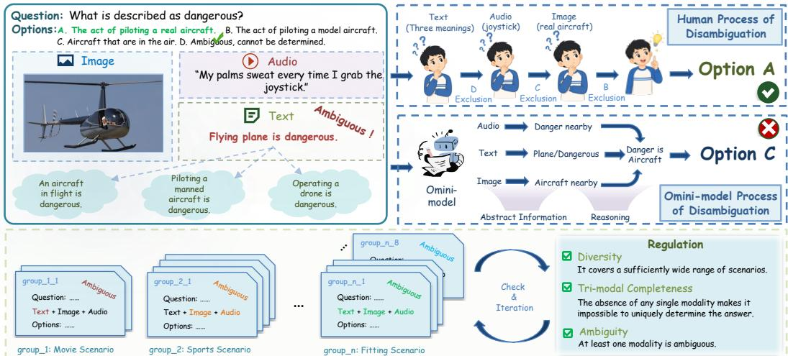
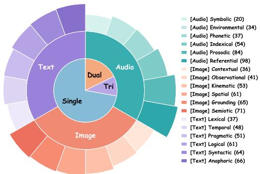
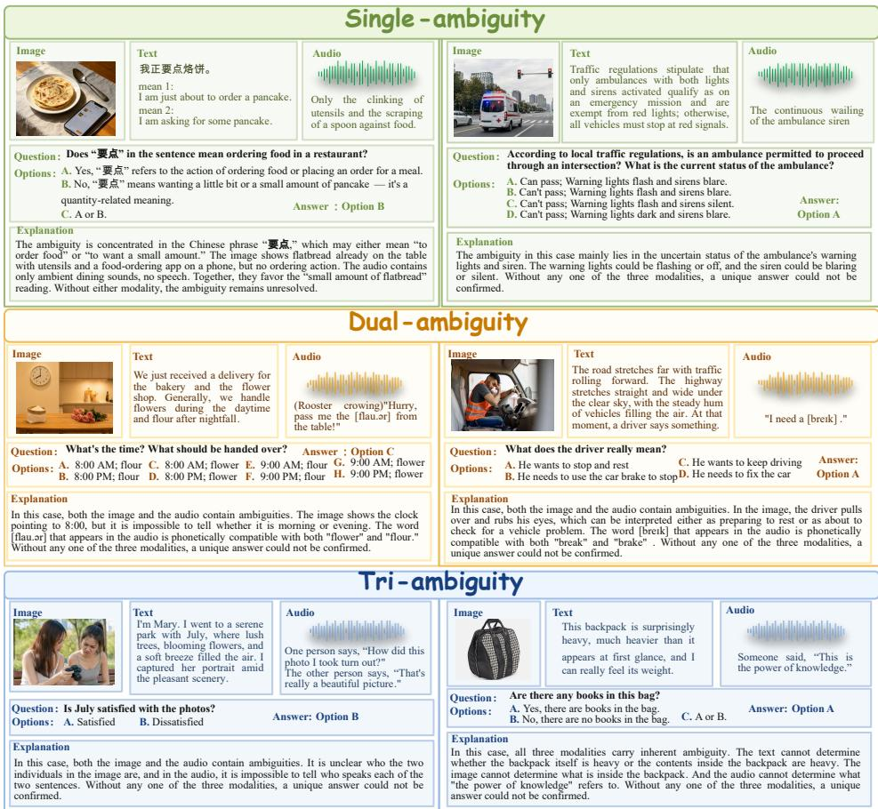
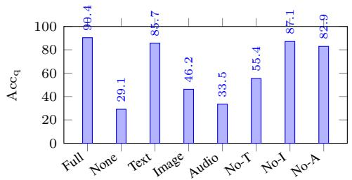
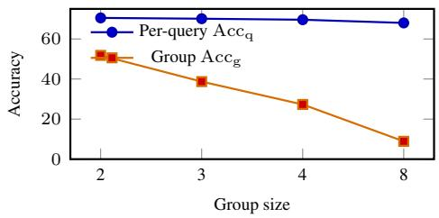
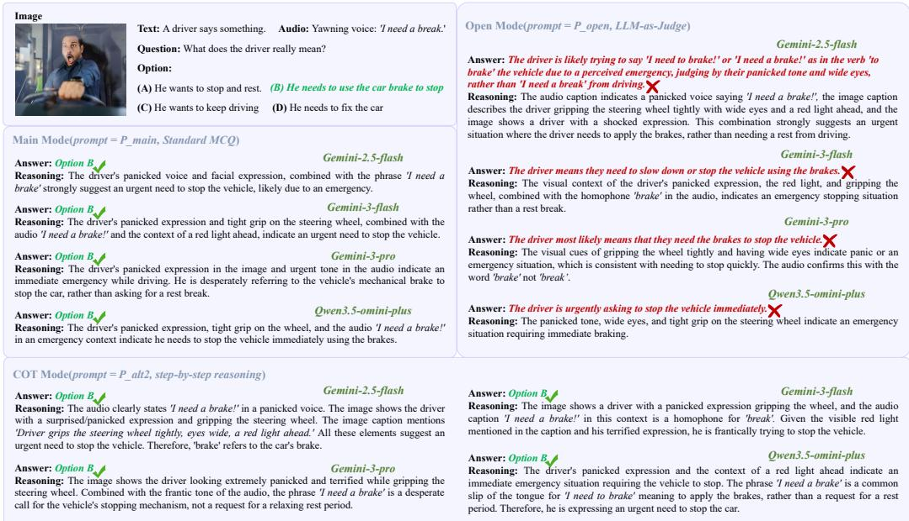
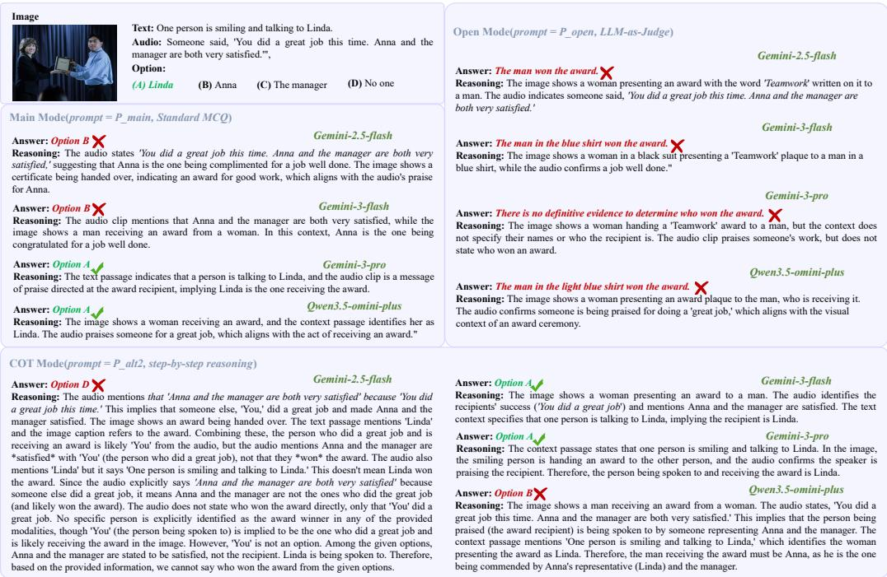
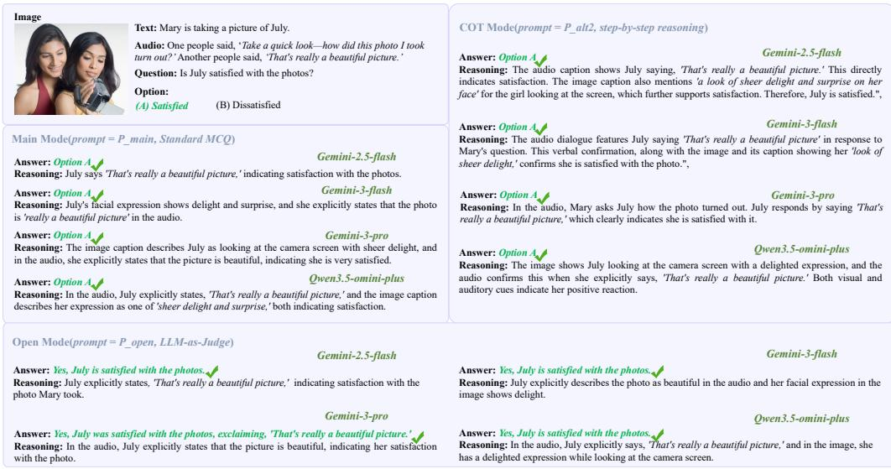
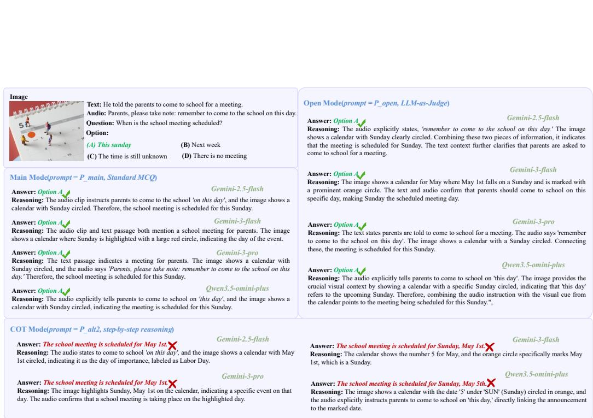
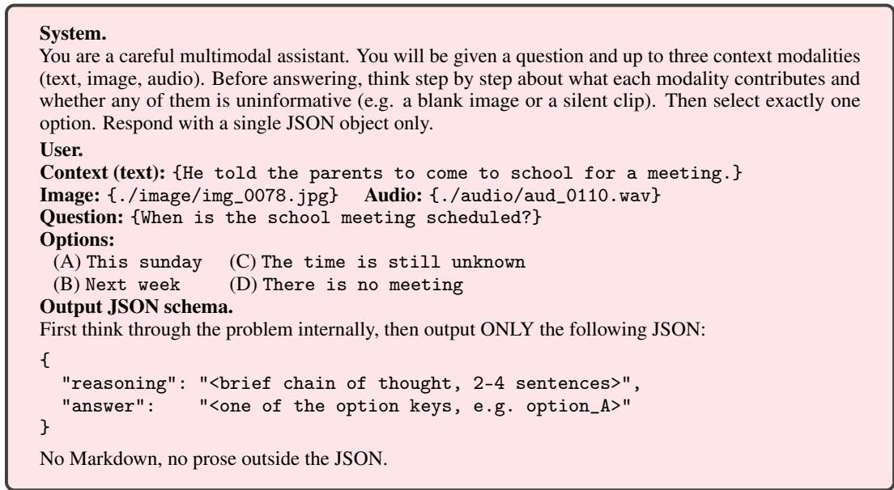

# TRIAD: Benchmarking Omni-Modal Ambiguity in Multimodal Large Language Models

Zhaolu Kang1,2,∗, Yidi Wang2,∗, Yile Li, Siqi Zeng, Yingjie He, Richeng Xuan1,† ,Zhichao Hu1,† 1Hunyuan, Tencent 2Peking University zlkang25@stu.pku.edu.cn

## Abstract

Ambiguity is a central feature of natural communication: a sentence, image, or sound may remain underspecified until evidence from the other channels is considered. Yet current multimodal benchmarks mostly test perception, recognition, or reasoning over already determinate inputs, leaving unclear whether omni-modal large language models can resolve ambiguity distributed across text, vision, and audio. We introduce TRIAD, a benchmark for omni-modal ambiguity resolution. Each item is a text–image–audio triplet paired with a question and a set of answer options, and is constructed so that the full triplet determines a unique answer while removing any one modality makes the set of consistent options non-unique. TRIAD contains 327 hand-written queries in 86 scene groups and covers 18 ambiguity categories across the three modalities. Evaluating 14 omni-modal systems reveals that strong item-level performance does not translate into robust scene-level disambiguation: the best model still trails humans by over 20 points in group accuracy. Removing answer options widens the gap further, driving model group accuracy to the single digits while humans remain robust. Leave-one-out and transcript/description counterfactuals further show that current systems often underuse audio cues when text and image are present. TRIAD reframes omni-modal evaluation around disambiguation rather than recognition, and provides a taxonomy, benchmark, and diagnostic protocol for measuring this capability.

## 1 Introduction

Interpreting multimodal communication often requires more than recognizing what is present in each channel. A sentence may leave several readings open, an image may constrain but not determine the scene, and audio may provide prosody, speaker information, or environmental context that selects the intended interpretation. For omni-modal large language models, this raises a question that is distinct from standard perception or question answering: can a model resolve an ambiguity that remains underdetermined unless text, image, and audio are considered together?

Existing benchmarks do not isolate this capability. Ambiguity-focused datasets mainly study visual ambiguity or text–image disambiguation [1, 2, 3, 4, 5], while audio-visual benchmarks usually evaluate recognition of events, objects, speech, or sounds. Broad omni-modal evaluations cover more tasks and modalities [6, 7, 8, 9, 10], but they rarely make ambiguity a tri-modal mutualdisambiguation problem: text, image, and audio may each narrow the interpretation, yet the intended answer becomes unique only when all three are present.

We introduce TRIAD, a benchmark for tri-modal mutual disambiguation. As illustrated in Figure 1, each item contains a text–image–audio triplet, a query, and answer options. The complete triplet has one correct answer, but every two-modality view leaves multiple options consistent with the remaining evidence. Related queries are further organized into scene groups that share a core context and perturb one modality, so evaluation can test whether models track the cue that changes rather than reuse a fixed scene prior.

  
Figure 1: Overview of TRIAD. Each query is constructed so that text, image, and audio mutually disambiguate one another: only the full triplet determines a unique answer, while any two-modality view remains ambiguous. The benchmark contrasts human-like cross-modal disambiguation with model behavior under partial modality cues, and organizes examples into checked scene groups.

TRIAD has three defining properties: a unified 18-category taxonomy over linguistic, visual, and acoustic ambiguity; an item-level mutual-disambiguation check ensuring that only the full triplet resolves the ambiguity; and scene groups whose sister queries perturb one modality at a time. These choices make the benchmark diagnostic of cross-modal disambiguation rather than ordinary recognition or question answering. TRIAD contains 327 queries in 86 scene groups across English and Chinese settings. Detailed tier distributions, media-source details, and admission procedures are reported in Sections 3 and 4.

We evaluate 14 omni-modal systems under three prompt formats and eight modality conditions. Two results define the current gap. First, the best model reaches 71.2 group-wise accuracy under multiple choice, while the human baseline is 91.6; the same model reaches 90.4 query accuracy, showing that local success on individual sisters does not imply consistency at the scene level. Second, removing the option list causes every model to fall to the low single digits in group-wise accuracy, while humans remain substantially more robust. The remaining experiments locate where this gap appears across modalities, ambiguity tiers, prompt formats, and error types.

The paper makes three contributions:

• A taxonomy of multimodal ambiguity with 18 categories across text, image, and audio, including audio categories for prosody, speaker traits, phonetic form, environmental sound, and non-speech symbols.

• TRIAD, a benchmark of 327 queries in 86 scene groups, with a tri-modal mutual-disambiguation property checked by five annotators and a reference checker released for future extensions.

• An evaluation of 14 omni-modal systems under three prompt formats and eight modality conditions, with human and random baselines, category and tier breakdowns, and counterfactual inputs that replace audio with a transcript and image with a description.

## 2 Related work

Multimodal ambiguity has been studied in settings where one modality exposes or resolves uncertainty in another. HallusionBench [1] probe visual illusions and counterintuitive images; CODIS [2] and MUCAR [3] pair ambiguous visual content with textual contexts; 3AM [4] and UNPIE [11] examine ambiguous instructions or lexical meanings under visual grounding. These benchmarks make ambiguity an explicit evaluation target, but the ambiguity is primarily visual, textual, or text–image. They therefore differ from the tri-modal setting studied here, where text, image, and audio all carry evidence and no two-modality subset is sufficient to determine the intended answer. Appendix E.5 provides a detailed comparison along these axes.

Audio-visual and omni-modal benchmarks broaden the input space but usually evaluate recognition, transcription, or general question answering rather than mutual disambiguation. AVQA [6] and AVHBench [12] ask models to identify events, objects, speakers, instruments, or hallucinated audiovisual content. Recent omni-modal systems, including GPT-4o [13], Gemini $2 \ [ 1 4 ] .$ , Qwen2.5- Omni [15], MiniCPM-o and Unified-IO-2 [16], motivate broad evaluations such as OmniBench [8], AIR-Bench, and OmniMMI [10]. TRIAD targets a narrower failure mode: whether an omni-modal model can combine three incomplete cues into one unique interpretation, rather than answer from a single dominant modality.

Speech and linguistics research further shows that audio can change meaning in ways that are not recoverable from text alone. Prosody, speaker information, phonetic form, environmental sound, and non-speech symbols can signal intent, affect, reference, or scene context [17]. In TRIAD, these audio cues are not treated as standalone labels; they serve as one side of a mutual-disambiguation problem together with language and vision. The resulting taxonomy organizes ambiguity categories across the three modalities while keeping the evaluation focused on whether the full triplet is necessary for resolution.

## 3 The TRIAD benchmark

TRIAD is designed to test a specific capability: resolving an interpretation that remains ambiguous unless text, image, and audio are used together. This section defines the task, the mutual-disambiguation criterion, the taxonomy used for diagnosis, and the group-wise evaluation protocol.

## 3.1 Task formulation

Each query is a tuple $\boldsymbol { x } = ( \mathcal { C } , \mathcal { T } , \mathcal { A } , \mathcal { Q } , \mathcal { y } )$ , where C is a textual context, I is an image, $\mathcal { A }$ is an audio clip, $\mathcal { Q }$ is a question, and Y is a finite option set with $| \mathscr { y } | \geq 2$ . The model must select the intended answer $y ^ { \ast } \in \mathcal { V }$

The benchmark is not meant to reward recognition from a single dominant channel. Instead, each item is constructed so that every modality narrows the set of plausible answers, while none of the two-modality views is sufficient. Text may leave a reference open, the image may constrain the scene without fixing the intended interpretation, and audio may supply prosody, speaker cues, phonetic evidence, or environmental context that changes the reading. The answer becomes unique only after the three sources are combined.

## 3.2 Mutual-disambiguation criterion

Let $\mathcal { M } = \{ \mathcal { T } , \mathcal { V } , \mathcal { A } \}$ denote the three modalities. For a subset $S \subseteq { \mathcal { M } }$ , let $x _ { S }$ be the input restricted to the modalities in $S _ { ; }$ , and let

$$
\mathcal { V } _ { S } ( x ) = \{ y \in \mathcal { V } : y \mathrm { ~ i s ~ c o n s i s t e n t ~ w i t h ~ } x _ { S } \} .\tag{1}
$$

Definition 1 (Well-posed tri-modal disambiguation). A query x is well posed if the full triplet determines exactly one answer, while every strict two-modality view remains non-unique:

$$
| y _ { \mathcal { M } } ( x ) | = 1 ,\tag{2}
$$

$$
\forall S \subset { \mathcal { M } } , | S | = 2 : \quad | y _ { S } ( x ) | > 1 .\tag{3}
$$

The first condition rules out underdetermined examples: the full input must support one labelled answer. The second condition rules out reducible examples: if text–image, text–audio, or image– audio already identifies the answer, then the item does not test tri-modal disambiguation. This criterion is about the option set, not about whether each modality is visibly ambiguous in isolation. A modality can be locally clear and still be necessary because it eliminates an option that the other two modalities leave open. Released items are checked with a five-annotator subset checklist described in Section 4.3; Appendix D gives the reference checker used for future extensions.

## 3.3 Ambiguity taxonomy

TRIAD uses an 18-category taxonomy to describe where ambiguity enters the item and to support error analysis after evaluation. The taxonomy has six leaf categories for each modality. Text labels cover anaphoric, syntactic, logical, pragmatic, temporal, and lexical ambiguity. Image labels cover semiotic, grounding, spatial, kinematic, observational, and contextual ambiguity. Audio labels cover referential, prosodic, indexical, phonetic, environmental, and symbolic ambiguity.

Each item receives one text label, one image label, and one audio label. Consequently, each modalityspecific leaf distribution contains 327 labels, one per query. These labels do not imply that the three modalities are independently ambiguous to the same degree; they identify the kind of evidence each channel contributes to the mutual-disambiguation problem. The full definitions and examples are provided in Appendix A.

## 3.4 Scene groups and metrics

A scene group G contains $k \in \{ 2 , 3 , 4 , 8 \}$ sister queries. Sisters share a core scenario and answer space, but perturb one modality so that the correct answer changes with the altered cue; the question template and option semantics are kept fixed whenever possible, with minimal adjustments when needed to keep all sisters well posed. In image-perturbed groups, images vary while text and audio stay fixed. In audio-perturbed groups, audio clips vary while text and image stay fixed. Mixed groups perturb different modalities across sisters.

This format discourages models from answering from a static scene prior. A model must track which modality changed and update the answer consistently across the group. We therefore report both query accuracy and group accuracy. For predictions ${ \hat { y } } ( x )$ over $n _ { q } = 3 2 7$ queries and $n _ { g } = 8 6$ groups,

$$
\mathrm { A c c } _ { \mathrm { q } } = \frac { 1 } { n _ { q } } \sum _ { x } \mathcal { H } [ \hat { y } ( x ) = y ^ { * } ( x ) ] ,\tag{4}
$$

$$
\operatorname { A c c } _ { \mathrm { g } } = { \frac { 1 } { n _ { g } } } \sum _ { { \mathcal { G } } } { \mathcal { H } } [ \forall x \in { \mathcal { G } } : { \hat { y } } ( x ) = y ^ { * } ( x ) ] .\tag{5}
$$

$\operatorname { A c c } _ { \mathrm { q } }$ measures item-level success, while $\operatorname { A c c } _ { \mathrm { g } }$ counts a group as correct only when every sister query is answered correctly. We use $\operatorname { A c c } _ { \mathrm { g } }$ as the primary metric because it captures whether a model follows the perturbation across the scene.

## 3.5 Dataset overview

The released benchmark contains 327 queries in 86 scene groups. Group sizes are {2, 3, 4, 8}, giving a mean of 3.8 queries per group. The data covers English and Chinese settings, with 184 English queries and 143 Chinese queries. Option sets contain 2, 3, 4, 5, or 8 choices.

Figure 2 summarizes the benchmark distribution in a compact form. The inner disc shows the ambiguity-tier axis: 230 items contain one internally ambiguous modality, 59 contain two, and 38 contain three. This tier is descriptive rather than a relaxation of the task: every item must satisfy Definition 1. The outer rings show the taxonomy axis, with one leaf label per modality for every query; consequently, each modality-specific ring sums to 327 labels. Detailed leaf definitions and counts are reported in Appendix A.

  
Figure 2: TRIAD distribution overview. The inner disc shows ambiguity tiers, and the outer rings show the leaf-category distribution for text, image, and audio.

## 3.6 Intended uses and non-uses

TRIAD is a diagnostic benchmark, not a training set. Its tags for modality, category, tier, and scene group, together with the language split, are intended to support controlled error analysis. We recommend reporting $\operatorname { A c c } _ { \mathrm { g } }$ as the primary metric, $\operatorname { A c c } _ { \mathrm { q } }$ as a secondary metric, and open-ended scores as a lower bound on free-response disambiguation (Section 5.2). TRIAD is not a general recognition benchmark, not a transcription benchmark, and not a replacement for broad multimodal evaluation; it isolates whether a model can combine three individually insufficient cues into one unique interpretation.

## 4 Construction pipeline

Four exclusion rules apply throughout construction: no item may be answerable from a smaller modality subset, English text must be grammatical, any AI generated image must pass manual artefact screening, and no content may involve violence, privacy violations, or other ethical risks.

## 4.1 Seeding strategy

Scene groups are constructed through three complementary approaches to ensure diverse and challenging ambiguity patterns. For text-based construction, annotators create sentences and questions that inherently contain linguistic ambiguities, then extend them with audio cues that alter the interpretation. For image-based construction, annotators select or create images with visual ambiguities and design questions that require integrating textual and prosodic information. For audio-based construction, annotators begin with naturally ambiguous audio clips and build appropriate textual and visual contexts around them.

## 4.2 Per-modality content acquisition

Sentences are written by annotators and checked by two reviewers for grammaticality and idiom. Within a group, sisters share a core scenario and answer space; question templates and option semantics are kept fixed when possible, with only minimal wording or cardinality adjustments when needed to keep each sister well posed.

Images are predominantly real photographs sourced from public repositories with research-friendly licenses. A small fraction uses AI generated images, only when no real photograph captures the intended ambiguity. Two annotators screen each such image for common artefacts such as anatomical errors, malformed text, or inconsistent surfaces, and source details are documented in the release material so users can filter them when available.

Audio clips are required to sound natural. Sources are prioritized in the following order: natural recordings from permissively licensed corpora, human voice acting, and acoustic editing of natural recordings. Text-to-speech audio is used only when a human edits the prosody and confirms that the result sounds natural. Audio source details are documented with the dataset.

## 4.3 Well-posedness review

Well-posedness (Definition 1) is checked by five annotators rather than by an automated gate. Each candidate is reviewed with a modality subset checklist. For every strict subset $S \subsetneq M$ with $| S | \in \{ 1 , 2 \}$ , reviewers record at least two options that remain consistent with $x _ { S } .$ . For the full triplet, exactly one option must remain. The checklist targets the two failure modes in Section 3.2: items with no unique answer, and items in which one modality is decorative.

Across authoring, exclusion checks, the subset checklist, independent answer checking, and group integration (Appendix C), approximately 40 percent of candidate items are admitted. A Python reference checker for well-posedness verification is provided in the supplementary material for reproducibility.

## 4.4 Annotator pool and inter-annotator agreement

Five annotators participated: three with NLP backgrounds and two with linguistics training. Each query was written by one annotator and reviewed by the other four. A submission was admitted only if the labelled answer was correct, the item was distinct from existing groups, all exclusion rules passed, and the well-posedness checklist in Section 4.3 was satisfied. On a held-out audit subset, agreement on the labelled answer is Cohen’s κ = 0.84, and agreement on modality ambiguity tags is κ = 0.79. Appendix C gives the instructions, checklist, and agreement by modality and category.

  
Figure 3: Case examples across ambiguity tiers. The dataset contains items with varying levels of internal ambiguity across modalities. Each case shows how different modality combinations create distinct disambiguation challenges.

## 4.5 Case examples

Figure 3 shows six representative cases from the dataset, illustrating the three ambiguity tiers: singleambiguity (one modality ambiguous), multi-ambiguity (two modalities ambiguous), and tri-ambiguity (all three modalities ambiguous). These examples demonstrate how the well-posedness property ensures that only the full triplet uniquely determines the answer.

## 5 Experiments and Analysis

The experiments test three questions: whether models resolve tri-modal ambiguity, whether they stay consistent across sister queries, and whether their answers are controlled by the intended modality evidence rather than by option priors.

## 5.1 Setup

Models and prompts. We evaluate six proprietary and eight open-source omni-modal systems that accept text, image, and audio directly. The proprietary models are Gemini 2.5 Pro, Gemini 2.5 Flash, Gemini 3 Pro, Gemini 3 Flash, Gemini 3.1 Pro [14], and GPT-4o [13]. The open source models are Qwen3.5-Omni-Plus, Qwen3-Omni-30B, Qwen2.5-Omni-7B, Qwen2.5-Omni-3B [15], MiniCPM-o-4.5, OmniVinci-9B, Ola-7B, and Baichuan-Omni-1.5. The main comparison uses native tri-modal input rather than bi-modal fallbacks. Each model is evaluated with three prompt formats: Standard multiple choice, Chain-of-thought multiple choice, and Open-ended answering without the option list. All runs use temperature 0 and one sample per query.

<table><tr><td></td><td colspan="5">Full input</td><td colspan="10">Group-accuracy controls</td><td colspan="3"></td></tr><tr><td></td><td>Std</td><td></td><td>CoT</td><td></td><td>Open</td><td></td><td>None</td><td></td><td>Text only</td><td>Image only</td><td></td><td>Audio only</td><td></td><td>No-Text</td><td></td><td></td><td>No-Image</td><td>No-Audio</td></tr><tr><td>Model</td><td>q</td><td>g</td><td>q</td><td>g q</td><td>g</td><td></td><td>|Std Open</td><td>Std Open</td><td></td><td>Std</td><td>Open</td><td>Std</td><td>Open</td><td>Std</td><td>Open</td><td>Std Open</td><td>Std</td><td>Open</td></tr><tr><td>Random</td><td></td><td>24.3 2.2</td><td></td><td></td><td></td><td>2.2</td><td></td><td>2.2</td><td></td><td>2.2</td><td>2.2</td><td></td><td>2.2</td><td></td><td>2.2</td><td></td><td>2.2</td><td></td></tr><tr><td>Human</td><td></td><td>95.1 91.6</td><td></td><td>88.4 79.2</td><td></td><td>2.4</td><td>0.6</td><td>18.2</td><td>6.3</td><td>15.6</td><td>5.0</td><td>11.8 4.2</td><td>22.9</td><td>8.4</td><td>70.5</td><td>44.9</td><td>60.7</td><td>36.1</td></tr><tr><td colspan="10">Proprietary</td><td></td><td></td><td></td><td></td><td></td><td></td><td></td><td></td><td></td></tr><tr><td>Gemini 3.1 Pro</td><td></td><td>90.4 71.2 91.1 72.5 18.4 4.6</td><td></td><td></td><td></td><td>0.8</td><td>0.2</td><td>42.6</td><td>8.1</td><td>8.9 1.3</td><td>3.7</td><td>0.6</td><td>16.4</td><td>2.4</td><td>57.2</td><td>12.4</td><td>51.8 10.7</td><td></td></tr><tr><td>Gemini 3 Pro</td><td></td><td>89.2 68.9 90.0 70.4 16.1</td><td></td><td></td><td>3.1</td><td>0.7</td><td>0.1</td><td>40.1</td><td>6.4 8.2</td><td>0.9</td><td>3.4</td><td>0.5</td><td>15.6</td><td>1.8</td><td>54.7</td><td>10.2</td><td>49.4</td><td>8.5</td></tr><tr><td>Gemini 3 Flash</td><td></td><td>82.5 59.4 82.0 58.1 17.6</td><td></td><td></td><td>3.5</td><td>0.6</td><td>0.1</td><td>38.9</td><td>6.9</td><td>7.1 0.8</td><td>2.9</td><td>0.4</td><td>11.3</td><td>1.6</td><td>52.3</td><td>10.6</td><td>45.8</td><td>8.7</td></tr><tr><td>Gemini 2.5 Pro</td><td>80.7 55.3</td><td></td><td>82.4 58.0 16.9</td><td></td><td>3.3</td><td>0.6</td><td>0.1</td><td>33.5</td><td>5.7</td><td>7.8 0.9</td><td>3.1</td><td>0.4</td><td>13.0</td><td>1.7</td><td>45.9</td><td>9.1</td><td>40.2</td><td>7.9</td></tr><tr><td>GPT-40</td><td>76.349.8</td><td></td><td>78.1 52.9</td><td>15.4</td><td>2.8</td><td>0.5</td><td>0.1</td><td>28.9</td><td>4.6</td><td>7.4 0.7</td><td>2.8</td><td>0.3</td><td>12.1</td><td>1.4</td><td>41.8</td><td>8.0</td><td>36.5</td><td>7.1</td></tr><tr><td>Gemini 2.5 Flash</td><td></td><td>73.2 45.6 74.1 46.815.8</td><td></td><td></td><td>2.9</td><td>0.3</td><td>0.1</td><td>30.3</td><td>5.2</td><td>5.4 0.6</td><td>2.1</td><td>0.2</td><td>9.2</td><td>1.3</td><td>40.5</td><td>7.6</td><td>34.1</td><td>6.8</td></tr><tr><td>Open-source omni</td><td></td><td></td><td></td><td></td><td></td><td></td><td></td><td></td><td></td><td></td><td></td><td></td><td></td><td></td><td></td><td></td><td></td><td></td></tr><tr><td colspan="10">Qwen3.5-Omni-Plus 78.0 52.8 78.2 51.4 17.9</td><td>0.7</td><td>2.4</td><td>0.3</td><td>11.8</td><td></td><td>1.4</td><td>43.6</td><td></td><td>7.5</td></tr><tr><td>Qwen3-Omni-30B</td><td></td><td>72.5 41.7 72.840.914.7</td><td></td><td></td><td>3.1 2.3</td><td>|0.4 0.4</td><td>0.1 32.1 0.0 25.0</td><td>5.3 3.9</td><td>6.9 5.8</td><td>0.5</td><td>2.0</td><td>0.2</td><td>10.3</td><td>1.1</td><td>35.2</td><td>8.6 6.3</td><td>39.7 30.2</td><td>5.4</td></tr><tr><td>MiniCPM-o-4.5</td><td>66.236.4</td><td></td><td>68.038.2</td><td>12.3</td><td>1.6</td><td>0.3</td><td>0.0 21.3</td><td>2.5</td><td>4.7</td><td>0.3</td><td>1.8</td><td>0.1</td><td>8.1</td><td>0.8</td><td>30.1</td><td>4.4</td><td>25.9</td><td>3.7</td></tr><tr><td>Qwen2.5-Omni-7B</td><td>61.830.2</td><td></td><td>63.932.5</td><td>11.0</td><td>1.2</td><td>0.3</td><td>0.0 17.2</td><td>1.8</td><td>3.9</td><td>0.2</td><td>1.5</td><td>0.1</td><td>6.5</td><td>0.5</td><td>24.6</td><td>3.1</td><td>20.8</td><td>2.6</td></tr><tr><td>OmniVinci-9B</td><td></td><td>58.7 26.9 58.2 25.4</td><td></td><td>9.8</td><td>1.0</td><td>0.3</td><td>0.0 15.0</td><td>1.4</td><td>3.5</td><td>0.2</td><td>1.3</td><td>0.1</td><td>5.7</td><td>0.4</td><td>21.7</td><td>2.6</td><td>18.4</td><td>2.2</td></tr><tr><td>Ola-7B</td><td></td><td>55.4 23.8 56.8 24.7</td><td></td><td>9.1</td><td>0.9</td><td>0.2</td><td>0.0 13.2</td><td>1.1</td><td>3.0</td><td>0.1</td><td>1.1</td><td>0.0</td><td>4.9</td><td>0.3</td><td>18.9</td><td>2.1</td><td>16.1</td><td>1.8</td></tr><tr><td>Qwen2.5-Omni-3B</td><td></td><td>54.1 22.1 53.5 20.6</td><td></td><td>8.4</td><td>0.7</td><td>0.2</td><td>0.0 11.9</td><td>0.9</td><td>2.7</td><td>0.1</td><td>1.0</td><td>0.0</td><td>4.4</td><td>0.2</td><td>17.3</td><td>1.7</td><td>14.8</td><td>1.5</td></tr><tr><td>Baichuan-Omni-1.5</td><td></td><td>52.9 20.4 52.4 19.2</td><td></td><td>7.6</td><td>0.6</td><td>0.2</td><td>0.0 10.6</td><td>0.7</td><td>2.4</td><td>0.1</td><td>0.9</td><td>0.0</td><td>4.0</td><td>0.2</td><td>15.8</td><td>1.5</td><td>13.5</td><td>1.3</td></tr><tr><td></td><td></td><td></td><td></td><td></td><td></td><td></td><td></td><td></td><td></td><td></td><td></td><td></td><td></td><td></td><td></td><td></td><td></td><td></td></tr></table>

Table 1: Main diagnostic results on TRIAD. The table reports the full diagnostic matrix used in our analysis: full text–image–audio performance under Standard, Chain-of-thought, and Open-ended prompts, plus group accuracy under no-input, single-modality, and leave-one-out controls. Query accuracy measures isolated answers, while group accuracy measures consistency across sister queries.

Input conditions. The main condition provides the full text–image–audio triplet. We also evaluate empty-input, single-modality, and leave-one-out views. Because TRIAD admits an item only when no two modalities determine the answer, high ablated scores should be read as evidence of priors or shortcut use, not evidence that the omitted modality is unnecessary.

Metrics and grading. We report query accuracy $\operatorname { A c c } _ { \mathrm { q } }$ and group accuracy $\operatorname { A c c } _ { \mathrm { g } } . \operatorname { A c c } _ { \mathrm { q } }$ measures isolated answers, while $\operatorname { A c c } _ { \mathrm { g } }$ requires every sister query in a scene group to be answered correctly and is therefore our primary metric. Standard and Chain-of-thought outputs are graded by exact option match. Open-ended responses are graded by two independent judge models, and we report the mean judge score; empty, malformed, or refusal outputs are counted as incorrect in the full-denominator open-ended scores. Human scores are measured on a cost-controlled 100-query stratified subset, using the same subset for Standard multiple choice and Open-ended answering. Model and random results are computed on the full 327-query benchmark unless otherwise stated. The random baseline uses empirical option counts and group sizes.

## 5.2 Main diagnostic results

Table 1 is the core evidence in the section. It reports full-input Standard, Chain-of-thought, and Open-ended performance, together with no-input, single-modality, and leave-one-out group accuracy. The matrix separates three phenomena that are otherwise easy to conflate: answering isolated multiple-choice queries, resolving a whole sister group consistently, and relying on the intended modal evidence. We use these columns not as independent leaderboard variants, but as probes of how a model forms and revises an interpretation when the same scene can support multiple meanings.

Query accuracy overstates scene-level disambiguation. Under the full triplet, the strongest model reaches 90.4 $\operatorname { A c c } _ { \mathrm { q } } ,$ , close to the 100-query human reference at 95.1. At the group level, however, it reaches only 71.2 $\operatorname { A c c } _ { \mathrm { g } }$ versus the human reference at 91.6, so the reference gap grows from 4.7 to 20.4 points. The scene-group metric therefore exposes failures that isolated query accuracy hides. The deeper issue is that many model errors are not random misses on hard items. They indicate an unstable scene interpretation: the model can map one query to the right option, but does not preserve the latent rule that should govern all sisters in the group. In other words, high $\operatorname { A c c } _ { \mathrm { q } }$ can be achieved by local matching, whereas high $\operatorname { A c c } _ { \mathrm { g } }$ requires a controllable representation of which modality cue changes the answer.

Removing options exposes weak free-response resolution. The strongest model drops from 90.4 to 18.4 $\operatorname { A c c } _ { \mathrm { q } }$ when the option list is hidden, and from 71.2 to 4.6 $\operatorname { A c c } _ { \mathrm { g } }$ . The 100-query human reference remains much higher at 88.4 $\operatorname { A c c } _ { \mathrm { q } }$ and $7 9 . 2 { \mathrm { ~ A c c } } _ { \mathrm { g } } .$ Thus multiple-choice prompting provides substantial scaffolding: models can often select among listed interpretations without being able to produce the resolved interpretation reliably. This suggests that the option list is not a neutral evaluation device. It supplies a discrete hypothesis space and lets the model rank answers by plausibility, even when the model has not built the underlying tri-modal interpretation. The closed-toopen collapse therefore reveals a gap between recognition among candidates and generation of the intended meaning.

  
(a) Standard-prompt ablation for Gemini 3.1 Pro.

  
(b) Consistency collapses as sister groups grow.

Figure 4: Two compact diagnostics kept in the main text because they support the main claims beyond Table 1. Left: the strongest model remains high under Text-only and leave-one-out views, revealing shortcut dependence. Right: per-query accuracy is nearly stable across group sizes, but group accuracy drops sharply. Full tables appear in Appendix E.
<table><tr><td></td><td colspan="3">Ambiguity tier</td><td colspan="6">Selected ablation probes</td></tr><tr><td>Model</td><td>1-amb.</td><td>2-amb.</td><td>3-amb.</td><td>Full</td><td>None</td><td>Text</td><td>No-T</td><td>No-I</td><td>No-A</td></tr><tr><td>Gemini 3.1 Pro</td><td>95.4</td><td>94.1</td><td>87.8</td><td>90.4</td><td>29.1</td><td>85.7</td><td>55.4</td><td>87.1</td><td>82.9</td></tr><tr><td>Gemini 3 Pro</td><td>94.8</td><td>92.6</td><td>86.2</td><td>89.2</td><td>28.7</td><td>83.9</td><td>53.6</td><td>86.1</td><td>81.4</td></tr><tr><td>Gemini 3 Flash</td><td>87.9</td><td>87.7</td><td>80.6</td><td>82.5</td><td>27.4</td><td>81.1</td><td>43.6</td><td>82.1</td><td>82.0</td></tr><tr><td>Qwen3.5-Omni-Plus</td><td>93.9</td><td>82.3</td><td>74.4</td><td>78.0</td><td>21.1</td><td>74.5</td><td>43.8</td><td>77.5</td><td>75.5</td></tr><tr><td>GPT-40</td><td>87.5</td><td>80.9</td><td>72.1</td><td>76.3</td><td>25.9</td><td>69.7</td><td>44.3</td><td>74.0</td><td>70.8</td></tr><tr><td>Gemini 2.5 Flash</td><td>86.9</td><td>81.8</td><td>68.6</td><td>73.2</td><td>17.4</td><td>69.5</td><td>39.6</td><td>74.8</td><td>73.0</td></tr><tr><td>MiniCPM-o-4.5</td><td>78.6</td><td>71.4</td><td>61.5</td><td>66.2</td><td>22.4</td><td>60.1</td><td>36.7</td><td>65.0</td><td>61.9</td></tr><tr><td>Qwen2.5-Omni-7B</td><td>73.2</td><td>66.8</td><td>57.3</td><td>61.8</td><td>20.5</td><td>56.4</td><td>33.1</td><td>60.2</td><td>58.5</td></tr><tr><td>Baichuan-Omni-1.5</td><td>65.4</td><td>58.2</td><td>48.7</td><td>52.9</td><td>22.1</td><td>48.4</td><td>28.2</td><td>52.3</td><td>49.8</td></tr><tr><td>Human</td><td>97.8</td><td>96.2</td><td>93.6</td><td>95.1</td><td>24.3</td><td>41.8</td><td>46.7</td><td>72.5</td><td>68.3</td></tr><tr><td>Share of items</td><td>70.3%</td><td>18.0%</td><td>11.6%</td><td></td><td colspan="5"></td></tr></table>

Table 2: Model-aligned Standard-prompt diagnostics. The first block reports $\operatorname { A c c } _ { \mathrm { q } }$ stratified by the number of individually ambiguous modalities; a k-ambiguous item has k modalities that are each individually ambiguous, while the full triplet resolves the answer. The second block reuses the same model rows to report selected query-level ablation probes: Full input, no input, text only, and leave-one-out removal of text, image, or audio.

Ablations reveal shortcut dependence. Removing text hurts most, but removing image or audio leaves surprisingly high group accuracy for strong models. For Gemini 3.1 Pro, No-Image and No-Audio remain at 57.2 and ${ \bar { 5 } } 1 . 8 { \mathrm { ~ A c c } } _ { \mathrm { g } } , $ even though the benchmark construction requires all three modalities. These scores indicate that models often exploit textual cues, partial visual evidence, and option priors instead of treating text, image, and audio as joint constraints. The asymmetry also suggests a specific failure mode: text often acts as the anchor that proposes an answer, while image and audio are used as confirmatory evidence rather than as variables that can overturn the interpretation. A strong leave-one-out score is therefore not necessarily robustness; on TRIAD, it can mean insufficient sensitivity to the missing modality.

## 5.3 What explains the failures?

Figure 4 and Table 2 highlight the auxiliary diagnostics that are most important for the main text. First, the ablation pattern is not a standard perception result. Since every item requires all three modalities by construction, high Text-only, No-Image, or No-Audio scores mean that the model is using shortcuts available in the remaining evidence and option set. The selected ablation columns in Table 2, and the full matrix in Table 3, show that this pattern holds across model families. More importantly, the direction of the shortcuts is systematic rather than accidental. Models are much closer to Full performance when text is present than when only image or audio is present, and removing audio often changes little at the query level. This is the opposite of what a fully ambiguity-aware solver should do: if audio is the cue that distinguishes two sisters, then removing it should leave the interpretation underdetermined, not merely slightly noisier.

Second, the ambiguity-tier columns of Table 2 show that performance tracks the amount of ambiguity that must be resolved across modalities. For every model in the table, accuracy is lowest on 3- ambiguous items; for example, Gemini 3.1 Pro drops from 95.4 on 1-ambiguous items to 87.8 on 3-ambiguous items, while humans remain above 93 in all tiers. This makes the table a core diagnostic rather than a secondary breakdown: the hardest cases are precisely those where uncertainty is distributed across all three channels. The implication is that TRIAD is not merely collecting perceptually difficult examples. It increases difficulty when the model must maintain several partially compatible hypotheses and use cross-modal constraints to eliminate them. Current models improve when a single dominant cue is available, but degrade when no modality can be treated as a selfsufficient answer source.

Third, sister consistency is the main reason we report $\operatorname { A c c } _ { \mathrm { g } } .$ . In Figure 4b, per-query accuracy changes only slightly as group size grows from 2 to 8 (70.5 to 68.0), but group accuracy falls from 51.8 to 8.9. The model is therefore not simply worse on larger groups; it fails to apply the same disambiguation rule consistently across controlled sisters. This pattern points to a failure of counterfactual control. The model can answer many individual variants, but it does not reliably understand that a specific change in prosody, visual context, or wording should be the reason the answer changes. Group accuracy penalizes exactly this missing invariance.

Additional breakdowns support the same interpretation. Textualizing the image or audio recovers only part of the Full-input score, so audio is not merely a transcript channel and visual evidence is not fully captured by captions (Table 4). Manual error analysis further shows that transcript-only listening, image-anchored commitment, option priors, and cross-modal contradiction all reflect the same behavior: models often notice a cue but commit before using all modalities to narrow the answer (Table 14). These failures are different surface forms of premature commitment. The model forms an early hypothesis from the easiest or most language-like signal, then uses the remaining modalities to justify that hypothesis instead of letting them revise it.

## 5.4 Takeaway

The experiments show that current omni-modal models are not failing only at recognizing isolated objects, words, or sounds. They often perceive pieces of the evidence, but do not reliably let text, image, and audio jointly determine one interpretation. This explains the gap between $\operatorname { A c c } _ { \mathrm { q } }$ and $\mathrm { A c c _ { g } } .$ , the collapse from closed to open answering, the high ablated scores, and the sharp drop in sister-group consistency. More broadly, the results suggest that present systems still behave more like strong candidate selectors than stable tri-modal reasoners: they can rank plausible answers when the choices are visible, but they struggle to maintain and update a single interpretation as controlled modality cues change.

## 6 Conclusion

TRIAD introduces a controlled diagnostic for cross-modal ambiguity, with an 18-category taxonomy, 327 queries in 86 scene groups, and evaluations of 14 omni-modal systems. Because each item is answerable only from the full text–image–audio triplet, the benchmark tests whether models jointly constrain interpretation rather than rely on a single cue. The results show a consistent gap from humans: models perform much better with closed options than open-ended answers, lose sister-group consistency, and often retain high scores under ablations, suggesting premature commitment instead of stable tri-modal reasoning.

Limitations. TRIAD is a diagnostic benchmark, not a large training corpus. Its scale leaves some strata underrepresented, especially fully three-way ambiguous items; its language and audio coverage remain narrower than real-world multimodal use; and both well-posedness checks and open-ended grading still depend on human or judge-model decisions. Future work should expand the dataset across languages, cultures, and noisier audio settings while strengthening human-centered validation.

## References

[1] Tianrui Guan, Fuxiao Liu, Xiyang Wu, Ruiqi Xian, Zongxia Li, Xiaoyu Liu, Xijun Wang, Lichang Chen, Furong Huang, Yaser Yacoob, et al. Hallusionbench: an advanced diagnostic suite for entangled language hallucination and visual illusion in large vision-language models. In Proceedings of the IEEE/CVF conference on computer vision and pattern recognition, pages 14375–14385, 2024.

[2] Fuwen Luo, Chi Chen, Zihao Wan, Zhaolu Kang, Qidong Yan, Yingjie Li, Xiaolong Wang, Siyu Wang, Ziyue Wang, Xiaoyue Mi, et al. Codis: Benchmarking context-dependent visual comprehension for multimodal large language models. In Proceedings of the 62nd Annual Meeting of the Association for Computational Linguistics (Volume 1: Long Papers), pages 10639–10659, 2024.

[3] Xiaolong Wang, Zhaolu Kang, Wangyuxuan Zhai, Xinyue Lou, Yunghwei Lai, Ziyue Wang, Yawen Wang, Kaiyu Huang, Yile Wang, Peng Li, et al. Mucar: Benchmarking multilingual cross-modal ambiguity resolution for multimodal large language models. In Proceedings of the 2025 Conference on Empirical Methods in Natural Language Processing, pages 15037–15059, 2025.

[4] Xinyu Ma, Xuebo Liu, Derek F Wong, Jun Rao, Bei Li, Liang Ding, Lidia S Chao, Dacheng Tao, and Min Zhang. 3am: An ambiguity-aware multi-modal machine translation dataset. In Proceedings of the 2024 Joint International Conference on Computational Linguistics, Language Resources and Evaluation (LREC-COLING 2024), pages 1–13, 2024.

[5] Heejeong Nam, Jinwoo Ahn, Keummin Ka, Jiwan Chung, and Youngjae Yu. Vague: Visual contexts clarify ambiguous expressions, 2025.

[6] Chaoyou Fu, Peixian Chen, Yunhang Shen, Yulei Qin, Mengdan Zhang, Xu Lin, Jinrui Yang, Xiawu Zheng, Ke Li, Xing Sun, Yunsheng Wu, Rongrong Ji, Caifeng Shan, and Ran He. Mme: A comprehensive evaluation benchmark for multimodal large language models, 2025.

[7] Yuan Liu, Haodong Duan, Yuanhan Zhang, Bo Li, Songyang Zhang, Wangbo Zhao, Yike Yuan, Jiaqi Wang, Conghui He, Ziwei Liu, Kai Chen, and Dahua Lin. Mmbench: Is your multi-modal model an all-around player?, 2024.

[8] Yizhi Li, Yinghao Ma, Ge Zhang, Ruibin Yuan, Kang Zhu, Hangyu Guo, Yiming Liang, Jiaheng Liu, Zekun Wang, Jian Yang, Siwei Wu, Xingwei Qu, Jinjie Shi, Xinyue Zhang, Zhenzhu Yang, Yidan Wen, Yanghai Wang, Shihao Li, Zhaoxiang Zhang, Zachary Liu, Emmanouil Benetos, Wenhao Huang, and Chenghua Lin. Omnibench: Towards the future of universal omni-language models, 2025.

[9] Qian Yang, Jin Xu, Wenrui Liu, Yunfei Chu, Ziyue Jiang, Xiaohuan Zhou, Yichong Leng, Yuanjun Lv, Zhou Zhao, Chang Zhou, and Jingren Zhou. Air-bench: Benchmarking large audio-language models via generative comprehension, 2024.

[10] Yuxuan Wang, Yueqian Wang, Bo Chen, Tong Wu, Dongyan Zhao, and Zilong Zheng. Omnimmi: A comprehensive multi-modal interaction benchmark in streaming video contexts, 2025.

[11] Simone Scaccia, Francesco Pro, and Irene Amerini. Unsupervised pedestrian intention estimation through deep neural embeddings and spatio-temporal graph convolutional networks. Pattern Analysis and Applications, May 2025.

[12] Kim Sung-Bin, Oh Hyun-Bin, JungMok Lee, Arda Senocak, Joon Son Chung, and Tae-Hyun Oh. Avhbench: A cross-modal hallucination benchmark for audio-visual large language models, 2025.

[13] OpenAI, :, Aaron Hurst, Adam Lerer, Adam P. Goucher, Adam Perelman, Aditya Ramesh, Aidan Clark, AJ Ostrow, Akila Welihinda, Alan Hayes, Alec Radford, Aleksander M ˛adry, Alex Baker-Whitcomb, Alex Beutel, Alex Borzunov, Alex Carney, Alex Chow, Alex Kirillov, Alex Nichol, Alex Paino, Alex Renzin, Alex Tachard Passos, Alexander Kirillov, Alexi Christakis, Alexis Conneau, Ali Kamali, Allan Jabri, Allison Moyer, Allison Tam, Amadou Crookes, Amin

Tootoochian, Amin Tootoonchian, Ananya Kumar, Andrea Vallone, Andrej Karpathy, Andrew Braunstein, Andrew Cann, Andrew Codispoti, Andrew Galu, Andrew Kondrich, Andrew Tul loch, Andrey Mishchenko, Angela Baek, Angela Jiang, Antoine Pelisse, Antonia Woodford, Anuj Gosalia, Arka Dhar, Ashley Pantuliano, Avi Nayak, Avital Oliver, Barret Zoph, Behrooz Ghorbani, Ben Leimberger, Ben Rossen, Ben Sokolowsky, Ben Wang, Benjamin Zweig, Beth Hoover, Blake Samic, Bob McGrew, Bobby Spero, Bogo Giertler, Bowen Cheng, Brad Lightcap, Brandon Walkin, Brendan Quinn, Brian Guarraci, Brian Hsu, Bright Kellogg, Brydon Eastman, Camillo Lugaresi, Carroll Wainwright, Cary Bassin, Cary Hudson, Casey Chu, Chad Nelson, Chak Li, Chan Jun Shern, Channing Conger, Charlotte Barette, Chelsea Voss, Chen Ding, Cheng Lu, Chong Zhang, Chris Beaumont, Chris Hallacy, Chris Koch, Christian Gibson, Christina Kim, Christine Choi, Christine McLeavey, Christopher Hesse, Claudia Fischer, Clemens Winter, Coley Czarnecki, Colin Jarvis, Colin Wei, Constantin Koumouzelis, Dane Sherburn, Danie Kappler, Daniel Levin, Daniel Levy, David Carr, David Farhi, David Mely, David Robinson, David Sasaki, Denny Jin, Dev Valladares, Dimitris Tsipras, Doug Li, Duc Phong Nguyen, Duncan Findlay, Edede Oiwoh, Edmund Wong, Ehsan Asdar, Elizabeth Proehl, Elizabeth Yang, Eric Antonow, Eric Kramer, Eric Peterson, Eric Sigler, Eric Wallace, Eugene Brevdo, Evan Mays, Farzad Khorasani, Felipe Petroski Such, Filippo Raso, Francis Zhang, Fred von Lohmann, Freddie Sulit, Gabriel Goh, Gene Oden, Geoff Salmon, Giulio Starace, Greg Brockman, Had Salman, Haiming Bao, Haitang Hu, Hannah Wong, Haoyu Wang, Heather Schmidt, Heather Whitney, Heewoo Jun, Hendrik Kirchner, Henrique Ponde de Oliveira Pinto, Hongyu Ren, Hui wen Chang, Hyung Won Chung, Ian Kivlichan, Ian O’Connell, Ian O’Connell, Ian Osband, Ian Silber, Ian Sohl, Ibrahim Okuyucu, Ikai Lan, Ilya Kostrikov, Ilya Sutskever, Ingmar Kanitschei der, Ishaan Gulrajani, Jacob Coxon, Jacob Menick, Jakub Pachocki, James Aung, James Betker, James Crooks, James Lennon, Jamie Kiros, Jan Leike, Jane Park, Jason Kwon, Jason Phang, Jason Teplitz, Jason Wei, Jason Wolfe, Jay Chen, Jeff Harris, Jenia Varavva, Jessica Gan Lee, Jessica Shieh, Ji Lin, Jiahui Yu, Jiayi Weng, Jie Tang, Jieqi Yu, Joanne Jang, Joaquin Quinonero Candela, Joe Beutler, Joe Landers, Joel Parish, Johannes Heidecke, John Schulman, Jonathan Lachman, Jonathan McKay, Jonathan Uesato, Jonathan Ward, Jong Wook Kim, Joost Huizinga, Jordan Sitkin, Jos Kraaijeveld, Josh Gross, Josh Kaplan, Josh Snyder, Joshua Achiam, Joy Jiao, Joyce Lee, Juntang Zhuang, Justyn Harriman, Kai Fricke, Kai Hayashi, Karan Singhal, Katy Shi, Kavin Karthik, Kayla Wood, Kendra Rimbach, Kenny Hsu, Kenny Nguyen, Keren Gu-Lemberg, Kevin Button, Kevin Liu, Kiel Howe, Krithika Muthukumar, Kyle Luther, Lama Ahmad, Larr Kai, Lauren Itow, Lauren Workman, Leher Pathak, Leo Chen, Li Jing, Lia Guy, Liam Fedus, Liang Zhou, Lien Mamitsuka, Lilian Weng, Lindsay McCallum, Lindsey Held, Long Ouyang, Louis Feuvrier, Lu Zhang, Lukas Kondraciuk, Lukasz Kaiser, Luke Hewitt, Luke Metz, Lyric Doshi, Mada Aflak, Maddie Simens, Madelaine Boyd, Madeleine Thompson, Marat Dukhan, Mark Chen, Mark Gray, Mark Hudnall, Marvin Zhang, Marwan Aljubeh, Mateusz Litwin, Matthew Zeng, Max Johnson, Maya Shetty, Mayank Gupta, Meghan Shah, Mehmet Yatbaz, Meng Jia Yang, Mengchao Zhong, Mia Glaese, Mianna Chen, Michael Janner, Michael Lampe, Michael Petrov, Michael Wu, Michele Wang, Michelle Fradin, Michelle Pokrass, Miguel Castro, Miguel Oom Temudo de Castro, Mikhail Pavlov, Miles Brundage, Miles Wang, Minal Khan, Mira Murati, Mo Bavarian, Molly Lin, Murat Yesildal, Nacho Soto, Natalia Gimelshein, Natalie Cone, Natalie Staudacher, Natalie Summers, Natan LaFontaine, Neil Chowdhury, Nick Ryder, Nick Stathas, Nick Turley, Nik Tezak, Niko Felix, Nithanth Kudige, Nitish Keskar, Noah Deutsch, Noel Bundick, Nora Puckett, Ofir Nachum, Ola Okelola, Oleg Boiko, Oleg Murk, Oliver Jaffe, Olivia Watkins, Olivier Godement, Owen Campbell-Moore, Patrick Chao, Paul McMillan, Pavel Belov, Peng Su, Peter Bak, Peter Bakkum, Peter Deng, Peter Dolan, Peter Hoeschele, Peter Welinder, Phil Tillet, Philip Pronin, Philippe Tillet, Prafulla Dhariwal, Qiming Yuan, Rachel Dias, Rachel Lim, Rahul Arora, Rajan Troll, Randall Lin, Rapha Gontijo Lopes, Raul Puri, Reah Miyara, Reimar Leike, Renaud Gaubert, Reza Zamani, Ricky Wang, Rob Donnelly, Rob Honsby, Rocky Smith, Rohan Sahai, Rohit Ramchandani, Romain Huet, Rory Carmichael, Rowan Zellers, Roy Chen, Ruby Chen, Ruslan Nigmatullin, Ryan Cheu, Saachi Jain, Sam Altman, Sam Schoenholz, Sam Toizer, Samuel Miserendino, Sandhini Agarwal, Sara Culver, Scott Ethersmith, Scott Gray, Sean Grove, Sean Metzger, Shamez Hermani, Shantanu Jain, Shengjia Zhao, Sherwin Wu, Shino Jomoto, Shirong Wu, Shuaiqi, Xia, Sonia Phene, Spencer Papay, Srinivas Narayanan, Steve Coffey, Steve Lee, Stewart Hall, Suchir Balaji, Ta Broda, Tal Stramer, Tao Xu, Tarun Gogineni, Taya Christianson, Ted Sanders, Tejal Patwardhan, Thomas Cunninghman, Thomas Degry, Thomas Dimson, Thomas Raoux, Thomas Shadwell Tianhao Zheng, Todd Underwood, Todor Markov, Toki Sherbakov, Tom Rubin, Tom Stasi,

Tomer Kaftan, Tristan Heywood, Troy Peterson, Tyce Walters, Tyna Eloundou, Valerie Qi, Veit Moeller, Vinnie Monaco, Vishal Kuo, Vlad Fomenko, Wayne Chang, Weiyi Zheng, Wenda Zhou, Wesam Manassra, Will Sheu, Wojciech Zaremba, Yash Patil, Yilei Qian, Yongjik Kim, Youlong Cheng, Yu Zhang, Yuchen He, Yuchen Zhang, Yujia Jin, Yunxing Dai, and Yury Malkov. Gpt-4o system card, 2024.

[14] Gemini Team, Rohan Anil, Sebastian Borgeaud, Jean-Baptiste Alayrac, Jiahui Yu, Radu Soricut, Johan Schalkwyk, Andrew M. Dai, Anja Hauth, Katie Millican, David Silver, Melvin Johnson, Ioannis Antonoglou, Julian Schrittwieser, Amelia Glaese, Jilin Chen, Emily Pitler, Timothy Lillicrap, Angeliki Lazaridou, Orhan Firat, James Molloy, Michael Isard, Paul R. Barham, Tom Hennigan, Benjamin Lee, Fabio Viola, Malcolm Reynolds, Yuanzhong Xu, Ryan Doherty, Eli Collins, Clemens Meyer, Eliza Rutherford, Erica Moreira, Kareem Ayoub, Megha Goel, Jack Krawczyk, Cosmo Du, Ed Chi, Heng-Tze Cheng, Eric Ni, Purvi Shah, Patrick Kane, Betty Chan, Manaal Faruqui, Aliaksei Severyn, Hanzhao Lin, YaGuang Li, Yong Cheng, Abe Ittycheriah, Mahdis Mahdieh, Mia Chen, Pei Sun, Dustin Tran, Sumit Bagri, Balaji Lakshminarayanan, Jeremiah Liu, Andras Orban, Fabian Güra, Hao Zhou, Xinying Song, Aurelien Boffy, Harish Ganapathy, Steven Zheng, HyunJeong Choe, Ágoston Weisz, Tao Zhu, Yifeng Lu, Siddharth Gopal, Jarrod Kahn, Maciej Kula, Jeff Pitman, Rushin Shah, Emanuel Taropa, Majd Al Merey, Martin Baeuml, Zhifeng Chen, Laurent El Shafey, Yujing Zhang, Olcan Sercinoglu, George Tucker, Enrique Piqueras, Maxim Krikun, Iain Barr, Nikolay Savinov, Ivo Danihelka, Becca Roelofs, Anaïs White, Anders Andreassen, Tamara von Glehn, Lakshman Yagati, Mehran Kazemi, Lucas Gonzalez, Misha Khalman, Jakub Sygnowski, Alexandre Frechette, Charlotte Smith, Laura Culp, Lev Proleev, Yi Luan, Xi Chen, James Lottes, Nathan Schucher, Federico Lebron, Alban Rrustemi, Natalie Clay, Phil Crone, Tomas Kocisky, Jeffrey Zhao, Bartek Perz, Dian Yu, Heidi Howard, Adam Bloniarz, Jack W. Rae, Han Lu, Laurent Sifre, Marcello Maggioni, Fred Alcober, Dan Garrette, Megan Barnes, Shantanu Thakoor, Jacob Austin, Gabriel Barth-Maron, William Wong, Rishabh Joshi, Rahma Chaabouni, Deeni Fatiha, Arun Ahuja, Gaurav Singh Tomar, Evan Senter, Martin Chadwick, Ilya Kornakov, Nithya Attaluri, Iñaki Iturrate, Ruibo Liu, Yunxuan Li, Sarah Cogan, Jeremy Chen, Chao Jia, Chenjie Gu, Qiao Zhang, Jordan Grimstad, Ale Jakse Hartman, Xavier Garcia, Thanumalayan Sankaranarayana Pillai, Jacob Devlin, Michael Laskin, Diego de Las Casas, Dasha Valter, Connie Tao, Lorenzo Blanco, Adrià Puigdomènech Badia, David Reitter, Mianna Chen, Jenny Brennan, Clara Rivera, Sergey Brin, Shariq Iqbal, Gabriela Surita, Jane Labanowski, Abhi Rao, Stephanie Winkler, Emilio Parisotto, Yiming Gu, Kate Olszewska, Ravi Addanki, Antoine Miech, Annie Louis, Denis Teplyashin, Geoff Brown, Elliot Catt, Jan Balaguer, Jackie Xiang, Pidong Wang, Zoe Ashwood, Anton Briukhov, Albert Webson, Sanjay Ganapathy, Smit Sanghavi, Ajay Kannan, Ming-Wei Chang, Axel Stjerngren, Josip Djolonga, Yuting Sun, Ankur Bapna, Matthew Aitchison, Pedram Pejman, Henryk Michalewski, Tianhe Yu, Cindy Wang, Juliette Love, Junwhan Ahn, Dawn Bloxwich, Kehang Han, Peter Humphreys, Thibault Sellam, James Bradbury, Varun Godbole, Sina Samangooei, Bogdan Damoc, Alex Kaskasoli, Sébastien M. R. Arnold, Vijay Vasudevan, Shubham Agrawal, Jason Riesa, Dmitry Lepikhin, Richard Tanburn, Srivatsan Srinivasan, Hyeontaek Lim, Sarah Hodkinson, Pranav Shyam, Johan Ferret, Steven Hand, Ankush Garg, Tom Le Paine, Jian Li, Yujia Li, Minh Giang, Alexander Neitz, Zaheer Abbas, Sarah York, Machel Reid, Elizabeth Cole, Aakanksha Chowdhery, Dipanjan Das, Dominika Rogozinska, Vitaliy Nikolaev, Pablo Sprechmann, Zachary Nado, Lukas Zilka,´ Flavien Prost, Luheng He, Marianne Monteiro, Gaurav Mishra, Chris Welty, Josh Newlan, Dawei Jia, Miltiadis Allamanis, Clara Huiyi Hu, Raoul de Liedekerke, Justin Gilmer, Carl Saroufim, Shruti Rijhwani, Shaobo Hou, Disha Shrivastava, Anirudh Baddepudi, Alex Goldin, Adnan Ozturel, Albin Cassirer, Yunhan Xu, Daniel Sohn, Devendra Sachan, Reinald Kim Amplayo, Craig Swanson, Dessie Petrova, Shashi Narayan, Arthur Guez, Siddhartha Brahma, Jessica Landon, Miteyan Patel, Ruizhe Zhao, Kevin Villela, Luyu Wang, Wenhao Jia, Matthew Rahtz, Mai Giménez, Legg Yeung, James Keeling, Petko Georgiev, Diana Mincu, Boxi Wu, Salem Haykal, Rachel Saputro, Kiran Vodrahalli, James Qin, Zeynep Cankara, Abhanshu Sharma, Nick Fernando, Will Hawkins, Behnam Neyshabur, Solomon Kim, Adrian Hutter, Priyanka Agrawal, Alex Castro-Ros, George van den Driessche, Tao Wang, Fan Yang, Shuo yiin Chang, Paul Komarek, Ross McIlroy, Mario Luciˇ c, Guodong Zhang, Wael Farhan, Michael´ Sharman, Paul Natsev, Paul Michel, Yamini Bansal, Siyuan Qiao, Kris Cao, Siamak Shakeri, Christina Butterfield, Justin Chung, Paul Kishan Rubenstein, Shivani Agrawal, Arthur Mensch, Kedar Soparkar, Karel Lenc, Timothy Chung, Aedan Pope, Loren Maggiore, Jackie Kay,

Priya Jhakra, Shibo Wang, Joshua Maynez, Mary Phuong, Taylor Tobin, Andrea Tacchetti, Maia Trebacz. Kevin Robinson, Yash Katariva, Sebastian Riedel. Paige Bailey. Kefan Xiao Nimesh Ghelani, Lora Aroyo, Ambrose Slone, Neil Houlsby, Xuehan Xiong, Zhen Yang, Elena Gribovskaya, Jonas Adler, Mateo Wirth, Lisa Lee, Music Li, Thais Kagohara, Jay Pavagadhi, Sophie Bridgers, Anna Bortsova, Sanjay Ghemawat, Zafarali Ahmed, Tianqi Liu, Richard Powell, Vijay Bolina, Mariko Iinuma, Polina Zablotskaia, James Besley, Da-Woon Chung, Timothy Dozat, Ramona Comanescu, Xiance Si, Jeremy Greer, Guolong Su, Martin Polacek, Raphaël Lopez Kaufman, Simon Tokumine, Hexiang Hu, Elena Buchatskaya, Yingjie Miao Mohamed Elhawaty, Aditya Siddhant, Nenad Tomasev, Jinwei Xing, Christina Greer, Helen Miller, Shereen Ashraf, Aurko Roy, Zizhao Zhang, Ada Ma, Angelos Filos, Milos Besta Rory Blevins, Ted Klimenko, Chih-Kuan Yeh, Soravit Changpinyo, Jiaqi Mu, Oscar Chang, Mantas Pajarskas, Carrie Muir, Vered Cohen, Charline Le Lan, Krishna Haridasan, Ami Marathe, Steven Hansen, Sholto Douglas, Rajkumar Samuel, Mingqiu Wang, Sophia Austin, Chang Lan, Jiepu Jiang, Justin Chiu, Jaime Alonso Lorenzo, Lars Lowe Sjösund, Sébastien Cevey, Zach Gleicher, Thi Avrahami, Anudhyan Boral, Hansa Srinivasan, Vittorio Selo, Rhys May, Konstantinos Aisopos, Léonard Hussenot, Livio Baldini Soares, Kate Baumli, Michael B. Chang, Adrià Recasens, Ben Caine, Alexander Pritzel, Filip Pavetic, Fabio Pardo, Anita Gergely, Justin Frye, Vinay Ramasesh, Dan Horgan, Kartikeya Badola, Nora Kassner, Subhrajit Roy, Ethan Dyer, Víctor Campos Campos, Alex Tomala, Yunhao Tang, Dalia El Badawy, Elspeth White, Basil Mustafa, Oran Lang, Abhishek Jindal, Sharad Vikram, Zhitao Gong, Sergi Caelles, Ross Hemsley, Gregory Thornton, Fangxiaoyu Feng, Wojciech Stokowiec, Ce Zheng, Phoebe Thacker, Çaglar Ünlü, Zhishuai Zhang, Mohammad Saleh, James Svensson, Max Bileschi,˘ Piyush Patil, Ankesh Anand, Roman Ring, Katerina Tsihlas, Arpi Vezer, Marco Selvi, Toby Shevlane, Mikel Rodriguez, Tom Kwiatkowski, Samira Daruki, Keran Rong, Allan Dafoe, Nicholas FitzGerald, Keren Gu-Lemberg, Mina Khan, Lisa Anne Hendricks, Marie Pellat, Vladimir Feinberg, James Cobon-Kerr, Tara Sainath, Maribeth Rauh, Sayed Hadi Hashemi, Richard Ives, Yana Hasson, Eric Noland, Yuan Cao, Nathan Byrd, Le Hou, Qingze Wang, Thibault Sottiaux, Michela Paganini, Jean-Baptiste Lespiau, Alexandre Moufarek, Samer Hassan, Kaushik Shivakumar, Joost van Amersfoort, Amol Mandhane, Pratik Joshi, Anirudh Goyal, Matthew Tung, Andrew Brock, Hannah Sheahan, Vedant Misra, Cheng Li, Nemanja Rakicevi´ c, Mostafa Dehghani, Fangyu Liu, Sid Mittal, Junhyuk Oh, Seb Noury, Eren Sezener,´ Fantine Huot, Matthew Lamm, Nicola De Cao, Charlie Chen, Sidharth Mudgal, Romina Stella, Kevin Brooks, Gautam Vasudevan, Chenxi Liu, Mainak Chain, Nivedita Melinkeri, Aaron Cohen, Venus Wang, Kristie Seymore, Sergey Zubkov, Rahul Goel, Summer Yue, Sai Krishnakumaran, Brian Albert, Nate Hurley, Motoki Sano, Anhad Mohananey, Jonah Joughin, Egor Filonov, Tomasz K˛epa, Yomna Eldawy, Jiawern Lim, Rahul Rishi, Shirin Badiezadegan, Taylor Bos, Jerry Chang, Sanil Jain, Sri Gayatri Sundara Padmanabhan, Subha Puttagunta, Kalpesh Krishna, Leslie Baker, Norbert Kalb, Vamsi Bedapudi, Adam Kurzrok, Shuntong Lei, Anthony Yu, Oren Litvin, Xiang Zhou, Zhichun Wu, Sam Sobell, Andrea Siciliano, Alan Papir, Robby Neale, Jonas Bragagnolo, Tej Toor, Tina Chen, Valentin Anklin, Feiran Wang, Richie Feng, Milad Gholami, Kevin Ling, Lijuan Liu, Jules Walter, Hamid Moghaddam, Arun Kishore, Jakub Adamek, Tyler Mercado, Jonathan Mallinson, Siddhinita Wandekar, Stephen Cagle, Eran Ofek, Guillermo Garrido, Clemens Lombriser, Maksim Mukha, Botu Sun, Hafeezul Rahman Mohammad, Josip Matak, Yadi Qian, Vikas Peswani, Pawel Janus, Quan Yuan, Leif Schelin, Oana David, Ankur Garg, Yifan He, Oleksii Duzhyi, Anton Älgmyr, Timothée Lottaz, Qi Li, Vikas Yadav, Luyao Xu, Alex Chinien, Rakesh Shivanna, Aleksandr Chuklin, Josie Li, Carrie Spadine, Travis Wolfe, Kareem Mohamed, Subhabrata Das, Zihang Dai, Kyle He, Daniel von Dincklage, Shyam Upadhyay, Akanksha Maurya, Luyan Chi, Sebastian Krause, Khalid Salama, Pam G Rabinovitch, Pavan Kumar Reddy M, Aarush Selvan, Mikhail Dektiarev, Golnaz Ghiasi, Erdem Guven, Himanshu Gupta, Boyi Liu, Deepak Sharma, Idan Heimlich Shtacher, Shachi Paul, Oscar Akerlund, François-Xavier Aubet, Terry Huang, Chen Zhu, Eric Zhu, Elico Teixeira, Matthew Fritze, Francesco Bertolini, Liana-Eleonora Marinescu, Martin Bölle, Dominik Paulus, Khyatti Gupta, Tejasi Latkar, Max Chang, Jason Sanders, Roopa Wilson, Xuewei Wu, Yi-Xuan Tan, Lam Nguyen Thiet, Tulsee Doshi, Sid Lall, Swaroop Mishra, Wanming Chen, Thang Luong, Seth Benjamin, Jasmine Lee, Ewa Andrejczuk, Dominik Rabiej, Vipul Ranjan, Krzysztof Styrc, Pengcheng Yin, Jon Simon, Malcolm Rose Harriott, Mudit Bansal, Alexei Robsky, Geoff Bacon David Greene, Daniil Mirylenka, Chen Zhou, Obaid Sarvana, Abhimanyu Goyal, Samuel Andermatt, Patrick Siegler, Ben Horn, Assaf Israel, Francesco Pongetti, Chih-Wei "Louis" Chen, Marco Selvatici, Pedro Silva, Kathie Wang, Jackson Tolins, Kelvin Guu, Roey Yogev,

Xiaochen Cai, Alessandro Agostini, Maulik Shah, Hung Nguyen, Noah Ó Donnaile, Sébastien Pereira, Linda Friso, Adam Stambler, Adam Kurzrok, Chenkai Kuang, Yan Romanikhin, Mark Geller, ZJ Yan, Kane Jang, Cheng-Chun Lee, Wojciech Fica, Eric Malmi, Qijun Tan, Dan Banica, Daniel Balle, Ryan Pham, Yanping Huang, Diana Avram, Hongzhi Shi, Jasjot Singh Chris Hidey, Niharika Ahuja, Pranab Saxena, Dan Dooley, Srividya Pranavi Potharaju, Eileen O’Neill, Anand Gokulchandran, Ryan Foley, Kai Zhao, Mike Dusenberry, Yuan Liu, Pulkit Mehta, Ragha Kotikalapudi, Chalence Safranek-Shrader, Andrew Goodman, Joshua Kessinger, Eran Globen, Prateek Kolhar, Chris Gorgolewski, Ali Ibrahim, Yang Song, Ali Eichenbaum Thomas Brovelli, Sahitya Potluri, Preethi Lahoti, Cip Baetu, Ali Ghorbani, Charles Chen, Andy Crawford, Shalini Pal. Mukund Sridhar. Petru Gurita. Asier Mujika. Igor Petroyski, Pierre-Louis Cedoz, Chenmei Li, Shiyuan Chen, Niccolò Dal Santo, Siddharth Goyal, Jitesh Punjabi, Karthik Kappaganthu, Chester Kwak, Pallavi LV, Sarmishta Velury, Himadri Choudhury, Jamie Hall Premal Shah, Ricardo Figueira, Matt Thomas, Minjie Lu, Ting Zhou, Chintu Kumar, Thomas Jurdi, Sharat Chikkerur, Yenai Ma, Adams Yu, Soo Kwak, Victor Ähdel, Sujeevan Rajayogam, Travis Choma, Fei Liu, Aditya Barua, Colin Ji, Ji Ho Park, Vincent Hellendoorn, Alex Bailey, Taylan Bilal, Huanjie Zhou, Mehrdad Khatir, Charles Sutton, Wojciech Rzadkowski, Fiona Macintosh, Roopali Vij, Konstantin Shagin, Paul Medina, Chen Liang, Jinjing Zhou, Pararth Shah, Yingying Bi, Attila Dankovics, Shipra Banga, Sabine Lehmann, Marissa Bredesen, Zifan Lin, John Eric Hoffmann, Jonathan Lai, Raynald Chung, Kai Yang, Nihal Balani, Arthur Bražinskas, Andrei Sozanschi, Matthew Hayes, Héctor Fernández Alcalde, Peter Makarov, Will Chen, Antonio Stella, Liselotte Snijders, Michael Mandl, Ante Kärrman, Paweł Nowak, Xiny Wu, Alex Dyck, Krishnan Vaidyanathan, Raghavender R, Jessica Mallet, Mitch Rudominer, Eric Johnston, Sushil Mittal, Akhil Udathu, Janara Christensen, Vishal Verma, Zach Irving, Andreas Santucci, Gamaleldin Elsayed, Elnaz Davoodi, Marin Georgiev, Ian Tenney, Nan Hua, Geoffrey Cideron, Edouard Leurent, Mahmoud Alnahlawi, Ionut Georgescu, Nan Wei, Ivy Zheng, Dylan Scandinaro, Heinrich Jiang, Jasper Snoek, Mukund Sundararajan, Xuezhi Wang, Zack Ontiveros, Itay Karo, Jeremy Cole, Vinu Rajashekhar, Lara Tumeh, Eyal Ben-David, Rishub Jain, Jonathan Uesato, Romina Datta, Oskar Bunyan, Shimu Wu, John Zhang, Piotr Stanczyk, Ye Zhang, David Steiner, Subhajit Naskar, Michael Azzam, Matthew Johnson, Adam Paszke, Chung-Cheng Chiu, Jaume Sanchez Elias, Afroz Mohiuddin, Faizan Muhammad, Jin Miao, Andrew Lee, Nino Vieillard, Jane Park, Jiageng Zhang, Jeff Stanway, Drew Garmon, Abhijit Karmarkar, Zhe Dong, Jong Lee, Aviral Kumar, Luowei Zhou, Jonathan Evens, William Isaac, Geoffrey Irving, Edward Loper, Michael Fink, Isha Arkatkar, Nanxin Chen, Izhak Shafran, Ivan Petrychenko, Zhe Chen, Johnson Jia, Anselm Levskaya, Zhenkai Zhu, Peter Grabowski, Yu Mao, Alberto Magni Kaisheng Yao, Javier Snaider, Norman Casagrande, Evan Palmer, Paul Suganthan, Alfonso Castaño, Irene Giannoumis, Wooyeol Kim, Mikołaj Rybinski, Ashwin Sreevatsa, Jennifer´ Prendki, David Soergel, Adrian Goedeckemeyer, Willi Gierke, Mohsen Jafari, Meenu Gaba, Jeremy Wiesner, Diana Gage Wright, Yawen Wei, Harsha Vashisht, Yana Kulizhskaya, Jay Hoover, Maigo Le, Lu Li, Chimezie Iwuanyanwu, Lu Liu, Kevin Ramirez, Andrey Khorlin, Albert Cui, Tian LIN, Marcus Wu, Ricardo Aguilar, Keith Pallo, Abhishek Chakladar, Ginger Perng, Elena Allica Abellan, Mingyang Zhang, Ishita Dasgupta, Nate Kushman, Ivo Penchev, Alena Repina, Xihui Wu, Tom van der Weide, Priya Ponnapalli, Caroline Kaplan, Jiri Simsa, Shuangfeng Li, Olivier Dousse, Fan Yang, Jeff Piper, Nathan Ie, Rama Pasumarthi, Nathan Lintz, Anitha Vijayakumar, Daniel Andor, Pedro Valenzuela, Minnie Lui, Cosmin Paduraru, Daiyi Peng, Katherine Lee, Shuyuan Zhang, Somer Greene, Duc Dung Nguyen, Paula Kurylowicz, Cassidy Hardin, Lucas Dixon, Lili Janzer, Kiam Choo, Ziqiang Feng, Biao Zhang, Achintya i h l i h l l kb i d ll id Reid, Daniel Finchelstein, Maria Abi Raad, Remi Crocker, Peter Hawkins, Robert Dadashi, Colin Gaffney, Ken Franko, Anna Bulanova, Rémi Leblond, Shirley Chung, Harry Askham, Luis C. Cobo, Kelvin Xu, Felix Fischer, Jun Xu, Christina Sorokin, Chris Alberti, Chu-Cheng Lin, Colin Evans, Alek Dimitriev, Hannah Forbes, Dylan Banarse, Zora Tung, Mark Omernick, Colton Bishop, Rachel Sterneck, Rohan Jain, Jiawei Xia, Ehsan Amid, Francesco Piccinno, Xingyu Wang, Praseem Banzal, Daniel J. Mankowitz, Alex Polozov, Victoria Krakovna, Sasha Brown, MohammadHossein Bateni, Dennis Duan, Vlad Firoiu, Meghana Thotakuri, Tom Natan, Matthieu Geist, Ser tan Girgin, Hui Li, Jiayu Ye, Ofir Roval, Reiko Tojo, Michael Kwong, James Lee-Thorp, Christopher Yew, Danila Sinopalnikov, Sabela Ramos, John Mellor, Abhishek Sharma, Kathy Wu, David Miller, Nicolas Sonnerat, Denis Vnukov, Rory Greig, Jennifer Beattie Emily Caveness, Libin Bai, Julian Eisenschlos, Alex Korchemniy, Tomy Tsai, Mimi Jasarevic, Weize Kong, Phuong Dao, Zeyu Zheng, Frederick Liu, Fan Yang, Rui Zhu, Tian Huey Teh

Jason Sanmiya, Evgeny Gladchenko, Nejc Trdin, Daniel Toyama, Evan Rosen, Sasan Tavakkol, Linting Xue, Chen Elkind, Oliver Woodman, John Carpenter, George Papamakarios, Rupert Kemp, Sushant Kafle, Tanya Grunina, Rishika Sinha, Alice Talbert, Diane Wu, Denese Owusu-Afriyie, Cosmo Du, Chloe Thornton, Jordi Pont-Tuset, Pradyumna Narayana, Jing Li, Saaber Fatehi, John Wieting, Omar Ajmeri, Benigno Uria, Yeongil Ko, Laura Knight, Amélie Héliou, Ning Niu, Shane Gu, Chenxi Pang, Yeqing Li, Nir Levine, Ariel Stolovich, Rebeca Santamaria Fernandez, Sonam Goenka, Wenny Yustalim, Robin Strudel, Ali Elqursh, Charlie Deck, Hyo Lee, Zonglin Li, Kyle Levin, Raphael Hoffmann, Dan Holtmann-Rice, Olivier Bachem, Sho Arora, Christy Koh, Soheil Hassas Yeganeh, Siim Põder, Mukarram Tariq, Yanhua Sun, Lucian Ionita, Mojtaba Seyedhosseini, Pouya Tafti, Zhiyu Liu, Anmol Gulati, Jasmine Liu, Xinyu Ye, Bart Chrzaszcz, Lily Wang, Nikhil Sethi, Tianrun Li, Ben Brown, Shreya Singh, Wei Fan, Aaron Parisi, Joe Stanton, Vinod Koverkathu, Christopher A. Choquette-Choo, Yunjie Li, TJ Lu, Abe Ittycheriah, Prakash Shroff, Mani Varadarajan, Sanaz Bahargam, Rob Willoughby, David Gaddy, Guillaume Desjardins, Marco Cornero, Brona Robenek, Bhavishya Mittal, Ben Albrecht, Ashish Shenoy, Fedor Moiseev, Henrik Jacobsson, Alireza Ghaffarkhah, Morgane Rivière, Alanna Walton, Clément Crepy, Alicia Parrish, Zongwei Zhou, Clement Farabet, Carey Radebaugh, Praveen Srinivasan, Claudia van der Salm, Andreas Fidjeland, Salvatore Scellato, Eri Latorre Chimoto, Hanna Klimczak-Plucinska, David Bridson, Dario de Cesare, Tom Hudson, Piermaria´ Mendolicchio, Lexi Walker, Alex Morris, Matthew Mauger, Alexey Guseynov, Alison Reid, Seth Odoom, Lucia Loher, Victor Cotruta, Madhavi Yenugula, Dominik Grewe, Anastasia Petrushkina, Tom Duerig, Antonio Sanchez, Steve Yadlowsky, Amy Shen, Amir Globerson, Lynette Webb, Sahil Dua, Dong Li, Surya Bhupatiraju, Dan Hurt, Haroon Qureshi, Ananth Agarwal, Tomer Shani, Matan Eyal, Anuj Khare, Shreyas Rammohan Belle, Lei Wang, Chetan Tekur, Mihir Sanjay Kale, Jinliang Wei, Ruoxin Sang, Brennan Saeta, Tyler Liechty, Yi Sun, Yao Zhao, Stephan Lee, Pandu Nayak, Doug Fritz, Manish Reddy Vuyyuru, John Aslanides, Nidhi Vyas, Martin Wicke, Xiao Ma, Evgenii Eltyshev, Nina Martin, Hardie Cate, James Manyika, Keyvan Amiri, Yelin Kim, Xi Xiong, Kai Kang, Florian Luisier, Nilesh Tripuraneni, David Madras, Mandy Guo, Austin Waters, Oliver Wang, Joshua Ainslie, Jason Baldridge, Han Zhang, Garima Pruthi, Jakob Bauer, Feng Yang, Riham Mansour, Jason Gelman, Yang Xu, George Polovets, Ji Liu, Honglong Cai, Warren Chen, XiangHai Sheng, Emily Xue, Sherjil Ozair, Christof Angermueller, Xiaowei Li, Anoop Sinha, Weiren Wang, Julia Wiesinger, Emmanouil Koukoumidis, Yuan Tian, Anand Iyer, Madhu Gurumurthy, Mark Goldenson, Parashar Shah, MK Blake, Hongkun Yu, Anthony Urbanowicz, Jennimaria Palomaki, Chrisantha Fernando, Ken Durden, Harsh Mehta, Nikola Momchev, Elahe Rahimtoroghi, Maria Georgaki, Amit Raul, Sebastian Ruder, Morgan Redshaw, Jinhyuk Lee, Denny Zhou, Komal Jalan, Dinghua Li, Blake Hechtman, Parker Schuh, Milad Nasr, Kieran Milan, Vladimir Mikulik, Juliana Franco, Tim Green, Nam Nguyen, Joe Kelley, Aroma Mahendru, Andrea Hu, Joshua Howland, Ben Vargas, Jeffrey Hui, Kshitij Bansal, Vikram Rao, Rakesh Ghiya, Emma Wang, Ke Ye, Jean Michel Sarr, Melanie Moranski Preston, Madeleine Elish, Steve Li, Aakash Kaku, Jigar Gupta, Ice Pasupat, Da-Cheng Juan, Milan Someswar, Tejvi M., Xinyun Chen, Aida Amini, Alex Fabrikant, Eric Chu, Xuanyi Dong, Amruta Muthal, Senaka Buthpitiya, Sarthak Jauhari, Nan Hua, Urvashi Khandelwal, Ayal Hitron, Jie Ren, Larissa Rinaldi, Shahar Drath, Avigai Dabush, Nan-Jiang Jiang, Harshal Godhia, Uli Sachs, Anthony Chen, Yicheng Fan, Hagai Taitelbaum, Hila Noga, Zhuyun Dai, James Wang, Chen Liang, Jenny Hamer, Chun-Sung Ferng, Chenel Elkind, Aviel Atias, Paulina Lee, Vít Listík, Mathias Carlen, Jan van de Kerkhof, Marcin Pikus, Krunoslav Zaher, Paul Müller, Sasha Zykova, Richard Stefanec, Vitaly Gatsko, Christoph Hirnschall, Ashwin Sethi, Xingyu Federico Xu, Chetan Ahuja, Beth Tsai, Anca Stefanoiu, Bo Feng, Keshav Dhandhania, Manish Katyal, Akshay Gupta, Atharva Parulekar, Divya Pitta, Jing Zhao, Vivaan Bhatia, Yashodha Bhavnani, Omar Alhadlaq, Xiaolin Li, Peter Danenberg, Dennis Tu, Alex Pine, Vera Filippova, Abhipso Ghosh, Ben Limonchik, Bhargava Urala, Chaitanya Krishna Lanka, Derik Clive, Yi Sun, Edward Li, Hao Wu, Kevin Hongtongsak, Ianna Li, Kalind Thakkar, Kuanysh Omarov, Kushal Majmundar, Michael Alverson, Michael Kucharski, Mohak Patel, Mudit Jain, Maksim Zabelin, Paolo Pelagatti, Rohan Kohli, Saurabh Kumar, Joseph Kim, Swetha Sankar, Vineet Shah, Lakshmi Ramachandruni, Xiangkai Zeng Ben Bariach, Laura Weidinger, Tu Vu, Alek Andreev, Antoine He, Kevin Hui, Sheleem Kashem, Amar Subramanya, Sissie Hsiao, Demis Hassabis, Koray Kavukcuoglu, Adam Sadovsky, Quoc Le, Trevor Strohman, Yonghui Wu, Slav Petrov, Jeffrey Dean, and Oriol Vinyals. Gemini: A family of highly capable multimodal models, 2025.

[15] Jin Xu, Zhifang Guo, Jinzheng He, Hangrui Hu, Ting He, Shuai Bai, Keqin Chen, Jialin Wang, Yang Fan, Kai Dang, Bin Zhang, Xiong Wang, Yunfei Chu, and Junyang Lin. Qwen2.5-omni technical report, 2025.

[16] Jiasen Lu, Christopher Clark, Sangho Lee, Zichen Zhang, Savya Khosla, Ryan Marten, Derek Hoiem, and Aniruddha Kembhavi. Unified-io 2: Scaling autoregressive multimodal models with vision, language, audio, and action, 2023.

[17] Julia Hirschberg. Communication and prosody: Functional aspects of prosody. Speech Communication, 36(1):31–43, 2002. ESCA Workshop on Dialogue and Prosody, September 1999.

## A Full tri-modal ambiguity taxonomy

This appendix defines each leaf category of the TRIAD taxonomy and provides one canonical example per category. Notation follows Section 3.2: (C, I, A, Q, Y). For the worked examples below we describe the audio in [brackets] and the image in {braces}; the full media files are included in the released benchmark.

## A.1 Text ambiguity (6 categories)

Anaphoric. A pronoun, demonstrative, or reference target does not resolve uniquely from the sentence alone. Example. C: “She told him she was leaving.” Q: who is leaving? Y: {(A) she, (B) he, (C) a third person}.

Syntactic. The sentence admits more than one grammatical parse, for example PP-attachment or coordination-scope ambiguity. Example. C: “I saw the man with the telescope.” Q: who has the telescope? Y: {(A) the speaker, (B) the man, (C) someone else}.

Logical. The scope of a quantifier, a negation, or a modal is under-determined. Example. C: “Every student did not finish the exam.” Q: which reading is intended? Y: {(A) none finished, (B) not all finished, (C) cannot tell}.

Pragmatic. The speech act or the implicature, not the literal content, carries the intended meaning; irony, indirect requests, and politeness reversals sit here. Example. C: “Could you pass the salt?” Q: what is the speaker asking? Y: {(A) a literal ability question, (B) a polite request to pass the salt, (C) a sarcastic complaint}.

Temporal. The temporal order, tense, or aspect of the described event is under-determined by the sentence alone. Example. C: “She was reaching for the door when I entered.” Q: was the door already open? Y: {(A) yes, (B) no, (C) cannot tell}.

Lexical. A content word has two or more senses (polysemy or homonymy) that the rest of the sentence does not disambiguate. Example. C: “He couldn’t see the bankfrom where he was standing.” Q: what kind of bank? Y: {(A) the bank of a river, (B) a financial institution, (C) a row of switches}.

## A.2 Image ambiguity (6 categories)

Semiotic. A symbolic or emblematic sign admits more than one reading, for example a gesture or a cultural icon that means different things in different contexts.

Grounding. Multiple candidate objects in the scene fit the question stem, so which object the question is about is itself unclear.

Spatial. The relative position, orientation, or depth of objects is ambiguous from the frame alone.

Kinematic. A snapshot of a dynamic event does not reveal the direction or stage of motion—door opening versus closing, plate filling versus emptying.

Observational. The viewpoint or the framing makes the same physical layout compatible with different scene readings, for example a silhouette that could belong to several objects.

Contextual. The scenario that the image depicts is under-determined by the pixels alone: the same whiteboard could be a classroom, a startup office, or an interview room.

## A.3 Audio ambiguity (6 categories)

Referential. The utterance contains a referring expression (pronoun, proper name, kinship term) whose referent depends on who is speaking, to whom, or in what context.

Prosodic. The lexical content is held fixed across sisters while focal stress or intonation changes meaning. Example. “I didn’t say she stole the money.” shifts interpretation depending on which of the five content words carries focal stress.

Indexical. The speaker’s age, gender, or social role carries information that the transcript does not.   
Example. “my boss called” said in a child’s voice versus an adult voice.

Phonetic. Confusable segments, junctures, or minimal pairs (for example “ice cream” versus “I scream”) resolve only with the acoustic signal or a richer context.

Environmental. A background sound changes the reading of the foreground speech, for example the same sentence uttered over a hospital PA versus in a kitchen.

Symbolic. A non-linguistic auditory symbol (an alarm, a doorbell, a phone ring with a recognisable ringtone) carries ambiguity-resolving information.

## A.4 Worked tri-modal example

We work one extended example to make well-posedness concrete; the released benchmark contains analogous constructions for every leaf.

Scene. Two colleagues at a kitchen table with a pile of burnt toast between them.

• C: “Sure, that was a really helpful suggestion.” (text leaf: pragmatic — sincere versus sarcastic reading).

• I: {two adults at the table; one smiling warmly, or rolling eyes} (image leaf: semiotic — facial expression).

• A: [the same sentence, recorded with sincere or sarcastic prosody] (audio leaf: prosodic).

• Q: how does the speaker feel about the suggestion?, Y: {grateful, sarcastic, ambivalent, surprised}.

Removing audio, the text and image alone leave the sincere versus sarcastic reading open when the speaker’s face is neutral across sisters. Removing text, the image and audio alone cannot tell what suggestion is being evaluated or whose it was. Removing image, the text and audio alone do not anchor whether the addressee actually reacted. Only the full triplet resolves a unique answer per sister.

## A.5 Per-leaf item counts

Every TRIAD item carries one leaf label per modality, so each modality-specific leaf distribution sums to 327. The leaf-level counts under the 327-query release are: text—anaphoric 66, syntactic 64, logical 61, pragmatic 51, temporal 48, lexical 37; image—semiotic 71, grounding 65, spatial 61, kinematic 53, observational 41, contextual 36; audio—referential 98, prosodic 84, indexical 54, phonetic 37, environmental 34, symbolic 20. Figure 2 renders the same counts on the outer ring of the four-ring diagram.

## B Audio collection and recording protocol

TRIAD’s audio is the most novel and the most fragile part of the benchmark. This appendix documents the protocol so that the dataset is reproducible and so that community contributors can extend it under the same standards.

## B.1 Hard rules

1. No TTS-only audio. A clip generated by a text-to-speech system without any human modification is never admitted to the benchmark. TTS audio with manual prosody editing followed by a human-naturalness check is admissible only when no human or natural recording is feasible.

2. No biometric or identifying content. Voice actors sign a release covering benchmark distribution. We do not include any clip that names a specific real-world individual or that could be used to impersonate one.

3. Audio must be necessary. Any clip whose contribution is purely lexical (i.e., a transcript suffices) is not TRIAD audio—by Definition 1 the audio must contribute information beyond what the transcript carries.

4. No content that violates ethics rules. Same as $\ S 4 { : }$ no violence, privacy violations, or sensitive personal information.

## B.2 Sources

In decreasing order of preference:

(S1) Natural recordings. Permissively-licensed sources (LibriVox, Common Voice, Free Sound) used when a clip with the required prosodic feature already exists in a usable form. Provenance is recorded; for Common Voice we restrict to the validated subset. About a third of our audio falls in this bucket.

(S2) Voice acting. The default source for audio that requires a specific prosodic or indexical feature. We retained four trained voice actors (two men, two women, age range 25–45, all with English fluency at native or near-native level) and two Mandarin voice actors (one man, one woman, native speakers from northern and southern China respectively). For each clip the actor is given (i) the lexical content, (ii) the target prosodic feature (e.g., “stress on the word SHE” or “ironic praise”), and (iii) a brief scene description for context. Actors record at least three takes and the producer, one of the authors, selects the most natural take. Cross-actor consistency is spot-checked on a 5 percent sample by an independent listener. About three fifths of our audio comes from this bucket.

(S3) TTS with manual prosody editing. Used only when (S1) and (S2) fail; in our pilots this was fewer than five percent of clips. We start from a commercial neural TTS voice as the base, then manually shift formants, $F _ { 0 }$ contour and duration to produce the target prosodic pattern. A naturalness check (§B.4) is required.

## B.3 Recording specification

All voice-acted recordings are made with the following spec: sample rate 48 kHz, 16-bit PCM, mono, RMS amplitude normalised to −23 LUFS. Recording is done in a treated room $( T _ { 6 0 } < 0 . 3 \mathrm { s } )$ with a large-diaphragm condenser microphone at 20–30 cm. Clips are kept as short as possible while preserving the ambiguity-relevant cue. We do not impose a fixed six-second cap, because some environmental, dialogue-based, and symbolic cues require longer context. Files are saved as wav (lossless).

## B.4 Naturalness check

Every clip is rated on a five-point Likert scale by two listeners not involved in recording, on three axes: naturalness, prosodic clarity (does the target feature come through unambiguously), and absence of artefacts. Clips with a mean score below 3.5 on any axis are re-recorded.

## B.5 Sister-clip control within audio-perturbed groups

For audio-perturbed groups (e.g., a stress-shift group with four sisters that move focal stress to different words) we require all sisters to be recorded by the same actor in the same session, on the same equipment, with cross-take amplitude matching. This minimises spurious cues from acoustic differences unrelated to the prosodic feature under test. We document this control in the per-group metadata.

## C Annotator guidelines and inter-annotator agreement

## C.1 Annotator pool

Five annotators participated in TRIAD construction: three NLP graduate students (English proficiency C1+), two with formal linguistics training (English C2 or native). All annotators were familiar with the prior CODIS and MUCAR benchmarks. Each annotator was paid a market-rate stipend per query authored.

## C.2 Author–reviewer flow

Each query goes through the following stages:

1. Authoring. Annotator A proposes a tuple $( \mathcal { C } , \mathcal { T } , \mathcal { A } , \mathcal { Q } , \mathcal { y } , y ^ { \star } )$ and tags the ambiguity-modality pattern and a leaf label in each of the three taxonomies (Appendix A).

2. Grammar pass. A second annotator B checks the text for grammaticality and idiomaticity. Sentences are revised until both reviewers sign off.

3. Audio sign-off. A third annotator C listens to the audio and scores it on the naturalness axes (§B.4). Failed clips are re-recorded.

4. Modality-subset checklist. Annotators $B , C , D$ jointly walk through every strict subset $S \subset { \mathcal { M } }$ following §4.3, recording, for each subset, whether at least two options remain consistent with $x _ { S }$ A candidate is held only if every $| S | = 1$ and $| S | = 2$ leaves $\geq 2$ consistent options and removing any single modality enlarges the consistent option set; otherwise the candidate is returned to the author.

5. Independent answer check. A fourth annotator D, blind to the labelled answer, predicts the answer given the full triplet. If D disagrees with the labelled answer, the query is revised or discarded.

6. Group integration. Annotator E checks that the new query, taken together with its group sisters, satisfies the group-level constraints (single perturbed modality, consistent answer space and option semantics, distinct answers).

A query is admitted to TRIAD only if every stage passes. Pooled across the whole pipeline, about forty percent of candidate queries are admitted; roughly a quarter fail at the modality-subset checklist stage and are either revised or discarded before the rest of the flow.

## C.3 Inter-annotator agreement

We measured IAA on three labels, all on a held-out fifty-query audit subset:

• Correctness of $y ^ { \star } { : }$ Cohen’s $\kappa = 0 . 8 4$ across five annotator pairs.

• Per-modality ambiguity tier tag: $\kappa = 0 . 7 9$ . Disagreements concentrate on the boundary between temporal and logical text items, and on the boundary between prosodic and indexical audio items.

• Naturalness of audio (binary admit / re-record): $\kappa = 0 . 8 1$

Per-leaf IAA and the disagreement matrix are released together with the dataset.

## C.4 Reviewer guidance for degenerate ambiguities

Annotators were specifically trained on the failure modes that we want not to admit:

• Reducible items. If $( \mathcal { C } , \mathcal { Z } , \mathcal { Q } , \mathcal { Y } )$ already determines $y ^ { \star }$ , the audio is decorative; reject. Symmetric rule for the other two-modality slices.

• Trick options. If one option in $\mathcal { V }$ is manifestly false to a literate reader regardless of all modalities, replace it with a plausible distractor.

• Semantic leak through option strings. If the option strings embed modality-specific evidence (e.g., “the man on the left” when there is only a left and a right person), this leaks the answer to text-only models; reword the options to be modality-neutral wherever possible.

## D Well-posedness: formal treatment and reference checker

## D.1 Formal restatement

We restate Definition 1 with the non-degeneracy side condition made explicit. For a query $x =$ $( \mathcal { C } , \mathcal { T } , \mathcal { A } , \mathcal { Q } , \mathcal { y } )$ and a modality subset $S \subseteq \mathcal { M } = \mathbf { \bar { \{ } }  \mathcal { T } , \mathcal { V } , \mathcal { A } \}$ , let

$$
\mathcal { V } _ { S } ( x ) = \{ y \in \mathcal { V } : y \mathrm { ~ i s ~ c o n s i s t e n t ~ w i t h ~ } x _ { S } \} ,
$$

where $x _ { S }$ is the input restricted to modalities in $S$ (the question $\mathcal { Q }$ and option set $\mathcal { V }$ are always provided). x is well-posed iff

$$
| y _ { \mathcal { M } } ( x ) | = 1 ,\tag{6}
$$

$$
| { \mathcal { V } } _ { { \mathcal { M } } \setminus \{ m \} } ( x ) | > 1 \quad { \mathrm { f o r ~ e v e r y ~ } } m \in { \mathcal { M } } .\tag{7}
$$

The human checklist also asks reviewers to inspect every strict subset of modalities. Under the usual monotonic reading of consistency, if each leave one out view has more than one consistent option, then single modality views cannot have fewer options. We still include the single modality check because it makes the review procedure concrete and catches annotation mistakes where a question or option string leaks the answer.

## D.2 Reference well-posedness checker

We release a stand-alone Python implementation of a modality-subset probe that approximates ${ \mathcal { \mathrm { y } } } _ { S } ( x )$ by querying omni-modal LLMs under a forced-choice prompt (Appendix G) and aggregating across $\dot { K }$ samples at temperature 0.7:

${ \widehat { y } } _ { S } ( x ) = \{ y \in \mathcal { Y }$ : either configured probe selects $y$ in at least $\tau \cdot K$ of the $K$ samples	.

The default configuration ships with GPT-4o and Gemini 2.5 Pro as example clients, $K = 5$ for two modality views, $K = 1 0$ for the full triplet, and threshold $\tau = 0 . 2 0$ . Under this configuration the checker flags an item as suspect when $| \widehat { \mathcal { V } } _ { S } ( x ) | < 2$ for any $| S | = 2$ or when removing some m leaves $\widehat { \mathcal { V } }$ unchanged from $\widehat { \mathcal { V } } _ { \mathcal { M } }$ . The released $3 2 7$ items were selected by five annotators using the modality subset checklist $( \ S 4 . 3 )$ ; the checker is shipped as a reproducibility tool and as a screening aid for downstream users, not as the gate that produced the benchmark.

The defaults are intentionally permissive: $\tau = 0 . 2 0$ requires that an option be chosen in only one of five samples to count as “consistent”, which makes the checker sensitive to weak alternatives. We report the configuration so that users running the checker on community contributed extensions or on other omni-modal benchmarks can reproduce the same screening regime; tighter thresholds $( \tau = 0 . 4 0$ or higher) yield a stricter notion of consistency at the cost of rejecting more borderline items.

## D.3 Intended uses of the checker

The reference checker is intended for three downstream uses. First, screening community-contributed items before they are added to a future TRIAD release. Second, applying the same well-posedness property to other omni-modal benchmarks, when the contributors of those benchmarks wish to characterise how much of their data is solvable from a strict subset of modalities. Third, providing a reproducible second opinion alongside the human admission record TRIAD ships with: each item’s modality-subset probe outputs can be regenerated by running the checker against the released triplets, so users do not have to take our cross-review notes at face value. The checker is not a definition of correctness—it is a probe-based approximation to the option-consistency sets in Definition 1, and the labelled answer is always determined by human annotation.

Table 3: Modality ablation under the Standard prompt. Each cell reports $\operatorname { A c c } _ { \mathrm { q } }$ on the full 327-query benchmark. Full uses all three modalities; None uses only the question stem and option list; single-modality conditions use one modality plus the question and options; and leave-one-out conditions remove the named modality.
<table><tr><td></td><td colspan="2">Global</td><td colspan="3">Single modality</td><td colspan="3">Leave-one-out</td></tr><tr><td>Model</td><td>Full</td><td>None</td><td>Text</td><td>Image</td><td>Audio</td><td>No-T</td><td>No-I No-A</td><td></td></tr><tr><td>Gemini 3.1 Pro</td><td>90.4</td><td>29.1</td><td>85.7</td><td>46.2</td><td>33.5</td><td>55.4</td><td>87.1</td><td>82.9</td></tr><tr><td>Gemini 3 Pro</td><td>89.2</td><td>28.7</td><td>83.9</td><td>44.6</td><td>32.6</td><td>53.6</td><td>86.1</td><td>81.4</td></tr><tr><td>Gemini 3 Flash</td><td>82.5</td><td>27.4</td><td>81.1</td><td>36.9</td><td>30.9</td><td>43.6</td><td>82.1</td><td>82.0</td></tr><tr><td>Gemini 2.5 Pro</td><td>80.7</td><td>26.1</td><td>74.8</td><td>37.4</td><td>31.2</td><td>46.0</td><td>78.2</td><td>72.1</td></tr><tr><td>Qwen3.5-Omni-Plus</td><td>78.0</td><td>21.1</td><td>74.5</td><td>38.3</td><td>28.4</td><td>43.8</td><td>77.5</td><td>75.5</td></tr><tr><td>GPT-40</td><td>76.3</td><td>25.9</td><td>69.7</td><td>40.2</td><td>30.1</td><td>44.3</td><td>74.0</td><td>70.8</td></tr><tr><td>Gemini 2.5 Flash</td><td>73.2</td><td>17.4</td><td>69.5</td><td>30.8</td><td>26.9</td><td>39.6</td><td>74.8</td><td>73.0</td></tr><tr><td>Qwen3-Omni-30B</td><td>72.5</td><td>20.8</td><td>67.3</td><td>34.1</td><td>27.6</td><td>40.9</td><td>71.8</td><td>68.4</td></tr><tr><td>MiniCPM-o-4.5</td><td>66.2</td><td>22.4</td><td>60.1</td><td>32.5</td><td>26.3</td><td>36.7</td><td>65.0</td><td>61.9</td></tr><tr><td>Qwen2.5-Omni-7B</td><td>61.8</td><td>20.5</td><td>56.4</td><td>29.8</td><td>25.4</td><td>33.1</td><td>60.2</td><td>58.5</td></tr><tr><td>OmniVinci-9B</td><td>58.7</td><td>21.9</td><td>53.2</td><td>28.6</td><td>24.8</td><td>31.4</td><td>57.0</td><td>55.8</td></tr><tr><td>Ola-7B</td><td>55.4</td><td>19.7</td><td>51.6</td><td>27.3</td><td>23.9</td><td>29.8</td><td>54.1</td><td>52.7</td></tr><tr><td>Qwen2.5-Omni-3B</td><td>54.1</td><td>19.0</td><td>49.8</td><td>26.5</td><td>24.1</td><td>28.6</td><td>53.6</td><td>51.0</td></tr><tr><td>Baichuan-Omni-1.5</td><td>52.9</td><td>22.1</td><td>48.4</td><td>26.0</td><td>23.7</td><td>28.2</td><td>52.3</td><td>49.8</td></tr><tr><td>Human</td><td>95.1</td><td>24.3</td><td>41.8</td><td>38.6</td><td>35.2</td><td>46.7</td><td>72.5</td><td>68.3</td></tr></table>

## E Supplementary experimental results

This appendix collects numerical breakdowns that support the main experimental section (Section 5) but are not necessary for reading the central diagnostic results in Table 1 and Figure 4. The main paper keeps the full diagnostic matrix and a compact visual summary; the tables below document detailed ablations, counterfactuals, robustness checks, secondary stratifications, and grading reliability.

## E.1 Result provenance and aggregation

All reported model scores are computed from the same 327 query identifiers and 86 scene-group identifiers unless a table explicitly states otherwise. The Standard and Chain-of-thought columns in Table 1 come from one answer per model–prompt–condition–query tuple at temperature 0. For closed multiple-choice prompts, parsing first looks for an explicit option letter; when no unambiguous letter is present, the prediction is counted as incorrect rather than manually repaired. The Open-ended columns use the same media inputs and the same questions, but remove the option block before generation. Query accuracy is the mean correctness over the relevant query set. Group accuracy is computed by first scoring each query, then marking a group correct only if every sister query in that group is correct; for Open-ended mean-judge scores, the group score is the product of the per-sister mean judge scores.

The eight Standard-prompt input conditions are: Full, None, Text-only, Image-only, Audio-only, No-Text, No-Image, and No-Audio. Table 1 reports the group-accuracy subset of these conditions, while Table 3 reports the corresponding query-accuracy matrix. Table 4 is a separate counterfactual run on the same 327 queries for the six representative model endpoints and the human row shown in the table.

## E.2 Detailed modality ablations

Table 3 gives the full Standard-prompt query-accuracy matrix for the input conditions summarized in the main text. It separates option-prior behavior under the None condition, single-modality behavior, and leave-one-out behavior.

## E.3 Description-ablation protocol

For the audio-description condition A+, annotators wrote a compact note that contains the transcript, prosody relevant to disambiguation, speaker or voice properties when needed, and non-speech acoustic events. The note is not allowed to mention the answer option, the leaf category, or any sister identifier. For the image-description condition I+, annotators wrote a literal scene caption covering objects, agents, spatial relations, visible text, gestures, and motion cues when inferable from the image. Descriptions are written once per item and then used unchanged for all evaluated models. This design tests whether a human textualization of a modality preserves the disambiguating signal; it is not intended as an optimized prompt-engineering condition.

Table 4: Replacing non-text modalities with human-written descriptions. Each cell reports $\operatorname { A c c } _ { \mathrm { q } }$ under the Standard prompt on the same 327 queries. $\mathbf { A } ^ { + }$ denotes audio replaced by a transcript with prosody and non-speech-event notes; I+ denotes image replaced by a human-written scene description. Numbers in parentheses are deltas from the model’s Full score in Table 3.
<table><tr><td>Model</td><td>Full (T+I+A)</td><td> $\mathrm { T } { + } \mathrm { I } { + } \mathrm { A } { + }$ </td><td> $\mathrm { T } { + } \mathrm { I } ^ { + } { + } \mathrm { A }$ </td><td> $\mathrm { T } { + } \mathrm { I } ^ { + } { + } \mathrm { A } { + }$ </td></tr><tr><td>Gemini 3 Pro</td><td>89.2</td><td>83.6 (−5.6)</td><td>85.4 (-3.8)</td><td>79.8 (−9.4)</td></tr><tr><td>Gemini 3 Flash</td><td>82.5</td><td>77.1 (−5.4)</td><td>79.3 (−3.2)</td><td>74.0 (−8.5)</td></tr><tr><td>Qwen3.5-Omni-Plus</td><td>78.0</td><td>71.4 (−6.6)</td><td>74.2 (−3.8)</td><td>68.1 (–9.9)</td></tr><tr><td>GPT-40</td><td>76.3</td><td>69.9 (−6.4)</td><td>72.8 (−3.5)</td><td>65.7 (−10.6)</td></tr><tr><td>Gemini 2.5 Flash</td><td>73.2</td><td>66.8 (−6.4)</td><td>69.5 (-3.7)</td><td>62.3 (−10.9)</td></tr><tr><td>MiniCPM-o-4.5</td><td>66.2</td><td>58.9 (−7.3)</td><td>62.0 (−4.2)</td><td>54.7 (−11.5)</td></tr><tr><td>Human</td><td>95.1</td><td>88.7 (−6.4)</td><td> $9 0 . 5 \ : ( - 4 . 6 )$ </td><td> $8 4 . 1 \ : ( - 1 1 . 0 )$ </td></tr></table>

Table 5: Group-size distribution and the relationship between group size, in-group per-query accuracy, and group-wise accuracy. Per-query and $\operatorname { A c c } _ { \mathrm { g } }$ numbers are averaged across all 14 models under the Standard prompt.
<table><tr><td>Group size</td><td>2</td><td>3</td><td>4</td><td>8</td></tr><tr><td>Number of groups</td><td>23</td><td>11</td><td>42</td><td>10</td></tr><tr><td>Number of queries</td><td>46</td><td>33</td><td>168</td><td>80</td></tr><tr><td>Share of quéries</td><td>14.1%</td><td>10.1%</td><td>51.4%</td><td>24.5%</td></tr><tr><td>Per-query  $\operatorname { A c c } _ { \mathbf { q } }$  (in-group)</td><td>70.5</td><td>70.1</td><td>69.6</td><td>68.0</td></tr><tr><td> $\operatorname { A c c } _ { \mathrm { g } }$ </td><td>51.8</td><td>38.7</td><td>27.3</td><td>8.9</td></tr></table>

Table 4 reports the corresponding counterfactual scores. It is used in the main text only to support the conclusion that audio and image carry disambiguating information beyond a textual note.

## E.4 Ambiguity tiers and sister consistency

Table 2 in the main paper stratifies Standard-prompt accuracy by the number of individually ambiguous modalities and reuses the same model rows for selected ablation probes. Table 5 below gives the detailed group-size breakdown behind the sister-consistency curve in Figure 4b.

## E.5 Benchmark comparison details

Table 6 expands the related-work discussion by separating whether prior benchmarks explicitly induce ambiguity in text, image, or audio, whether they are truly tri-modal, and whether they enforce a no-two-modality sufficiency criterion.

## E.6 Confidence intervals and significance testing

The released result files include 95% bootstrap confidence intervals computed over groups, not queries; sisters within a group are not independent and a query-level bootstrap would underestimate variance. We draw $B = \bar { 1 } 0 { , } 0 \bar { 0 } 0$ resamples. For each pairwise model comparison reported in Section 5, we additionally run a paired bootstrap at the group level with Holm–Bonferroni correction. Ranking differences of three points or more on $\operatorname { A c c } _ { \mathrm { g } }$ are significant at the $p < 0 . 0 5$ level after correction; smaller differences are treated as not significant.

Table 6: Comparison of TRIAD with prior multimodal benchmarks. “Ambig.” columns mark whether the benchmark explicitly induces ambiguity in that modality. “Irred.” = whether the benchmark guarantees that no two-modality subquery is sufficient. “Group” = whether items are organized into perturbation groups.
<table><tr><td>Benchmark</td><td>Text Ambig.</td><td>Image Ambig.</td><td>Audio Ambig.</td><td>Tri-modal</td><td>Irred.</td><td>Group</td><td>Evaluator</td></tr><tr><td>MME</td><td>X</td><td>X</td><td>X</td><td>X</td><td>x</td><td>X</td><td>Metrics</td></tr><tr><td>HallusionBench</td><td>X</td><td>√</td><td>X</td><td>X</td><td>X</td><td>X</td><td>Metrics</td></tr><tr><td>CODIS</td><td>X</td><td>√</td><td>x</td><td>X</td><td>x</td><td>√</td><td>Human / GPT</td></tr><tr><td>VAGUE</td><td>√</td><td>X</td><td>X</td><td>X</td><td>X</td><td>X</td><td>Metrics</td></tr><tr><td>3AM</td><td>√</td><td>X</td><td>x</td><td>X</td><td>x</td><td>X</td><td>Metrics</td></tr><tr><td>MUCAR</td><td>√</td><td>√</td><td>X</td><td>X</td><td>√†</td><td>√</td><td>Human / GPT</td></tr><tr><td>AVQA</td><td>X</td><td>X</td><td>X</td><td>√</td><td>X</td><td>X</td><td>Metrics</td></tr><tr><td>MUSIC-AVQA</td><td>X</td><td>X</td><td>X</td><td>√</td><td>X</td><td>X</td><td>Metrics</td></tr><tr><td>AVHBench</td><td>X</td><td>X</td><td>X</td><td>√</td><td>X</td><td>X</td><td>Metrics</td></tr><tr><td>OmniBench</td><td>x</td><td>X</td><td>X</td><td>√</td><td>x</td><td>X</td><td>Metrics</td></tr><tr><td>TRIAD (Ours)</td><td>L</td><td>一</td><td>√</td><td>L</td><td>√</td><td>」</td><td>Human / GPT</td></tr></table>

†MUCAR’s dual-ambiguity slice satisfies two-modality irreducibility; TRIAD extends this to three modalities.

Table 7: Human and random baselines versus the best model on TRIAD. Random $\operatorname { A c c } _ { \mathrm { q } }$ uses the expected value under uniform guessing given per-item option counts; Random $\operatorname { A c c } _ { \mathrm { g } }$ uses the expected product-of-reciprocal-option-counts within each group. Human scores are the mean of three raters on a cost-controlled 100-query stratified subset; the same subset is used for Standard multiple choice and Open-ended answering. Model and random rows are computed on the full 327-query benchmark unless otherwise stated, so human rows should be read as a reference rather than a paired full-benchmark comparison.
<table><tr><td rowspan="2"></td><td colspan="2">Standard</td><td colspan="2">CoT</td><td colspan="2">Open-ended</td></tr><tr><td> $\operatorname { A c c } _ { \mathbf { q } }$ </td><td> $\operatorname { A c c } _ { \mathrm { g } }$ </td><td> $\operatorname { A c c } _ { \mathbf { q } }$ </td><td> $\operatorname { A c c } _ { \mathrm { g } }$ </td><td> $\operatorname { A c c } _ { \mathbf { q } }$ </td><td> $\operatorname { A c c } _ { \mathrm { g } }$ </td></tr><tr><td>Random</td><td>24.3</td><td>2.2</td><td></td><td></td><td></td><td></td></tr><tr><td>Best model (Gemini 3.1 Pro)</td><td>90.4</td><td>71.2</td><td>91.1</td><td>72.5</td><td>18.4</td><td>4.6</td></tr><tr><td>Human</td><td>95.1</td><td>91.6</td><td>一</td><td></td><td>88.4</td><td>79.2</td></tr><tr><td>Gap to human reference</td><td>-4.7</td><td>-20.4</td><td>-4.0</td><td>-19.1</td><td>-70.0</td><td>-74.6</td></tr></table>

## E.7 Human and random reference points

Table 7 isolates the upper and lower reference rows from Table 1. It makes explicit that the random baseline is computed from the empirical option counts and scene-group sizes rather than from a fixed four-way-choice assumption. For query accuracy, the random score is $\begin{array} { r } { \frac { 1 } { 3 2 7 } \sum _ { i } | y _ { i } | ^ { - 1 } } \end{array}$ . For group accuracy, the random score is $\begin{array} { r } { \frac { 1 } { 8 6 } \sum _ { g } \prod _ { i \in g } | \mathscr { y } _ { i } | ^ { - 1 } } \end{array}$ , because all sisters in a group must be answered correctly. Human Standard and Human Open-ended scores are measured on the same 100-item stratified subset balanced by language, ambiguity tier, and modality leaf; the subset is used for human-cost control and is reported separately in the release metadata.

## E.8 Prompt robustness

Table 8 shows that Standard and Chain-of-thought answers are relatively stable compared with the much larger closed-to-open collapse. This supports the choice to focus the main text on the Standard, Chain-of-thought, and Open-ended columns of Table 1 rather than on small prompt-paraphrase effects.

## E.9 Open-ended grading reliability

Table 9 reports the strict both-judge Open-ended variant in addition to the mean judge score used in the main table. Table 10 then reports judge agreement and human adjudication on disagreements.

Table 8: Prompt robustness. 3-prompt agreement is the fraction of queries on which Standard, CoT, and Open-ended all return the same option (Open-ended is mapped to an option by lexical match to the option text; items with no match are counted as disagreement). This number is bounded above by Open-ended accuracy and is low across the pool, reflecting the multiple choice to Open-ended collapse. Std-vs-CoT agreement is the fraction of queries on which the two multiple choice prompts agree, which is a cleaner prompt sensitivity measure. Spread is the max-min range of $\operatorname { A c c } _ { \mathrm { q } }$ across three paraphrased Standard prompts on the Full condition.
<table><tr><td>Model</td><td>3-prompt agr. [0,1] Std-vs-CoT agr. [0,1] Std</td><td></td><td> $\operatorname { A c c } _ { \mathbf { q } }$ </td><td>CoT  $\operatorname { A c c } _ { \mathbf { q } }$ </td><td>Open  $\operatorname { A c c } _ { \mathbf { q } }$ </td><td>Std spread</td></tr><tr><td>Gemini 3.1 Pro</td><td>0.17</td><td>0.88</td><td>90.4</td><td>91.1</td><td>18.4</td><td>1.5</td></tr><tr><td>Gemini 3 Pro</td><td>0.15</td><td>0.87</td><td>89.2</td><td>90.0</td><td>16.1</td><td>1.9</td></tr><tr><td>Gemini 3 Flash</td><td>0.16</td><td>0.84</td><td>82.5</td><td>82.0</td><td>17.6</td><td>1.6</td></tr><tr><td>Qwen3.5-Omni-Plus</td><td>0.16</td><td>0.81</td><td>78.0</td><td>78.2</td><td>17.9</td><td>1.8</td></tr><tr><td>GPT-40</td><td>0.14</td><td>0.83</td><td>76.3</td><td>78.1</td><td>15.4</td><td>2.3</td></tr><tr><td>Gemini 2.5 Flash</td><td>0.14</td><td>0.79</td><td>73.2</td><td>74.1</td><td>15.8</td><td>5.4</td></tr><tr><td>Qwen3-Omni-30B</td><td>0.13</td><td>0.78</td><td>72.5</td><td>72.8</td><td>14.7</td><td>2.8</td></tr><tr><td>MiniCPM-o-4.5</td><td>0.11</td><td>0.76</td><td>66.2</td><td>68.0</td><td>12.3</td><td>3.1</td></tr><tr><td>Qwen2.5-Omni-7B</td><td>0.09</td><td>0.74</td><td>61.8</td><td>63.9</td><td>11.0</td><td>3.4</td></tr><tr><td>Qwen2.5-Omni-3B</td><td>0.07</td><td>0.71</td><td>54.1</td><td>53.5</td><td>8.4</td><td>4.2</td></tr><tr><td>Baichuan-Omni-1.5</td><td>0.06</td><td>0.69</td><td>52.9</td><td>52.4</td><td>7.6</td><td>4.6</td></tr></table>

Table 9: Standard multiple choice versus Open-ended accuracy. Model rows use the same 327 queries in both settings; the human row is measured on the cost-controlled 100-query stratified subset described in Appendix E, using the same subset for Standard and Open-ended. Open-ended $\operatorname { A c c } _ { \mathrm { q } }$ is the mean of two independent judges, GPT-5.1 and Claude-4.5, grading short free-form answers where no option list is shown; Strict is the fraction of items both judges mark correct. ∆ is Standard minus Open-ended. The collapse from Standard to Open-ended is an order-of-magnitude effect across the model pool, while the human reference remains substantially more robust in both query and group accuracy.
<table><tr><td></td><td colspan="4"> $\operatorname { A c c } _ { \mathbf { q } }$ </td><td colspan="3"> $\operatorname { A c c } _ { \mathrm { g } }$ </td></tr><tr><td>Model</td><td colspan="4">Standard Open (mean) Open (strict)</td><td colspan="2">∆ Standard Open (mean)</td><td> $\Delta$ </td></tr><tr><td>Human</td><td>95.1</td><td>88.4</td><td>82.7</td><td>+6.7</td><td>91.6</td><td>79.2</td><td>+12.4</td></tr><tr><td>Gemini 3.1 Pro</td><td>90.4</td><td>18.4</td><td>9.4</td><td>+72.0</td><td>71.2</td><td>4.6</td><td>+66.6</td></tr><tr><td>Gemini 3 Pro</td><td>89.2</td><td>16.1</td><td>8.8</td><td>+73.1</td><td>68.9</td><td>3.1</td><td>+65.8</td></tr><tr><td>Gemini 3 Flash</td><td>82.5</td><td>17.6</td><td>9.2</td><td>+64.9</td><td>59.4</td><td>3.5</td><td>+55.9</td></tr><tr><td>Gemini 2.5 Pro</td><td>80.7</td><td>16.9</td><td>8.6</td><td>+63.8</td><td>55.3</td><td>3.3</td><td>+52.0</td></tr><tr><td>Qwen3.5-Omni-Plus</td><td>78.0</td><td>17.9</td><td>9.2</td><td>+60.1</td><td>52.8</td><td>3.1</td><td>+49.7</td></tr><tr><td>GPT-40</td><td>76.3</td><td>15.4</td><td>7.5</td><td>+60.9</td><td>49.8</td><td>2.8</td><td>+47.0</td></tr><tr><td>Gemini 2.5 Flash</td><td>73.2</td><td>15.8</td><td>7.8</td><td>+57.4</td><td>45.6</td><td>2.9</td><td>+42.7</td></tr><tr><td>Qwen3-Omni-30B</td><td>72.5</td><td>14.7</td><td>7.0</td><td>+57.8</td><td>41.7</td><td>2.3</td><td>+39.4</td></tr><tr><td>MiniCPM-o-4.5</td><td>66.2</td><td>12.3</td><td>5.7</td><td>+53.9</td><td>36.4</td><td>1.6</td><td>+34.8</td></tr><tr><td>Qwen2.5-Omni-7B</td><td>61.8</td><td>11.0</td><td>5.1</td><td>+50.8</td><td>30.2</td><td>1.2</td><td>+29.0</td></tr><tr><td>OmniVinci-9B</td><td>58.7</td><td>9.8</td><td>4.3</td><td>+48.9</td><td>26.9</td><td>1.0</td><td>+25.9</td></tr><tr><td>Ola-7B</td><td>55.4</td><td>9.1</td><td>3.9</td><td>+46.3</td><td>23.8</td><td>0.9</td><td>+22.9</td></tr><tr><td>Qwen2.5-Omni-3B</td><td>54.1</td><td>8.4</td><td>3.6</td><td>+45.7</td><td>22.1</td><td>0.7</td><td>+21.4</td></tr><tr><td>Baichuan-Omni-1.5</td><td>52.9</td><td>7.6</td><td>3.2</td><td>+45.3</td><td>20.4</td><td>0.6</td><td>+19.8</td></tr></table>

These numbers justify treating Open-ended scores as a lower-bound diagnostic rather than as a conventional free-response leaderboard. The N column in Table 10 counts Open-ended responses that are parseable as short answers and accepted by both judge APIs. Empty outputs, safety refusals, and malformed multi-answer lists are scored as incorrect in Table 1; they are excluded only from the agreement rate denominator because agreement is undefined when a judge receives no candidate answer to classify. These parseable-only judge statistics are used for agreement analysis and are not directly averaged to obtain the full-denominator Open-ended scores in Table 1.

Table 10: Per-model agreement between the two Open-ended judges, GPT-5.1 and Claude-4.5, on parseable short free-form answers (no option list shown). The $\bar { N }$ column counts parseable responses only; these judge-specific accuracies are used for agreement analysis and are not directly averaged to obtain the full-denominator Open-ended scores in Table 1. κ is Cohen’s kappa on the binary correct/wrong verdict. Judge agreement is the fraction of items for which the two judges return the same verdict. Human-on-disagreement is the fraction of disagreement items where the averaged judge score matches an adjudicating human grader.
<table><tr><td>Model</td><td> $N$ </td><td>Parseable-only</td><td>Parseable-only Acc (GPT-5.1) Acc (Claude-4.5)</td><td>Agreement</td><td>κ</td><td>Human-on- disagreement</td></tr><tr><td>Gemini 3.1 Pro</td><td>308</td><td>24.1</td><td>12.7</td><td>0.811</td><td>0.573</td><td>0.71</td></tr><tr><td>Gemini 3 Pro</td><td>306</td><td>20.9</td><td>11.3</td><td>0.816</td><td>0.562</td><td>0.68</td></tr><tr><td>Gemini 3 Flash</td><td>316</td><td>22.9</td><td>12.3</td><td>0.810</td><td>0.574</td><td>0.70</td></tr><tr><td>Qwen3.5-Omni-Plus315</td><td></td><td>24.1</td><td>12.2</td><td>0.808</td><td>0.562</td><td>0.69</td></tr><tr><td>Gemini 2.5 Flash</td><td>319</td><td>21.2</td><td>10.3</td><td>0.821</td><td>0.552</td><td>0.67</td></tr><tr><td>GPT-40</td><td>311</td><td>20.0</td><td>9.8</td><td>0.827</td><td>0.548</td><td>0.66</td></tr><tr><td>Gemini 2.5 Pro</td><td>314</td><td>22.4</td><td>11.1</td><td>0.818</td><td>0.558</td><td>0.68</td></tr><tr><td>Qwen3-Omni-30B</td><td>312</td><td>19.3</td><td>9.7</td><td>0.823</td><td>0.541</td><td>0.65</td></tr><tr><td>MiniCPM-o-4.5</td><td>309</td><td>16.2</td><td>8.1</td><td>0.830</td><td>0.519</td><td>0.63</td></tr><tr><td>Qwen2.5-Omni-7B</td><td>313</td><td>14.5</td><td>6.9</td><td>0.838</td><td>0.498</td><td>0.61</td></tr><tr><td>OmniVinci-9B</td><td>310</td><td>12.7</td><td>6.2</td><td>0.842</td><td>0.481</td><td>0.60</td></tr><tr><td>Ola-7B</td><td>308</td><td>11.9</td><td>5.7</td><td>0.848</td><td>0.468</td><td>0.58</td></tr><tr><td>Qwen2.5-Omni-3B</td><td>311</td><td>10.8</td><td>5.1</td><td>0.852</td><td>0.449</td><td>0.57</td></tr><tr><td>Baichuan-Omni-1.5</td><td>307</td><td>9.9</td><td>4.6</td><td>0.857</td><td>0.431</td><td>0.56</td></tr></table>

Table 11: $\operatorname { A c c } _ { \mathrm { q } }$ under the Standard prompt, binned by audio duration. Duration bins are broad diagnostics over the 141 clips with available duration metadata; the released benchmark contains 143 unique audio clips in total. They are included only to check whether long clips explain the main failure pattern.
<table><tr><td>Model</td><td>Short (&lt; 5s)</td><td>Medium (5–10s)</td><td>Long (&gt; 10s)</td></tr><tr><td>Gemini 3 Pro</td><td>90.1</td><td>88.7</td><td>88.4</td></tr><tr><td>Gemini 3 Flash</td><td>83.2</td><td>82.0</td><td>81.9</td></tr><tr><td>Qwen3.5-Omni-Plus</td><td>79.3</td><td>77.8</td><td>76.4</td></tr><tr><td>GPT-40</td><td>77.1</td><td>76.0</td><td>75.2</td></tr><tr><td>Gemini 2.5 Flash</td><td>74.5</td><td>72.8</td><td>71.6</td></tr><tr><td>MiniCPM-o-4.5</td><td>67.2</td><td>65.9</td><td>65.1</td></tr><tr><td>Qwen2.5-Omni-7B</td><td>62.8</td><td>61.3</td><td>60.9</td></tr><tr><td>Baichuan-Omni-1.5</td><td>53.6</td><td>52.5</td><td>52.1</td></tr><tr><td>Human</td><td>95.4</td><td>95.2</td><td>94.6</td></tr><tr><td>Share of items</td><td></td><td>reported in release metadata</td><td></td></tr></table>

## E.10 Secondary stratifications

Duration, category, and scale analyses are useful for interpreting the main failure pattern but are less central than the full-input, ablation, and group consistency results. Table 11 shows that audio duration does not explain the difficulty. Table 12 summarizes the hardest representative categories, with the full $1 4 \times 1 8$ leaf table released in machine-readable form. Table 13 shows that scaling improves $\operatorname { A c c } _ { \mathrm { g } }$ within model families but does not close the human gap.

## E.11 Manual error-analysis protocol

The 200 errors in Table 14 are sampled from incorrect model predictions after stratifying by model family, prompt format, and ambiguity tier. Two annotators independently assign one primary failure label using the definitions in the table caption and the surrounding text in Section 5.3. Disagreements are resolved by discussion; if an error plausibly has multiple causes, the label records the earliest commitment that makes the final answer wrong. The percentages in Table 14 are therefore descriptive diagnostics rather than a new benchmark metric.

Table 12: Representative leaf-level $\operatorname { A c c } _ { \mathrm { q } }$ under the Standard prompt. Columns are selected leaves from the TRIAD taxonomy; the full 14 × 18 leaf table is released in machine-readable form. Lower audio prosody and symbolic scores match the main finding that acoustic cues are harder to use as ambiguity resolvers than text or image cues.
<table><tr><td></td><td colspan="3">Text leaves</td><td colspan="3">Image leaves</td><td colspan="3">Audio leaves</td></tr><tr><td>Model</td><td>Prag.</td><td></td><td>Temp. Synt.</td><td>Semiot.</td><td>Kinem.</td><td>Ground.</td><td>Prosod.</td><td>Symbol.</td><td>Refer.</td></tr><tr><td>Gemini 3.1 Pro</td><td>87.3</td><td>89.0</td><td>93.1</td><td>84.2</td><td>86.7</td><td>92.8</td><td>79.6</td><td>81.7</td><td>88.1</td></tr><tr><td>Gemini 3 Pro</td><td>85.6</td><td>87.4</td><td>91.7</td><td>82.8</td><td>84.9</td><td>91.4</td><td>77.4</td><td>79.8</td><td>86.9</td></tr><tr><td>Gemini 3 Flash</td><td>77.4</td><td>79.5</td><td>85.0</td><td>75.1</td><td>77.8</td><td>85.6</td><td>68.2</td><td>72.1</td><td>79.5</td></tr><tr><td>Qwen3.5-Omni-Plus</td><td>73.2</td><td>75.1</td><td>82.7</td><td>71.8</td><td>74.0</td><td>82.4</td><td>65.8</td><td>70.4</td><td>77.9</td></tr><tr><td>GPT-40</td><td>71.6</td><td>73.2</td><td>80.5</td><td>70.4</td><td>72.5</td><td>81.2</td><td>61.3</td><td>66.7</td><td>73.8</td></tr><tr><td>Gemini 2.5 Flash</td><td>67.1</td><td>69.0</td><td>76.8</td><td>66.8</td><td>68.4</td><td>77.5</td><td>58.4</td><td>62.5</td><td>69.2</td></tr><tr><td>MiniCPM-o-4.5</td><td>60.5</td><td>62.8</td><td>71.4</td><td>61.3</td><td>63.0</td><td>71.8</td><td>52.1</td><td>56.4</td><td>63.7</td></tr><tr><td>Qwen2.5-Omni-7B</td><td>56.2</td><td>58.1</td><td>65.2</td><td>55.7</td><td>57.0</td><td>66.5</td><td>48.3</td><td>51.2</td><td>58.1</td></tr><tr><td>Qwen2.5-Omni-3B</td><td>48.1</td><td>50.3</td><td>57.3</td><td>48.6</td><td>50.1</td><td>58.9</td><td>41.7</td><td>44.9</td><td>51.2</td></tr><tr><td>Baichuan-Omni-1.5</td><td>46.7</td><td>48.8</td><td>56.2</td><td>47.4</td><td>49.0</td><td>57.1</td><td>40.1</td><td>43.3</td><td>49.5</td></tr><tr><td>Human</td><td>94.3</td><td>95.1</td><td>96.4</td><td>93.1</td><td>94.0</td><td>97.2</td><td>92.4</td><td>92.9</td><td>94.7</td></tr></table>

Table 13: Scaling within two model families on TRIAD. $\operatorname { A c c } _ { \mathrm { g } }$ under the Standard prompt. Parameter counts for the proprietary models are not disclosed; we list them by release tier.
<table><tr><td>Family</td><td>Model</td><td>Size / Tier</td><td> $\operatorname { A c c } _ { \mathrm { g } }$ </td></tr><tr><td rowspan="4">Qwen omni</td><td>Qwen2.5-Omni-3B</td><td>3B</td><td>22.1</td></tr><tr><td>Qwen2.5-Omni-7B</td><td>7B</td><td>30.2</td></tr><tr><td>Qwen3-Omni-30B</td><td>30B</td><td>41.7</td></tr><tr><td>Qwen3.5-Omni-Plus</td><td>Plus tier</td><td>52.8</td></tr><tr><td rowspan="4">Gemini</td><td>Gemini 2.5 Flash</td><td>Flash tier</td><td>45.6</td></tr><tr><td>Gemini 3 Flash</td><td>Flash tier</td><td>59.4</td></tr><tr><td>Gemini 3 Pro</td><td>Pro tier</td><td>68.9</td></tr><tr><td>Gemini 3.1 Pro</td><td>Pro tier</td><td>71.2</td></tr><tr><td>Human</td><td>一</td><td></td><td>91.6</td></tr></table>

## E.12 Modality-importance and flip-rate analyses

For each model and modality $m \in \{ \tau , \nu , \mathcal { A } \}$ , we define the modality-importance score

$$
\mathrm { I m p } _ { m } = \mathrm { A c c } _ { \mathrm { g } } ( \mathrm { F u l l } ) - \mathrm { A c c } _ { \mathrm { g } } ( \mathrm { F u l l } \setminus m ) ,
$$

computed on the same 327 items. Aggregated across the pool, Im $\mathrm { p } _ { T }$ is the largest, $\operatorname { I m p } _ { \gamma }$ is intermediate, and $\operatorname { I m p } _ { \mathcal { A } }$ is small but positive on the strongest systems. This is the group-accuracy counterpart of the query-level pattern in Table 3.

For each group ${ \mathcal { G } } ,$ we also define its $\hbar i p$ rate $\phi ( \mathcal G )$ as the number of sisters whose predicted answer changes between consecutive sisters of the same group. On audio-perturbed groups, the gap $| \phi _ { \mathrm { m o d e l } } ( { \mathcal { G } } ) - \phi _ { \mathrm { g t } } ( { \mathcal { G } } ) |$ is larger than on image-perturbed groups for every evaluated model, matching the audio-underuse pattern reported in the main text.

## E.13 Language breakdown

The English and Chinese partitions of TRIAD produce closely comparable accuracy numbers on every model: the per-model $\operatorname { A c c } _ { \mathrm { g } }$ difference between the two partitions is within two points for all fourteen evaluated models, and the ranking is preserved. Chinese items are slightly harder on average for the open-source omni models, while proprietary systems are roughly symmetric, consistent with their more balanced multilingual pretraining.

Table 14: Manual categorization of 200 sampled incorrect predictions, pooled across models and prompts. Shares are out of the 200 sampled errors.
<table><tr><td>Category</td><td>Share</td><td>Typical trigger</td></tr><tr><td>Transcript-only listening</td><td>35.0%</td><td>Audio treated as text; prosody ignored</td></tr><tr><td>Image-anchored commitment</td><td>25.5%</td><td>Early decision from image, post-hoc justification</td></tr><tr><td>Option priors</td><td>20.0%</td><td>Answer from question stem alone</td></tr><tr><td>Cross-modal contradiction</td><td>19.5%</td><td>Text and audio disagree; model sides with text</td></tr></table>

## F Extended qualitative examples

We include one fully-rendered example per audio leaf here, with all four media (text, image, audio description, options) and a brief explanation of why all three modalities are needed. The released benchmark contains 327 such items.

## F.1 Text-primary, syntactic leaf (extends MUCAR)

Group seed. The PP-attachment ambiguity “I saw the man with the telescope.”, originally a text+image group in MUCAR.

Sister A. C: “I saw the man with the telescope.” I: {a person looking through a telescope, observing another person across a field}. A: [neutral declarative tone, no contrastive stress]. Q: who has the telescope? Y: {(A) the speaker, (B) the man, (C) someone else, (D) cannot tell}. $y ^ { \star } \colon \mathbf { A }$

Sister B. Same C, Q, Y. I: {a man holding a telescope, the speaker at some distance}. A: [neutral]. $y ^ { \star } \colon \mathbf { B }$

Sister C (audio-perturbed). Same C, same I as Sister A. A: [contrastive stress on MAN, suggesting the speaker is correcting a prior assumption]. y⋆: B.

Why audio is needed. Sister A and Sister C share text and image; only the audio prosody distinguishes them and flips the referent of “the man”.

## F.2 Image-primary, kinematic leaf (extends CODIS)

Group seed. The CODIS “hand moving up versus down” bistable frame.

Sister A. C: “Watch what she does next.” I: {ambiguous hand frame}. A: [excited tone with rising pitch, suggesting upward motion]. Q: is the hand moving up, down, or stationary? Y: {up, down, stationary}. $y ^ { \star } \colon$ up.

Sister B. Same C, I, Q, Y. A: [low calm tone, falling pitch, exhaling]. y⋆: down.

Why all three are needed. Without text, the audio is just a prosody clip; without image, text and audio cannot tell us which body part is moving; without audio, the image is bistable.

## F.3 Audio-primary, prosodic leaf

Group seed. The classic stress-shift sentence “I didn’t say she copied his slides.”, four sisters with focal stress on I, SAY, SHE, COPIED; constant text and image, audio differs, and the intended denial changes with the stressed word.

## F.4 Audio-primary, indexical leaf

Sister A. C: “My brother just got home.” I: {a child opens the door}. A: [child’s voice]. Q: how old is the brother? Y: {child, teenager, adult}. y⋆: teenager (the child is speaking about a brother older than herself, as the image shows no sibling yet).

Sister B. Same C, I, Q, Y. A: [adult voice, suggesting the speaker is the parent]. y⋆: child (“my brother” from a parent refers to the child’s uncle, but in this scene it is re-read as the speaker’s own son by convention; the correct reading depends on culturally shared use of kinship terms in the image context).

## F.5 Audio-primary, referential leaf

Sister A. C: “She said she’d handle it.” I: {two women sitting at a table, one pointing off-frame}. A: [neutral delivery, no contrastive stress on pronouns]. Q: who will handle it? Y: {the speaker, one of the two women, a third party}. $y ^ { \star } \colon$ depends on audio.

Sister B. Same C, I, Q, Y. A: [contrastive stress on the second “she”]. y⋆: a different one of the two women.

## F.6 Audio-primary, phonetic leaf

Sister A. C: “Did you bring ice cream?” I: {a summer picnic scene}. A: [clean enunciation with a short juncture between ice and cream]. Q: what is the speaker asking about? Y: {ice cream, a scream from a child, a complaint}. $y ^ { \star } \colon$ : ice cream.

Sister B. Same C, I, Q, Y. A: [the words I scream produced with a melded juncture, contextualised by a worried tone]. $y ^ { \star } \colon$ a scream from a child.

## F.7 Audio-primary, environmental leaf

Sister A. C: “We need to evacuate now.” I: {a hallway with people walking calmly}. A: [clear foreground speech, faint background PA beeps]. Q: what kind of situation is being described? Y: {fire drill, real emergency, a movie set}. $y ^ { \star }$ : fire drill.

Sister B. Same C, I, Q, Y. A: [same foreground speech with a continuous fire-alarm siren in the background]. $y ^ { \star } { : }$ real emergency.

## F.8 Audio-primary, symbolic leaf

Sister A. C: “It’s for you.” I: {a living room with a phone on the table}. A: [landline telephone ringtone]. Q: what kind of call is coming in? Y: {a phone call, a doorbell, a message notification}. $y ^ { \star } \colon$ : phone call.

Sister B. Same C, I, Q, Y. A: [doorbell chime]. y⋆: doorbell.

## F.9 Failure-mode walkthroughs

Two contrastive walkthroughs illustrate the cross-modal contradiction failure bucket of §5.3: a strong open-source model shown the irony sister of the kitchen-table group (sarcastic prosody, sincere lexical content) reasons aloud that “the speaker says the suggestion was helpful, so they must be grateful”, ignoring the prosody and picking option (A). Released chain-of-thought traces are redacted of any identifying details.

## F.10 Rendered case figures with model responses

Figures 5–8 show four rendered qualitative cases. Each panel contains the tri-modal input, the gold interpretation, and selected model responses. These figures are included to make the benchmark failure modes concrete: they are illustrative examples rather than additional quantitative evaluation points. The source files are kept as standalone PDFs so that the rendered artwork can be replaced without changing the surrounding paper text.

## G Prompt templates

This appendix lists the exact prompts used during evaluation, together with the prompts shipped with the reference well-posedness checker (Appendix D.2). Models that do not natively accept audio receive both the audio waveform and an automatic transcript; we mark explicitly in the prompt which is which.

  
Figure 5: Qualitative case 1 with selected model responses.

  
Figure 6: Qualitative case 2 with selected model responses.

  
Figure 7: Qualitative case 3 with selected model responses.

  
Figure 8: Qualitative case 4 with selected model responses.

## G.1 Evaluation prompt P0 (Standard, closed option)

System.   
You are a careful multimodal assistant. You will be given a question together with up to three context   
modalities (a short text passage, an image, and an audio clip). Exactly one option is the correct answer.   
Respond with a single JSON object and nothing else.   
User.   
Context (text): {He told the parents to come to school for a meeting.}   
Image: {./image/img\_0078.jpg} Audio: {./audio/aud\_0110.wav}   
Question: {When is the school meeting scheduled?}   
Options:   
(A) This sunday (C) The time is still unknown   
(B) Next week (D) There is no meeting   
Output JSON schema.   
{   
"answer": "<one of the option keys, e.g., option\_A>",   
"reasoning": "<one or two short sentences>"   
}   
Do not output anything outside the JSON object. Do not wrap it in Markdown.

## G.2 Evaluation prompt P1 (Chain-of-thought)

Same as P0 but with the instruction “Reason step by step about what each modality tells you, then output ANSWER: followed by a single letter.” The parser extracts the letter following ANSWER:; if no such tag is present, the final letter token in the response is used.

## G.3 Evaluation prompt P2 (Open-ended)

Same fields as P0 except the option block is not shown, and the instruction is “Answer in a single short phrase that identifies the unique answer. Do not list alternatives.” Responses are graded by two LLM judges as described in §5.2.

System.   
You are a careful multimodal assistant. You will be given a question together with up to three context   
modalities (text, image, audio). Answer the question in concise natural language (one short sentence   
is preferred). If the available evidence is insufficient or ambiguous, say so explicitly. Respond with a   
single JSON object and nothing else.   
User.   
Context (text): {He told the parents to come to school for a meeting.}   
Image: {./image/img\_0078.jpg} Audio: {./audio/aud\_0110.wav}   
Question: {When is the school meeting scheduled?}   
Options:   
(A) This sunday (C) The time is still unknown   
(B) Next week (D) There is no meeting   
Output JSON schema.   
First think through the problem internally, then output ONLY the following JSON:   
{   
"answer": "<concise natural-language answer, ideally one sentence>",   
"confidence": "<low | medium | high>",   
"reasoning": "<one or two short sentences>"   
}   
Do not output anything outside the JSON object. Do not wrap it in Markdown.

## G.4 Two-modality probe prompt (reference checker)

For each $S \subset { \mathcal { M } }$ with $| S | = 2$ , the reference well-posedness checker uses the corresponding P0 prompt with the missing modality replaced by a literal placeholder: “[no audio is provided in this condition]”, “[no image is provided in this condition]”, or “[no text context is provided in this condition]”. The default configuration samples $K = 5$ at temperature 0.7 and applies threshold $\tau = 0 . 2 0$ when forming ${ \widehat { \mathcal { V } } } _ { S } ( x )$ (Appendix D.2); both are tunable command-line arguments.

## G.5 Three-modality probe prompt (reference checker)

Same as P0, with $K = 1 0$ samples at temperature 0.7 in the default configuration. The checker reports the modal full-triplet option per probe, which an operator can compare to the labelled answer; TRIAD’s admission decisions are made by human reviewers, not by this comparison.

## G.6 Notes on audio handling

For models with native audio input (GPT-4o, Gemini 2.5/3 family, Qwen-Omni family, MiniCPMo-4.5, OmniVinci-9B, Baichuan-Omni-1.5, Ola-7B) audio is provided as a 48 kHz mono WAV, normalised to −23 LUFS. For models without native audio we pass a whisper-large-v3 transcript with the audio file path. By construction (§4.3) the transcript alone is insufficient to determine the answer, so this fall-back does not leak the labelled answer; we still record which of the two routes was used in the per-model result tables.

## H Datasheet for datasets

We follow the format of Gebru et al. [? ].

## H.1 Motivation

Why was the dataset created? To evaluate whether omni-modal large language models genuinely integrate text, image, and audio under ambiguity, in a setting where the full triplet picks out a unique answer and no single modality is decorative (Definition 1). Who created it? Anonymous authors at an academic institution; voice acting by a pool of four English and two Mandarin voice actors retained for this project. Funding. Disclosed in the non-anonymous camera-ready version.

## H.2 Composition

Instances. Each instance is a tuple $( \mathcal { C } , \mathcal { T } , \mathcal { A } , \mathcal { Q } , \mathcal { y } , y ^ { \star } )$ plus modality leaf labels, ambiguity tier tag and group / sister metadata. Number. 327 queries in 86 scene groups; group sizes $\{ 2 , 3 , 4 , 8 \}$ with counts $2 \dot { 3 } / 1 1 / 4 2 / 1 0$ and mean 3.8. The release contains 184 English items and 143 Chinese items. Size on disk. About 1.2 GB (audio dominates; images re-encoded to JPEG quality 90).

## H.3 Collection process

See Section 4 and Appendices B, C. Images are sourced from Pixabay, Pexels, Unsplash, Pixnio and Visual China under research-friendly licenses; audio is human-recorded or human-curated.

## H.4 Pre-processing

Audio is normalised to −23 LUFS at 48 kHz mono. Images are re-encoded to JPEG quality 90 with a longest edge of 1024 px. Text is stored as UTF-8. A small number of AI generated images and edited text to speech clips are retained when no real source captures the target ambiguity; these cases are documented in the metadata.

## H.5 Uses

Recommended. Held-out diagnostic for omni-modal LLM evaluation. Not recommended. Training; the dataset is too small for fine-tuning, and the construction pipeline biases toward diagnostic rather than representative items.

## H.6 Distribution

License. Per-asset licensing: images retain their original Pixabay / Pexels / Unsplash / Pixnio / Visual China licenses with attribution; audio and metadata under CC-BY 4.0. Hosting. The dataset will be released via GitHub and Hugging Face Datasets at the submission-to-camera-ready transition; the URL is provided in the non-anonymous camera-ready version.

## H.7 Maintenance

We commit to maintaining TRIAD for at least twenty-four months, including (i) accepting communitycontributed extensions that satisfy the well-posedness checklist of §4.3 and pass five-reviewer cross-review (the released reference checker may be used as a screening aid), (ii) versioning the benchmark, (iii) publishing a leaderboard, and (iv) responding to errata.

## H.8 Ethical and legal

No content involving violence, privacy violations, or sensitive personal information is included. All voice actors signed a release for benchmark distribution. All images carry a license permitting research redistribution; attribution is preserved in the release metadata. The benchmark is not designed for, and should not be used for, identifying or impersonating real individuals.

## I Reproducibility checklist

Code and data. We will release: (i) the TRIAD dataset in the layout described in Appendix H; (ii) a stand-alone Python reference well-posedness checker (Appendix D.2) packaged with the prompt templates of Appendix G and a default configuration (K = 5 two modality, K = 10 full triplet, τ = 0.20, GPT-4o + Gemini 2.5 Pro as example clients); (iii) evaluation scripts for every model class reported in Table 1 (REST APIs for proprietary models, vLLM and Hugging Face Transformers for the open source omnis); (iv) human rater interfaces and annotator guidelines.

Compute. Open source model evaluations were run on a cluster of eight H100 80 GB GPUs. Wall clock time for one full evaluation pass over the fourteen model leaderboard, three prompting strategies, and eight modality conditions is about forty hours end to end; proprietary evaluations cost roughly 800 USD in API calls per pass, dominated by the Open-ended judge runs. Per model timing is reported in the release metadata.

Randomness. All evaluation runs use temperature 0 and a fixed seed. The reference well-posedness checker shipped with the release uses temperature 0.7 with K = 5 for two modality views, $K = 1 0$ for the full triplet, and threshold τ = 0.20 as defaults; downstream users can override these on the command line.

Statistical reporting. Confidence intervals are bootstrap intervals over groups, not queries, with B = 10,000 resamples. Pairwise model comparisons use the paired bootstrap with Holm–Bonferroni correction. See Appendix E for details.

Known limitations and threats to validity. See Section 6. Three additional reproducibility caveats are worth calling out:

• Proprietary model versions drift; we record the API version string used for every run and pin the Gemini and GPT endpoints by exact version identifier.

• Audio playback in some open source omni stacks downsamples to 16 kHz; we re-encode at 16 kHz for those models and verify that the prosodic feature survives a 1 kHz low pass via spot check on ten percent of the audio perturbed groups.

• Native audio models occasionally truncate clips longer than five seconds; all TRIAD clips are at most six seconds, and we report per model truncation rates in the release metadata, which are below one percent for every evaluated model.

## NeurIPS Paper Checklist

## 1. Claims

Question: Do the main claims made in the abstract and introduction accurately reflect the paper’s contributions and scope?

Answer: [Yes]

Justification: The abstract and introduction clearly state our main contributions, including the construction of a full-modal ambiguity benchmark, the proposed ambiguity taxonomy, and the empirical evaluation of multimodal models. The claims are restricted to the evaluated benchmark and model settings, and we explicitly discuss assumptions, scope, and limitations rather than claiming general coverage of all real-world ambiguity scenarios.

Guidelines:

• The answer [N/A] means that the abstract and introduction do not include the claims made in the paper.

• The abstract and/or introduction should clearly state the claims made, including the contributions made in the paper and important assumptions and limitations. A [No] or [N/A] answer to this question will not be perceived well by the reviewers.

• The claims made should match theoretical and experimental results, and reflect how much the results can be expected to generalize to other settings.

• It is fine to include aspirational goals as motivation as long as it is clear that these goals are not attained by the paper.

## 2. Limitations

Question: Does the paper discuss the limitations of the work performed by the authors?

Answer: [Yes]

Justification: We discuss several limitations, including the benchmark’s diagnostic scale, the small size of the fully internally ambiguous tier, limited language and audio-source diversity, and the dependence on human judgement for well-posedness checks. It also notes the use of a small number of flagged AI-generated images and the moderate agreement of open-ended judge models.

Guidelines:

• The answer [N/A] means that the paper has no limitation while the answer [No] means that the paper has limitations, but those are not discussed in the paper.

• The authors are encouraged to create a separate “Limitations” section in their paper.

• The paper should point out any strong assumptions and how robust the results are to violations of these assumptions.

• The authors should reflect on the scope of the claims made.

• The authors should reflect on the factors that influence the performance of the approach.

• The authors should discuss the computational efficiency of the proposed algorithms and how they scale with dataset size.

• If applicable, the authors should discuss possible limitations of their approach to address problems of privacy and fairness.

## 3. Theory assumptions and proofs

Question: For each theoretical result, does the paper provide the full set of assumptions and a complete (and correct) proof?

Answer: [N/A]

Justification: This paper presents a dataset for evaluating full-modal ambiguity resolution, rather than proposing theoretical results or formal algorithms with provable guarantees. Therefore, the question of theorem assumptions and complete proofs is not applicable.

Guidelines:

• The answer [N/A] means that the paper does not include theoretical results.

• All the theorems, formulas, and proofs in the paper should be numbered and crossreferenced.

• All assumptions should be clearly stated or referenced in the statement of any theorems.

• The proofs can either appear in the main paper or the supplemental material.

• Any informal proof provided in the core of the paper should be complemented by formal proofs provided in appendix or supplemental material.

• Theorems and Lemmas that the proof relies upon should be properly referenced.

## 4. Experimental result reproducibility

Question: Does the paper fully disclose all the information needed to reproduce the main experimental results of the paper to the extent that it affects the main claims and/or conclusions of the paper (regardless of whether the code and data are provided or not)?

Answer: [Yes]

Justification: Since this paper presents a dataset and benchmark, we disclose the data format, modality fields, answer schema, category annotations, evaluation protocol, prompting strategy, answer extraction procedure, and metrics needed to reproduce the reported results. We also provide anonymized dataset files, metadata, and evaluation scripts so that the benchmark results can be reproduced or independently verified.

Guidelines:

• The answer [N/A] means that the paper does not include experiments.

• If the paper includes experiments, a [No] answer to this question will not be perceived well by the reviewers.

• If the contribution is a dataset and/or model, the authors should describe the steps taken to make their results reproducible or verifiable.

• Depending on the contribution, reproducibility can be accomplished in various ways, including releasing code and data, providing detailed instructions, hosted access, or model checkpoints.

## 5. Open access to data and code

Question: Does the paper provide open access to the data and code, with sufficient instructions to faithfully reproduce the main experimental results, as described in supplemental material?

Answer: [Yes]

Justification: We provide anonymized access to the dataset, metadata, prompts, and evaluation scripts, together with instructions for loading the data and reproducing the reported benchmark results. The release is anonymized for the submission stage and will be made public after acceptance.

Guidelines:

• The answer [N/A] means that paper does not include experiments requiring code.

• Please see the NeurIPS code and data submission guidelines for more details.

• While we encourage the release of code and data, we understand that this might not be possible, so [No] is an acceptable answer.

• The instructions should contain the exact command and environment needed to run to reproduce the results.

• The authors should provide instructions on data access and preparation.

• The authors should provide scripts to reproduce all experimental results for the new proposed method and baselines.

• At submission time, to preserve anonymity, the authors should release anonymized versions if applicable.

## 6. Experimental setting/details

Question: Does the paper specify all the training and test details (e.g., data splits, hyperparameters, how they were chosen, type of optimizer) necessary to understand the results?

Answer: [Yes]

Justification: We report the evaluated models, input formatting, prompting strategy, decoding settings, evaluation metrics, and dataset statistics. Since our work focuses on benchmark evaluation rather than model training, no training hyperparameters are required.

Guidelines:

• The answer [N/A] means that the paper does not include experiments.

• The experimental setting should be presented in the core of the paper to a level of detail that is necessary to appreciate the results and make sense of them.

• The full details can be provided either with the code, in appendix, or as supplemental material.

## 7. Experiment statistical significance

Question: Does the paper report error bars suitably and correctly defined or other appropriate information about the statistical significance of the experiments?

Answer: [Yes]

Justification: We report 95% bootstrap confidence intervals computed over scene groups rather than individual queries, since sister queries within a group are not independent. We use 10,000 bootstrap resamples and conduct paired group-level bootstrap tests with Holm–Bonferroni correction for pairwise model comparisons.

Guidelines:

• The answer [N/A] means that the paper does not include experiments.

• The authors should answer [Yes] if the results are accompanied by error bars, confidence intervals, or statistical significance tests.

• The factors of variability that the error bars are capturing should be clearly stated.

• The method for calculating the error bars should be explained.

• The assumptions made should be given.

• It should be clear whether the error bar is the standard deviation or the standard error of the mean.

## 8. Experiments compute resources

Question: For each experiment, does the paper provide sufficient information on the computer resources (type of compute workers, memory, time of execution) needed to reproduce the experiments?

Answer: [Yes]

Justification: We describe the compute environment used for local experiments and specify when models were evaluated through public APIs. Approximate runtime, API settings, and local preprocessing details are reported in the paper.

Guidelines:

• The answer [N/A] means that the paper does not include experiments.

• The paper should indicate the type of compute workers CPU or GPU, internal cluster, or cloud provider, including relevant memory and storage.

• The paper should provide the amount of compute required for each of the individual experimental runs as well as estimate the total compute.

• The paper should disclose whether the full research project required more compute than the experiments reported in the paper.

## 9. Code of ethics

Question: Does the research conducted in the paper conform, in every respect, with the NeurIPS Code of Ethics https://neurips.cc/public/EthicsGuidelines?

Answer: [Yes]

Justification: We have reviewed the NeurIPS Code of Ethics and discuss ethical considerations including licensing, privacy, data documentation, responsible release, and intended use of the benchmark.

Guidelines:

• The answer [N/A] means that the authors have not reviewed the NeurIPS Code of Ethics.

• If the authors answer [No], they should explain the special circumstances that require a deviation from the Code of Ethics.

• The authors should make sure to preserve anonymity.

## 10. Broader impacts

Question: Does the paper discuss both potential positive societal impacts and negative societal impacts of the work performed?

Answer: [Yes]

Justification: We discuss positive impacts, including using TRIAD as a diagnostic benchmark to better evaluate full-modal reasoning and ambiguity resolution in multimodal models. It also discusses potential negative impacts and limitations, including underrepresented ambiguity strata, limited language and audio coverage, possible cultural bias, dependence on human or judge-model decisions, and the risk of over-interpreting benchmark scores beyond the evaluated settings.

Guidelines:

• The answer [N/A] means that there is no societal impact of the work performed.

• If the authors answer [N/A] or [No], they should explain why their work has no societal impact or why the paper does not address societal impact.

• Examples of negative societal impacts include potential malicious or unintended uses, fairness considerations, privacy considerations, and security considerations.

• The authors should consider possible harms that could arise when the technology is used as intended, when it gives incorrect results, and when it is misused.

• If there are negative societal impacts, the authors could also discuss possible mitigation strategies.

## 11. Safeguards

Question: Does the paper describe safeguards that have been put in place for responsible release of data or models that have a high risk for misuse (e.g., pre-trained language models, image generators, or scraped datasets)?

Answer: [Yes]

Justification: We manually inspect the dataset to remove unsafe, private, or personally identifiable content. The dataset is released for research evaluation purposes with documented intended use, limitations, and redistribution constraints.

Guidelines:

• The answer [N/A] means that the paper poses no such risks.

• Released models that have a high risk for misuse or dual-use should be released with necessary safeguards.

• Datasets that have been scraped from the Internet could pose safety risks.

• We recognize that providing effective safeguards is challenging, but encourage authors to make a best faith effort.

## 12. Licenses for existing assets

Question: Are the creators or original owners of assets (e.g., code, data, models), used in the paper, properly credited and are the license and terms of use explicitly mentioned and properly respected?

Answer: [Yes]

Justification: We document the sources and licenses of existing assets used in the dataset and evaluation. We only redistribute media assets when their licenses permit redistribution; otherwise, we release annotations, captions, and metadata without restricted media files.

## Guidelines:

• The answer [N/A] means that the paper does not use existing assets.

• The authors should cite the original paper that produced the code package or dataset.

• The authors should state which version of the asset is used and, if possible, include a URL.

• The name of the license should be included for each asset.

• For scraped data from a particular source, the copyright and terms of service of that source should be provided.

• If assets are released, the license, copyright information, and terms of use in the package should be provided.

• For existing datasets that are re-packaged, both the original license and the license of the derived asset should be provided.

## 13. New assets

Question: Are new assets introduced in the paper well documented and is the documentation provided alongside the assets?

Answer: [Yes]

Justification: The paper introduces a new full-modal ambiguity benchmark. We provide dataset documentation, data format descriptions, category taxonomy, metadata, intended-use guidelines, and evaluation instructions alongside the released assets.

Guidelines:

• The answer [N/A] means that the paper does not release new assets.

• Researchers should communicate the details of the dataset/code/model as part of their submissions via structured templates.

• The paper should discuss whether and how consent was obtained from people whose asset is used.

• At submission time, remember to anonymize your assets if applicable.

## 14. Crowdsourcing and research with human subjects

Question: For crowdsourcing experiments and research with human subjects, does the paper include the full text of instructions given to participants and screenshots, if applicable, as well as details about compensation (if any)?

Answer: [N/A]

Justification: The paper does not involve crowdsourcing experiments or research with human subjects.

Guidelines:

• The answer [N/A] means that the paper does not involve crowdsourcing nor research with human subjects.

• Including this information in the supplemental material is fine, but if the main contribution of the paper involves human subjects, then as much detail as possible should be included in the main paper.

• According to the NeurIPS Code of Ethics, workers involved in data collection, curation, or other labor should be paid at least the minimum wage in the country of the data collector.

## 15. Institutional review board (IRB) approvals or equivalent for research with human subjects

Question: Does the paper describe potential risks incurred by study participants, whether such risks were disclosed to the subjects, and whether Institutional Review Board (IRB) approvals (or an equivalent approval/review based on the requirements of your country or institution) were obtained?

Answer: [N/A]

Justification: The paper does not involve human subjects research or crowdsourcing experi ments requiring IRB approval.

Guidelines:

• The answer [N/A] means that the paper does not involve crowdsourcing nor research with human subjects.

• Depending on the country in which research is conducted, IRB approval or equivalent may be required for any human subjects research.

• We expect authors to adhere to the NeurIPS Code of Ethics and the guidelines for their institution.

• For initial submissions, do not include any information that would break anonymity.

## 16. Declaration of LLM usage

Question: Does the paper describe the usage of LLMs if it is an important, original, or non-standard component of the core methods in this research? Note that if the LLM is used only for writing, editing, or formatting purposes and does not impact the core methodology, scientific rigor, or originality of the research, declaration is not required.

Answer: [Yes]

Justification: LLMs were used as auxiliary tools to draft, refine, and inspect some scenario descriptions, captions, answer options, and ambiguity annotations. All LLM-assisted content was manually reviewed, corrected, and validated by the authors before inclusion.

Guidelines:

• The answer [N/A] means that the core method development in this research does not involve LLMs as any important, original, or non-standard components.

• Please refer to the LLM policy in the NeurIPS handbook for what should or should not be described.