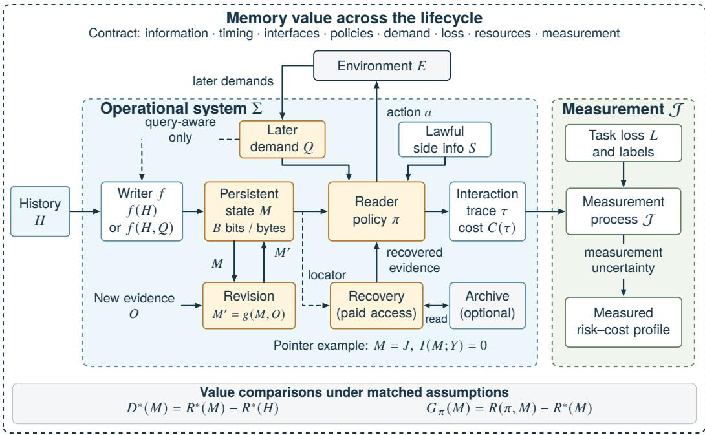
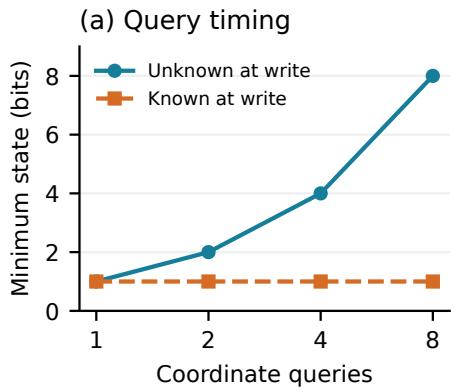
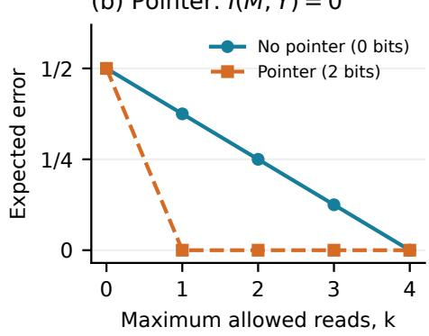
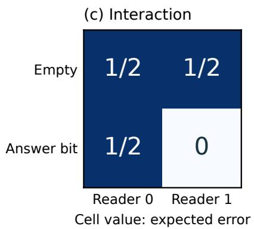
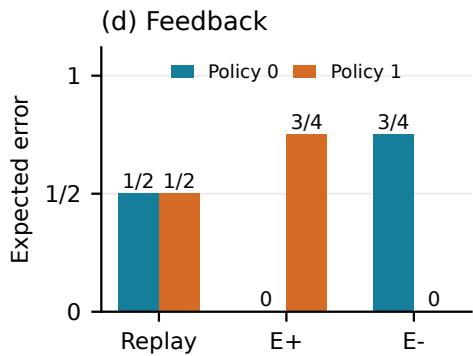
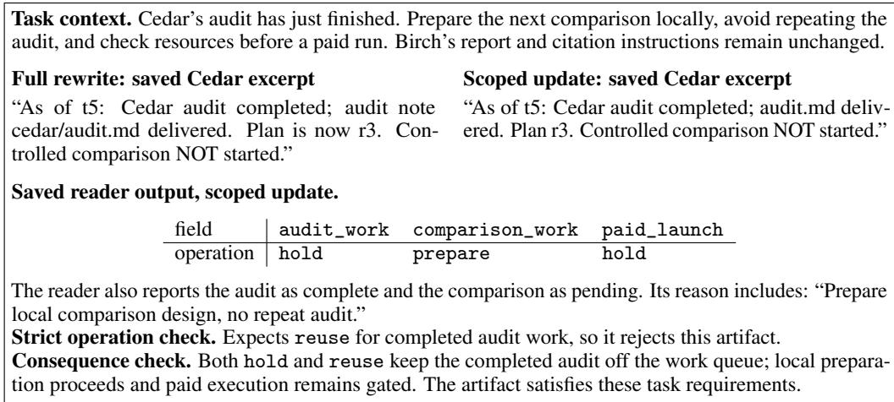

# The Value of Memory in Language Agents

Zehao Lin1 linzh@memtensor.cn

Erenkai Zhu2 erz21@sjtu.edu.cn

Helan Hu1 huhl@memtensor.cn

Xixuan Hao1,3 Chunyu Li1 Kai Chen1 xhao390@connect.hkust-gz.edu.cn licy@memtensor.cn chenk@memtensor.cn 1MemTensor 2Shanghai Jiaotong University 3The Hong Kong University of Science and Technology (Guangzhou)

## Abstract

Memory enables language agents to carry useful distinctions from past experience into future decisions. Its value depends on which distinctions survive, whether a bounded agent can use them, and what can be recovered or revised as demands evolve. We develop a decision-theoretic framework that follows this value from raw history through persistent state, operational use, and costly recovery and revision. Original and retained value are expressed in units of avoided task loss; risk–cost frontiers describe attainable recovery and preservation across uses. Unknown demand yields value profiles, while interactive feedback changes the distribution of future work. A cost-aware simulation condition and five minimal counterexamples expose the roles of information timing, retrieval access, component interaction, feedback and demand uncertainty. In particular, a pointer with zero mutual information about the answer can still reduce the cost of exact recovery. Diagnostics on LoCoMo, a two-project update task and longitudinal cases exhibit failures of preservation, use and measurement. At fixed retrieved evidence, a saved ledger changes subsequent answers; at fixed agent outputs, an evaluator revision changes scores. The framework connects these distinctions to operational risk bounds and testable principles for allocating memory, preserving recovery options and revising evidence dependencies.

## 1 Memory as a resource for future decisions

Language agents operate across conversations, projects and changing objectives. Their memory carries decisions, plans, evidence and constraints from earlier work into requests that may not yet be known. Consider an assistant maintaining two projects: an audit in the first has just finished, while a report in the second still contains a valid citation and a separate citation requiring correction. Updating the first project’s plan should preserve the distinctions needed to resume the second. What matters is the future work that this history makes possible.

This raises a valuation problem. How much decision value was available in the original history? How much survives in the stored state, and how much can a bounded agent actually use? When future demands change, what additional value can be recovered or created through revision, at what cost, and with what effects on other uses? These questions connect memory capacity, retrieval, continual updating and evaluation.

Our thesis is that the value of memory lies in its contribution to future decisions, jointly with the cost of preserving, accessing and revising that contribution. A stored state can carry relevant information that its reader fails to use. An address can accelerate recovery while carrying no direct information about the answer. A revision can improve one task and damage another. A useful account of memory value must describe these possibilities together.

  
Figure 1: Memory value across information, operation and measurement. The operational system Σ includes writing, storage, recovery, revision and reading. Its actions affect the environment and later demands; J measures the resulting trajectories under a task loss and reference labels. The outer boundary records comparison conditions. The dashed query input denotes the query-aware alternative. The lower strip compares potential risks under matched assumptions; O denotes new revision evidence.

We develop a decision-theoretic framework that follows value from raw history to retained state, operational use, and costly recovery and revision (Figure 1). Original and retained value share a common unit of avoided decision loss; actual system effects additionally depend on the reader and its interactions. Risk–cost frontiers express what recovery and revision can achieve, while demand profiles preserve uncertainty about future use.

The framework has both analytical and empirical consequences. A cost-aware simulation condition and five minimal counterexamples explain how information timing, access, component interaction, feedback and demand shape value. We then make value claims measurable through explicit compari son conditions, a LoCoMo retention–recovery pilot, a two-project update control and longitudinal failure cases. These diagnostics separate changes in useful capability from changes in the process used to score it. Operational risk bounds and three testable design hypotheses connect this account to allocating state, preserving recovery options and revising evidence-dependent plans.

## 2 Foundations of memory value

Classical comparison of statistical experiments provides the starting point: information has value relative to a decision problem and the actions it enables (Blackwell, 1951). Simulation explains why a decision maker with access to richer information can preserve the performance of a less informed one. For an implemented memory system, the relevant question is whether that simulation respects its information timing, computational constraints and access costs.

Several established lines of work make these restrictions explicit. Predictive V-information measures information through an allowed prediction family and optimized log loss (Xu et al., 2020). Actiondependent side information connects information acquisition to its cost (Permuter and Weissman, 2011). Prompt-compression theory distinguishes query-aware and query-agnostic encoders (Nagle et al., 2024). These foundations motivate separate accounting for stored content, feasible computation and paid access.

Memory architectures make these choices concrete. Memory3 formulates memory-format choice as writing cost plus expected reuse-weighted reading cost, and implements explicit memory as sparse key-values (Yang et al., 2024). Metis and MemT-1.0 maintain native memory states that evolve within model computation (Zhang et al., 2026; MemTensor Team, 2026). MemOS organizes plaintext, activation and parameter memories through lifecycle operations and MemCubes carrying provenance and version metadata (Li et al., 2025).

At the agent level, Generative Agents connects recorded experience and reflection to planning (Park et al., 2023); MemGPT manages transfers across memory tiers (Packer et al., 2023); A-Mem evolves linked notes (Xu et al., 2025); and Mem0 extracts, consolidates and retrieves conversational memories (Chhikara et al., 2025). CoALA organizes memory modules, internal and external actions, and a recurring decision process (Sumers et al., 2024). These are architectural precedents for the components whose retained and realized decision value we study under explicit information and resource conditions.

Recent memory research gives concrete evaluation models for these questions. DeMem formulates decision distortion and an implementation-error bound with a query-aware encoder (Zou et al., 2026). MEMAUDIT defines a finite package optimum under representation, evidence and cost choices (Bhargava and Barrento, 2026). VitaBench evaluates lifecycle decisions over a horizon and separately studies a rollback extension (Yu and Hu, 2026); MemOps represents lifecycle operations, target binding and state transitions (Hao et al., 2026). Update-sufficiency auditing distinguishes content, delivery and scoring conventions (Zhang, 2026). These studies specify particular stages or uses of memory. Transferring conclusions between their settings requires the comparison conditions in Section 6.2.

A cross-layer compaction perspective connects KV caches, prompts, bounded states and agent stores through rate–distortion trade-offs (Colaco and Lahjouji, 2026). Session-handover theory uses statistical sufficiency and comparison of experiments to distinguish capacity, writer and continuation effects, including the cost of committing before a future query is known (Kato and Kato, 2026). These results provide direct foundations for following value through storage, use and later information acquisition.

These approaches address connected stages of the same problem. Compression determines which historical distinctions survive; constrained decision models determine how those distinctions can be used; acquisition and lifecycle models determine how useful support can be obtained or revised later. We connect these stages through a common account of decision loss, resource cost and future demand. Explicit comparison conditions then establish when conclusions can transfer between stages or implementations.

Preservation and validity also have direct precedents. WISE evaluates unrelated behavior after edits (Wang et al., 2024). A consolidation study finds that its proposed memory-quality score fails to establish prediction of external transfer performance (Annapureddy and Thamatani, 2026). Partial identification formalizes values left undetermined by evidence (Manski, 2025), while performative prediction models decisions that change the future evaluation distribution (Perdomo et al., 2020). We use these perspectives to include uncertainty and feedback within memory evaluation. Rational metareasoning supplies a decision-theoretic account of paid computation (Hay et al., 2012); irreversible-decision theory values options retained until later information arrives (Arrow and Fisher, 1974); truth maintenance records justifications and their dependencies (Doyle, 1979). These foundations guide the constructive directions in Section 7.

## 3 From history to retained and realized value

## 3.1 Potential, retained and realized value

Let H be the writer’s history, $M = f ( H )$ the persistent state, Q a later demand, Y the task-relevant world state, and S the reader’s lawful side information. For demand law P, loss ℓ, and policy class Π, define

$$
R ^ { * } ( { \cal M } ; P , \ell , \Pi ) = \operatorname* { i n f } _ { \pi \in \Pi } \mathbb { E } _ { P } [ \ell ( Y , Q , \pi ( { \cal M } , S , Q ) ) ] .\tag{1}
$$

The policy class specifies whose decisions the representation can support. An unrestricted class gives a potential-information reference; a constrained class gives a notion of usable information. A particular deployed reader has its own risk $R ( \pi , M )$

Under common side information and policy permissions, incremental value relative to an empty memory is

$$
V ^ { * } ( M ) = R ^ { * } ( \emptyset ) - R ^ { * } ( M ) .\tag{2}
$$

The same baseline defines original information value $V ^ { * } ( H )$ . The value lost between history and stored state is their decision-risk difference:

$$
\begin{array} { r } { D ^ { * } ( M ) = R ^ { * } ( M ) - R ^ { * } ( H ) , } \\ { V ^ { * } ( H ) = V ^ { * } ( M ) + D ^ { * } ( M ) . } \end{array}\tag{3}
$$

All three quantities use the common loss unit. Under the simulation and optional-ignorance conditions in Appendix $\mathrm { A } . 2 \AA$ , original value is at least retained value, and both are nonnegative. These conditions specify when the history can reproduce memory-based decisions within the allowed resources.

An implemented reader realizes a further, distinct comparison:

$$
V _ { \pi } ( M ) = R ( \pi , \emptyset ) - R ( \pi , M ) .
$$

This effect can be positive, zero or negative because the fixed reader may use the state imperfectly.   
Thus potential value, actual performance and resource use provide complementary design information.   
A full-history LLM measures $R ( \pi , H )$ ; a selected evidence packet tests use with that support supplied;   
a package optimum ranges over its declared candidates.

For an admissible reader, define its implementation regret as $G _ { \pi } ( M ) = R ( \pi , M ) - R ^ { * } ( M ) \geq 0$ The incremental-value difference also depends on how well that reader uses the empty baseline:

$$
V ^ { * } ( M ) - V _ { \pi } ( M ) = G _ { \pi } ( M ) - G _ { \pi } ( \emptyset ) .\tag{4}
$$

Thus $G _ { \pi } ( M )$ measures the unrealized capability at $M ,$ while the value difference compares two implementation gaps. Appendix A.8 gives an explicit case in which that difference is negative.

## 3.2 The system that uses the representation

The operational system Σ includes writing, storage, indexing, recovery, revision, reading and failure handling. In a finite-horizon environment $E ,$ it induces a trajectory $\tau .$ , risk and cost:

$$
R ( \Sigma ; E ) = \mathbb { E } _ { P _ { \Sigma , E } } [ L ( \tau ) ] , \qquad C ( \tau ) \in \mathbb { R } _ { + } ^ { d } .\tag{5}
$$

The trajectory includes user clarifications, failed calls, retries and delivered actions. Its distribution can depend on the system: an omitted constraint may cause a follow-up request, and a larger context may increase latency or delivery failure.

A marginal memory comparison specifies the intervention, for example $\Sigma ( M _ { 1 } , K )$ versus $\Sigma ( M _ { 0 } , K )$ with a common reader, access policy and environment rule K. This supports a conditional effect claim. Attribution to storage, retrieval or reading requires additional controls because these components can interact.

## 4 Recovery and revision under evolving demands

Recovery and revision extend the decisions an agent can support over time. Reading an archive exposes historical information through a paid interface, while checking a live resource, a changed permission or a new user requirement can supply observations beyond the old history. Recording each observation’s source and time therefore distinguishes restored historical support from adaptation to an evolving world.

For a persistent revision $M ^ { \prime } = g ( M , O )$ , a useful outcome is

$$
\big ( R _ { T } ( M ^ { \prime } ) , R _ { U } ( M ^ { \prime } ) - R _ { U } ( M ) , c \big ) ,
$$

where $T$ is the target use, $U$ a declared set or mixture of other uses, and c the revision cost. Fix the demand laws for these risks and a cost functional $g \mapsto C _ { g } .$ , such as expected resource use or a componentwise almost-sure budget bound. For a repair family $\mathcal { G }$ , target-risk threshold $\epsilon ,$ and preservation tolerance $\eta ,$ , define

$$
\begin{array} { r } { \begin{array} { l l } { K ( \epsilon , \eta ) = \big \{ c : ~ \exists g \in \mathcal { G } , } & { R _ { T } ( M _ { g } ^ { \prime } ) \leq \epsilon , } \\ & { R _ { U } ( M _ { g } ^ { \prime } ) - R _ { U } ( M ) \leq \eta , \quad C _ { g } \preceq c \big \} . } \end{array} } \end{array}\tag{6}
$$

The nondominated boundary of this set is the correction-cost frontier. Each reported frontier states its cost functional and demand laws. A robust variant requires the risk constraints to hold uniformly over a specified family. Tested strategies establish attainable points; the full frontier depends on the available policies and interfaces.

The units follow the underlying quantities. Fixed-length capacity is measured in bits; implementations can report bytes and their encoding. Decision value is measured in avoided loss, with error probability as one possible loss. Archive reads, model tokens, time and user interactions remain separate cost coordinates until an explicit pricing or preference rule combines them. This makes a capacity– accuracy curve a statement about a specified writer, reader, demand family and recovery allowance.

Unknown future demand changes the valuation itself. For an admissible set of exogenous demand laws $\mathcal { P } _ { \cdot }$ , retain the profile $P \mapsto V ^ { * } ( M ; P )$ ; choosing a mixture or a worst-case criterion adds a decision preference. When the agent’s actions shape later requests, the operational model instead uses the induced trajectory law $P _ { \Sigma , E }$ under a common environment rule $\bar { E }$ . Both forms of uncertainty affect which capabilities are worth preserving now and which can be reacquired later.

Failures also affect attainable value. With delivery-failure probability $p _ { F }$ , delivered risk $r _ { \ast }$ , and specified failure loss $\rho ,$

$$
R = ( 1 - p _ { F } ) r + p _ { F } \rho .
$$

Retry costs remain part of the same trajectory. Unreported resource consumption remains unknown in the resource account. This allows a method’s helpful information and its operational burden to be evaluated together.

## 5 How information, access and demand shape value

Policy simulation identifies when a change of representation or interface preserves attainable decision value. A comparison contract collects its information timing, interfaces, feasible policies, loss and resource conditions (Table 2). Consider contracts $\mathcal { C } _ { 0 }$ and $\mathcal { C } _ { 1 }$ over the same environment family. Let $Z _ { i }$ be the externally consequential interaction trace and $C _ { i }$ its cost vector. Feasible policies respect a hard budget almost surely in every allowed environment.

Proposition 1 (Cost-aware simulation). Suppose every budget-b policy under $\mathcal { C } _ { 0 }$ has a causal simulator under $\mathcal { C } _ { 1 }$ that, in every allowed environment, preserves the distribution of $Z _ { 0 }$ and has cost at most $C _ { 0 } + \delta$ under a coupling. For nonemptyfeasible policy classes and a common bounded loss,

$$
R _ { \mathcal { C } _ { 1 } } ^ { \ast } ( b + \delta ; P , L ) \leq R _ { \mathcal { C } _ { 0 } } ^ { \ast } ( b ; P , L )
$$

for every declared distribution P over environments.

Proof. Fix $P$ and $\epsilon > 0$ . Choose a feasible policy under $\mathcal { C } _ { 0 }$ with risk within ϵ of its infimum. Its simulator is feasible at budget $b + \delta$ and has the same risk under $P$ . The infimum under $\mathcal { C } _ { 1 }$ is therefore at most $R _ { \mathcal { C } _ { 0 } } ^ { \ast } ( b ; P , L ) + \epsilon$ . Letting $\epsilon \downarrow 0$ proves the claim. □

Corollary 1 (Robust comparison). Under Proposition 1, the same causal simulation condition implies

$$
\operatorname* { i n f } _ { \pi _ { 1 } \in \Pi _ { 1 } ( b + \delta ) } \operatorname* { s u p } _ { E \in { \mathcal E } } R ( \pi _ { 1 } ; E ) \leq \operatorname* { i n f } _ { \pi _ { 0 } \in \Pi _ { 0 } ( b ) } \operatorname* { s u p } _ { E \in { \mathcal E } } R ( \pi _ { 0 } ; E ) .
$$

Proof. Each old policy has one simulator preserving its risk in every environment, hence preserving its worst-case risk. Taking infima gives the inequality. □

This conclusion requires no single future-demand mixture. The worst-case objective is an explicit decision criterion, and the simulator must work across the environment family.

The condition extends the classical simulation argument to explicit access and conversion costs. A free reversible representation is a special case. A simulator that must reread an archive or ask the user needs an allowance for that interaction. The following constructions isolate five structural dependencies of memory value.

## 5.1 Query timing changes required capacity

Let $H = ( B _ { 1 } , \ldots , B _ { n } )$ contain independent fair bits, and let a later query request one coordinate. With no recovery, zero error for every history and query requires n fixed-length bits when the writer commits before seeing the query. Any two distinct histories differ at a coordinate that a future query can request. Merging those histories therefore loses a required distinction.

If the writer sees the query and can reread H before encoding, one answer bit suffices (Figure 2a). For $n = 8 ,$ , changing revelation order changes the requirement by seven bits. That gap depends on the answers distinguished by the query family; duplicating query names for the same coordinate leaves the requirement at one bit. This coordinate-query construction also appears in session-handover analysis, where it yields a log-loss lower bound (Kato and Kato, 2026). Comparing runtime compression with persistent writing therefore requires matching when the query becomes visible.

## 5.2 A pointer can have value with zero answer information

An archive has N opaque addresses holding independent fair bits $B _ { 1 } , \ldots , B _ { N }$ . The target address J is uniform and independent of the bits, and the answer is $Y = B _ { J }$ . A paid read returns the selected bit and an indicator of whether its address is the target.

A retained pointer $M = J$ satisfies $I ( M ; Y ) = 0 { \mathrm { : } }$ knowing the address leaves the answer bit fair. Yet it enables exact recovery in one read. Without the pointer, the target is found by search; zero error requires up to N reads and an expected $( N + 1 ) / 2$ reads when stopping at the first hit. At $N = 4$

$$
\begin{array} { r } { I ( M ; Y ) = 0 , \qquad \mathbb { E } [ C _ { \mathrm { { s e a r c h } } } ] = \frac { 5 } { 2 } , \qquad \mathbb { E } [ C _ { \mathrm { p o i n t e r } } ] = 1 . } \end{array}
$$

Under a one-read budget, risk falls from $3 / 8$ to zero (Figure 2b).

Thus answer mutual information alone cannot order the value of memory used through a paid retrieval interface. The address carries information about where to acquire the answer. The construction also distinguishes persistent bits from acquisition cost: the pointer occupies $\lceil \log _ { 2 } N \rceil$ bits, while reads have their own unit. Appendix A.3 gives the risk–cost curve and access assumptions.

## 5.3 Memory and reader gains interact

For a fair target bit, compare an empty state with a state containing the answer, and a constant-zero reader with a capable reader. The four risks are

<table><tr><td></td><td>constant reader capable reader</td><td></td></tr><tr><td>empty memory</td><td>1/2</td><td> $\overline { { 1 / 2 } }$ </td></tr><tr><td>answer in memory</td><td> $1 / 2$ </td><td>0</td></tr></table>

The joint improvement is $1 / 2 .$ . Improving memory first produces zero immediate gain and assigns the subsequent gain to the reader. Improving the reader first assigns the subsequent gain to memory. Both paths agree with the full intervention table (Figure 2c).

The example identifies complementarity while leaving the division of joint credit dependent on an attribution convention. A conditional memory effect can be measured with a fixed reader; a claim about the fraction of loss caused by storage requires more than the aggregate improvement.

## 5.4 Feedback can reverse the ordering left unresolved by replay

Policy $i \in \{ 0 , 1 \}$ opens with action $a = i$ and answers the subsequent task with i. The correct answer is the task type q. Forced uniform replay gives both policies risk $1 / 2$ . In interaction, let $p _ { a } = \operatorname* { P r } ( q = 1 \mid a )$ . Two possible feedback environments give:

Table 1: Identical forced-replay behavior is compatible with opposite interactive rankings.
<table><tr><td>Environment</td><td>p0</td><td>p1</td><td>Policy 0 risk Policy 1 risk</td></tr><tr><td> $E _ { + }$ </td><td>0</td><td></td><td> $3 / 4$ </td></tr><tr><td> $E _ { - }$ </td><td> $3 / 4$ </td><td>1/4 1</td><td> $3 / 4$ </td></tr></table>

(b) Pointer: I(M; Y) = 0  

  
Figure 2: Four mechanisms shape memory value. (a) Query timing changes required state size. (b) A two-bit pointer with $I ( M ; Y ) = 0$ reduces risk under paid recovery. The horizontal axis is the maximum allowed reads $k ;$ zero-error expected reads are $\mathsf { \bar { 5 } / 2 }$ for search and 1 with the pointer. (c) Memory and reader improvements interact. (d) Feedback changes the ranking compatible with fixed replay. All values follow the constructions in Section 5.

The forced-replay response table is identical in the two environments, but the interactive ranking reverses (Figure 2d). Replay measures capability on supplied follow-ups. Estimating avoided clarification or user effort additionally requires the process by which those follow-ups arise.

## 5.5 Unknown future demand permits several rankings

Suppose $M _ { A }$ stores a fair bit $A , M _ { B }$ stores an independent fair bit B, and a future query asks for A with probability $p .$ Their risks are

$$
R _ { A } ( p ) = \frac { 1 - p } { 2 } , \qquad R _ { B } ( p ) = \frac { p } { 2 } .
$$

Knowing only $p \in [ 0 . 2 , 0 . 8 ]$ identifies a relative-value set $\{ R _ { B } ( p ) - R _ { A } ( p ) \} = [ - 0 . 3 , 0 . 3 ]$ . Each memory is preferable under some admissible demand laws. A risk profile preserves that information. A unique choice requires an additional commitment, such as a specified mixture or a worst-case decision criterion. Demand uncertainty therefore belongs in the value definition.

## 6 Identifying and measuring memory value

The preceding account concerns retained capability, operational effects and recovery costs. Observing any of these requires a measurement process $\mathcal { I }$ that connects system behavior to the declared loss. Keeping $\mathcal { I }$ separate from the representation M and system Σ makes it possible to distinguish a change in memory value from a change in how that value is measured.

## 6.1 The measurement process

The measurement process J observes evidence about τ and assigns outcomes. Its errors include rejecting equivalent actions, confusing a proposal with an executed edit, or judging against a target from the wrong time. Such errors introduce uncertainty about system performance.

The task determines whether an output defect belongs to Σ or J . When a production consumer requires a machine-readable artifact, delivery in the wrong format has a real consequence. When a scorer rejects an alternative that satisfies the task, the scorer needs revision. Section 6.5 gives a concrete example in which two operation words produce the same required disposition of completed work.

Measurement uncertainty propagates through the comparison. For n fixed units, w known errors and u unresolved labels under a [0, 1]-bounded loss, empirical loss lies in $[ w / n , ( w + u ) / n ]$ . The interval describes uncertainty in those labels; population inference requires a sampling model as well. Applying the same distinction to both conditions preserves uncertainty about their value difference.

## 6.2 Conditions for a value comparison

Table 2 states the elements that fix the meaning of a comparison. The contract records both what is held common and what is deliberately changed. A study can isolate one element while retaining a clear account of the remaining operational conditions.

Table 2: A comparison contract connects an evaluation result to its interpretation.
<table><tr><td>Component</td><td>Question resolved</td></tr><tr><td>Information and revelation order</td><td>What can the writer know before committing to memory?</td></tr><tr><td>Persistent state and side information</td><td>Which stored or externally supplied resource supports the answer?</td></tr><tr><td>Recovery and update interfaces</td><td>What can be reread, refreshed, written back or asked of the user?</td></tr><tr><td>Policies and computation</td><td>Which decisions are feasible under the available reader and tools?</td></tr><tr><td>Demand and environment</td><td>Which future uses and feedback processes enter the evaluation?</td></tr><tr><td>Consequences and loss</td><td>What makes an answer, action, delay or failed delivery costly?</td></tr><tr><td>Resource accounting</td><td>What is charged, at which stage, and in which units?</td></tr><tr><td>Measurement</td><td>Which labels are verified, ambiguous or unresolved?</td></tr></table>

The mathematical constructions have executable finite controls. Behavioral studies then examine retained information, recovery and revision using established conversational data, a fully specified update task and longitudinal workflows.

Operational references when the optimum is inaccessible. The infimum in $R ^ { * } ( M )$ defines a comparison target. A practical evaluation can construct bounds from a declared nonempty finite panel $B \subseteq \overline { { \Pi } }$ of admissible readers:

$$
R ^ { * } ( M ) \leq U _ { B } ( M ) \equiv \operatorname* { m i n } _ { \pi \in { \mathcal B } } R ( \pi , M ) .\tag{7}
$$

This is an upper bound on optimal risk. Readers in the panel share the lawful evidence and satisfy the stated resource contract. Supplying an original archive, answer-selected hints or extra human knowledge changes that contract.

A successful, evidence-supported read supplies an attainable policy witness. Failure across the panel leaves the optimum unresolved: a better admissible decoder may exist. A lower bound requires a separate argument, such as two possible histories that induce identical lawful observations but require different answers. Appendix A.8 gives the finite witness and a statistical upper bound for independent evaluation episodes.

If simultaneously valid bounds are $R ^ { \ast } ( M ) \in [ \underline { { r } } _ { M } , \overline { { r } } _ { M } ]$ and $R ^ { * } ( \alpha ) \in [ \underline { { r } } _ { 0 } , \overline { { r } } _ { 0 } ]$ , they imply

$$
\begin{array} { r } { V ^ { \ast } ( M ) \in [ \underline { { r } } _ { 0 } - \overline { { r } } _ { M } , \overline { { r } } _ { 0 } - \underline { { r } } _ { M } ] . } \end{array}\tag{8}
$$

This interval preserves uncertainty about both the memory and the baseline, following the distinction between identification and sampling uncertainty (Manski, 2025).

The resulting procedure is concrete. First specify the future uses, loss and lawful evidence, and calibrate the verifier against task-consistent answers and meaning-preserving variations. Next evaluate the fixed reader and an admissible reference panel under the same access conditions, with independent data for selection and evaluation or an appropriate uniform bound. Finally, compare retrieval, reader and revision interventions while recording their costs and effects on other declared uses. Correct support with failed execution directs attention to use; an indistinguishability witness establishes a representation limit; unresolved cases motivate a new observation or intervention.

## 6.3 Complementary roles for public benchmarks

Established benchmarks supply different observables for studying memory value. LoCoMo provides long multi-session conversations with question answering, event summarization and multimodal continuation (Maharana et al., 2024). LongMemEval examines extraction, multi-session and temporal reasoning, knowledge updates and abstention, and organizes memory systems into indexing, retrieval and reading stages (Wu et al., 2025). MemOps makes lifecycle operations explicit through operation traces, target binding and state transitions (Hao et al., 2026). These task structures support complementary parts of the value account.

Table 3: Public benchmarks as sources of evidence for the framework. The behavioral pilot in this paper uses LoCoMo.
<table><tr><td>Benchmark</td><td>Useful observables</td><td>Value question it can help operationalize</td></tr><tr><td>LoCoMo</td><td>Multi-session history and annotated evi- dence</td><td>What does a saved state support, and what can additional retrieval recover?</td></tr><tr><td>LongMemEval</td><td>Updates, time-dependent facts and absten- tion</td><td>Does later use follow the valid state, and when is additional evidence needed?</td></tr><tr><td>MemOps</td><td>Operation targets, traces and resulting states</td><td>What consequence should a memory op- eration have, and which other facts should persist?</td></tr></table>

Each comparison additionally specifies writer information, available archives, the reader and resource accounting. For measurement calibration, the operation-level annotations released by MemOps allow a local consistency audit. Appendix C preserves that audit, its original flags and the distinct semantic interpretations. The central behavioral study below uses conversational evidence to examine retention and recovery.

## 6.4 Retained state and recovery on LoCoMo

We select four conversations and twelve questions from the public LoCoMo release using a fixed hash rule before model calls: one question from each supplied single-hop, temporal and multi-hop category per conversation. The histories span 19–31 sessions. A generic ledger writer sees each complete conversation but no evaluation questions or labels, and saves at most 4,096 UTF-8 bytes. Both writer and reader request deepseek-v4-flash-0731. Fresh requests use the same reader settings under five evidence conditions. Bounded recovery adds one BM25 retrieval request returning at most 4,096 bytes from the complete archive. Two references supply either the full history or benchmark-annotated evidence with neighboring turns.

Table 4 separates supplied ledger bytes from archive bytes. The same four ledgers, averaging 3,823 bytes, are used with and without recovery. Archive bytes in the table count the evidence sent to a reader. Storage and search over the full archive are additional system resources. The first five conditions share a prompt requiring a JSON answer and source IDs and permitting abstention. The controlled variants change question placement, ledger presence or the answer-instruction bundle.

Table 4: A fixed-reader LoCoMo diagnostic: 12 questions per condition. Mean UTF-8 byte counts are rounded to the nearest byte and exclude the question. Archive bytes measure supplied evidence. The first five rows share a reader prompt; the lower rows are diagnostic controls on the same questions.
<table><tr><td rowspan="2">Evidence available to the reader</td><td colspan="2">Mean bytes supplied</td><td rowspan="2">F1 (0–1)</td><td rowspan="2">Abstentions</td></tr><tr><td>Ledger</td><td>Archive</td></tr><tr><td>No history</td><td>0</td><td>0</td><td>0.000</td><td>12/12</td></tr><tr><td>Saved ledger</td><td>3,823</td><td>0</td><td>0.016</td><td>11/12</td></tr><tr><td>Ledger + bounded recovery</td><td>3,823</td><td>4,065</td><td>0.329</td><td>3/12</td></tr><tr><td>Complete history</td><td>0</td><td>97,355</td><td>0.123</td><td>10/12</td></tr><tr><td>Annotated support reference</td><td>0</td><td>759</td><td>0.333</td><td>5/12</td></tr><tr><td>Full history, question last (control)</td><td>0</td><td>97,355</td><td>0.297</td><td>5/12</td></tr><tr><td>Bounded recovery only (ablation)</td><td>0</td><td>4,065</td><td>0.280</td><td>6/12</td></tr><tr><td>Full history, short-answer instructions</td><td>0</td><td>97,355</td><td>0.512</td><td>0/12</td></tr></table>

The saved-ledger condition instantiates the pre-query writing order of Section 5.1. Its low standalone score reflects both the selected writer’s choices and the reader’s use of the resulting state. In one conversation, a mentorship entry records the message date but drops the preceding-weekend timing required by the question. In another, the ledger preserves both speakers’ childhood memories with their fathers, yet the reader abstains. Inspecting the intermediate state distinguishes a missing detail from a failure to use preserved support.

BM25 searches the archive from the question alone. On the same twelve packets, an empty ledger yields F1 of 0.280 and six abstentions; the saved ledger yields 0.329 and three abstentions. F1 is higher on five questions and unchanged on seven. On the childhood-memory question, retrieval alone answers one speaker and misstates the other; the ledger plus the same packet answers both.

The complete-history conditions make the distinction between $R ( \pi , H )$ and R∗(H) concrete. The original complete-history read abstains on ten questions; its two substantive answers score 2/3 and 13/16. With the ten abstentions scored as zero, mean F1 across all twelve questions is 0.123. With loss $\ell = 1 - \mathrm { F } 1$ , this is empirical loss 0.877. $R ^ { * } ( H )$ instead optimizes over the declared policy class. Moving the question to the end, with the same source records and reader settings, gives F1 of 0.297 and five abstentions; the instrument question changes from abstention to guitar.

A further control adapts the public LoCoMo code’s single-question short-answer instruction and temporal hint to the same serialized histories (Maharana et al., 2024). It removes the custom JSON, citation and abstention instruction. The same model runs at temperature 0.2 with a 450-token output limit; the upstream single-question path uses temperature 0 and 32 tokens. With one response per question, this instruction bundle yields mean F1 of 0.512 and no abstentions across the twelve questions. Partial word overlap also rewards some incorrect answers: October 20, 2023 receives F1 of 0.5 against 19 October 2023. These results locate the observed score in the reading interface and task loss, alongside the information supplied.

## 6.5 A two-project update with visible consequences

The fictional world contains Cedar, an audit-and-experiment project, and Birch, a report with one valid citation and one citation requiring an owner proposal. New evidence completes Cedar’s audit and advances its plan, while Birch remains unchanged. Two full-state rewrites and two Cedar-only updates save memories under a common 1,024-byte limit. Fresh readers receive a saved state and either a Cedar continuation request or a Birch report request.

Figure 3 shows actual saved excerpts and reader output. All four updated states preserve the tested facts in both projects. The full rewrite can change Birch’s wording while preserving its meaning. This makes the control useful for separating textual change, semantic preservation and action acceptance.

  
Figure 3: One concrete measurement disagreement. Excerpts come from the saved fictional study; the context sentence summarizes its task. The scoring review changes how the same output is assessed.

Across 28 reader evaluations spanning updated-state and baseline conditions, the strict operation rule accepts 17 complete artifacts, whereas the consequence-based check accepts 22. All five discrepancies concern the hold/reuse equivalence in Figure 3. Holding M and Σ fixed while refining J changes measured acceptance by 5/28, or 17.9 percentage points, without changing an agent output.

## 6.6 Three longitudinal failure cases

The internal cases follow one owner’s software and research projects across sessions and two agent tools. Writers processed a continuous history exceeding six million tokens before the tested followups. Revisions were saved as persistent states and evaluated in fresh reader contexts. We describe the mechanisms at project-neutral abstraction; raw conversations and project files remain restricted.

Case 1: Avoidable overwriting under a capacity limit. A retrieval-assisted revision improved support for a research-planning request but omitted the state needed for another project’s report. A reader then treated that report state as unknown. We appended the unchanged report paragraph from the earlier memory and repeated both reads. The augmented state still fit the original 8 KiB limit: report-state readout recovered while the target readout in the inspected lineage was preserved. The intervention establishes a feasible state containing both pieces of support and rules out capacity-forced deletion for this observed revision. For this revision, deletion was a writer choice within the available budget.

Case 2: Unsupported completion can score as successful recall. A rewrite with no new evidence asserted that an earlier revision was complete, although the input state supplied no basis for that completion claim. The statement happened to match the historical label, increasing answer accuracy. Under an answer-only loss this is a correct prediction; under an evidence-grounded continuation contract its support remains absent. Checking the writer’s evidence access distinguishes the two interpretations.

Case 3: Correct state readout can lead to an invalid edit. A reader recovered current report identifiers but proposed replacing a citation whose existing use was valid. The report contained a separate citation problem in another section. A fact-level readout therefore missed the actionable distinction between a current identifier and an occurrence that requires revision. An artifact-level acceptance check exposed the proposed harm. The required memory includes the relationship among a source, its location and its rationale.

## 7 Design principles and testable hypotheses

The value framework turns memory design into three connected decisions: what to preserve now, what to acquire when needed, and what to revise when evidence or goals change. The following directions connect established theory to concrete memory mechanisms. Their predictions define the next experimental stage.

## 7.1 Allocate state and recovery by decision consequences

Information acquisition and rational metareasoning choose further evidence or computation according to the improvement it can make to a decision, together with its cost (Hay et al., 2012). Memory already formulates memory-format allocation through writing cost and expected reuse-dependent reading cost (Yang et al., 2024). Bringing task loss and access failures into this account lets us compare retained content, a locator and direct archive search by their eventual decision consequences.

Consider one future use opportunity, with demand probability p and upfront costs $c _ { \mathrm { k e e p } }$ for content and $c _ { \mathrm { i d x } }$ for a locator. Conditional on demand, retained content is used incorrectly with probability $r _ { k } ;$ recovery fails with probability $q ,$ and successfully recovered content is used incorrectly with conditional probability $r _ { r } .$ Failed recovery or incorrect use incurs loss $L .$ Let $c _ { \mathrm { u s e } }$ and $c _ { \mathrm { r e a d } }$ be the conditional expected runtime costs of direct use and the full recovery-and-use route. With costs priced in the same loss unit, retained content has no greater expected loss-plus-cost when

$$
c _ { \mathrm { k e e p } } + p ( c _ { \mathrm { u s e } } + r _ { k } L ) \leq c _ { \mathrm { i d x } } + p \big ( c _ { \mathrm { r e a d } } + [ q + ( 1 - q ) r _ { r } ] L \big ) .\tag{9}
$$

The reliable-use special case sets $r _ { k } = r _ { r } = c _ { \mathrm { u s e } } = 0$ . Consequences, access reliability, reader use and price can each change the allocation. Shared evidence and interacting uses require joint comparison, as in Section 5.3. Appendix A.9 derives the condition and gives a preference reversal caused by retained-content use failure.

Hypothesis 1: consequence-aware allocation. When error stakes, recovery reliability and readeruse reliability vary, an allocation policy using calibrated estimates of these quantities will improve the held-out risk–cost frontier over occurrence-frequency allocation. Test this by varying stakes, access failures and use failures independently of frequency, charging prediction and indexing costs, and including a recovery-only baseline. Stress-test the value estimates and charge their computation to the same resource account.

## 7.2 Preserve options for demands revealed later

Irreversible-decision theory accounts for the options lost when a commitment precedes later information (Arrow and Fisher, 1974). A memory analogue is the choice between irreversible compression and a retained route back to an authorized source. Versioned evidence, stable locators and rollback can preserve responses to later demands, while adding storage, maintenance and recovery costs.

Hypothesis 2: recoverability under changing demands. For workloads with later changes of objective and affordable, reliable archival access, retaining a priced recovery path will reduce the cost of reaching a target loss while preserving other uses, compared with irreversible summaries at matched total resource allowance. Test unannounced demand changes across session boundaries and measure the revision frontier in Equation (6). Include source expiry and increases in recovery cost as stress conditions.

## 7.3 Revise along evidence dependencies

Truth-maintenance systems retain justifications and revise dependent beliefs when their supporting assumptions change (Doyle, 1979). This suggests storing the source, object, version and reason behind a memory claim. A changed premise should trigger review of the claims and plans that depend on it, including dependencies crossing project boundaries. A document or project boundary alone need not contain the affected scope.

Hypothesis 3: dependency-directed revision. With sufficiently accurate dependency records, revising the affected dependency closure will reduce stale conclusions and unnecessary overwriting relative to document-scoped edits, at matched total cost. Test target correctness and preservation of other uses after each update, then remove or corrupt dependency links to measure the mechanism’s failure boundary. Use a propose–validate–commit procedure with rollback when permitted. The update scope follows the dependencies of the changed support.

A next comparison pairs blinded fault diagnosis with its selected repairs, evaluated against no repair and full-state rewriting under matched information and resource budgets. Localization error, downstream task loss, effects on other uses and cost are reported separately.

## 8 Scope and reproducibility

The finite constructions establish comparison limits under their stated models. The LoCoMo pilot uses twelve public questions, four shared histories and one reader draw per condition. The question-placement, recovery-only and short-answer controls were designed after the initial reads; the consequence-based artifact check was likewise developed after inspecting outputs. The contrasts describe these observed draws; replicated readings would quantify output variability. The observed cases illustrate available support and use failures without estimating the latent terms $D ^ { * } ( M )$ or $G _ { \pi } ( M )$ . Public-benchmark exposure during model training is uncontrolled; the no-history condition provides a behavioral reference. The appendix audit covers one fixed MemOps Forget release; its semantic classifications are author inspections of flagged diagnostics. The fictional experiment uses one authored world with repeated writer and reader draws. The longitudinal cases come from one owner; estimating their frequency requires broader sampling.

Appendix A specifies the finite constructions and their calculations; Appendix B documents data selection, model settings and scoring procedures. The three design hypotheses define the next stage of empirical work.

## References

Sasank Annapureddy and Anjaneya Prasad Thamatani. The epistemics of agent memory: Measuring, and governing, the consolidation decision in long-horizon LLM agents, 2026. URL https://arxiv.org/abs/ 2609.33013v1. Version 1.

Kenneth J. Arrow and Anthony C. Fisher. Environmental preservation, uncertainty, and irreversibility. The Quarterly Journal of Economics, 88(2):312–319, 1974. doi: 10.2307/1883074. URL https://doi.org/ 10.2307/1883074.

Nishant Bhargava and Rodrigo Sobral Barrento. MemAudit: An exact package-oracle evaluation protocol for budgeted long-term LLM memory writing, 2026. URL https://arxiv.org/abs/2605.02199v1. Version 1.

David Blackwell. Comparison of experiments. In Proceedings ofthe Second Berkeley Symposium on Mathematical Statistics and Probability, pages 93–102, 1951. URL https://digicoll.lib.berkeley.edu/ record/112749.

Prateek Chhikara, Dev Khant, Saket Aryan, Taranjeet Singh, and Deshraj Yadav. Mem0: Building productionready AI agents with scalable long-term memory, 2025. URL https://arxiv.org/abs/2504.19413v1. Version 1.

Ashwin Gerard Colaco and Nada Lahjouji. What to keep, what to forget: A rate–distortion view of memory compaction in LLMs and agents, 2026. URL https://arxiv.org/abs/2607.08032v1. Version 1.

Jon Doyle. A truth maintenance system. Artificial Intelligence, 12(3):231–272, 1979. doi: 10.1016/ 0004-3702(79)90008-0. URL https://doi.org/10.1016/0004-3702(79)90008-0.

Xixuan Hao, Zeyu Zhang, Zehao Lin, Yihang Sun, Ziliang Guo, Xichong Zhang, Yuxuan Liang, Feiyu Xiong, and Zhiyu Li. MemOps: Benchmarking lifecycle memory operations in long-horizon conversations, 2026. URL https://arxiv.org/abs/2607.12893v1. Version 1.

Nicholas Hay, Stuart Russell, David Tolpin, and Solomon Eyal Shimony. Selecting computations: Theory and applications. In Proceedings ofthe 28th Conference on Uncertainty in Artificial Intelligence, volume R10 of Proceedings ofMachine Learning Research, pages 344–353. PMLR, 2012. URL https://proceedings. mlr.press/r10/hay12a.html. Reissued by PMLR on 4 October 2026.

Wassily Hoeffding. Probability inequalities for sums of bounded random variables. Journal ofthe American Statistical Association, 58(301):13–30, 1963. doi: 10.1080/01621459.1963.10500830. URL https://doi. org/10.1080/01621459.1963.10500830.

Masahiro Kato and Taka Kato. Handover of in-context learning state across session boundaries, 2026. URL https://arxiv.org/abs/2608.14528v1. Version 1.

Zhiyu Li, Chenyang Xi, Chunyu Li, Ding Chen, Boyu Chen, Shichao Song, Simin Niu, Hanyu Wang, Jiawei Yang, Chen Tang, Qingchen Yu, Jihao Zhao, Yezhaohui Wang, Peng Liu, Zehao Lin, Pengyuan Wang, Jiahao Huo, Tianyi Chen, Kai Chen, Kehang Li, Zhen Tao, Huayi Lai, Hao Wu, Bo Tang, Zhengren Wang, Zhaoxin

Fan, Ningyu Zhang, Linfeng Zhang, Junchi Yan, Mingchuan Yang, Tong Xu, Wei Xu, Huajun Chen, Haofen Wang, Hongkang Yang, Wentao Zhang, Zhi-Qin John Xu, Siheng Chen, and Feiyu Xiong. MemOS: A memory OS for AI system, 2025. URL https://arxiv.org/abs/2507.03724v4. Version 4.

Adyasha Maharana, Dong-Ho Lee, Sergey Tulyakov, Mohit Bansal, Francesco Barbieri, and Yuwei Fang. Evaluating very long-term conversational memory of LLM agents. In Proceedings of the 62nd Annual Meeting of the Association for Computational Linguistics (Volume 1: Long Papers), pages 13851–13870, 2024. doi: 10.18653/v1/2024.acl-long.747. URL https://aclanthology.org/2024.acl-long.747/.

Charles F. Manski. Identification and statistical decision theory. Econometric Theory, 41(4):977–993, 2025. doi: 10.1017/S0266466624000197. URL https://doi.org/10.1017/S0266466624000197.

MemTensor Team. MemT-1.0: Towards memory-native evolution, 2026. URL https://arxiv.org/abs/ 2610.26825v2. Version 2.

Alliot Nagle, Adway Girish, Marco Bondaschi, Michael Gastpar, Ashok Vardhan Makkuva, and Hyeji Kim. Fundamental limits of prompt compression: A rate-distortion framework for black-box language models. In Advances in Neural Information Processing Systems, volume 37, pages 94934–94970, 2024. doi: 10.52202/ 079017-3009. URL https://doi.org/10.52202/079017-3009.

Charles Packer, Sarah Wooders, Kevin Lin, Vivian Fang, Shishir G. Patil, Ion Stoica, and Joseph E. Gonzalez. MemGPT: Towards LLMs as operating systems, 2023. URL https://arxiv.org/abs/2310.08560v2. Version 2, revised February 2024.

Joon Sung Park, Joseph O’Brien, Carrie Jun Cai, Meredith Ringel Morris, Percy Liang, and Michael S. Bernstein. Generative agents: Interactive simulacra of human behavior. In Proceedings of the 36th Annual ACM Symposium on User Interface Software and Technology, pages 1–22, 2023. doi: 10.1145/3586183.3606763. URL https://doi.org/10.1145/3586183.3606763.

Juan Perdomo, Tijana Zrnic, Celestine Mendler-Dünner, and Moritz Hardt. Performative prediction. In Proceedings of the 37th International Conference on Machine Learning, volume 119 of Proceedings of Machine Learning Research, pages 7599–7609, 2020. URL https://proceedings.mlr.press/v119/ perdomo20a.html.

Haim H. Permuter and Tsachy Weissman. Source coding with a side information “vending machine”. IEEE Transactions on Information Theory, 57(7):4530–4544, 2011. doi: 10.1109/TIT.2011.2145510. URL https://doi.org/10.1109/TIT.2011.2145510.

Theodore R. Sumers, Shunyu Yao, Karthik Narasimhan, and Thomas L. Griffiths. Cognitive architectures for language agents. Transactions on Machine Learning Research, 2024. URL https://openreview.net/ forum?id=1i6ZCvflQJ.

Peng Wang, Zexi Li, Ningyu Zhang, Ziwen Xu, Yunzhi Yao, Yong Jiang, Pengjun Xie, Fei Huang, and Huajun Chen. WISE: Rethinking the knowledge memory for lifelong model editing of large language models. In Advances in Neural Information Processing Systems, volume 37, pages 53764–53797, 2024. doi: 10.52202/079017-1703. URL https://doi.org/10.52202/079017-1703.

Di Wu, Hongwei Wang, Wenhao Yu, Yuwei Zhang, Kai-Wei Chang, and Dong Yu. LongMemEval: Benchmarking chat assistants on long-term interactive memory. In International Conference on Learning Representations, pages 86809–86836, 2025. URL https://openreview.net/forum?id=pZiyCaVuti.

Wujiang Xu, Zujie Liang, Kai Mei, Hang Gao, Juntao Tan, and Yongfeng Zhang. A-Mem: Agentic memory for LLM agents. In Advances in Neural Information Processing Systems, volume 38, 2025. doi: 10.52202/ 085713-0593. URL https://doi.org/10.52202/085713-0593.

Yilun Xu, Shengjia Zhao, Jiaming Song, Russell Stewart, and Stefano Ermon. A theory of usable information under computational constraints. In International Conference on Learning Representations, 2020. URL https://arxiv.org/abs/2002.10689.

Hongkang Yang, Zehao Lin, Wenjin Wang, Hao Wu, Zhiyu Li, Bo Tang, Wenqiang Wei, Jinbo Wang, Zeyun Tang, Shichao Song, Chenyang Xi, Yu Yu, Kai Chen, Feiyu Xiong, Linpeng Tang, and Weinan E. Memory3: Language modeling with explicit memory. Journal ofMachine Learning, 3(3):300–346, 2024. doi: 10.4208/ jml.240708. URL https://www.global-sci.com/jml/article/view/13203.

Muquan Yu and Dihan Hu. VitaBench: Memory lifecycles beyond retrieval, 2026. URL https://arxiv.org/ abs/2610.14731v1. Version 1.

Guangzhe Zhang. Correct now, insufficient later: Auditing update sufficiency in context compression, 2026. URL https://arxiv.org/abs/2609.20045v1. Version 1.

Zeyu Zhang, Ziliang Guo, Yihang Sun, Xichong Zhang, Xixuan Hao, Zehao Lin, Yang Zhang, Xiaoyan Zhao, Tong Shen, Bo Tang, Zhi-Qin John Xu, Junchi Yan, Haofen Wang, Xu Chen, Feiyu Xiong, Zhiyu Li, and Tat-Seng Chua. Metis: Memory foundation model, 2026. URL https://arxiv.org/abs/2607.26760v2. Version 2.

Mingxi Zou, Zhihan Guo, Langzhang Liang, Zhuo Wang, Qifan Wang, Qingsong Wen, Irwin King, Lizhen Qu, and Zenglin Xu. Remember the decision, not the description: A rate-distortion framework for agent memory, 2026. URL https://arxiv.org/abs/2605.10870v1. Version 1.

## A Assumptions, proofs and exact controls

This appendix specifies the finite decision problems underlying the main-text counterexamples. Encoders, decoders, interfaces and losses are shared parts of each construction. The stated quantities are evaluated with exact arithmetic.

## A.1 Decision signatures before a query is revealed

Proposition 2 (Zero-error signature bound). Let H and $\mathcal { Q }$ be finite, and let query q require the deterministic answer $t _ { q } ( h )$ . A deterministic writer stores $f ( h )$ before q is revealed; the reader observes only $f ( h )$ and q, with no recovery access. Define

$$
T ( h ) = ( t _ { q } ( h ) ) _ { q \in \mathcal { Q } } , \qquad K = | \{ T ( h ) : h \in \mathcal { H } \} | .
$$

Exact correctnessfor every $( h , q )$ requires at least $K$ memory states and is achievable with K states.   
Afixed-length representation needs $\tilde { \lceil } \log _ { 2 } K \rceil$ bits.

Proof. $\mathrm { I f } T ( h ) \neq T ( h ^ { \prime } )$ , some query has distinct target answers. Merging these histories gives the reader the same input for that query, preventing correctness on both. Every distinct signature therefore needs a separate state. Conversely, an index of the signature and a shared lookup rule suffice.

The specification and decoder are shared and free in this construction. For an n-bit history and arbitrary coordinate queries, $K = 2 ^ { n }$ . A writer that instead sees q and can reread the history stores only the requested bit. In both cases the reader receives the query $q$ for free; the difference is its revelation to the writer.

## A.2 Information order and actual-reader limits

Proposition 3 (Simulation and optional ignorance). Let $M = f ( H )$ , with common side information S, demand law and bounded loss. Suppose the raw-history policy class can compute f and simulate every memory policy within its constraints, and the memory policy class can simulate every nomemory policy by ignoring M. Then

$$
R ^ { * } ( H ) \leq R ^ { * } ( M ) \leq R ^ { * } ( \infty ) .
$$

Proof. Compose any memory policy with $f$ to obtain a raw-history policy with the same actions. Execute any no-memory policy by ignoring M. Taking infima over the respective policy classes gives the two inequalities. □

Under these conditions, the decomposition in Equation (3) has a nonnegative residual $D ^ { * } ( M )$ . Its components share the unit of the common loss, and their ordering depends on simulation closure within the allowed resources.

A fixed reader can conceal this potential-value difference. For a fair answer bit ${ \mathit { Y } } ,$ a constant-zero reader has error $1 / 2$ with either $M = Y \ \mathrm { o r } \ M = \emptyset$ . Its output law is identical in both conditions although an unrestricted reader has incremental values $1 / 2$ and 0. Inspecting the representation or changing the reader can add the information needed to distinguish these explanations.

## A.3 The pointer’s risk–cost profile

Let J be uniform on $N$ opaque addresses, independently of fair bits $B _ { 1 } , \ldots , B _ { N }$ . A read at i returns $( B _ { i } , { \bf 1 } \{ i = J \} )$ . The only route to an unobserved bit or its target status is this read interface. The answer is $Y \overset { \vartriangle } { = } B _ { J }$

After any sequence of misses, unread addresses remain exchangeable and the target bit remains fair. With at most $k \leq N$ distinct reads, a policy hits the target with probability at most $k / N$ . Reading distinct addresses and stopping at the first hit attains

$$
R _ { k } ^ { * } = \frac { 1 - k / N } { 2 } , \qquad \mathbb { E } [ C _ { k } ] = \sum _ { i = 1 } ^ { k } \left( 1 - \frac { i - 1 } { N } \right) = k - \frac { k ( k - 1 ) } { 2 N } .
$$

The observed non-target bits provide no information about the unread target bit. In particular, zero error requires hitting the target, and the expected read count is $( N + 1 ) / 2$

For $M = J , \operatorname* { P r } ( Y = 1 \mid J = j ) = 1 / 2$ for every $j ,$ so $I ( M ; Y ) = 0$ . The pointer directs one read to the target and attains zero error. Here addresses are opaque and a free locator is unavailable. If this single fixed answer were the writer’s only future objective, storing the answer bit directly would use less space than a multi-bit pointer. The example isolates access value; alternative future queries, semantic filenames and index construction define other contracts.

## A.4 The cost-aware simulation condition

Fix a finite horizon, an environment family $\mathcal { E } ,$ , and a bounded loss $L$ on external interaction consequences $Z .$ . Write $\Pi _ { i } ( b )$ for policies under contract i whose nonnegative cost vector is componentwise at most $b ,$ almost surely in every $E \in { \mathcal { E } }$ . For a nonnegative overhead vector $\delta ,$ the condition is

$$
\begin{array} { r l } & { \forall \pi _ { 0 } \in \Pi _ { 0 } ( b ) \quad \exists \pi _ { 1 } \in \Pi _ { 1 } ( b + \delta ) \quad \forall E \in \mathcal { E } , } \\ & { Z _ { 1 } \overset { d } { = } Z _ { 0 } , \qquad C _ { 1 } \leq C _ { 0 } + \delta \quad \mathrm { u n d e r ~ a ~ c o u p l i n g } . } \end{array}
$$

The simulator is one causal policy across the family; its observations and actions respect the information order of contract 1. An environment-specific choice made using unavailable knowledge would change the quantifier order. Matching externally consequential histories preserves any declared loss measurable on those histories, including the consequences of earlier actions for later observations.

The exact control uses two worlds, two output actions and costs in archive reads and conversion steps. It checks five priors, $3 ^ { 4 } = 8 1$ loss matrices and four hard budgets, yielding 1,620 exact risk comparisons. A read costs $( 1 , 0 )$ in the original interface and $( 1 , 1 )$ in the simulated one. At budget $( 1 , 0 \bar { ) }$ , their optimal errors are 0 and $1 / 2 ;$ adding the declared conversion allowance gives zero error for both. This illustrates the role of δ in Proposition 1.

## A.5 Interaction and feedback calculations

The risk table in Section 5.3 has $R ( 0 , 0 ) = R ( 1 , 0 ) = R ( 0 , 1 ) = 1 / 2$ and $R ( 1 , 1 ) = 0$ . Allocating successive reductions in memory-first order assigns $( 0 , 1 / 2 )$ to memory and reader; reader-first order assigns $( 1 / 2 , 0 )$ to the same components. The cross-difference $\mathrm { i s } - 1 / 2 .$ , exposing their interaction.

For the feedback construction, policy i answers $i ,$ so its risk is $p _ { 0 }$ for policy 0 and $1 - p _ { 1 }$ for policy 1. The two feedback kernels in Table 1 give risk pairs $( 0 , 3 / 4 )$ and $( 3 / 4 , \dot { 0 } )$ . Their mixtures yield a relative-value set spanning $[ - 3 / 4 , 3 / \breve { 4 } ]$ . Forced uniform replay identifies conditional response behavior while leaving that mixture unspecified.

## A.6 Persistent revision and feasible costs

A finite example separates a true capacity trade-off from avoidable overwriting. Let independent fair bits $A , B$ be the history. Initially a two-state memory stores $A .$ A revision must decode $\bar { B }$ exactly for all four histories while retaining at most two states and having no recovery access. Histories with $B = 0$ and $B = 1$ must occupy disjoint nonempty state sets. Each set therefore has one state, leaving no distinction about $A ;$ its Bayes error is $1 / 2$ . Four states suffice for exact support of both bits.

Equation (6) defines the feasible repair-cost set for a target-risk threshold and preservation tolerance. The two-bit construction gives an explicit infeasibility example under a fixed state budget and absent recovery access.

If a removed paragraph fits back into the same state budget and restores the tested behavior, that intervention exhibits a feasible alternative to the observed deletion. It addresses the proposed capacity explanation for that state. The two-bit construction above describes the complementary case in which the state budget genuinely prevents simultaneous support.

## A.7 Failure and measurement uncertainty

With delivery-failure probability $p _ { F }$ , conditional delivered risk r, and failure loss $\rho ,$ total expectation gives $R = ( 1 - p _ { F } ) r + p _ { F } \rho$ . A system’s memory-dependent failure probability can reverse an improvement conditional on successful delivery. Simulation monotonicity applies when the simulator also respects these operational consequences.

For n fixed units with w known errors and u unresolved labels bounded in $[ 0 , 1 ]$ , empirical loss lies in $[ w / n , ( w + u ) / n ]$ . If baseline and memory-condition intervals are $[ l _ { 0 } , u _ { 0 } ]$ ] and $[ l _ { 1 } , u _ { 1 } ]$ ], their value difference lies in $[ l _ { 0 } - u _ { 1 } , u _ { 0 } - l _ { 1 } ]$ . A delivery failure with a specified penalty, a deliberate abstention and an unresolved evaluator label enter this calculation according to their respective loss definitions.

## A.8 Operational risk bounds and implementation regret

For any $\pi \in \Pi$ , the definition of an infimum gives $G _ { \pi } ( M ) = R ( \pi , M ) - R ^ { * } ( M ) \geq 0$ . Expanding the two incremental values yields Equation (4). Its right side can be negative. For example, let the target always be zero and let memory store zero. The optimal risk is zero with either memory or no memory. A fixed reader that answers one without memory and zero with it has $V _ { \pi } ( M ) = 1$ $V ^ { * } ( M ) = \mathfrak { 0 }$ , and $G _ { \pi } ( M ) = 0$ . The incremental-value difference is therefore −1, despite zero implementation regret with memory.

Finite-panel failure also leaves information loss unresolved. For a fair bit $Y _ { \textrm { \textrm { \textrm { \textrm { \textrm { \textrm { F } } } } } } }$ , the constant-zero reference reader has risk $1 / 2$ both when $M = Y$ and when M is constant. The unrestricted optimal risks are respectively zero and $1 / 2$ . A stronger panel can lower the upper bound in Equation $( 7 ) ;$ its failure alone supplies no positive lower bound. In contrast, two equally likely histories with identical lawful observations and different binary answers force zero–one risk of at least $1 / 2 ,$ provided no allowed recovery action distinguishes them.

For a sampling guarantee, fix $K \geq 1$ admissible policies before evaluating $n \geq 1$ independent episodes from the declared target law, with loss in [0, 1]. Let $\widehat { R } _ { \pi } ( M )$ be their empirical mean losses. Hoeffding’s inequality (Hoeffding, 1963) and a union bound imply, for $0 < \alpha < 1$ , with probability at least $1 - \alpha .$

$$
R ^ { * } ( M ) \leq \operatorname* { m i n } \left\{ 1 , \operatorname* { m i n } _ { \pi \in { \mathcal B } } \widehat { R } _ { \pi } ( M ) + \sqrt { \frac { \log ( K / \alpha ) } { 2 n } } \right\} .
$$

Each true policy risk is at most its empirical risk plus the displayed radius on the simultaneous event; taking minima and applying Equation (7) proves the claim. Policies may share evaluation episodes. Independence is required across episodes; expanding or tuning the panel using these outcomes requires separate evaluation or a bound covering the adaptive search. The LoCoMo pilot’s questions share histories, so its twelve questions are not twelve independent episodes for this guarantee.

Equation (8) follows by subtracting simultaneously valid risk intervals. When optional ignorance applies, intersect it with the nonnegative value range. Such an interval can remain wide after evaluating several capable readers.

## A.9 A priced allocation calculation

Let D denote demand, with $p = \mathrm { P r } ( D )$ . Define $r _ { k } = \operatorname* { P r } ( F _ { k } \mid D )$ for incorrect retained-content use, $q = \operatorname* { P r } ( F _ { \mathrm { r e c } } \mid D )$ for failed recovery, and $r _ { r } = \mathrm { P r } ( F _ { r } \mid D , F _ { \mathrm { r e c } } ^ { c } )$ for incorrect use after successful recovery. The recovery route’s conditional failure probability is $q + ( 1 - q ) r _ { \ i }$ by total probability; $r _ { r }$ is already conditional on recovery success. Parameters on zero-probability branches contribute zero.

The one-opportunity model assigns loss L to failed recovery or incorrect use and zero loss to correct use or no demand. Upfront costs are $c _ { \mathrm { k e e p } }$ and $c _ { \mathrm { i d x } } ; ~ c _ { \mathrm { u s e } }$ and $c _ { \mathrm { r e a d } }$ are expected runtime costs conditional on demand, covering each entire route, including failed attempts. Under declared resource prices $c = \lambda ^ { \top } C$ , the two expected objectives are

$$
\begin{array} { r l } & { J _ { k } = c _ { \mathrm { k e e p } } + p ( c _ { \mathrm { u s e } } + r _ { k } L ) , } \\ & { J _ { r } = c _ { \mathrm { i d x } } + p \big ( c _ { \mathrm { r e a d } } + [ q + ( 1 - q ) r _ { r } ] L \big ) . } \end{array}
$$

Equation (9) is $J _ { k } \leq J _ { r } ;$ equality is a tie. For other losses or fallback actions, replace the failure terms by each route’s conditional expected task loss. A budget-constrained comparison can retain the resource vector instead of assigning scalar prices.

For the reliable-use case $r _ { k } = r _ { r } = c _ { \mathrm { u s e } } = 0$ , let $c _ { \mathrm { k e e p } } = 1 , c _ { \mathrm { i d x } } = 0 . 1$ , and $c _ { \mathrm { r e a d } } = 0 . 0 2$ . A frequent low-stakes use with $( p , L , q ) = ( 0 . 9 , 1 , 0 )$ favors the locator, whose total expected cost is

0.118. A rare high-stakes use with $( p , L , q ) = ( 0 . 0 1 , 1 0 0 0 , 0 . 2 )$ favors retained content: the locator costs 2.1002. Discarding all support costs $p L ,$ , respectively 0.9 and 10. In the second case, changing only retained-use failure to $r _ { k } = 0 . 2$ raises $J _ { k }$ from 1 to 3, reversing the preference while $J _ { r }$ remains 2.1002. These finite examples separate access frequency, consequences and actual use.

## B Reproducing the diagnostics

## B.1 Exact constructions

Exact controls for value, signatures, recovery and comparison run locally without model access.   
Enumeration counts describe the checked finite parameter space.

## B.2 LoCoMo protocol and reproduction

The source is the public LoCoMo dataset, locomo10.json. Selection sorts conversation IDs and eligible question indices by a declared SHA-256 rule. The four histories are conv-26, conv-47, conv-50 and conv-30. Eligible questions have resolving evidence IDs, omit explicit image requests, and have no image URL in their annotated evidence turns. Serialized histories include speakers, timestamps, record IDs, text and published captions; QA labels and supplied summaries are excluded from writer input.

The requested writer and reader identifier is deepseek-v4-flash-0731, accessed through a compatible API at temperature 0.2 with the service’s thinking option disabled. Writers have a 1,200-token output limit and readers a 450-token limit. The five primary evidence conditions use the same reader instructions and fresh request structure. The four accepted ledgers occupy 3,699–3,978 bytes. One length-limited write is retained alongside its permitted retry. All sixty reads deliver the required answer-and-citation object.

The released LoCoMo functions use stemmed token F1, with a multi-answer variant for category 1. Scoring uses the released metric functions with NLTK stemming. Semantic inspection checks how word overlap and cited evidence relate to the required answer.

BM25 ranks individual timestamped turns and adds adjacent turns from the same session while keeping whole chunks within the return cap. It returns 11 of 19 annotated evidence IDs across the twelve questions. The annotation reference includes each labeled turn and its immediate same-session neighbors. This selection can omit wider context, so it supplies a diagnostic reference rather than a certified optimum. Complete-history access is separately reported.

The question-placement control uses the complete histories with the question block moved to the end. The recovery-only ablation reuses the original BM25 packets with an empty ledger field. The primary conditions and three controls produce 96 reader outputs. The short-answer control uses QA\_PROMPT and the category-2 date hint from the repository’s task\_eval/gpt\_utils.py, placed after the unchanged record text in one user message. It retains temperature 0.2 and the 450-token limit; the upstream single-question path uses temperature 0 and 32 tokens. The upstream batch path also uses JSON, but without our source-ID requirement. This control is a prompt adaptation on the selected questions, with the original F1 functions. All controls share the same twelve questions.

## B.3 Fictional update study

These writer and reader calls also request deepseek-v4-flash-0731, at temperature 0.2 with thinking disabled. Cedar’s target state has four fields: completed audit, pending comparison, plan revision r3, and a resource check before paid execution. Birch’s four fields identify its report revision, saved commit and two citation roles. Cedar actions should avoid repeating the audit, prepare the comparison locally, and keep paid execution gated. Birch actions should preserve the valid citation and propose the other correction to its owner.

The study uses two writer draws per update policy and two reader draws per state and task. Alongside the four updated memories, readers receive an empty state, the prior state, or a selected source reference, giving 28 reader units in the clarified protocol. The four updated states support all tested fact fields in both reads of both projects. The strict complete-artifact endpoint accepts 17/28; the post hoc consequence endpoint accepts 22/28. All five changes concern the hold/reuse disposition shown in Figure 3.

## C Measurement checks on a released lifecycle benchmark

MemOps provides operation traces, target identities and post-operation states for examining memory behavior. We inspect two deterministic postchecks and a cross-setting pairing rule. These postchecks assess memory operations separately from final-answer scoring.

We audit all 80 published Forget fixtures in the repository’s evidence-conversation directory.1 The fixtures contain 400 question pairs, each instantiated in adjacent and longitudinal settings. For every row, we insert its published expected answer into the response field and run the existing deterministic postchecks. Pair members have identical answers and postcheck results, so Table 5 counts each pair once.

Table 5: Deterministic postcheck flags under gold-answer replay. The denominator is 400 question pairs from 80 fixtures. Semantic classification concerns the flagged diagnostic.
<table><tr><td>Postcheck</td><td>Pairs</td><td>Fixtures</td><td>Inspection result</td></tr><tr><td>Over-forgetting</td><td>24</td><td>20</td><td>Retained information is available; the deletion phrase refers to another target or operation.</td></tr><tr><td>Disclosure</td><td>11</td><td>10</td><td>The gold answer repeats a forgotten detail; task guidance con- flicts with the disclosure rule.</td></tr></table>

The over-forgetting check searches a 120-character window around a retained term for deletion expressions, with a list of retention-wording exceptions. This window can cross a semantic boundary. In fixture D22, the gold answer says that a Marriott loyalty record was removed while the Hilton preference remains fully usable. The check flags Hilton as forgotten. Replacing that phrase with remains available changes the flag from one to zero while preserving the same facts. This post hoc wording control isolates a measurement effect.

The disclosure conflicts require a different response. Historical-summary and candidate-selection gold answers reproduce details of records that the user requested to delete. Those details trigger the stated disclosure rule. Accepting every gold answer would conceal the inconsistency; the task and deletion semantics must first be reconciled. In the candidate-selection case, the question itself supplies the removed detail as an option, so its appearance in an answer also leaves retention in persistent memory unidentified. The audit preserves these flags separately from the over-forgetting errors.

A second code control examines how the evaluation script compares performance across adjacent and longitudinal settings. It groups responses by source file and question pair, then seeks an adjacent response from the same reader. If that reader is absent, the code falls back to another adjacent candidate. Given a correct adjacent response from reader A and an incorrect longitudinal response from reader B, this fallback reports a paired delta of −1, mixing the horizon change with a reader change. Requiring a common reader leaves the pair unmatched. This constructed two-row control isolates the matching rule.