# Tracing Hallucinations in LLM Reasoning for UML Class Diagram Generation: An Empirical Taxonomy and Mitigation Study

Mojdeh Rahmanian · Foutse Khomh Ashkan Sami · Yanchao Yu

Abstract Large Language Models (LLMs) can generate Unified Modeling Language (UML) class diagrams from natural-language requirements, but hallucinations may compromise the correctness and completeness of the resulting diagrams. Existing evaluations mostly assess the final diagram, without examining the intermediate traces of reasoning-capable LLMs, which can reveal where these hallucinations arise. We develop an empirical taxonomy of eleven hallucination sub-types organised into three dimensions: Prompt Faithfulness (deviations between requirements and reasoning), Code Faithfulness (discrepancies between reasoning and generated PlantUML code), and Reasoning Quality (problems within the reasoning itself). The taxonomy was derived from 60 manually annotated DeepSeek-R1 traces, applied to 120 further DeepSeek-R1 traces through a dual-LLM annotation pipeline, and examined on 20 DeepSeek-V4-Pro traces. Code Faithfulness was the most frequent dimension for DeepSeek-R1 in both datasets, whereas Prompt Faithfulness dominated for DeepSeek-V4-Pro, suggesting model-dependent failure patterns. In the manually annotated traces, reasoning-trace length showed no significant monotonic association with hallucination frequency, whereas requirement complexity was negatively associated with it, particularly for Prompt Faithfulness errors. In a mitigation experiment on 13 Golden UML ModelSet cases with

three Qwen3-based models, adding Prompt Faithfulness and Reasoning Quality constraints to the generation prompt raised the pooled mean $F _ { 1 }$ score by 4.0 percentage points, whereas a post-hoc Code Faithfulness review provided no consistent further benefit. Relationship modelling remained the lowest-scoring element throughout. These results suggest that localising hallucinations within the generation process can inform targeted, prompt-based mitigation. Whether these findings generalise beyond the DeepSeek and Qwen3 model families remains to be tested.

Keywords Hallucination · Large language models · UML class diagrams · Reasoning traces · Empirical software engineering · Taxonomy

## 1 Introduction

Large language models (LLMs) have rapidly become capable tools for automating a wide range of software engineering activities, including requirements analysis, code generation, and software design Li et al. (2022); Ataei et al. (2025); Fan et al. (2023); Hou et al. (2024). A particularly promising application is the generation of Unified Modeling Language (UML) class diagrams from naturallanguage requirements Bari et al. (2024); C´amara et al. (2023). Such generation addresses a fundamental challenge in software engineering: translating informal, often incomplete textual requirements into explicit structural representations that can guide subsequent design and implementation. Reliable automation at this stage could accelerate early design activities, strengthen requirements traceability, and support both professional modeling and software engineering education.

The usefulness of such automation, however, depends not only on whether an LLM can produce a syntactically valid diagram, but on whether the diagram faithfully represents the requirements. Existing studies show that LLMgenerated UML models can contain hallucinated classes, attributes, operations, or relationships that are unsupported by, inconsistent with, or absent from the requirements Ji et al. (2023); Huang et al. (2025). Recent empirical evaluations show that while LLM outputs are often syntactically valid and understandable, they sufer from significant issues related to completeness and correctness, particularly when requirements are ambiguous or complex Bari et al. (2024); Ferrari et al. (2024); C´amara et al. (2023). This is particularly problematic for software models because structural errors can be deceptively plausible: a fabricated class, an unsupported association, or an incorrect multiplicity may pass superficial inspection while nevertheless influencing downstream design decisions, code generation, consistency checking, and design review. Understanding and preventing these errors is therefore essential if LLM-based modeling is to move from demonstration to dependable software engineering practice.

Hallucination in UML generation also difers fundamentally from hallucination in conventional text generation. Research has extensively studied hallucinations in tasks such as summarisation Maynez et al. (2020), machine

translation Raunak et al. (2021), and code synthesis Zhang et al. (2025b). In these settings, hallucination is commonly framed as a mismatch between generated content and a reference source or specification. UML generation introduces an additional challenge: the output is a structured artefact whose correctness depends on multiple transformations between the input requirements, the model’s internal reasoning, and the representation used to encode the diagram. Errors may therefore arise not only in the final artefact but at each of these transformations, and may propagate from one to the next.

This process-level view is particularly relevant for reasoning-capable LLMs. Rather than mapping requirements directly to a diagram, these models often generate explicit reasoning traces in which they identify candidate entities, infer attributes and operations, establish relationships, determine multiplicities, and finally translate these decisions into diagram code. This process creates several distinct failure points: an error introduced when interpreting the requirements can propagate through subsequent reasoning; individually plausible reasoning steps can collectively produce an unsound model; and a sound reasoning process can be corrupted during translation into PlantUML. Yet existing evaluations of LLM-generated UML diagrams largely focus on the quality of the final artefact, providing limited insight into where in the reasoningto-diagram process hallucinations arise, how they propagate, and which failure modes are most prevalent. This lack of process-level understanding limits our ability to design targeted mitigation strategies. For example, although prompt engineering Freeman et al. (2026); Zhang et al. (2025a), retrieval-augmented generation Lewis et al. (2020); Shuster et al. (2021), and post-hoc verification Dhuliawala et al. (2024); Manakul et al. (2023) may address diferent failure mechanisms, their efectiveness depends on knowing which mechanisms actually drive UML generation errors. A systematic characterisation of these failure modes is therefore a necessary first step toward both understanding and improving the reliability of LLM-generated UML models.

In this paper, we address this gap by constructing and validating an empirical taxonomy of hallucinations in reasoning-capable LLMs generating UML class diagrams, and by demonstrating how the taxonomy can be translated into actionable mitigation strategies. The taxonomy identifies three dimensions corresponding to the generation process: Prompt Faithfulness, capturing deviations between the requirements and the model’s reasoning; Reasoning Quality, capturing unsoundness within the reasoning chain; and Code Faithfulness, capturing discrepancies between the reasoning and the resulting PlantUML representation. Across these dimensions, we identify eleven hallucination sub-types. We construct the taxonomy through manual analysis of reasoning traces, examine its distribution and generalisability using an independent dataset and a dual-LLM annotation pipeline, investigate the relationship between hallucination frequency and input and reasoning characteristics, and operationalise the taxonomy as generation-time constraints and post-hoc verification mechanisms across multiple reasoning-capable models.

To structure our investigation, we address four research questions:

RQ1. What categories of hallucinations arise during the reasoning traces of LLMs generating UML class diagrams, and how can they be organised into a taxonomy? We identify three dimensions, namely Prompt Faithfulness, Code Faithfulness, and Reasoning Quality, with eleven sub-types corresponding to distinct failure modes in the requirements-to-reasoningto-code pipeline.

RQ2. How are hallucinations distributed across the taxonomy categories, and is the distribution stable when the taxonomy is applied to an independent dataset through automated annotation? Code Faithfulness is the most frequent dimension in both DeepSeek-R1 datasets, and the dimension-level ordering is consistent across annotation regimes.

RQ3. How are hallucination frequencies related to the length of the model’s reasoning trace and the complexity of the input requirements? Reasoningtrace length shows no significant monotonic association with hallucination frequency, while requirement complexity is negatively associated with overall hallucination frequency and Prompt Faithfulness errors.

RQ4. To what extent can embedding taxonomy-derived rules into the generation and verification pipeline improve the quality of LLM-generated UML class diagrams? Taxonomy-derived constraints embedded in the generation prompt improve mean diagram quality across all evaluated models, while an additional post-hoc Code Faithfulness review provides no consistent additional benefit.

The paper makes four contributions:

1. An evidence-based, empirical taxonomy of hallucination types in UML class-diagram generation, organised along three dimensions that reflect the multi-stage reasoning process.

2. A dual-LLM evaluation pipeline for automated hallucination detection and verification at scale, without requiring human ground-truth annotations for each evaluated trace, with its consistency assessed against human annotations on a sample of traces.

3. A quantitative analysis of hallucination distributions and their relationships with reasoning-trace length and requirement complexity.

4. An empirical evaluation of a taxonomy-guided generation and verification pipeline across three reasoning-capable models, showing improvements in mean diagram quality from taxonomy-aware generation, while finding no consistent additional benefit from post-hoc Code Faithfulness review.

The remainder of this paper is organised as follows. Section 2 reviews related work on hallucination and LLMs in software engineering. Section 3 presents the study design for RQ1–RQ3, including the datasets, annotation procedures, and analyses. Section 4 reports the results for RQ1–RQ3; it first presents the hallucination taxonomy and its definitions with illustrative examples (Section 4.2), and then reports the distribution of hallucinations and their associations with reasoning length and requirement complexity. Section 5 describes the design and results of the taxonomy-guided mitigation experiment addressing RQ4. Section 6 synthesises the findings and discusses their practical implications. Finally, Sections 7 and 8 discuss threats to validity and conclude the paper.

## 2 Background & Related Work

## 2.1 Hallucination in Large Language Models

In natural language generation (NLG), hallucination refers to the production of fluent output that does not appear in source materials or is factually incorrect. Comprehensive surveys compile causes across tasks such as summarisation, question answering, machine translation, and dialogue, distinguishing intrinsic hallucinations (conflicting with the source) from extrinsic ones (nonverifiable with the source) Ji et al. (2023). Recent LLM-focused overviews propose refined taxonomies, benchmark families, and mitigation strategies such as retrieval grounding, self-consistency, and uncertainty estimation, emphasising reliability challenges unique to general-purpose LLMs Huang et al. (2025).

Many early investigations focused on purely textual tasks Raunak et al. (2021); Maynez et al. (2020). However, more recent work has identified hallucinations in structured tasks as well, including code generation and symbolic reasoning Zhang et al. (2025b). In these contexts, hallucinations may be syntactically correct but semantically incorrect, for example, fabricated variable dependencies or invented class hierarchies. This distinction is particularly relevant to model-based generation, where the output must satisfy both notational syntax and domain semantics.

## 2.2 Taxonomies of LLM Errors and Hallucinations

The construction of empirical taxonomies has a long tradition in softwareengineering research, beginning with Orthogonal Defect Classification (Chillarege et al., 1992) and extending to more recent classifications of faults in machinelearning systems (Humbatova et al., 2020). Such taxonomies serve as analytical instruments that enable systematic diagnosis, benchmark construction, and the design of targeted interventions, in contrast to single-metric evaluations that report whether a system failed without characterising how.

The same methodology has been adopted to characterise the failure modes of LLMs. For code generation, Liu et al. (2024) examined hallucinations in code produced by several LLMs and established a taxonomy of five primary categories organised around the sources of semantic conflict (intent, contextual code, and world knowledge). Pan et al. (2024) catalogued 15 categories of bugs that LLMs introduce when translating between programming languages, identified through manual analysis of 1,748 labelled defects across five languages. For natural-language tasks, multi-dimensional schemes covering factuality, faithfulness, and consistency have been developed for dialogue, summarisation, and retrieval-augmented generation, building on the intrinsicversus-extrinsic distinction introduced by Maynez et al. (2020) and later synthesised in surveys by Ji et al. (2023) and Huang et al. (2025).

Beyond output faithfulness, a growing body of work examines the reasoning traces themselves: whether they faithfully reflect the model’s underlying computation and whether they are internally sound. Turpin et al. (2023) showed that chain-of-thought (CoT) explanations can systematically misrepresent the true reason for a model’s prediction, for example when the answer is influenced by biasing features of the prompt that the explanation never mentions. Lanham et al. (2023) introduced perturbation-based methods to measure this faithfulness gap in CoT reasoning. More recently, attention has shifted to large reasoning models (LRMs), which produce extended thinking traces before generating a final answer. Marjanovic et al. (2026) conducted an in-depth analysis of DeepSeek-R1 reasoning chains and documented recurring behaviours, including speculative branching, self-contradiction, and repeated reversal of decisions, which closely resemble sub-types in our Reasoning Quality dimension. Lee and Hockenmaier (2025) surveyed methods for evaluating step-by-step reasoning traces and organised the evaluation criteria into groundedness, validity, coherence, and utility. Sun et al. (2025) investigated hallucination in LRMs from a mechanistic perspective, showing that hallucinations arising in reasoning traces can have causes distinct from those observed in conventional LLM outputs. Their findings highlight the importance of examining hallucinations at the reasoning-process level rather than treating them solely as properties of the final output.

For structured-generation tasks that map natural-language requirements to symbolic artefacts, however, this perspective remains largely unexplored. As discussed in the next subsection, existing studies of LLM-based UML generation report hallucinations and structural errors but primarily evaluate them at the output level. To the best of our knowledge, no prior work systematically characterises these failures as a taxonomy derived from the reasoning traces produced during UML generation.

## 2.3 LLMs for UML and Software Modelling

LLMs are increasingly applied across software engineering workflows, from requirements analysis to code generation and design (Fan et al., 2023; Hou et al., 2024). In code generation, AlphaCode achieved approximately median-level performance in programming competitions, highlighting both the promise and the limits of LLM-driven program synthesis (Li et al., 2022). Within requirements and design activities, recent studies suggest that LLMs can support early modelling tasks by interpreting natural-language requirements and generating design representations (Ataei et al., 2025; Belzner et al., 2023).

The specific task of translating natural-language descriptions into UML diagrams has received growing attention. C´amara et al. (2023) reported on their experience of using ChatGPT for UML class-diagram generation and found strong performance on OCL constraints but critical limitations in scalability (beyond 10–12 classes), poor support for association classes, and high variability across prompts. Ferrari et al. (2024) examined sequence-diagram generation from 28 real-world requirements documents, reporting reasonable conformance to UML standards but significant degradation in completeness and correctness when requirements are ambiguous. Bari et al. (2024) evaluated LLMs on 20 class-diagram modelling exercises and found that, while outputs were generally understandable, issues of completeness and correctness remained, particularly for complex exercises. Conrardy and Cabot (2024) explored image-based UML generation and observed that even vision-enabled LLMs introduce structural errors when interpreting diagram images.

A common finding across these studies is that LLM-generated UML diagrams frequently contain unsupported, missing, or contradictory elements, which we treat as hallucinations in this study. However, these works report such errors as observed phenomena at the output level, without analysing their types or origins. As noted above, no prior work ofers a systematic taxonomy that explains how these hallucinations arise during the multi-stage reasoning process that reasoning-capable LLMs follow when generating diagrams.

## 2.4 Hallucination Mitigation

Existing hallucination mitigation strategies can be broadly grouped into four families (Huang et al., 2025): (i) training-time interventions, such as reinforcement learning from human feedback (RLHF) and direct preference optimisation (DPO); (ii) inference-time augmentation, such as retrieval-augmented generation (RAG) (Lewis et al., 2020; Shuster et al., 2021); (iii) post-hoc verification and self-correction, in which the model checks and revises its own output after generation (Dhuliawala et al., 2024; Manakul et al., 2023); and (iv) prompt engineering, which reshapes the input to a fixed model without modifying its weights.

Prompt engineering is arguably the most accessible approach for practitioners using hosted, black-box models, and recent work has explored structured prompting to reduce hallucinations in various domains. Zhang et al. (2025a) demonstrated that decomposing spatial reasoning tasks into structured substeps significantly reduced hallucinations in path planning. Freeman et al. (2026) compared five prompt engineering strategies for industrial LLM applications and found that structured procedures with explicit verification steps produced more consistent, grounded outputs. Shim et al. (2025) proposed Curative Prompt Refinement, which reformulates ill-formed prompts to reduce hallucinatory outputs.

In the software modelling domain, however, mitigation eforts remain limited. Prior UML generation studies (Bari et al., 2024; C´amara et al., 2023; Ferrari et al., 2024) have reported structural errors but have not systematically attempted to prevent them. Where prompting strategies have been explored for modelling tasks, they have relied on generic techniques such as few-shot or chain-of-thought prompting without domain-specific error awareness (Chen et al., 2023). This gap motivates the mitigation experiment addressing RQ4 (Section 5), which operationalises the hallucination taxonomy as generationtime constraints and post-hoc verification rules, and evaluates whether these taxonomy-derived interventions improve diagram quality.

## 3 Study Design

This section describes the datasets, procedures, and evaluation methods used to address each research question. Three benchmark datasets are used across the studies, selected to serve complementary purposes.

Dataset 1: Bari et al. (2024). This dataset consists of 20 modelling exercises drawn from open-source educational materials. Each exercise provides a natural-language description and a validated reference UML class diagram. The exercises were selected based on two criteria: (i) the description was in a collector-readable language (English or Italian), and (ii) an accepted reference solution existed. Table 1 summarises the structural characteristics of each exercise. This dataset is used for manual taxonomy construction (RQ1) and hallucination distribution analysis (RQ2).

Dataset 2: Bozyigit et al. (2024). This dataset contains 120 domain-modelling descriptions from multiple domains (e-commerce, healthcare, education, logistics, and others), with broader lexical and structural diversity than Dataset 1. It is used to assess the generalisability and scalability of the taxonomy through automated dual-LLM evaluation (RQ2).

Dataset 3: Golden UML ModelSet Verbruggen et al. (2025). This is an expertcurated collection of UML class diagrams with verified PlantUML gold-standard solutions. We selected 13 cases, one from each domain in the dataset: Business Services, Education, Financial Services, Healthcare, Insurance, Leisure and Recreation, Logistics, Manufacturing, Media and Publishing, Personal Activities, Research, Sales, and Social Networks. This dataset is used exclusively for the mitigation experiment (RQ4), where gold solutions enable objective evaluation of diagram quality. Table 2 summarises the structural characteristics of the selected cases.

## 3.1 RQ1: Taxonomy Construction

To answer RQ1, we constructed an empirical taxonomy of hallucinations in UML class-diagram generation through systematic analysis of model reasoning traces and outputs.

Table 1 Structural characteristics of Dataset 1 exercises Bari et al. (2024).
<table><tr><td>Exercise</td><td>Classes</td><td>Attr+Ops</td><td>Associations</td></tr><tr><td>1</td><td>6</td><td>17</td><td>7</td></tr><tr><td>2</td><td>6</td><td>35</td><td>5</td></tr><tr><td>3</td><td>7</td><td>12</td><td>8</td></tr><tr><td>4</td><td>6</td><td>31</td><td>7</td></tr><tr><td>5</td><td>8</td><td>18</td><td>11</td></tr><tr><td>6</td><td>9</td><td>12</td><td>12</td></tr><tr><td>7</td><td>6</td><td>5</td><td>7</td></tr><tr><td>8</td><td>7</td><td>11</td><td>8</td></tr><tr><td>9</td><td>9</td><td>13</td><td>10</td></tr><tr><td>10</td><td>7</td><td>15</td><td>7</td></tr><tr><td>11</td><td>6</td><td>11</td><td>9</td></tr><tr><td>12</td><td>6</td><td>11</td><td>5</td></tr><tr><td>13</td><td>8</td><td>19</td><td>8</td></tr><tr><td>14</td><td>5</td><td>12</td><td>5</td></tr><tr><td>15</td><td>8</td><td>6</td><td>8</td></tr><tr><td>16</td><td>11</td><td>13</td><td>13</td></tr><tr><td>17</td><td>8</td><td>5</td><td>8</td></tr><tr><td>18</td><td>6</td><td>10</td><td>6</td></tr><tr><td>19</td><td>9</td><td>20</td><td>9</td></tr><tr><td>20</td><td>10</td><td>28</td><td>10</td></tr></table>

Table 2 Structural characteristics of the 13 Golden UML ModelSet cases, ordered by complexity (Classes + Associations).
<table><tr><td>Case</td><td>Classes</td><td>Associations</td></tr><tr><td>BusTransportation</td><td>5</td><td>4</td></tr><tr><td>BankAccount</td><td>6</td><td>5</td></tr><tr><td>Sightseeing</td><td>7</td><td>7</td></tr><tr><td>ClothingCompany</td><td>7</td><td>9</td></tr><tr><td>FitnessCompanyConan</td><td>8</td><td>9</td></tr><tr><td>University</td><td>9</td><td>9</td></tr><tr><td>EUScienceConnect</td><td>8</td><td>10</td></tr><tr><td>eHome2020</td><td>8</td><td>10</td></tr><tr><td>AlphaInsurance</td><td>10</td><td>10</td></tr><tr><td>Facepage</td><td>9</td><td>11</td></tr><tr><td>BuildingManagement</td><td>10</td><td>11</td></tr><tr><td>LabTracker</td><td>12</td><td>12</td></tr><tr><td>TileOGame</td><td>16</td><td>21</td></tr></table>

Model and prompting. Model queries were issued to DeepSeek-R1, a reasoningcapable LLM that produces explicit chain-of-thought traces. Each naturallanguage exercise description from Dataset 1 was submitted with a standardised instruction:

Create a UML Class Diagram of the given exercise and give me the PlantUML code.

Input: exercise: {Desc}

Each exercise was executed three times under diferent decoding configurations corresponding to low, medium, and high stochasticity, implemented by adjusting the temperature parameter (0, 0.6, and 1.0, respectively). In total, 60 model runs were obtained (20 exercises × 3 temperature settings).

Artefacts. Each run yielded two paired artefacts: (1) the model’s internal reasoning trace, delimited as <think> $\therefore \cdot < / \mathrm { t h i n k } >$ , and (2) the final PlantUML class-diagram code block (delimited by @startuml ... @enduml).

Coding procedure. In a preliminary step, two authors jointly examined 20 reasoning traces, together with their corresponding prompts and final diagrams, through qualitative open coding. Whenever the model introduced unsupported details, contradicted its earlier statements, or produced invalid UML constructs, the phenomenon was noted. Initial category labels and operational definitions were developed, and overlapping labels were merged through discussion to establish a preliminary codebook. The remaining 40 traces were then independently annotated by one author and a master’s student using the codebook. Disagreements were resolved through discussion to reach consensus.

## 3.2 RQ2 & RQ3: Taxonomy Validation and Predictor Analysis

To answer RQ2, we validated the taxonomy’s generalisability across a larger, independent dataset through automated evaluation. To answer RQ3, we analysed how hallucination patterns relate to reasoning-trace length and requirement complexity.

Dual-LLM evaluation. To enable scalable hallucination detection without reliance on human ground truth, the manually established taxonomy was operationalised through a dual-LLM evaluation system. The first model (LLM as Annotator) identified suspected hallucinations by applying the taxonomy categories to each reasoning trace and PlantUML output. The second model (LLM as Judge) independently reviewed these annotations, confirming or rejecting each one and producing a verified set of hallucination counts per category. To ensure diversity of judgment and reduce model-specific bias, the annotator and judge were instantiated on diferent platforms: Claude 3.7 Sonnet (via Anthropic API) as annotator and GPT-4o (through OpenAI API) as judge. This approach builds on recent evidence that LLMs can serve as reliable evaluators with human-like agreement for open-ended assessments Zheng et al. (2023) and high consistency in code and text evaluation pipelines Tong and Zhang (2024); Gu et al. (2024).

Data and scope. The dual-LLM pipeline was applied to Dataset 2 (120 descriptions), enabling validation of the manually constructed taxonomy on a larger, independent corpus. To assess the consistency of the dual-LLM pipeline with human judgement, one author independently annotated a stratified random sample of 30 reasoning traces (25% of Dataset 2). The human annotations were compared with the pipeline outputs using pairwise $F _ { 1 }$ , matching hallucination instances identified at the same location in the trace.

Correlation analyses. To address RQ3, we computed two sets of correlations. First, the relationship between reasoning-trace length (in tokens) and the average number of hallucination errors across the three taxonomy dimensions. Second, the relationship between requirement complexity, computed using the formula proposed by Bozyigit et al. (2024), and hallucination frequency. The complexity score combines four textual indicators: the number of sentences (NoS), total words (NoW ), words after removing stop words (NoSW ), and the number of unique words (NoUW):

$$
\mathrm { C o m p l e x i t y } = { \frac { ( 0 . 4 \times N o S ) + ( 0 . 2 \times N o W ) + ( 0 . 2 \times N o U W ) + ( 0 . 2 \times N o S W ) } { 1 0 } }\tag{1}
$$

## 4 Results

This section presents the findings for RQ1, RQ2, and RQ3.

## 4.1 RQ1: A Taxonomy of Hallucinations in LLM-Generated UML Class Diagrams

Identifying hallucinations in the reasoning traces of UML class-diagram generation is inherently dificult. DeepSeek-R1 reasoning traces are long and discursive, averaging approximately 4,800 tokens per trace (range 506–9,632). Identifying a hallucination requires the annotator to simultaneously hold the original prompt, the evolving reasoning chain, and the final PlantUML output in mind, and to judge whether a deviation is a genuine unsupported inference or a legitimate elaboration.

To address this dificulty, the taxonomy was developed through a two-stage coding procedure (Section 3.1). In the first stage, two authors jointly examined 20 reasoning traces through open coding to elicit an initial set of category labels and operational definitions; overlapping labels were merged, and a stable codebook was produced through discussion. During this stage, initial observations suggested the presence of circular reasoning patterns; however, this candidate sub-type was ultimately excluded from the codebook because the raters could not agree on its operational boundaries. In the second stage, the codebook was applied independently to the remaining 40 traces by the first author and a master’s student in computer science, and disagreements were resolved through discussion until consensus was reached. The complete set of reasoning traces, generated PlantUML code, and annotations is available in our replication package.1

The resulting taxonomy organises hallucinations along three dimensions, each mapped to a distinct transition in the requirements-to-reasoning-to-code process (Figure 1). The first dimension, Prompt Faithfulness, captures hallucinations at the prompt-to-reasoning transition and contains four sub-types:

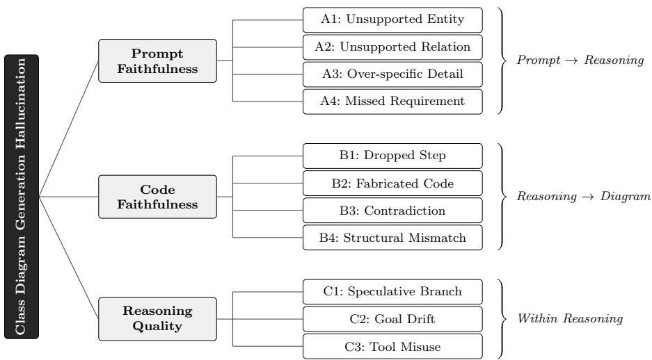  
Fig. 1 Taxonomy of hallucinations in LLM-generated UML class diagrams, organised along the three transitions of the generation pipeline.

Unsupported Entity, Unsupported Relation, Over-specific Detail, and Missed Requirement. The second dimension, Code Faithfulness, captures hallucinations at the reasoning-to-code transition and contains four sub-types: Dropped Step, Fabricated Code, Contradiction, and Structural Mismatch. The third dimension, Reasoning Quality, captures hallucinations internal to the reasoning chain and contains three sub-types: Speculative Branch, Goal Drift, and Tool Misuse.

To assess pre-consensus inter-rater consistency on the 40 independently annotated traces, we calculated pairwise $F _ { 1 }$ Hripcsak and Rothschild (2005) based on the hallucination instances identified by the two annotators. An instance was considered matched when both annotators identified the same hallucination at the same location in the trace. Here, n denotes the number of distinct instances identified by at least one annotator within each dimension, and N denotes the total across all three dimensions. Pairwise $F _ { 1 }$ was 79.78% for Prompt Faithfulness (n = 107), 94.04% for Code Faithfulness (n = 160), and 61.90% for Reasoning Quality (n = 116), with an overall micro-averaged $F _ { 1 }$ of 81.79% (N = 383). The lower consistency for Reasoning Quality reflects the dificulty noted above: judging whether a reasoning step is unsound requires assessing the reasoning process itself rather than comparing it with the prompt or the generated code. The first 20 traces were coded jointly during codebook development and therefore have no independent pre-consensus annotations; all subsequent analyses (RQ2 and RQ3) use the consensus annotations of all 60 traces.

Section 4.2 defines each sub-type and illustrates it with a representative example from the coded traces.

## 4.2 Hallucination Taxonomy

The following subsections define the sub-types of each dimension, specifying the unit of analysis and the decision rule applied during annotation, and illustrate each sub-type with a representative example from the coded traces.

## 4.2.1 Dimension A: Prompt Faithfulness (Prompt → Reasoning)

This dimension captures cases where the model’s reasoning chain introduces or omits content relative to the input requirements, independent of the final PlantUML output. We apply an evidence rule: every committed element in the chain (entity, relation, attribute, multiplicity, operation) must be justified by an explicit span in the prompt.

A1, Unsupported Entity. We label an Unsupported Entity when the chain introduces a class or interface that has no explicit textual basis in the exercise description. The unit of analysis is a single classifier (class/interface).

Figure 2 illustrates this pattern. The model introduces the Supplier and RestockOrder classes, even though the prompt does not mention these concepts. The prompt only describes operations related to customers, subscriptions, and movie ordering, not supply-chain interactions. These additional entities are therefore considered unsupported, illustrating how the model fabricates new classes that extend beyond the given requirements.

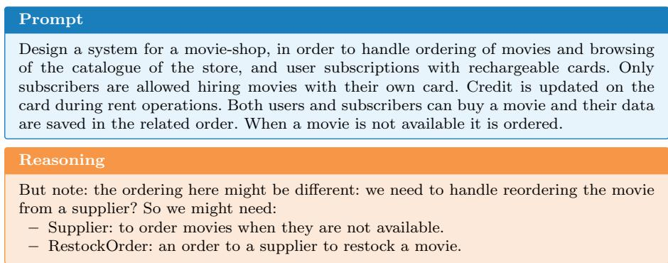  
Fig. 2 A1 Unsupported Entity. The reasoning trace introduces Supplier and RestockOrder classes that have no textual basis in the requirement.

A2, Unsupported Relation. We mark an Unsupported Relation when the reasoning trace asserts an association, generalisation, aggregation/composition, or a specific direction/multiplicity between entities without a justifying span in the requirement description. The unit of analysis is a single relation. Implicit co-occurrence (“orders include items”) does not license composition, containment, or arrow direction unless the text states it; similarly, inheritance requires an explicit subtype cue.

Figure 3 illustrates this. The model infers and commits to two associations (Project–Requirement and Project–System) with multiplicities and directionality, even though the requirement description only mentions that a project uses requirements and produces a system. The text does not specify ownership, creation, or multiplicity relations, yet the model interprets these as composition and assigns cardinalities. These added structural commitments are not supported by the requirement description and therefore constitute Unsupported Relations.

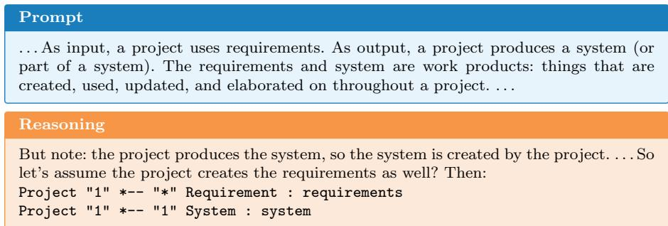  
Fig. 3 A2 Unsupported Relation. The reasoning trace commits to composition relations with explicit multiplicities between Project and Requirement/System that the requirement description does not warrant.

A3, Over-specific Detail. We count Over-specific Detail when the reasoning trace invents multiplicities, datatypes, attributes, or operation signatures that go beyond what the requirement description specifies. The unit of analysis is a property, multiplicity, or signature. Numeric or cardinality cues in the text (e.g., “exactly one”) justify commitments; otherwise, defaults like 1..\*, concrete types such as DateTime, or extra parameters are considered invented. Neutral placeholders (e.g., {type TBD}) are acceptable and not penalised.

Figure 4 illustrates this. The model introduces additional details that are not supported by the requirement description, including specific attributes (dateOfBirth, gender), datatypes (String, Date),

and an operation (scheduleAppointment) with parameters. The requirement description only mentions the presence of a patient record system but provides no attribute-level or procedural details. These added elements therefore represent Over-specific Details, meaning plausible yet fabricated information that extends beyond the given requirements.

A4, Missed Requirement. An element explicitly required by the prompt (entity, attribute, relation, or constraint) does not appear anywhere in the chain.

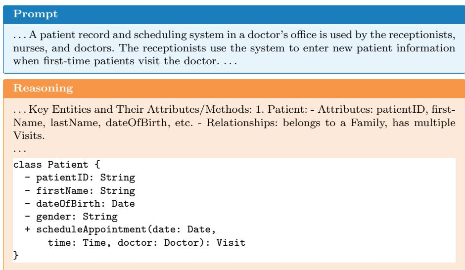  
Fig. 4 A3 Over-specific Detail. The requirement refers only to “new patient information” without specifying what this information comprises. The reasoning trace nevertheless commits to concrete attributes for Patient (e.g., dateOfBirth, gender) and assigns them specific datatypes (String, Date), none of which is supported by the text.

Figure 5 illustrates this. The prompt explicitly states that tables are composed of rows and columns, yet the model’s reasoning includes only the classes Table, Row, and Cell. The absence of a Column class, which is directly implied by the prompt, indicates that the model omitted an element required by the specification.

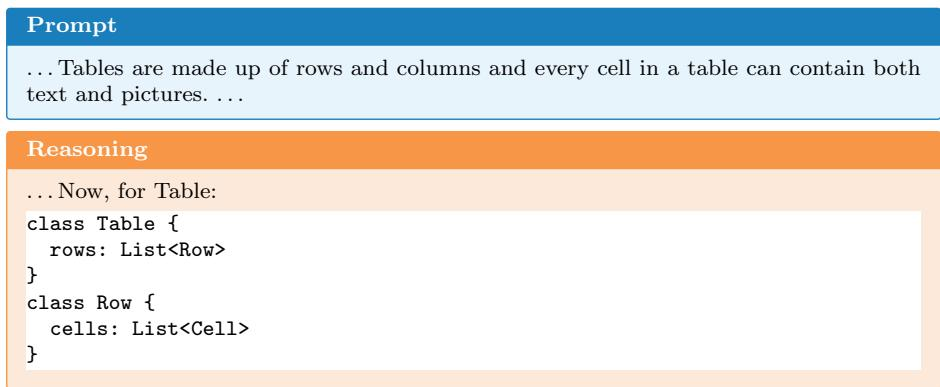  
Fig. 5 A4 Missed Requirement. Although the prompt mentions both rows and columns, the reasoning trace omits a Column class.

## 4.2.2 Dimension B: Code Faithfulness (Reasoning → PlantUML)

This dimension evaluates agreement between the model’s internal plan (the reasoning trace) and the final PlantUML output. We parse both into comparable fact sets of entities, attributes, operations, and relations.

B1, Dropped Step. A planned element present in the reasoning trace is missing in the PlantUML code. The unit is the element at the finest granularity (class, attribute, operation, or relation). We mark “dropped” only when there is no equivalent implementation.

Figure 6 illustrates this. The reasoning trace defines the class Account with two attributes, accountNumber and balance, but the corresponding PlantUML code includes only balance. The attribute accountNumber, which was planned in the reasoning trace, is absent from the final implementation.

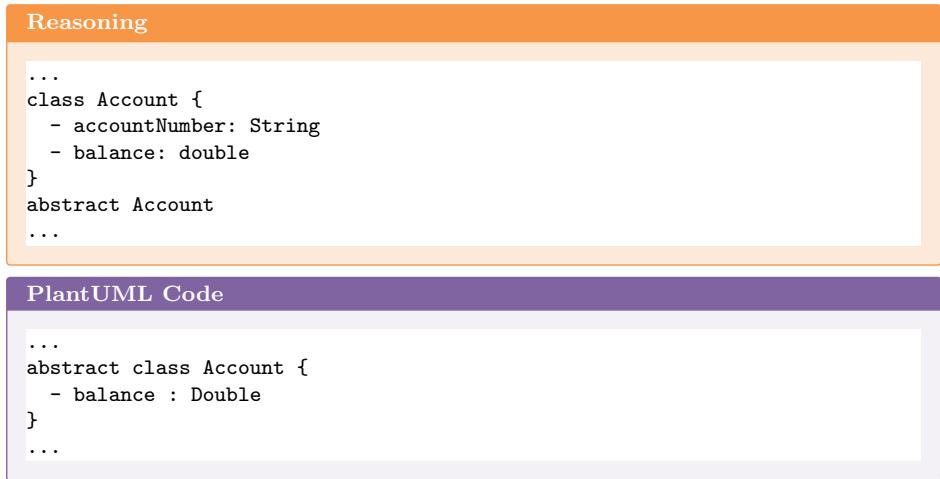  
Fig. 6 B1 Dropped Step. The reasoning trace plans both accountNumber and balance on Account, but the PlantUML code emits only balance.

B2, Fabricated Code. The PlantUML code introduces an element that the reasoning trace never committed to, including extra classes, relations, or attributes, as well as notes that carry modelling meaning. Minor syntactic sugar (e.g., whitespace, ordering) is ignored, but any semantic addition counts.

Figure 7 illustrates B2 (and B3 below). The code introduces Factory "1" -- "\*" Machine and Machine "\*" -- "\*" Worker : operates, neither of which appears in the reasoning plan.

B3, Contradiction. The code conflicts with the plan on multiplicity, relation kind/direction, or type. In the same example (Figure 7), the reasoning specifies OrderLine "\*" --> "1" ProductType but the code implements OrderLine "1" -- "1" ProductType, changing both multiplicity and direction.

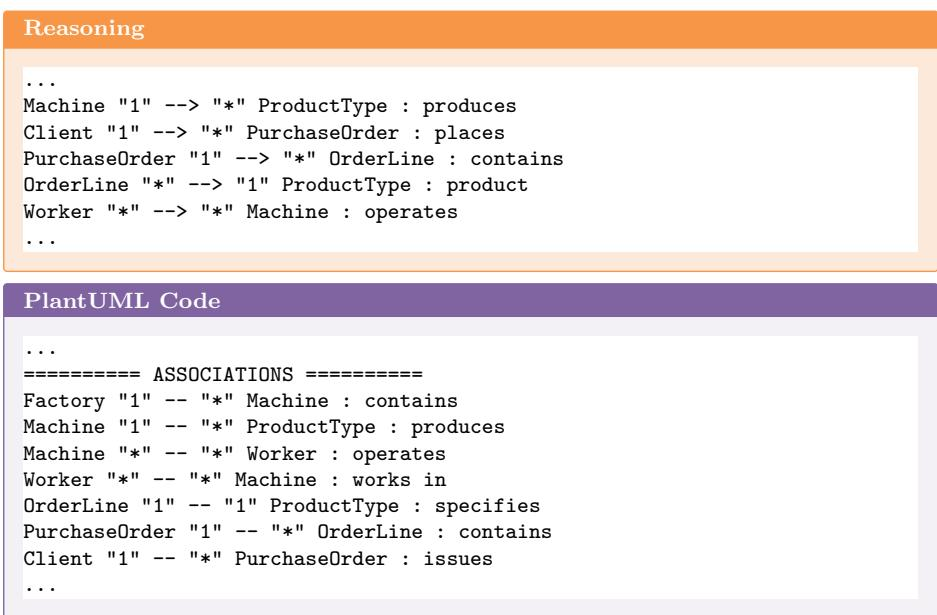  
Fig. 7 B2 Fabricated Code and B3 Contradiction. The PlantUML code introduces Factory--Machine and Machine--Worker relations absent from the reasoning plan (B2), and changes the multiplicity and direction of OrderLine--ProductType (B3).

B4, Structural Mismatch. The reasoning trace specifies one structural choice but the PlantUML code implements another (e.g., a planned association realised as an attribute/collection; aggregation vs. composition; interface planned but class emitted). This is not a simple Dropped Step (B1) nor a Contradiction (B3), but a change of modelling construct.

Figure 8 illustrates this. The reasoning trace proposes a separate StockItem class that references Movie and carries inventory properties such as availability and pricing. In the PlantUML code, these structures are collapsed into attributes of Movie.

## 4.2.3 Dimension C: Reasoning Quality (Within-Chain Soundness)

This dimension evaluates whether the reasoning trace itself is logically sound, regardless of whether errors propagate to the final code.

C1, Speculative Branch. We tag Speculative Branch when the reasoning trace introduces hedged alternatives (“maybe/possibly/if needed”) that add entities, relations, or assumptions without citing evidence from the requirement description. These alternatives are typically abandoned or never resolved. If a speculative branch is explicitly retracted with a rationale and leaves no unsupported commitment, it is recorded but considered lower severity. However, if the speculation propagates into later design decisions or forces reversals downstream, it is scored as a significant fault.

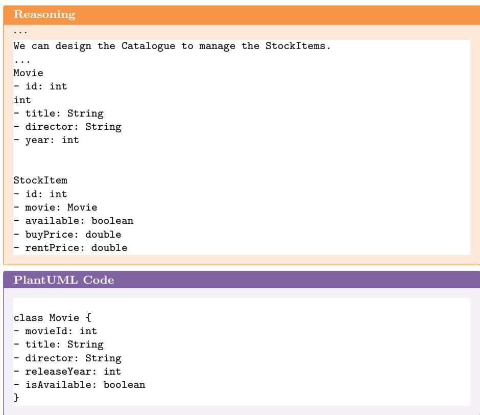  
Fig. 8 B4 Structural Mismatch. The reasoning trace plans a separate StockItem class with inventory properties, but the PlantUML code collapses these into attributes of Movie.

Figure 9 illustrates this. The reasoning trace introduces a possible Factory entity and a one-to-many relation with Machine, even though the requirement description provides no explicit evidence for either. The model repeatedly speculates about whether to include or omit the Factory class, changing its decision several times before discarding it. This behaviour represents a Speculative Branch because the model explores unsupported alternatives without clear justification. Although the speculation is eventually withdrawn, it reflects unstable reasoning that can lead to inconsistencies in later steps.

The model oscillates multiple times about whether to include a Factory class without resolving the question with textual evidence.

C2, Goal Drift. We record Goal Drift when the reasoning trace optimises for aesthetics, simplicity, or notational preferences (e.g., preferring symmetry, minimising class count, choosing composition “for neatness”) rather than faithfully implementing the requirement description. The unit of analysis is a design decision whose stated rationale is misaligned with the task objective.

Figure 10 illustrates this. The reasoning trace diverts from the task objective by focusing on the visual appearance of the diagram rather than the correctness of its structure. The model introduces aesthetic adjustments, such as the use of skinparam settings and crow’s foot notation, which are unrelated to the functional or semantic requirements described in the requirement description.

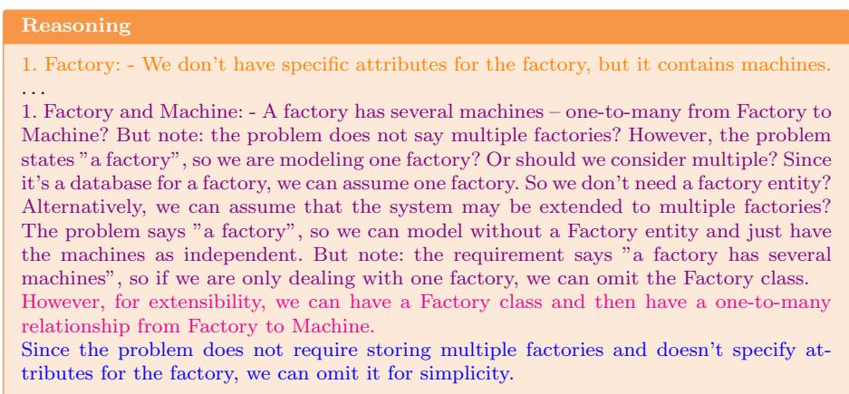  
Fig. 9 C1 Speculative Branch. The reasoning trace reverses its decision on whether to include a Factory class multiple times, without justification from the requirement description. Each coloured fragment marks a reversal.

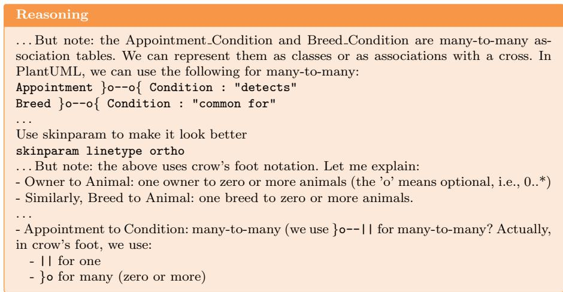  
Fig. 10 C2 Goal Drift. The reasoning trace shifts focus to visual presentation (skinparam, crow’s-foot notation) rather than faithful implementation of the requirement.

C3, Tool Misuse. We label Tool Misuse when the reasoning trace proposes PlantUML or UML constructs with incorrect semantics or syntax, such as composition without lifecycle dependency, using inheritance to model a role, misusing realisation/interfaces, or invalid multiplicities. Faults are counted even if the final PlantUML code omits them, since proposing an invalid construct indicates a misunderstanding that may reappear as contradictions or structural substitutions in the code.

Figure 11 illustrates this. The reasoning trace intends to represent a composition relationship between Order and OrderLine but uses the incorrect PlantUML notation --o. In PlantUML, the symbol o-- denotes aggregation, not composition.

Reasoning   
’ Order and OrderLine: composition, because the lines are part of the order   
Order "1" --o "1..\*" OrderLine : consists of >

Fig. 11 C3 Tool Misuse. The reasoning trace intends composition between Order and OrderLine but uses --o, the PlantUML symbol for aggregation.

The reasoning intends composition but uses the PlantUML notation --o, which denotes aggregation. This indicates a misunderstanding of the notation that may propagate to the final output.

## 4.3 RQ2: Hallucination Distribution

Figure 12 shows the proportional distribution of hallucination types across the 60 runs of Dataset 1 (manual annotation). Code Faithfulness was the most frequent dimension (48.2%), followed by Prompt Faithfulness (30.9%) and Reasoning Quality (20.9%). Within Code Faithfulness, the leading subtypes were Contradiction (20.0%) and Fabricated Code (14.0%). Over-specific Detail (15.0%) was the leading sub-type within Prompt Faithfulness, accounting for nearly half of all errors in that dimension. Tool Misuse (13.1%) clearly dominated Reasoning Quality, where it constituted 62.5% of within-dimension errors; Speculative Branch (4.5%) and Goal Drift (3.3%) appeared far less frequently.

Applying the dual-LLM evaluation pipeline (Section 3.2) to the 120 descriptions in Dataset 2 yielded the distribution shown in Figure 13. The dimensionlevel ordering was consistent with Dataset 1: Code Faithfulness remained the most frequent dimension (41.7% vs. 48.2%), followed by Prompt Faithfulness (37.0% vs. 30.9%) and Reasoning Quality (21.3% vs. 20.9%). Sub-type rankings were also partially consistent: Fabricated Code and Contradiction were the most frequent Code Faithfulness sub-types in both datasets, while Overspecific Detail led Prompt Faithfulness. For Reasoning Quality, however, the leading sub-type difered across annotation settings, with Tool Misuse dominating Dataset 1 and Speculative Branch dominating Dataset 2. Automated annotation also yielded higher absolute error counts than manual coding.

To assess the consistency of the dual-LLM annotation pipeline with human judgement, one author independently annotated a stratified random sample of

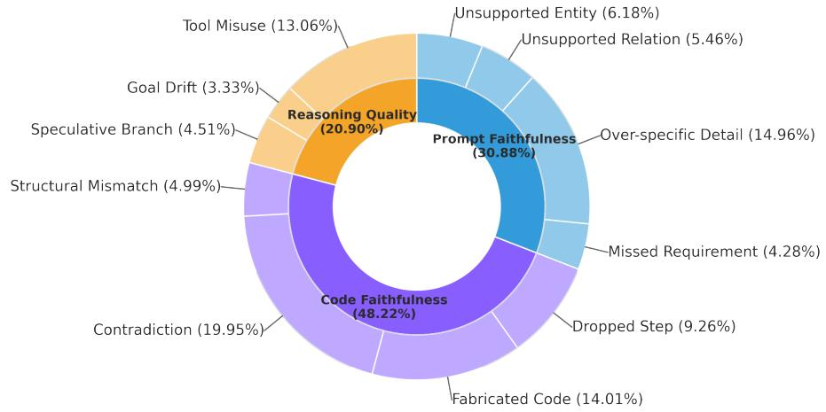

Fig. 12 Proportional distribution of hallucination types in Dataset 1 (60 manually annotated runs).  
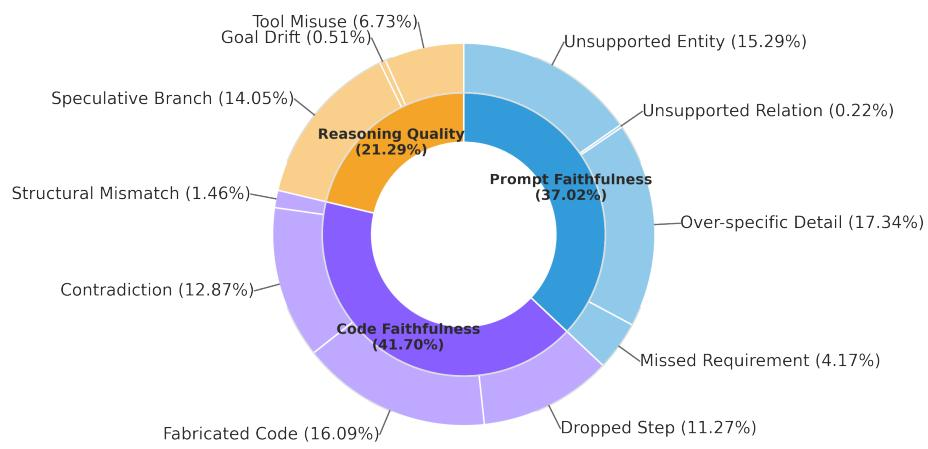  
Fig. 13 Proportional distribution of hallucination types in Dataset 2 (120 descriptions, automated dual-LLM annotation).

30 reasoning traces (25% of Dataset 2). We compared hallucination instances identified by the pipeline and the human annotator using pairwise F1, considering an instance matched when both identified the same hallucination at the same location in the trace. Pairwise F1 was 77.93% for Prompt Faithfulness (n = 130), 87.60% for Code Faithfulness (n = 145), and 81.60% for Reasoning Quality (n = 74), with an overall micro-averaged F1 of 82.89% (N = 349). Here, n denotes the number of distinct hallucination instances identified by at least one of the two annotation methods within each dimension, while N denotes the total across all three dimensions.

Table 3 Dimension-level hallucination distribution across datasets and models. DeepSeek V4-Pro results are based on 20 traces and should be interpreted with caution.
<table><tr><td>Dimension</td><td>Dataset 1 (R1, n = 60)</td><td>Dataset 2 (n = 120)</td><td>DeepSeek-V4-Pro (n = 20)</td></tr><tr><td>Prompt Faithfulness</td><td>30.9%</td><td>37.0%</td><td>56.7%</td></tr><tr><td>Code Faithfulness</td><td>48.2%</td><td>41.7%</td><td>5.8%</td></tr><tr><td>Reasoning Quality</td><td>20.9%</td><td>21.3%</td><td>37.5%</td></tr></table>

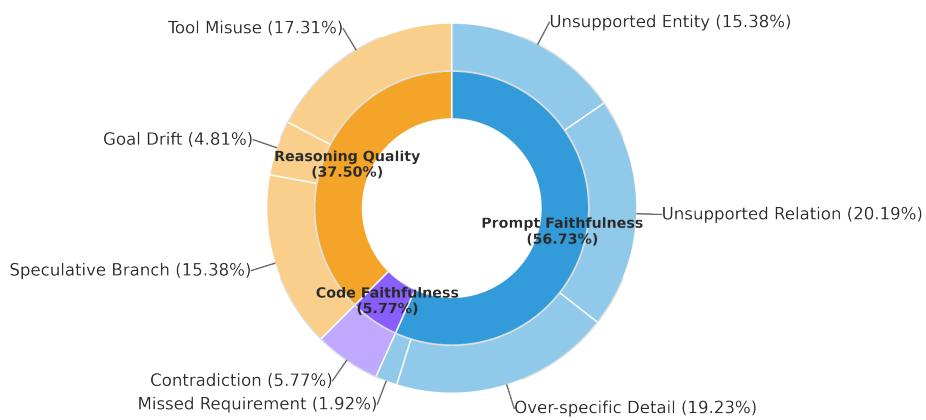  
Fig. 14 Proportional distribution of hallucination types for DeepSeek-V4-Pro (20 manually annotated traces on the Dataset 1 descriptions).

To assess whether the proposed taxonomy generalises beyond the model used for its initial construction, we repeated the procedure on all 20 descriptions from Dataset 1 using the more recent DeepSeek-V4-Pro model at temperature 1. The resulting 20 reasoning traces were annotated manually following the procedure in Section 3.1. The taxonomy remained applicable to the new traces, but the distribution of hallucination dimensions difered substantially from that observed for DeepSeek-R1 on the same descriptions (Table 3 and Figure 14). Prompt Faithfulness became the most frequent dimension (56.7%), followed by Reasoning Quality (37.5%), while Code Faithfulness decreased sharply to 5.8%. All six Code Faithfulness instances were classified as Contradiction (B3), corresponding specifically to multiplicity reversals between the reasoning trace and the generated code. Within Prompt Faithfulness, Unsupported Relation (A2; 20.2% of all hallucinations) and Over-specific Detail (A3; 19.2%) were the two most frequent sub-types. Over-specific Detail thus remained among the leading Prompt Faithfulness sub-types, as in Datasets 1 and 2, whereas Unsupported Relation, which accounted for only 5.5% of hallucinations in Dataset 1, became considerably more prominent.

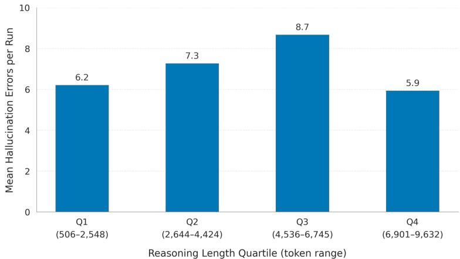  
Fig. 15 Mean total errors per run by reasoning-length quartile (Dataset 1, N = 60).

## 4.4 RQ3: Reasoning Length and Requirement Complexity

Using Dataset 1, we examined the association between reasoning-trace length (in tokens) and the number of hallucination errors per run. Figure 15 presents the mean total errors across four quartiles of reasoning length $( n = 1 5$ runs per quartile). Descriptively, the binned means suggest an inverted-U pattern, with fewer errors in the shortest (Q1: 6.20) and longest (Q4: 5.93) quartiles and higher error counts in the middle quartiles (Q2: 7.27; Q3: 8.67). However, Spearman correlation analyses found no statistically significant monotonic association between reasoning length and overall hallucination frequency $( \rho ~ = ~ - 0 . 0 1 1 , ~ p ~ = ~ 0 . 9 3 4 )$ , or any individual hallucination dimension (all $p > 0 . 1 4 )$ . Thus, the inverted-U pattern should be interpreted as a descriptive tendency rather than evidence of a statistically established relationship.

We examined the association between requirement complexity, computed using Equation (1), and hallucination frequency. Requirement complexity showed a negative correlation with overall hallucination frequency (Spearman $\rho =$ $- 0 . 3 2 5 , p = 0 . 0 1 1 )$ , indicating that runs with higher requirement-complexity scores tended to exhibit fewer annotated hallucinations. This association was most pronounced for Prompt Faithfulness $( \rho = - 0 . 3 7 5 , p = 0 . 0 0 3 )$ , while correlations with Reasoning Quality $( \rho = - 0 . 2 0 9 , p = 0 . 1 1 0 )$ and Code Faithfulness $( \rho = - 0 . 1 7 3 , p = 0 . 1 8 7 )$ were not statistically significant. These findings suggest a modest association between requirement complexity and hallucination frequency, particularly for deviations from the original requirements. However, the correlational analysis does not establish a causal relationship.

## 5 Taxonomy-Guided Mitigation Experiment

To answer RQ4, we evaluated whether embedding the taxonomy as generationtime constraints and post-hoc verification rules can improve diagram quality.

Three conditions were designed to isolate the efects of embedding diferent taxonomy dimensions into the generation pipeline.

Condition 1, Baseline: A plain system prompt with no taxonomy awareness and no post-hoc verification. The model receives a minimal instruction (“You are a helpful assistant that creates UML class diagrams”) and generates PlantUML code from the requirement description. This serves as the control.

Condition 2, Taxonomy-Aware Generation: The system prompt encodes two taxonomy dimensions as explicit generation constraints: Prompt Faithfulness (A1–A4) and Reasoning Quality (C1–C3). The model is instructed to identify every entity, action, and constraint in the requirement; justify each class with an explicit quotation from the text; assign multiplicities only when textually supported; and re-read the requirement to verify completeness before finalising. Key constraints prohibit introducing unsupported entities or relations (A1, A2), inventing datatypes or multiplicities (A3), using composition without lifecycle dependency (C3), and speculative branching (C1).

Condition 3, Taxonomy-Aware Generation + Code Faithfulness Review: This condition reuses the generation output from Condition 2 and adds a post-hoc verification phase that operationalises the remaining taxonomy dimension: Code Faithfulness (B1–B4). A second prompt provides the model with the full reasoning trace and the generated PlantUML code, instructing it to detect Dropped Steps (B1), Fabricated Code (B2), Contradictions (B3), and Structural Mismatches (B4). Both the generation and verification phases use thinking mode.

Three models were evaluated to assess whether taxonomy-guided prompting generalises across model sizes and training variants: Qwen3-32B (a largescale instruction-tuned model), Qwen3-8B (a smaller variant), and DeepSeek-R1-0528-Qwen3-8B (hereafter, DeepSeek-R1-Qwen3-8B), a distilled model specialised for reasoning tasks. All models were run with the temperature settings recommended by Hugging Face and with thinking mode enabled.

Generated diagrams were evaluated against the gold-standard PlantUML solutions from Dataset 3 along the two semantic-quality dimensions of completeness and correctness introduced by Lindland et al. (1994) in their framework for conceptual-modelling quality. We adapt these dimensions to the UML class-diagram setting by decomposing each into three structural categories, classes, attributes, and relationships and scoring every category on a 0–100% scale. This yields six per-diagram metrics: three completeness (recall) measures (i.e., Class Completeness, Attribute Completeness, and Relationship Completeness) and three correctness (precision) measures (i.e., Class Correctness, Attribute Correctness, and Relationship Correctness). The gold solution served as the primary reference; the natural-language description was used as a secondary reference to validate whether deviations were semantically justified. Evaluation scores were independently reviewed and verified by two authors.

Table 4 Mean $F _ { 1 }$ scores (%) per model and condition across 13 cases. Bold indicates the best score per model and metric.
<table><tr><td>Model</td><td>Condition</td><td>Cls</td><td>Att</td><td>Rel</td><td>Overall</td></tr><tr><td rowspan="3">DeepSeek-R1-Qwen3-8B</td><td>Baseline</td><td>84.1</td><td>84.8</td><td>67.5</td><td>78.8</td></tr><tr><td>T-Aware Gen.</td><td>88.2</td><td>89.6</td><td>74.3</td><td>84.0</td></tr><tr><td>T-Aware + CF Rev.</td><td>88.8</td><td>88.7</td><td>71.4</td><td>83.0</td></tr><tr><td rowspan="3">Qwen3-32B</td><td>Baseline</td><td>89.7</td><td>85.0</td><td>82.0</td><td>85.5</td></tr><tr><td>T-Aware Gen.</td><td>90.9</td><td>92.5</td><td>86.2</td><td>89.9</td></tr><tr><td>T-Aware + CF Rev.</td><td>90.2</td><td>90.4</td><td>85.1</td><td>88.6</td></tr><tr><td rowspan="3">Qwen3-8B</td><td>Baseline</td><td>86.5</td><td>93.9</td><td>70.4</td><td>83.6</td></tr><tr><td>T-Aware Gen.</td><td>90.6</td><td>94.0</td><td>73.9</td><td>86.1</td></tr><tr><td>T-Aware + CF Rev.</td><td>90.6</td><td>93.3</td><td>76.9</td><td>86.9</td></tr></table>

Table 5 Change in Overall F1 (pp) relative to Baseline. Significant results (Wilcoxon, p < 0.05) marked with \*.
<table><tr><td>Model</td><td>Condition</td><td> $\varDelta F _ { 1 }$ </td><td>W</td><td>p</td></tr><tr><td rowspan="2">DeepSeek-R1-Qwen3-8B</td><td>T-Aware Gen.</td><td>+5.2</td><td>8.0</td><td>0.006*</td></tr><tr><td>T-Aware + CF Rev.</td><td>+4.1</td><td>8.0</td><td>0.006*</td></tr><tr><td rowspan="2">Qwen3-32B</td><td>T-Aware Gen.</td><td>+4.3</td><td>8.0</td><td>0.006*</td></tr><tr><td>T-Aware + CF Rev.</td><td>+3.0</td><td>15.0</td><td>0.064</td></tr><tr><td rowspan="2">Qwen3-8B</td><td>T-Aware Gen.</td><td>+2.6</td><td>16.0</td><td>0.040*</td></tr><tr><td>T-Aware + CF Rev.</td><td>+3.4</td><td>15.0</td><td>0.033*</td></tr><tr><td rowspan="4">Pooled</td><td></td><td></td><td></td><td></td></tr><tr><td>T-Aware Gen.</td><td>+4.0</td><td>90.0</td><td>&lt;0.001*</td></tr><tr><td>T-Aware + CF Rev.</td><td>+3.5</td><td>116.0</td><td>&lt;0.001*</td></tr></table>

To provide a balanced single-metric view of diagram quality, we combine completeness and correctness into an $F _ { 1 }$ score per dimension:

$$
F _ { 1 } = { \frac { 2 \times { \mathrm { C o r r e c t n e s s } } \times { \mathrm { C o m p l e t e n e s s } } } { \mathrm { C o r r e c t n e s s } } }\tag{2}
$$

We compute $F _ { 1 }$ for each of the three dimensions (Class, Attribute, Relationship) and report their average as the Overall $F _ { 1 }$ . This metric penalises both hallucinated elements (low precision) and missed requirements (low recall).

Table 4 presents the mean $F _ { 1 }$ scores across all 13 Golden UML ModelSet cases for each model and condition. Table 5 reports the change relative to the Baseline with statistical significance.

Taxonomy-aware generation improves diagram quality. Taxonomy-Aware Generation, which incorporates the Prompt Faithfulness and Reasoning Quality dimensions into the generation prompt, improved Overall $F _ { 1 }$ for all three models relative to the Baseline. The gains were +5.2 pp for DeepSeek-R1- Qwen3-8B (W = 8, p = 0.006), +4.3 pp for Qwen3-32B $( W = 8 , p = 0 . 0 0 6 )$ and +2.6 pp for Qwen3-8B $( W = 1 6 , p = 0 . 0 4 0 )$ . The pooled improvement was +4.0 pp $( W = 9 0 , p < 0 . 0 0 1 )$ . Improvements were observed across all three structural metrics, although the largest gain difered by model: Relationship $F _ { 1 }$ improved most for DeepSeek-R1-Qwen3-8B (+6.8 pp), Attribute $F _ { 1 }$ for Qwen3-32B (+7.5 pp), and Class $F _ { 1 }$ for Qwen3-8B (+4.1 pp). These results show that Taxonomy-Aware Generation improved the structural quality of generated diagrams across the three evaluated models.

Adding the Code Faithfulness review after Taxonomy-Aware Generation produced inconsistent changes in Overall $F _ { 1 }$ across the three models. Overall $F _ { 1 }$ decreased by 1.0 pp for DeepSeek-R1-Qwen3-8B and by 1.3 pp for Qwen3-32B, while increasing by 0.8 pp for Qwen3-8B. Nevertheless, both Taxonomy-Aware Generation and Taxonomy-Aware Generation with Code Faithfulness review showed significant improvements over the Baseline in the pooled analysis (+4.0 pp and +3.5 pp, respectively; both $p < 0 . 0 0 1 )$ . After Bonferroni correction for the six per-model comparisons against the Baseline, only three remained statistically significant.

Relationship $F _ { 1 }$ was consistently the lowest of the three evaluated metrics across all models and conditions, ranging from 67.5% for DeepSeek-R1-Qwen3- 8B under the Baseline to 86.2% for Qwen3-32B under Taxonomy-Aware Generation.

## 6 Discussion

The four research questions form a progression from diagnosis (RQ1), through validation (RQ2) and predictor analysis (RQ3), to intervention (RQ4). Taken together, the findings suggest three main conclusions.

First, Code Faithfulness was the most frequently observed failure dimension for DeepSeek-R1, highlighting discrepancies between reasoning and generated diagram code. However, the distribution of hallucination dimensions difered for DeepSeek-V4-Pro, suggesting that the relative prevalence of failure types may depend on the model. Second, the relationships between hallucination frequency and the examined characteristics were mixed. Reasoningtrace length showed no significant monotonic association with hallucination frequency, whereas requirement complexity was negatively associated with overall hallucination frequency and Prompt Faithfulness errors in Dataset 1. Third, incorporating taxonomy-derived guidance into generation prompts improved mean overall F1 across all three evaluated models, although the statistical evidence varied across model-condition comparisons. Notably, these improvements were obtained through guidance targeting Prompt Faithfulness and Reasoning Quality, despite Code Faithfulness being the most frequent failure dimension for DeepSeek-R1. This suggests that the most frequently observed failure dimension is not necessarily the only useful target for intervention.

Localising hallucinations across the generation process. Code Faithfulness was the most frequent hallucination dimension in both Dataset 1 (48.2%) and

Dataset 2 (41.7%), with Contradiction and Fabricated Code among its leading sub-types. The same dimension-level ordering (Code Faithfulness, followed by Prompt Faithfulness and Reasoning Quality) was observed in both the manually and automatically annotated datasets, indicating a consistent descriptive pattern across the two datasets and annotation approaches.

For DeepSeek-R1, this highlights the importance of discrepancies between the reasoning trace and the generated PlantUML code: a model may formulate a plausible structural plan yet fail to represent it faithfully in the final diagram code. However, because the traces in both datasets were produced by the same model, this ordering should not be assumed to generalise to other models. Indeed, the cross-model analysis (Section 4.3) indicates a diferent distribution of hallucination dimensions.

Failure distributions may be model-dependent. The cross-model analysis qualifies the pattern above. For DeepSeek-V4-Pro, Code Faithfulness accounted for only 5.8% of observed hallucinations, all involving multiplicity reversals between the reasoning trace and the generated code, while Prompt Faithfulness (56.7%) and Reasoning Quality (37.5%) became the dominant dimensions. The taxonomy remained applicable to the new traces, suggesting that it captures failure modes that recur across models, although their relative prevalence may difer substantially. In particular, the reasoning-to-code transition, which was the dominant failure site for DeepSeek-R1, showed substantially fewer observed failures for DeepSeek-V4-Pro, although hallucinations were not eliminated overall. The persistence of Over-specific Detail as the leading Prompt Faithfulness sub-type across the analysed datasets and models suggests that some individual failure patterns may be more stable than their aggregate frequencies. Because the cross-model analysis is based on only 20 traces at a single temperature, these findings provide preliminary evidence of transferability and should be confirmed through a more systematic cross-model evaluation.

Reasoning length and requirement complexity show diferent associations with hallucination frequency. In Dataset 1, reasoning-trace length showed no significant monotonic association with hallucination frequency, suggesting that longer reasoning does not necessarily correspond to more or fewer observed errors. Although the quartile-based analysis suggested an inverted-U pattern, this remained a descriptive observation rather than a statistically established relationship.

Requirement complexity, in contrast, was negatively associated with overall hallucination frequency, particularly with Prompt Faithfulness errors. One possible explanation is that requirements receiving higher complexity scores may also provide more explicit information that constrains unsupported inferences. However, this interpretation remains speculative, as the complexity measure does not independently capture requirement clarity or specificity.

Overall, these findings suggest that simple measures such as reasoning length and requirement complexity are insuficient on their own to characterise hallucination frequency. Given that the analysis was restricted to Dataset 1, further investigation is needed to determine whether these associations hold across other datasets and models.

From failure analysis to intervention. Taxonomy-Aware Generation improved Overall $F _ { 1 }$ across all three evaluated models, showing that the taxonomy can be operationalised beyond descriptive failure analysis and used to inform a generation-time intervention. This provides an important connection between the diagnostic and mitigation stages of the study: failure patterns identified through the analysis of reasoning traces were translated into generation constraints and evaluated through the quality of the resulting diagrams.

The post-hoc Code Faithfulness review produced a diferent pattern. Adding the review to Taxonomy-Aware Generation decreased mean Overall $F _ { 1 }$ for two models and increased it for one, providing no consistent additional benefit. This is noteworthy because Code Faithfulness was the most frequent hallucination dimension in the initial DeepSeek-R1 analyses. One possible explanation is that correcting consistency between the reasoning trace and generated code does not necessarily improve the final diagram when the underlying reasoning is itself flawed. Some Code Faithfulness errors may also reflect earlier failures in the generation process, although this mechanism was not directly tested. The review added in Condition 3 difers from the constraints in Condition 2 in both its timing and the taxonomy dimension it targets. Therefore, the observed diference cannot be attributed to intervention timing alone and does not establish that generation-time constraints are generally more efective than post-hoc verification. Alternative forms of post-hoc verification may produce diferent results.

## Relationship modelling remains a persistent challenge.

Relationship modelling remains a persistent challenge. Relationship $F _ { 1 }$ was the lowest-scoring metric for every model and condition (Table 4). Although taxonomy-aware generation improved Relationship $F _ { 1 }$ for all three models, the magnitude of improvement varied, and relationships did not consistently show the largest gains among the evaluated diagram elements. Relationship modelling therefore remains an important target for further improvement.

Two characteristics of UML relationships may help explain this dificulty. First, natural-l anguage requirements may leave relationship properties implicit or underspecified. For example, a statement such as “students enrol in courses” identifies related entities but does not necessarily specify multiplicity, navigability, or whether enrolment should be modelled as a direct association or an association class. Second, identifying appropriate relationships may require integrating information distributed across multiple requirements rather than relying on local textual matches. Although these explanations were not directly tested, they suggest potential directions for future interventions, including few-shot examples of common relationship patterns, explicit relationship inventories, and dedicated multiplicity verification.

Prompt echoing as a potential diagnostic cue. One qualitative observation from the manual coding of Dataset 1 is worth noting alongside the quantitative findings: a recurring prompt-echoing pattern in which the model restates a span of the requirement verbatim within its reasoning trace before committing to a structural decision. Echoing was typically signalled by phrases such as “the problem says. . . ”, “the description states that. . . ”, or “it says. . . ”. In our coded traces it appeared to function as a boundary marker between grounded reasoning and speculative commitment: the model frequently used the echo as an apparent justification for a structural decision that the prompt did not in fact support, treating the recitation itself as evidence. Figure 16 shows a representative case from the project-modelling exercise, in which the model echoes “work products are created, used, updated, and elaborated throughout the project” and then commits to composition between Project and its Requirements/System. The resulting commitment was coded as Unsupported Relation (A2): the prompt’s verb “produces” licenses a general association but not the lifecycle dependency that composition implies. Operationally, echothen-commit transitions are mechanically simple to detect—a sliding-window match between the reasoning trace and the prompt—and could be incorporated into existing LLM observability pipelines to flag candidate hallucinations for review.

However, the problem says “work products are created, used, updated, and elaborated   
throughout the project”. So both requirements and system are work products of the   
project. So composition is appropriate.   
But the project has multiple requirements and one system. We’ll use composition for   
both:   
Project "1" \*-- "\*" Requirement   
Project "1" \*-- "1" System  
Fig. 16 The prompt-echoing anti-pattern. The reasoning trace recites a span of the requirement verbatim and then commits to composition between Project and its Requirements/System. The commitment was coded as A2 Unsupported Relation: the prompt’s verb “produces” supports a general association but not the lifecycle dependency composition implies.

Implications for practice. Two practical implications follow from our findings for practitioners using reasoning-capable LLMs to generate UML class diagrams. First, incorporating modelling-specific constraints into the generation prompt can be useful: across all three evaluated models, the Taxonomy-Aware prompt improved diagram quality relative to the minimal Baseline prompt. Second, relationship modelling warrants particular attention during generation and review. Relationship $F _ { 1 }$ was the lowest structural metric across all models and conditions, including after Taxonomy-Aware Generation. Practitioners may therefore benefit from explicitly checking generated relationships and multiplicities against the source requirements rather than relying only on the overall plausibility of the diagram. More broadly, our findings suggest that improving LLM-based UML generation may benefit from modelling-specific mechanisms for grounding and validating structural decisions alongside general reasoning capabilities.

## 7 Threats to Validity

We discuss the main threats to the validity of our study below.

Internal Validity. The taxonomy was developed through manual coding and subsequent independent annotation, with disagreements resolved through discussion and consensus. Researcher interpretation may nevertheless have influenced category boundaries and the classification of borderline cases. Although pre-consensus consistency was assessed using pairwise F1, the lower agreement observed for Reasoning Quality indicates greater annotation uncertainty within this dimension. A further limitation concerns the interpretation of reasoning traces. Our analysis treats the emitted reasoning text as observable evidence of the model’s reasoning process. However, these traces may not faithfully or completely represent the model’s underlying computation. Consequently, the identified hallucination patterns should be understood as discrepancies observable in the generated traces rather than definitive evidence of the model’s internal decision-making mechanisms.

External Validity. The datasets used in this study primarily comprise educational and domain-modelling tasks and may not fully represent the linguistic or structural diversity of industrial requirements. The Golden UML ModelSet Verbruggen et al. (2025), used in the mitigation experiment (RQ4), covers 13 modelling domains but remains rooted in educational contexts.

The taxonomy was developed from DeepSeek-R1 reasoning traces. Although its applicability was also examined using traces from DeepSeek-V4- Pro, this cross-model analysis involved only 20 traces from another model in the same family. Furthermore, the mitigation experiment evaluated three Qwen-based models, including a DeepSeek-R1-distilled variant. Consequently, the generalisability of the taxonomy and mitigation results to other model architectures and non-reasoning LLMs remains uncertain.

Finally, the mitigation experiment included only 13 cases per condition. Although these cases cover the full set of domains represented in the selected benchmark, the limited sample size restricts the extent to which the observed improvements can be generalised to broader modelling tasks.

Construct Validity. The taxonomy focuses on hallucinations in requirements interpretation, reasoning, and generated code, and does not cover all aspects of diagram quality, such as layout and readability. Pre-consensus pairwise $F _ { 1 }$ was lowest for Reasoning Quality, indicating greater annotation uncertainty in this dimension. The dual-LLM annotation pipeline may introduce systematic model biases. To mitigate dependence on a single provider, the annotator and judge were selected from diferent providers. Nevertheless, this separation does not eliminate the possibility of shared biases or classification errors.

Conclusion Validity. The mitigation experiment (RQ4) involved only 13 paired cases per model, limiting the statistical power of the Wilcoxon signedrank tests. Although several improvements were statistically significant, some did not remain significant after Bonferroni correction for multiple comparisons. Non-significant results should therefore not be interpreted as evidence of no efect. The correlation analyses (RQ3) were restricted to 60 reasoning traces from Dataset 1, limiting sensitivity to small associations. Furthermore, the observed correlations should be interpreted as associations rather than causal relationships. These findings require confirmation using larger and more diverse samples.

## 8 Conclusion

This paper investigated hallucinations in UML class-diagram generation by reasoning-capable LLMs, moving beyond the observation of structural errors to characterise how and where they arise during generation. From manually coded reasoning traces and large-scale automated validation, we developed a taxonomy comprising three dimensions: Prompt Faithfulness, Code Faithfulness, and Reasoning Quality. These dimensions correspond to distinct stages of the requirements-to-reasoning-to-code process.

Our results show that Code Faithfulness is the most frequent failure dimension in both DeepSeek-R1 datasets, but that the distribution of hallucinations varies across models. Reasoning-trace length showed no significant association with hallucination frequency, while requirement complexity was negatively associated with overall hallucination frequency and Prompt Faithfulness errors. Most importantly, the taxonomy is actionable: incorporating its Prompt Faithfulness and Reasoning Quality dimensions into the generation prompt increased pooled mean Overall F1 by 4.0 pp across the evaluated models, while an additional post-hoc Code Faithfulness review provided no consistent benefit. This suggests that understanding the origins of hallucinations can inform interventions aimed at preventing errors during generation.

Relationship modelling remains a persistent challenge, consistently yielding the lowest scores across models and conditions. Future work will therefore focus on relationship-specific mitigation, broader UML diagram types, larger industrial datasets, and human validation of reasoning-level categories. We will also investigate prompt echoing as a potential runtime signal for detecting unsupported structural commitments.

More broadly, this work demonstrates the value of studying LLM hallucinations not only as defects in generated artefacts, but as failures that emerge along a generation process. For software modelling, such a process-oriented view ofers a foundation for developing more reliable and controllable LLMbased engineering tools.

## Data Availability

The reasoning traces, the generated PlantUML code, the prompts, and the evaluation results are available in our GitHub replication package (https: //github.com/MojdehRahmanian/HallucinationTaxonomy).

## References

Ataei M, Cheong H, Grandi D, Wang Y, Morris N, Tessier A (2025) Elicitron: A large language model agent-based simulation framework for design requirements elicitation. J Comput Inf Sci Eng 25(2), DOI 10.1115/1.4067388, URL https://doi.org/10.1115/1.4067388

Bari DD, Garaccione G, Coppola R, Torchiano M, Ardito L (2024) Evaluating large language models in exercises of UML class diagram modeling. In: Franch X, Daneva M, Mart´ınez-Fern´andez S, Quaranta L (eds) Proceedings of the 18th ACM/IEEE International Symposium on Empirical Software Engineering and Measurement, ESEM 2024, Barcelona, Spain, October 24-25, 2024, ACM, pp 393–399, DOI 10.1145/3674805.3690741, URL https://doi.org/10.1145/3674805.3690741

Belzner L, Gabor T, Wirsing M (2023) Large language model assisted software engineering: Prospects, challenges, and a case study. In: Steffen B (ed) Bridging the Gap Between AI and Reality - First International Conference, AISoLA 2023, Crete, Greece, October 23-28, 2023, Proceedings, Springer, Lecture Notes in Computer Science, vol 14380, pp 355–374, DOI 10.1007/978-3-031-46002-9\ 23, URL https://doi.org/10. 1007/978-3-031-46002-9\_23

Bozyigit F, Bardakci T, Khalilipour A, Challenger M, Ramackers G, Babur O,¨ Chaudron MRV (2024) Generating domain models from natural language text using NLP: a benchmark dataset and experimental comparison of tools. Softw Syst Model 23(6):1493–1511, DOI 10.1007/S10270-024-01176-Y, URL https://doi.org/10.1007/s10270-024-01176-y

C´amara J, Troya J, Burgue˜no L, Vallecillo A (2023) On the assessment of generative AI in modeling tasks: an experience report with chatgpt and UML. Softw Syst Model 22(3):781–793, DOI 10.1007/S10270-023-01105-5, URL https://doi.org/10.1007/s10270-023-01105-5

Chen K, Yang Y, Chen B, L´opez JAH, Mussbacher G, Varr´o D (2023) Automated domain modeling with large language models: A comparative study. In: 26th ACM/IEEE International Conference on Model Driven Engineering Languages and Systems, MODELS 2023, V¨aster˚as, Sweden, October 1- 6, 2023, IEEE, pp 162–172, DOI 10.1109/MODELS58315.2023.00037, URL https://doi.org/10.1109/MODELS58315.2023.00037

Chillarege R, Bhandari IS, Chaar JK, Halliday MJ, Moebus DS, Ray BK, Wong M (1992) Orthogonal defect classification - A concept for in-process measurements. IEEE Trans Software Eng 18(11):943–956, DOI 10.1109/32. 177364, URL https://doi.org/10.1109/32.177364

Conrardy AD, Cabot J (2024) From image to UML: first results of image-based UML diagram generation using llms. In: Alfraihi H, Basciani F, Caltais G, Ferry N, L´opez JAH, Iovino L, Jongeling R, Klikovits S, Rahimi SK, Rubei R, Tehrani SY, Troya J, Wessel M, Zaytsev V (eds) Proceedings of the STAF 2024 Workshops: AgileMDE 2024, LLM4MDE 2024, and MeSS 2024 co-located with the International Conference on Software Technologies: Applications and Foundations (STAF 2024) Enschede, The Netherlands, July 8-11, 2024, CEUR-WS.org, CEUR Workshop Proceedings, vol 3727, pp 55–65, URL https://ceur-ws.org/Vol-3727/paper5.pdf

Dhuliawala S, Komeili M, Xu J, Raileanu R, Li X, Celikyilmaz A, Weston J (2024) Chain-of-verification reduces hallucination in large language models. In: Ku L, Martins A, Srikumar V (eds) Findings of the Association for Computational Linguistics, ACL 2024, Bangkok, Thailand and virtual meeting, August 11-16, 2024, Association for Computational Linguistics, Findings of ACL, vol ACL 2024, pp 3563–3578, DOI 10. 18653/V1/2024.FINDINGS-ACL.212, URL https://doi.org/10.18653/ v1/2024.findings-acl.212

Fan A, Gokkaya B, Harman M, Lyubarskiy M, Sengupta S, Yoo S, Zhang JM (2023) Large language models for software engineering: Survey and open problems. In: IEEE/ACM International Conference on Software Engineering: Future of Software Engineering, ICSE-FoSE 2023, Melbourne, Australia, May 14-20, 2023, IEEE, pp 31–53, DOI 10.1109/ICSE-FOSE59343.2023.00008, URL https://doi.org/10.1109/ ICSE-FoSE59343.2023.00008

Ferrari A, Abualhaija S, Arora C (2024) Model generation with llms: From requirements to UML sequence diagrams. In: 32nd IEEE International Requirements Engineering Conference, RE 2024 - Workshops, Reykjavik, Iceland, June 24-25, 2024, IEEE, pp 291–300, DOI 10.1109/REW61692.2024. 00044, URL https://doi.org/10.1109/REW61692.2024.00044

Freeman BS, Kicklighter A, Erdman M, Gordon Z (2026) Toward epistemic stability: Engineering consistent procedures for industrial LLM hallucination reduction. CoRR abs/2603.10047, DOI 10.48550/ARXIV.2603.10047, URL https://doi.org/10.48550/arXiv.2603.10047, 2603.10047

Gu J, Jiang X, Shi Z, Tan H, Zhai X, Xu C, Li W, Shen Y, Ma S, Liu H, Wang Y, Guo J (2024) A survey on llm-as-a-judge. CoRR abs/2411.15594, DOI 10.48550/ARXIV.2411.15594, URL https://doi. org/10.48550/arXiv.2411.15594, 2411.15594

Hou X, Zhao Y, Liu Y, Yang Z, Wang K, Li L, Luo X, Lo D, Grundy J, Wang H (2024) Large language models for software engineering: A systematic literature review. ACM Trans Softw Eng Methodol 33(8):220:1–220:79, DOI 10.1145/3695988, URL https://doi.org/10.1145/3695988

Hripcsak G, Rothschild AS (2005) Agreement, the f-measure, and reliability in information retrieval. Journal of the American Medical Informatics Association 12(3):296–298, DOI 10.1197/jamia.M1733

Huang L, Yu W, Ma W, Zhong W, Feng Z, Wang H, Chen Q, Peng W, Feng X, Qin B, Liu T (2025) A survey on hallucination in large language models:

Principles, taxonomy, challenges, and open questions. ACM Trans Inf Syst 43(2):42:1–42:55, DOI 10.1145/3703155, URL https://doi.org/10.1145/ 3703155

Humbatova N, Jahangirova G, Bavota G, Riccio V, Stocco A, Tonella P (2020) Taxonomy of real faults in deep learning systems. In: Rothermel G, Bae D (eds) ICSE ’20: 42nd International Conference on Software Engineering, Seoul, South Korea, 27 June - 19 July, 2020, ACM, pp 1110–1121, DOI 10.1145/3377811.3380395, URL https://doi.org/10. 1145/3377811.3380395

Ji Z, Lee N, Frieske R, Yu T, Su D, Xu Y, Ishii E, Bang Y, Madotto A, Fung P (2023) Survey of hallucination in natural language generation. ACM Comput Surv 55(12):248:1–248:38, DOI 10.1145/3571730, URL https:// doi.org/10.1145/3571730

Lanham T, Chen A, Radhakrishnan A, Steiner B, Denison C, Hernandez D, Li D, Durmus E, Hubinger E, Kernion J, Lukosiute K, Nguyen K, Cheng N, Joseph N, Schiefer N, Rausch O, Larson R, McCandlish S, Kundu S, Kadavath S, Yang S, Henighan T, Maxwell T, Telleen-Lawton T, Hume T, Hatfield-Dodds Z, Kaplan J, Brauner J, Bowman SR, Perez E (2023) Measuring faithfulness in chain-of-thought reasoning. CoRR abs/2307.13702, DOI 10.48550/ARXIV.2307.13702, URL https: //doi.org/10.48550/arXiv.2307.13702, 2307.13702

Lee J, Hockenmaier J (2025) Evaluating step-by-step reasoning traces: A survey. In: Christodoulopoulos C, Chakraborty T, Rose C, Peng V (eds) Findings of the Association for Computational Linguistics: EMNLP 2025, Suzhou, China, November 4-9, 2025, Association for Computational Linguistics, pp 1789–1814, DOI 10.18653/V1/2025.FINDINGS-EMNLP.94, URL https://doi.org/10.18653/v1/2025.findings-emnlp.94

Lewis P, Perez E, Piktus A, Petroni F, Karpukhin V, Goyal N, K¨uttler H, Lewis M, Yih W, Rockt¨aschel T, Riedel S, Kiela D (2020) Retrievalaugmented generation for knowledge-intensive NLP tasks. In: Larochelle H, Ranzato M, Hadsell R, Balcan M, Lin H (eds) Advances in Neural Information Processing Systems 33: Annual Conference on Neural Information Processing Systems 2020, NeurIPS 2020, December 6- 12, 2020, virtual, URL https://proceedings.neurips.cc/paper/2020/ hash/6b493230205f780e1bc26945df7481e5-Abstract.html

Li Y, Choi DH, Chung J, Kushman N, Schrittwieser J, Leblond R, Eccles T, Keeling J, Gimeno F, Lago AD, Hubert T, Choy P, de Masson d’Autume C, Babuschkin I, Chen X, Huang P, Welbl J, Gowal S, Cherepanov A, Molloy J, Mankowitz DJ, Robson ES, Kohli P, de Freitas N, Kavukcuoglu K, Vinyals O (2022) Competition-level code generation with alphacode. CoRR abs/2203.07814, DOI 10.48550/ARXIV.2203.07814, URL https://doi.org/10.48550/arXiv.2203.07814, 2203.07814

Lindland OI, Sindre G, Sølvberg A (1994) Understanding quality in conceptual modeling. IEEE Softw 11(2):42–49, DOI 10.1109/52.268955, URL https: //doi.org/10.1109/52.268955

Liu F, Liu Y, Shi L, Huang H, Wang R, Yang Z, Zhang L (2024) Exploring and evaluating hallucinations in llm-powered code generation. CoRR abs/2404.00971, DOI 10.48550/ARXIV.2404.00971, URL https://doi. org/10.48550/arXiv.2404.00971, 2404.00971

Manakul P, Liusie A, Gales MJF (2023) Selfcheckgpt: Zero-resource black-box hallucination detection for generative large language models. In: Bouamor H, Pino J, Bali K (eds) Proceedings of the 2023 Conference on Empirical Methods in Natural Language Processing, EMNLP 2023, Singapore, December 6-10, 2023, Association for Computational Linguistics, pp 9004– 9017, DOI 10.18653/V1/2023.EMNLP-MAIN.557, URL https://doi.org/ 10.18653/v1/2023.emnlp-main.557

Marjanovic SV, Patel A, Adlakha V, Aghajohari M, BehnamGhader P, Bhatia M, Khandelwal A, Kraft A, Krojer B, L\`u XH, Meade N, Shin D, Kazemnejad A, Kamath G, Mosbach M, Stanczak K, Reddy S (2026) Deepseek-r1 thoughtology: Let’s think about LLM reasoning. Trans Mach Learn Res 2026, URL https://openreview.net/forum?id=BZwKsiRnJI

Maynez J, Narayan S, Bohnet B, McDonald RT (2020) On faithfulness and factuality in abstractive summarization. In: Jurafsky D, Chai J, Schluter N, Tetreault JR (eds) Proceedings of the 58th Annual Meeting of the Association for Computational Linguistics, ACL 2020, Online, July 5-10, 2020, Association for Computational Linguistics, pp 1906– 1919, DOI 10.18653/V1/2020.ACL-MAIN.173, URL https://doi.org/10. 18653/v1/2020.acl-main.173

Pan R, Ibrahimzada AR, Krishna R, Sankar D, Wassi LP, Merler M, Sobolev B, Pavuluri R, Sinha S, Jabbarvand R (2024) Lost in translation: A study of bugs introduced by large language models while translating code. In: Proceedings of the 46th IEEE/ACM International Conference on Software Engineering, ICSE 2024, Lisbon, Portugal, April 14-20, 2024, ACM, pp 82:1–82:13, DOI 10.1145/3597503.3639226, URL https://doi.org/10. 1145/3597503.3639226

Raunak V, Menezes A, Junczys-Dowmunt M (2021) The curious case of hallucinations in neural machine translation. In: Toutanova K, Rumshisky A, Zettlemoyer L, Hakkani-T¨ur D, Beltagy I, Bethard S, Cotterell R, Chakraborty T, Zhou Y (eds) Proceedings of the 2021 Conference of the North American Chapter of the Association for Computational Linguistics: Human Language Technologies, NAACL-HLT 2021, Online, June 6- 11, 2021, Association for Computational Linguistics, pp 1172–1183, DOI 10.18653/V1/2021.NAACL-MAIN.92, URL https://doi.org/10.18653/ v1/2021.naacl-main.92

Shim J, Ju Y, Park J, Lee S (2025) CPR: mitigating large language model hallucinations with curative prompt refinement. CoRR abs/2510.12029, DOI 10.48550/ARXIV.2510.12029, URL https://doi.org/10.48550/arXiv. 2510.12029, 2510.12029

Shuster K, Pof S, Chen M, Kiela D, Weston J (2021) Retrieval augmentation reduces hallucination in conversation. In: Moens M, Huang X, Specia L, Yih SW (eds) Findings of the Association for Computational

Linguistics: EMNLP 2021, Virtual Event / Punta Cana, Dominican Republic, 16-20 November, 2021, Association for Computational Linguistics, Findings of ACL, vol EMNLP 2021, pp 3784–3803, DOI 10.18653/ V1/2021.FINDINGS-EMNLP.320, URL https://doi.org/10.18653/v1/ 2021.findings-emnlp.320

Sun Z, Wang Q, Wang H, Zhang X, Xu J (2025) Detection and mitigation of hallucination in large reasoning models: A mechanistic perspective. CoRR abs/2505.12886, DOI 10.48550/ARXIV.2505.12886, URL https: //doi.org/10.48550/arXiv.2505.12886, 2505.12886

Tong W, Zhang T (2024) Codejudge: Evaluating code generation with large language models. In: Al-Onaizan Y, Bansal M, Chen Y (eds) Proceedings of the 2024 Conference on Empirical Methods in Natural Language Processing, EMNLP 2024, Miami, FL, USA, November 12-16, 2024, Association for Computational Linguistics, pp 20032–20051, DOI 10. 18653/V1/2024.EMNLP-MAIN.1118, URL https://doi.org/10.18653/ v1/2024.emnlp-main.1118

Turpin M, Michael J, Perez E, Bowman SR (2023) Language models don’t always say what they think: Unfaithful explanations in chainof-thought prompting. In: Oh A, Naumann T, Globerson A, Saenko K, Hardt M, Levine S (eds) Advances in Neural Information Processing Systems 36: Annual Conference on Neural Information Processing Systems 2023, NeurIPS 2023, New Orleans, LA, USA, December 10 - 16, 2023, URL http://papers.nips.cc/paper\_files/paper/2023/hash/ ed3fea9033a80fea1376299fa7863f4a-Abstract-Conference.html

Verbruggen C, Netz L, Glaser P, Scholz M, Huemer C, Calamo M, Rumpe B, Snoeck M, Bork D (2025) Toward a community-curated golden dataset of UML models. In: 28th ACM/IEEE International Conference on Model Driven Engineering Languages and Systems, MODELS 2025 - Companion, Grand Rapids, MI, USA, October 5-10, 2025, IEEE, pp 43–50, DOI 10.1109/MODELS-C68889.2025.00012, URL https://doi.org/10.1109/ MODELS-C68889.2025.00012

Zhang H, Deng H, Ou J, Feng C (2025a) Mitigating spatial hallucination in large language models for path planning via prompt engineering. Scientific Reports 15:8903, DOI 10.1038/s41598-025-93601-5

Zhang Z, Wang C, Wang Y, Shi E, Ma Y, Zhong W, Chen J, Mao M, Zheng Z (2025b) LLM hallucinations in practical code generation: Phenomena, mechanism, and mitigation. Proc ACM Softw Eng 2(ISSTA):481–503, DOI 10.1145/3728894, URL https://doi.org/10.1145/3728894

Zheng L, Chiang W, Sheng Y, Zhuang S, Wu Z, Zhuang Y, Lin Z, Li Z, Li D, Xing EP, Zhang H, Gonzalez JE, Stoica I (2023) Judging llm-as-a-judge with mt-bench and chatbot arena. In: Oh A, Naumann T, Globerson A, Saenko K, Hardt M, Levine S (eds) Advances in Neural Information Processing Systems 36: Annual Conference on Neural Information Processing Systems 2023, NeurIPS 2023, New Orleans, LA, USA, December 10 - 16, 2023, URL http://papers.nips.cc/paper\_files/paper/2023/ hash/91f18a1287b398d378ef22505bf41832-Abstract-Datasets\_and\_

Benchmarks.html