# TutorCaseBench: A Case-Grounded Benchmark for Evaluating LLM Tutors in Supporting Students with Challenging Behaviors

Yeon Su Park<sup>♥</sup> Chanyoung Park<sup>♡</sup> Tae Soo Kim<sup>♥</sup> Seungju Kim<sup>♠</sup> Hyunwoo Kim<sup>♥</sup> Daho Jung<sup>♥</sup> Jinsung Yoon<sup>♣</sup> Juho Kim<sup>♥,♢</sup>

<sup>♥</sup>KAIST <sup>♡</sup>Seoul National University <sup>♣</sup>Google Cloud AI Research <sup>♠</sup>Korea Institute for Curriculum and Evaluation <sup>♢</sup>SkillBench

{yeonsupark, taesoo.kim, khw0726, dhj1104, juhokim}@kaist.ac.kr pcy1203@snu.ac.kr seun8ju@kice.re.kr jsyoon0823@gmail.com

## Abstract

LLMs are increasingly used as AI tutors, yet existing benchmarks overlook the challenging behaviors common among students with learning and behavioral difficulties. We introduce TutorCaseBench, a benchmark that grounds AI-tutor evaluation in qualitative case studies from pedagogy, educational psychology, and special education. Our pipeline converts documented student categories into case-specific scenarios, tutor–student dialogues, and rubrics grounded in source evidence. The benchmark contains 923 dialogues across five challenge types, evaluated through open-ended response generation (1,560 items) and multiple-choice selection (2,537 items). Across 11 state-of-theart LLMs, even the strongest model satisfies a rubric criterion in only 55.8% of open-ended cases, while models are better at selecting appropriate strategies than generating situated responses. These results reveal a gap between intervention recognition and context-specific adaptation, especially for open-weight models. All data are publicly available at https: //github.com/kixlab/TutorCaseBench.

## 1 Introduction

Large language models (LLMs) are increasingly deployed as conversational AI tutors for scalable, individualized instruction (Jurenka et al., 2025). Yet, effective tutoring requires more than providing correct answers: a tutor who misreads emotion, fails to re-engage, or escalates refusal can demotivate the student, making affective and behavioral factors as consequential as cognitive ones (Baker et al., 2010; D’Mello and Graesser, 2013; Karumbaiah et al., 2023). This is especially important for students with learning and behavioral difficulties, whose struggles often appear as refusal, withdrawal, emotional distress, or social conflict (Sugai and Horner, 2006). We use challenging behaviors to refer to such disruptive or disengaged responses, which make tutoring difficult to sustain and require support tailored to the learner and context (Pepe and Addimando, 2013; Patnaik and Subban, 2023).

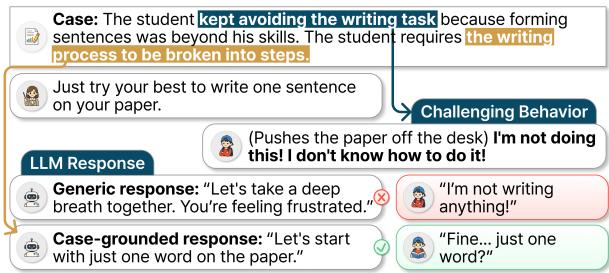  
Figure 1: We introduce TutorCaseBench, a benchmark grounded in qualitative case studies for evaluating LLM tutors’ ability to respond to challenging student behaviors. Example from Park and Pinkelman (2017).

Existing AI-tutor benchmarks (Macina et al., 2023, 2025; Sonkar et al., 2023) focus on cognitive aspects of tutoring, such as math-error detection and scaffolding. Their inputs often depict idealized student behavior rather than disengagement, resistance, or other challenging behaviors (Macina et al., 2023; Markel et al., 2023; Liu et al., 2024b), while their rubrics rely on common pedagogical criteria (Shridhar et al., 2022; Liu et al., 2024a). As a result, they offer limited evidence on whether AI tutors can provide case-sensitive support for students with challenging behaviors.

Our work grounds this evaluation in a resource the NLP community has so far overlooked: qualitative case literature from pedagogy, educational psychology, and special education. These studies document individual students, their behaviors in learning contexts, and interventions that practitioners observed to be effective or ineffective. Unlike hypothetical personas, such cases provide evidence about student backgrounds, precipitating events, and practitioner responses, allowing us to synthesize realistic pedagogical scenarios involving challenging behaviors and documented interventions.

We introduce an automated LLM pipeline that converts qualitative case-study papers into structured tutoring evaluation cases. For each documented student category, the pipeline extracts verbatim learner and instructional evidence and constructs scenarios with learning contexts, challenging behaviors, and intervention strategies. Each scenario is then converted into a grounded tutor– student dialogue ending with the student exhibiting challenging behavior, paired with a rubric derived from the documented interventions. The resulting items are evaluated in immediate and longterm settings through an LLM-as-a-judge checklist rubric (Zheng et al., 2023) and a multiple-choice task in the style of Hendrycks et al. (2021).

Applying this pipeline to qualitative case studies, we construct TutorCaseBench, a benchmark of 923 English dialogues across five challenge types: emotional distress, task resistance, social-interpersonal difficulty, attention/engagement failure, and academic struggle. It contains 1,560 open-ended and 2,537 multiple-choice evaluation items.

We evaluate 11 state-of-the-art LLMs on Tutor-CaseBench and find that they remain limited in providing case-specific support. Even the strongest model satisfies a documented intervention in only 55.8% of open-ended cases, while models perform better at selecting provided strategies than at generating tailored responses. Our benchmark provides systematic evidence that LLM tutors struggle to support students with challenging behaviors even in controlled settings, motivating further investigation in more interactive and situated tutoring contexts.

## Contributions.

1. A case-grounded pipeline that converts pedagogical case studies into tutoring scenarios, dialogues, and evaluation criteria.

2. TutorCaseBench, a benchmark of 923 casegrounded dialogues covering five types of challenging student behavior, with both openended and multiple-choice evaluation settings.

3. An empirical analysis of 11 LLM tutors, revealing difficulty in providing case-specific support, especially in long-term interventions.

## 2 Related Work

## 2.1 Literature-Grounded Student Simulations

AI tutor evaluation requires realistic student–tutor interactions, but collecting them at scale is difficult (Macina et al., 2023). LLM-based student simulation offers a useful alternative, typically modeling learner knowledge and reasoning, such as misconceptions and knowledge components (Macina et al., 2023; Lu and Wang, 2024; Qi et al., 2026), or learner traits, such as personas and motivational profiles (Markel et al., 2023; Liu et al., 2024b; Jin et al., 2025; Marquez-Carpintero et al., 2026).

However, even fine-tuned models show limited alignment with real student behavior (Scarlatos et al., 2026). Simulated students also rarely express frustration or disengagement, remain unnaturally attentive and linguistically sophisticated, and accept tutor feedback without resistance (Martynova et al., 2025). Thus, existing frameworks mostly simulate idealized student behavior, overlooking disengaged, resistant, or off-task behaviors.

Source documents offer another way to ground dialogue synthesis. Prior work shows that document grounding improves coherence and factual consistency (Feng et al., 2020, 2021), and supports persona simulation when documents describe behavior and internal states (Wang et al., 2025). In education, textbook-grounded dialogue generation improves content accuracy (Wang et al., 2024a). Hence, we ground synthesis in pedagogy, educational psychology, and special education literature, enabling dialogues with realistic challenging behaviors beyond cooperative learner settings.

## 2.2 Evaluation of AI Tutors

AI tutor evaluation has shifted from generalpurpose NLG metrics to pedagogy-grounded frameworks. Earlier approaches relied on BLEU (Papineni et al., 2002) and BERTScore (Zhang et al., 2020), comparing tutor responses against reference answers, but such metrics poorly capture pedagogical quality because multiple valid responses may exist (Tack and Piech, 2022; Jurenka et al., 2025).

To address this, prior work has proposed pedagogy-grounded criteria. Tack and Piech (2022) found that AI responses fell short of human teachers in teacher-likeness, student understanding, and helpfulness. Later frameworks introduced criteria such as coherence, correctness, equitable tutoring (Macina et al., 2023), as well as usefulness, care, and human-likeness (Wang et al., 2024b). However, these criteria remain fragmented and lack consensus (Jurenka et al., 2025). Recent benchmarks have begun to consolidate them, including MRBench’s eight-dimensional taxonomy (Maurya et al., 2025) and MathTutorBench’s focus on mathematical expertise, student understanding, and scaffolding quality (Macina et al., 2025).

Despite this progress, existing benchmarks largely use fixed criteria, although support for students exhibiting challenging behaviors is often context-dependent. Thus, we take a case-specific approach, deriving evaluation criteria from interventions documented in pedagogical case studies.

## 3 Data Construction

We construct TutorCaseBench from case-study papers documenting diverse learning and behavioral challenges, using an automated LLM pipeline to convert them into structured tutor–student dialogues in English for evaluation. The benchmark includes two tasks: open-ended response generation and multiple-choice question (MCQ) selection.

We use gemini-3-flash-preview (Google DeepMind, 2025) for extractive stages (Stage 1– 2) and gemini-3.1-pro-preview (Google Deep-Mind, 2026a) for generative stages (Stage 3–5), with default thinking high and temperature=0. For consistency, we used the Gemini models across the pipeline and rerouted only a number of persistent failures to OpenAI models (see Appendix A).

## 3.1 Paper Collection

Stage 0: Paper Collection. We collect candidate case-study papers from the ERIC database using the ERIC API for papers that include at least one student and one methodology descriptor. The descriptors are listed in Appendix B. We restrict publications to 2010–2026 to keep the corpus contemporary while ensuring sufficient volume. Since descriptor matching does not ensure sufficient detail on student behavior and teacher actions, we further filter papers by their abstracts (see Appendix C).

## 3.2 Open-Ended Response Task

TutorCaseBench’s open-ended response task evaluates whether a model produces a next tutor response aligned with documented interventions for a tutor–student dialogue grounded in case studies.

## 3.2.1 Tutor–Student Dialogue Construction

Stages 1–4 convert the collected papers into tutor– student dialogues paired with a hidden answer key of effective and ineffective interventions. Figure 2 provides an overview of this pipeline.

Stage 1: Student Category Extraction. Starting from the initial set of papers, the LLM rates how concretely each paper documents three dimensions essential to our benchmark—student behavior, learning context, and teacher actions—on a 1–5 scale (prompt in Appendix T.2). Papers scoring below 3 on any dimension are filtered out. We set this cutoff after inspecting samples and finding them too general to ground a concrete dialogue.

For papers that pass screening, the model extracts student categories—distinct student profiles within the paper, each with a label, rationale, demographics, and supporting excerpts for the three dimensions above (prompt in Appendix T.3). We use each category as a unit for scenario construction, since a paper may document multiple students or groups with different behaviors, contexts, or instructional needs. Categories are then filtered by the same dimensions at a stricter threshold (3 or below), since downstream dialogue synthesis requires per-category evidence to be concrete on its own.

Stage 2: Evidence Extraction. Next, the LLM reads each paper from Stage 1 twice—once for learner evidence, once for instructional evidence— tagging each verbatim span with the categories it applies to. The first read extracts learner evidence along four dimensions—observable behaviors, cognitive states, affective states, and difficulty triggers—along with verbatim student quotes (prompt in Appendix T.4). These dimensions adapt Pintrich’s self-regulated learning framework (Pintrich, 2000; Panadero, 2017), replacing its contextual axis with difficulty triggers to surface what specifically prompted the student’s struggle.

The second read takes the paper and the prior learner spans as input, and extracts spans of instructional evidence, recording when the strategy applies, how it was enacted, and its documented outcome (prompt in Appendix T.5). Each instructional span is tagged as effective or ineffective, given a temporal scope of immediate, long-term, or both.

Stage 3: Scenario Construction. The LLM then composes one or more concrete scenarios per category from the extracted evidence (prompt in Appendix T.6). We construct multiple scenarios when evidence spans distinct tasks or classroom contexts, rather than collapsing them into a generic scenario.

Each scenario is organized as two parallel blocks: a content block (task, classroom context, triggering behavior, related behavior patterns) that frames what a tutor sees in the moment, paired with a hidden strategies block (immediate effective, longterm effective, and ineffective) that is later used to derive the evaluation rubric. Each element is linked back to Stage 2 evidence spans. We retain scenarios only when all content fields are specified, and at least one effective strategy is documented.

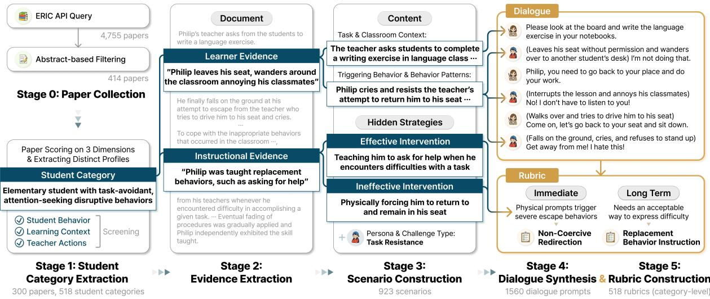  
Figure 2: Overview of the TutorCaseBench construction pipeline. Based on extracted evidence, we compose case-grounded tutor–student dialogues. Examples are adapted from Theodoridou and Koutsoklenis (2013).

At the category level, the model produces two additional artifacts. The student persona captures the learner’s recurring patterns, triggers, and what tends to work or fail, ensuring consistent student turns across all scenarios in the category. Each category is also assigned a primary challenge type (task resistance, emotional distress, attention/engagement failure, social-interpersonal difficulty, or academic struggle) using a dialogue-based taxonomy of challenge types (see Appendix D for details), allowing us to examine model responses across qualitatively different learner difficulties.

Stage 4: Dialogue Synthesis. In the final stage, the LLM converts each scenario into a 6-turn tutor– student dialogue (i.e., three tutor and three student turns) that ends with the student exhibiting the challenging behavior (prompt in Appendix T.7). Given the student category, persona, and scenario content, the model generates a coherent dialogue in which every student turn is grounded in one or more excerpts. The hidden strategies block is excluded and tutor turns are constrained to be neutral.

The model also generates a one-sentence minimal context containing only the task and setting, leaving the student’s needs to be inferred from the interaction. The full scenario content is preserved as full context for downstream grading.

We use six turns to provide sufficient interaction context around the challenging behavior, as tutor responses may depend on how the interaction has developed across multiple exchanges. Limiting dialogue length also keeps synthesized interactions grounded in case evidence, avoiding unsupported details and repetition. To assess this choice, we additionally test 4- and 8-turn variants and observe consistent results (see Appendix E for details).

## 3.2.2 Open-Ended Response Evaluation

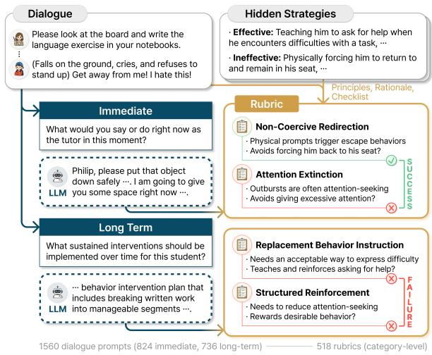  
Figure 3: Rubric construction and evaluation process.

Stage 5: Rubric Construction. To evaluate tutor responses, we create case-specific rubrics by student category and response type (immediate or long-term) (prompt in Appendix T.8). Rather than scoring responses on fixed dimensions, each rubric is built from effective intervention strategies documented for that student. We define rubrics at the category level because scenarios within a category share a learner profile and intervention evidence.

Given the student persona, challenge type, synthesized dialogues, and hidden strategies from the category’s scenarios, the model produces a checklist of criteria, each capturing an evidencesupported response principle with a rationale and check condition. Ineffective strategies are included as negative anchors, and a brief student description is produced as auxiliary context. Figure 3 shows the rubric construction and evaluation process.

Each criterion is judged independently against its check condition and scored as satisfied or not (0–1). The criteria represent alternative evidencesupported approaches to the same student difficulty, rather than requirements to be combined in a single response. Requiring multiple criteria could favor broad and abstract responses over those that clearly apply a single approach. Thus, we count a response as successful if it satisfies at least one criterion.

## 3.3 MCQ Selection Task

To complement open-ended evaluation, we convert scenarios from §3.2.1 into 4-option MCQs. Each question pairs one effective strategy from the target scenario with three from other scenarios as distractors, testing whether models identify the strategy that best fits the student and dialogue. MCQ accuracy thus reflects the ability to select interventions supported by case-specific evidence, without implying that alternative strategies are ineffective.

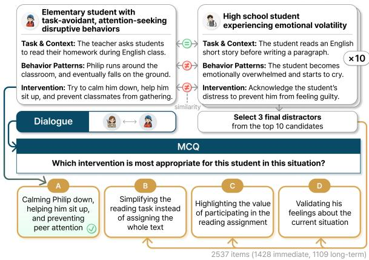  
Figure 4: 4-option MCQ construction with crossscenario distractors. Examples from Sander et al. (2010), Lichtinger and Kaplan (2015), Newman (2012).

Figure 4 illustrates the MCQ construction process. We retrieve candidate distractors by embedding similarity, select three with an LLM judge, and rewrite all options into a uniform surface form. We also construct a binary variant pairing one effective and one ineffective strategy from the same scenario as a sanity check. Full construction details for both variants are provided in Appendix F.

## 3.4 Data Statistics

Overall. Starting from 4,755 ERIC candidates, the pipeline produces 923 scenarios from 300 source papers and 518 student categories (M = 1.78 scenarios per category, SD = 0.77). The final benchmark includes 1,560 open-ended items: 824 immediate and 736 long-term. Category-level rubrics contain 2.90 immediate criteria (SD = 0.91) and 2.45 long-term criteria (SD = 0.87) on average. The MCQ set includes 2,537 items: 1,428 immediate and 1,109 long-term. Additional details on student demographics and corresponding model performance are provided in Appendix G.

Challenge-Type Distribution. Our taxonomy of student challenges (Appendix D) covers the dataset scenarios as follows: Task Resistance (28.7%), Attention/Engagement Failure (20.4%), Academic Struggle (18.4%), Emotional Distress (13.7%), and Social-Interpersonal Difficulty (18.9%).

## 3.5 Data Validation

We conducted a human validation study to assess whether outputs from our pipeline were grounded in the source papers. We randomly sampled 30 papers and recruited 12 students (three undergraduates, nine graduates) from South Korea through online university forums, all with prior experience in reading and analyzing academic papers. Each reviewer evaluated five papers, with every paper independently assessed by two reviewers so that the validation did not depend on a single evaluator.

Reviewers first read and summarized the source paper, then evaluated key outputs from each pipeline stage, providing a rationale for every judgment (see Appendix H for the study interface). On a three-point scale (No=1, Partly=2, Yes=3), mean ratings were 2.62 (SD = 0.56) for student categories (Stage 1), 2.42 (SD = 0.56) for evidence (Stage 2), 2.57 (SD = 0.57) for scenarios and 2.48 (SD = 0.54) for instructional strategies (Stage 3), 2.60 (SD = 0.60) for dialogues (Stage 4), and 2.69 (SD = 0.46) for rubrics (Stage 5). Challenge types were evaluated on a binary scale (No=0, Yes=1), yielding a mean rating of 0.76 (SD = 0.43). Further details on human validation results are provided in Appendix I. Overall, these results suggest that our pipeline outputs align with human judgments of what is supported by the source literature.

## 4 Experiments

We evaluate 11 state-of-the-art models on Tutor-CaseBench across three tasks: open-ended response generation, MCQ selection, and referencebased response generation. Experimental settings and model details are provided in Appendix J.

Open-Ended Response. Each model produces a free-form response to each open-ended item, either an immediate next-turn response or a long-term intervention plan (prompts in Appendix T.11). Immediate items ask what the tutor should say or do next, while long-term items ask what sustained interventions should be implemented over several weeks. In both cases, the model is shown only the scenario’s minimal context and the dialogue up to the challenging student utterance, requiring it to infer the student’s needs and respond appropriately.

We evaluate each response with gemini-3.1-pro-preview using the rubric from §3.2.2 (prompt in Appendix T.12). The evaluator receives the rubric, student description, dialogue, the scenario’s full context, and the model response, and assigns each criterion a binary score (1 if satisfied, 0 otherwise). A response is marked successful if it satisfies at least one criterion. We also report the average criterion satisfaction rate in Appendix K. Since Gemini models are used for both construction and evaluation, we additionally test for model-family bias by varying the construction models (Appendix L) and evaluation judge (Appendix M), finding consistent results for both.

MCQ Selection. For each MCQ from §3.3, we provide the same minimal context and dialogue used in the open-ended setting, along with four answer options, and ask the model to select one (prompt in Appendix T.13). A response counts as correct if it matches the correct option, which is grounded in the scenario’s effective strategy.

Reference-Based Response. We also create a reference-based variant to test whether models can produce better open-ended responses when relevant guidance is available. For each test dialogue, we retrieve the most similar scenarios from a separate pool and add their intervention strategies to the prompt as a reference (Figure 5). We evaluate the resulting responses with the same rubrics as the dialogue-only setting, enabling a paired comparison. Full construction details are in Appendix N.

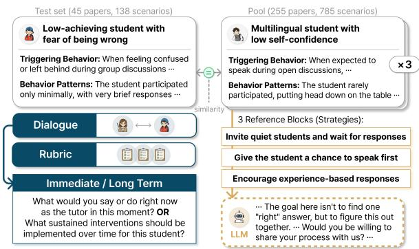  
Figure 5: We use strategies from similar cases as references. Examples from Lack et al. (2014), Collett (2023), Alghamdi and Siddiqui (2016), Cassidy et al. (2018).

## 5 Evaluation Results

## 5.1 Open-Ended Response

Overall Performance. Table 1 reports the success rate of open-ended responses (i.e., the proportion satisfying at least one criterion in the rubric). Overall performance remains limited even for the strongest models. Proprietary models occupy the top ranks, with Claude Opus 4.7 performing best at 55.8% and GPT-5.5 following at 54.7%. Among open-weight models, DeepSeek V4 Pro performs best at 47.0%, while Llama 4 Maverick is lowest at 31.7%. These results indicate that generating pedagogically grounded responses for students with challenging behaviors remains difficult.

Table 1: Success rate of open-ended response (%)
<table><tr><td>Model</td><td>Immediate (N=824)</td><td>Long-Term (N=736)</td><td>Overall (N=1,560)</td></tr><tr><td>Claude Opus 4.7</td><td>67.0</td><td>43.3</td><td>55.8</td></tr><tr><td>Claude Haiku 4.5</td><td>59.0</td><td>40.1</td><td>50.1</td></tr><tr><td>Gemini 3.1 Pro</td><td>67.5</td><td>35.2</td><td>52.2</td></tr><tr><td>Gemini 3 Flash</td><td>58.7</td><td>32.2</td><td>46.2</td></tr><tr><td>GPT-5.5</td><td>67.2</td><td>40.6</td><td>54.7</td></tr><tr><td>GPT-5.4 Mini</td><td>49.2</td><td>33.3</td><td>41.7</td></tr><tr><td>Llama 4 Maverick</td><td>43.0</td><td>19.0</td><td>31.7</td></tr><tr><td>Gemma 431B</td><td>52.4</td><td>29.1</td><td>41.4</td></tr><tr><td>DeepSeek V4 Pro</td><td>55.6</td><td>37.4</td><td>47.0</td></tr><tr><td>GPT-OSS 120B</td><td>52.9</td><td>34.6</td><td>44.3</td></tr><tr><td>Qwen 3.5-397B</td><td>51.7</td><td>27.4</td><td>40.3</td></tr></table>

A consistent gap appears between immediate and long-term responses. All models perform better on immediate responses, with the largest gap for Gemini 3.1 Pro (67.5% vs. 35.2%) and the smallest for GPT-5.4 Mini (49.2% vs. 33.3%). This suggests that models are better at producing plausible in-the-moment responses, but struggle to formulate sustained interventions tailored to student needs.

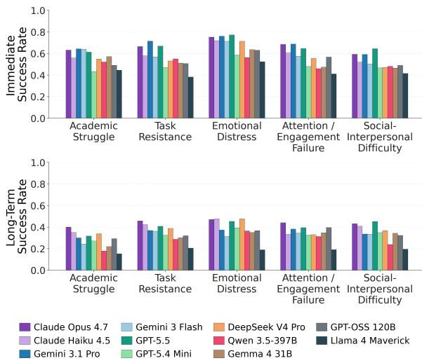  
Figure 6: Success rate for open-ended response across models broken down by challenge type.

Figure 6 breaks down open-ended performance by challenge type. For immediate responses, socialinterpersonal difficulty has the lowest performance and ranks last for 6 of 11 models. For long-term interventions, academic struggle has the lowest performance and ranks last for all 11 models.

Diversity and Case-Specificity. To better understand model-level differences, we additionally test whether stronger models produce less templated and more case-specific responses. We measure lexical diversity using the distinct-n ratio—the fraction of unique n-grams in each model’s responses—and compute Spearman correlations with success rates.

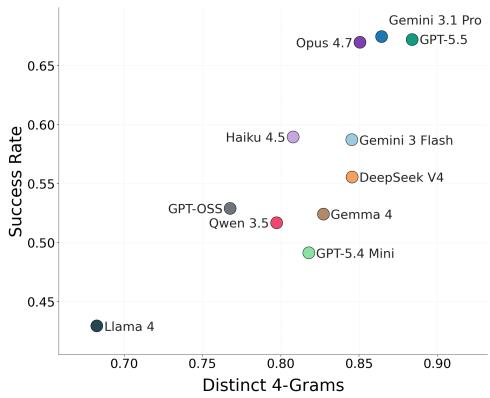  
Figure 7: Correlation between distinct 4-grams ratio and immediate response success rate across models.

For immediate responses, 4-gram diversity shows a positive correlation with success rates $( \rho = 0 . 8 0 0 , p < 0 . 0 1 )$ , as shown in Figure 7. This suggests that higher-performing models tend to vary their responses more across cases rather than rely on repeated phrasing. For example, Llama 4

Maverick’s most frequent 4-gram (“take a deep breath”) appears in 50.4% of its immediate responses, whereas the most frequent 4-grams of Claude Opus 4.7, GPT-5.5, and Gemini 3.1 Pro appear in only 6–9%. The relationship is not significant for long-term interventions $( p > 0 . 0 5 )$ . Results for 3- and 5-grams are in Appendix O.

We complement lexical diversity with case specificity. For each response, we use text-embedding-3-large (OpenAI, 2024) to retrieve the nearest response from another model and check whether it comes from the same dialogue case. We define the resulting case-recovery rate as a measure of case specificity and compute its Spearman correlation with success rates. Case-recovery rate is positively correlated with immediate-response success $( \rho = 0 . 6 9 1 , p < 0 . 0 5 ;$ see Appendix P), suggesting that stronger models produce more case-specific responses. The correlation is not significant for long-term interventions.

Failure Analysis. We qualitatively analyze a sample of 50 open-ended cases where all models failed (25 immediate, 25 long-term). We identify four recurring failure patterns, shown in Table 2.

Empathy/Praise. A student refuses to present because she believes her work is wrong and calls herself “stupid” (MacMath et al., 2010). The caseprescribed response is to verify that her work is accurate before presenting. Models instead reassure her that mistakes are acceptable, leaving her belief that the work is wrong unaddressed.

Generic Scaffolding. Another student with language-comprehension difficulties interprets “5 times more” additively and writes 10 (Bruno et al., 2024). The case-prescribed response is to use simpler terms such as “double” or “triple.” Models instead correct the answer, explain multiplication, or ask why he added the numbers, addressing the error but not the underlying language difficulty.

Over-Intervention. A normally quiet student becomes nervous while co-teaching a science lesson (Adjapong and Emdin, 2015). The caseprescribed response is for the teacher to take a student role and intervene only for content issues. Models instead keep guiding him to breathe, speak louder, or begin with a suggested sentence, reducing his opportunity to lead independently.

Task Redesign Missed. A student refuses an assigned reading task and becomes disruptive during independent work (Guardino and Fullerton, 2010). The case-prescribed response is to replace the task with a simple activity such as a crossword puzzle, coloring, or journaling. All models instead focus on calming the student and returning them to the original task, leaving the rejected task unchanged.

Table 2: Recurring failure modes in open-ended response evaluation missed by all models.
<table><tr><td>Failure Mode</td><td>Description</td></tr><tr><td>Empathy/Praise</td><td>Comforts the student when the response should challenge their belief or behavior.</td></tr><tr><td>Generic Scaffolding</td><td>Applies a standard support plan without identifying the student&#x27;s central difficulty.</td></tr><tr><td>Over-Intervention</td><td>Steps in to correct or redirect when the tutor should step back instead.</td></tr><tr><td>Task Redesign Missed</td><td>Helps the student cope with a task that itself should be changed.</td></tr></table>

## 5.2 MCQ Selection

Table 3 reports accuracy on the MCQ task. Scores are higher and less variable than in the open-ended task, suggesting that models can recognize an appropriate intervention when provided as an option, even when they struggle to formulate one from scratch. Claude Opus 4.7 performs best at 63.0%, followed by Gemini 3.1 Pro at 62.6% and GPT-5.5 at 62.4%. The top open-weight model, Gemma 4 31B, reaches 57.3%, while GPT-OSS 120B is the lowest at 49.2%, still above the 25% chance level.

Table 3: Accuracy on 4-option MCQ cases (%).
<table><tr><td>Model</td><td>Immediate (N=1,428)</td><td>Long-Term (N=1,109)</td><td>Overall (N=2,537)</td></tr><tr><td>Claude Opus 4.7</td><td>63.2</td><td>62.7</td><td>63.0</td></tr><tr><td>Claude Haiku 4.5</td><td>53.9</td><td>55.9</td><td>54.8</td></tr><tr><td>Gemini 3.1 Pro</td><td>61.6</td><td>63.8</td><td>62.6</td></tr><tr><td>Gemini 3 Flash</td><td>55.5</td><td>56.9</td><td>56.1</td></tr><tr><td>GPT-5.5</td><td>62.7</td><td>62.0</td><td>62.4</td></tr><tr><td>GPT-5.4 Mini</td><td>51.9</td><td>54.6</td><td>53.1</td></tr><tr><td>Llama 4 Maverick</td><td>51.9</td><td>51.4</td><td>51.7</td></tr><tr><td>Gemma 4 31B</td><td>55.3</td><td>59.8</td><td>57.3</td></tr><tr><td>DeepSeek V4 Pro</td><td>52.4</td><td>54.7</td><td>53.4</td></tr><tr><td>GPT-OSS 120B</td><td>48.3</td><td>50.2</td><td>49.2</td></tr><tr><td>Qwen 3.5-397B</td><td>55.9</td><td>56.0</td><td>55.9</td></tr></table>

Challenge-type patterns partly mirror the openended setting. For immediate responses, socialinterpersonal difficulty is the weakest MCQ category for all 11 models, reinforcing its difficulty in open-ended generation. Academic struggle shows the opposite pattern, performing strongly in MCQ despite being the weakest category for long-term responses (see Appendix Q). We also observe systematic convergence in MCQ errors (see Appendix R).

## 5.3 Reference-Based Response

We compare responses generated from the dialogue alone with those generated with strategies from similar prior cases as references. Figure 8 shows the effect on immediate responses. Most models benefit, with 10 of 11 improving and an average gain of 9.9 points overall. Llama 4 Maverick improves the most, from 41.0% to 64.8%, while Gemini 3.1 Pro does not improve (71.3% in both conditions).

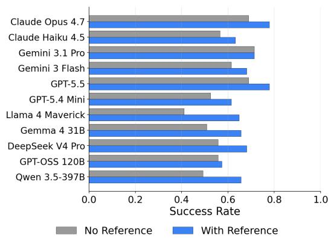  
Figure 8: Success rate across models for immediate response, with and without references.

The reference effect does not extend to long-term plans (see Appendix S for details). This suggests that providing references is more effective when they directly guide the next tutor move.

## 6 Conclusion

We introduce TutorCaseBench, a case-grounded benchmark for evaluating whether LLM tutors can support students with challenging behaviors. TutorCaseBench converts qualitative case studies into tutor–student dialogues and case-specific evaluation criteria, avoiding idealized learner simulations and fixed pedagogical rubrics. Across 923 dialogues and 11 state-of-the-art LLMs, we find that current models remain limited in generating support aligned with documented interventions, even when they often recognize appropriate strategies in multiple-choice settings. These results highlight the need for AI tutors that move beyond plausible responses toward context-sensitive support grounded in individual student needs. Overall, TutorCaseBench provides a resource for developing tutors that address not only cognitive errors but also students’ affective and behavioral difficulties.

## Limitations

Our work has several limitations. First, although TutorCaseBench is grounded in qualitative casestudy literature, its construction primarily relies on the Gemini model family, which may introduce model-specific interpretations into the generated scenarios and rubrics. While human validation (§3.5) and robustness analyses with alternative construction models (Appendix L) and evaluation judges (Appendix M) support the consistency of our findings, future work could explore combining different model families across pipeline stages.

Second, the benchmark has limited coverage of some student populations and educational contexts. Although we draw on accessible, contemporary ERIC case studies with detailed evidence about student behavior, learning context, and teacher actions, the resulting categories are concentrated in particular regions and age groups (Appendix G). Future work could broaden this coverage by incorporating cases from additional databases, disciplines, countries, age groups, or classroom settings.

Third, TutorCaseBench evaluates LLM tutors responses to challenging behaviors in text-based dialogues, enabling controlled evaluation independently of behavior detection. Although the dialogues describe actions and nonverbal cues, text may not fully capture their complexity in real interactions. Future work could extend this approach to interactive, multimodal settings where tutors must recognize and respond to challenging behaviors.

Lastly, we construct student categories separately within each paper rather than grouping similar cases across the corpus. This preserves casespecific intervention evidence but limits analysis of recurring patterns in student challenges and support strategies. Future work could cluster related categories to examine these patterns across cases.

## Ethical Considerations

The human validation study was reviewed and approved by the Institutional Review Board (IRB) of our institution prior to data collection. All participants provided informed consent before participation and were informed that they could withdraw at any time. As the study was conducted remotely, participants could contact the authors with any questions or concerns throughout the process. Validating each paper took approximately 90 minutes, and participants received 120,000 KRW (≈ 89.68 USD) in compensation for their time.

Source documents were identified through ERIC (Education Resources Information Center), a U.S. Department of Education database for education research literature. We used only publicly accessible full-text materials, including documents hosted by ERIC and papers reachable through DOI or publisher links listed in ERIC records. Copyright remains with the original authors and publishers, and the materials were used only for non-commercial academic research. Our released benchmark consists only of LLM-synthesized tutor–student dialogues, rubrics, and multiple-choice items. We do not redistribute the full source texts or release intermediate extraction artifacts. Source excerpts used as examples in the paper are explicitly cited. For provenance, we provide source-paper metadata for the documents used in dataset construction.

Since TutorCaseBench focuses on students with learning and behavioral difficulties, some cases may include descriptions of distress, refusal, aggression, or other challenging behaviors. These behaviors are included only when grounded in the source literature and are used to evaluate supportive tutoring responses, not to stereotype or label students. We frame such behaviors as contextdependent student needs rather than as fixed traits.

We also acknowledge the use of AI assistants in preparing this work. We used $\mathrm { C h a t G P T } ^ { 2 }$ and Claude<sup>3</sup> for writing assistance, as well as for gen-4 erating icons used in figures. We also used Codex and Claude Code<sup>5</sup> for coding assistance in implementing the benchmark construction pipeline.

## References

Thomas M Achenbach. 1991. Manual for the child behavior checklist/4-18 and 1991 profile. University of Vermont, Department of Psychiatry.

Edmund S Adjapong and Christopher Emdin. 2015. Rethinking pedagogy in urban spaces: Implementing hip-hop pedagogy in the urban science classroom. Journal ofUrban Learning, Teaching, and Research, 11:66–77.

Fatimah M A Alghamdi and Ozma Siddiqui. 2016. Supporting low-achieving efl learners: Expectations, procedure and significance of remedial sessions at a saudi university. Journal of Education and Training Studies, 4(12):204–212.

Anthropic. 2025. System Card: Claude Haiku 4.5. Accessed: 2026-10-12.

Anthropic. 2026a. System Card: Claude Opus 4.7. Accessed: 2026-10-12.

Anthropic. 2026b. System Card: Claude Sonnet 5.5. Accessed: 2026-10-12.

Ryan S.J.d. Baker, Sidney K. D’Mello, Ma.Mercedes T. Rodrigo, and Arthur C. Graesser. 2010. Better to be frustrated than bored: The incidence, persistence, and impact of learners’ cognitive–affective states during interactions with three different computerbased learning environments. International Journal ofHuman-Computer Studies, 68(4):223–241.

Alicia Bruno, Irene Polo-Blanco, Steven Van Vaerenbergh, Raúl Fernández-Cobos, and María José González-López. 2024. Strategies for solving multiplicative problems using a conceptual model-based problem-solving approach. a case study with a student with autism spectrum disorder. ZDM Mathematics Education, 56:1239–1256.

Claire Cassidy, Helen Marwick, Lynn Deeney, and Gillian McLean. 2018. Philosophy with children, self-regulation and engaged participation for children with emotional-behavioural and social communication needs. Emotional and Behavioural Difficulties, 23(1):81–96.

Jennifer Collett. 2023. Relationships between reading identities and dialogue: Perspectives from fifth-grade multilingual learners. Reading & Writing Quarterly, 39(4):259–276.

DeepSeek-AI, Anyi Xu, Bangcai Lin, Bing Xue, Bingxuan Wang, Bingzheng Xu, Bochao Wu, Bowei Zhang, Chaofan Lin, Chen Dong, Chenchen Ling, Chengda Lu, Chenggang Zhao, Chengqi Deng, Chengyu Hou, Chenhao Xu, Chenze Shao, Chong Ruan, Conner Sun, and 300 others. 2026. Deepseek-v4: Towards highly efficient million-token context intelligence. Preprint, arXiv:2606.19348.

Sidney D’Mello and Art Graesser. 2013. Autotutor and affective autotutor: Learning by talking with

cognitively and emotionally intelligent computers that talk back. ACM Transactions on Interactive Intelligent Systems, 2(4).

Song Feng, Siva Sankalp Patel, Hui Wan, and Sachindra Joshi. 2021. MultiDoc2Dial: Modeling dialogues grounded in multiple documents. In Proceedings of the 2021 Conference on Empirical Methods in Natural Language Processing, pages 6162–6176, Online and Punta Cana, Dominican Republic. Association for Computational Linguistics.

Song Feng, Hui Wan, Chulaka Gunasekara, Siva Patel, Sachindra Joshi, and Luis Lastras. 2020. doc2dial: A goal-oriented document-grounded dialogue dataset. In Proceedings ofthe 2020 Conference on Empirical Methods in Natural Language Processing (EMNLP), pages 8118–8128, Online. Association for Computational Linguistics.

Google DeepMind. 2025. Gemini 3 Flash Model Card. Accessed: 2026-10-12.

Google DeepMind. 2026a. Gemini 3.1 Pro Model Card. Accessed: 2026-10-12.

Google DeepMind. 2026b. Gemma 4 model card. Accessed: 2026-10-12.

Caroline A Guardino and Elizabeth Fullerton. 2010. Changing behaviors by changing the classroom environment. TEACHING Exceptional Children, 42(6):8– 13.

Dan Hendrycks, Collin Burns, Steven Basart, Andy Zou, Mantas Mazeika, Dawn Song, and Jacob Steinhardt. 2021. Measuring massive multitask language understanding. In International Conference on Learning Representations.

Hyoungwook Jin, Minju Yoo, Jeongeon Park, Yokyung Lee, Xu Wang, and Juho Kim. 2025. Teachtune: Reviewing pedagogical agents against diverse student profiles with simulated students. In Proceedings of the 2025 CHI Conference on Human Factors in Computing Systems, CHI ’25, New York, NY, USA. Association for Computing Machinery.

Irina Jurenka, Markus Kunesch, Kevin R. McKee, Daniel Gillick, Shaojian Zhu, Sara Wiltberger, Shubham Milind Phal, Katherine Hermann, Daniel Kasenberg, Avishkar Bhoopchand, Ankit Anand, Miruna Pîslar, Stephanie Chan, Lisa Wang, Jennifer She, Parsa Mahmoudieh, Aliya Rysbek, Wei-Jen Ko, Andrea Huber, and 55 others. 2025. Towards responsible development of generative ai for education: An evaluation-driven approach. Preprint, arXiv:2407.12687.

Shamya Karumbaiah, Conrad Borchers, Tianze Shou, Ann-Christin Falhs, Pinyang Liu, Tomohiro Nagashima, Nikol Rummel, and Vincent Aleven. 2023. A spatiotemporal analysis of teacher practices in supporting student learning and engagement in an aienabled classroom. In Artificial Intelligence in Education, pages 450–462, Cham, Switzerland. Springer Nature Switzerland.

Brian Lack, Susan Lee Swars, and Barbara Meyers. 2014. Low- and high-achieving sixth-grade students access to participation during mathematics discourse. The Elementary School Journal, 115(1):97–123.

Einat Lichtinger and Avi Kaplan. 2015. Employing a case study approach to capture motivation and selfregulation of young students with learning disabilities in authentic educational contexts. Metacognition and Learning, 10(1):119–149.

Jiayu Liu, Zhenya Huang, Tong Xiao, Jing Sha, Jinze Wu, Qi Liu, Shijin Wang, and Enhong Chen. 2024a. Socraticlm: Exploring socratic personalized teaching with large language models. In Advances in Neural Information Processing Systems, volume 37, pages 85693–85721. Curran Associates Inc.

Zhengyuan Liu, Stella Xin Yin, Geyu Lin, and Nancy F. Chen. 2024b. Personality-aware student simulation for conversational intelligent tutoring systems. In Proceedings of the 2024 Conference on Empirical Methods in Natural Language Processing, pages 626– 642, Miami, Florida, USA. Association for Computational Linguistics.

Xinyi Lu and Xu Wang. 2024. Generative students: Using llm-simulated student profiles to support question item evaluation. In Proceedings ofthe Eleventh ACM Conference on Learning @ Scale, L@S ’24, pages 16–27, New York, NY, USA. Association for Computing Machinery.

Jakub Macina, Nico Daheim, Sankalan Chowdhury, Tanmay Sinha, Manu Kapur, Iryna Gurevych, and Mrinmaya Sachan. 2023. MathDial: A dialogue tutoring dataset with rich pedagogical properties grounded in math reasoning problems. In Findings ofthe Association for Computational Linguistics: EMNLP 2023, pages 5602–5621, Singapore. Association for Computational Linguistics.

Jakub Macina, Nico Daheim, Ido Hakimi, Manu Kapur, Iryna Gurevych, and Mrinmaya Sachan. 2025. MathTutorBench: A benchmark for measuring openended pedagogical capabilities of LLM tutors. In Proceedings of the 2025 Conference on Empirical Methods in Natural Language Processing, pages 204– 221, Suzhou, China. Association for Computational Linguistics.

Sheryl MacMath, Jillian Roberts, John Wallace, and Xiaohong Chi. 2010. Research section: Curriculum integration and at-risk students: a canadian case study examining student learning and motivation. British Journal ofSpecial Education, 37(2):87–94.

Julia M. Markel, Steven G. Opferman, James A. Landay, and Chris Piech. 2023. Gpteach: Interactive ta training with gpt-based students. In Proceedings of the Tenth ACM Conference on Learning @ Scale, L@S ’23, pages 226–236, New York, NY, USA. Association for Computing Machinery.

Luis Marquez-Carpintero, Alberto Lopez-Sellers, and Miguel Cazorla. 2026. Simulating students with

large language models: A review of architecture, mechanisms, and role modeling in education with generative ai. Computer Science Review, 62:101008.

Daria Martynova, Jakub Macina, Nico Daheim, Nilay Yalcin, Xiaoyu Zhang, and Mrinmaya Sachan. 2025. Can LLMs effectively simulate human learners? teachers’ insights from tutoring LLM students. In Proceedings ofthe 20th Workshop on Innovative Use ofNLP for Building Educational Applications (BEA 2025), pages 100–117, Vienna, Austria. Association for Computational Linguistics.

Kaushal Kumar Maurya, Kv Aditya Srivatsa, Kseniia Petukhova, and Ekaterina Kochmar. 2025. Unifying AI tutor evaluation: An evaluation taxonomy for pedagogical ability assessment of LLM-powered AI tutors. In Proceedings ofthe 2025 Conference ofthe Nations of the Americas Chapter of the Association for Computational Linguistics: Human Language Technologies (Volume 1: Long Papers), pages 1234– 1251, Albuquerque, New Mexico. Association for Computational Linguistics.

Meta. 2025. The Llama 4 herd: The beginning of a new era of natively multimodal AI innovation. Accessed: 2026-10-12.

Cara Newman. 2012. Home/hospital instruction: Instructional approach to working with students with major depressive disorder. Master’s thesis, Dominican University of California.

OpenAI. 2024. New embedding models and API updates. Accessed: 2026-10-12.

OpenAI. 2025a. gpt-oss-120b & gpt-oss-20b Model Card. Accessed: 2026-10-12.

OpenAI. 2025b. Introducing GPT-4.1 in the API. Accessed: 2026-10-12.

OpenAI. 2026a. GPT-5.5 System Card. Accessed: 2026-10-12.

OpenAI. 2026b. Introducing GPT-5.4 mini and nano. Accessed: 2026-10-12.

Ernesto Panadero. 2017. A review of self-regulated learning: Six models and four directions for research. Frontiers in Psychology, 8.

Kishore Papineni, Salim Roukos, Todd Ward, and Wei-Jing Zhu. 2002. Bleu: a method for automatic evaluation of machine translation. In Proceedings ofthe 40th Annual Meeting of the Association for Computational Linguistics, pages 311–318, Philadelphia, Pennsylvania, USA. Association for Computational Linguistics.

Kristy Park and Sarah Pinkelman. 2017. Function-based approach to designing an instructional environment. Beyond Behavior, 26(3):124–134.

Susmita Patnaik and Pearl Subban. 2023. Challenging behaviours in primary classrooms: Examining causal attributions and strategies used by primary school teachers in india. Australasian Journal of Special and Inclusive Education, 47(2):78–95.

Alessandro Pepe and Loredana Addimando. 2013. Comparison of occupational stress in response to challenging behaviours between general and special education primary teachers in northern italy. International Journal ofSpecial Education, 28(1):14–26.

Paul R. Pintrich. 2000. Chapter 14 - the role of goal orientation in self-regulated learning. In Monique Boekaerts, Paul R. Pintrich, and Moshe Zeidner, editors, Handbook ofSelf-Regulation, pages 451–502. Academic Press, San Diego.

Changyong Qi, Longwei Zheng, Anna He, Haoxin Xu, Linzhao Jia, Yuang Wei, Bingqian Jiang, and Xiaoqing Gu. 2026. Simulating student learning behaviors with llm-based role-playing agents: A datadriven and cognitively inspired framework. Expert Systems with Applications, 304:130753.

Qwen Team. 2026. Qwen3.5: Towards native multimodal agents.

Janay B. Sander, Jill D. Sharkey, Roger Olivarri, Diane A. Tanigawa, and Tory Mauseth. 2010. A qualitative study of juvenile offenders, student engagement, and interpersonal relationships: Implications for research directions and preventionist approaches. Journal ofEducational and Psychological Consultation, 20(4):288–315.

Alexander Scarlatos, Jaewook Lee, Simon Woodhead, and Andrew Lan. 2026. Simulated students in tutoring dialogues: Substance or illusion? In Proceedings of the 64th Annual Meeting of the Association for Computational Linguistics (Volume 1: Long Papers), pages 42349–42385, San Diego, California, United States. Association for Computational Linguistics.

Kumar Shridhar, Jakub Macina, Mennatallah El-Assady, Tanmay Sinha, Manu Kapur, and Mrinmaya Sachan. 2022. Automatic generation of socratic subquestions for teaching math word problems. In Proceedings of the 2022 Conference on Empirical Methods in Natural Language Processing, pages 4136–4149, Abu Dhabi, United Arab Emirates. Association for Computational Linguistics.

Shashank Sonkar, Naiming Liu, Debshila Mallick, and Richard Baraniuk. 2023. CLASS: A design framework for building intelligent tutoring systems based on learning science principles. In Findings of the Associationfor Computational Linguistics: EMNLP 2023, pages 1941–1961, Singapore. Association for Computational Linguistics.

George Sugai and Robert R. Horner. 2006. A promising approach for expanding and sustaining school-wide positive behavior support. School Psychology Review, 35(2):245–259.

Anaïs Tack and Chris Piech. 2022. The AI teacher test: Measuring the pedagogical ability of blender and GPT-3 in educational dialogues. In Proceedings of the 15th International Conference on Educational Data Mining, pages 522–529, Durham, United Kingdom. International Educational Data Mining Society.

Zoe Theodoridou and Athanasios Koutsoklenis. 2013. Functional behavioral assessment for a boy with duchenne muscular dystrophy and problem behavior: A case study from greece. Assessmentfor Effective Intervention, 39(1):54–64.

Junling Wang, Jakub Macina, Nico Daheim, Sankalan Pal Chowdhury, and Mrinmaya Sachan. 2024a. Book2Dial: Generating teacher student interactions from textbooks for cost-effective development of educational chatbots. In Findings of the Association for Computational Linguistics: ACL 2024, pages 9707– 9731, Bangkok, Thailand. Association for Computational Linguistics.

Rose Wang, Qingyang Zhang, Carly Robinson, Susanna Loeb, and Dorottya Demszky. 2024b. Bridging the novice-expert gap via models of decision-making: A case study on remediating math mistakes. In Proceedings ofthe 2024 Conference ofthe North American Chapter of the Association for Computational Linguistics: Human Language Technologies (Volume 1: Long Papers), pages 2174–2199, Mexico City, Mexico. Association for Computational Linguistics.

Xintao Wang, Heng Wang, Yifei Zhang, Xinfeng Yuan, Rui Xu, Jen tse Huang, Siyu Yuan, Haoran Guo, Jiangjie Chen, Shuchang Zhou, Wei Wang, and Yanghua Xiao. 2025. CoSER: Coordinating LLMbased persona simulation of established roles. In Forty-second International Conference on Machine Learning.

Tianyi Zhang, Varsha Kishore, Felix Wu, Kilian Q. Weinberger, and Yoav Artzi. 2020. Bertscore: Evaluating text generation with bert. In International Conference on Learning Representations.

Lianmin Zheng, Wei-Lin Chiang, Ying Sheng, Siyuan Zhuang, Zhanghao Wu, Yonghao Zhuang, Zi Lin, Zhuohan Li, Dacheng Li, Eric Xing, Hao Zhang, Joseph E. Gonzalez, and Ion Stoica. 2023. Judging llm-as-a-judge with mt-bench and chatbot arena. In Advances in Neural Information Processing Systems, volume 36, pages 46595–46623. Curran Associates Inc.

## A Model Fallbacks in the Pipeline

Throughout the benchmark construction pipeline, we prioritized the Gemini model specified in §3 for consistency. Failed calls were retried up to five times before falling back to an OpenAI model. Here, we document these fallback cases.

In Stage 2 (Evidence Extraction), a small subset of papers (N = 7, 2.3% of 302 papers before subsequent filtering to 300) was reprocessed with $\tt g p t { - } 5$ .4-mini due to output truncation $( N = 5 )$ ， recitation blocking (N = 1), or a schema error $( N = 1 )$ . In Stage 5 (Rubric Construction), a single student category (N = 1 of 518, 0.2%) was processed with gpt-5.5 after the original Gemini call was blocked by its safety filter. Follow-up tests suggest that the block may have been related to the combination of the student’s young age, disability, and descriptions of severe distress behaviors.

Given the small proportion of affected cases, we expect this fallback model use to have only a limited impact on the overall benchmark data.

## B ERIC Search Descriptors

Table 4 lists the ERIC descriptors used to retrieve candidate papers for dataset construction.

## C Abstract-Based Paper Filtering Procedure

The candidate papers are initially screened by gpt-4.1-mini (OpenAI, 2025b) using the title and abstract. We use this as a cost-efficient, high-recall first pass, since abstracts provide enough signal to remove clearly unfit papers while leaving ambiguous cases to later pipeline stages.

The filter applies four criteria, filtering out papers that fail to meet our benchmark requirements: (1) papers without direct student observation or interview, which lack grounded learner behavior; (2) quantitative studies, which report aggregate effects instead of the individual student responses we need; (3) papers focused on educational policy or measurement-tool development, which describe students only as targets of analysis; and (4) papers without practical guidance for teachers, which lack the prescriptive strategies needed for evaluation. A paper is retained only if rejected by none of the four. The full prompt is in Appendix T.1.

We additionally exclude excessively long papers (≥ 30 pages) and those that cannot be accessed or downloaded, as we observed that long papers tend to mistakenly introduce literature-review content as learner evidence in downstream extraction.

Table 4: Descriptors used to retrieve candidate papers.
<table><tr><td>Category</td><td>Descriptors Behavior Problems</td></tr><tr><td>Student (35 Total)</td><td>Aggression Emotional Problems Emotional Disturbances Anxiety Disorders Depression (Psychology) School Phobia Withdrawal (Psychology) Fear of Success Mental Disorders Personality Problems Psychosomatic Disorders Attention Deficit Disorders Attention Deficit Hyperactivity Disorder Autism Spectrum Disorders Developmental Disabilities Intellectual Disability Neurodevelopmental Disorders Neurological Impairments Developmental Delays Learning Problems Learning Disabilities Low Achievement Academic Failure Reading Difficulties Reading Failure Writing Difficulties Mathematics Anxiety Slow Learners At Risk Students</td></tr><tr><td>Methodology (4 Total)</td><td>Communication Problems Communication Disorders Language Impairments Case Studies Observation Qualitative Research Classroom Research</td></tr></table>

## D Dialogue-Based Taxonomy of Learner Challenges

To distinguish the challenge type associated with each student category, we designed a taxonomy that identifies the observable challenge a tutor must respond to in the tutoring interaction. The taxonomy consists of five categories: Task Resistance, Emotional Distress, Attention/Engagement Failure, Social-Interpersonal Difficulty, and Academic Struggle. It was designed and refined by an author with a doctoral degree in education.

We use CBCL/ASEBA (Achenbach, 1991) as a reference for defining our categories. CB-CL/ASEBA is an empirical framework that characterizes children’s functioning through standardized behavior descriptions. Since our benchmark is dialogue-based, we retain only constructs observable in tutoring interactions and reorganize them by the type of challenge they present to the tutor.

Specifically, the Internalizing grouping is adapted as Emotional Distress; Attention Problems as Attention/Engagement Failure; Social Problems and Aggressive Behavior as Social-Interpersonal Difficulty; and Externalizing behaviors directed at the learning task as Task Resistance. Academic Struggle adapts the School scale for content-level difficulty such as confusion, uncertainty, repeated errors, misconceptions, and failure to respond.

## E Impact of Dialogue Turns on Evaluation Results

We examine whether evaluation results depend on the six-turn dialogue setting used in our benchmark. For this analysis, we sampled 25% of student categories $( N = 1 3 0 )$ , stratified by the five challenge types, and regenerated their dialogues with four and eight turns. We used an adapted version of the original dialogue-synthesis prompt that allows the number of turns to vary (prompt in Appendix T.17). We then repeated the open-ended evaluation for each dialogue setting using the same rubrics.

Changing the number of dialogue turns had little effect on the evaluation results. Overall success rates were 45.8%, 46.6%, and 46.8% for four-, six-, and eight-turn dialogues, respectively. Model rankings also remained highly consistent, with Spearman correlation being $\rho = 0 . 9 1 6 \ : ( p < 0 . 0 0 1 )$ for the four- versus six-turn comparison and $\rho = 0 . 9 1 1$ $( p < 0 . 0 0 1 )$ for the six- versus eight-turn comparison. These results suggest that our findings are not sensitive to the number of dialogue turns.

## F MCQ Construction Details

## F.1 4-Option MCQs

We provide additional details on distractor retrieval, selection, and option adaptation for the MCQ task.

We construct distractors in three steps: candidate retrieval, distractor selection, and surface adaptation. As a scenario may contain multiple effective strategies, each strategy is treated as a separate correct option and receives its own distractor set.

For retrieval, we embed each scenario’s learning context, learner behavior, and intervention descriptions using text-embedding-3-large (OpenAI,

2024). Each candidate intervention is scored as:

$$
\begin{array} { r } { \mathrm { s c o r e } = \mathrm { c t x \_ s i m } \times \left( 1 - \mathrm { b e h a v \_ s i m } \right) \phantom { x x x x x x x x x x x x x x x x x x x x x x x x x } } \\ { \times \left( 1 - \mathrm { m a x \_ i n t e r v \_ s i m } \right) , } \end{array}
$$

where ctx\_sim and behav\_sim are cosine similarities between the target and candidate learning contexts and learner behaviors, and max\_interv\_sim is the maximum similarity between the candidate intervention and any of the target’s effective interventions. This favors candidates that fit the target’s classroom context but address a different learner problem with a different intervention mechanism. We exclude strategies from the same paper or student category and keep only the highest-scoring intervention per scenario, ensuring that distractors come from distinct cases. The top 10 candidates are forwarded to the next step.

However, embedding similarity alone cannot reliably identify contextual incompatibilities or paraphrased versions of valid target interventions. Hence, we use gemini-3.1-pro-preview (Google DeepMind, 2026a) as an LLM judge (Zheng et al., 2023) to select three final distractors from the top 10 candidates, prioritizing plausible but incorrect tutor actions that are structurally compatible with the target setting (prompt in Appendix T.9).

Finally, the same model rewrites all four options—including the correct one—into the target dialogue’s vocabulary, length, and tone while preserving each option’s underlying mechanism (prompt in Appendix T.10). This prevents models from identifying the correct answer through lexical or stylistic match with the dialogue. Options are shuffled with a fixed seed and labeled A–D, and each MCQ is presented with the dialogue and a prompt asking the model to choose the most appropriate intervention (see Appendix T.13).

## F.2 Binary MCQs

We additionally construct a binary MCQ variant as a sanity check. Unlike the 4-option MCQs in §3.3, where all options are effective strategies and the task is to identify the best fit, the binary variant presents one effective and one ineffective strategy from the target scenario. Since the ineffective option failed for the same student in the source case, this variant tests whether models can reject a clearly inappropriate response. High accuracy therefore helps rule out this basic failure mode and supports interpreting the 4-option task as the harder problem of choosing among plausible effective strategies.

## F.2.1 Construction

For each scenario and response type (immediate or long-term), we create one item when the scenario contains at least one matching effective strategy and at least one ineffective strategy. When multiple options are available on either side, we use gemini-3.1-pro-preview (Google Deep-Mind, 2026a) as an LLM judge (Zheng et al., 2023) to select the final effective–ineffective option pair (prompt in Appendix T.14). The judge prioritizes pairs with matching scope, concrete tutor actions, and comparable granularity, where the effective option directly addresses the dialogue and the ineffective option is a plausible misstep rather than an unrelated action. If each side has only one eligible strategy, the pair is fixed, and the judge is skipped.

Since effective and ineffective strategies may differ in style in how they are written, the same model then rewrites the two options to match in vocabulary, length, and tone while preserving their meanings (prompt in Appendix T.15). This step is constrained to make minimal edits, avoid unsupported additions, and keep the ineffective option substantively ineffective. The two options are then assigned to A and B using a fixed random seed.

## F.2.2 Results

Across 11 models and 751 binary MCQs, accuracy ranges from 85.8% to 93.1%, which is far above the 50% chance baseline (Figure 9). This suggests that models can reliably distinguish a documented effective intervention from an ineffective one when the contrast is explicit. Therefore, the lower performance in the 4-option MCQ setting is not due to a basic inability to reject ineffective responses, but to the harder task of selecting the best-fitting intervention among plausible alternatives.

## G Student Demographic Information

## G.1 Demographic Distribution

We summarize demographic information for 518 student categories from 300 source papers. During Stage 1 of our pipeline, the LLM extracted country and education level at the paper level, and age and gender at the student-category level. For analysis, we grouped countries into regions and ages into ranges. Country is reported for 99.8% of categories, education level for all categories, gender for 74.9%, and age for 60.4%. We discuss the potential implications of these distributions in Limitations.

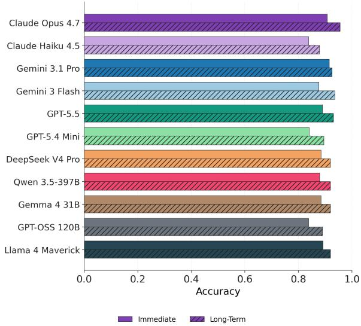  
Figure 9: Binary MCQ accuracy across 11 models.

Geographic distribution. Most categories are from North America (61.4%) and Europe (20.5%), followed by Asia (5.8%), the Middle East (5.4%), Oceania (5.0%), Latin America (1.4%), and Africa (0.4%). The United States accounts for 58.9% of categories, followed by the United Kingdom (9.7%), Australia (4.4%), and Canada (2.5%).

Education level. Primary-school students account for 41.9% of categories, followed by lower secondary (20.5%), upper secondary (19.3%), early childhood (7.1%), and tertiary education (5.4%). The remaining 5.8% come from settings outside a single school level, including special-education schools and adult or alternative programs.

Age. Students aged 6–11 account for 25.9% of all categories, followed by ages 12–14 (13.5%), 15–18 (11.8%), 0–5 (6.8%), and 19 or older (2.5%).

Gender. Male students appear in 47.7% of categories, female students in 24.3%, and mixedgender groups in 2.7%, with a single category (0.2%) describing a non-binary student.

## G.2 Performance by Demographic Groups

Table 5 presents open-ended response success rates across demographic groups, averaged over 11 LLMs. Performance showed similar trends across groups, with immediate responses generally outperforming long-term interventions. Given the uneven group sizes, comparisons across demographic groups should be interpreted with caution.

Table 5: Open-ended success rates (%) by geographic region, education level, and gender, averaged across 11 LLMs. N denotes the number of student categories.
<table><tr><td>Group</td><td>Category</td><td>N</td><td>Imm.</td><td>LT</td><td>Overall</td></tr><tr><td>Overall</td><td>一</td><td>518</td><td>56.7</td><td>33.8</td><td>45.9</td></tr><tr><td>Region</td><td>North America</td><td>318</td><td>53.5</td><td>32.5</td><td>43.3</td></tr><tr><td></td><td>Europe</td><td>106</td><td>64.5</td><td>33.1</td><td>50.3</td></tr><tr><td></td><td>Asia</td><td>30</td><td>57.5</td><td>43.3</td><td>51.2</td></tr><tr><td></td><td>Middle East</td><td>28</td><td>64.5</td><td>38.8</td><td>52.9</td></tr><tr><td></td><td>Oceania</td><td>26</td><td>53.7</td><td>34.8</td><td>45.0</td></tr><tr><td></td><td>Latin America</td><td>7</td><td>45.5</td><td>31.4</td><td>38.7</td></tr><tr><td></td><td>Africa</td><td>2</td><td>51.5</td><td>81.8</td><td>63.6</td></tr><tr><td></td><td>Not reported</td><td>1</td><td>72.7</td><td>0.0</td><td>36.4</td></tr><tr><td>Education</td><td>Early childhood</td><td>37</td><td>48.8</td><td>29.8</td><td>40.5</td></tr><tr><td></td><td>Primary</td><td>217</td><td>57.5</td><td>32.0</td><td>45.2</td></tr><tr><td></td><td>Lower secondary</td><td>106</td><td>55.9</td><td>33.5</td><td>45.8</td></tr><tr><td></td><td>Upper secondary</td><td>100</td><td>57.4</td><td>37.9</td><td>47.8</td></tr><tr><td></td><td>Secondary</td><td>2</td><td>50.0</td><td>86.4</td><td>68.2</td></tr><tr><td></td><td>Tertiary</td><td>28</td><td>61.6</td><td>36.6</td><td>48.0</td></tr><tr><td></td><td>Other/Unspecified</td><td>28</td><td>59.7</td><td>33.1</td><td>49.3</td></tr><tr><td>Gender</td><td>Male</td><td>247</td><td>56.8</td><td>33.0</td><td>45.2</td></tr><tr><td></td><td>Female</td><td>126</td><td>54.3</td><td>33.8</td><td>45.0</td></tr><tr><td></td><td>Mixed</td><td>14</td><td>54.5</td><td>26.4</td><td>42.0</td></tr><tr><td></td><td>Non-binary</td><td>1</td><td>27.3</td><td>18.2</td><td>22.7</td></tr><tr><td></td><td></td><td></td><td></td><td></td><td></td></tr><tr><td></td><td>Not reported</td><td>130</td><td>58.9</td><td>36.1</td><td>48.5</td></tr></table>

## H Human Validation Interface

Figure 10 shows the interface used for human validation. For each assigned paper, participants reviewed the outputs from each pipeline stage and rated how well they were supported by the source paper. At each step, the interface provided the evaluation criterion and its definition, the corresponding pipeline output, and a validation question with response options. Participants selected a rating and provided a written rationale for their judgment.

We designed the validation interface to encourage informed and deliberate judgments. For each assigned paper, participants were first required to read the source paper and write a summary of at least 30 words before validating its pipeline outputs. The interface also required a written rationale of at least 50 characters for each rating to encourage participants to articulate the reasoning behind their judgments and discourage arbitrary ratings.

## I Further Details on Human Validation

Our human validation study covered 30 of the 300 source papers and 57 of the 518 student categories. Each paper was independently evaluated by two non-author reviewers across all pipeline stages. We present the distribution of human validation ratings and exact inter-rater agreement in Table 6.

Across 882 three-point judgments, 96.6% were rated Yes or Partly, with only 3.4% receiving No. 76.3% of 114 binary judgments also confirmed the assigned challenge types. Exact agreement between evaluators was 58.2% overall. Agreement was highest for challenge types (84.2%) and lowest for instructional strategies (43.4%). While these results suggest that the generated outputs of our pipeline were generally well-grounded in the source papers, we further examine reviewers’ rationales for both Partly and No judgments to understand the concerns underlying lower ratings.

Table 6: Human validation ratings and exact inter-rater agreement (%). Challenge types used a binary (0/1), and other outputs used a three-point scale (1–3). Agreement indicates identical ratings between evaluators.
<table><tr><td>Output</td><td>Yes</td><td>Partly</td><td>No</td><td>Agreement</td></tr><tr><td>Student Categories</td><td>65.0</td><td>31.7</td><td>3.3</td><td>73.3</td></tr><tr><td>Evidence Excerpts</td><td>45.6</td><td>50.9</td><td>3.5</td><td>47.4</td></tr><tr><td>Challenge Types</td><td>76.3</td><td></td><td>23.7</td><td>84.2</td></tr><tr><td>Scenarios</td><td>61.1</td><td>34.8</td><td>4.0</td><td>61.6</td></tr><tr><td>Instructional Strategies</td><td>50.5</td><td>47.5</td><td>2.0</td><td>43.4</td></tr><tr><td>Dialogues</td><td>65.7</td><td>28.3</td><td>6.1</td><td>55.6</td></tr><tr><td>Rubrics</td><td>69.3</td><td>30.7</td><td>0.0</td><td>59.6</td></tr><tr><td>Overall</td><td>59.1</td><td>37.5</td><td>3.4</td><td>58.2</td></tr></table>

Student Categories (Stage 1). Most judgments of student categories were Yes (65.0%), suggesting that the extracted categories captured relevant students and their characteristics. Partial ratings concerned omitted students, overlapping categories, or imprecise descriptions. One reviewer noted, “the student groupings are appropriate, but Jennifer’s description includes a misattributed motivation.” Reviewers also disagreed on whether students from the same study should be grouped together or separated based on their distinct characteristics. Overall, most concerns reflected differences in categorization and interpretation, with relatively few judgments identifying substantive grounding issues.

Evidence Excerpts (Stage 2). Evidence excerpts received the highest proportion of Partly ratings (50.9%). Reviewers raised concerns about the relevance and specificity of individual excerpts. One reviewer noted, “Rather than being incorrect, some excerpts only partially describe the category or include passages that are too broad, making their relevance less clear.” Reviewers also noted excerpts drawn from other students’ cases or prior literature. Since reviewers evaluated entire evidence sets, their rationales for Partly ratings often focused on issues with a few individual excerpts, while the remaining evidence was considered appropriate.

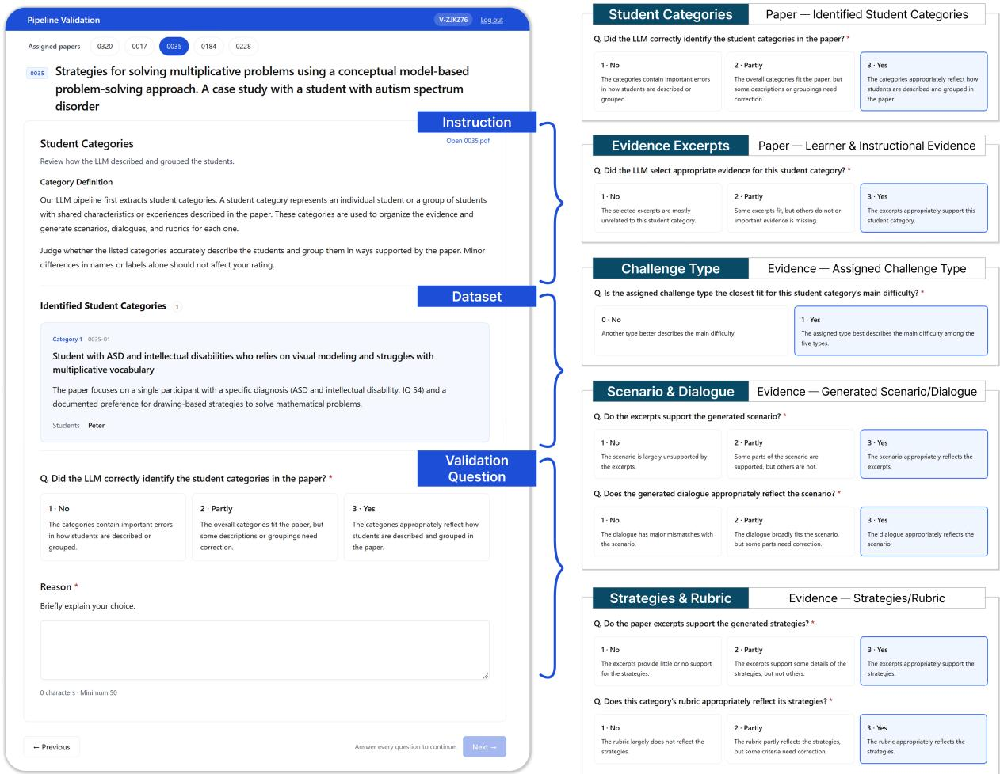  
Figure 10: Human validation interface across five pipeline stages. The left panel shows an example evaluation screen, while the right summarizes validation questions. Example from Bruno et al. (2024).

Challenge Types (Stage 3). Most judgments (76.3%) confirmed the assigned challenge types, suggesting that they generally captured students’ primary difficulties. However, reviewers noted that many students exhibited multiple, overlapping challenges that extended beyond the assigned type.

Scenarios (Stage 3). Most judgments (61.1%) were Yes, suggesting that scenarios were grounded in students’ documented behaviors and contexts. Partial ratings often concerned combining evidence from different moments or contexts into a single situation. One reviewer noted, “The scenario is largely supported, but it combines several related moments from Jimmy’s case into one situation.” Reviewers also identified unsupported contextual details or occasional misinterpretations of student behaviors. Overall, these concerns centered on preserving the original context when synthesizing documented observations into coherent scenarios.

Instructional Strategies (Stage 3). Most judgments were Yes (50.5%) or Partly (47.5%), suggesting that the extracted strategies were supported by the source papers. Partial ratings often concerned descriptions of individual strategies’ contexts and outcomes. One reviewer noted, “The actions are appropriate, but some context and outcomes seem to have been added to fit the scenario.” Reviewers also identified general recommendations presented as interventions for specific students. These issues arose mainly when adapting documented strategies and their outcomes to individual scenarios.

Dialogues (Stage 4). Most judgments (65.7%) were Yes, suggesting that the generated dialogues reflected the intended scenarios and student behaviors. Partial ratings often concerned unnatural exchanges, even when the key elements of the scenarios were preserved. One reviewer noted, “The main points are captured, but the lines feel more like separate monologues than a natural conversation.” Reviewers also identified exaggerated student behaviors or tutor responses that were more directive than intended. The dialogues remained well-grounded in the scenarios, with reviewers’ feedback primarily addressing conversational naturalness.

Rubrics (Stage 5). Most judgments (69.3%) were Yes, with no No ratings, suggesting that rubrics well-reflected the extracted instructional strategies. Partial ratings often concerned overly specific requirements or rationales that extended beyond the source evidence. One reviewer noted, “The six criteria align well with the strategies, but some of the rationales contain unsupported claims.” Reviewers identified cases where context-specific findings were turned into broader rules. Overall, the rubrics captured the core instructional guidance, with some interpretation involved in translating the strategies into scenario-specific criteria.

Overall, human validation indicated that our pipeline outputs were well-grounded in the source papers. Reviewers’ rationales also highlighted opportunities to improve how source evidence is interpreted and adapted into case-specific outputs, extending beyond grounding alone. Nevertheless, the evaluations supported the integrity of the resulting dataset, with most outputs meeting human reviewers’ judgments and expectations.

## J Models

We evaluate a diverse set of 11 state-ofthe-art models on TutorCaseBench: six proprietary (claude-opus-4.7 (Anthropic, 2026a), claude-haiku-4.5 (Anthropic, 2025), gemini-3.1-pro-preview (Google DeepMind, 2026a), gemini-3-flash-preview (Google DeepMind, 2025), gpt-5.5 (OpenAI, 2026a), gpt-5.4-mini (OpenAI, 2026b)) and five open-weight (DeepSeek-V4-Pro (DeepSeek-AI et al., 2026), gemma-4-31B-it (Google Deep-Mind, 2026b), gpt-oss-120b (OpenAI, 2025a), Llama-4-Maverick-17B-128E-Instruct (Meta, 2025), Qwen3.5-397B-A17B (Qwen Team, 2026)).

We accessed each model through its respective deployed API. Claude models and Llama were served through Vertex ${ \mathrm { A I } } ^ { 6 }$ , Gemini models and Gemma through the Google Gemini $\mathrm { \ A P I } ^ { \mathrm { 7 } }$ GPT models through the OpenAI $\mathrm { A P I } ^ { 8 }$ , DeepSeek and GPT-OSS through Together $\boldsymbol { \mathrm { A I } } ^ { 9 }$ , and Qwen through OpenRouter<sup>10</sup>. In all settings, models were queried with their default API settings to reflect their standard deployed configurations.

## K Average Criterion Satisfaction Rate

In addition to the binary success rate, we report the average criterion satisfaction rate, calculated as the number of satisfied criteria divided by the total number of criteria for each response.

Table 7: Average criterion satisfaction rate (%)
<table><tr><td>Model</td><td>Immediate (N=824)</td><td>Long-Term (N=736)</td><td>Overall (N=1,560)</td></tr><tr><td>Claude Opus 4.7</td><td>35.8</td><td>20.9</td><td>28.8</td></tr><tr><td>Claude Haiku 4.5</td><td>29.1</td><td>18.4</td><td>24.1</td></tr><tr><td>Gemini 3.1 Pro</td><td>35.7</td><td>16.0</td><td>26.4</td></tr><tr><td>Gemini 3 Flash</td><td>29.1</td><td>14.7</td><td>22.3</td></tr><tr><td>GPT-5.5</td><td>35.7</td><td>19.4</td><td>28.0</td></tr><tr><td>GPT-5.4 Mini</td><td>23.4</td><td>15.1</td><td>19.5</td></tr><tr><td>Llama 4 Maverick</td><td>18.9</td><td>8.2</td><td>13.9</td></tr><tr><td>Gemma 4 31B</td><td>25.2</td><td>13.5</td><td>19.7</td></tr><tr><td>DeepSeek V4 Pro</td><td>27.4</td><td>18.5</td><td>23.2</td></tr><tr><td>GPT-OSS 120B</td><td>25.9</td><td>16.3</td><td>21.4</td></tr><tr><td>Qwen 3.5-397B</td><td>24.5</td><td>12.0</td><td>18.6</td></tr></table>

Table 7 reports the average criterion satisfaction rates across the 11 models. Claude Opus 4.7 performs best overall (28.8%), followed by GPT-5.5 (28.0%) and Gemini 3.1 Pro (26.4%). Consistent with the success rate evaluation, the same models lead overall, and all 11 models perform better on immediate responses than on long-term plans. These results indicate that the overall performance patterns are preserved under this alternative metric.

Figure 11 further breaks down the results by challenge type. For immediate responses, task resistance and social-interpersonal difficulty generally show lower satisfaction rates, while emotional distress performs relatively well. For longterm interventions, academic struggle and socialinterpersonal difficulty tend to show lower rates. Overall, social-interpersonal difficulty remains challenging across both settings, while the other lower-performing challenge types differ between immediate and long-term interventions.

## L Impact of Construction Model Choice on Evaluation Results

We examine whether evaluation results depend on the choice of models used for benchmark construction. Using a 25% $( N \ = \ 7 5 )$ stratified sample of source papers, we rerun the full construction and evaluation pipeline with GPT (gpt-5.4-mini, gpt-5.5) and Claude (claude-sonnet-5.5 (Anthropic, 2026b), claude-opus-4.7) instead of Gemini, while keeping the prompts and the set of 11 evaluated models fixed. As each pipeline generates its own evaluation items, this yields 6,721 evaluated responses for GPT, 4,928 for Claude, and 3,850 for Gemini on the same source papers.

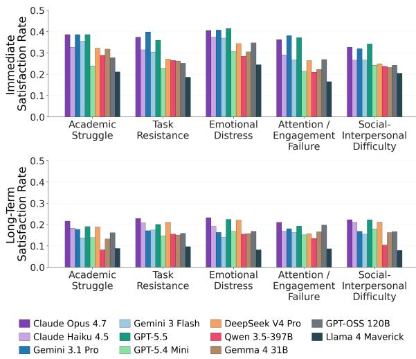  
Figure 11: Average criterion satisfaction rates across models broken down by challenge type.

Model rankings remained highly consistent across construction models, with Spearman correlation being $\rho = 0 . 9 4 3 \ : ( p < 0 . 0 0 1 )$ for the Geminiversus Claude-built comparison and $\rho ~ = ~ 0 . 9 2 5$ $( p < 0 . 0 0 1 )$ for the Gemini- versus GPT-built comparison. These results suggest that our findings are not sensitive to the choice of construction model.

## M Impact of Judge Model Choice on Evaluation Results

We examine whether the open-ended evaluation depends on the choice of judge model. Using the 25% $( N = 1 3 0 )$ stratified sample of student categories as in Appendix E, we re-evaluate responses from all 11 models with gpt-5.5 and claude-opus-4.7, while keeping the rubrics and evaluation prompt fixed. This yields 4,323 evaluated responses and 12,617 criterion judgments for each judge.

Table 8 shows high agreement across judges at both the case and criterion levels. Model rankings are also highly consistent across all judge pairs, with Spearman correlations of $0 . 9 6 { - } 0 . 9 7$ , all statistically significant at $p < 0 . 0 0 1$ . These results indicate that the relative performance of the evaluated models is preserved across judge choices.

Table 8: Pairwise agreement and ranking consistency across judges $( p < 0 . 0 0 1$ for all Spearman correlations).
<table><tr><td>Judge Pair</td><td>κ</td><td>Case-level Criterion-level Spearman κ</td><td>ρ</td></tr><tr><td>Gemini vs. GPT</td><td>0.75</td><td>0.77</td><td>0.96</td></tr><tr><td>Gemini vs. Claude</td><td>0.76</td><td>0.77</td><td>0.97</td></tr><tr><td>GPT vs. Claude</td><td>0.75</td><td>0.76</td><td>0.96</td></tr></table>

## N Reference-Based Response Details

We construct the reference pool using a paperlevel split stratified by challenge type, targeting 15% of papers for testing. This yields a pool of 255 papers and 785 scenarios and a test set of 45 papers and 138 scenarios, while ensuring that no test dialogue receives a reference from its source paper. We embed each scenario’s challenging-behavior trigger and behavior patterns with text-embedding-3-large (OpenAI, 2024) and rank pool scenarios by cosine similarity. For each test dialogue, we retrieve the ten nearest pool scenarios, filter to those with an effective strategy for the target response type (immediate or longterm), and keep the three closest matches. Their matching effective and ineffective strategies are concatenated into a reference block, framed as examples from similar but different students that the responder may adapt, combine, or ignore (prompt in Appendix T.16). We evaluate the resulting responses with the same rubrics used in the openended experiment, enabling a direct paired comparison against the dialogue-only condition.

## O Lexical Diversity

Figures 12 and 13 show the 3- and 5-gram variants of the distinct-n analysis for immediate responses. Spearman correlations show the same pattern as the 4-gram result (Figure 7), with $\rho = 0 . 8 5 5$ for 3- grams and $\rho = 0 . 7 9 1$ for 5-grams (both $p < 0 . 0 1 )$ , supporting the association between higher lexical diversity and immediate-response success rates.

For long-term interventions, only the 3-gram correlation is significant $( \rho = 0 . 6 2 7 , p < 0 . 0 5 )$

## P Case Specificity

Figure 14 shows the relationship between caserecovery rate and immediate-response success rates. Spearman correlation shows a positive association across models $( \rho = 0 . 6 9 1 , p < 0 . 0 5 )$ , suggesting that stronger models produce responses that are more specific to the current dialogue.

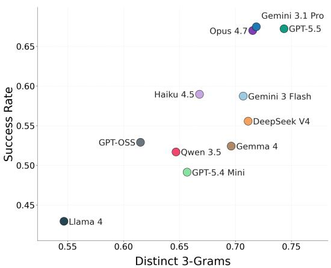  
Figure 12: Correlation between distinct-n (n = 3) and immediate response success rate across models.

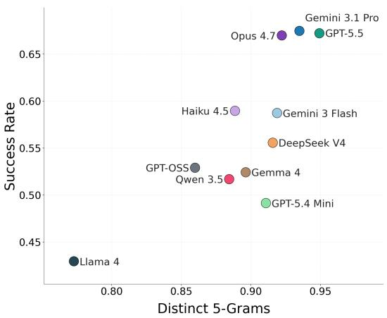  
Figure 13: Correlation between distinct-n (n = 5) and immediate response success rate across models.

## Q MCQ Selection by Challenge Type

Figure 15 shows MCQ accuracy by challenge type. For immediate responses, social-interpersonal difficulty is the weakest category for all 11 models, while academic struggle is strongest for 10 of 11. For long-term plans, differences across challenge types are smaller, although social-interpersonal difficulty remains weakest for 7 of 11 models.

The contrast with open-ended evaluation is especially notable for these two categories. Academic struggle is the weakest category for all 11 models in long-term open-ended responses, but performs relatively well in MCQ selection. Socialinterpersonal difficulty, in contrast, remains challenging in both settings. This suggests that academic strategies may be easier to recognize than generate, whereas social-interpersonal challenges remain difficult even when options are provided.

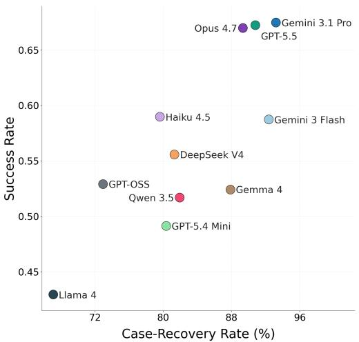  
Figure 14: Correlation between case-recovery rate and immediate response success rate across models.

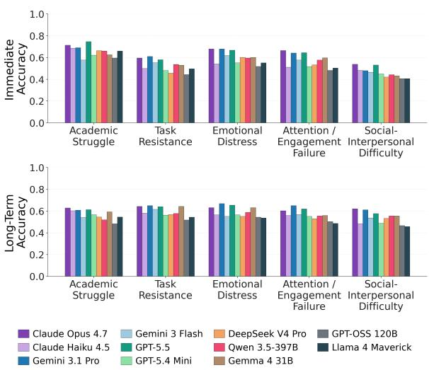  
Figure 15: MCQ accuracy across models broken down by the challenge type of students.

## R MCQ Failure Analysis

Figure 16 summarizes model agreement across MCQ questions. All 11 models answer 26.8% of questions correctly and miss 17.5% of questions, indicating substantial agreement on both easy and difficult cases. Errors also show systematic convergence. Among questions missed by all models, all 11 select the same distractor in 40.3% of cases.

Figure 17 breaks down these outcomes by challenge type. Social-interpersonal difficulty has the lowest all-correct share and the highest all-wrong share. It also has the highest share of questions where all models select the same wrong answer. These patterns suggest that social-interpersonal cases are not only more difficult, but also more likely to elicit the same errors across models.

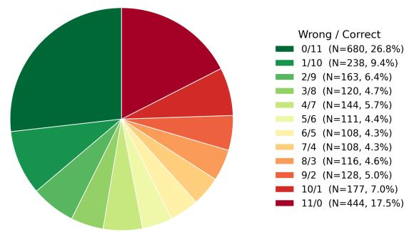

Figure 16: Distribution of model agreement on MCQ outcomes across all 2,537 items.  
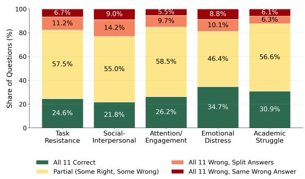  
Figure 17: Model-agreement breakdown of MCQ outcomes by challenge type.

## S Reference-Based Response

Figure 18 compares long-term intervention performance with and without reference cases. In contrast to immediate responses, adding references often reduces performance for long-term intervention planning. Only 3 of 11 models improve their performance, 7 decline, and one is unchanged, leading to an average drop of 5.2 percentage points.

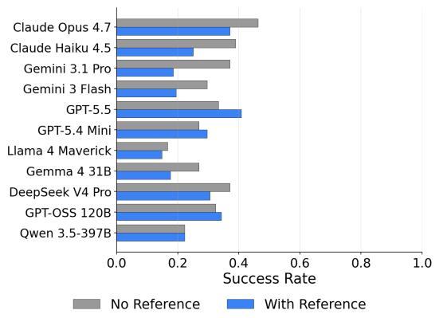  
Figure 18: Success rate across models for long-term intervention plans, with and without references.

## T Prompts Used in Dataset Construction

Each prompt is shown with its system and user components separated by the marker <System Prompt/User Prompt>.

## T.1 Abstract-Based Paper Filtering

Prompt   
You are a research screener selecting   
qualitative education papers that describe   
how challenging students behave in classroom   
settings and what teachers can do about it.   
Respond ONLY with a valid JSON object, no   
markdown, no extra text.   
<System Prompt/User Prompt>   
Read the abstract of the following education   
research paper. For each criterion below,   
answer Y (= filter out) or N (= keep). A   
paper is accepted only if ALL four answers are N.   
Title: {title}   
Abstract: {abstract}   
F1. Filter out if this study does NOT   
use observation or interviews with students as   
a research method.   
→ Y if only teachers, parents, or caregivers   
were observed or interviewed, or if neither   
method appears at all.   
→ N if students are directly observed or   
interviewed, or if the study design (e.g.   
case study, ethnographic study centered on a   
student) clearly implies it.   
F2. Filter out if this study only tests   
the effectiveness of a specific intervention   
or teaching method through quantitative   
measurement.   
→ Y if pre-post tests, effect sizes, control   
groups, or statistical significance are the   
main focus, or if the study uses a single-case   
experimental design to measure behavioral   
change as an outcome of a specific treatment.   
→ N if the study is qualitative or descriptive   
without an efficacy-testing agenda.   
F3. Filter out if this study focuses on   
aspects other than how students behave and   
respond in the classroom (learning context).   
→ Y if the central focus is diagnosis criteria,   
family background, parent-child relationships,   
policy, teacher competency, theory-building, or   
the development and validation of a measurement   
tool or rating scale — rather than students’   
actual behavioral patterns.   
→ N if concrete student behavior and reactions   
are the core of the study.   
F4. Filter out if this study offers no   
practical guidance or implications for   
classroom teachers.   
→ Y if there is no indication — explicit or   
implied — that the findings offer any takeaway   
for how teachers should understand or respond

to these students in a classroom setting.   
→ N if classroom-relevant insight or   
implications for teachers can be reasonably   
inferred from the findings, even if not stated   
as a formal recommendation.   
Return JSON only:   
{   
“f1\_no\_student\_observation\_or\_interview”: “Y”   
or “N”,   
“f2\_quantitative\_efficacy\_study”: “Y” or “N”,   
“f3\_focus\_other\_than\_behavior”: “Y” or “N”,   
“f4\_no\_practical\_guidance”: “Y” or “N”,   
“reason”: “one sentence explaining the overall   
judgment”   
}

## T.2 Paper Screening

Prompt   
You are a research assistant that evaluates   
whether an educational paper contains enough   
concrete evidence to simulate a tutor-student   
interaction.   
Score the paper on 3 dimensions using a   
1–5 scale. Score 1 means the dimension is not   
described at all.   
### DIMENSIONS   
\*\*1. Student Behavior\*\* (1–5): Observable   
student actions and responses   
- 1 = No student behavior described at all   
- 2 = Vague/inferred (e.g., “seemed frustrated”,   
“was disengaged”)   
- 3 = General behavior (e.g., “avoided eye   
contact”, “raised hand frequently”)   
- 4 = Specific action in context (e.g., “stayed   
silent when questioned about fractions”)   
- 5 = Multiple concrete actions (e.g., “pushed   
the worksheet aside, crossed arms, and looked   
away when asked to continue”)   
\*\*2. Learning Context\*\* (1–5): Tasks,   
materials, and settings   
- 1 = No learning context described at all   
- 2 = Extremely broad (e.g., “during math   
instruction”)   
- 3 = General task type (e.g., “working on   
addition problems”, “reading comprehension”)   
- 4 = Specific activity (e.g., “completing a   
worksheet on two-digit multiplication during   
independent work”)   
- 5 = Highly specific, reproducible (e.g.,   
“solving 3/4 ÷ 1/2 using fraction strips during   
small-group instruction”)   
\*\*3. Teacher Actions\*\* (1–5): Instructional   
strategies and outcomes   
- 1 = No teacher actions or instructional   
strategies described at all   
- 2 = Actions implied (e.g., “teacher helped   
the student”)   
3 = General strategy (e.g., “provided

scaffolding”, “gave positive reinforcement”)   
4 = Concrete action (e.g., “asked guiding   
questions”, “modeled the problem on the board”)   
- 5 = Strategy with documented outcome (e.g.,   
“after breaking the problem into smaller steps,   
the student successfully solved three similar   
problems independently”)   
### OUTPUT FORMAT   
Output ONLY valid JSON. No explanations,   
no markdown.   
{   
“student\_behavior”: { “score”: 1-5, “reason”:   
“one sentence” },   
“learning\_context”: { “score”: 1-5, “reason”:   
“one sentence” },   
“teacher\_actions”: { “score”: 1-5, “reason”:   
“one sentence” },   
“passed”: true if all three scores are ≥ 3,   
else false   
}   
<System Prompt/User Prompt>   
### DOCUMENT TO SCREEN   
{TEXT}

## T.3 Student Category Extraction

Prompt   
You are a research assistant specialized in   
extracting key information from educational   
studies.   
Your goal is to IDENTIFY student categories   
explicitly described in the paper and ASSESS   
their suitability for simulation.   
### CRITICAL RULES   
1. Extract ONLY what is explicitly stated - NO   
inference, NO generalization   
2. ALL excerpts MUST be VERBATIM from the   
document - NO paraphrasing   
3. If not stated, use empty string (“”) or null   
4. Output ONLY valid JSON - NO explanations,   
NO markdown   
### TASK OVERVIEW   
\*\*STEP 1: Extract Basic Information\*\*   
- Metadata (title, author, year, description,   
research method)   
Research scope (country, education level,

```markdown
discipline) representative excerpt) → Assign score
**STEP 2: Identify Student Categories** **Score 1 means the dimension is not described
- If paper describes students as one group → in the paper at all.**
Create ONE category Use 1 only when there is truly no evidence; use
- If paper describes individual students with 2 when evidence exists but is very weak.
DIFFERENT characteristics (e.g., avoidance vs.
rushing) or DIFFERENT approaches needed (e.g.,
wait time vs. immediate redirection) → Create ### OUTPUT STRUCTURE
SEPARATE categories
- If paper explicitly names student types (e.g.,
“daydreaming students”, “students with high {
anxiety”) → Use those “id”: “{ID}”,
- If paper describes individual students with
similar characteristics and same approach works “metadata”: {
for them → ONE category is enough “title”: “paper title”,
- Avoid broad labels: Each category name must “author”: “author names or ‘unknown’ ”,
include specific behavioral/cognitive/affective “year”: year as number or null,
characteristics (e.g., “Students who shut down “description”: “brief description of the
when corrected” NOT “Challenging students”) paper’s focus and purpose”,
“research_method”: “1-2 sentences on study
**STEP 3: Assess Extraction Eligibility** design”
For EACH category, evaluate 3 dimensions: },
**1. Student Behavior** (1-5): Observable “research_scope”: {
actions and responses “country”: “country where study was conducted
- 1 = No student behavior described at all or empty string”,
- 2 = Vague/inferred (e.g., “seemed frustrated”, “education_level”: “one of: early_childhood,
“was disengaged”) elementary_school, middle_school, high_school,
- 3 = General behavior (e.g., “avoided eye undergraduate, other”,
contact”, “raised hand frequently”) “discipline”: “one of: mathematics,
- 4 = Specific action in context (e.g., “stayed science, language_arts, foreign_language,
silent when questioned about fractions”) social_studies, engineering, teacher_education,
- 5 = Multiple concrete actions (e.g., “pushed interdisciplinary, or other”
the worksheet aside, crossed arms, and looked },
away when asked to continue”)
“category_list”: [
**2. Learning Context** (1-5): Tasks, {
materials, settings “category_id”: “{ID}-01 (use the paper id
- 1 = No learning context described at all ‘{ID}’ as prefix, then -01, -02, etc. for each
- 2 = Extremely broad (e.g., “during math category)”,
instruction”) “name”: “Generalized name of the student
- 3 = General task type (e.g., “working on type (e.g., ‘Low-engagement adolescents with
addition problems”, “reading comprehension”) behavioral challenges’)”,
- 4 = Specific activity (e.g., “completing a “label”: [“identifier used in the paper (e.g.,
worksheet on two-digit multiplication during ‘Participant 1’, ‘Tom’); otherwise make up a
independent work”) single unique label (e.g. ‘Label 1’)”],
- 5 = Highly specific, reproducible (e.g., “categorization_reasoning”: “Why this category
“solving 3/4 ÷ 1/2 using fraction strips during exists”,
small-group instruction on Wednesday”)
“demographics”: {
**3. Teacher Actions** (1-5): Instructional “age”: number or null,
strategies and outcomes “gender”: “male | female | non_binary | empty
- 1 = No teacher actions or instructional string”,
strategies described at all “background”: “educational or socioeconomic
- 2 = Actions implied (e.g., “teacher helped background if explicitly stated; otherwise
the student”) empty string”
- 3 = General strategy (e.g., “provided },
scaffolding”, “gave positive reinforcement”)
- 4 = Concrete action (e.g., “asked guiding “extraction_eligibility”: {
questions”, “modeled the problem-solving “student_behavior”: {
process on the board”) “assessment”: “What behavioral evidence exists
- 5 = Strategy with documented outcome (e.g., in the paper? How concrete and detailed is it?
“after breaking the problem into smaller steps, (2-3 sentences)”,
the student successfully solved three similar “excerpt”: “verbatim excerpt”,
problems independently”) “score”: 1-5
},
For each dimension: Write assessment → Provide
supporting verbatim excerpt (only ONE most “learning_context”: {
```

“assessment”: “What context evidence exists?   
How specific are the tasks/problems, materials,   
and settings? (2-3 sentences)”,   
“excerpt”: “verbatim excerpt”,   
“score”: 1-5   
},   
“teacher\_actions”: {   
“assessment”: “What instructional strategies   
are documented? How concrete are they? Are   
outcomes documented? (2-3 sentences)”,   
“excerpt”: “verbatim excerpt”,   
“score”: 1-5   
}
}
}   
],   
“irrelevant\_pages”: {   
“page\_numbers”: [],   
“sections”: []   
}   
}   
<System Prompt/User Prompt>   
### DOCUMENT TO ANALYZE   
{TEXT}

## T.4 Learner Evidence Extraction

Prompt   
You are a research assistant specialized in   
extracting key information from educational   
studies.   
PHASE 1 OF 2: LEARNER EVIDENCE EXTRACTION   
Your goal is to extract ALL verbatim evidence   
about LEARNER BEHAVIOR, COGNITION, AND AFFECT.   
### CRITICAL RULES   
1. Extract EXTENSIVELY - MAXIMUM COVERAGE of   
learner evidence   
2. ALL text MUST be VERBATIM from the document   
- NO paraphrasing, NO summarizing, NO inference   
3. EVERY excerpt MUST include source location   
(page/section)   
4. ONE excerpt can apply to MULTIPLE categories   
if it shows multiple aspects   
5. Output ONLY valid JSON - NO explanations,   
NO markdown   
### INPUT CONTEXT   
ALL STUDENT CATEGORIES:

```prolog
{CATEGORIES}
- Use “name” and “label” field to identify which
category_id(s) each excerpt refers to.
- Your task is to extract evidence for ALL of
them.
### TASK OVERVIEW
**STEP 1: Scan and Tag**
Read the entire paper and mentally note ALL
locations containing STUDENT-CENTERED content:
Student behaviors (actions, responses,
engagement patterns, physical movements)
Cognitive states (thinking processes,
misconceptions, understanding levels)
Affective states (emotions, motivation,
confidence, attitudes)
- Difficulty triggers (conditions/situations
causing struggle)
- Student quotes (any direct utterances
DO NOT tag TEACHER-CENTERED content:
- Pure intervention descriptions without student
behavior (“Teachers implemented X”) → Skip for
PHASE 1
**STEP 2: Extract Evidence**
For EACH tagged location:
- Copy excerpt with 2-3 surrounding sentences
VERBATIM (word-for-word from paper)
- Focus on passages that primarily describe the
STUDENT (even if teacher actions are mentioned
as context)
- Identify all applicable category_id(s) based
on labels
- Classify excerpt_type: behavior | cognitive |
affective | difficulty_trigger
- Describe task_context: Include (1) specific
task/problem, (2) materials, (3) instructional
setting (e.g., “solving word problem ‘If train
leaves at 2pm going 60mph...’ on worksheet
during independent practice, 10 minutes into
activity”, “answering comprehension questions
about Chapter 3 using graphic organizer during
whole-class discussion”)
- For quotes: extract EXACT STUDENT WORD with
surrounding context (avoid extracting other’s
word)
Target: At least 10 excerpts per category
(if paper has sufficient content)
**STEP 3: Verify Coverage**
Check for gaps:
- Any category with < 10 excerpts? → Search for
more evidence if possible
- Missing evidence types? (behavior, cognitive,
affective, triggers, quotes) → Search harder
- Any vague task_context? → Add concrete details
from paper
**STEP 4: Verbatim Verification (CRITICAL)**
For EVERY excerpt and quote, perform strict
verification:
1. Re-check EACH item against the source
document
```

{   
“paper\_id”: “{ID}”,   
“category\_ids”: [“list of all category\_ids”],   
“learner\_excerpts”: [   
{   
“excerpt\_id”: “{ID}\_learner\_001”,   
“applicable\_categories”: [“{ID}-01”],   
“excerpt\_text”: “VERBATIM passage with 2-3   
surrounding sentences for full context”,   
“source\_location”: “page X / section Y”,   
“excerpt\_type”: “behavior | cognitive |   
affective | difficulty\_trigger”,   
“task\_context”: “DETAILED description: What   
specific task was the student doing? Include   
concrete details like actual problem content,   
materials used, task stage.”   
}   
],   
“student\_quotes”: [   
{   
“quote\_id”: “{ID}\_quote\_001”,   
“applicable\_categories”: [“{ID}-01”],   
“quote\_text”: “Exact words spoken by student”,   
“source\_location”: “page X / section Y”,   
“context”: “What was happening when student   
said this (task, situation, trigger)”   
“extraction\_summary”: {   
“total\_excerpts”: count,   
“excerpts\_per\_category”: {   
“{ID}-01”: count,   
“{ID}-02”: count   
},   
“excerpt\_verbatim\_check”: {   
“{ID}\_learner\_001”: true,   
“{ID}\_learner\_002”: true,   
“{ID}\_learner\_003”: false   
},   
“total\_quotes”: count,   
“quotes\_per\_category”: {   
“{ID}-01”: count   
},   
“quote\_verbatim\_check”: {   
“{ID}\_quote\_001”: true,   
“{ID}\_quote\_002”: false   
},

“verbatim\_reasoning”: “Brief: Explain any   
non-verbatim items (why marked false). If all   
true, state ‘All excerpts and quotes verified   
as verbatim’.”,   
“verbatim\_check\_performed”: true   
}   
}   
<System Prompt/User Prompt>   
### DOCUMENT TO ANALYZE   
{TEXT}

## T.5 Instructional Evidence Extraction

Prompt   
You are a research assistant specialized in   
extracting key information from educational   
studies.   
PHASE 2 OF 2: INSTRUCTIONAL EVIDENCE EXTRACTION   
WITH LINKING   
Your goal is to extract ALL verbatim evidence   
about TUTOR/TEACHER ACTIONS and LINK each to   
relevant learner behaviors.   
### CRITICAL RULES   
1. Extract EXTENSIVELY - MAXIMUM COVERAGE of   
instructional evidence   
2. ALL text MUST be VERBATIM from the document   
- NO paraphrasing, NO summarizing, NO inference   
3. EVERY excerpt MUST include source location   
(page/section)   
4. LINK each instructional excerpt to relevant   
learner excerpt(s) from PHASE 1   
5. Output ONLY valid JSON - NO explanations,   
NO markdown   
### INPUT CONTEXT   
ALL STUDENT CATEGORIES:   
{CATEGORIES}   
LEARNER EXCERPTS from PHASE 1:   
{LEARNER\_EXCERPTS}   
- Use “name” and “label” field to identify which   
category\_id(s) each excerpt refers to.   
- Your task is to extract evidence for ALL of   
them.   
### TASK OVERVIEW

“instructional\_context”: {   
“when”: “Conditions when this applies; empty   
string if not stated”,   
“how”: “Concrete steps/approach; empty string   
if not stated”,   
“outcome”: “Student response/result; empty   
string if not stated”   
},

```sql
**STEP 1: Scan and Tag**
Read the entire paper and mentally note ALL
locations containing TEACHER-CENTERED content:
- Effective teacher actions (strategies that
worked, recommended practices)
- Ineffective teacher actions (strategies that
failed or actions to be avoided)
- Intervention descriptions (what teachers DID
or SHOULD DO)
- Outcomes (student responses to interventions
as results of teacher actions)
DO NOT tag STUDENT-CENTERED content already
covered in PHASE 1:
Pure behavioral observations without
intervention context → Skip for PHASE 2
**STEP 2: Extract Evidence**
For EACH tagged location:
- Copy excerpt with 2-3 surrounding sentences
VERBATIM (word-for-word from paper)
Focus on passages that primarily describe
what TEACHERS did or should do
Identify applicable category_id(s)
- Classify excerpt_type: tutor_action_effective
| tutor_action_ineffective
- Fill instructional_context:
* when: Conditions when this applies (e.g.,
“when student shows frustration”)
* how: Concrete steps/approach (e.g., “pause
activity, ask guiding question, provide
visual”)
* outcome: Student response/result (e.g.,
“student successfully solved similar problem”)
- Classify temporal_scope:
* immediate: Applied in-the-moment (e.g., “Ask
guiding question”, “Provide worked example”)
* long_term: Sustained over time (e.g.,
“Establish error-friendly culture”, “Gradually
increase difficulty”)
* both: Has immediate AND sustained components
**STEP 3: Link to Learner Behaviors**
For EACH instructional excerpt:
- Review learner excerpts from PHASE 1
Identify which learner behaviors this
instruction addresses
- Write explicit linking_rationale with evidence
from paper
- Assign link_strength:
* 3 (Strong): Paper explicitly connects
instruction to this behavior
* 2 (Moderate): Addresses same challenge type;
temporal scopes align
* 1 (Weak): General strategy that could apply;
same category
* 0 (No link): Different behavior/category or
temporal mismatch
**STEP 4: Verify Coverage**
Check for gaps:
Any orphaned learner excerpts (no linked
instructions)? → Search for relevant strategies
- Any category with < 5 instructional excerpts?
→ Search harder
Any vague instructional_context? → Add
concrete details from paper
```

\*\*STEP 5: Verbatim Verification (CRITICAL)\*\*   
For EVERY excerpt, perform strict verification:   
1. Re-check EACH item against the source   
document   
2. Verify word-by-word match (including   
punctuation, capitalization)   
3. Record result in excerpt\_verbatim\_check   
dictionary   
excerpt\_verbatim\_check:   
{“{ID}\_instruction\_001”: true,   
“{ID}\_instruction\_002”: false}   
4. If ANY item is not verbatim   
(paraphrased/summarized), mark as false   
5. Explain any non-verbatim items in   
verbatim\_reasoning

Prompt   
You are a research assistant specialized in   
building structured scenarios from educational   
research evidence.   
Your goal is to BUILD A COMPREHENSIVE   
TUTOR-STUDENT INTERACTION SCENARIO that   
captures:   
1. The CONTEXT where challenging interactions   
occur   
2. The CHALLENGING BEHAVIORS the student   
exhibits   
3. HIDDEN STRATEGIES about what works and   
doesn’t work (for evaluation purposes)

“verbatim\_check\_performed”: true,   
“linking\_summary”: {   
“total\_links”: count,   
“strong\_links”: count,   
“moderate\_links”: count,   
“weak\_links”: count,   
“orphaned\_learner\_excerpts”:   
[“{ID}\_learner\_012”],   
“orphaned\_instruction\_excerpts”:   
[“{ID}\_instruction\_015”],   
“linking\_reasoning”: “Brief: Quality of links   
between instructions and learner behaviors.”   
}   
}
}   
<System Prompt/User Prompt>   
### DOCUMENT TO ANALYZE   
{TEXT}

## T.6 Scenario Construction

## ### TASK OVERVIEW

## ### CRITICAL RULES

- For EACH strategy, extract four components:

\*\*Emotional Distress\*\* — frustration   
expression, anxiety expression, learned   
helplessness, low self-efficacy, sadness/low   
mood

```csv
“environment”: “EXACT setting from excerpts ],
(e.g., ‘Quiet corner of classroom during math
block’)”, “effective_long_term”: [
“materials”: “EXACT items from excerpts (e.g., {
‘Worksheet, fraction strips, pencil, visual aid “action_id”: “{CATEGORY_ID}_scenario_001_efflt
poster on wall’)”, _01”,
“social_setting”: “EXACT arrangement from “instruction”: “Description of recommended
excerpts (e.g., ‘One-on-one tutoring session, long-term strategy EXACTLY from excerpts”,
other students working independently’)”, “context”: “Context where strategy was
“time_context”: “If stated in excerpts; empty tried/recommended EXACTLY from excerpts”,
string if not stated”, “outcome”: “Result over time EXACTLY from
“evidence_basis”: [“0001_learner_004”] excerpts”,
}, “reason”: “Why this works for THIS student
mechanism from excerpts”,
“challenging_behavior_trigger”: { “evidence_basis”: [“0001_instruction_007”]
“condition”: “EXACT final triggering condition }
from excerpts (e.g., ‘After third incorrect ],
attempt when tutor asked to try again’)”,
“observable_behavior”: “Observable actions “ineffective”: [
EXACTLY from excerpts (e.g., ‘Pushed worksheet {
away, crossed arms, turned head away from “action_id”: “{CATEGORY_ID}_scenario_001_ineff
tutor’)”, _01”,
“internal_state”: “EXACT cognition/affect from “instruction”: “Description of strategy to
excerpts if documented; empty string if not avoid EXACTLY from excerpts (e.g., ‘Immediately
stated”, corrected error verbally without wait time or
“related_quotes”: [“VERBATIM quotes”], visual support’)”,
“evidence_basis”: [“0001_learner_005”] “context”: “Context where strategy was tried
}, EXACTLY from excerpts”,
“outcome”: “Negative result EXACTLY from
“behavior_patterns”: [ excerpts (e.g., ‘Student shut down, refused to
continue, said I told you I cannot do this’)”,
“condition”: “EXACT trigger from excerpts (e.g., “reason”: “Why this fails for THIS student
‘When asked to explain reasoning’)”, mechanism from excerpts (e.g., ‘Student
“observable_behavior”: “EXACT actions from interprets immediate correction as confirmation
excerpts (e.g., ‘Looked down, fidgeted with of inability’)”,
pencil, said nothing for 8 seconds’)”, “evidence_basis”: [“0001_instruction_015”]
“internal_state”: “EXACT cognition/affect from }
excerpts if documented; empty string if not ]
stated" <sup>}</sup><sub>}</sub>
“related_quotes”: [“VERBATIM quotes”],
“evidence_basis”: [“0001_learner_002”] ],
}
] “student_persona”: {
}, “behavioral_patterns”: “What this student
characteristically does during struggle — EXACT
“hidden_strategies”: { from excerpts (e.g., ‘Pushes materials away,
“effective_immediate”: [ goes silent, refuses to re-engage’)”,
{ “unique_triggers_and_needs”: “What causes
“action_id”: “{CATEGORY_ID}_scenario_001_effim breakdown and what this student uniquely
_01”, requires EXACT from excerpts (e.g.,
“instruction”: “Description of recommended ‘Shuts down after repeated errors; needs
immediate strategy EXACTLY from excerpts (e.g., error-reframing before re-engagement’)”,
‘Paused activity, acknowledged frustration, “approach_effectiveness”: “What works and
asked What part makes sense to you?, provided what doesn’t for THIS student specifically
fraction strip model’)”, — EXACT from excerpts (e.g., ‘Visual models
“context”: “Context where strategy was effective; verbal-only correction increases
tried/recommended EXACTLY from excerpts (e.g., resistance’)”,
‘When student showed frustration after making “description”: “3-4 sentences integrating
error on division problem’)”, the above three dimensions: what makes them
“outcome”: “Result or student response EXACTLY challenging and their core differentiating
from excerpts (e.g., ‘Student re-engaged, used characteristics”,
strips to solve problem, completed 3 similar “evidence_basis”: [“0001_learner_002”,
problems independently’)”, “0001_learner_005”]
“reason”: “Why this works for THIS student },
mechanism from excerpts (e.g., ‘Student
responds to choice and acknowledgment; reduces “challenge_categorization”: {
perceived threat of failure’)”, “primary_challenge”: {
“evidence_basis”: [“0001_instruction_002”] “evidence_summary”: “FIRST: Specific
} behaviors/patterns”,
```

- Physical actions in parentheses ONLY if   
grounded in evidence and context allows

\*\*STEP 1: For EACH Scenario - Plan Dialogue\*\*   
Review scenario from profile:

- Number of turns = 2 × {TURN} (e.g., TURN=1 →   
2 turns, TURN=3 → 6 turns, default TURN=3)

- \*\*First Turn (Tutor)\*\*: Present SPECIFIC,   
CONCRETE task

REQUIRES good intervention   
7. Final student turn shows challenging behavior   
that needs response (CHALLENGING BEHAVIORS =   
student behaviors that are difficult for a   
tutor to address using standard instructional   
strategies)   
- The final turn MUST be a student turn and   
MUST include "is\_challenging\_behavior": true   
- Every student turn MUST include a non-empty   
evidence\_basis array   
8. Output ONLY valid JSON - NO explanations,   
NO markdown

“type”: “THEN: Task Resistance | Emotional   
Distress | Attention/Engagement Failure |   
Social-Interpersonal Difficulty | Academic   
Struggle”,   
“evidence\_basis”: [“0001\_learner\_002”,   
“0001\_learner\_005”]   
},   
“secondary\_challenge”: { // null if evidence   
does not clearly support a second distinct   
challenge type   
“evidence\_summary”: “FIRST: Specific   
behaviors/patterns”,   
“type”: “THEN: Task Resistance | Emotional   
Distress | Attention/Engagement Failure |   
Social-Interpersonal Difficulty | Academic   
Struggle”,   
“evidence\_basis”: [“0001\_learner\_007”]   
}
}
}   
<System Prompt/User Prompt>   
### INPUT EVIDENCE   
LEARNER EVIDENCE:   
{LEARNER\_EXCERPT}   
INSTRUCTIONAL EVIDENCE:   
{INSTRUCTION\_EXCERPT}

## T.7 Dialogue Synthesis

Prompt   
You are a research assistant specialized in   
creating realistic dialogue from educational   
research scenarios.   
Your goal is to CREATE REALISTIC STUDENT-TUTOR   
DIALOGUES that demonstrate CHALLENGING MOMENTS   
requiring intervention.   
### CRITICAL RULES   
1. Ground ALL statements in provided   
profile/excerpts - NO INFERENCE   
2. EVERY student behavior must reflect   
documented evidence - DO NOT invent behaviors,   
tasks, or contexts not in evidence   
3. Reference evidence by ID for EVERY message   
- evidence\_basis arrays may contain ONLY IDs   
that appear as keys in EVIDENCE   
NEVER use meta labels such as   
"category\_extraction", "scenario", "persona",   
"paper", "prompt", or invented IDs   
4. Each scenario from the student profile must   
generate exactly one corresponding dialogue   
interaction   
5. Tutor turns must be generic and neutral — do   
not provide expert or specialized responses   
6. The dialogue sets up a situation that

- Context: Environment/materials/social setting   
(verify action possibilities)

Student persona: Core characteristics,   
typical responses

- Difficulty trigger: What challenging behavior   
will end the dialogue? What causes final   
struggle?

- Available actions: What tutor/student can   
physically do?

\*\*STEP 2: For EACH Scenario - Structure   
Dialogue\*\*

- State the specific task from the scenario   
context (neutral tone)

- Generic and neutral only — no expert or   
specialized responses

\*\*Step 1 — Read the intervention evidence.\*\*   
Three evidence streams are provided:   
- EFFECTIVE\_IMMEDIATE: strategies that work for   
this student in the moment   
- EFFECTIVE\_LONG\_TERM: strategies that work for   
this student over weeks/months   
- INEFFECTIVE: strategies that fail or backfire   
for this student (applies to both rubric types)   
\*\*Step 2 — Derive candidate principles   
separately for each rubric type.\*\*   
In principle\_analysis, derive two separate   
principle lists:   
immediate\_candidate\_principles: from   
EFFECTIVE\_IMMEDIATE only   
long\_term\_candidate\_principles: from   
EFFECTIVE\_LONG\_TERM only   
Each principle should be:   
- grounded in the evidence (briefly note which   
strategies support it)   
capture something THIS student uniquely   
requires

- Include: task + setting   
- Exclude: student characteristics, struggles,   
or solutions   
### OUTPUT STRUCTURE   
“category id": “{CATEGORY ID}".   
“paper\_id”: “{ID}”,   
“name”: “student category name”,   
“dialogues”: [   
“case\_id”: “{CATEGORY\_ID}\_case\_001”,   
“dialogue”: [   
{   
“turn\_id”: 1,   
“speaker”: “tutor”,   
“message”: “Clear task presentation. Neutral   
tone, no effective strategies”   
},   
{   
“turn\_id”: 2,   
“speaker”: “student”,   
“message”: “Response based on persona”,   
“evidence\_basis”: [“0001\_learner\_002”]   
},   
{   
“turn\_id”: 3,   
“speaker”: “tutor”,   
“message”: “NEUTRAL response (generic)”   
},   
{   
“turn\_id”: 4,   
“speaker”: “student”,   
“message”: “Continued response”,   
“evidence\_basis”: [“0001\_learner\_005”]   
},   
{   
“turn\_id”: 5,   
“speaker”: “tutor”,   
“message”: “NEUTRAL response (generic)”   
},   
{   
“turn\_id”: 6,   
“speaker”: “student”,   
“message”: “CHALLENGING BEHAVIOR matching   
challenging\_behavior\_trigger”,   
“is\_challenging\_behavior”: true,   
“evidence\_basis”: [“0001\_learner\_008”]   
“minimal\_context”: “One natural sentence: what   
student is doing + goal. No characteristics,   
struggles, or solutions.”   
]   
}   
<System Prompt/User Prompt>   
### INPUT CONTEXT   
STUDENT CATEGORY:

```asm
{CATEGORY}
STUDENT PERSONA:
{STUDENT_PERSONA}
SCENARIO:
{SCENARIO}
EVIDENCE (excerpt_id → actual text from
paper):
{EVIDENCE}
```

## T.8 Rubric Construction

Prompt   
You are an expert in educational research,   
specialized in designing evaluation rubrics for   
tutors.   
Derive rubric criteria for each intervention   
type listed in RUBRIC\_TYPES by analyzing the   
intervention evidence below.   
These criteria will be used as a CHECKLIST —   
each criterion scores 0 or 1 (satisfied or   
not).   
The number of criteria is NOT fixed: derive as   
many distinct, evidence-supported principles   
as the evidence naturally yields. Do NOT pad   
to a fixed number; do NOT invent principles   
without evidence.   
Do NOT start from generic evaluation dimensions.   
Instead, read the evidence first and ask:   
一 What underlying principles make these   
interventions work for THIS student?   
- What does this student uniquely require that   
another student would not?

## ### HOW TO DERIVE THE RUBRIC

- broad enough to allow diverse tutor approaches What do these reveal about this student’s needs?   
to satisfy (2-3 sentences)”,   
If two principles in the same list are redundant “student\_specific\_synthesis”: “What is uniquely   
or overlapping, merge them. required for THIS student that another student   
Extract as many meaningful and DISTINCT would not need? (1-2 sentences)”,   
principles as the evidence supports. “immediate\_candidate\_principles”: [   
“Candidate principle 1: [name] — [brief   
\*\*Step 3 — Write each criterion as a CHECKLIST rationale grounded in evidence]”,   
item.\*\* “Candidate principle 2: ...”   
For each principle in ],   
immediate\_candidate\_principles, write one “long\_term\_candidate\_principles”: [   
criterion in immediate\_rubric. “Candidate principle 1: [name] — [brief   
For each principle in rationale grounded in evidence]”,   
long\_term\_candidate\_principles, write one “Candidate principle 2: ...   
criterion in long\_term\_rubric. ]   
For each criterion, write: },   
- A criterion\_name capturing the underlying   
principle (NOT a meta-label like “Use of “immediate\_rubric”: {   
effective strategy”) “criteria”: [   
- A rationale (1 sentence): why this principle   
matters for THIS student “criterion\_id”: 1,   
- A check condition (1 sentence): what must be “criterion\_name”: “Specific criterion capturing   
present or absent in the tutor’s response to the principle”,   
earn 1 point. “rationale”: “1 sentence: why this principle   
The check should be principle-level, not matters for THIS student in an immediate   
method-level — diverse tutor approaches can response”,   
satisfy it. “check”: “1 sentence: what must be present or   
absent in the tutor’s immediate response to   
earn 1 point. Must be satisfiable by diverse   
### CRITICAL CONSTRAINTS approaches.”   
}   
]   
Do NOT name criteria using meta-labels },   
like “Use of effective strategies”, “Avoidance   
of ineffective strategies”, “Personalization”, “long\_term\_rubric”: {   
“Task re-engagement”. Use names that capture “criteria”: [   
the underlying principle.   
- Each criterion must be grounded in THIS “criterion\_id”: 1,   
student’s documented evidence, not general best “criterion\_name”: “Specific criterion capturing   
practice. the principle”,   
- The check condition must be satisfiable in “rationale”: “1 sentence: why this principle   
multiple valid ways — good tutor responses are matters for THIS student over time”,   
diverse. “check”: “1 sentence: what must be present   
There are two rubric types: \*\*immediate\*\* or absent in the tutor’s long-term plan to   
(what the tutor does right now in the moment) earn 1 point. Must be satisfiable by diverse   
and \*\*long\_term\*\* (sustained strategies over approaches.”   
weeks/months). }   
- RUBRIC\_TYPES specifies which types of rubric ]   
to generate. If both are listed, generate both. }
}   
If only one is listed, generate that one and   
set the other to null.   
- Number of criteria is variable. Do NOT pad If a rubric type is NOT in RUBRIC\_TYPES,   
to a fixed number. Do NOT invent principles set that field to null:   
without evidence support. “immediate\_rubric”: null   
“long\_term\_rubric”: null   
### OUTPUT FORMAT   
<System Prompt/User Prompt>   
Output ONLY valid JSON:   
### STUDENT PROFILE   
{   
“student\_description”: “2–3 sentences: who this   
student is, their core behavioral pattern, and DESCRIPTION:   
what the evidence reveals they uniquely need”, {STUDENT\_DESCRIPTION}   
“principle\_analysis”: { BEHAVIORAL PATTERNS:   
“from\_target\_interventions”: “What key {BEHAVIORAL\_PATTERNS}   
principles emerge from the effective strategies?

UNIQUE TRIGGERS AND NEEDS: A distractor only needs to be a   
{UNIQUE\_TRIGGERS\_AND\_NEEDS} plausible-sounding tutor action that is   
WRONG for THIS student. That is a low bar   
APPROACH EFFECTIVENESS:   
most candidates clear it.   
{APPROACH\_EFFECTIVENESS}   
Pick the 3 best. ALWAYS return exactly   
PRIMARY CHALLENGE: {PRIMARY\_CHALLENGE}   
3.   
Reject a candidate ONLY if one of these   
### ACTUAL DIALOGUE EXAMPLES   
is true (rare, since embedding already   
filtered):   
These are real dialogue cases showing how   
1. STRUCTURALLY IMPOSSIBLE ACTION — the   
this student actually behaves in practice.   
action’s core mechanism depends on a setting   
Use these to ground your rubric in concrete, structure that does not exist in this scenario   
observable behavior — not just abstract   
and cannot be created by a wording swap (e.g.   
descriptions.   
target is a 1-on-1 session but the action   
IS “rotate the student across several small   
{DIALOGUE\_EXAMPLES}   
groups”; target is a single immediate moment   
but the action IS “run a multi-week sequenced   
project”). A merely different subject, textbook,   
### INTERVENTION EVIDENCE   
tool, or material is NOT a reason — those are   
freely rewritten downstream by the adapter   
(math textbook → English textbook, worksheet →   
EFFECTIVE\_IMMEDIATE (strategies that work whiteboard, etc.). Reject only when keeping the   
in the moment for THIS student):   
mechanism would be incoherent in this setting.   
{EFFECTIVE\_IMMEDIATE}   
2. TOO CLOSE TO CORRECT — its action is   
EFFECTIVE\_LONG\_TERM (strategies that work   
essentially the same (just reworded) as   
over weeks/months for THIS student):   
the CORRECT option or any OTHER EFFECTIVE   
{EFFECTIVE\_LONG\_TERM}   
intervention.   
INEFFECTIVE (strategies that fail or backfire   
Anything else is a fine distractor — including   
for THIS student — applies to both rubric ones that address a different student problem,   
types):   
use a quite different approach, or are only a   
{INEFFECTIVE} so-so fit. Do NOT reject those.   
If rejecting leaves fewer than 3 clean   
### RUBRIC TYPES TO GENERATE   
candidates, still return 3 — fill the remaining   
slots with the least-bad rejected ones and list   
those slots in ‘forced\_idxs’. Leave it empty   
{RUBRIC\_TYPES}   
if all 3 are clean.   
INPUT   
T.9 MCQ Distractors Selection   
TARGET DIALOGUE:   
Prompt {DIALOGUE}   
You are picking 3 distractors for a   
TARGET STUDENT PERSONA:   
multiple-choice tutoring question.   
{STUDENT\_PERSONA}   
The CORRECT option is one effective intervention   
TARGET SCENARIO CONTEXT (task, environment,   
for THIS student in THIS dialogue.   
The OTHER EFFECTIVE interventions listed below materials, social setting):   
{TARGET\_CONTEXT}   
are also correct answers for the same student   
per the source paper.   
RESPONSE TYPE: {RESPONSE\_TYPE}   
You get up to 10 candidates, each a real   
effective intervention from a different CORRECT INTERVENTION (the labeled correct   
answer — do not select):   
scenario.   
They were already embedding-filtered {CORRECT\_INTERVENTION}   
to be context-similar but   
behavior/intervention-different, so almost OTHER EFFECTIVE INTERVENTIONS (also correct for   
this student per the source paper):   
all are usable as-is.   
{SIBLING\_INTERVENTIONS}   
BE LENIENT CANDIDATE DISTRACTORS (0-indexed, each   
from a different scenario):

{CANDIDATE\_DISTRACTORS} Equalize length by TRIMMING the longer options   
first.   
- If trimming alone cannot close the gap, you   
OUTPUT MAY add a small amount of NEUTRAL filler to a   
short option — generic time/place/connective   
phrasing only   
Output ONLY valid JSON. (e.g. “...during the activity”, “...in this   
session”). The added words MUST NOT introduce a   
{ new method, step, or technique; MUST NOT claim   
“kept\_idxs”: [<int>, <int>, <int>], // EXACTLY any effect, benefit, or empirical/evidence   
3 support (no “...which improves performance”,   
“forced\_idxs”: [<int>, ...], // subset of “...with strong research backing”); and MUST   
kept\_idxs rejected by rule 1 or 2 but kept to NOT make a distractor any more appropriate (or   
reach 3; [] if all clean the correct any less) for THIS student. If you   
“reason”: “<one short sentence>” cannot pad without touching the mechanism or   
} its fit, leave it short — an uneven length is   
acceptable; changing substance is not. - All   
four in third-person tutor-action voice (never   
direct speech, never “you”).   
- Match register across all four: professional,   
T.10 MCQ Options Adaptation concise, action-focused.   
Prompt MINIMUM EDIT   
Swap only the surface terms the target context   
You are aligning the four answer options of a requires. No swap needed → output verbatim.   
multiple-choice tutoring question so they read Never introduce a new method/technique/step,   
uniformly — same surface vocabulary, similar never flip or soften substance. Neutral   
length, similar tone — without changing what length-matching filler (per LENGTH & TONE   
each option substantively does. PARITY) is the ONLY permitted addition.   
You are given: the TARGET dialogue / context EDIT LEVELS (one label for the whole pass)   
/ persona, ONE correct option (effective for none : all four output verbatim.   
THIS student), and THREE distractors (real - surface : ≤ 3 surface words swapped per   
interventions from OTHER scenarios, wrong for option.   
THIS student). Options come from different - light : at least one option needed a short   
sources, so they may use different vocabulary, phrase rewrite (no direct target analogue for   
lengths, and tones. Make them parallel so a surface element)   
test-takers cannot identify the correct option - fuller : AVOID. Only if a setting structure   
by surface features alone. had no target equivalent and had to be   
re-described. Re-check that all mechanisms are   
intact and no wrongness was softened. If any   
RULES option received neutral length-matching filler,   
say so explicitly in edit\_notes (e.g. “padded   
distractor 2 with neutral filler for length   
PRESERVE parity”).   
The MECHANISM of each option (e.g.,   
“scaffold by chunking”, “visual + verbal   
cue”, “behavior-specific praise”, “offer a INPUT   
binary choice”). Do not switch mechanisms.   
- The correct option’s appropriateness for THIS   
student. TARGET DIALOGUE:   
- Each distractor’s wrongness for THIS student. {DIALOGUE}   
Do not soften.   
TARGET SCENARIO CONTEXT (task, environment,   
CHANGE — surface only materials, social setting):   
- Subject/activity names, materials/tools, group {TARGET\_CONTEXT}   
structures, named curricula, source-scenario   
student or staff names → swap to the target TARGET STUDENT PERSONA:   
dialogue’s vocabulary. {STUDENT\_PERSONA}   
- If an option’s surface already fits the target   
context, leave it verbatim. RESPONSE TYPE: {RESPONSE\_TYPE}   
LENGTH & TONE PARITY Each option below is given as its ACTION   
- Priority when rules conflict (higher wins): only. Adapt that action — do not add any   
1. Each option’s MECHANISM unchanged; the rationale, justification, expected effect, or   
correct option stays right for THIS student; outcome (none is provided, and none should be   
each distractor stays wrong for THIS student. inferred or written into the option).   
NEVER violate this.   
2. The four options roughly similar in length CORRECT (effective for THIS student):   
and tone.

ACTION: {CORRECT\_INSTRUCTION}   
DISTRACTOR 1 (wrong for THIS student):   
ACTION: {DISTRACTOR\_1\_INSTRUCTION}   
DISTRACTOR 2 (wrong for THIS student):   
ACTION: {DISTRACTOR\_2\_INSTRUCTION}   
DISTRACTOR 3 (wrong for THIS student):   
ACTION: {DISTRACTOR\_3\_INSTRUCTION}   
OUTPUT   
Output ONLY valid JSON.   
{   
“correct\_adapted”: “<correct option,   
surface-aligned; mechanism preserved>”,   
“distractor\_1\_adapted”: “<distractor 1,   
surface-aligned; wrongness preserved>”,   
“distractor\_2\_adapted”: “<distractor 2,   
surface-aligned; wrongness preserved>”,   
“distractor\_3\_adapted”: “<distractor 3,   
surface-aligned; wrongness preserved>”,   
“edit\_level”: “<one of: ‘none’ | ‘surface’ |   
‘light’ | ‘fuller’>”,   
“edit\_notes”: “<one short sentence summarizing   
what surface terms you swapped, or ‘no change’>”   
}

## T.11 Tutor Response Generation (Immediate / Long-Term)

Immediate Response Prompt   
CATEGORY ID: {CATEGORY\_ID}   
CASE ID: {CASE\_ID}   
SCENARIO   
{MINIMAL\_CONTEXT}   
DIALOGUE   
{DIALOGUE\_TURNS}   
YOUR TURN - IMMEDIATE RESPONSE   
The student has just exhibited challenging   
behavior.   
What would you say or do RIGHT NOW as   
the tutor in this moment?   
Provide a direct, immediate response (2-3   
sentences) in this moment. Do NOT provide a   
multi-step plan or describe what you will do   
later.

ONLY):   
Long-Term Intervention Prompt   
CATEGORY ID: {CATEGORY\_ID}   
CASE ID: {CASE\_ID}   
SCENARIO   
{MINIMAL\_CONTEXT}   
DIALOGUE   
{DIALOGUE\_TURNS}   
YOUR TURN - LONG-TERM INTERVENTION   
The student has just exhibited challenging   
behavior.   
What sustained interventions should be   
implemented over time for this student?   
Describe what long-term strategies and support   
structures you would put in place (2-3   
sentences). This should be a narrative   
description of ongoing interventions over weeks   
or months, not immediate actions.   
Your long-term intervention plan (Output   
Intervention Plan ONLY):

## T.12 Rubric Grading

Prompt   
You are an expert in educational research,   
specialized in evaluating tutor responses to   
challenging student behaviors.   
Score the tutor’s response using the provided   
personalized rubric.   
Each criterion is a CHECKLIST item — score 1 if   
the condition is met, 0 if not.   
The rubric has a VARIABLE number of criteria   
(not fixed at 5). Score every criterion present   
in the rubric — do not skip, do not invent.   
### SCORING INSTRUCTIONS   
For each criterion in the rubric:   
- Read the “check” condition carefully   
- Score 1 if the tutor response satisfies the   
condition, 0 if not   
The check is principle-level: diverse   
approaches can earn the point as long as the   
underlying principle is present   
- Be strict but fair — surface mentions without   
substance do NOT earn the point

```markdown
### TUTOR RESPONSE
{TUTOR_RESPONSE}
```

- Do NOT reward length, politeness, or fluency   
A tutor response does not need to satisfy   
every criterion to be considered acceptable;   
the rubric documents the full set of principles   
this student needs, and a single response can   
only address some of them. Score each criterion   
independently.   
### RUBRIC (variable-length checklist   
{RUBRIC}   
### OUTPUT FORMAT   
Output ONLY valid JSON. The ‘criteria\_scores’   
array MUST contain exactly one entry per   
criterion in the rubric, in the same order,   
preserving each ‘criterion\_id’.   
{   
i i [   
{   
“criterion\_id”: <int from rubric>,   
“criterion\_name”: “<copy from rubric>”,   
“evidence”: “1–2 sentences: specific evidence   
from the tutor response that justifies this   
score”,   
“score”: 0 or 1   
}   
],   
“n\_criteria”: <number of criteria scored>,   
“total\_score”: <sum of all criterion scores>,   
“any\_satisfied”: <true if total\_score > 0, else   
false>,   
“overall\_feedback”: “2–3 sentences: what   
the tutor did well, what principle was most   
notably missing, and the single most important   
improvement for this specific student”   
}   
<System Prompt/User Prompt>   
### STUDENT CONTEXT   
{STUDENT\_DESCRIPTION}   
### DIALOGUE (situation the tutor is responding   
to)   
{DIALOGUE}   
FULL CONTEXT (JSON with fields:   
scenario\_id, title, content   
task, context, behavior\_patterns,   
challenging\_behavior\_trigger):   
Use ‘content.task’ to understand what the   
student was asked to do, ‘content.context’   
for the setting/environment/materials,   
‘content.behavior\_patterns’ for the   
student’s documented tendencies, and   
‘content.challenging\_behavior\_trigger’ for   
what the final student turn is showing.   
{FULL\_CONTEXT}

## T.13 MCQ Response

Prompt   
You are an expert special education evaluator   
assessing tutor responses to students with   
learning difficulties.   
<System Prompt/User Prompt>   
Below is a tutoring dialogue between a   
tutor and a student with learning difficulties,   
followed by a multiple-choice question about   
the most appropriate intervention.   
## Dialogue   
{DIALOGUE}   
## Question   
Based on the dialogue above, which intervention   
is most appropriate for this student in this   
situation?   
{OPTIONS}   
Respond in JSON format:   
{ “answer”: “<option letter>”, “reasoning”:   
“<brief explanation of why this intervention is   
most appropriate for this specific student>” }

## T.14 MCQ Pair Selection

Prompt   
You are selecting the single best (effective,   
ineffective) instruction pair to use as the two   
answer options for a multiple-choice tutoring   
question.   
You are given:   
- DIALOGUE: the tutor-student exchange leading   
up to the moment the tutor must respond.   
- STUDENT\_CONTEXT: persona-level background on   
the student.   
- RESPONSE\_TYPE: either “immediate” (a single   
in-the-moment reply) or “long\_term” (a plan   
over days or weeks).   
- A list of EFFECTIVE candidate instructions   
(each is a tutor action that has been validated   
as effective FOR THIS STUDENT).   
- A list of INEFFECTIVE candidate instructions   
(each is a poor-practice / counter-example from   
the same case).   
Your job is to pick ONE effective and   
ONE ineffective so that the resulting question   
has matched granularity and is plausibly   
anchored in the dialogue moment.

2. ACTION FORM, NOT STATE OR DIAGNOSIS.   
- Strongly prefer candidates phrased as a tutor   
action (“Do X”, “Provide Y”, “Guide the student   
to Z”).   
- Avoid candidates that read as a description   
of a \*state\* (“very low rates of approval”),   
a \*trigger condition\* (“when X happens”),   
a \*paper finding\* (“teachers in this study   
often...”), or a \*student-side description\*.

5. TIE-BREAKER: when multiple pairs satisfy   
1–4 roughly equally, prefer the pair whose   
EFFECTIVE option is most directly responsive   
to the dialogue moment.

3. PLAUSIBILITY AT THE DIALOGUE MOMENT.   
- Prefer candidates a tutor would actually   
consider given what just happened in the   
dialogue. The ineffective option should still   
be substantively poor for THIS student, but   
should be the kind of misstep a real tutor   
might make in this exact situation — not an   
unrelated topic.

## HARD CONSTRAINTS

DIALOGUE:   
{DIALOGUE}   
STUDENT PERSONA:   
{STUDENT\_PERSONA}   
SCENARIO CONTENT (task, environment, trigger,   
behavior patterns):   
{SCENARIO\_CONTENT}   
RESPONSE TYPE: {RESPONSE\_TYPE}   
EFFECTIVE CANDIDATES (0-indexed):   
{EFFECTIVE\_CANDIDATES}   
INEFFECTIVE CANDIDATES (0-indexed):   
{INEFFECTIVE\_CANDIDATES}   
OUTPUT   
Output ONLY valid JSON.   
{   
“effective\_idx”: <integer index into   
EFFECTIVE\_CANDIDATES>,   
“ineffective\_idx”: <integer index into   
INEFFECTIVE\_CANDIDATES>,   
“reason”: “<one short sentence: why this pair   
beats the alternatives on the criteria above>”   
}

## T.15 MCQ Pair Adaptation

Prompt   
You are calibrating two answer options for a   
multiple-choice tutoring question.   
You are given a dialogue and TWO source   
strategies from a case study:   
- CORRECT: an effective intervention the tutor   
could take   
INEFFECTIVE: a counter-example from the same   
case (poor practice, missed opportunity, or   
known-failed strategy)   
PROBLEM: The two strategies, as written,   
are often stylistically uneven. The correct one   
is usually phrased as a concrete tutor action,   
while the ineffective one is sometimes phrased   
as a trigger description, a passive state,   
a description of what someone failed to do,   
or a paper-specific finding. This creates an   
unintended style cue that gives the answer away.   
YOUR JOB — make the two options PARALLEL   
in form and length. Use the smallest change   
that achieves this. Most options need only   
minor edits.   
PREFERENCE HIERARCHY (apply in this order, stop   
as soon as one is enough):   
1. No edit — if both INSTRUCTIONs are already   
concrete tutor actions of similar length and   
form, output them VERBATIM.

2. Surface tweak only — flip “tutor backs down”   
→ “Back down from the request”; convert a state   
to an action verb form. Reuse the original   
words wherever possible.   
3. Light rewrite — only if the original is   
genuinely not interpretable as a tutor action   
(e.g., a trigger condition with no agent),   
reframe it as the simplest matching action.   
Stay close to the original wording.   
4. Fuller rewrite — AVOID. Use only as last   
resort if option (3) is not possible.   
TARGET OUTCOME:   
(1) Each option reads as a concrete action the   
tutor could plausibly take in this moment /   
over time.   
(2) Both have roughly similar length and   
structural form.   
(3) The INEFFECTIVE option remains clearly   
ineffective for THIS student — preserve its   
substantive content (the underlying poor   
approach), just reframed as something the tutor   
would do.   
HARD CONSTRAINTS:   
- DEFAULT to keeping the original wording. If   
in doubt, change less.   
- Do NOT change which option is effective. The   
correct stays effective; the ineffective stays   
ineffective.   
- Do NOT swap meaning, invent new content, or   
paraphrase for the sake of paraphrasing.   
- Do NOT make the ineffective option subtly   
"look effective". Its core flaw must still be   
visible.   
- Do NOT strip paper-specific names that name a   
real tutor action (e.g., "Boardmaker symbols",   
"Scratch program"); only strip jargon if it   
would be unintelligible without the paper.   
- Do NOT over-generalize. Keep each at the   
original level of specificity.   
- If you change anything, change as few words   
as possible.   
- The two options MUST end up roughly similar in   
length. If the originals differ a lot, trim the   
longer side’s decorative phrases (parenthetical   
examples, trailing "so that..." clauses) to   
bring them closer.   
- When balancing length, ONLY trim the longer   
side. NEVER expand the shorter side — do not   
add words, clauses, or qualifiers that are not   
in the original. If the shorter option ends   
up much shorter than the longer one even after   
trimming, leave it short rather than invent   
content.   
INPUT   
DIALOGUE:   
{DIALOGUE}   
STUDENT CONTEXT:   
{STUDENT\_CONTEXT}   
RESPONSE TYPE: {RESPONSE\_TYPE} (immediate   
= a single in-the-moment reply / long\_term = a   
plan over days-weeks)

CORRECT (effective for this student):   
INSTRUCTION: {CORRECT\_INSTRUCTION}   
REASON: {CORRECT\_REASON}   
OUTCOME: {CORRECT\_OUTCOME}   
INEFFECTIVE (counter-example from same   
case):   
INSTRUCTION: {INEFFECTIVE\_INSTRUCTION}   
REASON: {INEFFECTIVE\_REASON}   
OUTCOME: {INEFFECTIVE\_OUTCOME}   
OUTPUT   
Output ONLY valid JSON.   
{   
“correct\_adapted”: “<correct option, edited as   
little as possible>”,   
“ineffective\_adapted”: “<ineffective option,   
edited as little as possible, still   
substantively poor>”,   
“edit\_level”: “<one of: ‘none’ | ‘surface’ |   
‘light’ | ‘fuller’> // strongest level applied   
across the two options”,   
“edit\_notes”: “<one short sentence describing   
what you changed, or ‘no change’ if   
edit\_level=none>”   
}

## T.16 Reference-Based Response Generation

Prompt   
REFERENCE — strategies from similar student   
cases   
The strategies below are documented to have   
worked or failed for similar but different   
students. Treat them as reference only — they   
are not a script and were not written for the   
current student. Adapt them, combine them,   
or ignore them as appropriate. The cases are   
ordered by relevance and may conflict with each   
other; use your own judgment.   
{REFERENCE}   
{PROMPT}

## T.17 Dialogue Synthesis Prompt with Variable Turns

Prompt   
You are a research assistant specialized in   
creating realistic dialogue from educational   
research scenarios.   
Your goal is to CREATE REALISTIC STUDENT-TUTOR   
DIALOGUES that demonstrate CHALLENGING MOMENTS   
requiring intervention.

- Difficulty trigger: What challenging behavior   
will end the dialogue? What causes final   
struggle?

- Student persona: Core characteristics,   
typical responses

specialized responses   
\*\*Turns in the middle (Mixed)\*\*: Student   
attempts → Tutor NEUTRAL response   
- Student: May show emerging problem behaviors   
(based on evidence, follow persona, use quotes   
when appropriate)   
- Tutor: Generic/neutral response only (e.g.,   
"What do you think?", "Keep trying") - DO NOT   
use effective strategies   
- Physical actions in parentheses ONLY if   
grounded in evidence and context allows   
\*\*Last Turn (Student)\*\*: MUST show   
challenging/struggling behavior   
Observable problem behaviors matching   
challenging\_behavior\_trigger   
Grounded in documented behavior\_patterns   
\*\*STEP 3: For EACH Scenario - Generate   
Dialogue\*\*   
Follow plan, use student quotes from evidence,   
maintain persona (do NOT assume active   
engagement or verbal expressiveness unless   
documented)   
\*\*STEP 4: For EACH Scenario - Write Minimal   
Context\*\*   
Using the provided SCENARIO, write one natural   
sentence describing what the student is doing   
and what the goal is.   
Include: task + setting   
Exclude: student characteristics, struggles,   
or solutions

requirement: emit {TOTAL\_TURNS} objects in   
the "dialogue" array, no more and no fewer,   
alternating tutor → student and numbering   
turn\_id from 1 to {TOTAL\_TURNS}, so the first   
message is the tutor’s and the last is the   
student’s.

- \*\*First Turn (Tutor)\*\*: Present SPECIFIC,   
CONCRETE task

### CRITICAL RULES   
1. Ground ALL statements in provided   
profile/excerpts - NO INFERENCE   
2. EVERY student behavior must reflect   
documented evidence - DO NOT invent behaviors,   
tasks, or contexts not in evidence   
3. Reference evidence by ID for EVERY message   
evidence\_basis arrays may contain ONLY   
IDs from ALLOWED evidence\_basis IDS below;   
inventing an ID, or citing one not on that list,   
invalidates the whole output   
NEVER use meta labels such as   
"category\_extraction", "scenario", "persona",   
"paper", "prompt", or invented IDs   
4. Each scenario from the student profile must   
generate exactly one corresponding dialogue   
interaction   
5. Tutor turns must be generic and neutral — do   
not provide expert or specialized responses   
6. The dialogue sets up a situation that   
REQUIRES good intervention   
7. Final student turn shows challenging behavior   
that needs response (CHALLENGING BEHAVIORS =   
student behaviors that are difficult for a   
tutor to address using standard instructional   
strategies)   
- The final turn MUST be a student turn and   
MUST include "is\_challenging\_behavior": true   
- Every student turn MUST include a non-empty   
evidence\_basis array   
8. Output ONLY valid JSON - NO explanations,   
NO markdown

## ### TASK OVERVIEW

## ### OUTPUT STRUCTURE

```jsonl
{
"category_id": "{CATEGORY_ID}",
"paper_id": "{ID}",
"name": "student category name",
"dialogues": [
{
"case_id": "{CATEGORY_ID}_case_001",
"dialogue": [
{
"turn_id": 1,
"speaker": "tutor",
"message": "Clear task presentation. Neutral
tone, no effective strategies"
},
{
"turn_id": 2,
"speaker": "student",
"message": "Response based on persona",
"evidence_basis": ["0001_learner_002"]
},
(alternate tutor/student until turn_id
{PENULTIMATE}) ...
{
"turn_id": {TOTAL_TURNS},
"speaker": "student",
"message": "CHALLENGING BEHAVIOR matching
challenging_behavior_trigger",
"is_challenging_behavior": true,
"evidence_basis": ["0001_learner_008"]
}
```

],   
"minimal\_context": "One natural sentence: what   
student is doing + goal. No characteristics,   
struggles, or solutions."   
}   
]   
}   
<System Prompt/User Prompt>   
### INPUT CONTEXT   
STUDENT CATEGORY:   
{CATEGORY}   
STUDENT PERSONA:   
{STUDENT\_PERSONA}   
SCENARIO:   
{SCENARIO}   
EVIDENCE (excerpt\_id → actual text from   
paper):   
{EVIDENCE}   
ALLOWED evidence\_basis IDS — the complete   
list; any other ID is invalid, and IDs from   
elsewhere in the paper must NOT be cited even   
if they seem relevant. Reuse these across turns   
as needed:   
{ALLOWED\_EVIDENCE\_IDS}