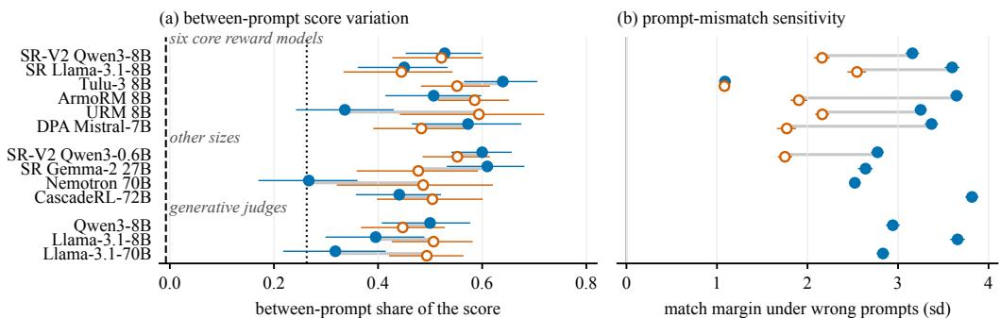
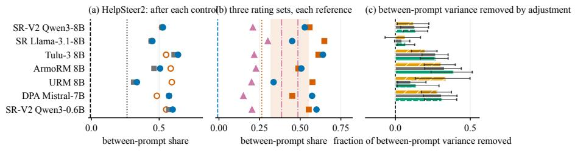
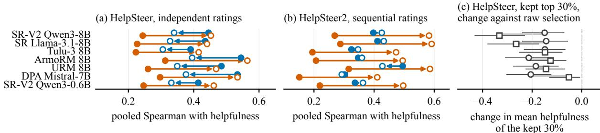
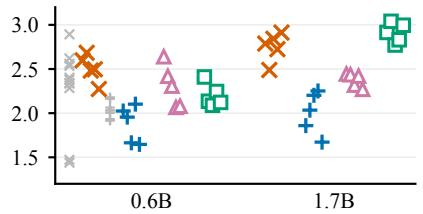
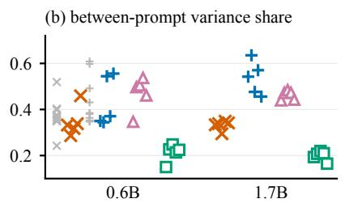
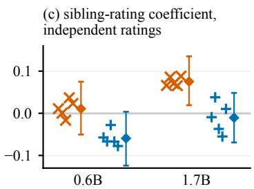
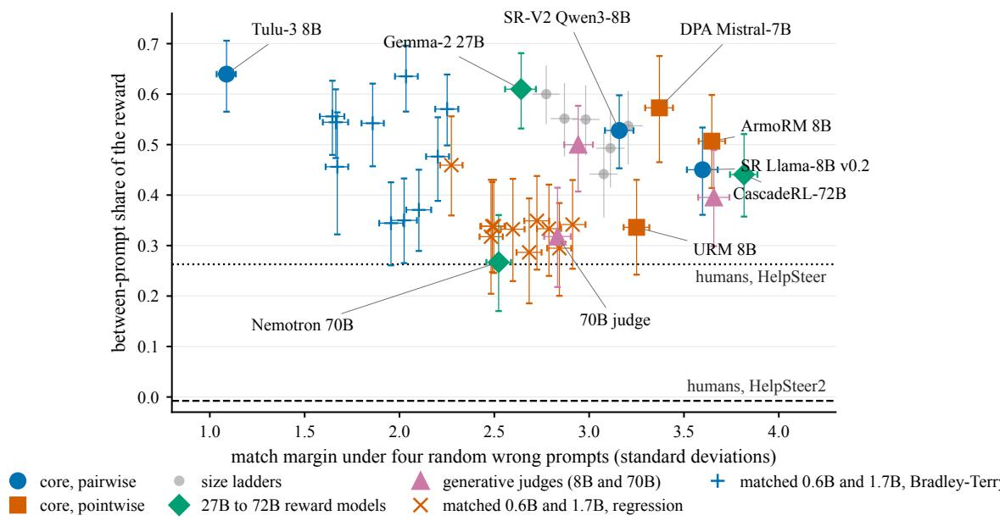

# What Pairwise Evaluation Misses: Reward Scores across Prompts

Mateusz Modrzejewski Warsaw University of Technology mateusz.modrzejewski@pw.edu.pl

Tomasz Radzikowski Warsaw University of Technology tomasz.radzikowski@pw.edu.pl

## Abstract

Reward models score responses for preference optimization, filtering and ranking, and pooling scores across prompts needs them to be comparable. Yet pairwise evaluation compares two responses to the same prompt, so any score component shared by a prompt’s responses cancels and goes untested. We study this component by comparing between-prompt variation in model scores with the same variation in human ratings of the same responses. We propose a humanreferenced audit, built from a between-prompt variance share, a sibling-rating regression and prompt substitutions, and apply it to eighteen released scorers and six matched training conditions. We find that scores cluster by prompt more than the ratings do: on HelpSteer2, six reward models have between-prompt shares of 0.34 to 0.64 against a human share near zero. Replacing the original prompt with a fixed instruction keeps substantial clustering but weakens agreement with prompt-level human ratings, so clustering alone does not show agreement with humans. Part of that variation is useful: subtracting prompt means lowers the helpfulness of globally selected responses, and scores stay sensitive to a wrong prompt even when training shuffles prompt means. We propose that reward evaluation check betweenprompt variation, sensitivity to a wrong prompt and usefulness for selection separately.

## 1 Introduction

Reward models assign scores that steer preference optimization, data selection and model rankings (Stiennon et al., 2020; Ouyang et al., 2022). They are trained on pairwise preferences between two responses to one prompt (Liu et al., 2024a) or on ratings of single responses (Wang et al., 2024b,a), and validated on pairwise benchmarks such as Reward-Bench (Lambert et al., 2024; Malik et al., 2026), where a model is correct when it ranks the two responses to a prompt in the order humans preferred.

A pairwise check cannot detect a score component that is shared by every response to a prompt, because that component cancels when the two scores are compared. We call it the per-prompt term. Under the Bradley–Terry objective the loss depends only on differences of rewards within a prompt, so the term is unconstrained and the reward is identified only up to a function of the prompt (Wang et al., 2024b; Hasanaliyev et al., 2026; Lamparth et al., 2026). The term leaves within-prompt uses unchanged, such as best-of-n selection and policy optimization with a per-prompt baseline (Shao et al., 2024; Ahmadian et al., 2024). It can change decisions that pool scores across prompts, such as a global reward threshold that filters training data (Yu et al., 2025) and a mean reward over different prompt sets. The practical question is whether these differences reflect useful quality variation, arbitrary offsets, or both. Prior work has found weak prompt sensitivity in pairwise reward gaps and prompt-level offsets that can be estimated and subtracted (Mao et al., 2025; Liu et al., 2025b, 2026; Wang et al., 2025). We test how betweenprompt score variation compares with human ratings of the same responses and whether removing it improves global selection, across reward models and generative judges.

We propose a human-referenced audit along three dimensions: variation between prompts, agreement with human ratings, and sensitivity to prompt–response mismatch, that is, to a wrong prompt. The between-prompt variance share of a score, an intraclass correlation, is compared with the same share in the human ratings. A siblingrating regression regresses a score on the rating of the shown response and on the rating of a sibling response to the same prompt, and controlled prompt substitutions test the sensitivity. We apply the audit to eighteen released scorers on up to three rating sets and to six training conditions at two sizes of one base-model family. To our knowledge, this is the first comparison of language reward models’ between-prompt variance shares with human ratings of the same responses across rating sets with different rating protocols. For the six core models, the 7B to 8B reward models scored under every condition, substantial clustering remains when one fixed instruction replaces the prompt, with changed prompt means, while agreement with human prompt-level ratings weakens on HelpSteer (Figure 1). Yet subtracting prompt means lowers helpfulness in a global-selection task on HelpSteer, including when the means come from independent reference responses. Matched training further shows that a large mismatch penalty does not require correct prompt-mean supervision: the mean penalty differs by about 0.3 score standard deviations or less between the shuffled-mean and the true-mean arms.

## 2 Background

Reward models. A reward model $r ( x , y )$ maps a prompt x and a response y to a scalar. The common training objective is the Bradley–Terry model (Bradley and Terry, 1952): for a prompt with a preferred response $y ^ { + }$ and a rejected response $y ^ { - }$ the loss is − log $\sigma ( r ( x , y ^ { + } ) - r ( x , y ^ { - } ) )$ (Stiennon et al., 2020; Ouyang et al., 2022). Any component of the score that is the same for every response to a prompt, whether it comes from the prompt tokens or from what the responses share, leaves the loss unchanged (Appendix A). A regression objective fits $r ( x , y )$ to a rating of y on a fixed scale (Wang et al., 2023; Dong et al., 2023; Wang et al., 2024a), so there the per-prompt component is fitted to the prompt-level structure of the ratings.

Terminology. The per-prompt term of a score is the component shared by the scores of the responses to the same prompt. Prompt mean scores are averages over the responses a rating set samples, so every prompt-level quantity is relative to that response set. The between-prompt variance share, or share for short, is the proportion of the total score variance that lies between prompts on a stated set of responses. The human prompt mean is the average rating of the responses to a prompt, and the human reference is the same share computed from the ratings of the same responses. A larger model share need not indicate an erroneous offset, because it can also arise when the model compresses the differences within a prompt.

Rating sets. HelpSteer2 (Wang et al., 2024b) releases prompts with two responses from different sources, each rated on five attributes from 0 to 4 (helpfulness, correctness, coherence, complexity, verbosity) by at least three annotators, who rate the two responses to a prompt in sequence. Help-Steer (Wang et al., 2023) has up to four responses per prompt sampled from one model and rated independently on the same attributes, one annotator per response. The Stanford Human Preferences set (Ethayarajh et al., 2022) has Reddit posts with several voted comments each.

## 3 The proposed instruments and protocol

## 3.1 The between-prompt share

Let a rating set have n prompts with k rated responses each, and let $h _ { i j }$ be the rating of response j to prompt i. The one-way random-effects model writes $h _ { i j } = \mu + a _ { i } + e _ { i j }$ with a prompt effect $a _ { i }$ and a residual $e _ { i j }$ . The between-prompt share is the intraclass correlation

$$
\rho = \frac { \sigma _ { a } ^ { 2 } } { \sigma _ { a } ^ { 2 } + \sigma _ { e } ^ { 2 } } ,\tag{1}
$$

estimated from the between-prompt and withinprompt mean squares as $( \mathrm { M S } _ { b } - \mathrm { M S } _ { w } ) / ( \mathrm { M S } _ { b } +$ $( k - 1 ) \mathrm { M S } _ { w } )$ . Under the exchangeable randomeffects model the population share with $k \ = \ 2$ equals the correlation between the two ratings of the same prompt. Intervals are percentile bootstraps over prompts. With $k = 2$ and about 500 prompts an individual interval typically spans about $\pm 0 . 0 9$ around its estimate. We read small differences with caution and use the interval of the relevant contrast where one is reported. Applied to a reward model’s scores on the same responses, the share says how similar the scores of the responses to one prompt are relative to the spread across prompts, and the human share on the same responses is its reference. The share does not say why scores cluster, and a model share above the human share can arise from between-prompt variation absent from the ratings or from a scorer that compresses the differences within a prompt. Prompt substitutions and the controls below probe the sources.

## 3.2 Prompt substitutions

Each response is scored under several prompt conditions, and each condition is compared with the original-prompt condition (Table 3 in the appendix). In the generic-prompt condition (responseonly for short) every response is scored under one fixed generic instruction instead of its own prompt ("Please respond."), and the share is computed again over the original prompt grouping. This measures clustering by the original prompt when the scorer receives only the response and a fixed instruction. In the prompt-only condition every prompt is scored with one fixed generic reply, and that reward is correlated across prompts with the prompts’ mean reward under the original prompt. In the transplants every response is scored under its own prompt and under wrong prompts: four random prompts, the four nearest by word overlap or by embedding, four length-matched prompts, or three related tasks written by an instruction model (Liu et al., 2026). The match margin is the response’s reward under its own prompt minus its mean reward under the wrong ones, in units of the standard deviation of the original-condition rewards, and the match accuracy is the share of responses whose own prompt scores above every wrong prompt. In the paraphrase condition every response is scored under three rewordings of its own prompt, and we report the mean absolute shift in reward and the mean signed shift.

  
(a) own prompt (a) generic prompt humans, HelpSteer2 (validation) humans, HelpSteer (b) four random prompts (b) three related tasks  
Figure 1: Between-prompt variation and mismatch sensitivity on HelpSteer2 validation for thirteen of the eighteen released scorers. (a) The share under the original prompt and under one generic prompt is drawn against the human validation references, and the HelpSteer reference comes from a different response population. (b) The mean score loss, in original-condition standard deviations, under four random wrong prompts and, for seven models, under three related tasks written by an instruction model. Bars are 95% prompt-bootstrap intervals. The size ladders are in Figure 5.

## 3.3 The sibling-rating regression

For a prompt with several rated responses, the sibling-rating regression (the same-prompt swap) regresses the standardized reward of the response the model scored (the shown response) on the standardized human rating of that response and on the rating of the other response to the same prompt (the sibling response, or the mean of the other three):

$$
\begin{array} { r } { z ( r _ { i , \mathrm { s h o w n } } ) = \beta _ { \mathrm { s h o w n } } z ( h _ { i , \mathrm { s h o w n } } ) \qquad } \\ { + \beta _ { \mathrm { s i b l i n g } } z ( h _ { i , \mathrm { s i b l i n g } } ) + \varepsilon _ { i } . } \end{array}\tag{2}
$$

The same regression, fitted on the unstandardized ratings, can be written on the prompt’s mean rating and on the shown response’s deviation from it, with a between-prompt slope and a within-prompt slope in reward standard deviations per rating standard deviation, so a positive sibling coefficient indicates a larger association with the prompt’s mean rating than with the deviations within a prompt on the common rating scale. Rating noise alone can produce that for a model that tracks quality, and so can annotators who rated two responses in sequence against each other. The control is the same regression on the scores obtained under a generic prompt and under wrong prompts. Intervals come from a bootstrap over prompts.

## 3.4 Global selection and matched training

Prompt-centered pooling subtracts from a response’s score the mean score of other responses to the same prompt before scores are compared across prompts. With a fixed group size, leaveone-out centering preserves every within-prompt ranking and rescales the within-prompt differences by $k / ( k - 1 )$ . We measure the pooled Spearman correlation of the raw and of the centered score with the raw and with the prompt-centered human rating, and the mean rating of the 30% highestscored responses. A centered score also carries the sampling noise of its baseline, so we center on one, two or three siblings and on an independent pool of twelve generated responses per prompt.

To test the training signal we compare six training conditions within the Qwen3 family at 0.6B and 1.7B, all on the same 6,667 HelpSteer2 training preference pairs. The two main arms fit a regression head on the helpfulness ratings and the Bradley–Terry loss on the released preference labels, tuned with equal search budgets and the same held-out selection criterion (Appendix B), with five seeds per chosen configuration. The arms differ in the loss and in its supervision: the helpfulness ratings or the released pairwise preference labels. Four control arms separate the two. A regression on the within-prompt rating gap alone sees no absolute level, the full pointwise loss with each prompt’s mean rating shuffled across prompts sees a wrong level, a Bradley–Terry loss on the rating margin sees the size of the gap. A regression on binarized ratings sees only which response was preferred.

## 4 Setup

Data. We use the validation split of HelpSteer2 (519 prompts, 511 distinct first user turns, 1,038 responses) for every model, and its training split for the models whose documentation states no training on HelpSteer2, because several open reward models were trained on that split. Multi-turn prompts, about 31% of the set, carry earlier assistant turns, so every share is also reported on the 356 singleturn prompts. The second rating set is HelpSteer’s validation split, 378 single-turn prompts with four rated responses each. The third is 1,000 Reddit posts of the Stanford Human Preferences validation split with four voted comments each.

Models. The core analysis uses six 7B to 8B reward models (Table 2). Three are trained on pairwise preferences with a single output logit (Skywork-Reward-V2-Qwen3-8B, Skywork-Reward-Llama-3.1-8B-v0.2, Llama-3.1-Tulu-3-8B-RM), and three have attribute heads trained on pointwise ratings (ArmoRM-Llama3-8B, URM-LLaMa-3.1-8B, and the Mistral-7B attribute model of DPA), for which the reward is the helpfulness head. ArmoRM and DPA were trained on Help-Steer’s ratings as their documentation states, so their HelpSteer rows come with a documented training-data exposure that has no row-level confirmation. For breadth we add two size ladders of the Skywork-Reward-V2 family (Liu et al., 2025a), a 27B model, three generative judges of 8B to 70B parameters scored as the expected helpfulness digit from 1 to 5, Llama-3.1-Nemotron-70B-Reward, which shares the 70B judge’s base, and Qwen2.5- CascadeRL-RM-72B, released in 2026. All intervals are 95% percentile bootstraps over prompts (2,000 resamples, 5,000 for the sibling-rating regression under the original prompt). Spearman correlations are pooled over responses.

Scoring validation. For the seven models with a published RewardBench or RewardBench 2 score, ours is within 1.0 point of it in all twelve comparisons (median gap 0.35). An eighth model, ArmoRM, reports its combined score, which we reproduce within 1.2 points on RewardBench and 4.8 points below it on RewardBench 2, whereas we score its helpfulness head. Rescoring three models on a second GPU type in fp32 instead of bf16 gives rewards that correlate with the originals at 0.9996 or higher and shares within 0.002.

## 5 Human references differ across rating sets

We use the ratings’ between-prompt share as a rating-set-specific human reference. A larger model share means that a larger fraction of the model’s score variance lies between prompts, and it does not by itself establish an incorrect prompt offset. On HelpSteer, where four responses sampled from one model were rated independently, helpfulness has a share of 0.26 [0.20, 0.33] on the 378 validation prompts the models are scored on. On HelpSteer2 the prompt explains almost none of the helpfulness ratings. Its annotators rated the two responses to a prompt in sequence, and the two ratings are weakly negatively correlated, with a leave-one-out correlation of −0.08 (Table 7). The share is −0.01 [−0.11, 0.10] on the validation split the models are scored on and within 0.07 of zero on the training split and on single-turn prompts. The two sets differ in response source and in rating protocol. We cannot separate these influences, so we report the two references separately. Under an independent additive-noise model rater noise attenuates the observed share, and dividing by a reliability borrowed from HelpSteer2’s raters puts HelpSteer’s value between 0.32 and 0.55 (Appendix C). We use that range as a sensitivity analysis rather than as a ceiling, because the noise model is an assumption and a scorer that compresses within-prompt differences has a higher share than the quality it predicts. The Reddit vote share is context only, because votes carry exposure (Appendix C).

## 6 Between-prompt score variation

For the six core reward models the between-prompt share is 0.34 to 0.64 on all HelpSteer2 validation prompts and 0.28 to 0.45 on single-turn prompts, the cleaner estimate (Figure 1a, Table 1). Every interval lies above the HelpSteer2 reference on the same prompts. On single-turn prompts the point estimates of the six core models and the 27B model lie above the observed independent reference of 0.26, and four of the seven intervals lie entirely above it. The 27B model, the 72B model and the 8B judges lie in the same range. The two 70B models, which share a base, have the lowest shares on HelpSteer2, 0.27 [0.17, 0.36] and 0.32 [0.22, 0.41], and both have 0.22 on single-turn prompts, under that reference with intervals including it. Their own-prompt shares differ by at most 0.05 on the two HelpSteer sets. On ranks instead of raw scores the comparison with the human reference is unchanged (Tables 10 and 11).

We next examine how the clustering changes under prompt substitution and under adjustment for response features (Figure 2a, c). Substantial clustering by the original prompt remains under a fixed generic prompt: the share stays within 0.10 of its original-prompt value for five of the six core models and rises by 0.26 for URM, to 0.59 (Table 1). The paired original-minus-generic difference includes zero for four of the six on HelpSteer2 and excludes it for four of the six on HelpSteer. The prompt means remain only in part: a prompt’s mean under the generic prompt correlates with its mean under the original prompt at 0.13 to 0.81 on HelpSteer2 and at most 0.54 on HelpSteer (Table 14). Adjusting for log length changes the share by at most 0.05 while removing 0.27 to 0.33 of the between-prompt variance for Tulu-3, ArmoRM and DPA, because the adjustment also removes substantial within-prompt variance (Table 13). The five ratings remove 0.06 to 0.33 of each reward’s between-prompt variance, and a probe on sentence embeddings of the response with text features removes 0.07 to 0.39 (Figure 2c, Appendix C).

Other rating sets and shared quality. We next test whether the pattern extends beyond HelpSteer2 (Figure 2b). On HelpSteer all eighteen released scorers have original-prompt shares of 0.45 to 0.65, and the thirteen scored under a generic prompt have shares of 0.44 to 0.79, in both cases above the observed human share of 0.26 with separated intervals (Table 9). On the Reddit posts the shares are 0.15 to 0.30, below the between-post share of log votes. A high share alone does not identify spurious variation. On HelpSteer the reliability-adjusted human reference depends on the borrowed reliability value, and two of the six core shares fall inside its sensitivity range. A model can also have a larger share because it compresses the differences between responses to the same prompt. In rating units, after a linear calibration of each model’s score to the rating cross-fitted by prompt, the between-prompt variance of the calibrated score is 0.13 to 0.19 on HelpSteer2 against an observed human value near zero and 0.09 to 0.16 on HelpSteer against the humans’ 0.22. The calibrations explain 14 to 40% of the rating variance (Table 12).

## 7 Prompt sensitivity and human agreement

Clustering under a generic prompt does not establish how strongly the model responds to mismatch, so the transplants test that sensitivity directly (Figure 1b, Table 1). Under four random wrong prompts a response loses between 3.2 and 3.7 standard deviations of reward for five of the six core models and 1.1 for Tulu-3. The penalty is smaller for related tasks than for unrelated prompts: the four nearest prompts by word overlap or by sentence embedding lower the match accuracy by at most 0.03, three related tasks written by an instruction model lower the margin by 1.0 to 1.8 standard deviations for five core models and by 0.01 for Tulu-3, and a question that contains the original one, or a sub-question of it, leaves 0.7 to 1.3 (Table 20). Three paraphrases of the original prompt change a response’s reward by 0.12 to 0.23 standard deviations in absolute value, and the mean signed change is negative for every model, −0.07 to −0.13 (Table 28). On HelpSteer, replacing the prompt also weakens agreement with human prompt-level ratings: the correlation between a model’s prompt means and the humans’ falls from 0.40 to 0.58 with the original prompt to −0.03 to 0.15 under the generic one (Appendix C).

Agreement with prompt-level ratings. The sibling-rating regression asks whether the score follows the prompt’s mean rating (Tables 18 and 19). On HelpSteer, where the ratings carry a prompt level, it does so more steeply than the deviations within a prompt for every model: the betweenprompt slope is 0.53 to 0.75 against a withinprompt slope of 0.34 to 0.54, a paired difference of 0.20 to 0.30 with every interval above zero. Under a generic prompt the between-prompt slope falls to within 0.10 of zero for three of the six models and to 0.16 to 0.21 for Tulu-3, ArmoRM and DPA, and under random wrong prompts the association with the shown response’s rating weakens for every model, with the shown coefficient lower by 0.24 to 0.61 and still positive for those three. On Help-Steer2, where the ratings carry no prompt level, the sibling coefficient remains under the generic prompt for three of the four models whose coefficient excludes zero with the original prompt (Table 18). On HelpSteer, every core model’s score is positively associated with prompt-level human helpfulness. The original prompt strengthens that association.

<table><tr><td colspan="9">Reward model Share Single-turn Generic Length removed Prompt only Margin Accuracy Related task</td></tr><tr><td>Humans, HelpSteer2 train</td><td>0.02</td><td>0.01</td><td></td><td></td><td></td><td></td><td></td><td></td></tr><tr><td>Humans, HelpSteer2 validation -0.01</td><td></td><td>-0.07</td><td></td><td></td><td></td><td></td><td></td><td></td></tr><tr><td>Humans, HelpSteer validation</td><td>0.26</td><td>0.26</td><td></td><td></td><td></td><td></td><td></td><td></td></tr><tr><td>SR-V2-Qwen3-8B</td><td>0.53</td><td>0.43</td><td>0.52</td><td>0.52</td><td>0.26</td><td>3.16</td><td>0.99</td><td>2.16</td></tr><tr><td>SR-Llama-3.1-8B-v0.2†</td><td>0.45</td><td>0.36</td><td>0.44</td><td>0.44</td><td>0.34</td><td>3.60</td><td>0.98</td><td>2.55</td></tr><tr><td>Tulu-3-8B-RM</td><td>0.64</td><td>0.45</td><td>0.55</td><td>0.61</td><td>0.40</td><td>1.09</td><td>0.88</td><td>1.08</td></tr><tr><td>ArmoRM-Llama3-8B-v0.1</td><td>0.51</td><td>0.43</td><td>0.59</td><td>0.46</td><td>-0.01</td><td>3.65</td><td>0.99</td><td>1.90</td></tr><tr><td>URM-LLaMa-3.1-8B</td><td>0.34</td><td>0.28</td><td>0.59</td><td>0.31</td><td>0.18</td><td>3.25</td><td>0.99</td><td>2.16</td></tr><tr><td>DPA-Mistral-7B-v1</td><td>0.57</td><td>0.36</td><td>0.48</td><td>0.57</td><td>-0.30</td><td>3.37</td><td>0.94</td><td>1.77</td></tr><tr><td>SR-V2-Qwen3-0.6B</td><td>0.60</td><td>0.55</td><td>0.55</td><td>0.57</td><td>0.11</td><td>2.77</td><td>0.99</td><td>1.75</td></tr></table>

Table 1: The HelpSteer2 validation audit for the six core reward models and the 0.6B checkpoint, after three human reference rows. The share columns are between-prompt variance shares on all prompts, on single-turn prompts, under one generic prompt and with log length residualized. The prompt-only column is the correlation of a fixed reply’s score with the prompt means. The margin and accuracy columns use four random wrong prompts and the last column three related tasks, in original-condition standard deviations. The dagger marks the model whose preference data contain 94 of the 511 validation first turns, and the 27B model uses the same preference set. Table 8 gives intervals.  
  
Figure 2: Controls and human references for seven reward models. (a) HelpSteer2 validation shares under the original prompt, under one generic prompt and after log-length adjustment. (b) The share on the three rating sets against each reference. Lines are the rating-set-specific human references, the band is the reliability sensitivity analysis for HelpSteer, and the Reddit lines are the between-post share of log votes, raw and exposure-adjusted. (c) The fraction of HelpSteer2 between-prompt variance removed by each adjustment for the six core models, with 95% prompt-bootstrap intervals.

## 8 Centering and global selection

We test whether removing estimated prompt means improves pooled agreement and global response selection. Figure 3 compares the raw and the centered score with the raw and the centered rating. Against the centered rating, a different target, centering raises agreement everywhere. Against the raw rating it lowers every model’s correlation on HelpSteer by 0.08 to 0.15, with every paired interval excluding zero. On HelpSteer, keeping the 30% of responses with the highest sibling-centered score instead of the highest raw score lowers the kept set’s mean helpfulness by 0.14 to 0.21 points for every core model (Table 17). The cost shrinks as the number of sibling references grows from one to three and stays above zero (Appendix C). It persists with independent references: centering on twelve responses per prompt generated independently of the rated candidates lowers the kept set’s mean helpfulness by 0.05 to 0.33 points for every model, with a change of at most 0.06 between one and twelve references (Figure 3c). Held-out selection favors no or minimal centering, with a weight of zero on both folds for four models and 0.1 on one fold for Tulu-3 and URM. Together with the disjoint-half correlation in Appendix C, these results show that some between-prompt variation is useful for this target. Raw scores outperform full centering in this HelpSteer selection task. Tuned partial centering gives no demonstrated improvement.

  
raw score centered on siblings centered on an independent pool of 12 against the raw rating against the centered rating  
Figure 3: Centering and global selection. (a, b) Each arrow runs from the raw score (filled) to the sibling-centered score (open) and shows the pooled Spearman correlation with the raw helpfulness rating and with the rating centered the same way, on HelpSteer (independent ratings) and HelpSteer2 validation (sequential ratings). (c) The change in the mean helpfulness (0 to 4) of the 30% of HelpSteer responses kept, against raw selection, under sibling centering and under centering on an independent pool of twelve generated responses. Panels (a, b) show seven models and (c) the six core models. Bars in (c) are paired 95% prompt-bootstrap intervals. The values are in Tables 16 and 17.

Between-prompt clustering is a diagnostic rather than an estimate of bias. Its comparison with human ratings describes how score variation is distributed, and the selection test asks whether removing that variation helps the intended target. A centering rule should therefore be evaluated against the target used for selection, with reference responses independent of the candidates when prompt means are estimated. Appendix C reports three further checks on the same rows (leaderboard coverage, filtering followed by preference training, and conversation history).

## 9 Effects of training objectives and targets

We next test how training changes these properties. Released models differ in base, size and data, and their shares overlap across objectives (Table 1), so we use the matched arms, which hold the base and the training pairs fixed while varying the loss and the information in its targets (Figure 4, Table 25). The regression arm has the larger standardized mismatch penalty. Its random-prompt margin is 2.3 to 2.7 standard deviations across five seeds at 0.6B against 1.6 to 2.1 for the Bradley– Terry arm, with no seed overlap (one-sided exact permutation $p \ : = \ : 0 . 0 0 4 )$ , and 2.5 to 2.9 against 1.7 to 2.3 at 1.7B. The Bradley–Terry arm’s unstandardized penalty is larger because its score standard deviation is about three times larger, and the scale-free area under the curve also favors the regression arm (Table 25). The regression arm’s between-prompt share is lower at both sizes, without overlap at 1.7B. Under independent ratings the Bradley–Terry arm’s pooled sibling coefficient is lower than the regression arm’s by 0.07 [0.02, 0.13] at 0.6B and 0.09 [0.04, 0.14] at 1.7B, and the regression arm’s sibling coefficient is positive at 1.7B (0.08 [0.02, 0.14]) and consistent with zero at 0.6B (0.01 [−0.05, 0.08]). The margin and share orderings persist under both selected configurations (Table 26).

The control arms partly disentangle the loss from the information in the targets. An arm trained on the within-prompt rating gap alone has a penalty of 2.38 standard deviations at 1.7B, between the main arms with no seed overlap. A pointwise arm trained on prompt means shuffled across prompts has a penalty of 2.91 at 1.7B (2.20 at 0.6B, between the main arms) while its share falls to 0.20, against 0.33 with the true means and 0.46 without them (Figure 4). A Bradley–Terry arm trained on the rating margin reaches 2.34 at 0.6B and 2.60 at 1.7B, between the main arms, and a regression arm trained on binarized ratings falls to 0.71 at 0.6B and 1.95 at 1.7B, with a share of 0.13 at 1.7B, the lowest among the arms at that size (Table 26). Mismatch discrimination depends on whether the targets carry rating magnitudes and can remain large with wrong prompt means, while the share follows what the targets say about each prompt’s level. The pairwise loss’s shift invariance does not predict this ordering (Appendix A).

(a) standardized mismatch penalty (sd)  

  
regression head Bradley–Terry loss gap-only regression shuffled-mean regression other tuning trials pooled, 95% interval  
Figure 4: Matched training in Qwen3 (0.6B and 1.7B, five seeds per arm). (a) The standardized mismatch penalty under four random wrong prompts. (b) The between-prompt share on HelpSteer2 validation. (c) The sibling-rating coefficient on HelpSteer. Panels (a, b) show four training conditions and (c) the two main objectives. Points are seeds, and the diamonds and bars in (c) are pooled estimates with 95% intervals. Grey marks are the other 0.6B tuning trials. Table 26 reports all six training conditions and the two configuration swaps.

## 10 Related work

Reward models and judges respond to length (Singhal et al., 2024), style and formatting (Liu et al., 2024b), and superficial markers of quality (Zhou et al., 2024). Wang et al. (2025) show that a Bradley–Terry reward model learns a prompttemplate offset, predict each prompt’s mean reward from a head on the prompt, and subtract it before policy optimization. Our global-selection tests show that subtracting prompt means can remove variation associated with independently rated quality. Landesberg (2026) decomposes judge and reference scores into between-prompt and withinprompt variation and studies the consequences for best-of-n selection. Sun et al. (2025) compare objectives across annotation designs. Hasanaliyev et al. (2026) predict per-prompt mean rewards from a prompt embedding on held-out prompts, with 32 responses per prompt and without human-rating references, and report about half of the variance explained for three pairwise-trained models. Our probe uses two responses per prompt and human references, a different setting (Appendix C). Prior work tests prompt substitution through changes in reward gaps (Mao et al., 2025), augments training with cross-prompt response combinations (Liu et al., 2025b), and evaluates the preference for on-topic over off-topic answers (Liu et al., 2026; Lu et al., 2026). These pairwise contrasts detect response-specific mismatch and cancel shifts shared by both responses. We complement them with fixed-response contrasts across prompts and with human-referenced between-prompt variation, including pointwise models and judges. Grouprelative baselines in policy optimization (Shao et al., 2024; Ahmadian et al., 2024) remove the perprompt term from the gradient, margin-based pair selection (Deng et al., 2025) cancels it by construction, and prompt filtering by pooled raw rewards (Yu et al., 2025) uses it. The sibling-rating regression and the prompt-only condition are adapted from probes for audio-language judges of generated music (Modrzejewski and Radzikowski, 2026; Yang et al., 2026).

## 11 Conclusion

We find that pairwise accuracy leaves score comparisons across prompts untested. On both Help-Steer sets, released scorers have larger betweenprompt variance shares than the observed human ratings. For the six core models, replacing the original prompt with a fixed generic prompt preserves substantial clustering while weakening agreement with prompt-level human ratings on HelpSteer, so the amount of clustering does not establish agreement with human judgments. Some prompt-level variation is useful: full centering lowers helpfulness in our global-selection task, including with independent reference responses. Matched training also shows that large mismatch penalties need no correct prompt-mean supervision. We propose that reward evaluation distinguish between-prompt variation, mismatch sensitivity, and usefulness for selection. Centering for global selection should be validated against the intended quality criterion.

## Limitations

The model estimates rest on English rating sets with two to four responses per prompt, so each betweenprompt share is estimated from small groups and its precision is limited. Differences between models, across generic prompts, across a size ladder and between the matched arms that have no reported contrast interval are described without a claim that they are established. The responses in HelpSteer2 were produced by a small number of systems whose identity is not released per response, so source-model effects cannot be estimated separately, and the two HelpSteer references differ in both response source and rating protocol, which the paper cannot separate. A matched annotation study would separate them. The Reddit vote reference carries exposure and is context only. The noisecorrected HelpSteer reference borrows its rater reliability from HelpSteer2, since HelpSteer states none, and it is a sensitivity analysis: the value runs from 0.32 to 0.55 across the borrowed values, the models’ shares on HelpSteer lie partly inside that range with four of the six core models above its widest value, and a scorer that compresses withinprompt differences exceeds it without being wrong. On HelpSteer2 the same raters rated both responses to a prompt, so a rater effect is a prompt effect in those ratings.

The generic-prompt condition replaces the original task with a fixed instruction and may shift the input distribution. The paraphrase and related-task prompts were written by one instruction model, 50 of the 519 prompts had no valid paraphrase and were dropped (they are longer than the kept ones), and the related tasks are not adversarial. The sibling-rating regression measures the prompt level through human ratings and is confounded by the rating protocol, which is why it is reported with its control. The matched arms are one base family at two sizes with five seeds per arm, and at 0.6B the seeds spread the share by as much as the arms differ. The arms differ in the objective and in the target information available to it, and the four control arms separate part of that difference, so the result does not establish a general ordering across model families. The global-selection result concerns the mean helpfulness of the top 30% of HelpSteer responses, and the independent pool holds responses from two models that are longer than the rated candidates. The downstream filtering comparison detected no preference difference under two judges that mostly follow the order of presentation, which establishes neither a difference nor equivalence.

For one judge, the probability mass on the rating digits is under 0.9 on 8% of its HelpSteer rows and 24% of its transplanted rows there, and the 70B judge puts its top digit at 5 for 69% of the validation responses, a ceiling that lowers its share: on the logit of the top-digit probability the share is 0.38 against 0.32 on the expected digit, and on ranks 0.46 (Table 5). The 8B judges rise by 0.12 and 0.08 on ranks, the released reward models by at most 0.11. Two models were trained on preference pairs that contain 94 of the 511 validation first turns, and two were trained on HelpSteer’s ratings as their documentation states, without rowlevel confirmation. The estimates on the 398 clean prompts differ from the full split by at most 0.06 and are in the appendix. Each model was scored once with deterministic inference, so the intervals reflect sampling over prompts and not variation across runs. The feature probes explain only part of the between-prompt variation. The remaining component is not identified (Appendix C).

## Ethical considerations

The study uses released datasets under their terms (HelpSteer2 and HelpSteer under CC-BY-4.0, RewardBench and its second version under ODC-By, the Stanford Human Preferences set under the terms its card states for Reddit content, used for research only and not redistributed) and open model weights under their licences, without new human annotation. We plan to release the scoring and analysis code, the scores and source identifiers of every scored response, and the generated paraphrase and related-task prompt sets, subject to the source datasets’ redistribution terms. Global filtering can change which prompt groups are represented in the selected data even when within-prompt rankings remain unchanged, so applications should assess those changes against the intended quality criterion.

## References

Arash Ahmadian, Chris Cremer, Matthias Gallé, Marzieh Fadaee, Julia Kreutzer, Olivier Pietquin, Ahmet Üstün, and Sara Hooker. 2024. Back to basics: Revisiting REINFORCE-style optimization for learning from human feedback in LLMs. In Proceedings of the 62nd Annual Meeting of the Association for Computational Linguistics (Volume 1: Long Papers), pages 12248–12267.

Ralph Allan Bradley and Milton E. Terry. 1952. Rank analysis of incomplete block designs: I. The method of paired comparisons. Biometrika, 39(3/4):324– 345.

Xun Deng, Han Zhong, Rui Ai, Fuli Feng, Zheng Wang, and Xiangnan He. 2025. Less is more: Improving LLM alignment via preference data selection. In Advances in Neural Information Processing Systems 38 (NeurIPS).

Yi Dong, Zhilin Wang, Makesh Narsimhan Sreedhar, Xianchao Wu, and Oleksii Kuchaiev. 2023. SteerLM: Attribute conditioned SFT as an (user-steerable) alternative to RLHF. Preprint, arXiv:2310.05344.

Kawin Ethayarajh, Yejin Choi, and Swabha Swayamdipta. 2022. Understanding dataset difficulty with V-usable information. In Proceedings of the 39th International Conference on Machine Learning (ICML), volume 162 of Proceedings of Machine Learning Research, pages 5988–6008.

Kenan Hasanaliyev, Silas Alberti, Jenny Hamer, Dheeraj Rajagopal, Kevin Robinson, Jasper Snoek, Victor Veitch, and Alexander Nicholas D’Amour. 2026. Expected reward prediction, with applications to model routing. Preprint, arXiv:2603.20217.

Nathan Lambert, Valentina Pyatkin, Jacob Morrison, LJ Miranda, Bill Yuchen Lin, Khyathi Chandu, Nouha Dziri, Sachin Kumar, Tom Zick, Yejin Choi, Noah A. Smith, and Hannaneh Hajishirzi. 2024. RewardBench: Evaluating reward models for language modeling. Preprint, arXiv:2403.13787.

Max Lamparth, Daniel Fein, Andreas Haupt, Marcel Hussing, and Mykel J. Kochenderfer. 2026. Reward bias substitution: Single-axis bias mitigations redirect optimization pressure. Preprint, arXiv:2605.27996.

Eddie Landesberg. 2026. When LLM judge scores look good but best-of-N decisions fail. Preprint, arXiv:2603.12520.

Chris Yuhao Liu, Liang Zeng, Jiacai Liu, Rui Yan, Jujie He, Chaojie Wang, Shuicheng Yan, Yang Liu, and Yahui Zhou. 2024a. Skywork-Reward: Bag of tricks for reward modeling in LLMs. Preprint, arXiv:2410.18451.

Chris Yuhao Liu, Liang Zeng, Yuzhen Xiao, Jujie He, Jiacai Liu, Chaojie Wang, Rui Yan, Wei Shen, Fuxiang Zhang, Jiacheng Xu, Yang Liu, and Yahui Zhou. 2025a. Skywork-Reward-V2: Scaling preference data curation via human-AI synergy. Preprint, arXiv:2507.01352.

Shuang Liu, Yuxuan Bo, Qiuyang Zhao, Caiyue Huang, Xiaorong Chen, Yanguang Liu, and Mengnan Du. 2026. HARVE: Hacking-aware reward-head vector editing for robust reward models. Preprint, arXiv:2606.03131.

Tianqi Liu, Wei Xiong, Jie Ren, Lichang Chen, Junru Wu, Rishabh Joshi, Yang Gao, Jiaming Shen, Zhen Qin, Tianhe Yu, Daniel Sohn, Anastasiia Makarova, Jeremiah Liu, Yuan Liu, Bilal Piot, Abe Ittycheriah, Aviral Kumar, and Mohammad Saleh. 2025b. RRM: Robust reward model training mitigates reward hacking. In International Conference on Learning Representations (ICLR).

Yantao Liu, Zijun Yao, Rui Min, Yixin Cao, Lei Hou, and Juanzi Li. 2024b. RM-Bench: Benchmarking reward models of language models with subtlety and style. Preprint, arXiv:2410.16184.

Yunsheng Lu, Zijiang Yang, Licheng Pan, and Zhixuan Chu. 2026. Robust reward modeling for large language models via causal decomposition. Preprint, arXiv:2604.13833.

Saumya Malik, Valentina Pyatkin, Sander Land, Jacob Morrison, Noah A. Smith, Hannaneh Hajishirzi, and Nathan Lambert. 2026. RewardBench 2: Advancing reward model evaluation. In International Conference on Learning Representations (ICLR).

Liyuan Mao, Haoran Xu, Amy Zhang, Weinan Zhang, and Chengjia Bai. 2025. Information-theoretic reward decomposition for generalizable RLHF. In Advances in Neural Information Processing Systems 38 (NeurIPS).

Mateusz Modrzejewski and Tomasz Radzikowski. 2026. What do audio-language judges of generated music listen for? Four probes with controls from expert ratings. Preprint, arXiv:2610.13247.

Long Ouyang, Jeff Wu, Xu Jiang, Diogo Almeida, Carroll L. Wainwright, Pamela Mishkin, Chong Zhang, Sandhini Agarwal, Katarina Slama, Alex Ray, John Schulman, Jacob Hilton, Fraser Kelton, Luke Miller, Maddie Simens, Amanda Askell, Peter Welinder, Paul Christiano, Jan Leike, and Ryan Lowe. 2022. Training language models to follow instructions with human feedback. Preprint, arXiv:2203.02155.

Zhihong Shao, Peiyi Wang, Qihao Zhu, Runxin Xu, Junxiao Song, Xiao Bi, Haowei Zhang, Mingchuan Zhang, Y. K. Li, Y. Wu, and Daya Guo. 2024. DeepSeekMath: Pushing the limits of mathematical reasoning in open language models. Preprint, arXiv:2402.03300.

Prasann Singhal, Tanya Goyal, Jiacheng Xu, and Greg Durrett. 2024. A long way to go: Investigating length correlations in RLHF. In Conference on Language Modeling (COLM).

Nisan Stiennon, Long Ouyang, Jeff Wu, Daniel M. Ziegler, Ryan Lowe, Chelsea Voss, Alec Radford, Dario Amodei, and Paul Christiano. 2020. Learning to summarize from human feedback. Preprint, arXiv:2009.01325.

Hao Sun, Yunyi Shen, and Jean-Francois Ton. 2025. Rethinking reward modeling in preference-based large language model alignment. In International Conference on Learning Representations (ICLR).

Chaojie Wang, Haonan Shi, Long Tian, Bo An, and Shuicheng Yan. 2025. Removing prompt-template bias in reinforcement learning from human feedback. In Findings of the Association for Computational Linguistics: ACL 2025, pages 24110–24122.

Haoxiang Wang, Wei Xiong, Tengyang Xie, Han Zhao, and Tong Zhang. 2024a. Interpretable preferences via multi-objective reward modeling and mixture-ofexperts. Preprint, arXiv:2406.12845.

Zhilin Wang, Yi Dong, Olivier Delalleau, Jiaqi Zeng, Gerald Shen, Daniel Egert, Jimmy J. Zhang, Makesh Narsimhan Sreedhar, and Oleksii Kuchaiev. 2024b. HelpSteer2: Open-source dataset for training top-performing reward models. Preprint, arXiv:2406.08673.

Zhilin Wang, Yi Dong, Jiaqi Zeng, Virginia Adams, Makesh Narsimhan Sreedhar, Daniel Egert, Olivier Delalleau, Jane Polak Scowcroft, Neel Kant, Aidan Swope, and Oleksii Kuchaiev. 2023. HelpSteer: Multi-attribute helpfulness dataset for SteerLM. Preprint, arXiv:2311.09528.

Jiabing Yang, Yixiang Chen, Yuan Xu, Qisen Ma, Tao Yu, Peiyan Li, Yingda Li, Yan Huang, and Liang Wang. 2026. Style over substance: A shortcut audit of emotion-description preference evaluation. Preprint, arXiv:2607.18508.

Ping Yu, Weizhe Yuan, Olga Golovneva, Tianhao Wu, Sainbayar Sukhbaatar, Jason Weston, and Jing Xu. 2025. R.I.P.: Better models by survival of the fittest prompts. Preprint, arXiv:2501.18578.

Hongli Zhou, Hui Huang, Yunfei Long, Bing Xu, Conghui Zhu, Hailong Cao, Muyun Yang, and Tiejun Zhao. 2024. Mitigating the bias of large language model evaluation. In Proceedings ofthe 23rd China National Conference on Computational Linguistics (CCL), Volume 1: Main Conference, pages 1310– 1319.

## A Prompt-shift invariance of pairwise objectives

Let r be any reward and c any function that is constant across the responses to a prompt, whether it is computed from the prompt alone or from what the responses to that prompt share, and let $r ^ { \prime } ( x , y ) = r ( x , y ) + c ( x )$ . For every pair $( y ^ { + } , y ^ { - } )$ under one prompt x, $r ^ { \prime } ( x , y ^ { + } ) - r ^ { \prime } ( x , y ^ { - } ) ~ =$ $r ( x , y ^ { + } ) { - r ( x , y ^ { - } ) }$ , so the Bradley–Terry loss, any pairwise accuracy, and any within-prompt ranking are identical for $r$ and $r ^ { \dot { \prime } } .$ . The between-prompt share of $r ^ { \prime }$ is not: it is $( \sigma _ { a } ^ { 2 } + \sigma _ { c } ^ { 2 } + 2 \cos ( a , c ) ) / ( \sigma _ { a } ^ { 2 } +$ $\sigma _ { c } ^ { 2 } + 2 \cos ( a , c ) + \sigma _ { e } ^ { 2 } )$ for a prompt effect a of $^ { r , }$ and can take any value in [0, 1) by the choice of $c .$ A regression loss on ratings h is not invariant: it penalizes $( r ^ { \prime } ( x , y ) - h ( x , y ) ) ^ { 2 }$ , whose expectation over the responses to x contains $( c ( x ) + a _ { x } - a _ { x } ^ { h } ) ^ { 2 }$ with $a _ { x } ^ { h }$ the ratings’ own prompt effect, so the fitted per-prompt term is pulled toward the ratings’. An additive shift $c ( x )$ changes each transplant contrast by $c ( x ) - c ( x ^ { \prime } )$ . The pairwise loss leaves this contribution unidentified, whereas the regression loss penalizes shifts away from the rated prompt means. Neither invariance argument predicts the learned mismatch margin on substituted prompt–response pairs.

## B Experimental details

HelpSteer’s validation release has 503 prompts with one to four rated responses. Every HelpSteer analysis keeps the 378 with exactly four, and the 125 others are left out rather than imputed. Of the 519 HelpSteer2 validation prompts, 511 first turns are distinct as written and 509 after lowercasing and whitespace normalization, and grouped folds and held-out splits use the 509. HelpSteer2’s training split has 10,161 prompts, of which the 10,160 with two responses enter the share. Multiturn prompts are passed as their turns with the rated response as the last assistant turn, through each model’s chat template. The DPA model uses its fixed string template. Inputs are truncated at 4,096 tokens on the right. The generic reply of the prompt-only condition is "Thank you for your question. I will do my best to help.", and the fixed instructions of the generic-prompt condition are "Please respond.", "Write something." and the empty prompt. The random transplant draws four other prompts per response with a fixed seed. The nearest transplants take the four prompts with the highest TF-IDF cosine over words or the highest cosine between sentence embeddings (BAAI/bgesmall-en-v1.5), excluding prompts from the same conversation. The length-matched transplant draws four random prompts within 10% of the original prompt’s word count. The paraphrases and relatedtask prompts were written by Qwen3-8B (sampling at temperature 0.7 with a fixed seed) from two fixed instructions. A variant that repeated the original or was shorter than five words was rejected and regenerated once, after which 50 of the 519 prompts (9.6%) had no valid paraphrase and were dropped from that condition, and every prompt had three related tasks. The response probes are ridge, kernel ridge, boosted trees and a multilayer perceptron on two sentence embeddings (BAAI/bgesmall-en-v1.5 and bge-large-en-v1.5) with text features and a topic cluster, cross-validated by prompt. The judges were asked for a helpfulness rating from 1 to 5 and scored as the expected value over the digit tokens. On the validation responses no judge puts under 0.9 of the mass on the digits, and the lowest digit mass is 1.00, 0.99 and 0.94 for Qwen3-8B, Llama-3.1-8B-Instruct and Llama-3.1- 70B-Instruct. On HelpSteer the share of rows under 0.9 is 0.2%, 8.2% and 2.3% on the real rows and 0.3%, 23.9% and 5.9% on transplanted rows, and under the empty reply, a condition not reported for the judges, the 70B judge has 0.87 of its rows under 0.9. The top digit is 5 for 0.55, 0.77 and 0.69 of the validation responses and the median expected value is 4.62, 4.83 and 4.89.

<table><tr><td>Model</td><td>Params</td><td>Signal</td><td>HelpSteer2</td><td>HelpSteer (2023)</td><td>Revision</td><td>Licence</td></tr><tr><td>Skywork-Reward-V2-Qwen3-8B</td><td>7.6B</td><td>pairwise</td><td>not stated</td><td>pool</td><td>6f19fde</td><td>apache-2.0</td></tr><tr><td>Skywork-Reward-Llama-3.1-8B-v0.2</td><td>7.5B</td><td>pairwise</td><td>yes</td><td>no</td><td>d4117fb</td><td>not stated</td></tr><tr><td>Llama-3.1-Tulu-3-8B-RM</td><td>7.5B</td><td>pairwise</td><td>no</td><td>no</td><td>84e607a</td><td>1llama3.1</td></tr><tr><td>ArmoRM-Llama3-8B-v0.1</td><td>7.5B</td><td>pointwise</td><td>not stated</td><td>yes</td><td>eb2676d</td><td>llama3</td></tr><tr><td>URM-LLaMa-3.1-8B</td><td>7.5B</td><td>pointwise</td><td>yes</td><td>no</td><td>5344f0f</td><td>not stated</td></tr><tr><td>RewardModel-Mistral-7B-for-DPA-v1</td><td>7.1B</td><td>pointwise</td><td>not stated</td><td>yes</td><td>86583a7</td><td>not stated</td></tr><tr><td>Skywork-Reward-V2-Qwen3-0.6B</td><td>0.6B</td><td>pairwise</td><td>not stated</td><td>pool</td><td>8c14a4e</td><td>apache-2.0</td></tr><tr><td>Skywork-Reward-V2-Qwen3-1.7B</td><td>1.7B</td><td>pairwise</td><td>not stated</td><td>pool</td><td>e51ea3e</td><td>apache-2.0</td></tr><tr><td>Skywork-Reward-V2-Qwen3-4B</td><td>4.0B</td><td>pairwise</td><td>not stated</td><td>pool</td><td>fd958fe</td><td>apache-2.0</td></tr><tr><td>Skywork-Reward-V2-Llama-3.2-1B</td><td>1.2B</td><td>pairwise</td><td>not stated</td><td>pool</td><td>b755d39</td><td>llama3.2</td></tr><tr><td>Skywork-Reward-V2-Llama-3.2-3B</td><td>3.2B</td><td>pairwise</td><td>not stated</td><td>pool</td><td>beafe5f</td><td>llama3.2</td></tr><tr><td>Skywork-Reward-V2-Llama-3.1-8B</td><td>7.5B</td><td>pairwise</td><td>not stated</td><td>pool</td><td>cba2f84</td><td>llama3.1</td></tr><tr><td>Skywork-Reward-Gemma-2-27B-v0.2</td><td>27.2B</td><td>pairwise</td><td>yes</td><td>no</td><td>a92f2ec</td><td>not stated</td></tr><tr><td>Llama-3.1-Nemotron-70B-Reward-HF</td><td>70.6B</td><td>both</td><td>yes</td><td>no</td><td>5e30252</td><td>see caption</td></tr><tr><td>Qwen2.5-CascadeRL-RM-72B</td><td>71.5B</td><td>both</td><td>not stated</td><td>not stated</td><td>2741d32</td><td>see caption</td></tr><tr><td>Qwen3-8B</td><td>8.2B</td><td>judge</td><td>not stated</td><td>not stated</td><td>b968826</td><td>apache-2.0</td></tr><tr><td>Llama-3.1-8B-Instruct</td><td>8.0B</td><td>judge</td><td>not stated</td><td>not stated</td><td>0e9e39f</td><td>llama3.1</td></tr><tr><td>Llama-3.1-70B-Instruct</td><td>70.6B</td><td>judge</td><td>not stated</td><td>not stated</td><td>1605565</td><td>llama3.1</td></tr></table>

Table 2: Released scorers with parameters, training signal (“both” is Bradley–Terry combined with regression on the HelpSteer2 attributes, as the card states), documented use of HelpSteer2 and HelpSteer in training (“pool” means the Skywork-Reward-V2 curation pool, with retention not stated), weights revision, and licence as the card states it. The licence of the two NVIDIA models is the NVIDIA Open Model License together with the Llama 3.1 Community License.
<table><tr><td>Condition</td><td>Input</td><td>Measured contrast</td></tr><tr><td>Original prompt</td><td>each response under its own prompt</td><td>the between-prompt share</td></tr><tr><td>Generic prompt</td><td>each response under one fixed generic instruction</td><td>clustering by the original prompt under a fixed instruction</td></tr><tr><td>Prompt only</td><td>each prompt with one generic reply</td><td>association of a fixed-reply score with the prompt means</td></tr><tr><td>Random transplant</td><td>each response under four random other prompts</td><td>the mismatch penalty for an unrelated prompt</td></tr><tr><td>Nearest transplant</td><td>the four nearest prompts by TF-IDF or by sentence embedding</td><td>the penalty for a lexically or semantically near prompt</td></tr><tr><td>Length-matched</td><td>four random prompts within 10% of the original prompt&#x27;s length</td><td>the penalty at matched prompt length</td></tr><tr><td>Related task</td><td>three related prompts asking for something else</td><td>the penalty for a related task</td></tr><tr><td>Paraphrase</td><td>three rewordings of the original prompt</td><td>sensitivity to wording (mean absolute and mean signed shift)</td></tr></table>

Table 3: The prompt-substitution protocol. Each condition is compared with the original-prompt scores.
<table><tr><td>Set, split</td><td>Prompts</td><td>Observed share</td><td>Reliability</td><td>Disattenuated share</td></tr><tr><td>HelpSteer2, train, all prompts</td><td>10160</td><td>0.02 [-0.01,0.04]</td><td>0.73 (three-rater mean)</td><td>0.02 [-0.01,0.06]</td></tr><tr><td>HelpSteer2, train, single-turn</td><td>7207</td><td>0.01 [-0.02, 0.04]</td><td>0.76 (three-rater mean)</td><td>0.01 [-0.02,0.05]</td></tr><tr><td>HelpSteer2, validation, all prompts</td><td>519</td><td>-0.01 [-0.11,0.10]</td><td>0.71 (three-rater mean)</td><td>-0.01 [-0.16,0.14]</td></tr><tr><td>HelpSteer2, validation, single-turn</td><td>356</td><td>-0.07 [-0.19,0.04]</td><td>0.74 (three-rater mean)</td><td>-0.10 [-0.26,0.06]</td></tr><tr><td>HelpSteer, validation, all prompts</td><td>378</td><td>0.26 [0.20,0.33]</td><td>0.62 (proxy)</td><td>0.42 [0.32,0.53]</td></tr><tr><td>HelpSteer, validation, all prompts</td><td>378</td><td>0.26 [0.20,0.33]</td><td>0.83 (proxy)</td><td>0.32 [0.24,0.39]</td></tr><tr><td>HelpSteer, train, all prompts</td><td>7485</td><td>0.24 [0.22, 0.25]</td><td>0.62 (proxy)</td><td>0.38 [0.36,0.41]</td></tr></table>

Table 4: Observed and reliability-adjusted human helpfulness shares. The adjusted share is the observed share divided by the rating reliability, which is the three-rater mean on HelpSteer2 and a borrowed proxy on HelpSteer, where one rater rated each response.

<table><tr><td>Judge</td><td>Top digit 5</td><td>Expected digit</td><td>Logit of P(5)</td><td>Rank</td></tr><tr><td>Llama-3.1-70B-Instruct</td><td>0.69</td><td>0.32</td><td>0.38</td><td>0.46</td></tr><tr><td>Llama-3.1-8B-Instruct</td><td>0.77</td><td>[0.22,0.41] 0.40</td><td>[0.29,0.47] 0.47</td><td>[0.38,0.53] 0.52</td></tr><tr><td></td><td></td><td>[0.30,0.49]</td><td>[0.40,0.55]</td><td>[0.45,0.59]</td></tr><tr><td>Qwen3-8B</td><td>0.55</td><td>0.50</td><td>0.52</td><td>0.58</td></tr><tr><td></td><td></td><td></td><td></td><td></td></tr><tr><td></td><td></td><td>[0.41,0.58]</td><td>[0.45,0.59]</td><td>[0.51,0.64]</td></tr></table>

Table 5: Judge score-scale sensitivity on HelpSteer2 validation. The first numeric column is the fraction of responses whose most probable rating is 5, and the last three columns are between-prompt shares on the expected digit, on the logit of the top-digit probability and on ranks.
<table><tr><td>Reward model</td><td>Reliability</td><td>Share</td><td>Share, disattenuated</td></tr><tr><td>URM-LLaMa-3.1-8B</td><td>0.97</td><td>0.34</td><td>0.35 [0.25,0.44]</td></tr><tr><td>ArmoRM-Llama3-8B-v0.1</td><td>0.98</td><td>0.51</td><td>0.52 [0.42,0.61]</td></tr><tr><td>DPA-Mistral-7B-v1</td><td>0.99</td><td>0.57</td><td>0.58 [0.47,0.69]</td></tr><tr><td>SR-Llama-3.1-8B-v0.2</td><td>0.95</td><td>0.45</td><td>0.47 [0.38,0.56]</td></tr><tr><td>SR-V2-Qwen3-0.6B</td><td>0.97</td><td>0.60</td><td>0.62 [0.56,0.68]</td></tr><tr><td>SR-V2-Qwen3-8B</td><td>0.97</td><td>0.53</td><td>0.54 [0.47,0.62]</td></tr><tr><td>Tulu-3-8B-RM</td><td>0.99</td><td>0.64</td><td>0.65 [0.57,0.71]</td></tr></table>

Table 6: Paraphrase-based score stability on HelpSteer2 validation, one minus the within-response variance across three paraphrases of the prompt over the total variance, and a sensitivity calculation that divides the between-prompt share by it.

The two main matched arms were tuned with 24 trials per arm (tree-structured Parzen estimator, median pruner) over the learning rate (log-uniform from $1 0 ^ { - 6 } ~ \mathrm { t o } ~ 5 \times 1 0 ^ { - 5 } )$ , batch size (8, 16, 32), warm-up ratio (0 to 0.1), schedule (constant, cosine), weight decay (0, 0.01, 0.1) and epochs (1, 2), on within-prompt accuracy over held-out training pairs grouped by first user turn. The chosen configurations were, for the regression arm, learning rate $1 . 1 \times 1 0 ^ { - 6 }$ , batch 8, warm-up 0.098, constant schedule, no weight decay, two epochs (held-out accuracy 0.718), and for the Bradley–Terry arm, learning rate $5 . 3 \times 1 0 ^ { - 6 }$ , batch 16, warm-up 0.054, cosine schedule, weight decay 0.01, one epoch (0.744). The gap-only arm fits $( d _ { r } - d _ { h } ) ^ { 2 } / 4$ for the two responses of a pair, with $d _ { r }$ the difference of their rewards and $d _ { h }$ the difference of their ratings, and the shuffled-mean arm fits the full pointwise loss after the mean rating of each pair has been permuted across pairs. Both use the regression arm’s configuration. The pairs are HelpSteer2’s released training preferences: 8,677 pairs, less 1,911 ties and 99 pairs whose first turn opens a validation conversation, leave 6,667 pairs over 6,089 conversations. The chosen response is given by the sign of the preference strength, and it is rated higher on helpfulness in 5,494 pairs, equal in 1,052 and lower in 121. Each arm is the base with a bias-free linear head on the final state of the last non-padding token, with every parameter trained, fp32 master weights and bf16 autocast. The regression arms fit squared error to the standardized rating of each of the 13,334 responses, the Bradley–Terry arm fits − log $\sigma ( r _ { c } - r _ { r } )$ for the chosen and rejected rewards, the rating-margin arm subtracts the helpfulness gap in raw points inside the sigmoid (zero for 1,173 pairs), and the binarized arm regresses on 1 for the chosen and 0 for the rejected response. A tied score counts as wrong in every accuracy. The search holds out whole conversations until at least 10% of the pairs are held out (6,000 fit and 667 held-out pairs over 609 conversations), and the final arms retrain on all 6,667 pairs with seeds 0 to 4. Training inputs were truncated at 2,048 tokens, which affected 13 of the 13,334 training sequences (8 pairs). Scoring ran in bf16 on RTX 4090 cards and training on 96 GB cards with torch 2.14.0, transformers 5.17.0 and optuna 4.5.0.

Cross-fitting and intervals. The calibrated variance, the response and hidden-state probes and the prompt probe use five grouped folds, grouped by the normalized first turn on HelpSteer2 and by the prompt on HelpSteer, with the ridge penalty chosen inside each fold. The partial-centering weight is chosen on one of two prompt folds and applied to the other. The bootstrap intervals of these analyses hold the fitted calibration, residuals or weights fixed and resample prompts, so they are conditional on the fitted transformation. The two-way decomposition of the transplant scores refits in every resample.

Independent reference responses. The pool holds six responses from Qwen3-1.7B and six from Llama-3.2-3B-Instruct for each of the 378 Help-Steer prompts, sampled at temperature 0.7 and topp 0.9 with at most 2,048 new tokens under each model’s chat template, and kept without filtering (two responses stopped at the cap). The pool’s responses are two to three times longer than the rated ones (median 145 and 169 words against 60). Partial centering subtracts λ times the prompt’s pool mean, with λ from 0 to 1 in steps of 0.1 chosen by the selected set’s mean helpfulness on the other fold. The chosen value is 0 on both folds for four models and 0.1 on one fold for Tulu-3 and URM. The shrinkage baseline subtracts $\mu + B ( \bar { P } _ { p } - \mu )$ ， with $\bar { P } _ { p }$ the prompt’s pool mean, µ its mean over prompts and $B = \tau ^ { 2 } / ( \tau ^ { 2 } + s _ { w } ^ { 2 } / 1 2 )$ , where $s _ { w } ^ { 2 }$ is the mean within-pool variance and $\tau ^ { 2 }$ the betweenprompt variance of the pool means net of $s _ { w } ^ { 2 } / 1 2$ B is 0.96 to 0.98.

Leaderboard and filtering experiments. The five policies are Qwen3-0.6B, Qwen3-1.7B (the anchor), Qwen3-4B, Llama-3.2-1B-Instruct and Llama-3.2-3B-Instruct as released, decoding greedily with at most 2,048 new tokens on the 356 singleturn validation prompts. The four prompt mixes are the prompts above and at or below the median word count, and the two halves of a twenty-cluster TF-IDF k-means over the first turns. Each of the twenty assignments gives every policy one mix drawn uniformly, and an assignment that puts all five on the same mix is redrawn. The judge sees the prompt and the two responses labelled A and B, is asked "Which response is more helpful to the user? Answer with the letter A or B only.", and its answer is the probability of A renormalized over the two letters, averaged over both orders. The filtering policies were trained with DPO (β = 0.1, two epochs, 32 pairs per step, 2,449 pairs per arm), as a full fine-tune judged by the 70B judge and as a low-rank variant (rank 16) judged by the 24B judge, with the learning rate chosen in each case on the random arm’s held-out conversations.

## C Supporting results

Feature probes and variance decomposition. Residualizing each reward on the shown response’s complexity and verbosity ratings changes the share by at most 0.02, and residualizing on all five ratings raises it by 0.01 to 0.10 on HelpSteer2 validation. The five ratings account for 0.06 to 0.33 of each reward’s between-prompt variance there (0.20 to 0.46 on HelpSteer) and for 0.31 to 0.42 of its within-prompt variance, so the residual share rises while most of the prompt-level variance stays (Table 13). Four learners (ridge, kernel ridge, boosted trees, a multilayer perceptron) on two sentence embeddings of the response with text features explain 0.07 to 0.35 of the reward variance cross-validated by prompt, and across the four learners the residual keeps a between-prompt share of 0.26 to 0.55, at most 0.10 below the reward’s own. From the prompt side, a ridge probe from a sentence embedding of the prompt to the per-prompt mean reward, cross-fitted by prompt, explains 0.07 to 0.31 of its variance for the six models on HelpSteer2. Prompt length and turn count explain 0.01 to 0.24 of it. The same probe fitted in sample reaches 0.38 to 0.53 from the embedding and 0.69 to 0.79 from the last-token state of the Qwen3-8B base model on the three pairwise models, and cross-fitted the basemodel states explain 0.11 to 0.40. These in-sample and cross-fitted estimates use our response sets and are not directly comparable with the held-out, 32- response setting of Hasanaliyev et al. (2026). For three models, a cross-fitted probe from the model’s own last-token state under the generic prompt explains 0.40, 0.38 and 0.65 of the per-prompt mean real reward, and the residual keeps a share of 0.32, 0.11 and 0.23. In a crossed fit of the scores over own, donor and generic prompts with an indicator for the original prompt, the match between a response and its own prompt is the largest term, 4 to 18 times the response effect, and which wrong prompt is attached to a fixed response moves its score about as much as which response is scored.

Leaderboard, filtering and history checks. A leaderboard under unequal prompt coverage changes little: with five policies each scored on one of four single-turn prompt mixes over twenty assignments, the ranking by raw mean score differs from the full-coverage ranking in 0 to 12 of the 20 assignments per reward model, and centering changes its agreement with a 70B judge by at most 0.10 in Kendall’s tau, with every interval including zero (Table 22). The judge agrees with the human helpfulness order on 0.78 [0.73, 0.83] of 252 untied pairs. Raw and centered filters select substantially different training sets, and the downstream evaluation does not establish a difference between the resulting policies: the 30% of a training pool kept by raw score and by centered score overlap at a Jaccard index of 0.30, and preference training on either set from a 1.7B base, with a full fine-tune or a lowrank update, gives policies that win 0.50 to 0.51 of judged comparisons against the base, with every difference’s interval including zero, and neither judge prefers one policy over the other (0.51 [0.49, 0.54] and 0.51 [0.49, 0.52]). The policies learned their pairs (held-out implicit-reward accuracy 0.66 to 0.69 for the low-rank arms against a chance level of 0.5, with 2 to 7 percent of responses identical to the base’s), while the two judges agree with themselves across presentation orders on 0.22 to 0.27 and 0.08 to 0.12 of these prompts, so the evaluation establishes neither a difference nor equivalence. Removing the history changes the scores: with the last user turn only, the final response’s score moves by 0.57 to 1.08 standard deviations for all seventeen models scored, and the share under that input is 0.46 to 0.71, above the single-turn share by 0.14 to 0.48 for sixteen of the seventeen (Table 23).

Human references and rating reliability. The HelpSteer2 training-split share rests on 10,160 prompts and is shown as context beside the validation value. Each released HelpSteer2 rating averages three raters with a reliability of 0.73. A single rater’s reliability there is 0.48 by Spearman–

Brown over all raters, 0.62 as one annotator against the others and 0.78 over the three raters kept per response, and the three-rater mean implied by 0.62 is 0.83. The noise-corrected HelpSteer value is 0.55, 0.42 [0.32, 0.53], 0.34 and 0.32 under these four reliability values. HelpSteer2’s released label is the rounded mean of the three most agreeing of three to five annotations, so these reliabilities describe the raters and not the released label exactly, and the correction is an approximate sensitivity analysis. Under an independent additive-noise model the between-prompt variance component itself is not attenuated, so no corrected variance is reported. On the Reddit posts the between-post share of log vote counts is 0.49. After the post’s exposure is regressed out it is 0.39.

Correlation with prompt-level human ratings. Across prompts, a model’s mean score correlates with the mean human rating at 0.40 to 0.58 on Help-Steer and 0.08 to 0.24 on the Reddit posts. With model and human means taken on disjoint halves of each prompt’s responses it is 0.22 to 0.31 on HelpSteer (the humans’ own halves give 0.38 [0.30, 0.46]) and 0.00 to 0.09 on the Reddit posts (humans 0.54). On HelpSteer2 the whole-prompt correlation is 0.36 to 0.55 for the six core models, because both means rest on the same two responses, and the disjoint-half version is within 0.08 of zero (the humans’ own halves give −0.10). Under the generic prompt the HelpSteer correlation falls to −0.03 to 0.15. The prompt means themselves move as well (Table 14).

Sensitivity to prompt-set composition. We split the 356 single-turn HelpSteer2 validation prompts at the median prompt length. The mean raw reward of the responses is lower on the longer half by 0.02 to 0.39 standard deviations for every released model, with the interval below zero for 15 of 17, while the human helpfulness differs by −0.05 [−0.19, 0.08]. The model difference exceeds the humans’ with an interval above zero for 10 of 17. On all prompts, where the longer half is largely multi-turn, the shift is 0.21 to 0.73. Under the same generic prompt, substantial score differences remain between the responses to the longer and the shorter prompts. Two balanced topic splits move the mean by under 0.15 (Table 27).

Reference-pool size and shrinkage. On Help-Steer, centering each score on one, two or three of its siblings costs 0.19 to 0.30, 0.14 to 0.23 and 0.14 to 0.21 points of the kept set’s mean helpfulness at the top 30%, with every interval below zero, and the pooled Spearman correlation with the raw rating falls by 0.14 to 0.22, then 0.09 to 0.16. The cost shrinks for every model as the baseline grows. A 1/m extrapolation puts its limit at 0.10 to 0.17 points, which assumes that the selection cost is linear in the baseline’s variance and is reported as such. With the independent pool, a shrinkage baseline that shrinks each prompt’s pool mean toward the global mean by an empirical-Bayes weight of 0.96 to 0.98 costs 0.04 to 0.31 points (Table 17).

Scoring robustness. Removing the end-ofsequence marker cuts the random-prompt margin by 1.4 to 3.0 standard deviations for four of the five core models that have one and by 0.57 for Tulu-3, and moves the shares by under 0.12 except URM’s, which rises from 0.34 to 0.57. Removing the start marker moves margins by at most 0.12 and shares by at most 0.03 (Table 29). Three instead of four random donors changes the match accuracy by under 0.01 for every 8B model but DPA (+0.011). With a fixed reply in place of the response, the original prompt wins against random donors at chance (0.19 to 0.21) and against its three related tasks at chance for five models and above chance for DPA (0.43) and Skywork-Llama-8B (0.47), against 0.94 to 0.97 with the original response, so for those two a part of the related-task margin is read from the prompt alone. A 24B instruction-tuned judge rates 0.90 of the 1,407 paraphrases as preserving the task, and restricted to those the mean shift changes by at most 0.016 standard deviations. The 50 prompts without a valid paraphrase are longer than the kept ones (median 113 against 40 words) and half of them are multi-turn. The share without them is within 0.02 of the full value for 15 of 17 released models and within 0.05 for all. ArmoRM’s combined output has a share of 0.81 on HelpSteer2 and 0.65 on HelpSteer against the helpfulness head’s 0.51 and 0.49, the same generic-prompt share, and a smaller margin (2.3 against 3.6 standard deviations). The paper scores the head. The longest input in any validation condition is 3,746 tokens against the 4,096-token cap, so no scored row was truncated.

Second-judge leaderboard check. A 24B judge of another family ranks the five policies as the 70B judge does (Kendall’s tau 1.00; pairwise agreement 0.885 over 1,424 judged pairs) and gives the same reading of the leaderboard, with the centered ranking’s tau higher than the raw one’s by −0.00 to 0.09.

Additional training conditions. At 0.6B, a Bradley–Terry arm trained on the rating margin has a standardized mismatch margin of 2.34, between the two main arms, with a share of 0.34, and a regression arm trained on binarized ratings loses most of the margin (0.71) along with pair accuracy (0.650 against 0.686) (Table 26). At 1.7B the rating-margin arm reaches 2.60 standard deviations (across seeds 2.24 to 3.00) with a share of 0.49 (0.43 to 0.59), between the two main arms on both means, while its seed ranges overlap both main arms’ on the margin and the Bradley–Terry arm’s on the share. The binarized regression arm at 1.7B trains as well as the others (pair accuracy 0.753 against 0.745 and 0.748) but has a standardized mismatch margin of 1.95 (1.79 to 2.03), 0.81 under the regression arm with every seed below every regression seed and 0.06 under the Bradley– Terry arm, and its share of 0.13 (0.11 to 0.16) is the lowest of any 1.7B arm.

## D Complete results and model comparison

Unless stated otherwise, brackets are 95% percentile bootstrap intervals over prompts, and the exception is Table 26, whose brackets are seed ranges. On HelpSteer2 the resampled unit is the conversation group (519 groups over 511 first turns, eight of which open two groups), and resampling the 511 first-turn clusters instead moves interval ends by at most 0.01. In the tables, "generic" is the generic-prompt condition (one fixed instruction in place of every prompt), "prompt only" is the Spearman correlation across prompts between a generic reply’s reward and the mean real reward, margins are in standard deviations of the originalcondition rewards, and accuracy is the share of responses whose own prompt scores above every wrong prompt (chance 0.2 with four, 0.25 with three). Figure 5 places every scored model on the two main estimates. Across the scalar reward models of that figure, the Spearman correlation of the share with the RewardBench 2 Ties score is −0.61 [−0.96, −0.02] over fourteen models, and with RewardBench 1 and 2 it is −0.46 and −0.47 over fifteen, with intervals that include or touch zero. The models include two size ladders and are not independent, so these correlations are descriptive and should be read with caution.

Figure 5: All eighteen released scorers and the five seeds of each main matched arm, placed by their HelpSteer2 validation between-prompt share and their mismatch penalty under four random wrong prompts (original-condition standard deviations). The lines are the HelpSteer2 and HelpSteer validation references, and the HelpSteer reference comes from a different response population. Bars are 95% prompt-bootstrap intervals. The other matched training conditions are in Table 26.
<table><tr><td>Attribute</td><td>HelpSteer2 train</td><td>HelpSteer2 validation</td><td>HelpSteer train</td><td>HelpSteer2 single-rater reliability</td><td>HelpSteer2 same-prompt correlation</td></tr><tr><td>Helpfulness</td><td>0.02 [0.00, 0.04]</td><td>-0.01</td><td>0.24</td><td>0.62</td><td>-0.08</td></tr><tr><td>Correctness</td><td>0.07</td><td>[-0.11,0.10] 0.00</td><td>[0.22,0.25] 0.29</td><td>[0.61, 0.63] 0.63</td><td>[-0.09, -0.06] -0.01</td></tr><tr><td>Coherence</td><td>[0.05,0.09] 0.08</td><td>[-0.10,0.11] 0.12</td><td>[0.28,0.31] 0.30</td><td>[0.62,0.64] 0.26</td><td>[-0.03,0.00] 0.06</td></tr><tr><td>Complexity</td><td>[0.06, 0.11] 0.64</td><td>[-0.01,0.24] 0.63</td><td>[0.29,0.31] 0.68</td><td>[0.25,0.28] 0.31</td><td>[0.04,0.07] 0.65</td></tr><tr><td>Verbosity</td><td>[0.62, 0.66] 0.00 [-0.02, 0.03]</td><td>[0.56,0.70] 0.04 [-0.07,0.15]</td><td>[0.67,0.69] 0.46 [0.45,0.48]</td><td>[0.30, 0.32] 0.44 [0.43,0.45]</td><td>[0.64,0.66] 0.02 [0.00,0.04]</td></tr></table>

Table 7: Human between-prompt shares by rating attribute and split on HelpSteer2 (train and validation) and on the HelpSteer training split, with HelpSteer2’s single-rater reliability (one annotator against the others) and the correlation between the two responses’ ratings for the same HelpSteer2 prompt. The HelpSteer2 intervals come from an earlier bootstrap run and differ from those of Table 4 by rounding at one end.
<table><tr><td>Reward model</td><td>Share</td><td>Single-turn</td><td>Generic</td><td>Length removed</td><td>Prompt only</td><td>Margin</td><td>Accuracy</td><td>Related task</td></tr><tr><td>Humans, HelpSteer2 train</td><td>0.02</td><td>0.01</td><td></td><td></td><td></td><td></td><td></td><td></td></tr><tr><td rowspan="2">Humans, HelpSteer2 validation</td><td>[0.00, 0.04] -0.01</td><td>[-0.02, 0.04] -0.07</td><td></td><td></td><td></td><td></td><td></td><td></td></tr><tr><td>[-0.11,0.10]</td><td>[-0.19, 0.04]</td><td></td><td></td><td></td><td></td><td></td><td></td></tr><tr><td rowspan="2">Humans, HelpSteer validation</td><td>0.26</td><td>0.26</td><td></td><td></td><td></td><td></td><td></td><td></td></tr><tr><td>[0.20,0.33]</td><td>[0.20,0.33]</td><td></td><td></td><td></td><td></td><td></td><td></td></tr><tr><td rowspan="2">SR-V2-Qwen3-8B</td><td></td><td></td><td>0.52</td><td>0.52</td><td></td><td></td><td></td><td></td></tr><tr><td>0.53</td><td>0.43</td><td>[0.43,0.60]</td><td>[0.44,0.59]</td><td>0.26</td><td>3.16</td><td>0.99</td><td>2.16</td></tr><tr><td rowspan="2">SR-Llama-3.1-8B-v0.2†</td><td>[0.45,0.60]</td><td>[0.33,0.52]</td><td></td><td></td><td>[0.17,0.34]</td><td>[3.08,3.23]</td><td>[0.98,0.99]</td><td>[2.07,2.25]</td></tr><tr><td>0.45</td><td>0.36</td><td>0.44</td><td>0.44</td><td>0.34</td><td>3.60</td><td>0.98</td><td>2.55</td></tr><tr><td rowspan="2">Tulu-3-8B-RM</td><td>[0.36,0.53]</td><td>[0.25,0.46]</td><td>[0.33,0.54]</td><td>[0.35,0.53]</td><td>[0.26,0.41]</td><td>[3.52,3.68]</td><td>[0.98,0.99]</td><td>[2.44, 2.65]</td></tr><tr><td>0.64</td><td>0.45</td><td>0.55</td><td>0.61</td><td>0.40</td><td>1.09</td><td>0.88</td><td>1.08</td></tr><tr><td rowspan="2">ArmoRM-Llama3-8B-v0.1</td><td>[0.57,0.71]</td><td>[0.34, 0.56]</td><td>[0.48,0.61]</td><td>[0.53,0.68]</td><td>[0.32,0.48]</td><td>[1.04,1.14]</td><td>[0.86,0.91]</td><td>[1.04,1.12]</td></tr><tr><td>0.51</td><td>0.43</td><td>0.59</td><td>0.46</td><td>-0.01</td><td>3.65</td><td>0.99</td><td>1.90</td></tr><tr><td rowspan="2">URM-LLaMa-3.1-8B</td><td>[0.41,0.60]</td><td>[0.32, 0.54]</td><td>[0.52, 0.65]</td><td>[0.38,0.55]</td><td>[-0.10,0.07]</td><td>[3.58,3.72]</td><td>[0.98,0.99]</td><td>[1.81,2.00]</td></tr><tr><td>0.34</td><td>0.28</td><td>0.59</td><td>0.31</td><td>0.18</td><td>3.25</td><td>0.99</td><td>2.16</td></tr><tr><td rowspan="2">DPA-Mistral-7B-v1</td><td>[0.24,0.43]</td><td>[0.17,0.39]</td><td>[0.44, 0.72]</td><td>[0.21,0.41]</td><td>[0.10,0.26]</td><td>[3.18,3.32]</td><td>[0.98,0.99]</td><td>[2.08, 2.24]</td></tr><tr><td>0.57</td><td>0.36</td><td>0.48</td><td>0.57</td><td>-0.30</td><td>3.37</td><td>0.94</td><td>1.77</td></tr><tr><td rowspan="2">SR-V2-Qwen3-0.6B</td><td>[0.47,0.68]</td><td>[0.22,0.49]</td><td>[0.39,0.57]</td><td>[0.48,0.65]</td><td>[-0.37,-0.23]</td><td>[3.30,3.44]</td><td>[0.93,0.96]</td><td>[1.66, 1.87]</td></tr><tr><td>0.60 [0.54,0.66]</td><td>0.55 [0.46, 0.62]</td><td>0.55 [0.49, 0.61]</td><td>0.57 [0.49, 0.64]</td><td>0.11 [0.02,0.20]</td><td>2.77 [2.70,2.84]</td><td>0.99 [0.98, 1.00]</td><td>1.75 [1.67,1.83]</td></tr><tr><td>Model</td><td>Share</td><td>Generic prompt</td><td>Shown</td><td>Sibling</td><td>Sibling, generic prompt</td><td>Margin</td><td>Accuracy</td></tr><tr><td>URM-LLaMa-3.1-8B</td><td>0.58</td><td>0.54</td><td>0.48</td><td>0.14</td><td>0.07</td><td>2.63</td><td>0.98</td></tr><tr><td>Qwen3-8B</td><td>[0.51,0.63] 0.46</td><td>0.67</td><td>[0.43, 0.52] 0.43</td><td>[0.08, 0.21] 0.07</td><td>[-0.02,0.17] -0.05</td><td>[2.55,2.71] 2.92</td><td>[0.98,0.99] 0.94</td></tr><tr><td></td><td>[0.39,0.53]</td><td></td><td>[0.38, 0.49]</td><td>[0.01, 0.14]</td><td>[-0.13,0.02]</td><td>[2.83,3.01]</td><td>[0.93,0.96]</td></tr><tr><td>ArmoRM-Llama3-8B-v0.1</td><td>0.49</td><td>0.79</td><td>0.59 [0.53,0.65]</td><td>0.11 [0.05, 0.18]</td><td>0.00</td><td>3.95 [3.87,4.03]</td><td>0.99 [0.99, 0.99]</td></tr><tr><td>DPA-Mistral-7B-v1</td><td>[0.41,0.56] 0.45</td><td>0.79</td><td>0.59</td><td>0.11</td><td>[-0.08,0.08] -0.02</td><td>3.57</td><td>0.99</td></tr><tr><td></td><td>[0.37,0.53]</td><td></td><td>[0.53,0.65]</td><td>[0.05,0.17]</td><td>[-0.11,0.06]</td><td>[3.50,3.65]</td><td>[0.99, 1.00]</td></tr><tr><td>SR-Gemma-2-27B-v0.2</td><td>0.64</td><td>0.50</td><td>0.43</td><td>0.13</td><td>0.05</td><td>3.62</td><td>0.98</td></tr><tr><td></td><td>[0.58,0.69]</td><td>0.47</td><td>[0.39,0.47]</td><td>[0.06,0.19]</td><td>[-0.03,0.13]</td><td>[3.52,3.73]</td><td>[0.97,0.99]</td></tr><tr><td>SR-Llama-3.1-8B-v0.2</td><td>0.65</td><td></td><td>0.41</td><td>0.16</td><td>0.08</td><td>3.05</td><td>0.98</td></tr><tr><td></td><td>[0.59,0.70]</td><td></td><td>[0.37,0.46]</td><td>[0.09, 0.22]</td><td>[0.00,0.16]</td><td>[2.96,3.14]</td><td>[0.97,0.99]</td></tr><tr><td>SR-V2-Llama-3.1-8B</td><td>0.55</td><td></td><td>0.43</td><td>0.09</td><td></td><td></td><td></td></tr><tr><td>SR-V2-Llama-3.2-1B</td><td>[0.49,0.60]</td><td></td><td>[0.38, 0.48]</td><td>[0.04, 0.15]</td><td></td><td></td><td></td></tr><tr><td></td><td>0.56</td><td></td><td>0.44</td><td>0.10</td><td></td><td></td><td></td></tr><tr><td>SR-V2-Llama-3.2-3B</td><td>[0.50,0.61]</td><td></td><td>[0.39,0.49]</td><td>[0.04, 0.16]</td><td></td><td></td><td></td></tr><tr><td></td><td>0.56</td><td></td><td>0.43</td><td>0.10</td><td></td><td></td><td></td></tr><tr><td>SR-V2-Qwen3-0.6B</td><td>[0.50,0.61]</td><td>0.67</td><td>[0.39, 0.48]</td><td>[0.04, 0.16]</td><td></td><td></td><td></td></tr><tr><td></td><td>0.55</td><td></td><td>0.45</td><td>0.08</td><td>-0.05</td><td>3.48</td><td>0.99</td></tr><tr><td>SR-V2-Qwen3-1.7B</td><td>[0.50,0.60]</td><td></td><td>[0.40, 0.49]</td><td>[0.02, 0.15]</td><td>[-0.14,0.03]</td><td>[3.40,3.58]</td><td>[0.98, 0.99]</td></tr><tr><td></td><td>0.55 [0.49,0.60]</td><td></td><td>0.43 [0.38, 0.48]</td><td>0.09 [0.03,0.15]</td><td></td><td></td><td></td></tr><tr><td>SR-V2-Qwen3-4B</td><td>0.54</td><td></td><td>0.44</td><td>0.09</td><td></td><td></td><td></td></tr><tr><td></td><td>[0.47,0.59]</td><td></td><td>[0.40, 0.49]</td><td>[0.04, 0.15]</td><td></td><td></td><td></td></tr><tr><td>SR-V2-Qwen3-8B</td><td>0.56 [0.49,0.61]</td><td>0.61</td><td>0.44 [0.39, 0.49]</td><td>0.11</td><td>0.03</td><td>3.45</td><td>0.99</td></tr><tr><td>Tulu-3-8B-RM</td><td>0.61</td><td>0.70</td><td>0.39</td><td>[0.05,0.17] 0.11</td><td>[-0.04,0.11] 0.03</td><td>[3.37,3.54] 1.19</td><td>[0.99, 1.00] 0.88</td></tr><tr><td>Llama-3.1-70B-Instruct</td><td>[0.56,0.66] 0.54</td><td>0.52</td><td>[0.34, 0.43] 0.47</td><td>[0.04,0.17]</td><td>[-0.05,0.11]</td><td>[1.13, 1.26]</td><td>[0.86, 0.90]</td></tr><tr><td>Llama-3.1-8B-Instruct</td><td>[0.48,0.60]</td><td></td><td>[0.43,0.51]</td><td>0.10 [0.04,0.17]</td><td>-0.02 [-0.08,0.04]</td><td>2.06 [1.98,2.14]</td><td>0.96 [0.95, 0.98]</td></tr><tr><td></td><td>0.59 [0.52,0.66]</td><td>0.78</td><td>0.39 [0.34, 0.44]</td><td>0.12</td><td>0.02</td><td>2.24</td><td>0.86</td></tr><tr><td>Llama-3.1-Nemotron-70B-Reward-HF</td><td>0.57</td><td>0.44</td><td>0.41</td><td>[0.05,0.19] 0.06</td><td>[-0.06,0.09]</td><td>[2.14,2.32] 1.99</td><td>[0.84, 0.89] 0.97</td></tr><tr><td></td><td>[0.50,0.62]</td><td></td><td>[0.37,0.45]</td><td>[0.00, 0.13]</td><td>0.12</td><td>[1.91,2.06]</td><td>[0.96, 0.98]</td></tr><tr><td>Qwen2.5-CascadeRL-RM-72B</td><td></td><td></td><td></td><td></td><td>[0.04,0.20]</td><td></td><td></td></tr><tr><td></td><td>0.60</td><td>0.63</td><td>0.50 [0.45, 0.56]</td><td>0.16</td><td>-0.04</td><td>3.79</td><td>0.99 [0.98, 0.99]</td></tr><tr><td></td><td></td><td></td><td></td><td></td><td></td><td></td><td></td></tr></table>

Table 8: Table 1 with 95% intervals. The dagger marks the training-data overlap.

Table 9: HelpSteer validation results for the eighteen released scorers: the between-prompt share under the original and under the generic prompt, the shown and sibling coefficients of the sibling-rating regression, and the mismatch penalty and match accuracy under four random wrong prompts. Blank cells are conditions that were not scored.

<table><tr><td>Source</td><td>Model</td><td>share, raw</td><td>share, rank</td><td>rank minus raw</td></tr><tr><td rowspan="2">human</td><td>human helpfulness</td><td>-0.01</td><td>-0.10</td><td rowspan="2">-0.09</td></tr><tr><td></td><td>[-0.11,0.10]</td><td>[-0.19,-0.01]</td></tr><tr><td rowspan="2">model</td><td>URM-LLaMa-3.1-8B</td><td>0.34</td><td>0.40</td><td>0.06</td></tr><tr><td></td><td>[0.24,0.43]</td><td>[0.31,0.48]</td><td></td></tr><tr><td rowspan="2">model</td><td>Qwen3-8B</td><td>0.50</td><td>0.58</td><td>0.08</td></tr><tr><td></td><td>[0.41,0.58]</td><td>[0.51,0.64]</td><td></td></tr><tr><td rowspan="2">model</td><td>ArmoRM-Llama3-8B-v0.1</td><td>0.51</td><td>0.61</td><td>0.10</td></tr><tr><td></td><td>[0.41,0.60]</td><td>[0.55,0.67]</td><td></td></tr><tr><td rowspan="2">model</td><td>DPA-Mistral-7B-v1</td><td>0.57</td><td>0.68</td><td>0.11</td></tr><tr><td></td><td>[0.47,0.68]</td><td>[0.61,0.74]</td><td></td></tr><tr><td rowspan="2">model</td><td>SR-Gemma-2-27B-v0.2</td><td>0.61</td><td>0.63</td><td>0.02</td></tr><tr><td></td><td>[0.53,0.68]</td><td>[0.57,0.70]</td><td></td></tr><tr><td rowspan="2">model</td><td>SR-Llama-3.1-8B-v0.2</td><td>0.45</td><td>0.50</td><td>0.05</td></tr><tr><td>SR-V2-Llama-3.1-8B</td><td>[0.36,0.53]</td><td>[0.42,0.57]</td><td></td></tr><tr><td rowspan="2">model</td><td></td><td>0.44 [0.36,0.52]</td><td>0.45</td><td>0.00</td></tr><tr><td>SR-V2-Llama-3.2-1B</td><td>0.55</td><td>[0.36,0.52]</td><td></td></tr><tr><td rowspan="2">model</td><td></td><td>[0.48,0.62]</td><td>0.55</td><td>0.00</td></tr><tr><td>SR-V2-Llama-3.2-3B</td><td>0.49</td><td>[0.48,0.62]</td><td></td></tr><tr><td rowspan="2">model model</td><td></td><td>[0.41,0.57]</td><td>0.51</td><td>0.01</td></tr><tr><td>SR-V2-Qwen3-0.6B</td><td>0.60</td><td>[0.43,0.58]</td><td></td></tr><tr><td rowspan="2">model</td><td></td><td>[0.54,0.66]</td><td>0.59</td><td>-0.01</td></tr><tr><td>SR-V2-Qwen3-1.7B</td><td>0.55</td><td>[0.53,0.65]</td><td></td></tr><tr><td rowspan="2">model</td><td></td><td>[0.48,0.62]</td><td>0.55</td><td>0.00</td></tr><tr><td>SR-V2-Qwen3-4B</td><td>0.54</td><td>[0.48,0.62]</td><td></td></tr><tr><td rowspan="2"></td><td></td><td>[0.46,0.61]</td><td>0.54</td><td>0.00</td></tr><tr><td></td><td></td><td>[0.47,0.61]</td><td></td></tr><tr><td rowspan="2">model</td><td>SR-V2-Qwen3-8B</td><td>0.53</td><td>0.53</td><td>0.00</td></tr><tr><td></td><td>[0.45,0.60]</td><td>[0.46,0.60]</td><td></td></tr><tr><td rowspan="2">model</td><td>Tulu-3-8B-RM</td><td>0.64</td><td>0.64</td><td>0.00</td></tr><tr><td></td><td>[0.57,0.71]</td><td>[0.57,0.70]</td><td></td></tr><tr><td rowspan="2">model</td><td>Llama-3.1-70B-Instruct</td><td>0.32</td><td>0.46</td><td>0.14</td></tr><tr><td></td><td>[0.22,0.41]</td><td>[0.38,0.53]</td><td></td></tr><tr><td rowspan="2">model</td><td>Llama-3.1-8B-Instruct</td><td>0.40</td><td>0.52</td><td>0.12</td></tr><tr><td></td><td>[0.30,0.49]</td><td>[0.45,0.59]</td><td></td></tr><tr><td rowspan="2">model</td><td>Llama-3.1-Nemotron-70B-Reward-HF</td><td>0.27</td><td>0.30</td><td>0.03</td></tr><tr><td></td><td>[0.17,0.36]</td><td>[0.20,0.38]</td><td></td></tr><tr><td rowspan="2">human</td><td>human helpfulness</td><td>0.26</td><td>0.26</td><td rowspan="2">0.00</td></tr><tr><td></td><td>[0.20,0.33]</td><td>[0.20,0.33]</td></tr><tr><td rowspan="2">model</td><td>URM-LLaMa-3.1-8B</td><td>0.58</td><td>0.58</td><td>0.00</td></tr><tr><td></td><td>[0.51,0.63]</td><td>[0.52,0.63]</td><td></td></tr><tr><td rowspan="2">model</td><td>Qwen3-8B</td><td>0.46</td><td>0.55</td><td>0.09</td></tr><tr><td></td><td>[0.39,0.53]</td><td>[0.49,0.60]</td><td></td></tr><tr><td rowspan="2">model</td><td>ArmoRM-Llama3-8B-v0.1</td><td>0.49</td><td>0.52</td><td>0.03</td></tr><tr><td></td><td>[0.41,0.56]</td><td>[0.46,0.58]</td><td></td></tr><tr><td rowspan="2">model</td><td>DPA-Mistral-7B-v1</td><td>0.45</td><td>0.54</td><td>0.08</td></tr><tr><td></td><td>[0.37,0.53]</td><td>[0.47,0.59]</td><td></td></tr><tr><td rowspan="2">model</td><td>SR-Gemma-2-27B-v0.2</td><td>0.64</td><td>0.63</td><td>-0.01</td></tr><tr><td></td><td>[0.58,0.69]</td><td>[0.58,0.68]</td><td></td></tr><tr><td rowspan="2">model</td><td>SR-Llama-3.1-8B-v0.2</td><td>0.65</td><td>0.62</td><td>-0.03</td></tr><tr><td></td><td>[0.59,0.70]</td><td>[0.57,0.67]</td><td></td></tr><tr><td rowspan="2">model</td><td>SR-V2-Llama-3.1-8B</td><td>0.55</td><td>0.56</td><td>0.01</td></tr><tr><td>SR-V2-Llama-3.2-1B</td><td>[0.49,0.60]</td><td>[0.50,0.61]</td><td></td></tr><tr><td rowspan="2">model</td><td></td><td>0.56 [0.50,0.61]</td><td>0.59</td><td>0.03</td></tr><tr><td>SR-V2-Llama-3.2-3B</td><td></td><td>[0.54,0.64]</td><td></td></tr><tr><td rowspan="2">model model</td><td></td><td>0.56 [0.50,0.61]</td><td>0.57</td><td>0.01</td></tr><tr><td>SR-V2-Qwen3-0.6B</td><td>0.55</td><td>[0.51,0.62]</td><td></td></tr><tr><td rowspan="2">model</td><td></td><td>[0.50,0.60]</td><td>0.57</td><td>0.02</td></tr><tr><td>SR-V2-Qwen3-1.7B</td><td>0.55</td><td>[0.52,0.63]</td><td></td></tr><tr><td rowspan="2">model</td><td></td><td>[0.49,0.60]</td><td>0.56</td><td>0.02</td></tr><tr><td>SR-V2-Qwen3-4B</td><td>0.54</td><td>[0.51,0.62]</td><td></td></tr><tr><td rowspan="2">model</td><td></td><td>[0.47,0.59]</td><td>0.54</td><td>0.01</td></tr><tr><td>SR-V2-Qwen3-8B</td><td></td><td>[0.49,0.60]</td><td></td></tr><tr><td rowspan="2">model</td><td></td><td>0.56</td><td>0.57</td><td>0.01</td></tr><tr><td></td><td>[0.50,0.61]</td><td>[0.51,0.62]</td><td></td></tr><tr><td rowspan="2"></td><td>Tulu-3-8B-RM</td><td>0.61</td><td>0.63</td><td>0.02</td></tr><tr><td></td><td>[0.56,0.66]</td><td>[0.58,0.68]</td><td></td></tr><tr><td rowspan="2">model</td><td>Llama-3.1-70B-Instruct</td><td>0.54</td><td>0.55</td><td>0.01</td></tr><tr><td></td><td>[0.48,0.60]</td><td>[0.49,0.60]</td><td></td></tr><tr><td rowspan="2">model</td><td>Llama-3.1-8B-Instruct</td><td>0.59</td><td>0.60</td><td>0.01</td></tr><tr><td></td><td>[0.52,0.66]</td><td>[0.54,0.65]</td><td></td></tr><tr><td rowspan="2">model</td><td>Llama-3.1-Nemotron-70B-Reward-HF</td><td>0.57 [0.50,0.62]</td><td>0.55</td><td>-0.02</td></tr><tr><td></td><td></td><td>[0.49,0.61]</td><td></td></tr></table>

Table 10: Human and model between-prompt shares from raw scores and from pooled ranks on HelpSteer2 validation, with the rank-minus-raw difference, for seventeen released scorers.

Table 11: Human and model between-prompt shares from raw scores and from pooled ranks on HelpSteer validation, with the rank-minus-raw difference, for seventeen released scorers.
<table><tr><td>Model</td><td>Set</td><td>calibration  $R ^ { 2 }$ </td><td>calibrated, between-prompt variance</td><td>human, observed</td></tr><tr><td>SR-V2-Qwen3-8B</td><td>HelpSteer2</td><td>0.20</td><td>0.17 [0.14,0.20]</td><td>-0.01 [-0.17,0.16]</td></tr><tr><td>SR-Llama-3.1-8B-v0.2</td><td>HelpSteer2</td><td>0.22</td><td>0.16 [0.12,0.20]</td><td>-0.01 [-0.17,0.16]</td></tr><tr><td>Tulu-3-8B-RM</td><td>HelpSteer2</td><td>0.15</td><td>0.16 [0.13,0.18]</td><td>-0.01 [-0.17,0.16]</td></tr><tr><td>ArmoRM-Llama3-8B-v0.1</td><td>HelpSteer2</td><td>0.20</td><td>0.16 [0.13,0.20]</td><td>-0.01 [-0.17,0.16]</td></tr><tr><td>URM-LLaMa-3.1-8B</td><td>HelpSteer2</td><td>0.36</td><td>0.19 [0.13,0.25]</td><td>-0.01 [-0.17,0.16]</td></tr><tr><td>DPA-Mistral-7B-v1</td><td>HelpSteer2</td><td>0.14</td><td>0.13 [0.10,0.16]</td><td>-0.01 [-0.17,0.16]</td></tr><tr><td>SR-V2-Qwen3-8B</td><td>HelpSteer</td><td>0.22</td><td>0.11</td><td>0.22</td></tr><tr><td>SR-Llama-3.1-8B-v0.2</td><td>HelpSteer</td><td>0.22</td><td>[0.09,0.13] 0.12</td><td>[0.15,0.28] 0.22</td></tr><tr><td>Tulu-3-8B-RM</td><td>HelpSteer</td><td>0.18</td><td>[0.10,0.14] 0.09</td><td>[0.15,0.28] 0.22</td></tr><tr><td>ArmoRM-Llama3-8B-v0.1</td><td>HelpSteer</td><td>0.40</td><td>[0.08,0.11] 0.16</td><td>[0.15,0.28] 0.22</td></tr><tr><td>URM-LLaMa-3.1-8B</td><td>HelpSteer</td><td>0.27</td><td>[0.13,0.21] 0.13</td><td>[0.15,0.28] 0.22</td></tr><tr><td>DPA-Mistral-7B-v1</td><td>HelpSteer</td><td>0.40</td><td>[0.11,0.16] 0.15 [0.12,0.19]</td><td>[0.15,0.28] 0.22 [0.15,0.28]</td></tr></table>

Table 12: The between-prompt variance of each model’s score after a linear calibration to helpfulness cross-fitted by prompt, in squared rating units, with the calibration $R ^ { 2 }$ and the observed human between-prompt variance for comparison.

<table><tr><td>Model</td><td>Set</td><td>Residualized on</td><td>between removed</td><td>within removed</td><td>share before</td><td>share after</td></tr><tr><td>SR-V2-Qwen3-8B</td><td>HelpSteer2</td><td>five ratings</td><td>0.12 [0.01,0.22]</td><td>0.39 [0.30,0.46]</td><td>0.53</td><td>0.62</td></tr><tr><td>SR-V2-Qwen3-8B</td><td>HelpSteer2</td><td>log length</td><td>0.13 [0.03,0.22]</td><td>0.10 [0.00,0.19]</td><td>0.53</td><td>0.52</td></tr><tr><td>SR-V2-Qwen3-8B</td><td>HelpSteer2</td><td>response probe</td><td>0.14 [0.05,0.22]</td><td>0.05 [-0.06,0.14]</td><td>0.53</td><td>0.50</td></tr><tr><td>SR-Llama-3.1-8B-v0.2</td><td>HelpSteer2</td><td>five ratings</td><td>0.06 [-0.07,0.17]</td><td>0.38 [0.29,0.45]</td><td>0.45</td><td>0.55</td></tr><tr><td>SR-Llama-3.1-8B-v0.2</td><td>HelpSteer2</td><td>log length</td><td>0.04 [-0.01,0.10]</td><td>0.01 [-0.03,0.04]</td><td>0.45</td><td>0.44</td></tr><tr><td>SR-Llama-3.1-8B-v0.2</td><td>HelpSteer2</td><td>response probe</td><td>0.07 [0.01,0.13]</td><td>0.00 [-0.04,0.05]</td><td>0.45</td><td>0.43</td></tr><tr><td>Tulu-3-8B-RM</td><td>HelpSteer2</td><td>five ratings</td><td>0.20 [0.11,0.28]</td><td>0.32 [0.19,0.43]</td><td>0.64</td><td>0.68</td></tr><tr><td>Tulu-3-8B-RM</td><td>HelpSteer2</td><td>log length</td><td>0.27 [0.18,0.35]</td><td>0.17</td><td>0.64</td><td>0.61</td></tr><tr><td>Tulu-3-8B-RM</td><td>HelpSteer2</td><td>response probe</td><td>0.26</td><td>[0.04,0.27] -0.02</td><td>0.64</td><td>0.56</td></tr><tr><td>ArmoRM-Llama3-8B-v0.1</td><td>HelpSteer2</td><td>five ratings</td><td>[0.17,0.35] 0.30</td><td>[-0.42,0.21] 0.35</td><td>0.51</td><td>0.53</td></tr><tr><td>ArmoRM-Llama3-8B-v0.1</td><td>HelpSteer2</td><td>log length</td><td>[0.19,0.40] 0.33</td><td>[0.20, 0.46] 0.19</td><td>0.51</td><td>0.46</td></tr><tr><td>ArmoRM-Llama3-8B-v0.1</td><td>HelpSteer2</td><td>response probe</td><td>[0.19,0.44] 0.39</td><td>[0.04,0.30] 0.22</td><td>0.51</td><td>0.45</td></tr><tr><td>URM-LLaMa-3.1-8B</td><td>HelpSteer2</td><td>five ratings</td><td>[0.24,0.51] 0.33</td><td>[0.03,0.35] 0.42</td><td>0.34</td><td>0.37</td></tr><tr><td>URM-LLaMa-3.1-8B</td><td>HelpSteer2</td><td>log length</td><td>[0.13,0.50] 0.10</td><td>[0.31,0.51] -0.01</td><td>0.34</td><td>0.31</td></tr><tr><td>URM-LLaMa-3.1-8B</td><td>HelpSteer2</td><td>response probe</td><td>[0.02,0.20] 0.14</td><td>[-0.06, 0.04] 0.01</td><td>0.34</td><td>0.31</td></tr><tr><td>DPA-Mistral-7B-v1</td><td>HelpSteer2</td><td>five ratings</td><td>[0.01,0.29] 0.28</td><td>[-0.09,0.09] 0.31</td><td>0.57</td><td>0.58</td></tr><tr><td>DPA-Mistral-7B-v1</td><td>HelpSteer2</td><td>log length</td><td>[0.17,0.37] 0.31</td><td>[0.13,0.42] 0.31</td><td>0.57</td><td>0.57</td></tr><tr><td>DPA-Mistral-7B-v1</td><td>HelpSteer2</td><td>response probe</td><td>[0.19,0.41] 0.31 [0.19,0.41]</td><td>[0.18,0.39] 0.21 [-0.16,0.39]</td><td>0.57</td><td>0.54</td></tr><tr><td>SR-V2-Qwen3-8B</td><td>HelpSteer</td><td>five ratings</td><td>0.23</td><td>0.27</td><td>0.56</td><td>0.57</td></tr><tr><td>SR-V2-Qwen3-8B</td><td>HelpSteer</td><td>log length</td><td>[0.16,0.31] -0.02</td><td>[0.20,0.34] 0.05</td><td>0.56</td><td>0.57</td></tr><tr><td>SR-Llama-3.1-8B-v0.2</td><td>HelpSteer</td><td>five ratings</td><td>[-0.05,0.02] 0.26</td><td>[0.04,0.07] 0.23</td><td>0.65</td><td>0.64</td></tr><tr><td>SR-Llama-3.1-8B-v0.2</td><td>HelpSteer</td><td>log length</td><td>[0.18,0.33] 0.01</td><td>[0.14,0.31] -0.01</td><td>0.65</td><td>0.64</td></tr><tr><td>Tulu-3-8B-RM</td><td>HelpSteer</td><td>five ratings</td><td>[0.00,0.01] 0.20</td><td>[-0.02,-0.01] 0.24</td><td>0.61</td><td>0.63</td></tr><tr><td>Tulu-3-8B-RM</td><td>HelpSteer</td><td>log length</td><td>[0.12,0.27] 0.04</td><td>[0.17,0.31] 0.11</td><td>0.61</td><td>0.63</td></tr><tr><td>ArmoRM-Llama3-8B-v0.1</td><td>HelpSteer</td><td>five ratings</td><td>[-0.02,0.10] 0.42</td><td>[0.08,0.15] 0.46</td><td>0.49</td><td>0.51</td></tr><tr><td>ArmoRM-Llama3-8B-v0.1</td><td>HelpSteer</td><td>log length</td><td>[0.30,0.50] -0.04</td><td>[0.38,0.53] 0.12</td><td>0.49</td><td>0.53</td></tr><tr><td>URM-LLaMa-3.1-8B</td><td>HelpSteer</td><td>five ratings</td><td>[-0.13,0.04] 0.32</td><td>[0.09,0.15] 0.30</td><td>0.58</td><td>0.57</td></tr><tr><td>URM-LLaMa-3.1-8B</td><td>HelpSteer</td><td>log length</td><td>[0.23,0.39] 0.00</td><td>[0.21,0.37] 0.00</td><td>0.58</td><td>0.58</td></tr><tr><td>DPA-Mistral-7B-v1</td><td>HelpSteer</td><td>five ratings</td><td>[-0.01,0.00] 0.46 [0.34,0.55]</td><td>[0.00,0.00] 0.43</td><td>0.45</td><td>0.44</td></tr><tr><td>DPA-Mistral-7B-v1</td><td>HelpSteer</td><td>log length</td><td>-0.05 [-0.15,0.04]</td><td>[0.33,0.50] 0.12 [0.09,0.15]</td><td>0.45</td><td>0.50</td></tr><tr><td>Model</td><td>Set</td><td>Concordance</td><td>Split halves</td><td>Difference variance</td><td>Share, original minus generic</td><td>Share, original minus length removed</td></tr><tr><td>SR-V2-Qwen3-8B</td><td>HelpSteer2</td><td>0.51</td><td>0.27</td><td>1.07</td><td>0.01</td><td>0.01</td></tr><tr><td>SR-Llama-3.1-8B-v0.2</td><td>HelpSteer2</td><td>[0.44,0.57] 0.13</td><td>[0.20,0.33] 0.02</td><td>[0.95, 1.24] 1.80</td><td>[-0.09,0.11] 0.01</td><td>[-0.03, 0.06] 0.01</td></tr><tr><td></td><td>HelpSteer2</td><td>[0.04,0.21] 0.81</td><td>[-0.06, 0.09] 0.48</td><td>[1.56, 2.16]</td><td>[-0.12,0.13]</td><td>[-0.01, 0.04]</td></tr><tr><td>Tulu-3-8B-RM</td><td></td><td>[0.77,0.84]</td><td>[0.42, 0.55]</td><td>0.45 [0.39, 0.54]</td><td>0.09 [0.03, 0.15]</td><td>0.03 [-0.02, 0.09]</td></tr><tr><td>ArmoRM-Llama3-8B-v0.1</td><td>HelpSteer2</td><td>0.58 [0.52,0.64]</td><td>0.34 [0.27,0.41]</td><td>1.04 [0.87, 1.28]</td><td>-0.08 [-0.18,0.03]</td><td>0.05 [-0.02, 0.12]</td></tr><tr><td>URM-LLaMa-3.1-8B</td><td>HelpSteer2</td><td>0.14 [0.03,0.23]</td><td>0.03</td><td>2.47</td><td>-0.26</td><td>0.02</td></tr><tr><td>DPA-Mistral-7B-v1</td><td>HelpSteer2</td><td>0.73</td><td>[-0.07,0.12] 0.40</td><td>[1.95, 3.36] 0.69</td><td>[-0.40, -0.10] 0.09</td><td>[0.00, 0.06] 0.00</td></tr><tr><td>SR-V2-Qwen3-8B</td><td>HelpSteer</td><td>[0.67,0.78] 0.11</td><td>[0.32, 0.48] 0.06</td><td>[0.54,0.89]</td><td>[-0.01,0.19]</td><td>[-0.06, 0.07]</td></tr><tr><td>SR-Llama-3.1-8B-v0.2</td><td>HelpSteer</td><td>[0.00,0.21] 0.12</td><td>[-0.03, 0.15] 0.11</td><td>1.39 [1.25, 1.57]</td><td>-0.05 [-0.13,0.02]</td><td>-0.02 [-0.03, -0.01]</td></tr><tr><td></td><td>HelpSteer</td><td>[0.03,0.21]</td><td>[0.03, 0.18]</td><td>1.17 [1.09, 1.26]</td><td>0.18 [0.10,0.27]</td><td>0.00 [-0.01, 0.02]</td></tr><tr><td>Tulu-3-8B-RM</td><td></td><td>0.54 [0.46,0.61]</td><td>0.42 [0.34, 0.49]</td><td>0.89 [0.76, 1.04]</td><td>-0.09 [-0.14,-0.04]</td><td>-0.02</td></tr><tr><td>ArmoRM-Llama3-8B-v0.1</td><td>HelpSteer</td><td>0.18 [0.07,0.29]</td><td>0.12 [0.01,0.21]</td><td>1.98</td><td>-0.30</td><td>[-0.03,0.00] -0.04</td></tr><tr><td>URM-LLaMa-3.1-8B</td><td>HelpSteer</td><td>0.01</td><td>0.03</td><td>[1.62, 2.49] 1.39</td><td>[-0.38, -0.23]</td><td>[-0.06, -0.02]</td></tr><tr><td></td><td></td><td>[-0.09,0.10]</td><td>[-0.05,0.11]</td><td>[1.27, 1.53]</td><td>0.04 [-0.08,0.17]</td><td>0.00 [-0.01, 0.02]</td></tr><tr><td>DPA-Mistral-7B-v1</td><td></td><td>0.20</td><td>0.12</td><td>3.37</td><td></td><td></td></tr><tr><td></td><td></td><td>[0.08,0.31]</td><td></td><td></td><td></td><td>[-0.07,-0.02]</td></tr><tr><td></td><td></td><td></td><td></td><td></td><td></td><td></td></tr><tr><td></td><td>HelpSteer</td><td></td><td></td><td></td><td>-0.34</td><td></td></tr><tr><td></td><td></td><td></td><td></td><td></td><td></td><td>-0.04</td></tr><tr><td></td><td></td><td></td><td></td><td></td><td></td><td></td></tr><tr><td></td><td></td><td></td><td>[0.01, 0.22]</td><td>[2.68, 4.34]</td><td>[-0.42,-0.27]</td><td></td></tr></table>

Table 13: The fraction of each core model’s between-prompt and within-prompt variance removed by each adjustment, with the share before and after, on both validation sets. The response probe is HelpSteer2 only. A negative value means that the variance increased.

Table 14: Changes in prompt means and between-prompt shares under the generic prompt and under length adjustment, per core model and rating set. Concordance is the Pearson correlation between each prompt’s mean score under the original and under the generic prompt, and the split-half version uses disjoint responses for the two means. The difference variance is the variance of the per-prompt difference divided by the original between-prompt variance, so a ratio above one is possible. The share differences are original minus adjusted, with paired intervals.
<table><tr><td>Reward model</td><td>Pooled</td><td>Within prompt</td><td>Centered</td><td>Lower-rated kept, raw</td><td>Lower-rated kept, centered</td><td>Kept mean rating, raw</td><td>Kept mean rating, centered</td></tr><tr><td>SR-V2-Qwen3-8B</td><td>0.40</td><td>0.77</td><td>0.58 [0.52,0.64]</td><td>0.21</td><td>0.11</td><td>3.47</td><td>3.44</td></tr><tr><td>SR-Llama-3.1-8B-v0.2</td><td>[0.34,0.45] 0.41</td><td>[0.72,0.81] 0.75</td><td>0.59</td><td>0.23</td><td>0.10</td><td>[3.40,3.55] 3.40</td><td>[3.32,3.54] 3.39 [3.27,3.50]</td></tr><tr><td>Tulu-3-8B-RM</td><td>[0.36,0.46] 0.32</td><td>[0.70,0.79] 0.73</td><td>[0.52,0.65] 0.47</td><td>0.24</td><td>0.16</td><td>[3.31,3.49] 3.42</td><td>3.24</td></tr><tr><td>ArmoRM-Llama3-8B-v0.1</td><td>[0.27,0.38] 0.35</td><td>[0.68,0.77] 0.73</td><td>[0.39,0.55] 0.50</td><td>0.27</td><td>0.17</td><td>[3.32,3.51] 3.38</td><td>[3.12,3.37] 3.25</td></tr><tr><td>URM-LLaMa-3.1-8B</td><td>[0.29,0.40] 0.50</td><td>[0.68,0.77] 0.74</td><td>[0.42,0.57] 0.59</td><td>0.21</td><td>0.14</td><td>[3.29,3.47] 3.54</td><td>[3.13,3.37] 3.30</td></tr><tr><td>DPA-Mistral-7B-v1</td><td>[0.44,0.54] 0.30</td><td>[0.70,0.79] 0.70</td><td>[0.51,0.65] 0.41</td><td>0.26</td><td>0.18</td><td>[3.46,3.61] 3.35</td><td>[3.18,3.42] 3.19</td></tr><tr><td>SR-V2-Qwen3-0.6B</td><td>[0.24,0.36] 0.34 [0.28,0.39]</td><td>[0.66,0.75] 0.73 [0.68,0.77]</td><td>[0.32,0.50] 0.50 [0.43,0.56]</td><td>0.25</td><td>0.12</td><td>[3.24,3.45] 3.35 [3.26,3.44]</td><td>[3.04,3.31] 3.35 [3.23,3.46]</td></tr></table>

Table 15: HelpSteer2 validation agreement and top-30% selection under raw and sibling-centered scores. Pooled is the Spearman correlation with the raw helpfulness rating, within prompt is the fraction of untied prompts on which the model orders the two responses as the raters did, centered is the pooled correlation after centering, and the selection columns give the fraction of kept responses rated below their sibling and the mean kept rating.
<table><tr><td></td><td colspan="4">HelpSteer, independent ratings</td><td colspan="4">HelpSteer2, sequential ratings</td></tr><tr><td></td><td colspan="2">raw rating</td><td colspan="2">centered rating</td><td colspan="2">raw rating</td><td colspan="2">centered rating</td></tr><tr><td>Reward model</td><td>raw score</td><td>centered</td><td>raw score</td><td>centered</td><td>raw score</td><td>centered</td><td>raw score</td><td>centered</td></tr><tr><td>SR-V2-Qwen3-8B</td><td>0.45</td><td>0.34</td><td>0.24</td><td>0.45</td><td>0.40</td><td>0.43</td><td>0.27</td><td>0.58</td></tr><tr><td>SR-Llama-3.1-8B-v0.2</td><td>0.44</td><td>0.33</td><td>0.23</td><td>0.44</td><td>0.41</td><td>0.43</td><td>0.29</td><td>0.59</td></tr><tr><td>Tulu-3-8B-RM</td><td>0.39</td><td>0.31</td><td>0.22</td><td>0.42</td><td>0.32</td><td>0.35</td><td>0.19</td><td>0.47</td></tr><tr><td>ArmoRM-Llama3-8B-v0.1</td><td>0.54</td><td>0.40</td><td>0.31</td><td>0.56</td><td>0.35</td><td>0.36</td><td>0.21</td><td>0.50</td></tr><tr><td>URM-LLaMa-3.1-8B</td><td>0.48</td><td>0.35</td><td>0.26</td><td>0.47</td><td>0.50</td><td>0.43</td><td>0.32</td><td>0.59</td></tr><tr><td>DPA-Mistral-7B-v1</td><td>0.53</td><td>0.38</td><td>0.30</td><td>0.53</td><td>0.30</td><td>0.29</td><td>0.15</td><td>0.41</td></tr><tr><td>SR-V2-Qwen3-0.6B</td><td>0.41</td><td>0.33</td><td>0.25</td><td>0.46</td><td>0.34</td><td>0.36</td><td>0.22</td><td>0.50</td></tr></table>

Table 16: The pooled Spearman correlations behind Figure 3a and b, crossing the raw and the sibling-centered score with the raw and the sibling-centered helpfulness rating on each validation set.

<table><tr><td>Model</td><td>raw</td><td>leave-one-out</td><td>pool, 1</td><td>pool, 12</td><td>partial</td><td>shrinkage</td></tr><tr><td>SR-V2-Qwen3-8B</td><td>3.27</td><td>-0.15 [-0.24, -0.07]</td><td>-0.33 [-0.42,-0.24]</td><td>-0.33 [-0.43, -0.23]</td><td>0.00 [0.00, 0.00]</td><td>-0.31 [-0.41,-0.22]</td></tr><tr><td>SR-Llama-3.1-8B-v0.2</td><td>3.24</td><td>-0.14 [-0.24, -0.06]</td><td>-0.32 [-0.41,-0.23]</td><td>-0.26 [-0.38,-0.17]</td><td>0.00 [0.00, 0.00]</td><td>-0.26 [-0.36,-0.17]</td></tr><tr><td>Tulu-3-8B-RM</td><td>3.20</td><td>-0.15 [-0.23,-0.07]</td><td>-0.20 [-0.28, -0.12]</td><td>-0.15 [-0.25, -0.08]</td><td>0.00 [-0.05,0.04]</td><td>-0.15 [-0.24,-0.07]</td></tr><tr><td>ArmoRM-Llama3-8B-v0.1</td><td>3.33</td><td>-0.21 [-0.31,-0.13]</td><td>-0.16 [-0.22,-0.11]</td><td>-0.13 [-0.21, -0.06]</td><td>0.00 [0.00, 0.00]</td><td>-0.13 [-0.20, -0.06]</td></tr><tr><td>URM-LLaMa-3.1-8B</td><td>3.28</td><td>-0.19 [-0.27, -0.09]</td><td>-0.19 [-0.26, -0.12]</td><td>-0.14 [-0.22, -0.07]</td><td>0.00 [-0.03,0.02]</td><td>-0.14 [-0.21,-0.07]</td></tr><tr><td>DPA-Mistral-7B-v1</td><td>3.30</td><td>-0.21 [-0.30,-0.12]</td><td>-0.08 [-0.14,-0.04]</td><td>-0.05 [-0.13,-0.01]</td><td>0.00 [0.00, 0.00]</td><td>-0.04 [-0.12,0.00]</td></tr></table>

Table 17: The mean helpfulness of the 30% of HelpSteer responses kept by raw score, and the change in that mean under each centering method: leave-one-out sibling centering, an independent pool of one or twelve generated responses per prompt, partial centering with a weight chosen on held-out prompts, and the shrinkage baseline. Brackets are paired 95% prompt-bootstrap intervals.

<table><tr><td>Model</td><td>Condition</td><td>Shown</td><td>Sibling</td><td>Between</td><td>Within</td></tr><tr><td>SR-V2-Qwen3-8B</td><td>original</td><td>0.45 [0.39,0.51]</td><td>0.05 [-0.01,0.11]</td><td>0.50 [0.40,0.61]</td><td>0.40 [0.35,0.46]</td></tr><tr><td>SR-V2-Qwen3-8B</td><td>generic</td><td>0.30 [0.23,0.36]</td><td>0.08 [0.02,0.15]</td><td>0.38 [0.26,0.50]</td><td>0.22 [0.15,0.29]</td></tr><tr><td>SR-V2-Qwen3-8B</td><td>random wrong</td><td>0.16 [0.10,0.22]</td><td>0.03 [-0.03,0.10]</td><td>0.19 [0.10,0.29]</td><td>0.13 [0.04,0.21]</td></tr><tr><td>SR-V2-Qwen3-8B</td><td>nearest wrong</td><td>0.13 [0.07,0.19]</td><td>0.03 [-0.03,0.09]</td><td>0.16 [0.05,0.27]</td><td>0.10 [0.04, 0.16]</td></tr><tr><td>SR-Llama-3.1-8B-v0.2</td><td>original</td><td>0.47 [0.42,0.53]</td><td>0.01 [-0.04,0.07]</td><td>0.49 [0.40,0.59]</td><td>0.46 [0.40, 0.52]</td></tr><tr><td>SR-Llama-3.1-8B-v0.2</td><td>generic</td><td>0.08 [0.02,0.15]</td><td>-0.02 [-0.08, 0.05]</td><td>0.07 [-0.04,0.17]</td><td>0.10 [0.02, 0.18]</td></tr><tr><td>SR-Llama-3.1-8B-v0.2</td><td>random wrong</td><td>0.02 [-0.05,0.08]</td><td>-0.04 [-0.11,0.02]</td><td>-0.03 [-0.14,0.08]</td><td>0.06 [-0.02,0.14]</td></tr><tr><td>SR-Llama-3.1-8B-v0.2</td><td>nearest wrong</td><td>0.00 [-0.06,0.06]</td><td>-0.03 [-0.10,0.03]</td><td>-0.04 [-0.15,0.07]</td><td>0.03 [-0.02, 0.09]</td></tr><tr><td>Tulu-3-8B-RM</td><td>original</td><td>0.40 [0.33,0.46]</td><td>0.10 [0.03,0.16]</td><td>0.49 [0.38,0.61]</td><td>0.30 [0.23,0.36]</td></tr><tr><td>Tulu-3-8B-RM</td><td>generic</td><td>0.33 [0.27,0.40]</td><td>0.10 [0.04,0.17]</td><td>0.44 [0.32,0.55]</td><td>0.23 [0.16,0.30]</td></tr><tr><td>Tulu-3-8B-RM</td><td>random wrong</td><td>0.31 [0.25,0.37]</td><td>0.08 [0.02,0.15]</td><td>0.40 [0.29,0.50]</td><td>0.23 [0.16,0.30]</td></tr><tr><td>Tulu-3-8B-RM</td><td>nearest wrong</td><td>0.29 [0.22,0.35]</td><td>0.07 [0.01, 0.14]</td><td>0.36 [0.24,0.48]</td><td>0.21 [0.15,0.28]</td></tr><tr><td>ArmoRM-Llama3-8B-v0.1</td><td>original</td><td>0.45 [0.38,0.52]</td><td>0.09 [0.02,0.15]</td><td>0.53 [0.43,0.65]</td><td>0.36 [0.28,0.45]</td></tr><tr><td>ArmoRM-Llama3-8B-v0.1</td><td>generic</td><td>0.27 [0.21,0.34]</td><td>0.15 [0.08,0.21]</td><td>0.42 [0.31,0.52]</td><td>0.13 [0.05,0.20]</td></tr><tr><td>ArmoRM-Llama3-8B-v0.1</td><td>random wrong</td><td>0.17 [0.11,0.24]</td><td>0.07 [0.00, 0.14]</td><td>0.25 [0.14,0.36]</td><td>0.10 [0.02,0.17]</td></tr><tr><td>ArmoRM-Llama3-8B-v0.1</td><td>nearest wrong</td><td>0.20 [0.14,0.27]</td><td>0.13 [0.07,0.19]</td><td>0.33 [0.22,0.44]</td><td>0.08 [0.01,0.13]</td></tr><tr><td>URM-LLaMa-3.1-8B</td><td>original</td><td>0.60 [0.54,0.66]</td><td>0.07 [0.02,0.13]</td><td>0.67 [0.58,0.77]</td><td>0.53 [0.45,0.60]</td></tr><tr><td>URM-LLaMa-3.1-8B</td><td>generic</td><td>0.11 [0.04,0.17]</td><td>0.03 [-0.04, 0.11]</td><td>0.14 [0.02,0.26]</td><td>0.07 [0.00, 0.15]</td></tr><tr><td>URM-LLaMa-3.1-8B</td><td>random wrong</td><td>0.16 [0.09,0.22]</td><td>0.02 [-0.05, 0.08]</td><td>0.17 [0.07,0.28]</td><td>0.14 [0.06, 0.22]</td></tr><tr><td>URM-LLaMa-3.1-8B</td><td>nearest wrong</td><td>0.17 [0.11,0.23]</td><td>0.06 [-0.01,0.12]</td><td>0.23 [0.12,0.34]</td><td>0.11 [0.05,0.18]</td></tr><tr><td>DPA-Mistral-7B-v1</td><td>original</td><td>0.38 [0.30,0.45]</td><td>0.11 [0.04,0.18]</td><td>0.48 [0.37,0.61]</td><td>0.27 [0.18,0.36]</td></tr><tr><td>DPA-Mistral-7B-v1</td><td>generic</td><td>0.26 [0.18,0.33]</td><td>0.10 [0.03,0.18]</td><td>0.36 [0.25,0.48]</td><td>0.15 [0.07,0.24]</td></tr><tr><td>DPA-Mistral-7B-v1</td><td>random wrong</td><td>0.12 [0.06,0.19]</td><td>0.06 [0.00, 0.13]</td><td>0.19 [0.09,0.30]</td><td>0.06 [-0.02,0.14]</td></tr><tr><td>DPA-Mistral-7B-v1</td><td>nearest wrong</td><td>0.15 [0.08,0.21]</td><td>0.10 [0.04,0.17]</td><td>0.25 [0.13,0.37]</td><td>0.04 [0.00, 0.09]</td></tr><tr><td>SR-V2-Qwen3-8B</td><td>original</td><td>0.44 [0.39,0.49]</td><td>0.11 [0.05,0.17]</td><td>0.59 [0.50,0.69]</td><td>0.39 [0.34,0.44]</td></tr><tr><td>SR-V2-Qwen3-8B</td><td>generic</td><td>-0.01 [-0.07,0.05]</td><td>0.03 [-0.04,0.11]</td><td>0.04 [-0.10,0.18]</td><td>-0.02 [-0.08,0.03]</td></tr><tr><td>SR-V2-Qwen3-8B</td><td>random wrong</td><td>-0.14 [-0.20,-0.07]</td><td>0.02 [-0.07,0.11]</td><td>-0.11 [-0.26,0.05]</td><td>-0.15 [-0.22, -0.08]</td></tr><tr><td>SR-V2-Qwen3-8B</td><td>nearest wrong</td><td>-0.07 [-0.12,-0.01]</td><td>0.09 [0.00, 0.18]</td><td>0.06 [-0.09,0.21]</td><td>-0.11 [-0.16, -0.05]</td></tr><tr><td>SR-Llama-3.1-8B-v0.2</td><td>original</td><td>0.41 [0.37,0.46]</td><td>0.16 [0.09,0.23]</td><td>0.63 [0.52,0.75]</td><td>0.34 [0.29,0.39]</td></tr><tr><td>SR-Llama-3.1-8B-v0.2</td><td>generic</td><td>-0.10 [-0.16,-0.04]</td><td>0.08 [0.00, 0.16]</td><td>0.01 [-0.13,0.15]</td><td>-0.13 [-0.20, -0.07]</td></tr><tr><td>SR-Llama-3.1-8B-v0.2</td><td>random wrong</td><td>-0.20 [-0.26,-0.14]</td><td>0.04 [-0.05,0.13]</td><td>-0.15 [-0.31,0.02]</td><td>-0.22 [-0.27,-0.16]</td></tr><tr><td>SR-Llama-3.1-8B-v0.2</td><td>nearest wrong</td><td>-0.14 [-0.20,-0.08]</td><td>0.07 [-0.02,0.16]</td><td>-0.04 [-0.20,0.12]</td><td>-0.17 [-0.23,-0.12]</td></tr><tr><td>Tulu-3-8B-RM</td><td>original</td><td>0.39 [0.35,0.43]</td><td>0.11 [0.04,0.17]</td><td>0.53 [0.43,0.64]</td><td>0.34 [0.29,0.38]</td></tr><tr><td>Tulu-3-8B-RM</td><td>generic</td><td>0.17 [0.12,0.21]</td><td>0.03 [-0.05,0.10]</td><td>0.21 [0.07,0.34]</td><td>0.15 [0.10,0.20]</td></tr><tr><td>Tulu-3-8B-RM</td><td>random wrong</td><td>0.15 [0.11,0.20]</td><td>0.05 [-0.03,0.12]</td><td>0.22 [0.09,0.35]</td><td>0.13 [0.08,0.18]</td></tr><tr><td>Tulu-3-8B-RM</td><td>nearest wrong</td><td>0.15 [0.10,0.19]</td><td>0.05 [-0.03,0.12]</td><td>0.21 [0.08,0.34]</td><td>0.12 [0.08,0.17]</td></tr><tr><td>ArmoRM-Llama3-8B-v0.1</td><td>original</td><td>0.59 [0.53,0.65]</td><td>0.11 [0.05,0.18]</td><td>0.75 [0.64,0.86]</td><td>0.54 [0.48,0.60]</td></tr><tr><td>ArmoRM-Llama3-8B-v0.1</td><td>generic</td><td>0.17 [0.12,0.21]</td><td>0.00 [-0.08,0.08]</td><td>0.17 [0.02,0.30]</td><td>0.17 [0.12,0.21]</td></tr><tr><td>ArmoRM-Llama3-8B-v0.1</td><td>random wrong</td><td>0.18 [0.13,0.23]</td><td>-0.02 [-0.09, 0.06]</td><td>0.16 [0.04,0.28]</td><td>0.19 [0.14,0.25]</td></tr><tr><td>ArmoRM-Llama3-8B-v0.1</td><td>nearest wrong</td><td>0.22 [0.17,0.27]</td><td>0.01 [-0.06, 0.09]</td><td>0.24 [0.11,0.36]</td><td>0.22 [0.17,0.27]</td></tr><tr><td>URM-LLaMa-3.1-8B</td><td>original</td><td>0.48 [0.43,0.52]</td><td>0.14 [0.08,0.21]</td><td>0.68 [0.57,0.78]</td><td>0.41 [0.36,0.46]</td></tr><tr><td>URM-LLaMa-3.1-8B</td><td>generic</td><td>-0.16 [-0.24, -0.08]</td><td>0.07 [-0.02,0.17]</td><td>-0.06 [-0.23,0.11]</td><td>-0.19 [-0.27,-0.12]</td></tr><tr><td>URM-LLaMa-3.1-8B</td><td>random wrong</td><td>-0.13 [-0.19,-0.07]</td><td>0.07 [0.00,0.16]</td><td>-0.03 [-0.16,0.11]</td><td>-0.17 [-0.24, -0.10]</td></tr><tr><td>URM-LLaMa-3.1-8B</td><td>nearest wrong</td><td>-0.05 [-0.10,0.00]</td><td>0.09 [0.01,0.17]</td><td>0.07 [-0.07,0.22]</td><td>-0.09 [-0.14, -0.04]</td></tr><tr><td>DPA-Mistral-7B-v1</td><td>original</td><td>0.59</td><td>0.11</td><td>0.75</td><td>0.54</td></tr><tr><td>DPA-Mistral-7B-v1</td><td>generic</td><td>[0.53,0.65] 0.20</td><td>[0.05,0.17] -0.02</td><td>[0.66,0.85] 0.16</td><td>[0.47,0.61] 0.21</td></tr><tr><td>DPA-Mistral-7B-v1</td><td>random wrong</td><td>[0.14,0.25] 0.23</td><td>[-0.12,0.06] -0.07</td><td>[0.00,0.31] 0.12</td><td>[0.16,0.25] 0.26</td></tr><tr><td>DPA-Mistral-7B-v1</td><td>nearest wrong</td><td>[0.17,0.28] 0.25 [0.20,0.31]</td><td>[-0.15,0.01] -0.04 [-0.12,0.04]</td><td>[-0.01,0.25] 0.20 [0.07,0.33]</td><td>[0.20,0.32] 0.27 [0.21,0.33]</td></tr></table>

Table 18: The sibling-rating regression on helpfulness, HelpSteer2 validation, under the original prompt, the generic prompt, four random wrong prompts and the four nearest wrong prompts by TF-IDF: the shown and sibling coefficients and the between-prompt and within-prompt slopes, in reward standard deviations per rating standard deviation.

Table 19: The sibling-rating regression on helpfulness, HelpSteer validation, with the conditions and units of Table 18.

<table><tr><td>Model</td><td>Prompt variant</td><td>Random donors, margin</td><td>Margin</td><td>Accuracy</td></tr><tr><td>SR-V2-Qwen3-8B</td><td>sub-question</td><td>3.39</td><td>1.15</td><td>0.77</td></tr><tr><td>SR-V2-Qwen3-8B</td><td>superset question</td><td>[3.28,3.49] 3.42</td><td>[1.03,1.27] 1.00</td><td>[0.72,0.82] 0.95</td></tr><tr><td>SR-V2-Qwen3-8B</td><td>different domain</td><td>[3.32,3.51] 3.41</td><td>[0.92, 1.09] 2.67</td><td>[0.92,0.97] 0.99</td></tr><tr><td>SR-Llama-3.1-8B-v0.2</td><td>sub-question</td><td>[3.30,3.52] 3.83</td><td>[2.52,2.81] 1.26</td><td>[0.98,1.00] 0.72</td></tr><tr><td></td><td></td><td>[3.71,3.96] 3.86</td><td>[1.13,1.40] 1.19</td><td>[0.66,0.77]</td></tr><tr><td>SR-Llama-3.1-8B-v0.2</td><td>superset question different domain</td><td>[3.73,3.98]</td><td>[1.09,1.30]</td><td>0.95 [0.91,0.97]</td></tr><tr><td>SR-Llama-3.1-8B-v0.2</td><td></td><td>3.89 [3.77,4.02]</td><td>3.44 [3.27,3.62]</td><td>0.98 [0.96, 1.00]</td></tr><tr><td>Tulu-3-8B-RM Tulu-3-8B-RM</td><td>sub-question</td><td>1.30 [1.24, 1.36] 1.28</td><td>0.70 [0.63,0.76] 0.67</td><td>0.77 [0.71,0.81]</td></tr><tr><td>Tulu-3-8B-RM</td><td>superset question different domain</td><td>[1.22, 1.34] 1.29</td><td>[0.62,0.72] 1.22</td><td>0.94 [0.91,0.96]</td></tr><tr><td>ArmoRM-Llama3-8B-v0.1</td><td>sub-question</td><td>[1.23,1.35] 3.67</td><td>[1.15,1.29] 0.97</td><td>0.97 [0.95,0.99]</td></tr><tr><td>ArmoRM-Llama3-8B-v0.1</td><td>superset question</td><td>[3.56,3.77] 3.71</td><td>[0.86, 1.09] 0.82</td><td>0.73 [0.68,0.78]</td></tr><tr><td>ArmoRM-Llama3-8B-v0.1</td><td>different domain</td><td>[3.60,3.82] 3.73</td><td>[0.74,0.91] 2.75</td><td>0.91 [0.87,0.94]</td></tr><tr><td>URM-LLaMa-3.1-8B</td><td>sub-question</td><td>[3.62,3.83] 3.31</td><td>[2.59,2.91] 1.29</td><td>0.98 [0.96, 1.00]</td></tr><tr><td>URM-LLaMa-3.1-8B</td><td>superset question</td><td>[3.20,3.42] 3.33</td><td>[1.17,1.40] 0.77</td><td>0.79 [0.74,0.84]</td></tr><tr><td>URM-LLaMa-3.1-8B</td><td>different domain</td><td>[3.21,3.45] 3.36</td><td>[0.69,0.86] 2.96</td><td>0.90 [0.86,0.93] 0.99</td></tr><tr><td>DPA-Mistral-7B-v1</td><td>sub-question</td><td>[3.24,3.47] 3.59</td><td>[2.83,3.09] 0.96</td><td>[0.97,1.00] 0.69</td></tr><tr><td>DPA-Mistral-7B-v1</td><td>superset question</td><td>[3.48,3.68] 3.63</td><td>[0.84, 1.08] 0.76</td><td>[0.63,0.75] 0.94</td></tr></table>

Table 20: Mismatch penalties and match accuracies for three prompt variants on 170 to 199 single-turn HelpSteer2 validation prompts per variant, with the random-donor penalty on the same prompts, in original-condition standard deviations.
<table><tr><td>Model</td><td colspan="6">HelpSteer2</td><td colspan="6"></td></tr><tr><td></td><td>real</td><td>generic</td><td>random donors</td><td>nearest donors</td><td>related tasks</td><td>paraphrases</td><td>HelpSteer</td><td>Reddit</td><td>history</td><td>leaderboard</td><td>template variants</td><td>reference pool</td></tr><tr><td>URM-LLaMa-3.1-8B</td><td>yes</td><td>yes</td><td>yes</td><td>yes</td><td>yes</td><td>yes</td><td>yes</td><td>yes</td><td>yes</td><td>yes</td><td>yes</td><td>yes</td></tr><tr><td>Qwen3-8B</td><td>yes</td><td>yes</td><td>yes</td><td>yes</td><td>一</td><td></td><td>yes</td><td>1</td><td>yes</td><td>一</td><td>一</td><td></td></tr><tr><td>ArmoRM-Llama3-8B-v0.1</td><td>yes</td><td>yes</td><td>yes</td><td>yes</td><td>yes</td><td>yes</td><td>yes</td><td>yes</td><td>yes</td><td>yes</td><td>yes</td><td>yes</td></tr><tr><td>DPA-Mistral-7B-v1</td><td>yes</td><td>yes</td><td>yes</td><td>yes</td><td>yes</td><td>yes</td><td>yes</td><td>yes</td><td>yes</td><td>yes</td><td>yes</td><td>yes</td></tr><tr><td>SR-Gemma-2-27B-v0.2</td><td>yes</td><td>yes</td><td>yes</td><td>yes</td><td></td><td></td><td>yes</td><td></td><td>yes</td><td></td><td></td><td></td></tr><tr><td>SR-Llama-3.1-8B-v0.2</td><td>yes</td><td>yes</td><td>yes</td><td>yes</td><td>yes</td><td>yes</td><td>yes</td><td>yes</td><td>yes</td><td>yes</td><td>yes</td><td>yes</td></tr><tr><td>SR-V2-Llama-3.1-8B</td><td>yes</td><td>yes</td><td>yes</td><td>yes</td><td></td><td></td><td>yes</td><td></td><td>yes</td><td>yes</td><td></td><td></td></tr><tr><td>SR-V2-Llama-3.2-1B</td><td>yes</td><td>yes</td><td>yes</td><td>yes</td><td></td><td></td><td>yes</td><td></td><td>yes</td><td>yes</td><td>一</td><td></td></tr><tr><td>SR-V2-Llama-3.2-3B</td><td>yes</td><td>yes</td><td>yes</td><td>yes</td><td></td><td></td><td>yes</td><td></td><td>yes</td><td>yes</td><td></td><td></td></tr><tr><td>SR-V2-Qwen3-0.6B</td><td>yes</td><td>yes</td><td>yes</td><td>yes</td><td>yes</td><td>yes</td><td>yes</td><td>yes</td><td>yes</td><td>yes</td><td>yes</td><td></td></tr><tr><td>SR-V2-Qwen3-1.7B</td><td>yes</td><td>yes</td><td>yes</td><td>yes</td><td></td><td></td><td>yes</td><td></td><td>yes</td><td>yes</td><td>一</td><td></td></tr><tr><td>SR-V2-Qwen3-4B</td><td>yes</td><td>yes</td><td>yes</td><td>yes</td><td>一</td><td></td><td>yes</td><td>一</td><td>yes</td><td>yes</td><td>一</td><td></td></tr><tr><td>SR-V2-Qwen3-8B</td><td>yes</td><td>yes</td><td>yes</td><td>yes</td><td>yes</td><td>yes</td><td>yes</td><td>yes</td><td>yes</td><td>yes</td><td>yes</td><td>yes</td></tr><tr><td>Tulu-3-8B-RM</td><td>yes</td><td>yes</td><td>yes</td><td>yes</td><td>yes</td><td>yes</td><td>yes</td><td>yes</td><td>yes</td><td>yes</td><td>yes</td><td>yes</td></tr><tr><td>Llama-3.1-70B-Instruct</td><td>yes</td><td>yes</td><td>yes</td><td>yes</td><td></td><td></td><td>yes</td><td></td><td>yes</td><td></td><td></td><td></td></tr><tr><td>Llama-3.1-8B-Instruct</td><td>yes</td><td>yes</td><td>yes</td><td>yes</td><td></td><td></td><td>yes</td><td></td><td>yes yes</td><td>1</td><td></td><td></td></tr><tr><td>Llama-3.1-Nemotron-70B-Reward-HF</td><td>yes</td><td>yes</td><td>yes</td><td>yes</td><td></td><td></td><td>yes</td><td></td><td></td><td></td><td></td><td></td></tr><tr><td>Qwen2.5-CascadeRL-RM-72B</td><td>yes</td><td>yes</td><td>yes</td><td>yes</td><td></td><td></td><td>yes</td><td></td><td></td><td></td><td></td><td></td></tr><tr><td>matched arms (0.6B, 1.7B)</td><td>yes</td><td>yes</td><td>yes</td><td>yes</td><td></td><td></td><td>yes</td><td></td><td></td><td></td><td></td><td></td></tr></table>

Table 21: Scoring coverage by model, rating set and condition. A dash marks a condition that was not scored.

<table><tr><td>Model</td><td>τ, raw</td><td>τ, centered</td><td>difference</td><td>assignments differing from full coverage, of 20</td></tr><tr><td>URM-LLaMa-3.1-8B</td><td>0.53 [0.44,0.67]</td><td>0.55 [0.45,0.71]</td><td>0.02 [-0.07,0.13]</td><td>11</td></tr><tr><td>ArmoRM-Llama3-8B-v0.1</td><td>0.40 [0.31,0.55]</td><td>0.43 [0.33,0.58]</td><td>0.03 [-0.06,0.12]</td><td>8</td></tr><tr><td>DPA-Mistral-7B-v1</td><td>0.50 [0.35,0.69]</td><td>0.60 [0.44,0.79]</td><td>0.10 [-0.05,0.28]</td><td>12</td></tr><tr><td>SR-Llama-3.1-8B-v0.2</td><td>0.80 [0.80, 1.00]</td><td>0.80 [0.80, 1.00]</td><td>0.00 [-0.03,0.05]</td><td>0</td></tr><tr><td>SR-V2-Qwen3-8B</td><td>0.87 [0.80,0.95]</td><td>0.88 [0.80,0.97]</td><td>0.01 [-0.05,0.06]</td><td>7</td></tr><tr><td>Tulu-3-8B-RM</td><td>0.92 [0.84, 1.00]</td><td>0.98 [0.86, 1.00]</td><td>0.06 [-0.04,0.11]</td><td>8</td></tr><tr><td>SR-V2-Qwen3-0.6B</td><td>0.99 [0.80, 1.00]</td><td>0.99 [0.80, 1.00]</td><td>0.00 [-0.05,0.08]</td><td>1</td></tr><tr><td>SR-V2-Llama-3.1-8B</td><td>0.80 [0.71,0.94]</td><td>0.80 [0.79,1.00]</td><td>0.00 [0.00,0.08]</td><td>0</td></tr><tr><td>SR-V2-Llama-3.2-1B</td><td>0.70 [0.57,0.87]</td><td>0.75 [0.65,0.91]</td><td>0.05</td><td>10</td></tr><tr><td>SR-V2-Llama-3.2-3B</td><td>0.80 [0.69,0.92]</td><td>0.80 [0.75,0.97]</td><td>[-0.05,0.17] 0.00 [-0.02,0.10]</td><td>0</td></tr><tr><td>SR-V2-Qwen3-1.7B</td><td>1.00 [0.80, 1.00]</td><td>1.00 [0.80, 1.00]</td><td>0.00</td><td>0</td></tr><tr><td>SR-V2-Qwen3-4B</td><td>0.89 [0.82,0.98]</td><td>0.92 [0.82, 1.00]</td><td>[0.00,0.02] 0.03 [-0.04, 0.08]</td><td>11</td></tr></table>

Table 22: Kendall’s tau between each reward model’s ranking of the five policies under unequal prompt coverage and the 70B judge’s full-coverage ranking, over twenty prompt-subset assignments, for raw and for centered mean rewards. The last column counts the assignments in which the raw ranking differs from the same reward model’s full-coverage ranking.
<table><tr><td>Model</td><td>Mean absolute shift, last user turn only</td><td>Mean absolute shift, assistant turns omitted</td></tr><tr><td>URM-LLaMa-3.1-8B</td><td>1.08 [0.95,1.21]</td><td>0.42 [0.36,0.47]</td></tr><tr><td>Qwen3-8B</td><td>0.63 [0.53,0.73]</td><td>0.43 [0.36,0.50]</td></tr><tr><td>ArmoRM-Llama3-8B-v0.1</td><td>0.82 [0.74,0.92]</td><td>0.58 [0.52,0.64]</td></tr><tr><td>DPA-Mistral-7B-v1</td><td>0.70 [0.62,0.81]</td><td>1.40 [1.26, 1.55]</td></tr><tr><td>SR-Gemma-2-27B-v0.2</td><td>0.68 [0.62,0.75]</td><td>0.39 [0.35,0.42]</td></tr><tr><td>SR-Llama-3.1-8B-v0.2</td><td>0.78 [0.69,0.87]</td><td>0.46 [0.41,0.51]</td></tr><tr><td>SR-V2-Llama-3.1-8B</td><td>0.69 [0.61,0.77]</td><td>0.44 [0.39,0.49]</td></tr><tr><td>SR-V2-Llama-3.2-1B</td><td>0.73 [0.65,0.81]</td><td>0.57 [0.51,0.63]</td></tr><tr><td>SR-V2-Llama-3.2-3B</td><td>0.62 [0.55,0.70]</td><td>0.48 [0.43,0.53]</td></tr><tr><td>SR-V2-Qwen3-0.6B</td><td>0.61 [0.54,0.68]</td><td>0.35 [0.31,0.39]</td></tr><tr><td>SR-V2-Qwen3-1.7B</td><td>0.63 [0.56,0.69]</td><td>0.38 [0.34,0.43]</td></tr><tr><td>SR-V2-Qwen3-4B</td><td>0.64 [0.56,0.72]</td><td>0.32 [0.28,0.35]</td></tr><tr><td>SR-V2-Qwen3-8B</td><td>0.64 [0.57,0.72]</td><td>0.32</td></tr><tr><td>Tulu-3-8B-RM</td><td>0.57</td><td>[0.28,0.36] 0.60</td></tr><tr><td>Llama-3.1-70B-Instruct</td><td>[0.51,0.62] 0.69</td><td>[0.54,0.66] 0.28</td></tr><tr><td>Llama-3.1-8B-Instruct</td><td>[0.57,0.83] 0.70</td><td>[0.23,0.34] 0.38</td></tr><tr><td>Llama-3.1-Nemotron-70B-Reward-HF</td><td>[0.59,0.82] 1.07 [0.95,1.19]</td><td>[0.32,0.44] 0.44 [0.39,0.50]</td></tr></table>

Table 23: Two history ablations on the 163 multi-turn HelpSteer2 validation prompts, for seventeen released scorers: the final response is scored with only the last user turn, or with the earlier assistant turns omitted. Entries are the mean absolute shift of the response’s score in original-condition standard deviations.

<table><tr><td>Model</td><td>Full history</td><td>Last user turn only</td><td>Assistant turns omitted</td><td>Single-turn prompts</td><td>Last user turn minus single-turn</td></tr><tr><td>URM-LLaMa-3.1-8B</td><td>0.45</td><td>0.71</td><td>0.53</td><td>0.28</td><td>0.43</td></tr><tr><td>Qwen3-8B</td><td>[0.27,0.60] 0.59</td><td>[0.61,0.79] 0.46</td><td>[0.37,0.67] 0.58</td><td>[0.18,0.39] 0.40</td><td>[0.29, 0.57] 0.06</td></tr><tr><td>ArmoRM-Llama3-8B-v0.1</td><td>[0.46,0.70] 0.67</td><td>[0.30, 0.60] 0.69</td><td>[0.46,0.69] 0.68</td><td>[0.28,0.51] 0.43</td><td>[-0.13,0.24] 0.26</td></tr><tr><td>DPA-Mistral-7B-v1</td><td>[0.53,0.78] 0.82</td><td>[0.59,0.77] 0.60</td><td>[0.55,0.79] 0.65</td><td>[0.31,0.54] 0.36</td><td>[0.11,0.40] 0.24</td></tr><tr><td>SR-Gemma-2-27B-v0.2</td><td>[0.73,0.89] 0.65</td><td>[0.44, 0.72] 0.67</td><td>[0.51, 0.76] 0.64</td><td>[0.22,0.50] 0.38</td><td>[0.04, 0.43] 0.29</td></tr><tr><td>SR-Llama-3.1-8B-v0.2</td><td>[0.55,0.75] 0.57</td><td>[0.56,0.77] 0.67</td><td>[0.52, 0.75] 0.62</td><td>[0.26,0.51] 0.36</td><td>[0.12,0.45] 0.30</td></tr><tr><td>SR-V2-Llama-3.1-8B</td><td>[0.42,0.70] 0.50</td><td>[0.55,0.76] 0.62</td><td>[0.47,0.75] 0.60</td><td>[0.25,0.46] 0.32</td><td>[0.15,0.45] 0.30</td></tr><tr><td>SR-V2-Llama-3.2-1B</td><td>[0.35,0.62] 0.64</td><td>[0.50, 0.72] 0.68</td><td>[0.46,0.71] 0.67</td><td>[0.19,0.42] 0.46</td><td>[0.14,0.46] 0.22</td></tr><tr><td>SR-V2-Llama-3.2-3B</td><td>[0.51,0.74] 0.60</td><td>[0.56, 0.78] 0.67</td><td>[0.54,0.78] 0.62</td><td>[0.36,0.55] 0.38</td><td>[0.07,0.36] 0.29</td></tr><tr><td>SR-V2-Qwen3-0.6B</td><td>[0.46,0.70] 0.58</td><td>[0.56, 0.76] 0.69</td><td>[0.48,0.74] 0.59</td><td>[0.26,0.48] 0.55</td><td>[0.15,0.44] 0.14</td></tr><tr><td>SR-V2-Qwen3-1.7B</td><td>[0.46,0.69] 0.59</td><td>[0.57,0.78] 0.66</td><td>[0.45,0.71] 0.60</td><td>[0.46,0.62] 0.45</td><td>[0.01, 0.27] 0.20</td></tr><tr><td>SR-V2-Qwen3-4B</td><td>[0.46,0.70] 0.58</td><td>[0.53,0.75] 0.66</td><td>[0.45,0.72] 0.60</td><td>[0.35,0.54] 0.43</td><td>[0.05,0.35] 0.23</td></tr><tr><td>SR-V2-Qwen3-8B</td><td>[0.45,0.69] 0.56</td><td>[0.55,0.75] 0.63</td><td>[0.47,0.71] 0.59</td><td>[0.33,0.51] 0.43</td><td>[0.09,0.37] 0.20</td></tr><tr><td>Tulu-3-8B-RM</td><td>[0.43,0.67] 0.75</td><td>[0.52,0.73] 0.61</td><td>[0.45,0.70] 0.66</td><td>[0.33,0.52] 0.45</td><td>[0.06, 0.35] 0.16</td></tr><tr><td>Llama-3.1-70B-Instruct</td><td>[0.67,0.82] 0.41</td><td>[0.49, 0.70] 0.57</td><td>[0.55,0.75] 0.44</td><td>[0.34,0.56] 0.22</td><td>[0.00, 0.31] 0.35</td></tr><tr><td>Llama-3.1-8B-Instruct</td><td>[0.24,0.55] 0.47</td><td>[0.41,0.71] 0.55</td><td>[0.28, 0.59] 0.56</td><td>[0.11,0.33] 0.32</td><td>[0.16,0.53] 0.23</td></tr><tr><td>Llama-3.1-Nemotron-70B-Reward-HF</td><td>[0.30,0.60] 0.40 [0.24,0.53]</td><td>[0.40, 0.67] 0.69</td><td>[0.41,0.68] 0.52 [0.58, 0.79] [0.39, 0.64]</td><td>[0.21,0.43] 0.22 [0.10,0.33]</td><td>[0.05, 0.39] 0.48 [0.32,0.63]</td></tr></table>

Table 24: The between-prompt share under the full history, under the two history ablations of Table 23, and on the single-turn prompts, with the difference between the last-user-turn share and the single-turn share.
<table><tr><td>Arm</td><td>Seed</td><td>Share</td><td>Generic prompt</td><td>Margin</td><td>Accuracy</td><td>AUC</td><td>HelpSteer share</td><td>HelpSteer swap</td></tr><tr><td>0.6B regression</td><td>0</td><td>0.33</td><td>0.50</td><td>2.60</td><td>0.96</td><td>0.982</td><td>0.47</td><td>0.01</td></tr><tr><td>0.6B regression</td><td>1</td><td>0.29</td><td>0.44</td><td>2.68</td><td>0.95</td><td>0.981</td><td>0.46</td><td>0.00</td></tr><tr><td>0.6B regression</td><td>2</td><td>0.32</td><td>0.49</td><td>2.48</td><td>0.95</td><td>0.980</td><td>0.42</td><td>-0.02</td></tr><tr><td>0.6B regression</td><td>3</td><td>0.34</td><td>0.46</td><td>2.50</td><td>0.97</td><td>0.985</td><td>0.48</td><td>0.04</td></tr><tr><td>0.6B regression</td><td>4</td><td>0.46</td><td>0.59</td><td>2.27</td><td>0.95</td><td>0.979</td><td>0.45</td><td>0.02</td></tr><tr><td>0.6B Bradley–Terry</td><td>0</td><td>0.35</td><td>0.42</td><td>2.02</td><td>0.87</td><td>0.951</td><td>0.67</td><td>-0.06</td></tr><tr><td>0.6B Bradley–Terry</td><td>1</td><td>0.34</td><td>0.40</td><td>1.96</td><td>0.92</td><td>0.969</td><td>0.68</td><td>-0.07</td></tr><tr><td>0.6B Bradley–Terry</td><td>2</td><td>0.54</td><td>0.43</td><td>1.66</td><td>0.90</td><td>0.955</td><td>0.64</td><td>-0.03</td></tr><tr><td>0.6B Bradley–Terry</td><td>3</td><td>0.37</td><td>0.39</td><td>2.10</td><td>0.92</td><td>0.969</td><td>0.76</td><td>-0.07</td></tr><tr><td>0.6B Bradley–Terry</td><td>4</td><td>0.56</td><td>0.53</td><td>1.65</td><td>0.91</td><td>0.962</td><td>0.60</td><td>-0.08</td></tr><tr><td>1.7B regression</td><td>0</td><td>0.33</td><td>0.41</td><td>2.79</td><td>0.98</td><td>0.993</td><td>0.43</td><td>0.07</td></tr><tr><td>1.7B regression</td><td>1</td><td>0.34</td><td>0.43</td><td>2.49</td><td>0.97</td><td>0.986</td><td>0.45</td><td>0.09</td></tr><tr><td>1.7B regression</td><td>2</td><td>0.29</td><td>0.45</td><td>2.84</td><td>0.99</td><td>0.994</td><td>0.45</td><td>0.07</td></tr><tr><td>1.7B regression</td><td>3</td><td>0.35</td><td>0.37</td><td>2.72</td><td>0.98</td><td>0.994</td><td>0.44</td><td>0.07</td></tr><tr><td>1.7B regression</td><td>4</td><td>0.34</td><td>0.44</td><td>2.91</td><td>0.98</td><td>0.994</td><td>0.48</td><td>0.09</td></tr><tr><td>1.7B Bradley–Terry</td><td>0</td><td>0.54</td><td>0.48</td><td>1.86</td><td>0.94</td><td>0.979</td><td>0.81</td><td>-0.01</td></tr><tr><td>1.7B Bradley-Terry</td><td>1</td><td>0.64</td><td>0.62</td><td>2.03</td><td>0.98</td><td>0.992</td><td>0.69</td><td>0.04</td></tr><tr><td>1.7B Bradley–Terry</td><td>2</td><td>0.48</td><td>0.53</td><td>2.20</td><td>0.95</td><td>0.982</td><td>0.70</td><td>-0.04</td></tr><tr><td>1.7B Bradley–Terry</td><td>3</td><td>0.57</td><td>0.56</td><td>2.25</td><td>0.97</td><td>0.988</td><td>0.56</td><td>-0.06</td></tr><tr><td>1.7B Bradley–Terry</td><td>4</td><td>0.46</td><td>0.46</td><td>1.67</td><td>0.92</td><td>0.969</td><td>0.77</td><td>0.01</td></tr></table>

Table 25: Per-seed results for the two main matched objectives at 0.6B and 1.7B. The HelpSteer2 columns give the share under the original and the generic prompt and the random-prompt mismatch margin and accuracy, and the last columns the HelpSteer share and sibling coefficient.

<table><tr><td>Size</td><td>Arm</td><td>Margin</td><td>Share</td><td>Generic prompt</td><td>Match accuracy</td><td>Pair accuracy</td><td>HelpSteer share</td></tr><tr><td>0.6B</td><td>regression</td><td>2.51 [2.27,2.68]</td><td>0.35 [0.29,0.46]</td><td>0.49</td><td>0.96</td><td>0.69</td><td>0.46</td></tr><tr><td>0.6B</td><td>Bradley-Terry</td><td>1.88 [1.65,2.10]</td><td>0.43 [0.34,0.56]</td><td>0.44</td><td>0.91</td><td>0.73</td><td>0.67</td></tr><tr><td>0.6B</td><td>regression, Bradley-Terry configuration</td><td>2.29</td><td>0.40</td><td>0.49</td><td>0.95</td><td>0.69</td><td>0.46</td></tr><tr><td>0.6B</td><td>Bradley-Terry, regression configuration</td><td>[2.04, 2.52] 2.01</td><td>[0.36,0.43] 0.43</td><td>0.40</td><td>0.89</td><td>0.71</td><td>0.67</td></tr><tr><td>0.6B</td><td>rating-margin Bradley-Terry</td><td>[1.69,2.19] 2.34</td><td>[0.36,0.45] 0.34</td><td>0.44</td><td>0.96</td><td>0.73</td><td>0.65</td></tr><tr><td>0.6B</td><td>binarized regression</td><td>[2.12,2.89] 0.71</td><td>[0.29,0.39] 0.34</td><td>0.30</td><td>0.60</td><td>0.65</td><td>0.57</td></tr><tr><td>0.6B</td><td>gap-only regression</td><td>[0.49,0.97] 2.30</td><td>[0.25,0.49] 0.47</td><td>0.48</td><td>0.94</td><td>0.72</td><td>0.61</td></tr><tr><td>0.6B</td><td>shuffled-mean regression</td><td>[2.06, 2.64] 2.20 [2.09,2.41]</td><td>[0.35,0.54] 0.21 [0.15,0.25]</td><td>0.35</td><td>0.90</td><td>0.70</td><td>0.53</td></tr><tr><td>1.7B</td><td>regression</td><td>2.75</td><td>0.33</td><td>0.42</td><td>0.98</td><td>0.74</td><td></td></tr><tr><td>1.7B</td><td>Bradley-Terry</td><td>[2.49,2.91] 2.00</td><td>[0.29,0.35] 0.54</td><td>0.53</td><td>0.95</td><td>0.75</td><td>0.45</td></tr><tr><td>1.7B</td><td>regression, Bradley-Terry configuration</td><td>[1.67,2.25] 2.40</td><td>[0.46,0.64] 0.37</td><td></td><td>0.95</td><td></td><td>0.71</td></tr><tr><td>1.7B</td><td>Bradley-Terry, regression configuration</td><td>[1.77,2.78] 2.06</td><td>[0.34,0.45] 0.41</td><td>0.50</td><td></td><td>0.72</td><td>0.53</td></tr><tr><td>1.7B</td><td>rating-margin Bradley-Terry</td><td>[1.88,2.17] 2.60</td><td>[0.37,0.45] 0.49</td><td>0.44</td><td>0.96</td><td>0.77</td><td>0.60</td></tr><tr><td>1.7B</td><td>binarized regression</td><td>[2.24,3.00] 1.95</td><td>[0.43,0.59] 0.13</td><td>0.51</td><td>0.97</td><td>0.75</td><td>0.69</td></tr><tr><td>1.7B</td><td></td><td>[1.79,2.03] 2.38</td><td>[0.11,0.16] 0.46</td><td>0.31</td><td>0.95</td><td>0.75</td><td>0.65</td></tr><tr><td>1.7B</td><td>gap-only regression shuffled-mean regression</td><td>[2.27,2.44] 2.91</td><td>[0.44,0.48] 0.20</td><td>0.45 0.35</td><td>0.97 0.98</td><td>0.77 0.76</td><td>0.60 0.55</td></tr></table>

Table 26: Every matched training condition and the two cross-configuration controls at both sizes. Entries are means over five seeds, and the brackets after the margin and the share are the minimum and maximum over seeds. The other columns give the generic-prompt share, the match accuracy, the held-out pair accuracy and the HelpSteer share.
<table><tr><td>Model</td><td>Length, all prompts</td><td>Length, single-turn</td><td>Length, single-turn, generic prompt</td><td>Topic, balanced</td></tr><tr><td rowspan="2">URM-LLaMa-3.1-8B</td><td rowspan="2">-0.29 [-0.43, -0.15]</td><td>-0.39</td><td>-0.11</td><td>0.02</td></tr><tr><td rowspan="2">[-0.56, -0.23]</td><td rowspan="2">[-0.30,0.08]</td><td rowspan="2">[-0.12,0.17]</td></tr><tr><td rowspan="2">Qwen3-8B</td></tr><tr><td>-0.41 [-0.55, -0.26]</td><td>-0.28 [-0.43,-0.12]</td><td>-0.32 [-0.48, -0.16]</td><td>0.12 [-0.03,0.26]</td></tr><tr><td>ArmoRM-Llama3-8B-v0.1</td><td>-0.27 [-0.42,-0.12]</td><td>-0.33 [-0.50,-0.17]</td><td>-0.53 [-0.70,-0.35]</td><td>0.04 [-0.11,0.19]</td></tr><tr><td>DPA-Mistral-7B-v1</td><td>-0.62 [-0.76, -0.47]</td><td>-0.31 [-0.47, -0.16]</td><td>-0.39</td><td>0.06</td></tr><tr><td>SR-Gemma-2-27B-v0.2</td><td>-0.73</td><td>-0.02</td><td>[-0.55,-0.23] -0.16</td><td>[-0.08,0.21] 0.09</td></tr><tr><td>SR-Llama-3.1-8B-v0.2</td><td>[-0.88, -0.58] -0.40</td><td>[-0.18,0.13] -0.17</td><td>[-0.35,0.01] -0.03</td><td>[-0.06,0.25] 0.10</td></tr><tr><td>SR-V2-Llama-3.1-8B</td><td>[-0.54, -0.26] -0.46</td><td>[-0.34,0.01] -0.19</td><td>[-0.22,0.15] -0.40</td><td>[-0.05,0.24] 0.06</td></tr><tr><td>SR-V2-Llama-3.2-1B</td><td>[-0.61,-0.32] -0.43</td><td>[-0.35,-0.04] -0.23</td><td>[-0.56,-0.24] -0.41</td><td>[-0.08,0.21] 0.13</td></tr><tr><td>SR-V2-Llama-3.2-3B</td><td>[-0.59, -0.28] -0.47</td><td>[-0.40,-0.07] -0.22</td><td>[-0.57,-0.24] -0.56</td><td>[-0.02,0.27] 0.12</td></tr><tr><td>SR-V2-Qwen3-0.6B</td><td>[-0.61,-0.32] -0.57</td><td>[-0.38, -0.06] -0.34</td><td>[-0.73,-0.39] -0.45</td><td>[-0.03,0.26] 0.07</td></tr><tr><td>SR-V2-Qwen3-1.7B</td><td>[-0.71,-0.42] -0.48</td><td>[-0.52,-0.18] -0.17</td><td>[-0.62,-0.28] -0.39</td><td>[-0.08,0.23] 0.13</td></tr><tr><td>SR-V2-Qwen3-4B</td><td>[-0.64,-0.34] -0.52</td><td>[-0.34,-0.01] -0.20</td><td>[-0.57,-0.22] -0.16</td><td>[-0.02,0.28] 0.11</td></tr><tr><td>SR-V2-Qwen3-8B</td><td>[-0.67, -0.38] -0.55</td><td>[-0.36,-0.05] -0.25</td><td>[-0.34,0.02] -0.40</td><td>[-0.04,0.26]</td></tr><tr><td>Tulu-3-8B-RM</td><td>[-0.70,-0.40] -0.65</td><td>[-0.41,-0.10] -0.22</td><td>[-0.58,-0.23] -0.33</td><td>0.12 [-0.03,0.27]</td></tr><tr><td>Llama-3.1-70B-Instruct</td><td>[-0.79, -0.51] -0.40</td><td>[-0.37,-0.07] -0.25</td><td>[-0.50,-0.17] -0.10</td><td>0.08 [-0.08,0.23] 0.12</td></tr><tr><td>Llama-3.1-8B-Instruct</td><td>[-0.54,-0.27] -0.33</td><td>[-0.40,-0.11] -0.26</td><td>[-0.27,0.08] -0.33</td><td>[-0.02,0.26] 0.03</td></tr><tr><td>Llama-3.1-Nemotron-70B-Reward-HF</td><td>[-0.47,-0.19] -0.21</td><td>[-0.41,-0.11] -0.32</td><td>[-0.49, -0.15] -0.14</td><td>[-0.12,0.16] 0.15</td></tr><tr><td>Human helpfulness</td><td>[-0.35, -0.08] -0.06 [-0.18,0.06]</td><td>[-0.49,-0.16] -0.05 [-0.19,0.08]</td><td>[-0.32,0.03]</td><td>[0.00, 0.28] 0.04 [-0.08,0.16]</td></tr></table>

Table 27: Standardized mean reward differences between prompt subsets on HelpSteer2 validation for seventeen released scorers. The length contrasts are the longer half minus the shorter half of the prompts, on all prompts, on single-turn prompts, and on single-turn prompts under the generic prompt. The topic contrast uses two balanced splits. The last row gives the human rating difference.

<table><tr><td>Reward model</td><td>random</td><td>TF-IDF</td><td>embedding</td><td>length-matched</td><td>related task</td><td>Paraphrase shift, mean absolute</td></tr><tr><td>SR-V2-Qwen3-8B</td><td>3.16 / 0.99</td><td>3.09 / 0.97</td><td>3.04 / 0.97</td><td>3.14 / 0.99</td><td>2.16 / 0.97</td><td>0.18 [0.16, 0.20]</td></tr><tr><td>SR-Llama-3.1-8B-v0.2</td><td>3.60 / 0.98</td><td>3.38 / 0.97</td><td>3.31 / 0.96</td><td>3.62 / 0.99</td><td>2.55 / 0.97</td><td>0.23 [0.21, 0.26]</td></tr><tr><td>Tulu-3-8B-RM</td><td>1.09 / 0.88</td><td>1.19 / 0.90</td><td>1.16 / 0.88</td><td>1.06 / 0.88</td><td>1.08 / 0.96</td><td>0.14 [0.12, 0.15]</td></tr><tr><td>ArmoRM-Llama3-8B-v0.1</td><td>3.65 / 0.99</td><td>3.24 / 0.97</td><td>3.16 / 0.96</td><td>3.65 / 0.99</td><td>1.90 / 0.94</td><td>0.17 [0.15, 0.19]</td></tr><tr><td>URM-LLaMa-3.1-8B</td><td>3.25 / 0.99</td><td>3.11 / 0.98</td><td>3.12 / 0.98</td><td>3.25 / 0.98</td><td>2.16 / 0.96</td><td>0.20 [0.17, 0.22]</td></tr><tr><td>DPA-Mistral-7B-v1</td><td>3.37 / 0.94</td><td>2.94 / 0.91</td><td>2.93 / 0.93</td><td>3.35 / 0.95</td><td>1.77 / 0.96</td><td>0.12 [0.10, 0.13]</td></tr><tr><td>SR-V2-Qwen3-0.6B</td><td>2.77 / 0.99</td><td>2.71 / 0.97</td><td>2.66 / 0.97</td><td>2.77 / 0.99</td><td>1.75 / 0.94</td><td>0.19 [0.17, 0.21]</td></tr></table>

Table 28: The mismatch margin and match accuracy per transplant condition (random, TF-IDF nearest, embedding nearest, length-matched and related task), and the mean absolute shift of the reward under three paraphrases, in original-condition standard deviations.
<table><tr><td>Model</td><td>Variant</td><td>Margin, original</td><td>Margin, variant</td><td>Margin difference</td><td>Share, original</td><td>Share, variant</td><td>Share difference</td></tr><tr><td>SR-V2-Qwen3-8B</td><td>no start marker</td><td>3.16</td><td>3.16</td><td>0.00 [0.00, 0.00]</td><td>0.53</td><td>0.53</td><td>0.00 [0.00, 0.00]</td></tr><tr><td>SR-V2-Qwen3-8B</td><td>no end marker</td><td>3.16</td><td>0.51</td><td>-2.65 [-2.72,-2.58]</td><td>0.53</td><td>0.41</td><td>-0.12 [-0.20, -0.04]</td></tr><tr><td>SR-V2-Qwen3-8B</td><td>no start or end marker</td><td>3.16</td><td>0.51</td><td>-2.65 [-2.72, -2.58]</td><td>0.53</td><td>0.41</td><td>-0.12 [-0.20, -0.04]</td></tr><tr><td>SR-Llama-3.1-8B-v0.2</td><td>no start marker</td><td>3.60</td><td>3.54</td><td>-0.06 [-0.07, -0.04]</td><td>0.45</td><td>0.45</td><td>0.00</td></tr><tr><td>SR-Llama-3.1-8B-v0.2</td><td>no end marker</td><td>3.60</td><td>2.22</td><td>-1.37 [-1.42, -1.33]</td><td>0.45</td><td>0.45</td><td>[-0.01,0.02] 0.00</td></tr><tr><td>SR-Llama-3.1-8B-v0.2</td><td>no start or end marker</td><td>3.60</td><td>2.03</td><td>-1.57 [-1.62, -1.52]</td><td>0.45</td><td>0.46</td><td>[-0.06,0.06] 0.01</td></tr><tr><td>Tulu-3-8B-RM</td><td>no start marker</td><td>1.09</td><td>1.02</td><td>-0.07</td><td>0.64</td><td>0.63</td><td>[-0.05,0.06] -0.01</td></tr><tr><td>Tulu-3-8B-RM</td><td>no end marker</td><td>1.09</td><td>0.52</td><td>[-0.08, -0.06] -0.57</td><td>0.64</td><td>0.68</td><td>[-0.02,0.00] 0.04</td></tr><tr><td>Tulu-3-8B-RM</td><td>no start or end marker</td><td>1.09</td><td>0.49</td><td>[-0.61,-0.53] -0.60</td><td>0.64</td><td>0.67</td><td>[-0.03,0.11] 0.04</td></tr><tr><td>ArmoRM-Llama3-8B-v0.1</td><td>no start marker</td><td>3.64</td><td>3.77</td><td>[-0.64, -0.56] 0.12</td><td>0.51</td><td>0.53</td><td>[-0.04,0.11] 0.03</td></tr><tr><td>ArmoRM-Llama3-8B-v0.1</td><td>no end marker</td><td>3.64</td><td>0.68</td><td>[0.08, 0.16] -2.96</td><td>0.51</td><td>0.47</td><td>[0.00, 0.06] -0.04</td></tr><tr><td>ArmoRM-Llama3-8B-v0.1</td><td>no start or end marker</td><td>3.64</td><td>1.02</td><td>[-3.10,-2.82] -2.62</td><td>0.51</td><td>0.46</td><td>[-0.16,0.08] -0.05</td></tr><tr><td>URM-LLaMa-3.1-8B</td><td>no start marker</td><td>3.25</td><td>3.21</td><td>[-2.76, -2.48] -0.04</td><td>0.34</td><td>0.35</td><td>[-0.17,0.07] 0.01</td></tr><tr><td>URM-LLaMa-3.1-8B</td><td>no end marker</td><td>3.25</td><td>0.28</td><td>[-0.06, -0.03] -2.97</td><td>0.34</td><td>0.57</td><td>[-0.01, 0.04] 0.23</td></tr><tr><td>URM-LLaMa-3.1-8B</td><td>no start or end marker</td><td>3.25</td><td>0.58</td><td>[-3.11,-2.83] -2.67</td><td>0.34</td><td>0.58</td><td>[0.13,0.34] 0.24</td></tr><tr><td>DPA-Mistral-7B-v1</td><td>no start marker</td><td>3.37</td><td>3.33</td><td>[-2.80, -2.54] -0.04</td><td>0.57</td><td>0.57</td><td>[0.14,0.35] 0.00</td></tr><tr><td>DPA-Mistral-7B-v1</td><td>no end marker</td><td>3.37</td><td>3.37</td><td>[-0.05, -0.04] 0.00</td><td>0.57</td><td>0.57</td><td>[-0.01,0.00] 0.00</td></tr><tr><td>DPA-Mistral-7B-v1</td><td>no start or end marker</td><td>3.37</td><td>3.33</td><td>[0.00, 0.00] -0.04</td><td>0.57</td><td>0.57</td><td>[0.00, 0.00] 0.00</td></tr><tr><td>SR-V2-Qwen3-0.6B</td><td>no start marker</td><td>2.77</td><td>2.79</td><td>[-0.05, -0.04] 0.02</td><td>0.60</td><td>0.60</td><td>[-0.01, 0.00] 0.00</td></tr><tr><td>SR-V2-Qwen3-0.6B</td><td>no end marker</td><td>2.77</td><td>0.10</td><td>[0.02,0.02] -2.68</td><td>0.60</td><td>0.54</td><td>[0.00, 0.00] -0.06</td></tr><tr><td>SR-V2-Qwen3-0.6B</td><td>no start or end marker</td><td>2.77</td><td>0.10</td><td>[-2.75,-2.61] -2.68 [-2.75, -2.61]</td><td>0.60</td><td>0.54</td><td>[-0.17,0.03] -0.06 [-0.17,0.03]</td></tr></table>

Table 29: The random-prompt mismatch margin and the between-prompt share of each core model on HelpSteer2 validation with the chat template’s start marker, end marker or both removed. The difference columns are variant minus default.
<table><tr><td>Reward model</td><td>Shown</td><td>Sibling</td><td>Sibling, adjusted</td><td>Between-prompt share of the reward</td></tr><tr><td>Skywork-Reward-V2-Qwen3-8B</td><td>0.45 [0.39, 0.51]</td><td>0.05 [-0.01, 0.11]</td><td>0.03 [-0.02, 0.09]</td><td>0.53 [0.45, 0.60]</td></tr><tr><td>Skywork-Reward-Llama-3.1-8B-v0.2</td><td>0.47 [0.41, 0.53]</td><td>0.01 [-0.04, 0.07]</td><td>0.01 [-0.05, 0.07]</td><td>0.45 [0.36, 0.54]</td></tr><tr><td>Llama-3.1-Tulu-3-8B-RM</td><td>0.40 [0.33, 0.46]</td><td>0.10 [0.03, 0.16]</td><td>0.08 [0.02, 0.15]</td><td>0.64 [0.57, 0.71]</td></tr><tr><td>ArmoRM-Llama3-8B-v0.1</td><td>0.45 [0.38, 0.52]</td><td>0.09 [0.02, 0.15]</td><td>0.06 [0.00, 0.13]</td><td>0.51 [0.42, 0.60]</td></tr><tr><td>URM-LLaMa-3.1-8B</td><td>0.60 [0.54, 0.66]</td><td>0.07 [0.02, 0.13]</td><td>0.06 [0.00, 0.11]</td><td>0.34 [0.24, 0.43]</td></tr><tr><td>RewardModel-Mistral-7B-for-DPA-v1</td><td>0.38 [0.30, 0.45]</td><td>0.11 [0.04, 0.17]</td><td>0.09 [0.02, 0.16]</td><td>0.57 [0.47, 0.68]</td></tr><tr><td> $\mathrm { S k y w o r k – R e w a r d – V 2 – Q w e n 3 – 0 . 6 B }$ </td><td>0.39 [0.33, 0.44]</td><td>0.06 [0.00, 0.11]</td><td>0.04 [-0.02, 0.09]</td><td>0.60 [0.54, 0.66]</td></tr></table>

Table 30: The sibling-rating regression on helpfulness on HelpSteer2 validation (1,038 responses): the shown and sibling coefficients, the sibling coefficient after adjustment for the shown response’s complexity and verbosity ratings, and the between-prompt share.

<table><tr><td>Reward model</td><td>Help.</td><td>Corr.</td><td></td><td>Coh.</td><td>Compl.</td><td>Verb.</td></tr><tr><td>SR-V2-Qwen3-8B</td><td>0.05 [-0.01, 0.11] (0.151)</td><td>0.05 [0.00, 0.11] (0.152)</td><td>-0.03 [-0.09, 0.02] (1.000)</td><td></td><td>-0.03 [-0.10, 0.05] (1.000)</td><td>0.06 [-0.01, 0.12] (0.071)</td></tr><tr><td>SR-Llama-3.1-8B-v0.2</td><td>0.01 [-0.04, 0.07] (0.614)</td><td>0.02 [-0.04, 0.07] (0.546)</td><td>-0.08 [-0.14, -0.02] (0.019)</td><td></td><td>-0.04 [-0.12, 0.04] (1.000)</td><td>0.09 [0.03, 0.16] (0.018)</td></tr><tr><td>Tulu-3-8B-RM</td><td>0.10 [0.03, 0.16] (0.012)</td><td>0.10 [0.04, 0.17] (0.002)</td><td>0.00 [-0.06, 0.05] (1.000)</td><td></td><td>-0.03 [-0.11, 0.04] (1.000)</td><td>0.11 [0.05, 0.17] (&lt;0.001)</td></tr><tr><td>ArmoRM-Llama3-8B-v0.1</td><td>0.09 [0.02, 0.15] (0.029)</td><td>0.11 [0.04, 0.17] (0.006)</td><td>0.01 [-0.04, 0.07] (1.000)</td><td></td><td>-0.01 [-0.10, 0.08] (1.000)</td><td>0.10 [0.03, 0.16] (0.011)</td></tr><tr><td>URM-LLaMa-3.1-8B</td><td>0.07 [0.02, 0.13] (0.027)</td><td>0.08 [0.02, 0.13] (0.020)</td><td>-0.01 [-0.06, 0.04] (1.000)</td><td></td><td>0.03 [-0.05, 0.12] (1.000)</td><td>0.11 [0.04, 0.18] (0.011)</td></tr><tr><td>DPA-Mistral-7B-v1</td><td>0.11 [0.04, 0.17] (0.012)</td><td>0.13 [0.06, 0.20] (0.002)</td><td>0.03 [-0.03, 0.09] (1.000)</td><td></td><td>-0.03 [-0.11, 0.05] (1.000)</td><td>0.10 [0.04, 0.16] (0.008)</td></tr></table>

Table 31: The sibling coefficient per rating attribute on HelpSteer2 validation, with 95% intervals in brackets and, in parentheses, the p-value Holm-adjusted over the six core models within each attribute.
<table><tr><td>Reward model</td><td>All</td><td>Single-turn</td><td>Clean</td><td>Train split</td><td>Generic prompt, single-turn</td><td>Empty-reply correlation</td></tr><tr><td>SR-V2-Qwen3-8B</td><td>0.53 [0.45, 0.60]</td><td> $0 . 4 3 [ 0 . 3 3 , 0 . 5 2 ]$ </td><td>0.51 [0.42, 0.59]</td><td>0.45 [0.43, 0.47]</td><td>0.52 [0.40, 0.61]</td><td>0.38 [0.29, 0.45]</td></tr><tr><td>SR-Llama-3.1-8B-v0.2</td><td>0.45 [0.36, 0.53]</td><td> $0 . 3 6 [ 0 . 2 5 , 0 . 4 6 ]$ </td><td>0.39 [0.28, 0.49]</td><td>not scored</td><td>0.46 [0.31, 0.57]</td><td>0.55 [0.48, 0.61]</td></tr><tr><td>Tulu-3-8B-RM</td><td>0.64 [0.57, 0.71]</td><td>0.45 [0.34, 0.56]</td><td>0.59 [0.51, 0.67]</td><td>0.60 [0.59, 0.62]</td><td>0.54 [0.45, 0.61]</td><td>0.36 [0.28, 0.44]</td></tr><tr><td>ArmoRM-Llama3-8B-v0.1</td><td>0.51 [0.41, 0.60]</td><td>0.43 [0.32, 0.54]</td><td>0.45 [0.35, 0.56]</td><td>0.43 [0.41, 0.45]</td><td>0.60 [0.52, 0.68]</td><td>0.01 [-0.07, 0.10]</td></tr><tr><td>URM-LLaMa-3.1-8B</td><td>0.34 [0.24, 0.43]</td><td>0.28 [0.17, 0.39]</td><td>0.30 [0.18, 0.40]</td><td>not scored</td><td>0.64 [0.45, 0.77]</td><td>0.37 [0.28, 0.44]</td></tr><tr><td>DPA-Mistral-7B-v1</td><td>0.57 [0.47, 0.68]</td><td>0.36 [0.22, 0.49]</td><td>0.53 [0.41, 0.65]</td><td>0.45 [0.43, 0.48]</td><td>0.46 [0.36, 0.56]</td><td>-0.37 [-0.44, -0.30]</td></tr></table>

Table 32: The between-prompt share of each core model on all HelpSteer2 validation prompts, on single-turn prompts, on the 398 clean prompts whose first turn appears in neither the Skywork preference sets nor HelpSteer, and on the training split, with the generic-prompt share on single-turn prompts and the correlation across prompts between an empty reply’s score and the original prompt mean.
<table><tr><td></td><td colspan="4">RewardBench</td><td colspan="5">RewardBench 2</td></tr><tr><td>Reward model</td><td>Chat</td><td>Chat hard</td><td>Safety</td><td>Reasoning</td><td>Factuality</td><td>Focus</td><td>Math</td><td>Precise IF</td><td>Safety</td></tr><tr><td>SR-V2-Qwen3-8B</td><td>0.98</td><td>0.84</td><td>0.94</td><td>0.98</td><td>0.80</td><td>0.96</td><td>0.76</td><td>0.49</td><td>0.94</td></tr><tr><td>SR-Llama-3.1-8B-v0.2</td><td>0.95</td><td>0.89</td><td>0.93</td><td>0.97</td><td>0.69</td><td>0.94</td><td>0.60</td><td>0.41</td><td>0.94</td></tr><tr><td>Tulu-3-8B-RM</td><td>0.97</td><td>0.56</td><td>0.84</td><td>0.76</td><td>0.73</td><td>0.51</td><td>0.64</td><td>0.36</td><td>0.73</td></tr><tr><td>ArmoRM-Llama3-8B-v0.1</td><td>0.97</td><td>0.67</td><td>0.79</td><td>0.67</td><td>0.57</td><td>0.73</td><td>0.45</td><td>0.42</td><td>0.67</td></tr><tr><td>URM-LLaMa-3.1-8B</td><td>0.96</td><td>0.85</td><td>0.92</td><td>0.97</td><td>0.69</td><td>0.97</td><td>0.62</td><td>0.46</td><td>0.91</td></tr><tr><td>DPA-Mistral-7B-v1</td><td>0.96</td><td>0.68</td><td>0.69</td><td>0.77</td><td>0.52</td><td>0.75</td><td>0.51</td><td>0.30</td><td>0.53</td></tr></table>

Table 33: Pairwise accuracy of the six core reward models on the four RewardBench sections and the RewardBench 2 subsets.