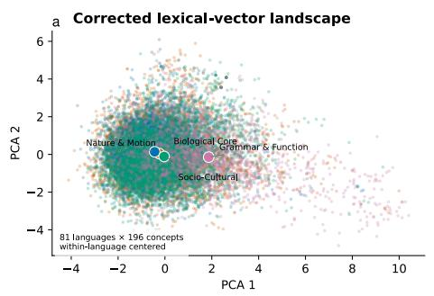
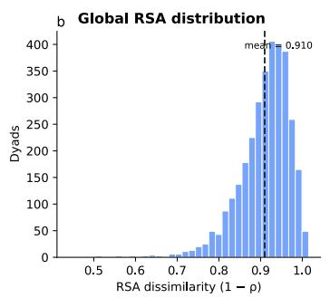
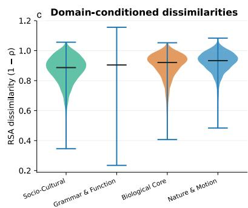
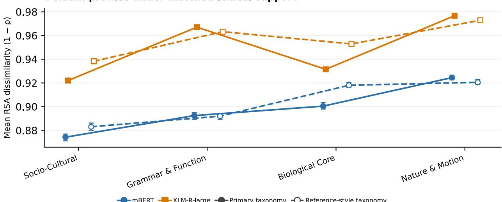
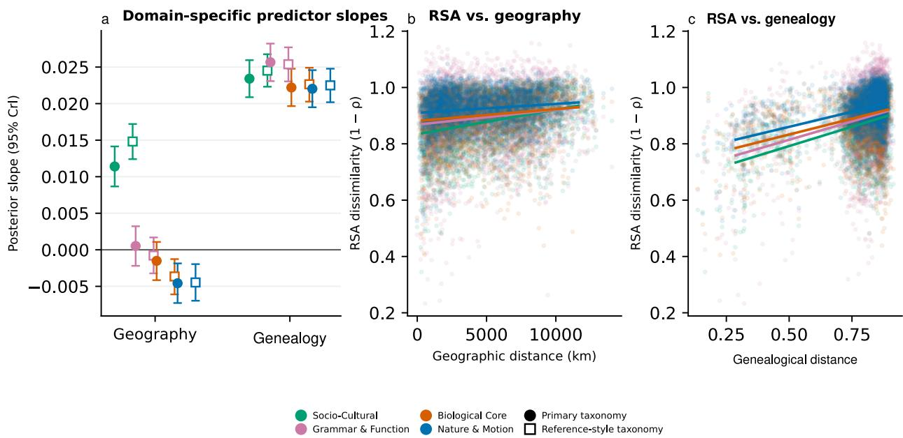
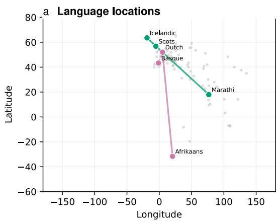
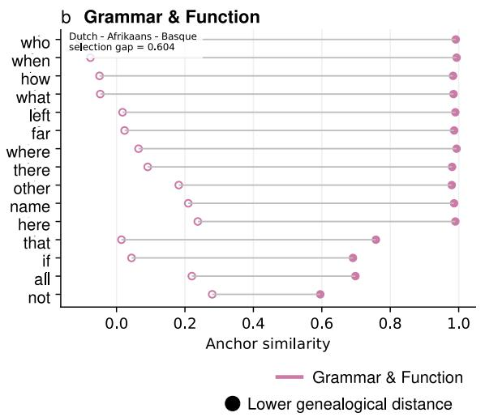
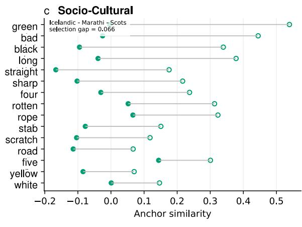
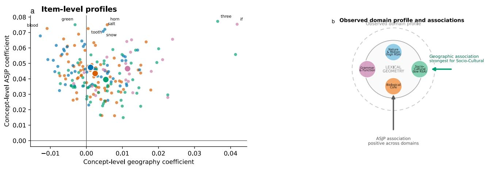
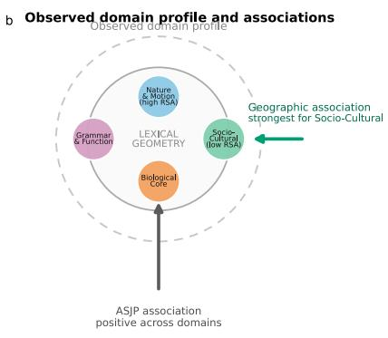

# Where Meanings Converge and Diverge: Revisiting Linguistic Relativity Across 81 Languages

Weiran Wang, Wenjuan Qin, and Haitao Liu

Fudan University, Shanghai 200433, China

October 22, 2026

## Abstract

Do people who speak diferent languages organize concepts in similar ways? This question lies at the heart of the Sapir–Whorf hypothesis and debates about linguistic relativity. Shared basic meanings, however, need not imply shared relations among them. We compared relations among 196 basic concepts across 81 languages, using word embeddings from two multilingual models to quantify conceptual structure expressed in language. Cross-language correspondence was greater for sociocultural meanings than for meanings concerning nature and motion, a contrast recurring across models and classifications. Within the sociocultural domain, relational diferences increased with geographic separation; less closely related languages difered more across all domains. These findings suggest that universality and relativity are interwoven across conceptual domains. They inform an account in which shared cognitive resources interact with linguistic and local experience, and predict greater cross-language correspondence in human semantic judgments for sociocultural than for nature and motion meanings.

Keywords: linguistic relativity; Sapir–Whorf hypothesis; conceptual organization; multilingual comparison; representational similarity

## Introduction

Concepts are mental representations through which people recognize objects, understand events, and generalize beyond what they have directly experienced (Murphy & Medin, 1985; Murphy, 2002). Whether people who speak diferent languages organize these representations in similar ways is a central question about the human mind. Because concepts are expressed through language, linguistic diversity ofers a window onto the relationship between shared cognitive capacities and diferent ways of organizing experience (Evans & Levinson, 2009; Malt & Majid, 2013). The Sapir–Whorf hypothesis, or linguistic relativity, places this relationship at the center of inquiry: how do linguistic distinctions relate to the ways speakers attend to, categorize, and understand the world (Lucy, 1992; Wolf & Holmes, 2011)? Shared bodily and perceptual capacities provide potential foundations for common conceptual organization (Barsalou, 2008; Spelke & Kinzler, 2007), while language-related diferences have been observed in color discrimination, pitch representation, and event categorization (Athanasopoulos et al., 2015; Dolscheid et al., 2013; Winawer et al., 2007). These patterns can coexist: locomotion terms across languages reflect a common biomechanical distinction between walking and running (Malt et al., 2008), and infants are sensitive to multiple space–pitch mappings before acquiring language-specific conventions (Dolscheid et al., 2014). Such evidence motivates an account in which shared resources and linguistic experience jointly contribute to meaning organization (Andrews et al., 2009; Wolf & Holmes, 2011). This relationship extends beyond the availability of corresponding words. Translation equivalents can refer to corresponding objects or events while participating in diferent semantic neighborhoods and broader relational structures (Lewis et al., 2023; Malt & Majid, 2013; Thompson et al., 2020). Because relations among meanings contribute to conceptual coherence, categorization, and generalization, their correspondence is itself a psychologically consequential question (Murphy & Medin, 1985; Murphy, 2002). A broad assessment of linguistic relativity therefore calls for examining how shared and language-specific relations are distributed across diferent kinds of meaning.

Word embeddings provide a scalable means of approaching this question by representing regularities in linguistic contexts as relations in a quantitative space (Landauer & Dumais, 1997; Lenci, 2018). Their psychological relevance rests on evidence that distributional structure captures aspects of human semantic similarity and perceptual knowledge, alongside complementary information supplied by direct experience (Andrews et al., 2009; Lewis et al., 2019; Riordan & Jones, 2011). More recently, Xu et al. (2025) showed that representations elicited through concept inference in language-prediction models capture human similarity judgments and category structure, and predict brain responses to object images. These findings support using language-derived representations to investigate aspects of conceptual organization across languages. Previous comparisons have identified shared lexical-network structure and culturally patterned variation (Jackson et al., 2019; Youn et al., 2016). Thompson et al. (2020) found greater semantic alignment in highly structured domains, including number and quantity, than for natural kinds and common actions; Lewis et al. (2023) further distinguished correspondence within semantic clusters from variability between them. A framework for integrating these findings treats language as a human-driven complex adaptive system, shaped by interacting cognitive, communicative, and environmental constraints (Beckner et al., 2009; Liu, 2014, 2018). In this framework, linguistic regularities are probabilistic and responsive to patterns of use, making graded and uneven correspondence across meanings theoretically relevant (Beckner et al., 2009; Liu, 2018). Here, we compare relations among 196 basic lexical concepts across 81 languages using two multilingual encoders. We ask which contrasts among Biological Core, Nature & Motion, Socio-Cultural, and Grammar & Function recur across representational and classificatory choices, and how these patterns relate jointly to geographic distance and estimated language relatedness. The recurring result is greater cross-language correspondence among the sampled Socio-Cultural relations than among Nature & Motion relations. By locating commonality and variation within a shared basic inventory, this comparison supplies a domain-sensitive pattern for accounts of linguistic relativity to explain. It also predicts a corresponding contrast in matched human semantic-relation judgments, connecting the broad comparison to the psychological organization of concepts.

## Research Transparency Statement

## General Disclosures

Conflicts of interest: The authors declare no competing interests.

Funding: The authors declare no funding.

Artificial intelligence: Multilingual BERT and XLM-R-large were used as research tools to extract lexical representations. Generative AI tools, including GPT-5.6-Luna, Opus-5, and Sonnet-5, assisted with code revision, language editing, drafting support, and LaTeX formatting. All scientific content, methodological decisions, data analyses, and interpretations remain the sole responsibility of the authors, who reviewed and verified all AI-assisted text.

Ethics: This study used publicly available, non-identifiable lexical resources and language metadata. No human participants were recruited, and no new behavioral or neural data were collected.

## Study Disclosures

Preregistration: No aspects of this study were preregistered.

Materials: The concept and language inventories, concept mappings, and analysis specifications are provided in the Supplemental Material and accompanying source package, available via Figshare: https://figshare.com/s/ 63bae7225054e9718549.

Data: Data and machine-readable summaries supporting the reported analyses of 81 languages and 196 concepts are available via https://figshare.com/s/63bae7225054e9718549. The accompanying materials document the provenance of the archived model outputs used in the analyses.

Analysis scripts: The accompanying source package provides the analysis scripts and specifications supporting the reported estimates: https://figshare.com/s/63bae7225054e9718549.

## Method

## Languages, Concepts, and Semantic Domains

We compared relations among translation equivalents in a computational, cross-sectional design. Lexica forms for the starting inventory of 82 languages and 207 basic concepts were downloaded from Wiktionary’s language-specific Swadesh lists (Wiktionary contributors, n.d.), following the Swadesh basic-vocabulary tradition (Swadesh, 1955). Languages were selected for model coverage, usable lexical material, geographic coordinates, and relatedness metadata. This coverage-based sample enables broad comparison without representing a probability sample of the world’s languages. No new behavioral or neural responses were collected. Archived lexical forms and Wiktionary concept numbering were retained, including identifiers distinguishing entries with the same English gloss.

Vectors were screened for dimensionality, finite values, zero content, and parseability; the first valid vector was retained for repeated identifiers. Javanese was excluded because identical vectors, rounded to seven decimals, comprised more than half its valid representations (.607). Twelve all-zero observations afected 11 concept identifiers. Excluding these identifiers across languages yielded common support of 81 languages, 196 concepts, and 3,240 unordered language pairs in both encoders. Sample size followed usable common coverage. Complete inventories and exclusions appear in the Supplemental Material.

Four author-defined domains consolidated the topical annotations in the archived study inventory (Table 1). They are operational groupings, rather than independently established conceptual modules. We also used a reference-style grouping that reassigned 22 of the 207 input concepts, including six personal-pronoun items from Biological Core to Grammar & Function; kinship remained Biological Core. The groupings agreed on 185 input concepts, yielding a complete-case consensus subset of 175 concepts. Item assignments and their sources are documented in the Supplemental Material.

Table 1. Operational domains in the primary grouping. Counts refer to the 196 retained concepts; complete item assignments are provided in the Supplemental Material.
<table><tr><td>Domain</td><td>n</td><td>Included fields</td></tr><tr><td>Biological Core</td><td>67</td><td>Body, perception, bodily processes, people, kinship, personal pronouns</td></tr><tr><td>Nature &amp; Motion</td><td></td><td>49 Nonhuman living kinds, environments, movement, physical change</td></tr><tr><td>Socio-Cultural</td><td></td><td>59 Properties, evaluation, color, time, actions, material culture, numerals</td></tr><tr><td>Grammar &amp; Function</td><td></td><td>21 Demonstratives, interrogatives, quantifiers, relational/function items</td></tr></table>

## Lexical Representations and Relational Dissimilarity

We extracted isolated lexical forms with mBERT (bert-base-multilingual-cased) and XLM-R-large (xlm-roberta-large) (Conneau et al., 2020; Devlin et al., 2019). Final-layer states were averaged over attended, non-special lexical subwords. Comma-delimited alternatives were encoded separately and averaged equally; forms without usable lexical tokens were missing. Both encoders used the same forms, pooling rules, and support, while retaining their own tokenizers and training histories. Extraction choices matter for interpreting these representations (Vulić et al., 2020).

Representational similarity analysis compared the ordering of semantic relations within each language (Beinborn & Choenni, 2020; Kriegeskorte et al., 2008). Vectors were centered on their language-specific mean within each concept set before constructing a cosine-dissimilarity matrix. The full inventory and each domain were centered separately; domain matrices were not subsets of an already centered global matrix. For languages � and � and concept set �, cross-language dissimilarity was

$$
d _ { i j , C } = 1 - \rho _ { \mathrm { S p e a r m a n } } \big [ u ( D _ { i , C } ) , u ( D _ { j , C } ) \big ] ,\tag{1}
$$

where $u ( D )$ contains upper-triangle entries in matched concept order, excluding the diagonal. Ties received average ranks. Lower values indicate more similarly ordered relations; the index ranges from zero to two and requires no coordinate alignment. Each language pair contributed one global and four domain outcomes per encoder. Concept-pair entries were not independent regression observations. No undefined outcomes occurred. Principal-component projections were descriptive only.

## Geographic and Linguistic Distance Measures

Geographic distance was great-circle distance between archived language centroids. Genealogical distance indexed estimated language relatedness using lexical–phonological dissimilarities from the Automated Similarity Judgment Program (ASJP), derived from pointwise mutual-information scores for core-vocabulary forms (Jäger, 2018). Higher values indicate more distant estimated relationships. This proxy can reflect inheritance and borrowing and shares material with the semantic inventory; it is not a reconstructed family-tree distance. Both matrices were fixed, symmetric, and complete on the retained languages. Predictors were standardized and entered jointly, so slopes describe associations per standard-deviation increase in one distance, conditional on the other. Geographic separation does not directly measure contact, and word-form dissimilarity does not isolate inheritance.

## Statistical Analysis and Robustness Checks

We fitted Gaussian Bayesian regressions with domain-specific intercepts and distance slopes. For each encoder, the domain model was

$$
\begin{array} { r l } & { d _ { i j , k } \sim N ( \mu _ { i j , k } , \sigma ^ { 2 } ) , } \\ & { \mu _ { i j , k } = \alpha _ { k } + \beta _ { \mathrm { g e o } , k } z _ { \mathrm { g e o } , i j } + \beta _ { \mathrm { g e n } , k } z _ { \mathrm { g e n } , i j } + \frac { 1 } { 2 } ( u _ { i } + u _ { j } ) . } \end{array}\tag{2}
$$

Here, � and $j$ index languages, � indexes domains, and $z _ { \mathrm { g e o } , i j }$ and $z _ { \mathrm { g e n } , i j }$ are standardized geographic and genealogical distances. The domain-specific intercept $\alpha _ { k }$ describes adjusted dissimilarity; the two $\beta$ terms are total domain slopes. The shared language intercepts $u _ { i }$ and $u _ { j }$ account for repeated participation in language pairs, each with weight one half.

Language efects used a non-centered Gaussian parameterization and a sum-to-zero constraint. Biological Core was the domain reference; other intercepts and slopes were coded as increments. Encoder-specific global and domain fits used 3,240 and 12,960 rows, respectively. A pooled domain model (25,920 rows) included encoder, domain, both predictors, and interactions through Encoder × Domain × Predictor, with shared language intercepts and mBERT as the encoder reference. Adjusted means used centered predictors and zero language contribution. Total slopes and contrasts were derived within posterior draws; pooled draws supplied between-encoder comparisons. Models omitted an additional dyad efect and residual correlations across outcomes from the same dyad; intervals are conditional on this specification.

Priors were $N ( . 9 , . 2 )$ for the reference intercept, $N ( 0 , . 2 )$ for other fixed coeficients (mean, standard deviation), positive Student- $t ( 3 , 0 , . 5 )$ for the language-efect scale, and exponential rate one for residual standard deviation. CmdStan 2.38.0 (Carpenter et al., 2017) used four No-U-Turn chains, each with 3,000 warm-up and 3,000 retained iterations. Estimates are posterior means with equal-tail 95% credible intervals (CrIs). Across the complete-support model fits, the maximum $\widehat { R }$ was 1.008, the minimum bulk efective sample size was 394, and there were no divergent transitions or maximum-tree-depth saturations; the minimum reported E-BFMI was .633. Convergence and posterior predictive checks, full specifications, and coeficients are reported in the Supplemental Material.

We recomputed RSA after regrouping concepts and on the consensus subset, permuted concept labels within languages and domains 2,000 times, and widened intercept/coeficient prior scales from .2 to .5. Permutation probabilities used the add-one correction. Language-omission summaries recomputed means without refitting models; paired-dyad bootstraps did not account for dependence between pairs sharing a language. Secondary English-frequency models used item-level cosine dissimilarity, and archived size/layer checks used earlier vectors; neither constitutes a matched replication of the primary RSA analysis. Full records and extraction provenance are retained in the Supplemental Material.

For illustration, we screened mBERT language triplets for an anchor, a comparison with low genealogical distance but large geographic separation, and a geographically close comparison with higher genealogical distance. We selected the largest positive gap favoring the comparison with lower genealogical distance for Grammar & Function and the geographically close comparison for Socio-Cultural. These gaps average item-level cosine similarities between language-centered vectors, a diferent measure from domain RSA. Distance thresholds and complete candidate records are provided in the Supplemental Material.

## Results

## Semantic Similarity Across Languages Varies by Domain

The shared inventory yielded limited overall correspondence but a recurring diference between semantic domains. Across the 3,240 language pairs, adjusted global RSA dissimilarity was .910 (95% CrI [.909, .911]) in mBERT and .932 [.931, .933] in XLM-R-large. These values describe substantial variation in the ordering of within-language relations, even among translation equivalents. Against this background, we compared the four domains on the same language support (Fig. 1).

In mBERT, Socio-Cultural concepts showed the lowest adjusted dissimilarity (.874, 95% CrI [.872, .877]), whereas Nature & Motion showed the highest (.924 [.922, .927]). Grammar & Function (.892 [.890, .895]) and Biological Core (.900 [.898, .903]) occupied intermediate positions. The Nature & Motion minus Socio-Cultural diference was .0503 [.0470, .0537]. Thus, relations among the sampled Socio-Cultural meanings corresponded more closely across languages than those among Nature & Motion meanings.

The same comparison held in XLM-R-large: Socio-Cultural dissimilarity was .922 [.920, .924], compared with .977 [.974, .979] for Nature & Motion, a diference of .0547 [.0513, .0580]. Biological Core and Grammar & Function remained intermediate but reversed their order relative to mBERT (Fig. 2; Supplemental Table S14). The pooled between-encoder diference in the Nature & Motion–Socio-Cultural contrast was .0044 [-.0003, .0090]. Agreement therefore concerned the direction of this domain comparison, alongside diferences in the complete profile. Even the lower-dissimilarity domains remained far from identical across languages.

Regrouping some concepts preserved this direction. Under the reference-style grouping, raw Socio-Cultural versus Nature & Motion means were .883 versus .921 in mBERT and .938 versus .973 in XLM-R-large. Restricting the analysis to the 175 concepts assigned identically by both groupings yielded .888 versus .935 and .938 versus .977. Grammar & Function became the lowest-dissimilarity mBERT group in that subset, qualifying any fixed four-domain ranking. Concept-label calibration also distinguished observed correspondence from random labels: all 16 encoder-by-grouping-by-domain outcomes fell below all 2,000 permutations (Monte Carlo lower-tail � < .001). Language omission preserved the descriptive full-inventory orders, and wider priors left the main comparison essentially unchanged; full sensitivity results appear in the Supplemental Material.

Domain composition changes the apparent cross-lingual geometry  

  
Socio-CulturalGrammar & FunctionBiological CoreNature & Motion

Fig. 1. Cross-language variation in lexical relations. Multilingual BERT (mBERT) results for 81 languages and 196 concepts. The panels show (a) a descriptive principal-component projection of within-language centered vectors, colored by domain; (b) global representational similarity analysis (RSA) dissimilarities for 3,240 language pairs; and (c) domain distributions. The projection does not establish conceptual modules. Lower dissimilarity indicates more similar ordering of within-language relations; global and domain sets were centered separately.

Domain profiles under matched lexical support  
  
mBERTXLM-R-large-Primary taxonomy--Reference-style taxonomy  
Fig. 2. Domain patterns across encoders and concept groupings. Points show raw mean representational similarity analysis (RSA) dissimilarities on matched language and concept support. Colors identify encoders; solid lines/filled markers indicate the primary grouping and dashed lines/open markers the reference-style grouping. Error bars show the range of means after omitting each language in turn, not confidence or credible intervals. Adjusted estimates and credible intervals are reported in the text and Supplemental Material.

## Semantic Diferences Are Associated With Geographic Distance and Language Relatedness

We examined geographic and genealogical distance jointly using the model in Equation 2. Positive slopes indicate greater relational dissimilarity at greater distance, conditional on the other predictor.

Socio-Cultural dissimilarity increased with geographic separation in both encoders: the slope was .0114 (95% CrI [.0087, .0141]) in mBERT and .0081 [.0055, .0107] in XLM-R-large. Other domains showed less consistent geographic profiles. Nature & Motion had a negative slope in mBERT (-.0046 [-.0072, -.0019]), while Biological Core had a positive slope in XLM-R-large (.0058 [.0032, .0085]); the remaining intervals included zero (Fig. 3; Supplemental Table S15). Relatively low overall Socio-Cultural dissimilarity therefore coexisted with a recurring geographic gradient. Geography was not associated with a uniform increase across the inventory.

Genealogical distance showed a broader positive association. All four domain slopes were positive in both encoders, and every 95% CrI lay above zero. Estimates ranged from .02204 to .02566 in mBERT and .01601 to .02107 in XLM-R-large (Supplemental Table S16). Language pairs with greater estimated genealogical separation also tended to have more dissimilar relational patterns after accounting for geography. This relationship extended across domains, whereas geographic associations varied by domain and encoder. The two predictors thus describe diferent comparative patterns within the same language pairs.

  
Fig. 3. Geographic and language-relatedness associations. All panels show multilingual BERT (mBERT). Total domain slopes and 95% credible intervals are shown in (a); filled circles indicate the primary grouping and open squares the reference-style grouping. Panels (b) and (c) show raw representational similarity analysis (RSA) dyad outcomes and descriptive least-squares lines, distinct from the conditional Bayesian estimates in (a). Genealogical distance is the word-form-based relatedness proxy defined in Method. Complete estimates for both encoders are in Supplementa Tables S15 and S16.

## Illustrative Comparisons Among Individual Languages

Two selected language triplets make these distance configurations concrete at the level of lexical items (Fig. 4). Each compares an anchor with a geographically distant language having lower genealogical distance and a geographically close language having higher genealogical distance. The examples were selected for large directional gaps in item-level cosine similarity, rather than for their representativeness of all language pairs.

For Grammar & Function, Dutch was the anchor, Afrikaans the comparison with lower genealogical distance, and Basque the geographically close comparison. Dutch–Afrikaans similarities exceeded Dutch–Basque similarities for many displayed items, including who, when, how, and what. In the Socio-Cultural example, Icelandic was compared with Marathi and Scots. Similarities with geographically closer Scots exceeded those with Marathi for selected items including green, long, sharp,four, andfive.

These examples show how spatial separation and word-form relatedness can combine diferently in particular comparisons. Their scores concern cross-language similarities of individual lexical vectors, whereas the main analyses compare patterns of within-language relations. They illustrate selected lexical configurations without independently testing the domain-level RSA results or identifying contact and inheritance as causes. Complete selection rules, qualifying candidates, and item records are retained in the Supplemental Material.

Selected language comparisons  

  
O Geographically closer  
Fig. 4. Selected language comparisons illustrate lexical variation. Multilingual BERT (mBERT) examples selected for large directional gaps. The locations of the two triplets are shown in (a). Grammar & Function items in (b) compare Dutch with Afrikaans and Basque; Socio-Cultural items in (c) compare Icelandic with Marathi and Scots. Scores are item-level cosine similarities between language-centered vectors, not domain representational similarity analysis (RSA). Filled markers indicate the comparison with lower genealogical distance and open markers the geographically closer comparison. These selected examples are descriptive.

## Discussion

## Shared Meanings, Diferent Relations

Do people who speak diferent languages organize basic concepts in similar ways? Our comparison identifies a recurring domain contrast in language-derived representations: relations among the sampled Socio-Cultural meanings corresponded more closely across languages than those among Nature & Motion meanings. This pattern agrees with Thompson et al.’s (2020) finding that highly structured meanings can align more closely than natural kinds and common actions. It also complements Lewis et al.’s (2023) distinction between local similarity and broader variability by showing that the extent of correspondence difers across the present groups of basic meanings. The contrast recurred across two encoders and changes in classification and concept support. For linguistic relativity, the contribution is a clearer comparative profile of where relations are relatively shared and where they difer, bringing variation within the lexicon into the language–thought discussion.

This profile connects shared conceptual resources with experience-dependent organization. Groundedcognition and core-knowledge accounts identify perceptual, bodily, and early representational foundations for understanding the world (Barsalou, 2008; Spelke & Kinzler, 2007). Learning accounts explain how linguistic and experiential information jointly contribute to semantic structure (Andrews et al., 2009; Riordan & Jones, 2011). Our domain contrast fits this combination: common basic meanings can participate in relations whose cross-language correspondence varies with their content. The pitch studies provide a developmental illustration, showing that early sensitivity to multiple mappings can coexist with language-related diferences in adults (Dolscheid et al., 2013, 2014). Language-related diferences in color discrimination and bilingual event processing likewise show how shared perceptual resources can be deployed diferently during particular tasks (Athanasopoulos et al., 2015; Winawer et al., 2007). Together with evidence that language-prediction models recover human-relevant conceptual structure (Xu et al., 2025), these findings place the present comparison within a psychological account of common resources and learned relations. It extends that account by identifying a recurring contrast across a broad language sample. Conceptual commonality can therefore be examined at more than one level: languages may express corresponding basic meanings while difering in the relations connecting them. This distinction sharpens the comparative question raised by linguistic relativity and links it to theories in which conceptual content depends partly on relations within a larger knowledge system (Malt & Majid, 2013; Murphy & Medin, 1985).

## Shared Constraints and Local Experience

The domain contrast is consistent with an interaction between relational systematicity and communicative adaptation. Thompson et al. (2020) associated higher alignment with domains possessing strong internal structure, such as number and quantity. Such structure ofers one explanation for correspondence among parts of our Socio-Cultural inventory. Eficient-communication accounts provide a complementary explanation: kinship and color systems balance informative distinctions against representational cost, while color naming also reflects communicative usefulness (Gibson et al., 2017; Kemp & Regier, 2012; Zaslavsky et al., 2018). Recurrent needs can favor comparable relations among meanings. Locally varying experience can favor diferent distinctions within the same general framework. Landscape vocabularies vary across languages, ice and snow terminology tracks environmental communicative needs, and semantic variation along shared neurocognitive dimensions is associated with climate (Burenhult & Levinson, 2008; Fu et al., 2026; Regier et al., 2016). These findings help explain why relations among Nature & Motion meanings might vary even when their referents belong to a commonly experienced physical world. Shared perceptual access and shared semantic organization are distinct explanatory issues: environmental regularities provide material for meaning, while experience and use can afect which distinctions and associations become prominent (Barsalou, 2008; Burenhult & Levinson, 2008). The present contrast thus develops the earlier alignment results into a synthesis in which shared relational constraints and variable experience jointly organize meaning. Greater correspondence in one group and greater variation in another are compatible outcomes of meaning systems adapting to overlapping and difering demands.

The distance associations connect this synthesis to language communities. Socio-Cultural relations were comparatively similar across the sample and also became more dissimilar with geographic separation in both encoders. This combination parallels emotion-semantic research, in which common organizing dimensions coexist with geographically patterned variation (Jackson et al., 2019), and broader alignment findings linking similarity to cultural and geographic proximity (Thompson et al., 2020). Interaction ofers a psychologically plausible pathway: selective coordination of task-relevant language is associated with improved joint performance, and language contact can accompany restructuring of color meanings (Fusaroli et al., 2012; Malik-Moraleda et al., 2023). Broadly recurring relational patterns can therefore coexist with regional conventions. A domain’s average correspondence and its geographic gradient describe diferent properties: relative commonality across the sample can be accompanied by systematic regional diferentiation. This combination specifies how shared and locally patterned organization can coexist within the same field of meanings. Greater relational dissimilarity between more distantly related languages across all domains further situates the profile within historical relationships among languages, extending the historical associations reported by Thompson et al. (2020). The joint comparison links the organization of meaning to both the kinds of concepts involved and the spatial and historical contexts in which languages are used.

## Universality and Relativity in an Adaptive System

The resulting profile gives semantic content to the human-driven complex-adaptive-system perspective introduced above (Beckner et al., 2009; Liu, 2014, 2018). In this account, cognitive capacities, interaction, and local experience jointly shape linguistic regularities. Cultural-transmission experiments show how learning across generations can produce increasingly structured and learnable systems (Kirby et al., 2008). Our findings suggest a conceptual patchwork, with relations among meanings woven more similarly across languages in some domains than in others. Shared relational structure and recurrent communicative demands may draw parts of the Socio-Cultural inventory into more similar patterns, whereas variation in ecological experience and communicative needs may allow greater diferentiation among Nature & Motion meanings (Gibson et al., 2017; Regier et al., 2016; Thompson et al., 2020). Universality and relativity can thus be understood as interwoven properties of an adaptive meaning system. This probabilistic view connects shared cognitive capacities with locally established patterns of use (Evans & Levinson, 2009; Liu, 2018), ofering a domain-sensitive account of how commonality and variation coexist. For the Sapir–Whorf question, this shifts attention toward the distribution of shared and difering relations within conceptual systems. A psychological test follows directly: matched judgments should reveal relatively greater cross-language correspondence for the sampled Socio-Cultural relations than for Nature & Motion relations. Comparisons with nonverbal materials and manipulations of language use would connect this prediction to the attention, categorization, and learning processes implicated in linguistic relativity (Wolf & Holmes, 2011).

Several limitations guide that extension. Our evidence comes from model-derived lexical relations; establishing their correspondence to speakers’ judgments remains necessary, particularly because naming and nonverbal similarity can dissociate (Malt et al., 1999). Training biases, polysemy, coverage-based sampling, heterogeneous domain assignments, and model-dependent intermediate ranks afect generalization. Communicative, ecological, and historical mechanisms require independent measurements. Within this scope, the study contributes a recurring domain contrast to linguistic relativity and an integrated interpretation linking shared cognitive resources with experience and social use. It makes the relationship between conceptual commonality and linguistic diversity a question about identifiable patterns among meanings, with specific psychological comparisons through which those patterns can be examined.

## Author Contributions

Conceptualization and methodology: Weiran Wang, Wenjuan Qin, and Haitao Liu. Data curation and formal analysis: Weiran Wang. Visualization and writing—original draft: Weiran Wang, Wenjuan Qin, and Haitao Liu. Writing—review and editing: Wenjuan Qin and Haitao Liu. Supervision: Wenjuan Qin and Haitao Liu.

## Acknowledgments

This paper is a research output of the Digital Humanities and Glottometrics Lab at Fudan University.

## References

Andrews, M., Vigliocco, G., & Vinson, D. (2009). Integrating experiential and distributional data to learn semantic representations. Psychological Review, 116(3), 463–498. https://doi.org/10.1037/a0016261

Athanasopoulos, P., Bylund, E., Montero-Melis, G., Damjanovic, L., Schartner, A., Kibbe, A., Riches, N., & Thierry, G. (2015). Two languages, two minds: Flexible cognitive processing driven by language of operation. Psychological Science, 26(4), 518–526. https://doi.org/10.1177/0956797614567509

Barsalou, L. W. (2008). Grounded cognition. Annual Review of Psychology, 59, 617–645. https://doi.org/10. 1146/annurev.psych.59.103006.093639

Beckner, C., Blythe, R., Bybee, J., Christiansen, M. H., Croft, W., Ellis, N. C., Holland, J., Ke, J., Larsen-Freeman, D., & Schoenemann, T. (2009). Language is a complex adaptive system: Position paper. Language Learning, 59(s1), 1–26. https://doi.org/10.1111/j.1467-9922.2009.00533.x

Beinborn, L., & Choenni, R. (2020). Semantic drift in multilingual representations. Computational Linguistics, 46(3), 571–603. https://doi.org/10.1162/coli\_a\_00382

Burenhult, N., & Levinson, S. C. (2008). Language and landscape: A cross-linguistic perspective. Language Sciences, 30(2-3), 135–150. https://doi.org/10.1016/j.langsci.2006.12.028

Carpenter, B., Gelman, A., Hofman, M. D., Lee, D., Goodrich, B., Betancourt, M., Brubaker, M., Guo, J., Li, P., & Riddell, A. (2017). Stan: A probabilistic programming language. Journal of Statistical Software, 76(1), 1–32. https://doi.org/10.18637/jss.v076.i01

Conneau, A., Khandelwal, K., Goyal, N., Chaudhary, V., Wenzek, G., Guzmán, F., Grave, E., Ott, M., Zettlemoyer, L., & Stoyanov, V. (2020). Unsupervised cross-lingual representation learning at scale. Proceedings of the 58th Annual Meeting of the Association for Computational Linguistics, 8440–8451. https://doi.org/10.18653/v1/2020.acl-main.747

Devlin, J., Chang, M.-W., Lee, K., & Toutanova, K. (2019). BERT: Pre-training of deep bidirectional transformers for language understanding. Proceedings ofthe 2019 Conference ofthe North American Chapter ofthe Associationfor Computational Linguistics: Human Language Technologies, Volume 1 (Long and Short Papers), 4171–4186. https://doi.org/10.18653/v1/N19-1423

Dolscheid, S., Hunnius, S., Casasanto, D., & Majid, A. (2014). Prelinguistic infants are sensitive to space-pitch associations found across cultures. Psychological Science, 25(6), 1256–1261. https://doi.org/10.1177/ 0956797614528521

Dolscheid, S., Shayan, S., Majid, A., & Casasanto, D. (2013). The thickness of musical pitch: Psychophysical evidence for linguistic relativity. Psychological Science, 24(5), 613–621. https://doi.org/10.1177/ 0956797612457374

Evans, N., & Levinson, S. C. (2009). The myth of language universals: Language diversity and its importance for cognitive science. Behavioral and Brain Sciences, 32(5), 429–448. https ://doi .org/ 10 . 1017/ S0140525X0999094X

Fu, Z., Chu, Y., Zhang, T., Li, Y., Wang, X., & Bi, Y. (2026). Semantic similarity across languages reflects neurocognitive dimensions shaped by climate. Nature Communications, 17, Article 4016. https : //doi.org/10.1038/s41467-026-70608-8

Fusaroli, R., Bahrami, B., Olsen, K., Roepstorf, A., Rees, G., Frith, C. D., & Tylén, K. (2012). Coming to terms: Quantifying the benefits of linguistic coordination. Psychological Science, 23(8), 931–939. https://doi.org/10.1177/0956797612436816

Gibson, E., Futrell, R., Jara-Ettinger, J., Mahowald, K., Bergen, L., Ratnasingam, S., Gibson, M., Piantadosi, S. T., & Conway, B. R. (2017). Color naming across languages reflects color use. Proceedings ofthe National Academy ofSciences, 114(40), 10785–10790. https://doi.org/10.1073/pnas.1619666114

Jackson, J. C., Watts, J., Henry, T. R., List, J.-M., Forkel, R., Mucha, P. J., Greenhill, S. J., Gray, R. D., & Lindquist, K. A. (2019). Emotion semantics show both cultural variation and universal structure. Science, 366(6472), 1517–1522. https://doi.org/10.1126/science.aaw8160

Jäger, G. (2018). Global-scale phylogenetic linguistic inference from lexical resources. Scientific Data, 5, 180189. https://doi.org/10.1038/sdata.2018.189

Kemp, C., & Regier, T. (2012). Kinship categories across languages reflect general communicative principles. Science, 336(6084), 1049–1054. https://doi.org/10.1126/science.1218811

Kirby, S., Cornish, H., & Smith, K. (2008). Cumulative cultural evolution in the laboratory: An experimental approach to the origins of structure in human language. Proceedings ofthe National Academy ofSciences, 105(31), 10681–10686. https://doi.org/10.1073/pnas.0707835105

Kriegeskorte, N., Mur, M., & Bandettini, P. (2008). Representational similarity analysis – connecting the branches of systems neuroscience. Frontiers in Systems Neuroscience, 2, 4. https://doi.org/10.3389/neuro.06.004. 2008

Landauer, T. K., & Dumais, S. T. (1997). A solution to Plato’s problem: The latent semantic analysis theory of acquisition, induction, and representation of knowledge. Psychological Review, 104(2), 211–240. https://doi.org/10.1037/0033-295X.104.2.211

Lenci, A. (2018). Distributional models of word meaning. Annual Review of Linguistics, 4, 151–171. https: //doi.org/10.1146/annurev-linguistics-030514-125254

Lewis, M., Zettersten, M., & Lupyan, G. (2019). Distributional semantics as a source of visual knowledge. Proceedings ofthe National Academy ofSciences, 116(39), 19237–19238. https://doi.org/10.1073/pnas. 1910148116

Lewis, M., Cahill, A., Madnani, N., & Evans, J. (2023). Local similarity and global variability characterize the semantic space of human languages. Proceedings of the National Academy of Sciences, 120(51), e2300986120. https://doi.org/10.1073/pnas.2300986120

Liu, H. (2014). Language is more a human-driven system than a semiotic system: Comment on “Modelling language evolution: Examples and predictions” by Tao Gong, Shuai Lan, Menghan Zhang. Physics of Life Reviews, 11(2), 309–310. https://doi.org/10.1016/j.plrev.2013.12.008

Liu, H. (2018). Language as a human-driven complex adaptive system: Comment on “Rethinking foundations of language from a multidisciplinary perspective” by T. Gong et al. Physics of Life Reviews, 26–27, 149–151. https://doi.org/10.1016/j.plrev.2018.06.006

Lucy, J. A. (1992). Language diversity and thought: A reformulation of the linguistic relativity hypothesis. Cambridge University Press. https://doi.org/10.1017/CBO9780511620843

Malik-Moraleda, S., Mahowald, K., Conway, B. R., & Gibson, E. (2023). Concepts are restructured during language contact: The birth of blue and other color concepts in Tsimane’-Spanish bilinguals. Psychological Science, 34(12), 1350–1362. https://doi.org/10.1177/09567976231199742

Malt, B. C., Gennari, S., Imai, M., Ameel, E., Tsuda, N., & Majid, A. (2008). Talking about walking: Biomechanics and the language of locomotion. Psychological Science, 19(3), 232–240. https://doi.org/10.1111/j.1467- 9280.2008.02074.x

Malt, B. C., & Majid, A. (2013). How thought is mapped into words. Wiley Interdisciplinary Reviews: Cognitive Science, 4(6), 583–597. https://doi.org/10.1002/wcs.1251

Malt, B. C., Sloman, S. A., Gennari, S., Shi, M., & Wang, Y. (1999). Knowing versus naming: Similarity and the linguistic categorization of artifacts. Journal of Memory and Language, 40(2), 230–262. https://doi.org/10.1006/jmla.1998.2593

Murphy, G. L., & Medin, D. L. (1985). The role of theories in conceptual coherence. Psychological Review, 92(3), 289–316. https://doi.org/10.1037/0033-295X.92.3.289

Murphy, G. L. (2002). The big book of concepts. MIT Press. https://mitpress.mit.edu/9780262632997/the-bigbook-of-concepts/

Regier, T., Carstensen, A., & Kemp, C. (2016). Languages support eficient communication about the environment: Words for snow revisited. PLoS One, 11(4), e0151138. https://doi.org/10.1371/journal.pone.0151138

Riordan, B., & Jones, M. N. (2011). Redundancy in perceptual and linguistic experience: Comparing featurebased and distributional models of semantic representation. Topics in Cognitive Science, 3(2), 303–345. https://doi.org/10.1111/j.1756-8765.2010.01111.x

Spelke, E. S., & Kinzler, K. D. (2007). Core knowledge. Developmental Science, 10(1), 89–96. https://doi.org/10. 1111/j.1467-7687.2007.00569.x

Swadesh, M. (1955). Towards greater accuracy in lexicostatistic dating. International Journal of American Linguistics, 21(2), 121–137. https://doi.org/10.1086/464321

Thompson, B., Roberts, S. G., & Lupyan, G. (2020). Cultural influences on word meanings revealed through largescale semantic alignment. Nature Human Behaviour, 4(10), 1029–1038. https://doi.org/10.1038/s41562- 020-0924-8

Vulić, I., Ponti, E. M., Litschko, R., Glavaš, G., & Korhonen, A. (2020). Probing pretrained language models for lexical semantics. Proceedings ofthe 2020 Conference on Empirical Methods in Natural Language Processing (EMNLP), 7222–7240. https://doi.org/10.18653/v1/2020.emnlp-main.586

Wiktionary contributors. (n.d.). Swadesh lists by language. Wiktionary. Retrieved October 22, 2026, from https://en.wiktionary.org/wiki/Category:Swadesh\_lists\_by\_language

Winawer, J., Witthoft, N., Frank, M. C., Wu, L., Wade, A. R., & Boroditsky, L. (2007). Russian blues reveal efects of language on color discrimination. Proceedings of the National Academy of Sciences, 104(19), 7780–7785. https://doi.org/10.1073/pnas.0701644104

Wolf, P., & Holmes, K. J. (2011). Linguistic relativity. Wiley Interdisciplinary Reviews: Cognitive Science, 2(3), 253–265. https://doi.org/10.1002/wcs.104

Xu, N., Zhang, Q., Du, C., Luo, Q., Qiu, X., Huang, X., & Zhang, M. (2025). Revealing emergent human-like conceptual representations from language prediction. Proceedings ofthe National Academy ofSciences, 122(44), Article e2512514122. https://doi.org/10.1073/pnas.2512514122

Youn, H., Sutton, L., Smith, E., Moore, C., Wilkins, J. F., Maddieson, I., Croft, W., & Bhattacharya, T. (2016). On the universal structure of human lexical semantics. Proceedings ofthe National Academy ofSciences, 113(7), 1766–1771. https://doi.org/10.1073/pnas.1520752113

Zaslavsky, N., Kemp, C., Regier, T., & Tishby, N. (2018). Eficient compression in color naming and its evolution. Proceedings ofthe National Academy ofSciences, 115(31), 7937–7942. https://doi.org/10.1073/pnas. 1800521115

## Supplementary Information

Where Meanings Converge and Diverge: Revisiting Linguistic Relativity Across 81 Languages

Weiran Wang, Wenjuan Qin, and Haitao Liu Fudan University, Shanghai 200433, China

## S1 Sample construction and quality control

The language inventory was constructed from the full candidate coverage of multilingual BERT available at the time of data assembly. The mBERT model card lists 104 pretraining languages. From this candidate pool, we excluded artificial languages, languages whose available Wikipedia material was predominantly machine-generated, and languages without the geographic or language-history metadata needed for the comparative analysis. Language identifiers were standardized against ISO and Glottolog records, yielding an 82-language study input. Lexical forms were downloaded from the language-specific Swadesh lists indexed by Wiktionary (Wiktionary contributors, n.d.-b). The 207 numeric concept IDs follow Wiktionary’s English Swadesh ordering (Wiktionary contributors, n.d.-a); the archived English concept labels match that sequence after normalization of formatting and parenthetical qualifiers. Thus, 82 languages and 207 concepts describe the study input; this is the inherited input inventory, not a new sampling design introduced by the quality-control procedure. The lexical source is distinct from the Bowern/Concepticon resources subsequently consulted for auxiliary classification. The retrieval dates in the references document source verification and do not establish the original download date. Analyses retained the archived lexical forms rather than replacing them with later online edits.

The archived vector set contained those 207 concept slots in the 82-language input, and the same inventory was extracted from the local mBERT checkpoint on the remote server. Concept identity was reconstructed from numeric concept IDs, not English glosses, because you and man each occur at two source-list positions. Every vector was screened for parseability, dimensional consistency, finite values, and all-zero content. The quality-control procedure identified 12 all-zero observations (Table S6). They were treated as invalid rather than transformed by mean centering. Javanese remained degenerate after extraction: its maximum duplicate share at seven-decimal precision was .607, compared with .995 in the archived file. It was excluded under the stated duplicate-share rule. The retained sample therefore contains 81 languages.

For a common support, the primary analysis uses only concepts with valid vectors in all retained languages. Eleven concepts failed this criterion (Table S7), leaving 196 concepts and 3,240 unordered language dyads. Undefined RSA values remain missing and are never replaced by an arbitrary dissimilarity value.

## S2 Representational similarity analysis

For concept set � in language �, vectors were centered within language and set,

$$
\hat { \nu } _ { c , L } = \nu _ { c , L } - \frac { 1 } { | C | } \sum _ { i \in C } \nu _ { i , L } .\tag{S1}
$$

Cosine representational distance matrices (RDMs) were constructed from the centered vectors. We call the cross-lingual outcome RSA dissimilarity:

$$
\begin{array} { r } { d _ { \mathrm { { s e m } } } ( L _ { 1 } , L _ { 2 } ) = 1 - \rho \mathrm { { s p e a r m a n } } \Big ( u ( D ^ { L _ { 1 } } ) , u ( D ^ { L _ { 2 } } ) \Big ) , } \end{array}\tag{S2}
$$

where �(·) denotes the upper triangle. Because the outcome is $1 - \rho ,$ it can exceed one when the rank correlation is negative. All analyses align concepts by numeric ID and use this RSA definition exclusively.

## S3 Primary and reference-style taxonomies

The primary mapping consolidates the fine-grained topical annotations retained in the project’s archived English inventory into four author-defined operational groups. It is the combined\_cluster four-domain classification stored in the source materials. These project annotations and their four-domain consolidation should not be attributed to Wiktionary or treated as the original Bowern list. Its labels are operational summaries rather than homogeneous natural semantic categories. Biological Core includes body, person, kinship, perception, vital processes, and personal pronouns in the primary mapping. Nature & Motion includes nonhuman living kinds, environments, movement, and physical change. Socio-Cultural contains properties, evaluation, color, time, action and manipulation, material-culture items, and numerals. Grammar & Function primarily contains demonstratives, interrogatives, quantifiers, and relational or function items. Relevant comparative literature motivates study of these types of meanings (Beckner et al., 2009; Burenhult & Levinson, 2008; Bybee, 2010; Christiansen & Chater, 2008; Jackson et al., 2019; Kemp & Regier, 2012; Levinson, 2003; Majid & Burenhult, 2014; Malt et al., 1999; Spelke & Kinzler, 2007), but does not independently validate this particular grouping. The six personal-pronoun items remain Biological Core in the author-defined primary consolidation but move to Grammar & Function under the reference mapping’s explicit functional override. This is an intentional classification diference, not a vector-extraction or analysis bug. Kinship items remain Biological Core under both mappings. Table S26 is the authoritative item-level record.

The alternative mapping is a documented reference-style sensitivity taxonomy constructed using the Bowern-2008-207 list in Concepticon (Bowern, 2008; List et al., 2016), oficial WOLD and IDS item-level fields (Haspelmath & Tadmor, 2009; Key & Comrie, 2015), WordNet 3.0 lexnames where appropriate (Fellbaum, 1998), and explicit functional rules. A study-specific crosswalk aligns the Wiktionary concept slots to Bowern entries through gloss matching and explicit item correspondences; oficial Concepticon identifiers are then attached through those Bowern entries. This alignment does not make the source inventories identical. Their Concepticon sense labels difer for six aligned items: child, skin, smell, turn, rain, and burn. The frozen Bowern-based crosswalk was retained for this auxiliary sensitivity analysis. The existing wold\_field is retained as a deterministic WOLD/IDS-informed macro-domain rule; the oficial WOLD semantic field and IDS chapter are stored separately rather than being relabeled as the same variable. The frozen source snapshots supply Bowern-based Concepticon joins for all 207 aligned project items, with linked coverage of 195 Swadesh entries, 188 WOLD entries, and 172 IDS entries. These counts describe the auxiliary crosswalk’s coverage; they do not identify the source of the downloaded lexical forms. Missing source coverage is recorded item by item in reanalysis\_20260814/taxonomy\_sources/oficial\_resource\_crosswalk\_207.tsv. The two mappings agree on 185 of 207 items. Tables S8–S26 report the mapping comparison, the reassignments, and each concept-level decision.

## S4 Literature motivation for the four domains

Table S1. Literature motivation and support for the four operational domains. Counts refer first to the 207-item input and then to the 196-concept complete-case support.
<table><tr><td>Domain</td><td>Semantic focus</td><td>Representative comparative and cognitive literature</td><td>Input / com- plete</td></tr><tr><td>Biological Core</td><td>and primary-mapping personal pronouns</td><td>Body, person, kinship, perception, vital processes, Core knowledge, embodied structure, kinship systems, and 68 / 67 recurrent lexical organization (Kemp &amp; Regier, 2012; Pagel, 2009; Spelke &amp; Kinzler, 2007)</td><td></td></tr><tr><td>Nature &amp; Motion</td><td>movement, and physical change</td><td>Nonhuman living kinds, physical environments, Frames of reference, motion descriptions, landscape language, 53 / 49 and spatial cognition (Burenhult &amp; Levinson, 2008; Levinson, 2003; Levinson &amp; Wilkins, 2006; Talmy, 1985)</td><td></td></tr><tr><td>Socio-Cultural</td><td>Properties, evaluation, colour, time, actions, mate- Artifact naming, cultural categorization, emotion, odor, and 60 / 59 rial culture, and numerals</td><td>communicative coordination (Jackson et al., 2019; Majid &amp; Burenhult, 2014; Malt &amp; Majid, 2013; Malt et al., 1999; Thompson et al., 2020)</td><td></td></tr><tr><td>Grammar &amp; Function</td><td>Demonstratives, interrogatives, relations, quanti- Grammaticalization, discourse functions, usage-based structure, 26 / 21 fiers, and other function items</td><td>and language-cognition interaction (Beckner et al., 2009; Bybee, 2010; Christiansen &amp; Chater, 2008; Croft, 2001; Levinson &amp; Wilkins, 2006)</td><td></td></tr></table>

The counts in the final column are descriptive support counts, not evidence for the conceptual validity of the domains. The RSA-blind source/ontology audit found 89.4% exact agreement across the 207 input concepts, Cohen’s � = .856 (2,000-concept bootstrap 95% interval [.794, .908]), and macro-F1 = .885 ([.835, .927]). The endpoint contrast was then tested under the reference mapping and consensus subset; those outcome-level checks support the broad Nature & Motion versus Socio-Cultural direction but do not establish a unique four-domain taxonomy. The literature supplies the motivation for the grouping; the complete-case rule then determines which items enter the comparable RSA support.

## S5 Geographic distance and genealogical relatedness

The geographic and genealogical-relatedness matrices were frozen as quality-controlled input files for the analysis. Geographic values are great-circle distances between archived language centroids. We operationalized genealogical relatedness with an ASJP lexical–phonological distance derived from core-vocabulary PMI scores (Church & Hanks, 1990; Jäger, 2018). Throughout this article, genealogical distance refers to this ASJP-based operational measure. It serves as an approximate relatedness measure rather than a formal phylogenetic-tree distance. Because ASJP and the semantic analysis both derive from core-vocabulary traditions, they share partial material overlap. The input hashes in Table S25 verify the exact matrices used by the remote runs.

## S6 Comparative models

The retained multiple-membership model is

$$
\begin{array} { r } { d _ { \mathrm { s e m } , i j } = \alpha _ { k } + \beta _ { \mathrm { g c o } , k } z _ { \mathrm { g c o } , i j } + \beta _ { \mathrm { g e n } , k } z _ { \mathrm { g e n } , i j } + \frac { 1 } { 2 } ( u _ { i } + u _ { j } ) + \epsilon _ { i j } . } \end{array}\tag{S3}
$$

Equal language-membership weights sum to one. The Gaussian language efects were represented with a non-centered parameterization and an explicit sum-to-zero constraint, which identifies the intercept separately from the average repeated language contribution. The centered intercept prior was ������ (.9, .2), coeficient priors were ������ (0, .2), the language-efect standard deviation had a positive Student-t distribution with degrees of freedom 3, location 0, and scale .5 prior, and residual � had an �� ���������(1) prior. Four independent chains used 3,000 warm-up and 3,000 retained iterations with seed base 42, adapt\_delta = .99, and max\_treedepth = 12. Sampling was performed on the remote server with the complete 3,240-dyad support; no data subsampling was used. Since the four domain outcomes for one dyad are correlated, the model intervals are conditional on this residual specification; the dyad-cluster bootstrap below preserves within-dyad domain dependence but does not eliminate dependence between diferent dyads sharing a language.

Convergence is evaluated on substantive model parameters after excluding Stan sampler-diagnostic columns such as treedepth\_\_; the full and filtered values are retained in the machine-readable diagnostics. The model-specific R-hat, efective sample size, divergence, treedepth, E-BFMI, and posterior-predictive results are reported in Table S17. Tables S12–S16 provide complete summaries.

The pooled model concatenates the mBERT and XLM-R-large domain rows and adds a model indicator, Model × Domain, Model × Geography, Model × ASJP, and corresponding three-way interactions. It retains the same repeated-language structure and priors. Its model-interaction posteriors, rather than a visual comparison of separate credible intervals, are the formal test of cross-model diferences; the complete coeficient table is archived with the machine-readable output.

The Bayesian specification uses four chains with 3,000 warm-up and 3,000 retained iterations per chain, adapt\_delta = .99, seed base 42, and max\_treedepth = 12. All model-by-model and pooled manuscript fits use the complete data support and these settings; no reduced-iteration fit enters a reported estimate. The settings and acceptance diagnostics are recorded in the provenance table and machine-readable manifests.

Table S2. Formal pooled cross-model posterior contrasts. The mBERT Biological Core intercept is the reference. Intervals are equal-tail 95% credible intervals from the full-support pooled model.
<table><tr><td>Term</td><td>Mean</td><td>95% CrI</td><td>Interpretation</td></tr><tr><td>Primary; Model (XLM-R-large)</td><td>0.0311</td><td>[0.0277,0.0345]</td><td>Model main effect relative to mBERT Biological Core.</td></tr><tr><td>Primary; Model × Nature &amp; Motion</td><td>0.0211</td><td>[0.0162,0.0260]</td><td>Model-by-domain increment.</td></tr><tr><td>Primary; Model × Socio-Cultural</td><td>0.0167</td><td>[0.0119,0.0213]</td><td>Model-by-domain increment.</td></tr><tr><td>Primary; Model × Grammar &amp; Function</td><td>0.0435</td><td>[0.0387,0.0483]</td><td>Model-by-domain increment.</td></tr><tr><td>Primary; Model × Geography</td><td>0.0060</td><td>[0.0023,0.0096]</td><td>Difference in baseline geogra- phy slopes.</td></tr><tr><td>Primary; Model × ASJP</td><td>-0.0052</td><td>[-0.0088,-0.0015]</td><td>Difference in baseline ASJP slopes.</td></tr><tr><td>Primary; Model × Nature &amp; Motion × Geography -0.0051</td><td></td><td>[-0.0104,0.0000]</td><td>Domain-specific geography- slope difference.</td></tr><tr><td>Primary; Model × Socio-Cultural × Geography -0.0107</td><td></td><td>[-0.0158, -0.0055]</td><td>Domain-specific geography- slope difference.</td></tr><tr><td>Primary; Model × Grammar &amp; Function × Geogra- -0.0100 phy</td><td></td><td>[-0.0152,-0.0048]</td><td>Domain-specific geography- slope difference.</td></tr><tr><td>Primary; Model × Nature &amp; Motion × ASJP</td><td>-0.0030</td><td>[-0.0082,0.0021]</td><td>Domain-specific ASJP-slope</td></tr><tr><td>Primary; Model × Socio-Cultural × ASJP</td><td>-0.0036</td><td>[-0.0087,0.0015]</td><td>difference. Domain-specific ASJP-slope</td></tr><tr><td>Primary; Model × Grammar &amp; Function × ASJP</td><td>-0.0085</td><td>[-0.0136,-0.0033]</td><td>difference. Domain-specific ASJP-slope</td></tr><tr><td>Primary; Derived endpoint contrast</td><td>0.0044</td><td>[-0.0003,0.0090]</td><td>difference. XLM-R-large minus mBERT</td></tr><tr><td>External; Model (XLM-R-large)</td><td>0.0349</td><td>[0.0319,0.0379]</td><td>endpoint contrast. Model main effect relative to</td></tr><tr><td>External; Model × Nature &amp; Motion</td><td>0.0175</td><td>[0.0132,0.0218]</td><td>mBERT Biological Core. Model-by-domain increment.</td></tr><tr><td>External; Model × Socio-Cultural</td><td>0.0204</td><td>[0.0161,0.0246]</td><td>Model-by-domain increment.</td></tr><tr><td>External; Model × Grammar &amp; Function</td><td>0.0364</td><td>[0.0321,0.0407]</td><td>Model-by-domain increment.</td></tr><tr><td>External; Model × Geography</td><td>0.0017</td><td>[-0.0015,0.0049]</td><td>Difference in baseline geogra-</td></tr><tr><td>External; Model × ASJP</td><td>-0.0075</td><td>[-0.0107,-0.0043]</td><td>phy slopes. Difference in baseline ASJP</td></tr><tr><td>External; Model × Nature &amp; Motion × Geography -0.0009</td><td></td><td>[-0.0054,0.0037]</td><td>slopes. Domain-specific geography-</td></tr><tr><td>External; Model × Socio-Cultural × Geography -0.0106</td><td></td><td>[-0.0152,-0.0061]</td><td>slope difference. Domain-specific geography-</td></tr><tr><td>External; Model × Grammar &amp; Function × Geogra- -0.0031</td><td></td><td>[-0.0077,0.0015]</td><td>slope difference. Domain-specific geography-</td></tr><tr><td>phy External; Model × Nature &amp; Motion × ASJP</td><td>-0.0075</td><td>[-0.0108,-0.0042]</td><td>slope difference. Domain-specific ASJP-slope</td></tr><tr><td>External; Model × Socio-Cultural × ASJP</td><td>-0.0111</td><td>[-0.0144,-0.0079]</td><td>difference. Domain-specific ASJP-slope</td></tr><tr><td>External; Model × Grammar &amp; Function × ASJP -0.0088</td><td></td><td>[-0.0120, -0.0056]</td><td>difference. Domain-specific ASJP-slope</td></tr><tr><td>External; Derived endpoint contrast</td><td>-0.0029</td><td>[-0.0071,0.0014]</td><td>difference. XLM-R-large minus mBERT endpoint contrast.</td></tr></table>

The prior-scale sensitivity used the same complete support and full four-chain specification with coeficient prior scale 0.5 instead of 0.2. The derived endpoint contrast was 0.0044 [−0.0005, 0.0091] under the primary taxonomy and −0.0029 [−0.0071, 0.0014] under

the reference-style taxonomy. These estimates are numerically indistinguishable from the default-scale results for the inferential claim: the cross-model endpoint diference is not taxonomy-invariant.

Paired language-dyad sensitivity. The same unordered language dyad contributes observations to both encoders, so we also resampled complete dyads as blocks, retaining all four domains and both models together. This sensitivity analysis preserves the paired encoder and domain observations within each dyad, but does not eliminate dependence between diferent dyads sharing a language. It does not replace the full-support pooled posterior. The XLM-R-large minus mBERT diference in the Nature & Motion minus Socio-Cultural endpoint contrast was 0.0044 (95% paired-bootstrap interval [0.0012, 0.0074]) under the primary taxonomy, but −0.0029 (95% interval [−0.0062, 0.0002]) under the reference-style taxonomy. Thus, within-model endpoint contrasts can be stable while the cross-model diference of those contrasts remains taxonomy-sensitive. The complete four domain paired summaries and manifests are archived in reanalysis\_20260814/paired\_cross\_model\_bootstrap\_20260815/ and reanalysis\_20260814/paired\_cross\_model\_bootstrap\_external\_20260815/; each uses all 3,240 dyads and 2,000 replicates.

Table S3. Paired language-dyad bootstrap for the cross-model endpoint contrast. The estimand is (XLM-R-large − mBERT) applied to the Nature & Motion minus Socio-Cultural contrast. Both models and all four domains are resampled together within each of 2,000 complete-dyad replicates.
<table><tr><td>Taxonomy</td><td>Full estimate</td><td>2.5%</td><td>97.5%</td></tr><tr><td>Primary</td><td>0.0044</td><td>0.0012</td><td>0.0074</td></tr><tr><td>Reference-style taxonomy</td><td>-0.0029</td><td>-0.0062</td><td>0.0002</td></tr></table>

## S7 Cross-model and representation sensitivity

Within mBERT, both full observed inventories yield the ordering Socio-Cultural < Grammar & Function < Biological Core < Nature & Motion. A 2,000-resample dyad-cluster bootstrap preserves that ordering in 100.0% of primary-taxonomy resamples and 99.75% of reference-style taxonomy resamples (2,000 and 1,995 resamples, respectively). The positive Socio-Cultural-by-geography interaction excludes zero under both mappings. The mBERT Grammar-by-ASJP interaction is .00346 [.000015, .00698] under the primary mapping and .00277 [-.00036, .00591] under the alternative mapping. XLM-R-large does not reproduce a consistently positive grammatical increment. Accordingly, the evidence supports a broad positive ASJP association, not a uniquely grammatical-functional association.

XLM-R-large extraction used the same lexical items and processing decisions (Table S21). It preserves the observed-inventory Socio-Cultural endpoint as lowest and Nature & Motion as highest under both taxonomies, but Biological Core and Grammar & Function exchange rank relative to mBERT (Tables S22–S24). The full four-domain ordering is therefore checkpoint-dependent. Dyad-level agreement is moderate overall and strongest for Socio-Cultural concepts (Table S23). All leave-one-language-out runs preserve each model’s observed-inventory ordering, so the middle-domain swap is not driven by a single language.

As a separate coverage check, we evaluated the XLM-R RSA using the screened language-QC file as the inclusion rule rather than the 82-name source inventory. The run retained 81 languages, 196 complete-case concepts, all 3,240 dyads, and 32,400 rows across two taxonomies and five outcomes (global plus four domains), with no sampling. Table S4 exactly reproduces the fixed-sample XLM-R output. This documents coverage and provenance rather than providing an independent-data replication; the same support, vectors, and matrices are used.

Table S4. Full-valid XLM-R coverage check. Entries are raw RSA dissimilarity means for the same 81-language, 196-concept, 3,240-dyad support; no Bayesian intervals are assigned to this coverage description.
<table><tr><td>Taxonomy</td><td></td><td></td><td></td><td>All Biological Nature Socio-Cultural Grammar</td><td></td></tr><tr><td>Primary</td><td>.9321</td><td>.9315</td><td>.9767</td><td>.9220</td><td>.9671</td></tr><tr><td>External</td><td>.9321</td><td>.9529</td><td>.9729</td><td>.9383</td><td>.9632</td></tr></table>

The layer-wise RSA analysis was computed on the same 81-language, 196-concept complete-case support for all 13 archived mBERT layers (Table S18). It is reported as a representation-level sensitivity analysis, not as a second confirmatory model. The frequency-adjusted item analysis was likewise rebuilt from the extracted vectors and numeric concept IDs. Its English Zipf values come from the archived SUBTLEX/wordfreq-based table and are used as a broad item-level control rather than as language-specific corpus frequencies (Table S19). The mBERT model uses all 635,040 concept–dyad observations (196 concepts × 3,240 language dyads), analytically marginalized multiple-membership language and concept random intercepts, and exact Gaussian restricted maximum likelihood. Optimization converged with a full-rank 13-column fixed-efect design; no dyad sampling was used.

## S8 Concept-label permutation calibration

For each encoder, taxonomy, and domain, we also permuted concept labels within the language-level vector arrays 2,000 times while retaining the complete 81-language support. The observed mean RSA dissimilarity was lower than every permutation replicate for all 16 encoder–taxonomy–domain combinations. With the +1 Monte Carlo correction, the correctly directed lower-tail probability was $p _ { \mathrm { l o w e r } } = . 0 0 0 5$ and the two-sided probability was $p _ { \mathrm { t w o - s i d e d } } = . 0 0 1 0 ;$ the upper-tail probability was 1.0. This calibration tests whether the observed concept correspondence is compatible with random label alignment. It does not test the causal interpretation of the geographic or ASJP associations, nor does it make the dyad-level RSA entries independent.

## S9 Consensus-subset sensitivity

The source and ontology assignments agree for 185 of the 207 concepts. The consensus RSA uses the same 81-language support and vectors. Because the extraction has 11 invalid concept IDs, the complete-case RSA support contains 175 concepts (53 Biological Core, 47 Nature & Motion, 55 Socio-Cultural, and 20 Grammar & Function). The two-domain contrast remains (without implying that Socio-Cultural remains the minimum in both encoders): Socio-Cultural is lower than Nature & Motion for both mBERT (.888 versus .935) and XLM-R-large (.938 versus .977). The complete middle-domain ordering is not invariant: mBERT gives Grammar & Function < Socio-Cultural < Biological Core < Nature & Motion, whereas XLM-R-large gives Socio-Cultural < Biological Core < Grammar & Function < Nature & Motion. Thus the consensus subset supports the Socio-Cultural–Nature & Motion contrast but qualifies any claim about the full four-domain hierarchy. The machine-readable consensus RSA outputs and concept-coverage records are included in reanalysis\_20260814/.

## S10 Dependence and domain-size sensitivity

The following archived mBERT sensitivity checks use 81 languages and 196 concepts. Their manifest identifies the earlier archived vector directory, rather than the fresh vectors used by the final Bayesian analysis. They are retained for provenance transparency and are not presented as matched fresh-vector, dual-encoder validation. We resampled the 3,240 unordered dyads with replacement 2,000 times, retaining all four domain outcomes within each sampled dyad. This cluster bootstrap produces percentile intervals for domain means, pairwise diferences, and rank stability. We then repeatedly sampled without replacement from every domain to equalize its concept count: 21 concepts per domain under the primary mapping and 30 under the reference-style mapping. We recomputed RSA for 500 samples per taxonomy. In the equal-size analysis, the Socio-Cultural–Nature & Motion ordering was retained in 89.6% of primary and 95.8% of reference-style taxonomy samples, whereas the full four-domain ordering occurred in only 33.6% and 35.4%, respectively. These results qualify the interpretation of the observed-inventory ranking: the endpoint contrast is more stable than the complete ordering. Machine-readable outputs and the exact scripts are in reanalysis\_20260814/; the primary analyses use the complete support, and the resampling procedures are explicitly labeled sensitivity analyses.

## S11 Detailed robustness results

This section provides the complete numerical results for the robustness checks summarized in the main text Results section. All checks address the stability of the domain profile and the cross-model comparison under diferent analytical choices.

## Reference-style classification

The reference-style classification reassigns 22 of the 207 input concepts. Under this alternative mapping, the adjusted Socio-Cultural versus Nature & Motion means were .883 versus .921 for mBERT and .938 versus .973 for XLM-R-large. The within-model Nature & Motion minus Socio-Cultural contrasts were .0375 (95% CrI [.0345, .0405]) for mBERT and .0346 [.0316, .0376] for XLM-R-large. The cross-model diference in these contrasts was −.0029 ([-.0071, .0014]). The endpoint contrast is therefore preserved, but the reassignment changes the separation among domains and the order of the middle positions. Complete domain means and credible intervals under the reference-style classification are reported in SI Table S14.

## Leave-one-language-out summaries

Across all 81 leave-one-language-out summaries, each multilingual language model retained its full-inventory domain ordering under both the primary and reference-style classifications. The minimum and maximum means obtained by omitting each language in turn are displayed in the main text as error bars in the cross-model domain profile figure. No single language drove the observed Socio-Cultural–Nature & Motion contrast. The complete leave-one-out range summaries are provided in SI Table S22.

## Paired dyad bootstrap

The paired language-dyad bootstrap resampled complete dyads with replacement, retaining both encoders and all four domains. This preserves within-dyad pairing while leaving dependence among dyads sharing a language. Its cross-model Nature & Motion–Socio-Cultural diference was .0044 (95% interval [.0012, .0074]) under the primary taxonomy and −.0029 ([-.0062, .0002]) under the reference-style taxonomy. The full-support pooled posterior intervals include zero under both taxonomies (.0044 [-.0003, .0090] and −.0029 [-.0071, .0014], respectively). Changing the coeficient-prior scale from .2 to .5 did not alter those pooled conclusions. The bootstrap and pooled posterior describe diferent uncertainty specifications; the bootstrap cannot establish an invariant cross-model diference. Paired-bootstrap archive locations are specified in Section S6.

## Frequency-adjusted secondary models

The frequency-adjusted analyses use all 635,040 concept–dyad observations for each encoder. They use item-level cosine dissimilarity, rather than domain-level RSA, and an English Zipf covariate, rather than language-specific corpus frequencies. The frequency coeficient was negative in both fits (mBERT −.02620, 95% Wald interval [-.03228, -.02012]; XLM-R-large −.01414, [-.02424, -.00404]). Several domain main-efect intervals include zero. Because the outcome and estimands difer from the primary RSA analysis, these models do not show that the RSA domain contrast is unchanged after frequency adjustment or independent of word frequency. Specifications and coeficients are in Table S19.

## Layer diagnostics and equal-size subsampling

Archived equal-size subsampling results are reported in Section S10. Table S18 reports Grammar & Function and Socio-Cultural outcomes across archived mBERT layers. These diagnostics describe layer dependence in those two domains on the archived-vector support. The table does not report Nature & Motion and therefore does not establish that the Socio-Cultural–Nature & Motion contrast persists through layers 6–12 or is strongest in the final layer. As specified in Section S10, the archived checks are not matched fresh-vector, dual-encoder validation.

## Concept-level profiles and triplet diagnostics

Concept-level profiles and selected language triplets serve as descriptive illustrations rather than mechanism tests. Triplet diagnostics identified language triples that passed geographic and operational genealogical distance filters while exhibiting the stated directional domain contrast. The complete diagnostic inventory is archived in reanalysis\_20260814/secondary\_fulltriplets\_20260815/. These diagnostics illustrate particular cases but do not constitute independent statistical tests of the domain profile.

## Summary

The robustness checks collectively support the Socio-Cultural–Nature & Motion endpoint contrast and the positive ASJP association across both models. The complete four-domain ordering and some geographic associations, however, remain sensitive to domain assignment, the multilingual language model, and the specific concepts included in each domain. The endpoint contrast is comparatively stable, whereas the exact ordering of all four domains is more conditional on analytical choices.

## S12 Triplet diagnostics and complete candidate inventory

The main-text triplet figure shows two selected mBERT configurations under two stated filters: genealogically-close/geographically-far versus geographically-close/genealogically-far, with the corresponding directional domain contrast. To provide the complete diagnostic record, the secondary-analysis script enumerated every unique language triplet passing those filters and the directional contrast, without a top-case cap. The machine-readable inventory is archived under reanalysis\_20260814/secondary\_fulltriplets\_20260815/: triplet\_all\_filter\_candidates.csv records every distance-filtered candidate, triplet\_all\_qualifying.csv records every candidate with the stated directional contrast, and triplet\_all\_qualifying\_word\_details.csv gives the concept-level support gaps for every qualifying triplet. The archived top-five files are retained as secondary-analysis inputs.

Table S5. Dependence- and domain-size-sensitivity results. Percentages are proportions of resamples or equal-size concept subsamples. The dyad bootstrap retains all four domain outcomes within each sampled dyad.
<table><tr><td>Analysis</td><td>Taxonomy</td><td>Full (%) S&lt;N (%) S min. (%) N max. (%)</td><td></td><td></td></tr><tr><td>Dyad bootstrap</td><td>Primary</td><td>100.0</td><td>100.0</td><td>100.0 100.0</td></tr><tr><td>Dyad bootstrap</td><td>Reference-style</td><td>99.75</td><td>100.0</td><td>100.0 99.75</td></tr><tr><td>Equal-size concepts Primary</td><td></td><td>33.6</td><td>89.6</td><td>65.4 70.8</td></tr><tr><td>Equal-size concepts Reference-style</td><td></td><td>35.4</td><td>95.8</td><td>69.4 54.4</td></tr></table>

## S13 Reproducibility materials

The reproducibility materials include the concept mapping, observation- and language-level quality-control records, the complete-case concept list, archived mBERT vectors, mBERT extraction metadata and quality-control records, RSA summaries, sensitivity analyses, XLM-R-large extraction metadata and RSA summaries, fixed-efect summaries, diagnostics, posterior-predictive summaries, source code, seeds, and hashes. Checkpoint weights are not included in the manuscript package. Available tokenizer hashes, software versions, extraction rules, and extraction commands are recorded. The XLM-R-large extraction manifest marks its weight file as not hashed; complete weight-hash coverage is therefore not claimed.

## S14 Supplementary Tables

Table S6. Invalid concept–language observations identified before RSA. All 12 were all-zero vectors in the extraction and were treated as missing.
<table><tr><td>ID</td><td></td><td>Concept Language</td><td>Status</td><td>Domain</td></tr><tr><td>201at</td><td></td><td>Japanese</td><td></td><td>all-zero-vector Grammar &amp; Function</td></tr><tr><td>202 in</td><td></td><td>Japanese</td><td></td><td>all-zero-vector Grammar &amp; Function</td></tr><tr><td>203 with</td><td></td><td>Japanese</td><td></td><td>all-zero-vector Grammar &amp; Function</td></tr><tr><td>204 and</td><td></td><td>Japanese</td><td></td><td>all-zero-vector Grammar &amp; Function</td></tr><tr><td></td><td>206 because</td><td>Japanese</td><td></td><td>all-zero-vector Grammar &amp; Function</td></tr><tr><td></td><td>58 bark</td><td>Marathi</td><td></td><td>all-zero-vector Nature &amp; Motion</td></tr><tr><td></td><td>58 bark</td><td>Nepali</td><td></td><td>all-zero-vector Nature &amp; Motion</td></tr><tr><td></td><td>125 stand</td><td>Occitan</td><td></td><td>all-zero-vector Nature &amp; Motion</td></tr><tr><td>192 dull</td><td></td><td>Occitan</td><td>all-zero-vector Socio-Cultural</td><td></td></tr><tr><td></td><td>148 moon</td><td>Thai</td><td></td><td>all-zero-vector Nature &amp; Motion</td></tr><tr><td>149 star</td><td></td><td>Thai</td><td></td><td>all-zero-vector Nature &amp; Motion</td></tr><tr><td></td><td>2 you</td><td></td><td>Vietnamese all-zero-vector Biological Core</td><td></td></tr></table>

Table S7. Concepts excluded by the constant-coverage rule. A concept was retained only when valid in all 81 nondegenerate languages.
<table><tr><td>ID</td><td></td><td>Concept Primary domain</td><td></td><td>Valid Invalid observations</td></tr><tr><td></td><td>2 you</td><td>Biological Core</td><td></td><td>80 Vietnamese:all-zero-vector</td></tr><tr><td></td><td>58 bark</td><td>Nature &amp; Motion</td><td></td><td>79 Marathi:all-zero-vector; Nepali:all-zero- vector</td></tr><tr><td>125 stand</td><td></td><td>Nature &amp; Motion</td><td></td><td>80 Occitan:all-zero-vector</td></tr><tr><td>148 moon</td><td></td><td>Nature &amp; Motion</td><td></td><td>80 Thai:all-zero-vector</td></tr><tr><td>149 star</td><td></td><td>Nature &amp; Motion</td><td></td><td>80 Thai:all-zero-vector</td></tr><tr><td>192 dull</td><td></td><td>Socio-Cultural</td><td></td><td>80 Occitan:all-zero-vector</td></tr><tr><td>201 at</td><td></td><td>Grammar &amp; Function</td><td></td><td>80 Japanese:all-zero-vector</td></tr><tr><td>202 in</td><td></td><td>Grammar &amp; Function</td><td></td><td>80 Japanese:all-zero-vector</td></tr><tr><td>203 with</td><td></td><td>Grammar &amp; Function</td><td></td><td>80 Japanese:all-zero-vector</td></tr><tr><td>204 and</td><td></td><td>Grammar &amp; Function</td><td></td><td>80 Japanese:all-zero-vector</td></tr><tr><td></td><td>206 because</td><td>Grammar &amp; Function</td><td></td><td>80 Japanese:all-zero-vector</td></tr></table>

Table S8. Agreement between the primary and reference-style concept taxonomies. Bootstrap intervals use 2,000 concept-level resamples.
<table><tr><td>Statistic</td><td>Estimate</td><td>2.5% 97.5%</td><td>B</td></tr><tr><td>agreement</td><td>0.894</td><td>0.850 0.932</td><td>2000</td></tr><tr><td>cohen_kappa</td><td>0.856</td><td>0.794 0.908</td><td>2000</td></tr><tr><td>macro_f1</td><td>0.885</td><td>0.835 0.927</td><td>2000</td></tr></table>

Table S9. Concept counts by taxonomy and domain before the complete-case exclusion of 11 concepts.
<table><tr><td>Domain</td><td>Primary</td><td>External</td></tr><tr><td>Biological Core</td><td>68</td><td>53</td></tr><tr><td>Nature &amp; Motion</td><td>53</td><td>54</td></tr><tr><td>Socio-Cultural</td><td>60</td><td>64</td></tr><tr><td>Grammar &amp; Function</td><td>26</td><td>36</td></tr></table>

Table S10. The 22 concepts assigned to diferent domains by the reference-style mapping.
<table><tr><td></td><td>ID Concept</td><td>Primary</td><td>External</td><td>Basis</td><td>Confidence</td></tr><tr><td>1I</td><td></td><td>Biological Core</td><td></td><td>Grammar &amp; Function functional_override</td><td>high</td></tr><tr><td></td><td>2 you</td><td>Biological Core</td><td></td><td>Grammar &amp; Function functional_override</td><td>high</td></tr><tr><td></td><td>3 he,she,it</td><td>Biological Core</td><td>Grammar &amp; Function functional_override</td><td></td><td>medium</td></tr><tr><td>4 we</td><td></td><td>Biological Core</td><td>Grammar &amp; Function functional_override</td><td></td><td>high</td></tr></table>

Continued on next page

<table><tr><td>ID</td><td>Concept</td><td>Primary</td><td>External</td><td>Basis</td><td>Confidence</td></tr><tr><td>5 you</td><td></td><td>Biological Core</td><td>Grammar &amp; Function functional_override</td><td></td><td>medium</td></tr><tr><td>6 they</td><td></td><td>Biological Core</td><td>Grammar &amp; Function functional_override</td><td></td><td>high</td></tr><tr><td>22 one</td><td></td><td>Socio-Cultural</td><td>Grammar &amp; Function functional_override</td><td></td><td>high</td></tr><tr><td>23 two</td><td></td><td>Socio-Cultural</td><td>Grammar &amp; Function functional_override</td><td></td><td>high</td></tr><tr><td>24 three</td><td></td><td>Socio-Cultural</td><td>Grammar &amp; Function functional_override</td><td></td><td>high</td></tr><tr><td>25 four</td><td></td><td>Socio-Cultural</td><td>Grammar &amp; Function functional override</td><td></td><td>high</td></tr><tr><td>103 know</td><td></td><td>Biological Core</td><td>Socio-Cultural</td><td>WordNet/Bowern source alignment medium</td><td></td></tr><tr><td>104 think</td><td></td><td>Biological Core</td><td>Socio-Cultural</td><td>WordNet/Bowern source alignment medium</td><td></td></tr><tr><td>106 fear</td><td></td><td>Biological Core</td><td>Socio-Cultural</td><td>WordNet/Bowern source alignment medium</td><td></td></tr><tr><td>112 hunt</td><td></td><td>Nature &amp; Motion</td><td>Socio-Cultural</td><td>WordNet/Bowern source alignment medium</td><td></td></tr><tr><td>139 count</td><td></td><td>Biological Core</td><td>Grammar &amp; Function</td><td>functional_override</td><td>medium</td></tr><tr><td>140 say</td><td></td><td>Biological Core</td><td>Socio-Cultural</td><td>WordNet/Bowern source alignment medium</td><td></td></tr><tr><td>141 sing</td><td></td><td>Biological Core</td><td>Socio-Cultural</td><td>WordNet/Bowern source alignment medium</td><td></td></tr><tr><td>142 play</td><td></td><td>Nature &amp; Motion</td><td>Socio-Cultural</td><td>WordNet/Bowern source alignment medium</td><td></td></tr><tr><td>145 freeze</td><td></td><td>Biological Core</td><td>Nature &amp; Motion</td><td>WordNet/Bowern source alignment high</td><td></td></tr><tr><td>146 swell</td><td></td><td>Biological Core</td><td>Nature &amp; Motion</td><td>WordNet/Bowern source alignment high</td><td></td></tr><tr><td>169 burn</td><td></td><td>Biological Core</td><td>Nature &amp; Motion</td><td>WordNet/Bowern source alignment medium</td><td></td></tr><tr><td>207 name</td><td></td><td>Grammar &amp; Function Socio-Cultural</td><td></td><td>WordNet/Bowern source alignment medium</td><td></td></tr></table>

Table S11. Dyad-level agreement of RSA dissimilarities between taxonomies.
<table><tr><td>Domain</td><td>Dyads Spearman</td><td> $\rho$ </td><td>Mean absolute difference</td></tr><tr><td>Biological Core</td><td>3240</td><td>0.928</td><td>0.024</td></tr><tr><td>Nature &amp; Motion</td><td>3240</td><td>0.956</td><td>0.014</td></tr><tr><td>Socio-Cultural</td><td>3240</td><td>0.934</td><td>0.025</td></tr><tr><td>Grammar &amp; Function</td><td>3240</td><td>0.764</td><td>0.051</td></tr></table>

Table S12. Global RSA multiple-membership models. Global intercepts summarize all concepts and are not Biological Core domain intercepts.
<table><tr><td>Encoder</td><td>Mean 95% CrI</td></tr><tr><td>mbert</td><td>0.90973 [0.90867, 0.91079]</td></tr><tr><td>xlmr</td><td>0.93211 [0.93085, 0.93338]</td></tr></table>

Table S13. Complete fixed efects for both encoders. Domain indices 1, 2, and 3 denote Nature & Motion, Socio-Cultural, and Grammar & Function; Biological Core is the reference.
<table><tr><td>Classification</td><td>Encoder</td><td>Parameter</td><td>Estimate [95% CrI]</td></tr><tr><td>Primary</td><td>mBERT</td><td>alpha</td><td>0.90043 [0.89813, 0.90274]</td></tr><tr><td>Primary</td><td>mBERT</td><td>beta_geo</td><td>-0.00155 [-0.00426, 0.00113]</td></tr><tr><td>Primary</td><td>mBERT</td><td>beta_asjp</td><td>0.02220 [0.01963, 0.02478]</td></tr><tr><td>Primary</td><td>mBERT</td><td>beta_domain[1]</td><td>0.02405 [0.02076, 0.02728]</td></tr><tr><td>Primary</td><td>mBERT</td><td>beta_domain[2]</td><td>-0.02623 [-0.02951, -0.02292]</td></tr><tr><td>Primary</td><td>mBERT</td><td>beta_domain[3]</td><td>-0.00798 [-0.01118, -0.00476]</td></tr><tr><td>Primary</td><td>mBERT</td><td>beta_geo_domain[1]</td><td>-0.00305 [-0.00656, 0.00044]</td></tr><tr><td>Primary</td><td>mBERT</td><td>beta_geo_domain[2]</td><td>0.01293 [0.00940, 0.01643]</td></tr><tr><td>Primary</td><td>mBERT</td><td>beta_geo_domain[3]</td><td>0.00206 [-0.00143, 0.00556]</td></tr><tr><td>Primary</td><td>mBERT</td><td>beta_asjp_domain[1]</td><td>-0.00016 [-0.00366, 0.00335]</td></tr><tr><td>Primary</td><td>mBERT</td><td>beta_asjp_domain[2]</td><td>0.00122 [-0.00232, 0.00475]</td></tr><tr><td>Primary</td><td>mBERT</td><td></td><td>beta_asjp_domain[3] 0.00346 [0.00001, 0.00698]</td></tr><tr><td>Primary</td><td>XLM-R-large alpha</td><td></td><td>0.93150 [0.92926, 0.93373]</td></tr><tr><td>Primary</td><td>XLM-R-large beta_geo</td><td></td><td>0.00583 [0.00319, 0.00848]</td></tr><tr><td>Primary</td><td>XLM-R-large beta_asjp</td><td></td><td>0.02107 [0.01855, 0.02357]</td></tr><tr><td>Primary</td><td></td><td>XLM-R-large beta_domain[1]</td><td>0.04520 [0.04198, 0.04838]</td></tr><tr><td>Primary</td><td></td><td>XLM-R-large beta_domain[2]</td><td>-0.00952 [-0.01274, -0.00627]</td></tr><tr><td>Primary</td><td></td><td>XLM-R-large beta_domain[3]</td><td>0.03560 [0.03248, 0.03881]</td></tr><tr><td>Primary</td><td></td><td>XLM-R-large beta_geo_domain[1]</td><td>-0.00820 [-0.01170, -0.00479]</td></tr><tr><td>Primary</td><td></td><td>XLM-R-large beta_geo_domain[2]</td><td>0.00226 [-0.00113, 0.00562]</td></tr><tr><td>Primary</td><td></td><td>XLM-R-large beta_geo_domain[3]</td><td>-0.00803 [-0.01148, -0.00457]</td></tr><tr><td>Primary</td><td>XLM-R-large</td><td>beta_asjp_domain[1]</td><td>-0.00319 [-0.00666, 0.00020]</td></tr><tr><td>Primary</td><td>XLM-R-large1</td><td>beta_asjp_domain[2]</td><td>-0.00242 [-0.00586, 0.00103]</td></tr><tr><td>Primary</td><td>XLM-R-large </td><td>beta_asjp_domain[3]</td><td>]-0.00506 [-0.00855, -0.00164]</td></tr><tr><td>Alternative</td><td>mBERT</td><td>alpha</td><td>0.91802 [0.91590, 0.92010]</td></tr><tr><td>Alternative</td><td>mBERT</td><td>beta_geo</td><td>-0.00365 [-0.00604, -0.00117]</td></tr><tr><td>Alternative</td><td>mBERT</td><td>beta_asjp</td><td>0.02264 [0.02033, 0.02493]</td></tr><tr><td>Alternative</td><td>mBERT</td><td>beta_domain[1]</td><td>0.00249 [-0.00039, 0.00538]</td></tr><tr><td>Alternative</td><td>mBERT</td><td>beta_domain[2]</td><td>-0.03500 [-0.03797, -0.03205]</td></tr><tr><td>Alternative</td><td>mBERT</td><td>beta_domain[3]</td><td>-0.02605 [-0.02895, -0.02314]</td></tr><tr><td>Alternative</td><td>mBERT</td><td>beta_geo_domain[1]</td><td>-0.00083 [-0.00392, 0.00227]</td></tr><tr><td>Alternative</td><td>mBERT</td><td>beta_geo_domain[2]</td><td>0.01844 [0.01532, 0.02159]</td></tr><tr><td>Alternative</td><td>mBERT</td><td>beta_geo_domain[3]</td><td>0.00283 [-0.00033, 0.00595]</td></tr><tr><td>Alternative</td><td>mBERT</td><td>beta_asjp_domain[1]</td><td>-0.00015 [-0.00326, 0.00298]</td></tr><tr><td>Alternative</td><td>mBERT</td><td>beta_asjp_domain[2]</td><td>0.00189 [-0.00125, 0.00502]</td></tr><tr><td>Alternative</td><td>mBERT</td><td>beta_asjp_domain[3]</td><td>0.00277 [-0.00036, 0.00591]</td></tr><tr><td>Alternative</td><td>XLM-R-large alpha</td><td></td><td>0.95292 [0.95093, 0.95485]</td></tr><tr><td>Alternative</td><td>XLM-R-large beta_geo</td><td></td><td>0.00085 [-0.00142, 0.00312]</td></tr><tr><td>Alternative</td><td>XLM-R-large beta_asjp</td><td></td><td>0.01932 [0.01715, 0.02149]</td></tr><tr><td>Alternative</td><td></td><td>XLM-R-large beta_domain[1]</td><td>0.01998 [0.01721, 0.02273]</td></tr><tr><td>Alternative</td><td>XLM-R-large beta_domain[2]</td><td></td><td>-0.01464 [-0.01739, -0.01188]</td></tr><tr><td>Alternative</td><td>XLM-R-large beta_domain[3]</td><td></td><td>0.01031 [0.00757, 0.01313]</td></tr><tr><td>Alternative</td><td></td><td>XLM-R-large beta_geo_domain[1]</td><td>-0.00166 [-0.00464, 0.00128]</td></tr><tr><td>Alternative</td><td></td><td>XLM-R-large beta_geo_domain[2]</td><td>0.00781 [0.00486, 0.01079]</td></tr><tr><td>Alternative</td><td></td><td>XLM-R-large beta_geo_domain[3]</td><td>-0.00031 [-0.00329, 0.00267]</td></tr><tr><td>Alternative</td><td></td><td>XLM-R-large beta_asjp_domain[1]</td><td>-0.00013 [-0.00310, 0.00280]</td></tr><tr><td>Alternative</td><td></td><td>XLM-R-large beta_asjp_domain[2]</td><td>-0.00178 [-0.00473, 0.00118]</td></tr><tr><td>Alternative</td><td></td><td></td><td>XLM-R-large beta_asjp_domain[3] 0.00141 [-0.00154, 0.00441]</td></tr></table>

Table S14. Adjusted mean: both encoders and both classifications. Posterior means and equal-tail 95% credible intervals reconstructed draw by draw from the frozen full-support fits.
<table><tr><td>Classification</td><td>Encoder</td><td>Domain</td><td>Estimate [95% CrI]</td></tr><tr><td>Primary</td><td>mBERT</td><td>Biological Core</td><td>0.90043 [0.89813, 0.90274]</td></tr><tr><td>Primary</td><td>mBERT</td><td>Nature &amp; Motion</td><td>0.92448 [0.92215, 0.92683]</td></tr><tr><td>Primary</td><td>mBERT</td><td>Socio-Cultural</td><td>0.87420 [0.87186, 0.87655]</td></tr><tr><td>Primary</td><td>mBERT</td><td>Grammar &amp; Function</td><td>0.89245 [0.89015, 0.89473]</td></tr><tr><td>Primary</td><td>XLM-R-large</td><td>Biological Core</td><td>0.93150 [0.92926, 0.93373]</td></tr><tr><td>Primary</td><td>XLM-R-large</td><td>Nature &amp; Motion</td><td>0.97669 [0.97447, 0.97895]</td></tr><tr><td>Primary</td><td>XLM-R-large Socio-Cultural</td><td></td><td>0.92197 [0.91970, 0.92427]</td></tr><tr><td>Primary</td><td>XLM-R-large</td><td>Grammar &amp; Function</td><td>0.96710 [0.96487, 0.96934]</td></tr><tr><td>Alternative</td><td>mBERT</td><td>Biological Core</td><td>0.91802 [0.91590, 0.92010]</td></tr><tr><td>Alternative</td><td>mBERT</td><td>Nature &amp; Motion</td><td>0.92050 [0.91844, 0.92256]</td></tr><tr><td>Alternative</td><td>mBERT</td><td>Socio-Cultural</td><td>0.88301 [0.88093, 0.88506]</td></tr><tr><td>Alternative</td><td>mBERT</td><td>Grammar &amp; Function</td><td>0.89197 [0.88993, 0.89399]</td></tr><tr><td>Alternative</td><td>XLM-R-large</td><td>e Biological Core</td><td>0.95292 [0.95093, 0.95485]</td></tr><tr><td>Alternative</td><td>XLM-R-large</td><td> Nature &amp; Motion</td><td>0.97290 [0.97093, 0.97487]</td></tr><tr><td>Alternative</td><td>XLM-R-large Socio-Cultural</td><td></td><td>0.93828 [0.93630, 0.94021]</td></tr><tr><td>Alternative</td><td>XLM-R-large</td><td></td><td>e Grammar &amp; Function 0.96323 [0.96128, 0.96516]</td></tr></table>

Table S15. Geography: both encoders and both classifications. Posterior means and equal-tail 95% credible intervals reconstructed draw by draw from the frozen full-support fits.
<table><tr><td>Classification</td><td>Encoder</td><td>Domain</td><td>Estimate [95% CrI]</td></tr><tr><td>Primary</td><td>mBERT</td><td>Biological Core</td><td>-0.00155 [-0.00426, 0.00113]</td></tr><tr><td>Primary</td><td>mBERT</td><td>Nature &amp; Motion</td><td>-0.00459 [-0.00723, -0.00187]</td></tr><tr><td>Primary</td><td>mBERT</td><td>Socio-Cultural</td><td>0.01138 [0.00865, 0.01409]</td></tr><tr><td>Primary</td><td>mBERT</td><td>Grammar &amp; Function</td><td>0.00051 [-0.00225, 0.00321]</td></tr><tr><td>Primary</td><td></td><td>XLM-R-large Biological Core</td><td>0.00583 [0.00319, 0.00848]</td></tr><tr><td>Primary</td><td></td><td>XLM-R-large Nature &amp; Motion</td><td>-0.00236 [-0.00505, 0.00031]</td></tr><tr><td>Primary</td><td></td><td>XLM-R-large Socio-Cultural</td><td>0.00810 [0.00546, 0.01072]</td></tr><tr><td>Primary</td><td>XLM-R-large</td><td></td><td>Grammar &amp; Function -0.00219 [-0.00485, 0.00049]</td></tr><tr><td>Alternative</td><td>mBERT</td><td>Biological Core</td><td>-0.00365 [-0.00604, -0.00117]</td></tr><tr><td>Alternative</td><td>mBERT</td><td>Nature &amp; Motion</td><td>-0.00448 [-0.00692, -0.00211]</td></tr><tr><td>Alternative</td><td>mBERT</td><td>Socio-Cultural</td><td>0.01479 [0.01236, 0.01722]</td></tr><tr><td>Alternative</td><td>mBERT</td><td>Grammar &amp; Function</td><td>-0.00082 [-0.00322, 0.00158]</td></tr><tr><td>Alternative</td><td></td><td>XLM-R-large Biological Core</td><td>0.00085 [-0.00142, 0.00312]</td></tr><tr><td>Alternative</td><td></td><td>XLM-R-large Nature &amp; Motion</td><td>-0.00082 [-0.00307, 0.00140]</td></tr><tr><td>Alternative</td><td></td><td>XLM-R-large Socio-Cultural</td><td>0.00865 [0.00634, 0.01092]</td></tr><tr><td>Alternative</td><td></td><td></td><td>XLM-R-large Grammar &amp; Function 0.00053 [-0.00174, 0.00280]</td></tr></table>

Table S16. Genealogical distance: both encoders and both classifications. Posterior means and equal-tail 95% credible intervals reconstructed draw by draw from the frozen full-support fits.
<table><tr><td>Classification</td><td>Encoder</td><td>Domain</td><td>Estimate [95% CrI]</td></tr><tr><td>Primary</td><td>mBERT</td><td>Biological Core</td><td>0.02220 [0.01963, 0.02478]</td></tr><tr><td>Primary</td><td>mBERT</td><td>Nature &amp; Motion</td><td>0.02204 [0.01947, 0.02463]</td></tr><tr><td>Primary</td><td>mBERT</td><td>Socio-Cultural</td><td>0.02342 [0.02085, 0.02603]</td></tr><tr><td>Primary</td><td>mBERT</td><td>Grammar &amp; Function</td><td>0.02566 [0.02315, 0.02820]</td></tr><tr><td>Primary</td><td>XLM-R-large</td><td>Biological Core</td><td>0.02107 [0.01855, 0.02357]</td></tr><tr><td>Primary</td><td></td><td>XLM-R-large Nature &amp; Motion</td><td>0.01788 [0.01540, 0.02038]</td></tr><tr><td>Primary</td><td></td><td>XLM-R-large Socio-Cultural</td><td>0.01865 [0.01616, 0.02120]</td></tr><tr><td>Primary</td><td>XLM-R-large</td><td>Grammar &amp; Function</td><td>0.01601 [0.01339, 0.01849]</td></tr><tr><td>Alternative</td><td>mBERT</td><td>Biological Core</td><td>0.02264 [0.02033, 0.02493]</td></tr><tr><td>Alternative</td><td>mBERT</td><td>Nature &amp; Motion</td><td>0.02250 [0.02020, 0.02476]</td></tr><tr><td>Alternative</td><td>mBERT</td><td>Socio-Cultural</td><td>0.02453 [0.02220, 0.02683]</td></tr><tr><td>Alternative</td><td>mBERT</td><td>Grammar &amp; Function</td><td>0.02541 [0.02310, 0.02769]</td></tr><tr><td>Alternative</td><td>XLM-R-large</td><td>Biological Core</td><td>0.01932 [0.01715, 0.02149]</td></tr><tr><td>Alternative</td><td></td><td>XLM-R-large Nature &amp; Motion</td><td>0.01919 [0.01702, 0.02134]</td></tr><tr><td>Alternative</td><td></td><td>XLM-R-large Socio-Cultural</td><td>0.01755 [0.01540, 0.01974]</td></tr><tr><td>Alternative</td><td></td><td></td><td>XLM-R-large Grammar &amp; Function 0.02074 [0.01858, 0.02292]</td></tr></table>

Table S17. Sampling diagnostics for the non-centered, sum-to-zero multiple-membership models. R-hat and ESS summarize substantive model parameters; sampler-diagnostic columns are retained separately in the machine-readable output. The pooled rows use the complete 25,920-row support.
<table><tr><td>Model</td><td>N Max</td><td> $\widehat { R }$ </td><td>Min ESS</td><td>Div.</td><td>Depth Min E-BFMI</td></tr><tr><td>mBERT global (primary)</td><td>3240</td><td>1.006</td><td>434</td><td>0</td><td>0 0.642</td></tr><tr><td>XLM-R global (primary)</td><td>3240</td><td>1.003</td><td>644</td><td>0</td><td>0 0.633</td></tr><tr><td>mBERT domain (primary)</td><td>12960</td><td>1.006</td><td>533</td><td>0 0</td><td>0.704</td></tr><tr><td>XLM-R domain (primary)</td><td>12960</td><td>1.005</td><td>951</td><td>0</td><td>0 0.648</td></tr><tr><td>mBERT global (external)</td><td>3240</td><td>1.006</td><td>434</td><td>0</td><td>0 0.642</td></tr><tr><td>XLM-R global (external)</td><td>3240</td><td>1.003</td><td>644</td><td>0</td><td>0 0.633</td></tr><tr><td>mBERT domain (external)</td><td>12960</td><td>1.008</td><td>394</td><td>0</td><td>0 0.689</td></tr><tr><td>XLM-R domain (external)</td><td>12960</td><td>1.004</td><td>1172</td><td>0</td><td>0 0.689</td></tr><tr><td>Pooled (primary; scale .2)</td><td>25920</td><td>1.005</td><td>745</td><td>0</td><td>0 0.700</td></tr><tr><td>Pooled (primary; scale .5)</td><td>25920</td><td>1.004</td><td>486</td><td>0</td><td>0 0.695</td></tr><tr><td>Pooled (external; scale .2)</td><td>25920</td><td>1.006</td><td>559</td><td>0</td><td>0 0.718</td></tr><tr><td>Pooled (external; scale .5)</td><td>25920</td><td>1.008</td><td>573</td><td>0</td><td>0 0.697</td></tr></table>

All eight model-by-model rows and all four pooled rows are completed four-chain, 3,000-warm-up/3,000-retained model fits on the complete support. Sampling diagnostics showed zero divergent transitions and zero maximum-depth saturations; the table reports the minimum E-BFMI across chains and the minimum bulk ESS among substantive parameters. For the reference-style XLM-R domain analysis, the adjusted posterior means were .953 [.951, .955] for Biological Core, .973 [.971, .975] for Nature & Motion, .938 [.936, .940] for Socio-Cultural, and .963 [.961, .965] for Grammar & Function. These formal intervals support the endpoint contrast but do not make the middle-domain order encoder-invariant. The pooled endpoint contrast is 0.0044 [−0.0003, 0.0090] under the primary taxonomy and −0.0029 [−0.0071, 0.0014] under the reference-style taxonomy; the prior-scale sensitivity leaves both conclusions unchanged. The fixed-sample coverage check remains descriptive.

Table S18. Layer-wise RSA sensitivity analysis for Grammar & Function and Socio-Cultural. Every row uses the same 81 languages, 196 complete-case concepts, and 3,240 dyads. Slopes and 95% ordinary least-squares intervals are descriptive and are not additional confirmatory tests.
<table><tr><td>Layer Domain</td><td></td><td>Mean</td><td>Geo.</td><td>95% CI</td><td>ASJP</td><td>95% CI</td></tr><tr><td></td><td>0 Grammar &amp; Function 0.8789</td><td></td><td>-0.0002</td><td>[-0.0042, 0.0038]</td><td>0.0285</td><td>[0.0245, 0.0324]</td></tr><tr><td></td><td>0 Socio-Cultural</td><td>0.8646</td><td>0.0133</td><td>[0.0099, 0.0168]</td><td>0.0303</td><td>[0.0268, 0.0338]</td></tr><tr><td></td><td>1 Grammar &amp; Function 0.8891 -0.0049</td><td></td><td></td><td>[-0.0087, -0.0011]</td><td>0.0273</td><td>[0.0235, 0.0311]</td></tr><tr><td></td><td>1 Socio-Cultural</td><td>0.8701</td><td>0.0121</td><td>[0.0088, 0.0154]</td><td>0.0314</td><td>[0.0281, 0.0347]</td></tr><tr><td></td><td>2 Grammar &amp; Function 0.8876 -0.0048 [-0.0087, -0.0009] 0.0294</td><td></td><td></td><td></td><td></td><td>[0.0255, 0.0332]</td></tr><tr><td></td><td>2 Socio-Cultural</td><td>0.8608 0.0135</td><td></td><td>[0.0101, 0.0169] 0.0339</td><td></td><td>[0.0305, 0.0373]</td></tr><tr><td></td><td>3 Grammar &amp; Function 0.8749 -0.0049</td><td></td><td></td><td>[-0.0088, -0.0009] 0.0327</td><td></td><td>[0.0288, 0.0367]</td></tr><tr><td></td><td>3 Socio-Cultural</td><td>0.8464 0.0158</td><td></td><td>[0.0122, 0.0193] 0.0362 [0.0326, 0.0397]</td><td></td><td></td></tr><tr><td></td><td>4 Grammar &amp; Function 0.8648 -0.0020</td><td></td><td></td><td>[-0.0061, 0.0021] 0.0332 [0.0291, 0.0373]</td><td></td><td></td></tr><tr><td></td><td>4 Socio-Cultural</td><td>0.8351</td><td>0.0169</td><td>[0.0132, 0.0206] 0.0369 [0.0332, 0.0406]</td><td></td><td></td></tr><tr><td></td><td>5 Grammar &amp; Function 0.8662</td><td></td><td>0.0004</td><td>[-0.0037, 0.0046] 0.0325</td><td></td><td>[0.0284, 0.0366]</td></tr><tr><td>5 Socio-Cultural</td><td></td><td>0.8289</td><td>0.0168</td><td>[0.0130, 0.0205] 0.0364 [0.0327, 0.0402]</td><td></td><td></td></tr><tr><td></td><td>6 Grammar &amp; Function 0.8688</td><td></td><td>0.0007</td><td>[-0.0033, 0.0047] 0.0315 [0.0275, 0.0355]</td><td></td><td></td></tr><tr><td>6 Socio-Cultural</td><td></td><td>0.8282</td><td>0.0157</td><td>[0.0119, 0.0195] 0.0345</td><td></td><td>[0.0307, 0.0383]</td></tr><tr><td></td><td>7 Grammar &amp; Function 0.8733</td><td></td><td>0.0025</td><td>[-0.0014, 0.0063] 0.0279 [0.0240, 0.0318]</td><td></td><td></td></tr><tr><td>7 Socio-Cultural</td><td></td><td>0.8282</td><td>0.0158</td><td>[0.0120, 0.0196] 0.0342 [0.0304, 0.0380]</td><td></td><td></td></tr><tr><td></td><td>8 Grammar &amp; Function 0.8811</td><td></td><td>0.0062</td><td>[0.0022, 0.0102] 0.0271 [0.0231, 0.0311]</td><td></td><td></td></tr><tr><td>8 Socio-Cultural</td><td></td><td>0.8317</td><td>0.0171</td><td>[0.0133, 0.0209] 0.0331 [0.0293, 0.0369]</td><td></td><td></td></tr><tr><td></td><td>9 Grammar &amp; Function 0.8791</td><td></td><td>0.0091</td><td>[0.0050, 0.0132] 0.0278</td><td></td><td>[0.0238, 0.0319]</td></tr><tr><td>9 Socio-Cultural</td><td></td><td>0.8365</td><td>0.0171</td><td>[0.0134, 0.0208] 0.0325</td><td></td><td>[0.0289, 0.0362]</td></tr><tr><td></td><td>10 Grammar &amp; Function 0.8836</td><td></td><td>0.0090</td><td>[0.0050, 0.0130] 0.0272 [0.0232, 0.0312]</td><td></td><td></td></tr><tr><td>10 Socio-Cultural</td><td></td><td>0.8508</td><td>0.0151</td><td>[0.0117, 0.0185] 0.0302</td><td></td><td>[0.0268, 0.0336]</td></tr><tr><td></td><td>11 Grammar &amp; Function 0.8897</td><td></td><td>0.0071</td><td>[0.0032, 0.0111] 0.0261</td><td></td><td>[0.0221, 0.0300]</td></tr><tr><td>11 Socio-Cultural</td><td></td><td>0.8622</td><td>0.0148</td><td>[0.0116, 0.0180]</td><td>0.0283</td><td>[0.0251, 0.0315]</td></tr><tr><td></td><td>12 Grammar &amp; Function 0.8924</td><td></td><td>0.0057</td><td>[0.0017, 0.0096] 0.0285</td><td></td><td>[0.0246, 0.0325]</td></tr><tr><td>12 Socio-Cultural</td><td></td><td>0.8742</td><td>0.0165</td><td>[0.0136, 0.0195] 0.0263 [0.0233, 0.0292]</td><td></td><td></td></tr></table>

Table S19. Frequency-adjusted item-level models for both encoders. Estimates are REML fixed efects; intervals are 95% Wald intervals, not Bayesian credible intervals. Each fit uses all 635,040 observations.
<table><tr><td>Encoder Predictor</td><td></td><td>Estimate</td><td>95%Wald interval</td></tr><tr><td>mbert</td><td>Intercept</td><td>0.93557</td><td>[0.92232, 0.94881]</td></tr><tr><td>mbert</td><td>Geo_Z</td><td>0.00286</td><td>[0.00221, 0.00351]</td></tr><tr><td>mbert</td><td>ASJP_Z</td><td>0.04151</td><td>[0.04090, 0.04211]</td></tr><tr><td>mbert</td><td>Frequency_Z</td><td>-0.02620</td><td>[-0.03228, -0.02012]</td></tr><tr><td>mbert</td><td>DomainNature_Motion</td><td>-0.00856</td><td>[-0.02240, 0.00528]</td></tr><tr><td>mbert</td><td>DomainSocio_Cultural</td><td>-0.00775</td><td>[-0.02079, 0.00529]</td></tr><tr><td>mbert</td><td>DomainGrammar_Function</td><td>-0.02010</td><td>[-0.04058, 0.00038]</td></tr><tr><td>mbert</td><td>Geo_Z:DomainNature_Motion</td><td>-0.00127</td><td>[-0.00216, -0.00038]</td></tr><tr><td>mbert</td><td>Geo_Z:DomainSocio_Cultural</td><td>0.00295</td><td>[0.00211, 0.00380]</td></tr><tr><td>mbert</td><td>Geo_Z:DomainGrammar_Function</td><td>0.00898</td><td>[0.00780, 0.01017]</td></tr><tr><td>mbert</td><td>ASJP_Z:DomainNature_Motion</td><td>0.00389</td><td>[0.00300, 0.00477]</td></tr><tr><td>mbert</td><td>ASJP_Z:DomainSocio_Cultural</td><td>-0.00395</td><td>[-0.00479, -0.00310]</td></tr><tr><td>mbert</td><td>ASJP_Z:DomainGrammar_Function</td><td>0.00310</td><td>[0.00192, 0.00429]</td></tr><tr><td>xlmr</td><td>Intercept</td><td>0.91213</td><td>[0.89302, 0.93124]</td></tr><tr><td>xlmr</td><td>Geo_Z</td><td>0.00526</td><td>[0.00391, 0.00662]</td></tr><tr><td>xlmr</td><td>ASJP_Z</td><td>0.03331</td><td>[0.03205, 0.03457]</td></tr><tr><td>xlmr</td><td>Frequency_Z</td><td>-0.01414</td><td>[-0.02424, -0.00404]</td></tr><tr><td>xlmr</td><td>DomainNature_Motion</td><td>0.02264</td><td>[-0.00037, 0.04565]</td></tr><tr><td>xlmr</td><td>DomainSocio_Cultural</td><td>-0.00940</td><td>[-0.03108, 0.01228]</td></tr><tr><td>xlmr</td><td>DomainGrammar_Function</td><td>-0.04103</td><td>[-0.07507, -0.00698]</td></tr><tr><td>xlmr</td><td>Geo_Z:DomainNature_Motion</td><td>-0.00204</td><td>[-0.00390, -0.00019]</td></tr><tr><td>xlmr</td><td>Geo_Z:DomainSocio_Cultural</td><td>-0.00063</td><td>[-0.00239, 0.00114]</td></tr><tr><td>xlmr</td><td>Geo_Z:DomainGrammar_Function</td><td>0.00911</td><td>[0.00664, 0.01158]</td></tr><tr><td>xlmr</td><td>ASJP_Z:DomainNature_Motion</td><td>0.00083</td><td>[-0.00103, 0.00269]</td></tr><tr><td>xlmr</td><td>ASJP_Z:DomainSocio_Cultural</td><td>-0.00251</td><td>[-0.00427, -0.00075]</td></tr><tr><td>xlmr</td><td>ASJP_Z:DomainGrammar_Function</td><td>0.00849</td><td>[0.00602, 0.01096]</td></tr></table>

Table S20. The 81 languages retained after excluding degenerate Javanese geometry.
<table><tr><td colspan="2">Index Language</td></tr><tr><td colspan="2">1 Afrikaans</td></tr><tr><td colspan="2">2 Albanian</td></tr><tr><td colspan="2">3 Arabic</td></tr><tr><td colspan="2">Continued on next page</td></tr><tr><td colspan="2">Index Language 4 Armenian</td></tr><tr><td>12 14 15 16 18 Czech 20 Dutch 22 25 27 28 29 32 33 38 39 40 41 53</td><td>5 Asturian 6 Azerbaijani 7 Bashkir 8 Basque 9 Belarusian 10 Bengali 11 Bokmål Breton 13 Bulgarian Burmese Catalan Chechen 17 Chuvash 19 Danish 21 English Estonian Galician German Greek Gujarati Hungarian Icelandic 34 Indonesian</td></tr><tr><td>23 Finnish 24 French 26 Georgian 30 Hebrew 31 Hindi 35 Italian 36 Japanese 37 Kannada Kazakh Korean Kyrgyz Latvian 42 Lithuanian 43 Low Saxon 44 Macedonian 45 Malagasy 46 Malay 47 Malayalam 48 Mandarin 49 Marathi 50 Mongolian 51 Nepali 52 Nynorsk Occitan 54 Persian 55 Piedmontese 56 Polish 57 Portuguese 58 Punjabi 59 Romanian 60 Russian 61 Scots 62 63 Slovak 64 Slovene 65 Spanish 66</td><td>Serbo-Croatian Sundanese</td></tr></table>

Continued on next page

<table><tr><td>Index Language</td></tr><tr><td>67 Swahili</td></tr><tr><td>68 Swedish</td></tr><tr><td>69 Tagalog</td></tr><tr><td>70 Tajik</td></tr><tr><td>71 Tamil</td></tr><tr><td>72 Tatar</td></tr><tr><td>73 Telugu</td></tr><tr><td>74 Thai</td></tr><tr><td>75 Turkish</td></tr><tr><td>76 Ukrainian</td></tr><tr><td>77 Urdu</td></tr><tr><td>78 Uzbek</td></tr><tr><td>79 Vietnamese</td></tr><tr><td>80 Welsh</td></tr><tr><td>81 West Frisian</td></tr></table>

Table S21. XLM-R-large extraction and fixed-sample RSA provenance. The checkpoint was loaded from local server storage without network fallback.
<table><tr><td>Item</td><td>Value</td></tr><tr><td>Checkpoint</td><td>xlm-roberta-large</td></tr><tr><td>Local checkpoint directory</td><td>models/xlm-roberta-large</td></tr><tr><td>Architecture</td><td>XLMRobertaModel</td></tr><tr><td>Layers / hidden size</td><td>24 / 1024</td></tr><tr><td>Layer / pooling</td><td>final; mean non-special-token states within alternative; mean across comma- delimited alternatives</td></tr><tr><td>Input</td><td>isolated unmarked lexical forms</td></tr><tr><td>Languages completed</td><td>81 / 81</td></tr><tr><td>Completed QC rows</td><td>81</td></tr><tr><td>Software</td><td>Python 3.12.4; torch 2.4.0+cu121; transformers 5.14.1</td></tr><tr><td>Config SHA-256</td><td>ec7c3a99c58a38ebb702a2297f1c4586944e841b5eb29d201ff87e0f 9c9abe0e</td></tr><tr><td>XLM-R RSA SHA-256</td><td>dee33af4d8481b33c34995b291c5c47a6735981102f6f6870a0a46c6 7e5f4420</td></tr></table>

Table S22. Fixed-sample domain means and leave-one-language-out ranges for both encoders and both taxonomies. All rows use the same 81 languages, 196 concepts, and 3,240 dyads.
<table><tr><td>Encoder</td><td>Taxonomy</td><td>Domain</td><td>Mean</td><td>LOO range</td></tr><tr><td>mBERT</td><td>Primary</td><td>Biological Core</td><td>0.900</td><td>[0.898, 0.904]</td></tr><tr><td>XLM-R-large</td><td>Primary</td><td>Biological Core</td><td>0.932</td><td>[0.930, 0.933]</td></tr><tr><td>mBERT</td><td>Primary</td><td>Grammar &amp; Function</td><td>0.892</td><td>[0.889, 0.895]</td></tr><tr><td>XLM-R-large</td><td>Primary</td><td>Grammar &amp; Function</td><td>0.967</td><td>[0.966, 0.969]</td></tr><tr><td>mBERT</td><td>Primary</td><td>Nature &amp; Motion</td><td>0.924</td><td>[0.923, 0.927]</td></tr><tr><td>XLM-R-large</td><td>Primary</td><td>Nature &amp; Motion</td><td>0.977</td><td>[0.976, 0.978]</td></tr><tr><td>mBERT</td><td>Primary</td><td>Socio-Cultural</td><td>0.874</td><td>[0.871, 0.877]</td></tr><tr><td>XLM-R-large</td><td>Primary</td><td>Socio-Cultural</td><td>0.922</td><td>[0.920, 0.924]</td></tr><tr><td>mBERT</td><td>External</td><td>Biological Core</td><td>0.918</td><td>[0.916, 0.920]</td></tr><tr><td>XLM-R-large</td><td>External</td><td>Biological Core</td><td>0.953</td><td>[0.952, 0.954]</td></tr><tr><td>mBERT</td><td>External</td><td>Grammar &amp; Function</td><td>0.892</td><td>[0.889, 0.894]</td></tr><tr><td>XLM-R-large</td><td>External</td><td>Grammar &amp; Function</td><td>0.963</td><td>[0.962, 0.965]</td></tr><tr><td>mBERT</td><td>External</td><td>Nature &amp; Motion</td><td>0.921</td><td>[0.919, 0.923]</td></tr><tr><td>XLM-R-large</td><td>External</td><td>Nature &amp; Motion</td><td>0.973</td><td>[0.972, 0.974]</td></tr><tr><td>mBERT</td><td>External</td><td>Socio-Cultural</td><td>0.883</td><td>[0.880, 0.886]</td></tr><tr><td>XLM-R-large</td><td>External</td><td>Socio-Cultural</td><td>0.938</td><td>[0.937, 0.940]</td></tr></table>

Table S23. Dyad-level agreement between mBERT and XLM-R-large RSA dissimilarities. Median agreement is the fraction of dyads assigned to the same side of each model’s median.
<table><tr><td>Taxonomy</td><td>Domain</td><td>ρ</td><td>Median agree.</td><td>Mean abs. diff.</td></tr><tr><td>Primary</td><td>All concepts</td><td>0.569</td><td>0.685</td><td>0.046</td></tr><tr><td>Primary</td><td>Biological Core</td><td>0.361</td><td>0.622</td><td>0.068</td></tr><tr><td>Primary</td><td>Grammar &amp; Function</td><td>0.169</td><td>0.553</td><td>0.114</td></tr><tr><td>Primary</td><td>Nature &amp; Motion</td><td>0.209</td><td>0.559</td><td>0.069</td></tr><tr><td>Primary</td><td>Socio-Cultural</td><td>0.531</td><td>0.680</td><td>0.075</td></tr><tr><td>External</td><td>All concepts</td><td>0.569</td><td>0.685</td><td>0.046</td></tr><tr><td>External</td><td>Biological Core</td><td>0.275</td><td>0.593</td><td>0.066</td></tr><tr><td>External</td><td>Grammar &amp; Function</td><td>0.238</td><td>0.575</td><td>0.095</td></tr><tr><td>External</td><td>Nature &amp; Motion</td><td>0.270</td><td>0.588</td><td>0.068</td></tr><tr><td>External</td><td>Socio-Cultural</td><td>0.522</td><td>0.674</td><td>0.078</td></tr></table>

Table S24. Leave-one-language-out stability and model-specific domain ordering. Each model’s observed ordering (shown with abbreviated domain labels) was preserved in all 81 leave-one-out subsamples under both taxonomies.
<table><tr><td>Encoder</td><td>Taxonomy</td><td>Observed domain order</td><td>Shared extremes Full order</td><td></td></tr><tr><td>XLM-R-large Primary</td><td></td><td>S-Cultural &lt; Bio. Core &lt; Grammar &lt; Nature</td><td>81/81</td><td>81/81</td></tr><tr><td>XLM-R-large</td><td>External</td><td>S-Cultural &lt; Bio. Core &lt; Grammar &lt; Nature</td><td>81/81</td><td>81/81</td></tr><tr><td>mBERT</td><td>Primary</td><td>S-Cultural &lt; Grammar &lt; Bio. Core &lt; Nature</td><td>81/81</td><td>81/81</td></tr><tr><td>mBERT</td><td>External</td><td>S-Cultural &lt; Grammar &lt; Bio. Core &lt; Nature</td><td>81/81</td><td>81/81</td></tr></table>

Table S25. Software and provenance metadata for the analysis. Heavy numerical analyses were executed on the remote server; no loca Bayesian sampling or model inference was used.
<table><tr><td>Item</td><td>Value</td></tr><tr><td>Encoder</td><td>mBERT and XLM-R-large; separate primary/external fits plus pooled model</td></tr><tr><td>Python NumPy / pandas</td><td>3.12.4 1.26.4 / 2.3.3</td></tr><tr><td>PyTorch / Transformers</td><td>2.4.0+cu121 / 5.14.1</td></tr><tr><td>CmdStan</td><td>2.38.0; invoked by the remote Python driver</td></tr><tr><td>Chains</td><td>4</td></tr><tr><td>Warm-up / sampling</td><td>Full-support runs: 3000 / 3000 per chain; no reduced-iteration fit enters manuscript claims</td></tr><tr><td>Seed</td><td>42</td></tr><tr><td>mBERT RSA input SHA-256</td><td>38563c1d16486c0d664381aa39c04b6beb1184b3719b4caa0cc1041a 2de4ad9b</td></tr><tr><td>XLM-R RSA input SHA-256</td><td>dee33af4d8481b33c34995b291c5c47a6735981102f6f6870a0a46c6 7e5f4420</td></tr><tr><td>Geographic matrix SHA-256</td><td>3fe9fd1ebf3a4a199d5671b092944b0e9feff2292a1c00d0ad872502 4b6c3862</td></tr><tr><td>ASJP matrix SHA-256</td><td>8ecfe16263f77cbdc894aeaca5b18c7750593fbd8c7716b48de5a904 18521c9a</td></tr><tr><td>Language-order file SHA-256</td><td>d881281378d293d338ca8b17c9a840a8fd87002e324867f699813a95 429b9fbf</td></tr><tr><td>Taxonomy crosswalk SHA-256</td><td>2661fed424363e679a4f3cede9949f1cbac664f0419a6d302f5abb820 da70f29</td></tr><tr><td>Global Stan SHA-256</td><td>d53b6d6dcd783fc4feeadd5a82cfdf27847da9d1df23b9a1be6871a8 e65d8f14</td></tr><tr><td>Domain Stan SHA-256</td><td>8762ddb5d8fb9e16580c61c25286b81627dd0c168a234b7d1c391b72 3a55da3e</td></tr><tr><td>Pooled Stan SHA-256</td><td>dce7806fc13131d27551f523541ffaac712f2eb17822b531532d6d3f b5e89ac2</td></tr></table>

Table S26. Complete mapping of the 207 Wiktionary-numbered study concepts. The external mapping uses a study-specific alignment to Bowern/Concepticon entries, linked WOLD/IDS fields, WordNet 3.0 lexnames where applicable, and explicit functional rules. The auxiliary alignment does not imply identity of the original concept lists; the frozen WOLD/IDS-informed macro-domain rule is retained separately from oficial source fields.
<table><tr><td>ID Concept</td><td>Primary</td><td>External</td><td>External field</td><td>Confidence</td></tr><tr><td>1I</td><td>Biological Core</td><td>Grammar &amp; Function Pronouns</td><td></td><td>high</td></tr><tr><td>2 you</td><td>Biological Core</td><td>Grammar &amp; Function Pronouns</td><td></td><td>high</td></tr><tr><td>3 he,she,it</td><td>Biological Core</td><td>Grammar &amp; Function Pronouns</td><td></td><td>medium</td></tr><tr><td>4 we</td><td>Biological Core</td><td>Grammar &amp; Function Pronouns</td><td></td><td>high</td></tr><tr><td>5 you</td><td>Biological Core</td><td>Grammar &amp; Function Pronouns</td><td></td><td>medium</td></tr><tr><td>6 they</td><td>Biological Core</td><td>Grammar &amp; Function Pronouns</td><td></td><td>high</td></tr><tr><td>7 this</td><td></td><td>Grammar &amp; Function Grammar &amp; Function Deixis and reference</td><td></td><td>high</td></tr><tr><td>8 that</td><td></td><td>Grammar &amp; Function Grammar &amp; Function Deixis and reference</td><td></td><td>high</td></tr><tr><td>9 here</td><td></td><td>Grammar &amp; Function Grammar &amp; Function Space and location</td><td></td><td>high</td></tr><tr><td>10 there</td><td></td><td>Grammar &amp; Function Grammar &amp; Function Space and location</td><td></td><td>high</td></tr><tr><td>11 who</td><td></td><td>Grammar &amp; Function Grammar &amp; Function Function words</td><td></td><td>high</td></tr><tr><td>12 what</td><td></td><td>Grammar &amp; Function Grammar &amp; Function Function words</td><td></td><td>high</td></tr><tr><td>13 where</td><td></td><td>Grammar &amp; Function Grammar &amp; Function Function words</td><td></td><td>high</td></tr><tr><td>14 when</td><td></td><td>Grammar &amp; Function Grammar &amp; Function Function words</td><td></td><td>high</td></tr><tr><td>15 how</td><td></td><td>Grammar &amp; Function Grammar &amp; Function Function words</td><td></td><td>high</td></tr><tr><td>16 not</td><td></td><td></td><td>Grammar &amp; Function Grammar &amp; Function Function words or residual field</td><td>high</td></tr><tr><td>17 all</td><td></td><td>Grammar &amp; Function Grammar &amp; Function Quantity</td><td></td><td>high</td></tr><tr><td>18 many</td><td></td><td>Grammar &amp; Function Grammar &amp; Function Quantity</td><td></td><td>high</td></tr><tr><td>19 some</td><td></td><td>Grammar &amp; Function Grammar &amp; Function Quantity</td><td></td><td>high</td></tr><tr><td>20 few 21 other</td><td></td><td>Grammar &amp; Function Grammar &amp; Function Quantity</td><td></td><td>high</td></tr><tr><td>22 one</td><td></td><td></td><td>Grammar &amp; Function Grammar &amp; Function Function words or residual field</td><td>high</td></tr><tr><td>23 two</td><td>Socio-Cultural Socio-Cultural</td><td>Grammar &amp; Function Grammar &amp; Function</td><td>Quantity</td><td>high</td></tr><tr><td>24 three</td><td>Socio-Cultural</td><td></td><td>Quantity</td><td>high</td></tr><tr><td>25 four</td><td>Socio-Cultural</td><td>Grammar &amp; Function Grammar &amp; Function</td><td>Quantity</td><td>high</td></tr><tr><td>26 five</td><td>Socio-Cultural</td><td></td><td>Quantity</td><td>high</td></tr><tr><td>27 big</td><td>Socio-Cultural</td><td>Socio-Cultural</td><td>Quantity</td><td>high</td></tr><tr><td>28 long</td><td>Socio-Cultural</td><td>Socio-Cultural Socio-Cultural</td><td>Dimension</td><td>high</td></tr><tr><td>29 wide</td><td>Socio-Cultural</td><td>Socio-Cultural</td><td>Dimension Dimension</td><td>high</td></tr><tr><td>30 thick</td><td>Socio-Cultural</td><td>Socio-Cultural</td><td>Dimension</td><td>high</td></tr><tr><td>31 heavy</td><td>Socio-Cultural</td><td>Socio-Cultural</td><td>Attributes and qualities</td><td>high</td></tr><tr><td>32 small</td><td></td><td></td><td></td><td>high</td></tr><tr><td>33 short</td><td>Socio-Cultural Socio-Cultural</td><td>Socio-Cultural Socio-Cultural</td><td>Dimension Dimension</td><td>high</td></tr><tr><td>34 narrow</td><td>Socio-Cultural</td><td></td><td>Dimension</td><td>high</td></tr><tr><td>35 thin</td><td>Socio-Cultural</td><td>Socio-Cultural</td><td></td><td>high</td></tr><tr><td>36 woman</td><td>Biological Core</td><td>Socio-Cultural Biological Core</td><td>Dimension People</td><td>high</td></tr><tr><td>37 man</td><td>Biological Core</td><td>Biological Core</td><td>People</td><td>high medium</td></tr><tr><td>38 man</td><td>Biological Core</td><td>Biological Core</td><td>People</td><td>medium</td></tr><tr><td>39 child</td><td>Biological Core</td><td>Biological Core</td><td>Kinship</td><td>high</td></tr><tr><td>40 wife</td><td>Biological Core</td><td>Biological Core</td><td>Kinship</td><td>high</td></tr><tr><td>41 husband</td><td>Biological Core</td><td>Biological Core</td><td>Kinship</td><td>high</td></tr><tr><td>42 mother</td><td>Biological Core</td><td>Biological Core</td><td>Kinship</td><td>high</td></tr><tr><td>43 father</td><td>Biological Core</td><td>Biological Core</td><td>Kinship</td><td>high</td></tr><tr><td>44 animal</td><td>Nature &amp; Motion</td><td>Nature &amp; Motion</td><td>Animals</td><td>high</td></tr><tr><td>45 fish</td><td>Nature &amp; Motion</td><td>Nature &amp; Motion</td><td>Animals</td><td>high</td></tr><tr><td>46 bird</td><td>Nature &amp; Motion</td><td>Nature &amp; Motion</td><td>Animals</td><td>high</td></tr><tr><td>47 dog</td><td>Nature &amp; Motion</td><td>Nature &amp; Motion</td><td>Animals</td><td>high</td></tr><tr><td>48 louse</td><td>Nature &amp; Motion</td><td>Nature &amp; Motion</td><td>Animals</td><td>high</td></tr><tr><td>49 snake</td><td>Nature &amp; Motion</td><td>Nature &amp; Motion</td><td>Animals</td><td>high</td></tr><tr><td>50 worm</td><td>Nature &amp; Motion</td><td>Nature &amp; Motion</td><td>Animals</td><td>high</td></tr><tr><td>51 tree</td><td>Nature &amp; Motion</td><td>Nature &amp; Motion</td><td>Plants</td><td>high</td></tr><tr><td>52 forest</td><td>Nature &amp; Motion</td><td>Nature &amp; Motion</td><td>Plants</td><td>high</td></tr><tr><td>53 stick</td><td>Nature &amp; Motion</td><td>Nature &amp; Motion</td><td>Plants</td><td>high</td></tr><tr><td>54 fruit</td><td>Nature &amp; Motion</td><td>Nature &amp; Motion</td><td>Plants</td><td>high</td></tr><tr><td>55 seed</td><td>Nature &amp; Motion</td><td>Nature &amp; Motion</td><td></td><td></td></tr><tr><td>56 leaf</td><td>Nature &amp; Motion</td><td>Nature &amp; Motion</td><td>Plants</td><td>high</td></tr><tr><td>57 root</td><td>Nature &amp; Motion</td><td>Nature &amp; Motion</td><td>Plants Plants</td><td>high high</td></tr><tr><td>58 bark</td><td>Nature &amp; Motion</td><td>Nature &amp; Motion</td><td>Plants</td><td>high</td></tr><tr><td>59 flower</td><td>Nature &amp; Motion</td><td>Nature &amp; Motion</td><td>Plants</td><td>high</td></tr></table>

Continued on next page

<table><tr><td>ID Concept</td><td>Primary</td><td>External</td><td>External field</td><td></td><td>Confidence</td></tr><tr><td>60 grass</td><td></td><td>Nature &amp; Motion</td><td>Nature &amp; Motion</td><td>Plants</td><td>high</td></tr><tr><td>61 rope</td><td></td><td>Socio-Cultural</td><td>Socio-Cultural</td><td>Material culture</td><td>high</td></tr><tr><td>62 skin</td><td></td><td>Biological Core</td><td>Biological Core</td><td>Body and substance</td><td>high</td></tr><tr><td>63 meat</td><td></td><td>Biological Core</td><td>Biological Core</td><td>Body and substance</td><td>high</td></tr><tr><td>64 blood</td><td></td><td>Biological Core</td><td>Biological Core</td><td>Body and substance</td><td>high</td></tr><tr><td>65 bone</td><td></td><td>Biological Core</td><td>Biological Core</td><td>Body and substance</td><td>high</td></tr><tr><td>66 fat</td><td></td><td>Biological Core</td><td>Biological Core</td><td>Body and substance</td><td>high</td></tr><tr><td>67 egg</td><td></td><td>Biological Core</td><td>Biological Core</td><td>Body and substance</td><td>high</td></tr><tr><td>68 horn</td><td></td><td>Biological Core</td><td>Biological Core</td><td>Body and substance</td><td>high</td></tr><tr><td>69 tail</td><td></td><td>Biological Core</td><td>Biological Core</td><td>Body and substance</td><td>high</td></tr><tr><td>70 feather</td><td></td><td>Biological Core</td><td>Biological Core</td><td>Body and substance</td><td>high</td></tr><tr><td>71 hair</td><td></td><td>Biological Core</td><td>Biological Core</td><td>Body and substance</td><td>high</td></tr><tr><td>72 head</td><td></td><td>Biological Core</td><td>Biological Core</td><td>Body and substance</td><td>high</td></tr><tr><td>73 ear</td><td></td><td>Biological Core</td><td>Biological Core</td><td>Body and substance</td><td>high</td></tr><tr><td>74 eye</td><td></td><td>Biological Core</td><td>Biological Core</td><td>Body and substance</td><td>high</td></tr><tr><td>75 nose</td><td></td><td>Biological Core</td><td>Biological Core</td><td>Body and substance</td><td>high</td></tr><tr><td>76 mouth</td><td></td><td>Biological Core</td><td>Biological Core</td><td>Body and substance</td><td>high</td></tr><tr><td>77 tooth</td><td></td><td>Biological Core</td><td>Biological Core</td><td>Body and substance</td><td>high</td></tr><tr><td>78 tongue</td><td></td><td>Biological Core</td><td>Biological Core</td><td>Body and substance</td><td>high</td></tr><tr><td></td><td>79 fingernail</td><td>Biological Core</td><td>Biological Core</td><td>Body and substance</td><td>high</td></tr><tr><td>80 foot</td><td></td><td>Biological Core</td><td>Biological Core</td><td>Body and substance</td><td>high</td></tr><tr><td>81 leg</td><td></td><td>Biological Core</td><td>Biological Core</td><td>Body and substance</td><td>high</td></tr><tr><td>82 knee</td><td></td><td>Biological Core</td><td>Biological Core</td><td>Body and substance</td><td>high</td></tr><tr><td>83 hand</td><td></td><td>Biological Core</td><td>Biological Core</td><td>Body and substance</td><td>high</td></tr><tr><td>84 wing</td><td></td><td>Biological Core</td><td>Biological Core</td><td>Body and substance</td><td>high</td></tr><tr><td>85 belly</td><td></td><td>Biological Core</td><td>Biological Core</td><td>Body and substance</td><td>high</td></tr><tr><td>86 guts</td><td></td><td>Biological Core</td><td>Biological Core</td><td>Body and substance</td><td>high</td></tr><tr><td>87 neck</td><td></td><td>Biological Core</td><td>Biological Core</td><td>Body and substance</td><td>high</td></tr><tr><td>88 back</td><td></td><td>Biological Core</td><td>Biological Core</td><td>Body and substance</td><td>high</td></tr><tr><td>89 breast</td><td></td><td>Biological Core</td><td>Biological Core</td><td>Body and substance</td><td>high</td></tr><tr><td>90 heart</td><td></td><td>Biological Core</td><td>Biological Core</td><td>Body and substance</td><td>high</td></tr><tr><td>91 liver</td><td></td><td>Biological Core</td><td>Biological Core</td><td>Body and substance</td><td>high</td></tr><tr><td>92 drink</td><td></td><td>Biological Core</td><td>Biological Core</td><td>Food, bodily action, and speech</td><td>high</td></tr><tr><td>93 eat</td><td></td><td>Biological Core</td><td>Biological Core</td><td>Food, bodily action, and speech</td><td>high</td></tr><tr><td>94 bite</td><td></td><td>Biological Core</td><td>Biological Core</td><td>Food, bodily action, and speech</td><td>high</td></tr><tr><td>95 suck</td><td></td><td>Biological Core</td><td>Biological Core</td><td>Food, bodily action, and speech</td><td>high</td></tr><tr><td>96 spit</td><td></td><td>Biological Core</td><td>Biological Core</td><td>Food, bodily action, and speech</td><td>high</td></tr><tr><td>97 vomit</td><td></td><td>Biological Core</td><td>Biological Core</td><td>Food, bodily action, and speech</td><td>high</td></tr><tr><td>98 blow</td><td></td><td>Biological Core</td><td>Biological Core</td><td>Food, bodily action, and speech</td><td>high</td></tr><tr><td>99 breathe</td><td></td><td>Biological Core</td><td>Biological Core</td><td>Body and sensation</td><td>high</td></tr><tr><td>100 laugh</td><td></td><td>Biological Core</td><td>Biological Core</td><td>Body and sensation</td><td>high</td></tr><tr><td>101 see</td><td></td><td>Biological Core</td><td>Biological Core</td><td>Body and sensation</td><td>high</td></tr><tr><td>102</td><td>hear</td><td>Biological Core</td><td>Biological Core</td><td>Body and sensation</td><td>high</td></tr><tr><td>103</td><td>know</td><td>Biological Core</td><td>Socio-Cultural</td><td>Body and sensation</td><td>medium</td></tr><tr><td>104 think</td><td></td><td>Biological Core</td><td>Socio-Cultural</td><td>Body and sensation</td><td>medium</td></tr><tr><td>105 smell</td><td></td><td>Biological Core</td><td>Biological Core</td><td>Body and sensation</td><td>high</td></tr><tr><td>106 fear</td><td></td><td>Biological Core</td><td>Socio-Cultural</td><td>Body and sensation</td><td>medium</td></tr><tr><td>107 sleep</td><td></td><td>Biological Core</td><td>Biological Core</td><td>Body and sensation</td><td>high</td></tr><tr><td>108 live</td><td></td><td>Biological Core</td><td>Biological Core</td><td>Body and sensation</td><td>high</td></tr><tr><td>109 die</td><td></td><td>Biological Core</td><td>Biological Core</td><td>Body and sensation</td><td>high</td></tr><tr><td>110 kill</td><td></td><td>Socio-Cultural</td><td>Socio-Cultural</td><td>Action and manipulation</td><td>high</td></tr><tr><td>111 fight</td><td></td><td>Socio-Cultural</td><td>Socio-Cultural</td><td>Action and manipulation</td><td>high</td></tr><tr><td>112 hunt</td><td></td><td>Nature &amp; Motion</td><td>Socio-Cultural</td><td>Material culture</td><td>medium</td></tr><tr><td>113 hit</td><td></td><td>Socio-Cultural</td><td>Socio-Cultural</td><td>Action and manipulation</td><td>high</td></tr><tr><td>114 cut</td><td></td><td>Socio-Cultural</td><td>Socio-Cultural</td><td>Action and manipulation</td><td>high</td></tr><tr><td>115 split</td><td></td><td>Socio-Cultural</td><td>Socio-Cultural</td><td>Action and manipulation</td><td>high</td></tr><tr><td>116 stab</td><td></td><td>Socio-Cultural</td><td>Socio-Cultural</td><td>Action and manipulation</td><td>high</td></tr><tr><td>117 scratch</td><td></td><td>Socio-Cultural</td><td>Socio-Cultural</td><td>Action and manipulation</td><td>high</td></tr><tr><td>118 dig</td><td></td><td>Socio-Cultural</td><td>Socio-Cultural</td><td>Action and manipulation</td><td>high</td></tr><tr><td>119 swim</td><td></td><td>Nature &amp; Motion</td><td>Nature &amp; Motion</td><td>Space and motion</td><td>high</td></tr><tr><td>120 fly</td><td></td><td>Nature &amp; Motion</td><td>Nature &amp; Motion</td><td>Space and motion Space and motion</td><td>high high</td></tr><tr><td>121 walk 122</td><td>come</td><td>Nature &amp; Motion Nature &amp; Motion</td><td>Nature &amp; Motion Nature &amp; Motion Space and motion</td></table>

Continued on next page

<table><tr><td>ID Concept</td><td></td><td>Primary</td><td>External</td><td>External field</td><td>Confidence</td></tr><tr><td>123 lie</td><td></td><td>Nature &amp; Motion</td><td>Nature &amp; Motion</td><td>Space and motion</td><td>high</td></tr><tr><td>124 sit</td><td></td><td>Nature &amp; Motion</td><td>Nature &amp; Motion</td><td>Space and motion</td><td>high</td></tr><tr><td>125 stand</td><td></td><td>Nature &amp; Motion</td><td>Nature &amp; Motion</td><td>Space and motion</td><td>high</td></tr><tr><td>126 turn</td><td></td><td>Nature &amp; Motion</td><td>Nature &amp; Motion</td><td>Space and motion</td><td>high</td></tr><tr><td>127 fall</td><td></td><td>Nature &amp; Motion</td><td>Nature &amp; Motion</td><td>Space and motion</td><td>high</td></tr><tr><td>128 give</td><td></td><td>Socio-Cultural</td><td>Socio-Cultural</td><td>Action and manipulation</td><td>high</td></tr><tr><td>129 hold</td><td></td><td>Socio-Cultural</td><td>Socio-Cultural</td><td>Action and manipulation</td><td>high</td></tr><tr><td></td><td>130 squeeze</td><td>Socio-Cultural</td><td>Socio-Cultural</td><td>Action and manipulation</td><td>high</td></tr><tr><td>131 rub</td><td></td><td>Socio-Cultural</td><td>Socio-Cultural</td><td>Action and manipulation</td><td>high</td></tr><tr><td>132 wash</td><td></td><td>Socio-Cultural</td><td>Socio-Cultural</td><td>Action and manipulation</td><td>high</td></tr><tr><td>133 wipe</td><td></td><td>Socio-Cultural</td><td>Socio-Cultural</td><td>Action and manipulation</td><td>high</td></tr><tr><td>134 pull</td><td></td><td>Socio-Cultural</td><td>Socio-Cultural</td><td>Action and manipulation</td><td>high</td></tr><tr><td>135 push</td><td></td><td>Socio-Cultural</td><td>Socio-Cultural</td><td>Action and manipulation</td><td>high</td></tr><tr><td>136 throw</td><td></td><td>Socio-Cultural</td><td>Socio-Cultural</td><td>Action and manipulation</td><td>high</td></tr><tr><td>137 tie</td><td></td><td>Socio-Cultural</td><td>Socio-Cultural</td><td>Action and manipulation</td><td>high</td></tr><tr><td>138 sew</td><td></td><td>Socio-Cultural</td><td>Socio-Cultural</td><td>Action and manipulation</td><td>high</td></tr><tr><td>139 count</td><td></td><td>Biological Core</td><td>Grammar &amp; Function</td><td>Food, bodily action, and speech</td><td>medium</td></tr><tr><td>140 say</td><td></td><td>Biological Core</td><td>Socio-Cultural</td><td>Food, bodily action, and speech</td><td>medium</td></tr><tr><td>141 sing</td><td></td><td>Biological Core</td><td>Socio-Cultural</td><td>Food, bodily action, and speech</td><td>medium</td></tr><tr><td>142 play</td><td></td><td>Nature &amp; Motion</td><td>Socio-Cultural</td><td>Function words or residual field</td><td>medium</td></tr><tr><td>143 float</td><td></td><td>Nature &amp; Motion</td><td>Nature &amp; Motion</td><td>Space and motion</td><td>high</td></tr><tr><td>144 flow</td><td></td><td>Nature &amp; Motion</td><td>Nature &amp; Motion</td><td>Space and motion</td><td>high</td></tr><tr><td></td><td>145 freeze</td><td>Biological Core</td><td>Nature &amp; Motion</td><td>Body and sensation</td><td>high</td></tr><tr><td>146 swell</td><td></td><td>Biological Core</td><td>Nature &amp; Motion</td><td>Body and sensation</td><td>high</td></tr><tr><td>147</td><td>sun</td><td>Nature &amp; Motion</td><td>Nature &amp; Motion</td><td>Natural environment</td><td>high</td></tr><tr><td>148 moon</td><td></td><td>Nature &amp; Motion</td><td>Nature &amp; Motion</td><td>Natural environment</td><td>high</td></tr><tr><td>149 star</td><td></td><td>Nature &amp; Motion</td><td>Nature &amp; Motion</td><td>Natural environment</td><td>high</td></tr><tr><td>150 water</td><td></td><td>Nature &amp; Motion</td><td>Nature &amp; Motion</td><td>Natural environment</td><td>high</td></tr><tr><td>151 rain</td><td></td><td>Nature &amp; Motion</td><td>Nature &amp; Motion</td><td>Natural environment</td><td>high</td></tr><tr><td>152 river</td><td></td><td>Nature &amp; Motion</td><td>Nature &amp; Motion</td><td>Natural environment</td><td>high</td></tr><tr><td>153 lake</td><td></td><td>Nature &amp; Motion</td><td>Nature &amp; Motion</td><td>Natural environment</td><td>high</td></tr><tr><td>154 sea</td><td></td><td>Nature &amp; Motion</td><td>Nature &amp; Motion</td><td>Natural environment</td><td>high</td></tr><tr><td>155 salt</td><td></td><td>Nature &amp; Motion</td><td>Nature &amp; Motion</td><td>Natural environment</td><td>high</td></tr><tr><td></td><td>156 stone</td><td>Nature &amp; Motion</td><td>Nature &amp; Motion</td><td>Natural environment</td><td>high</td></tr><tr><td>157 sand</td><td></td><td>Nature &amp; Motion</td><td>Nature &amp; Motion</td><td>Natural environment</td><td>high</td></tr><tr><td>158 dust</td><td></td><td>Nature &amp; Motion</td><td>Nature &amp; Motion</td><td>Natural environment</td><td>high</td></tr><tr><td></td><td>159 earth</td><td>Nature &amp; Motion</td><td>Nature &amp; Motion</td><td>Natural environment</td><td>high</td></tr><tr><td></td><td>160 cloud</td><td>Nature &amp; Motion</td><td>Nature &amp; Motion</td><td>Natural environment</td><td>high</td></tr><tr><td>161 fog</td><td></td><td>Nature &amp; Motion</td><td>Nature &amp; Motion</td><td>Natural environment</td><td>high</td></tr><tr><td>162 sky</td><td></td><td>Nature &amp; Motion</td><td>Nature &amp; Motion</td><td>Natural environment</td><td>high</td></tr><tr><td>163 wind</td><td></td><td>Nature &amp; Motion</td><td>Nature &amp; Motion</td><td>Natural environment</td><td>high</td></tr><tr><td>164 snow</td><td></td><td>Nature &amp; Motion</td><td>Nature &amp; Motion</td><td>Natural environment</td><td>high</td></tr><tr><td>165 ice</td><td></td><td>Nature &amp; Motion</td><td>Nature &amp; Motion</td><td>Natural environment</td><td>high</td></tr><tr><td>166 smoke</td><td></td><td>Nature &amp; Motion</td><td>Nature &amp; Motion</td><td>Natural environment</td><td>high</td></tr><tr><td>167 fire</td><td></td><td>Nature &amp; Motion</td><td>Nature &amp; Motion</td><td>Natural environment</td><td>high</td></tr><tr><td>168 ash</td><td></td><td>Nature &amp; Motion</td><td>Nature &amp; Motion</td><td>Natural environment</td><td>high</td></tr><tr><td>169 burn</td><td></td><td>Biological Core</td><td>Nature &amp; Motion</td><td>Body and sensation</td><td>medium</td></tr><tr><td>170 road</td><td></td><td>Socio-Cultural</td><td>Socio-Cultural</td><td>Material culture</td><td>high</td></tr><tr><td></td><td>171 mountain</td><td>Nature &amp; Motion</td><td>Nature &amp; Motion</td><td>Natural environment</td><td>high</td></tr><tr><td>172 red</td><td></td><td>Socio-Cultural</td><td>Socio-Cultural</td><td>Colour</td><td>high</td></tr><tr><td>173</td><td>green</td><td>Socio-Cultural</td><td>Socio-Cultural</td><td>Colour</td><td>high</td></tr><tr><td></td><td>174 yellow</td><td>Socio-Cultural</td><td>Socio-Cultural</td><td>Colour</td><td>high</td></tr><tr><td>175 white</td><td></td><td>Socio-Cultural</td><td>Socio-Cultural</td><td>Colour</td><td>high</td></tr><tr><td>176 black</td><td></td><td>Socio-Cultural</td><td>Socio-Cultural</td><td>Colour</td><td>high</td></tr><tr><td>177 night</td><td></td><td>Socio-Cultural</td><td>Socio-Cultural</td><td>Time</td><td>high</td></tr><tr><td>178 day</td><td></td><td>Socio-Cultural</td><td>Socio-Cultural</td><td>Time</td><td>high</td></tr><tr><td>179</td><td>year</td><td>Socio-Cultural</td><td>Socio-Cultural</td><td>Time</td><td>high</td></tr><tr><td>180 warm</td><td></td><td>Socio-Cultural</td><td>Socio-Cultural</td><td>Attributes and qualities</td><td>high</td></tr><tr><td>181 cold</td><td></td><td>Socio-Cultural</td><td>Socio-Cultural</td><td>Attributes and qualities</td><td>high</td></tr><tr><td>182 full</td><td></td><td>Socio-Cultural</td><td>Socio-Cultural</td><td>Attributes and qualities</td><td>high</td></tr><tr><td>183 new</td><td></td><td>Socio-Cultural</td><td>Socio-Cultural Socio-Cultural</td><td>Attributes and qualities Attributes and qualities</td><td>high high</td></tr><tr><td>184 old 185 good</td><td></td><td>Socio-Cultural Socio-Cultural Socio-Cultural</td></table>

Continued on next page

<table><tr><td rowspan=1 colspan=7>IDConcept         Primary              External             External field                    Confidence</td></tr><tr><td rowspan=1 colspan=7>186 bad              Socio-Cultural       Socio-Cultural       Attributes and qualities           high</td></tr><tr><td rowspan=1 colspan=1>187</td><td rowspan=1 colspan=1>rotten</td><td rowspan=1 colspan=5>Socio-Cultural       Socio-Cultural        Attributes and qualities           high</td></tr><tr><td rowspan=1 colspan=1>188</td><td rowspan=1 colspan=1>dirty</td><td rowspan=1 colspan=5>Socio-Cultural       Socio-Cultural       Attributes and qualities           high</td></tr><tr><td rowspan=1 colspan=1>189</td><td rowspan=1 colspan=1>straight</td><td rowspan=1 colspan=1>Socio-Cultural</td><td rowspan=1 colspan=4>Socio-Cultural        Attributes and qualities           high</td></tr><tr><td rowspan=1 colspan=1>190</td><td rowspan=1 colspan=1>round</td><td rowspan=1 colspan=1>Socio-Cultural</td><td rowspan=1 colspan=4>Socio-Cultural       Attributes and qualities           high</td></tr><tr><td rowspan=1 colspan=1>191</td><td rowspan=1 colspan=1>sharp</td><td rowspan=1 colspan=1>Socio-Cultural</td><td rowspan=1 colspan=4>Socio-Cultural       Attributes and qualities           high</td></tr><tr><td rowspan=1 colspan=1>192</td><td rowspan=1 colspan=1>dull</td><td rowspan=1 colspan=1>Socio-Cultural</td><td rowspan=1 colspan=4>Socio-Cultural       Attributes and qualities           high</td></tr><tr><td rowspan=1 colspan=1>193</td><td rowspan=1 colspan=1>smooth</td><td rowspan=1 colspan=1>Socio-Cultural</td><td rowspan=1 colspan=3>Socio-Cultural       Attributes and qualities</td><td rowspan=1 colspan=1>high</td></tr><tr><td rowspan=1 colspan=1>194</td><td rowspan=1 colspan=1>wet</td><td rowspan=1 colspan=1>Socio-Cultural</td><td rowspan=1 colspan=3>Socio-Cultural       Attributes and qualities</td><td rowspan=1 colspan=1>high</td></tr><tr><td rowspan=1 colspan=1>195</td><td rowspan=1 colspan=1>dry</td><td rowspan=1 colspan=1>Socio-Cultural</td><td rowspan=1 colspan=3>Socio-Cultural       Attributes and qualities</td><td rowspan=1 colspan=1>high</td></tr><tr><td rowspan=1 colspan=1>196</td><td rowspan=1 colspan=1>correct</td><td rowspan=1 colspan=1>Socio-Cultural</td><td rowspan=1 colspan=3>Socio-Cultural       Attributes and qualities</td><td rowspan=1 colspan=1>high</td></tr><tr><td rowspan=1 colspan=1>197</td><td rowspan=1 colspan=1>near</td><td rowspan=1 colspan=1>Grammar &amp; Function</td><td rowspan=1 colspan=3>Grammar &amp; Function Space and location</td><td rowspan=1 colspan=1>high</td></tr><tr><td rowspan=1 colspan=1>198</td><td rowspan=1 colspan=1>far</td><td rowspan=1 colspan=1>Grammar &amp; Function</td><td rowspan=1 colspan=3>Grammar &amp; FunctionSpace and location</td><td rowspan=1 colspan=1>high</td></tr><tr><td rowspan=1 colspan=1>199</td><td rowspan=1 colspan=1>right</td><td rowspan=1 colspan=1>Grammar &amp; Function</td><td rowspan=1 colspan=3>Grammar &amp; FunctionSpace and location</td><td rowspan=1 colspan=1>medium</td></tr><tr><td rowspan=1 colspan=1>200</td><td rowspan=1 colspan=1>left</td><td rowspan=1 colspan=1>Grammar &amp; Function</td><td rowspan=1 colspan=2>Grammar &amp; FunctionS</td><td rowspan=1 colspan=1>pace and location</td><td rowspan=1 colspan=1>high</td></tr><tr><td rowspan=1 colspan=1>201</td><td rowspan=1 colspan=1>at</td><td rowspan=1 colspan=1>Grammar &amp; Function</td><td rowspan=1 colspan=2>Grammar &amp; Function</td><td rowspan=1 colspan=1>Space and location</td><td rowspan=1 colspan=1>high</td></tr><tr><td rowspan=1 colspan=1>202</td><td rowspan=1 colspan=1>in</td><td rowspan=1 colspan=1>Grammar &amp; Function</td><td rowspan=1 colspan=2>Grammar &amp; Function</td><td rowspan=1 colspan=1>Space and location</td><td rowspan=1 colspan=1>high</td></tr><tr><td rowspan=1 colspan=1>203</td><td rowspan=1 colspan=1>with</td><td rowspan=1 colspan=1>Grammar &amp; Function</td><td rowspan=1 colspan=1>Grammar &amp</td><td rowspan=1 colspan=1>; Function</td><td rowspan=1 colspan=1>Space and location</td><td rowspan=1 colspan=1>high</td></tr><tr><td rowspan=1 colspan=1>204</td><td rowspan=1 colspan=1>and</td><td rowspan=1 colspan=1>Grammar &amp; Function</td><td rowspan=1 colspan=1>Grammar &amp;</td><td rowspan=1 colspan=1>Function F</td><td rowspan=1 colspan=1>unction words or residual field</td><td rowspan=1 colspan=1>high</td></tr><tr><td rowspan=1 colspan=1>205</td><td rowspan=1 colspan=1>if</td><td rowspan=1 colspan=1>Grammar &amp; Function</td><td rowspan=1 colspan=2>Grammar &amp; Function F</td><td rowspan=1 colspan=1>unction words or residual field</td><td rowspan=1 colspan=1>high</td></tr><tr><td rowspan=1 colspan=1>206</td><td rowspan=1 colspan=1>because</td><td rowspan=1 colspan=1>Grammar &amp; Function</td><td rowspan=1 colspan=2>Grammar &amp; Function F</td><td rowspan=1 colspan=1>unction words or residual field</td><td rowspan=1 colspan=1>high</td></tr><tr><td rowspan=1 colspan=1>207</td><td rowspan=1 colspan=1>name</td><td rowspan=1 colspan=1>Grammar &amp; Function</td><td rowspan=1 colspan=2>Socio-Cultural</td><td rowspan=1 colspan=2>Function words or residual field  medium</td></tr></table>

Table S27. Complete pooled two-domain contrasts under default and sensitivity priors. Within-encoder and between-encoder estimands are listed separately.
<table><tr><td>Mapping</td><td>Prior branch</td><td>Estimand</td><td>Mean [95% CrI]</td></tr><tr><td>primary</td><td>Default (0.2)</td><td>Nature &amp; Motion - Socio-Cultural | 0.05031 [0.04702, 0.05366] mBERT</td><td></td></tr><tr><td>primary</td><td>Default (0.2)</td><td>Nature &amp; Motion - Socio-Cultural | 0.05472 [0.05128, 0.05803] XLM-R-large</td><td></td></tr><tr><td>primary</td><td>Default (0.2)</td><td>(XLM-R-1arge - mBERT) endpoint 0.00441 [-0.00034, 0.00897] contrast</td><td></td></tr><tr><td>primary</td><td>Sensitivity (0.5)</td><td>Nature &amp; Motion - Socio-Cultural | 0.05030 [0.04695, 0.05369] mBERT</td><td></td></tr><tr><td>primary</td><td>Sensitivity (0.5)</td><td>Nature &amp; Motion - Socio-Cultural | 0.05469 [0.05129, 0.05805] XLM-R-large</td><td></td></tr><tr><td>primary</td><td>Sensitivity (0.5)</td><td>(XLM-R-large - mBERT) endpoint 0.00439 [-0.00046, 0.00915] contrast</td><td></td></tr><tr><td>external</td><td>Default (0.2)</td><td>Nature &amp; Motion - Socio-Cultural | 0.03749 [0.03454, 0.04052] mBERT</td><td></td></tr><tr><td>external</td><td>Default (0.2)</td><td>Nature &amp; Motion - Socio-Cultural | 0.03461 [0.03163, 0.03758] XLM-R-large</td><td></td></tr><tr><td>external</td><td>Default (0.2)</td><td>(XLM-R-large - mBERT) endpoint -0.00288 [-0.00709, 0.00138] contrast</td><td></td></tr><tr><td>external</td><td>Sensitivity (0.5)</td><td>Nature &amp; Motion - Socio-Cultural | 0.03750 [0.03444, 0.04047] mBERT</td><td></td></tr><tr><td>external</td><td>Sensitivity (0.5)</td><td>Nature &amp; Motion - Socio-Cultural | 0.03461 [0.03157, 0.03768] XLM-R-large</td><td></td></tr><tr><td>external</td><td>Sensitivity (0.5)</td><td>(XLM-R-large - mBERT) endpoint -0.00289 [-0.00709, 0.00139] contrast</td><td></td></tr></table>

## S15 Encoder comparison details

Both encoders use the same 81 languages, 196 complete-case concept identifiers, domain mappings, lexical input rule, final-layer nonspecial-token pooling, within-set centering, RSA construction, and predictor matrices. The domain fits contain 12,960 rows each. The pooled model contains 25,920 rows. The mBERT extraction manifest records 83 requested extraction files, while the assembled study inventory contained 82 languages and the comparative analysis retained 81; extraction requests and analytic eligibility counts are diferent records.

The frequency-adjusted models use all 635,040 concept–dyad observations, English Zipf frequency, and exact Gaussian REML with marginalized language and concept efects. Their optimizer diagnostics report successful convergence and a full-rank 13-column fixed-efect design. These models operate on item-level cosine distances.

Equal-size subsampling and the 13-layer table use archived mBERT vectors identified in their respective manifests and serve as preliminary sensitivity analyses. The source taxonomy review forms document operational classifications.

## S16 Supplementary figures

Concept-level heterogeneity and observed domain associations

  
Socio-Cultural Grammar & Function Biological CoreNature & Motion  
Fig. S1. mBERT concept-level heterogeneity. Panel (a) reports item-level regression coeficients for individual concepts. Panel (b) summarizes the full-inventory mBERT representational profile; arrows indicate observed associations. The geographic contrast shown is specific to the mBERT primary-taxonomy configuration.

## Supplementary References

Beckner, C., Blythe, R., Bybee, J., Christiansen, M. H., Croft, W., Ellis, N. C., Holland, J., Ke, J., Larsen-Freeman, D., & Schoenemann, T. (2009). Language is a complex adaptive system: Position paper. Language Learning, 59(s1), 1–26. https://doi.org/10.1111/j.1467- 9922.2009.00533.x

Bowern, C. (2008). Bowern 2008 207. https://concepticon.clld.org/contributions/Bowern-2008-207

Burenhult, N., & Levinson, S. C. (2008). Language and landscape: A cross-linguistic perspective. Language Sciences, 30(2-3), 135–150. https://doi.org/10.1016/j.langsci.2006.12.028

Bybee, J. (2010). Language, usage and cognition. Cambridge University Press. https://doi.org/10.1017/CBO9780511750526

Christiansen, M. H., & Chater, N. (2008). Language as shaped by the brain. Behavioral and Brain Sciences, 31(5), 489–509. https://doi.org/10.1017/S0140525X08004998

Church, K. W., & Hanks, P. (1990). Word association norms, mutual information, and lexicography. Computational Linguistics, 16(1), 22–29.

Croft, W. (2001). Radical construction grammar: Syntactic theory in typological perspective. Oxford University Press. https://doi.org/10. 1093/acprof:oso/9780198299554.001.0001

Fellbaum, C. (Ed.). (1998). Wordnet: An electronic lexical database. MIT Press. https://doi.org/10.7551/mitpress/7287.001.0001

Haspelmath, M., & Tadmor, U. (2009). World loanword database. https://wold.clld.org/

Jackson, J. C., Watts, J., Henry, T. R., List, J.-M., Forkel, R., Mucha, P. J., Greenhill, S. J., Gray, R. D., & Lindquist, K. A. (2019). Emotion semantics show both cultural variation and universal structure. Science, 366(6472), 1517–1522. https: //doi.org/10.1126/science.aaw8160

Jäger, G. (2018). Global-scale phylogenetic linguistic inference from lexical resources. Scientific Data, 5, 180189. https://doi.org/10. 1038/sdata.2018.189

Kemp, C., & Regier, T. (2012). Kinship categories across languages reflect general communicative principles. Science, 336(6084), 1049–1054. https://doi.org/10.1126/science.1218811

Key, M. R., & Comrie, B. (Eds.). (2015). The intercontinental dictionary series. Max Planck Institute for Evolutionary Anthropology. https://ids.clld.org

Levinson, S. C. (2003). Space in language and cognition: Explorations in cognitive diversity. Cambridge University Press. https: //doi.org/10.1017/CBO9780511613609

Levinson, S. C., & Wilkins, D. P. (Eds.). (2006). Grammars ofspace: Explorations in cognitive diversity. Cambridge University Press. https://doi.org/10.1017/CBO9780511486753

List, J.-M., Cysouw, M., & Forkel, R. (2016). Concepticon: A resource for the linking of concept lists. Proceedings of the Tenth International Conference on Language Resources and Evaluation (LREC 2016), 2393–2400. https://aclanthology.org/L16-1379/

Majid, A., & Burenhult, N. (2014). Odors are expressible in language, as long as you speak the right language. Cognition, 130(2), 266–270. https://doi.org/10.1016/j.cognition.2013.11.004

Malt, B. C., & Majid, A. (2013). How thought is mapped into words. Wiley Interdisciplinary Reviews: Cognitive Science, 4(6), 583–597. https://doi.org/10.1002/wcs.1251

Malt, B. C., Sloman, S. A., Gennari, S., Shi, M., & Wang, Y. (1999). Knowing versus naming: Similarity and the linguistic categorization of artifacts. Journal ofMemory and Language, 40(2), 230–262. https://doi.org/10.1006/jmla.1998.2593

Pagel, M. (2009). Human language as a culturally transmitted replicator. Nature Reviews Genetics, 10(6), 405–415. https://doi.org/10. 1038/nrg2560

Spelke, E. S., & Kinzler, K. D. (2007). Core knowledge. Developmental Science, 10(1), 89–96. https://doi.org/10.1111/j.1467- 7687.2007.00569.x

Talmy, L. (1985). Lexicalization patterns: Semantic structure in lexical forms. In T. Shopen (Ed.), Language typology and syntactic description (pp. 57–149, Vol. 3). Cambridge University Press.

Thompson, B., Roberts, S. G., & Lupyan, G. (2020). Cultural influences on word meanings revealed through large-scale semantic alignment. Nature Human Behaviour, 4(10), 1029–1038. https://doi.org/10.1038/s41562-020-0924-8

Wiktionary contributors. (n.d.-a). Appendix: English swadesh list. Wiktionary. Retrieved October 22, 2026, from https://en.wiktionary. org/wiki/Appendix:English\_Swadesh\_list

Wiktionary contributors. (n.d.-b). Swadesh lists by language. Wiktionary. Retrieved October 22, 2026, from https://en.wiktionary.org/ wiki/Category:Swadesh\_lists\_by\_language