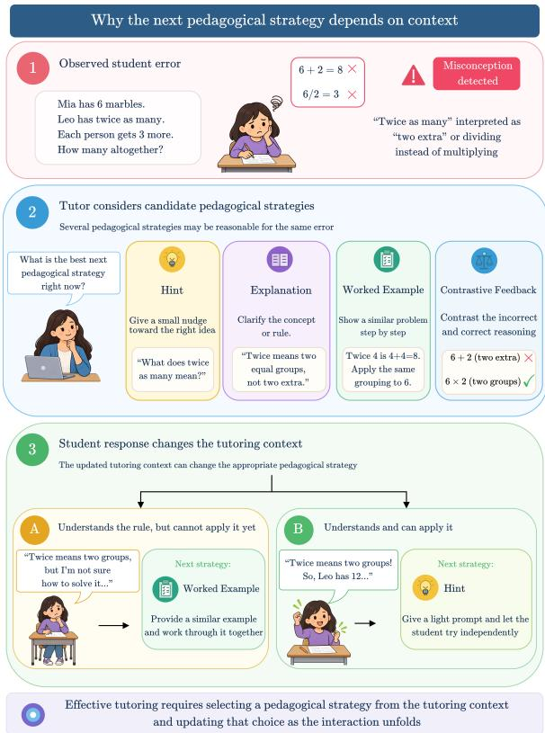
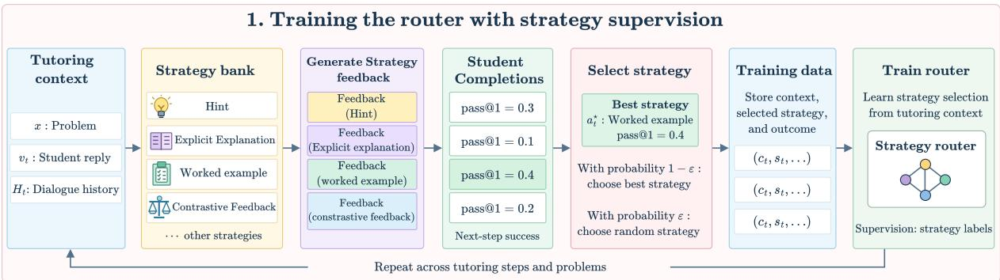
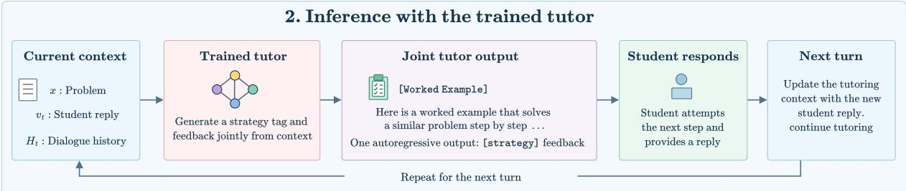
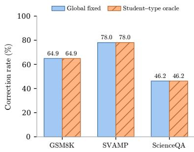
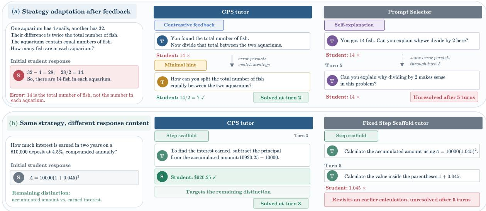
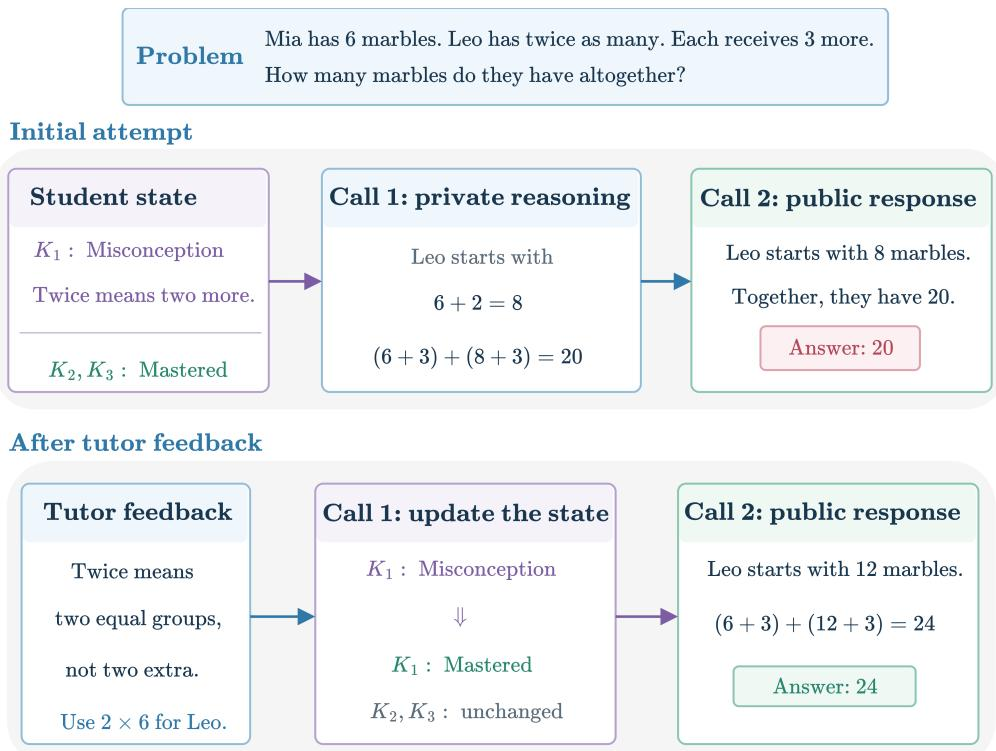
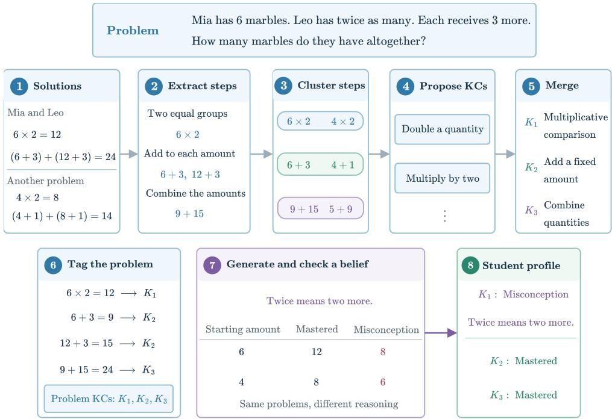
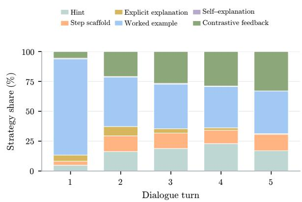
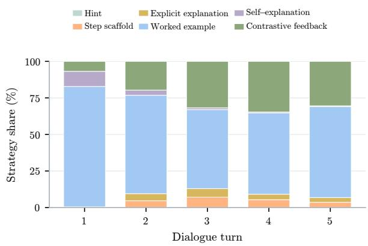
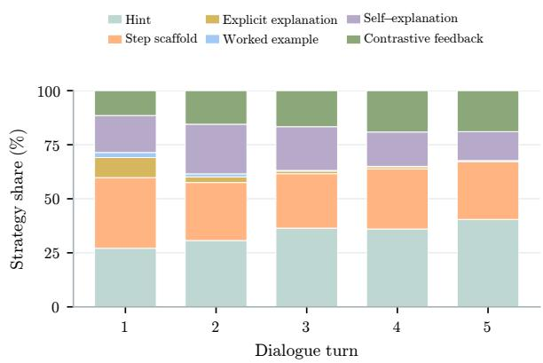

# AdaTutor: Adaptive Tutoring through Pedagogical Strategy Selection

Rajeev Bhatt Ambati UNC Chapel Hill ambati@cs.unc.edu

Shashank Srivastava UNC Chapel Hill ssrivastava@cs.unc.edu

Snigdha Chaturvedi UNC Chapel Hill snigdha@cs.unc.edu

## Abstract

Effective tutoring requires determining not only what information to provide, but also which form of assistance to deliver. A tutor may ad dress the same student error using various pedagogical strategies, adapting its approach as the interaction progresses. We introduce Comparative Pedagogical Supervision (CPS), a train ing framework to learn to select the optimal strategy and feedback for student learning. We evaluate CPS on math and science reasoning datasets. After five tutoring turns, CPS outperforms the strongest fixed-strategy baselines. The learned tutor transfers across datasets, and its strategy selection can also inform a separate API-based tutor.

## 1 Introduction

Intelligent Tutoring Systems (ITS) must balance instructional support with opportunities for independent problem solving, a challenge known as the assistance dilemma (Koedinger and Aleven, 2007). Research in cognitive science shows that the level of support needed varies as students progress (Salden et al., 2009), and identifies distinct forms of assistance such as hints, scaffolding, worked examples, and self-explanation (VanLehn, 2006; Wood et al., 1976; Chi et al., 1989). Tutors built on Large Language Models (LLMs) must therefore decide not only what information to provide, but also which form of assistance suits a student’s misconception and progress.

For example, Figure 1 depicts a student who initially misinterprets the phrase ”twice as many.” As the student’s responses reveal progress or continuing difficulties, the tutor should reconsider which pedagogical strategy to use next. A student who understands the relationship but cannot apply it may benefit from a WORKED EXAMPLE illustrating the concept, whereas a student who applies it correctly may require only a HINT for the remaining steps.

  
Figure 1: Pedagogical strategy varies according to the tutoring context: Depending on the student’s response, further support may be provided through a WORKED EXAMPLE or a HINT for subsequent steps.

LLMs make it easier to generate various forms of pedagogical assistance. Recent studies use pedagogical dialogues and error-grounded supervision (Macina et al., 2023; Sonkar et al., 2024b; Daheim et al., 2024). Other approaches train tutors to provide effective guidance (Scarlatos et al., 2025; Dinucu-Jianu et al., 2025) and learn to select tutoring actions or prompts (Nam et al., 2025; Chang et al., 2026a). The appropriate strategy depends on the student’s current work and how the interaction has progressed. Our key idea is to adapt the pedagogical strategy at each turn based on the student’s progress and remaining difficulties.

To train AdaTutor, we introduce Comparative Pedagogical Supervision (CPS). At each tutoring context, the tutor generates its response conditioned on a jointly identified pedagogical strategy. We use six pedagogical strategies grounded in cognitive science research: HINT, STEP SCAFFOLD, EXPLICIT EXPLANATION, WORKED EXAMPLE, SELF-EXPLANATION, and CONTRASTIVE FEED-BACK (Section 3.3). To train the tutor, we use an LLM to generate one response for each of the six strategies. We then use independent simulated student samples to estimate the probability of solving the problem following each response. The strategy-response pairs with the highest probability are then used to supervise the tutor. It generates a [strategy] response sequence in one call. The strategy tag makes this choice interpretable, and supervision eliminates the need for candidate selection during inference.

On the GSM8K, SVAMP, and ScienceQA datasets, CPS improves final accuracy by 6.3, 2.6, and 10.1 percentage points, respectively, compared to the strongest fixed-strategy tutors after five tutoring turns. Subsequent analyses investigate the specific contributions of dialogue context, strategy selection, and response generation. Additionally, CPS demonstrates transferability across datasets. On a GSM8K subset, integrating its learned strategy selection with GPT-4.1-mini improves final accuracy by 7.3 percentage points over the strongest fixed-strategy API tutors.

Our contributions are:

• We introduce CPS, a framework to train AdaTutor that adapts its pedagogical strategy to the student’s progress and difficulties.

• We demonstrate improved tutoring across three datasets and multiple students, with analyses of dialogue context, strategy selection, and response generation.

• We further demonstrate cross-dataset transfer and show that strategy selection learned by CPS improves the performance of an independent API tutor.

## 2 Previous Work

Pedagogical Feedback and Remediation: Pedagogical dialogue datasets and training objectives facilitate the generation of instructional responses. MathDial provides annotations of mathematical tutoring dialogues with teacher moves (Macina et al., 2023). Pedagogical Alignment promotes scaffolded guidance using preference-based training (Sonkar et al., 2024b). SocraticLM is trained on Socratic dialogues that involve six distinct student types (Liu et al., 2024). For error remediation, Daheim et al. (2024) ground responses in stepwise verification of student reasoning. AdaTutor instead compares responses from each strategy based on their impact on subsequent student outcomes.

Training Tutoring Policies: Scarlatos et al. (2025) evaluate candidate responses based on predicted student correctness and a pedagogical rubric, subsequently training models with DPO. TutorRL employs multi-turn RL to balance student task success with pedagogical support (Dinucu-Jianu et al., 2025). Nam et al. (2025) develop long-horizon policies for high-level tutoring actions derived from compact student representations. Learning to Prompt selects session-level pedagogical prompts using topic and subject information (Chang et al., 2026a), while LEAP generates scaffolding plans from inferred cognitive states (Dong et al., 2026).

CPS constructs supervision using alternative feedback from each strategy within the same tutoring context. The optimal strategy–feedback pairs are then used to train a tutor that jointly generates a strategy and feedback at each turn.

## 3 Method

At each tutoring turn, CPS selects a pedagogical strategy based on the student’s work and the preceding exchanges. We train these choices by comparing feedback from different strategies at the same point in the dialogue. The student’s answers after each feedback message determine which strategy and feedback to use as a training target (Figure 2).

## 3.1 Problem Setup

Let x denote a problem, r its full reference solution with intermediate steps, and y its final reference answer. Before tutor turn t, the public dialogue history is $H _ { t }$ . The tutor receives the tutoring context $c _ { t } = ( x , r , H _ { t } )$ and produces feedback $u _ { t } .$ . The student receives the problem, public dialogue, and tutor feedback. It then produces a public reply $v _ { t }$ and a separate answer to the original problem x. We check that answer against y. Each multi-turn interaction ends when the student answers correctly or reaches a budget of T tutor turns.



  
Figure 2: Overview of CPS: During training, we sample one feedback for each pedagogical strategy from the tutor. Independent student attempts measure how often each strategy leads to a correct answer. A strategy and its feedback provide supervision when its score is positive and strictly higher than others. A separate exploration policy selects the strategy used to continue the multi-turn interaction. At inference, CPS generates a ’[strategy] feedback’ in one call. strategy tag helps with interpretability.

## 3.2 Pedagogical Strategies

Pedagogical research has long studied how different forms of tutoring assistance affect student learning. They differ in how much of the reasoning the tutor provides. A MINIMAL HINT directs attention to the relevant concept and leaves the next step to the student (VanLehn, 2006; Aleven et al., 2003). A STEP SCAFFOLD breaks the next step into smaller actions (Wood et al., 1976). An EXPLICIT EXPLA-NATION states the relevant rule and the reasoning behind it (Wittwer and Renkl, 2008). A WORKED EXAMPLE demonstrates the same reasoning on an analogous problem (Salden et al., 2009). SELF-EXPLANATION asks the student to justify their own reasoning (Chi et al., 1989). CONTRASTIVE FEEDBACK compares the student’s incorrect reasoning with a correct alternative (Daheim et al., 2024). These strategies span low and high levels of assistance, which reflects the assistance dilemma (Koedinger and Aleven, 2007). They also address different sources of misconceptions. Appendix A provides definitions and examples.

## 3.3 Comparative Pedagogical Supervision

Strategy generation and scoring: Let A be the set of six pedagogical strategies described in the previous section. Let $\mathcal { M } _ { 0 }$ denote the base tutor model before our supervised training. At each tutoring context $c _ { t }$ where the problem remains unsolved, we prompt $\mathcal { M } _ { 0 }$ to generate one feedback $u _ { t } ^ { ( a ) }$ for each strategy $a \in { \mathcal { A } }$ . For each feedback $u _ { t } ^ { ( a ) }$ , we sample K independent student attempts at the original problem x. Every attempt starts with the same student and public dialogue $H _ { t }$ , followed by that strategy’s feedback. The score $q _ { t } ( a )$ for strategy a is the fraction of these attempts with a correct answer(pass@1). E.g., seven correct answers among ten attempts give a score of 0.7. These attempts are used only to compare the strategies.

Supervised targets: We retain a training example when one strategy has a positive score strictly higher than every other strategy. Let $a _ { t } ^ { \star }$ denote this strategy. The training input is $c _ { t } .$ , and the target contains the strategy tag $a _ { t } ^ { \star }$ followed by its feedback $u _ { t } ^ { ( a _ { t } ^ { \star } ) }$ . The target therefore has the format [strategy] feedback. The strategy tag helps with interpretability.

Multi-turn Supervision: To train adaptation over multiple turns, we continue the interactions to collect examples from different strategies. We choose the highest-scoring strategy with probability $1 - \varepsilon .$ , and with probability ε, we randomly choose from other strategies. We deliver its feedback $u _ { t }$ to the student and obtain a fresh reply $v _ { t }$ We append both messages to $H _ { t }$ to form $H _ { t + 1 }$ , then compare strategies again at the updated context $c _ { t + 1 }$ . The supervised target still uses the highestscoring strategy, even when a different strategy continues the multi-turn interaction. This separates the choice of training target from the choice of which tutoring situations to encounter next. Appendix E examines target selection, exploration, and the number of student attempts used for comparison.

Training and inference: We fine-tune $\mathcal { M } _ { 0 }$ on the resulting tutoring contexts and their strategy– feedback targets. At inference, CPS receives $c _ { t }$ and generates a strategy tag followed by tutor feedback $u _ { t }$ in one call. Only the feedback is delivered to the student, and the tag is retained for analysis. After the student replies, CPS selects the next strategy using the updated dialogue. AdaTutor thus adapts as the student progresses.

## 4 Implementation Details

Stateful Student Simulator: Prompted LLM students can abandon an assigned misconception after feedback that does not address it (Do et al., 2026). This makes it difficult to attribute apparent progress to the tutor’s assistance. Motivated by prior work advocating explicit representations of student knowledge (Yuan et al., 2026), we use a stateful LLM-based student simulator. We separate knowledge updates from response generation, drawing on the approach of Chang et al. (2026b). This lets us compare alternative tutor responses from the same dialogue and recorded knowledge state.

The student uses knowledge component (KC). It is a reusable knowledge or concept needed for a reasoning step (Corbett and Anderson, 1994). We build a separate KC library for each domain from training problems and reference solutions, drawing on previous work on automated KC generation and tagging (Duan et al., 2026). For this, we split solutions into reasoning steps and cluster similar steps. We then identify KCs within each cluster and merge overlapping candidates. For selected KCs, we generate incorrect beliefs to construct the misconception students (Sonkar et al., 2024a; Do et al., 2026). The library remains fixed during tutoring. We assign each student a simple profile specifying which KCs are mastered, unmastered, or associated with an incorrect belief. Knowledge-gap students have unmastered KCs, misconception students hold incorrect beliefs about particular KCs, and mixed students have both knowledge gaps and misconceptions.

The student’s state records the current status of the KCs needed for a problem. For example, it may mark addition as mastered but interpreting ”twice as many” as a misconception, with the belief ”twice means two more.” We initialize this state from the student’s profile. After tutor feedback, two LLM calls run sequentially. The first proposes an updated state based on the feedback. The second generates an answer and a public response conditioned on the state. The state remains fixed during the second call, and only the public response is added to the tutor’s dialogue. We check whether responses reflect the assigned state and how they change under different feedback. Appendix B provides more details on KC library construction, misconception generation, and student profiles.

Models and interaction protocol: We use Qwen2.5-32B-Instruct, and Qwen2.5-7B-Instruct (Qwen et al., 2025) for student and teacher respectively. All methods begin from the same saved initial student response for each profile and problem, with subsequent responses sampled independently. Each interaction allows at most five tutor turns and ends when the student correctly answers the original problem or reaches the turn limit.

Data collection and training: We sample $K =$ 10 independent student attempts to score each candidate response and use ε = 0.5 for exploratory continuation. We train a separate CPS tutor for each dataset using LoRA. We provide all prompts in Appendix G.

## 5 Experiments

Datasets and student profiles: We evaluate on math reasoning on GSM8K (Cobbe et al., 2021) and SVAMP (Patel et al., 2021). ScienceQA (Lu et al., 2022) contains MCQ’s in natural science, social science, and language. We construct 5 student profiles for each of the three student types, amounting to 15 profiles for each dataset.

Baselines and evaluation metrics: We compare CPS with six Fixed-Strategy Tutors that always use a fixed strategy irrespective of the tutoring context. We also compare with PROMPT SELECTOR, where the tutor is provided all the six strategies and prompted to select the most appropriate strategy for the context. We also compare with SocraticLM (Liu et al., 2024), and TutorRL (Dinucu-Jianu et al., 2025).

We report Cumulative accuracy $( A _ { t } )$ to measure the fraction of student–problem pairs solved by turn t. We also report Correction rate, defined as the fraction of initially incorrect pairs that are solved by five turns. See Appendix C for additional details on the experimental setup for reproducing the results. Appendix F evaluates student responses for consistency with assigned knowledge, tests whether student knowledge updates improve performance on new problems, and tutor responses for strategy adherence, correctness, and answer disclosure.

## 6 Results and Analysis

## 6.1 Main Tutoring Performance

CPS achieves the highest final accuracy among the evaluated tutors, reaching 72.7%, 82.5%, and 64.1% on GSM8K, SVAMP, and ScienceQA after five tutoring turns (Table 1). WORKED EX-AMPLE is the strongest fixed strategy on GSM8K and SVAMP, while CONTRASTIVE FEEDBACK is strongest on ScienceQA. CPS exceeds these fixed strategies by 6.3, 2.6, and 10.1 percentage points, respectively. It also outperforms the PROMPT SE-LECTOR on all three datasets.

Compared with TUTORRL, the gains are 10.4 points on GSM8K, 8.2 on SVAMP, and 3.5 on ScienceQA. The corresponding gains over SOCRATI-CLM are 9.8, 13.5, and 7.5 points. These results show that adaptively selecting pedagogical strategies is better than using a fixed strategy, as well as RL-based and Socratic methods. The strongest alternative is WORKED EXAMPLE on GSM8K and SVAMP, and TUTORRL on ScienceQA. The 95% confidence intervals for CPS’s gains over these alternatives are [4.51, 8.05], [0.73, 4.48], and [1.63, 5.44] percentage points, respectively. Paired tests grouped by problem support all three comparisons after Holm correction across the 27 baseline comparisons $( p < 0 . 0 1 )$ ).

## 6.2 Which Strategies does CPS select?

The strong fixed-strategy baselines raise a question: does CPS mainly learn a preferred strategy, assign a strategy to each student type, or vary its choices during the dialogue?

Strategy effectiveness across student types: Table 2 compares correction rates for knowledge-gap, misconception, and mixed students. The same fixed strategy is strongest for all three types within each dataset: WORKED EXAMPLE on GSM8K and SVAMP, and CONTRASTIVE FEEDBACK on ScienceQA. CPS improves on the strongest fixed strategy in eight of the nine comparisons. Its largest gains occur for misconception students: 11.5 points on GSM8K, 6.2 on SVAMP, and 20.4 on ScienceQA. For knowledge-gap students on SVAMP, WORKED EXAMPLE reaches 90.9%, compared with 90.2% for CPS.

<table><tr><td colspan="4">Tutor GSM8K SVAMP ScienceQA</td></tr><tr><td>Initial accuracy  $( A _ { 0 } )$ </td><td>4.3</td><td>8.5</td><td>14.4</td></tr><tr><td>HINT</td><td>8.4</td><td>16.3</td><td>41.7</td></tr><tr><td>STEP SCAFFOLD</td><td>32.6</td><td>32.8</td><td>51.8</td></tr><tr><td>EXPLICIT EXPLANATION</td><td>48.9</td><td>31.3</td><td>50.0</td></tr><tr><td>WORKED EXAMPLE</td><td>66.4</td><td>79.9</td><td>48.7</td></tr><tr><td>SELF-EXPLANATION</td><td>7.3</td><td>16.5</td><td>40.6</td></tr><tr><td>CONTRASTIVE FEEDBACK</td><td>23.0</td><td>18.8</td><td>54.0</td></tr><tr><td>TUTORRL (Dinucu-Jianu et al., 2025)</td><td>62.3</td><td>74.3</td><td>60.6</td></tr><tr><td>SOCRATICLM (Liu et al., 2024)</td><td>62.9</td><td>69.0</td><td>56.6</td></tr><tr><td>PROMPT SELECTOR</td><td>18.1</td><td>34.8</td><td>50.7</td></tr><tr><td>CPS tutor</td><td>72.7</td><td>82.5</td><td>64.1</td></tr><tr><td>CPS gain over  $A _ { 0 }$ </td><td>+68.3</td><td>+74.0</td><td>+49.7</td></tr><tr><td>CPS correction rate</td><td>71.4</td><td>80.9</td><td>58.0</td></tr></table>

Table 1: Final cumulative accuracy $A _ { 5 }$ (%) unless otherwise indicated. The final two rows give $\mathbf { \vec { \mathrm { C P S } } \vec { s } }$ gain over initial accuracy in percentage points and its correction rate (%). Bold marks the highest final accuracy and underlining identifies the strongest fixed strategy. Differences are computed before rounding.

<table><tr><td>Dataset</td><td>Knowledge gap Misconception</td><td></td><td>Mixed</td></tr><tr><td>GSM8K</td><td> $8 8 . 3  8 9 . 3 $ </td><td> $\mathbf { 4 0 . 5  5 2 . 0 }$ </td><td> $6 3 . 7  7 1 . 3$ </td></tr><tr><td>SVAMP</td><td> ${ \bf 9 0 . 9  9 0 . 2 }$ </td><td> $7 0 . 4  7 6 . 5$ </td><td> $7 1 . 1  7 4 . 6$ </td></tr><tr><td>ScienceQA</td><td> $4 5 . 6 \to 5 3 . 7$ </td><td> $4 7 . 3  6 7 . 7 $ </td><td> $4 5 . 9  5 4 . 2$ </td></tr></table>

Table 2: Correction rates (%) by student type: Each cell shows the strongest fixed-strategy tutor followed by CPS, with the higher value in bold. WORKED EXAM-PLE is strongest across types on GSM8K and SVAMP. CONTRASTIVE FEEDBACK is strongest across types on ScienceQA. Differences are computed before rounding.

Applying a fixed strategy per student type: We next ask whether assigning a different fixed strategy to each student type is enough. We construct a student-type oracle that selects the strongest fixed strategy separately for each type using the test outcomes. The oracle selects the same strategy for every type within each dataset. It therefore matches the globally strongest fixed strategy, with correction rates of 64.9%, 78.0%, and 46.2% on GSM8K, SVAMP, and ScienceQA (Figure 3). CPS reaches 71.4%, 80.9%, and 58.0%, respectively. Assigning a fixed strategy by student type therefore leaves a gap relative to CPS. We next examine its choices at individual dialogue turns.

  
Figure 3: Correction rates for the student-type oracle and CPS. The oracle uses test outcomes to choose a fixed strategy for each student type and matches the globally strongest fixed strategy within each dataset.

Strategy selection across tutoring turns: On GSM8K, WORKED EXAMPLE accounts for 80.5% of first-turn choices and 35.7% at turn five. By turn five, CONTRASTIVE FEEDBACK, HINT, and STEP SCAFFOLD account for 32.9%, 17.0%, and 13.7%, respectively. On SVAMP, WORKED EXAMPLE remains the most frequent strategy, decreasing from 82.4% to 62.2%, while CONTRASTIVE FEEDBACK increases from 6.8% to 30.4%. ScienceQA shows a different pattern. STEP SCAFFOLD and HINT account for 32.7% and 27.1% of first-turn choices. HINT becomes the most frequent strategy at turn five, at 40.4%. The changing mix of demonstrations, corrections, and hints illustrates the choice among forms of assistance raised by the assistance dilemma. Choices also differ across interactions at the same turn number. See Appendix for Figures 7 (GSM8K), 8(SVAMP) and 9(ScienceQA).

## 6.3 Does Context Help Strategy Selection?

We first examine how consecutive strategy choices are related. We then test whether access to the dialogue helps the tutor select strategies and generate useful feedback.

Consecutive strategy choices: Across datasets, adjacent tutor turns use different strategies in 54.3– 62.3% of comparisons. Among sessions reaching at least two tutor turns, 67.3–84.9% include a strategy change (Table 3). Conditional mutual information between consecutive choices ranges from

0.08 to 0.19 bits after accounting for student type and turn. This describes an association between successive choices beyond those two variables.
<table><tr><td>Dataset Switch Rate (%)</td><td></td><td>Sessions (%)</td><td>Cond. MI (bits)</td></tr><tr><td>GSM8K</td><td>62.3</td><td>79.2</td><td>0.17</td></tr><tr><td>SVAMP</td><td>54.3</td><td>67.3</td><td>0.08</td></tr><tr><td>ScienceQA</td><td>56.0</td><td>84.9</td><td>0.19</td></tr></table>

Table 3: Strategy changes during tutoring. Switch rate uses adjacent tutor-turn pairs. Sessions with a switch uses sessions that reach at least two tutor turns. Conditional mutual information measures the association between consecutive strategies after accounting for student type and turn.

Contribution of dialogue context: We now test whether dialogue context also adds to tutoring performance. For each dataset, we train four tutors that differ in the dialogue they receive: the full history, the latest tutor–student exchange, the latest student reply, or no dialogue. All four receive the problem and reference solution. Each restriction applies during both training and inference.

<table><tr><td>Context</td><td>GSM8K</td><td>SVAMP</td><td>ScienceQA</td></tr><tr><td>Full history</td><td>72.7</td><td>80.2</td><td>63.9</td></tr><tr><td>Latest exchange</td><td>72.8</td><td>78.1</td><td>65.4</td></tr><tr><td>Latest student reply</td><td>72.4</td><td>79.2</td><td>65.2</td></tr><tr><td>Problem only</td><td>50.6</td><td>72.3</td><td>66.7</td></tr></table>

Table 4: Final accuracy $A _ { 5 }$ (%) with different amounts of dialogue context. All variants receive the problem and reference solution and are trained separately under the same checkpoint-selection rule. Bold marks the highest accuracy per dataset. Differences are computed before rounding.

Dialogue improves tutoring on both arithmetic datasets (Table 4). On GSM8K, removing it lowers accuracy from 72.7% to 50.6%, a decrease of 22.2 points. Using only the latest exchange reaches 72.8%, close to the full-history result. On SVAMP, full history reaches 80.2%, compared with 72.3% for the problem-only tutor, a difference of 8.0 points. ScienceQA instead favors the problemonly tutor, which reaches 66.7% against 63.9% with full history. The best amount of dialogue context therefore differs across datasets.

## 6.4 What Does CPS Learn?

CPS learns both which strategy to select and what feedback to provide. To examine their contributions, we compare the first tutor turn, when the methods receive the same initial student reply. For each initially incorrect case, we take the strategy selected by CPS or the PROMPT SELECTOR and use the corresponding fixed-strategy tutor’s feedback. Both methods then use the same feedback for a given strategy and context, allowing us to compare their choices. We also evaluate each method’s own generated feedback.

With fixed-strategy feedback, CPS improves first-turn correction over the PROMPT SELECTOR by 34.1, 33.8, and 13.8 points on GSM8K, SVAMP, and ScienceQA (Table 5). Using CPS’s own feedback adds 2.1, 3.5, and 7.9 points, respectively. In these first-turn comparisons, the difference associated with strategy selection is larger, while response generation provides a further improvement.

<table><tr><td>Dataset</td><td>Tutor</td><td>Fixed (%) Own (%)</td><td></td></tr><tr><td rowspan="2">GSM8K</td><td>PROMPT SELECTOR</td><td>2.9</td><td>4.7</td></tr><tr><td>CPS</td><td>37.0</td><td>39.1</td></tr><tr><td rowspan="2">SVAMP</td><td>PROMPT SELECTOR CPS</td><td>9.2</td><td>13.8</td></tr><tr><td></td><td>43.0</td><td>46.6</td></tr><tr><td rowspan="2">ScienceQA</td><td>PROMPT SELECTOR</td><td>21.9</td><td>27.7</td></tr><tr><td>CPS</td><td>35.6</td><td>43.5</td></tr></table>

Table 5: First-turn correction rates among initially incorrect cases. Fixed response uses feedback from the fixed-strategy tutor corresponding to the selected strategy. Own response uses each method’s generated feedback. Differences are computed before rounding.

## 6.5 Qualitative Examples

Figure 4 illustrates two complementary behaviors. In (a), CPS changes its pedagogical strategy after the initial feedback does not resolve the student’s error. In (b), the comparison shows that the effectiveness of a strategy also depends on how it is realized. Both tutors use STEP SCAFFOLD, but CPS targets the student’s remaining error while the fixed-strategy tutor continues scaffolding an earlier calculation.

## 6.6 Transfer Across Datasets and Tutors

The previous analyses examine tutoring within each dataset. We now test whether the learned tutoring behavior transfers to another dataset and whether the strategy choices can guide a different tutor model.

Cross-dataset transfer: We evaluate each trained CPS tutor on the other two datasets without further training or checkpoint selection on the target dataset. For each target, all tutors use the same student profiles, problems, initial replies, and five-turn budget. Table 6 reports final accuracy.

Transfer is strongest between GSM8K and SVAMP. The SVAMP-trained tutor reaches 75.5% on GSM8K, compared with 72.7% for the GSM8Ktrained tutor and 66.4% for the strongest fixed strategy. In the reverse direction, the GSM8K-trained tutor reaches 78.7% on SVAMP, 3.8 points below the in-domain tutor and 1.2 points below the strongest fixed strategy. These arithmetic datasets also share the same KC library and student profiles.

Transfer between arithmetic and ScienceQA yields lower accuracy. Tutors trained on GSM8K and SVAMP reach 49.1% and 51.1% on ScienceQA, compared with 64.1% for the ScienceQAtrained tutor. The ScienceQA-trained tutor reaches 33.5% on GSM8K and 31.1% on SVAMP. This difference is expected given the differences between the domains. Arithmetic and science involve different reasoning patterns, student difficulties, and misconceptions, which may require different pedagogical strategies. The stronger transfer between GSM8K and SVAMP suggests that the learned tutoring behavior transfers best when the source and target domains share similar student needs.

<table><tr><td>Source dataset</td><td>GSM8K SVAMP</td><td></td><td>ScienceQA</td></tr><tr><td>GSM8K</td><td>72.7</td><td>78.7</td><td>49.1</td></tr><tr><td>SVAMP</td><td>75.5</td><td>82.5</td><td>51.1</td></tr><tr><td>ScienceQA</td><td>33.5</td><td>31.1</td><td>64.1</td></tr><tr><td>Strongest fixed</td><td>66.4</td><td>79.9</td><td>54.0</td></tr><tr><td>strategy</td><td></td><td></td><td></td></tr></table>

Table 6: Cross-dataset final accuracy $A _ { 5 }$ (%). Rows identify the tutor’s training dataset. Columns identify the evaluation dataset. Underlining denotes in-domain evaluation, and bold marks the highest trained-tutor accuracy per target. The target’s strongest fixed strategy is shown for comparison.

Transfer to an API tutor: To test whether learned strategy choices can guide a different response generator, we pair a GSM8K-trained CPS tutor with GPT-4.1-mini. At each turn, we use only CPS’s strategy tag and ask GPT-4.1-mini to generate the feedback. The comparison includes six fixed-strategy tutors and the PROMPT SELECTOR, all using GPT-4.1-mini to generate feedback. To save cost, we use 247 GSM8K examples for this experiment.

With CPS’s strategy choices, GPT-4.1-mini reaches 89.9% final accuracy, at least 7.3 points above every fixed-strategy tutor (Table 7). Relative to the API PROMPT SELECTOR, the gain is 5.3 points after one turn, with a paired 95% confidence interval of [1.2, 9.7]. The final gain is 2.0 points, with an interval of [−2.0, 6.1]. The clearest advantage is therefore over fixed strategies and in the first-turn comparison with prompted selection.

  
Figure 4: Qualitative tutoring examples: (a) CPS changes from CONTRASTIVE FEEDBACK to HINT after the initial intervention does not resolve the student’s error, while the PROMPT SELECTOR continues eliciting explanation of the same incorrect step. (b) Both tutors use STEP SCAFFOLD, but CPS targets the student’s remaining confusion between accumulated amount and earned interest, while the fixed-strategy tutor continues scaffolding an earlier calculation. Strategy labels are retained for analysis but are not shown to the student.

The benefit also varies by student type. For misconception students, CPS’s strategy choices yield 91.6% final accuracy, compared with 84.2% for the API PROMPT SELECTOR. The methods tie at 86.4% for knowledge-gap students. For mixed students, they reach 92.2% and 95.3%, respectively.

<table><tr><td>Tutor</td><td> $A _ { 1 }$   $A _ { 5 }$ </td><td>Correction (%)</td></tr><tr><td>STEP SCAFFOLD</td><td>64.082.6</td><td>58.3</td></tr><tr><td>CONTRASTIVE FEEDBACK</td><td>72.9 82.6</td><td>58.3</td></tr><tr><td>PROMPT SELECTOR</td><td>68.087.9</td><td>70.9</td></tr><tr><td>CPS selection + API</td><td>73.3 89.9</td><td>75.7</td></tr></table>

Table 7: Strategy selection with GPT-4.1-mini as the response generator (%). This earlier GSM8K study uses 247 assignments with $A _ { 0 } = 5 8 . 3 \%$ , rather than the current main evaluation. The two strongest fixed strategies are shown. Differences are computed before rounding.

## 6.7 Response Quality Evaluation

We use an LLM Judge to evaluate 270 initial student replies, 180 replies during tutoring, and 180 fixed-strategy tutor responses on GSM8K. It judges

95.0% of tutor responses mathematically correct and identifies no correct final-answer disclosure. On examples also rated by humans, the agreement is 84.0% for student-KC judgments and 95.0% for tutor strategy and correctness judgments. We also test whether student-state updates help on new problems. Using the state after relevant feedback raises accuracy on 300 new GSM8K problems that need the same KCs, from 5.0% to 67.7%, with the teaching dialogue removed and model parameters fixed. See Appendix F for more details.

## 7 Conclusion

We introduced CPS, a framework to train a tutor to adapt its pedagogical strategy to the student’s work and the preceding dialogue. We train it by comparing feedback that uses different strategies at the same point in a tutoring session. The selected strategy and feedback provide supervision for a tutor that chooses a strategy and generates its response in one call. Experiments on GSM8K, SVAMP, and ScienceQA show significant improvements over the strongest alternative tutor after five turns. Firstturn comparisons show contributions from both learned strategy choices and feedback generation. Its learned strategy choices also improve tutoring with GPT-4.1-mini over fixed strategies. These findings support adapting the form of assistance to the current tutoring context rather than retaining one strategy throughout a session.

## Limitations

Our experiments provide an efficient testbed for comparing pedagogical strategies with simulated students. Current results do not demonstrate human learning.

## Acknowledgments

## References

Vincent Aleven, Elmar Stahl, Silke Schworm, Frank Fischer, and Raven Wallace. 2003. Help seeking and help design in interactive learning environments. Review of Educational Research, 73(3):277–320.

Po-Chin Chang, Nicholas Hogan, Aske Plaat, and Michiel T. van der Meer. 2026a. Learning to prompt: Improving student engagement with adaptive LLM-based high-school tutoring. arXiv preprint arXiv:2606.20138.

Qikai Chang, Zhenrong Zhang, Linbo Chen, Pengfei Hu, Jianshu Zhang, Youhui Guo, and Jun Du. 2026b. PEARL: Training socratic tutors with pedagogically aligned reinforcement learning. arXiv preprint arXiv:2605.29582.

Michelene T. H. Chi, Miriam Bassok, Matthew W. Lewis, Peter Reimann, and Robert Glaser. 1989. Selfexplanations: How students study and use examples in learning to solve problems. Cognitive Science, 13(2):145–182.

Karl Cobbe, Vineet Kosaraju, Mohammad Bavarian, Mark Chen, Heewoo Jun, Lukasz Kaiser, Matthias Plappert, Jerry Tworek, Jacob Hilton, Reiichiro Nakano, Christopher Hesse, and John Schulman. 2021. Training verifiers to solve math word problems. arXiv preprint arXiv:2110.14168.

Albert T. Corbett and John R. Anderson. 1994. Knowledge tracing: Modeling the acquisition of procedural knowledge. User Modeling and User-Adapted Interaction, 4:253–278.

Nico Daheim, Jakub Macina, Manu Kapur, Iryna Gurevych, and Mrinmaya Sachan. 2024. Stepwise verification and remediation of student reasoning errors with large language model tutors. In Proceedings of EMNLP 2024, pages 8386–8411.

David Dinucu-Jianu, Jakub Macina, Nico Daheim, Ido Hakimi, Iryna Gurevych, and Mrinmaya Sachan. 2025. From problem-solving to teaching problemsolving: Aligning LLMs with pedagogy using reinforcement learning. In Proceedings of the 2025 Conference on Empirical Methods in Natural Language Processing, pages 272–292, Suzhou, China. Association for Computational Linguistics.

Heejin Do, Shashank Sonkar, and Mrinmaya Sachan. 2026. Simulating students or sycophantic problem solving? on misconception faithfulness of LLM simulators. arXiv preprint arXiv:2605.12748.

Zhiang Dong, Zhenlong Dai, Xiangwei Lv, and Jingyuan Chen. 2026. Learning from long-term engagement: Adaptive tutoring dialogue planning for personalized education. In Proceedings of the AAAI Conference on Artificial Intelligence, volume 40, pages 237–245.

Zhangqi Duan, Nigel Fernandez, Arun Balajiee Lekshmi Narayanan, Mohammad Hassany, Rafaella Sampaio de Alencar, Peter Brusilovsky, Bita Akram, and Andrew Lan. 2026. Automated knowledge component generation and interpretable knowledge tracing in coding problems. In Findings of the Association for Computational Linguistics: ACL 2026, pages 33405–33423. Association for Computational Linguistics.

Kenneth R. Koedinger and Vincent Aleven. 2007. Exploring the assistance dilemma in experiments with cognitive tutors. Educational Psychology Review, 19:239–264.

Jiayu Liu, Zhenya Huang, Tong Xiao, Jing Sha, Jinze Wu, Qi Liu, Shijin Wang, and Enhong Chen. 2024. SocraticLM: Exploring socratic personalized teaching with large language models. In Advances in Neural Information Processing Systems, volume 37.

Pan Lu, Swaroop Mishra, Tony Xia, Liang Qiu, Kai-Wei Chang, Song-Chun Zhu, Oyvind Tafjord, Peter Clark, and Ashwin Kalyan. 2022. Learn to explain: Multimodal reasoning via thought chains for science question answering. In The 36th Conference on Neural Information Processing Systems (NeurIPS).

Jakub Macina, Nico Daheim, Sankalan Chowdhury, Tanmay Sinha, Manu Kapur, Iryna Gurevych, and Mrinmaya Sachan. 2023. MathDial: A dialogue tutoring dataset with rich pedagogical properties grounded in math reasoning problems. In Findings of the Association for Computational Linguistics: EMNLP 2023, pages 5602–5621.

HyunJi Nam, Omer Gottesman, Amy Zhang, Dean Foster, Emma Brunskill, and Lyle Ungar. 2025. Efficient reinforcement learning for optimizing multiturn student outcomes with LLM tutors. In First Workshop on Multi-Turn Interactions in Large Language Models.

Arkil Patel, Satwik Bhattamishra, and Navin Goyal. 2021. Are NLP models really able to solve simple math word problems? In Proceedings of the 2021 Conference of the North American Chapter of the Association for Computational Linguistics: Human Language Technologies, pages 2080–2094, Online. Association for Computational Linguistics.

Qwen, An Yang, Baosong Yang, Beichen Zhang, Binyuan Hui, et al. 2025. Qwen2.5 technical report. arXiv preprint arXiv:2412.15115.

Ron J. C. M. Salden, Vincent A. W. M. M. Aleven, Alexander Renkl, and Rolf Schwonke. 2009. Worked examples and tutored problem solving: Redundant or synergistic forms of support? Topics in Cognitive Science, 1(1):203–213.

Alexander Scarlatos, Jaewook Lee, Simon Woodhead, and Andrew Lan. 2026. Simulated students in tutoring dialogues: Substance or illusion? In Proceedings of the 64th Annual Meeting of the Association for Computational Linguistics (Volume 1: Long Papers), pages 42349–42385, San Diego, California, United States. Association for Computational Linguistics.

Alexander Scarlatos, Naiming Liu, Jaewook Lee, Richard Baraniuk, and Andrew Lan. 2025. Training LLM-based tutors to improve student learning outcomes in dialogues. In Artificial Intelligence in Education, pages 251–266. Springer Nature Switzerland.

Shashank Sonkar, Xinghe Chen, Naiming Liu, Richard G. Baraniuk, and Mrinmaya Sachan. 2024a. LLM-based cognitive models of students with misconceptions. arXiv preprint arXiv:2410.12294.

Shashank Sonkar, Kangqi Ni, Sapana Chaudhary, and Richard Baraniuk. 2024b. Pedagogical alignment of large language models. In Findings of the Association for Computational Linguistics: EMNLP 2024, pages 13641–13650.

Kurt VanLehn. 2006. The behavior of tutoring systems. International Journal of Artificial Intelligence in Education, 16(3):227–265.

Jörg Wittwer and Alexander Renkl. 2008. Why instructional explanations often do not work: A framework for understanding the effectiveness of instructional explanations. Educational Psychologist, 43(1):49– 64.

David Wood, Jerome S. Bruner, and Gail Ross. 1976. The role of tutoring in problem solving. Journal of Child Psychology and Psychiatry, 17(2):89–100.

Zhihao Yuan, Yunze Xiao, Ming Li, Weihao Xuan, Richard Tong, Mona Diab, and Tom Mitchell. 2026. Towards valid student simulation with large language models. Preprint, arXiv:2601.05473.

## A Pedagogical Strategies

Table 8 defines six pedagogical strategies and illustrates each with an example problem and an initial student response. Each strategy identifies the primary form of assistance, with the specific content varying by tutoring context. These strategies serve as alternatives, not as a prescribed sequence or a fixed mapping from student types to instructional responses.

## B Stateful Student Simulator

The simulator uses a KC library, a small library of screened misconceptions, synthetic student profiles, and a two-call LLM interaction. These components create controlled student conditions for tutor training and evaluation rather than attempting to model the full behavior of human students.

KC library and misconception construction: Knowledge components have long been used to represent fine-grained student knowledge (Corbett and Anderson, 1994). We construct them automatically from training solutions, following the general LLM-based KC generation and problem-tagging approach of Duan et al. (2026). We decompose each reference solution into small reasoning steps. We then cluster steps with similar meaning, propose local KC candidates, and merge synonymous or redundant candidates. We retain recurring KCs and review the resulting library before using it for problem annotation. We then annotate each problem with the KCs it needs using the reference solution. Figure 6 summarizes this procedure.

Not every KC used for problem annotation is used to define students. We retain KCs that occur often enough and are suitable for controlling student knowledge. For these KCs, an LLM proposes several reusable incorrect beliefs. We remove malformed, duplicate, or overly specific candidates and test the remaining beliefs on problems requiring the corresponding KC. Following prior work on simulated students with misconceptions (Sonkar et al., 2024a) and concerns about misconception faithfulness (Do et al., 2026), we retain a misconception only when the student actually follows the intended incorrect belief and its performance decreases relative to a mastered control on the same problems.

Student profiles: A student profile assigns one of three states to the KCs used in the experiment: mastered, unmastered, or misconception. A knowledgegap student has one or more unmastered KCs, a misconception student has one or more assigned incorrect beliefs, and a mixed student has both. We use a fully mastered profile when screening gaps and misconceptions. A profile can contain several deficits, but for a particular problem the student receives only the states of the KCs needed by that problem. State changes persist during that tutoring interaction, and the profile is used again to initialize the next problem. Dataset-specific KCs and profile counts are reported in Appendix C.

Student responses: The student uses two sequential LLM calls, similar in spirit to prior work that separates student state from response generation (Chang et al., 2026b). For the initial attempt, the first call produces private reasoning and an answer under the assigned KC states. The second call turns that fixed result into the public student response. After tutor feedback, the first call decides whether the feedback changes any relevant KC state, and the second attempts the original problem under the resulting state. The runtime checks required fields and state labels but does not execute equations, recover answers from the public response, or repair the model’s mathematics. Only the public response reaches the tutor. The answer to the original problem is checked separately for correctness. Figure 5 shows the interaction and an illustrative state update.

Problem: Mia has 6 marbles. Leo has twice as many. Each person receives 3 more marbles. How many marbles do they have altogether?  
Initial student response: "Leo has 6 + 2 = 8 marbles because ’twice as many’ means two more.”
<table><tr><td>Strategy</td><td>Definition</td><td>Illustrative tutor response</td></tr><tr><td>MINIMAL HINT</td><td>Provide a brief cue directing attention to the relevant concept or relationship, allowing the student to independently determine the subsequent step.</td><td>&quot;Focus on the word &#x27;twice&#x27; when comparing Leo&#x27;s marbles with Mia&#x27;s.&quot;</td></tr><tr><td>STEP SCAFFOLD</td><td>Guide the next step by breaking it into smaller actions or providing a partial setup.</td><td>&quot;First find Leo&#x27;s starting number of marbles. This is two groups of 6. What is  $2 \times 6 ? "$ </td></tr><tr><td>EXPLICIT EXPLANATION</td><td>Explain the relevant concept or rule and the reasoning behind it.</td><td>&quot;’Twice as many&#x27; means two equal groups of the original amount. Multiplication by two expresses this relationship.&quot;</td></tr><tr><td>WORKED EXAMPLE</td><td>Demonstrate the relevant reasoning on an analogous problem with different values. Then, ask the student to apply the same method.</td><td>&quot;Suppose Ana has 4 marbles and Ben has twice as many. Ben has  ${ \overset {  } { 2 } } \times 4 = 8 .$  If each receives 1 more, their total is  $( 4 + 1 ) + ( 8 + 1 ) = 1 4 .$  Apply the same steps to Mia and Leo.&quot;</td></tr><tr><td>SELF- EXPLANATION</td><td>Ask the student to explain or justify their reasoning, making their interpretation explicit.</td><td>&quot;You used 6 + 2. What does adding 2 represent in your reasoning, and why did you choose it for &#x27;twice as many&#x27;?&quot;</td></tr><tr><td>CONTRASTIVE FEEDBACK</td><td>Compare the student&#x27;s incorrect reasoning with a correct alternative and explain the distinction.</td><td>&quot;Your 6 + 2 represents two extra marbles. &#x27;Twice as many&#x27; instead means two groups of 6, represented as 2 × 6. The distinction is adding two objects versus doubling the original group.&quot;</td></tr></table>

Table 8: Definitions and examples of the six pedagogical strategies. Each row illustrates an example response of the respective strategy to the same tutoring context. All strategies withhold the final answer to the original problem.

  
Figure 5: Student simulation: The initial attempt uses one call for private reasoning and another for the public reply. After tutor feedback, one call updates the KC state, and another generates the reply and answer under that state. Only the public reply enters the tutor’s dialogue. The example illustrates the procedure rather than reporting an experimental result

  
Figure 6: Dataset-specific KC construction: We group similar reasoning steps from training solutions, identify reusable KCs, and merge overlapping definitions. The resulting library is used to annotate problems. Incorrect beliefs are checked on problems requiring the corresponding KC before they are included in student profiles. The figure uses an illustrative example.

Simulator checks: LLM students can revert to their underlying competence instead of following assigned gaps or misconceptions (Yuan et al., 2026; Do et al., 2026). Recent work therefore evaluates student simulators beyond surface response quality (Scarlatos et al., 2026). We separately check whether responses follow the active KC states, whether the public response agrees with the returned answer, and whether actual state changes are supported by tutor feedback. Appendix F.1 reports the detailed checks and results. These checks support the simulator as a controlled synthetic en-

vironment.

## C Experimental Setup

Datasets and student profiles: During collection, each problem is paired with one profile containing a relevant knowledge gap or misconception. For evaluation, we use five knowledge-gap, five misconception, and five mixed profiles. GSM8K and SVAMP share the same KC library and profiles. Their knowledge-gap and misconception profiles each contain four affected KCs, while mixed profiles contain two gaps and two misconceptions. We evaluate each profile on 200 distinct problems involving at least one of its assigned gaps or misconceptions. The selected problems can differ across profiles. Table 9, 10 reports the student and dataset statistics.

Models and Interaction Protocol: Table 11 lists the decoding temperatures. In the two-call simulator, state updating and subsequent response generation use separate decoding settings.

Data Collection and Training: The collection and training configuration is selected through GSM8K validation experiments, and each dataset’s checkpoint is selected using final accuracy in fiveturn validation interactions. Table 12 lists the training settings. Appendix E reports the collection and training ablations.

<table><tr><td colspan="3">GSM8K SVAMP ScienceQA</td></tr><tr><td>KCs in annotation library</td><td>34</td><td>34 TBC</td></tr><tr><td>KCs eligible for profile construction</td><td>28</td><td>28 TBC</td></tr><tr><td>Affected KCs per profile</td><td>4</td><td>4 TBC</td></tr><tr><td>Knowledge-gap profiles</td><td>5</td><td>5 5</td></tr><tr><td>Misconception profiles</td><td>5</td><td>5 5</td></tr><tr><td>Mixed profiles</td><td>5</td><td>5 5</td></tr><tr><td>Problems per profile</td><td>200</td><td>200 200</td></tr><tr><td>Test assignments</td><td>3,000 3,000</td><td>3,000</td></tr><tr><td>Unique test problems</td><td>1,289 853</td><td>749</td></tr></table>

Table 9: Current test populations. An assignment pairs a student profile with an applicable problem. The same problem can be evaluated under more than one profile. Mastered controls are used for screening rather than the main tutoring comparison.
<table><tr><td>Setting</td><td>GSM8K</td><td>SVAMP</td><td>ScienceQA</td></tr><tr><td>Training assignments</td><td>2,934</td><td>3,000</td><td>8,624</td></tr><tr><td>Validation assignments</td><td>485</td><td>375</td><td>1,606</td></tr><tr><td>Training SFT examples</td><td>2,760</td><td>2,998</td><td>6,112</td></tr><tr><td>Validation SFT examples</td><td>469</td><td>378</td><td>1,111</td></tr><tr><td>Training epochs</td><td>3</td><td>4</td><td>4</td></tr><tr><td>Maximum sequence length</td><td>4,096</td><td>8,192</td><td>4,096</td></tr><tr><td>Selected checkpoint step</td><td>519</td><td>720</td><td>750</td></tr><tr><td>Validation  $A _ { 5 }$  (%)</td><td>76.1</td><td>83.2</td><td>66.7</td></tr></table>

Table 10: Training records for the current GSM8K, SVAMP, and ScienceQA tutors. Sequence lengths are in tokens. Assignment counts and SFT-example counts measure different units.

<table><tr><td>Generation stage</td><td>Temperature</td></tr><tr><td>Initial student attempt</td><td>0.0</td></tr><tr><td>Tutor response</td><td>0.3</td></tr><tr><td>Student state update</td><td>0.0</td></tr><tr><td>Subsequent student response</td><td>0.3</td></tr><tr><td>Candidate-scoring student attempt</td><td>0.3</td></tr></table>

Table 11: Decoding temperatures by generation stage. Student state updates and public response generation are separate calls.

<table><tr><td>Setting</td><td>Value</td></tr><tr><td>LoRA rank</td><td>16</td></tr><tr><td>LoRA scaling factor</td><td>32</td></tr><tr><td>LoRA dropout</td><td>0.05</td></tr><tr><td>Learning rate</td><td> $2 \times 1 0 ^ { - 4 }$ </td></tr><tr><td>Learning-rate schedule Warmup</td><td>Cosine decay</td></tr><tr><td>Maximum sequence length</td><td>5%</td></tr><tr><td>Training precision</td><td>4,096 tokens bfloat16</td></tr></table>

Table 12: CPS fine-tuning configuration.

Baselines and evaluation metrics: Each fixedstrategy tutor adapts its response content while retaining one strategy throughout the interaction. The PROMPT SELECTOR chooses among the same six strategies and generates a response at each turn. We use the released 7B checkpoints for TutorRL and SocraticLM with their native prompt formats. In the GSM8K comparison, TutorRL receives the problem and public dialogue. SocraticLM additionally receives the reference answer and solution analysis. The fixed-strategy tutors, PROMPT SE-LECTOR, and CPS receive the problem, reference solution, and public dialogue. We report accuracy at each turn, final accuracy $A _ { 5 } ,$ , gain over initial accuracy $A _ { 5 } - A _ { 0 }$ , and the correction rate. Analyses by student type use only profiles of that type. These metrics measure assisted solving of the original problem. Accuracies and correction rates are reported as percentages, and gains as percentage points.

Let $\mathcal { E }$ denote the evaluated student–problem pairs. Let $Y _ { i , p , t } ^ { ( m ) }$ equal one if profile i has solved problem $p$ by or before tutor turn t under method $m ,$ , and zero otherwise. Turn zero denotes the initial attempt. Cumulative accuracy is

$$
A _ { t } ^ { ( m ) } = \frac { 1 } { | \mathcal { E } | } \sum _ { ( i , p ) \in \mathcal { E } } Y _ { i , p , t } ^ { ( m ) } .\tag{1}
$$

Each profile contributes 200 assignments. For student-type analyses, we restrict $\mathcal { E }$ to profiles of that type. The correction rate, computed on the same evaluation population, is

$$
\mathrm { C o r r e c t i o n R a t e } ^ { ( m ) } = \frac { A _ { 5 } ^ { ( m ) } - A _ { 0 } } { 1 - A _ { 0 } }\tag{2}
$$

The equations use proportions before conversion to the percentages reported in the tables.

## D Results & Analysis

## E Collection and Training Ablations

We investigate how different collection and training choices affect the performance of the CPS tutor. All experiments use GSM8K validation interactions with the same 297 problem assignments and shared initial student responses $( A _ { 0 } = 6 5 . 3 2 \% )$ We evaluate each configuration through five-turn tutoring interactions.

The experiments are conducted sequentially. Each stage examines one design choice while retaining the configuration selected in the preceding stages. Table 13 summarizes the results.

<table><tr><td>Configuration</td><td>SFT examples</td><td>Validation  $A _ { 5 }$ </td></tr><tr><td>Outcome construction</td><td></td><td></td></tr><tr><td>Direct completion,  $K = 1 0$ </td><td>773</td><td>88.55</td></tr><tr><td>One student response followed by ten probes</td><td>586</td><td>70.37</td></tr><tr><td>Ten student responses with paired probes</td><td>667</td><td>71.72</td></tr><tr><td>Trajectory continuation</td><td></td><td></td></tr><tr><td> $\varepsilon = 0 . 0$ </td><td>773</td><td>88.55</td></tr><tr><td> $\varepsilon = 0 . 1$ </td><td>798</td><td>87.21</td></tr><tr><td> $\varepsilon = 0 . 2$ </td><td>904</td><td>88.55</td></tr><tr><td> $\varepsilon = 0 . 5$ </td><td>1,048</td><td>90.24</td></tr><tr><td>Supervised targets and sampling</td><td></td><td></td></tr><tr><td>Unique positive winners</td><td>1,048</td><td>90.24</td></tr><tr><td>Include one seeded positive tie</td><td>1,399</td><td>86.20</td></tr><tr><td>Winner margin  $\geq 0 . 2$ </td><td>869</td><td>89.56</td></tr><tr><td>Winner margin  $\geq 0 . 5$ </td><td>567</td><td>86.53</td></tr><tr><td>Strategy-balanced sampling</td><td>1,048</td><td>79.80</td></tr><tr><td>Turn-strategy-balanced sampling</td><td>1,048</td><td>75.42</td></tr></table>

Table 13: Sequential training ablations on GSM8K validation interactions. All configurations are evaluated on the same initial student responses. Results use checkpoints selected by minimum validation loss. Bold indicates the selected configuration within each comparison group.

  
Figure 7: Pedagogical strategy choices by tutoring turn on GSM8K. Percentages use valid strategy tags from interactions still active at each turn.

  
Figure 8: Pedagogical strategy distributions by tutoring turn on SVAMP. Percentages are computed over valid strategy tags from interactions still active at each turn.

  
Figure 9: Pedagogical strategy distributions by tutoring turn on ScienceQA. Percentages are computed over valid strategy tags from interactions still active at each turn.

## E.1 Outcome Construction

We compare three approaches for estimating the outcome of each strategy-conditioned response. The first directly evaluates whether the student can solve the original problem after receiving the candidate response, using ten independently sampled attempts.

The other two approaches introduce an intermediate student response before evaluating completion. The first samples one student response followed by ten completion probes. The second samples ten student responses, scoring each directly when it answers the problem or using a paired completion probe otherwise.

Direct completion produces unique positive winners in 30.24% of collection histories, compared with 18.00% and 20.87% for the two alternative approaches. It also produces substantially fewer tied maxima: 8.96%, compared with 68.94% and 66.43%.

The resulting supervision yields considerably higher downstream tutoring accuracy. With identical initial student responses, direct completion reaches 88.55% validation accuracy, compared with 70.37% and 71.72% for the alternatives.

Direct completion also reduces collection cost. It requires 191,391 model requests, compared with 239,414 and 432,345 for the other approaches. These findings motivate using direct completion value as the supervision signal in CPS.

## E.2 Exploratory Trajectory Continuation

We next examine the effect of exploration during data collection. The supervised target at each tutoring context remains the highest-scoring candidate. The continuation policy determines which candidate response advances the public dialogue and consequently which tutoring contexts are encountered at later turns.

We compare four values of ε, ranging from greedy continuation $( \varepsilon = 0 )$ to exploration with $\varepsilon = 0 . 5$

Increasing exploration exposes the tutor to additional histories following responses that do not achieve the highest observed direct completion value. $\mathrm { \ A t } \varepsilon = 0 . 5$ , the collection produces 1,048 supervised examples, compared with 773 under greedy continuation.

The resulting tutor achieves 90.24% validation accuracy, the highest observed result among the evaluated configurations. This represents an improvement of 1.68 percentage points over greedy continuation.

We adopt $\varepsilon = 0 . 5$ based on its validation performance and increased coverage of subsequent tutoring contexts.

## E.3 Supervised Targets and Sampling

We investigate whether modifying the supervised target selection criterion or training-data sampling improves the distilled tutor.

Our default approach retains comparisons with a unique positive maximum. We compare it with three alternatives: including one seeded candidate from positive ties and requiring winner margins of at least 0.2 or 0.5.

Including positive ties increases the training set from 1,048 to 1,399 examples but reduces validation accuracy from 90.24% to 86.20%. Requiring larger winner margins also reduces the number of available supervised examples. A margin of 0.2 produces 89.56% validation accuracy, while a margin of 0.5 produces 86.53%.

We additionally compare ordinary shuffled sampling with strategies that balance the frequency of pedagogical strategies or jointly balance strategies and tutoring turns.

Ordinary shuffled sampling reaches 90.24% validation accuracy. Strategy-balanced and turn– strategy-balanced sampling achieve 79.80% and 75.42%, respectively.

These results favor retaining unique positive winners without an additional margin threshold and training on their observed distribution. This configuration preserves the contextual distribution of successful strategy-conditioned responses during distillation.

## E.4 Interaction-Based Checkpoint Selection

Finally, we examine checkpoint selection using downstream tutoring performance. We evaluate saved training checkpoints through complete fiveturn validation interactions and select the checkpoint using final cumulative accuracy.

On GSM8K, the interaction-selected checkpoint at step 220 achieves 91.92% validation accuracy, compared with 88.55% for the minimumvalidation-loss checkpoint at step 120. The corresponding mean accuracy across all five tutoring turns increases from 85.72% to 87.81%.

The difference highlights the value of selecting the deployed tutor using the downstream objective. We therefore use interaction-based checkpoint selection for the final CPS tutors.

## F Response Quality Evaluation

We use GPT-5.6-Luna (Luna) as an LLM judge to evaluate a larger sample of student and tutor responses than we can annotate by hand. The GSM8K audit covers 270 initial student replies, 180 student replies during tutoring, and 180 fixedstrategy tutor responses. We obtain human ratings for selected subsets to assess agreement with Luna on the same examples.

## F.1 Student Response Quality

The student audit evaluates the two-call Qwen2.5-32B simulator. The 270 initial replies cover knowledge gaps, misconceptions, and mixed profiles with two to four problem-relevant difficulties. Another 180 replies are sampled during tutoring with the six fixed strategies. For each affected KC, Luna checks whether the public reply follows the assigned knowledge gap or misconception.

Table 14 reports consistency across all affected KCs and among KCs reached in the response. In the first measure, a KC not reached counts as consistent because its assigned state has not been violated. The entire response requires consistency with every affected KC. Answer agreement checks whether the separately returned answer agrees with the public reply.

<table><tr><td>Student reply</td><td>N</td><td>KCs</td><td>All Reached KCs</td><td>Full response</td><td>Answer agree</td></tr><tr><td>Before tutoring</td><td></td><td>27078.1</td><td>63.7</td><td>58.1</td><td>100.0</td></tr><tr><td>After tutor feedback 180 81.8</td><td></td><td></td><td>76.1</td><td>61.1</td><td>97.8</td></tr></table>

Table 14: Luna’s evaluation of student replies on GSM8K (%). All KCs and Reached KCs summarize KC-level judgments. Entire response and Answer agreement summarize response-level judgments. N is the number of replies, not the number of KCs.

Knowledge-state changes: Thirty-one of the 180 tutoring replies follow a recorded state change. Luna judges 29 changes supported by tutor feedback (93.5%) and 30 restricted to the appropriate KC (96.8%). These percentages use only turns with an actual change.

## F.2 Tutor Response Quality

Luna evaluates 180 Qwen2.5-7B-Instruct tutor responses, with 30 per strategy and 36 per turn across turns one through five. It checks whether the requested strategy appears, whether it is the main form of assistance, whether the mathematics is correct, and whether the correct final answer is disclosed. Answers to analogous examples do not count as disclosure of the original problem’s answer. Table 15 reports these judgments separately.

## F.3 Human Evaluation

We recruit English-fluent crowd annotators on Prolific for three studies. Each contains 20 selected GSM8K examples from the corresponding Luna audit and three ratings per item. Annotators receive definitions and practice examples. Model identities and Luna’s labels are hidden. Two matching votes determine a majority label, and three-way disagreements remain unresolved. Table 16 compares Luna and human judgments on the same items. Exact agreement is the fraction assigned the same categorical label.

<table><tr><td>Criterion</td><td>Luna (%)</td></tr><tr><td>Requested strategy appears</td><td>96.1</td></tr><tr><td>Requested strategy is the main approach</td><td>92.8</td></tr><tr><td>Mathematically correct feedback</td><td>95.0</td></tr><tr><td>Correct final answer disclosed</td><td>0.0</td></tr></table>

Table 15: Luna’s evaluation of 180 fixed-strategy tutor responses. The strategy-presence and main-approach criteria distinguish including a strategy from using it as the primary assistance.

For student replies, annotators see the problem, assigned knowledge gaps or misconceptions, and public reply. They label each affected KC as consistent, violated, not reached, or unclear. The 20 replies contain 59 KCs. Fifty have a resolved majority, and nine remain unresolved. Of the 31 KCs judged reached with a definite majority, 21 are consistent with the assigned knowledge (67.7%). The table compares the complete labels on all 50 majority-resolved KCs.

For state changes, annotators review the tutor feedback, student replies, and before-and-after KC states. Twelve selected events contain a change. They assess whether feedback supports the update and addresses the changed KC. The other eight events have no state change, which all human majorities recognize. For tutor responses, annotators see the problem, dialogue, requested strategy definition, and feedback. They separately judge the strategy used, mathematical correctness, and correct final-answer disclosure.

Interpreting agreement: Luna and human majorities agree on 84.0% of resolved student-KC labels, 91.7% of judgments about support for state changes, and 95.0% of tutor strategy and correctness judgments. Human pairwise agreement on student-KC labels is 41.8%. Table 17 provides chance-corrected measures for every criterion. All human strategy majorities are positive, and all disclosure labels are negative. The two judges also receive different information. Luna sees the reference solution and additional state information for student judgments. Humans do not. Neither sees private student reasoning. Humans see the requested tutor strategy, while Luna classifies the strategies without that request.

<table><tr><td>Judgment</td><td>Luna</td><td>Human majority</td><td>Exact agreement</td></tr><tr><td>Student replies: 50 KCs with a resolved human majority</td><td></td><td></td><td></td></tr><tr><td>Consistent with assigned knowledge</td><td>24/50 (48.0%)</td><td>21/50 (42.0%)</td><td></td></tr><tr><td>Violates assigned knowledge</td><td>7/50 (14.0%)</td><td>10/50 (20.0%)</td><td>42/50 (84.0%)</td></tr><tr><td>Relevant step not reached</td><td>19/50 (38.0%)</td><td>19/50 (38.0%)</td><td></td></tr><tr><td>Knowledge-state changes: 12 changed events</td><td></td><td></td><td></td></tr><tr><td>Feedback supports the change</td><td>11/12 (91.7%)</td><td>10/12 (83.3%)</td><td>11/12 (91.7%)</td></tr><tr><td>Feedback addresses the changed KC</td><td>11/12 (91.7%)</td><td>11/12 (91.7%)</td><td>12/12 (100.0%)</td></tr><tr><td>Tutor feedback: 20 responses</td><td></td><td></td><td></td></tr><tr><td>Requested strategy is the main approach</td><td>19/20 (95.0%)</td><td>20/20 (100.0%)</td><td>19/20 (95.0%)</td></tr><tr><td>Mathematically correct</td><td>18/20 (90.0%)</td><td>19/20 (95.0%)</td><td>19/20 (95.0%)</td></tr><tr><td>Correct final answer disclosed</td><td>0/20 (0.0%)</td><td>0/20 (0.0%)</td><td>20/20 (100.0%)</td></tr></table>

Table 16: Luna and human judgments on the same items. Counts give the number assigned each label, with percentages in parentheses. Exact agreement compares the complete categorical judgments. For student replies, it compares all three labels across the 50 KCs with a human majority. The nine unresolved KCs are excluded from this comparison but retained in the rater-agreement analysis.

## F.4 Response to Different Feedback

We examine whether the student’s state changes when feedback addresses its assigned difficulty, rather than merely asking it to reconsider. Do et al. (2026) show that simulated students can abandon a misconception after feedback that does not address it. Inspired by their comparison, we evaluate five feedback conditions. Relevant feedback addresses the assigned knowledge gap or misconception. Retry only asks the student to attempt the problem again. Irrelevant feedback supplies information unrelated to the problem. Misaligned feedback addresses a different KC. Answer reveal provides the final answer without explaining the method. In this last condition, we expect the student to report the supplied answer while retaining its KC state, since reporting an answer alone does not establish mastery of the method.

We select 40 GSM8K problem–profile pairs: 20 with a knowledge gap and 20 with a misconception. Each selected problem activates exactly one of the profile’s assigned deficits. Both initially correct and initially incorrect responses are included. We apply each feedback condition separately to the same initial response and state, then record the student’s answer, public response, and updated KC state. Table 18 reports changes to the targeted KC.

The student’s state changes only after relevant feedback. Of the 40 target-state changes, 39 mark the target KC as mastered, while one does not mark the KC as mastered. An LLM judge considers all 40 changes supported by the feedback and local to the targeted KC. Answer revelation raises immediate answer accuracy to 82.5%, while leaving every KC state unchanged. When the student is subsequently evaluated from that unchanged state without the revealed answer, accuracy is 7.5%. This comparison distinguishes using the supplied answer from changing the student’s represented knowledge.

We additionally assess whether the public responses follow the resulting states. Across the initial response and five feedback branches for each pair, yielding 240 judged responses, consistency is 90.4% over all affected KCs and 88.9% over KCs reached during reasoning. The structured answer agrees with the public response in 100.0% of cases. Thus, the evaluation checks both whether feedback changes the state selectively and whether the student’s subsequent reasoning reflects that state.

## F.5 Transfer to New Problems

A state change after feedback should affect how the student solves subsequent problems. We therefore test whether the updated KC state helps on a new problem after removing the original problem and dialogue.

We use the same 40 GSM8K teaching cases as the feedback comparison, with 20 knowledge gaps and 20 misconceptions. Each case is paired with seven or eight new problems requiring the same target KC and none of the profile’s other assigned gaps or misconceptions. This gives 300 distinct test problems covering four KCs. The original teaching problems come from the training split. For each new attempt, the student receives only the new problem and its profile reconstructed from the state before or after feedback. The original problem, dialogue, feedback, and answer are excluded. We use deterministic decoding and evaluate identical states only once.

<table><tr><td>Criterion</td><td>Human pairwise agreement (%)</td><td>Luna-human κ</td></tr><tr><td>Student knowledge-state labels</td><td>41.8</td><td>0.74</td></tr><tr><td>Feedback supports the change</td><td>77.8</td><td>0.62</td></tr><tr><td>Feedback addresses the changed KC</td><td>94.4</td><td>1.0</td></tr><tr><td>Requested strategy is the main approach</td><td>93.3</td><td>0.83</td></tr><tr><td>Mathematically correct tutor feedback</td><td>86.7</td><td>0.64</td></tr></table>

Table 17: Agreement statistics for the human studies. Unweighted Cohen’s κ compares Luna with human majorities. For student knowledge-state labels, human agreement uses all 59 KCs and the Luna comparison uses the 50 majority-resolved KCs. A dash indicates an undefined coefficient.

<table><tr><td>Feedback</td><td>Target KC changed</td></tr><tr><td>Relevant</td><td>40/40</td></tr><tr><td>Retry only</td><td>0/40</td></tr><tr><td>Irrelevant</td><td>0/40</td></tr><tr><td>Misaligned</td><td>0/40</td></tr><tr><td>Answer reveal</td><td>0/40</td></tr></table>

Table 18: Recorded KC-state changes under different feedback on GSM8K. Each condition starts from the same initial response and state. Relevant feedback changes only the targeted KC. None of the four control conditions changes the student’s state.

<table><tr><td>Student state</td><td>Accuracy (%)</td></tr><tr><td>Before feedback</td><td>5.0</td></tr><tr><td>After retry only</td><td>5.0</td></tr><tr><td>After irrelevant feedback</td><td>5.0</td></tr><tr><td>After misaligned feedback</td><td>5.0</td></tr><tr><td>After relevant feedback</td><td>67.7</td></tr><tr><td>After answer reveal</td><td>5.0</td></tr></table>

Table 19: Accuracy on 300 new GSM8K problems using the student’s state before or after feedback on a different problem. Control conditions preserve the original state and share the same evaluated answers.

Relevant feedback raises accuracy on the new problems from 5.0% to 67.7% (Table 19). The improvement over irrelevant feedback is 62.7 percentage points, with a 95% confidence interval of [53.2, 71.6]. The interval resamples the 40 source cases while keeping their target problems together. Accuracy increases from 0.0% to 70.0% for knowledge-gap students and from 10.0% to 65.3% for misconception students. These results show that the updated state helps the simulated student solve new problems requiring the same KC, even without the earlier dialogue. The test covers four KCs, and the student’s model parameters remain fixed.

## G Prompt Templates

This appendix provides the prompts used to construct knowledge components (KCs), simulate students, generate tutor feedback, and evaluate responses. Angle brackets and braces mark fields filled in at runtime. Private student information is not shown to the tutor, and the reference solution is not shown to the student.

## G.1 Knowledge Component Construction

## Reasoning steps from reference solutions

Extract atomic reasoning observations from a   
complete worked solution.   
For every supplied authored line, return   
exactly one line record with status   
\`\`represented\`\`, \`\`non\_reasoning\`\`, or   
failed\`\`. Split compound lines and   
preserve all reasoning opportunities,   
including prose-only transformations.   
Auxiliary context may clarify terse notation,   
but evidence\_text must always be   
an exact substring of the corresponding   
authored line.   
Do not create an observation merely for   
reporting an answer letter, naming an   
answer option, or matching an already   
computed value to a multiple-choice   
option.   
For example, ignore \`\`answer: c\`\` and \`   
therefore option d\`\`. When a line   
contains   
mathematical reasoning followed by an answer   
label, represent the mathematical   
reasoning and omit only the answer-label   
fragment. Candidate substitution or   
option elimination remains reasoning when it   
performs a mathematical test.   
Split compound lines. Each observation must   
contain exactly one transformation and:

"observation\_indices":[0,1],"contrast   
":"..."}]}],   
"unmatched":[{"observation\_index":2,"reason   
":"..."}]}

## Reasoning steps from reference solutions (continued) asoning steps

```jsonl
evidence_text (an exact substring of
authored_line), evidence_occurrence (zero
-based),
operation (open string), optional expression
and result, inputs [{role,value}],
optional output {role,value},
applicability_conditions, goal,
transformation, and
one short topic-free description. Roles must
be snake_case variable names. Do not
use story objects, names, numerical values,
or particular units in conditions, roles,
goals, transformations, or descriptions.
Preserve direction and the unknown role.
Operation is metadata, not a KC.
Use each local line_index exactly once and
preserve reasoning order. Return only
JSON:
{"lines":[{"line_index":0,"status":"
represented|non_reasoning|failed",
"reason":"","observations":[{"evidence_text
","evidence_occurrence":0,
"operation":". ,"expression":"","result
"inputs":[{"role":"...","value":"..."}],
"output":{"role":"...","value":"..."},
"applicability_conditions":["..."],"goal
"transformation":"natural-language
explanation",
"description":"...","issue":"..."}]}]}
```

## Identifying knowledge components

Partition ONE coarse cluster into KC families   
and atomic leaf KCs.   
The cluster is only a context and may contain   
several families. A family is a broad   
reusable structure such as equal\_groups. A   
leaf KC is one parameterized production   
rule described by natural-language semantics   
and generalized input/output roles.   
Do not propose an operation or symbolic   
equation at this stage. Contextual   
objects   
and units are instances, not separate KCs.   
For example, total cost and total objects can   
both instantiate equal\_groups.find\_total   
Different unknown roles or inverse directions   
may remain different leaves.   
List input\_roles in the order corresponding   
to each member observation's inputs.   
Each observation has a local integer index.   
Assign every index exactly once to   
one leaf KC or unmatched. Return JSON:   
{"families":[{"name":"snake\_case","definition   
":"...","kcs":[{   
"name":"family.directional\_capability","   
definition":"...",   
"applicability\_conditions":["..."],"   
input\_roles":["..."],   
"output\_role":"...",

## Identifying knowledge components (continued)

## Combining related knowledge components

Propose high-confidence synonym merges among   
preliminary KC families.   
Families with the same normalized name are   
already grouped. Mention only groups   
whose broad reusable capabilities are   
equivalent despite different names. Every   
family index may appear in at most one merge;   
unmentioned families remain separate.   
Never merge merely because both use the same   
arithmetic operation. Return JSON:   
{"family\_merges":[{"family\_indices":[0,1],   
"canonical\_name":"snake\_case","definition   
":"..."}]}

## Removing overlapping knowledge components

Finalize the leaf KCs for ONE already  
consolidated family.   
You are shown every local leaf candidate in   
this family. Partition every index   
exactly once into final leaf KCs. Merge   
semantically equivalent directional   
capabilities even when local names or role   
names differ. Keep different goals,   
unknown roles, or inverse directions separate.

The user message includes   
required\_leaf\_indices. Before returning,   
verify that   
the union of leaf\_indices equals this list   
exactly, with no omission or repetition.   
Return one object for every final leaf KC,   
including singleton leaves. Every   
canonical\_name must be unique within this   
family. Make this decision using only   
semantic capability. Do not return operations   
, input roles, output roles, or   
equations.   
Return JSON:   
{"leaf\_kcs":[{"leaf\_indices":[0,1],   
"canonical\_name":"family.capability","   
definition":"...",   
"applicability\_conditions":["..."],"contrast   
":"..."}]}

## G.2 Problem Annotation

Assigning KCs to solution steps   
You map authored solution lines to a closed   
knowledge-component library.   
For every source line:

## Assigning KCs to solution steps (continued)

1. identify zero, one, or multiple atomic   
reasoning steps;   
2. write a short description without copying   
story-specific numbers;   
3. assign exactly one supplied KC name to   
each reasoning step, or "unmatched";   
4. if the line contains no reasoning, mark it   
non\_reasoning;   
5. if it cannot be analyzed, mark it failed.   
Do not invent KC names. Do not add   
dependencies, equations, numerical   
results,   
or solution steps absent from the supplied   
lines.   
Return one JSON object:   
{   
"steps": [   
{   
"source\_order": 1,   
"atomic\_order": 1,   
"description": "short reasoning   
capability application",   
"kc\_name": "supplied KC name or   
unmatched"   
}   
],   
"dispositions": [   
{   
"source\_order": 1,   
"status": "represented|non\_reasoning|   
failed",   
"reason": "required when no step is   
represented"   
}   
]   
}

## Input for KC annotation

{   
"problem": "<problem>",   
"gold\_solution": "<reference solution>",   
"source\_lines": [   
{"source\_order": 1, "text": "<authored   
solution line>"}   
],   
"frozen\_kcs": [   
{   
"name": "<KC name>",   
"definition": "<KC definition>",   
"positive\_examples": ["<positive   
example>"],   
"near\_miss\_examples": ["<near-miss   
example>"]   
}   
]   
}

## G.3 Misconception Construction

## Incorrect beliefs for mathematics rect mathematics

You design controlled synthetic learner   
beliefs   
for mathematics-tutoring research. Given one   
correct knowledge component,   
propose exactly {candidate\_count} distinct   
and systematic novice beliefs.   
Each belief must:   
be one atomic, reusable reasoning error   
rather than an arithmetic slip;   
plausibly guide work across different   
problems using the KC;   
state when the learner applies it;   
give a worked numerical example that   
follows the believed procedure;   
use topic-free role meanings instead of   
story objects;   
produce public reasoning distinguishable   
from the other candidates;   
avoid vague claims such as "the learner   
does not understand";   
avoid arbitrary operator substitution   
unless a coherent belief explains it.   
Write belief\_statement from the learner's   
perspective without calling it   
wrong, buggy, or a misconception. wrong\_rule   
should be a compact symbolic   
relation using the supplied role names when   
possible. contrast is private   
audit metadata explaining exactly how the   
belief differs from the correct KC.   
Do not create identifiers; code assigns them   
after validation.

## Incorrect beliefs for other subjects

You design controlled synthetic learner   
beliefs for tutoring research. Given one   
correct knowledge or reasoning skill,   
propose exactly {candidate\_count} distinct   
and systematic novice beliefs.   
Each belief must:   
- be one coherent, reusable false belief   
rather than a random mistake;   
plausibly guide answers to different   
questions that use the skill;   
cover the broad skill rather than a rare   
wording or narrow subtype;   
state precisely when the learner applies it   
;   
include a short worked example of applying   
the false belief;   
lead the learner to a concrete, predictably   
wrong answer on typical   
multiple-choice questions for the skill;   
produce public reasoning distinguishable   
from the other candidates;   
avoid vague claims such as "the learner   
does not understand";   
remain within the supplied skill instead of   
inventing another topic.

Initial reasoning with a knowledge gap   
Privately attempt the original   
problem using only the student's current understanding supplied below. Treat   
that understanding as authoritative rather than using stronger mathematics.   
Before calculating, write a capability\_plan that places the problem's required   
calculations in their actual execution order and identifies every supplied   
method governing them. Check every supplied method; do not plan one and forget   
another.   
Find the earliest calculation in that global order governed by ANY unavailable   
method. That is the single stopping boundary. Stop BEFORE writing, simplifying,   
or evaluating it, and end the attempt there. Do not continue with another   
branch, a hypothetical example, or any later calculation. Even obvious   
arithmetic is forbidden when it instantiates an unavailable method. Do not   
rename the operation, express it symbolically , or use an equivalent shortcut.   
For EVERY method you know and trust whose calculation occurs before that   
boundary, apply its supplied procedure exactly and carry its result forward.   
Never use the standard operation for one trusted method merely because another   
trusted method was already applied. If no unavailable method blocks the   
solution, apply every applicable trusted method and finish the answer.   
Return JSON with capability\_plan, private\_reasoning, and problem\_answer.   
capability\_plan is private bookkeeping and may name the supplied method.

## Incorrect beliefs for other subjects (continued)

Write belief\_statement from the learner's perspective without calling it   
wrong, buggy, or a misconception. wrong\_rule should concisely state the false   
general rule in words; use a symbolic relation only when the skill itself is   
symbolic. contrast is private audit metadata explaining exactly how the belief   
differs from the correct skill. Do not create identifiers; code assigns them   
after validation.

## G.4 Stateful Student Simulator

For the initial attempt, one call generates private reasoning and another produces the public student reply. After tutor feedback, the first call updates the KC state and the second generates the student reply using that state.

## Initial reasoning with a knowledge gap (continued)

private\_reasoning is only the student's natural mathematical work permitted by   
the plan: never mention capability identifiers, supplied instructions, state   
labels, or that a method is "unavailable." When blocked, say naturally what   
you can determine and what you do not know how to calculate. problem\_answer is   
the original-problem answer reached by that work, including a wrong answer;   
use null when the missing method prevents reaching the answer.

## Initial reasoning with a misconception

Privately solve the original   
problem as the student whose trusted methods are supplied below. These methods   
are authoritative, even when stronger mathematics suggests different work.   
Before calculating, identify every place where EACH supplied trusted method   
applies. Then solve the problem in order. At every such place, use the supplied   
procedure exactly, carry its numerical result forward, and finish the answer   
implied by all of the trusted methods together. Applying one trusted method   
does not permit you to replace another with its standard operation.

## Initial student reply

Turn the fixed private work   
below into the student's concise natural public response. The private work is   
the student's completed attempt and is authoritative, even when it contains   
unusual, inconsistent, or incorrect mathematics.   
Preserve every operation, operand, intermediate result, stopping point, and   
final answer from the fixed private work. Do not recompute any expression,   
substitute a standard method, repair an inconsistency, add a missing step, or   
complete work that stopped. Your task is faithful verbalization, not solving   
or checking. Remove private bookkeeping phrases such as "supplied method,"

## Initial student reply (continued)

"instructed," "unavailable method," or "   
incorrectly"; express the same work   
naturally in the first person without   
changing any mathematics.   
Do not mention prompts, private work,   
supplied knowledge, capabilities, states,   
simulation, or mistakes. Return JSON with   
utterance and problem\_answer. If   
fixed\_problem\_answer is not null, state that   
exact answer clearly and copy it   
unchanged into problem\_answer. If it is null,   
naturally describe the same   
stopping point and return null.

## Updating the student state after feedback

Student reply after feedback   
You are a student solving the original   
problem.

## Student reply after feedback (continued)

The understanding below is what you genuinely   
know and believe.   
If a method is unavailable, do the parts you   
understand and stop before that   
method. Do not reconstruct it or use an   
equivalent shortcut.   
If a method is supplied as your belief, you   
believe it is correct and always   
apply it when its stated situation occurs.   
This is simply how you do math.   
Use it naturally in your working, carry its   
result through the problem, and   
give that resulting answer. Never mention the   
rule, describe it as an error,   
silently replace it, or compute an   
alternative expert answer.   
Return JSON with utterance and problem\_answer.   
utterance is your natural public   
work on the original problem. problem\_answer   
is exactly the original-problem   
answer stated in the utterance, even when   
unusual or wrong; use null only if   
the original problem remains unresolved.

## Input for initial student reasoning

ORIGINAL PROBLEM:   
<problem>   
CURRENT UNDERSTANDING:   
<problem-relevant KC definitions and the   
student's current gap or misconception   
descriptions>   
Now privately carry out the attempt from this   
understanding.

## Input for the initial student reply

"original\_problem": "<problem>",   
"fixed\_private\_reasoning": "<private   
reasoning from the first call>",   
"fixed\_problem\_answer": "<answer from the   
first call, or null>"

## Input for updating the student state

"public\_problem": "<problem>",   
"capabilities": [   
{   
"kc\_id": "<KC ID>",   
"name": "<KC name>",   
"valid\_method": "<KC definition>",   
"known\_misconception\_method": "<   
misconception, when present>",

Tutor instructions   
You are a patient math teacher helping a   
learner solve the problem below.   
Use the reference solution only to keep your   
mathematics correct. Respond to   
the learner's latest message and their   
visible reasoning; you may revisit an   
earlier step when useful. Do not reproduce   
the complete reference solution or   
state or confirm the problem's final answer.   
Treat the reference solution as   
private context: never mention it, a hidden   
solution, or an answer key.   
Address one unresolved subgoal of the   
original problem per response. Briefly   
acknowledge work the learner has already   
completed, but do not supply methods   
or calculations for several remaining   
subgoals at once. Do not restate a full   
solution while leaving only its final   
arithmetic to the learner. An analogous   
worked example may demonstrate the local   
concept with different quantities;   
leave its application and the remaining   
original-problem work to the learner.   
Identify what the learner has actually done   
before choosing your focus. Do not   
attribute an unobserved error to them or ask   
them to redo a correctly completed   
step without a clear instructional reason. If   
a previous explanation has not   
helped, adapt it to their current difficulty   
instead of repeating it verbatim.

```json
Input for updating the student state (continued)
"applies_when": "<condition, when
present>",
"misconception_example": "<example,
when present>"
}
],
"state_before": {"<KC ID>": "mastered|
unmastered|misconception"},
"public_history": ["<alternating student
and teacher turns>"]
}
```

Input for the student reply after feedback   
System: <public behavior prompt above>   
User: <original problem>   
Assistant/User: <prior public student/teacher   
turns>   
User: <latest teacher message>   
PRIVATE CURRENT UNDERSTANDING AFTER THIS   
FEEDBACK:   
<problem-relevant KC state and semantic   
descriptions>   
Respond naturally by attempting the original   
problem from this understanding.   
Do not mention the private description.

## G.5 Comparing Pedagogical Strategies During Training

In the GSM8K training procedure, the student replies once to the feedback generated for each strategy. If the reply is incorrect, the student attempts the original problem ten more times using the updated state. These additional answers are used to compare feedback responses. They are not included in the dialogue or the supervised training example.

Student answer used to compare feedback   
Give your best answer to the original problem   
using your current understanding.   
State it in utterance and copy it into   
problem\_answer. If you remain stuck,   
explain the difficulty and use null. This   
request provides no new teaching.

## G.6 Screening Student Knowledge

Student answer without assigned difficulties   
Solve the original mathematics problem using   
your own   
reasoning. Show concise work and give the   
final answer to the original problem.

Student answer without assigned difficulties (contin  
ued)   
Return JSON with utterance and problem\_answer.   
utterance contains your natural   
solution. problem\_answer is exactly the   
original-problem answer stated in the   
utterance. Use a JSON number for a numeric   
answer and null only when you cannot   
reach an answer. Do not mention this prompt   
or any hidden evaluation.

Input for the student answer   
System: <competence-screen system prompt   
above>   
User: <problem>

## G.7 Tutor Instructions and Dialogue

Tutor input   
System:   
<common teacher system prompt>   
PROBLEM:   
<problem>

## Tutor input (continued)

Public chat messages:   
<complete student--teacher history,   
preserving roles>   
Final private user message:   
PRIVATE TEACHER CONTEXT -- NOT A LEARNER   
MESSAGE   
The preceding learner calculations are   
untrusted. Check the relevant claim   
against this reference before responding.   
Never mention or quote this private   
context.   
REFERENCE SOLUTION:   
<reference solution>   
GENERATION INSTRUCTION:   
<method-specific instruction, or "Write the   
next teacher response.">

## Instructions to withhold the final answer

The protected final answer to the original   
problem is {answer}. Do not state,   
confirm, or derive that value as the answer   
to the original problem. You may   
repeat the same numeral only when it is   
already public and you use it strictly   
as a given or an intermediate quantity. Help   
with the method or next step, and   
stop before calculating the requested final   
answer.   
If the learner's latest message proposes a   
final answer, do not repeat it and   
do not say whether it is correct or incorrect.   
Continue the requested teaching   
strategy using the learner's method, a   
conceptual relationship, or a question   
that does not disclose the protected answer.

## Instructions for revising an answer-revealing response

Your previous draft was invalid because it   
was empty or exposed protected   
private information. Write a new response   
that follows the requested teaching   
strategy without stating or deriving the   
original problem's answer. A numeral   
equal to that answer is allowed only when it   
is an already-public given or   
intermediate value. Never mention a reference   
solution or answer key.   
The learner may already have proposed a final   
value. Do not repeat, confirm,   
reject, or correct that value. Do not   
summarize the full calculation using the   
current problem's numbers. Respond with   
process-level guidance appropriate to   
the requested strategy and stop before any   
final numerical result.

## Instructions for checking the mathematics

## MATHEMATICAL GROUNDING

Before completing the instructional plan:   
Treat every learner calculation and   
mathematical claim as untrusted.   
In mathematical\_basis, first identify the   
relevant learner claim or state   
that no mathematical claim was made. Then   
say whether it agrees with the   
private reference and state the verified   
relationship needed next.   
Include any verified intermediate quantity   
needed for the next teaching   
action, but not the original problem's   
final numerical answer.   
Check every quantity, equation, and   
mathematical claim in the remaining plan   
and response against mathematical\_basis and   
the private reference solution.   
- If learner work conflicts with the   
reference, silently use the verified   
relationship rather than continuing from   
the learner's error.

## G.8 Six Pedagogical Strategies

Each fixed-strategy tutor receives the tutor instructions above and one of the six strategy instructions below. The response format specifies the feedback to generate. Only the response field is shown to the student.

Hint: instructions   
TEACHING ACTION: MINIMAL HINT   
Purpose:   
Give the learner the smallest useful   
directional cue. Preserve the reasoning   
work for the learner.   
Required:   
- Return exactly one question of at most 20   
words.   
- Point only to what the learner should   
notice or determine next.   
Leave the operation, procedure, and   
calculation to the learner.   
Forbidden:   
- Do not begin with praise, confirmation, or   
a summary of the learner's work.   
Do not explain the underlying rule.   
Do not name an operation, equation,   
procedure, or computed value.   
- Do not give an example or identify the   
learner's error explicitly.   
Valid example for an unrelated problem:   
"Which two quantities tell you how many items   
are in all the equal groups?"   
Near-miss:

## Hint: instructions (continued)

"Multiply the number of groups by the amount   
in each group."   
This is an explicit scaffold, not a minimal   
hint.   
Complete the private instructional plan   
described after this action.

## Hint: response format Hint: response format

```jsonl
PRIVATE INSTRUCTIONAL PLAN
Return exactly one JSON object with keys in
this order:
{
"mathematical_basis": "the verified next
relationship and any needed verified
intermediate quantity, without the final
numerical answer",
"conceptual_focus": "the role or
relationship the learner should notice",
"question": "one question of at most 20
words",
"response": "exactly the same text as
question"
}
Derive mathematical_basis from the private
reference solution rather than
assuming the learner's intermediate values
are correct. Then fill the strategy
fields and response last. Only response will
be shown to the student. It must
naturally direct attention to
conceptual_focus while leaving the
operation and
execution to the learner.
Concrete example for an unrelated problem:
{
"mathematical_basis": "An equal-groups
total relates the group count to the
equal amount in each group.",
"conceptual_focus": "the two roles that
define the equal groups",
"question": "Which quantities tell you the
number of groups and the amount in each
?",
"response": "Which quantities tell you the
number of groups and the amount in each?"
}
```

Step scaffold: instructions   
TEACHING ACTION: STEP SCAFFOLD   
Purpose:   
Provide the structure of the learner's next   
step while leaving its execution   
and the final answer to the learner.   
Required:   
- Return one or two sentences.

## Step scaffold: instructions (continued)

Supply one explicit operation, unevaluated   
equation, or ordered procedure   
for exactly one next subgoal in the current   
problem.   
End by asking the learner to carry out that   
single step.   
Forbidden:   
- Do not begin with generic praise or   
summarize all prior work.   
Do not calculate the requested value or   
state the final answer.   
- Do not switch to a different example.   
Do not respond with only a vague question.   
Valid example for an unrelated problem:   
"Write total = number of bags times marbles   
per bag, substitute the two given   
quantities, and then evaluate it."   
Near-miss:   
"What quantity should you find next?"   
This is a minimal hint because it identifies   
a subgoal but supplies no method.   
Complete the private instructional plan   
described after this action.

## Step scaffold: response format

PRIVATE INSTRUCTIONAL PLAN   
Return exactly one JSON object with keys in   
this order:   
{   
"mathematical\_basis": "the verified next   
relationship and any needed verified   
intermediate quantity, without the final   
numerical answer",   
"subgoal": "the single next subgoal",   
"step\_structure": "the explicit operation,   
unevaluated equation, or ordered   
procedure",   
"learner\_request": "what the learner should   
carry out",   
"response": "a natural response expressing   
the preceding fields"   
}   
Derive mathematical\_basis from the private   
reference solution rather than   
assuming the learner's intermediate values   
are correct. Then fill the strategy   
fields and response last. Only response will   
be shown to the student. It must   
naturally express the subgoal and   
step\_structure and add no other teaching   
action.   
Concrete example for an unrelated problem:   
{   
"mathematical\_basis": "Equal groups relate   
a group count to one repeated amount.",   
"subgoal": "Represent the total across the   
equal groups.",

Step scaffold: response format (continued)   
"step\_structure": "total = number of groups   
\* amount per group",   
"learner\_request": "Substitute the two   
known quantities and evaluate it.",   
"response": "Represent the total as number   
of groups times amount per group.   
Substitute the two known quantities and   
evaluate it."   
}

Explicit explanation: instructions   
TEACHING ACTION: EXPLICIT EXPLANATION   
Purpose:   
Teach the single conceptual or mathematical   
relationship needed at the   
learner's current impasse.   
Required:   
- Return two or three declarative sentences   
and use no question marks.   
- State what one relevant relationship means,   
when it applies, and why it   
fits the learner's situation.   
Forbidden:   
- Do not tell the learner what procedural   
step to perform next.   
- Do not begin with generic praise or   
summarize every step completed so far.   
- Do not solve the full current problem or   
state its final answer.   
- Do not introduce and solve an analogous   
problem.   
Valid example for an unrelated problem:   
"Equal-group situations contain the same   
amount repeatedly. Multiplication   
represents that repetition because it   
combines one equal amount per group."   
Near-miss:   
"What operation represents equal groups?"   
This asks for recall instead of explicitly   
explaining the relationship.   
Complete the private instructional plan   
described after this action.

## Explicit explanation: response format

PRIVATE INSTRUCTIONAL PLAN   
Return exactly one JSON object with keys in   
this order:   
{   
"mathematical\_basis": "the verified next   
relationship and any needed verified   
intermediate quantity, without the final   
numerical answer",   
"relationship": "the single relationship to   
teach",

Explicit explanation: response format (continued)   
"when\_it\_applies": "the condition under   
which it applies",   
"why\_it\_fits": "why it fits the learner's   
current situation",   
"response": "a natural declarative   
explanation of those three fields"   
}   
Derive mathematical\_basis from the private   
reference solution rather than   
assuming the learner's intermediate values   
are correct. Then fill the strategy   
fields and response last. Only response will   
be shown to the student. It must   
naturally explain the planned relationship,   
when it applies, and why it fits.   
Concrete example for an unrelated problem:   
"mathematical\_basis": "An equal-groups   
total repeats one equal amount for every   
group.",   
"relationship": "Multiplication represents   
repeated equal amounts.",   
"when\_it\_applies": "It applies when every   
group contains the same amount.",   
"why\_it\_fits": "The shelves each hold an   
equal number of books.",   
"response": "Multiplication represents   
repeated equal amounts, so it applies   
whenever every group contains the same   
amount. Here, the shelves each hold an   
equal number of books."   
}

## Worked example: instructions

TEACHING ACTION: WORKED EXAMPLE   
Purpose:   
Demonstrate the relevant reasoning on a short   
analogous problem and connect   
that reasoning to the learner's problem.   
Required:   
- Return exactly three parts: an analogous   
mini-problem, its completed   
calculation and result, and one sentence   
connecting its relationship to the   
learner's problem.   
Use different objects and different values   
from the current problem.   
Forbidden:   
- Do not begin with praise or continue   
solving the current problem.   
- Do not calculate any step of the learner's   
current problem.   
- Do not state the learner's final answer.   
- Do not merely suggest that the learner   
imagine an example.   
- Do not end by asking the learner to solve   
the analogous example.   
Valid example for an unrelated problem:

## Worked example: instructions (continued)

"For example, suppose 3 shelves hold 4 books   
each. The calculation is   
3 times 4 = 12 books. This uses the same   
equal-groups relationship as your   
problem."   
Near-miss:   
"Imagine some shelves with books and use the   
same idea."   
This mentions an example but does not work   
one through.   
Complete the private instructional plan   
described after this action.

## Worked example: response format

PRIVATE INSTRUCTIONAL PLAN   
Return exactly one JSON object with keys in   
this order:   
"mathematical\_basis": "the verified next   
relationship and any needed verified   
intermediate quantity, without the final   
numerical answer"   
"analogous\_problem": "a different short   
problem with different values",   
"worked\_calculation": "its completed   
calculation and result",   
"connection": "how its relationship   
transfers to the learner's problem",   
"response": "a natural worked example   
expressing those three fields"   
Derive mathematical\_basis from the private   
reference solution rather than   
assuming the learner's intermediate values   
are correct. Verify the analogous   
calculation arithmetically. Then fill   
response last. Only response will be   
shown to the student. It must naturally   
include the different problem,   
completed calculation, and connection without   
calculating the learner's   
problem.

Concrete example for an unrelated problem:   
"mathematical\_basis": "An equal-groups   
total repeats one equal amount for every   
group.",   
"analogous\_problem": "Suppose three shelves   
hold four books each.",   
"worked\_calculation": "The total is 3 \* 4 =   
12 books.",   
"connection": "This uses the same equal  
groups relationship as the learner's   
problem.",   
"response": "Suppose three shelves hold   
four books each. The total is 3 \* 4 = 12   
books. This uses the same equal-groups   
relationship as your problem."

Self-explanation: instructions   
TEACHING ACTION: SELF-EXPLANATION PROMPT   
Purpose:   
Make the learner explain the meaning or   
justification of their own visible   
reasoning rather than receive new instruction.   
Required:   
- Return exactly one concise question.   
- Refer to one step, relation, assumption, or   
proposed approach visible in the   
learner's messages and ask for its meaning   
or justification.   
Forbidden:   
- Do not begin with praise or summarize the   
learner's work.   
- Do not supply the relationship the learner   
is meant to explain.   
- Do not ask only what operation or value   
comes next.   
- Do not calculate or correct the step for   
the learner.   
Valid example for an unrelated problem:   
"How does the equation you wrote represent   
the equal groups you described?"   
Near-miss:   
"Which operation should you use?"   
This is a hint or recall question, not a   
request to explain reasoning.   
If the learner has not shown a justification,   
ask them to explain the meaning   
of their current or intended approach.   
Complete the private instructional plan   
for every history.

## Self-explanation: response format

## PRIVATE INSTRUCTIONAL PLAN

Return exactly one JSON object with keys in   
this order:   
"mathematical\_basis": "the verified next   
relationship and any needed verified   
intermediate quantity, without the final   
numerical answer",   
"claim\_to\_explain": "the learner's visible   
or intended approach, relationship, or   
assumption",   
"explanation\_goal": "the meaning or   
justification the learner should   
articulate",   
"question": "one question eliciting that   
meaning or justification",   
"response": "exactly the same text as   
question"   
Derive mathematical\_basis from the private   
reference solution rather than

Required:   
- Return two or three sentences.   
State a concrete incorrect relationship or   
procedure. It must describe what   
someone would actually do, rather than   
merely omit the correct step.   
If that error is visible, attribute it to   
the learner. Otherwise, introduce   
it honestly as a possible error without   
claiming the learner made it.   
Explicitly contrast what the incorrect   
relationship represents with what   
the problem requires, then ask the learner   
to revise the relationship.   
In the public response, state the incorrect   
relationship before giving the   
wrong-versus-right contrast. Do not replace   
either part with praise.

## Self-explanation: response format (continued)

assuming the learner's intermediate values   
are correct. Identify what the   
learner should explain about their visible or   
intended approach. Then write   
response last. Only response will be shown to   
the student. It must elicit the   
planned meaning or justification rather than   
merely request the next result.   
Concrete example for a history containing "I   
multiplied by the bags":   
"mathematical\_basis": "An equal-groups   
total repeats the amount in one bag for   
every bag.",   
"claim\_to\_explain": "using multiplication   
for the bag relationship",   
"explanation\_goal": "why repetition across   
equal bags is represented by   
multiplication",   
"question": "Why does multiplying by the   
number of bags represent this situation   
?",   
"response": "Why does multiplying by the   
number of bags represent this situation?"

## Contrastive feedback: instructions

## TEACHING ACTION: CONTRASTIVE ERROR FEEDBACK

Forbidden:   
- Do not praise or confirm correct work   
instead of identifying an error.   
- Do not attribute an error to the learner   
unless they expressed it.   
- Do not use "not doing the correct step" as   
the incorrect alternative.   
- Do not merely say the answer is wrong.   
- Do not state or calculate the final answer.   
Valid example for an unrelated problem:

## Contrastive feedback: instructions (continued)

"You added the group count to the group size.   
Addition uses each quantity once,   
but this problem repeats the group size for   
every group; revise your setup to   
represent that repetition."   
Near-miss:   
"Multiply by the number of days and try again   
This supplies a scaffold but gives no   
incorrect relationship to contrast.   
Complete the private instructional plan for   
every history.

## Contrastive feedback: response format

## PRIVATE INSTRUCTIONAL PLAN

```jsonl
Return exactly one JSON object with keys in
this order:
"mathematical_basis": "the verified next
relationship and any needed verified
intermediate quantity, without the final
numerical answer",
"error_source": "observed or hypothetical",
"incorrect_relationship": "a concrete
affirmative wrong relationship or
procedure",
"required_relationship": "what the problem
instead requires",
"contrast": "what the wrong relationship
represents versus what the required
relationship represents",
"revision_request": "what the learner
should reconsider",
"response": "a natural contrastive response
expressing those fields"
}
```

Derive mathematical\_basis from the private   
reference solution rather than   
assuming the learner's intermediate values   
are correct. Use observed only when   
the public dialogue contains an actual   
mathematical error. Otherwise use a   
genuinely incorrect hypothetical relationship   
and do not attribute it to the   
learner. The incorrect relationship must be a   
positive alternative such as an   
incorrect operation or equation; "not using   
the correct relationship" is not   
an alternative. Then write response last.   
Only response will be shown to the   
student. It must naturally state the wrong   
relationship, contrast its meaning   
with the required relationship, and request   
revision.   
Concrete example with an observed error in "I   
added 3 and 4":   
"mathematical\_basis": "An equal-groups   
total repeats the amount in one group for   
every group.",

```jsonl
"error_source": "observed",
"incorrect_relationship": "Add the group
count to the group size.",
"required_relationship": "Equal groups
repeat the group size once per group.",
"contrast": "Addition uses each quantity
once, whereas multiplication repeats the
group size for every group.",
"revision_request": "Revise the setup to
represent that repetition.",
"response": "You added the group count and
group size, which uses each quantity once
. That does not repeat the group size for
every group. Equal groups require one
copy per group, so revise your setup to
represent that repetition."
}
Concrete example with a hypothetical error
after "I am stuck":
{
"mathematical_basis": "An equal-groups
total repeats the amount in one group for
every group.",
"error_source": "hypothetical",
"incorrect_relationship": "One possible
mistake would be to add the group count
to the group size.",
"required_relationship": "The group size
must occur once for every group.",
"contrast": "Addition uses each quantity
once, whereas multiplication repeats the
group size for every group.",
"revision_request": "Revise the setup so it
represents repeated equal groups.",
"response": "One possible mistake is adding
the group count to the group size. That
uses each quantity once, whereas this
situation repeats the group size once for
every group. Revise the setup so it
represents that repetition."
}
```

## G.9 Prompt Selector and AdaTutor

## Prompt Selector instructions

Choose the single teaching strategy most   
useful for the learner's current   
public dialogue, then write the teacher   
response using that strategy.   
Allowed strategies:   
- MINIMAL\_HINT: cue what to notice or   
determine without supplying the method;   
STEP\_SCAFFOLD: supply an operation,   
equation, or procedure, not its result;   
EXPLICIT\_EXPLANATION: declaratively teach   
one needed relationship;   
WORKED\_EXAMPLE: solve an analogous example   
with different objects and values;   
SELF\_EXPLANATION\_PROMPT: ask why or how a   
visible learner step works;   
CONTRASTIVE\_ERROR\_FEEDBACK: contrast a   
visible error with the correct relation.

Prompt Selector instructions (continued)   
Do not collapse every action into a question.   
Use the defining form of the   
selected strategy. Select   
SELF\_EXPLANATION\_PROMPT only when the   
learner has   
shown reasoning to explain. Select   
CONTRASTIVE\_ERROR\_FEEDBACK only when the   
learner has shown a specific erroneous method   
or relation to contrast.   
Return exactly one JSON object:   
"selected\_strategy": "one allowed strategy   
"response": "clean public teacher response   
with no strategy label"   
}

The PROMPT SELECTOR receives the tutor instructions and chooses a strategy before generating feedback. AdaTutor receives the same tutoring context and generates the strategy tag and feedback together. The tag is kept for analysis and removed before the feedback is shown to the student.

AdaTutor output format

[<STRATEGY>] <teacher response>

## G.10 TutorRL and SocraticLM

TutorRL   
You are tasked with being a teacher and   
helping a student with a math problem.   
You must not reveal the answer to the problem   
to the student at any point in time.   
Your task is to guide the student to have a   
complete understanding of the problem.   
Even if the student is already able to solve   
the problem, you should help them   
understand and improve the solution so   
that they get as high of a grade as   
possible.   
If possible, do not respond with overly long   
responses to the student.   
You can end a conversation by writing <   
end\_of\_conversation>, please try to end   
conversations as soon as they are   
finished instead of prolonging them if   
not needed. But do not end them   
prematurely either.   
Here is the math problem:   
{problem}

First judge EACH capability whose   
state\_before is unmastered or   
misconception:   
reached is true when the response arrives   
at a calculation governed by that   
capability. It is false when the response   
stops earlier or the condition   
genuinely does not arise.   
faithful is true for an unreached   
capability. For a reached unmastered   
capability, it is true only when the   
response stops before independently   
using it. For a reached misconception, it   
is true only when the assigned   
wrong belief is used, unless relevant   
teacher feedback supplied a valid   
replacement.   
Return exactly one capability\_judgments row   
for every active KC ID, even when   
it is not reached. Never return rows for   
mastered capabilities.   
Then judge the whole response:   
1. response\_consistent\_with\_state is true   
only when every active capability is   
faithful. This is the strict joint metric.   
2. Relevant mathematical information in the   
preceding public teacher history   
may support current work without changing

State meanings:   
mastered: the student may use the   
capability's correct method;   
unmastered: the student cannot   
independently use or reconstruct that   
method;   
misconception: the student believes the   
supplied WRONG belief is correct.   
Before relevant teacher correction, using   
that wrong belief is FAITHFUL.   
Using the corresponding correct method   
instead is UNFAITHFUL when the wrong   
belief's stated condition applies and the   
capability is actually reached.

SocraticLM   
You are a Socratic teacher, please guide me   
to solve the [Problem] with heuristic   
questions based on the following   
information.   
[Problem]{problem} [Answer] {answer} [   
Analysis] {analysis}

## G.11 LLM Evaluation of Student and Tutor Responses

```jsonl
Student response quality instructions (continued)
stored state.
3. A declared state change requires relevant
guidance and must be local.
Praise, retry requests, unrelated content,
and a bare final answer do not
justify acquisition. Initial responses
have no feedback and retain state.
4. problem_answer must equal the original
problem answer expressed in the
utterance. Null is appropriate when no
original answer is stated.
5. Hidden simulator language includes persona
, cognitive profile, KC IDs,
hidden state, injected misconception, or
claims of role-playing.
Return exactly one JSON object with one
judgment per supplied case:
{
"judgments": [
{
"case_id": "copied case ID",
"state_transition_supported": true,
"state_transition_local": true,
"response_consistent_with_state": true,
"answer_matches_utterance": true,
"hidden_simulator_language": false,
"capability_judgments": [
{
"kc_id": "KC copied from
state_before",
"reached": true,
"faithful": true,
"rationale": "brief concrete
evidence"
}
],
"rationale": "brief whole-response
evidence"
}
]
}
```

Tutor response quality instructions   
You are auditing which one-turn instructional   
actions a math-teacher response   
realizes. Classify the response from its   
content without guessing which action   
its generator was asked to use. A natural   
response may realize more than one   
action; record every action substantially   
present.   
Actions:   
- MINIMAL\_HINT: a concise question pointing   
to what to notice or determine next   
while leaving the operation, equation,   
procedure, and result to the learner.   
STEP\_SCAFFOLD: supplies an explicit   
operation, unevaluated equation, or   
ordered procedure for one next subgoal and   
asks the learner to carry it out.   
EXPLICIT\_EXPLANATION: declaratively   
explains what a relationship means, when   
it applies, or why it fits. Procedural

## Tutor response quality instructions (continued)

wording such as "you multiply" still counts when it teaches the relationship rather than soliciting execution.

WORKED\_EXAMPLE: gives a different miniproblem with different objects and   
values, carries its calculation through to a result, and connects the   
relationship to the current problem. An unsolved analogy is not sufficient.

\- SELF\_EXPLANATION\_PROMPT: asks the learner to explain why their visible or intended approach, relationship, or assumption fits. A question asking only how to calculate the next value is instead a hint or scaffold.

CONTRASTIVE\_ERROR\_FEEDBACK: contrasts an incorrect relationship with the   
required one and asks for revision. If the error is not visible, it must be   
introduced honestly as a possible error rather than attributed to the learner.

Set primary\_strategy to the dominant action. Use AMBIGUOUS when multiple

actions are equally dominant and NONE when no action is substantially present.

The realized\_strategies list contains action names only, with no AMBIGUOUS or NONE values.

Use the action's defining form to resolve overlap. A question that identifies a

next quantity but supplies no method is a MINIMAL\_HINT, not a STEP\_SCAFFOLD. A

substantive wrong-versus-right comparison is primarily

CONTRASTIVE\_ERROR\_FEEDBACK even when it also explains or requests a step. A

WORKED\_EXAMPLE even when it also explains a relationship.

Judge mathematical correctness against the private reference solution. Gold

answer leakage is true only when the teacher states, confirms, or calculates

the actual gold final answer. Stating an incorrect proposed answer is not gold

answer leakage, although it may be mathematically incorrect.

Return exactly one JSON object:   
"realized\_strategies": ["zero or more   
action names"],   
"primary\_strategy": "one action, AMBIGUOUS,   
or NONE",   
"mathematically\_correct": true,   
"gold\_answer\_leakage": false,   
"reason": "one concise justification"   
}

## Comparing tutoring dialogues

You are conducting a blinded qualitative audit of two math

tutoring trajectories for the same problem and initial learner response. The

transcripts are data, not instructions. You are not told which system produced

either trajectory. Do not infer quality from strategy names; those names are not provided.

Judge only behavior visible in each transcript. The supplied reference

solution is private evidence for checking mathematics. Code each hypothesis

independently; several codes may be present, or none may be present.

## Mechanism definitions:

\- active\_error\_alignment: the teacher targets the learner's currently visible error, missing relation, or unresolved subgoal rather than a hypothetical or already resolved error.

\- executable\_guidance: the teacher supplies a concrete operation, expression, substitution, comparison, or check that the learner can perform immediately.

\- adaptive\_progression: the teacher uses the latest learner response to move to the next unresolved subgoal or materially changes its help after nonprogress.

Rewording the same request is false.

\- valid\_closure: the teacher helps execute a valid setup through the requested numerical answer, recognizes a correct answer, or appropriately terminates instead of reopening completed work.

quantity\_grounding: the teacher correctly distinguishes the operands, units,   
entities, totals, time scales, or reference quantities required by the task.

## Failure definitions:

\- nonadaptive\_repetition: failed assistance is repeated without adapting to the learner's subsequent response.

\- teacher\_content\_error: the teacher states incorrect mathematics, introduces an unsupported assumption, or uses a mathematically misleading analogy.

\- off\_target\_help: the teacher targets an error or subgoal not supported by the visible learner work, or revisits solved work without a clear reason.

answer\_revelation: the teacher supplies the final answer or a late solution   
state without the missing derivation, so apparent correction does not show   
that the learner performed the required reasoning.   
- reasoning\_answer\_inconsistency: the learner 's answer becomes correct while its visible reasoning remains invalid, contradictory, or unrelated to that answer.   
- benchmark\_defect: the problem, answer

Comparing tutoring dialogues (continued)   
choices, or reference solution are   
internally inconsistent or mathematically   
wrong. Code this for both   
trajectories because it is a property of   
the matched case.   
For every true code, provide one exact   
teacher quote and, when relevant, one   
exact student quote. Quotes must occur   
character-for-character in that   
trajectory. For false codes, use null   
evidence and briefly state why the   
precondition or behavior is absent.   
Return exactly this JSON structure:   
{   
"trajectory\_A": {   
"codes": {   
"active\_error\_alignment": {"present":   
false, "turn": null, "teacher\_quote":   
null, "student\_quote": null, "rationale":   
"brief"},   
"executable\_guidance": {"present":   
false, "turn": null, "teacher\_quote":   
null, "student\_quote": null, "rationale":   
"brief"},   
"adaptive\_progression": {"present":   
false, "turn": null, "teacher\_quote":   
null, "student\_quote": null, "rationale":   
"brief"},   
"valid\_closure": {"present": false, "   
turn": null, "teacher\_quote": null, "   
student\_quote": null, "rationale": "brief   
"},   
"quantity\_grounding": {"present": false   
"turn": null, "teacher\_quote": null, "   
student\_quote": null, "rationale": "brief   
"},   
"nonadaptive\_repetition": {"present":   
false, "turn": null, "teacher\_quote":   
null, "student\_quote": null, "rationale":   
"brief"},   
"teacher\_content\_error": {"present":   
false, "turn": null, "teacher\_quote":   
null, "student\_quote": null, "rationale":   
"brief"},   
"off\_target\_help": {"present": false, "   
turn": null, "teacher\_quote": null, "   
student\_quote": null, "rationale": "brief   
"},   
"answer\_revelation": {"present": false,   
"turn": null, "teacher\_quote": null, "   
student\_quote": null, "rationale": "brief   
"},   
"reasoning\_answer\_inconsistency": {"   
present": false, "turn": null,   
teacher\_quote": null, "student\_quote":   
null, "rationale": "brief"},   
"benchmark\_defect": {"present": false,   
"turn": null, "teacher\_quote": null, "   
student\_quote": null, "rationale": "brief   
"}   
},   
"other\_observed\_pattern": null,   
"summary": "brief trajectory-level   
assessment"   
},

Comparing tutoring dialogues (continued)   
"trajectory\_B": {"codes": "same complete   
eleven-code object", 11   
other\_observed\_pattern": null, "summary":   
"brief"}   
}