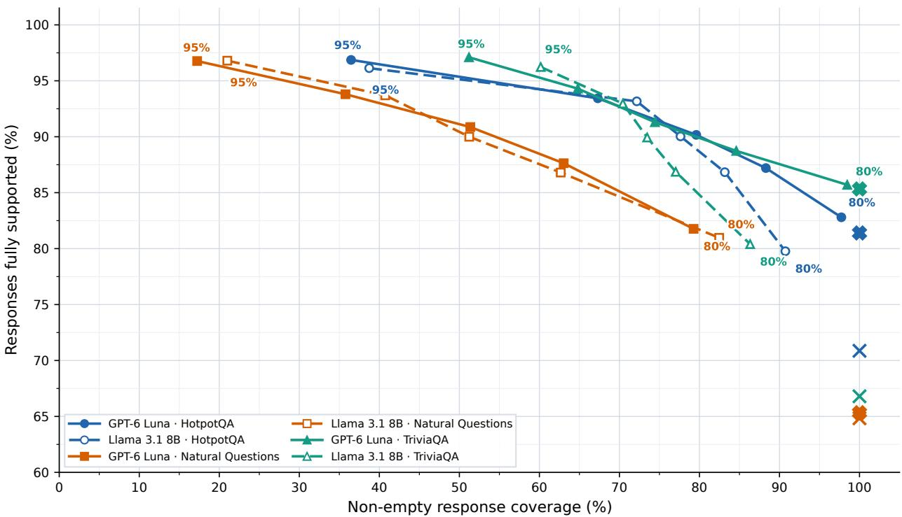

# Adaptive Retrieval, Selective Answers: Evaluating Conformal Factuality in Agentic RAG

Muhammad Aimal Rehman

Department of Mathematics & Statistics

Georgia State University

Atlanta, GA, USA

Chi-Kuang Yeh

mrehman3@gsu.edu

Department of Mathematics & Statistics

Georgia State University

Atlanta, GA, USA

cyeh@gsu.edu

## Abstract

Retrieval-augmented generation (RAG) can improve factual grounding without guaranteeing that every generated claim is supported. Previous work has studied claim-level conformal factuality in single-stage RAG and, more recently, multi-hop RAG. We examine its behavior in agentic RAG, where a language-model policy adaptively issues follow-up retrieval queries or terminates retrieval before response generation. We retain the retrieval-based relevancescoring formulation and post-generation conformal filtering and evaluate six model–dataset configurations: GPT-6 Luna and Llama 3.1 8B on HotpotQA, Natural Questions, and TriviaQA. Each configuration uses 60 fixed questions, 100 seeded 30/30 calibration–test partitions, five conformal target levels, and a no-conformal-prediction baseline. Across the six configurations, higher target levels are accompanied by higher observed full-support rates and reduced answer availability. At the 95% target, non-empty response coverage ranges from 17.23% to 60.17%, claim retention from 10.72% to 43.16%, and full support among non-empty outputs from 89.14% to 95.56%. We formulate the adaptive retrieval trajectory explicitly and characterize the reliability–informativeness trade-of when conformal factuality is applied after agent termination.

## 1 Introduction

Retrieval-augmented generation (RAG) conditions language-model responses on external documents, but evidence retrieval does not ensure that every generated claim is factual or supported [4]. Claimlevel conformal factuality provides a complementary mechanism: after generating and decomposing a response into atomic claims, a calibration-derived score threshold determines which claims are retained [1, 5]. Our previous study extended this approach to multi-hop RAG, in which successive retrieval operations construct evidence for compositional questions [7].

The present study extends that evaluation to agentic RAG. Instead of following only a bounded query-rewriting procedure, an agent makes explicit retrieve or finish decisions as evidence accumulates. Its follow-up queries, retrieval trajectory, and stopping time depend on the question and evidence observed so far. This adaptivity changes how the evidence used to generate and score claims is acquired, while the conformal post-processing stage remains conceptually the same. Decision-making interleaved with access to external information is also central to earlier agentoriented language-model research [9].

We address two empirical questions: (i) whether increasing conformal factuality targets produces the same observed improvement in response-level support when evidence acquisition is agent-driven;

Table 1: Operational diferences between the evaluated multi-hop and agentic retrieval procedures. Both apply post-generation claim scoring and conformal filtering.
<table><tr><td>Dimension</td><td>Multi-hop RAG</td><td>Agentic RAG</td></tr><tr><td>Follow-up query</td><td>prior evidence</td><td>Produced by a query-rewriting stage using Selected as the argument of an LLM-policy retrieve action</td></tr><tr><td>Retrieval control</td><td></td><td>Iterative refinement within a hop budget Explicit retrieve/finish decision after accumulated evidence is inspected</td></tr><tr><td>Early termination</td><td>conditions</td><td>Configured hop/novel-evidence stopping Policy finish, repeated-query safeguards, or configured decision/retrieval limits</td></tr><tr><td>Evidence</td><td>hops</td><td>Aggregated across a sequence of retrieval Aggregated across adaptively selected re- trieval actions</td></tr><tr><td>Response/CP stage</td><td>mal filtering</td><td>Generation, atomic-claim scoring, confor- Same downstream stages after the agent terminates</td></tr></table>

and (ii) how many claims and non-empty answers survive filtering across models and QA datasets. Our goal is an experimental extension of conformal factuality, not a comparison intended to rank agentic retrieval against multi-hop retrieval. We contribute a formal representation of the implemented agentic retrieval process and a six-configuration evaluation with complete target sweeps and unfiltered baselines.

## 2 Background and Relation to Prior Work

RAG and adaptive retrieval. RAG conditions generation on retrieved evidence [4]. For multistep questions, iterative retrieval can use information from earlier steps to form subsequent queries. Agentic retrieval adds an explicit decision policy that can continue searching or terminate, as in general reasoning-and-acting paradigms [9]. It is important to distinguish a bounded decision policy from an oracle for evidence suficiency: a decision to finish does not certify that all relevant evidence has been retrieved.

Conformal factuality. Conformal factuality uses a held-out calibration sample to select a nested refinement or filtering operation for language-model outputs [5]. The SIGIR 2025 Conformal-RAG study [1] introduced retrieval-informed claim scores, including a product-based score followed by max aggregation. Our multi-hop work examined this framework when evidence comes from multiple retrieval hops [7]. Here we retain the same relevance-scoring formulation and split-conformal experimental protocol, while replacing the upstream evidence-construction procedure with an agentic retriever.

## 3 Agentic Retrieval and Conformal Factuality

## 3.1 Policy-driven retrieval with an adaptive stopping time

Let $x \in \mathcal { X }$ be a question and K a document corpus. We index retrieval operations, rather than agent-policy calls, by t. The initial query is the original question, $q ^ { ( 1 ) } = x$ . Given a top-k retriever with similarity cutof θ, the initial document sequence is

$$
D _ { 1 } = \mathrm { U n i q u e } \Big ( \mathrm { R e t r i e v e } ( \mathcal { K } , q ^ { ( 1 ) } ; k , \theta ) \Big ) .\tag{1}
$$

After t retrievals, let $Q _ { t } = ( q ^ { ( 1 ) } , \dots , q ^ { ( t ) } )$ and let $D _ { t }$ contain the distinct passages accumulated in retrieval order. Write the decision state as

$$
H _ { t } = ( x , \Psi ( D _ { t } ) , Q _ { t } , t , B - t ) , \qquad a _ { t } = \pi _ { \omega } ( H _ { t } ) \in \{ \mathrm { F i n i s h } \} \cup \{ \mathrm { R e t r i e v e } ( q ) : q \in \mathcal { Q } \} .\tag{2}
$$

Here $\pi _ { \omega }$ is the agent’s policy, B is the retrieval-operation budget, $\mathcal { Q }$ is the space of follow-up queries, and $\Psi ( D _ { t } )$ is the bounded evidence view supplied to the policy, not necessarily the full accumulated corpus. If $a _ { t } = \mathrm { R e t r i e v e } ( q ^ { ( t + 1 ) } )$ is admissible, then

$$
E _ { t + 1 } = \mathrm { R e t r i e v e } ( { \cal K } , q ^ { ( t + 1 ) } ; k , \theta ) ,\tag{3}
$$

$$
D _ { t + 1 } = D _ { t } \oplus \operatorname { N e w } ( E _ { t + 1 } , D _ { t } ) ,\tag{4}
$$

where New removes duplicates already present in $D _ { t }$ and ⊕ appends previously unseen passages.   
The order matters because it can afect the evidence view available for the next policy decision.

Let $\tau ( x )$ be the number of completed retrieval operations when the process terminates. Termination can result from a finish decision, the retrieval or decision-step limit, or safeguards against repeated queries; it need not be a calibrated confidence event. With an initial retrieval and bounded operations,

$$
1 \leq \tau ( x ) \leq B , \qquad D _ { \pi } ( x ) : = D _ { \tau ( x ) } .\tag{5}
$$

In the experiments $B = 3$ and the policy-decision budget is also three. The retriever performs one initial retrieval before the policy makes follow-up decisions. This description permits diferent questions to have diferent retrieval trajectories without assuming independence between retrieval stages.

## 3.2 Generation, claim decomposition, and relevance scoring

After agent termination, the model generates a response and the claim decomposer extracts its atomic statements:

$$
\hat { y } = G ( x , D _ { \pi } ( x ) ) , \qquad C ( x ) = g ( \hat { y } ) = \{ c _ { 1 } , \dots , c _ { p ( x ) } \} .\tag{6}
$$

The number of extracted claims $p ( x )$ varies across questions. The factuality annotation for each claim belongs to $\{ S , I , U , N \}$ , where only $S$ counts as supported. Write $A ( c ) \in \{ 0 , 1 \}$ for this support indicator; reference answers and support annotations enter calibration and evaluation, not test-time threshold selection.

The evaluated relevance scorer follows the product-and-maximum structure of Feng et al. [1]. A document d first added at retrieval operation $j ( d )$ carries a stored retrieval similarity $s _ { \mathrm { r e t } } ( d )$ evaluated for the query $q ^ { ( j ( d ) ) }$ that retrieved it. The implemented agentic relevance score can be expressed as

$$
R ^ { \mathrm { a g e n t } } ( c ; x ) = \operatorname* { m a x } \left\{ 0 , \operatorname* { m a x } _ { d \in D _ { \pi } ( x ) } s _ { \mathrm { r e t } } ( d ) \sin ( c , d ) \right\} .\tag{7}
$$

The similarity sim $. ( c , d )$ measures semantic alignment between claim and passage. When retrieval similarities are cosine similarities in the same embedding space, $s _ { \mathrm { r e t } } ( d ) = \sin ( q ^ { ( j ( d ) ) } , d )$ . Documents retrieved during follow-up steps are scored against their corresponding agent-generated retrieval queries, whereas documents from the initial retrieval are scored against the original question x. This contrasts with the idealized original-question factor sim $( x , d )$ in the single-query relevance-score expression of Feng et al. [1], even though the product/max scoring strategy is unchanged.

For tie handling, let $\widetilde { R } ( c ) = R ^ { \mathrm { a g e n t } } ( c ; x ) + \varepsilon ( c )$ denote the score passed to conformal filtering, including any configured tie-breaking perturbation. The recorded experiments use the thresholded retained set

$$
F \lambda { \big ( } C ( x ) { \big ) } = \{ c \in { C ( x ) } : { \widetilde { R } } ( c ) \geq \lambda \} .\tag{8}
$$

Thresholding is post-generation: the conformal target does not control when the retrieval agent stops.

## 3.3 Calibration and response-level factuality

For a calibration question i, let $C _ { i }$ be the extracted claims and $r _ { i j } = \widetilde { R } ( c _ { i j } )$ their relevance scores. Put $A _ { i j } = 1$ if claim $c _ { i j }$ is supported and zero otherwise. The response is fully supported at threshold λ when every retained claim is supported:

$$
B _ { i } ( \lambda ) = \mathbb { I } \left[ \forall c _ { i j } \in F _ { \lambda } ( C _ { i } ) , \ A _ { i j } = 1 \right] .\tag{9}
$$

The all-claims-supported requirement corresponds to the within-response factuality parameter $a = 1$ in our earlier study [7]. A response retaining no claims satisfies eq. (9) by convention.

A useful explicit nonconformity score for all-claims-supported calibration is

$$
V _ { i } = \operatorname* { m a x } _ { j : A _ { i j } = 0 } r _ { i j } , \qquad \operatorname* { m a x } \varnothing = - \infty .\tag{10}
$$

Thus $V _ { i }$ is the largest relevance score of any unsupported claim. If $V _ { ( 1 ) } \leq \cdots \leq V _ { ( n ) }$ are the ordered calibration scores, the usual split-conformal order-statistic threshold is

$$
k _ { \alpha } = \lceil ( n + 1 ) ( 1 - \alpha ) \rceil , \qquad \hat { \lambda } _ { \alpha } = \left\{ { V } _ { ( k _ { \alpha } ) } , \quad k _ { \alpha } \leq n , \right.\tag{11}
$$

The five evaluated targets $1 - \alpha \in \{ 0 . 8 0 , 0 . 8 5 , 0 . 9 0 , 0 . 9 2 5 , 0 . 9 5 \}$ correspond, for $n = 3 0$ , to $k _ { \alpha } \in$ {25, 27, 28, 29, 30}.

## 4 Experimental Design

## 4.1 Datasets and models

We evaluate HotpotQA [8], Natural Questions (NQ) [3], and TriviaQA [2], using KILT-linked validation resources and Wikipedia provenance [6]. Each experiment uses a deterministic 60-question subset selected under its dataset-specific answer/provenance and extractable-Wikipedia-evidence eligibility rules. NQ and TriviaQA selections are matched across the two model experiments using the saved GPT-6 reference samples. These eligibility conditions define the evaluated population and should be retained when reproducing the study.

The two generation backbones are the GPT-6 Luna API model (gpt-6-luna) and meta-llama/Llama-3.1-8B-Instruct. Each model family supplies the generator, agent-policy decisions, claim decomposition, and factuality verification within its own experimental pipeline. The common retrieval stack uses local sentence-transformer embeddings (all-MiniLM-L6-v2), a FAISS index, top-k = 10 documents per retrieval, similarity cutof $\theta = 0 . 3$ , initial retrieval enabled, and at most three retrieval operations and three policy decisions. The policy conditions on up to five evidence documents, each truncated to 1200 characters. The local Llama experiments used bounded retries for malformed structured agent/verifier outputs.

## 4.2 Calibration and evaluation protocol

For each of the six model–dataset configurations, we generate, decompose, score, and annotate 60 question-level examples. A no-CP baseline retains all generated claims. For each of the five CP targets, the same 60 scored/annotated examples are repeatedly divided into 30 calibration and 30 test cases over 100 seeded splits (base seed 42). Only the conformal threshold varies across target conditions within a split. The 100 runs are repeated partitions of fixed generated outputs, not 100 independent retrieval-and-generation runs.

The experimental matrix is

$$
\{ \mathrm { G P T - 6 ~ L u m a } , \mathrm { L l a m a } ~ 3 . 1 ~ 8 \mathrm { B } \} \times \{ \mathrm { H o t p o t Q A } , \mathrm { N Q } , \mathrm { T r i v i a Q A } \} \times \{ \mathrm { N o ~ C P } , \mathrm { 8 0 } , \mathrm { 8 5 } , \mathrm { 9 0 } , \mathrm { 9 2 } . 5 , \mathrm { 9 5 } \% \} \ ( 1 2 )
$$

All six experiments use the product-based relevance score with maximum aggregation.

## 4.3 Reported metrics

For test example i, write $C _ { i } ( \lambda ) = F _ { \lambda } ( C _ { i } )$ and $n _ { i } ( \lambda ) = | C _ { i } ( \lambda ) |$ . Let $m = 3 0$ denote the test split size. The response-level full-support fraction and non-empty response coverage are

$$
\mathrm { F S } ( \lambda ) = \frac { 1 } { m } \sum _ { i = 1 } ^ { m } \mathbb { I } \big [ \forall c \in C _ { i } ( \lambda ) , \ A ( c ) = 1 \big ] ,\tag{13}
$$

$$
\operatorname { N E } ( \lambda ) = \frac { 1 } { m } \sum _ { i = 1 } ^ { m } \mathbb { I } [ n _ { i } ( \lambda ) > 0 ] .\tag{14}
$$

The mean-per-response fraction of retained claims is

$$
\operatorname { R e t } ( \lambda ) = \frac { 1 } { m } \sum _ { i = 1 } ^ { m } \frac { n _ { i } ( \lambda ) } { | C _ { i } | } .\tag{15}
$$

The supported-claim fraction is the number of supported retained claims divided by the total number of retained claims in the split; the summary tables average this split-level ratio over the 100 repetitions. The conditional full-support fraction is

$$
\operatorname { F S } _ { | \mathrm { N E } } ( \lambda ) = \frac { \sum _ { i } \mathbb { I } [ n _ { i } ( \lambda ) > 0 ] \mathbb { I } [ \forall c \in C _ { i } ( \lambda ) , A ( c ) = 1 ] } { \sum _ { i } \mathbb { I } [ n _ { i } ( \lambda ) > 0 ] } ,\tag{16}
$$

when the denominator is nonzero. The no-CP baseline always has 100% non-empty coverage and 100% claim retention for the successfully decomposed examples. We report percentages averaged across the 100 calibration–test partitions; they should not be treated as independent sample replicates.

## 5 Results

## 5.1 Reliability–coverage trade-of across six configurations

Figure 1 shows a consistent direction across the six settings: increasing the conformal target raises observed full support while reducing the fraction of responses retaining any claim. The no-CP baselines lie at 100% non-empty coverage. The magnitude of the resulting selectivity cost depends strongly on the dataset/model combination; in particular, NQ reaches much lower coverage than TriviaQA at stringent targets.

  
CP target (left to right on each curve): 95%, 92.5%, 90%, 85%, 80%. Crosses: No CP baseline (X: GPT-6; ×: Llama).  
Figure 1: Agentic RAG using the relevance-scoring formulation in eq. (7), evaluated across GPT-6 Luna and Llama 3.1 8B on three QA datasets. The five points on each curve are the conformal targets 80%, 85%, 90%, 92.5%, and 95%; separate crosses at 100% non-empty coverage denote the no-CP baselines. The y-axis is response-level full support and includes vacuously supported empty filtered outputs. The vertically zoomed scale emphasizes reliability–coverage diferences.

## 5.2 Results at the 95% target

Table 2 summarizes the most stringent target. It is computed from the exact target-sweep tables, not by reading locations from the plotted curves.

At the 95% target, non-empty coverage spans 17.23% (GPT-6 Luna, NQ) to 60.17% (Llama 3.1 8B, TriviaQA); claim retention spans 10.72% to 43.16%. The full-support fraction among non-empty outputs spans 89.14% to 95.56%, while supported-claim fractions among retained claims span 90.16% to 97.72%. These are complementary measures: the response-level full-support rate in the figure additionally counts empty filtered responses as fully supported under the standard all-retained-claims event. The complete sweeps, including no-CP rows for all datasets and both models, are supplied in tables 3 and 4.

## 5.3 Conditional reliability and answer availability

To separate selectivity from factuality of substantive answers, let N denote the event that filtering retains at least one claim and S the full-support event. Since an empty claim set is vacuously fully supported,

$$
\operatorname* { P r } ( S ) = 1 - \operatorname* { P r } ( N ) + \operatorname* { P r } ( N ) \operatorname* { P r } ( S \mid N ) .\tag{17}
$$

Table 2: Agentic RAG using the relevance-scoring formulation in eq. (7) at the 95% CP target. All values are percentages averaged over 100 calibration–test partitions. “Full support | non-empty” conditions on retaining at least one claim.
<table><tr><td>Model</td><td>Dataset</td><td>Non- empty</td><td>Claims retained</td><td>Supported claims</td><td>1 Full support non-empty</td></tr><tr><td rowspan="3">GPT-6 Luna</td><td>HotpotQA</td><td>36.47</td><td>23.57</td><td>97.14</td><td>95.23</td></tr><tr><td>NQ</td><td>17.23</td><td>10.72</td><td>90.16</td><td>89.14</td></tr><tr><td>TriviaQA</td><td>51.20</td><td>43.16</td><td>96.59</td><td>95.56</td></tr><tr><td rowspan="3">Llama 3.1 8B</td><td>HotpotQA</td><td>38.73</td><td>27.06</td><td>97.33</td><td>93.26</td></tr><tr><td>NQ</td><td>21.00</td><td>11.77</td><td>96.27</td><td>91.47</td></tr><tr><td>TriviaQA</td><td>60.17</td><td>39.13</td><td>97.72</td><td>94.56</td></tr></table>

Thus the vertical coordinate of a response-level full-support plot and the conditional full-support metric answer diferent questions. The tables report both useful answer coverage and supported content retention; the reliability–informativeness trade-of is therefore visible without reducing the evaluation to a single reliability number.

## 6 Discussion

Across both model families, the same post-generation conformal filtering procedure produces progressively more selective outputs as the target is tightened. This pattern extends the observations from conventional and multi-hop RAG [1, 7] to evidence acquired by a model-controlled retrieval policy. The evidence trajectory is adaptive, but the CP operation is applied only after the agent has terminated and generated a response.

The results also show that the utility cost of a given target is not uniform. For example, 95%-target non-empty coverage exceeds 50% for both TriviaQA settings, but falls below 22% for both NQ settings. Answer availability and retained-claim fraction should therefore accompany response-level factuality in deployment-facing reports. We do not treat the variation across settings as evidence that one retrieval architecture universally outperforms another; the models and experimental populations difer from our previous multi-hop study.

## 7 Limitations

Our evaluation is based on controlled subsets of 60 questions from each of the three QA benchmarks: HotpotQA, Natural Questions, and TriviaQA. The relatively small sample size may limit the generalizability of the findings to larger and more diverse question sets.

The agentic retrieval process is limited to a maximum of three retrieval operations and three policy decisions, leaving the efects of longer retrieval trajectories and alternative agent policies unexplored. Furthermore, our experiments consider two language models, GPT-6 Luna and Llama 3.1 8B. Extending the evaluation to other model families, such as Qwen and DeepSeek, would help establish the robustness and generalizability of the observed conformal factuality improvements across diferent language-model architectures.

## 8 Conclusion

We formulated bounded Agentic RAG as an evidence-dependent sequence of retrieval-policy decisions and evaluated retrieval-based conformal claim filtering after the agent stopped. Across six configurations spanning two LLMs and three QA benchmarks, higher conformal targets yielded higher observed response-level support together with lower claim retention and non-empty answer coverage. These results extend the empirical investigation of conformal factuality from single-stage and multi-hop RAG to agent-driven evidence acquisition, and motivate further research on improving the reliability–informativeness trade-of through broader evaluations involving larger datasets, longer retrieval trajectories, and additional language-model families.

## Code Availability

The implementation of the Agentic RAG framework evaluated in this study is publicly available at https://github.com/aimalrehman92/conformal-rag-agentic.

## A Complete Target Sweeps and No-CP Baselines

The following tables present the complete experimental results for GPT-6 Luna and Llama 3.1 8B across HotpotQA, Natural Questions, and TriviaQA. For each configuration, we report the no-CP baseline and five conformal targets (80, 85, 90, 92.5, and 95%). The reported metrics are defined in section 4.3.

Table 3: Agentic RAG with GPT-6 Luna using the relevance-scoring formulation in eq. (7): no-CP baseline and complete conformal target sweep (%).
<table><tr><td>Dataset</td><td>Target</td><td>Non-empty</td><td>Claims retained</td><td>Supported claims</td><td>Fully supported |non-empty</td></tr><tr><td rowspan="6">HotpotQA</td><td>No CP</td><td>100.00</td><td>100.00</td><td>87.68</td><td>81.40</td></tr><tr><td>80%</td><td>97.73</td><td>92.57</td><td>88.63</td><td>82.66</td></tr><tr><td>85%</td><td>88.30</td><td>73.98</td><td>91.51</td><td>86.41</td></tr><tr><td>90%</td><td>79.60</td><td>62.28</td><td>93.33</td><td>88.82</td></tr><tr><td>92.5%</td><td>67.30</td><td>49.10</td><td>95.08</td><td>91.50</td></tr><tr><td>95%</td><td>36.47</td><td>23.57</td><td>97.14</td><td>95.23</td></tr><tr><td rowspan="6">NQ</td><td>No CP</td><td>100.00</td><td>100.00</td><td>76.36</td><td>65.33</td></tr><tr><td>80%</td><td>79.27</td><td>62.95</td><td>86.78</td><td>78.06</td></tr><tr><td>85%</td><td>63.03</td><td>46.56</td><td>88.71</td><td>82.23</td></tr><tr><td>90%</td><td>51.37</td><td>36.04</td><td>89.03</td><td>84.53</td></tr><tr><td>92.5%</td><td>35.77</td><td>23.74</td><td>89.20</td><td>86.15</td></tr><tr><td>95%</td><td>17.23</td><td>10.72</td><td>90.16</td><td>89.14</td></tr><tr><td rowspan="6">TriviaQA</td><td>No CP</td><td>100.00</td><td>100.00</td><td>87.63</td><td>85.33</td></tr><tr><td>80%</td><td>98.47</td><td>98.22</td><td>87.91</td><td>85.66</td></tr><tr><td>85%</td><td>84.60</td><td>82.51</td><td>89.22</td><td>87.59</td></tr><tr><td>90%</td><td>74.43</td><td>69.74</td><td>90.70</td><td>89.40</td></tr><tr><td>92.5%</td><td>64.80</td><td>58.34</td><td>93.16</td><td>91.99</td></tr><tr><td>95%</td><td>51.20</td><td>43.16</td><td>96.59</td><td>95.56</td></tr></table>

Table 4: Agentic RAG with Llama 3.1 8B using the relevance-scoring formulation in eq. (7): no-CP baseline and complete conformal target sweep (%).
<table><tr><td colspan="2">Dataset</td><td rowspan="2">Non-empty</td><td colspan="3"></td></tr><tr><td></td><td>Target</td><td>Claims retained</td><td>Supported claims</td><td>|non-empty</td></tr><tr><td>HotpotQA</td><td>No CP</td><td>100.00</td><td>100.00</td><td>87.98</td><td>70.87</td></tr><tr><td></td><td>80%</td><td>90.73</td><td>84.19</td><td>91.66</td><td>78.26</td></tr><tr><td></td><td>85%</td><td>83.17</td><td>69.32</td><td>94.54</td><td>84.82</td></tr><tr><td></td><td>90%</td><td>77.63</td><td>60.33</td><td>95.61</td><td>87.88</td></tr><tr><td></td><td>92.5% 95%</td><td>72.17</td><td>52.62</td><td>96.73</td><td>91.13</td></tr><tr><td></td><td></td><td>38.73</td><td>27.06</td><td>97.33</td><td>93.26</td></tr><tr><td rowspan="6">NQ</td><td>No CP</td><td>100.00</td><td>100.00</td><td>86.44</td><td>64.83</td></tr><tr><td>80%</td><td>82.47</td><td>62.21</td><td>88.75</td><td>77.54</td></tr><tr><td>85%</td><td>62.67</td><td>43.64</td><td>91.70</td><td>80.44</td></tr><tr><td>90%</td><td>51.23</td><td>34.42</td><td>93.05</td><td>82.16</td></tr><tr><td>92.5%</td><td>40.73</td><td>24.73</td><td>94.60</td><td>86.30</td></tr><tr><td>95%</td><td>21.00</td><td>11.77</td><td>96.27</td><td>91.47</td></tr><tr><td rowspan="6">TriviaQA</td><td>No CP</td><td>100.00</td><td>100.00</td><td>86.38</td><td>66.80</td></tr><tr><td>80%</td><td>86.33</td><td>75.45</td><td>88.13</td><td>78.04</td></tr><tr><td>85%</td><td>77.03</td><td>61.78</td><td>91.58</td><td>83.69</td></tr><tr><td>90%</td><td>73.47</td><td>56.20</td><td>93.73</td><td>86.86</td></tr><tr><td>92.5%</td><td>70.43</td><td>50.02</td><td>95.82</td><td>90.51</td></tr><tr><td>95%</td><td>60.17</td><td>39.13</td><td>97.72</td><td>94.56</td></tr></table>

## B Experimental Configuration Summary

Table 5: Shared conditions across the six prioritized Agentic RAG experiments.

<table><tr><td>Component</td><td>Specification</td></tr><tr><td>Experiment IDs</td><td>E25, E27, E29 (GPT-6 Luna); E31, E33, E35 (Llama 3.1 8B)</td></tr><tr><td>Dataset</td><td>KILT-linked HotpotQA, Natural Questions, TriviaQA</td></tr><tr><td>Retrieval</td><td>Agentic retrieve/finish; initial retrieval enabled; top-10; similarity cutoff 0.3</td></tr><tr><td>Budgets</td><td>Maximum three retrieval operations and three policy decisions</td></tr><tr><td>Embedding / index</td><td>sentence-transformers/all-MiniLM-L6-v2/FAISS</td></tr><tr><td>Score / filter</td><td> $\widetilde { R } ( c ) \geq \hat { \lambda }$  Product and max aggregation; experimental retention uses</td></tr><tr><td>Conformal setting</td><td>Within-response factuality requirement a = 1; targets 80, 85, 90, 92.5, 95%</td></tr><tr><td>Protocol</td><td>60 fixed questions per configuration; 30 calibration, 30 test; 100 seeded splits; seed 42</td></tr><tr><td>Baseline</td><td>No CP: original scored response with no claim removal</td></tr></table>

## References

[1] Naihe Feng, Yi Sui, Shiyi Hou, Jesse C. Cresswell, and Ga Wu. Response quality assessment for retrieval-augmented generation via conditional conformal factuality. In Proceedings of the 48th International ACM SIGIR Conference on Research and Development in Information Retrieval, pages 2832–2836, 2025. doi: 10.1145/3726302.3730244. URL https://doi.org/10.1145/ 3726302.3730244.

[2] Mandar Joshi, Eunsol Choi, Daniel Weld, and Luke Zettlemoyer. TriviaQA: A large scale distantly supervised challenge dataset for reading comprehension. In Proceedings of the 55th Annual Meeting of the Association for Computational Linguistics, pages 1601–1611, 2017. doi: 10.18653/v1/P17-1147.

[3] Tom Kwiatkowski, Jennimaria Palomaki, Olivia Redfield, Michael Collins, Ankur Parikh, Chris Alberti, Danielle Epstein, Illia Polosukhin, Jacob Devlin, Kenton Lee, Kristina Toutanova, Llion Jones, Matthew Kelcey, Ming-Wei Chang, Andrew Dai, Jakob Uszkoreit, Quoc Le, and Slav Petrov. Natural questions: A benchmark for question answering research. Transactions of the Association for Computational Linguistics, 7:452–466, 2019. doi: 10.1162/tacl\_a\_00276.

[4] Patrick Lewis, Ethan Perez, Aleksandra Piktus, Fabio Petroni, Vladimir Karpukhin, Naman Goyal, Heinrich Küttler, Mike Lewis, Wen-tau Yih, Tim Rocktäschel, Sebastian Riedel, and Douwe Kiela. Retrieval-augmented generation for knowledge-intensive NLP tasks. In Advances in Neural Information Processing Systems, volume 33, 2020. URL https://arxiv.org/abs/ 2005.11401.

[5] Christopher Mohri and Tatsunori Hashimoto. Language models with conformal factuality guarantees. In Proceedings of the 41st International Conference on Machine Learning, volume 235 of Proceedings of Machine Learning Research, pages 36029–36047, 2024. URL https: //proceedings.mlr.press/v235/mohri24a.html.

[6] Fabio Petroni, Aleksandra Piktus, Angela Fan, Patrick Lewis, Majid Yazdani, Nicola De Cao, James Thorne, Yacine Jernite, Vladimir Karpukhin, Jean Maillard, Vassilis Plachouras, Tim Rocktäschel, and Sebastian Riedel. KILT: a benchmark for knowledge intensive language tasks. In Proceedings of the 2021 Conference of the North American Chapter of the Association for Computational Linguistics: Human Language Technologies, pages 2523–2544, 2021. doi: 10.18653/v1/2021.naacl-main.200.

[7] Muhammad Aimal Rehman and Chi-Kuang Yeh. Conformal factuality control for multihop retrieval-augmented generation. arXiv preprint arXiv:2609.38222, 2026. URL https: //arxiv.org/abs/2609.38222.

[8] Zhilin Yang, Peng Qi, Saizheng Zhang, Yoshua Bengio, William Cohen, Ruslan Salakhutdinov, and Christopher D. Manning. HotpotQA: A dataset for diverse, explainable multi-hop question answering. In Proceedings of the 2018 Conference on Empirical Methods in Natural Language Processing, pages 2369–2380, 2018. doi: 10.18653/v1/D18-1259.

[9] Shunyu Yao, Jefrey Zhao, Dian Yu, Nan Du, Izhak Shafran, Karthik R. Narasimhan, and Yuan Cao. ReAct: Synergizing reasoning and acting in language models. In International Conference on Learning Representations, 2023. URL https://arxiv.org/abs/2210.03629.