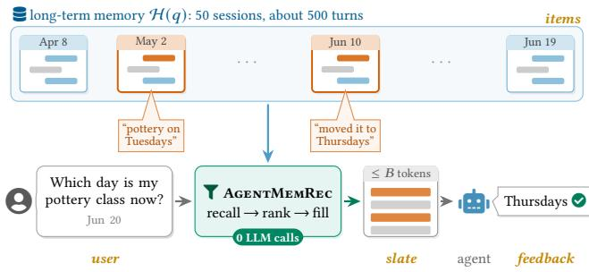
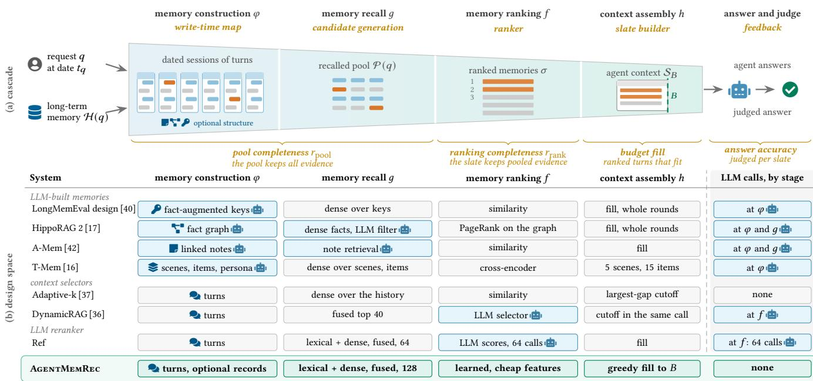
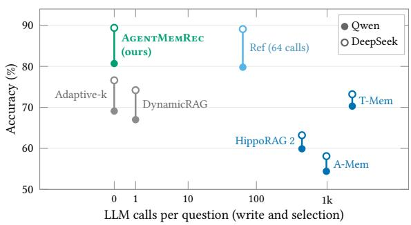
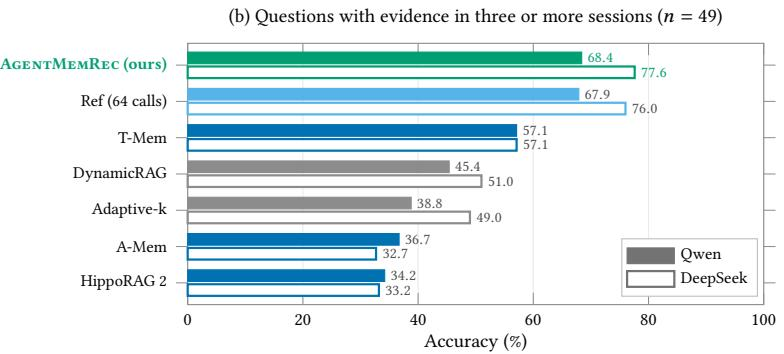

# Agent Memory as Recommendation: Recommender-System Design for Long-Term Memory of LLM Agents

Xinyu Zhang Fudan University zhangxinyu@fudan.edu.cn

## Abstract

Large language model (LLM) agents that serve users across many sessions must choose, for every request, the few stored memories that enter a limited context window. This choice largely decides whether the agent answers correctly, and it runs on every request at Web scale. This selection faces three challenges: a large and growing store, a per-request cost budget, and multi-session questions that need all of their evidence. Many memory systems build notes or graphs with hundreds to thousands of LLM calls per history, and each is designed on its own, so it is unclear which component yields the accuracy. These challenges mirror the properties of recommendation, so we formalize agent memory as budgeted slate recommendation, with the request as the user, stored memories as items and the context window as a slate. The formalization places memory systems in one design space of recommender cascades and factorizes accuracy into the completeness that each stage controls. Guided by it, we propose AgentMemRec, which adapts candidate generation, learning to rank and slate construction from recommender systems and selects memories without any LLM call. On multi-session questions of LongMemEval, AgentMemRec outperforms memory and context-selection methods, including A-Mem, HippoRAG 2, DynamicRAG and T-Mem, by 10 to 31 points of accuracy. It matches an LLM reranker that makes 64 calls per query at 3.2 times lower serving cost, and on LoCoMo it outperforms Mem0 and Zep without any LLM call at write time. The factorization attributes the gains to slates that more often hold all of the evidence, so recommender-system design ofers an efective and eficient foundation for the long-term memory of LLM agents.

## 1 Introduction

Web-based chat assistants keep a long-term memory of each user’s past sessions [40], so for every request their large language model (LLM) agent must decide which stored memories enter its limited context (Figure 1). This decision largely determines whether the agent answers correctly, since a context that misses an evidence turn loses 37 to 64 points of accuracy with Qwen for every turnlevel design we compare. The decision also runs on every request, so its latency and cost grow with Web trafic, as they do for Web recommenders, and production memory layers are judged by these costs [8].

Three properties make the decision hard. The store is large and keeps growing: in LongMemEval-M, the history of one question holds about 500 sessions and 1.5M tokens [40], while the answering model in our setting reads at most 2,700 tokens. The budget is per request, so scoring the store with an LLM costs calls in proportion to its size and to trafic. The value is judged on the whole context, since a question whose evidence spans several sessions needs all

Weiwei Sun Fudan University wwsun@fudan.edu.cn

  
Figure 1: Agent memory as recommendation. Evidence for the request lies in two of 50 sessions, and a selector with no LLM call fills a slate of stored turns under a token budget �, from which the agent’s LLM answers. Orange labels give the recommender role of each element.

of it, and feedback arrives for the context and never for a single memory.

Memory systems build diferent structures, such as linked notes, knowledge graphs, temporal hierarchies and fact-augmented keys [17, 23, 40, 42]. Many spend LLM calls to build them, about 440 to 2,270 per question for HippoRAG 2, A-Mem and T-Mem on LongMemEval-S. Without a shared formulation of the decision, it is unclear which component produces the accuracy and what it should cost. Existing selectors also leave evidence out: the four compared methods whose contexts are turns hold all of the evidence for only 0.50 to 0.68 of the multi-session questions.

We observe that the three properties are those of recommendation, and we formalize the decision as budgeted slate recommendation. Recommender systems choose a few items from a large catalogue for every request under a latency budget, and they judge the shown set as a whole [10, 18]. In memory selection, the request plays the user, stored turns are the items, and the context is a slate under a token budget. The formalization defines a design space in which every memory system is a point, a cascade of memory construction, recall, ranking and context assembly. Three results about this space reduce design to one problem: within an LLM budget, raise the product of pool completeness and ranking completeness, and fill the slate.

We build AgentMemRec by solving this problem with no LLM call. A wide pool from two cheap recall channels raises pool completeness, a ranker learned over ten cheap features raises ranking completeness, and the pool size is chosen by their product. On the LongMemEval-S questions whose evidence spans several sessions, AgentMemRec outperforms Adaptive-k, DynamicRAG, HippoRAG 2, A-Mem and T-Mem by 10 to 31 points of accuracy, and the memory and context-selection methods run on LongMemEval-M by 11 to 33 points. It matches or exceeds a reranker that makes 64 LLM calls per question, at 3.2 times lower serving cost per request. Under the shared LongMemEval-S protocol, it scores 82.5 on the test questions and 83.2 on all 500, above what MemOS and TiMem report. On LoCoMo, the frozen cascade outperforms Mem0 and Zep with no LLM call at write time. The factorization explains these gains: the slates of AgentMemRec hold all of the evidence for 0.94 of the questions, and on jointly complete slates the systems do not difer significantly.

Our contributions are:

• A formalization of long-term agent memory as budgeted slate recommendation, with a design space of memory systems and three results that reduce design to raising pool and ranking completeness within an LLM budget.

• AgentMemRec, which solves this problem with no LLM call, outperforms LLM-built memories and context selectors on LongMemEval and production memory layers on LoCoMo, and matches a 64-call LLM reranker at 3.2 times lower cost.

• A measured factorization showing that slate completeness carries the gains, and a test of where item-wise ranking stops suficing, at $\kappa \geq 3$ and with near-miss filler.

## 2 Related Work

Long-term memory for LLM agents. LoCoMo [26] and Long-MemEval [40] evaluate assistants on long multi-session histories. Most memory systems decide at write time what to store and how to index it, as linked notes [42], consolidated facts [8], temporal knowledge graphs [31] or fact graphs searched by personalized PageRank [17]. Others build hypergraphs, temporal hierarchies, boundary-guided segments or antecedent links [23, 38, 46, 47], and verbatim chunks have been reported to outperform extracted artifacts on long conversations [1]. In the recommender view, these designs are item side-information or recall structure, and most of them spend LLM calls at write time. AgentMemRec works at read time over raw turns with no LLM call, so its cost per request stays flat as stores grow, and it can use a memory builder’s units as a recall channel.

Context selection under a budget. Adaptive-k cuts a ranked list at the largest gap in its similarity scores [37], and DynamicRAG trains a reranker that chooses both the order and the number of passages [36]. SetR replaces ranking with set selection by an LLM [21], which lies outside a budget of no LLM calls, and ranked-list truncation learns where to cut a list [3, 27]. High-scoring passages that do not answer the question hurt [11], as do retrieved hard negatives [19] and input length alone [14]. Like these selectors, AgentMemRec orders candidates and fills a budget. It keeps the budget fixed because a fill dominates every cutof of a ranking when the reward does not fall as the fill extends it. We add a label controlled contrast of ranked and random filler and a noise-floor control for the per-question headroom that cutof methods assume.

Recommender techniques and memory. Industrial recommenders split candidate generation from ranking [10] and treat the shown set as the unit of decision [18], and industrial search arranges rankers of increasing cost in cascades [25]. Set-aware stages re-rank with attention over the list [29] or select diverse subsets with determinantal point processes [6]. LambdaRank with gradient-boosted trees is a standard learned ranker [4, 20, 41], reciprocal rank fusion merges channels [9], and LLM rankers can be distilled into cross-encoders [34]. The probability ranking principle orders documents by relevance when each is judged on its own [33]. For agent memory, RMM trains a reranker online from the citations of the answering model [39], and recent work studies learned memory rerankers [15, 22, 28], pipelines without LLM calls [30] and small-model context construction [44]. MemRec builds agentic recommenders on a collaborative memory [7], and RecMem consolidates agent memory by recurrence [12]. We formalize agent memory as budgeted slate recommendation, extend the probability ranking principle to complete evidence sets, and derive and measure which stages of the design space carry accuracy. Unlike RMM, AgentMemRec needs no feedback from the answering model at use time, which our frozen protocol could not provide, and we did not run these rerankers. MemRec applies memory to recommendation and RecMem decides when to consolidate, whereas we select a context.

## 3 Agent Memory as Recommendation

This section casts memory selection as budgeted slate recommendation, lays out the design space that this view opens, and proves three results about the space that guide the design of AgentMemRec.

## 3.1 Memory selection as slate recommendation

Definition 3.1 (Budgeted slate recommendation). A budgeted slate recommendation problem has a distribution of requests $x ,$ a catalogue �(�) for each request, a monotone set cost $c _ { x }$ on subsets of $I ( x )$ , a budget $B ,$ and a slate reward $R ( S , x ) \in [ 0 , 1 ]$ that is observed only for the slate shown. A policy � maps each request to a slate with $c _ { x } ( \pi ( x ) ) \leq B _ { \mathrm {  } }$ , and its value is $V ( \pi ) = \mathbb { E } _ { x } [ R ( \pi ( x ) , x ) ]$

A question � arrives at date $t _ { q }$ with a history $\mathcal { H } ( q )$ , the set of user and assistant turns in its dated sessions. Memory selection is an instance of Definition 3.1. The request is $x = ( q , t _ { q } )$ together with the agent’s state, and the catalogue is $I ( x ) = \mathcal { H } ( q )$ , whose units are turns and, optionally, records that cite turns. The cost is the token count of the rendered slate, � = tok ◦ render, which grows as units are added. The reward $u ( S , q )$ is the probability that the judge accepts the answer that an answering model generates from render(S), so the selector solves

$$
\operatorname* { m a x } _ { \pi } \mathbb { E } _ { q } \big [ u ( \pi ( q ) , q ) \big ] \quad \mathrm { s . t . } \quad \mathrm { t o k } \big ( \mathrm { r e n d e r } ( \pi ( q ) ) \big ) \leq B \mathrm { f o r } \mathrm { e v e r y } q .\tag{1}
$$

Judge accuracy $\operatorname { A c c } ( \pi )$ estimates this objective, with expectations over questions, perturbed budgets and decoding. The instance has the three properties that shape recommender design. Catalogue scale: a LongMemEval-S history holds about 490 turns and a LongMemEval-M history about 4,900, while the slate admits 2,700 tokens. Per-request budget: the selector runs on every request, so scoring the catalogue with an LLM costs calls in proportion to its size and to trafic. Slate-level value: � is a set function, a question whose evidence spans $\kappa \geq 2$ annotated sessions needs all of it, and feedback arrives for the slate and never for a single unit, as in slate recommendation [18].

  
Fi ure 2: Lon -term a ent memor as bud eted slate recommendation. (a) Memor construction recall rankin and context assembly narrow the stored turns of a long-term memory to the agent’s context under a token budget $B ,$ and each is a recommender stage (orange). (b) The compared systems by their choice at each stage, where Æ marks an LLM call and the last column summarizes the stages that call an LLM. AgentMemRec learns its ranker over cheap features and makes no LLM call at any stage.

## 3.2 The design space

Recommenders meet these three properties with a cascade, and we use the cascade to define the space of memory designs.

Definition 3.2 (Design space). A memory design is a tuple $d =$ $( \varphi , g , f , h )$ . The write-time map � turns a history into a catalogue of units, possibly with side-information. The candidate generator � returns a pool ${ \mathcal { P } } ( q ) \subseteq \varphi ( { \mathcal { H } } ( q ) )$ , the ranker � orders the pool, and the slate builder ℎ selects $S _ { B } ( q ) \subseteq { \mathcal { P } } ( q )$ within the budget. The LLM cost of � counts the LLM calls of � per history and of �, � and ℎ per request.

Every memory system we compare is a point in this space (Fig ure 2b), and the points difer mainly in where they spend LLM calls.

## 3.3 Three results about the space

The benchmark marks a gold set ${ \mathcal { G } } ( q ) \subseteq { \mathcal { H } } ( q )$ ofturns that contain the answer, and a slate is complete when the turns that its units render or cite cover $\mathcal { G } ( \boldsymbol { q } )$ , written $\mathcal G ( \boldsymbol q ) \subseteq S _ { B } ( \boldsymbol q )$ . For a policy, let $r _ { \mathrm { p o o l } } = \mathrm { P r } [ \mathcal { G } \subseteq \mathcal { P } ]$ be its pool completeness, $r _ { \mathrm { r a n k } } = \operatorname* { P r } [ \mathcal { G } \subseteq S _ { B }$ | ${ \mathcal { G } } \subseteq { \mathcal { P } } ]$ its ranking completeness and $r _ { \mathrm { s l a t e } } = \mathrm { P r } [ \mathcal { G } \subseteq S _ { B } ]$ its slate completeness. Let $a _ { \mathrm { c } }$ and $a _ { \mathrm { i } }$ be its mean reward on complete and on incomplete slates.

Proposition 3.3 (Stage factorization). For every cascade with $S _ { B } ( q ) \subseteq { \mathcal { P } } ( q ) , \operatorname { A c c } ( \pi ) = a _ { \mathrm { i } } + ( a _ { \mathrm { c } } - a _ { \mathrm { i } } ) r _ { \mathrm { p o o l } } r _ { \mathrm { r a n k } } .$

Proof. By total expectation over the event $C \ = \ \{ \mathcal G \ \subseteq S _ { B } \}$ $\operatorname { A c c } = a _ { \mathrm { c } } \operatorname* { P r } [ C ] + a _ { \mathrm { i } } { \big ( } 1 - \operatorname* { P r } [ C ] { \big ) }$ . Since $S _ { B } \subseteq { \mathcal { P } }$ , the event � implies $G \subseteq { \mathcal { P } } , \operatorname { s o } \operatorname* { P r } [ C ] = r _ { \mathrm { p o o l } } r _ { \mathrm { r a n k } } .$ □

Proposition 3.3 separates the item-level stages from set-level efects. Candidate generation sets $r _ { \mathrm { p o o l } } ,$ which bounds every ranker since $r _ { \mathrm { s l a t e } } \leq r _ { \mathrm { p o o l } }$ , learning to rank sets $r _ { \mathrm { r a n k } }$ , and the gap $a _ { \mathrm { c } } \mathrm { ~ - ~ } a _ { \mathrm { i } }$ scales both gains. Set-level efects, such as a misleading unit, act through $a _ { \mathrm { c } }$ and $a _ { \mathrm { i } } ^ { \mathrm { . } } ,$ , which also shift with which questions a policy completes and with how much gold an incomplete slate holds.

Proposition 3.4 (Reduction to item-wise ranking). Fix a request �, and suppose that the mean rewards on complete and on incomplete slates, $a _ { \mathrm { c } } ( q ) > a _ { \mathrm { i } } ( q )$ , do not depend on the slate, that unit costs are additive, and that under the selector’s beliefeach unit � belongs to $\mathcal { G } ( q )$ independently with probability $0 < p _ { v } < 1$ . Then maximizing the expected reward under the budget is a 0-1 knapsack with item values $\boldsymbol { \cdot } \log ( 1 - p _ { v } )$ , and with equal unit costs the optimal slate holds the units with the largest $\mathit { p } _ { \mathit { v } }$

Proof. Applied given �, the total-expectation step of Proposition 3.3 gives the expected reward $a _ { \mathrm { i } } ( q ) + ( a _ { \mathrm { c } } ( q ) - a _ { \mathrm { i } } ( q ) ) P _ { S }$ with $\begin{array} { r } { P _ { S } = \operatorname* { P r } [ \mathcal { G } \subseteq S \mid q ] = \prod _ { v \not \in S } \left( 1 - p _ { v } \right) } \end{array}$ by independence. Conditioning on $\mathcal { G } \neq \emptyset$ maps $P _ { S }$ to $( P _ { S } - P _ { 0 } ) / ( 1 - P _ { 0 } )$ with $\begin{array} { r } { P _ { 0 } = \prod _ { v } \left( 1 - p _ { v } \right) } \end{array}$ an increasing afine map that keeps the maximizer. Taking logarithms, the slate maximizes $\textstyle \sum _ { v \in S } - \log \left( 1 - p _ { v } \right)$ under the budget, and with equal costs this sum is largest for the units with the largest $\mathit { p } _ { v } .$ □

Proposition 3.4 extends the probability ranking principle [33] from single documents to complete evidence sets under a budget. It is the reason a learned ranker of item relevance, followed by a fill, fits a set-level objective. Rendered cost is monotone and submodular, since a session header is paid once, and with unequal costs the knapsack favours value per token, which the ranker sees through its length feature. The proposition also names the conditions under which item-wise ranking stops being enough: rewards that depend on the composition of the slate, and evidence units whose relevance is correlated.

Proposition 3.5 (Fill and cutoffs). Let � rank the pool, and let $S _ { B } ^ { \sigma }$ be the greedyfill that walks � and adds each unit whose rendered cost still fits. Every prefix $\sigma _ { \le j }$ with $c ( \sigma _ { \leq j } ) \leq B$ satisfies $\sigma _ { \leq j } \subset S _ { B } ^ { \sigma }$ Hence, $i f u ( \cdot , q )$ does not decrease on the sets between $\sigma _ { \le j }$ and $S _ { B } ^ { \sigma }$ the fill is at least as good as the cutof $\sigma _ { \leq j }$

Proof. Let $i \leq j .$ By induction, $\sigma _ { 1 } , \ldots , \sigma _ { i - 1 }$ are in the slate when the walk reaches $\sigma _ { i }$ . The cost of $\sigma _ { \leq i }$ is at most $c ( \sigma _ { \leq j } ) \leq B$ because � is monotone, so �� is added. The assumed monotonicity then gives $u ( \sigma _ { \leq j } , q ) \leq u ( S _ { B } ^ { \sigma } , q )$ □

The fill need not be a prefix of $\sigma ,$ since it skips units that do not fit. A per-question cutof can therefore help only where some unit lowers the value of the slate, that is, through a negative externality. Proposition 3.5 is the reason AgentMemRec fills a fixed budget, and its condition is testable along learned rankings.

## 3.4 The design problem

Together, the three results reduce the selection objective to a problem over the first three coordinates. Suppose that the rewards on complete and incomplete slates do not depend on the slate and that evidence units are independent. If the reward also does not fall as the fill extends a prefix, the slate builder should fill the budget. A design should then solve

$$
\operatorname* { m a x } _ { \varphi , g , f } r _ { \mathrm { p o o l } } ( \varphi , g ) r _ { \mathrm { r a n k } } ( f \mid \varphi , g ) \mathrm { s . t . } \operatorname { L L M c o s t } ( d ) \leq L ,\tag{2}
$$

where � is the LLM budget ofthe deployment. Equation (2) joins the stages into one problem. The pool couples the two factors, because a wider pool raises $r _ { \mathrm { p o o l } }$ and gives the ranker more distractors. The constraint prices every coordinate, since an LLM call pays of only where it raises the product. Equation (2) is a design objective, exact only under these conditions, and how well it orders designs is an empirical question.

Figure 2b reads the compared systems against Equation (2). LLMbuilt memories spend hundreds to thousands of calls per history on �, which the product credits only through the completeness that recall and ranking then reach. Context selectors replace the fill with a per-question cutof, which cannot beat the fill along a ranking whose reward is monotone, since the fill contains every prefix that fits. The LLM reranker spends 64 calls per request on $f ,$ the coordinate that sets $r _ { \mathrm { r a n k } }$ . AgentMemRec instantiates Equation (2) at $L = 0 .$ . It raises $r _ { \mathrm { p o o l } }$ with a wide pool from two cheap channels and $r _ { \mathrm { r a n k } }$ with a ranker learned from relevance labels over cheap features, sizes the pool by the product, and fills the budget. The recommender view thus prices every coordinate in LLM calls and predicts that per-question cutofs cannot beat a fill when the reward does not fall along it. Its stage factorization locates the accuracy of any design in its stages.

## 4 AgentMemRec

AgentMemRec instantiates the design problem of Equation (2) with an LLM budget of zero (Figure 2). Candidate generation raises $r _ { \mathrm { p o o l } }$ , learning to rank raises $r _ { \mathrm { r a n k } } .$ the pool size is chosen by their product, and the slate fills the budget instead of cutting the ranking. No stage calls an LLM at selection time.

## 4.1 Candidate generation: raising $r _ { \mathrm { p o o l } }$

In Equation $( 2 ) , r _ { \mathrm { p o o l } }$ bounds the product, so the pool must be wide, and with $L = 0$ it must be cheap to build. Like a recommender, AgentMemRec narrows the catalogue with cheap retrieval channels. The lexical channel ranks all turns by BM25 [32] over lowercased word tokens. The dense channel ranks them by the cosine similarity of bge-m3 embeddings [5]. Reciprocal rank fusion [RRF; 9] with $k ~ = ~ 6 0$ merges the two lists, and the pool $\mathcal { P } ( q )$ is the top $N = 1 2 8$ fused turns. The pool size was chosen on development questions by slate completeness after ranking, the product $r _ { \mathrm { p o o l } } r _ { \mathrm { r a n k } }$ , where 128 turns led with 0.912 against 0.879 for 64 turns, in-sample for a ranker trained on 64-turn pools.

## 4.2 Learning to rank: raising �rank

When evidence units are independent, the set-level objective reduces to ranking units by their probability of being evidence. The ranker therefore learns item relevance from gold labels, and with $L = 0$ it uses cheap features, as recommender cascades do. Agent-MemRec uses a LightGBM model [20] trained with the LambdaRank objective [4, 41]. Each (question, pooled turn) pair has ten features. Five are cheap relevance signals: the bge-m3 cosine, the logarithms of the global dense and BM25 ranks, the position in the fused pool and the bge-reranker-v2-m3 cross-encoder score. Five describe the turn: whether its role is user, its relative position in its session, the logarithms of its age in days and of its length, and the spaCy keys it shares with the question. The labels are the gold annotations of the 152 development questions, with pools from both their LongMemEval-S and LongMemEval-M histories, 19,456 pairs in total.

## 4.3 Slate construction: the fill

The slate stage fills the budget � from the ranked pool. It walks the pool in rank order and adds each turn whose rendered cost still fits. The rendered cost of a turn is the increase in the token count of the rendered slate when the turn is added, including its session header if no earlier turn of that session was selected. A turn that does not fit is skipped, and the walk continues. The rendering groups the selected turns by session, orders sessions by date and uses the oficial LongMemEval history format (Appendix A). The budget is fixed at $B = 2 \AA , 7 0 0$ tokens, a value set in our first experiment before any system was compared, and the evaluation perturbs it to 2,400 to 2,700. There is no per-question cutof, because the fill contains every prefix that fits, so a cutof can only help where a lower-ranked turn lowers the value of the slate. On the ranking of AgentMemRec, choosing the best of three budgets per question gains no more than decode noise.

## 4.4 Optional write-time records

This optional extension adds item side-information at write time to raise $r _ { \mathrm { p o o l } }$ and $^ { a _ { \mathrm { c } } , }$ with no LLM call at selection time. An LLM (Qwen3-32B) reads each session once and writes typed records with a date, entities and the turns they cite. A record channel adds to the 128-turn pool the turns cited by the records most similar to the question, up to 32 new turns, and the frozen ranker orders the union. Relative-time tags attach the dates of citing records to turns that contain a relative time expression, keeping only dates up to the reference date of the question.

## 5 Experimental Setup

Benchmarks and splits. Like most memory papers, we evaluate on LongMemEval-S [40] and LoCoMo [26]. LongMemEval-S (cleaned release) has 500 questions over histories of about 50 sessions and 100k tokens. LongMemEval-M shares its questions over histories of about 500 sessions and 1.5M tokens, and serves as a harder third setting. We exclude the 30 questions of the unanswerable type and compute � over the other 470. A split fixed before any method run assigns 152 of the 500 questions of both variants to development and 348 to test, of which 328 are answerable. The primary stratum is $\kappa \geq 2 \mathrm { ~ o n ~ }$ test, with $n = 2 0 9$ , and we also report $\kappa \geq 3 ( 4 9$ test questions). Label-only and oracle measurements have no learned component and use all 300 questions with $\kappa \geq 2 .$ LoCoMo has 1,540 scored questions in 10 conversations. As the field does, we report all of them, and we add paired comparisons on test conversations 3 to 9, with conversations 0 to 2 for development.

Answering andjudging. On LongMemEval, two answering models read every slate: Qwen3-32B [43] with FP8 weights under vLLM, and DeepSeek V4.1 Flash [13] through one pinned FP8 provider. Both decode at temperature 0 with reasoning disabled and the official step-by-step answer prompt of LongMemEval. Final labels come from the oficial GPT-4o judge with its per-type prompts. A Qwen3-32B judge with the same prompts agrees with GPT-4o on 94% to 98% of answers and changes one primary label. On LoCoMo, we use the answering model, prompt and judge of T-Mem: GPT-4omini answers, and the GPT-4o-mini judge is run three times per answer. Appendix A gives the serving and judging details.

Implementation details. Single decodes are unstable: changing only the lowest-ranked 100 to 300 tokens of a 2,700-token slate changes the judged answer on 91 of 300 multi-session questions for Qwen and 43 for DeepSeek. The variation comes from the answering model, because re-judging identical answers agrees on 99.9% of them. We therefore build � = 4 slates per question and system, with budgets $B \in \left\{ 2 , 4 0 0 , 2 , 5 0 0 , 2 , 6 0 0 , 2 , 7 0 0 \right\}$ } in the system’s own order, and report the mean judge label. Identical prompts are answered once, so Adaptive-k and DynamicRAG, whose slates often stop short of the budget, reuse one decode for all four budgets on 86% and 52% of questions. T-Mem assembles one context per question and uses one decode. Systems are compared by a paired percentile bootstrap over questions with 10,000 draws at the 5% level. Labels are fixed before each run, and a diference is a gain when it is significantly above zero and a loss when it is significantly below zero. It is at parity when it is not significant and is significantly above −3 points in a one-sided test at the 2.5% level, and underpowered otherwise. Parity is therefore non-inferiority at a 3-point margin with no significant diference. In Table 1, every margin of AgentMemRec over a memory or context-selection method is a gain, and every comparison with Ref is parity except a gain on LongMemEval-M with DeepSeek. The 3-point margin is the spread of one system’s accuracy across four near-identical budgets on one backend, 2.6 and 3.3 points. On LongMemEval-M, this averaged protocol replicates a single-decode test (Appendix E). All systems in the headline tables are answered on one backend per answering model.

Compared systems. We compare against three families at the shared budget: context selectors, LLM-built memories and an LLM reranker. The context selectors are Adaptive-k [37], which applies its oficial largest-gap rule to bge-m3 similarities over the whole history, and DynamicRAG [36], whose 8B selector chooses among the top 40 fused turns. The LLM-built memories are the LongMemEval memory design [40], HippoRAG 2 [17], A-Mem [42] and T-Mem [16]. They run with Qwen3-32B as the builder LLM, so the comparison is between memory designs under a shared builder. The LongMemEval design was run on LongMemEval-M only. T-Mem, the strongest system we found on LoCoMo, is the main comparison, reproduced on LoCoMo and built by us on LongMemEval-S. The LLM reranker $( R e f )$ scores each turn of the 64-turn fused pool from 0 to 10 with Qwen3-8B and fills the budget in score order. Appendix D lists every deviation from the oficial settings, and the appendix documents all implementation details, including seed selection.

## 6 Results

The experiments test the recommender formulation through three research questions. RQ1 asks whether selecting memories the way a recommender selects items outperforms memory systems that build structure with LLM calls. RQ2 asks which terms of the stage factorization carry the gain, and RQ3 asks what the formulation costs.

## 6.1 RQ1: Recommendation against LLM-built memory

On LongMemEval-S, AgentMemRec is the most accurate system for both answering models, and it outperforms Adaptive-k, DynamicRAG, HippoRAG 2, A-Mem and T-Mem by 10.4 to 31.2 points, all gains (Table 1, left). The margins are largest over HippoRAG 2 and A-Mem, whose slates hold all evidence for 0.50 of the question and budget pairs, against 0.94 for AgentMemRec, and the factorization attributes most ofthe margins to this diference. A recognition-filter prompt adapted to Qwen lowers the share of questions on which HippoRAG 2 keeps no fact from 36.8% to 23.9% and leaves its accuracy unchanged (+0.4 and +1.1), and AgentMemRec still leads by 20.5 and 25.1 points. T-Mem, the strongest LLM-built memory, calls an LLM about 2,270 times per history and trails by 10.4 and 16.1 points. At its context length of 3,310 tokens, AgentMemRec still leads by 8.6 and 15.4 points, both gains, so the gap is not explained by the shorter slate of AgentMemRec.

Against Ref, which makes 64 LLM calls per query, AgentMem-Rec is at parity for both answering models (+1.0 and +0.2). $\mathrm { A t } \kappa \geq 3$ $( n = 4 9 )$ , the margins over Adaptive-k, DynamicRAG, HippoRAG 2 and A-Mem grow to 23.0 to 44.9 points, and AgentMemRec is the most accurate system for both answering models, with 68.4 and 77.6 (Figure 3b). $\mathrm { A t } \kappa = 2 ,$ its margins over every memory and contextselection method are 6.1 to 27.0 points, all gains. From � = 2 to $\kappa \geq 3 ,$ , the two rankers lose 15 to 17 points, whereas the memory and context-selection methods lose 17 to 40. Scattered evidence penalizes selectors that miss a session, since a slate without a gold turn loses 37 to 64 points of accuracy with Qwen. Over all 328 answerable test questions, it exceeds Adaptive-k, DynamicRAG and HippoRAG 2 by 7.9 to 17.8 points and stays at parity with Ref. These margins come from a ranker trained on development labels, and a label-free ranker distilled from LLM scores also exceeds every memory and context-selection method. The margins do not rest on sessions shared with training. On the 126 test questions whose gold sessions appear in no development pool, AgentMemRec exceeds Adaptive-k, DynamicRAG, HippoRAG 2 and A-Mem by 8.3 to 25.2 points, all gains.

Table 1: Main results on the test questions of LongMemEval-S and LongMemEval-M with evidence in at least two sessions $\left( \kappa \geq 2 , \right.$ � = 209 each). Gains are paired margins. LLM calls are per question, at write time (Write), amortized over the histories each build covers, and at selection time (Sel.). Tokens are mean slate lengths. Best in bold, second underlined.
<table><tr><td colspan="6">LongMemEval-S (50 sessions, 100k tokens per history)</td></tr><tr><td></td><td colspan="2">LLM calls ↓</td><td colspan="3">Accuracy (%) ↑</td></tr><tr><td>System</td><td>Write</td><td>Sel.</td><td>Tokens</td><td>Qwen</td><td>DeepSeek</td></tr><tr><td>Adaptive-k [37]</td><td>0</td><td>0</td><td>1,470</td><td>69.1</td><td>76.6</td></tr><tr><td>DynamicRAG-8B [36]</td><td>0</td><td>1</td><td>2,140</td><td>67.0</td><td>74.2</td></tr><tr><td>HippoRAG 2 [17]</td><td>442</td><td>1</td><td>2,520</td><td>59.9</td><td>63.2</td></tr><tr><td>A-Mem [42]</td><td>979</td><td>1</td><td>2,540</td><td>54.4</td><td>58.1</td></tr><tr><td>T-Mem [16]</td><td>2,268</td><td>0</td><td>3,310</td><td>70.3</td><td>73.2</td></tr><tr><td>Ref (LLM reranker)</td><td>0</td><td>64</td><td>2,530</td><td>79.8</td><td>89.1</td></tr><tr><td>AGENTMEMREC</td><td>0</td><td>0</td><td>2,540</td><td>80.7</td><td>89.4</td></tr><tr><td colspan="4">gain over the strongest memory or selector</td><td>+10.4</td><td>+12.8</td></tr></table>

LongMemEval-M. On the 1.5M-token histories of LongMemEval-M, AgentMemRec is again the most accurate system for both an swering models. It exceeds Adaptive-k, DynamicRAG, the Long MemEval memory design and HippoRAG 2 by 10.6 to 33.3 points, all gains. It is at parity with Ref for Qwen (+3.3) and exceeds it for DeepSeek (+5.1). This margin over Ref is larger than on LongMemEval-S, consistent with the wider pool, which raises slate completeness on LongMemEval-M by 3.8 points.

Shared protocols. Table 2 places AgentMemRec among memory systems under the protocols that memory papers share, with GPT-4o-mini as the answering model. On LongMemEval-S, with all 500 questions and a GPT-4o judge, AgentMemRec scores 82.5 on the 348 test questions and 83.2 on all 500, including the development questions on which its ranker was trained. Both lie above the results that MemOS, TiMem, RecMem and Zep report, which is indicative because judges and data releases can difer. On LoCoMo, with its write-time records and relative-date tags at T-Mem’s context of about 3,800 tokens, AgentMemRec reaches parity with our T-Mem reproduction, 77.0 against 77.4. Its ranker is the one trained on LongMemEval, applied unchanged, and a ranker trained on LoCoMo development conversations performs at parity with it on test (Appendix B). It scores above Mem0, Zep and MemOS, and above our reproduction of HyperMem from its oficial code, which scores 72.6 with the same reader (+4.4, a gain). Its records cost \$0.07 against \$16 for the memory of our T-Mem reproduction. For RQ1, the recommender formulation outperforms every memory and context-selection method on LongMemEval-S and LongMemEval-M and matches or exceeds the 64-call reranker there, and on LoCoMo it is at parity with T-Mem.

<table><tr><td colspan="5">LongMemEval-M (500 sessions, 1.5M tokens per history)</td></tr><tr><td></td><td>LLM calls ↓</td><td></td><td colspan="2">Accuracy (%) ↑</td></tr><tr><td>System</td><td>Write</td><td>Sel. Tokens</td><td>Qwen</td><td>DeepSeek</td></tr><tr><td>Adaptive-k [37]</td><td>0</td><td>0</td><td>1,180</td><td>57.8 60.8</td></tr><tr><td>DynamicRAG-8B [36]</td><td>0</td><td>1 2,150</td><td>59.3</td><td>62.1</td></tr><tr><td>LongMemEval design [40]</td><td>503</td><td>0</td><td>2,530 56.3</td><td>60.3</td></tr><tr><td>HippoRAG 2 [17]</td><td>1,025</td><td>1</td><td>2,520 46.1</td><td>48.1</td></tr><tr><td>Ref (LLM reranker)</td><td>0</td><td>64</td><td>2,550 66.6</td><td>76.2</td></tr><tr><td>AGENTMEMREC</td><td>0</td><td>0</td><td>2,550 70.0</td><td>81.3</td></tr><tr><td colspan="3">gain over the strongest memory or selector</td><td>+10.6</td><td>+19.3</td></tr></table>

## 6.2 RQ2: Which terms of the factorization carry the gain

Table 3 splits each system’s accuracy into slate completeness and its accuracies on complete and incomplete slates.

Completeness carries the margins. Slate completeness ranges from 0.50 for HippoRAG 2 and A-Mem to 0.94 for AgentMemRec, and across its 11 designs it orders accuracy with a Spearman correlation of 0.95 for both answering models. This supports the product of pool and ranking completeness as a design objective. A symmetric split of the factorization assigns to completeness 12.0 to 22.1 points of the 11.6 to 26.3-point margins over the four turn-level methods with Qwen, and 12.3 to 23.1 of 12.8 to 31.2 with DeepSeek. Accuracy on incomplete slates adds 2.4 to 8.4 points, because the incomplete slates of AgentMemRec still hold 63% of the gold turns, against 34% to 45% for these methods, and accuracy on complete slates changes the margins by −4.7 to 0.0. On question and budget pairs where both slates are complete, AgentMemRec and each compared system difer by −2.8 to +2.2 points, none significantly. HippoRAG 2 and A-Mem, whose slates are rendered turns, thus answer about as well as AgentMemRec once the evidence is in the slate, and their LLM calls leave half of their slates incomplete. T-Mem assembles scenes and items that do not map to turns, so the factorization omits it. For memory design, this places the bottleneck in the selection stages that set pool and ranking completeness.

Candidate generation. The fused 128-turn pool holds all evidence for 0.981 of the questions, against 0.938 for the 64-turn pool of Ref. Ref completes more of what its pool holds, and the product still favours AgentMemRec, 0.940 against 0.915, as the bound $r _ { \mathrm { s l a t e } } \le$ �pool predicts. On Ref’s own pool, the ranker of AgentMemRec reaches Ref’s completeness (0.920 against 0.915), so its advantage comes from the wider pool that a budget of no LLM calls afords. Widening the pool from 64 to 128 turns raises slate completeness on LongMemEval-M from 0.823 to 0.861.

(a) LLM calls and accuracy at � = 2,700  

  
Figure 3: Accuracy on the LongMemEval-S test questions with evidence in at least two sessions, for Qwen (filled) and DeepSeek (hollow). (a) Every compared system by its LLM calls per question at write and selection time (� = 209). (b) The questions whose evidence s ans three or more sessions. AgentMemRec reaches the accurac of the 64-call reranker with no LLM call and it is the most accurate system on the questions with the most scattered evidence.

Learning to rank. The LambdaRank model raises ranking completeness from 0.783 for the recall order to 0.959, and from 0.420 to 0.867 at � ≥ 3. It adds 10.0 and 10.9 points over the recall order and 6.7 and 9.0 over the cross-encoder score, all gains, and the symmetric completeness term accounts for 8.3 and 8.6 of the first two. In a test question with evidence in five sessions, it moves the five evidence turns from recall ranks 1 to 67 to ranks 1 to 7, and only its slate keeps all of them (Table 6). In another, the single evidence turn names neither the competition nor the purchase, and the ranker lifts it from recall rank 89 to rank 14, the only selection that answers correctly. Retraining locates this gain in the combination of relevance and turn context: the relevance signals alone reach 0.815, the four context features alone 0.537, and dropping any single context feature costs at most 3 points. Without any turn-context feature, the ranker still exceeds Adaptive-k, DynamicRAG, HippoRAG 2 and A-Mem by 6.2 to 24.6 points, all gains. A LightGBM ranker distilled from Qwen3-8B scores, with no gold labels, reaches 0.933, is at parity with it (+1.2 and +1.0) and exceeds every memory and context-selection method by 9.2 to 30.3 points. LLM rankers that score the same pool with 128 calls per question reach 0.943 and 0.944 and difer from AgentMemRec by −1.8 to +1.6 points, none significantly. A ranker trained on LoCoMo labels alone trails the in-domain ranker by 5.5 and 6.3 points and still exceeds every mem ory and context-selection method, except T-Mem with Qwen (+4.9, not significant).

Slate construction. At half and at twice the budget, AgentMem-Rec difers from Ref by at most 1.8 points, none significantly. Even with half the budget, it stays above the accuracy that every memory and context-selection method reaches at 2,700 tokens.

Optional write-time records. Without the extension and at 2,700 tokens, the cascade scores 75.2 on LoCoMo, above Mem0, Zep and our HyperMem reproduction with no LLM call at write time. Its temporal errors come mostly from complete slates with mis-resolved relative dates, the term $a _ { \mathrm { c } }$ that the tags target. The first enrichment gains 1.9 points on LoCoMo test conversations, and the final one changes LongMemEval-M accuracy by 0.0 and −0.4 points (Appendix B). The tags raise LoCoMo temporal accuracy by 7.2 points and lower LongMemEval-M temporal reasoning for DeepSeek by 8.2 (Qwen judge) through accuracy on complete slates, so their value depends on the benchmark. For RQ2, slate completeness carries the gains, candidate generation and learning to rank raise it, and accuracy on jointly complete slates shows no significant diference between systems.

## 6.3 RQ3: Cost

We count a generation by a decoder language model as an LLM call, so AgentMemRec makes none at selection time, and its crossencoder pass is part of its measured serving cost. On LongMemEval-M, its median selection latency is 329 ms against 955 ms for Ref, and on LongMemEval-S its 90th-percentile latency is 321 ms against 1,156 ms (Table 8). At saturation on one A100, selection takes 280 GPU-milliseconds per request for AgentMemRec against 891 for Ref, 3.2 times less, or \$69 against \$220 per million requests at a list price of \$0.89 per A100-hour. Adding the shared pool construction to both keeps the ratio at 3.0 in GPU time and, with a persistent per-history index, 2.7 in median latency at LongMemEval-M size. At write time, the default pipeline makes no LLM call, whereas HippoRAG 2, A-Mem and T-Mem make about 440 to 2,270 per history, a cost that a deployed memory spreads over the requests of each user. On LongMemEval-M, the LongMemEval design and HippoRAG 2 make 251,622 and about 512,000 write-time calls in total. Figure 3a places every system by its LLM calls per question at write and selection time. AgentMemRec is the only system that reaches the accuracy of the 64-call reranker with no LLM call, and the LLM-built memories spend hundreds to thousands of calls for 10 to 31 points less. For RQ3, AgentMemRec costs 3.2 times less than the 64-call reranker per request at the same accuracy, and it spends nothing on LLM calls at write time.

Table 2: Accuracy (%) under the shared protocols of memory papers, with GPT-4o-mini answering. AgentMemRec scores above every reported system on LongMemEval-S and is at parity with our T-Mem reproduction on LoCoMo. ∗Copied (Appendix D), reprod. our reproduction, and †with the optional write-time records. Best in bold, second underlined.
<table><tr><td colspan="2">LongMemEval-S</td></tr><tr><td>System</td><td>Acc. ↑</td></tr><tr><td>Zep* [31]</td><td>63.8</td></tr><tr><td>RecMem* [12]</td><td>69.2</td></tr><tr><td>TiMem* [23]</td><td>76.9</td></tr><tr><td>MemOS* [24]</td><td>77.8</td></tr><tr><td>AGENTMEMREC</td><td>83.2</td></tr><tr><td>test only</td><td>(82.5)</td></tr></table>

<table><tr><td colspan="2">LoCoMo</td></tr><tr><td>System</td><td>Acc. ↑</td></tr><tr><td>Zep* [31]</td><td>59.2</td></tr><tr><td>Mem0* [8]</td><td>64.6</td></tr><tr><td>MemOS* [24]</td><td>75.8</td></tr><tr><td>T-Mem* [16]</td><td>80.3</td></tr><tr><td>Full context</td><td>69.9</td></tr><tr><td>HyperMem, reprod. [46]</td><td>72.6</td></tr><tr><td>T-Mem, reprod.</td><td>77.4</td></tr><tr><td>AGENTMEMREC†</td><td>77.0</td></tr></table>

## 7 When Item-Wise Ranking Sufices

The reduction to item-wise ranking and the advantage of the fill over cutofs rest on two conditions on the reward. Accuracy on complete and on incomplete slates must not depend on their composition, and adding a unit must not lower the value of a slate. This section tests both conditions on the evaluated slates and on label-controlled slates.

Complementarity. Every system loses 37 to 64 points of accuracy with Qwen when its slate misses a gold turn, and 37 to 68 with DeepSeek, and this gap $a _ { \mathrm { c } } - a _ { \mathrm { i } }$ scales each stage gain of the factorization. Completeness falls with the number of evidence sessions, from 0.940 at $\kappa \geq 2$ to 0.832 at $\kappa \geq 3$ for AgentMemRec. A slate thus succeeds when it holds all of the evidence, which is the regime in which the item-wise reduction makes completeness the objective.

Composition. Across the compared systems, accuracy on jointly complete slates difers by at most 2.8 points at $\kappa \geq 2 .$ . Accuracy on incomplete slates varies more, from 22% to 47%, and tracks how much of the gold an incomplete slate still holds. The first condition thus holds for complete slates and only approximately for incomplete ones, and it begins to fail at $\kappa \ \geq \ 3 .$ There, the jointly complete slates of AgentMemRec score 8.7 points below those of the cross-encoder order for Qwen and 6.5 points below for DeepSeek. They hold 23 units against 11, most of them turns that the cross-encoder ranks low. Label-controlled slates that fill the budget around the gold turns show the efect directly (LongMemEval-M, one decode, Qwen judge). Ranked near-miss filler (Appendix E) costs 17.7 points for Qwen and 4.7 points for DeepSeek against the gold turns alone, and 39.4 and 14.1 points at � ≥ 3. Random filler of the same length costs 7.0 points for Qwen and nothing measurable for DeepSeek (−2.3). Adding units can therefore lower the reward, by an amount that depends on the answering model. These costs do not show that the reward is non-additive, since negative item values would produce them too.

Monotonicity along rankings. The fill beats every cutof only if the reward does not fall as the fill adds units to a prefix of the ranking. On the ranking of AgentMemRec on LongMemEval-S, choosing per question among 1,350, 2,700 and 5,400 tokens gains +2.4 and 0.0 points over three near-identical 2,700-token slates, neither significant. Along this ranking, and along LLM-ranked slates of LongMemEval-M, the reward does not fall beyond decode noise, so no per-question cutof gains measurably. The per-question cutofs of Adaptive-k and DynamicRAG leave 32% and 37% of their slates incomplete. The conditions of the item-wise reduction thus hold where the stages of AgentMemRec operate and fail at $\kappa \geq 3$ and with near-miss filler. Set-level objectives that model the composition of a slate are the next recommender designs to test there.

Table 3: Stage factorization on LongMemEval-S test, $\kappa \geq 2$ $( n = 2 0 9 )$ , accuracies in $\% ,$ so $\mathrm { A c c } = a _ { \mathrm { i } } + \left( a _ { \mathrm { c } } - a _ { \mathrm { i } } \right) r _ { \mathrm { s l a t e } }$ . Slate completeness separates the systems, and AgentMemRec has the most complete slates with no LLM call. Lower rows rank its 128-turn pool $( r _ { \mathrm { p o o l } } = 0 . 9 8 1$ , against 0.938 for the 64-turn pool of Ref). Best in bold, second underlined.
<table><tr><td></td><td>↑</td><td colspan="2">Qwen</td><td colspan="2">Acc. ↑</td></tr><tr><td>System</td><td> $r _ { \mathrm { s l a t e } }$ </td><td> $a _ { \mathrm { c } }$ </td><td>a</td><td>Qwen</td><td>DeepSeek</td></tr><tr><td>Adaptive-k</td><td>0.684</td><td>87.1</td><td>30.3</td><td>69.1</td><td>76.6</td></tr><tr><td>DynamicRAG</td><td>0.630</td><td>86.3</td><td>34.0</td><td>67.0</td><td>74.2</td></tr><tr><td>HippoRAG 2</td><td>0.502</td><td>89.5</td><td>30.0</td><td>59.9</td><td>63.2</td></tr><tr><td>A-Mem</td><td>0.502</td><td>86.2</td><td>22.4</td><td>54.4</td><td>58.1</td></tr><tr><td>Ref (64 calls)</td><td>0.915</td><td>83.8</td><td>36.6</td><td>79.8</td><td>89.1</td></tr><tr><td>Recall order</td><td>0.768</td><td>84.4</td><td>25.3</td><td>70.7</td><td>78.5</td></tr><tr><td>Cross-encoder</td><td>0.756</td><td>86.2</td><td>36.3</td><td>74.0</td><td>80.4</td></tr><tr><td>LightGBM, distilled</td><td>0.915</td><td>83.8</td><td>33.8</td><td>79.5</td><td>88.4</td></tr><tr><td>LLM 8B (128 calls)</td><td>0.926</td><td>84.4</td><td>46.8</td><td>81.6</td><td>90.1</td></tr><tr><td>LLM 32B (128 calls)</td><td>0.925</td><td>86.3</td><td>36.5</td><td>82.5</td><td>87.8</td></tr><tr><td>AGENTMEMREC (0 calls)</td><td>0.940</td><td>83.0</td><td>46.0</td><td>80.7</td><td>89.4</td></tr></table>

## 8 Conclusion

This paper asked how an LLM agent should choose, for every request, the stored memories that enter its bounded context. We showed that this choice is budgeted slate recommendation and placed memory systems in one design space of recommender cascades. Its factorization reduces memory design to raising the completeness of each stage within an LLM budget. Following this principle, AgentMemRec selects memories without any LLM call. On LongMemEval, it outperforms LLM-built memories and context selectors, and it matches or exceeds an LLM reranker at a fraction of the cost. On LoCoMo, it outperforms production memory layers. Its gains come from slates that more often hold all of the evidence, which suggests that recommender-system principles ofer an efective and eficient foundation for agent memory. Set-level objectives, models of user state and learning from use are natural next steps.

## References

[1] Tao An. 2026. Fidelity Before Structure: Verbatim Chunks Beat Lossy Artifact Extraction in Long-Conversation LLM Memory. arXiv:2601.00821

[2] Berk Atıl, Sarp Aykent, Alexa Chittams, Lisheng Fu, Rebecca J. Passonneau, Evan Radclife, Guru Rajan Rajagopal, Adam Sloan, Tomasz Tudrej, Ferhan Ture, Zhe Wu, Lixinyu Xu, and Breck Baldwin. 2025. Non-Determinism of “Deterministic” LLM System Settings in Hosted Environments. In Proceedings ofthe 5th Workshop on Evaluation and Comparison ofNLP Systems. Association for Computational Linguistics, 135–148. doi:10.18653/v1/2025.eval4nlp-1.12

[3] Dara Bahri, Yi Tay, Che Zheng, Donald Metzler, and Andrew Tomkins. 2020. Choppy: Cut Transformer for Ranked List Truncation. In Proceedings of SIGIR. ACM, 1513–1516. doi:10.1145/3397271.3401188

[4] Christopher J. C. Burges. 2010. From RankNet to LambdaRank to LambdaMART: An Overview. Technical Report MSR-TR-2010-82. Microsoft Research.

[5] Jianlyu Chen, Shitao Xiao, Peitian Zhang, Kun Luo, Defu Lian, and Zheng Liu. 2024. M3-Embedding: Multi-Linguality, Multi-Functionality, Multi-Granularity Text Embeddings Through Self-Knowledge Distillation. In Findings ofACL 2024. Association for Computational Linguistics, 2318–2335. doi:10.18653/v1/2024. findings-acl.137

[6] Laming Chen, Guoxin Zhang, and Eric Zhou. 2018. Fast Greedy MAP Infer ence for Determinantal Point Process to Improve Recommendation Diversity. In Proceedings ofNeurIPS, Vol. 31. 5622–5633.

[7] Weixin Chen, Yuhan Zhao, Jingyuan Huang, Zihe Ye, Mingxuan Ju, Tong Zhao, Neil Shah, Li Chen, and Yongfeng Zhang. 2026. MemRec: Collaborative Memory-Augmented Agentic Recommender System. In Proceedings ofACL. Association for Computational Linguistics, 44515–44544. doi:10.18653/v1/2026.acl-long.2061

[8] Prateek Chhikara, Dev Khant, Saket Aryan, Taranjeet Singh, and Deshraj Yadav. 2025. Mem0: Building Production-Ready AI Agents with Scalable Long-Term Memory. In ECAI 2025, Vol. 413. IOS Press, 2993–3000. doi:10.3233/FAIA251160

[9] Gordon V. Cormack, Charles L. A. Clarke, and Stefan Büttcher. 2009. Reciprocal Rank Fusion Outperforms Condorcet and Individual Rank Learning Methods. In Proceedings ofSIGIR. ACM, 758–759. doi:10.1145/1571941.1572114

[10] Paul Covington, Jay Adams, and Emre Sargin. 2016. Deep Neural Networks for YouTube Recommendations. In Proceedings ofRecSys. ACM, 191–198. doi:10. 1145/2959100.2959190

[11] Florin Cuconasu, Giovanni Trappolini, Federico Siciliano, Simone Filice, Cesare Campagnano, Yoelle Maarek, Nicola Tonellotto, and Fabrizio Silvestri. 2024. The Power of Noise: Redefining Retrieval for RAG Systems. In Proceedings ofSIGIR. ACM, 719–729. doi:10.1145/3626772.3657834

[12] Zijie Dai, Shiyuan Deng, Sheng Guan, Yizhou Tian, Xin Yao, Xiao Yan, and James Cheng. 2026. RecMem: Recurrence-based Memory Consolidation for Eficient and Efective Long-Running LLM Agents. In Findings ofACL 2026. Association for Computational Linguistics, 32353–32376. doi:10.18653/v1/2026.findings-acl.1619

[13] DeepSeek-AI. 2026. DeepSeek-V4.1-Flash: Pushing the Limits of KV Cache Compression. Technical report, https://huggingface.co/deepseek-ai/DeepSeek-V4.1-Flash.

[14] Yufeng Du, Minyang Tian, Srikanth Ronanki, Subendhu Rongali, Sravan Babu Bodapati, Aram Galstyan, Azton Wells, Roy Schwartz, Eliu A Huerta, and Hao Peng. 2025. Context Length Alone Hurts LLM Performance Despite Perfect Retrieval. In Findings of EMNLP 2025. Association for Computational Linguistics, 23281–23298. doi:10.18653/v1/2025.findings-emnlp.1264

[15] Qi Feng, Chris Ding, and Jicong Fan. 2026. The Retriever Should Remember: Experience-Amortized Reranking for Long-Term Agent Memory. arXiv:2608.22767

[16] Weidong Guo, Dakai Wang, Zixuan Wang, Hui Liu, and Yu Xu. 2026. T-Mem: Memory That Anticipates, Not Archives. arXiv:2606.15405 . Accepted to EMNLP 2026 Main Conference.

[17] Bernal Jiménez Gutiérrez, Yiheng Shu, Weijian Qi, Sizhe Zhou, and Yu Su. 2025. From RAG to Memory: Non-Parametric Continual Learning for Large Language Models. In Proceedings ofICML, Vol. 267. PMLR, 21497–21515

[18] Eugene Ie, Vihan Jain, Jing Wang, Sanmit Narvekar, Ritesh Agarwal, Rui Wu, Heng-Tze Cheng, Tushar Chandra, and Craig Boutilier. 2019. SlateQ: A Tractable Decomposition for Reinforcement Learning with Recommendation Sets. In Proceedings ofIJCAI. 2592–2599. doi:10.24963/ijcai.2019/360

[19] Bowen Jin, Jinsung Yoon, Jiawei Han, and Sercan O Arik. 2025. Long-Context LLMs Meet RAG: Overcoming Challenges for Long Inputs in RAG. In Proceedings of ICLR.

[20] Guolin Ke, Qi Meng, Thomas Finley, Taifeng Wang, Wei Chen, Weidong Ma, Qiwei Ye, and Tie-Yan Liu. 2017. LightGBM: A Highly Eficient Gradient Boosting Decision Tree. In Proceedings ofNeurIPS, Vol. 30. Curran Associates, Inc.

[21] Dahyun Lee, Yongrae Jo, Haeju Park, and Moontae Lee. 2025. Shifting from Ranking to Set Selection for Retrieval Augmented Generation. In Proceedings of ACL. Association for Computational Linguistics, 17606–17619. doi:10.18653/v1/ 2025.acl-long.861

[22] Chunyu Li, Mengyuan Zhang, Jingyi Kang, Ding Chen, Jiajun Shen, Bo Tang, Xuanhe Zhou, Feiyu Xiong, and Zhiyu Li. 2026. MemReranker: Reasoning-Aware Reranking for Agent Memory Retrieval. arXiv:2605.06132

[23] Kai Li, Xuanqing Yu, Ziyi Ni, Yi Zeng, Yao Xu, Zheqing Zhang, Xin Li, Jitao Sang, Xiaogang Duan, Xuelei Wang, Chengbao Liu, and Jie Tan. 2026. TiMem: Temporal-Hierarchical Memory Consolidation for Long-Horizon Conversational Agents. In Findings of ACL 2026. Association for Computational Linguistics, 21700–21720. doi:10.18653/v1/2026.findings-acl.1091

[24] Zhiyu Li, Chenyang Xi, Chunyu Li, et al. 2025. MemOS: A Memory OS for AI System. arXiv:2507.03724

[25] Shichen Liu, Fei Xiao, Wenwu Ou, and Luo Si. 2017. Cascade Ranking for Operational E-commerce Search. In Proceedings ofKDD. ACM, 1557–1565. doi:10. 1145/3097983.3098011

[26] Adyasha Maharana, Dong-Ho Lee, Sergey Tulyakov, Mohit Bansal, Francesco Barbieri, and Yuwei Fang. 2024. Evaluating Very Long-Term Conversational Memory of LLM Agents. In Proceedings of ACL. Association for Computational Linguistics, 13851–13870. doi:10.18653/v1/2024.acl-long.747

[27] Chuan Meng, Negar Arabzadeh, Arian Askari, Mohammad Aliannejadi, and Maarten de Rijke. 2024. Ranked List Truncation for Large Language Model-based Re-Ranking. In Proceedings ofSIGIR. ACM, 141–151. doi:10.1145/3626772.3657864

[28] Taiheng Pan. 2026. ConvMemory: A Lightweight Learned Memory Reranker, a Negative Attribution Result, and a Research-Preview Conflict Editor. arXiv:2605.28062

[29] Changhua Pei, Yi Zhang, Yongfeng Zhang, Fei Sun, Xiao Lin, Hanxiao Sun, Jian Wu, Peng Jiang, Junfeng Ge, Wenwu Ou, and Dan Pei. 2019. Personalized Reranking for Recommendation. In Proceedings of the 13th ACM Conference on Recommender Systems. 3–11. doi:10.1145/3298689.3347000

[30] Mitchell Piehl and Muchao Ye. 2026. MemFit: Eficient Long-Term Agentic Memory. arXiv:2610.00872

[31] Preston Rasmussen, Pavlo Paliychuk, Travis Beauvais, Jack Ryan, and Daniel Chalef. 2025. Zep: A Temporal Knowledge Graph Architecture for Agent Memory. arXiv:2501.13956

[32] Stephen Robertson and Hugo Zaragoza. 2009. The Probabilistic Relevance Framework: BM25 and Beyond. Foundations and Trends in Information Retrieval 3, 4 (2009), 333–389. doi:10.1561/1500000019

[33] Stephen E. Robertson. 1977. The Probability Ranking Principle in IR. Journal of Documentation 33, 4 (1977), 294–304. doi:10.1108/eb026647

[34] Ferdinand Schlatt, Maik Fröbe, Harrisen Scells, Shengyao Zhuang, Bevan Koop man, Guido Zuccon, Benno Stein, Martin Potthast, and Matthias Hagen. 2025. Rank-DistiLLM: Closing the Efectiveness Gap Between Cross-Encoders and LLMs for Passage Re-ranking. In Proceedings ofECIR, Part III. Springer Nature Switzerland, 323–334. doi:10.1007/978-3-031-88714-7\_31

[35] Melanie Sclar, Yejin Choi, Yulia Tsvetkov, and Alane Suhr. 2024. Quantifying Language Models’ Sensitivity to Spurious Features in Prompt Design or: How I learned to start worrying about prompt formatting. In Proceedings of ICLR.

[36] Jiashuo Sun, Xianrui Zhong, Sizhe Zhou, and Jiawei Han. 2025. DynamicRAG: Leveraging Outputs of Large Language Model as Feedback for Dynamic Rerank ing in Retrieval-Augmented Generation. In Proceedings of NeurIPS, Vol. 38. Curran Associates, Inc., 168661–168692. doi:10.52202/085713-5620

[37] Chihiro Taguchi, Seiji Maekawa, and Nikita Bhutani. 2025. Eficient Context Selection for Long-Context QA: No Tuning, No Iteration, Just Adaptive-�. In Proceedings of EMNLP 2025. Association for Computational Linguistics, 20105– 20130. doi:10.18653/v1/2025.emnlp-main.1017

[38] Zheling Tan, Jin Gao, and Dequan Wang. 2026. CABLE: Extending the Reach of Memory Retrieval via Complementary Antecedent-Based Linking and Expansion. In Proceedings ofCOLM. arXiv:2608.17911

[39] Zhen Tan, Jun Yan, I-Hung Hsu, Rujun Han, Zifeng Wang, Long Le, Yiwen Song, Yanfei Chen, Hamid Palangi, George Lee, Anand Rajan Iyer, Tianlong Chen, Huan Liu, Chen-Yu Lee, and Tomas Pfister. 2025. In Prospect and Retrospect: Reflective Memory Management for Long-term Personalized Dialogue Agents. In Proceedings ofACL. Association for Computational Linguistics, 8416–8439. doi:10.18653/v1/2025.acl-long.413

[40] Di Wu, Hongwei Wang, Wenhao Yu, Yuwei Zhang, Kai-Wei Chang, and Dong Yu. 2025. LongMemEval: Benchmarking Chat Assistants on Long-Term Interactive Memory. In Proceedings ofICLR. 86809–86836.

[41] Qiang Wu, Christopher J. C. Burges, Krysta M. Svore, and Jianfeng Gao. 2010. Adapting Boosting for Information Retrieval Measures. Information Retrieval 13, 3 (2010), 254–270. doi:10.1007/s10791-009-9112-1

[42] Wujiang Xu, Zujie Liang, Kai Mei, Hang Gao, Juntao Tan, and Yongfeng Zhang. 2025. A-Mem: Agentic Memory for LLM Agents. In Proceedings of NeurIPS, Vol. 38. Curran Associates, Inc., 17577–17604. doi:10.52202/085713-0593

[43] An Yang et al. 2025. Qwen3 Technical Report. arXiv:2505.09388

[44] Jing Yu, Yibo Zhao, Jiaming Zhang, and Xiang Li. 2026. LazyMem: Retrieve Broadly, Construct Selectively for Eficient Long-Term Agent Memory. arXiv:2607.22690

[45] Jiayi Yuan, Hao Li, Xinheng Ding, Wenya Xie, Yu-Jhe Li, Wentian Zhao, Kun Wan, Jing Shi, Xia Hu, and Zirui Liu. 2025. Understanding and Mitigating Numerical Sources of Nondeterminism in LLM Inference. In Proceedings ofNeurIPS, Vol. 38. Curran Associates, Inc., 169819–169851. doi:10.52202/085713-5653

[46] Juwei Yue, Chuanrui Hu, Jiawei Sheng, Zuyi Zhou, Wenyuan Zhang, Tingwen Liu, Li Guo, and Yafeng Deng. 2026. HyperMem: Hypergraph Memory for Long-Term Conversations. In Proceedings ofACL. Association for Computational Linguistics, 35237–35254. doi:10.18653/v1/2026.acl-long.1627

[47] Yijie Zhong, Yunfan Gao, and Haofen Wang. 2026. HingeMem: Boundary Guided Long-Term Memory with Query Adaptive Retrieval for Scalable Dialogues. In Proceedings ofthe ACM Web Conference 2026. ACM, 3576–3587. doi:10.1145/ 3774904.3792089

## A Data, Rendering and Judging

LongMemEval data. We use the cleaned LongMemEval release of 2025-09, so our numbers are not comparable with those of the original paper. LongMemEval-M and LongMemEval-S hold about 4,894 and 490 turns per question and share their 500 question iden tifiers. The frozen split has 51, 69, 22 and 10 development questions and 119, 160, 49 and 20 test questions with $\kappa = 1 , \kappa = 2 , \kappa \geq 3$ and unanswerable. Every answerable question has a gold turn.

LoCoMo data. LoCoMo has 10 conversations of 369 to 689 turns and 1,540 scored questions (332 with $\kappa \geq 2 )$ , 385 in development conversations 0 to 2 and 1,155 in test conversations 3 to 9.

Rendering and budget. On LongMemEval, selected turns are grouped by session, sessions are ordered by date, and each session block follows the oficial template with the session date and the turns as JSON. Token counts use the o200k tokenizer, and, unlike the oficial turn-level retriever, we group the selected turns of one session into one chunk for every system. On LoCoMo, the slate starts with a fixed header and lists the selected turns under session headers with dates, as speaker and text with image captions.

Answering andjudging. Answers are limited to 600 tokens, and Qwen3-32B runs with FP8 weights under vLLM with thinking disabled. DeepSeek V4.1 Flash runs through OpenRouter with one pinned FP8 provider, no fallback and reasoning disabled. Every system of the LongMemEval comparisons was answered on DeepInfra. The GPT-4o judge uses the oficial per-type prompts at temperature 0, on the test split only, with duplicate judge prompts scored once.

Decoding variability. Re-answering identical slates on a second machine agrees per question on 85.6% for Qwen and 95.7% for DeepSeek, while re-judging identical answers agrees on 99.9% (Cohen’s � 0.997). These observations agree with reports that hosted LLM inference is not deterministic at temperature 0 [2], that batch size and hardware change outputs [45], and that prompt formatting changes accuracy [35]. Averaging over four perturbed slates changed no primary label.

Noise across budgets. On one backend, the accuracy of the LLMranked reference across four near-identical budgets of 2,400 to 2,700 tokens on LongMemEval-M spans 2.6 points for Qwen and 3.3 for DeepSeek, the noise scale behind the 3-point margin.

Qwen judge calibration. On 2,000 LongMemEval-S answers by GPT-4o-mini, the Qwen3-32B judge agrees with GPT-4o on 97.3% (Cohen’s kappa 0.904). Under the Qwen judge, every primary label of both LongMemEval variants is the same as under GPT-4o except AgentMemRec against Ref with DeepSeek on LongMemEval-M, which is parity (+3.6) instead of a gain (+5.1).

## B Implementation Details

Selection. RRF fuses the BM25 and bge-m3 rankings with $k =$ 60. The ranker is a LightGBM LambdaRank model with 31 leaves, learning rate 0.05, 300 trees, at least 20 samples per leaf and a fixed seed, trained on the 304 development pools of both variants with one query group per pool. The cross-encoder feature is the sigmoid bge-reranker-v2-m3 score, and on 128-turn pools the pool-position feature is the global RRF rank. The distilled ranker uses the same settings with a regression objective on the Qwen3-8B scores, and the code package gives every remaining setting.

Table 4: Feature-group ablation of the ranker (label-only, LongMemEval-S test, each variant retrained). The learned combination exceeds every single feature group by 13 to 41 points of slate completeness at $\kappa \geq 2 .$
<table><tr><td>Features</td><td> $r _ { \mathrm { s l a t e } } , \kappa \geq 2$ </td><td> $r _ { \mathrm { s l a t e } } , \kappa \geq 3$ </td></tr><tr><td>All ten</td><td>0.949</td><td>0.852</td></tr><tr><td>without turn context</td><td>0.815</td><td>0.541</td></tr><tr><td>retrieval signals only</td><td>0.813</td><td>0.541</td></tr><tr><td>cross-encoder only</td><td>0.676</td><td>0.352</td></tr><tr><td>key overlap only</td><td>0.644</td><td>0.219</td></tr><tr><td>turn context only</td><td>0.537</td><td>0.582</td></tr></table>

Table 5: Accuracy (%) on the LongMemEval-S test questions by the number of evidence sessions. AgentMemRec is the most accurate system at $\kappa \geq 3 ,$ , and at � = 2 it exceeds every memory and context-selection method by 6.1 to 27.0 points, all gains. Best in bold, second underlined.
<table><tr><td rowspan="2">System</td><td colspan="2">κ = 2 (n = 160)</td><td colspan="2"> $\kappa \geq 3 \left( n = 4 9 \right)$ </td></tr><tr><td>Qwen ↑</td><td>DeepSeek ↑</td><td>Qwen ↑</td><td>DeepSeek ↑</td></tr><tr><td>Adaptive-k</td><td>78.4</td><td>85.0</td><td>38.8</td><td>49.0</td></tr><tr><td>DynamicRAG-8B</td><td>73.6</td><td>81.2</td><td>45.4</td><td>51.0</td></tr><tr><td>HippoRAG 2</td><td>67.8</td><td>72.3</td><td>34.2</td><td>33.2</td></tr><tr><td>A-Mem</td><td>59.8</td><td>65.9</td><td>36.7</td><td>32.7</td></tr><tr><td>T-Mem</td><td>74.4</td><td>78.1</td><td>57.1</td><td>57.1</td></tr><tr><td>Ref (LLM reranker)</td><td>83.4</td><td>93.1</td><td>67.9</td><td>76.0</td></tr><tr><td>AGENTMEMREC</td><td>84.5</td><td>93.0</td><td>68.4</td><td>77.6</td></tr></table>

LLM-ranked reference. Qwen3-8B scores each pooled turn from 0 to 10 with one call per turn, from a prompt that shows the question, its date, the session date, the role and the turn. Turns are ordered by score, with ties broken by fused rank.

Write-time records. Qwen3-32B writes records once per session with a type, text, date, entities and cited turns, and tags count against the budget. Without the records, the cascade trails T-Mem on LoCoMo by 2.3 points, and with them, at T-Mem’s context of 3,800 tokens (the † row of Table 2), it reaches parity. On the 88 temporal-reasoning questions of LongMemEval-M, the tags change accuracy through complete slates (−7.5 of −8.2 points) and displace only 5 of 712 gold turn slots.

Additional results. On LongMemEval-S, the paired diferences of AgentMemRec minus each system, in points for Qwen and DeepSeek, are +11.6 and +12.8 for Adaptive-k, +13.8 and +15.2 for DynamicRAG, +20.8 and +26.2 for HippoRAG 2, +26.3 and +31.2 for A-Mem and +10.4 and +16.1 for T-Mem, all gains. Table 5 splits these questions by the number of evidence sessions, and the margins over Adaptive-k, DynamicRAG, HippoRAG 2 and A-Mem grow from 6.1 to 27.0 points at � = 2 to 23.0 to 44.9 points at � ≥ 3. In the feature ablation (Table 4), dropping the turn-context features costs 13.4 points of slate completeness at $\kappa \geq 2$ and 31.1 at � ≥ 3, while dropping role, position, age or length alone costs at most 2.9. The pool position with the four turn-context features alone already reaches 0.903. Training on 128-turn instead of 64-turn pools changes slate completeness by at most 0.1 points. Shared sessions place 43 of the 490 test gold turns in development pools, and 74 of their 92 occurrences in training carry label 0. On the 119 single-session test questions, AgentMemRec scores 89.5 and 94.3, at parity with Ref, and on LoCoMo the ranker trained on LongMemEval performs at parity with one trained on LoCoMo development conversations.

Table 6: Three LongMemEval-S test questions. Concerts: What is the order of the concerts and musical events I attended in the past two months, starting from the earliest? Festivals: How many movie festivals that I attended? Investment: I mentioned an investment for a competition four weeks ago? What did I buy? Ev. counts evidence turns in the 2,700-token slate, and OK counts correct slates per answering model (T-Mem answers once from its own memory). AgentMemRec keeps all evidence and answers correctly in all three, and bold marks every evidence turn kept and every slate correct.
<table><tr><td></td><td colspan="2">Concerts</td><td colspan="2">Festivals</td><td colspan="2">Investment</td></tr><tr><td>System</td><td>Ev.↑</td><td>OK↑</td><td>Ev.↑</td><td>OK↑</td><td>Ev.↑</td><td>OK↑</td></tr><tr><td>Adaptive-k</td><td>2/5</td><td>0/4</td><td>3/6</td><td>0/4</td><td>0/1</td><td>0/4</td></tr><tr><td>DynamicRAG-8B</td><td>2/5</td><td>0/4</td><td>5/6</td><td>0/4</td><td>0/1</td><td>0/4</td></tr><tr><td>HippoRAG 2</td><td>0/5</td><td>0/4</td><td>3/6</td><td>0/4</td><td>0/1</td><td>0/4</td></tr><tr><td>A-Mem</td><td>1/5</td><td>0/4</td><td>4/6</td><td>2/4</td><td>0/1</td><td>0/4</td></tr><tr><td>T-Mem</td><td>own</td><td>0/1</td><td>own</td><td>1/1</td><td>own</td><td>0/1</td></tr><tr><td>Ref (64 calls)</td><td>3/5</td><td>0/4</td><td>6/6</td><td>4/4</td><td>0/1</td><td>0/4</td></tr><tr><td>AGENTMEMREC</td><td>5/5</td><td>4/4</td><td>6/6</td><td>4/4</td><td>1/1</td><td>4/4</td></tr></table>

Seeds, latency and cost. The LongMemEval split, the ranker, the random filler, DynamicRAG and the bootstrap each use one fixed seed, and the answering models decode at temperature 0. Latency is the median over 50 sequential test questions on one A100 with warm servers, and serving cost runs all 209 test questions with Ref at 32 requests in flight and AgentMemRec at 8. Neither includes the shared BM25 and dense pool, which was timed separately for the S histories and for proxies of LongMemEval-M size, and dollars use \$0.89 per A100-hour.

## C Case Studies

Table 6 follows three test questions whose evidence the cheap rankings and the memory systems miss.

Ordering events. The five evidence turns of the concerts question open five sessions, and each mentions a concert in passing while asking for something else. In the 128-turn pool, the recall order ranks them 1, 14, 38, 61 and 67 and the cross-encoder 11, 16, 23, 36 and 47, so their slates keep one and two of them, and Ref’s 64-turn pool misses one. The ranker of AgentMemRec moves them to ranks 1, 2, 3, 6 and 7, in line with the weight of the turn-context features in Table 4, and only its slate keeps all five.

Counting events. The festivals question asks for a count, which needs every mention, and its six evidence turns lie in three sessions. The recall order ranks them 4 to 51, and AgentMemRec ranks all six within the first 14 and keeps them in its slate, as Ref does with 64 LLM calls. Every selector that drops a mention gives a wrong count, except A-Mem on two of four slates.

Resolving time. The investment question refers to an event four weeks before the question date. Its one evidence turn, from that day, reads “I actually got my own set of sculpting tools . . . today” without naming the competition. The recall order ranks it 89 and the cross-encoder 65, Ref’s 64-turn pool misses it, and even LLM rankers that score all 128 turns with Qwen3-8B or Qwen3-32B leave it out of their slates. AgentMemRec ranks it 14 and keeps it, and it is the only system that answers correctly.

Ordering three events. A fourth question asks for the order of three sports events in one month, each mentioned in the opening turn of a session. The recall order ranks the three turns 17, 29 and 86, and Ref’s 64-turn pool misses the last, so Ref answers wrongly on every slate. AgentMemRec ranks them 1, 2 and 10 and answers correctly on every slate, while Adaptive-k, DynamicRAG, HippoRAG 2 and A-Mem keep at most one of them.

What the cases share. In all four questions, the recall order ranks some evidence turns too low for the budget, and the slates of the memory and context-selection methods miss evidence. The learned ranker lifts every evidence turn into the slate, the completeness term that carries the margins of Section 6.2. It does so with no LLM call, where Ref spends 64 per question and still misses evidence in three of the four questions.

## D Baselines and Deviations

Adaptive-k. We follow the oficial code and settings: the rule keeps the turns up to the largest gap in the sorted bge-m3 similarities of the whole history, ignoring the extreme 10% tail, and then five more turns. The kept turns fill the slate in similarity order up to the budget cap, which binds for 4% of questions.

DynamicRAG. We run the released DynamicRAG-8B with the oficial template and prompt on the top 40 fused turns, each with its session date and role and truncated to 600 characters in the selector input, sampling at temperature 0.4. The selected turns are rendered in full in the returned order up to the budget, and every output was non-empty on the 209 LongMemEval-S test questions.

LongMemEval memory design. Values are rounds, keys are user turns expanded with user facts, and the ranking is dense. The extractor is Qwen3-32B instead of Llama-3.1-8B, with one call per unique user message, and a bge-m3 arm was chosen on development data over the oficial Stella encoder. Slates hold whole rounds at the shared budgets, where the paper uses ten uncapped rounds (run here as a reference arm), and time-aware query expansion was not run.

HippoRAG 2. We use one passage per round and one index per history, with the oficial retrieval, recognition filter and personalized PageRank. Qwen3-32B replaces Llama-3.3-70B, bge-m3 replaces NV-Embed-v2, and the filter prompt tuned for Llama is used verbatim. The filter keeps no fact for 189 of 500 LongMemEval-M and 36.8% of the LongMemEval-S test questions, by well-formed choice. One added paragraph, fixed on development questions, tells the filter that I and my refer to the user and to keep partly relevant facts.

Table 7: LongMemEval-M test, $\kappa \geq 2 ( n = 2 0 9 ) .$ , with the GPT-4o judge and four perturbed slates per question. Accuracies are in %. LLM calls are generations per question at selection time, or in total at write time, and tokens are approximate mean slate lengths. Δ is AgentMemRec minus the row in points, with its label: G gain, P parity, ref. a reference arm without a label. Best accuracy in bold, second underlined.
<table><tr><td></td><td></td><td>Write</td><td>Sel.</td><td></td><td colspan="2">Accuracy ↑</td><td colspan="2">Δ</td></tr><tr><td>System</td><td>Pool / ranker</td><td>LLM calls</td><td>LLM calls</td><td>Tokens</td><td>Qwen</td><td>DeepSeek</td><td>Qwen</td><td>DeepSeek</td></tr><tr><td>Adaptive-k [37]</td><td>history / largest gap</td><td>0</td><td>0</td><td>1,180</td><td>57.8</td><td>60.8</td><td>+12.2 G</td><td>+20.6 G</td></tr><tr><td>DynamicRAG-8B [36]</td><td>fused 40 / listwise 8B</td><td>0</td><td>1</td><td>2,150</td><td>59.3</td><td>62.1</td><td>+10.6 G</td><td>+19.3 G</td></tr><tr><td>LongMemEval design [40]</td><td>rounds / dense, fact keys</td><td>251,622</td><td>0</td><td>2,530</td><td>56.3</td><td>60.3</td><td>+13.6 G</td><td>+21.1 G</td></tr><tr><td>native top-10, uncapped</td><td>rounds / dense, fact keys</td><td>251,622</td><td>0</td><td>4,945</td><td>64.1</td><td>65.6</td><td>+5.9 ref.</td><td>+15.8 ref.</td></tr><tr><td>HippoRAG 2 [17]</td><td>rounds / fact graph, PPR</td><td>≈512k</td><td>1</td><td>2,520</td><td>46.1</td><td>48.1</td><td>+23.9 G</td><td>+33.3 G</td></tr><tr><td>Ref</td><td>fused 64 / Qwen3-8B</td><td>0</td><td>64</td><td>2,550</td><td>66.6</td><td>76.2</td><td>+3.3 P</td><td>+5.1 G</td></tr><tr><td>AGENTMEMREC</td><td>fused 128 / LightGBM</td><td>0</td><td>0</td><td>2,550</td><td>70.0</td><td>81.3</td><td>reference</td><td></td></tr></table>

Table 8: Selection-stage serving cost on one A100 80 GB GPU for the 209 LongMemEval-S test uestions with � ≥ 2. Agent-MemRec makes no LLM call and needs about a third of the GPU time and latency of the 64-call reranker.
<table><tr><td></td><td>AGENTMEMREC</td><td>Ref</td><td>Ratio</td></tr><tr><td>LLM calls per request</td><td>0</td><td>64</td><td>n/a</td></tr><tr><td>LLM tokens per request</td><td>0</td><td>20,861</td><td>n/a</td></tr><tr><td>GPU time per request (ms)</td><td>280</td><td>891</td><td>3.2×</td></tr><tr><td>Dollars per million requests</td><td>69</td><td>220</td><td>3.2×</td></tr><tr><td>Median latency, S (ms)</td><td>277</td><td>924</td><td>3.3×</td></tr><tr><td>90th-percentile latency, S (ms)</td><td>321</td><td>1,156</td><td>3.6×</td></tr><tr><td>Median latency, M (ms)</td><td>329</td><td>955</td><td>2.9×</td></tr><tr><td colspan="4">with the shared pool construction</td></tr><tr><td>GPU time per request (ms)</td><td>300</td><td>911</td><td>3.0×</td></tr><tr><td>Median latency, M size (ms)</td><td>375</td><td>1,001</td><td>2.7×</td></tr></table>

A-Mem. A-Mem runs on LongMemEval-S with one build per question by Qwen3-32B and a fix of one missing import in the oficial code. Retrieval returns up to 50 notes, and we report retrieved turns, which led A-Mem’s own notes for both answering models in a first run (54.1 against 44.0, and 58.4 against 50.6).

Copied results. The protocols of Table 2 are those of the copied papers: all 500 LongMemEval-S questions, and the 1,540 scored LoCoMo questions with the GPT-4o-mini judge run three times. The copied LongMemEval-S rows use GPT-4o-mini answers with GPT-4o (Zep), GPT-4o-mini (RecMem) or an unnamed judge (TiMem, MemOS). The copied LoCoMo rows come from the results table of T-Mem [16], which takes Zep, Mem0 and MemOS from MemOS [24]. Our T-Mem reproduction on LoCoMo scores 2.8 points below its reported value, and a same-day re-run is at parity with it (+0.4).

HyperMem. We ran the oficial code with Qwen3-32B in place of its GPT-4.1-mini builder, its released retrieval setting without the reranker, and its own embedding model. It scores 72.6 with the shared reader and 87.5 with its own GPT-4.1-mini chain-of-thought reader, which on a conversation built with GPT-4.1-mini gives 92.1 against the reported 92.7, so the reader explains most of that gap.

T-Mem. On LongMemEval-S, each history becomes one userassistant conversation, and Qwen3-32B (FP8, thinking disabled) replaces GPT-4.1-mini as its builder. Our answering models read the context that its own QA step reads, persona included.

## E Results on LongMemEval-M

Under GPT-4o with four slates (Table 7), AgentMemRec is at parity with Ref for Qwen (+3.3) and exceeds it for DeepSeek (+5.1), which the Qwen judge labels parity. It exceeds the other systems by 10.6 to 33.3 points, all gains, and the LongMemEval design and HippoRAG 2 reach slate completeness 0.495 and 0.342 against 0.861. At write time, these two make 251,622 and about 512,000 LLM calls on LongMemEval-M, and AgentMemRec makes none.

Single-decode primary test. The single-decode runs (Qwen judge) were the primary test, with the averaged protocol as their replication: AgentMemRec scores 68.9 and 79.9 against 65.6 and 76.1 for Ref (+3.3 and +3.8), parity for both models.

Label-controlled slates on LongMemEval-M (� ≥ 2, all 300 questions, Qwen3-32B judge, one decode, � = 2,700) give slate completeness and Qwen and DeepSeek accuracy of 0.823, 0.690 and 0.780 for the LLM ranker, and 0.850, 0.727 and 0.807 for gold in pool then cross-encoder order. With all gold first, they are 0.773 and 0.883 with cross-encoder order, 0.720 and 0.857 with LLM-ranked filler, and 0.827 and 0.927 with random filler. The gold turns alone (238 tokens) give 0.897 and 0.903. With the gold turns fixed, ranked near-miss filler thus costs more than random filler of the same length for both answering models.