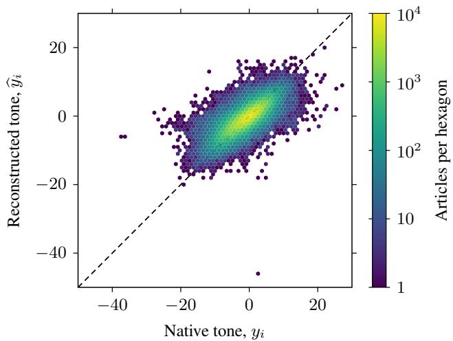
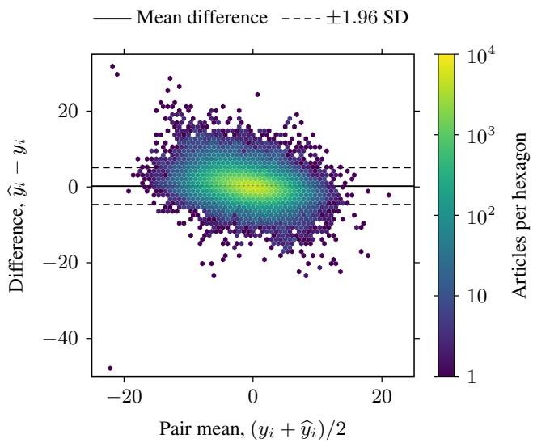
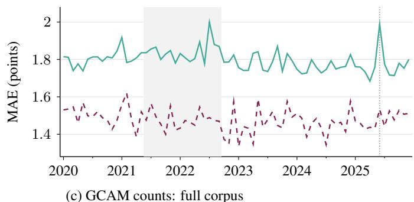
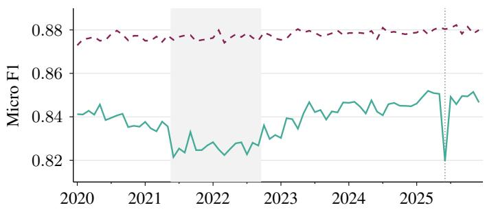
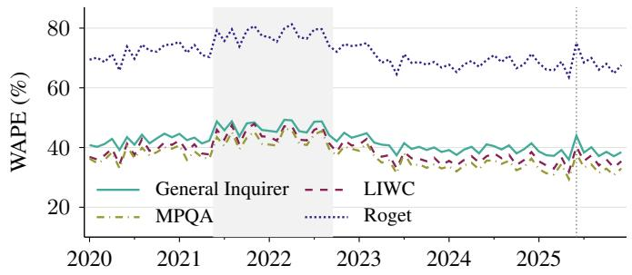
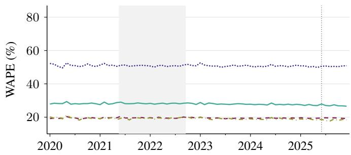
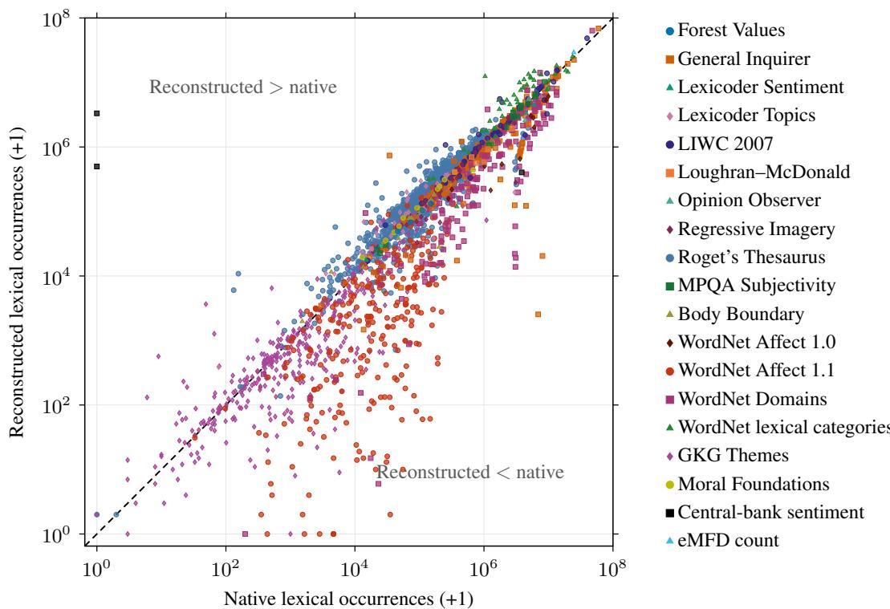

# Agreement Between Reconstructed and Native GDELT GKG Records: A Field-Level Baseline

Nikita A. Klimin

Abstract—The Global Knowledge Graph (GKG) of the Global Database of Events, Language, and Tone (GDELT) characterizes news articles using named entities, topics, quantitative and temporal features, quotations, tone, and dictionary-based content measures. Its codebook defines the record format, but the software that produces the records is not public, so researchers cannot generate compatible records for articles they collect themselves. We built an open-source reconstruction, gdelt-regkg, and measured how closely it agrees with GDELT’s archived (native) records for 193,550 English articles from 8,729 publishers (2020–2025) and 2,500 articles in five other languages. Agreement depends strongly on the field. English tone, the percentage of positive minus negative words, has a mean absolute error (MAE) of 1.79 points and a concordance correlation coefficient of 0.75. Identity agreement (F1) is 0.65 for persons, 0.42 for organizations, and 0.65 for locations. It is lower for date components (0.42), complete counts with their objects and locations (0.07), and quotations (0.07), while GCAM category presence reaches micro F1 0.84 within the implemented dictionaries. In subsets where retrieved and native titles and lengths match, tone error falls to 1.47 and organization F1 rises to 0.48, yet most disagreement remains. A larger gazetteer raises coverage of native places from 89.5% to 97.1% with little change in location F1. Tone computed on English translations of non-English articles is less accurate (MAE 2.10–2.64) than for English articles. The results are conditional on article pages that could still be retrieved, and the correspondence subsets do not isolate the effect of input differences. Reconstructed records should therefore be assessed field by field and not treated as completely interchangeable with native ones.

Index Terms—Agreement evaluation, dictionary-based sentiment analysis, Global Knowledge Graph, information extraction, reproducibility.

## I. INTRODUCTION

derived data with global coverage [1]. One of its main databases is the Global Knowledge Graph (GKG), which represents news through themes, sentiment, entities, locations, counts and amounts, and dictionary-based content measures (Global Content Analysis Measures, GCAM). The GKG codebook [2] specifies the record format and field definitions, but formatting alone does not reproduce the extraction decisions behind original GKG values. Compatible records would let researchers process independently collected articles through existing GKG workflows.

This study asks how much of GKG can be reproduced from public documentation and resources. We built gdelt-regkg, an open-source Python library, to reconstruct GKG fields from article text. We ran it on retrieved text of articles that GDELT had processed, and then compared its output with GDELT’s archived output field by field. The codebook and many of the lexical resources we used are public. Two components, however, were derived from GDELT;s own output: the gazetteer was built from original records, and the tone word lists were tuned against original scores.

There are two sources of uncertainty that affect the comparison: our implementation differs from GDELT’s unreleased pipeline, and the retrieved text may differ from the text GDELT originally processed. We therefore ask four questions. First, how does agreement vary across GKG fields and comparison units? Second, how does agreement change when the retrieved text is more likely to match the text GDELT processed? Third, how does agreement change over time, given that older pages are more likely to have been revised or lost? Fourth, how does agreement vary with gazetteer size and between originallanguage processing and processing of English translations?

## II. ABOUT THE SOFTWARE

gdelt-regkg is an open-source Python library and commandline tool for reconstructing GDELT Global Knowledge Graph fields from news articles. The library provides a modular pipeline that combines natural language processing, namedentity recognition and geographic resolution with compiled dictionaries and extraction rules. Its outputs include themes, people, organizations, locations, counts, amounts, dates, quotations, tone, and Global Content Analysis Measures (GCAM). The package also provides translation, resource compilation and a benchmark for measuring field-level agreement with original GKG outputs. gdelt-regkg [3] is distributed through PyPI1, and its source code is available at GitHub2.

Table I illustrates selected outputs for an article on EU–UK trade negotiations from 41nbc.com (native record 20201224001500-1294). The article was chosen to illustrate the record format and the comparison; it does not indicate the quality of the reconstruction in general, which is quantified in Section VI. In this pair, the themes match exactly and the reconstruction returns one additional “U.K.” location entry.

TABLE I  
EXAMPLE OF NATIVE AND RECONSTRUCTED FIELDS
<table><tr><td>Field</td><td>Native GDELT</td><td>Reconstructed</td></tr><tr><td>Persons</td><td>boris johnson</td><td>boris johnson</td></tr><tr><td>Organizations</td><td>s european union</td><td>european union</td></tr><tr><td>Location</td><td>U.K.; Brussels</td><td>U.K.; Brussels; U.K.</td></tr><tr><td>Themes</td><td>LEADER; TAX_FNCACT;...</td><td>LEADER; TAX_FNCACT;...</td></tr><tr><td>Tone</td><td>-1.471</td><td>-1.538</td></tr><tr><td>Token count</td><td>124</td><td>130</td></tr></table>

## III. RELATED WORK

An early critique of GDELT highlighted the lack of access to original source texts, which limited independent verification of coding decisions, and raised concerns about the conceptual definition of tone [4]. Retrieving articles through their URLs allows independent examination of GDELT outputs, but the retrieved text may differ from what GDELT originally processed.

Later assessments raised further concerns about data quality. The UK Office for National Statistics noted that it remains unclear whether specific quality-assurance mechanisms are incorporated into GDELT’s data processing pipeline [5]. Wang et al. [6] identified reliability and validity concerns in a comparative evaluation of automated event databases, including GDELT and ICEWS. Their analysis revealed a considerable reduction in the number of usable events following URL retrieval, content verification, deduplication, and event classification. Specifically, only 21% of GDELT records with valid URLs were found to correspond to the target events. A more recent statistical assessment of the GDELT event database reported approximately 55% accuracy across key fields and a redundancy rate of around 20% [7]. Only one of the studies above concerns GKG directly: an examination of 100 randomly selected news articles found that GDELT’s theme extraction algorithm tended to identify themes even when none were present [8, p. 3].

The event-database assessments do not directly establish the quality of GKG fields, and no conclusions about GKG can be inferred from them. It is also worth noting that the studies above primarily evaluated archived records as given or checked GDELT against external sources, rather than reproducing its outputs. Certain GKG fields may be more amenable to partial reproduction than the event database, because their underlying methods are well described in the GKG codebook [2] and in GDELT’s technical posts3. Nevertheless, reproducing GDELT’s outputs remains ambitious even with improved processing methods, as undocumented algorithms may prevent exact replication.

Kohlhepp [9] proposes K-N-GDELT as a replacement for GDELT, rather than a reconstruction of its native outputs. The system uses dictionary-based event coding and large language models and does not aim for backward compatibility with GDELT records. The report presents geopolitical applications but gives limited implementation details and no quantitative evaluation of extraction accuracy or of agreement with native GKG fields, so its outputs cannot be compared with ours. Its claims of improved extraction are therefore not established by the reported evidence.

Reconstructing native outputs also depends on the accessibility and mutability of online articles. Link rot can make previously available articles inaccessible, potentially eliminating the evidence needed to reproduce earlier findings, with more effect on older pages [10]. Even when URLs remain accessible, their content may change over time due to publisher revisions or website practices that reuse existing URLs for updated content. Research on news revisions identifies factual, stylistic, and narrative changes, demonstrating that an article URL does not necessarily identify an immutable version of its content [11]. Furthermore, differences in article-body extraction may produce inconsistent representations of the same source, introducing additional variability before downstream analysis.

Web-processing tools also introduce such variability. For example, news-please [12] combines extraction tools and heuristics to recover article text and metadata; Trafilatura [13] targets the main text while removing irrelevant elements; and simpler tools, such as Beautiful Soup [14], provide HTML parsing, element selection and visible text extraction. These approaches can retain different paragraphs, captions, and other elements from the same page, potentially affecting later processing.

To summarize, reproducing and evaluating GKG outputs remains challenging without access to the original processing pipeline and the exact source texts used by GDELT. The available information provides a basis for partial reconstruction but does not fully specify the details needed for faithful replication. To the best of our knowledge, gdelt-regkg is the first public package specifically designed to reconstruct GKGcompatible records from article text. It enables researchers to process independently collected articles using the GKGcompatible format. This study presents the package and evaluates its agreement with native GKG records field by field.

## IV. MATERIALS

In this work, native denotes values in archived GKG records. Reconstructed denotes values computed from the re-trieved bodies. For numeric comparisons, yi is native and ybi is reconstructed. The article–native-record pair is the evaluation unit.

## A. English Corpus

English candidates came from six scheduled GKG archive windows per month between 1 January 2020 and 31 December 2025; unavailable windows were not replaced. GKG is published as archive files every 15 minutes; each scheduled archive is one window. Records were parsed from each retrieved archive file. A record was eligible if it came from the web source collection, had an HTTP(S) URL, and was not marked as translated. For a month with D days, sampling selected days ⌈D/4⌉ and ⌈3D/4⌉, at 00:15, 12:00, and 23:45 UTC. Across the 72-month period, 421 of the 432 scheduled archives were available and 11 were unavailable. Repeated URLs were consolidated; conflicts in extraction-relevant native fields were audited before unambiguous pairing.

Article pages were retrieved on 8–9 October 2026 (UTC), approximately 9 months to 7 years after the publication date of the archives. A URL was counted as failed if the download or processing raised an error (network or HTTP errors, non-HTML responses, responses larger than 5 MiB), if no text could be extracted, if the extracted body had fewer than 50 tone tokens, or if the page was detected as an access-denied or browser-challenge notice. Bodies not identified as English by the language detector were then excluded.

Titles were stored separately and were not prepended to the body. Exact duplicates of normalized token sequences and near duplicates at a Hamming distance $\leq 3$ bits of a 64-bit SimHash were removed [15].

Annual acquisition and retention are summarized in Table II.

TABLE II  
ACQUISITION AND RETENTION
<table><tr><td>Year</td><td>Attempted URLs</td><td>Retained</td><td>Retention %</td></tr><tr><td>2020</td><td>105,772</td><td>29,068</td><td>27.48</td></tr><tr><td>2021</td><td>92,123</td><td>25,144</td><td>27.29</td></tr><tr><td>2022</td><td>83,638</td><td>25,572</td><td>30.57</td></tr><tr><td>2023</td><td>107,833</td><td>36,957</td><td>34.27</td></tr><tr><td>2024</td><td>99,995</td><td>39,351</td><td>39.35</td></tr><tr><td>2025</td><td>87,860</td><td>37,458</td><td>42.63</td></tr><tr><td>Total</td><td>577,221</td><td>193,550</td><td>33.53</td></tr></table>

## B. Multilingual Corpus

The multilingual sample used translated GKG archives corresponding to those used for the English sample; no other archive windows were requested. The target was 500 originallanguage articles each in French, Spanish, German, Russian, and Chinese, stratified across 2020–2025. The original language came from the native translation-information field and was checked against the retrieved body using language detector. This collection required at least 250 alphabetic Unicode characters, with exact-body deduplication and a cap of 50 articles per hostname within each language.

Of the 421 corresponding translated archives, 420 contained required entries. Annual selection targets were 84 articles per language in each of 2020 and 2021 and 83 in each remaining year. We generated English translations of the full texts of all French, Spanish, German, and Russian articles and of 499 Chinese articles. One Chinese translation reached the generation limit and was excluded from translation-dependent comparisons.

The English and multilingual samples have separate inclusion rules. Their processing is described in Section V-D and their results in Section VI-I.

## V. METHODS

## A. Software

English acquisition used Trafilatura 2.3.0 [13] to extract the body and title, with comments and tables excluded. Lingua 2.2.0 [16] identified the language. We generated English translations with the facebook/m2m100\_418M checkpoint of M2M100 [17], using Transformers 5.19.0 [18], CUDA, and half-precision weights.

GKG fields were reconstructed using gdelt-regkg 2.1.2 [3]. Entity spans were computed once per English body and reused across geographic conditions. The frozen resource profiles were tone.v3, themes.v3, counts.v3, names.v1, and custom GCAM v5 with supplied LIWC [19] and MPQA Subjectivity [20] inputs. These labels identify versions of the extraction resources, which are versioned separately from the package release. Named-entity recognition used spaCy

3.8.16 [21] and en\_core\_web\_lg 3.8.0 [22]. LIWC is licensed and is not redistributed. Each dictionary is computed independently, so the results for the other dictionaries do not depend on it. Dictionary licenses are listed in the gdelt-regkg documentation4.

## B. Tone

Tone used a General Inquirer-based vocabulary [23]. Positive, negative, activity, and self/group word lists were refined against GKG scores in a separate development corpus built from native GKG files that do not overlap the English corpus, from September–October 2026. It contained 1,059 training articles and 1,322 validation articles. Candidate word additions and removals were fitted on the training articles and selected on the validation articles to reduce disagreement with native tone and its components.The lists were fixed before benchmark evaluation.

The tone tokenizer produces normalized word and number tokens while retaining internal apostrophes and hyphens. Tone was approximated as

$$
\widehat { T } _ { i } = 1 0 0 \frac { m _ { i } ^ { + } - m _ { i } ^ { - } } { N _ { i } ^ { \mathrm { r e c } } }\tag{1}
$$

where $N _ { i } ^ { \mathrm { r e c } }$ is the reconstructed token count and $m _ { i } ^ { + }$ and $m _ { i } ^ { - }$ count positive and negative lexical matches. Repeated tokens and stopwords remain in $N _ { i } ^ { \mathrm { r e c } }$ . Positive Score and Negative Score are the percentages of tokens matching the corresponding word lists. Polarity uses the union of the positive and negative lists. Activity Reference Density and Self/Group Reference Density use their respective word lists and the same denominator. The GKG Word Count component is represented by $N _ { i } ^ { \mathrm { r e c } }$ . These are reconstructed approximations of the corresponding GKG tone components.

## C. Geographic Resources

The primary configuration used an expanded gazetteer with 119,733 entries. The comparison used the bundled inventory of 17,177 entries, built with the default gdelt-regkg configuration. Both were built from native GKG location fields dated 2015 to before 2020 without use of external gazetteers, and remained fixed during evaluation. The same English bodies, cached entity spans, and extraction rules were used for both inventories. A larger inventory adds available identities, spelling aliases, and historical observation frequencies, which should help resolve ambiguous place names.

For native location identities $L _ { i }$ in article i and gazetteer inventory $G ,$ assignment coverage is

$$
C ( G ) = \frac { \sum _ { i } \left| L _ { i } \cap G \right| } { \sum _ { i } \left| L _ { i } \right| } .\tag{2}
$$

Each identity contributes once per article. Coverage measures whether the resource contains native identities; location F1 measures whether the reconstruction recovers them. The resource contrast is the paired expanded-minus-bundled difference. We also evaluate complete count tuples, which require geographic attachments to agree.

## D. GCAM

This work defines a category as implemented if it has a rule or lexical resource in the reconstruction profile, and as observed if it occurs in at least one native or reconstructed output within the evaluated subset. Thus, some implemented categories may never appear in the native outputs, while some observed categories may appear only in native outputs and have no corresponding implementation.

The frozen GCAM profile covers 2,492 categories across the evaluated languages, identified by 31 dictionary IDs. Lexicalmatch dictionaries count matched token or phrase occurrences within each category. Weighted dictionaries average the imported word ratings over matched token occurrences. The profile includes 268 authored GKG theme-category approximations and one French imagery approximation based on rating-interval midpoints. Table A1 and Appendix A document all dictionaries and procedures used.

We followed GDELT’s distinction between originallanguage GCAM and analysis of English translations [24] and kept processing separate. English dictionaries were applied to the English corpus and to translations. Original-language dictionaries were applied only to the corresponding originallanguage bodies.

Category presence means a lexical count greater than zero. Presence is evaluated separately from weighted-score availability and agreement on score values. A companion count is the number of lexical matches associated with a weighted score. If a native weighted score is reported without a companion count, the corresponding article–category pair is excluded from both the native and reconstructed outputs used in the comparison.

A reconstructed-only assignment occurs when an article– category pair has a positive reconstructed count but no positive native count in the retained comparison. Native count support is the number of article–category pairs with a positive native count.

## E. Input Correspondence

The retrieved bodies may differ from the text processed by GDELT. We examined agreement in subsets selected by title equality, body length, or quotation anchors. Each subset used the same reconstructed outputs as the full English corpus.

The native title came from the PAGE\_TITLE element of the GKG extra-XML field, with embedded tags removed. The reconstructed title came from the stored Trafilatura extraction metadata. Both were HTML-unescaped, Unicode-NFKC normalized, case-folded, and split into alphanumeric tokens. The Title-available subset required nonempty token sequences on both sides. The Title-matched subset required both titles to contain at least four tokens and at least three distinct tokens outside the fixed stopword list. It also required equality of the complete normalized token sequences; stopwords were retained in that equality check. These criteria defined diagnostic subsets only.

Length correspondence used native and reconstructed tone token counts:

$$
r _ { i } = \frac { N _ { i } ^ { \mathrm { r e c } } } { N _ { i } ^ { \mathrm { n a t i v e } } } .\tag{3}
$$

The native denominator had to be positive. The Title-andlength $( \pm 1 0 \% )$ subset required Title-matched eligibility and $0 . 9 0 \leq r _ { i } \leq 1 . 1 0$ . Sensitivity analyses used length bands of 5% and 20%.

A quotation-anchor subset was selected independently of title and length. An article required at least two distinct eligible native quotations; an eligible quotation contained at least 40 characters and eight whitespace-separated tokens. At least 80% of its eligible quotations had to occur in the normalized retrieved body.

We assessed sensitivity to additional near-duplicate removal by applying a five-bit SimHash Hamming-distance cutoff to the retained English corpus. Agreement was recalculated using the existing predictions. This comparison assesses sensitivity to corpus composition.

## F. Agreement Measures

For article i, within-article set or multiset matching gives true positives $T P _ { i } .$ , false positives $F P _ { i }$ , and false negatives $F N _ { i }$ . The principal categorical endpoint pools these counts:

$$
F _ { \mathrm { 1 , m i c r o } } = { \frac { 2 \sum _ { i } T P _ { i } } { 2 \sum _ { i } T P _ { i } + \sum _ { i } F P _ { i } + \sum _ { i } F N _ { i } } } .\tag{4}
$$

An item cannot match across articles. Precision divides pooled true positives by the number of reconstructed items; recall divides them by the number of native items.

For a set $U _ { + }$ of units with nonzero F1 denominators, macro F1 is

$$
F _ { 1 , \mathrm { m a c r o } } = \frac { 1 } { \left| U _ { + } \right| } \sum _ { u \in U _ { + } } \frac { 2 T P _ { u } } { 2 T P _ { u } + F P _ { u } + F N _ { u } } .\tag{5}
$$

Both-empty units are excluded from $U _ { + } ;$ units with content on only one side contribute zero.

The unit u is an article, a category, or a publisher for article-, category-, or publisher-macro F1. Counts are pooled within each category or publisher before averaging.

Category-macro F1 covers theme labels and GCAM lexicalmatch categories, separately for all observed categories and the applicable implemented inventory. Article-macro F1 has cluster intervals for the principal endpoints.

For n valid numeric pairs, we report error in the original score units:

$$
\mathrm { { M A E } } = \frac { 1 } { n } \sum _ { i = 1 } ^ { n } { \widehat { | y _ { i } - y _ { i } | } } .\tag{6}
$$

$$
{ \mathrm { B i a s } } = { \frac { 1 } { n } } \sum _ { i = 1 } ^ { n } ( { \widehat { y } } _ { i } - y _ { i } ) .\tag{7}
$$

$$
{ \mathrm { R M S E } } = { \sqrt { { \frac { 1 } { n } } \sum _ { i = 1 } ^ { n } ( { \widehat { y } } _ { i } - y _ { i } ) ^ { 2 } } } .\tag{8}
$$

Lin’s concordance correlation coefficient [25] is

$$
\mathrm { C C C } = { \frac { 2 \mathrm { C o v } ( Y , \widehat { Y } ) } { \mathrm { V a r } ( Y ) + \mathrm { V a r } ( \widehat { Y } ) + ( \bar { y } - \overline { { { \widehat { y } } } } ) ^ { 2 } } } .\tag{9}
$$

Here ${ \bar { y } } = n ^ { - 1 } \sum _ { i } y _ { i }$ and $\overline { { \widehat { y } } } = n ^ { - 1 } \sum _ { i } \widehat { y } _ { i }$ are the paired-sample means, and $\begin{array} { r } { \operatorname { V a r } ( \dot { Y } ) = n ^ { - 1 } \sum _ { i } ( y _ { i } - \bar { y } ) ^ { 2 } } \end{array}$ , with an analogous definition for ${ \widehat { Y } } ,$ and $\begin{array} { r } { \mathrm { C o v } ( Y , \widehat { Y } ) = n ^ { - 1 } \sum _ { i } ( y _ { i } - \bar { y } ) ( \widehat { y } _ { i } - \overline { { \widehat { y } } } ) } \end{array}$ The same divisor n is used throughout. CCC is undefined for insufficient or numerically degenerate paired samples.

As a separate descriptive ratio, tone MAE was divided by the sample standard deviation of native tone $s _ { \mathrm { n a t i v e } }$ . The ratio does not replace MAE and expresses error relative to variability in native tone.

Tone sign agreement uses a neutral band with $\tau = 0 . 5 \mathrm { : }$

$$
s _ { \tau } ( z ) = \left\{ { \begin{array} { l l } { - 1 , } & { z < - \tau , } \\ { 0 , } & { - \tau \leq z \leq \tau , } \\ { 1 , } & { z > \tau . } \end{array} } \right.\tag{10}
$$

$$
{ \mathrm { S i g n A g r e e m e n t } } = { \frac { 1 } { n } } \sum _ { i = 1 } ^ { n } \mathbf { 1 } [ s _ { \tau } ( { \widehat { y } } _ { i } ) = s _ { \tau } ( y _ { i } ) ] \times 1 0 0 \%\tag{11}
$$

The Bland–Altman plot displays ${ \widehat { y } } _ { i } - y _ { i }$ against $( y _ { i } + { \widehat { y } } _ { i } ) / 2$ . The descriptive 95% limits of agreement are calculated as the bias ±1.96 sample standard deviations (SD) of the differences [26].

Weighted absolute percentage error (WAPE) is used for implemented GCAM families with native lexical-count support:

$$
\mathrm { W A P E } _ { d } = \frac { \sum _ { i = 1 } ^ { n } \sum _ { k \in K _ { d } } \left| \widehat { y } _ { i k } - y _ { i k } \right| } { \sum _ { i = 1 } ^ { n } \sum _ { k \in K _ { d } } y _ { i k } } \times 1 0 0 \%\tag{12}
$$

Here $y _ { i k }$ and $\widehat { y } _ { i k }$ are the native and reconstructed occurrence counts for article i and implemented category k, and $K _ { d }$ contains the implemented comparable lexical-match categories in family d. WAPE is undefined when the native-count denominator is not positive.

For weighted scores, availability F1 was

$$
F _ { \mathrm { 1 , a v a i l a b i l i t y } } = \frac { 2 c _ { \mathrm { b o t h } } } { c _ { \mathrm { n a t i v e } } + c _ { \mathrm { r e c } } } ,\tag{13}
$$

where the counts denote article–category pairs with both values $( c _ { \mathrm { b o t h } } )$ , a native value $( c _ { \mathrm { n a t i v e } } )$ , or a reconstructed value $( c _ { \mathrm { r e c } } )$ . An available value of zero was retained; a missing value was not. Paired-value errors used only pairs with both values.

Perfect agreement gives F1 and CCC of 1, sign agreement of 100%, and MAE, RMSE, and WAPE of 0. Zero bias alone does not establish agreement.

## G. Alignment

Outputs were aligned by document identifier, timestamp, and source collection before scoring. Name normalization used Unicode NFKC, case folding, apostrophe normalization, and whitespace collapse while preserving punctuation. Theme codes were compared exactly. The standalone Themes field used 519 implemented labels and was evaluated separately from the 367 GKG Themes categories represented within GCAM. Count comparisons retained tuple multiplicity. Malformed native fields were excluded only from the affected comparison; malformed categorical predictions were treated as empty, retaining their native items as false negatives. Numeric errors required valid paired values. Valid empty fields and unavailable values were separated throughout. For categorical comparisons, valid articles have a well-formed native value for the field, while active articles contain at least one item in either output.

Table III defines the matching units used in the field-level results, including the progressively stricter count comparisons.

## H. Temporal Agreement

English pairs were grouped into 72 months by native GKG timestamp, using the expanded gazetteer throughout. Each month is sampled on two days, so each calendar month is represented by articles represented by 12 sampled days across the six years. We computed monthly tone MAE, micro F1, and dictionary-specific count WAPE for the full corpus, the Title-matched subset, and the Title-and-length subsets with 5%, 10%, and 20% bands. Comparisons spanning several months pooled matching counts and WAPE numerators and denominators; tone MAE was weighted by the number of valid pairs. Period boundaries were chosen after inspecting the fullcorpus monthly series and are therefore exploratory; they were applied unchanged to all subsets and dictionaries. To examine recurring calendar patterns, date-component agreement was compared by year and date resolution, then pooled by calendar month across years. Temporal comparisons are descriptive point estimates.

TABLE III  
FIELD RECONSTRUCTION AND COMPARISON UNITS
<table><tr><td>Field</td><td>Reconstruction</td><td>Matched unit within an article</td></tr><tr><td>Persons, organizations, all names</td><td>Named-entity spans and name rules</td><td>Sets of normalized name identities</td></tr><tr><td>Themes</td><td>Phrase, wildcard, and context rules</td><td>Sets of exact theme codes</td></tr><tr><td>Locations</td><td>Place recognition and gazetteer resolution</td><td>Type, country, first-level administrative code (ADM1), and feature ID</td></tr><tr><td>Counts</td><td>Quantity-object-location templates</td><td>Multisets: label + quantity; object additionally requires the attached object text; full tuple also requires location type, name, country, ADM1, latitude, longitude, and</td></tr><tr><td>Dates</td><td>Calendar-validated patterns</td><td>feature ID Resolution and available month, day, and year components</td></tr><tr><td>Amounts</td><td>Numeric/scale normalization and object attachment</td><td>Sets of numeric values; value + object additionally requires the same normalized attached object text</td></tr><tr><td>Quotations</td><td>Delimiters and reporting-verb rules</td><td>Sets of normalized quotation texts</td></tr><tr><td>Tone GCAM</td><td>General Inquirer-based vocabulary</td><td>Paired scalar scores, Eq. (1)</td></tr><tr><td></td><td>Language-specific dictionaries</td><td>Lexical-match category presence; implemented lexical counts; paired weighted scores</td></tr></table>

## I. Aggregation and Uncertainty

Six-year estimates were recalculated from pooled article contributions, not averaged across monthly scores. Publishers were grouped by native source-common-name, with URL hostname as fallback. Principal intervals used 2,000 publishercluster bootstrap replicates with percentile limits at 2.5% and 97.5% [27]. Resampling a publisher retained all its article contributions together. English conditions used a common publisher frame and identical draws; paired contrast intervals used replicate-wise differences. Multilingual analyses used separate language-and-stream frames. Numeric publisher counts included only sources with valid pairs. Multilingual endpoints with fewer than 100 paired articles or 20 contributing publishers were flagged as descriptive.

## VI. RESULTS

## A. Corpus and Attrition

The English collection retained 193,550 articles from 8,729 publishers. Of 577,221 attempted unique URLs, 311,455 failed the retrieval and extraction checks described in Section IV, and 34,687 were not identified as English. Of the remaining 231,079 articles, 33,218 were exact-body duplicates, 4,308 were near duplicates, and 3 had conflicting native records; these were excluded.

The annual retention fraction rose from 27.5% in 2020 to 42.6% in 2025 (Table II). This retention measure combines retrieval, extraction, language screening, and duplicate and native-record exclusions.

## B. Categorical Field Agreement

Person and location identities had higher agreement than organizations, whereas complete counts and quotation texts had the lowest F1 among the principal comparisons (Table IV). Person, organization, and location micro F1 were 0.646 [0.637, 0.656], 0.417 [0.411, 0.422], and 0.654 [0.646, 0.662], respectively. The table reports the number of active articles for each comparison, meaning articles with at least one item in either output, rather than the total corpus size. All valid articles contribute to pooled matching; both-empty pairs add no items. Location and date comparisons had 193,502 and 193,541 valid articles, respectively; the other rows used all 193,550 articles.

Person precision and recall were 0.571 and 0.745; organization precision and recall were 0.492 and 0.362. Article-macro F1 was 0.592 [0.582, 0.603] for persons and 0.325 [0.319, 0.331] for organizations, below their pooled micro scores. Publisher-macro F1 was 0.589 and 0.357, respectively.

Counts lost agreement as the required tuple became more specific: F1 was 0.285 [0.276, 0.295] for label–quantity pairs, 0.166 [0.158, 0.176] after requiring the attached object, and 0.070 [0.066, 0.076] after also requiring all geographic fields. Amount-value F1 was 0.406 [0.397, 0.415], falling to 0.198 [0.193, 0.203] when the object also had to match. These comparisons use the distinct units in Table III; matching a number alone does not imply agreement on what it describes.

Date-component F1 was 0.424 [0.409, 0.439], with precision 0.290 and recall 0.792. The component-specific results varied from F1 0.652 for day–month dates to 0.125 for day– month–year dates. Quotation-text F1 was 0.068 [0.063, 0.074], and the broader all-names field had F1 0.231 [0.226, 0.236].

Theme micro F1 was 0.617, but category-macro F1 was 0.028 across 12,597 observed labels. Restricting both outputs to implemented labels gave micro F1 0.698 and categorymacro F1 0.675 across 519 labels.

## C. Tone Agreement

Tone MAE was 1.79 [1.76, 1.82] and CCC was 0.749 [0.736, 0.759] across all 193,550 English pairs. Native tone had sample standard deviation $s _ { \mathrm { n a t i v e } }$ of 3.891, giving $\mathrm { M A E } / s _ { \mathrm { n a t i v e } } \ 0 . 4 5 9$ . Signed bias was 0.22 points, RMSE was 2.50, and three-class sign agreement was 70.5%. Thus the small average signed difference coexisted with appreciable article-level absolute errors. Fig. 1 compares the paired tone values with the identity line.

The Bland–Altman plot shows the reconstructed-minusnative differences against the pair mean (Fig. 2). The descriptive limits were −4.67 and 5.10 points. Both plots show all English pairs, including extreme values.

TABLE IV  
ENGLISH FIELD AGREEMENT
<table><tr><td>Field / comparison</td><td>Active articles</td><td>Micro F1</td><td>Article-macro F1</td><td></td><td>Category-macro F1</td><td>Publisher-macro F1</td></tr><tr><td>Persons / normalized identities</td><td>172,393</td><td>0.646 [0.637, 0.656]</td><td></td><td>0.592 [0.582, 0.603]</td><td></td><td>0.589</td></tr><tr><td>Organizations / normalized identities</td><td>158,843</td><td>0.417 [0.411, 0.422]</td><td></td><td>0.325 [0.319, 0.331]</td><td></td><td>0.357</td></tr><tr><td>Locations / identities</td><td>167,617</td><td>0.654 [0.646, 0.662]</td><td></td><td>0.543 [0.532, 0.554]</td><td></td><td>0.586</td></tr><tr><td>Themes / all labels</td><td>192,585</td><td>0.617 [0.611, 0.622]</td><td></td><td>0.526 [0.519, 0.534]</td><td>0.028</td><td>0.529</td></tr><tr><td>Counts / label + quantity</td><td>28,143</td><td>0.285 [0.276, 0.295]</td><td></td><td>0.153 [0.147, 0.159]</td><td></td><td>0.179</td></tr><tr><td>Counts / object</td><td>28,143</td><td>0.166 [0.158, 0.176]</td><td></td><td>0.088 [0.085, 0.092]</td><td></td><td>0.104</td></tr><tr><td>Counts / full tuple</td><td>28,143</td><td>0.070 [0.066, 0.076]</td><td></td><td>0.039 [0.037, 0.041]</td><td></td><td>0.046</td></tr><tr><td>Dates / components</td><td>140,402</td><td>0.424 [0.409, 0.439]</td><td></td><td>0.308 [0.293, 0.322]</td><td></td><td>0.366</td></tr><tr><td>Amounts / values</td><td>181,720</td><td>0.406 [0.397, 0.415]</td><td></td><td>0.377 [0.370, 0.383]</td><td></td><td>0.396</td></tr><tr><td>Amounts / value + object</td><td>181,720</td><td>0.198 [0.193, 0.203]</td><td></td><td>0.180 [0.177, 0.184]</td><td></td><td>0.195</td></tr><tr><td>All names / identities</td><td>193,504</td><td>0.231 [0.226, 0.236]</td><td></td><td>0.225 [0.220, 0.230]</td><td></td><td>0.220</td></tr><tr><td>Quotations / content</td><td>148,422</td><td>0.068 [0.063, 0.074]</td><td></td><td>0.053 [0.050, 0.055]</td><td>0.675</td><td>0.063</td></tr><tr><td>Themes / implemented labels</td><td>192,510</td><td></td><td>0.698</td><td>0.597</td><td></td><td></td></tr><tr><td>GCAM / presence</td><td>193,550</td><td>0.824 [0.819, 0.827]</td><td></td><td>0.809 [0.805, 0.814]</td><td>0.651</td><td>0.811</td></tr><tr><td>GCAM / implemented presence</td><td>193,550</td><td>0.840 [0.836, 0.844]</td><td></td><td>0.826 [0.821, 0.830]</td><td>0.674</td><td>0.828</td></tr></table>

Active articles have at least one item in either output. Micro F1 pools within-article matches; article-macro F1 averages over articles with at least one item on either side. Category-macro F1 applies to theme labels and GCAM categories observed in either output. Publisher-macro F1 averages defined publisher-specific scores. Brackets give 95% publisher-cluster intervals where calculated. A dash denotes an inapplicable or uncalculated average.

  
Fig. 1. Native and reconstructed tone for all 193,550 English articles. Color shows the number of articles per hexagon. The dashed line is identity.

  
Fig. 2. Tone differences against the pair mean for all 193,550 English articles. Color shows articles per hexagon. The solid line is mean bias (0.22); dashed lines are bias ±1.96 sample SD of the differences (−4.67, 5.10).

For the remaining tone components, positive and negative density had MAE 1.07 and 1.34 points and CCC 0.664 and 0.702. Activity density had MAE 3.19 points and bias −1.58 points. Reconstructed token counts exceeded native counts by 81.3 tokens on average, with MAE 147.1 tokens and CCC 0.638. Polarity and self/group density had MAE 1.75 and 0.35 points and CCC 0.581 and 0.705, respectively. These components retain their own scales; their MAE values are not directly comparable across units.

## D. Input Correspondence

Title correspondence alone was associated with little change in tone error, while the Title-and-length (±10%) subset had lower tone error and higher entity F1 (Table V). The Titleavailable subset contained 193,100 articles, and the Titlematched subset contained 117,217. Tone MAE was 1.79 in the Title-available subset and 1.77 in the Title-matched subset, compared with 1.79 in the full corpus.

The Title-and-length (±10%) subset contained 54,485 articles. Tone MAE was 1.47 [1.46, 1.49] and CCC was 0.830 [0.826, 0.834]; person, organization, and location F1 were 0.748, 0.483, and 0.727. The 5% and 20% bands retained 23,121 and 81,668 articles, with tone MAE 1.48 and 1.51, respectively. The narrower band did not yield the lowest MAE; across these bands, organization F1 ranged from 0.473 to 0.483 and location F1 from 0.720 to 0.727.

The quotation-anchor subset, selected independently of title and length, contained 1,067 articles, with tone MAE 1.41 [1.35, 1.48], CCC 0.810 [0.786, 0.832], and location F1 0.746.

## E. Deduplication Robustness

Applying additional duplicate-detection removed further 1,415 articles. On the remaining 192,135 articles, agreement changed only marginally: tone MAE was 1.78, and person, organization, and location F1 were 0.649, 0.418, and 0.656 (Table V).

## F. Temporal Agreement

Agreement did not improve consistently with more recent native records (Fig. 3). Full-corpus monthly tone MAE ranged from 1.68 to 2.00 points. GCAM count disagreement increased across several dictionaries from approximately June 2021 through September 2022, then decreased.

General Inquirer count WAPE was 42.2% in January 2020– May 2021, 46.9% in June 2021–September 2022, and 39.7% in October 2022–May 2025. The Title-and-length (±10%) subset was nearly stable over the same periods, at 28.2%, 28.3%, and 27.7%. The same pattern held for LIWC, MPQA, and Roget and under the 5% and 20% length bands. The Title-matched subset retained the 2021–2022 increase.

Date agreement showed a recurring calendar pattern in the sampled days (Fig. 4). Pooled date-component F1 was 0.469 for March–May and 0.395 for September–December. The contrast was larger for day–month dates without a year: 0.742 versus 0.565. It persisted in the Title-and-length (±10%) subset, at 0.856 versus 0.678, and under the other length bands.

June 2025 contained only 879 articles, all from 8 June. Tone MAE was 1.99 and implemented GCAM presence F1 was 0.820. The scheduled 23 June archives were unavailable, which coincides with a gap in GDELT’s published files from 14 June to 1 July (the cause is not documented by GDELT). The June estimates therefore describe a partial month. The months after the outage (July–December 2025) were similar to the preceding period. We therefore did not treat them as a separate period.

TABLE V  
AGREEMENT BY INPUT CORRESPONDENCE AND DEDUPLICATION
<table><tr><td>Subset</td><td>Articles</td><td>Tone MAE</td><td>Tone CCC</td><td>Person F1</td><td>Org. F1</td><td>Location F1</td></tr><tr><td>Full corpus</td><td>193,550</td><td>1.79 [1.76, 1.82]</td><td>0.749 [0.736, 0.759]</td><td>0.646</td><td>0.417</td><td>0.654</td></tr><tr><td>Title-available</td><td>193,100</td><td>1.79 [1.76, 1.82]</td><td>0.749 [0.737, 0.759]</td><td>0.647</td><td>0.417</td><td>0.654</td></tr><tr><td>Title-matched</td><td>117,217</td><td>1.77 [1.73, 1.81]</td><td>0.759 [0.742, 0.772]</td><td>0.664</td><td>0.435</td><td>0.671</td></tr><tr><td>Title-and-length (±5%) subset</td><td>23,121</td><td>1.48 [1.46, 1.51]</td><td>0.827 [0.822, 0.833]</td><td>0.736</td><td>0.473</td><td>0.720</td></tr><tr><td>Title-and-length (±10%) subset</td><td>54,485</td><td>1.47 [1.46, 1.49]</td><td>0.830 [0.826, 0.834]</td><td>0.748</td><td>0.483</td><td>0.727</td></tr><tr><td>Title-and-length (±20%) subset</td><td>81,668</td><td>1.51 [1.49, 1.52]</td><td>0.830 [0.827, 0.833]</td><td>0.742</td><td>0.475</td><td>0.723</td></tr><tr><td>Quotation anchors</td><td>1,067</td><td>1.41 [1.35, 1.48]</td><td>0.810 [0.786, 0.832]</td><td>0.735</td><td>0.479</td><td>0.746</td></tr><tr><td>Stricter deduplication (≤ 5 bits)</td><td>192,135</td><td>1.78 [1.75, 1.82]</td><td>0.750 [0.738, 0.760]</td><td>0.649</td><td>0.418</td><td>0.656</td></tr></table>

F1 is micro-averaged. Brackets give 95% publisher-cluster intervals for tone.

(b) GCAM: implemented presence  
  
(d) GCAM counts: Title-and-length ( 10%)

  
Fig. 3. Monthly agreement for the full corpus and the Title-and-length (±10%) subset: (a) tone MAE; (b) GCAM implemented presence micro F1; (c) count WAPE for four dictionaries, full corpus; (d) the same, Title-and-length (±10%) subset. Points are monthly estimates without uncertainty. Shading marks June 2021–September 2022; the dotted line marks June 2025.

## (a) All date components

2020 0.40 0.43 0.52 0.53 0.54 0.50 0.46 0.46 0.40 0.46 0.40 0.38   
2021 0.39 0.43 0.46 0.48 0.46 0.42 0.44 0.38 0.39 0.39 0.35 0.37   
2022 0.37 0.39 0.42 0.41 0.47 0.41 0.42 0.37 0.42 0.38 0.35 0.37   
2023 0.33 0.37 0.47 0.47 0.44 0.46 0.49 0.42 0.39 0.42 0.40 0.45   
2024 0.39 0.39 0.46 0.45 0.48 0.46 0.44 0.40 0.43 0.39 0.38 0.41   
2025 0.38 0.38 0.47 0.45 0.47 0.36 0.48 0.40 0.39 0.39 0.42 0.36   
Jan Feb Mar Apr May Jun Jul Aug Sep Oct Nov Dec

(b) Day–month dates
<table><tr><td rowspan=1 colspan=1>2020</td><td rowspan=1 colspan=1>0.60</td><td rowspan=1 colspan=1>0.59</td><td rowspan=1 colspan=1>0.74 0</td><td rowspan=1 colspan=1>.74 0</td><td rowspan=1 colspan=1>.680</td><td rowspan=1 colspan=1>.73</td><td rowspan=1 colspan=1>0.73</td><td rowspan=1 colspan=1>0.66</td><td rowspan=1 colspan=1>0.52</td><td rowspan=1 colspan=1>0.59</td><td rowspan=7 colspan=5>0.80.70.60.50.40.3ov Dec</td></tr><tr><td rowspan=1 colspan=1>2021</td><td rowspan=1 colspan=1>0.53 0</td><td rowspan=1 colspan=1>.600</td><td rowspan=1 colspan=1>.68</td><td rowspan=1 colspan=1>0.73</td><td rowspan=1 colspan=1>0.74</td><td rowspan=1 colspan=1>0.65</td><td rowspan=1 colspan=1>0.70</td><td rowspan=1 colspan=1>0.58</td><td rowspan=1 colspan=1>0.51</td><td rowspan=1 colspan=1>0.53</td><td rowspan=1 colspan=2>0.52</td><td rowspan=1 colspan=1>0.59</td></tr><tr><td rowspan=1 colspan=1>2022</td><td rowspan=1 colspan=1>0.56</td><td rowspan=1 colspan=1>0.56 0.555</td><td rowspan=1 colspan=1>0.67</td><td rowspan=1 colspan=1>0.65</td><td rowspan=1 colspan=1>0.79</td><td rowspan=1 colspan=1>0.640</td><td rowspan=1 colspan=1>.71</td><td rowspan=1 colspan=1>0.58</td><td rowspan=1 colspan=1>0.63</td><td rowspan=1 colspan=1>0.55</td><td rowspan=1 colspan=2>0.50</td><td rowspan=1 colspan=1>0.56</td><td rowspan=1 colspan=1></td><td rowspan=1 colspan=1></td></tr><tr><td rowspan=1 colspan=1>2023</td><td rowspan=1 colspan=1>0.55</td><td rowspan=1 colspan=1>0.55 0.55</td><td rowspan=1 colspan=1>0.74</td><td rowspan=1 colspan=1>0.73</td><td rowspan=1 colspan=1>0.76</td><td rowspan=1 colspan=1>0.73</td><td rowspan=1 colspan=1>0.74</td><td rowspan=1 colspan=1>0.64</td><td rowspan=1 colspan=1>0.58</td><td rowspan=1 colspan=1>0.53</td><td rowspan=1 colspan=2>0.61</td><td rowspan=1 colspan=1>0.63</td><td rowspan=2 colspan=1></td><td rowspan=2 colspan=1></td></tr><tr><td rowspan=1 colspan=1>2024</td><td rowspan=1 colspan=1>0.58</td><td rowspan=1 colspan=1>0.622</td><td rowspan=1 colspan=1>0.70</td><td rowspan=1 colspan=1>0.78</td><td rowspan=1 colspan=1>0.783</td><td rowspan=1 colspan=1>0.73</td><td rowspan=1 colspan=1>0.75</td><td rowspan=1 colspan=1>0.62</td><td rowspan=1 colspan=1>0.60</td><td rowspan=1 colspan=1>0.56</td><td rowspan=1 colspan=2>0.59</td><td rowspan=1 colspan=1>0.58</td></tr><tr><td rowspan=1 colspan=1>20250.58</td><td rowspan=1 colspan=2>0.59</td><td rowspan=1 colspan=1>0.750</td><td rowspan=1 colspan=1>.80</td><td rowspan=1 colspan=1>0.80</td><td rowspan=1 colspan=1>0.65</td><td rowspan=1 colspan=1>0.78</td><td rowspan=1 colspan=1>0.65</td><td rowspan=1 colspan=1>0.59</td><td rowspan=1 colspan=1>0.61</td><td rowspan=1 colspan=2>0.59</td><td rowspan=1 colspan=1>0.56</td><td rowspan=1 colspan=1></td><td rowspan=1 colspan=1></td></tr><tr><td rowspan=1 colspan=1></td><td rowspan=1 colspan=2>Jan Feb M</td><td rowspan=1 colspan=1>ar</td><td rowspan=1 colspan=1>Apr</td><td rowspan=1 colspan=1>May</td><td rowspan=1 colspan=1>Jun</td><td rowspan=1 colspan=1>Jul</td><td rowspan=1 colspan=1>Aug</td><td rowspan=1 colspan=1>Sep</td><td rowspan=1 colspan=1>Oct N</td></tr></table>

Fig. 4. Date-component micro F1 by year (rows) and calendar month (columns): (a) all date components; (b) day–month dates without a year. Each month is sampled on two days.

The larger gazetteer substantially increased inventory coverage but made little difference to location identity F1 (Table VI). Expanding from 17,177 to 119,733 entries increased coverage of native within-article identities from 89.5% to 97.1%. The paired full-corpus location-F1 difference was 0.0006 [−0.0002, 0.0014]; both point estimates round to 0.654. Complete count-tuple F1 increased from 0.066 to 0.070, a paired difference of 0.0039 [0.0025, 0.0054]. The location contrast interval includes zero, while the count-tuple interval is positive.

The Title-and-length (±10%) subset showed the same direction of change: location F1 was 0.725 with the bundled resource and 0.727 with the expanded resource, while counttuple F1 was 0.068 and 0.073. The coverage column in Table VI describes the full corpus for both subsets.

TABLE VI  
GEOGRAPHIC AGREEMENT
<table><tr><td></td><td>Coverage (%)</td><td>Location F1</td><td>Count full-tuple F1</td></tr><tr><td>BF</td><td>89.5</td><td>0.654 [0.646, 0.661]</td><td>0.066 [0.062, 0.072]</td></tr><tr><td>BT</td><td>89.5</td><td>0.725 [0.719, 0.729]</td><td>0.068 [0.063, 0.074]</td></tr><tr><td>EF</td><td>97.1</td><td>0.654 [0.646, 0.662]</td><td>0.070 [0.066, 0.076]</td></tr><tr><td>ET</td><td>97.1</td><td>0.727 [0.722, 0.731]</td><td>0.073 [0.067, 0.078]</td></tr></table>

BF: Bundled, Full corpus; BT: Bundled, Title-and-length (±10%) subset; EF: Expanded, Full corpus; ET: Expanded, Title-and-length (±10%) subset. Coverage: native identities covered in the full corpus. Micro F1 with 95% publisher-cluster intervals in brackets.

GCAM lexical-match category presence had micro F1 0.824 [0.819, 0.827] across the full observed inventory and 0.840 [0.836, 0.844] within the implemented inventory (Table IV). Category-macro F1 was lower, at 0.651 across 2,442 observed categories and 0.674 across 2,359 implemented observed categories. Implemented article-macro F1 was 0.826 [0.821, 0.830]. The profile implements 2,492 categories across all evaluated languages, including 2,372 English categories. The English count comparison observed 2,442 categories: 2,359 implemented categories and 83 outside that inventory. Of the implemented observed categories, 2,330 had positive native count support and are plotted; the other 29 belong to families without native count support. Categories absent from both count outputs are omitted from these observed totals.

Dictionary-level results varied substantially (Table B1, Appendix B). General Inquirer [23], LIWC [19], and MPQA [20] had presence micro F1 of 0.927, 0.948, and 0.972, but count WAPE of 41.4%, 38.2%, and 36.3%, respectively. Roget [28] had micro F1 0.818 and WAPE 70.8%; WordNet Affect 1.1 [29] had micro F1 0.320 and category-macro F1 0.253. Thus recovering a category’s presence did not imply agreement on the number of lexical matches.

Fig. 5 shows distinct patterns across dictionary families. The plot covers 2,330 categories in 19 families with positive native count support. This view describes total lexical volume. Reconstructed counts were generally lower for WordNet Affect, WordNet Domains, and GKG Themes, but higher for Roget, LIWC, and WordNet lexical categories. General Inquirer and MPQA showed differences in both directions. Article-level overcounts and undercounts can cancel before pooling.

  
Fig. 5. Pooled GCAM lexical counts by category. The dashed line is identity; logarithmic axes add one to retain zeros.

The full and implemented presence scores include 153,866 reconstructed-only article–category assignments from weighted families without positive native count support. Appendix B explains their interpretation. For the VADER lexicon [30], paired mean lexical valence had MAE 0.24 [0.23, 0.25] and CCC 0.869 [0.855, 0.882] across 191,124 articles; score-availability F1 was 0.994.

## I. Multilingual Results

Tone of translated articles had higher MAE and lower CCC in every language than in the English corpus (Table VII). Translated-tone MAE ranged from 2.10 for Spanish to 2.64 for Chinese; CCC ranged from 0.446 for German to 0.630 for Spanish. These values compare with MAE 1.79 and CCC 0.749 for English, although the language samples have different inclusion rules and article compositions.

TABLE VII  
TRANSLATED TONE
<table><tr><td></td><td>Paired n</td><td>MAE</td><td>CCC</td></tr><tr><td>EN*</td><td>193,550</td><td>1.79 [1.76, 1.82]</td><td>0.749 [0.736, 0.759]</td></tr><tr><td>FR</td><td>500</td><td>2.40 [2.22, 2.58]</td><td>0.515 [0.443, 0.581]</td></tr><tr><td>ES</td><td>500</td><td>2.10 [1.95, 2.27]</td><td>0.630 [0.569, 0.681]</td></tr><tr><td>DE</td><td>500</td><td>2.61 [2.39, 2.84]</td><td>0.446 [0.332, 0.543]</td></tr><tr><td>RU</td><td>500</td><td>2.56 [2.34, 2.80]</td><td>0.593 [0.524, 0.657]</td></tr><tr><td>ZH</td><td>499</td><td>2.64 [2.37, 2.94]</td><td>0.513 [0.402, 0.620]</td></tr></table>

EN\*: Full corpus, English comparison. Other rows: English translations. Incomplete Chinese translation excluded. Brackets: 95% publisher-cluster intervals.

Original-language GCAM is computed on the original text, not on translations, and is therefore reported separately (Table VIII). Original-language GCAM presence micro F1 was 0.613 for French, 0.771 for Spanish, and 0.679 for German; category-macro F1 was 0.509, 0.756, and 0.527, respectively. Russian and Chinese each had one implemented Hedonometer category, native presence was 377/500 for Russian and 500/500 for Chinese; F1 is not informative with a single category.

Hedonometer happiness CCC ranged from 0.464 for German to 0.902 for Spanish, with 340–500 valid paired articles per language.

TABLE VIII  
ORIGINAL-LANGUAGE GCAM
<table><tr><td rowspan="2"></td><td colspan="3">Presence F1</td><td colspan="4">Happiness</td></tr><tr><td></td><td>Micro</td><td>Macro</td><td></td><td>MAE</td><td></td><td>CCC</td></tr><tr><td>FR</td><td>0.613 [0.585, 0.639]</td><td></td><td></td><td></td><td>0.509 0.039 [0.033, 0.044] 0.826 [0.765, 0.878]</td><td></td><td></td></tr><tr><td>ES</td><td>0.771 [0.736, 0.803]</td><td></td><td></td><td></td><td>0.756 0.040 [0.035, 0.045] 0.902 [0.869, 0.926]</td><td></td><td></td></tr><tr><td>DE</td><td>0.679 [0.646, 0.712]</td><td></td><td></td><td></td><td>0.527 0.083 [0.076, 0.093] 0.464 [0.389, 0.542]</td><td></td><td></td></tr><tr><td>RUa ZHb</td><td>0.860 [0.833, 0.886]</td><td>1.000</td><td></td><td></td><td>0.8600.060 [0.054, 0.067] 0.802 [0.753, 0.843]</td><td></td><td>1.000 0.098 [0.087, 0.112] 0.671 [0.578, 0.742]</td></tr></table>

Implemented inventory; macro F1 averaged over categories. Paired happiness n: FR 372, ES 340, DE 402, RU 377, ZH 500. Brackets: 95% publisher-cluster intervals. a,bOne category; see Section VI-I.

## VII. DISCUSSION

The main message of the results is that a reconstructed GKG record cannot be judged as a whole. Agreement with native records is high enough for some fields to be useful, partial for others, and too low for the rest. We discuss what this means for users, why agreement differs between fields, how it depends on input correspondence and time, and which limitations bound these conclusions.

## A. What the Agreement Means for Users

Reconstructed tone follows native tone moderately closely on average, but individual articles can deviate considerably. Positive and negative errors partly cancel, so a small mean bias does not imply close agreement for single articles. Tone is therefore most suitable for analyses that aggregate many articles, and less suitable for comparing individual articles or detecting small differences near the neutral band. Even for aggregates, a systematic bias does not average out, so users should check it within their own groups and time periods.

Person and location identities are recovered moderately well, and organizations less well. For persons, reconstructed outputs contained more items than the native records, whereas for organizations they more often omitted native items. Dates showed the same pattern as persons. These are differences from native outputs, not measured factual errors, so extra reconstructed items and omitted native items cannot be called mistakes from this comparison alone.

Agreement dropped whenever a field required more than a matching value. A number is easy to match, but matching what it describes and where it occurred is much harder. Analyses that depend on correct objects and location attachments therefore cannot rely on reconstructed counts and amounts. Likewise, low agreement on quotation texts means that reconstructed records are not a substitute when an analysis needs the same quoted passages as native GKG.

## B. Why Agreement Differs Between Fields

Coverage and agreement answer different questions. A larger gazetteer made far more native places available, yet location agreement barely changed. A place can be in the resource without being proposed by entity recognition, selected by the resolver, or attached to the same count. Our comparison changed the inventory, the aliases, and the historical frequencies together, so it shows that coverage alone does not drive agreement but cannot separate these factors. The same distinction applies to themes: the result for implemented labels describes only the part of the inventory we reconstruct and says nothing about the native labels we do not.

For GCAM, recovering that a category occurs is easier than reproducing how often its words occur, and reproducing a weighted score is a separate question again. Presence agreement was high for many dictionaries even where lexical counts differed substantially. Weighted dictionaries must be judged by their paired scores rather than by presence, because native records often contain no corresponding count. The summary measures also differ in what they reward: common categories dominate micro F1, while category-macro F1 gives equal weight to rare ones. Neither replaces the dictionary-level results.

Tone computed on English translations was less accurate than for English articles. This difference combines language, sample composition, retrieval, and differences between translations and those processed by GDELT, and we cannot attribute it to any one of them. Original-language GCAM relies on different dictionaries for each language, so it should not be compared across languages.

## C. Input Correspondence

Agreement was higher in subsets where retrieved and native titles and lengths matched, which is consistent with part of the disagreement coming from differences in the text. Most disagreement remained, however, and the results were broadly across length bands and near-duplicate thresholds. These subsets are selected populations, not controlled experiments, and several of them favor agreement for reasons unrelated to text identity. Tone and the length filter share token counts, so selecting similar lengths mechanically favors tone. Entity matching does not share this denominator, but selection may still raise entity agreement. The quotation-anchor subset contains articles with several long quotations, which is a distinct type of article. Because titles and lengths do not establish that the bodies are identical, we cannot separate the effect of input differences from extraction differences, and we cannot assign entity disagreement to recognition, normalization, or entitytype definitions.

## D. Temporal Variation

Agreement showed no clear improvement toward more recent records, so there is no sign that the tone word lists, which were tuned on 2026 data, fit recent articles better. GCAM count disagreement rose in 2021–2022 across several dictionaries, but only in the full corpus and the Title-matched subset, not in the length-matched subsets. Because lexical counts scale with text length, this suggests the rise reflects differences in the retrieved text rather than a change in GDELT’s processing. Length matching also reduces count error by construction, so we cannot confirm this. Date agreement varied by calendar month in every subset, so the length restriction does not explain it. Because each month is represented by only 12 sampled days, the pattern may also reflect those days. We did not investigate it further.

## E. Limitations

Retrospective retrieval embeds survivorship into the article corpus. Archive availability, access restrictions, extraction checks, language verification, and deduplication determine which pairs enter the evaluation, so the results describe the retained pairs rather than all GKG-linked news. The annual retention fractions combine several kinds of loss and do not isolate link rot.

The gazetteer and the tone word lists were derived from native GKG records outside the evaluation period, so the reconstruction is not independent of GDELT’s output. Tone agreement is evaluated on data separate from the development corpus, but it reflects calibration as well as method.

Some resources differ from the native procedures, which are unknown: dictionary editions, our authored theme rules, text preprocessing, and the approximate French imagery list. Fields other than tone and GCAM were evaluated for English only, and each non-English language is represented by a small sample. Publisher-cluster intervals describe resampling variation within the retained corpus; they do not correct for any of the above or for measurement uncertainty.

We measured agreement but did not diagnose its causes. Explaining the weaker fields, such as organizations, dates, and counts, would require manual error analysis, and a clean separation of text differences from extraction differences would require the original article bodies.

## VIII. CONCLUSION

The study provides a baseline for reconstructing GKG fields using lexical resources, extraction rules, and native-derived resources. It evaluates 193,550 English articles and 2,500 articles in five additional languages. Agreement varies across fields, matching units, and implemented inventories. The Title-andlength (±10%) subset has lower tone error and higher entity F1. A larger gazetteer increased geographic coverage, but this did not produce a comparable gain in location agreement. Original-language GCAM and translated tone require separate interpretation. Person and location identities provide partial recovery of native content. Agreement did not improve with more recent records, but it varied over time in ways that depend on input correspondence. Complete counts, quotation texts, and dates require further development and validation before they can be used in place of the native fields. For tone, the observed error scale should be compared with the differences an application seeks to measure.

Future work should diagnose the weaker fields through manual error analysis, quantify the sensitivity of each field to text differences by perturbing and re-extracting article bodies, and collect article text promptly after GKG publication to obtain closer input correspondence.

## IX. DATA AND CODE AVAILABILITY

The gdelt-regkg software, including the benchmark used for the evaluation, is available at PyPI5 or GitHub6. The native GKG records are available from GDELT’s public archives. The retrieved article texts cannot be redistributed.

## APPENDIX A

## GCAM RESOURCES AND MATCHING

## A. Lexical-match Dictionaries

English GCAM resources included Forest Values [31], General Inquirer [23], Lexicoder Sentiment [32], Lexicoder Topics [33], Loughran–McDonald [34], Opinion Observer [35], Regressive Imagery [36], Body Boundary [37], Moral Foundations [38], and central-bank sentiment [39] dictionaries. General Inquirer’s 228 categories combined its spreadsheet vocabulary with 11 categories imported from its dictionary text; LIWC supplied 62 GCAM-compatible categories. MPQA supplied 14 categories defined by subjectivity strength, prior polarity, and their combinations. Lexicoder Sentiment used the August 2015 category files, Lexicoder Topics used the June 2013 dictionary, Loughran–McDonald used active entries in the 1993–2025 master dictionary, and central-bank sentiment used the 2017 financial-stability-report dictionary.

## B. Semantic Dictionaries

Resources also included Roget’s 1911 thesaurus [28], Word-Net Affect 1.0 and 1.1 [29], WordNet Domains 3.2 [40], and WordNet 3.1 lexical categories [41]. The Affect mappings used WordNet 1.6 synsets, whereas Domains used WordNet 2.0. Vocabulary was formed from the union of annotated senses, without contextual word-sense disambiguation. Affect used direct category annotations, and Domains did not propagate unannotated parent categories. Roget and the WordNet lexicalmatch dictionaries used WordNet morphological alternatives without part-of-speech disambiguation.

## C. Weighted Dictionaries

The English scoring resources were SentiWordNet 3.0 [42], SentiWords [43], ANEW [44], ML-SENTICON [45], Hedonometer [46], VADER [30], and the Extended Moral Foundations Dictionary (eMFD) [47]. English ANEW contributed 9 rating columns. ML-SENTICON contributed 8 cumulative layers separately for positive and negative polarity. Hedonometer used the English labMT word list. VADER used the 3.3.2 lexicon. The GCAM VADER score was a mean lexical valence, without sentence-level negation, emphasis, or compound-score rules. eMFD contributed one moral-word count and ten score-only categories.

## D. Language-specific Coverage

French (FR) bodies used the French Regressive Imagery dictionary [48], and German (DE) bodies used its German counterpart [49]. Spanish (ES) bodies used Spanish ANEW [50] and Spanish ML-SENTICON [45]. Spanish ANEW contributed 12 rating columns, including familiarity, concreteness, and imagery; unavailable ratings remained missing. The multilingual Hedonometer lists [51] supplied one happiness category in each of French, Spanish, German, Russian (RU), and Chinese (ZH). French additionally used the imagery dictionary [52] with the approximation described below. Original-language Russian and Chinese coverage was limited to Hedonometer. English (EN) translations were evaluated with the English inventory, separately from these originallanguage measures.

## E. French Imagery Approximation

The French imagery resource [52] was constructed from nouns assigned to six published rating intervals. Line-by-line Tesseract OCR [53] with French recognition data recovered candidate nouns and interval membership. Each retained noun received its interval midpoint on the GCAM 10–70 scale: 19.5, 29.5, 39.5, 49.5, 59.5, or 67.5. The conversion extracted

1,127 entries and retained 1,120 distinct scored words after excluding unusable multiword entries and conflicting interval assignments. Midpoint substitution approximates the scores because individual noun means cannot be recovered. Matched nouns were combined using the same occurrence-weighted mean as the other weighted resources. Its count and score outputs represented one approximate category.

## F. Theme Approximation

GKG Themes [54] contributed 367 categories: 99 sourcebacked categories and 268 categories implemented through authored rules. The source-backed rules included vocabulary from CrisisLex [55]. Authored rules associated literal expressions and aliases with public GKG labels; for example, austerity and spending cuts mapped to AUSTERITY, while property rights and land ownership rights mapped to PROPERTY\_RIGHTS. Existing rules and document-level context requirements and exclusions were retained. Theme counts used distinct category–start–end matches, including overlapping spans. The authored rules provided an operational vocabulary for the named categories. All 268 categories were marked as approximations. The remaining native theme category, TAX\_SPECIALDEATH, was not implemented.

Table A1 gives the cited inventory of lexical resources and GKG Themes rules across the evaluated languages. Appendix B reports the English dictionary-level presence and count results.

## G. Matching and Aggregation

Category names were mapped to GCAM identifiers using explicit crosswalks and spelling aliases. English matching used the tone tokenizer; non-English matching preserved Unicode letters, combining marks, and internal apostrophes and hyphens. Chinese used Jieba [56] segmentation with its standard dictionary and new-word inference disabled. Literal and wildcard lexical-match dictionaries selected the longest non-overlapping match within each category, with categories evaluated independently. Source exclusions masked matching tokens while preserving boundaries. French and German Regressive Imagery used their supplied wildcards without additional inferred stemming. VADER used whitespace matching to preserve recognized emoticons. For the rating-table imports, duplicate source records were removed, distinct records for the same normalized token were averaged, and unhandled multiword or punctuation-split entries were omitted.

For article i and weighted category k, let $f _ { i } ( w )$ denote the frequency of a matched token and $s _ { k } ( w )$ its imported weight. The reconstructed score was

$$
\widehat { y } _ { i k } = \frac { \sum _ { w \in M _ { i k } } f _ { i } ( w ) s _ { k } ( w ) } { \sum _ { w \in M _ { i k } } f _ { i } ( w ) } ,\tag{14}
$$

where $M _ { i k }$ contains matched tokens with an available weight for that category. Thus scores were averaged over matched occurrences. A category with no scored matches had no reconstructed value; a matched mean of zero remained a valid value. Count outputs represented lexical match frequencies.

TABLE A1  
GCAM DICTIONARIES AND IMPLEMENTED COVERAGE
<table><tr><td>ID Resource</td><td></td><td>Cat. Counts Scores</td><td></td></tr><tr><td>1 Forest Values [31]</td><td></td><td>4</td><td>0</td></tr><tr><td>2 General Inquirer [23]</td><td></td><td>228</td><td>0</td></tr><tr><td>3 Lexicoder Sentiment [32]</td><td></td><td>4</td><td>0</td></tr><tr><td>4 Lexicoder Topics [33]</td><td></td><td>28</td><td>0</td></tr><tr><td>5 LIWC 2007 [19]</td><td></td><td>62</td><td>0</td></tr><tr><td>6 Loughran-McDonald [34]</td><td></td><td>6</td><td>0</td></tr><tr><td>7 Opinion Observer (Hu–Liu) [35]</td><td></td><td>2</td><td>0</td></tr><tr><td>8 Regressive Imagery [36]</td><td></td><td>43</td><td>0</td></tr><tr><td></td><td>9 Roget&#x27;s Thesaurus (1911) [28]</td><td> $^ { 1 , 0 4 2 }$ </td><td>0</td></tr><tr><td>10 SentiWordNet 3.0 [42]</td><td></td><td>2</td><td>2</td></tr><tr><td>11 SentiWords [43]</td><td></td><td>2 1</td><td>1</td></tr><tr><td></td><td>12 MPQA Subjectivity [20]</td><td>14</td><td>0</td></tr><tr><td></td><td>13 Body Boundary [37]</td><td>14</td><td>0</td></tr><tr><td></td><td>14 WordNet Affect 1.0 [29]</td><td>11</td><td></td></tr><tr><td></td><td>15 WordNet Affect 1.1 [29]</td><td>280</td><td>0</td></tr><tr><td></td><td>16 WordNet Domains 3.2 [40]</td><td>168</td><td></td></tr><tr><td></td><td>17 WordNet 3.1 lexical categories [41]</td><td>44</td><td></td></tr><tr><td></td><td>18 GKG Themesª [54]</td><td>367</td><td></td></tr><tr><td></td><td>19 ANEW [44]</td><td>9</td><td></td></tr><tr><td></td><td>20 ML-SENTICON [45]</td><td>16</td><td>16</td></tr><tr><td></td><td>21 Hedonometer [46]</td><td>1</td><td></td></tr><tr><td></td><td>22 ANEW (ES) [50]</td><td>12</td><td></td></tr><tr><td></td><td>23 ML-SENTICON (ES) [45]</td><td>16</td><td></td></tr><tr><td></td><td>24 Hedonometer (multilingual) [51]</td><td>5</td><td>16</td></tr><tr><td></td><td>25 Moral Foundations [38]</td><td>11</td><td></td></tr><tr><td></td><td>26 VADER lexicon [30]</td><td>1</td><td></td></tr><tr><td></td><td>28 Regressive Imagery (FR) [48]</td><td>43</td><td></td></tr><tr><td></td><td>33 Regressive Imagery (DE) [49]</td><td>43</td><td>0 0</td></tr><tr><td></td><td>38 French imagery (FR)b [52]</td><td>1</td><td></td></tr><tr><td></td><td>41 Central-bank sentiment [39]</td><td>3</td><td>1</td></tr><tr><td>42 eMFD [47]</td><td></td><td></td><td>0 10</td></tr><tr><td>Total</td><td></td><td>2,492 2,482</td><td>74</td></tr></table>

EN unless marked; multilingual: FR/ES/DE/RU/ZH. a,bApproximations.

## H. Coverage Accounting

The evaluation used 2,492 distinct categories: 2,372 English, 45 French, 29 Spanish, 44 German, one Russian, and one Chinese. Of these, 2,418 emitted counts only, 64 emitted both counts and scores, and 10 eMFD categories emitted scores only. The inventory therefore supplies 2,482 count outputs and 74 weighted outputs, with 64 categories shared between them. It includes 2,223 source-backed categories and 269 approximations. The 181 resource categories assigned to other languages were outside this evaluation. Unimplemented native categories remain in full native presence comparisons but are excluded from implemented comparisons.

## APPENDIX B

## GCAM DICTIONARY-LEVEL RESULTS

Table B1 reports the full-English dictionary results within the implemented inventory. Presence requires a positive lexical count; the existence of a weighted score does not affect it. If a native weighted value has no companion count, that article–category count comparison is omitted on both sides. In articles without such a native weighted value, a remaining reconstructed-only count can still produce a false positive. A family can consequently have zero lexical-match presence F1 despite informative paired weighted-score agreement. Rows with zero native count support do not measure weighted-score accuracy. Weighted-score MAE and CCC used only available pairs.

TABLE B1  
ENGLISH GCAM AGREEMENT
<table><tr><td>Dictionary / inventory</td><td>Observed categories</td><td>Native assignments</td><td>Micro F1</td><td>Category-macro F1</td><td>WAPE (%)</td></tr><tr><td>GCAM (all observed)</td><td>2,442</td><td>178,070,983</td><td>0.824</td><td>0.651</td><td></td></tr><tr><td>GCAM (implemented)</td><td>2,359</td><td>171,168,198</td><td>0.840</td><td>0.674</td><td></td></tr><tr><td>Forest Values [31]</td><td>4</td><td>148,939</td><td>0.857</td><td>0.858</td><td>38.6</td></tr><tr><td>General Inquirer [23]</td><td>228</td><td>31,872,896</td><td>0.927</td><td>0.893</td><td>41.4</td></tr><tr><td>Lexicoder Sentiment [32]</td><td>4</td><td>412,145</td><td>0.971</td><td>0.922</td><td>42.7</td></tr><tr><td>Lexicoder Topics [33]</td><td>28</td><td>857,526</td><td>0.638</td><td>0.626</td><td>95.8</td></tr><tr><td>LIWC 2007 [19]</td><td>62</td><td>9,018,002</td><td>0.948</td><td>0.928</td><td>38.2</td></tr><tr><td>Loughran-McDonald [34]</td><td>6</td><td>905,545</td><td>0.885</td><td>0.879</td><td>44.8</td></tr><tr><td>Opinion Observer [35]</td><td>2</td><td>378,751</td><td>0.977</td><td>0.977</td><td>45.1</td></tr><tr><td>Regressive Imagery [36]</td><td>43</td><td>3,850,148</td><td>0.876</td><td>0.843</td><td>44.9</td></tr><tr><td>Roget (1911) [28]</td><td>1,042</td><td>79,170,672</td><td>0.818</td><td>0.760</td><td>70.8</td></tr><tr><td>MPQA Subjectivity [20]</td><td>14</td><td>2,087,106</td><td>0.972</td><td>0.944</td><td>36.3</td></tr><tr><td>Body Boundary [37]</td><td>14</td><td>539,759</td><td>0.754</td><td>0.742</td><td>56.2</td></tr><tr><td>WordNet Affect 1.0 [29]</td><td>11</td><td>1,877,150</td><td>0.888</td><td>0.857</td><td>61.4</td></tr><tr><td>WordNet Affect 1.1 [29]</td><td>279</td><td>6,667,993</td><td>0.320</td><td>0.253</td><td>93.1</td></tr><tr><td>WordNet Domains [40]</td><td>168</td><td>23,030,289</td><td>0.815</td><td>0.667</td><td>62.9</td></tr><tr><td>WordNet lexical categories [41]</td><td>44</td><td>7,690,347</td><td>0.962</td><td>0.951</td><td>76.0</td></tr><tr><td>GKG Themes [54]</td><td>366</td><td>1,681,477</td><td>0.664</td><td>0.543</td><td>68.5</td></tr><tr><td>Moral Foundations [38]</td><td>11</td><td>613,125</td><td>0.882</td><td>0.865</td><td>42.7</td></tr><tr><td>Central-bank sentiment [39]</td><td>3</td><td>187,741</td><td>0.384</td><td>0.259</td><td>189.6</td></tr><tr><td>eMFD count [47]</td><td>1</td><td>178,587</td><td>0.960</td><td>0.960</td><td>34.1</td></tr><tr><td>ANEW [44]</td><td>9</td><td>0</td><td>0.000</td><td>0.000</td><td></td></tr><tr><td>ML-SENTICON [45]</td><td>16</td><td>0</td><td>0.000</td><td>0.000</td><td></td></tr><tr><td>SentiWordNet [42]</td><td>2</td><td>0</td><td>0.000</td><td>0.000</td><td></td></tr><tr><td>SentiWords [43]</td><td>1</td><td>0</td><td>0.000</td><td>0.000</td><td></td></tr><tr><td>VADER [30]</td><td>1</td><td>0</td><td>0.000</td><td>0.000</td><td></td></tr></table>

WAPE measures lexical counts. A dash denotes an undefined or unreported value.

[1] K. Leetaru and P. A. Schrodt, “GDELT: Global data on events, location and tone 1979–2012,” in International Studies Association Annual Convention, San Francisco, CA, United States, Apr. 2013, paper presentation, April 3–6. [Online]. Available: https://data.gdeltproj ect.org/documentation/ISA.2013.GDELT.pdf

[2] K. Leetaru, “The GDELT global knowledge graph (GKG) data format codebook V2.1,” The GDELT Project, Data format codebook, Feb. 19, 2015. [Online]. Available: https://data.gdeltproject.org/documentation/ GDELT-Global\_Knowledge\_Graph\_Codebook-V2.1.pdf

[3] N. A. Klimin, “gdelt-regkg,” version 2.1.2, Computer software, Zenodo, Oct. 20, 2026, doi: 10.5281/zenodo.23314745.

[4] N. Weller and K. McCubbins. (Feb. 20, 2014) Raining on the parade: Some cautions regarding the Global Database of Events, Language and Tone dataset. Blog post, Political Violence at a Glance. [Online]. Available: https://politicalviolenceataglance.org/2014/02/20/rainingon-the-parade-some-cautions-regarding-the-global-database-of-events language-and-tone-dataset/

[5] Office for National Statistics. (Jan. 9, 2020) Global database of events, language and tone (GDELT) data quality note. [Online]. Available: https://www.ons.gov.uk/peoplepopulationandcommunity/birthsdeathsan dmarriages/deaths/methodologies/globaldatabaseofeventslanguageandt onegdeltdataqualitynote

[6] W. Wang, R. Kennedy, D. Lazer, and N. Ramakrishnan, “Growing pains for global monitoring of societal events,” Science, vol. 353, no. 6307, pp. 1502–1503, Sep. 30, 2016, doi: 10.1126/science.aaf6758.

[7] D. Hong, Z. Fu, X. Zhang, and Y. Pan, “Research on the development and application of the GDELT event database,” Data, vol. 10, no. 10, Art. no. 158, Oct. 2025, doi: 10.3390/data10100158.

[8] S. Tilly, M. Ebner, and G. Livan, “Macroeconomic forecasting through news, emotions and narrative,” Expert Systems with Applications, vol. 175, Art. no. 114760, 2021, doi: 10.1016/j.eswa.2021.114760.

[9] C. Kohlhepp, “GDELT successor project: ‘K-N-GDELT’,” SSRN, Preprint 5952716, Dec. 22, 2025, doi: 10.2139/ssrn.5952716.

[10] A. Chapekis, S. Bestvater, E. Remy, and G. Rivero, “When online content disappears,” Pew Research Center, Tech. Rep., May 17, 2024. [Online]. Available: https://www.pewresearch.org/datalabs/2024/05/17/when-online-content-disappears/

[11] A. Spangher, K.-H. Huang, H. Cho, and J. May, “NewsEdits 2.0: Learning the intentions behind updating news,” arXiv:2411.18811, Nov. 2024, doi: 10.48550/arXiv.2411.18811.

[12] F. Hamborg, N. Meuschke, C. Breitinger, and B. Gipp, “news-please: A generic news crawler and extractor,” in Proceedings of the 15th International Symposium of Information Science, Berlin, Mar. 2017, pp. 218–223, doi: 10.5281/zenodo.4120316.

[13] A. Barbaresi, “Trafilatura: A web scraping library and command-line tool for text discovery and extraction,” in Proceedings of the 59th Annual Meeting of the Association for Computational Linguistics and the 11th International Joint Conference on Natural Language Processing: System Demonstrations. Association for Computational Linguistics, Aug. 2021, pp. 122–131, doi: 10.18653/v1/2021.acl-demo.15.

[14] L. Richardson, “Beautiful Soup,” version 4.14.3, Computer software, Nov. 30, 2025. [Online]. Available: https://www.crummy.com/software/ BeautifulSoup/

[15] G. S. Manku, A. Jain, and A. Das Sarma, “Detecting near-duplicates for web crawling,” in Proceedings of the 16th International Conference on World Wide Web (WWW ’07). Banff, Alberta, Canada: ACM, May 2007, pp. 141–150, doi: 10.1145/1242572.1242592.

[16] P. M. Stahl, “Lingua,” version 2.2.0, Computer software, PyPI, Mar. 9, 2026. [Online]. Available: https://pypi.org/project/lingua-languagedetector/2.2.0/

[17] A. Fan, S. Bhosale, H. Schwenk, Z. Ma, A. El-Kishky, S. Goyal et al., “Beyond English-centric multilingual machine translation,” Journal of Machine Learning Research, vol. 22, no. 107, pp. 1–48, 2021. [Online]. Available: https://jmlr.org/papers/v22/20-1307.html

[18] T. Wolf, L. Debut, V. Sanh, J. Chaumond, C. Delangue, A. Moi et al., “Transformers: State-of-the-art natural language processing,” in Proceedings of the 2020 Conference on Empirical Methods in Natural Language Processing: System Demonstrations, Q. Liu and D. Schlangen, Eds. Online: Association for Computational Linguistics, Oct. 2020, pp. 38–45, doi: 10.18653/v1/2020.emnlp-demos.6.

[19] J. W. Pennebaker, R. J. Booth, and M. E. Francis, “Linguistic Inquiry and Word Count (LIWC2007): A text analysis program,” Computer software, Austin, Texas, 2007. [Online]. Available: https://www.liwc.app/

[20] T. Wilson, J. Wiebe, and P. Hoffmann, “Recognizing contextual polarity in phrase-level sentiment analysis,” in Proceedings of Human Language Technology Conference and Conference on Empirical Methods in Natural Language Processing, R. Mooney, C. Brew, L.-F. Chien, and K. Kirchhoff, Eds. Vancouver, British Columbia, Canada: Association for Computational Linguistics, Oct. 2005, pp. 347–354. [Online]. Available: https://aclanthology.org/H05-1044/

[21] M. Honnibal, I. Montani, S. Van Landeghem, and A. Boyd, “spaCy: Industrial-strength natural language processing in Python,” version 3.8.16, Computer software, Zenodo, 2020, doi: 10.5281/zenodo .1212303.

[22] Explosion, “en\_core\_web\_lg,” version 3.8.0, Language model, 2024. [Online]. Available: https://github.com/explosion/spacy-models/release s/tag/en\_core\_web\_lg-3.8.0

[23] P. J. Stone, D. C. Dunphy, M. S. Smith, and D. M. Ogilvie, The General Inquirer: A Computer Approach to Content Analysis. Cambridge, MA: MIT Press, 1966, ISBN 9780262190305.

[24] The GDELT Project. (Feb. 19, 2015) GDELT translingual: Translating the planet. The GDELT Project Blog. Accessed: 2026-10-22. [Online]. Available: https://blog.gdeltproject.org/gdelt-translingual-translatingthe-planet/

[25] L. I.-K. Lin, “A concordance correlation coefficient to evaluate reproducibility,” Biometrics, vol. 45, no. 1, pp. 255–268, Mar. 1989, doi: 10.2307/2532051.

[26] J. M. Bland and D. G. Altman, “Statistical methods for assessing agreement between two methods of clinical measurement,” The Lancet, vol. 327, no. 8476, pp. 307–310, Feb. 8, 1986, doi: 10.1016/S0140-6736(86)90837-8.

[27] C. A. Field and A. H. Welsh, “Bootstrapping clustered data,” Journal of the Royal Statistical Society: Series B (Statistical Methodology), vol. 69, no. 3, pp. 369–390, Jun. 2007, doi: 10.1111/j.1467-9868.2007.00593.x.

[28] P. M. Roget, Roget’s Thesaurus of English Words and Phrases. New York: T. Y. Crowell Company, 1911.

[29] C. Strapparava and A. Valitutti, “WordNet Affect: an affective extension of WordNet,” in Proceedings of the Fourth International Conference on Language Resources and Evaluation (LREC’04), M. T. Lino, M. F. Xavier, F. Ferreira, R. Costa, and R. Silva, Eds. Lisbon, Portugal: European Language Resources Association (ELRA), May 2004, pp. 1083–1086. [Online]. Available: https://aclanthology.org/L04-1208/

[30] C. J. Hutto and E. Gilbert, “VADER: A parsimonious rule-based model for sentiment analysis of social media text,” in Proceedings of the 8th International AAAI Conference on Weblogs and Social Media (ICWSM), 2014, pp. 216–225, doi: 10.1609/icwsm.v8i1.14550.

[31] D. N. Bengston and Z. Xu, “Changing national forest values: A content analysis,” USDA Forest Service, North Central Forest Experiment Station, St. Paul, MN, Research Paper NC-323, 1995, doi: 10.2737/NC-RP-323.

[32] L. Young and S. Soroka, “Affective news: The automated coding of sentiment in political texts,” Political Communication, vol. 29, no. 2, pp. 205–231, 2012, doi: 10.1080/10584609.2012.671234.

[33] Q. Albaugh, J. Sevenans, and S. Soroka. (Jun. 2013) Lexicoder topic dictionaries, June 2013 versions. McGill University, Montreal, Canada. [Online]. Available: https://www.snsoroka.com/data-lexicoder/

[34] T. Loughran and B. McDonald, “When is a liability not a liability? textual analysis, dictionaries, and 10-Ks,” The Journal of Finance, vol. 66, no. 1, pp. 35–65, Feb. 2011, doi: 10.1111/j.1540- 6261.2010.01625.x.

[35] M. Hu and B. Liu, “Mining and summarizing customer reviews,” in Proceedings of the tenth ACM SIGKDD international conference on Knowledge discovery and data mining (KDD ’04). ACM, 2004, pp. 168–177, doi: 10.1145/1014052.1014073.

[36] C. Martindale, “Narrative pattern analysis: A quantitative method for inferring the symbolic meaning of narratives,” in Literary Discourse: Aspects of Cognitive and Social Psychological Approaches, L. Halász, Ed. De Gruyter, 1987, pp. 167–181, ISBN 9783110106855, doi: 10.1515/9783110864236.

[37] A. Wilson, “Development and application of a content analysis dictionary for body boundary research,” Literary and Linguistic Computing, vol. 21, no. 1, pp. 105–110, Apr. 2006, doi: 10.1093/llc/fq i014.

[38] J. Graham and J. Haidt. Moral foundations dictionary. [Online]. Available: https://moralfoundations.org/other-materials/

[39] R. Correa, K. Garud, J. M. Londono, and N. Mislang, “Sentiment in central banks’ financial stability reports,” Board of Governors of the Federal Reserve System, International Finance Discussion Papers 1203, Mar. 2017, doi: 10.17016/IFDP.2017.1203.

[40] B. Magnini and G. Cavaglià, “Integrating subject field codes into WordNet,” in Proceedings of the Second International Conference on Language Resources and Evaluation (LREC’00), M. Gavrilidou, G. Carayannis, S. Markantonatou, S. Piperidis, and G. Stainhauer, Eds. Athens, Greece: European Language Resources Association (ELRA), May 2000, pp. 1413–1418. [Online]. Available: https: //aclanthology.org/L00-1167/

[41] G. A. Miller, “WordNet: A lexical database for English,” Communications of the ACM, vol. 38, no. 11, pp. 39–41, Nov. 1995, doi: 10.1145/219717.219748.

[42] S. Baccianella, A. Esuli, and F. Sebastiani, “SentiWordNet 3.0: An enhanced lexical resource for sentiment analysis and opinion mining,” in Proceedings of the Seventh International Conference on Language Resources and Evaluation (LREC’10), N. Calzolari, K. Choukri, B. Maegaard, J. Mariani, J. Odijk, S. Piperidis et al., Eds. Valletta, Malta: European Language Resources Association (ELRA), May 2010, pp. 2200–2204. [Online]. Available: https://aclanthology.org/L10-1531/

[43] M. Guerini, L. Gatti, and M. Turchi, “Sentiment analysis: How to derive prior polarities from SentiWordNet,” in Proceedings of the 2013 Conference on Empirical Methods in Natural Language Processing, D. Yarowsky, T. Baldwin, A. Korhonen, K. Livescu, and S. Bethard, Eds. Seattle, Washington, USA: Association for Computational Linguistics, Oct. 2013, pp. 1259–1269. [Online]. Available: https://aclanthology.org/D13-1125/

[44] M. M. Bradley and P. J. Lang, “Affective norms for English words (ANEW): Instruction manual and affective ratings,” Center for Research in Psychophysiology, University of Florida, Tech. Rep. C-1, 1999.

[45] F. L. Cruz, J. A. Troyano, B. Pontes, and F. J. Ortega, “Building layered, multilingual sentiment lexicons at synset and lemma levels,” Expert Systems with Applications, vol. 41, no. 13, pp. 5984–5994, 2014, doi: 10.1016/j.eswa.2014.04.005.

[46] P. S. Dodds, K. D. Harris, I. M. Kloumann, C. A. Bliss, and C. M. Danforth, “Temporal patterns of happiness and information in a global social network: Hedonometrics and Twitter,” PLoS ONE, vol. 6, no. 12, Art. no. e26752, Dec. 2011, doi: 10.1371/journal.pone.0026752.

[47] F. R. Hopp, J. T. Fisher, D. Cornell, R. Huskey, and R. Weber, “The extended moral foundations dictionary (eMFD): Development and applications of a crowd-sourced approach to extracting moral intuitions from text,” Behavior Research Methods, vol. 53, no. 1, pp. 232–246, Feb. 2021, doi: 10.3758/s13428-020-01433-0.

[48] R. Hogenraad. (1986) Regressive imagery dictionary: French translation. Provalis Research. [Online]. Available: https://provalisresearch.com /products/content-analysis-software/wordstat-dictionary/regressiveimagery-dictionary/

[49] R. Delphendahl. (2011) Regressive imagery dictionary: German translation. Provalis Research. [Online]. Available: https://provalisrese arch.com/products/content-analysis-software/wordstat-dictionary/regre ssive-imagery-dictionary/

[50] J. Redondo, I. Fraga, I. Padrón, and M. Comesaña, “The Spanish adaptation of ANEW (affective norms for English words),” Behavior Research Methods, vol. 39, no. 3, pp. 600–605, Aug. 2007, doi: 10.3758/BF03193031.

[51] P. S. Dodds, E. M. Clark, S. Desu, M. R. Frank, A. J. Reagan, J. R. Williams et al., “Human language reveals a universal positivity bias,” Proceedings of the National Academy of Sciences, vol. 112, no. 8, pp. 2389–2394, 2015, doi: 10.1073/pnas.1411678112.

[52] R. Hogenraad and E. Orianne, “Valences d’imagerie de 1.130 noms de la langue française parlée,” Psychologica Belgica, vol. 21, no. 1, pp. 21–30, Jan. 1981, doi: 10.5334/pb.672.

[53] R. Smith, “An overview of the Tesseract OCR engine,” in Ninth International Conference on Document Analysis and Recognition (ICDAR). Curitiba, Brazil: IEEE Computer Society, Sep. 2007, pp. 629–633, doi: 10.1109/ICDAR.2007.4376991.

[54] The GDELT Project. (Jan. 25, 2014) GDELT Global Knowledge Graph. Accessed: 2026-10-23. [Online]. Available: https://blog.gdeltproject.or g/gdelt-global-knowledge-graph/

[55] A. Olteanu, C. Castillo, F. Diaz, and S. Vieweg, “CrisisLex: A lexicon for collecting and filtering microblogged communications in crises,” in Proceedings of the International AAAI Conference on Web and Social Media, vol. 8, no. 1. AAAI Press, May 2014, pp. 376–385, doi: 10.1609/icwsm.v8i1.14538.

[56] J. Sun, “jieba: Chinese word segmentation,” version 0.42.1, Computer software, Jan. 20, 2020. [Online]. Available: https://github.com/fxsjy/j ieba