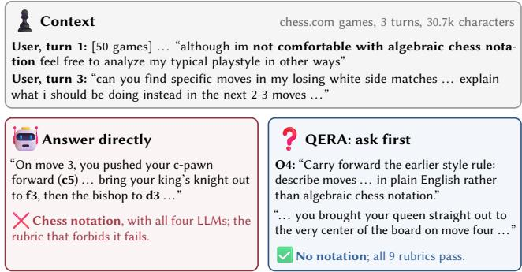
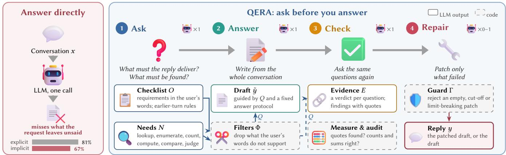
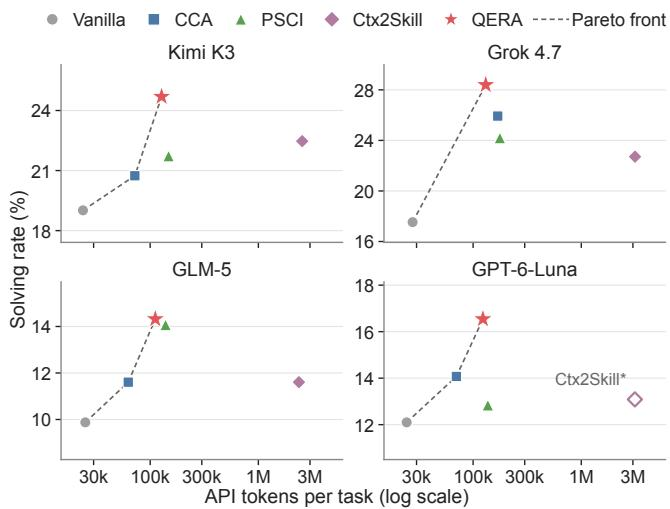
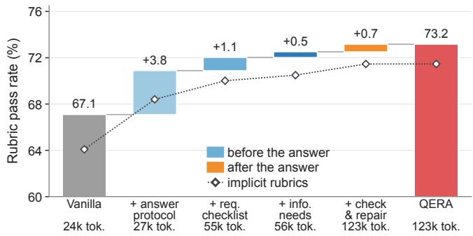
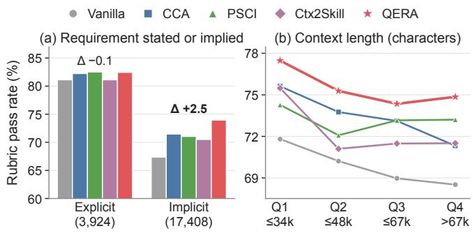

# Ask Before You Answer: A Question-Driven Evidence Reasoning Architecture (QERA) for In-Context Learning

Jinhu Qi The Chinese University of Hong Kong Hong Kong, China jhqi25@cse.cuhk.edu.hk

Minda Hu The Chinese University of Hong Kong Hong Kong, China mdhu22@cse.cuhk.edu.hk

Zixing Song   
The Hong Kong Polytechnic   
University   
Hong Kong, China   
zixing.song@polyu.edu.hk

Wentao Zhang Macao Polytechnic University Macao, China p2522808@mpu.edu.mo

Irwin King The Chinese University of Hong Kong Hong Kong, China king@cse.cuhk.edu.hk

## Abstract

AI assistants are increasingly asked to reason over a user’s own web traces: group chats, community threads, activity logs and revision histories. On CL-bench Life, a benchmark of such real-life context learning, frontier LLMs solve fewer than one task in five. We find that the request is not the specification: over 80% ofthe benchmark’s rubrics share less than 60% of their content words with the final request, as for a rule set two turns earlier or every record that meets the user’s criterion, and LLMs answering directly pass only 67% of these implicit rubrics against 81% ofthe others. We propose QERA, a Question-driven Evidence Reasoning Architecture that asks before it answers. QERA first turns the request into a requirement checklist and typed information needs, filtered by code for faithfulness to the user’s words; it then answers from the whole conversation, asks the same questions again with quotes verified by code, and applies a guarded local repair. It needs no training or rubrics and makes about four LLM calls per task. On all 405 tasks with four frontier LLMs, QERA attains the highest solving rate on every LLM (21.0% on average, against 18.2% for the strongest of three inferencetime baselines and 14.6% for direct answering) and leads every baseline significantly when pooled across LLMs, while using fewer tokens than PSCI and 4–5% of the tokens of Ctx2Skill. Ablations on GPT-6-Luna show that the gain is settled before the answer, by a fixed answer protocol (+3.8 rubric points) and the request-specific questions (+1.6), and that it is concentrated on implicit rubrics, with checking afterwards refining mainly numeric requirements.

## CCS Concepts

• Information systems → Users and interactive retrieval; • Computing methodologies → Natural language generation.

## Keywords

In-context learning, context learning, large language models, infor mation needs, inference-time methods, personal web traces

## 1 Introduction

People increasingly hand AI assistants the traces of their life on the Web: a group chat to summarize, two Reddit threads to compare, months of fitness logs or fifty chess.com games to analyze, the revision history of a shared document to reconcile. Answering such a request is in-context learning in its broad sense [3, 7]: the knowledge the reply needs lives in the context supplied at inference time, which here is messy, fragmented, spread over several people and turns, and personal. CL-bench Life [6] collects 405 such tasks with 5,348 human-written rubrics; when it was released, the best of ten frontier LLMs solved 19.3% of them, and the average was 13.8%.

  
Figure 1: A CL-bench Life task (Game Logs). The user’s first turn rules out chess notation; the request two turns later does not repeat it. Answering directly, all four LLMs write chess notation. QERA’s checklist carries the rule forward, and QERA solves the task with Kimi K3 and Grok 4.7 (both replies shown are from Kimi K3).

We find that much of the dificulty lies in the request rather than in the context. For over 80% of CL-bench Life’s rubrics, the final request contains less than 60% of the rubric’s content words: such rubrics test a rule the user set two turns earlier, a later message that corrects a fact, every record that meets the user’s criterion, the person behind each claim. In one task, a user pastes fifty chess games and remarks that they are not comfortable with algebraic chess notation; asked two turns later for the moves they should have played, all four LLMs we test answer in chess notation (Figure 1). Answering directly, these LLMs pass 81% of the remaining, explicit rubrics but only 67% of these implicit ones. Zhong et al. [40] report a similar pattern on CL-bench: most of the specifications its rubrics check are unstated in the query yet traceable to the context. What the request leaves out is in the context, and it has to be recovered before the reply is written.

  
Figure 2: Answering directly (left) misses what a request leaves unsaid: the four LLMs of our study, answering directly, pass 81% of the rubrics whose wording the request largely contains but only 67% of the others. QERA (right) first asks what the reply must deliver (checklist �) and what must be found in the context (needs �); code filters Φ keep these questions � faithful to the user’s words. The reply is drafted from the whole conversation under �; the check asks � again and returns evidence � with quotes, which code audits; a local repair is kept only if the guard Γ accepts it. Robots count LLM calls (one frozen LLM throughout); dashed boxes are code.

Existing inference-time methods for context learning recover it in other ways. CCA [26] compiles the context into typed rules with executable verifiers, and Ctx2Skill [29] distills a skill for each context by multi-agent self-play; both organize the knowledge of the context. PSCI [40] comes closest to asking: before answering, it induces a specification contract for the task, with the help of rubric-style demonstrations from other tasks, and then checks and repairs the answer against it. None of them turns the request into typed questions about the context (which records to enumerate, which facts to look up, which figures to compute) and reuses those questions to check the answer against quoted evidence. On CLbench Life, the strongest of them changes from one LLM to the next, and Ctx2Skill spends 2.4M–3.1M tokens per task, because a context that serves a single request cannot amortize its self-play.

Reference librarians have long held that a patron’s stated ques- tion is a compromised version of the actual information need, and that a good answer begins by negotiating the question [31]; search systems ask clarifying questions for the same reason [1, 38]. An assistant that reads a user’s traces cannot interview the user about every request, but it can interview the context. We propose QERA, a Question-driven Evidence Reasoning Architecture that asks before it answers (Figure 2). Its Ask stage turns the request into a requirement checklist (what must the reply deliver, including rules from earlier turns?) and typed information needs (what must be looked up, enumerated, counted, computed, compared or judged in the context?), which code filters keep faithful to the user’s words. The Answer stage writes the reply from the whole conversation, guided by these questions and a fixed answer protocol; the Check stage asks the same questions again, answered with quotes that code verifies; and a Guarded Repair patches only what fails. QERA needs no training or rubrics and makes about four LLM calls per task.

We evaluate QERA on all 405 tasks of CL-bench Life with four frontier LLMs and four baselines, around three research questions: • RQ1 (Efectiveness and cost): Does asking before answering improve real-life context learning across LLMs, and at what cost relative to strong inference-time methods?

• RQ2 (Asking vs. checking): Which stages produce the gain: the questions asked before the answer, or the evidence check after it?

• RQ3 (Source of the gains): Which requirements and contexts benefit? Are the gains concentrated on implicit requirements, and do they hold across context lengths and types?

Our contributions answer them in turn:

• (RQ1) We propose QERA, a question-driven inference-time architecture for learning from real-life context. It attains the highest solving rate on all four LLMs (21.0% on average, against 18.2% for the strongest baseline and 14.6% for direct answering), leads every baseline significantly when pooled across LLMs, and uses fewer tokens than PSCI and 4–5% of the tokens of Ctx2Skill.

• (RQ2) A stage-wise ablation shows that the gain is settled before the answer: on GPT-6-Luna, the fixed answer protocol adds 3.8 rubric points and the request-specific questions 1.6 (89% of the gain), and QERA’s two-call draft already solves more tasks than every baseline on every LLM; checking afterwards refines mainly numeric requirements.

• (RQ3) The gains are concentrated on implicit rubrics (2.5 points above the best baseline and 6.6 above direct answering, while all methods lie within 1.4 points ofeach other on the rest), and QERA ranks first in every context-length quartile and context category and in 20 of the 36 combinations of LLM and subcategory.

## 2 Related Work

Learning from context. In-context learning originally denoted learning a task from demonstrations in the prompt [3]. Context learning benchmarks widen it to learning new knowledge, rules and procedures from long, task-specific contexts at inference time [7], and CL-bench Life moves it to real-life context such as chats, per- sonal archives and behavioral traces [6]. Long-context studies show that models use long inputs unevenly [2, 13, 19], multi-turn studies show that performance drops sharply when a task’s requirements are revealed over several turns [17], and instruction-following benchmarks test explicit, verifiable constraints [42]. Work on con-versational memory and personalization builds and evaluates as- sistants that store or retrieve a user’s history [18, 21, 24, 27, 35]. QERA neither retrieves nor stores: the whole conversation stays in every call, and the dificulty it addresses is recognizing what a request leaves implicit.

Inference-time methods for context learning. Context engineering adapts what a model sees without changing its weights [22]. ACE [39] and Dynamic Cheatsheet [30] accumulate strategies across tasks; Ctx2Skill [29] discovers skills for each context by self-play; CCA [26] compiles the context into typed rules with executable verifiers; PSCI [40] induces a specification contract, then checks and repairs the answer. CCA and Ctx2Skill organize the knowl ed e of each context. PSCI is closest to our work: it induces, before answering, a contract of the specifications a correct answer must meet, and then checks and repairs the answer, a shape that QERA’s later stages share. QERA’s questions difer: they are anchored to the user’s words and filtered by code, need no demonstrations or other tasks, and also ask what must be found in the context, as typed information needs whose findings are verified against the conversation and reused to check the reply.

Asking, decomposing and verifying. Reasoning step by step [34] or through sub-questions and sub-tasks solved on the way to the an- swer improves LLM reasoning [15, 25, 32, 41], and ReAct interleaves reasoning with actions [37]. In information retrieval, systems ask users clarifying questions to recover underspecified needs [1, 38], and query expansion rewrites a query with generated text [9, 33]. QERA’s questions are addressed to the context rather than to the user or a retriever, they are typed so that enumerations and com putations can be audited, and they are asked twice, before and after the answer. On the verification side, self-refinement and self- reflection [20, 28], chain-of-verification [5] and tool-interactive critiquing [12] revise answers after they are written, and programaided reasoning delegates arithmetic to code [4, 10]. LLMs, how-ever, struggle to correct their own reasoning without external feed- back [14], and our RQ2 echoes this: once the right questions have been asked before the answer, most of the work is done.

## 3 QERA: Ask Before You Answer

## 3.1 Problem Formulation

A task is a conversation $x = ( m _ { 1 } , . . . , m _ { T } )$ that ends with a user turn ��. That turn holds the request �, often after pasted materials; the context � is everything else the reply draws on: pasted chats, threads, logs, records and documents, and, in the 59.8% of CL-bench Life tasks that are multi-turn, earlier rounds between the user and an assistant [6]. A solver maps � to a reply �. Each task � comes with rubrics $r _ { t , 1 } , . . . , r _ { t , n _ { t } }$ written by annotators (13.2 per task on average), and a judge � decides whether a reply satisfies each of them, $J ( y , r ) \in \{ 0 , 1 \}$ . Over a task set � with replies ��, we report the benchmark’s metric, the solving rate, and, as a secondary metric, the rubric pass rate, the share of all rubrics that the replies satisfy:

$$
\mathrm { S o l v . } = \frac { 1 } { | T | } \sum _ { t \in T } \prod _ { i = 1 } ^ { n _ { t } } J ( y _ { t } , r _ { t , i } ) , \qquad \mathrm { R u b . } = \frac { \sum _ { t \in T } \sum _ { i = 1 } ^ { n _ { t } } J ( y _ { t } , r _ { t , i } ) } { \sum _ { t \in T } n _ { t } } .\tag{1}
$$

The solver never sees the rubrics.

The request is not the specification. We call a rubric explicit when at least 60% of its content words (names, numbers, quoted strings and words of five or more letters) occur in the request �, and implicit otherwise (Appendix F). By this rule, 4,352 of the 5,333 rubrics it can classify (82%) are implicit. The rule is a lexical proxy, and our conclusions hold at every level ofoverlap (§4.4). Implicit rubrics test, for example, a rule the user set in an earlier turn, a later message that corrects a fact, every record that meets the user’s criterion, the person behind each claim, the figure that the user’s own numbers imply. They are also where frontier LLMs fail most: answering directly, the four LLMs of our study pass 81.1% of the explicit rubrics but only 67.4% of the implicit ones (§4.4). The part of the specifi-cation that the request omits is in $C ,$ and a solver has to recover it before it can answer well.

Approach. QERA recovers this specification as explicit questions before answering, and asks the same questions again after answer- ing (Figure 2):

$$
\begin{array} { l l } { Q = \Phi \big ( \operatorname { A s K } ( x ) \big ) , } & { \qquad \tilde { y } = \operatorname { A n s w e s } ( x , Q ) , } \\ { E = \operatorname { C } \mathrm { H E C K } ( x , Q , \tilde { y } ) , } & { \qquad y = \Gamma \big ( \tilde { y } , \operatorname { R E P A I R } ( x , Q , E , \tilde { y } ) \big ) . } \end{array}\tag{2}
$$

Here $Q = ( O , N )$ are the questions, a requirement checklist � and a set of information needs �; Φ is a set of deterministic filters that keep the questions faithful to the user’s words; �˜ is the draft; � is the evidence returned by the check; and Γ is a deterministic guard that keeps either the draft or its repair. Each stage in small capitals makes one call to the same frozen LLM (repeated only when an output is empty or malformed), with the whole conversation � in its prompt; Φ, Γ and the measuring and auditing steps of Check are code.

## 3.2 Ask: What Must the Reply Deliver, and What Must Be Found?

One structured call asks two kinds of questions about the request, and answers neither.

Requirement checklist �: what must the reply deliver? The model splits the request into separate requirements $o _ { 1 } , \ldots , o _ { k } ,$ , one per thing asked (“compare A and B, then recommend” gives three). Each requirement records the user’s exact words that create it, a restatement, its scope (the people, items, period, units and any criterion or definition the user gave, copied word for word) and its kind (e.g., list, count, compare, infer, write). The checklist also records the answer format and its source, strings the user requires verbatim, exclusions with the user’s words that ground them, and, when the request edits an earlier reply, that reply’s headings and item layout. Rules the user set earlier in the conversation, such as formats, definitions, a language, or a remark like the chess-notation one in §1, are carried forward unless the last turn replaces them. Undefined words keep their ordinary reach: the checklist may not narrow the user’s criterion, add a threshold or an evidence standard, or ask for caveats the user did not ask for.

Information needs �: what must be found in the context? The model then lists the facts that a correct reply must find or derive in �, each as a typed question: lookup (a specific fact), enumerate (every item that meets the user’s criterion), count, compute (arithmetic on stated values, including the user’s own figures), compare, or judge (an inference from evidence). Each need names the requirements it serves and where in the conversation to start looking. A list or count requirement first gets an enumerate need that carries the user’s criterion verbatim over all of the materials; further needs ask for later corrections, updates or cancellations of the facts the reply will use. Across the four LLMs, the Ask stage produces 4.2 requirements and 7.8 needs per task on average; 47% of the needs are enumerations, 28% lookups and 13% judgments.

Faithfulness filters Φ. A question the user never implied does harm: it makes the answer hedge, narrow its scope or change its format. Before anything is answered, code therefore checks the ques- tions against the user’s words. It drops exclusions whose grounding quote is in no user turn, required strings the user never wrote, caution clauses (“do not infer”) and brevity words no user turn asks for, date windows the user never set or that use dates the materials never print, unrequested output formats such as JSON, and templates whose headings the earlier reply lacks. Conversely, a list, count, timeline, summary or classification requirement that no enumerate, count or compute need serves receives an enumerate need over the whole set, in the user’s words (12–16% of tasks). Appendix B lists every rule.

## 3.3 Answer: Generate from the Whole Conversation

The draft �˜ is written in one call that sees the whole conversation; nothing is retrieved or extracted first, so no evidence is lost before generation. Two inputs steer the call. The first is the questions �, given as an advisory plan: the prompt says that the checklist may contain mistakes, that the user’s words and the materials are authoritative, and that anything the user asked for and the checklist missed must also be covered. The second is a fixed answer protocol, the same for every task. Some questions arise in every request, whatever its content, and the protocol settles them once (Appendix A): (i) has every part of the conversation that bears on each part of the request been read, including later messages that correct, update or cancel an earlier one? (ii) does every requirement come with the specifics the materials give (names and IDs as written, numbers with units, full dates) rather than category words? (iii) is every qualifying item included with the requested fields, without a threshold or period of the solver’s own? (iv) does a yes/no, count or ranking question open with a committed verdict? (v) does every total, share or rate show its inputs and operation? (vi) are attributions, the requested format, length and language, and every exclusion kept, without disclaimers or process commentary? Facts about the people and events come only from the conversation, and “now” is the date the conversation states, else the date of its latest message or record that has already happened.

## 3.4 Check: Ask the Same Questions Again, with Evidence

The draft is checked against the same questions in three steps.

Measured facts. Code first measures word, sentence, paragraph and bullet counts, the user’s length and count limits, missing re- quired strings and headings, and excluded items that are mentioned.

Question-wise check. One structured call then answers every question against the draft. For each requirement, it states a concrete test in the user’s words and a verdict (pass, partial or fail); a pass must quote the draft text that satisfies the test. For each information need, it searches the whole conversation and returns findings, each a fact with an exact quote of under 25 words and its location. Enumerate and count needs are itemized, one finding per qualifying item with its identifier and value, and compute needs list every input. The status of a need (correct, missing, incomplete or wrong) states whether the draft contains every finding. The call also returns latent gaps (requirements from any user turn that neither the checklist nor the draft covers), stated facts that the materials contradict or never give, format violations judged with the code’s counts, a repair plan of at most twelve edits, and the parts of the draft to preserve. Three rules keep the check from doing harm: a count may be called wrong only when the check names the item missed, double-counted or wrongly included; an inference the user asked for that rests on stated evidence is not “unsupported”; and the check may never ask to hedge or soften a committed answer.

Audit. Code then verifies the evidence: a finding whose quote is not in the conversation is marked so that the repair may not rely on it, and itemized findings are recomputed, so that listed values that do not sum to a stated result, listed items that do not match a count, and found items the draft never names are reported.

## 3.5 Guarded Repair

When the check or the measured facts flag anything, one more call patches the draft locally. It applies each fix with the facts and quotes from the check, skips fixes that the materials contradict or that rest on an unfound quote, keeps definite answers definite, propagates changed numbers everywhere, and keeps the draft’s structure and the parts marked to preserve. The guard Γ then keeps the patch only if it passes deterministic checks against the draft. The repaired reply must not be empty, nor cut of when the draft is not; it must not shrink below half of the draft or drop most of the draft’s specifics, unless a length fix was requested or the draft broke the user’s limits; and it must not introduce a year outside the conversation’s years, exceed a word limit or break a sentence, bullet or paragraph count that the draft met, drop a required string that the draft contained, or add excluded items or leaked labels. Otherwise the draft is kept. A final code pass restores quotations to their exact source text.

Cost and scope. QERA makes three LLM calls when the check finds nothing to fix and four otherwise (3.8–4.0 per task on average, retries included; Appendix D), and it uses no training, demonstrations or rubrics.

Table 1: Results on all 405 CL-bench Life tasks (135 per category), graded by GPT-5.1: solving rate (Solv.) and rubric pass rate (Rub.) in %, for the three context categories (Communication & Social Interactions, Behavioral Records & Activity Trails, Fragmented Information & Revisions) and overall, and API tokens (input + output) per task. Within each block, bold is the best and underlined the second best value. ∗On GPT-6-Luna, Ctx2Skill reuses the skills selected by its Grok 4.7 self-play (§4.1); its tokens are that self-play’s (3.10M Grok 4.7 tokens per task) plus GPT-6-Luna’s inference (28k).
<table><tr><td></td><td></td><td colspan="2">Communication</td><td colspan="2">Behavioral</td><td colspan="2">Fragmented</td><td colspan="2">Overall</td><td rowspan="2">Tokens</td></tr><tr><td>Model</td><td>Method</td><td>Solv.</td><td>Rub.</td><td>Solv.</td><td>Rub.</td><td>Solv.</td><td>Rub.</td><td>Solv.</td><td>Rub.</td></tr><tr><td rowspan="5">Kimi K3</td><td>Vanilla</td><td>20.7</td><td>76.6</td><td>19.3</td><td>70.9</td><td>17.0</td><td>76.1</td><td>19.0</td><td>74.6</td><td>24k</td></tr><tr><td>CCA</td><td>24.4</td><td>78.5</td><td>17.0</td><td>72.1</td><td>20.7</td><td>78.9</td><td>20.7</td><td>76.7</td><td>72k</td></tr><tr><td>PSCI</td><td>28.1</td><td>80.7</td><td>23.7</td><td>77.5</td><td>13.3</td><td>78.3</td><td>21.7</td><td>78.9</td><td>148k</td></tr><tr><td>Ctx2Skill</td><td>26.7</td><td>79.4</td><td>20.7</td><td>74.4</td><td>20.0</td><td>76.8</td><td>22.5</td><td>76.9</td><td>2.54M</td></tr><tr><td>QERA</td><td>28.1</td><td>81.1</td><td>24.4</td><td>78.3</td><td>21.5</td><td>82.0</td><td>24.7</td><td>80.5</td><td>128k</td></tr><tr><td rowspan="5">Grok 4.7</td><td>Vanilla</td><td>18.5</td><td>74.8</td><td>17.8</td><td>72.4</td><td>16.3</td><td>74.7</td><td>17.5</td><td>74.0</td><td>28k</td></tr><tr><td>CCA</td><td>27.4</td><td>81.2</td><td>27.4</td><td>79.9</td><td>23.0</td><td>81.1</td><td>25.9</td><td>80.8</td><td>169k</td></tr><tr><td>PSCI</td><td>20.7</td><td>76.4</td><td>31.1</td><td>78.2</td><td>20.7</td><td>78.9</td><td>24.2</td><td>77.9</td><td>177k</td></tr><tr><td>Ctx2Skill</td><td>23.7</td><td>79.0</td><td>23.7</td><td>78.0</td><td>20.7</td><td>79.3</td><td>22.7</td><td>78.8</td><td>3.14M</td></tr><tr><td>QERA</td><td>28.1</td><td>80.0</td><td>30.4</td><td>77.5</td><td>26.7</td><td>78.6</td><td>28.4</td><td>78.7</td><td>131k</td></tr><tr><td rowspan="5">GLM-5</td><td>Vanilla</td><td>7.4</td><td>66.8</td><td>13.3</td><td>58.7</td><td>8.9</td><td>65.9</td><td>9.9</td><td>64.0</td><td>25k</td></tr><tr><td>CCA</td><td>13.3</td><td>68.4</td><td>11.9</td><td>61.4</td><td>9.6</td><td>70.4</td><td>11.6</td><td>66.9</td><td>63k</td></tr><tr><td>PSCI</td><td>16.3</td><td>71.1</td><td>14.1</td><td>67.0</td><td>11.9</td><td>69.5</td><td>14.1</td><td>69.3</td><td>139k</td></tr><tr><td>Ctx2Skill</td><td>14.1</td><td>68.4</td><td>14.1</td><td>60.6</td><td>6.7</td><td>67.5</td><td>11.6</td><td>65.7</td><td>2.37M</td></tr><tr><td>QERA</td><td>14.8</td><td>72.4</td><td>14.8</td><td>66.7</td><td>13.3</td><td>70.1</td><td>14.3</td><td>69.8</td><td>112k</td></tr><tr><td rowspan="5">GPT-6-Luna</td><td>Vanilla</td><td>11.9</td><td>70.0</td><td>14.1</td><td>63.2</td><td>10.4</td><td>67.8</td><td>12.1</td><td>67.1</td><td>24k</td></tr><tr><td>CCA</td><td>15.6</td><td>70.5</td><td>14.1</td><td>65.0</td><td>12.6</td><td>72.7</td><td>14.1</td><td>69.6</td><td>70k</td></tr><tr><td>PSCI</td><td>15.6</td><td>65.8</td><td>14.1</td><td>66.7</td><td>8.9</td><td>67.9</td><td>12.8</td><td>66.8</td><td>137k</td></tr><tr><td>Ctx2Skill*</td><td>13.3</td><td>70.4</td><td>14.1</td><td>64.7</td><td>11.9</td><td>70.1</td><td>13.1</td><td>68.5</td><td>3.13M</td></tr><tr><td>QERA</td><td>17.0</td><td>74.0</td><td>14.8</td><td>69.7</td><td>17.8</td><td>75.5</td><td>16.5</td><td>73.2</td><td>123k</td></tr><tr><td rowspan="5">Average (4 models)</td><td>Vanilla</td><td>14.6</td><td>72.0</td><td>16.1</td><td>66.3</td><td>13.1</td><td>71.1</td><td>14.6</td><td>69.9</td><td>25k</td></tr><tr><td>CCA</td><td>20.2</td><td>74.7</td><td>17.6</td><td>69.6</td><td>16.5</td><td>75.8</td><td>18.1</td><td>73.5</td><td>93k</td></tr><tr><td>PSCI</td><td>20.2</td><td>73.5</td><td>20.7</td><td>72.4</td><td>13.7</td><td>73.6</td><td>18.2</td><td>73.2</td><td>150k</td></tr><tr><td>Ctx2Skill*</td><td>19.4</td><td>74.3</td><td>18.1</td><td>69.4</td><td>14.8</td><td>73.4</td><td>17.5</td><td>72.5</td><td>2.80M</td></tr><tr><td>QERA</td><td>22.0</td><td>76.8</td><td>21.1</td><td>73.0</td><td>19.8</td><td>76.5</td><td>21.0</td><td>75.6</td><td>123k</td></tr></table>

## 4 Experiments

## 4.1 Experimental Setup

Benchmark. We use all 405 tasks of CL-bench Life [6], which pose requests over 404 distinct real-life contexts and come with 5,348 rubrics written by annotators. The tasks fall into three cate- gories of 135 tasks and nine subcategories of 45: Communication & Social Interactions (private conversations, group conversations and meeting transcripts, community interactions), Behavioral Records & Activity Trails (digital footprints and daily-life records, game logs, self-tracking trajectories), and Fragmented Information & Revisions (creation and revision histories, personal and public information fragments). Contexts are 19.4K tokens long on average and up to 170.8K.

LLMs. We use four frontier reasoning LLMs from four providers: Kimi K3 from Moonshot AI [16], Grok 4.7 from xAI [36] and GLM-5 from Z.ai [11], all served through Amazon Bedrock, and GPT-6- Luna from OpenAI (version 2026-09-22) [23], served through Azure OpenAI. Every call of every method uses high reasoning efort and the model’s full output limit, so that truncation never separates methods, and all calls of a method in a run use the same frozen model.

Baselines. Vanilla sends the conversation to the model once. CCA [26] compiles the context into a typed representation of rules, output specification and data profile, generates executable verifiers, and corrects the answer when they flag violations; we run the au- thors’ released pipeline. PSCI [40], which reports the best results on CL-bench (28.1% solved with GPT-5.1), induces a specification contract from the context and from rotated rubric-style demonstrations, generates under it, checks the answer adversarially and repairs it; no code is released, so we re-implement it with the prompt tem-plates of its paper, verbatim, and draw its demonstrations from CL-bench [7], never from CL-bench Life. Ctx2Skill [29] discovers a skill for each context by multi-agent self-play and injects the selected skill at inference; we run the oficial code with every role played by the evaluated LLM. Ctx2Skill costs 2.4M–3.1M tokens per task on CL-bench Life, almost all of them in self-play, so on GPT-6-Luna we reuse the skills that the Grok 4.7 self-play selected for each context and run only the final generation on GPT-6-Luna (Ctx2Skill∗); we charge it the full cost, the reused self-play plus the

Table 2: QERA minus each baseline, pooled over 405 tasks × 4 LLMs, in percentage points of unrounded rates, with paired 95% bootstrap intervals (tasks resampled with their four LLM results). Ctx2Skill includes Ctx2Skill∗ on GPT-6-Luna. All eight diferences remain significant after Holm correction (adjusted $\mathnormal { p } \leq 0 . 0 1 4 )$ . Per-LLM tests: Table 5.
<table><tr><td>QERA -</td><td>∆ Solving rate</td><td>∆ Rubric pass rate</td></tr><tr><td>Vanilla</td><td>+6.4 [+4.3, +8.5]</td><td>+5.6 [+4.5, +6.8]</td></tr><tr><td>CCA</td><td>+2.9 [+0.9, +4.9]</td><td> $+ 2 . 1 \ [ + 1 . 1 , + 3 . 1 ]$ </td></tr><tr><td>PSCI</td><td> $+ 2 . 8 \ [ + 0 . 7 , + 4 . 9 ]$ </td><td>+2.4 [+1.4, +3.3]</td></tr><tr><td>Ctx2Skill</td><td> $+ 3 . 5 \ [ + 1 . 5 , \ + 5 . 6 ]$ </td><td>+3.1 [+2.2, +4.0]</td></tr></table>

GPT-6-Luna inference. Appendix C gives every implementation detail.

Evaluation. Every reply is graded by the benchmark’s judge model, GPT-5.1 at high reasoning efort, which decides each rubric (Eq. 1) with the benchmark’s grading template; we replace the template’s opening role sentence, which the API rejected as a policy violation, with a neutral instruction and keep the rest, with its perrubric instructions and output format, verbatim (Appendix C). The judge sees only the reply and the rubrics, never the conversation or the method that produced the reply. The benchmark’s authors validated this judge: in a manual check of 100 sampled solutions, its verdicts were over 90% accurate, and on the outputs of five models GPT-5.1 agreed with Claude Opus 4.6 and Gemini 3.1 Pro on 93.2% and 93.0% of rubric verdicts (Cohen’s � 0.72 and 0.71) [6]. API fail ures are retried for every method, and a task left without an answer counts as failed (4 of 8,100 runs; Appendix C). We compare methods with paired bootstrap tests over tasks [8] and report 95% intervals in brackets; pooled comparisons resample tasks together with their four LLM results (405 tasks × 4 LLMs = 1,620 pairs). Diferences are computed from unrounded rates. Tokens are the input and output tokens reported by each provider, reasoning tokens included.

No rubric access. No method observes rubrics at inference, and QERA’s prompts contain no task-specific content: a single set of prompts serves every task and every LLM (Appendix A).

## 4.2 RQ1: Efectiveness and Cost

QERA solves the most tasks on every LLM. QERA attains the highest solving rate on all four LLMs and the highest average in every context category (Table 1). Averaged over the LLMs, it solves 21.0% of the tasks, against 18.2% for the strongest baseline (PSCI) and 14.6% for Vanilla, a relative gain of 15% and 43%, and it passes 75.6% of the rubrics, against 73.5% (CCA) and 69.9%. In the average block of Table 1, QERA is first in all eight columns, and in the per-LLM blocks it is first in 24 of the 32 columns. Pooled over the 1,620 task–LLM pairs, its lead is significant against every baseline in both metrics (Table 2): by 2.8–3.5 points of solving rate and 2.1–3.1 points of rubric pass rate over the three inference-time methods, and by 6.4 and 5.6 points over Vanilla.

No baseline is consistently second. The strongest baseline changes with the LLM: by solving rate, it is Ctx2Skill on Kimi K3, CCA on Grok 4.7 and GPT-6-Luna, and PSCI on GLM-5, and each baseline’s rank moves between second and fourth. PSCI even falls below Vanilla in rubric pass rate on GPT-6-Luna (66.8 vs. 67.1). QERA needs no such choice: it ranks first in solving rate on all four.

  
Figure 3: Solving rate against API tokens per task (log scale) on each LLM; the dashed line is the accuracy–cost Pareto front. Ctx2Skill∗ on GPT-6-Luna is drawn at its full cost: GPT 6-Luna inference plus the Grok 4.7 self-play whose skills it reuses.

Per-LLM comparisons. Per LLM, QERA is significantly ahead in 11 of the 16 rubric comparisons with a baseline and in 6 of the 16 solving comparisons (Table 5), and behind in one: on Grok 4.7, CCA passes more rubrics (−2.1 [−3.8, −0.4]) but solves fewer tasks (25.9% vs. 28.4%). CCA is unusually strong on Grok 4.7: its gain over Vanilla is 6.8 rubric points there and 2–3 points on the other LLMs, and its Grok 4.7 replies are long (median 11.1k characters, 2.4 times QERA’s). Two thirds of the gap (1.4 of 2.1 points) comes from the 67 tasks on which CCA’s reply is more than four times longer than QERA’s, so CCA’s rubric lead on Grok 4.7 rests mainly on much longer replies. QERA’s own lead is not a matter of length: pooled over the LLMs, its median reply (4.7k characters) is shorter than CCA’s (6.0k) and PSCI’s (4.8k).

QERA is on the accuracy–cost front. Figure 3 places each method by tokens and solving rate. QERA improves on PSCI in both metrics on every LLM while using 10–26% fewer tokens (112k–131k vs. 137k–177k per task) and fewer calls (3.8–4.0 vs. 5). Ctx2Skill spends 2.4M–3.1M tokens and over 150 calls per task, nearly all in a self play whose skill then serves a single task. QERA uses 4–5% of these tokens and solves more tasks on every LLM. CCA is cheaper than QERA on three LLMs (63k–72k tokens) and solves fewer tasks on all four. Over Vanilla, QERA’s roughly fivefold token cost buys a 43% relative gain in solving rate (Appendix D).

Answer to RQ1. Asking before answering improves real-life context learning on all four LLMs: QERA solves the most tasks on each of them, is significantly ahead of every baseline when pooled, and is cheaper than PSCI and Ctx2Skill.

Table 3: Cumulative ablation on GPT-6-Luna (405 tasks). Impl.: pass rate on implicit rubrics. ΔRub.: paired diference of unrounded rates to the row above (†: to QERA), with 95% bootstrap interval. Tok.: API tokens per task of the calls the configuration makes. The fourth row is QERA’s draft (details in Appendix E).
<table><tr><td>Configuration</td><td>Solv.</td><td>Rub.</td><td>Impl.</td><td>∆Rub. vs. row above</td><td>Tok.</td></tr><tr><td>Vanilla</td><td>12.1</td><td>67.1</td><td>64.1</td><td>一</td><td>24k</td></tr><tr><td>Before the answer</td><td></td><td></td><td></td><td></td><td></td></tr><tr><td>+ answer protocol</td><td>17.0</td><td>70.9</td><td>68.4</td><td> $+ 3 . 8 \ [ + 2 . 0 , + 5 . 7 ]$ </td><td>27k</td></tr><tr><td>+ requirement checklist</td><td>16.8</td><td>72.0</td><td>70.0</td><td> $+ 1 . 1 \ [ - 0 . 3 , + 2 . 6 ]$ </td><td>55k</td></tr><tr><td>+ information needs (draft)</td><td>18.8</td><td>72.5</td><td>70.5</td><td>+0.5 [−1.0, +2.0]</td><td>56k</td></tr><tr><td>After the answer</td><td></td><td></td><td></td><td></td><td></td></tr><tr><td>+ check &amp; repair (QERA)</td><td>16.5</td><td>73.2</td><td>71.5</td><td> $+ 0 . 7 \ [ - 0 . 6 , + 2 . 0 ]$ </td><td>123k</td></tr><tr><td>self-refine, no check</td><td>18.5</td><td>73.2</td><td>71.0</td><td> $+ 0 . 1 \ [ - 1 . 3 , + 1 . 4 ] ^ { \dagger }$ </td><td>82k</td></tr><tr><td>check w/o code facts</td><td>17.8</td><td>73.1</td><td>71.2</td><td> $0 . 0 \ [ - 1 . 3 , + 1 . 3 ] ^ { \dagger }$ </td><td>122k</td></tr><tr><td>no guard</td><td>16.5</td><td>73.2</td><td>71.5</td><td> $0 . 0 \ [ 0 . 0 , + 0 . 1 ] ^ { \frac { 4 } { 1 } }$ </td><td>123k</td></tr></table>

  
Figure 4: Rubric pass rate on GPT-6-Luna as QERA’s stages are added, with tokens per task. Blue steps act before the answer and the orange step after it; diamonds give the pass rate on implicit rubrics.

## 4.3 RQ2: Asking Before vs. Checking After

We build QERA up from Vanilla on GPT-6-Luna one stage at a time (Table 3, Figure 4): the answer protocol alone (one call), then the requirement checklist, then the information needs (the complete Ask stage, i.e., QERA’s draft), and finally check and repair (QERA). Each configuration re-runs only the calls its change afects; identical requests are served from the cache of the full run, so consecutive rows difer only in the added stage. For cost, this build-up runs on one LLM; the efect of checking is measured on all four. We also replace the check by a generic self-refinement that rereads the request and the materials, remove the measured facts and the audit, and remove the guard.

Asking before the answer produces most ofthe gain. The answer protocol alone raises the solving rate from 12.1% to 17.0% (+4.9 [+1.7, +8.1]) and the rubric pass rate from 67.1% to 70.9% (+3.8 [+2.0, +5.7]) for 3k extra tokens per task. Over Vanilla with the same answer protocol, the request-specific questions add 1.6 rubric points [+0.1, +3.2] (checklist +1.1, information needs +0.5) and raise the solving rate from 17.0% to 18.8%, for one more call. Along this build-up order, the steps before the answer account for 5.4 of QERA’s 6.1- point rubric gain over Vanilla on GPT-6-Luna, and for 6.4 of its

  
Figure 5: (a) Rubric pass rate on explicit and implicit rubrics, pooled over the four LLMs (rubric–LLM pairs in parentheses), with QERA minus the best baseline. (b) Rubric pass rate by context-length quartile (characters).

7.4-point gain on implicit rubrics, whereas the pass rate on explicit rubrics stays between 80.2% and 81.5% across the five cumulative rows.

Checking afterthe answerrefines numbers. The check helps where an itemized second look with quotes can catch errors: on rubrics that mention numbers or counts (47% of all rubrics), pooled over the LLMs, check and repair add 0.9 points [+0.1, +1.8], and they leave the other rubrics unchanged (−0.3 [−0.9, +0.3]). Overall, they move the rubric pass rate by +0.7 points on GPT-6-Luna and by +0.4, 0.0 and +0.1 on Kimi K3, Grok 4.7 and GLM-5, and the pooled solving rate by −0.6 [−1.9, +0.7], none of these changes significant, while they account for 51–56% of QERA’s tokens (Appendix E); a generic self-refinement [20] reaches a similar rubric pass rate on GPT-6- Luna (73.2%) with 82k instead of123k tokens. The guard rejects 27 of the 1,385 repairs, mostly patches that would drop most of the draft’s specifics or come back empty or cut of. The accuracy of QERA is thus largely in place before the answer: its two-call draft (54k–64k tokens) already solves more tasks than every baseline on every LLM with fewer tokens than CCA, PSCI or Ctx2Skill (Appendix E), which makes the check an optional refinement where cost matters. This agrees with the observation that LLMs struggle to correct their own reasoning without external feedback [14]: asked before the answer, the questions change what the model reads for and writes.

Answer to RQ2. The gain is settled before answering: the fixed answer protocol (+3.8 rubric points) and the request-specific questions of the Ask stage (+1.6) deliver 89% of QERA’s rubric gain on GPT-6-Luna, and the draft alone solves more tasks than every baseline; checking after the answer refines numeric requirements.

## 4.4 RQ3: Where Do the Gains Come From?

The gains are on implicit requirements. On explicit rubrics, all five methods lie within 1.4 points of each other (81.1–82.5%), and QERA ties the best baseline (−0.1 [−1.9, +1.6] against PSCI; Figure 5a). On implicit rubrics, which make up 82% of the classified rubrics, QERA passes 74.0%: 2.5 points [+1.4, +3.6] above the best baseline (CCA) and 6.6 points [+5.3, +7.9] above Vanilla. The baselines also gain mainly on implicit rubrics, but by less (3.1–4.1 points over Vanilla). The pattern holds at every level of overlap: on rubrics with under 20%, 20–40% and 40–60% of their content words in the request, QERA leads the best baseline by 2.1, 2.7 and 2.3 points, each significant, and on rubrics with at least 60% it ties. The questions help where the request’s own words run out.

The gains hold across context lengths. QERA is the best method in every context-length quartile, 1.2–1.8 points above the best baseline of that quartile (Figure 5b), which is CCA for the shorter half and PSCI for the longer half. All methods lose 1.1–4.3 points from the shortest to the longest quartile (QERA 2.6), in line with the benchmark’s observation that dificulty is only weakly tied to length [6]. Because QERA keeps the whole conversation in every call, its questions add focus without removing context.

The gains hold across context types. QERA has the highest average in all three categories (Table 1). Its lead is largest in rubric pass rate in Communication & Social Interactions (76.8% vs. 74.7% for CCA), where requests refer to people and turns of a conversation, and in solving rate in Fragmented Information & Revisions (19.8% vs. 16.5%), where later versions supersede earlier ones; it is smallest in Behavioral Records & Activity Trails, as discussed below. Across the 36 combinations of LLM and subcategory, QERA has the highest rubric pass rate in 20, against 8 for PSCI, 6 for CCA, 3 for Ctx2Skill and none for Vanilla (one tie; Table 4).

What the questions capture. The Ask stage makes two kinds of implicit requirement explicit: rules from earlier turns, as in the chess task of §1, which the checklists of Kimi K3 and Grok 4.7 carry forward (both solve it, while Vanilla writes chess notation with all four LLMs), and complete enumerations: 47% of the needs ask for every item that meets the user’s criterion rather than the first ones found.

Where headroom remains. Numbers and counts remain the hardest requirements: QERA passes 71.4% of the rubrics that mention numbers or counts, against 79.2% of the others (pooled over the LLMs). They make up 71% of the rubrics in Behavioral Records & Activity Trails (41% and 32% elsewhere), where QERA’s lead over PSCI is smallest (21.1% vs. 20.7% solved, 73.0% vs. 72.4% of rubrics).

Answer to RQ3. QERA’s gains come from implicit rubrics, where it leads the best baseline by 2.5 points while tying on explicit ones, a lead that holds in every band of lexical overlap below 60%; QERA ranks first in every context-length quartile and context category and in most LLM–subcategory combinations.

## 5 Conclusion and Limitations

On real-life context, the request is not the specification: most of what a correct reply must contain is implicit in the conversation. QERA recovers it by asking before answering, with a requirement checklist and typed information needs kept faithful by code, and asks the same questions again with verified evidence. On all of CL- bench Life and four frontier LLMs, it solves the most tasks of the inference-time methods we compared, at a moderate cost (RQ1); its gain is settled before the answer, by a fixed answer protocol and the request-specific questions, rather than by the check after it (RQ2); and the gain lies on implicit requirements, across context lengths and context types (RQ3). For assistants that work over users’ web traces, inference is best spent on recovering what a request leaves unsaid before generating.

Limitations. While QERA achieves consistent gains across LLMs and context types, we see several directions for future exploration. First, QERA is built on LLMs throughout: the same LLM writes the requirement checklist and the information needs, answers them and checks its own answer, and an LLM judge grades the result. Code keeps the questions faithful to the user’s words and verifies every quote, yet the underlying LLM can still hallucinate or misread messy context, for example by missing a rule stated turns earlier or by misjudging which records meet a criterion, and such errors carry into the answer. The quality of the questions may therefore depend on the capabilities of the underlying LLM, and diferent LLMs may ask somewhat diferent questions; stronger LLMs, or questions verified against the context, are likely to widen the gains. The judge, too, is an LLM: the benchmark validated it against human checks and other judges (§4.1), but individual verdicts can still be wrong. Second, asking and checking cost tokens: QERA uses about five times the tokens of direct answering, although fewer than PSCI and only 4–5% of Ctx2Skill’s. Because the gain is settled before the answer, where QERA’s draft alone already solves more tasks than every baseline, a check that runs only when the questions flag a risk could cut this cost further. Finally, our study covers text: chats, posts, logs and documents. Real-life traces also include photos, screenshots, voice messages and videos; extending QERA’s questions to such multimodal context is a natural next step.

Ethics. We use CL-bench Life under its license, for evaluation only, and collected no new data; QERA processes a conversation only at inference time and stores nothing. Each stage sends the conversation to the LLM provider, so a deployment inherits the provider’s data-retention terms, which locally hosted LLMs avoid. Assistants that reason over personal traces raise questions of con-sent and data governance, which remain with whoever deploys them.

## Acknowledgments

We used large language model assistants for writing support, for preparing figures and tables, and for analysis code; all content was reviewed by the authors, who take full responsibility for it. The icons in Figures 1 and 2 are from Microsoft’s Fluent Emoji (MIT License).

## References

[1] Mohammad Aliannejadi, Hamed Zamani, Fabio Crestani, and W. Bruce Croft. 2019. Asking Clarifying Questions in Open-Domain Information-Seeking Conversations. In Proceedings of the 42nd International ACM SIGIR Conference on Research and Development in Information Retrieval. ACM, 475–484. doi:10.1145/3331184.3331265

[2] Yushi Bai, Xin Lv, Jiajie Zhang, Hongchang Lyu, Jiankai Tang, Zhidian Huang, Zhengxiao Du, Xiao Liu, Aohan Zeng, Lei Hou, et al. 2024. LongBench: A Bilingual, Multitask Benchmark for Long Context Understanding. In Proceedings of the 62nd Annual Meeting of the Association for Computational Linguistics (Volume 1: Long Papers). 3119–3137. doi:10.18653/v1/2024.acl-long.172

[3] Tom Brown, Benjamin Mann, Nick Ryder, Melanie Subbiah, Jared D Kaplan, Prafulla Dhariwal, Arvind Neelakantan, Pranav Shyam, Girish Sastry, Amanda Askell, et al. 2020. Language Models are Few-Shot Learners. In Advances in Neural Information Processing Systems, Vol. 33. Curran Associates, Inc., 1877–1901.

[4] Wenhu Chen, Xueguang Ma, Xinyi Wang, and William W. Cohen. 2023. Pro-gram of Thoughts Prompting: Disentangling Computation from Reasoning for

Numerical Reasoning Tasks. Transactions on Machine Learning Research (2023). https://openreview.net/forum?id=YfZ4ZPt8zd

[5] Shehzaad Dhuliawala, Mojtaba Komeili, Jing Xu, Roberta Raileanu, Xian Li, Asli Celikyilmaz, and Jason Weston. 2024. Chain-of-Verification Reduces Hallucina tion in Large Language Models. In Findings ofthe Association for Computational Linguistics: ACL 2024. 3563–3578. doi:10.18653/v1/2024.findings-acl.212

[6] Shihan Dou, Yujiong Shen, Chenhao Huang, Junjie Ye, Jiayi Chen, Junzhe Wang, Qianyu He, Shichun Liu, Changze Lv, Jiahang Lin, et al. 2026. CL-bench Life: Can Language Models Learn from Real-Life Context? arXiv:2604.27043 [cs.CL] https://arxiv.org/abs/2604.2704

[7] Shihan Dou, Ming Zhang, Zhangyue Yin, Chenhao Huang, Yujiong Shen, Junzhe Wang, Jiayi Chen, Yuchen Ni, Junjie Ye, Cheng Zhang, et al. 2026. CL-bench: A Benchmark for Context Learning. arXiv:2602.03587 [cs.CL] https://arxiv.org/ abs/2602.03587

[8] Bradley Efron and Robert J. Tibshirani. 1994. An Introduction to the Bootstrap. Chapman and Hall/CRC. doi:10.1201/9780429246593

[9] Luyu Gao, Xueguang Ma, Jimmy Lin, and Jamie Callan. 2023. Precise Zero-Shot Dense Retrieval without Relevance Labels. In Proceedings of the 61st Annual Meeting of the Association for Computational Linguistics (Volume 1: Long Papers). 1762–1777. doi:10.18653/v1/2023.acl-long.99

[10] Luyu Gao, Aman Madaan, Shuyan Zhou, Uri Alon, Pengfei Liu, Yiming Yang, Jamie Callan, and Graham Neubig. 2023. PAL: Program-aided Language Models. In Proceedings ofthe 40th International Conference on Machine Learning (Proceedings ofMachine Learning Research, Vol. 202). PMLR, 10764–10799.

[11] GLM-5-Team. 2026. GLM-5: from Vibe Coding to Agentic Engineering. arXiv:2602.15763 [cs.LG] https://arxiv.org/abs/2602.15763

[12] Zhibin Gou, Zhihong Shao, Yeyun Gong, Yelong Shen, Yujiu Yang, Nan Duan, and Weizhu Chen. 2024. CRITIC: Large Language Models Can Self-Correct with Tool Interactive Critiquing. In International Conference on Learning Representations (ICLR).

[13] Cheng-Ping Hsieh, Simeng Sun, Samuel Kriman, Shantanu Acharya, Dima Rekesh, Fei Jia, and Boris Ginsburg. 2024. RULER: What’s the Real Context Size of Your Long-Context Language Models?. In Proceedings ofthe First Conference on Language Modeling (COLM). https://arxiv.org/abs/2404.06654

[14] Jie Huang, Xinyun Chen, Swaroop Mishra, Huaixiu Steven Zheng, Adams Wei Yu, Xinying Song, and Denny Zhou. 2024. Large Language Models Cannot Self-Correct Reasoning Yet. In International Conference on Learning Representations (ICLR).

[15] Tushar Khot, Harsh Trivedi, Matthew Finlayson, Yao Fu, Kyle Richardson, Peter Clark, and Ashish Sabharwal. 2023. Decomposed Prompting: A Modular Approach for Solving Complex Tasks. In International Conference on Learning Representations (ICLR).

[16] Kimi Team. 2026. Kimi K3: Open Frontier Intelligence. arXiv:2607.24653 [cs.CL] https://arxiv.org/abs/2607.24653

[17] Philippe Laban, Hiroaki Hayashi, Yingbo Zhou, and Jennifer Neville. 2026. LLMs Get Lost In Multi-Turn Conversation. In International Conference on Learning Representations (ICLR).

[18] Yuanchun Li, Hao Wen, Weijun Wang, Xiangyu Li, Yizhen Yuan, Guohong Liu, Jiacheng Liu, Wenxing Xu, Xiang Wang, Yi Sun, et al. 2024. Personal LLM Agents: Insights and Survey about the Capability, Eficiency and Security. arXiv:2401.05459 [cs.HC] https://arxiv.org/abs/2401.05459

[19] Nelson F. Liu, Kevin Lin, John Hewitt, Ashwin Paranjape, Michele Bevilacqua, Fabio Petroni, and Percy Liang. 2024. Lost in the Middle: How Language Models Use Long Contexts. Transactions of the Association for Computational Linguistics 12 (2024), 157–173. doi:10.1162/tacl\_a\_00638

[20] Aman Madaan, Niket Tandon, Prakhar Gupta, Skyler Hallinan, Luyu Gao, Sarah Wiegrefe, Uri Alon, Nouha Dziri, Shrimai Prabhumoye, Yiming Yang, et al. 2023. Self-Refine: Iterative Refinement with Self-Feedback. In Advances in Neural Information Processing Systems, Vol. 36. Curran Associates, Inc., 46534–46594.

[21] Adyasha Maharana, Dong-Ho Lee, Sergey Tulyakov, Mohit Bansal, Francesco Barbieri, and Yuwei Fan . 2024. Evaluatin Ver Lon -Term Conversational Memory of LLM Agents. In Proceedings of the 62nd Annual Meeting of the Association for Computational Linguistics (Volume 1: Long Papers). 13851–13870. doi:10.18653/v1/2024.acl-lon .747

[22] Lingrui Mei, Jiayu Yao, Yuyao Ge, Yiwei Wang, Baolong Bi, Yujun Cai, Jiazhi Liu, Mingyu Li, Zhong-Zhi Li, Duzhen Zhang, et al. 2025. A Survey of Context Engineering for Large Language Models. arXiv:2507.13334 [cs.CL] https://arxiv. org/abs/2507.13334

[23] OpenAI. 2026. GPT-6 Astra System Card. https://deploymentsafety.openai.com/ gpt-6-astra. Appendix “GPT-6 Sol, GPT-6 Luna” added September 22, 2026. Accessed 2026-10-26.

[24] Charles Packer, Sarah Wooders, Kevin Lin, Vivian Fang, Shishir G. Patil, Ion Stoica, and Joseph E. Gonzalez. 2023. MemGPT: Towards LLMs as Operating Systems. arXiv:2310.08560 [cs.AI] https://arxiv.org/abs/2310.08560

[25] Ofir Press, Muru Zhang, Sewon Min, Ludwig Schmidt, Noah Smith, and Mike Lewis. 2023. Measuring and Narrowing the Compositionality Gap in Language Models. In Findings of the Association for Computational Linguistics: EMNLP 2023. 5687–5711. doi:10.18653/v1/2023.findings-emnlp.378

[26] Jinhu Qi, Minda Hu, Wentao Zhang, Weiqiang Jin, Yanyu Chen, Junli Wang, and Irwin King. 2026. Compile, Don’t Memorize: A Context Compilation Architecture (CCA) for In-Context Learning. In Findings of the Association for Computational Linguistics: EMNLP 2026. arXiv:2609.00759. https://arxiv.org/abs/2609.00759

[27] Alireza Salemi, Sheshera Mysore, Michael Bendersky, and Hamed Zamani. 2024. LaMP: When Large Language Models Meet Personalization. In Proceedings of the 62nd Annual Meeting of the Association for Computational Linguistics (Volume 1: Long Papers). 7370–7392. doi:10.18653/v1/2024.acl-long.399

[28] Noah Shinn, Federico Cassano, Ashwin Gopinath, Karthik Narasimhan, and Shunyu Yao. 2023. Reflexion: Language Agents with Verbal Reinforcement Learning. In Advances in Neural Information Processing Systems, Vol. 36. Curran Associates, Inc., 8634–8652.

[29] Shuzheng Si, Haozhe Zhao, Yu Lei, Qingyi Wang, Dingwei Chen, Zhitong Wang, Zhenhailong Wang, Kangyang Luo, Zheng Wang, Gang Chen, et al. 2026. From Context to Skills: Can Language Models Learn from Context Skillfully? arXiv:2604.27660 [cs.AI] https://arxiv.org/abs/2604.27660

[30] Mirac Suzgun, Mert Yuksekgonul, Federico Bianchi, Dan Jurafsky, and James Zou. 2026. Dynamic Cheatsheet: Test-Time Learning with Adaptive Memory. In Proceedings ofthe 19th Conference ofthe European Chapter ofthe Association for Computational Linguistics (Volume 1: Long Papers). 7080–7106. doi:10.18653/v1/ 2026.eacl-long.333

[31] Robert S. Taylor. 1968. Question-Negotiation and Information Seeking in Libraries. College & Research Libraries 29, 3 (1968), 178–194. doi:10.5860/crl\_29\_ 03\_178

[32] Lei Wang, Wanyu Xu, Yihuai Lan, Zhiqiang Hu, Yunshi Lan, Roy Ka-Wei Lee, and Ee-Peng Lim. 2023. Plan-and-Solve Prompting: Improving Zero-Shot Chain-of-Thought Reasoning by Large Language Models. In Proceedings ofthe 61st Annual Meeting ofthe Association for Computational Linguistics (Volume 1: Long Papers). 2609–2634. doi:10.18653/v1/2023.acl-long.147

[33] Liang Wang, Nan Yang, and Furu Wei. 2023. Query2doc: Query Expansion with Large Language Models. In Proceedings ofthe 2023 Conference on Empirical Methods in Natural Language Processing. 9414–9423. doi:10.18653/v1/2023.emnlpmain.585

[34] Jason Wei, Xuezhi Wang, Dale Schuurmans, Maarten Bosma, Brian Ichter, Fei Xia, Ed Chi, Quoc V Le, and Denny Zhou. 2022. Chain-of-Thought Prompting Elicits Reasoning in Large Language Models. In Advances in Neural Information Processing Systems, Vol. 35. Curran Associates, Inc., 24824–24837.

[35] Di Wu, Hongwei Wang, Wenhao Yu, Yuwei Zhang, Kai-Wei Chang, and Dong Yu. 2025. LongMemEval: Benchmarking Chat Assistants on Long-Term Interactive Memory. In International Conference on Learning Representations (ICLR).

[36] xAI. 2026. Introducing Grok 4.7. https://x.ai/news/grok-4-7. Accessed 2026-10- 26.

[37] Shunyu Yao, Jefrey Zhao, Dian Yu, Nan Du, Izhak Shafran, Karthik Narasimhan, and Yuan Cao. 2023. ReAct: Synergizing Reasoning and Acting in Language Models. In International Conference on Learning Representations (ICLR).

[38] Hamed Zamani, Susan Dumais, Nick Craswell, Paul Bennett, and Gord Lueck. 2020. Generating Clarifying Questions for Information Retrieval. In Proceedings ofThe Web Conference 2020. ACM, 418–428. doi:10.1145/3366423.3380126

[39] Qizheng Zhang, Changran Hu, Shubhangi Upasani, Boyuan Ma, Fenglu Hong, Vamsidhar Kamanuru, Jay Rainton, Chen Wu, Mengmeng Ji, Hanchen Li, et al. 2026. Agentic Context Engineering: Evolving Contexts for Self-Improving Language Models. In International Conference on Learning Representations (ICLR).

[40] Jike Zhong, Ming Li, Yuxiang Lai, Ziyan Yang, Jingyu Xie, Jihyung Kil, Zheda Mai, Shao-Yuan Lo, Xiang Ren, Konstantinos Psounis, et al. 2026. Agentic Context Learning with Self-Discovered Specification. arXiv:2607.09794 [cs.AI] https: //arxiv.org/abs/2607.09794

[41] Denny Zhou, Nathanael Schärli, Le Hou, Jason Wei, Nathan Scales, Xuezhi Wang, Dale Schuurmans, Claire Cui, Olivier Bousquet, Quoc Le, et al. 2023. Leastto-Most Prompting Enables Complex Reasoning in Large Language Models. In International Conference on Learning Representations (ICLR).

[42] Jefrey Zhou, Tianjian Lu, Swaroop Mishra, Siddhartha Brahma, Sujoy Basu, Yi Luan, Denny Zhou, and Le Hou. 2023. Instruction-Following Evaluation for Large Language Models. arXiv:2311.07911 [cs.CL] https://arxiv.org/abs/2311.07911

## A Prompts

To support reproduction, Appendices A–C and §4.1 give the prompts, every deterministic rule and threshold, and all model, baseline and judge settings. Every call starts with the whole conversation. We ive the answer rotocol and the re air rules verbatim and summarize the other prompts closely

Ask (one JSON call). An analyst instruction (“You are a meticulous research analyst working behind the scenes for the assistant in the conversation above . . . ”) and a closed-world rule for facts precede two steps. Step 1, requirement checklist: “Identify everything a complete, excellent reply to the user’s LAST message must deliver.”

• Split the request into separate requirements, one per distinct thing asked; for each give the user’s exact words that create it, a precise restatement, its scope (people, items, records, period, units, and any criterion or definition the user gave) and its kind

• User-defined rules (a term, filter, threshold, formula, label, fallback or condition) are copied word for word into scope and never widened, narrowed or re-read; undefined ordinary words keep

Table 4: Results by subcategory (45 tasks each), averaged over the four LLMs. Bold: best; underlined: second best.
<table><tr><td rowspan="2">Subcategory</td><td colspan="5">Solving rate (%)</td><td colspan="5">Rubric pass rate (%)</td><td>Best Rub.</td></tr><tr><td>Vanilla</td><td>CCA</td><td>PSCI</td><td>Ctx2Skill</td><td>QERA</td><td>Vanilla</td><td>CCA</td><td>PSCI</td><td>Ctx2Skill</td><td>QERA</td><td>K/G/Z/L</td></tr><tr><td>Communication &amp; Social Interactions</td><td></td><td></td><td></td><td></td><td></td><td></td><td></td><td></td><td></td><td></td><td></td></tr><tr><td>Community Interactions</td><td>12.2</td><td>15.6</td><td>18.9</td><td>17.8</td><td>17.2</td><td>71.5</td><td>74.3</td><td>75.6</td><td>72.9</td><td>74.6</td><td>P/C/Q/S</td></tr><tr><td>Group Conversations &amp; Meeting Transcripts</td><td>19.4</td><td>23.3</td><td>21.7</td><td>23.9</td><td>27.2</td><td>76.5</td><td>78.7</td><td>75.4</td><td>78.9</td><td>81.2</td><td>Q/S/Q/Q</td></tr><tr><td>Private Conversations</td><td>12.2</td><td>21.7</td><td>20.0</td><td>16.7</td><td>21.7</td><td>67.7</td><td>70.7</td><td>69.0</td><td>71.0</td><td>74.8</td><td>Q/C/P/Q</td></tr><tr><td>Behavioral Records &amp; Activity Trails</td><td></td><td></td><td></td><td></td><td></td><td></td><td></td><td></td><td></td><td></td><td></td></tr><tr><td>Digital Footprints &amp; Daily-Life Records</td><td>11.7</td><td>9.4</td><td>17.2</td><td>17.8</td><td>17.8</td><td>63.9</td><td>68.0</td><td>71.2</td><td>68.6</td><td>71.5</td><td>P/P/P/Q</td></tr><tr><td>Game Logs</td><td>24.4</td><td>29.4</td><td>30.6</td><td>26.1</td><td>30.0</td><td>74.3</td><td>76.3</td><td>79.8</td><td>76.6</td><td>80.0</td><td>Q/C/P/P=Q</td></tr><tr><td>Self-Tracking Trajectories</td><td>12.2</td><td>13.9</td><td>14.4</td><td>10.6</td><td>15.6</td><td>58.4</td><td>62.7</td><td>64.1</td><td>61.2</td><td>65.7</td><td>Q/C/Q/Q</td></tr><tr><td>Fragmented Information &amp; Revisions</td><td></td><td></td><td></td><td></td><td></td><td></td><td></td><td></td><td></td><td></td><td></td></tr><tr><td>Creation &amp; Revision Histories</td><td>14.4</td><td>19.4</td><td>17.8</td><td>17.2</td><td>22.2</td><td>69.9</td><td>73.7</td><td>73.1</td><td>73.2</td><td>76.4</td><td>Q/Q/Q/Q</td></tr><tr><td>Personal Information Fragments</td><td>14.4</td><td>18.9</td><td>14.4</td><td>15.6</td><td>23.3</td><td>70.8</td><td>75.4</td><td>72.6</td><td>72.8</td><td>76.6</td><td>Q/S/P/Q</td></tr><tr><td>Public Information Fragments</td><td>10.6</td><td>11.1</td><td>8.9</td><td>11.7</td><td>13.9</td><td>72.2</td><td>77.4</td><td>74.9</td><td>74.1</td><td>76.6</td><td>Q/C/C/Q</td></tr></table>

Table 5: QERA minus each baseline per LLM and pooled, in percentage points of unrounded rates, with paired 95% bootstrap intervals over tasks; grey: the interval contains zero. Ctx2Skill on GPT-6-Luna is Ctx2Skill∗.
<table><tr><td>QERA -</td><td></td><td>Kimi K3</td><td>Grok 4.7</td><td>GLM-5</td><td>GPT-6-Luna</td><td>Pooled</td></tr><tr><td>Vanilla</td><td>Solv.</td><td> $+ 5 . 7 \ [ + 1 . 5 , + 9 . 9 ]$ </td><td> $+ 1 0 . 9 \ [ + 6 . 7 , + 1 5 . 3 ]$ </td><td> $+ 4 . 4 \ [ + 1 . 2 , + 7 . 9 ]$ </td><td> $+ 4 . 4 \ [ + 1 . 0 , + 7 . 9 ]$ </td><td> $+ 6 . 4 \ [ + 4 . 3 , + 8 . 5 ]$ </td></tr><tr><td></td><td></td><td>Rub. +5.9 [+4.0, +7.7]</td><td>+4.7 [+3.0, +6.5]</td><td> $+ 5 . 8 \ [ + 3 . 8 , + 7 . 9 ]$ </td><td> $+ 6 . 1 \ [ + 3 . 9 , + 8 . 3 ]$ </td><td> $+ 5 . 6 \ [ + 4 . 5 , + 6 . 8 ]$ </td></tr><tr><td>CCA</td><td></td><td>Solv. +4.0 [0.0, +7.9]</td><td>+2.5 [−1.7, +6.7]</td><td> $+ 2 . 7 \ [ - 0 . 7 , + 6 . 2 ]$ </td><td> $+ 2 . 5 \ [ - 1 . 5 , + 6 . 4 ]$ </td><td> $+ 2 . 9 \ [ + 0 . 9 , + 4 . 9 ]$ </td></tr><tr><td></td><td></td><td>Rub. +3.9 [+2.0, +5.7]</td><td>−2.1 [−3.8, −0.4]</td><td>+2.9 [+0.8, +4.9]</td><td> $+ 3 . 6 \ [ + 1 . 7 , + 5 . 6 ]$ </td><td> $+ 2 . 1 \ [ + 1 . 1 , + 3 . 1 ]$ </td></tr><tr><td>PSCI</td><td></td><td>Solv. +3.0 [−1.2, +7.2]</td><td>+4.2 [+0.2, +8.1]</td><td> $+ 0 . 2 \ [ - 3 . 2 , + 3 . 7 ]$ </td><td> $+ 3 . 7 \ [ 0 . 0 , + 7 . 4 ]$ </td><td> $+ 2 . 8 \ [ + 0 . 7 , + 4 . 9 ]$ </td></tr><tr><td></td><td>Rub.</td><td>+1.7 [−0.2, +3.4]</td><td>+0.9 [−0.9, +2.6]</td><td> $+ 0 . 5 \ [ - 1 . 5 , + 2 . 5 ]$ </td><td> $+ 6 . 4 \ [ + 4 . 3 , + 8 . 7 ]$ </td><td> $+ 2 . 4 \ [ + 1 . 4 , + 3 . 3 ]$ </td></tr><tr><td>Ctx2Skill</td><td></td><td>Solv. +2.2 [−2.2, +6.7]</td><td>+5.7 [+1.5, +9.9]</td><td> $+ 2 . 7 \ [ - 0 . 2 , + 5 . 9 ]$ </td><td> $+ 3 . 5 \ [ - 0 . 2 , + 7 . 4 ]$ </td><td> $+ 3 . 5 \ [ + 1 . 5 , \ : + 5 . 6 ]$ </td></tr><tr><td></td><td></td><td>Rub. +3.6 [+1.8, +5.4]</td><td>−0.1 [−1.8, +1.5]</td><td>+4.1 [+2.2, +6.0]</td><td> $+ 4 . 7 \ [ + 2 . 8 , + 6 . 6 ]$ </td><td> $+ 3 . 1 \ [ + 2 . 2 , + 4 . 0 ]$ </td></tr></table>

their ordinary reach, and no unstated condition (only from a source, explicitly stated, at least N) ma remove items. Readin s onl for enuinel ambi uous wordin , the ever da readin first. • Requirements from earlier user turns only if the last message relies on them; format, style and lan ua e rules, definitions and s lits set earlier still a l unless re laced. When the last messa e edits or refers to an earlier reply, a preserve requirement copies that reply’s headings, item skeleton and entities.

• Small list, count or com ute re uests (u to about 25 items) also re uire each item with its identifier and the attribute asked about; item\_fields list ever attribute asked for er item. Each yes/no question gets a requirement to open with a direct verdict; inferences, judgments and classifications re uire a committed answer; an artifact re uest re uires the artifact; the user’s premise about their own situation is accepted unless the materials contradict it.

• No uncertainty, caveat, verification or confidence instructions unless the user asked for them; a filter excludes an item only when the materials state a value that fails it. Exclusions need the user’s exact words or a stated purpose with evidence in the materials; a criterion for which items qualify is scope, not an exclusion.

• Required literals are only strings the user requires verbatim; the answer format and its source (user-stated, earlier reply, implied, not specified) are recorded, length or tone only if the user stated them. Do not answer yet; never drop a requirement because the materials might not support it.   
Step 2, information needs: “List the facts a correct, complete reply must find or derive in the materials,   
so that a checker can later search the whole conversation for each one and compare it with a draft   
reply.”

• One need per distinct thing to locate or derive, in the user’s terms and criterion words; require ment\_ids name the requirements it serves; where = the document, thread, message, section or speaker to start from (dates only as the materials print them). Kinds: lookup, enumerate (every item meeting the criterion; the reply must name each), count, compute (including the user’s own figures), compare, judge.

• A list, count, summarize or classify requirement first gets one enumerate or count need with the user’s criterion verbatim over all the materials (“every <unit>, with its identifier as the materials write it”); one enumerate need per category the user names; rates use the user’s own unit and baseline; when the materials may not state what is asked, the need asks whether they do, never for a proxy.

• Also needs for later corrections, updates or cancellations of a fact the reply uses, and for each figure the user’s own numbers imply. About 3 to 25 needs; do not answer them.

Answer (one call): the answer protocol. “Write your reply to the user’s last message now.”, the filtered checklist and needs as advisory input (§3.3), then (verbatim): Before writing, read every part of the conversation that bears on each part of the request: every document, log, record and earlier message, not only the first match, and every later message, entry or version that corrects, updates cancels or reverses an earlier one (state the current value; give the earlier one too when the user asks about change). For list, count or compute requests, go through the materials item by item and do the arithmetic step by step; state the results exactly.

• Deliver every requirement with the specifics the materials give: names, titles and IDs as the materials write them, numbers with units, full dates and times, each party’s position in their own key words, and the condition, reason or qualifier clauses; never replace a specific with a category word. A thorough, specific reply beats a vague one.

• For itemized, list or per-item requests, include every qualifying item with its requested fields; brevity never drops them unless the user set a length or count limit. Keep record-level items at item granularity, in source order, unless the user asked for aggregation. Name records by the identifier the materials use (ID, title, full date) as well as any ordinal, and give the source of a claim when the user asks for evidence.

• Yes/no, count, rankin and classification uestions o en with one sentence in the user’s ke words giving the verdict (Yes or No; “Partly” only naming which part is which), count, winner or class, exce t inside text the user asked ou to write. Show each re uested er-item value next to its item, also when a total is iven. Use the format the user asked for (table, rose, article, letter, JSON, exact tem late), with the re uested fields in its columns or sentences, and head the sections the user names with those names (spelling corrected).

• Commit to definite answers: state counts, rankings and totals exactly, never “about”, “approximately” or “provisional”. For a top-N request always name N items (if there is a tie at the cutof, name the tied items briefly). When asked to infer, judge, classify, estimate, choose or recommend, give the most likely answer plainly with its main evidence; do not add verdicts the user did not ask for.

• Take the figures the user gives about their own situation (amounts, ercentages, rates, dates) as stated unless the materials contradict them, and work out the concrete values they imply for each part of the answer (13% of \$500 a month = \$65; the rest = \$435). For each total, diference, share, average or rate you report, give its inputs and operation in a short clause next to the result (8 / 145 = 5.5%) unless a length limit leaves no room; count each event once even when several places mention it, on the basis the user’s words name.

• Include an item when it meets the user’s criteria in their ordinary meaning; add no threshold, time window or evidence standard of your own, and never drop a qualifying item because a requested field is not stated (write “<field>: not stated”).

• When the checklist gives readings for a phrase, answer the first reading; give the result under another reading in one sentence only when it changes the answer (a diferent count, item set or verdict).

• Say plainly, in one short clause where it first matters, the definition, criterion, time window or formula you applied when the question uses a term that needs one, and any value you inferred rather than read (a missing year) with the clue it rests on. Otherwise no disclaimers or process commentary: do not describe your research or how you resolved inconsistencies, and do not discuss data quality or what you can or cannot prove. Mention a limitation only when a requested item is entirely absent from the materials, in one short clause for that item.

• Follow the requested format, structure, length and language; length and count limits the user set take precedence over completeness. When the user refers to an earlier reply’s structure, reuse its headin s and item la out, a l the user’s chan es, and kee its items unless the user removed them. Res ect ever exclusion: do not mention excluded items at all, not even to sa the were left out, and never add a section, note or list of what you left out or why, unless a requirement asks about the exclusions

• Keep every attribution: each quote, claim and number names its speaker or source as the materials display it; never merge diferent people’s claims. Quote whole sentences unless the user asks for short quotes or a length limit applies; never change words inside quotation marks; cut only whole unrelated sentences marked with an elli sis.

• Outside an text the user asked ou to write (stor , letter, ost, statement), s eak as the assistant: the user is “you”, and the participants in the materials are named in the third person. Inside such text, make the improvements directly: no drafting notes, editor’s notes or remarks on how it difers from the original. No HTML tags in markdown tables

• When the materials show a timestamp as concatenated display variants (e.g. “Today at 9:05 AMMonday, June 1, 2026 at 9:05 AM”), write the single absolute form; otherwise keep each timestamp in the source’s format, and never turn a relative or weekday label into a calendar date unless the materials ive that date. Decode HTML entities.

• Facts about the specific people, events, records and works come only from the conversation; never add outside facts, mechanics or causes the materials do not support. General knowledge may fill only what the conversation does not define: calendar arithmetic, the standard meaning of a term or convention the user uses, and (only when the user asks to estimate, project or price something the materials do not give) a typical value labeled as an estimate; none when the user restricts the answer to the provided text. “Now” is the date the conversation states, else the date of the latest message or record entry that has already happened (never a scheduled or planned future date), never your own clock

• Never mention a checklist or this process. Output only the reply to the user.

Check (one JSON call). Given the checklist, the needs, the code-measured facts and the draft, the model checks the draft “strictl as a careful rader who knows onl this conversation would” and returns:

• requirement\_checks: per requirement, a concrete visible test in the user’s words; pass only with a short uote from the draft that satisfies it, otherwise partial or fail with the roblem and the exact correction.

• need\_checks: er need, findin s searched in the entire conversation (later corrections included), each with an exact quote under 25 words and its location. Enumerate and count needs go through the materials in order with one finding per qualifying item (identifier and value), never only the items the draft already has; count needs state how many items were listed, compute needs list each input and the result. Status correct only when every finding is visible in the draft. A coun or total is wrong only when the problem names the item missed, double-counted or wrongly included, or the wrong input or step; a judgment only when a stated fact contradicts it.

• latent\_gaps: what the user’s words in any turn, or a constraint stated earlier (a budget, diet, date, person, something already done), require of this answer that neither the checklist nor the draft covers; never a preference of the checker.

• unsupported: stated facts about the people, events or records that the materials contradict or never give, with the conflicting quote and the fix; a requested inference resting on stated evidence is not unsupported.

• format\_issues: violations of the user’s format, length, count, order, language, exact-string or exclusion words, judged with the code’s counts

• repair\_plan: up to 12 concrete edits that change whether a requirement, need or format rule is met, each carrying the actual facts; preserve: the parts that are correct; verdict.

• Rules: judge only by the user’s words and the materials; never ask for caveats, disclaimers or hedges, or to weaken a committed answer; fixes must fit the user’s length limits; unconstrained style is not flagged.

Repair (zero or one call). Given the checklist the actionable art of the check with the audit’s lines, the measured facts and the draft, the model revises the draft under these patch rules (verbatim):

• Apply every repair\_plan item, fix every failed or partial requirement and every missing, incomplete or wrong information need with the facts and quotes in the check, and add the latent gaps; correct or remove the unsupported claims.

• Ski a fix that the user’s words or the materials contradict, and an item marked o tional or “consider”. Apply a code comparison only where the quote in the check shows the check’s value; never chan e a draft value on evidence marked [ uote not found]

• Keep every definite answer definite: never turn an exact count, total, date or verdict into “about”, “approximately”, “may”, “appears” or “unverified”, and never add caveats, disclaimers or notes about sources, data ualit , conflicts or what was left out, even if a fix asks for one.

• When you change a name, number, date or verdict, change it everywhere it appears (opening sentence, table, summar ) and u date the totals, shares and rankin s that de end on it. “Now” is the date the conversation states, else the latest message or record date that has already happened.

• Make each fixed requirement visibly satisfied in the reply itself; never rely on implication.

• Keep the user’s format, length, count and language words: when the user set a limit, make room by tightening other text rather than exceeding it.

• Keep quotations exact and every attribution; keep excluded items out of the reply.

• No meta-commentary: never mention the check, the checklist, the draft, edits or corrections.

## B Filters, Audit and Guard

All rules are code; “user’s words” means all user turns, matched after normalization. A user message over 4,000 characters counts as pasted materials, and only its last 2,000 characters are read as the request (1 of the 405 tasks); length cues are read in the request and in earlier user turns under 2,000 characters. Filters Φ on the checklist. (1) Exclusions are dropped when their grounding quote is not in the user’s words, when a purposeimplied exclusion states no purpose, when they are caution instructions, or when they exclude missing values although the user asked to mark unknowns. (2) Caution clauses (“do not infer/assume/overstate”, “as an established fact”, “state the limitation”, “cautiously”, denials of proof) are cut from requirements, scopes and readings unless the user’s words contain them. (3) Brevity words (concise, brief, succinct, “short” before a reply noun, “keep it brief”) are cut when no user turn contains a length cue. (4) If the request names no time, a date window in a scope clause about all of the data is cut when it is narrower than the materials’ span of dates. (5) An earlier-reply template is dropped when that reply is missing or contains none of its headings or entities, or when the last message limits the form (“just list”, “nothing else”). (6) Required strings absent from the user’s words are dropped; the rest take the user’s spelling. (7) An unrequested JSON, YAML or XML format is reset to “not specified”. Filters on the needs. (8) Rule (2) applies to needs, and narrowing words the user never used (sustained, ex licitl stated, confirmed, si nificant) are cut. (9) Date windows whose months never occur in the conversation are cut from a need and its “where”; rule (4) a lies too. (10) Coverage: a list, count, timeline, summary or classification requirement that no enumerate, count or compute need serves gets a first need for “every item, unit or event the user’s words cover” for it, each with its identifier as the materials write it. Actionable check and audit. (11) Only items with something to act on reach the repair; a verdict alone never triggers one. (12) Findings and unsupported-claim items whose quote (12 or more characters) is not found in the conversation are marked “[quote not found]”; items relying on a year outside the conversation’s years are dropped. (13) Using only findings whose quote is found (or that have none), the audit reports the code’s sum when at least three listed inputs of a compute need miss its stated result (as a sum and as a mean, 0.5% tolerance) and the draft lacks that sum; a count that difers from the number of distinct listed items; for an enumerate or count need marked correct that serves a list requirement, the found items that the draft never names, when they are at most 15 and at most half of the items; and up to ten numbers or dates found for an item the draft names but whose value it lacks. A re air is called when any such line or actionable item remains, or when a required string is missing, an excluded item is mentioned or a label leaks. Guard Γ. The repair is rejected, and the draft kept, when it is (14) empty, or cut of mid-sentence while the draft is not; (15) under half of the draft unless a length fix was asked or the draft broke the user’s limits; (16) adds a year outside the conversation’s range; (17) keeps under 30% of the draft’s numbers and times when the draft has ten or more (with the same exceptions as (15)); (18) exceeds a whole-reply word limit (of at least 50 words; 10% tolerance unless stated as a maximum), or breaks a sentence, bullet or ara ra h count, that the draft met; (19) is over 1.25 times a draft the user asked to kee brief while nothin failed; or (20) drops a required string that the draft contained, or adds a leaked label or an excluded item. A final polish restores quotations to their source text, sets required strin s to the user’s s ellin , removes HTML ta s from tables, and removes bold and italics when a user turn bans them.

## C Baseline Implementation

Shared protocol. Every method uses one frozen LLM for all of its calls (except Ctx2Skill∗), high reasoning efort and the model’s full output limit (128K tokens for Kimi K3 and GPT-6-Luna; the rest of the 524,288- and 202,752-token windows for Grok 4.7 and GLM 5); no temperature or seed is set, as the reasoning models fix their sampling. All methods receive the original conversation, and none observes rubrics, reference answers or other CL-bench Life tasks. The judge is GPT-5.1 (snapshot 2025-11-13, high reasoning, one user message, no temperature or output cap) with the benchmark’s grading template, whose first sentence “Starting now, you are a rigorous instruction-following grading teacher.” is replaced by “Assess the response according to the evaluation criteria.”; the rest of the template, the rubric list, the separators and the output format are unchanged. With the original sentence, requests returned HTTP 400 (invalid\_prompt, flagged as a possible usage-policy violation) in our environment, also for benign synthetic inputs, and replacing that sentence alone restored them. Before grading real answers, we checked that the ada ted tem late returns the ex ected er-rubric verdicts on four synthetic fixtures. Every method is graded with the same request builder and parser. Infrastructure failures, including GPT-6-Luna’s occasional refusal of a harmless prompt as a policy violation, are retried for every method, and no output is filtered or selected; re uests to GPT-6-Luna that Azure’s content filter refused were sent to OpenAI’s own API. Four of the 8,100 task runs still ended without an answer and count as failed: one Vanilla and two PSCI tasks on GPT-6-Luna, refused on every retr , and one Ctx2Skill task on GLM-5, which returned reasonin but no text. Model identifiers: global.moonshotai.kimi-k3, global.xai.grok-4.7 and zai.glm-5 on Amazon Bedrock (for Grok 4.7, QERA’s runs fall back to the rofile us.xai.grok-4.7 of the same model when the first is throttled), gpt-6-luna version 2026-09-22 on Azure OpenAI, and the judge gpt-5.1-2025-11-13. CCA [26]. The released pipeline (Compiler, CodeGen, Reasoner, verifier execution, and a second Reasoner pass when the verifiers fla two or more violations) runs with unchan ed rom ts, schema and correction lo ic; onl the model-call la er is re laced. CL-bench Life tasks have no system prompt, so an empty one is prepended (CCA reads the second message as the context), and the context ca s are raised to 600K characters so that nothin is truncated. The Com iler never failed, so the fallback to direct rom tin was never used. PSCI [40]. We use the a er’s five rom t tem lates verbatim (source-onl and rotated-demonstration contract induction, contract-guided generation, adversarial checking, one repair) and its pipeline. Unspecified details: ten rotated demonstrations per task, each the rubric list of one CL-bench task (never CL-bench Life), seeded by the task id; contracts merged with source-only items first and duplicates removed; at most eight repairs; a stage whose JSON does not parse is asked once more, after which a failed induction contributes nothing and a failed check keeps the draft. The templates take the source in one slot, so the conversation is passed as one message with its turns in order and their roles marked. Ctx2Skill [29]. The released code runs unchanged (five self-play iterations with five probing tasks per context, Cross-Time Replay, the oficial inference script), once for each of the 404 contexts. The paper fixes the self-play judge to GPT-5.1; we let the evaluated LLM play all five roles, so that no method receives supervision from a stronger model, and use high efort for every role (the code sends no reasoning setting). It makes 153–163 calls and uses 2.4M–3.1M tokens per task, 87% of the tokens of all five methods on these three LLMs. On GPT-6-Luna we therefore reuse, per context, the Reasoner skill that Cross-Time Replay selected in the Grok 4.7 self- la , Ctx2Skill’s stron est run (22.7% solved, 78.8% rubric ass rate), and run the oficial inference on GPT-6-Luna; a usable skill is found for 393 of the 404 contexts, as in the Grok 4.7 run. This favours Ctx2Skill∗, whose skills come from a stronger self-play backbone. We charge it the full cost, the reused self-play (3.10M Grok 4.7 tokens and 152 calls er task) lus GPT-6-Luna’s inference (28k tokens, one call); Tables 1 and 6 and Figure 3 all use this total.

Table 6: API tokens (input + output, reasoning included) and LLM calls per task. ∗GPT-6-Luna inference plus the reused Grok 4.7 skill discovery.
<table><tr><td></td><td colspan="2">Kimi K3</td><td colspan="2">Grok 4.7</td><td colspan="2">GLM-5</td><td colspan="2">GPT-6-Luna</td></tr><tr><td>Method</td><td>Tok.</td><td>Calls</td><td>Tok.</td><td>Calls</td><td>Tok.</td><td>Calls</td><td>Tok.</td><td>Calls</td></tr><tr><td>Vanilla</td><td>24k</td><td>1.0</td><td>28k</td><td>1.0</td><td>25k</td><td>1.0</td><td>24k</td><td>1.0</td></tr><tr><td>CCA</td><td>72k</td><td>4.4</td><td>169k</td><td>4.7</td><td>63k</td><td>3.1</td><td>70k</td><td>4.0</td></tr><tr><td>PSCI</td><td>148k</td><td>5.0</td><td>177k</td><td>5.0</td><td>139k</td><td>5.1</td><td>137k</td><td>5.0</td></tr><tr><td>Ctx2Skill</td><td>2.54M</td><td>163</td><td>3.14M</td><td>153</td><td>2.37M</td><td>158</td><td>3.13M*</td><td>153*</td></tr><tr><td>QERA (ours)</td><td>128k</td><td>3.9</td><td>131k</td><td>3.8</td><td>112k</td><td>4.0</td><td>123k</td><td>4.0</td></tr></table>

Table 7: QERA’s draft (Ask + Answer) vs. final reply: diferences of unrounded rates with paired 95% intervals; tokens per task (draft/all); ‡repairs kept/guardrejected/invalid/nothing to fix.

<table><tr><td>LLM</td><td>Draft S/R Final S/R ∆Solv.</td><td></td><td></td><td>∆Rub.</td><td>Tokens</td><td>Repairs</td></tr><tr><td>Kimi K3</td><td>25.2/80.2</td><td>24.7/80.5</td><td>-0.5 [−3.0, +2.0]</td><td>+0.4 [−0.9, +1.4]</td><td>56k/128k</td><td>334/15/8/48</td></tr><tr><td>Grok 4.7</td><td>27.7/78.8</td><td>28.4/78.7</td><td>+0.7 [−1.7, +3.2]</td><td>0.0 [−0.9, +0.8]</td><td>64k/131k</td><td>307/0/0/98</td></tr><tr><td>GLM-5</td><td>14.6/69.7</td><td>14.3/69.8</td><td>−0.2 [−2.7, +2.2]</td><td>+0.1 [−1.0, +1.2]</td><td>54k/112k</td><td>336/2/0/67</td></tr><tr><td>GPT-6-Luna</td><td>18.8/72.5</td><td>16.5/73.2</td><td>-2.2 [−5.4, +0.7]</td><td>+0.7 [−0.6, +2.0]</td><td>56k/123k</td><td>381/2/0/19</td></tr><tr><td>Pooled</td><td>21.5/75.3</td><td>21.0/75.6</td><td></td><td>-0.6 [−1.9, +0.7] +0.3 [−0.3, +0.8]</td><td>57k/123k 1358/19/8/232</td><td></td></tr></table>

## D Cost Breakdown

Table 6 lists tokens and calls per task. QERA’s tokens split into Ask 21–23%, Answer 22–27%, Check 29–35% and Repair 17–23%; every call re-reads the conversation (22k– 25k input tokens), so input dominates (65–79%). The repair runs on 76–95% of tasks; JSON repairs occur only on GLM-5 (0.08 calls per task). Tokenizers difer, so compare tokens within an LLM. QERA’s calls run one after another, so its latency is that of three or four calls of the same LLM; its code steps take milliseconds. We do not report wall-clock times, which in our runs were dominated by provider rate limits under high concurrency.

## E Draft vs. Final

In Table 3, one task in each of the first three rows has no answer (refused by GPT-6- Luna on every retry), and row 2’s answers still pass through the code polish, which restores the spelling of required strings from the cached checklist (18 of 404 answers). Per Table 7, the draft alone solves more tasks than every baseline on every LLM (best baselines: 22.5, 25.9, 14.1 and 14.1%) with fewer tokens than CCA, PSCI, and Ctx2Skill counting its self-play; its rubric pass rate trails CCA’s on Grok 4.7 only. Check and repair raise the pass rate on rubrics about numbers (2,513 rubrics; pooled +0.9 [+0.1, +1.8]) and leave the other rubrics unchanged (−0.3 [−0.9, +0.3]). Typical errors of the check and repair: the check can call knowledge the user asked for unsupported (on one Grok 4.7 task, correct titles of the next books in a series were replaced by laceholders: 15 to 5 of 32 rubrics); the uard does not detect arbled text (two Kimi K3 repairs: 22 and 9 rubrics to none); and a per-item length limit can be read as a limit on the whole reply (“a high level categorization and brief 1-2 sentence summary of the type of topics”, Grok 4.7: 759 characters, 1 of 13 rubrics; CCA: 12).

## F Full Results

Explicit and implicit rubrics. A rubric’s content words are its uoted strin s, ca italized names, numbers and lowercase words of five or more letters (at most twelve), after removing a trailing “For example . . . ” clause and boilerplate (“the response should”, include, mention, . . . ). A rubric is explicit when at least 60% of them occur in the request (the last user message, or its part after the pasted materials): 981 rubrics are explicit, 4,352 implicit, and 15 with fewer than two content words are left out.

By subcategory (Table 4), QERA has the highest solving rate in seven of nine (two tied) and the highest rubric pass rate in seven; Table 5 gives the per-LLM tests of §4.2.