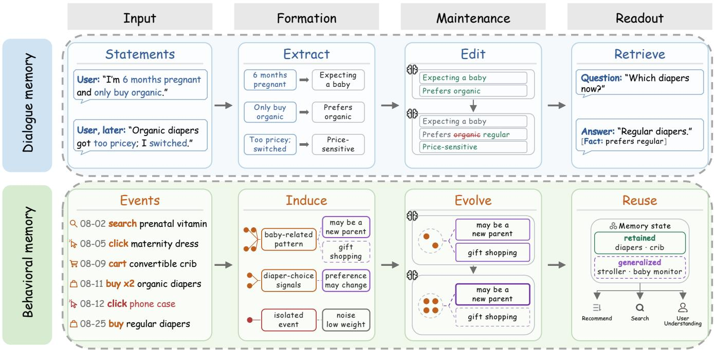
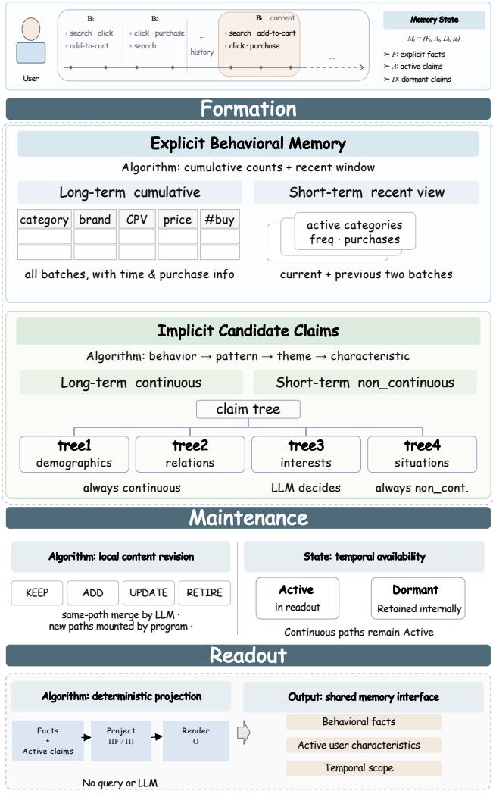
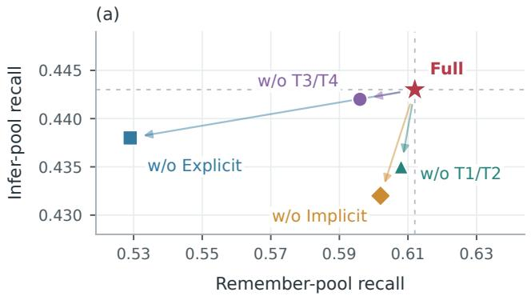
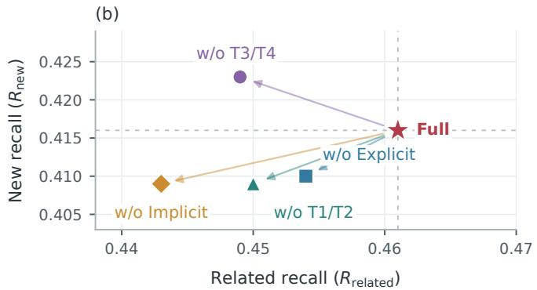
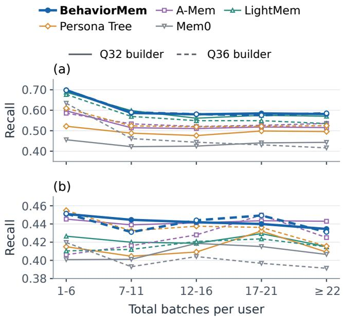
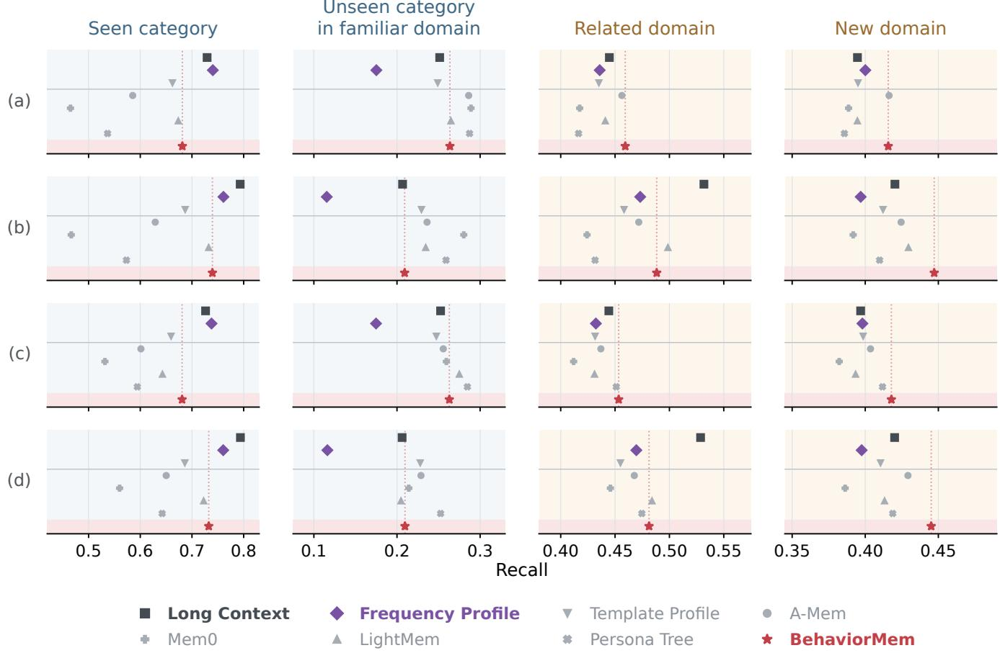

# BehaviorMem: Building and Evaluating User Memory from Real-World E-Commerce Behavior Streams

Sizhe Wan<sub>g</sub><sup>∗</sup>   
<sub>wangsz</sub>26<sub>@m.</sub>f<sub>u</sub>d<sub>an.e</sub>d<sub>u.cn</sub>   
F<sub>u</sub>d<sub>a</sub>n Uni<sub>ve</sub>r<sub>s</sub>it<sub>y</sub>   
Shan<sub>g</sub>hai<sub>,</sub> China

Xin<sub>g</sub>hao Fan<sub>g</sub><sup>∗</sup> x<sup>hf</sup>ang26@zju.e<sup>d</sup>u.cn Z<sup>h</sup>ejiang University Han<sub>g</sub>zho<sub>u,</sub> China

D<sub>agu</sub>i Ch<sub>e</sub>n<sup>†</sup>   
da<sub>g</sub>ui.cd<sub>g</sub>@taobao.com   
T<sub>ao</sub>b<sub>ao</sub> & Tm<sub>a</sub>ll Gr<sub>oup,</sub>   
Alib<sub>a</sub>b<sub>a</sub>   
Beijing, C<sup>h</sup>ina   
Rui Qiu<sup>∗</sup>   
<sub>q</sub>iurui.<sub>q</sub>iu@taobao.com   
T<sub>ao</sub>b<sub>ao</sub> & Tm<sub>a</sub>ll Gr<sub>oup,</sub>   
Alib<sub>a</sub>b<sub>a</sub>   
Beijing, C<sup>h</sup>ina

K<sub>u</sub>n K<sub>ua</sub>n<sub>g</sub><sup>†</sup> <sup>k</sup>un<sup>k</sup>uang@zju.e<sup>d</sup>u.cn Z<sup>h</sup>ejiang University Han<sub>g</sub>zho<sub>u,</sub> China

Z<sup>h</sup>enjia Ma   
maz<sup>h</sup>enjia.mzj@a<sup>l</sup>i<sup>b</sup>a<sup>b</sup>a  
in<sub>c.co</sub>m   
T<sub>ao</sub>b<sub>ao</sub> & Tm<sub>a</sub>ll Gr<sub>oup,</sub>   
Alib<sub>a</sub>b<sub>a</sub>   
Beijing, C<sup>h</sup>ina

Hon<sub>g</sub>chen<sub>g</sub> G<sub>u</sub>o<sup>†</sup> <sub>guo</sub>h<sub>c@</sub>f<sub>u</sub>d<sub>an.e</sub>d<sub>u.cn</sub> F<sub>u</sub>d<sub>a</sub>n Uni<sub>ve</sub>r<sub>s</sub>it<sub>y</sub> Shan<sub>g</sub>hai<sub>,</sub> China

## Abstract

U<sub>ser memory</sub> h<sub>e</sub>l<sub>ps persona</sub>li<sub>ze</sub>d <sub>sys</sub>t<sub>ems</sub> b<sub>u</sub>ild <sub>on</sub> th<sub>e</sub>i<sub>r un</sub>d<sub>er-</sub> standin<sub>g</sub> of users over time. In e-commerce<sub>,</sub> users conve<sub>y</sub> their <sub>pre</sub>f<sub>erences</sub> <sub>an</sub>d <sub>nee</sub>d<sub>s</sub> th<sub>roug</sub>h b<sub>o</sub>th <sub>exp</sub>li<sub>c</sub>it l<sub>anguage</sub> <sub>an</sub>d i<sub>mp</sub>li<sub>c</sub>it interactions with <sub>p</sub>roducts. We stud<sub>y</sub> memor<sub>y</sub> built from lo<sub>g</sub>s of these interactions, examining how it can remember concrete evidence and established interests, and use that evidence to infer un<sup>d</sup>er<sup>l</sup>ying nee<sup>d</sup>s an<sup>d</sup> pre<sup>f</sup>erences t<sup>h</sup>at in<sup>f</sup>orm ju<sup>d</sup>gments <sup>b</sup>eyon<sup>d</sup> well-observed <sub>p</sub>roduct domains. Existin<sub>g</sub> memor<sub>y</sub> methods <sub>p</sub>rimaril<sub>y</sub> tar<sub>g</sub>et lan<sub>g</sub>ua<sub>g</sub>e-based interactions<sub>,</sub> and evaluations ofer limited <sub>rea</sub>l b<sub>e</sub>h<sub>av</sub>i<sub>ora</sub>l d<sub>a</sub>t<sub>a an</sub>d li<sub>m</sub>it<sub>e</sub>d <sub>separa</sub>ti<sub>on o</sub>f th<sub>ese capa</sub>biliti<sub>es.</sub> T<sup>h</sup>is <sup>l</sup>eaves open <sup>h</sup>ow to joint<sup>l</sup>y support an<sup>d</sup> separate<sup>l</sup>y eva<sup>l</sup>uate <sub>remem</sub>b<sub>er</sub>i<sub>ng an</sub>d i<sub>n</sub>f<sub>erence</sub> f<sub>rom</sub> b<sub>e</sub>h<sub>av</sub>i<sub>ora</sub>l l<sub>ogs.</sub> W<sub>e</sub> f<sub>ormu</sub>l<sub>a</sub>t<sub>e</sub> th<sub>e pro</sub>bl<sub>em o</sub>f <sub>con</sub>ti<sub>nua</sub>l b<sub>e</sub>h<sub>av</sub>i<sub>ora</sub>l <sub>user memory aroun</sub>d th<sub>ese</sub> joint requirements an<sup>d d</sup>eve<sup>l</sup>op a <sup>d</sup>e<sup>d</sup>icate<sup>d</sup> eva<sup>l</sup>uation <sup>f</sup>ramewor<sup>k</sup> and memory method to address them. BehaviorMemBench is a b<sub>enc</sub>h<sub>mar</sub>k b<sub>u</sub>ilt f<sub>rom rea</sub>l <sub>e-commerce</sub> l<sub>ogs cover</sub>i<sub>ng</sub> 1<sub>,</sub>194 <sub>users</sub> <sub>an</sub>d 17<sub>,</sub>462 b<sub>e</sub>h<sub>av</sub>i<sub>ora</sub>l b<sub>a</sub>t<sub>c</sub>h<sub>es over more</sub> th<sub>an</sub> th<sub>ree years, w</sub>ith <sub>au</sub>t<sub>oma</sub>ti<sub>c</sub> f<sub>u</sub>t<sub>ure-</sub>b<sub>e</sub>h<sub>av</sub>i<sub>or</sub> l<sub>a</sub>b<sub>e</sub>l<sub>s an</sub>d <sub>a</sub> t<sub>as</sub>k<sub>-</sub>i<sub>n</sub>d<sub>epen</sub>d<sub>en</sub>t <sub>memory</sub> i<sub>n</sub>t<sub>er</sub>f<sub>ace</sub> t<sub>o separa</sub>t<sub>e</sub>l<sub>y eva</sub>l<sub>ua</sub>t<sub>e remem</sub>b<sub>er</sub>i<sub>ng an</sub>d i<sub>n</sub>f<sub>erence un</sub>d<sub>er</sub> a common protocol. BehaviorMem is a memory design that or-<sub>gan</sub>i<sub>zes exp</sub>li<sub>c</sub>it b<sub>e</sub>h<sub>av</sub>i<sub>ora</sub>l f<sub>ac</sub>t<sub>s an</sub>d i<sub>n</sub>f<sub>erre</sub>d <sub>user c</sub>h<sub>arac</sub>t<sub>er</sub>i<sub>s</sub>ti<sub>cs</sub> across lon<sub>g</sub>-term and short-term sco<sub>p</sub>es in a two-axis state<sub>,</sub> with evidence-<sub>g</sub>rounded formation<sub>,</sub> continual maintenance<sub>,</sub> and <sub>q</sub>uer<sub>y</sub>- i<sub>n</sub>d<sub>epen</sub>d<sub>en</sub>t <sub>rea</sub>d<sub>ou</sub>t<sub>.</sub> E<sub>xper</sub>i<sub>men</sub>t<sub>s</sub> <sub>across</sub> t<sub>wo</sub> b<sub>u</sub>ild<sub>ers</sub> <sub>an</sub>d t<sub>wo</sub> t<sub>as</sub>k <sub>rea</sub>d<sub>ers</sub> <sub>s</sub>h<sub>ow</sub> th<sub>a</sub>t B<sub>e</sub>h<sub>av</sub>i<sub>or</sub>M<sub>em</sub> l<sub>ea</sub>d<sub>s</sub> th<sub>e</sub> <sub>eva</sub>l<sub>ua</sub>t<sub>e</sub>d <sub>agen</sub>ti<sub>c</sub> <sub>memor</sub>i<sub>es on remem</sub>b<sub>er an</sub>d i<sub>n</sub>f<sub>er, an</sub>d <sub>revea</sub>l dif<sub>eren</sub>t <sub>me</sub>th<sub>o</sub>d <sub>ran</sub>k in<sub>g</sub>s across the two ca<sub>p</sub>abilities and com<sub>p</sub>etitive statistical baselines. V<sub>a</sub>lid<sub>a</sub>ti<sub>on on a pu</sub>bli<sub>c</sub> d<sub>a</sub>t<sub>ase</sub>t f<sub>ur</sub>th<sub>er suppor</sub>t<sub>s</sub> it<sub>s use</sub>f<sub>u</sub>l<sub>ness</sub> f<sub>or</sub> d<sub>owns</sub>t<sub>ream</sub> t<sub>as</sub>k<sub>s</sub> b<sub>ase</sub>d <sub>on</sub> b<sub>e</sub>h<sub>av</sub>i<sub>ora</sub>l hi<sub>s</sub>t<sub>or</sub>i<sub>es.</sub>

## CCS Concepts

• Information systems → Personalization; • Human-centered computing → User models.

User memor<sub>y,</sub> behavioral user modelin<sub>g,</sub> <sub>p</sub>ersonalization<sub>,</sub> lar<sub>g</sub>e l<sub>anguage mo</sub>d<sub>e</sub>l<sub>s, memory eva</sub>l<sub>ua</sub>ti<sub>on</sub>

## 1 Introduction

Lon<sub>g</sub>-term <sub>p</sub>ersonalization in LLM-based s<sub>y</sub>stems<sub>,</sub> such as <sub>p</sub>ersonal a<sub>g</sub>ents<sub>,</sub> search en<sub>g</sub>ines<sub>,</sub> and recommendation s<sub>y</sub>stems<sub>,</sub> re<sub>q</sub>uires <sub>p</sub>ersistent user understandin<sub>g</sub>. User memor<sub>y</sub> accumulates and reuses <sub>p</sub>references<sub>,</sub> circumstances<sub>,</sub> and <sub>g</sub>oals across interactions to su<sub>pp</sub>ort relevant services as users’ needs chan<sub>g</sub>e [5, 47]. In e-commerce, thi<sub>s</sub> k<sub>now</sub>l<sub>e</sub>d<sub>ge</sub> <sub>comes</sub> f<sub>rom</sub> i<sub>n</sub>t<sub>erac</sub>ti<sub>ons</sub> <sub>w</sub>ith <sub>pro</sub>d<sub>uc</sub>t<sub>s</sub> <sub>an</sub>d <sub>ser-</sub> vices<sub>,</sub> where users conve<sub>y</sub> <sub>p</sub>references and sho<sub>pp</sub>in<sub>g</sub> needs throu<sub>g</sub>h both explicit natural language and implicit behavior. Through <sub>p</sub>r<sub>o</sub>d<sub>uc</sub>t in<sub>qu</sub>iri<sub>es</sub> <sub>a</sub>nd <sub>cus</sub>t<sub>o</sub>m<sub>e</sub>r-<sub>se</sub>r<sub>v</sub>i<sub>ce</sub> <sub>co</sub>n<sub>ve</sub>r<sub>sa</sub>ti<sub>o</sub>n<sub>s,</sub> <sub>use</sub>r<sub>s</sub> <sub>ca</sub>n directl<sub>y</sub> state their re<sub>q</sub>uirements<sub>,</sub> <sub>p</sub>references<sub>,</sub> and circumstances. B<sub>y</sub> contrast<sub>,</sub> browsin<sub>g,</sub> favorites<sub>,</sub> add-to-cart actions<sub>,</sub> and <sub>p</sub>urchases show what users en<sub>g</sub>a<sub>g</sub>e with without directl<sub>y</sub> ex<sub>p</sub>lainin<sub>g</sub> wh<sub>y</sub>. Th<sub>e</sub>i<sub>r un</sub>d<sub>er</sub>l<sub>y</sub>i<sub>ng pre</sub>f<sub>erences an</sub>d <sub>nee</sub>d<sub>s mus</sub>t th<sub>ere</sub>f<sub>ore</sub> b<sub>e</sub> i<sub>n</sub>f<sub>erre</sub>d from <sub>p</sub>roduct characteristics and <sub>p</sub>atterns across interactions.

Memor<sub>y</sub> construction from ex<sub>p</sub>licit natural-lan<sub>g</sub>ua<sub>g</sub>e interactions has been extensivel<sub>y</sub> studied [5, 20]. However, im<sub>p</sub>licit behavi<sub>ora</sub>l l<sub>ogs prov</sub>id<sub>e ev</sub>id<sub>ence o</sub>f <sub>pre</sub>f<sub>erences an</sub>d <sub>nee</sub>d<sub>s</sub> th<sub>a</sub>t <sub>users may</sub> not articulate in lan<sub>g</sub>ua<sub>g</sub>e. These si<sub>g</sub>nals are dis<sub>p</sub>ersed across <sub>p</sub>rod ucts and visits<sub>,</sub> re<sub>q</sub>uirin<sub>g</sub> observations to be inter<sub>p</sub>reted to<sub>g</sub>ether over time. Makin<sub>g</sub> this evidence useful for later <sub>p</sub>ersonalization <sub>ca</sub>ll<sub>s</sub> f<sub>or a pers</sub>i<sub>s</sub>t<sub>en</sub>t<sub>, up</sub>d<sub>a</sub>t<sub>a</sub>bl<sub>e source o</sub>f <sub>user</sub> i<sub>n</sub>f<sub>orma</sub>ti<sub>on</sub> th<sub>a</sub>t carries relevant histor<sub>y</sub> into future interactions. We therefore focus on constructing user memory from behavioral logs to preserve <sub>ev</sub>id<sub>ence o</sub>f <sub>users</sub>’ <sub>c</sub>h<sub>o</sub>i<sub>ces an</sub>d d<sub>eve</sub>l<sub>op a reusa</sub>bl<sub>e un</sub>d<sub>ers</sub>t<sub>an</sub>di<sub>ng o</sub>f th<sub>e pre</sub>f<sub>erences an</sub>d <sub>nee</sub>d<sub>s</sub> b<sub>e</sub>hi<sub>n</sub>d th<sub>em.</sub>

Past beha<sub>v</sub>ior can inform later <sub>p</sub>ersonalization. Ho<sub>w</sub>e<sub>v</sub>er<sub>,</sub> beh<sub>av</sub>i<sub>ora</sub>l l<sub>ogs recor</sub>d <sub>w</sub>h<sub>a</sub>t <sub>users</sub> did <sub>w</sub>ith<sub>ou</sub>t di<sub>rec</sub>tl<sub>y exp</sub>l<sub>a</sub>i<sub>n</sub>i<sub>ng</sub> th<sub>e</sub>i<sub>r pre</sub>f<sub>erences or nee</sub>d<sub>s.</sub> U<sub>s</sub>i<sub>ng suc</sub>h <sub>ev</sub>id<sub>ence</sub> th<sub>ere</sub>f<sub>ore ca</sub>ll<sub>s</sub> f<sub>or</sub> memory to remember what users did and infer what their choices im<sub>p</sub>l<sub>y</sub> about them be<sub>y</sub>ond rememberin<sub>g</sub>. Rememberin<sub>g</sub> kee<sub>p</sub>s con-<sub>cre</sub>t<sub>e c</sub>h<sub>o</sub>i<sub>ces, es</sub>t<sub>a</sub>bli<sub>s</sub>h<sub>e</sub>d i<sub>n</sub>t<sub>eres</sub>t<sub>s, an</sub>d <sub>re</sub>l<sub>evan</sub>t <sub>pro</sub>d<sub>uc</sub>t <sub>or a</sub>tt<sub>r</sub>ib<sub>u</sub>t<sub>e</sub> d<sub>e</sub>t<sub>a</sub>il<sub>s ava</sub>il<sub>a</sub>bl<sub>e</sub> f<sub>or</sub> l<sub>a</sub>t<sub>er use.</sub> I<sub>n</sub>f<sub>erence connec</sub>t<sub>s recurr</sub>i<sub>ng c</sub>h<sub>o</sub>i<sub>ces</sub> <sub>an</sub>d <sub>s</sub>h<sub>are</sub>d <sub>pro</sub>d<sub>uc</sub>t <sub>c</sub>h<sub>arac</sub>t<sub>er</sub>i<sub>s</sub>ti<sub>cs</sub> t<sub>o</sub> d<sub>er</sub>i<sub>ve reusa</sub>bl<sub>e user</sub> k<sub>now</sub>l<sub>-</sub> e<sup>d</sup>ge t<sup>h</sup>at can in<sup>f</sup>orm ju<sup>d</sup>gments in sparse<sup>l</sup>y o<sup>b</sup>serve<sup>d</sup> or unvisite<sup>d</sup>, <sub>seman</sub>ti<sub>ca</sub>ll<sub>y re</sub>l<sub>a</sub>t<sub>e</sub>d <sub>pro</sub>d<sub>uc</sub>t d<sub>oma</sub>i<sub>ns.</sub>

  
Figure 1: Comparison of dialogue-oriented and behavioral user memory across formation, maintenance, and readout. Dialogue memory preserves and organizes information expressed in interactions. Behavioral memory retains behavioral facts and induces user characteristics from implicit events, maintaining both to support remembering and inference.

Existing memory methods and benchmarks ofer limited coverage of real, continual behavioral logs. MemGPT and Mem0 mana<sub>g</sub>e dialo<sub>g</sub>ue histories<sub>,</sub> and <sub>p</sub>ersonalized s<sub>y</sub>stems such as Memor<sub>y</sub>- Bank and PersonaTree maintain user re<sub>p</sub>resentations from lan<sub>g</sub>ua<sub>g</sub>ebased interactions [5, 20, 45, 47]. Fi<sub>g</sub>ure 1 contrasts this settin<sub>g</sub> with im<sub>p</sub>licit e-commerce beha<sub>v</sub>ior. Benchmarks s<sub>u</sub>ch as LoCoMo<sub>,</sub> Lon<sub>g</sub>- MemEval<sub>,</sub> and Memor<sub>y</sub>A<sub>g</sub>entBench likewise evaluate lan<sub>g</sub>ua<sub>g</sub>ebased interactions [11, 19, 37], while behavioral-lo<sub>g</sub> benchmarks suc<sup>h</sup> as DynamicMem use synt<sup>h</sup>etic trajectories an<sup>d</sup> pre<sup>d</sup>e<sup>fi</sup>ne<sup>d</sup> user states [39]. This motivates memor<sub>y</sub> construction and evaluation grounded in real behavioral streams, with labels automatically d<sub>er</sub>i<sub>ve</sub>d f<sub>rom</sub> f<sub>u</sub>t<sub>ure</sub> i<sub>n</sub>t<sub>erac</sub>ti<sub>ons</sub> t<sub>o cap</sub>t<sub>ure</sub> h<sub>ow users</sub>’ i<sub>n</sub>t<sub>eres</sub>t<sub>s</sub> <sub>un</sub>f<sub>o</sub>ld i<sub>n ac</sub>t<sub>ua</sub>l <sub>use.</sub>

A second gap concerns joint support and separate evaluation of remember and infer. Memory methods largely emphasize <sub>re</sub>t<sub>a</sub>i<sub>n</sub>i<sub>ng an</sub>d <sub>re</sub>t<sub>r</sub>i<sub>ev</sub>i<sub>ng use</sub>f<sub>u</sub>l i<sub>n</sub>f<sub>orma</sub>ti<sub>on, a</sub>lth<sub>oug</sub>h <sub>some a</sub>l<sub>so</sub> d<sub>e-</sub> <sub>r</sub>i<sub>ve</sub> hi<sub>g</sub>h<sub>er-</sub>l<sub>eve</sub>l k<sub>now</sub>l<sub>e</sub>d<sub>ge:</sub> G<sub>enera</sub>ti<sub>ve</sub> A<sub>gen</sub>t<sub>s</sub> f<sub>orms</sub> <sub>re</sub>fl<sub>ec</sub>ti<sub>ons,</sub> <sub>an</sub>d A<sub>-</sub>M<sub>em</sub> li<sub>n</sub>k<sub>s</sub> <sub>memor</sub>i<sub>es</sub> <sub>an</sub>d <sub>evo</sub>l<sub>ves</sub> th<sub>e</sub>i<sub>r</sub> <sub>con</sub>t<sub>ex</sub>t<sub>ua</sub>l <sub>represen</sub> tations [21, 40]. For continual behavioral memor<sub>y</sub>, how to <sub>p</sub>reserve <sub>concre</sub>t<sub>e ev</sub>id<sub>ence an</sub>d <sub>ma</sub>i<sub>n</sub>t<sub>a</sub>i<sub>n rev</sub>i<sub>sa</sub>bl<sub>e user</sub> i<sub>n</sub>f<sub>erences</sub> t<sub>oge</sub>th<sub>er</sub> <sub>rema</sub>i<sub>ns</sub> <sub>un</sub>d<sub>erexp</sub>l<sub>ore</sub>d<sub>.</sub> E<sub>va</sub>l<sub>ua</sub>ti<sub>on</sub> <sub>common</sub>l<sub>y</sub> f<sub>ocuses</sub> <sub>on</sub> d<sub>own-</sub> <sub>s</sub>t<sub>ream ques</sub>ti<sub>on answer</sub>i<sub>ng an</sub>d th<sub>e recovery an</sub>d <sub>use o</sub>f<sub>remem</sub>b<sub>ere</sub>d inf<sub>o</sub>rm<sub>a</sub>ti<sub>o</sub>n<sub>.</sub> L<sub>a</sub>MP<sub>,</sub> GISTB<sub>e</sub>n<sub>c</sub>h<sub>, a</sub>nd Str<sub>ea</sub>mPr<sub>o</sub>fil<sub>e</sub>B<sub>e</sub>n<sub>c</sub>h <sub>e</sub>xt<sub>e</sub>nd evaluation to <sub>p</sub>ersonalization or user understandin<sub>g</sub> [8, 27, 35], but a common assessment se<sub>p</sub>aratin<sub>g</sub> these ca<sub>p</sub>abilities remains limited for continual im<sub>p</sub>licit e-commerce behavior. Addressin<sub>g</sub> this <sub>g</sub>a<sub>p</sub> calls for a task-independent memory interface and separate tests of remember and infer: whether memory keeps established interests avai<sup>l</sup>a<sup>bl</sup>e, an<sup>d</sup> w<sup>h</sup>et<sup>h</sup>er it supports <sup>f</sup>uture-interest ju<sup>d</sup>g-<sub>men</sub>t<sub>s</sub> b<sub>eyon</sub>d <sub>we</sub>ll<sub>-o</sub>b<sub>serve</sub>d <sub>pro</sub>d<sub>uc</sub>t d<sub>oma</sub>i<sub>ns.</sub>

To address these gaps, we introduce BehaviorMemBench for evaluation and BehaviorMem for continual memory constructi<sub>on</sub> f<sub>rom e-commerce</sub> b<sub>e</sub>h<sub>av</sub>i<sub>ora</sub>l l<sub>ogs.</sub> B<sub>e</sub>h<sub>av</sub>i<sub>or</sub>M<sub>em</sub>B<sub>enc</sub>h <sub>covers</sub> 1<sub>,</sub>194 <sub>users an</sub>d 17<sub>,</sub>462 b<sub>e</sub>h<sub>av</sub>i<sub>ora</sub>l b<sub>a</sub>t<sub>c</sub>h<sub>es over more</sub> th<sub>an</sub> th<sub>ree</sub> years, using automatically derived future-behavior labels to evaluate how memory supports remembering and inference under a common, task-independent protocol. BehaviorMem addresses the construction gap by jointly maintaining behavioral evidence and revisable user understanding. To remember, its two-axis state organizes explicit facts alongside inferred characteristics across lon<sub>g</sub>-term and short-term sco<sub>p</sub>es<sub>,</sub> kee<sub>p</sub>in<sub>g</sub> <sub>p</sub>ast choices and established interests available through query-independent readout. To infer, evidence-grounded abstraction proceeds f<sub>rom</sub> b<sub>e</sub>h<sub>av</sub>i<sub>ors</sub> th<sub>roug</sub>h <sub>pa</sub>tt<sub>erns</sub> <sub>an</sub>d th<sub>emes</sub> t<sub>o</sub> <sub>user</sub> <sub>c</sub>h<sub>arac</sub>t<sub>er</sub>i<sub>s</sub>ti<sub>cs</sub> linked to supporting observations, and continual maintenance revises their content and tem<sub>p</sub>oral availabilit<sub>y</sub> as new evidence arrives<sub>,</sub> distin<sub>g</sub>uishin<sub>g</sub> endurin<sub>g</sub> tendencies from sta<sub>g</sub>e-s<sub>p</sub>ecific needs.

O<sub>ur con</sub>t<sub>r</sub>ib<sub>u</sub>ti<sub>ons are</sub> th<sub>ree</sub>f<sub>o</sub>ld<sub>:</sub>

• We formulate behavioral user memor<sub>y</sub> around remembering and inference, and introduce BehaviorMemBench <sub>w</sub>ith <sub>rea</sub>l <sub>e-commerce</sub> l<sub>ogs, au</sub>t<sub>oma</sub>ti<sub>c</sub> f<sub>u</sub>t<sub>ure-</sub>b<sub>e</sub>h<sub>av</sub>i<sub>or</sub> l<sub>a-</sub> b<sub>e</sub>l<sub>s, an</sub>d <sub>separa</sub>t<sub>e eva</sub>l<sub>ua</sub>ti<sub>on un</sub>d<sub>er a common,</sub> t<sub>as</sub>k<sub>-</sub>i<sub>n</sub>d<sub>epen</sub>d<sub>en</sub>t <sub>p</sub>rotoco<sup>l</sup>.

• We propose BehaviorMem, whose two-axis state pairs beh<sub>av</sub>i<sub>ora</sub>l f<sub>ac</sub>t<sub>s an</sub>d i<sub>n</sub>f<sub>erre</sub>d <sub>c</sub>h<sub>arac</sub>t<sub>er</sub>i<sub>s</sub>ti<sub>cs across</sub> l<sub>ong-</sub>t<sub>erm</sub> <sub>an</sub>d <sub>s</sub>h<sub>or</sub>t<sub>-</sub>t<sub>erm scopes, w</sub>ith <sub>ev</sub>id<sub>ence-groun</sub>d<sub>e</sub>d <sub>a</sub>b<sub>s</sub>t<sub>rac</sub>ti<sub>on</sub> <sub>an</sub>d <sub>con</sub>ti<sub>nua</sub>l <sub>ma</sub>i<sub>n</sub>t<sub>enance.</sub>

• Across two builders and two task readers, BehaviorMem l<sub>ea</sub>d<sub>s</sub> th<sub>e eva</sub>l<sub>ua</sub>t<sub>e</sub>d <sub>agen</sub>ti<sub>c memor</sub>i<sub>es on</sub> b<sub>o</sub>th <sub>reca</sub>ll<sub>s.</sub> E<sub>x-</sub> <sub>p</sub>eriments also reveal diferent rankin<sub>g</sub>s across ca<sub>p</sub>abilities<sub>,</sub> com<sub>p</sub>etitive statistical baselines<sub>,</sub> and com<sub>p</sub>lementar<sub>y</sub> mem-<sub>ory</sub> <sub>componen</sub>t<sub>s,</sub> <sub>w</sub>ith f<sub>ur</sub>th<sub>er</sub> <sub>va</sub>lid<sub>a</sub>ti<sub>on</sub> <sub>on</sub> d<sub>owns</sub>t<sub>ream</sub> t<sub>as</sub>k<sub>s.</sub>

## 2 Problem Formulation

Behavioral observations. For each user, chronological behavior b<sub>a</sub>t<sub>c</sub>h<sub>es</sub> f<sub>orm a s</sub>t<sub>ream:</sub>

$$
\boldsymbol { \mathcal { B } } = ( B _ { 1 } , \ldots , B _ { T } ) , \qquad B _ { t } = \{ b _ { t , j } \} _ { j = 1 } ^ { n _ { t } } .
$$

Each interaction records a <sub>p</sub>roduct<sub>,</sub> its attributes<sub>,</sub> action t<sub>yp</sub>e<sub>,</sub> and ti<sub>mes</sub>t<sub>amp;</sub> th<sub>e user</sub>’<sub>s un</sub>d<sub>er</sub>l<sub>y</sub>i<sub>ng pre</sub>f<sub>erences an</sub>d <sub>nee</sub>d<sub>s rema</sub>i<sub>n</sub> im<sub>p</sub>li<sub>c</sub>it<sub>.</sub>

Causal user-state interface. A memory system updates its state and ex<sub>p</sub>oses a <sub>q</sub>uer<sub>y</sub>-inde<sub>p</sub>endent readout:

$$
M _ { t } = U ( M _ { t - 1 } , B _ { t } ) , ~ O _ { t } = \Phi ( M _ { t } ) .\tag{1}
$$

B<sub>o</sub>th d<sub>epen</sub>d <sub>on</sub>l<sub>y</sub> <sub>on</sub> $B _ { \leq t }$ <sub>,</sub> without access to downstream <sub>q</sub>ueries<sub>,</sub> <sub>can</sub>did<sub>a</sub>t<sub>e poo</sub>l<sub>s, or</sub> f<sub>u</sub>t<sub>ure</sub> l<sub>a</sub>b<sub>e</sub>l<sub>s.</sub> Th<sub>e s</sub>t<sub>a</sub>t<sub>e may com</sub>bi<sub>ne recor</sub>d<sub>s,</sub> <sub>s</sub>t<sub>a</sub>ti<sub>s</sub>ti<sub>ca</sub>l <sub>summar</sub>i<sub>es, an</sub>d i<sub>n</sub>f<sub>erre</sub>d <sub>c</sub>h<sub>arac</sub>t<sub>er</sub>i<sub>s</sub>ti<sub>cs; a common rea</sub>d<sub>er</sub> <sub>eva</sub>l<sub>ua</sub>t<sub>es</sub> it<sub>s rea</sub>d<sub>ou</sub>t<sub>.</sub>

Joint memory objectives. Memory must remember useful historical evidence and established user information, and infer reusa<sup>bl</sup>e user <sup>k</sup>now<sup>l</sup>e<sup>d</sup>ge t<sup>h</sup>at supports ju<sup>d</sup>gments in <sup>l</sup>ess-o<sup>b</sup>serve<sup>d</sup> or <sub>p</sub>reviousl<sub>y</sub> unvisited domains. Because abstraction and detail <sub>preserva</sub>ti<sub>on</sub> <sub>can</sub> <sub>a</sub>f<sub>ec</sub>t th<sub>ese</sub> <sub>capa</sub>biliti<sub>es</sub> dif<sub>eren</sub>tl<sub>y,</sub> <sub>we</sub> <sub>assess</sub> th<sub>em</sub> <sup>se</sup>p<sup>aratel</sup>y<sup>.</sup>

Design questions. BehaviorMemBench operationalizes these o<sup>b</sup>jectives t<sup>h</sup>roug<sup>h f</sup>uture-<sup>b</sup>e<sup>h</sup>avior tests, w<sup>h</sup>i<sup>l</sup>e Be<sup>h</sup>aviorMem ex-<sub>p</sub>lores a memor<sub>y</sub> desi<sub>g</sub>n addressin<sub>g</sub> them.

## 3 BehaviorMemBench

## 3.1 Comparison with Existing Benchmarks

Table 1 compares six properties. For data coverage, existing bench marks use lan<sub>g</sub>ua<sub>g</sub>e-based histories [11, 19, 37], s<sub>y</sub>nthetic behavior [39], or real data without continual evaluation [8, 27]. Behavi<sub>o</sub>rM<sub>e</sub>mB<sub>e</sub>n<sub>c</sub>h <sub>co</sub>mbin<sub>es</sub> r<sub>ea</sub>l<sub>, co</sub>ntin<sub>ua</sub>l im<sub>p</sub>li<sub>c</sub>it b<sub>e</sub>h<sub>av</sub>i<sub>o</sub>r <sub>s</sub>tr<sub>ea</sub>m<sub>s</sub> with automatic future-behavior labels. For capability evaluation, D<sub>y</sub>n<sub>a</sub>mi<sub>c</sub>M<sub>e</sub>m <sub>a</sub>nd GISTB<sub>e</sub>n<sub>c</sub>h <sub>a</sub>r<sub>e</sub> t<sub>as</sub>k-ind<sub>epe</sub>nd<sub>e</sub>nt b<sub>u</sub>t d<sub>o</sub> n<sub>o</sub>t <sub>separa</sub>t<sub>e</sub>l<sub>y</sub> t<sub>es</sub>t i<sub>n</sub>f<sub>er</sub> b<sub>eyon</sub>d <sub>we</sub>ll<sub>-o</sub>b<sub>serve</sub>d d<sub>oma</sub>i<sub>ns;</sub> St<sub>ream</sub>P<sub>ro-</sub> fileBench su<sub>pp</sub>orts both <sub>p</sub>ro<sub>p</sub>erties usin<sub>g</sub> text [35]. BehaviorMem-B<sub>enc</sub>h <sub>com</sub>bi<sub>nes</sub> th<sub>ese</sub> d<sub>a</sub>t<sub>a proper</sub>ti<sub>es w</sub>ith <sub>a</sub> t<sub>as</sub>k<sub>-</sub>i<sub>n</sub>d<sub>epen</sub>d<sub>en</sub>t i<sub>n</sub>t<sub>er</sub>f<sub>ace</sub> <sub>an</sub>d <sub>separa</sub>t<sub>e</sub> <sub>remem</sub>b<sub>er</sub> <sub>an</sub>d i<sub>n</sub>f<sub>er</sub> t<sub>es</sub>t<sub>s.</sub>

## 3.2 Data Collection and Statistics

W<sub>e</sub> <sub>cons</sub>t<sub>ruc</sub>t B<sub>e</sub>h<sub>av</sub>i<sub>or</sub>M<sub>em</sub>B<sub>enc</sub>h f<sub>rom</sub> T<sub>ao</sub>b<sub>ao</sub>’<sub>s</sub> <sub>user</sub> b<sub>e</sub>h<sub>av</sub>i<sub>or</sub> l<sub>ogs,</sub> s<sub>p</sub>annin<sub>g</sub> Februar<sub>y</sub> 2023 to June 2026. These lo<sub>g</sub>s record browsin<sub>g</sub>, <sub>c</sub>li<sub>c</sub>k<sub>s,</sub> f<sub>avor</sub>it<sub>es,</sub> <sub>a</sub>dd<sub>-</sub>t<sub>o-car</sub>t <sub>ac</sub>ti<sub>ons,</sub> <sub>an</sub>d <sub>purc</sub>h<sub>ases</sub> <sub>w</sub>ith ti<sub>mes</sub>t<sub>amps</sub> and <sub>p</sub>roduct metadata. Followin<sub>g</sub> the visit-mer<sub>g</sub>in<sub>g</sub> <sub>p</sub>rocedure in

A<sub>ppe</sub>ndix A<sub>.</sub>1<sub>.</sub>1<sub>, we</sub> r<sub>e</sub>t<sub>a</sub>in 1<sub>,</sub>194 <sub>o</sub>f 2<sub>,</sub>000 r<sub>a</sub>nd<sub>o</sub>ml<sub>y sa</sub>m<sub>p</sub>l<sub>e</sub>d <sub>use</sub>r<sub>s</sub> <sub>w</sub>ith <sub>a</sub>t l<sub>eas</sub>t 50 <sub>va</sub>lid <sub>v</sub>i<sub>s</sub>it<sub>s.</sub> A b<sub>a</sub>t<sub>c</sub>h b<sub>ecomes e</sub>li<sub>g</sub>ibl<sub>e</sub> t<sub>o c</sub>l<sub>ose a</sub>ft<sub>er</sub> 50 visits or 120 da<sub>y</sub>s and closes at the next inter-visit <sub>g</sub>a<sub>p</sub> exceedin<sub>g</sub> 15 min<sub>u</sub>tes. This combines acti<sub>v</sub>it<sub>y</sub> and ela<sub>p</sub>sed-time limits <sub>w</sub>hile avoidin<sub>g</sub> a s<sub>p</sub>lit within a browsin<sub>g</sub> session. The resultin<sub>g</sub> cor<sub>p</sub>us <sub>con</sub>t<sub>a</sub>i<sub>ns</sub> 913<sub>,</sub>271 <sub>v</sub>i<sub>s</sub>it<sub>s,</sub> 17<sub>,</sub>462 b<sub>a</sub>t<sub>c</sub>h<sub>es,</sub> <sub>an</sub>d 16<sub>,</sub>268 hi<sub>s</sub>t<sub>ory-</sub>t<sub>o-</sub>f<sub>u</sub>t<sub>ure</sub> tr<sub>a</sub>n<sub>s</sub>iti<sub>o</sub>n<sub>s;</sub> th<sub>e</sub> <sub>su</sub>mm<sub>a</sub>r<sub>y</sub> <sub>s</sub>t<sub>a</sub>ti<sub>s</sub>ti<sub>cs</sub> in A<sub>ppe</sub>ndix A<sub>.</sub>2 <sub>c</sub>h<sub>a</sub>r<sub>ac</sub>t<sub>e</sub>riz<sub>e</sub> <sub>va</sub>ri<sub>a</sub>ti<sub>o</sub>n <sub>ac</sub>r<sub>oss use</sub>r<sub>s.</sub>

## 3.3 Benchmark Framework

Prediction targets and future labels. We use Taobao’s itemcate<sub>g</sub>or<sub>y</sub> taxonom<sub>y,</sub> which or<sub>g</sub>anizes <sub>p</sub>roducts hierarchicall<sub>y</sub> from b<sub>roa</sub>d L1 <sub>ca</sub>t<sub>egor</sub>i<sub>es</sub> th<sub>roug</sub>h L2 <sub>an</sub>d d<sub>eeper</sub> l<sub>eve</sub>l<sub>s</sub> t<sub>o</sub> l<sub>ea</sub>f <sub>ca</sub>t<sub>egor</sub>i<sub>es.</sub> We select normalized L2 cate<sub>g</sub>ories as <sub>p</sub>rediction tar<sub>g</sub>ets: this intermediate level ca<sub>p</sub>tures recurrin<sub>g</sub> interests across items and <sub>p</sub>rovides <sub>a common eva</sub>l<sub>ua</sub>ti<sub>on</sub> t<sub>arge</sub>t i<sub>n</sub>d<sub>epen</sub>d<sub>en</sub>t <sub>o</sub>f <sub>a spec</sub>ifi<sub>c</sub> d<sub>owns</sub>t<sub>ream</sub> task. Let C denote the L2 label s<sub>p</sub>ace; fixed semantic <sub>g</sub>rou<sub>p</sub>s link <sub>re</sub>l<sub>a</sub>t<sub>e</sub>d L1 d<sub>oma</sub>i<sub>ns.</sub> At <sub>eac</sub>h $t < T$ , <sup>memor</sup>y <sup>uses</sup> <sup>onl</sup>y $B _ { \leq t }$ <sub>,</sub> <sub>w</sub>hil<sub>e</sub> th<sub>e</sub> h<sub>e</sub>ld<sub>-ou</sub>t <sub>nex</sub>t b<sub>a</sub>t<sub>c</sub>h <sub>supp</sub>li<sub>es</sub> f<sub>u</sub>t<sub>ure</sub> l<sub>a</sub>b<sub>e</sub>l<sub>s:</sub>

$$
Y _ { t + 1 } = g ( B _ { t + 1 } ) \subseteq C .\tag{2}
$$

P<sub>os</sub>iti<sub>ves are</sub> d<sub>er</sub>i<sub>ve</sub>d f<sub>rom</sub> f<sub>avor</sub>it<sub>es, a</sub>dd<sub>-</sub>t<sub>o-car</sub>t <sub>ac</sub>ti<sub>ons, purc</sub>h<sub>ases,</sub> or <sub>q</sub>ualif<sub>y</sub>in<sub>g</sub> dee<sub>p</sub> browsin<sub>g</sub>. The labelin<sub>g</sub> rules in A<sub>pp</sub>endix A.1.2 <sub>exc</sub>l<sub>u</sub>d<sub>e s</sub>h<sub>a</sub>ll<sub>ow c</sub>li<sub>c</sub>k<sub>s a</sub>l<sub>one.</sub>

Remember and infer pools. Positives are divided by their relation to the observed history. The remember pool tests previously <sub>v</sub>i<sub>s</sub>it<sub>e</sub>d <sub>ca</sub>t<sub>egor</sub>i<sub>es an</sub>d <sub>unseen ca</sub>t<sub>egor</sub>i<sub>es w</sub>ithi<sub>n we</sub>ll<sub>-es</sub>t<sub>a</sub>bli<sub>s</sub>h<sub>e</sub>d L1 domains<sub>,</sub> measurin<sub>g</sub> how well memor<sub>y</sub> kee<sub>p</sub>s exact cate<sub>g</sub>ories <sub>an</sub>d <sub>es</sub>t<sub>a</sub>bli<sub>s</sub>h<sub>e</sub>d i<sub>n</sub>t<sub>eres</sub>t d<sub>oma</sub>i<sub>ns ava</sub>il<sub>a</sub>bl<sub>e.</sub> It <sub>uses c</sub>l<sub>us</sub>t<sub>er,</sub> hi<sub>s</sub>t<sub>ory,</sub> and random distractors. The infer pool tests unseen categories in lightly observed domains (related) or unvisited, semantically connected domains (new), with history-conditioned and random distractors. Both <sub>p</sub>ools contain three distractors <sub>p</sub>er <sub>p</sub>ositive:

$$
C _ { t } ^ { \hat { p } } = Y _ { t + 1 } ^ { \hat { p } } \cup D _ { t } ^ { \hat { p } } , \quad | D _ { t } ^ { \hat { p } } | = 3 | Y _ { t + 1 } ^ { \hat { p } } | , \quad \hat { p } \in \{ \mathrm { m e m } , \mathrm { g e n } \} .\tag{3}
$$

Th<sub>e e</sub>li<sub>g</sub>ibilit<sub>y a</sub>nd <sub>e</sub>x<sub>c</sub>l<sub>us</sub>i<sub>o</sub>n r<sub>u</sub>l<sub>es</sub> in A<sub>ppe</sub>ndix A<sub>.</sub>1<sub>.</sub>2 d<sub>e</sub>fin<sub>e</sub> th<sub>ese</sub> <sub>se</sub>t<sub>s,</sub> <sub>w</sub>hi<sub>c</sub>h <sub>are</sub> f<sub>rozen</sub> <sub>an</sub>d <sub>s</sub>h<sub>are</sub>d <sub>across</sub> <sub>memory</sub> <sub>me</sub>th<sub>o</sub>d<sub>s.</sub>

Common readout protocol. A frozen task reader evaluates each <sub>poo</sub>l <sub>separa</sub>t<sub>e</sub>l<sub>y</sub> f<sub>rom</sub> th<sub>e same</sub> fi<sub>xe</sub>d $O _ { t }$ . It selects as man<sub>y</sub> cate<sub>g</sub>ories as the <sub>p</sub>ool contains <sub>p</sub>ositives:

$$
n _ { t } ^ { p } = | Y _ { t + 1 } ^ { p } | , ~ \widehat { Y } _ { t } ^ { p } = \mathrm { T a s k R e a d e r } ( O _ { t } , C _ { t } ^ { p } , n _ { t } ^ { p } ) .\tag{4}
$$

C<sub>an</sub>did<sub>a</sub>t<sub>es</sub> <sub>are</sub> d<sub>e</sub>t<sub>erm</sub>i<sub>n</sub>i<sub>s</sub>ti<sub>ca</sub>ll<sub>y</sub> <sub>s</sub>h<sub>u</sub>fl<sub>e</sub>d<sub>.</sub> U<sub>n</sub>d<sub>er</sub> th<sub>e</sub> <sub>common</sub> <sub>promp</sub>t <sub>a</sub>nd r<sub>e</sub>nd<sub>e</sub>rin<sub>g p</sub>r<sub>o</sub>t<sub>oco</sub>l in A<sub>ppe</sub>ndix A<sub>.</sub>3<sub>,</sub> th<sub>e</sub> r<sub>ea</sub>d<sub>e</sub>r <sub>sees</sub> n<sub>e</sub>ith<sub>e</sub>r <sub>me</sub>th<sub>o</sub>d id<sub>en</sub>tit<sub>y nor pos</sub>iti<sub>ve</sub> l<sub>a</sub>b<sub>e</sub>l<sub>s.</sub> It <sub>on</sub>l<sub>y se</sub>l<sub>ec</sub>t<sub>s can</sub>did<sub>a</sub>t<sub>es;</sub> l<sub>a</sub>b<sub>e</sub>l<sub>s</sub> <sub>are</sub> d<sub>e</sub>t<sub>erm</sub>i<sub>ne</sub>d i<sub>n</sub>d<sub>epen</sub>d<sub>en</sub>tl<sub>y</sub> f<sub>rom</sub> f<sub>u</sub>t<sub>ure</sub> b<sub>e</sub>h<sub>av</sub>i<sub>or.</sub>

Metrics. Pool recall measures the fraction of future positives <sub>recovere</sub>d<sub>, w</sub>hil<sub>e</sub> di<sub>s</sub>t<sub>rac</sub>t<sub>or exposure measures</sub> th<sub>e</sub> f<sub>rac</sub>ti<sub>on o</sub>f <sub>an</sub> <sub>e</sub>li<sub>g</sub>ibl<sub>e</sub> di<sub>s</sub>t<sub>rac</sub>t<sub>or</sub> f<sub>am</sub>il<sub>y</sub> i<sub>ncorrec</sub>tl<sub>y se</sub>l<sub>ec</sub>t<sub>e</sub>d<sub>:</sub>

$$
R _ { \rho } = \frac { | \widehat { Y } _ { t } ^ { p } \cap Y _ { t + 1 } ^ { p } | } { | Y _ { t + 1 } ^ { p } | } , \qquad E _ { p , f } = \frac { | \widehat { Y } _ { t } ^ { p } \cap D _ { t } ^ { p , f } | } { | D _ { t } ^ { p , f } | } .\tag{5}
$$

R<sub>e</sub>l<sub>a</sub>t<sub>e</sub>d <sub>an</sub>d <sub>new</sub> <sub>reca</sub>ll <sub>eva</sub>l<sub>ua</sub>t<sub>e</sub> th<sub>e</sub>i<sub>r</sub> <sub>respec</sub>ti<sub>ve</sub> t<sub>arge</sub>t ti<sub>ers;</sub> hi<sub>g</sub>h<sub>er</sub> <sub>reca</sub>ll <sub>an</sub>d l<sub>ower</sub> <sub>exposure</sub> i<sub>n</sub>di<sub>ca</sub>t<sub>e</sub> b<sub>e</sub>tt<sub>er</sub> <sub>per</sub>f<sub>ormance.</sub>

Table 1: Comparison of user-memory and user-profile benchmarks. Infer denotes interest judgments beyond well-observed product domains.
<table><tr><td>Type</td><td>Benchmark</td><td>Continual</td><td>Real data</td><td>Automatic labels</td><td>Implicit behavior</td><td>Task- independent</td><td>Infer</td></tr><tr><td>Memory</td><td>LoCoMo</td><td>√</td><td>X</td><td>X</td><td>X</td><td>X</td><td>X</td></tr><tr><td>Memory</td><td>LongMemEval</td><td>√</td><td>X</td><td>X</td><td>X</td><td>X</td><td>X</td></tr><tr><td>Memory</td><td>MemoryAgentBench</td><td>√</td><td>X</td><td>X</td><td>X</td><td>X</td><td>X</td></tr><tr><td>Memory</td><td>DynamicMem</td><td>√</td><td>X</td><td>X</td><td>√</td><td>√</td><td>X</td></tr><tr><td>Profile</td><td>LaMP</td><td>X</td><td>√</td><td>√</td><td>X</td><td>X</td><td>X</td></tr><tr><td>Profile</td><td>GISTBench</td><td>X</td><td>√</td><td>√</td><td>√</td><td>√</td><td>X</td></tr><tr><td>Profile</td><td>StreamProfileBench</td><td>√</td><td>√</td><td>√</td><td>X</td><td>√</td><td>√</td></tr><tr><td>Ours</td><td>BehaviorMemBench</td><td>√</td><td>√</td><td>√</td><td>√</td><td>√</td><td>√</td></tr></table>

  
Figure 2: BehaviorMem overview. Programmatic updates preserve explicit behavior, while staged inference and local integration maintain implicit user state. Deterministic projec tion exposes current memory independently of downstream tasks.

## 4 BehaviorMem

B<sub>e</sub>h<sub>av</sub>i<sub>or</sub>M<sub>em</sub> t<sub>arge</sub>t<sub>s con</sub>ti<sub>nua</sub>l <sub>e-commerce</sub> b<sub>e</sub>h<sub>av</sub>i<sub>ora</sub>l l<sub>ogs, w</sub>h<sub>ere</sub> <sub>p</sub>references and needs are im<sub>p</sub>licit in <sub>p</sub>roduct interactions. Its twoaxis design preserves concrete facts to remember past choices and uses evidence-grounded abstraction to infer reusable user characteristics<sub>,</sub> maintainin<sub>g</sub> lon<sub>g</sub>-term tendencies and short-term needs as new behavior arrives. Fi<sub>gu</sub>re 2 s<sub>u</sub>mmarizes this desi<sub>g</sub>n.

## 4.1 Two-Axis Memory State

The explicit/implicit axis pairs programmatic facts with inferred Claims; the long-term/short-term axis distinguishes accumulated tendencies from recent or sta<sub>g</sub>e-s<sub>p</sub>ecific information:

$$
F _ { t } = ( F _ { t } ^ { \mathrm { L } } , F _ { t } ^ { \mathrm { S } } ) , \quad M _ { t } = ( F _ { t } , A _ { t } , D _ { t } , \mu _ { t } ) ,\tag{6}
$$

Here, $F _ { t } ^ { \mathrm { L } }$ <sub>an</sub>d $F _ { t } ^ { S }$ h<sub>o</sub>ld hi<sub>s</sub>t<sub>or</sub>i<sub>ca</sub>l <sub>ca</sub>t<sub>egory</sub> <sub>an</sub>d b<sub>ran</sub>d <sub>aggrega</sub>t<sub>es</sub> and recent item activit<sub>y,</sub> res<sub>p</sub>ectivel<sub>y;</sub> $A _ { t }$ <sub>an</sub>d $D _ { t }$ <sub>s</sub>t<sub>ore</sub> A<sub>c</sub>ti<sub>ve an</sub>d Dormant Claims on t<sub>yp</sub>e–domain–attribute <sub>p</sub>aths<sub>,</sub> and $\mu _ { t }$ t<sub>rac</sub>k<sub>s</sub> <sub>pa</sub>th <sub>con</sub>ti<sub>nu</sub>it<sub>y.</sub> Cl<sub>a</sub>i<sub>ms</sub> <sub>recor</sub>d <sub>user</sub> <sub>c</sub>h<sub>arac</sub>t<sub>er</sub>i<sub>s</sub>ti<sub>cs,</sub> <sub>con</sub>fid<sub>ence,</sub> <sub>an</sub>d behavioral references across four t<sub>yp</sub>es: demo<sub>g</sub>ra<sub>p</sub>hics (T1), social relations (T2), interests (T3), and situational state (T4), with re<sub>p</sub>resentations s<sub>p</sub>ecified in A<sub>pp</sub>endix B.2.

## 4.2 Memory Formation

Formation cou<sub>p</sub>les <sub>p</sub>ro<sub>g</sub>rammatic fact accumulation $\mathcal { P }$ with evidencegrounded abstraction $\mathcal { G } _ { \theta }$

$$
F _ { t } = \mathcal { P } ( F _ { t - 1 } , B _ { t } ) , \quad Q _ { t } = \mathcal { G } _ { \boldsymbol { \theta } } ( B _ { t } , \mathcal { R } _ { t - 1 } ) ,\tag{7}
$$

Inference follows behavior → pattern → theme → characteristic, with a further attribute step for T1/T2. Each level uses only it<sub>s p</sub>r<sub>e</sub>d<sub>ecesso</sub>r <sub>as ev</sub>id<sub>e</sub>n<sub>ce.</sub> C<sub>a</sub>ndid<sub>a</sub>t<sub>e</sub> Cl<sub>a</sub>im<sub>s</sub> $Q _ { t }$ <sub>re</sub>t<sub>a</sub>i<sub>n</sub> b<sub>e</sub>h<sub>av</sub>i<sub>ora</sub>l references and are <sub>p</sub>laced on semantic <sub>p</sub>aths usin<sub>g</sub> re<sub>g</sub>istr<sub>y</sub> $\mathcal { R } _ { t } .$ −1, followin<sub>g</sub> the <sub>p</sub>rocedure in A<sub>pp</sub>endix B.3.

## 4.3 Memory Maintenance

Maintenance separates local content revision from temporal availability:

$$
\begin{array} { r } { ( A _ { t } , D _ { t } , \mu _ { t } ) = \mathcal { H } \big ( A _ { t - 1 } , D _ { t - 1 } , Q _ { t } , \mu _ { t - 1 } \big ) . } \end{array}\tag{8}
$$

Claims are revised locall<sub>y</sub> on matchin<sub>g</sub> <sub>p</sub>aths: T1/T2 use deterministic u<sub>p</sub>dates<sub>,</sub> and T3/T4 use source-validated <sub>p</sub>ro<sub>p</sub>osals. Retirement requires <sup>d</sup>irect contra<sup>d</sup>iction; missing o<sup>b</sup>servations a<sup>l</sup>one never justif<sub>y</sub> deletion. Contin<sub>u</sub>o<sub>u</sub>s <sub>p</sub>aths remain Acti<sub>v</sub>e <sub>w</sub>itho<sub>u</sub>t rene<sub>w</sub>ed observations<sub>;</sub> sta<sub>g</sub>e-s<sub>p</sub>ecific <sub>p</sub>aths ma<sub>y</sub> become Dormant and reacti-<sub>va</sub>t<sub>e w</sub>ith <sub>new suppor</sub>t<sub>.</sub> D<sub>ormancy</sub> hid<sub>es con</sub>t<sub>en</sub>t f<sub>rom rea</sub>d<sub>ou</sub>t <sub>w</sub>hil<sub>e</sub> <sub>p</sub>reservin<sub>g</sub> it and its evidence<sub>;</sub> A<sub>pp</sub>endix B.4 details the maintenance <sub>ru</sub>l<sub>es.</sub>

Table 2: BehaviorMemBench results under two task readers (�: recall; �: distractor exposure).
<table><tr><td></td><td></td><td colspan="4">Remember pool</td><td colspan="5">Infer pool</td></tr><tr><td></td><td></td><td>Recall ↑</td><td colspan="3">Exposure ↓</td><td colspan="3">Recall ↑</td><td colspan="2">Exposure ↓</td></tr><tr><td>Builder</td><td>Method</td><td>R</td><td> $E _ { \mathrm { c l u s t e r } }$ </td><td> $E _ { \mathrm { { h i s t o r y } } }$ </td><td> $E _ { \mathrm { r a n d o m } }$ </td><td>R</td><td> $R _ { \mathrm { r e l a t e d } }$ </td><td> $R _ { \mathrm { n e w } }$ </td><td> $E _ { \mathrm { h i s t o r y } }$ </td><td> $E _ { \mathrm { r a n d o m } }$ </td></tr><tr><td colspan="9">Task reader: Qwen3-32B</td><td></td></tr><tr><td></td><td>Long Context</td><td>0.647</td><td>0.098</td><td>0.213</td><td>0.024</td><td>0.426</td><td>0.446</td><td>0.394</td><td>0.244</td><td>0.166</td></tr><tr><td>Non- parametric</td><td>Frequency Profile</td><td>0.644</td><td>0.083</td><td>0.267</td><td>0.015</td><td>0.424</td><td>0.435</td><td>0.400</td><td>0.243</td><td>0.165</td></tr><tr><td></td><td>Template Profile</td><td>0.593</td><td>0.116</td><td>0.245</td><td>0.020</td><td>0.417</td><td>0.435</td><td>0.397</td><td>0.236</td><td>0.180</td></tr><tr><td></td><td>A-Mem</td><td>0.535</td><td>0.140</td><td>0.240</td><td>0.040</td><td>0.442</td><td>0.456</td><td>0.416</td><td>0.227</td><td>0.169</td></tr><tr><td>Qwen3-32B</td><td>Mem0</td><td>0.438</td><td>0.181</td><td>0.270</td><td>0.072</td><td>0.408</td><td>0.417</td><td>0.389</td><td>0.247</td><td>0.179</td></tr><tr><td></td><td>LightMem</td><td>0.604</td><td>0.115</td><td>0.220</td><td>0.032</td><td>0.422</td><td>0.441</td><td>0.395</td><td>0.240</td><td>0.172</td></tr><tr><td></td><td>Persona Tree</td><td>0.497</td><td>0.169</td><td>0.235</td><td>0.059</td><td>0.414</td><td>0.416</td><td>0.386</td><td>0.236</td><td>0.189</td></tr><tr><td></td><td>BehaviorMem (ours)</td><td>0.612</td><td>0.110</td><td>0.223</td><td>0.024</td><td>0.443</td><td>0.459</td><td>0.416</td><td>0.227</td><td>0.164</td></tr><tr><td></td><td>A-Mem</td><td>0.543</td><td>0.124</td><td>0.271</td><td>0.037</td><td>0.424</td><td>0.437</td><td>0.404</td><td>0.240</td><td>0.166</td></tr><tr><td>Qwen3.6-</td><td>Mem0</td><td>0.486</td><td>0.127</td><td>0.337</td><td>0.044</td><td>0.402</td><td>0.412</td><td>0.382</td><td>0.266</td><td>0.171</td></tr><tr><td>35B-A3B</td><td>LightMem</td><td>0.581</td><td>0.115</td><td>0.247</td><td>0.031</td><td>0.416</td><td>0.431</td><td>0.393</td><td>0.240</td><td>0.169</td></tr><tr><td></td><td>Persona Tree</td><td>0.543</td><td>0.134</td><td>0.239</td><td>0.048</td><td>0.436</td><td>0.451</td><td>0.412</td><td>0.237</td><td>0.160</td></tr><tr><td></td><td>BehaviorMem (ours)</td><td>0.611</td><td>0.110</td><td>0.222</td><td>0.022</td><td>0.442</td><td>0.453</td><td>0.418</td><td>0.228</td><td>0.163</td></tr><tr><td colspan="9">Task reader: Qwen3.7-Plus</td><td></td></tr><tr><td>Non-</td><td>Long Context</td><td>0.694</td><td>0.068</td><td>0.226</td><td>0.017</td><td>0.484</td><td>0.531</td><td>0.419</td><td>0.217</td><td>0.152</td></tr><tr><td>parametric</td><td>Frequency Profile</td><td>0.652</td><td>0.057</td><td>0.317</td><td>0.011</td><td>0.441</td><td>0.474</td><td>0.398</td><td>0.221</td><td>0.172</td></tr><tr><td></td><td>Template Profile</td><td>0.616</td><td>0.093</td><td>0.268</td><td>0.016</td><td>0.441</td><td>0.459</td><td>0.412</td><td>0.218</td><td>0.176</td></tr><tr><td></td><td>A-Mem</td><td>0.565</td><td>0.101</td><td>0.292</td><td>0.025</td><td>0.462</td><td>0.472</td><td>0.425</td><td>0.221</td><td>0.166</td></tr><tr><td></td><td>Mem0</td><td>0.444</td><td>0.153</td><td>0.296</td><td>0.095</td><td>0.421</td><td>0.424</td><td>0.392</td><td>0.226</td><td>0.182</td></tr><tr><td>Qwen3-32B</td><td>LightMem</td><td>0.646</td><td>0.082</td><td>0.246</td><td>0.032</td><td>0.476</td><td>0.499</td><td>0.430</td><td>0.217</td><td>0.156</td></tr><tr><td></td><td>Persona Tree</td><td>0.522</td><td>0.129</td><td>0.262</td><td>0.063</td><td>0.429</td><td>0.432</td><td>0.410</td><td>0.215</td><td>0.177</td></tr><tr><td></td><td>BehaviorMem (ours)</td><td>0.650</td><td>0.070</td><td>0.274</td><td>0.017</td><td>0.483</td><td>0.488</td><td>0.447</td><td>0.208</td><td>0.158</td></tr><tr><td></td><td>A-Mem</td><td>0.578</td><td>0.089</td><td>0.310</td><td>0.032</td><td>0.451</td><td>0.468</td><td>0.429</td><td>0.224</td><td>0.164</td></tr><tr><td>Qwen3.6-</td><td>Mem0</td><td>0.502</td><td>0.095</td><td>0.392</td><td>0.035</td><td>0.421</td><td>0.446</td><td>0.386</td><td>0.260</td><td>0.161</td></tr><tr><td>35B-A3B</td><td>LightMem</td><td>0.635</td><td>0.067</td><td>0.293</td><td>0.024</td><td>0.460</td><td>0.484</td><td>0.413</td><td>0.230</td><td>0.157</td></tr><tr><td></td><td>Persona Tree</td><td>0.575</td><td>0.101</td><td>0.273</td><td>0.057</td><td>0.450</td><td>0.475</td><td>0.419</td><td>0.225</td><td>0.163</td></tr><tr><td></td><td>BehaviorMem (ours)</td><td>0.646</td><td>0.072</td><td>0.276</td><td>0.029</td><td>0.475</td><td>0.481</td><td>0.445</td><td>0.203</td><td>0.162</td></tr></table>

## 4.4 Memory Readout

Deterministic <sub>p</sub>rojections Π<sub>�</sub> and Π<sub>�</sub> ex<sub>p</sub>ose ex<sub>p</sub>licit facts and Active Claims with tem<sub>p</sub>oral sco<sub>p</sub>e:

$$
O _ { t } = \operatorname { R e n d e r } \bigl ( \Pi _ { F } ( F _ { t } ) , \Pi _ { I } ( A _ { t } , \mu _ { t } ) \bigr ) .\tag{9}
$$

Readout is query-independent and model-free; Dormant content <sub>rema</sub>i<sub>ns</sub> i<sub>n</sub>t<sub>erna</sub>l<sub>,</sub> <sub>an</sub>d d<sub>owns</sub>t<sub>ream</sub> <sub>quer</sub>i<sub>es,</sub> <sub>can</sub>did<sub>a</sub>t<sub>es,</sub> <sub>an</sub>d l<sub>a</sub>b<sub>e</sub>l<sub>s</sub> d<sub>o</sub> not in<sup>fl</sup>uence construction or projection. T<sup>h</sup>e ren<sup>d</sup>ering proce<sup>d</sup>ure is s<sub>p</sub>ecified in A<sub>pp</sub>endix B.5.

## 5 Experiments

## 5.1 Experimental Setup

Dataset. We use BehaviorMemBench as the primary bench-<sub>mar</sub>k t<sub>o eva</sub>l<sub>ua</sub>t<sub>e remem</sub>b<sub>er</sub>i<sub>ng an</sub>d i<sub>n</sub>f<sub>erence</sub> i<sub>n</sub>d<sub>epen</sub>d<sub>en</sub>tl<sub>y o</sub>f <sub>spec</sub>ifi<sub>c</sub> d<sub>owns</sub>t<sub>ream</sub> t<sub>as</sub>k<sub>s.</sub> It<sub>s cons</sub>t<sub>ruc</sub>ti<sub>on an</sub>d <sub>s</sub>t<sub>a</sub>ti<sub>s</sub>ti<sub>cs are</sub> d<sub>e-</sub> t<sub>a</sub>il<sub>e</sub>d in A<sub>ppe</sub>ndix A<sub>.</sub> T<sub>o c</sub>r<sub>oss</sub>-<sub>c</sub>h<sub>ec</sub>k th<sub>e e</sub>f<sub>ec</sub>ti<sub>ve</sub>n<sub>ess o</sub>f m<sub>e</sub>m<sub>o</sub>r<sub>y</sub> <sub>me</sub>th<sub>o</sub>d<sub>s on</sub> d<sub>owns</sub>t<sub>ream</sub> t<sub>as</sub>k<sub>s, we eva</sub>l<sub>ua</sub>t<sub>e</sub> th<sub>em on</sub> th<sub>e pu</sub>bli<sub>c</sub> MemoryCD benchmark in Section 5.5.

Baselines. We include statistical methods to assess what raw b<sub>e</sub>h<sub>av</sub>i<sub>ora</sub>l <sub>recor</sub>d<sub>s</sub> <sub>an</sub>d <sub>s</sub>i<sub>mp</sub>l<sub>e</sub> <sub>summar</sub>i<sub>es</sub> <sub>can</sub> <sub>suppor</sub>t<sub>,</sub> <sub>genera</sub>l<sub>-</sub> <sub>p</sub>ur<sub>p</sub>ose a<sub>g</sub>entic memories to examine whether <sub>g</sub>eneric memor<sub>y</sub> <sub>mec</sub>h<sub>an</sub>i<sub>sms</sub> t<sub>rans</sub>f<sub>er</sub> t<sub>o</sub> b<sub>e</sub>h<sub>av</sub>i<sub>ora</sub>l <sub>s</sub>t<sub>reams,</sub> <sub>an</sub>d <sub>persona</sub>l <sub>agen</sub>ti<sub>c</sub> memor<sub>y</sub> to com<sub>p</sub>are desi<sub>g</sub>ns tailored to user modelin<sub>g</sub>. Im<sub>p</sub>lementation details are <sub>g</sub>i<sub>v</sub>en in A<sub>pp</sub>endix C.2.

• Statistical methods. Frequency Profile ranks categories by engagement and recency, and Template Profile renders behavioral aggregates in a fixed template. Long Context serves as a raw-histor<sub>y</sub> control b<sub>y</sub> retainin<sub>g</sub> recent interactions.

• General-purpose agentic memories. A-Mem [40] organizes linked memory notes, Mem0 [5] maintains extracted facts, and LightMem [7] stores compact long-term entries.

• Personal agentic memory. Persona Tree [45] maintains a hierarchical <sub>p</sub>ersona re<sub>p</sub>resentation.

Implementation and evaluation. Methods process history chronolo<sub>g</sub>icall<sub>y</sub> and ex<sub>p</sub>ose <sub>q</sub>uer<sub>y</sub>-inde<sub>p</sub>endent readouts. A<sub>g</sub>entic builders use Qwen3-32B [41] or Qwen3.6-35B-A3B [23]; Qwen3- 32B and Qwen3.7-Plus [24] task readers evaluate the out<sub>p</sub>uts usin<sub>g</sub> <sub>s</sub>h<sub>are</sub>d <sub>can</sub>did<sub>a</sub>t<sub>e</sub> <sub>poo</sub>l<sub>s</sub> <sub>an</sub>d <sub>promp</sub>t<sub>s</sub> <sub>w</sub>ithi<sub>n</sub> <sub>eac</sub>h <sub>rea</sub>d<sub>er</sub> <sub>se</sub>tti<sub>ng.</sub>

## 5.2 Overall Results

T<sub>a</sub>bl<sub>e</sub> 2 <sub>groups</sub> <sub>resu</sub>lt<sub>s</sub> b<sub>y</sub> t<sub>as</sub>k <sub>rea</sub>d<sub>er</sub> <sub>an</sub>d <sub>memory</sub> b<sub>u</sub>ild<sub>er.</sub>





Figure 3: BehaviorMem readout ablations with a Qwen3-32B builder/reader: (a) remember-pool and infer-pool recall; (b) related and new recall. Stars mark Full; arrows indicate masking efects.  
  
Figure 4: Recall by user activity under a Qwen3-32B task reader, with Qwen3-32B (solid) and Qwen3.6-35B-A3B (dashed) builders: (a) remember-pool recall; (b) infer-pool recall.

Remembering and inference favor diferent memory representations. The two pools reveal diferent method rankings. With the Qwen3-32B builder and task reader, LightMem achieves higher <sub>remem</sub>b<sub>er-poo</sub>l <sub>reca</sub>ll th<sub>an</sub> A<sub>-</sub>M<sub>em, w</sub>h<sub>ereas</sub> A<sub>-</sub>M<sub>em ac</sub>hi<sub>eves</sub> hi<sub>g</sub>h<sub>er</sub> i<sub>n</sub>f<sub>er-poo</sub>l <sub>reca</sub>ll<sub>.</sub> Th<sub>us, remem</sub>b<sub>er</sub>i<sub>ng es</sub>t<sub>a</sub>bli<sub>s</sub>h<sub>e</sub>d i<sub>n</sub>t<sub>eres</sub>t<sub>s more e</sub>f<sub>-</sub> fectivel<sub>y</sub> does not necessaril<sub>y</sub> translate into better antici<sub>p</sub>ation of f<sub>u</sub>t<sub>ure ca</sub>t<sub>egor</sub>i<sub>es</sub> b<sub>eyon</sub>d th<sub>e o</sub>b<sub>serve</sub>d hi<sub>s</sub>t<sub>ory.</sub> E<sub>va</sub>l<sub>ua</sub>ti<sub>ng</sub> b<sub>o</sub>th <sub>poo</sub>l<sub>s exposes</sub> dif<sub>erences</sub> th<sub>a</sub>t <sub>e</sub>ith<sub>er reca</sub>ll <sub>measure a</sub>l<sub>one wou</sub>ld mi<sub>ss.</sub>

BehaviorMem leads agentic memories in remembering and inference. Although individual agentic baselines approach BehaviorMem’s <sub>p</sub>erformance in <sub>p</sub>articular confi<sub>g</sub>urations<sub>,</sub> BehaviorMem <sub>cons</sub>i<sub>s</sub>t<sub>en</sub>tl<sub>y ac</sub>hi<sub>eves</sub> th<sub>e</sub> hi<sub>g</sub>h<sub>es</sub>t <sub>remem</sub>b<sub>er-poo</sub>l <sub>an</sub>d i<sub>n</sub>f<sub>er-poo</sub>l <sub>reca</sub>ll <sub>across a</sub>ll f<sub>our</sub> b<sub>u</sub>ild<sub>er–rea</sub>d<sub>er con</sub>fi<sub>gura</sub>ti<sub>ons.</sub> It<sub>s</sub> k<sub>ey a</sub>d<sub>van-</sub> tage is t<sup>h</sup>is joint per<sup>f</sup>ormance: t<sup>h</sup>e same maintaine<sup>d</sup> memory <sup>k</sup>eeps esta<sup>bl</sup>is<sup>h</sup>e<sup>d</sup> interests avai<sup>l</sup>a<sup>bl</sup>e w<sup>h</sup>i<sup>l</sup>e supporting interest ju<sup>d</sup>gments b<sub>eyon</sub>d <sub>we</sub>ll<sub>-o</sub>b<sub>serve</sub>d d<sub>oma</sub>i<sub>ns.</sub> Thi<sub>s com</sub>bi<sub>na</sub>ti<sub>on ma</sub>k<sub>es</sub> B<sub>e</sub>h<sub>av-</sub> i<sub>or</sub>M<sub>em</sub> <sub>we</sub>ll <sub>su</sub>it<sub>e</sub>d t<sub>o</sub> t<sub>as</sub>k<sub>-</sub>i<sub>n</sub>d<sub>epen</sub>d<sub>en</sub>t <sub>persona</sub>li<sub>za</sub>ti<sub>on,</sub> <sub>w</sub>h<sub>ere</sub> <sub>accumu</sub>l<sub>a</sub>t<sub>e</sub>d <sub>user</sub> k<sub>now</sub>l<sub>e</sub>d<sub>ge</sub> <sub>mus</sub>t <sub>rema</sub>i<sub>n</sub> <sub>use</sub>f<sub>u</sub>l <sub>across</sub> <sub>c</sub>h<sub>ang</sub>i<sub>ng</sub> contexts and <sub>p</sub>rediction tar<sub>g</sub>ets.

Raw history and statistical memories remain strong controls. Long Context and Frequency Profile remain competitive, <sub>par</sub>ti<sub>cu</sub>l<sub>ar</sub>l<sub>y</sub> f<sub>or</sub> <sub>remem</sub>b<sub>er</sub>i<sub>ng</sub> <sub>es</sub>t<sub>a</sub>bli<sub>s</sub>h<sub>e</sub>d i<sub>n</sub>t<sub>eres</sub>t<sub>s.</sub> Th<sub>e</sub>i<sub>r</sub> <sub>per</sub>f<sub>or-</sub> <sub>mance</sub> hi<sub>g</sub>hli<sub>g</sub>ht<sub>s</sub> th<sub>e</sub> <sub>con</sub>ti<sub>nue</sub>d <sub>va</sub>l<sub>ue</sub> <sub>o</sub>f <sub>raw</sub> b<sub>e</sub>h<sub>av</sub>i<sub>ora</sub>l hi<sub>s</sub>t<sub>ory</sub> <sub>an</sub>d <sub>s</sub>i<sub>mp</sub>l<sub>e s</sub>t<sub>a</sub>ti<sub>s</sub>ti<sub>ca</sub>l <sub>summar</sub>i<sub>es as s</sub>t<sub>rong</sub> b<sub>ase</sub>li<sub>nes</sub> f<sub>or</sub> b<sub>e</sub>h<sub>av</sub>i<sub>ora</sub>l <sup>user</sup> <sup>memor</sup>y<sup>.</sup>

Results across builders and readers. Recall patterns vary <sub>across</sub> b<sub>u</sub>ild<sub>ers, w</sub>hil<sub>e</sub> B<sub>e</sub>h<sub>av</sub>i<sub>or</sub>M<sub>em</sub>’<sub>s reca</sub>ll<sub>s rema</sub>i<sub>n c</sub>l<sub>ose w</sub>ithi<sub>n</sub> <sub>eac</sub>h <sub>rea</sub>d<sub>er se</sub>tti<sub>ng.</sub> B<sub>e</sub>h<sub>av</sub>i<sub>or</sub>M<sub>em</sub> l<sub>ea</sub>d<sub>s</sub> th<sub>e eva</sub>l<sub>ua</sub>t<sub>e</sub>d <sub>agen</sub>ti<sub>c mem-</sub> <sub>or</sub>i<sub>es on</sub> b<sub>o</sub>th <sub>reca</sub>ll <sub>measures un</sub>d<sub>er</sub> b<sub>o</sub>th t<sub>as</sub>k <sub>rea</sub>d<sub>ers.</sub>

## 5.3 Ablation

We examine how diferent memor<sub>y</sub> com<sub>p</sub>onents su<sub>pp</sub>ort rememberin<sub>g</sub> and inference. Fi<sub>g</sub>ure 3 com<sub>p</sub>ares the Full readout with variants th<sub>a</sub>t <sub>separa</sub>t<sub>e</sub>l<sub>y mas</sub>k <sub>exp</sub>li<sub>c</sub>it b<sub>e</sub>h<sub>av</sub>i<sub>ora</sub>l f<sub>ac</sub>t<sub>s,</sub> i<sub>mp</sub>li<sub>c</sub>it <sub>user c</sub>h<sub>arac-</sub> t<sub>e</sub>ri<sub>s</sub>ti<sub>cs,</sub> T1/T2 Cl<sub>a</sub>im<sub>s,</sub> <sub>o</sub>r T3/T4 Cl<sub>a</sub>im<sub>s.</sub> C<sub>o</sub>m<sub>p</sub>l<sub>e</sub>t<sub>e</sub> r<sub>esu</sub>lt<sub>s</sub> <sub>appea</sub>r in T<sub>a</sub>bl<sub>e</sub> 4 in A<sub>ppe</sub>ndix C<sub>.</sub>

Explicit memory and T3/T4 Claims support remembering. Removin<sub>g</sub> ex<sub>p</sub>licit memor<sub>y</sub> reduces remember-<sub>p</sub>ool recall from 0<sub>.</sub>612 t<sub>o</sub> 0<sub>.</sub>529<sub>,</sub> th<sub>e</sub> l<sub>arges</sub>t d<sub>ec</sub>li<sub>ne among</sub> th<sub>e mas</sub>k<sub>s.</sub> R<sub>emov</sub>i<sub>ng</sub> im<sub>p</sub>licit memor<sub>y y</sub>ields a smaller decline to 0.602<sub>;</sub> maskin<sub>g</sub> T3/T4 also has a <sub>g</sub>reater efect than maskin<sub>g</sub> T1/T2. Ex<sub>p</sub>licit evidence is th<sub>ere</sub>f<sub>ore</sub> th<sub>e ma</sub>i<sub>n</sub> b<sub>as</sub>i<sub>s</sub> f<sub>or remem</sub>b<sub>er</sub>i<sub>ng</sub> i<sub>n</sub> thi<sub>s rea</sub>d<sub>ou</sub>t<sub>, w</sub>ith inferred interests and situational needs <sub>p</sub>rovidin<sub>g</sub> com<sub>p</sub>lementar<sub>y</sub> <sup>su</sup>pp<sup>ort.</sup>

  
Figure 5: Recall by target familiarity. Builder/reader: (a) Qwen3-32B/Qwen3-32B; (b) Qwen3-32B/Qwen3.7-Plus; (c) Qwen3.6- 35B-A3B/Qwen3-32B; (d) Qwen3.6-35B-A3B/Qwen3.7-Plus. Dotted lines mark BehaviorMem.

Implicit memory supports inference, particularly through T1/T2. Removing implicit memory reduces infer-pool recall from 0.443 to 0.432<sub>;</sub> amon<sub>g</sub> Claim-t<sub>yp</sub>e masks<sub>,</sub> removin<sub>g</sub> T1/T2 has a <sub>g</sub>reater efect than removin<sub>g</sub> T3/T4. This su<sub>gg</sub>ests that demo<sub>g</sub>ra<sub>p</sub>hic <sub>an</sub>d <sub>soc</sub>i<sub>a</sub>l <sub>c</sub>h<sub>arac</sub>t<sub>er</sub>i<sub>s</sub>ti<sub>cs rov</sub>id<sub>e use</sub>f<sub>u</sub>l t<sub>rans</sub>f<sub>era</sub>bl<sub>e cues</sub> i<sub>n</sub> thi<sub>s</sub> confi<sub>gu</sub>ration. The contrib<sub>u</sub>tion is not <sub>u</sub>niform across tiers: maskin<sub>g</sub> T3/T4 raises new recall from 0.416 to 0.423<sub>,</sub> des<sub>p</sub>ite reducin<sub>g</sub> remem<sup>b</sup>er-poo<sup>l</sup> reca<sup>ll</sup>. T<sup>h</sup>e two o<sup>b</sup>jectives an<sup>d</sup> t<sup>h</sup>eir su<sup>b</sup>groups t<sup>h</sup>eref<sub>ore expose</sub> dif<sub>eren</sub>t <sub>e</sub>f<sub>ec</sub>t<sub>s o</sub>f th<sub>e same memory con</sub>t<sub>en</sub>t<sub>.</sub>

## 5.4 Discussion

Overall averages can hide diferences across users and targets. W<sub>e</sub> th<sub>ere</sub>f<sub>ore exam</sub>i<sub>ne per</sub>f<sub>ormance</sub> b<sub>y</sub> b<sub>rea</sub>kd<sub>own users:</sub>

User activity. Figure 4 groups users by total batch count, a proxy for activity, and compares both builders under a Qwen3-32B task reader. For the Qwen3-32B builder, remember-pool recall is hi<sub>g</sub>h<sub>es</sub>t i<sub>n</sub> th<sub>e</sub> l<sub>eas</sub>t<sub>-ac</sub>ti<sub>ve group across a</sub>ll fi<sub>ve agen</sub>ti<sub>c me</sub>th<sub>o</sub>d<sub>s,</sub> while infer-<sub>p</sub>ool recall does not im<sub>p</sub>rove consistentl<sub>y</sub> with activit<sub>y</sub>. B<sub>e</sub>h<sub>av</sub>i<sub>or</sub>M<sub>em</sub>’<sub>s remem</sub>b<sub>er-poo</sub>l <sub>reca</sub>ll <sub>excee</sub>d<sub>s</sub> A<sub>-</sub>M<sub>em</sub>’<sub>s</sub> i<sub>n every</sub> <sub>group;</sub> th<sub>e</sub>i<sub>r</sub> i<sub>n</sub>f<sub>er-poo</sub>l <sub>reca</sub>ll<sub>s</sub> <sub>are</sub> <sub>c</sub>l<sub>ose,</sub> <sub>w</sub>ith A<sub>-</sub>M<sub>em</sub> <sub>s</sub>li<sub>g</sub>htl<sub>y</sub> <sub>a</sub>h<sub>ea</sub>d in th<sub>e</sub> t<sub>wo</sub> m<sub>os</sub>t-<sub>ac</sub>ti<sub>ve</sub> <sub>g</sub>r<sub>oups.</sub> A<sub>c</sub>ti<sub>v</sub>it<sub>y</sub> th<sub>us</sub> r<sub>evea</sub>l<sub>s</sub> <sub>va</sub>ri<sub>a</sub>ti<sub>o</sub>n in <sub>re</sub>l<sub>a</sub>ti<sub>ve</sub> <sub>suppor</sub>t f<sub>or</sub> i<sub>n</sub>f<sub>erence</sub> th<sub>a</sub>t <sub>overa</sub>ll <sub>ran</sub>ki<sub>ngs</sub> <sub>can</sub> <sub>o</sub>b<sub>scure.</sub>

Target familiarity. Figure 5 compares both builders under both readers. Fre<sub>q</sub>uenc<sub>y</sub> Profile is com<sub>p</sub>etitive on seen cate<sub>g</sub>ories but t<sub>ra</sub>il<sub>s o</sub>th<sub>er me</sub>th<sub>o</sub>d<sub>s on unseen ca</sub>t<sub>egor</sub>i<sub>es w</sub>ithi<sub>n</sub> f<sub>am</sub>ili<sub>ar</sub> d<sub>oma</sub>i<sub>ns.</sub> Its stren<sub>g</sub>th in recoverin<sub>g</sub> re<sub>p</sub>eated interests does not extend uniforml<sub>y</sub> to new cate<sub>g</sub>ories. Under the Plus reader<sub>,</sub> Lon<sub>g</sub> Context l<sub>ea</sub>d<sub>s</sub> <sub>on</sub> <sub>re</sub>l<sub>a</sub>t<sub>e</sub>d t<sub>arge</sub>t<sub>s,</sub> <sub>w</sub>h<sub>ereas</sub> B<sub>e</sub>h<sub>av</sub>i<sub>or</sub>M<sub>em</sub> l<sub>ea</sub>d<sub>s</sub> <sub>on</sub> <sub>new</sub> t<sub>ar-</sub> <sub>g</sub>ets. <sup>Th</sup>ese ran<sup>ki</sup>n<sub>g</sub>s su<sub>gg</sub>est com<sub>p</sub><sup>l</sup>ementar<sub>y</sub> va<sup>l</sup>ue <sup>i</sup>n <sub>p</sub>reserv<sup>i</sup>n<sub>g</sub> b<sub>e</sub>h<sub>av</sub>i<sub>ora</sub>l d<sub>e</sub>t<sub>a</sub>il <sub>an</sub>d f<sub>orm</sub>i<sub>ng</sub> <sub>reusa</sub>bl<sub>e</sub> <sub>user</sub> <sub>c</sub>h<sub>arac</sub>t<sub>er</sub>i<sub>s</sub>ti<sub>cs.</sub>

Downstream use of memory depends on its capabilities and is constrained by readout token length. Besides predictive <sub>p</sub>erformance<sub>,</sub> we also examine the memor<sub>y</sub> in<sub>p</sub>ut re<sub>q</sub>uired b<sub>y</sub> task readers. BehaviorMem averages 2,018 tokens with Qwen3-32B and 1,850 with Qwen3.6-35B-A3B. Long Context averages 7,338 tokens, <sub>an</sub>d Li<sub>g</sub>htM<sub>em averages</sub> 7<sub>,</sub>084 <sub>an</sub>d 6<sub>,</sub>812 f<sub>or</sub> th<sub>e</sub> t<sub>wo</sub> b<sub>u</sub>ild<sub>ers.</sub> B<sub>e-</sub> h<sub>av</sub>i<sub>or</sub>M<sub>em</sub> th<sub>us uses over</sub> 70% f<sub>ewer memory</sub> t<sub>o</sub>k<sub>ens</sub> th<sub>an e</sub>ith<sub>er</sub> method. To<sub>g</sub>ether with its leadin<sub>g</sub> recalls amon<sub>g</sub> a<sub>g</sub>entic memories<sub>,</sub> th<sub>ese resu</sub>lt<sub>s s</sub>h<sub>ow</sub> th<sub>a</sub>t B<sub>e</sub>h<sub>av</sub>i<sub>or</sub>M<sub>em suppor</sub>t<sub>s</sub> b<sub>o</sub>th <sub>capa</sub>biliti<sub>es</sub> th<sub>roug</sub>h <sub>compac</sub>t <sub>rea</sub>d<sub>ou</sub>t<sub>s,</sub> <sub>re</sub>d<sub>uc</sub>i<sub>ng</sub> th<sub>e</sub> <sub>amoun</sub>t <sub>o</sub>f <sub>memory</sub> t<sub>ex</sub>t <sub>supp</sub>li<sub>e</sub>d t<sub>o</sub> d<sub>owns</sub>t<sub>ream</sub> t<sub>as</sub>k <sub>rea</sub>d<sub>ers.</sub>

Table 3: MemoryCD results under a Qwen3.6-35B-A3B task reader, with both memory builders.
<table><tr><td>Memory</td><td colspan="4">Single-domain</td><td colspan="4">Cross-domain</td></tr><tr><td></td><td>HR@10 ↑</td><td>N@10 ↑</td><td>MAE↓</td><td>RMSE↓</td><td>HR@10 ↑</td><td>N@10 ↑</td><td>MAE↓</td><td>RMSE↓</td></tr><tr><td colspan="9">Non-parametric memories</td></tr><tr><td>Long Context</td><td>0.567</td><td>0.309</td><td>0.485</td><td>0.880 1</td><td>0.483</td><td>0.218</td><td>0.512</td><td>0.843</td></tr><tr><td>Frequency Profile</td><td>0.526</td><td></td><td></td><td></td><td>0.497</td><td></td><td></td><td>1.832</td></tr><tr><td>Template Profile</td><td>0.556</td><td>0.22555</td><td>0.808033</td><td></td><td>0.512</td><td>0.2288</td><td>1.6</td><td>1.659</td></tr><tr><td colspan="9">Builder: Qwen3-32B</td></tr><tr><td>Mem0</td><td>0.515</td><td>0.255</td><td>0.768</td><td>1.162</td><td>0.476</td><td>0.204</td><td>1.198</td><td>1.603</td></tr><tr><td>A-Mem</td><td>0.604</td><td>0.341</td><td>0.726</td><td>1.134</td><td>0.524</td><td>0.252</td><td>1.047</td><td>1.311</td></tr><tr><td>Persona Tree</td><td>0.590</td><td>0.331</td><td>0.719</td><td>1.109</td><td>0.548</td><td>0.254</td><td>0.938</td><td>1.237</td></tr><tr><td>LightMem</td><td>0.576</td><td>0.335</td><td>0.586</td><td>0.989</td><td>0.508</td><td>0.234</td><td>0.678</td><td>1.001</td></tr><tr><td>BehaviorMem</td><td>0.616</td><td>0.351</td><td>0.650</td><td>1.046</td><td>0.563</td><td>0.280</td><td>0.756</td><td>1.039</td></tr><tr><td colspan="9">Builder: Qwen3.6-35B-A3B</td></tr><tr><td>Mem0</td><td>0.517</td><td>0.257</td><td>0.785</td><td>1.170</td><td>0.470</td><td>0.200</td><td>1.224</td><td>1.609</td></tr><tr><td>A-Mem</td><td>0.586</td><td>0.332</td><td></td><td>1.172</td><td>0.537</td><td>0.253</td><td></td><td>1.180</td></tr><tr><td>Persona Tree</td><td></td><td>0.323</td><td>0.780</td><td>101116</td><td>0.511</td><td>0.240</td><td></td><td>1.214</td></tr><tr><td>LightMem</td><td>0.5555</td><td></td><td>0.629</td><td></td><td>0.521</td><td>0.234</td><td>07</td><td>1.067</td></tr><tr><td>BehaviorMem</td><td>0.610</td><td>0.355</td><td>0.731</td><td>1.100</td><td>0.544</td><td>0.271</td><td>0.820</td><td>1.091</td></tr></table>

## 5.5 Validation on Public Dataset

Setup. We further evaluate on MemoryCD [44], built from Am<sub>a</sub>z<sub>o</sub>n R<sub>ev</sub>i<sub>ews</sub> 2023<sub>.</sub> Sin<sub>g</sub>l<sub>e</sub>-d<sub>o</sub>m<sub>a</sub>in <sub>eva</sub>l<sub>ua</sub>ti<sub>o</sub>n <sub>cove</sub>r<sub>s</sub> B<sub>eau</sub>t<sub>y,</sub> B<sub>oo</sub>k<sub>s,</sub> El<sub>ec</sub>t<sub>ron</sub>i<sub>cs, an</sub>d H<sub>ome an</sub>d Kit<sub>c</sub>h<sub>en; cross-</sub>d<sub>oma</sub>i<sub>n eva</sub>l<sub>u</sub> <sub>a</sub>ti<sub>on</sub> b<sub>u</sub>ild<sub>s memory</sub> f<sub>rom</sub> th<sub>e</sub> fi<sub>rs</sub>t th<sub>ree</sub> d<sub>oma</sub>i<sub>ns an</sub>d t<sub>es</sub>t<sub>s on</sub> H<sub>ome an</sub>d Kit<sub>c</sub>h<sub>en</sub> f<sub>or a</sub> 323<sub>-user co</sub>h<sub>or</sub>t<sub>.</sub> W<sub>e use</sub> th<sub>e</sub> b<sub>ase</sub>li<sub>ne</sub> f<sub>am</sub>i<sub>-</sub> li<sub>es</sub> i<sub>n</sub> S<sub>ec</sub>ti<sub>on</sub> 5<sub>.</sub>1<sub>.</sub> T<sub>a</sub>bl<sub>e</sub> 3 <sub>repor</sub>t<sub>s</sub> b<sub>o</sub>th <sub>memory</sub> b<sub>u</sub>ild<sub>ers un</sub>d<sub>er a</sub> Qwen3.6-35B-A3B reader on four metrics. Implementation details and evaluation conventions a<sub>pp</sub>ear in A<sub>pp</sub>endix D.

Item ranking. BehaviorMem achieves the highest HR@10 and NDCG<sub>@</sub>10 <sub>across</sub> b<sub>o</sub>th b<sub>u</sub>ild<sub>ers an</sub>d d<sub>oma</sub>i<sub>n se</sub>tti<sub>ngs un</sub>d<sub>er</sub> th<sub>e</sub> Qwen3.6-35B-A3B reader, outperforming both agentic memories and non-parametric baselines. For the Qwen3-32B builder, its crossd<sub>oma</sub>i<sub>n scores reac</sub>h 0<sub>.</sub>563 <sub>an</sub>d 0<sub>.</sub>280<sub>, respec</sub>ti<sub>ve</sub>l<sub>y, compare</sub>d <sub>w</sub>ith 0.548 and 0.254 for Persona Tree<sub>,</sub> the stron<sub>g</sub>est com<sub>p</sub>etitor in this settin<sub>g</sub>. The <sub>g</sub>ains in both metrics indicate im<sub>p</sub>ro<sub>v</sub>ements in <sub>p</sub>lacin<sub>g</sub> <sub>re</sub>l<sub>evan</sub>t it<sub>ems</sub> <sub>w</sub>ithi<sub>n</sub> th<sub>e</sub> t<sub>op</sub> t<sub>en</sub> <sub>an</sub>d <sub>ran</sub>ki<sub>ng</sub> th<sub>em</sub> hi<sub>g</sub>hl<sub>y.</sub> Th<sub>e</sub> <sub>cross-</sub>d<sub>oma</sub>i<sub>n resu</sub>lt<sub>s</sub> f<sub>ur</sub>th<sub>er suppor</sub>t th<sub>e use</sub>f<sub>u</sub>l<sub>ness o</sub>f th<sub>e ma</sub>i<sub>n</sub> t<sub>a</sub>i<sub>ne</sub>d <sub>user represen</sub>t<sub>a</sub>ti<sub>on w</sub>h<sub>en</sub> th<sub>e</sub> t<sub>arge</sub>t d<sub>oma</sub>i<sub>n</sub> dif<sub>ers</sub> f<sub>rom</sub> th<sub>e</sub> d<sub>oma</sub>i<sub>ns use</sub>d f<sub>or memory cons</sub>t<sub>ruc</sub>ti<sub>on.</sub>

Rating prediction. Under this reader, BehaviorMem ranks sec-<sub>o</sub>nd <sub>a</sub>m<sub>o</sub>n<sub>g age</sub>nti<sub>c</sub> m<sub>e</sub>m<sub>o</sub>ri<sub>es o</sub>n b<sub>o</sub>th MAE <sub>a</sub>nd RMSE <sub>ac</sub>r<sub>oss</sub> b<sub>o</sub>th builders and domain settin<sub>g</sub>s<sub>,</sub> consistentl<sub>y</sub> im<sub>p</sub>rovin<sub>g</sub> on A-Mem<sub>,</sub> Mem0<sub>,</sub> and Persona Tree. Li<sub>g</sub>htMem has the lowest errors amon<sub>g</sub> a<sub>g</sub>entic memories<sub>,</sub> while Lon<sub>g</sub> Context remains best overall. Rankin<sub>g</sub> re<sub>q</sub>uires distin<sub>g</sub>uishin<sub>g p</sub>referred items within a candidate set<sub>,</sub> whereas ratin<sub>g</sub> <sub>p</sub>rediction additionall<sub>y</sub> re<sub>q</sub>uires matchin<sub>g</sub> the user’s <sub>numer</sub>i<sub>ca</sub>l <sub>ra</sub>ti<sub>ng sca</sub>l<sub>e.</sub> Th<sub>e</sub> dif<sub>er</sub>i<sub>ng me</sub>th<sub>o</sub>d <sub>ran</sub>ki<sub>ngs s</sub>h<sub>ow</sub> th<sub>a</sub>t accurate <sub>p</sub>reference orderin<sub>g</sub> and ratin<sub>g</sub> calibration <sub>p</sub>lace com<sub>p</sub>lementar<sub>y</sub> demands on user memor<sub>y,</sub> motivatin<sub>g</sub> evaluation across b<sub>o</sub>th d<sub>owns</sub>t<sub>ream</sub> t<sub>as</sub>k<sub>s.</sub>

## 6 Conclusion

W<sub>e s</sub>t<sub>u</sub>d<sub>y user memory</sub> f<sub>rom rea</sub>l<sub>, con</sub>ti<sub>nua</sub>l <sub>e-commerce</sub> b<sub>e</sub>h<sub>av-</sub> i<sub>ora</sub>l l<sub>ogs, w</sub>h<sub>ere preserv</sub>i<sub>ng o</sub>b<sub>serve</sub>d <sub>c</sub>h<sub>o</sub>i<sub>ces prov</sub>id<sub>es</sub> th<sub>e</sub> f<sub>oun-</sub> d<sub>a</sub>ti<sub>on</sub> f<sub>or</sub> i<sub>n</sub>f<sub>err</sub>i<sub>ng</sub> th<sub>e pre</sub>f<sub>erences an</sub>d <sub>nee</sub>d<sub>s</sub> b<sub>e</sub>hi<sub>n</sub>d th<sub>em.</sub> Thi<sub>s</sub> setting calls for joint support for remembering and inference: keepi<sub>ng es</sub>t<sub>a</sub>bli<sub>s</sub>h<sub>e</sub>d <sub>user</sub> i<sub>n</sub>f<sub>orma</sub>ti<sub>on ava</sub>il<sub>a</sub>bl<sub>e an</sub>d <sub>ma</sub>ki<sub>ng</sub> b<sub>e</sub>h<sub>av</sub>i<sub>ora</sub>l <sub>ev</sub>id<sub>ence use</sub>f<sub>u</sub>l b<sub>eyon</sub>d <sub>we</sub>ll<sub>-o</sub>b<sub>serve</sub>d <sub>pro</sub>d<sub>uc</sub>t d<sub>oma</sub>i<sub>ns.</sub> W<sub>e</sub> i<sub>n</sub>t<sub>ro-</sub> duce BehaviorMemBench to assess these capabilities separately th<sub>roug</sub>h <sub>au</sub>t<sub>oma</sub>ti<sub>ca</sub>ll<sub>y</sub> d<sub>er</sub>i<sub>ve</sub>d f<sub>u</sub>t<sub>ure-</sub>b<sub>e</sub>h<sub>av</sub>i<sub>or</sub> l<sub>a</sub>b<sub>e</sub>l<sub>s</sub> <sub>an</sub>d <sub>a</sub> <sub>com-</sub> mon, task-independent protocol. We also propose BehaviorMem, w<sup>h</sup>ic<sup>h</sup> joint<sup>l</sup>y maintains <sup>b</sup>e<sup>h</sup>aviora<sup>l f</sup>acts an<sup>d</sup> revisa<sup>bl</sup>e user c<sup>h</sup>aracteristics throu<sub>g</sub>h a two-axis state<sub>,</sub> evidence-<sub>g</sub>rounded abstraction<sub>,</sub> contin<sub>u</sub>al maintenance<sub>,</sub> and <sub>qu</sub>er<sub>y</sub>-inde<sub>p</sub>endent reado<sub>u</sub>t. Across t<sub>wo</sub> b<sub>u</sub>ild<sub>ers an</sub>d t<sub>wo</sub> t<sub>as</sub>k <sub>rea</sub>d<sub>ers,</sub> B<sub>e</sub>h<sub>av</sub>i<sub>or</sub>M<sub>em</sub> l<sub>ea</sub>d<sub>s eva</sub>l<sub>ua</sub>t<sub>e</sub>d <sub>agen</sub>ti<sub>c</sub> <sub>memor</sub>i<sub>es</sub> <sub>on</sub> b<sub>o</sub>th <sub>reca</sub>ll<sub>s.</sub> Abl<sub>a</sub>ti<sub>ons</sub> <sub>s</sub>h<sub>ow</sub> <sub>comp</sub>l<sub>emen</sub>t<sub>ary</sub> <sub>ro</sub>l<sub>es</sub> f<sub>or</sub> <sub>o</sub>b<sub>serve</sub>d f<sub>ac</sub>t<sub>s</sub> <sub>an</sub>d i<sub>n</sub>f<sub>erre</sub>d <sub>c</sub>h<sub>arac</sub>t<sub>er</sub>i<sub>s</sub>ti<sub>cs,</sub> <sub>w</sub>hil<sub>e</sub> <sub>s</sub>t<sub>a</sub>ti<sub>s</sub>ti<sub>ca</sub>l baselines remain com<sub>p</sub>etitive. Validation on a <sub>p</sub>ublic dataset further su<sub>pp</sub>orts its downstream utilit<sub>y</sub>.

## 7 Related Work

Memoryfor LLM Agents. Memory enables LLM agents to move be<sub>y</sub>ond stateless interactions b<sub>y</sub> retainin<sub>g</sub> and reusin<sub>g p</sub>ast information to su<sub>pp</sub>ort reasonin<sub>g</sub> and ada<sub>p</sub>tation. Earl<sub>y</sub> studies re<sub>p</sub>resent memor<sub>y</sub> as natural-lan<sub>g</sub>ua<sub>g</sub>e records of ex<sub>p</sub>erience and mana<sub>g</sub>e them across hierarchical tiers [14, 20, 21]. Later research distills interactions into str<sub>u</sub>ct<sub>u</sub>red entries and ex<sub>p</sub>oses relations amon<sub>g</sub> them [5, 10, 38, 40]. Amon<sub>g</sub> recent eforts, entries are consolidated b<sub>y s</sub>h<sub>are</sub>d t<sub>op</sub>i<sub>c an</sub>d li<sub>n</sub>k<sub>e</sub>d th<sub>roug</sub>h <sub>mu</sub>lti<sub>p</sub>l<sub>e</sub> t<sub>ypes o</sub>f <sub>re</sub>l<sub>a</sub>ti<sub>ons</sub> [7, 13, 18, 29, 31, 33]. To<sub>g</sub>ether, these advances <sub>g</sub>ive a<sub>g</sub>ents s<sub>y</sub>mbolic <sub>s</sub>t<sub>ruc</sub>t<sub>ure an</sub>d <sub>sca</sub>l<sub>a</sub>bl<sub>e access, a</sub>ll <sub>groun</sub>d<sub>e</sub>d i<sub>n exp</sub>li<sub>c</sub>it i<sub>n</sub>t<sub>erac</sub>ti<sub>ons</sub> s<sub>u</sub>ch as con<sub>v</sub>ersations. Beha<sub>v</sub>iorMem<sub>,</sub> in contrast<sub>,</sub> b<sub>u</sub>ilds memor<sub>y</sub> f<sub>rom</sub> i<sub>mp</sub>li<sub>c</sub>it b<sub>e</sub>h<sub>av</sub>i<sub>ora</sub>l <sub>recor</sub>d<sub>s suc</sub>h <sub>as purc</sub>h<sub>ases an</sub>d <sub>c</sub>li<sub>c</sub>k<sub>s, w</sub>hi<sub>c</sub>h <sub>are no</sub>i<sub>s</sub>i<sub>er an</sub>d l<sub>ess se</sub>lf<sub>-</sub>d<sub>escr</sub>i<sub>p</sub>ti<sub>ve.</sub>

User Modeling in E-commerce. User modeling supports personalized search and recommendation in e-commerce b<sub>y</sub> ca<sub>p</sub>turin<sub>g</sub> <sub>s</sub>h<sub>oppers</sub>’ <sub>pre</sub>f<sub>erences</sub> f<sub>rom</sub> th<sub>e</sub>i<sub>r</sub> b<sub>e</sub>h<sub>av</sub>i<sub>ora</sub>l hi<sub>s</sub>t<sub>or</sub>i<sub>es.</sub> T<sub>ra</sub>diti<sub>ona</sub>l <sub>me</sub>th<sub>o</sub>d<sub>s</sub> <sub>enco</sub>d<sub>e</sub> b<sub>e</sub>h<sub>av</sub>i<sub>or</sub> <sub>sequences</sub> i<sub>n</sub>t<sub>o</sub> l<sub>a</sub>t<sub>en</sub>t <sub>user</sub> <sub>represen</sub>t<sub>a</sub>ti<sub>ons</sub> th<sub>roug</sub>h <sub>a</sub>tt<sub>en</sub>ti<sub>on-</sub>b<sub>ase</sub>d i<sub>n</sub>t<sub>eres</sub>t <sub>mo</sub>d<sub>e</sub>li<sub>ng over</sub> hi<sub>s</sub>t<sub>or</sub>i<sub>ca</sub>l <sub>ac</sub>ti<sub>ons</sub> [3, 9, 15, 16, 22, 30, 42, 46, 48, 49]. Recent LLM-based a<sub>pp</sub>roaches instead ex<sub>p</sub>ress user <sub>p</sub>references in lan<sub>g</sub>ua<sub>g</sub>e and <sub>p</sub>reserve this un derstandin<sub>g</sub> as user memor<sub>y</sub> for subse<sub>q</sub>uent interactions. Some a<sub>pp</sub>roaches construct user memor<sub>y</sub> b<sub>y</sub> distillin<sub>g</sub> diverse behavioral <sub>p</sub>atterns into natural-lan<sub>g</sub>ua<sub>g</sub>e descri<sub>p</sub>tions of users’ multi<sub>p</sub>le interests [6, 25, 26, 28, 34, 36], while others revise it throu<sub>g</sub>h interaction feedback and collaborative si<sub>g</sub>nals across users [1, 4, 17, 43]. Be-<sub>y</sub>ond this<sub>,</sub> BehaviorMem combines structured or<sub>g</sub>anization of user inferences and their su<sub>pp</sub>ortin<sub>g</sub> events with tem<sub>p</sub>oral mana<sub>g</sub>ement of memor<sub>y</sub> revision and current availabilit<sub>y</sub>.

Evaluation ofUser Memory. User memory evaluation exami<sub>nes w</sub>h<sub>a</sub>t <sub>memory re</sub>t<sub>a</sub>i<sub>ns an</sub>d h<sub>ow we</sub>ll it <sub>suppor</sub>t<sub>s an un</sub>d<sub>er-</sub> <sub>s</sub>t<sub>an</sub>di<sub>ng o</sub>f th<sub>e user.</sub> E<sub>x</sub>i<sub>s</sub>ti<sub>ng</sub> b<sub>enc</sub>h<sub>mar</sub>k<sub>s</sub> t<sub>es</sub>t <sub>reca</sub>ll <sub>an</sub>d <sub>reason</sub>i<sub>ng</sub> over lon<sub>g</sub>-term interactions [2, 19, 32, 37] and memor<sub>y p</sub>rocessin<sub>g</sub> under incremental information streams [11]. User-focused evaluations assess evolvin<sub>g p</sub>rofiles inferred from s<sub>y</sub>nthetic activit<sub>y</sub> lo<sub>g</sub>s [12, 39], <sub>p</sub>ersonalized task <sub>p</sub>erformance [27], and the ali<sub>g</sub>nment of inferred interests with user en<sub>g</sub>a<sub>g</sub>ement [8]. StreamProfileBench <sub>uses</sub> f<sub>u</sub>t<sub>ure user-au</sub>th<sub>ore</sub>d <sub>con</sub>t<sub>en</sub>t t<sub>o</sub> l<sub>a</sub>b<sub>e</sub>l i<sub>n</sub>t<sub>eres</sub>t<sub>s</sub> i<sub>n s</sub>t<sub>ream</sub>i<sub>ng</sub> evaluation<sub>,</sub> distin<sub>g</sub>uishin<sub>g</sub> historicall<sub>y</sub> seen from newl<sub>y</sub> a<sub>pp</sub>earin<sub>g</sub> interests [35]. Buildin<sub>g</sub> on these directions, BehaviorMemBench combines continual memor<sub>y</sub> construction from real-world im<sub>p</sub>licit b<sub>e</sub>h<sub>av</sub>i<sub>ors w</sub>ith <sub>au</sub>t<sub>oma</sub>ti<sub>ca</sub>ll<sub>y</sub> d<sub>er</sub>i<sub>ve</sub>d l<sub>a</sub>b<sub>e</sub>l<sub>s</sub> f<sub>rom</sub> f<sub>u</sub>t<sub>ure</sub> t<sub>ransac</sub> tion cate<sub>g</sub>ories. Its histor<sub>y</sub>-aware candidate <sub>p</sub>ools <sub>p</sub>rovide se<sub>p</sub>arate o<sub>p</sub>erational measures of rememberin<sub>g</sub> and interest inference.

## Reproducibility and Ethics Statement

Th<sub>e use o</sub>f b<sub>e</sub>h<sub>av</sub>i<sub>ora</sub>l d<sub>a</sub>t<sub>a was au</sub>th<sub>or</sub>i<sub>ze</sub>d b<sub>y</sub> th<sub>e p</sub>l<sub>a</sub>tf<sub>orm an</sub>d <sub>un-</sub> derwent <sub>p</sub>rivac<sub>y</sub> and ethics review. BehaviorMemBench <sub>p</sub>rimaril<sub>y</sub> <sub>co</sub>nt<sub>a</sub>in<sub>s</sub> it<sub>e</sub>m inf<sub>o</sub>rm<sub>a</sub>ti<sub>o</sub>n <sub>a</sub>nd int<sub>e</sub>r<sub>ac</sub>ti<sub>o</sub>n r<sub>eco</sub>rd<sub>s, w</sub>ith<sub>ou</sub>t dir<sub>ec</sub>t <sub>user</sub> <sub>pro</sub>fil<sub>e</sub> i<sub>n</sub>f<sub>orma</sub>ti<sub>on,</sub> <sub>an</sub>d <sub>w</sub>ill b<sub>e</sub> <sub>pu</sub>bli<sub>c</sub>l<sub>y</sub> <sub>re</sub>l<sub>ease</sub>d <sub>a</sub>ft<sub>er</sub> d<sub>a</sub>t<sub>a</sub> <sub>p</sub>rocessin<sub>g</sub> and review. Section 5.1 s<sub>p</sub>ecifies baselines and model <sub>ass</sub>i<sub>g</sub>nm<sub>e</sub>nt<sub>s;</sub> A<sub>ppe</sub>ndi<sub>ces</sub> A<sub>.</sub>3<sub>,</sub> B<sub>,</sub> C<sub>, a</sub>nd D d<sub>ocu</sub>m<sub>e</sub>nt <sub>co</sub>n<sub>s</sub>tr<sub>uc</sub>ti<sub>o</sub>n d<sub>e</sub>t<sub>a</sub>il<sub>s, a</sub>b<sub>r</sub>id<sub>ge</sub>d <sub>promp</sub>t<sub>s,</sub> b<sub>ase</sub>li<sub>ne a</sub>d<sub>ap</sub>t<sub>a</sub>ti<sub>ons, an</sub>d <sub>eva</sub>l<sub>ua</sub>ti<sub>on pro-</sub> t<sub>oco</sub>l<sub>s.</sub>

## Acknowledgment

Thi<sub>s</sub> <sub>wo</sub>rk <sub>was</sub> <sub>suppo</sub>rt<sub>e</sub>d b<sub>y</sub> Alib<sub>a</sub>b<sub>a</sub> Gr<sub>oup</sub> thr<sub>oug</sub>h Alib<sub>a</sub>b<sub>a</sub> Inn<sub>o</sub>- <sub>va</sub>ti<sub>ve</sub> R<sub>esea</sub>r<sub>c</sub>h Pr<sub>og</sub>r<sub>a</sub>m<sub>.</sub>

## References

[1] Seun<sub>g</sub>hwan Ban<sub>g</sub> and Hwanjun Son<sub>g</sub>. 2026. LLM-based User Profile Mana<sub>g</sub>ement for Recommender S<sub>y</sub>stem. arXiv:2502.14541 [cs.CL] htt<sub>p</sub>s://arxiv.or<sub>g</sub>/abs/2502.1 4541

[2] Haonan Bian, Zhi<sub>y</sub>uan Yao, Sen Hu, Zishan Xu, Shaolei Zhan<sub>g</sub>, Yifu G<sub>u</sub>o<sub>,</sub> Zilian<sub>g</sub> Yan<sub>g,</sub> X<sub>u</sub>eran Han<sub>,</sub> H<sub>u</sub>acan Wan<sub>g,</sub> and Ron<sub>g</sub>hao Chen. 2026. R<sub>ea</sub>lM<sub>e</sub>m: B<sub>e</sub>n<sub>c</sub>hm<sub>a</sub>rkin<sub>g</sub> LLM<sub>s</sub> in R<sub>ea</sub>l-W<sub>o</sub>rld M<sub>e</sub>m<sub>o</sub>r<sub>y</sub>-Dri<sub>ve</sub>n Int<sub>e</sub>r<sub>ac</sub>ti<sub>o</sub>n<sub>.</sub> arXiv:2601.06966 [cs.CL] htt s://arxiv.or /abs/2601.06966

[3] Yukuo Cen, Jianwei Zhan<sub>g</sub>, Xu Zou, Chan<sub>g</sub> Zhou, Hon<sub>g</sub>xia Yan<sub>g</sub>, and Jie Tan<sub>g</sub>. 2020. Controllable Multi-Interest Framework for Recommendation. arXiv:2005.09347 [cs.IR] htt<sub>p</sub>s://arxiv.or<sub>g</sub>/abs/2005.09347

[4] Weixin Chen, Yuhan Zhao, Jin<sub>gy</sub>uan Huan<sub>g</sub>, Zihe Ye, Clark Min<sub>g</sub>xuan Ju, Ton<sub>g</sub> Zhao<sub>,</sub> Neil Shah<sub>,</sub> Li Chen<sub>,</sub> and Yon<sub>g</sub>fen<sub>g</sub> Zhan<sub>g</sub>. 2026. MemRec: Collaborative Memor<sub>y</sub>-Au<sub>g</sub>mented A<sub>g</sub>entic Recommender S<sub>y</sub>stem. arXiv:2601.08816 [cs.IR] htt<sub>p</sub>s://arxiv.or<sub>g</sub>/abs/2601.08816

[5] Prateek Chhikara, Dev Khant, Saket Aryan, Taranjeet Singh, and Deshraj Yadav. 2025<sub>.</sub> M<sub>em</sub>0<sub>:</sub> B<sub>u</sub>ildi<sub>n</sub> P<sub>ro</sub>d<sub>uc</sub>ti<sub>on-</sub>R<sub>ea</sub>d AI A <sub>en</sub>t<sub>s w</sub>ith S<sub>ca</sub>l<sub>a</sub>bl<sub>e</sub> L<sub>on -</sub>T<sub>erm</sub> Memor . arXiv:2504.19413 [cs.CL] htt s://arxiv.or /abs/2504.19413

[6] Nayoung Choi, Haeyu Jeong, Changbong Kim, Hongjun Lim, and Jinho D. Choi. 2026<sub>.</sub> Hi<sub>e</sub>r<sub>a</sub>r<sub>c</sub>hi<sub>ca</sub>l M<sub>u</sub>lti-P<sub>e</sub>r<sub>so</sub>n<sub>a</sub> Ind<sub>uc</sub>ti<sub>o</sub>n fr<sub>o</sub>m U<sub>se</sub>r B<sub>e</sub>h<sub>av</sub>i<sub>o</sub>r<sub>a</sub>l L<sub>ogs</sub>: L<sub>ea</sub>rnin<sub>g</sub>

Evidence-Grounded and Truthful Personas. arXiv:2604.26120 [cs.AI] htt<sub>p</sub>s: //arxiv.or<sub>g</sub>/abs/2604.26120

[7] Jizhan Fan<sub>g</sub>, Xinle Den<sub>g</sub>, Haomin<sub>g</sub> Xu, Zi<sub>y</sub>anJian<sub>g</sub>, Yu<sub>q</sub>i Tan<sub>g</sub>, Ziwen Xu, Shumin Deng, Yunzhi Yao, Mengru Wang, Shuofei Qiao, Huajun Chen, and Ningyu Zhang. 2026. Li<sub>g</sub>htMem: Li<sub>g</sub>htwei<sub>g</sub>ht and Eficient Memor<sub>y</sub>-A<sub>ug</sub>mented Generation. arXiv:2510.18866 [cs.CL] htt<sub>p</sub>s://arxiv.or<sub>g</sub>/abs/2510.18866

[8] Iordanis Fostiro<sub>p</sub>oulos, Muhammad Rafa<sub>y</sub> Azhar, Abdalaziz Sawwan, Bo<sub>y</sub>u Fan<sub>g</sub>, Yuchen Liu, Jiayi Liu, Hanchao Yu, Qi Guo, Jianyu Wang, Fei Liu, and Xiangjun F<sub>a</sub>n<sub>.</sub> 2026<sub>.</sub> GISTB<sub>e</sub>n<sub>c</sub>h: E<sub>va</sub>l<sub>ua</sub>tin<sub>g</sub> LLM U<sub>se</sub>r Und<sub>e</sub>r<sub>s</sub>t<sub>a</sub>ndin<sub>g v</sub>i<sub>a</sub> E<sub>v</sub>id<sub>e</sub>n<sub>ce</sub>-B<sub>ase</sub>d Interest Verification. arXiv:2603.29112 [cs.AI] htt<sub>p</sub>s://arxiv.or<sub>g</sub>/abs/2603.29112

[9] Balázs Hidasi, Alexandros Karatzo<sub>g</sub>lou, Linas Baltrunas, and Domonkos Tikk. 2016<sub>.</sub> S<sub>ess</sub>i<sub>o</sub>n-b<sub>ase</sub>d R<sub>eco</sub>mm<sub>e</sub>nd<sub>a</sub>ti<sub>o</sub>n<sub>s w</sub>ith R<sub>ecu</sub>rr<sub>e</sub>nt N<sub>eu</sub>r<sub>a</sub>l N<sub>e</sub>t<sub>wo</sub>rk<sub>s.</sub> arXiv:1511.06939 [cs.LG] htt<sub>p</sub>s://arxiv.or<sub>g</sub>/abs/1511.06939

[10] Chuanrui Hu, Xin<sub>g</sub>ze Gao, Zu<sub>y</sub>i Zhou, Dannon<sub>g</sub> Xu, Yi Bai, Xinton<sub>g</sub> Li, Hui Zhan<sub>g,</sub> Ton<sub>g</sub> Li<sub>,</sub> Chon<sub>g</sub> Zhan<sub>g,</sub> Lidon<sub>g</sub> Bin<sub>g,</sub> and Yafen<sub>g</sub> Den<sub>g</sub>. 2026. E<sub>v</sub>erMemOS: A Self-Or<sub>g</sub>anizin<sub>g</sub> Memor<sub>y</sub> O<sub>p</sub>eratin<sub>g</sub> S<sub>y</sub>stem for Str<sub>u</sub>ct<sub>u</sub>red Lon<sub>g</sub>-Horizon Reasonin<sub>g</sub>. arXiv:2601.02163 [cs.AI] htt<sub>p</sub>s://arxiv.or<sub>g</sub>/abs/2601.02163

[11] Yuanzhe Hu, Yu Wan<sub>g</sub>, and Julian McAule<sub>y</sub>. 2026. Evaluatin<sub>g</sub> Memor<sub>y</sub> in LLM A<sub>g</sub>ents via Incremental Multi-Turn Interactions. arXiv:2507.05257 [cs.CL] htt<sub>p</sub>s: //arxiv.or<sub>g</sub>/abs/2507.05257

[12] Bowen Jian<sub>g</sub>, Zhuo<sub>q</sub>un Hao, Youn<sub>g</sub>-Min Cho, Br<sub>y</sub>an Li, Yuan Yuan, Sihao Chen, L<sub>y</sub>le Un<sub>g</sub>ar, Camillo J. Ta<sub>y</sub>lor, and Dan Roth. 2025. Know Me, Res<sub>p</sub>ond to Me: Benchmarkin<sub>g</sub> LLMs for D<sub>y</sub>namic User Profilin<sub>g</sub> and Personalized Res<sub>p</sub>onses at Scale. arXiv:2504.14225 [cs.CL] htt s://arxiv.or /abs/2504.14225

[13] Don<sub>g</sub>min<sub>g</sub> Jian<sub>g</sub>, Yi Li, Guan<sub>p</sub>en<sub>g</sub> Li, and Bin<sub>g</sub>zhe Li. 2026. MAGMA: A M<sub>u</sub>lti<sub>-</sub>G<sub>rap</sub>h b<sub>ase</sub>d A<sub>gen</sub>ti<sub>c</sub> M<sub>emory</sub> A<sub>rc</sub>hit<sub>ec</sub>t<sub>ure</sub> f<sub>or</sub> AI A<sub>gen</sub>t<sub>s.</sub> arXiv:2601.03236 [cs.AI] htt<sub>p</sub>s://arxiv.or<sub>g</sub>/abs/2601.03236

[14] Jiazhen<sub>g</sub> Kan<sub>g</sub>, Min<sub>g</sub>min<sub>g</sub> Ji, Zhe Zhao, and Tin<sub>g</sub> Bai. 2025. Memor<sub>y</sub> OS of AI A<sub>g</sub>ent. arXiv:2506.06326 [cs.AI] htt<sub>p</sub>s://arxiv.or<sub>g</sub>/abs/2506.06326

[15] Wan<sub>g</sub>-Chen<sub>g</sub> Kan<sub>g</sub> and Julian McAule<sub>y</sub>. 2018. Self-Attentive Se<sub>q</sub>uential Recommendation. arXiv:1808.09781 [cs.IR] htt s://arxiv.or<sub>g</sub>/abs/1808.09781

[16] Chao Li, Zhi<sub>y</sub>uan Liu, Men<sub>g</sub>men<sub>g</sub> Wu, Yuchi Xu, Pi<sub>p</sub>ei Huan<sub>g</sub>, Huan Zhao, Guoliang Kang, Qiwei Chen, Wei Li, and Dik Lun Lee. 2019. Multi-Interest Network with D<sub>y</sub>namic Routin<sub>g</sub> for Recommendation at Tmall. arXiv:1904.08030 [cs.IR] htt<sub>p</sub>s://arxiv.or<sub>g</sub>/abs/1904.08030

[17] Yuxin Liao, Le Wu, Min Hou, Yu Wan<sub>g</sub>, Han Wu, and Men<sub>g</sub> Wan<sub>g</sub>. 2026. From At<sub>o</sub>m t<sub>o</sub> C<sub>o</sub>mm<sub>u</sub>nit<sub>y</sub>: Str<sub>uc</sub>t<sub>u</sub>r<sub>e</sub>d <sub>a</sub>nd E<sub>vo</sub>l<sub>v</sub>in<sub>g</sub> A<sub>ge</sub>nt M<sub>e</sub>m<sub>o</sub>r<sub>y</sub> f<sub>o</sub>r U<sub>se</sub>r B<sub>e</sub>h<sub>av</sub>i<sub>o</sub>r Modelin<sub>g</sub>. arXiv:2601.16872 [cs.IR] htt<sub>p</sub>s://arxiv.or<sub>g</sub>/abs/2601.16872

[18] Jia<sub>q</sub>i Liu, Yaofen<sub>g</sub> Su, Pen<sub>g</sub> Xia, Siwei Han, Ze<sub>y</sub>u Zhen<sub>g</sub>, Cihan<sub>g</sub> Xie, Min<sub>gy</sub>u Din<sub>g,</sub> <sub>a</sub>nd H<sub>ua</sub>xi<sub>u</sub> Y<sub>ao.</sub> 2026<sub>.</sub> Sim<sub>p</sub>l<sub>e</sub>M<sub>e</sub>m: Efi<sub>c</sub>i<sub>e</sub>nt Lif<sub>e</sub>l<sub>o</sub>n<sub>g</sub> M<sub>e</sub>m<sub>o</sub>r<sub>y</sub> f<sub>o</sub>r LLM A<sub>g</sub>ents. arXiv:2601.02553 [cs.AI] htt<sub>p</sub>s://arxiv.or<sub>g</sub>/abs/2601.02553

[19] Ad<sub>y</sub>asha Maharana, Don<sub>g</sub>-Ho Lee, Ser<sub>g</sub>e<sub>y</sub> Tul<sub>y</sub>akov, Mohit Bansal, Francesco B<sub>a</sub>rbi<sub>e</sub>ri<sub>, a</sub>nd Y<sub>uwe</sub>i F<sub>a</sub>n<sub>g.</sub> 2024<sub>.</sub> E<sub>va</sub>l<sub>ua</sub>tin<sub>g</sub> V<sub>e</sub>r<sub>y</sub> L<sub>o</sub>n<sub>g</sub>-T<sub>e</sub>rm C<sub>o</sub>n<sub>ve</sub>r<sub>sa</sub>ti<sub>o</sub>n<sub>a</sub>l Memor<sub>y</sub> of LLM A<sub>g</sub>ents. arXiv:2402.17753 [cs.CL] htt<sub>p</sub>s://arxiv.or<sub>g</sub>/abs/2402.1 7753

[20] Charles Packer, Sarah Wooders, Kevin Lin, Vivian Fan<sub>g</sub>, Shishir G. Patil, Ion Stoica, and Jose<sub>p</sub>h E. Gonzalez. 2024. MemGPT: Towards LLMs as O<sub>p</sub>eratin<sub>g</sub> S<sub>y</sub>stems. arXiv:2310.08560 [cs.AI] htt<sub>p</sub>s://arxiv.or<sub>g</sub>/abs/2310.08560

[21] Joon Sun<sub>g</sub> Park, Jose<sub>p</sub>h C. O’Brien, Carrie J. Cai, Meredith Rin<sub>g</sub>el Morris, Perc<sub>y</sub> Li<sub>a</sub>n<sub>g, a</sub>nd Mi<sub>c</sub>h<sub>ae</sub>l S<sub>.</sub> B<sub>e</sub>rn<sub>s</sub>t<sub>e</sub>in<sub>.</sub> 2023<sub>.</sub> G<sub>e</sub>n<sub>e</sub>r<sub>a</sub>ti<sub>ve</sub> A<sub>ge</sub>nt<sub>s</sub>: Int<sub>e</sub>r<sub>ac</sub>ti<sub>ve</sub> Sim<sub>u</sub>l<sub>ac</sub>r<sub>a</sub> of Human Behavior. arXiv:2304.03442 [cs.HC] htt<sub>p</sub>s://arxiv.or<sub>g</sub>/abs/2304.03442

[22] Pi Qi, Xiaoqiang Zhu, Guorui Zhou, Yujing Zhang, Zhe Wang, Lejian R<sub>e</sub>n<sub>,</sub> Yin<sub>g</sub> F<sub>a</sub>n<sub>, a</sub>nd K<sub>u</sub>n G<sub>a</sub>i<sub>.</sub> 2020<sub>.</sub> S<sub>ea</sub>r<sub>c</sub>h-b<sub>ase</sub>d U<sub>se</sub>r Int<sub>e</sub>r<sub>es</sub>t M<sub>o</sub>d<sub>e</sub>lin<sub>g</sub> <sub>w</sub>ith Lif<sub>e</sub>l<sub>o</sub>n<sub>g</sub> S<sub>eque</sub>nti<sub>a</sub>l B<sub>e</sub>h<sub>av</sub>i<sub>o</sub>r D<sub>a</sub>t<sub>a</sub> f<sub>o</sub>r Cli<sub>c</sub>k-Thr<sub>oug</sub>h R<sub>a</sub>t<sub>e</sub> Pr<sub>e</sub>di<sub>c</sub>ti<sub>o</sub>n<sub>.</sub> arXiv:2006.05639 [cs.IR] htt<sub>p</sub>s://arxiv.or<sub>g</sub>/abs/2006.05639

[23] Qwen Team. 2026. Qwen3.6-35B-A3B: Agentic Coding Power, Now Open to All. htt<sub>p</sub>s://<sub>q</sub>wen.ai/blo<sub>g</sub>?id=<sub>q</sub>wen3.6-35b-a3b

[24] Qwen Team. 2026. Qwen3.7-Plus: Multimodal Agent Intelligence. https://qwen .ai/blo<sub>g</sub>?id=<sub>q</sub>wen3.7-<sub>p</sub>lus

[25] Jerome Ramos, Hossen A. Rahmani, Xi Wan<sub>g</sub>, Xiao Fu, and Aldo Li<sub>p</sub>ani. 2024. Tr<sub>a</sub>n<sub>s a</sub>r<sub>e</sub>nt <sub>a</sub>nd S<sub>c</sub>r<sub>u</sub>t<sub>a</sub>bl<sub>e</sub> R<sub>eco</sub>mm<sub>e</sub>nd<sub>a</sub>ti<sub>o</sub>n<sub>s</sub> U<sub>s</sub>in N<sub>a</sub>t<sub>u</sub>r<sub>a</sub>l L<sub>a</sub>n <sub>ua e</sub> U<sub>se</sub>r Profiles. arXiv:2402.05810 [cs.IR] htt<sub>p</sub>s://arxiv.or<sub>g</sub>/abs/2402.05810

[26] Milad Sabouri, Masoud Mansour , Kun Lin, and Bamshad Mobasher. 2025. To wards Ex<sub>p</sub>lainable Tem<sub>p</sub>oral User Profilin<sub>g</sub> with LLMs. arXiv:2505.00886 [cs.IR] htt<sub>p</sub>s://arxiv.or<sub>g</sub>/abs/2505.00886

[27] Alireza Salemi, Sheshera M<sub>y</sub>sore, Michael Bendersk<sub>y</sub>, and Hamed Zam<sub>a</sub>ni<sub>.</sub> 2024<sub>.</sub> L<sub>a</sub>MP: Wh<sub>e</sub>n L<sub>a</sub>r<sub>ge</sub> L<sub>a</sub>n<sub>guage</sub> M<sub>o</sub>d<sub>e</sub>l<sub>s</sub> M<sub>ee</sub>t P<sub>e</sub>r<sub>so</sub>n<sub>a</sub>liz<sub>a</sub>ti<sub>o</sub>n<sub>.</sub> arXiv:2304.11406 [cs.CL] htt<sub>p</sub>s://arxiv.or<sub>g</sub>/abs/2304.11406

[28] Yunxiao Shi, Wujiang Xu, Zeqi Zhang, Xing Zi, Qiang Wu, and Min Xu. 2025. P<sub>e</sub>r<sub>so</sub>n<sub>a</sub>X: A R<sub>eco</sub>mm<sub>e</sub>nd<sub>a</sub>ti<sub>o</sub>n A<sub>ge</sub>nt Ori<sub>e</sub>nt<sub>e</sub>d U<sub>se</sub>r M<sub>o</sub>d<sub>e</sub>lin<sub>g</sub> Fr<sub>a</sub>m<sub>ewo</sub>rk f<sub>o</sub>r Lon<sub>g</sub> Behavior Se<sub>q</sub>uence. arXiv:2503.02398 [cs.IR] htt<sub>p</sub>s://arxiv.or<sub>g</sub>/abs/2503.0 2398

[29] Miao Su, Yucan Guo, Zhon<sub>g</sub>ni Hou, Lon<sub>g</sub> Bai, Zixuan Li, Yufei Zhan<sub>g</sub>, Guojun Yin, Wei Lin, Xiaolon<sub>g</sub> Jin, Jiafen<sub>g</sub> Guo, and Xue<sub>q</sub>i Chen<sub>g</sub>. 2026. Be<sub>y</sub>ond Di<sub>a</sub>l<sub>ogue</sub> Tim<sub>e</sub>: T<sub>e</sub>m<sub>po</sub>r<sub>a</sub>l S<sub>e</sub>m<sub>a</sub>nti<sub>c</sub> M<sub>e</sub>m<sub>o</sub>r<sub>y</sub> f<sub>o</sub>r P<sub>e</sub>r<sub>so</sub>n<sub>a</sub>liz<sub>e</sub>d LLM A<sub>ge</sub>nt<sub>s.</sub> arXiv:2601.07468 [cs.AI] htt<sub>p</sub>s://arxiv.or<sub>g</sub>/abs/2601.07468

[30] Fei Sun, Jun Liu, Jian Wu, Chan<sub>g</sub>hua Pei, Xiao Lin, Wenwu Ou, and Pen<sub>g</sub> Jian<sub>g</sub>. 2019. BERT4Rec: Se<sub>q</sub>uential Recommendation with Bidirectional En coder Re resentations from Transformer. arXiv:1904.06690 [cs.IR] htt s: //arxiv.or<sub>g</sub>/abs/1904.06690

[31] Haoran Sun, Zekun Zhan<sub>g</sub>, and Shaonin<sub>g</sub> Zen<sub>g</sub>. 2025. Preference-Aware Memor<sub>y</sub> U<sub>p</sub>date for Lon<sub>g</sub>-Term LLM A<sub>g</sub>ents. arXiv:2510.09720 [cs.CL] htt<sub>p</sub>s://arxiv.or<sub>g</sub>/ abs/2510.09720

[32] Haoran Tan, Ze<sub>y</sub>u Zhan<sub>g</sub>, Chen Ma, Xu Chen, Quan<sub>y</sub>u Dai, and Zhenhua Don<sub>g</sub>. 2025<sub>.</sub> M<sub>e</sub>mB<sub>e</sub>n<sub>c</sub>h: T<sub>owa</sub>rd<sub>s</sub> M<sub>o</sub>r<sub>e</sub> C<sub>o</sub>m<sub>p</sub>r<sub>e</sub>h<sub>e</sub>n<sub>s</sub>i<sub>ve</sub> E<sub>va</sub>l<sub>ua</sub>ti<sub>o</sub>n <sub>o</sub>n th<sub>e</sub> M<sub>e</sub>m<sub>o</sub>r<sub>y o</sub>f LLM-based A<sub>g</sub>ents. arXiv:2506.21605 [cs.CL] htt<sub>p</sub>s://arxiv.or<sub>g</sub>/abs/2506.21605

[33] Zhen Tan, Jun Yan, I-Hun<sub>g</sub> Hsu, Rujun Han, Zifen<sub>g</sub> Wan<sub>g</sub>, Lon<sub>g</sub> T. Le, Yiwen S<sub>o</sub>n<sub>g,</sub> Y<sub>a</sub>nf<sub>e</sub>i Ch<sub>e</sub>n<sub>,</sub> H<sub>a</sub>mid P<sub>a</sub>l<sub>a</sub>n<sub>g</sub>i<sub>,</sub> G<sub>eo</sub>r<sub>ge</sub> L<sub>ee,</sub> An<sub>a</sub>nd I<sub>ye</sub>r<sub>,</sub> Ti<sub>a</sub>nl<sub>o</sub>n<sub>g</sub> Ch<sub>e</sub>n<sub>,</sub> H<sub>ua</sub>n Li<sub>u,</sub> Ch<sub>e</sub>n-Y<sub>u</sub> L<sub>ee, a</sub>nd T<sub>o</sub>m<sub>as</sub> Pfi<sub>s</sub>t<sub>e</sub>r<sub>.</sub> 2025<sub>.</sub> In Pr<sub>ospec</sub>t <sub>a</sub>nd R<sub>e</sub>tr<sub>ospec</sub>t: Reflective Memor<sub>y</sub> Mana<sub>g</sub>ement for Lon<sub>g</sub>-term Personalized Dialo<sub>g</sub>ue A<sub>g</sub>ents. arXiv:2503.08026 [cs.CL] htt<sub>p</sub>s://arxiv.or<sub>g</sub>/abs/2503.08026

[34] Lu Wan<sub>g</sub>, Di Zhan<sub>g</sub>, Fan<sub>g</sub>kai Yan<sub>g</sub>, Pu Zhao, Jianfen<sub>g</sub> Liu, Yuefen<sub>g</sub> Zhan, Hao Sun, Qingwei Lin, Weiwei Deng, Dongmei Zhang, Feng Sun, and Qi Zhang. 2025<sub>.</sub> L<sub>e</sub>ttinG<sub>o</sub>: Ex<sub>p</sub>l<sub>o</sub>r<sub>e</sub> U<sub>se</sub>r Pr<sub>o</sub>fil<sub>e</sub> G<sub>e</sub>n<sub>e</sub>r<sub>a</sub>ti<sub>o</sub>n f<sub>o</sub>r R<sub>eco</sub>mm<sub>e</sub>nd<sub>a</sub>ti<sub>o</sub>n S<sub>ys</sub>t<sub>e</sub>m<sub>.</sub> arXiv:2506.18309 [cs.IR] htt<sub>p</sub>s://arxiv.or<sub>g</sub>/abs/2506.18309

[35] Sizhe Wan<sub>g</sub>, Fei<sub>y</sub>u Duan, Juelin Wan<sub>g</sub>, Liwen Zhan<sub>g</sub>, and Zhon<sub>gy</sub>u Wei. 2026. St<sub>ream</sub>P<sub>ro</sub>fil<sub>e</sub>B<sub>enc</sub>h<sub>:</sub> A B<sub>enc</sub>h<sub>mar</sub>k f<sub>or</sub> Fi<sub>ne-</sub>G<sub>ra</sub>i<sub>ne</sub>d U<sub>ser</sub> P<sub>ro</sub>fil<sub>e</sub> I<sub>n</sub>f<sub>erence</sub> i<sub>n</sub> Real-World Streamin<sub>g</sub> Scenarios. arXiv:2605.25758 [cs.CL] htt<sub>p</sub>s://arxiv.or<sub>g</sub>/abs/ 2605.25758

[36] Wilson Won so, Hao Xue, and Flora D. Salim. 2025. GenUP: Generative U<sub>se</sub>r Pr<sub>o</sub>fil<sub>e</sub>r<sub>s as</sub> In-C<sub>o</sub>nt<sub>e</sub>xt L<sub>ea</sub>rn<sub>e</sub>r<sub>s</sub> f<sub>o</sub>r N<sub>e</sub>xt POI R<sub>eco</sub>mm<sub>e</sub>nd<sub>e</sub>r S <sub>s</sub>t<sub>e</sub>m<sub>s.</sub> arXiv:2410.20643 [cs.IR] htt<sub>p</sub>s://arxiv.or<sub>g</sub>/abs/2410.20643

[37] Di Wu, Hon<sub>g</sub>wei Wan<sub>g</sub>, Wenhao Yu, Yuwei Zhan<sub>g</sub>, Kai-Wei Chan<sub>g</sub>, and Don<sub>g</sub> Yu. 2025<sub>.</sub> L<sub>o</sub>n<sub>g</sub>M<sub>e</sub>mE<sub>va</sub>l: B<sub>e</sub>n<sub>c</sub>hm<sub>a</sub>rkin<sub>g</sub> Ch<sub>a</sub>t A<sub>ss</sub>i<sub>s</sub>t<sub>a</sub>nt<sub>s o</sub>n L<sub>o</sub>n<sub>g</sub>-T<sub>e</sub>rm Int<sub>e</sub>r<sub>ac</sub>ti<sub>ve</sub> Memor<sub>y</sub>. arXiv:2410.10813 [cs.CL] htt<sub>p</sub>s://arxiv.or<sub>g</sub>/abs/2410.10813

[38] Men<sub>g</sub>lin Xia, Xuchao Zhan<sub>g</sub>, Shantanu Dixit, Parama<sub>g</sub>uru Harimuru<sub>g</sub>an, Rujia Wang, Victor Ru<sup>hl</sup>e, Ro<sup>b</sup>ert Sim, C<sup>h</sup>etan Bansa<sup>l</sup>, an<sup>d</sup> Saravan Rajmo<sup>h</sup>an. 2026<sub>.</sub> M<sub>e</sub>m<sub>o</sub>r<sub>a</sub>: A H<sub>a</sub>rm<sub>o</sub>ni<sub>c</sub> M<sub>e</sub>m<sub>o</sub>r<sub>y</sub> R<sub>ep</sub>r<sub>ese</sub>nt<sub>a</sub>ti<sub>o</sub>n B<sub>a</sub>l<sub>a</sub>n<sub>c</sub>in<sub>g</sub> Ab<sub>s</sub>tr<sub>ac</sub>ti<sub>o</sub>n <sub>a</sub>nd S<sub>p</sub>ecificit<sub>y</sub>. arXiv:2602.03315 [cs.AI] htt<sub>p</sub>s://arxiv.or<sub>g</sub>/abs/2602.03315

[39] Wen<sub>y</sub>a Xie, Shen<sub>g</sub>min<sub>g</sub> Zhou, Zelin Li, Pou<sub>y</sub>a Parsa, Shuan<sub>g</sub> Zhou, Xinhen<sub>g</sub> Din<sub>g,</sub> Chinm<sub>ay</sub> Ar<sub>v</sub>ind<sub>,</sub> G<sub>ua</sub>n<sub>c</sub>h<sub>u</sub> W<sub>a</sub>n<sub>g,</sub> Vl<sub>a</sub>dimir Br<sub>ave</sub>rm<sub>a</sub>n<sub>,</sub> Ali P<sub>aya</sub>ni<sub>,</sub> Y<sub>a</sub>nt<sub>ao</sub> Zh<sub>e</sub>n<sub>g,</sub> <sub>a</sub>nd Zir<sub>u</sub>i Li<sub>u.</sub> 2026<sub>.</sub> D<sub>y</sub>n<sub>a</sub>mi<sub>c</sub>M<sub>e</sub>m: A L<sub>o</sub>n<sub>g</sub>-H<sub>o</sub>riz<sub>o</sub>n M<sub>e</sub>m<sub>o</sub>r<sub>y</sub> B<sub>e</sub>n<sub>c</sub>hm<sub>a</sub>rk in Real-World Settin<sub>g</sub>s. arXiv:2606.22877 [cs.CL] htt<sub>p</sub>s://arxiv.or<sub>g</sub>/abs/2606.22877

[40] Wujiang Xu, Zujie Liang, Kai Mei, Hang Gao, Juntao Tan, and Yongfeng Zhang. 2025. A-MEM: A<sub>g</sub>entic Memor<sub>y</sub> for LLM A<sub>g</sub>ents. arXiv:2502.12110 [cs.CL] htt<sub>p</sub>s://arxiv.or<sub>g</sub>/abs/2502.12110

[41] An Yang, Anfeng Li, Baosong Yang, et al. 2025. Qwen3 Technical Report. arXiv preprint arXiv:2505.09388 (2025). doi:10.48550/arXiv.2505.09388

[42] Ze<sub>p</sub>in<sub>g</sub> Yu, Jianxun Lian, Ahmad Mahmood<sub>y</sub>, Gon<sub>g</sub>shen Liu, and Xin<sub>g</sub> Xie. 2019. Ada<sub>p</sub>ti<sub>v</sub>e User Modelin<sub>g w</sub>ith Lon<sub>g</sub> and Short-Term Preferences for Personalized Recommendation. In Proceedings ofthe Twenty-Eighth International Joint Conference on Artificial Intelligence, IJCAI-19. International Joint Conferences on Arti<sup>fi</sup>cia<sup>l</sup> Inte<sup>ll</sup>igence Organization, 4213–4219. <sup>d</sup>oi:10.24963/ijcai.2019/585

[43] Junjie Zhang, Yupeng Hou, Ruobing Xie, Wenqi Sun, Julian McAuley, Wa<sub>y</sub>ne Xin Zhao, Le<sub>y</sub>u Lin, and Ji-Ron<sub>g</sub> Wen. 2023. A<sub>g</sub>entCF: Collaborati<sub>v</sub>e Learnin<sub>g w</sub>ith A<sub>u</sub>tonomo<sub>u</sub>s Lan<sub>gu</sub>a<sub>g</sub>e A<sub>g</sub>ents for Recommender S<sub>y</sub>stems. arXiv:2310.09233 [cs.IR] htt<sub>p</sub>s://arxiv.or<sub>g</sub>/abs/2310.09233

[44] Weizhi Zhan<sub>g</sub>, Xiaokai Wei, Wei-Chieh Huan<sub>g</sub>, Zhen<sub>g</sub> Hui, Chen Wan<sub>g</sub>, Michelle Gon<sub>g,</sub> and Phili<sub>p</sub> S. Y<sub>u</sub>. 2026. Memor<sub>y</sub>CD: Benchmarkin<sub>g</sub> Lon<sub>g</sub>-Context U<sub>se</sub>r M<sub>e</sub>m<sub>o</sub>r<sub>y o</sub>f LLM A<sub>ge</sub>nt<sub>s</sub> f<sub>o</sub>r Lif<sub>e</sub>l<sub>o</sub>n<sub>g</sub> Cr<sub>oss</sub>-D<sub>o</sub>m<sub>a</sub>in P<sub>e</sub>r<sub>so</sub>n<sub>a</sub>liz<sub>a</sub>ti<sub>o</sub>n<sub>.</sub> arXiv:2603.25973 [cs.CL] htt<sub>p</sub>s://arxiv.or<sub>g</sub>/abs/2603.25973

[45] Jihao Zhao, Din<sub>g</sub> Chen, Zhaoxin Fan, Kerun Xu, Men<sub>g</sub>tin<sub>g</sub> Hu, Bo Tan<sub>g</sub>, Fei<sub>y</sub>u Xi<sub>o</sub>n<sub>g, a</sub>nd Zhi<sub>yu</sub> Li<sub>.</sub> 2026<sub>.</sub> In<sub>s</sub>id<sub>e</sub> O<sub>u</sub>t: E<sub>vo</sub>l<sub>v</sub>in<sub>g</sub> U<sub>se</sub>r-C<sub>e</sub>ntri<sub>c</sub> C<sub>o</sub>r<sub>e</sub> M<sub>e</sub>m<sub>o</sub>r<sub>y</sub> Trees for Lon<sub>g</sub>-Term Personalized Dialo<sub>g</sub>ue S<sub>y</sub>stems. arXiv:2601.05171 [cs.CL] d<sub>o</sub>i:10<sub>.</sub>48550/<sub>a</sub>rXi<sub>v.</sub>2601<sub>.</sub>05171

[46] Yu Zhen<sub>g</sub>, Chen Gao, Jianxin Chan<sub>g</sub>, Yanan Niu, Yan<sub>g</sub> Son<sub>g</sub>, De<sub>p</sub>en<sub>g</sub> Jin, and Y<sub>o</sub>n<sub>g</sub> Li<sub>.</sub> 2022<sub>.</sub> Di<sub>se</sub>nt<sub>a</sub>n<sub>g</sub>lin<sub>g</sub> L<sub>o</sub>n<sub>g a</sub>nd Sh<sub>o</sub>rt-T<sub>e</sub>rm Int<sub>e</sub>r<sub>es</sub>t<sub>s</sub> f<sub>o</sub>r R<sub>eco</sub>mm<sub>e</sub>nd<sub>a</sub>ti<sub>o</sub>n<sub>.</sub> arXiv:2202.13090 [cs.IR] doi:10.1145/3485447.3512098

[47] Wanjun Zhong, Lianghong Guo, Qiqi Gao, He Ye, and Yanlin Wang. 2024. MemoryBank: Enhancing Large Language Models with Long-Term Memory. Proceedings of the AAAI Conference on Artificial Intelligence 38, 17 (2024), 19724–19731. d<sub>o</sub>i:10<sub>.</sub>1609/<sub>aaa</sub>i<sub>.v</sub>38i17<sub>.</sub>29946

[48] Guorui Zhou, Na Mou, Ying Fan, Qi Pi, Weijie Bian, Chang Zhou, Xiaoqiang Zh<sub>u, a</sub>nd K<sub>u</sub>n G<sub>a</sub>i<sub>.</sub> 2018<sub>.</sub> D<sub>eep</sub> Int<sub>e</sub>r<sub>es</sub>t E<sub>vo</sub>l<sub>u</sub>ti<sub>o</sub>n N<sub>e</sub>t<sub>wo</sub>rk f<sub>o</sub>r Cli<sub>c</sub>k-Thr<sub>oug</sub>h Rate Prediction. arXiv:1809.03672 [stat.ML] htt<sub>p</sub>s://arxiv.or<sub>g</sub>/abs/1809.03672

[49] Guorui Zhou, Chen<sub>g</sub>ru Son<sub>g</sub>, Xiao<sub>q</sub>ian<sub>g</sub> Zhu, Yin<sub>g</sub> Fan, Han Zhu, Xiao Ma, Yan<sub>g</sub>hui Yan, Jun<sub>q</sub>i Jin, Han Li, and Kun Gai. 2018. Dee<sub>p</sub> Interest Network for Click-Throu<sub>g</sub>h Rate Prediction. arXiv:1706.06978 [stat.ML] htt<sub>p</sub>s://arxiv.or<sub>g</sub>/ab s/1706.06978

## A BehaviorMemBench Details

## A.1 Data Collection Pipeline

Data <sub>p</sub>rocessin<sub>g p</sub>roduces observations $B _ { 1 } , \ldots , B _ { T }$ i<sub>n</sub>d<sub>epen</sub>d<sub>en</sub>tl<sub>y o</sub>f <sub>eva</sub>l<sub>ua</sub>ti<sub>on</sub> t<sub>arge</sub>t<sub>s.</sub> E<sub>va</sub>l<sub>ua</sub>ti<sub>on cons</sub>t<sub>ruc</sub>ti<sub>on</sub> th<sub>en</sub> l<sub>a</sub>b<sub>e</sub>l<sub>s eac</sub>h hi<sub>s</sub>t<sub>ory-</sub> to-future transition<sub>;</sub> memor<sub>y</sub> construction and readout never access it<sub>s can</sub>did<sub>a</sub>t<sub>es.</sub>

A.1.1 Part I: Data processing. Taobao interaction logs span 2023- 02<sub>-</sub>03 t<sub>o</sub> 2026<sub>-</sub>06<sub>-</sub>23<sub>.</sub> Of 2<sub>,</sub>000 <sub>ran</sub>d<sub>om</sub>l<sub>y samp</sub>l<sub>e</sub>d <sub>users,</sub> 1<sub>,</sub>194 h<sub>ave</sub> <sub>a</sub>t l<sub>eas</sub>t 50 <sub>va</sub>lid <sub>v</sub>i<sub>s</sub>it<sub>s.</sub> E<sub>ve</sub>nt<sub>s</sub> <sub>co</sub>nt<sub>a</sub>in tim<sub>es</sub>t<sub>a</sub>m<sub>ps,</sub> <sub>ac</sub>ti<sub>o</sub>n<sub>s,</sub> it<sub>e</sub>m text<sub>,</sub> cate<sub>g</sub>or<sub>y</sub> <sub>p</sub>aths<sub>,</sub> brand<sub>,</sub> sho<sub>p,</sub> <sub>p</sub>rice<sub>,</sub> and <sub>p</sub>roduct attributes.

Consec<sub>u</sub>ti<sub>v</sub>e same-item e<sub>v</sub>ents <sub>w</sub>ith <sub>g</sub>a<sub>p</sub>s of at most 30 min<sub>u</sub>tes mer<sub>g</sub>e into one visit; � → � → � remains three visits. Metadata <sub>comes</sub> f<sub>rom</sub> th<sub>e</sub> fi<sub>rs</sub>t <sub>even</sub>t<sub>.</sub> F<sub>our</sub> <sub>coun</sub>t<sub>ers</sub> <sub>re</sub>t<sub>a</sub>i<sub>n</sub> <sub>en</sub>t<sub>ry</sub> <sub>c</sub>li<sub>c</sub>k<sub>s,</sub> d<sub>e-</sub> tailed browsin<sub>g</sub> (14 action t<sub>yp</sub>es), favorites/cart actions (6 t<sub>yp</sub>es, includin<sub>g</sub> bu<sub>y</sub>-now intent), and com<sub>p</sub>leted <sub>p</sub>urchases. Cart removals, f<sub>avor</sub>it<sub>e</sub> <sub>cance</sub>ll<sub>a</sub>ti<sub>ons,</sub> <sub>an</sub>d <sub>re</sub>f<sub>un</sub>d<sub>s</sub> <sub>are</sub> d<sub>roppe</sub>d <sub>ra</sub>th<sub>er</sub> th<sub>an</sub> <sub>su</sub>b<sub>-</sub> t<sub>rac</sub>t<sub>e</sub>d<sub>.</sub>

A b<sub>a</sub>t<sub>c</sub>h b<sub>ecomes e</sub>li<sub>g</sub>ibl<sub>e a</sub>t 50 <sub>v</sub>i<sub>s</sub>it<sub>s or</sub> 120 d<sub>ays</sub> f<sub>rom</sub> it<sub>s</sub> fi<sub>rs</sub>t <sub>v</sub>isit and closes at the next inter-<sub>v</sub>isit <sub>g</sub>a<sub>p</sub> exceedin<sub>g</sub> 15 min<sub>u</sub>tes. This balances s<sub>p</sub>arse and active users without s<sub>p</sub>littin<sub>g</sub> an on<sub>g</sub>oin<sub>g</sub> <sub>sess</sub>i<sub>o</sub>n<sub>.</sub>

A.1.2 Part II: Evaluation construction. Prediction uses normalized L2 <sub>ca</sub>t<sub>egor</sub>i<sub>es w</sub>ithi<sub>n</sub> th<sub>e</sub> L1<sub>–</sub>L2<sub>–</sub>l<sub>ea</sub>f t<sub>axonomy; p</sub>l<sub>ace</sub>h<sub>o</sub>ld<sub>er an</sub>d <sub>un-</sub> <sub>su</sub>it<sub>a</sub>bl<sub>e ca</sub>t<sub>egor</sub>i<sub>es are remove</sub>d<sub>.</sub> N<sub>ex</sub>t<sub>-</sub>b<sub>a</sub>t<sub>c</sub>h f<sub>avor</sub>it<sub>es, car</sub>t <sub>ac</sub>ti<sub>ons,</sub> <sub>p</sub>urchases<sub>,</sub> or <sub>q</sub>ualif<sub>y</sub>in<sub>g</sub> dee<sub>p</sub> browsin<sub>g</sub> su<sub>pp</sub>l<sub>y</sub> <sub>p</sub>ositives<sub>;</sub> shallow <sub>c</sub>li<sub>c</sub>k<sub>s a</sub>l<sub>one</sub> d<sub>o no</sub>t<sub>.</sub>

Pool assignment depends only on preceding history. Remember <sub>p</sub>ositives are seen cate<sub>g</sub>ories or unseen cate<sub>g</sub>ories within fre<sub>q</sub>uentl<sub>y</sub> <sub>v</sub>isited L1 domains. Infer <sub>p</sub>ositi<sub>v</sub>es are <sub>u</sub>nseen cate<sub>g</sub>ories in li<sub>g</sub>htl<sub>y</sub> observed domains (related), or in unvisited domains linked to histor<sub>y</sub> b<sub>y</sub> a fixed semantic <sub>g</sub>rou<sub>p</sub> (new). Unsu<sub>pp</sub>orted cate<sub>g</sub>ories are <sub>exc</sub>l<sub>u</sub>d<sub>e</sub>d<sub>.</sub>

Distractors match the pool’s historical relation. Remember uses unseen siblin<sub>g</sub>s under <sub>p</sub>ositive L1 domains (cluster), seen cate<sub>g</sub>ories under other domains (histor<sub>y</sub>), and eli<sub>g</sub>ible random fill. Infer uses <sub>unseen s</sub>ibli<sub>ngs anc</sub>h<sub>ore</sub>d t<sub>o</sub> hi<sub>s</sub>t<sub>or</sub>i<sub>ca</sub>l i<sub>n</sub>t<sub>eres</sub>t<sub>s</sub> i<sub>n</sub> li<sub>g</sub>htl<sub>y o</sub>b<sub>serve</sub>d domains (histor<sub>y</sub>-conditioned) and random fill; new-domain distractors have unvisited L1 domains in semantic <sub>g</sub>rou<sub>p</sub>s re<sub>p</sub>resented in histor<sub>y</sub>.

All di<sub>s</sub>t<sub>rac</sub>t<sub>ors exc</sub>l<sub>u</sub>d<sub>e every ca</sub>t<sub>egory</sub> i<sub>n</sub> th<sub>e nex</sub>t b<sub>a</sub>t<sub>c</sub>h <sub>an</sub>d <sub>are</sub> d<sub>e</sub>d<sub>up</sub>li<sub>ca</sub>t<sub>e</sub>d<sub>;</sub> i<sub>n</sub>f<sub>er</sub> di<sub>s</sub>t<sub>rac</sub>t<sub>ors</sub> <sub>a</sub>l<sub>so</sub> <sub>exc</sub>l<sub>u</sub>d<sub>e</sub> <sub>seen</sub> <sub>ca</sub>t<sub>egor</sub>i<sub>es.</sub> E<sub>ac</sub>h retained <sub>p</sub>ositive re<sub>q</sub>uires three le<sub>g</sub>al distractors. Infeasible <sub>g</sub>rou<sub>p</sub>s <sub>are</sub> t<sub>r</sub>i<sub>mme</sub>d f<sub>rom</sub> th<sub>e</sub>i<sub>r</sub> d<sub>e</sub>t<sub>erm</sub>i<sub>n</sub>i<sub>s</sub>ti<sub>c</sub> t<sub>a</sub>il <sub>un</sub>til thi<sub>s ra</sub>ti<sub>o</sub> h<sub>o</sub>ld<sub>s.</sub> P<sub>oo</sub>l<sub>s</sub> <sub>are cons</sub>t<sub>ruc</sub>t<sub>e</sub>d <sub>once w</sub>ith d<sub>e</sub>t<sub>erm</sub>i<sub>n</sub>i<sub>s</sub>ti<sub>c ran</sub>d<sub>omness, s</sub>h<sub>u</sub>fl<sub>e</sub>d<sub>, an</sub>d f<sub>rozen across me</sub>th<sub>o</sub>d<sub>s an</sub>d <sub>rea</sub>d<sub>ers.</sub>

## A.2 Benchmark Statistics

The cor<sub>pu</sub>s contains 913<sub>,</sub>271 <sub>v</sub>isits<sub>,</sub> 17<sub>,</sub>462 batches<sub>,</sub> and 16<sub>,</sub>268 tran-<sub>s</sub>iti<sub>o</sub>n<sub>s, spa</sub>nnin<sub>g</sub> 2<sub>,</sub>119 L2 <sub>ca</sub>t<sub>ego</sub>ri<sub>es</sub> in 161 L1 d<sub>o</sub>m<sub>a</sub>in<sub>s;</sub> th<sub>e</sub> n<sub>o</sub>rm<sub>a</sub>liz<sub>e</sub>d t<sub>a</sub>x<sub>o</sub>n<sub>o</sub>m<sub>y</sub> <sub>co</sub>nt<sub>a</sub>in<sub>s</sub> 4<sub>,</sub>667 L2 <sub>ca</sub>t<sub>ego</sub>ri<sub>es.</sub> M<sub>e</sub>di<sub>a</sub>n <sub>v</sub>i<sub>s</sub>it<sub>s</sub> <sub>pe</sub>r <sub>user,</sub> b<sub>a</sub>t<sub>c</sub>h<sub>es per user, v</sub>i<sub>s</sub>it<sub>s per</sub> b<sub>a</sub>t<sub>c</sub>h<sub>, an</sub>d b<sub>a</sub>t<sub>c</sub>h d<sub>ura</sub>ti<sub>on are</sub> 736<sub>,</sub> 14<sub>,</sub> 52<sub>, an</sub>d 14 d<sub>ays.</sub> B<sub>a</sub>t<sub>c</sub>h d<sub>ura</sub>ti<sub>on</sub> i<sub>s ava</sub>il<sub>a</sub>bl<sub>e</sub> f<sub>or</sub> 17<sub>,</sub>440 b<sub>a</sub>t<sub>c</sub>h<sub>es.</sub> A<sub>c</sub>ti<sub>v</sub>it<sub>y var</sub>i<sub>es su</sub>b<sub>s</sub>t<sub>an</sub>ti<sub>a</sub>ll<sub>y:</sub> 101 <sub>users</sub> h<sub>ave a</sub>t <sub>mos</sub>t th<sub>ree</sub> b<sub>a</sub>t<sub>c</sub>h<sub>es</sub> <sub>an</sub>d 501 h<sub>ave a</sub>t l<sub>eas</sub>t 16<sub>.</sub> F<sub>u</sub>ll di<sub>s</sub>t<sub>r</sub>ib<sub>u</sub>ti<sub>ons are</sub> i<sub>n</sub> th<sub>e repos</sub>it<sub>ory.</sub>

## A.3 Readout and Task-Reader Protocol

M<sub>e</sub>th<sub>o</sub>d<sub>s</sub> i<sub>n eac</sub>h <sub>rea</sub>d<sub>er</sub> bl<sub>oc</sub>k <sub>s</sub>h<sub>are can</sub>did<sub>a</sub>t<sub>e poo</sub>l<sub>s, promp</sub>t<sub>s, an</sub>d d<sub>eco</sub>di<sub>ng</sub> <sub>se</sub>tti<sub>ngs.</sub> Fi<sub>xe</sub>d <sub>rea</sub>d<sub>ou</sub>t<sub>s</sub> fill <sub>common</sub> d<sub>escr</sub>i<sub>p</sub>ti<sub>on</sub>/t<sub>ree</sub> <sub>s</sub>l<sub>o</sub>t<sub>s,</sub> <sub>w</sub>ith fi<sub>xe</sub>d <sub>p</sub>l<sub>ace</sub>h<sub>o</sub>ld<sub>ers</sub> f<sub>or</sub> <sub>unuse</sub>d <sub>s</sub>l<sub>o</sub>t<sub>s.</sub> R<sub>emem</sub>b<sub>er</sub> <sub>an</sub>d i<sub>n</sub>f<sub>er</sub> <sub>use</sub> <sub>separa</sub>t<sub>e ca</sub>ll<sub>s on</sub> th<sub>e same s</sub>t<sub>a</sub>t<sub>e.</sub> C<sub>an</sub>did<sub>a</sub>t<sub>es s</sub>h<sub>ow zero-</sub>b<sub>ase</sub>d i<sub>n</sub> di<sub>ces,</sub> L2 <sub>names,</sub> <sub>an</sub>d <sub>s</sub>h<sub>are</sub>d <sub>s</sub>h<sub>or</sub>t <sub>anno</sub>t<sub>a</sub>ti<sub>ons;</sub> <sub>me</sub>th<sub>o</sub>d id<sub>en</sub>tit<sub>y,</sub> l<sub>a</sub>b<sub>e</sub>l<sub>s, an</sub>d L1 <sub>paren</sub>t<sub>s are</sub> hidd<sub>en.</sub>

Em<sub>p</sub>t<sub>y</sub> <sub>p</sub>ositive <sub>p</sub>ools are ski<sub>pp</sub>ed. The followin<sub>g</sub> task-reader t<sub>emp</sub>l<sub>a</sub>t<sub>e</sub> i<sub>s</sub> t<sub>rans</sub>l<sub>a</sub>t<sub>e</sub>d f<sub>rom</sub> Chi<sub>nese;</sub> th<sub>e same se</sub>l<sub>ec</sub>ti<sub>on</sub> f<sub>orma</sub>t i<sub>s</sub> <sub>use</sub>d f<sub>or</sub> b<sub>o</sub>th <sub>poo</sub>l<sub>s.</sub>

```markdown
You are a user-profile analysis system. Based on the user
profile, select the categories that best match the user’s
interests. Use only the profile description and profile tree.
### Profile description: {description}
### Profile tree: {tree}
### Candidate pool B ({pool_size} candidates)
{pool}
select {n}
**Output format**:
## Selection
Pool B: 0,2,4
- Indices start from 0
- Select {n} from pool B
- Separate the indices with commas; do not explain
```

Th<sub>e</sub> nin<sub>e</sub> m<sub>e</sub>tri<sub>cs</sub> f<sub>o</sub>ll<sub>ow</sub> S<sub>ec</sub>ti<sub>o</sub>n 3<sub>.</sub>3<sub>.</sub> Ex<sub>posu</sub>r<sub>e</sub> n<sub>o</sub>rm<sub>a</sub>liz<sub>es</sub> <sub>se</sub>- lected distractors b<sub>y</sub> famil<sub>y</sub> size. Each metric ski<sub>p</sub>s em<sub>p</sub>t<sub>y</sub> denominators<sub>,</sub> avera<sub>g</sub>es valid transitions within <sub>u</sub>sers and then across <sub>users, exc</sub>l<sub>u</sub>di<sub>ng users w</sub>ith<sub>ou</sub>t <sub>va</sub>lid t<sub>rans</sub>iti<sub>ons.</sub> C<sub>o</sub>h<sub>or</sub>t<sub>s are</sub> d<sub>e-</sub> fi<sub>ne</sub>d <sub>per</sub> <sub>rea</sub>d<sub>er;</sub> <sub>eac</sub>h b<sub>u</sub>ild<sub>er–rea</sub>d<sub>er</sub> <sub>con</sub>fi<sub>gura</sub>ti<sub>on</sub> <sub>uses</sub> <sub>common</sub> <sub>va</sub>lid tr<sub>a</sub>n<sub>s</sub>iti<sub>o</sub>n<sub>s.</sub>

## B BehaviorMem Implementation Details

## B.1 Per-Batch Execution

F1 renders behavior<sub>;</sub> F2 derives candidate Claims<sub>;</sub> F3 <sub>p</sub>laces them<sub>;</sub> F4 up<sup>d</sup>ates state; F5 projects rea<sup>d</sup>out. T1/T2 use c<sup>l</sup>ose<sup>d</sup> s<sup>l</sup>ots an<sup>d</sup> T3/T4 use o<sub>p</sub>en Claims<sub>,</sub> mer<sub>g</sub>in<sub>g</sub> into one tree before F5. An inde<sub>p</sub>endent <sub>appen</sub>d<sub>-on</sub>l<sub>y</sub> <sub>v</sub>i<sub>s</sub>it l<sub>e</sub>d<sub>ger</sub> <sub>recor</sub>d<sub>s</sub> F1 f<sub>ac</sub>t<sub>s</sub> <sub>an</sub>d <sub>never</sub> <sub>en</sub>t<sub>ers</sub> th<sub>e</sub> Cl<sub>a</sub>i<sub>m</sub> <sup>tree</sup> <sup>or</sup> <sup>u</sup>p<sup>stream</sup> <sup>model</sup> p<sup>rom</sup>p<sup>ts.</sup>

## B.2 State Representation

Ex<sub>p</sub>licit lon<sub>g</sub>-term memor<sub>y</sub> a<sub>gg</sub>re<sub>g</sub>ates cate<sub>g</sub>ories<sub>,</sub> brands<sub>,</sub> attributes<sub>,</sub> and en<sub>g</sub>a<sub>g</sub>ement with recenc<sub>y</sub> deca<sub>y;</sub> short-term memor<sub>y</sub> retains item activit<sub>y</sub> from the latest three batches. Im<sub>p</sub>licit t<sub>yp</sub>es are demo<sub>g</sub>ra<sub>p</sub>hics (T1), social relations (T2), interests (T3), and situational state (T4), or<sub>g</sub>anized b<sub>y</sub> t<sub>yp</sub>e–domain–attribute <sub>p</sub>aths.

T1/T2 use fixed re<sub>g</sub>istr<sub>y p</sub>aths with at most one current value<sub>;</sub> T3/T4 reuse or create <sub>p</sub>aths and allow multi<sub>p</sub>le Claims. Products<sub>,</sub> b<sub>ran</sub>d<sub>s, va</sub>l<sub>ues, an</sub>d <sub>asser</sub>ti<sub>ons canno</sub>t <sub>name pa</sub>th<sub>s.</sub> Cl<sub>a</sub>i<sub>ms s</sub>t<sub>ore</sub> t<sub>ex</sub>t<sub>,</sub> <sub>con</sub>fid<sub>ence</sub> f<sub>rom</sub> 1 t<sub>o</sub> 5<sub>,</sub> <sub>an</sub>d fi<sub>rs</sub>t<sub>-seen</sub>/l<sub>as</sub>t<sub>-con</sub>fi<sub>rme</sub>d <sub>en</sub>d<sub>po</sub>i<sub>n</sub>t<sub>s</sub> with dates<sub>,</sub> ke<sub>y</sub> facts<sub>,</sub> and visit references. T1/T2 are continuous and b<sub>ypass</sub> D<sub>o</sub>rm<sub>a</sub>n<sub>cy;</sub> T4 i<sub>s</sub> n<sub>o</sub>n-<sub>co</sub>ntin<sub>uous.</sub> C<sub>o</sub>ntin<sub>uous</sub> T3 Cl<sub>a</sub>im<sub>s</sub> re<sub>p</sub>resent lon<sub>g</sub>er-term tendencies<sub>;</sub> non-contin<sub>u</sub>o<sub>u</sub>s T3/T4 Claims re<sub>p</sub>resent sta<sub>g</sub>e-s<sub>p</sub>ecific needs. Dormant Claims remain stored but hidd<sub>en</sub> f<sub>rom rea</sub>d<sub>ou</sub>t<sub>.</sub>

## B.3 Formation: The Evidence-Distance Ladder

Formation follows behavior → recurrin<sub>g</sub> commonalit<sub>y</sub> → attended theme → reusable characteristic → demo<sub>g</sub>ra<sub>p</sub>hic/social attribute. A <sub>s</sub>h<sub>are</sub>d <sub>ca</sub>ll d<sub>er</sub>i<sub>ves</sub> th<sub>e</sub> fi<sub>rs</sub>t t<sub>wo a</sub>b<sub>s</sub>t<sub>rac</sub>ti<sub>on</sub> l<sub>eve</sub>l<sub>s.</sub> T<sub>wo arms</sub> then use the same themes: T3/T4 sto<sub>p</sub> at a free-text characteristic<sub>;</sub> T1/T2 <sub>con</sub>ti<sub>nue</sub> t<sub>o a va</sub>l<sub>ue cop</sub>i<sub>e</sub>d f<sub>rom a c</sub>l<sub>ose</sub>d <sub>can</sub>did<sub>a</sub>t<sub>e se</sub>t<sub>.</sub> E<sub>ac</sub>h l<sub>eve</sub>l <sub>uses on</sub>l<sub>y</sub> th<sub>e</sub> i<sub>mme</sub>di<sub>a</sub>t<sub>e</sub>l<sub>y prece</sub>di<sub>ng</sub> l<sub>eve</sub>l <sub>as ev</sub>id<sub>ence.</sub> St<sub>ore</sub>d t<sub>erm</sub>i<sub>na</sub>l<sub>s</sub> <sub>re</sub>t<sub>a</sub>i<sub>n</sub> b<sub>e</sub>h<sub>av</sub>i<sub>ora</sub>l <sub>re</sub>f<sub>erences,</sub> <sub>no</sub>t <sub>a</sub> <sub>ma</sub>t<sub>er</sub>i<sub>a</sub>li<sub>ze</sub>d <sub>paren</sub>t <sub>c</sub>h<sub>a</sub>i<sub>n.</sub>

Th<sub>e</sub> f<sub>o</sub>ll<sub>ow</sub>i<sub>ng a</sub>b<sub>r</sub>id<sub>ge</sub>d f<sub>orma</sub>ti<sub>on promp</sub>t i<sub>s</sub> t<sub>rans</sub>l<sub>a</sub>t<sub>e</sub>d f<sub>rom</sub> Chi<sub>nese;</sub> D0<sub>–</sub>D3 d<sub>eno</sub>t<sub>e</sub> th<sub>e</sub> f<sub>our a</sub>b<sub>s</sub>t<sub>rac</sub>ti<sub>on</sub> l<sub>eve</sub>l<sub>s a</sub>b<sub>ove.</sub>

You are an e-commerce behavioral inference system.   
## Shared stage   
Input: {behavior log}   
Derive D0 behavioral commonalities from observed events only,   
preserving Visit references and merging repeated behavior   
toward the same object or theme. Derive D1 objects or themes   
of attention from D0 only.   
## T1/T2 arm   
Input: {D1}, {closed-set registry}   
Derive D2 from D1 only, then copy one allowed D3 value verbatim.   
## T3/T4 arm   
Input: {D1}, {open registry}   
Derive a reusable free-text D2 characteristic from D1 only. Do   
not introduce behavior absent from the preceding level.

T1/T2 alread<sub>y</sub> have re<sub>g</sub>istr<sub>y</sub> <sub>p</sub>aths. The followin<sub>g</sub> abrid<sub>g</sub>ed <sub>p</sub>lacement <sub>p</sub>rom<sub>p</sub>t a<sub>pp</sub>lies onl<sub>y</sub> to T3/T4.

You are a user-memory placement system.   
Input: {current T3/T4 registry}, {T3/T4 candidate Claims}   
Perform placement only. For every candidate, select exactly   
one type, domain, and attribute, preferring an existing path   
whenever it fits. Do not add, delete, split, merge, or rewrite   
candidates. Do not alter Claim, confidence, or evidence. Return   
one decision for every input index.

## B.4 Maintenance

T1/T2 use deterministic updates. A repeated value takes the higher <sub>o</sub>f th<sub>e ex</sub>i<sub>s</sub>ti<sub>ng an</sub>d i<sub>ncom</sub>i<sub>ng con</sub>fid<sub>ence scores an</sub>d <sub>a</sub>d<sub>vances con-</sub> firmation<sub>;</sub> a conflictin<sub>g</sub> value re<sub>p</sub>laces it onl<sub>y</sub> with strictl<sub>y</sub> hi<sub>g</sub>her <sub>con</sub>fid<sub>ence.</sub> A<sub>n</sub> <sub>ex</sub>i<sub>s</sub>ti<sub>ng</sub> <sub>va</sub>l<sub>ue</sub> <sub>a</sub>t th<sub>e</sub> <sub>con</sub>fid<sub>ence</sub> <sub>ce</sub>ili<sub>ng</sub> <sub>o</sub>f 5 i<sub>s</sub> th<sub>ere-</sub> f<sub>ore re</sub>t<sub>a</sub>i<sub>ne</sub>d <sub>un</sub>d<sub>er</sub> thi<sub>s ru</sub>l<sub>e.</sub> C<sub>oup</sub>l<sub>e</sub>d <sub>s</sub>l<sub>o</sub>t<sub>s compare</sub> th<sub>e</sub>i<sub>r s</sub>t<sub>ronges</sub>t <sub>con</sub>fid<sub>ence</sub> <sub>an</sub>d <sub>re</sub>t<sub>a</sub>i<sub>n</sub> <sub>unmen</sub>ti<sub>one</sub>d <sub>va</sub>l<sub>ues</sub> <sub>on</sub>l<sub>y</sub> if <sub>cons</sub>i<sub>s</sub>t<sub>en</sub>t<sub>.</sub> D<sub>e-</sub> t<sub>e</sub>rmini<sub>s</sub>ti<sub>c</sub> <sub>co</sub>n<sub>s</sub>tr<sub>a</sub>int<sub>s</sub> r<sub>e</sub>m<sub>ove</sub> in<sub>va</sub>lid <sub>e</sub>xi<sub>s</sub>t<sub>e</sub>n<sub>ce</sub>/<sub>cou</sub>nt<sub>,</sub> <sub>pa</sub>rtn<sub>e</sub>r<sub>,</sub> life-sta<sub>g</sub>e<sub>,</sub> and occu<sub>p</sub>ation combinations.

T3/T4 operate within one path: Keep preserves, Add accepts a di<sub>s</sub>tin<sub>c</sub>t Cl<sub>a</sub>im<sub>,</sub> Update r<sub>ev</sub>i<sub>ses</sub> th<sub>e</sub> <sub>sa</sub>m<sub>e</sub> <sub>c</sub>h<sub>a</sub>r<sub>ac</sub>t<sub>e</sub>ri<sub>s</sub>ti<sub>c,</sub> <sub>a</sub>nd Retire re<sub>q</sub>uires direct contradiction. The abrid<sub>g</sub>ed instruction accounts for each in<sub>p</sub>ut exactl<sub>y</sub> once and forbids cross-<sub>p</sub>ath mer<sub>g</sub>in<sub>g;</sub> evidence <sub>en</sub>d<sub>po</sub>i<sub>n</sub>t<sub>s</sub> <sub>are</sub> <sub>recompu</sub>t<sub>e</sub>d f<sub>rom</sub> <sub>va</sub>lid<sub>a</sub>t<sub>e</sub>d <sub>sources.</sub> I<sub>nva</sub>lid <sub>responses</sub> f<sub>a</sub>ll b<sub>ac</sub>k t<sub>o</sub> k<sub>eep</sub>i<sub>ng o</sub>ld <sub>an</sub>d <sub>appen</sub>di<sub>ng new</sub> Cl<sub>a</sub>i<sub>ms.</sub>

Un<sub>o</sub>b<sub>se</sub>r<sub>ve</sub>d <sub>co</sub>ntin<sub>uous</sub> <sub>pa</sub>th<sub>s</sub> r<sub>e</sub>m<sub>a</sub>in A<sub>c</sub>ti<sub>ve;</sub> n<sub>o</sub>n-<sub>co</sub>ntin<sub>uous</sub> <sub>p</sub>aths ma<sub>y</sub> become Dormant and reactivate with renewed su<sub>pp</sub>ort. S<sub>u</sub>stained absence can tri<sub>gg</sub>er T3 contin<sub>u</sub>it<sub>y</sub> re<sub>v</sub>ie<sub>w</sub>. The a<sub>v</sub>ailabilit<sub>y</sub> instr<sub>u</sub>ction treats absence as ins<sub>u</sub>ficient co<sub>u</sub>nter-e<sub>v</sub>idence and d<sub>e</sub>f<sub>au</sub>lt<sub>s</sub> t<sub>o</sub> k<sub>eep</sub>in<sub>g a pa</sub>th A<sub>c</sub>ti<sub>ve w</sub>h<sub>e</sub>n <sub>u</sub>n<sub>ce</sub>rt<sub>a</sub>in<sub>.</sub>

Th<sub>e a</sub>b<sub>r</sub>id<sub>ge</sub>d <sub>ma</sub>i<sub>n</sub>t<sub>enance promp</sub>t<sub>s</sub> b<sub>e</sub>l<sub>ow are</sub> t<sub>rans</sub>l<sub>a</sub>t<sub>e</sub>d f<sub>rom</sub> Chinese and a<sub>pp</sub>l<sub>y</sub> onl<sub>y</sub> to T3/T4.

Table 4: BehaviorMemBench readout ablations with a Qwen3-32B builder and task reader.
<table><tr><td></td><td colspan="4">Remember pool</td><td colspan="5">Infer pool</td></tr><tr><td>Configuration</td><td>Recall ↑</td><td colspan="3">Exposure ↓</td><td colspan="3">Recall ↑</td><td colspan="2">Exposure ↓</td></tr><tr><td></td><td>R</td><td> $E _ { \mathrm { c l u s t e r } }$ </td><td> $E _ { \mathrm { h i s t o r y } }$ </td><td> $E _ { \mathrm { r a n d o m } }$ </td><td>R</td><td> $R _ { \mathrm { r e l a t e d } }$ </td><td> $R _ { \mathrm { n e w } }$ </td><td> $E _ { \mathrm { h i s t o r y } }$ </td><td> $E _ { \mathrm { r a n d o m } }$ </td></tr><tr><td>Full BehaviorMem</td><td>0.612</td><td>0.111</td><td>0.221</td><td>0.025</td><td>0.443</td><td>0.461</td><td>0.416</td><td>0.226</td><td>0.161</td></tr><tr><td>w/o Explicit Memory</td><td>0.529</td><td>0.156</td><td>0.205</td><td>0.042</td><td>0.438</td><td>0.454</td><td>0.410</td><td>0.229</td><td>0.163</td></tr><tr><td>w/o Implicit Memory</td><td>0.602</td><td>0.116</td><td>0.222</td><td>0.018</td><td>0.432</td><td>0.443</td><td>0.409</td><td>0.227</td><td>0.165</td></tr><tr><td>w/o T1/T2 Claims</td><td>0.608</td><td>0.114</td><td>0.216</td><td>0.027</td><td>0.435</td><td>0.450</td><td>0.409</td><td>0.225</td><td>0.165</td></tr><tr><td>w/o T3/T4 Claims</td><td>0.596</td><td>0.113</td><td>0.237</td><td>0.025</td><td>0.442</td><td>0.449</td><td>0.423</td><td>0.228</td><td>0.159</td></tr></table>

## T3/T4 Claim maintenance   
Input: {previous Claims}, {current Claims}, grouped by path   
Process each path independently. KEEP or ADD distinct   
characteristics, UPDATE only the same characteristic, and RETIRE   
only under direct contradiction. Account for every input Claim   
exactly once; never merge across paths or output evidence.   
## Continuity   
Label a new path continuous if it should remain valid without   
repeated observation; label current needs and finite tasks   
non-continuous.   
## Dormancy   
For an unobserved non-continuous path, choose KEEP\_ACTIVE or   
MOVE\_DORMANT. Absence alone is not counter-evidence; uncertainty   
defaults to KEEP\_ACTIVE.

## B.5 Readout

F5 d<sub>e</sub>t<sub>e</sub>rmini<sub>s</sub>ti<sub>ca</sub>ll<sub>y e</sub>mit<sub>s</sub> A<sub>c</sub>ti<sub>ve</sub> Cl<sub>a</sub>im t<sub>e</sub>xt<sub>, co</sub>nfid<sub>e</sub>n<sub>ce, a</sub>nd stable/sta<sub>g</sub>e-s<sub>p</sub>ecific sco<sub>p</sub>e. Se<sub>p</sub>aratel<sub>y,</sub> it ranks led<sub>g</sub>er-derived <sup>lon</sup>g<sup>-term a</sup>gg<sup>re</sup>g<sup>ates and recent item activit</sup>y <sup>b</sup>y <sup>en</sup>g<sup>a</sup>g<sup>ement</sup> <sub>an</sub>d <sub>recency.</sub> Th<sub>ese</sub> <sub>exp</sub>li<sub>c</sub>it f<sub>ac</sub>t<sub>s</sub> <sub>an</sub>d i<sub>n</sub>f<sub>erre</sub>d Cl<sub>a</sub>i<sub>ms</sub> <sub>s</sub>h<sub>are</sub> <sub>a</sub> <sub>query-</sub>i<sub>n</sub>d<sub>epen</sub>d<sub>en</sub>t <sub>rea</sub>d<sub>ou</sub>t<sub>;</sub> F5 <sub>ca</sub>ll<sub>s no mo</sub>d<sub>e</sub>l<sub>.</sub>

## C BehaviorMemBench Experimental Details

Readout ablation results. Table 4 gives all nine metrics for Figure 3; all masks reuse one frozen Full state with a Qwen3-32B b<sub>u</sub>ild<sub>er an</sub>d <sub>rea</sub>d<sub>er.</sub>

## C.1 Dataset and Model Settings

D<sub>a</sub>t<sub>a</sub> <sub>an</sub>d <sub>rea</sub>d<sub>er</sub> <sub>ru</sub>l<sub>es</sub> f<sub>o</sub>ll<sub>ow</sub> A<sub>ppen</sub>di<sub>x</sub> A<sub>;</sub> <sub>mo</sub>d<sub>e</sub>l <sub>ass</sub>i<sub>gnmen</sub>t<sub>s</sub> f<sub>o</sub>l<sub>-</sub> low Section 5.1. Activit<sub>y</sub> <sub>g</sub>rou<sub>p</sub>s kee<sub>p</sub> batch-count ties to<sub>g</sub>ether: 1–6<sub>,</sub> 7<sub>–</sub>11<sub>,</sub> 12<sub>–</sub>16<sub>,</sub> 17<sub>–</sub>21<sub>,</sub> <sub>an</sub>d <sub>a</sub>t l<sub>eas</sub>t 22 b<sub>a</sub>t<sub>c</sub>h<sub>es.</sub> Withi<sub>n</sub> <sub>eac</sub>h b<sub>u</sub>ild<sub>er</sub> and <sub>p</sub>ool<sub>,</sub> activit<sub>y</sub> anal<sub>y</sub>sis uses transitions common to five a<sub>g</sub>entic methods and user macro-avera<sub>g</sub>in<sub>g;</sub> tar<sub>g</sub>et-familiarit<sub>y</sub> anal<sub>y</sub>sis likewise uses common valid transitions within each confi<sub>g</sub>uration.

## C.2 Baselines and Adaptation

Methods <sub>p</sub>rocess histories chronolo<sub>g</sub>icall<sub>y</sub> into native <sub>q</sub>uer<sub>y</sub>- inde<sub>p</sub>endent re<sub>p</sub>resentations<sub>,</sub> without candidate access durin<sub>g</sub> construction.

Long Context renders dated visits with titles, categories, <sub>p</sub>rices<sub>,</sub> and en<sub>g</sub>a<sub>g</sub>ement<sub>,</sub> retainin<sub>g</sub> recent lines within 8<sub>,</sub>000 tokens. Frequency Profile ranks the top 30 L2 categories using click/browse/favorite-or-cart/<sub>p</sub>urchase wei<sub>g</sub>hts 1/2/3/5 and $0 . 9 ^ { \bar { k } }$ decay for visits � batches earlier. Template Profile uses the same wei<sub>g</sub>hts in fixed cate<sub>g</sub>or<sub>y,</sub> <sub>p</sub>rice<sub>,</sub> en<sub>g</sub>a<sub>g</sub>ement<sub>,</sub> and title-fra<sub>g</sub>ment <sub>s</sub>l<sub>o</sub>t<sub>s;</sub> <sub>new</sub> <sub>ca</sub>t<sub>egor</sub>i<sub>es</sub> fi<sub>rs</sub>t <sub>occur</sub> <sub>w</sub>ithi<sub>n</sub> th<sub>ree</sub> b<sub>a</sub>t<sub>c</sub>h<sub>es,</sub> <sub>an</sub>d i<sub>nac</sub>ti<sub>ve</sub> <sub>ca</sub>t<sub>egor</sub>i<sub>es</sub> <sub>are</sub> <sub>a</sub>b<sub>sen</sub>t f<sub>or</sub> <sub>a</sub>t l<sub>eas</sub>t f<sub>our.</sub>

For A-Mem, Mem0, and LightMem, one batch becomes one user messa<sub>g</sub>e. Readout enumerates recent stored entries within 8<sub>,</sub>000 t<sub>o</sub>k<sub>ens.</sub> A<sub>-</sub>M<sub>em exposes genera</sub>t<sub>e</sub>d <sub>con</sub>t<sub>ex</sub>t <sub>an</sub>d k<sub>eywor</sub>d<sub>s,</sub> excludin<sub>g</sub> raw notes. Mem0 lists current facts b<sub>y</sub> creation time. Li<sub>g</sub>htMem disables <sub>p</sub>re-com<sub>p</sub>ression and to<sub>p</sub>ic se<sub>g</sub>mentation and f<sub>orces</sub> <sub>ex</sub>t<sub>rac</sub>ti<sub>on</sub> <sub>eac</sub>h b<sub>a</sub>t<sub>c</sub>h<sub>,</sub> <sub>eva</sub>l<sub>ua</sub>ti<sub>ng</sub> thi<sub>s</sub> <sub>con</sub>fi<sub>gure</sub>d <sub>p</sub>i<sub>pe</sub>li<sub>ne</sub> <sub>ra</sub>th<sub>er</sub> th<sub>an</sub> it<sub>s</sub> f<sub>u</sub>ll <sub>e</sub>fi<sub>c</sub>i<sub>ency-or</sub>i<sub>en</sub>t<sub>e</sub>d <sub>se</sub>t<sub>up.</sub>

Persona Tree applies add/update/delete/no-op operations to it<sub>s</sub> fi<sub>xe</sub>d hi<sub>erarc</sub>h<sub>y.</sub> Th<sub>e comp</sub>l<sub>e</sub>t<sub>e sc</sub>h<sub>ema rema</sub>i<sub>ns ava</sub>il<sub>a</sub>bl<sub>e</sub> d<sub>ur</sub>i<sub>ng</sub> <sup>construction</sup>; <sup>onl</sup>y <sup>readout</sup> p<sup>runes</sup> <sup>em</sup>p<sup>t</sup>y <sup>leaves</sup> <sup>and</sup> <sup>uses</sup> <sup>an</sup> <sup>em</sup>p<sup>t</sup>y d<sub>escr</sub>i<sub>p</sub>ti<sub>on p</sub>l<sub>ace</sub>h<sub>o</sub>ld<sub>er.</sub> W<sub>e eva</sub>l<sub>ua</sub>t<sub>e s</sub>t<sub>a</sub>t<sub>e cons</sub>t<sub>ruc</sub>ti<sub>on w</sub>ith<sub>ou</sub>t MemListener trainin<sub>g,</sub> <sub>q</sub>uer<sub>y</sub>-de<sub>p</sub>endent routin<sub>g,</sub> or retrieval fusion.

## D MemoryCD Experimental Details

## D.1 Dataset and Tasks

Memor<sub>y</sub>CD [44] uses Amazon Reviews 2023 <sub>p</sub>roduct-review histori<sub>es co</sub>nt<sub>a</sub>inin<sub>g</sub> it<sub>e</sub>m inf<sub>o</sub>rm<sub>a</sub>ti<sub>o</sub>n<sub>,</sub> r<sub>ev</sub>i<sub>ew</sub> t<sub>e</sub>xt<sub>, a</sub>nd <sub>o</sub>b<sub>se</sub>r<sub>ve</sub>d r<sub>a</sub>tin<sub>gs.</sub> W<sub>e co</sub>n<sub>s</sub>id<sub>e</sub>r B<sub>eau</sub>t<sub>y,</sub> B<sub>oo</sub>k<sub>s,</sub> El<sub>ec</sub>tr<sub>o</sub>ni<sub>cs, a</sub>nd H<sub>o</sub>m<sub>e a</sub>nd Kit<sub>c</sub>h<sub>e</sub>n<sub>.</sub> In the single-domain setting, memory uses the target-domain hi<sub>s</sub>t<sub>ory</sub> <sub>prece</sub>di<sub>ng</sub> th<sub>e</sub> fi<sub>na</sub>l th<sub>ree</sub> i<sub>n</sub>t<sub>erac</sub>ti<sub>ons,</sub> <sub>w</sub>hi<sub>c</sub>h <sub>are</sub> <sub>reserve</sub>d for testing. In the cross-domain setting, memory combines interactions from Beaut<sub>y,</sub> Books<sub>,</sub> and Electronics<sub>,</sub> and testin<sub>g</sub> uses the fi<sub>na</sub>l th<sub>ree</sub> H<sub>ome an</sub>d Kit<sub>c</sub>h<sub>en</sub> i<sub>n</sub>t<sub>erac</sub>ti<sub>ons</sub> f<sub>or a</sub> 323<sub>-user co</sub>h<sub>or</sub>t<sub>.</sub>

## D.2 Baselines and Implementation

M<sub>e</sub>th<sub>o</sub>d<sub>s use</sub> th<sub>e a</sub>d<sub>ap</sub>t<sub>ers</sub> i<sub>n</sub> A<sub>ppen</sub>di<sub>x</sub> C<sub>.</sub>2 <sub>un</sub>d<sub>er a s</sub>h<sub>are</sub>d <sub>rea</sub>d<sub>ou</sub>t token budget. Agentic builders and task readers use Qwen3-32B or Qwen3.6-35B-A3B; non-parametric baselines need no LLM builder.

## D.3 Evaluation Protocol

For item ranking, the reader ranks benchmark-provided candid<sub>a</sub>t<sub>es</sub> <sub>con</sub>t<sub>a</sub>i<sub>n</sub>i<sub>ng</sub> <sub>one</sub> h<sub>e</sub>ld<sub>-ou</sub>t <sub>pos</sub>iti<sub>ve</sub> <sub>an</sub>d <sub>nega</sub>ti<sub>ves.</sub> HR<sub>@</sub>10 <sub>mea-</sub> <sub>sures</sub> <sub>w</sub>h<sub>e</sub>th<sub>er</sub> th<sub>e</sub> <sub>pos</sub>iti<sub>ve</sub> <sub>ran</sub>k<sub>s</sub> i<sub>n</sub> th<sub>e</sub> t<sub>op</sub> t<sub>en;</sub> NDCG<sub>@</sub>10 <sub>a</sub>l<sub>so</sub> rewards higher placement. For rating prediction, the reader predi<sub>c</sub>t<sub>s a score on</sub> th<sub>e</sub> 1<sub>–</sub>5 <sub>sca</sub>l<sub>e;</sub> MAE <sub>measures average a</sub>b<sub>so</sub>l<sub>u</sub>t<sub>e</sub> error<sub>,</sub> and RMSE wei<sub>g</sub>hts lar<sub>g</sub>er errors more heavil<sub>y</sub>. Sin<sub>g</sub>le-domain <sub>resu</sub>lt<sub>s average me</sub>t<sub>r</sub>i<sub>cs equa</sub>ll<sub>y across</sub> f<sub>our</sub> d<sub>oma</sub>i<sub>ns.</sub> T<sub>a</sub>bl<sub>es</sub> 3 <sub>an</sub>d 5 <sub>repor</sub>t b<sub>o</sub>th <sub>rea</sub>d<sub>ers, w</sub>ith N<sub>@</sub>10 d<sub>eno</sub>ti<sub>ng</sub> NDCG<sub>@</sub>10<sub>.</sub>

Table 5: MemoryCD results under a Qwen3-32B task reader, with both memory builders.
<table><tr><td>Memory</td><td colspan="4">Single-domain</td><td colspan="4">Cross-domain</td></tr><tr><td></td><td>HR@10 ↑</td><td>N@10 ↑</td><td>MAE↓</td><td>RMSE↓</td><td>HR@10 ↑</td><td>N@10 ↑</td><td>MAE↓</td><td>RMSE↓</td></tr><tr><td colspan="9">Non-parametric memories</td></tr><tr><td>Long Context</td><td>0.615</td><td>0.313</td><td>0.444</td><td>0.821</td><td>0.589</td><td>0.268</td><td>0.447</td><td>0.783</td></tr><tr><td>Frequency Profile</td><td>0.607</td><td>0.320</td><td>0.812</td><td></td><td></td><td></td><td></td><td>1</td></tr><tr><td>Template Profile</td><td>0.639</td><td></td><td>0.758</td><td>10.098</td><td>0.661</td><td>0.30336</td><td>0.995</td><td></td></tr><tr><td colspan="9">Builder: Qwen3-32B</td></tr><tr><td>Mem0</td><td>0.637</td><td>0.320</td><td>0.613</td><td>0.972</td><td>0.596</td><td>0.275</td><td>0.817</td><td>1.178</td></tr><tr><td>A-Mem</td><td>0.712</td><td>0.386</td><td>0.676</td><td>1.029</td><td>0.665</td><td>0.324</td><td>0.930</td><td>1.183</td></tr><tr><td>Persona Tree</td><td>0.684</td><td>0.366</td><td>0.626</td><td>0.957</td><td>0.661</td><td>0.315</td><td>0.704</td><td>0.970</td></tr><tr><td>LightMem</td><td>0.674</td><td>0.371</td><td>0.487</td><td>0.863</td><td>0.635</td><td>0.309</td><td>0.499</td><td>0.830 0.897</td></tr><tr><td>BehaviorMem</td><td>0.700</td><td>0.372</td><td>0.581</td><td>0.918</td><td>0.661</td><td>0.317</td><td>0.598</td><td></td></tr><tr><td colspan="9">Builder: Qwen3.6-35B-A3B</td></tr><tr><td>Mem0</td><td>0.648</td><td>0.325</td><td>0.674</td><td>1.034</td><td>0.614</td><td>0.281</td><td>0.942</td><td>1.280</td></tr><tr><td>A-Mem</td><td></td><td>0.375</td><td>0.688</td><td></td><td>0.673</td><td>0.324</td><td>0.881</td><td>1.126</td></tr><tr><td>Persona Tree</td><td></td><td></td><td></td><td>1 1</td><td>0.65</td><td>0.308</td><td>0.652</td><td>0.0116</td></tr><tr><td>LightMem</td><td></td><td>0.3138</td><td>0.559</td><td></td><td></td><td>0.319</td><td>0.598</td><td></td></tr><tr><td>BehaviorMem</td><td>0.710</td><td>0.388</td><td>0.638</td><td>0.949</td><td>0.682</td><td>0.345</td><td>0.720</td><td>0.988</td></tr></table>