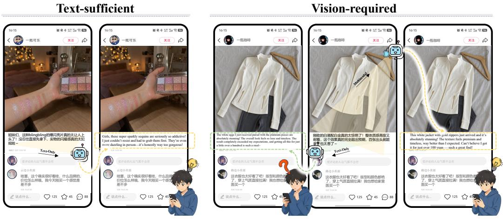
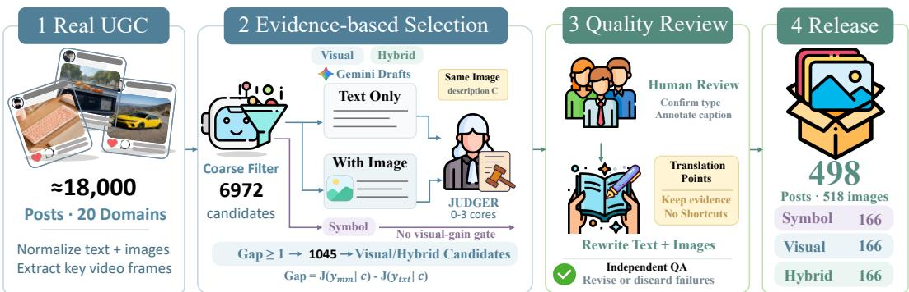
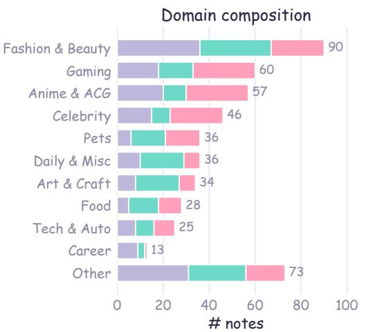
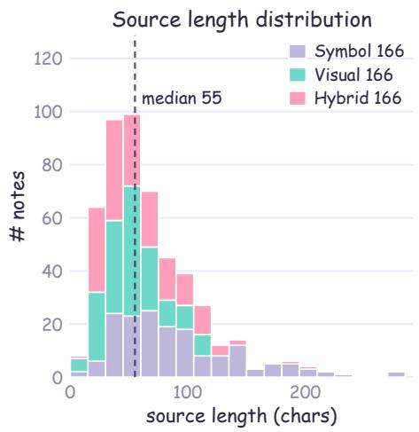
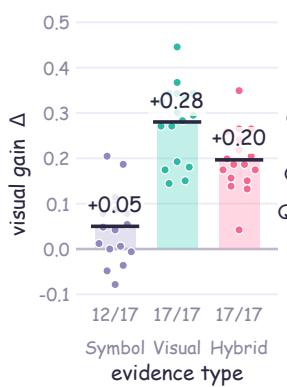
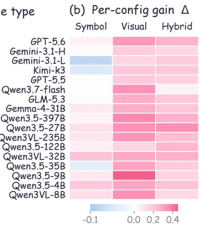
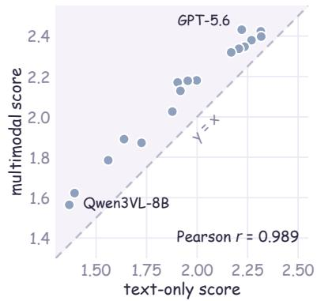
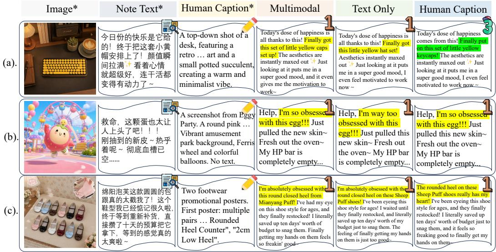
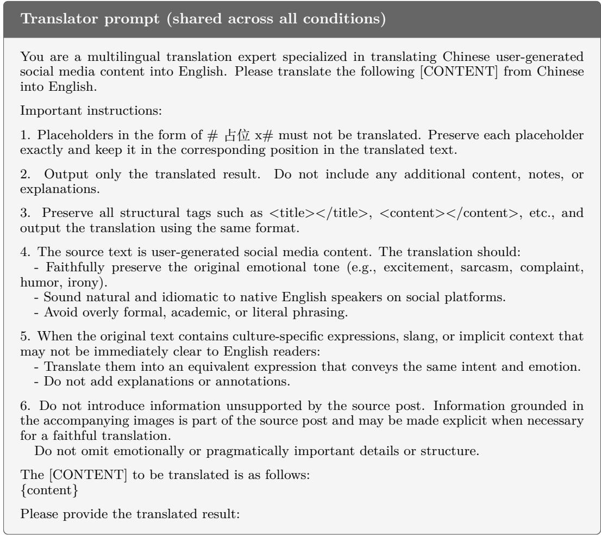
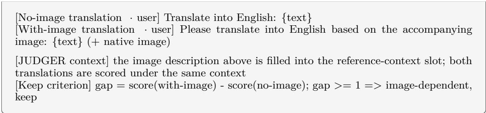

# Beyond Words Alone: Disentangling Distributed Evidence for Visually Grounded Cultural Translation

Dingming Li1,2,\* Yiwen Qiu1,2,\* Linjuan Wu2 Hongxing Li1 Zixuan Wang1 Xinze Lyu2 Ye Guo2 Daoxin Zhang2 Zhe Xu2 Weiming Lu1 Yongliang Shen1,†

1 Zhejiang University, 2 Xiaohongshu Inc.

{lidingm,syl}@zju.edu.cn

## Abstract

Social media enables cross-lingual communication, yet the meaning of usergenerated content (UGC) is often distributed across text, images, and cultural knowledge, making translation challenging. Existing evaluations typically treat images as optional and assume textual information is suficient, obscuring whether errors stem from missing visual evidence or inadequate cultural adaptation. We introduce Culture-MMT, a diagnostic benchmark for distributed-evidence pragmatic reconstruction in socialmedia translation. It contains 498 curated, de-identified UGC instances across 20 domains, categorized into Symbol, Visual, and Hybrid by their required evidence. We also develop a human-aligned domain-specific judge, Judger, and a controlled evaluation framework that systematically varies the evidence available to translators. Across 17 model configurations, real images improve performance by +0.280 on Visual and +0.197 on Hybrid, but only +0.050 on Symbol, while random images provide no comparable gains. Human-authored descriptions further show that jointly dependent cases remain more challenging even when visual facts are explicit. These results characterize culturally efective social-media translation as meaning reconstruction from distributed evidence, highlighting visual grounding and cultural-pragmatic adaptation as distinct model bottlenecks.

## 1 Introduction

Social media has facilitated cross-lingual communication, with user-generated content (UGC) being both dynamic and challenging to translate. (Wu et al., 2026; Qiu et al., 2026) Unlike news or documents, the meaning of a UGC post rarely resides in text alone: authors often omit visually evident objects, scenes, attributes, and in-image text, while using internet memes and community-specific slang to convey attitudes. (Yuan et al., 2026; Pan et al., 2026; Zhao et al., 2026) Thus, the evidence required for culturally efective translation may be distributed across text, visual context, and shared cultural knowledge. For text-only systems, the challenge is not merely language understanding and generation, but the intrinsic absence of critical task-relevant information from the source text (Gao et al., 2025; Caglayan et al., 2019; Fantinuoli, 2025).

This distributed-evidence problem remains underexplored in culturally aware translation and multimodal machine translation (Villa-Cueva et al., 2025; Pan et al., 2026). CULTURE-MT (Wu et al., 2026) evaluates cultural efectiveness in UGC translation but focuses on content that can be judged from text alone. Classical multimodal translation often uses image descriptions as source text, where visual and textual information are redundant (Chai et al., 2026; Dash et al., 2026); even ambiguity-oriented tasks typically focus on selecting the correct linguistic interpretation (Villa-Cueva et al., 2025; Gao et al., 2025). Real-world UGC is diferent: images may contain entities omitted from the text, while shared cultural knowledge determines how these facts should be expressed in the target language (Guo et al., 2026). As shown in Figure 1, the key question is not simply “whether images help,” but whether models can access the evidence required for translation and integrate it across modalities into a culturally efective target-language expression.

  
Figure 1: Evidence dependence in UGC translation. Left: text-suficient cultural slang. Right: visually dependent, multimodal input recovers missing translation evidence.

To address this gap, we introduce Culture-MMT, the first benchmark for culturally pragmatic multimodal translation from Chinese social media to English. It contains 498 deidentified real-world UGC posts across 20 domains, divided into three balanced subsets (Wu et al., 2026) of 166 instances based on required evidence: Symbol (internet cultural knowledge, without image dependence), Visual (key facts conveyed by images, without cultural memes), and Hybrid (requiring visual fact recognition and cultural knowledge). This design isolates visual evidence completion, cultural-pragmatic mapping, and their interaction.

We further train a human-aligned domain-specific judge (Wu et al., 2026; Belmadani et al., 2026; Fu & Liu, 2025), Judger, and establish a controlled evaluation protocol in which the judge uses the same human-verified image description, while the translator receives one of four evidence conditions: no visual evidence, the real image, a random image, or a humanauthored description. Across 17 model configurations, real images yield gains of +0.280 on Visual and +0.197 on Hybrid, but only +0.050 on Symbol, while random images provide no comparable gains. Human-authored descriptions alleviate part of the perceptual gap, yet Hybrid remains harder than Visual even when visual facts are explicit, showing that visual fact access does not imply successful cultural adaptation. Overall, Culture-MMT evaluates not only translation quality but also whether failures arise from evidence access, visual fact recovery, or cultural adaptation, revealing these as related but non-interchangeable capability stages.

Our main contributions are as follows:

• We introduce Culture-MMT and establish a distributed-evidence perspective for social-media translation, with 498 real-world, de-identified UGC posts categorized by three evidence-dependence types.

• We develop a diagnostic evaluation framework for visually grounded cultural efectiveness, featuring a human-aligned Judger and a controlled protocol that fixes evaluation evidence while varying translator-side evidence.

• We evaluate 17 model configurations under four evidence conditions, showing that visual gains are evidence-specific and that visual fact recovery and cultural adaptation are related but non-interchangeable capabilities.

## 2 The Culture-MMT Benchmark

## 2.1 Task Definition and Evidence-Dependency Types

Culture-MMT is a Chinese-to-English UGC translation diagnostic benchmark. Each sample is a real social-media note $\boldsymbol { x } = ( t , b , I )$ , where t, b and I denote the title, the body and one or more images (Yang et al., 2024), respectively. Unlike the default assumption that the source text is semantically self-contained (Chai et al., 2026), we posit that the evidence needed to produce a culturally efective translation y may be distributed across text, images and shared cultural knowledge. The evaluation compares a text-only translator $y _ { t x t } = f ( t , b )$ with a multimodal translator $y _ { m m } = f ( t , b , I )$ , so as to measure how diferent evidence accessibility changes cultural efectiveness.

Table 1: The three evidence-dependency types (166 notes each).
<table><tr><td>Type</td><td>Meaning</td></tr><tr><td>Symbol</td><td>Ambiguity comes from internet “避雷” is a warning to steer clear of memes and in-group jargon; cul- a bad product, not about lightning; tural knowledge alone suffices and “爸爸” refers to a (male) idol, not a the image is not needed. father.</td></tr><tr><td>Visual</td><td>The key sense is polysemous and “单反” with a tennis photo means a can only be fixed by the image; a one-handed backhand, not the de- dictionary does not help resolve it. fault DSLR camera.</td></tr><tr><td>Hybrid</td><td>Both are required at once: the jar- “肥宅复健 Day 1”is self-mocking gon needs cultural knowledge and jargon; only the photo says if “复 the image must disambiguate it. 健” means exercise or injury rehab.</td></tr></table>

We divide the data into three groups by “which kind of external evidence a translator must access to complete the translation” (Table 1): for Symbol, the missing information comes from the shared cultural knowledge behind internet slang, memes and platform jargon, and no image is required; for Visual, the key semantics are supplied by the image (Zheng et al., 2025); Hybrid depends simultaneously on visual facts and cultural knowledge. The three types are therefore not a monotonically increasing dificulty ladder but a diagnostic grouping used to localize the source of failure: Symbol probes cultural transfer, Visual probes visual-fact recovery, and Hybrid probes their joint requirement. Labels are assigned by humans according to the translation mechanism; model pre-labeling is used only as auxiliary information during filtering. Frequent visual mechanisms include scene disambiguation, proper names and nicknames, elided reference, and in-image attributes and OCR.

## 2.2 Data Construction

The data-construction pipeline is shown in Figure 2 and comprises candidate collection, human filtering, two-stage diferential verification, privacy-preserving rewriting, and final quality control (Zheng et al., 2023). Candidates are collected from real Chinese social-media UGC across 20 verticals in non-overlapping crawling rounds (about 1,000 notes per round); for video notes, only static frames are retained. After normalization and corrupted-sample removal, a Gemini multimodal model (Team et al., 2023) generates text-only and multimodal draft translations and temporary type labels for human filtering (Shao et al., 2024a). Three AI-background graduate students conducted filtering and privacy-preserving rewriting over two weeks, judging each note for a valid cultural or visual translation point and overriding model labels when needed. Visual and Hybrid require key meanings unrecoverable from text alone, while Symbol requires a cultural translation challenge without necessary visua evidence. Details are provided in Appendix F.

Human judgment alone can still let “pseudo-hard” cases slip in—cases that strong models can translate correctly without the image (Ma et al., 2025). In a review of 159 passed samples with Gemini, about one third were correctly translatable without the image, with 20–30% noise in the previous dificulty labels. We therefore introduce a two-stage automatic filter. The first is a feature-based coarse filter without LLM calls: it keeps samples of 5– 30 characters containing Chinese characters and a visual or strong textual signal (e.g., code-switching, elided references, named entities), while removing catch-all phrases, generic templates, and the Easy tier. The second is a model-based fine filter: Gemini generates an image description, a text-only translation, and a multimodal translation; our text Judger then scores the two translations under the same visual context, yielding

  
Figure 2: The data-construction pipeline of Culture-MMT. Models are used for candidate enrichment; the evidence-dependency type and final inclusion are decided by humans.

$$
\operatorname { g a p } = \operatorname { s c o r e } ( y _ { m m } \mid c ) - \operatorname { s c o r e } ( y _ { t x t } \mid c ) ,\tag{1}
$$

where c is the image description. We keep samples with gap 1 and rank them by gap. This directly measures the image’s contribution to translation quality, avoiding the false positives and negatives of word-overlap heuristics. Across all collection rounds, about 18,000 raw candidates were processed, with 6,972 surviving the coarse filter and 1,045 the diferential filter (gap 1). Together with human-confirmed Symbol controls, these candidates underwent human re-review and privacy-preserving rewriting, yielding 498 final notes, with 166 per dependency type.

All candidates originate from real UGC (Liao et al., 2025). To protect privacy, we rewrite traceable surface details while preserving the original scenario, language phenomena, evidence-dependency type, and core translation point. Specifically, we preserve the vertical, register, narrative function, and the image’s role in understanding the text, while replacing identifiable people, nicknames, numbers, brands, and visual details. Titles, bodies, and images are jointly rewritten into coherent social-media notes to maintain their natural contextual flow. Images are regenerated using one of four role-specific strategies and pass perceptual-hash and structural-similarity checks; the full protocol is given in Appendix E. Thus, Culture-MMT is grounded in real UGC while releasing privacy-preserved instances that retain the original translation challenges.

## 2.3 Data Analysis

This section summarizes the statistics of the released Culture-MMT set (Figure 3). The sealed set contains 498 real-sourced, de-identified notes with 518 regenerated images, selected from 1,329 original images by manually identifying the key image, yielding a note-to-image ratio of about 1:1.04. The three evidence-dependency types are strictly balanced at 166 each, enabling controlled cross-type comparison. Of the 498 notes, 461 are image-text notes and 37 use video cover frames; 75 are title-only notes without a body. Source texts have a median length of 55 characters, a mean of 66.9, and a p90 of 117. The 20 verticals follow a long-tailed distribution, led by fashion and beauty (90), gaming (60), anime and ACG (57), celebrities and fandom (46), and pets (36), with food, tech and cars, workplace, parenting, and fitness forming the long tail. Privacy-rewriting intensity is reported in Appendix E.

  
Figure 3: Dataset statistics. (Left) Notes are balanced across the three evidencedependency types (166 each) over 20 domains. (Right) Source length (title+body): mean 66.9, median 55, and p90 117 characters (dashed line marks the median).

## 3 Evaluation Framework

## 3.1 Translator Evidence Conditions and the Cultural-Effectiveness Metric

Four translator input conditions form an intervention on evidence accessibility: Text Only provides only the text; Multimodal provides the native image matching the sample; Random Image provides an image drawn from another sample, used to distinguish relevant evidence from a generic multimodal input efect; and Human Caption provides a human-verified image description as evidence that does not participate in translation, used to relieve the visualperception burden (Qiu et al., 2026). Each condition keeps the translation instruction unchanged; the full prompts are given in Appendix D.

Cultural efectiveness is judged by the domain-specialized Chinese Judger trained in this work (Wu et al., 2026; Hu et al., 2026), loaded on self-hosted vLLM (Kwon et al., 2023) with 8-way tensor parallelism (tp = 8), using a fixed deterministic decoding configuration on the judge side to ensure reproducible and consistent scoring. Following the rubric of the CULTURE-MT (Wu et al., 2026), we report two metrics: the mean score is the average of the 0–3 scale, and the cultural-efectiveness rate is the proportion of samples scoring 2 or above (2–3, i.e., semantically and pragmatically adequate), with 0–1 counted as inefective; the visual gain ∆ is the diference of the multimodal condition over the text-only condition on these metrics.

## 3.2 The Controlled Evidence Protocol

The core of the protocol is to separate “what evidence the sample contains” from “what evidence the translator can access.” The Judger always reads the same human-verified im age description for all translator conditions (Liao et al., 2025), because that description characterizes the sample’s ground truth rather than any single translator’s input; the evidence intervention occurs only on the translator side. We do not provide the judge with an enumerated “ambiguous word correct meaning” answer ledger, to avoid degrading scoring into answer matching. With the judge’s information fixed, score changes across conditions can be interpreted as diferences in the translator’s acquisition and use of evidence, providing a common reference for the subsequent failure attribution.

Moreover, we delegate “understanding the image” to human annotation and provide the judge with only the textual description: the benefit is that the judge’s visual ability no longer forms a ceiling on the evaluation (Guo et al., 2025b), at the cost of the granularity of the human description becoming a new ceiling. The validity of Judger on our benchmark, including its agreement with human annotations and comparison with existing LLM judges, is evaluated in 3.3.

Table 3: Evaluator agreement with human experts on the balanced test set. -01 and -23 denote the invalid (scores 0–1) and valid (scores 2–3) classes, respectively.
<table><tr><td>Judge</td><td>ACC</td><td>Cohen&#x27;s κ</td><td>P-01</td><td>R-01</td><td>F1-01</td><td>P-23</td><td>R-23</td><td>F1-23</td></tr><tr><td>Judger (ours)</td><td>0.781</td><td>0.562</td><td>1.000</td><td>0.562</td><td>0.720</td><td>0.696</td><td>1.000</td><td>0.820</td></tr><tr><td>Gemini-3.1-pro</td><td>0.767</td><td>0.534</td><td>0.809</td><td>0.699</td><td>0.750</td><td>0.735</td><td>0.835</td><td>0.782</td></tr><tr><td>Qwen3.5-397B</td><td>0.733</td><td>0.466</td><td>0.736</td><td>0.727</td><td>0.731</td><td>0.730</td><td>0.739</td><td>0.735</td></tr><tr><td>Qwen3-32B</td><td>0.552</td><td>0.104</td><td>1.000</td><td>0.104</td><td>0.189</td><td>0.528</td><td>1.000</td><td>0.691</td></tr><tr><td>Qwen3.5-27B</td><td>0.773</td><td>0.546</td><td>0.809</td><td>0.715</td><td>0.759</td><td>0.745</td><td>0.831</td><td>0.786</td></tr></table>

## 3.3 Judge Validity

Validation design. The Judger is built on a Qwen3.5-27B (Team, 2026) base and aligned to the 0–3 human standard of cultural efectiveness through two-stage supervised fine-tuning (Kim & Kang, 2026) and GRPO (Shao et al., 2024b; Guo et al., 2025a); the full training configuration is given in Appendices D and G. We sample 20 notes from each of the three evidencedependency types, and the 10 model configurations listed in Table 2 each generate translations under text-only and multimodal conditions, yielding 1,200 candidates

Table 2: Models used for judge validation.
<table><tr><td rowspan=1 colspan=1>Category</td><td rowspan=1 colspan=1>Model configuration</td></tr><tr><td rowspan=1 colspan=1>Commercial (6)</td><td rowspan=1 colspan=1>Gemini-3.1-pro (high)Gemini-3.1-pro (low)GPT-5.5, Kimi-K3GLM-5.3-Flash, Qwen3.7-Flash</td></tr><tr><td rowspan=1 colspan=1>Open-weight (4)</td><td rowspan=1 colspan=1>Qwen3.5-397B-A17BQwen3.5-122B-A10BQwen3.5-35B-A3B, Qwen3.5-27B</td></tr></table>

across the two modes. After removing missing or incompletely annotated pairs, we keep 1,160 human–Judger valid pairs covering 58 notes. Under a binary split, the agreement between the Judger and human judgment is 0.820, Cohen’s κ is 0.459, and the efective-class F1 is 0.886; the four-class weighted κ is 0.455. Its recall on the efective class is higher than on the inefective class (0.89 vs. 0.56), indicating that the Judger can serve as an automatic proxy for cultural efectiveness overall. The full sampling and annotation procedure is given in Appendix F.

Based on the human judge results, we balance 249 efective and 289 inefective samples, and further randomly sample to construct a 498-sample class-balanced set for comparing the domain-trained judge with general LLM judges. Table 3 shows that the Judger achieves the highest accuracy (0.781) and Cohen’s κ (0.562) on (Cohen, 1960) this balanced set. The raw Qwen3.5-27B of the same base is already close to the Judger on the binary split, but domain training markedly improves the four-tier calibration on which the main experiment relies: four-class accuracy rises from 0.398 to 0.522, κ from 0.225 to 0.342, and mean absolute error falls from 0.745 to 0.586.

## 4 Experiments

## 4.1 Experimental Setup

All experiments are conducted on 498 samples in Culture-MMT. The main results compare two translator input conditions, Text Only and Multimodal, while the judge uses only human caption; each model configuration is evaluated under both text-only and image-text conditions, with the judge always receiving the same human-verified visual evidence. We evaluate 17 model configurations in total, including the proprietary models GPT-5.5/5.6- sol (Singh et al., 2025), Kimi-K3 (Team et al., 2026b), Gemini-3.1-pro (high/low) (Team et al., 2023), and Qwen3.7-Flash (Yang et al., 2025), as well as the open-source models GLM-5.3-Flash (GLM-5-Team et al., 2026), Qwen3.5-397B-A17B (Team, 2026), Qwen3.5- 122B-A10B (Team, 2026), Qwen3.5-35B-A3B (Team, 2026), Qwen3.5-27B/9B/4B (Team, 2026), Qwen3-VL-235B/32B/8B (Yang et al., 2025) and Gemma-4-31B (Team et al., 2026a). Access details and inference parameters are given in Appendix G.

Table 4: Cultural efectiveness and score distribution across 17 models. Reporting rates (%), score breakdowns, and multimodal gains (∆). Bold marks group best.
<table><tr><td></td><td colspan="6">Text-only</td><td colspan="6">Multimodal</td><td rowspan="2"></td><td rowspan="2">∆Mean</td></tr><tr><td>Model</td><td>Valid</td><td>Inval.</td><td>0</td><td>1</td><td>2</td><td>3</td><td>Valid</td><td>Inval.</td><td>0</td><td>1</td><td>2</td><td>∆Valid</td></tr><tr><td>Proprietary Models</td><td></td><td></td><td></td><td></td><td></td><td></td><td></td><td></td><td></td><td></td><td></td><td></td><td></td><td></td></tr><tr><td>Gemini-3.1-Pro (high)</td><td>78.1</td><td>21.9</td><td>3.8</td><td>18.1</td><td>20.9</td><td>57.2</td><td>82.7</td><td>17.3</td><td>2.2</td><td>15.1</td><td>20.9</td><td>61.9</td><td>+4.62</td><td>+0.108</td></tr><tr><td>Gemini-3.1-Pro (low)</td><td>79.1</td><td>20.9</td><td>3.6</td><td>17.3</td><td>22.9</td><td>56.2</td><td>82.7</td><td>17.3</td><td>1.6</td><td>15.7</td><td>24.1</td><td>58.6</td><td>+3.61</td><td>+0.080</td></tr><tr><td>GPT-5.6-Sol</td><td>72.1</td><td>27.9</td><td>5.2</td><td>22.7</td><td>16.9</td><td>55.2</td><td>81.1</td><td>18.9</td><td>2.2</td><td>16.7</td><td>16.9</td><td>64.3</td><td>+9.03</td><td>+0.211</td></tr><tr><td>GPT-5.5</td><td>73.9</td><td>26.1</td><td>3.8</td><td>22.3</td><td>20.5</td><td>53.4</td><td>79.1</td><td>20.9</td><td>2.4</td><td>18.5</td><td>21.1</td><td>58.0</td><td>+5.22</td><td>+0.112</td></tr><tr><td>Qwen3.7-flash</td><td>72.9</td><td>27.1</td><td>4.4</td><td>22.7</td><td>20.7</td><td>52.2</td><td>80.3</td><td>19.7</td><td>3.6</td><td>16.1</td><td>23.3</td><td>57.0</td><td>+7.43</td><td>+0.131</td></tr><tr><td colspan="2">Open-source models</td><td></td><td></td><td></td><td></td><td></td><td></td><td></td><td></td><td></td><td></td><td></td><td></td><td></td></tr><tr><td>Kimi-K3</td><td>75.9</td><td>24.1</td><td>4.0</td><td>20.1</td><td>20.9</td><td>55.0</td><td>80.3</td><td>19.7</td><td>2.4</td><td>17.3</td><td>20.3</td><td>60.0</td><td>+4.42</td><td>+0.110</td></tr><tr><td>GLM-5.3-Flash</td><td>72.1</td><td>27.9</td><td>5.2</td><td>22.7</td><td>22.1</td><td>50.0</td><td>78.1</td><td>21.9</td><td>3.8</td><td>18.1</td><td>20.5</td><td>57.6</td><td>+6.02</td><td>+0.151</td></tr><tr><td>Qwen3.5-397B-A17B</td><td>65.3</td><td>34.7</td><td>7.2</td><td>27.5</td><td>27.9</td><td>37.4</td><td>74.7</td><td>25.3</td><td>4.4</td><td>20.9</td><td>27.1</td><td>47.6</td><td>+9.44</td><td>+0.225</td></tr><tr><td>Qwen3-VL-235B</td><td>62.8</td><td>37.2</td><td>14.7</td><td>22.5</td><td>19.1</td><td>43.7</td><td>72.4</td><td>27.6</td><td>11.7</td><td>15.9</td><td>20.3</td><td>52.1</td><td>+9.65</td><td>+0.211</td></tr><tr><td>Qwen3.5-122B-A10B</td><td>60.8</td><td>39.2</td><td>6.6</td><td>32.5</td><td>27.3</td><td>33.5</td><td>68.1</td><td>31.9</td><td>3.8</td><td>28.1</td><td>29.7</td><td>38.4</td><td>+7.23</td><td>+0.149</td></tr><tr><td>Qwen3.5-35B-A3B</td><td>53.4</td><td>46.6</td><td>9.0</td><td>37.5</td><td>25.3</td><td>28.1</td><td>60.0</td><td>40.0</td><td>5.0</td><td>34.9</td><td>27.9</td><td>32.1</td><td>+6.63</td><td>+0.147</td></tr><tr><td>Qwen3-VL-32B</td><td>52.2</td><td>47.8</td><td>14.7</td><td>33.1</td><td>25.9</td><td>26.3</td><td>62.6</td><td>37.4</td><td>10.0</td><td>27.3</td><td>26.3</td><td>36.4</td><td>+10.44</td><td>+0.251</td></tr><tr><td>Gemma-4-31B</td><td>66.3</td><td>33.7</td><td>6.2</td><td>27.5</td><td>26.5</td><td>39.8</td><td>72.5</td><td>27.5</td><td>4.2</td><td>23.3</td><td>22.7</td><td>49.8</td><td>+6.22</td><td>+0.183</td></tr><tr><td>Qwen3.5-27B</td><td>62.5</td><td>37.5</td><td>7.2</td><td>30.3</td><td>27.3</td><td>35.1</td><td>73.9</td><td>26.1</td><td>4.4</td><td>21.7</td><td>26.3</td><td>47.6</td><td>+11.45</td><td>+0.267</td></tr><tr><td>Qwen3.5-9B</td><td>47.6</td><td>52.4</td><td>12.1</td><td>40.4</td><td>27.1</td><td>20.5</td><td>57.8</td><td>42.2</td><td>8.2</td><td>33.9</td><td>28.9</td><td>28.9</td><td>+10.24</td><td>+0.225</td></tr><tr><td>Qwen3-VL-8B</td><td>42.4</td><td>57.6</td><td>21.9</td><td>35.7</td><td>26.1</td><td>16.3</td><td>51.4</td><td>48.6</td><td>18.1</td><td>30.5</td><td>28.3</td><td>23.1</td><td>+9.04</td><td>+0.197</td></tr><tr><td>Qwen3.5-4B</td><td>39.6</td><td>60.4</td><td>12.8</td><td>47.6</td><td>26.9</td><td>12.7</td><td>52.4</td><td>47.6</td><td>11.4</td><td>36.1</td><td>31.1</td><td>21.3</td><td>+12.85</td><td>+0.229</td></tr></table>

Metrics. The primary metrics are the mean cultural-efectiveness score and efective rate (the proportion scoring 2–3), aligned with Culture-MT for cross-comparability. Unless otherwise stated, visual gain ∆ is the multimodal minus text-only diference in mean 0–3 score, reported for Symbol, Visual, and Hybrid; overall result is their weighted aggregate.

## 4.2 Main Results

Once matching evidence is accessible, overall quality rises consistently. In Table 4, all 17 configurations improve in mean score (+0.080 to +0.267, mean +0.176), the culturalefectiveness rate increases by 7.86 percentage points on average, and the score distribution shifts noticeably toward 3. The trend spans model families and scales, showing that text input systematically omits information in UGC that can be supplied by the image; but this only proves that vision is useful, not that models exploit evidence matched to the sample.

The visual benefit is evidence-selective, not a generic multimodal dividend. Figure 4 and Table 5 show that across 17 configurations, the average gains on Symbol, Visual, and Hybrid are +0.050, +0.280, and +0.197, respectively. While Visual and Hybrid show positive gains for every configuration, Symbol remains small and unstable, with 5 configurations showing no gain or a drop. Images thus help consistently only when they provide information missing from the text; when translation relies mainly on shared cultural knowl edge, they are often unhelpful and may distract. The lower gain on Hybrid further confirms this: jointly dependent samples retain symbolic dificulty that images cannot resolve, which persists in 4.3.2 even with human descriptions.

Visual access alleviates the information bottleneck but does not close the capability gap. Text-only and multimodal scores are highly consistent across models (Pearson r = 0.989, computed from Table 5), with strong models remaining ahead after receiving images. Images mainly restore missing sample-level facts, while final quality remains constrained by language generation, pragmatic inference, and cultural transfer. Visual evidence thus alleviate input-side information constraints but cannot guarantee quality translation.

(a) Gain by evidence type  

(c) Text-only vs multimodal  
  
Figure 4: Visual gains across evidence types and configurations. (a) Mean gain ∆: Symbol remains unchanged, while Visual and Hybrid gain significantly. (b) Perconfiguration breakdown. (c) Text-only vs. multimodal scores (r = 0.989).

Table 5: Visual gains across 17 models. Reporting mean scores under Text-only and Multimodal inputs, and their diferences (∆ = Multimodal  Text-only) overall and per dependency type.
<table><tr><td>Model</td><td>Text-only</td><td>Multimodal</td><td>∆ Overall</td><td>∆ Symbol</td><td>Δ Visual</td><td>∆ Hybrid</td></tr><tr><td colspan="7">Proprietary Models</td></tr><tr><td>Gemini-3.1-Pro (high)</td><td>2.315</td><td>2.424</td><td>+0.108</td><td>+0.012</td><td>+0.175</td><td>+0.139</td></tr><tr><td>Gemini-3.1-Pro (low)</td><td>2.317</td><td>2.398</td><td>+0.080</td><td>-0.078</td><td>+0.145</td><td>+0.175</td></tr><tr><td>GPT-5.6-Sol</td><td>2.221</td><td>2.432</td><td>+0.211</td><td>+0.048</td><td>+0.325</td><td>+0.259</td></tr><tr><td>GPT-5.5</td><td>2.235</td><td>2.347</td><td>+0.112</td><td>+0.000</td><td>+0.181</td><td>+0.157</td></tr><tr><td>Qwen3.7-Flash</td><td>2.207</td><td>2.337</td><td>+0.131</td><td>+0.006</td><td>+0.343</td><td>+0.042</td></tr><tr><td colspan="7">Open-source models</td></tr><tr><td>Kimi-K3</td><td>2.269</td><td>2.380</td><td>+0.110</td><td>-0.048</td><td>+0.193</td><td>+0.187</td></tr><tr><td>GLM-5.3-Flash</td><td>2.169</td><td>2.319</td><td>+0.151</td><td>-0.006</td><td>+0.271</td><td>+0.187</td></tr><tr><td>Qwen3.5-397B-A17B</td><td>1.954</td><td>2.179</td><td>+0.225</td><td>+0.042</td><td>+0.367</td><td>+0.265</td></tr><tr><td>Qwen3-VL-235B</td><td>1.917</td><td>2.129</td><td>+0.211</td><td>+0.085</td><td>+0.331</td><td>+0.218</td></tr><tr><td>Qwen3.5-122B-A10B</td><td>1.877</td><td>2.026</td><td>+0.149</td><td>+0.054</td><td>+0.151</td><td>+0.241</td></tr><tr><td>Qwen3.5-35B-A3B</td><td>1.725</td><td>1.871</td><td>+0.147</td><td>-0.036</td><td>+0.301</td><td>+0.175</td></tr><tr><td>Qwen3-VL-32B</td><td>1.639</td><td>1.890</td><td>+0.251</td><td>+0.205</td><td>+0.283</td><td>+0.265</td></tr><tr><td>Gemma-4-31B</td><td>1.998</td><td>2.181</td><td>+0.183</td><td>+0.078</td><td>+0.271</td><td>+0.199</td></tr><tr><td>Qwen3.5-27B</td><td>1.904</td><td>2.171</td><td>+0.267</td><td>+0.108</td><td>+0.343</td><td>+0.349</td></tr><tr><td>Qwen3.5-9B</td><td>1.560</td><td>1.785</td><td>+0.225</td><td>+0.078</td><td>+0.446</td><td>+0.151</td></tr><tr><td>Qwen3-VL-8B</td><td>1.367</td><td>1.564</td><td>+0.197</td><td>+0.115</td><td>+0.343</td><td>+0.133</td></tr><tr><td>Qwen3.5-4B</td><td>1.394</td><td>1.623</td><td>+0.229</td><td>+0.187</td><td>+0.295</td><td>+0.205</td></tr><tr><td>Mean (17 configs)</td><td>1.945</td><td>2.121</td><td>+0.176</td><td>+0.050</td><td>+0.280</td><td>+0.197</td></tr></table>

Scaling raises absolute quality, but evidence use does not scale monotonically. For the Qwen3.5 dense series (4B/9B/27B), the multimodal mean rises from 1.623 to 1.785 to 2.171, while gains are +0.229/+ 0.225/+ 0.267; for Qwen3-VL (8B/32B/235B), the mean rises from 1.564 to 1.890 to 2.129, with gains $\mathrm { o f ~ + 0 . 1 9 7 / + 0 . 2 5 1 / + 0 . 2 1 1 }$ . Native visual pre-training is not decisive: Qwen3.5-27B, a general-purpose model, achieves the highest gain (+0.267), while Qwen3-VL does not lead in ∆. Scaling therefore raises the performance ceiling but does not guarantee better image use, making evidence use an evaluation dimension independent of scale and modality architecture.

Absolute quality and visual gain reveal diferent model bottlenecks. Gemini-3.1- pro (high) achieves 2.424 multimodal with only +0.108 gain; Qwen3.5-27B scores lower (2.171) but achieves the highest gain (+0.267); GPT-5.6 achieves both the highest multimodal score (2.432) and a large gain (+0.211). Lower baselines tend to yield larger ∆ (see Table 5), so a large ∆ may reflect efective image use or simply greater room for improvement. Thus, the multimodal score measures translation quality, while $\Delta$ measures how much vision closes the information gap, jointly distinguishing translation quality from visual reliance.

Table 6: Evidence-attribution ablations across four representative configurations. Mean scores (0–3) across dependency types under four translator inputs: Text-only, Random image (placebo control), Human caption (oracle perception), and Real multimodal.
<table><tr><td>Model configuration</td><td>Condition</td><td>Symbol</td><td>Visual</td><td>Hybrid</td><td>Overall</td></tr><tr><td rowspan="4">Gemini-3.1-pro (high)</td><td>Text-only</td><td>2.530</td><td>2.277</td><td>2.139</td><td>2.315</td></tr><tr><td>Random image</td><td>2.458</td><td>2.307</td><td>2.115</td><td>2.293</td></tr><tr><td>Human caption</td><td>2.512</td><td>2.440</td><td>2.283</td><td>2.412</td></tr><tr><td>Real multimodal</td><td>2.542</td><td>2.452</td><td>2.277</td><td>2.424</td></tr><tr><td rowspan="4">Qwen3.5-397B-A17B</td><td>Text-only</td><td>2.217</td><td>1.879</td><td>1.765</td><td>1.954</td></tr><tr><td>Random image</td><td>2.120</td><td>1.873</td><td>1.560</td><td>1.851</td></tr><tr><td>Human caption</td><td>2.259</td><td>2.307</td><td>2.006</td><td>2.191</td></tr><tr><td>Real multimodal</td><td>2.259</td><td>2.247</td><td>2.030</td><td>2.179</td></tr><tr><td rowspan="4">Qwen3.5-27B</td><td>Text-only</td><td>2.060</td><td>1.916</td><td>1.735</td><td>1.904</td></tr><tr><td>Random image</td><td>2.024</td><td>1.904</td><td>1.657</td><td>1.861</td></tr><tr><td>Human caption</td><td>2.151</td><td>2.355</td><td>2.084</td><td>2.197</td></tr><tr><td>Real multimodal</td><td>2.169</td><td>2.259</td><td>2.084</td><td>2.171</td></tr><tr><td rowspan="4">Qwen3.5-35B-A3B</td><td>Text-only</td><td>1.952</td><td>1.711</td><td>1.512</td><td>1.725</td></tr><tr><td>Random image</td><td>1.861</td><td>1.681</td><td>1.512</td><td>1.685</td></tr><tr><td>Human caption</td><td>2.084</td><td>2.163</td><td>1.765</td><td>2.004</td></tr><tr><td>Real multimodal</td><td>1.916</td><td>2.012</td><td>1.687</td><td>1.871</td></tr><tr><td rowspan="4">Mean (4 configs)</td><td>Text-only</td><td>2.190</td><td>1.946</td><td>1.788</td><td>1.974</td></tr><tr><td>Random image</td><td>2.116</td><td>1.941</td><td>1.711</td><td>1.923</td></tr><tr><td>Human caption</td><td>2.251</td><td>2.316</td><td>2.035</td><td>2.201</td></tr><tr><td>Real multimodal</td><td>2.221</td><td>2.242</td><td>2.020</td><td>2.161</td></tr></table>

## 4.3 Evidence-Attribution Analysis

## 4.3.1 Random-Image Control

Because the type diferences in the main results could still stem from an attention or prompting efect of an “extra modality,” we set up a Random Image condition that provides the translator with an image from another sample while keeping the prompt, model and judge unchanged, to test whether the gain requires the evidence to match the current sample.

Mismatched evidence cannot substitute for missing evidence. On 4 representative configurations, the average change of random images over text-only is Symbol 0.074, Visual 0.005, Hybrid 0.077 (overall 0.052), whereas the same models with real images improve Visual and Hybrid by +0.297 and +0.232. The main result is thus not a “one extra input modality” efect: models do read the image, but only visual evidence matching the current text can reconstruct the omitted contextual meaning, while a mismatched image is at best unhelpful and even introduces noise that distracts generation (Table 6)—in sharp contrast to the visual-redundancy phenomenon of classic MMT, where randomly swapping the image is almost lossless.

## 4.3.2 The Form of Visual Evidence

The real-image condition requires a model to both recognize visual facts and use them for translation, and the two failures are hard to separate. The Human Caption condition directly provides human-verified visual facts, bypassing perception; comparing it with Text Only and Multimodal roughly distinguishes whether failure comes from “visual facts not recovered” or “facts obtained but target-language transfer not completed.” The judge input is kept identical across the three conditions.

Having visual facts available does not equal completing cultural transfer. On 4 representative configurations, the overall mean under Human Caption (2.201) is slightly higher than direct image reading (2.161), as is the score on Visual (2.316 vs. 2.242), suggesting that models may miss some task-relevant visual facts, but the gap is limited. Meanwhile, Hybrid under Human Caption reaches only 2.035, below Visual’s 2.316. Since the two groups are not strictly matched, this gap is not a pure causal estimate of cultural ability, but it shows that even with visual facts textualized, jointly dependent samples retain additional dificulty beyond what images can provide (Table 6).

Together, the three interventions suggest three failure stages: inaccessible evidence, insuficient visual-fact recovery, and insuficient cultural-pragmatic transfer. Representative qualitative cases localizing errors to each bottleneck stage are illustrated in Appendix C.

## 5 Conclusion

We move beyond the conventional view of whether images improve translation and argue that culturally efective social-media translation is fundamentally meaning reconstruction from distributed evidence. Culture-MMT uses three evidence-dependence types and controlled interventions to diagnose model failures across three stages: inaccessible ev idence, insuficient fact recovery, and insuficient cultural adaptation. Experiments across 17 models show that visual perception and cultural knowledge are not interchangeable: the former recovers omitted facts, while the latter enables pragmatic adaptation. This perspective provides standardized evaluation and diagnostic tools for studying complex pragmatic representation in next-generation multimodal models.

## References

Ikram Belmadani, Oumaima El Khettari, Pacôme Constant dit Beaufils, Richard Dufour, and Benoit Favre. Who judges the judge? evaluating llm-as-a-judge for french medical open-ended qa. In Proceedings of the 1st Workshop on Linguistic Analysis for Health (HeaLing 2026), pp. 142–157, 2026.

Ozan Caglayan, Pranava Swaroop Madhyastha, Lucia Specia, and Loïc Barrault. Probing the need for visual context in multimodal machine translation. In Proceedings of the 2019 conference of the north American chapter of the association for computational linguistics: Human language technologies, volume 1 (long and short papers), pp. 4159–4170, 2019.

Huacan Chai, Yukai Wang, Yingxuan Yang, Dan Peng, Yuanyi Song, Zhihui Fu, Weiwen Liu, Jianghao Lin, Jun Wang, and Weinan Zhang. Smmbench: A benchmark for sourcedistributed multimodal agent memory. arXiv preprint arXiv:2605.15710, 2026.

Andong Chen, Yuchen Song, Kehai Chen, Xuefeng Bai, Muyun Yang, Liqiang Nie, Jie Liu, Tiejun Zhao, and Min Zhang. Make imagination clearer! stable difusion-based visual imagination for multimodal machine translation. In Proceedings of the 63rd Annual Meeting of the Association for Computational Linguistics (Volume 1: Long Papers), pp. 26567–26583, 2025.

Jacob Cohen. A coeficient of agreement for nominal scales. Educational and psychological measurement, 20(1):37–46, 1960.

Amulya Ratna Dash, Chirag Wadhwa, and Yashvardhan Sharma. Towards improving multimodal machine translation with llms: A focus on indic languages. In Proceedings of the Fifteenth Language Resources and Evaluation Conference (LREC 2026), volume 11, pp. 8872–8882, 2026.

Claudio Fantinuoli. Vision-grounded machine interpreting: Improving the translation process through visual cues. arXiv preprint arXiv:2509.23957, 2025.

Yi Feng, Chuanyi Li, Jiatong He, Zhenyu Hou, and Vincent Ng. Multimodal neural machine translation: A survey of the state of the art. In Proceedings of the 2025 Conference on Empirical Methods in Natural Language Processing, pp. 22141–22158, 2025.

Xiyan Fu and Wei Liu. How reliable is multilingual llm-as-a-judge? In EMNLP (Findings), pp. 11040–11053, 2025.

Matthieu Futeral, Cordelia Schmid, Benoît Sagot, and Rachel Bawden. Towards zeroshot multimodal machine translation. In Findings of the Association for Computational Linguistics: NAACL 2025, pp. 761–778, 2025.

Yue Gao, Jing Zhao, Shiliang Sun, Xiaosong Qiao, Tengfei Song, and Hao Yang. Multimodal machine translation with text-image in-depth questioning. In Findings of the Association for Computational Linguistics: ACL 2025, pp. 9274–9287, 2025.

GLM-5-Team, :, Aohan Zeng, Xin Lv, Zhenyu Hou, Zhengxiao Du, Qinkai Zheng, Bin Chen, Da Yin, Chendi Ge, Chenghua Huang, Chengxing Xie, Chenzheng Zhu, Congfeng Yin, Cunxiang Wang, Gengzheng Pan, Hao Zeng, Haoke Zhang, Haoran Wang, Huilong Chen, Jiajie Zhang, Jian Jiao, Jiaqi Guo, Jingsen Wang, Jingzhao Du, Jinzhu Wu, Kedong Wang, Lei Li, Lin Fan, Lucen Zhong, Mingdao Liu, Mingming Zhao, Pengfan Du, Qian Dong, Rui Lu, Shuang-Li, Shulin Cao, Song Liu, Ting Jiang, Xiaodong Chen, Xiaohan Zhang, Xuancheng Huang, Xuezhen Dong, Yabo Xu, Yao Wei, Yifan An, Yilin Niu, Yitong Zhu, Yuanhao Wen, Yukuo Cen, Yushi Bai, Zhongpei Qiao, Zihan Wang, Zikang Wang, Zilin Zhu, Ziqiang Liu, Zixuan Li, Bojie Wang, Bosi Wen, Can Huang, Changpeng Cai, Chao Yu, Chen Li, Chengwei Hu, Chenhui Zhang, Dan Zhang, Daoyan Lin, Dayong Yang, Di Wang, Ding Ai, Erle Zhu, Fangzhou Yi, Feiyu Chen, Guohong Wen, Hailong Sun, Haisha Zhao, Haiyi Hu, Hanchen Zhang, Hanrui Liu, Hanyu Zhang, Hao Peng, Hao Tai, Haobo Zhang, He Liu, Hongwei Wang, Hongxi Yan, Hongyu Ge, Huan Liu, Huanpeng Chu, Jia’ni Zhao, Jiachen Wang, Jiajing Zhao, Jiamin Ren, Jiapeng Wang, Jiaxin Zhang, Jiayi Gui, Jiayue Zhao, Jijie Li, Jing An, Jing Li, Jingwei Yuan, Jinhua Du, Jinxin Liu, Junkai Zhi, Junwen Duan, Kaiyue Zhou, Kangjian Wei, Ke Wang, Keyun Luo, Laiqiang Zhang, Leigang Sha, Liang Xu, Lindong Wu, Lintao Ding, Lu Chen, Minghao Li, Nianyi Lin, Pan Ta, Qiang Zou, Rongjun Song, Ruiqi Yang, Shangqing Tu, Shangtong Yang, Shaoxiang Wu, Shengyan Zhang, Shijie Li, Shuang Li, Shuyi Fan, Wei Qin, Wei Tian, Weining Zhang, Wenbo Yu, Wenjie Liang, Xiang Kuang, Xiangmeng Cheng, Xiangyang Li, Xiaoquan Yan, Xiaowei Hu, Xiaoying Ling, Xing Fan, Xingye Xia, Xinyuan Zhang, Xinze Zhang, Xirui Pan, Xu Zou, Xunkai Zhang, Yadi Liu, Yandong Wu, Yanfu Li, Yidong Wang, Yifan Zhu, Yijun Tan, Yilin Zhou, Yiming Pan, Ying Zhang, Yinpei Su, Yipeng Geng, Yong Yan, Yonglin Tan, Yuean Bi, Yuhan Shen, Yuhao Yang, Yujiang Li, Yunan Liu, Yunqing Wang, Yuntao Li, Yurong Wu, Yutao Zhang, Yuxi Duan, Yuxuan Zhang, Zezhen Liu, Zhengtao Jiang, Zhenhe Yan, Zheyu Zhang, Zhixiang Wei, Zhuo Chen, Zhuoer Feng, Zijun Yao, Ziwei Chai, Ziyuan Wang, Zuzhou Zhang, Bin Xu, Minlie Huang, Hongning Wang, Juanzi Li, Yuxiao Dong, and Jie Tang. Glm-5: from vibe coding to agentic engineering, 2026. URL https://arxiv.org/abs/2602.15763.

Daya Guo, Dejian Yang, Haowei Zhang, Junxiao Song, Peiyi Wang, Qihao Zhu, Runxin Xu, Ruoyu Zhang, Shirong Ma, Xiao Bi, et al. Deepseek-r1: Incentivizing reasoning capability in llms via reinforcement learning. arXiv preprint arXiv:2501.12948, 2025a.

Geyang Guo, Tarek Naous, Hiromi Wakaki, Yukiko Nishimura, Yuki Mitsufuji, Alan Ritter, and Wei Xu. Care: Multilingual human preference learning for cultural awareness. In Proceedings of the 2025 Conference on Empirical Methods in Natural Language Processing, pp. 32854–32883, 2025b.

Mengxi Guo, Leiming Gao, Winnie Zeng, Gaoqi Rao, and Chu-Ren Huang. Cross-cultural scenario benchmark: Evaluating llms’cross-cultural understanding. Big Data and Cognitive Computing, 10(9):290, 2026.

Ali Hatami, Mihael Arcan, and Paul Buitelaar. Leveraging visual scene graph to enhance translation quality in multimodal machine translation. In Proceedings of Machine Translation Summit XX: Volume 1, pp. 353–364, 2025.

Lianyu Hu, Shengqian Qin, Zeqin Liao, Qing Guo, Liang Wan, Wei Feng, and Yang Liu. Colt: Teaching multi-modal models to think with chain of latent thoughts. In European Conference on Computer Vision, pp. 526–544. Springer, 2026.

Gyunyeop Kim and Sangwoo Kang. Cpc-grpo: Answer-free reinforcement learning with cross-prompt consensus rewards. In Findings of the Association for Computational Linguistics: ACL 2026, pp. 29733–29748, 2026.

Deepak Kumar, Baban Gain, Kshetrimayum Boynao Singh, and Asif Ekbal. Does vision still help? multimodal translation with clip-based image selection. In Proceedings of the Twelfth Workshop on Asian Translation (WAT 2025), pp. 115–123, 2025.

Woosuk Kwon, Zhuohan Li, Siyuan Zhuang, Ying Sheng, Lianmin Zheng, Cody Hao Yu, Joseph E. Gonzalez, Hao Zhang, and Ion Stoica. Eficient memory management for large language model serving with pagedattention. In Proceedings of the ACM SIGOPS 29th Symposium on Operating Systems Principles, 2023.

Yunlong Liang, Fandong Meng, Jinan Xu, Yufeng Chen, and Jie Zhou. Msctd: A multimodal sentiment chat translation dataset. In Proceedings of the 60th Annual Meeting of the Association for Computational Linguistics (Volume 1: Long Papers), pp. 2601–2613, 2022.

Xixian Liao, Carlos Escolano, Audrey Mash, Francesca De Luca Fornaciari, Javier García Gilabert, Miguel Claramunt Argote, Ella Bohman, and Maite Melero. Culture-aware machine translation: the case study of low-resource language pair catalan-chinese. In Proceedings of Machine Translation Summit XX: Volume 1, pp. 150–161, 2025.

Danyang Liu, Fanjie Kong, Xiaohang Sun, Dhruva Patil, Avijit Vajpayee, Zhu Liu, Vimal Bhat, and Najmeh Sadoughi. Detect, disambiguate, and translate: on-demand visual reasoning for multimodal machine translation with large vision-language models. In Proceedings of the 2025 Conference of the Nations of the Americas Chapter of the Association for Computational Linguistics: Human Language Technologies (Volume 1: Long Papers), pp. 1559–1570, 2025.

Xinyu Ma, Jun Rao, and Xuebo Liu. Noise improves multimodal machine translation: Rethinking the role of visual context. Mathematics, 13(11):1874, 2025.

Paul Michel and Graham Neubig. Mtnt: A testbed for machine translation of noisy text. In Proceedings of the 2018 Conference on Empirical Methods in Natural Language Processing, pp. 543–553, 2018.

Jingheng Pan, Xintong Wang, Longyue Wang, Liang Ding, Weihua Luo, and Chris Biemann. A multimodal dataset for visually grounded ambiguity in machine translation. arXiv eprints, pp. arXiv–2605, 2026.

Yiwen Qiu, Linjuan Wu, Dingming Li, Yizhou Liu, Zixuan Wang, Haolei Xu, Ye Guo, Daoxin Zhang, Weiming Lu, and Yongliang Shen. When metrics reward the worst translations: Internalizing cultural reasoning for social media translation evaluation. arXiv preprint arXiv:2609.08156, 2026.

Burak Satar, Zhixin Ma, Patrick Amadeus Irawan, Wilfried Ariel Mulyawan, Jing Jiang, Ee-Peng Lim, and Chong-Wah Ngo. Seeing culture: A benchmark for visual reasoning and grounding. In Proceedings of the 2025 Conference on Empirical Methods in Natural Language Processing, pp. 22238–22254, 2025.

Hao Shao, Shengju Qian, Han Xiao, Guanglu Song, Zhuofan Zong, Letian Wang, Yu Liu, and Hongsheng Li. Visual cot: Advancing multi-modal language models with a comprehensive dataset and benchmark for chain-of-thought reasoning. Advances in Neural Information Processing Systems, 37:8612–8642, 2024a.

Zhihong Shao, Peiyi Wang, Qihao Zhu, Runxin Xu, Junxiao Song, Xiao Bi, Haowei Zhang, Mingchuan Zhang, YK Li, Yang Wu, et al. Deepseekmath: Pushing the limits of mathematical reasoning in open language models. arXiv preprint arXiv:2402.03300, 2024b.

Aaditya Singh, Adam Fry, Adam Perelman, Adam Tart, Adi Ganesh, Ahmed El-Kishky, Aidan McLaughlin, Aiden Low, AJ Ostrow, Akhila Ananthram, et al. Openai gpt-5 system card. arXiv preprint arXiv:2601.03267, 2025.

Gemini Team, Rohan Anil, Sebastian Borgeaud, Jean-Baptiste Alayrac, Jiahui Yu, Radu Soricut, Johan Schalkwyk, Andrew M Dai, Anja Hauth, Katie Millican, et al. Gemini: a family of highly capable multimodal models. arXiv preprint arXiv:2312.11805, 2023.

Gemma Team, Sherif El Abd, Vaibhav Aggarwal, Robin Algayres, Alek Andreev, Olivier Bachem, Ian Ballantyne, Cormac Brick, Victor Cărbune, Michelle Casbon, et al. Gemma 4 technical report. arXiv preprint arXiv:2607.02770, 2026a.

Kimi Team, Tongtong Bai, Yifan Bai, Yiping Bao, Jianfeng Cai, Xinyuan Cai, Peizhou Cao, Yuxuan Cao, Ziwei Chai, Y Charles, et al. Kimi k3: Open frontier intelligence. arXiv preprint arXiv:2607.24653, 2026b.

Qwen Team. Qwen3.5: Towards native multimodal agents, February 2026. URL https: //qwen.ai/blog?id=qwen3.5.

Emilio Villa-Cueva, Sholpan Bolatzhanova, Diana Turmakhan, Kareem Elzeky, Henok Biadglign Ademtew, Alham Fikri Aji, Vladimir Araujo, Israel Abebe Azime, Jinheon Baek, Frederico Belcavello, et al. Cammt: Benchmarking culturally aware multimodal machine translation. arXiv preprint arXiv:2505.24456, 2025.

Linjuan Wu, Ruiqi Zhang, Xinze Lyu, Ye Guo, Daoxin Zhang, Zhe Xu, Yao Hu, Yixin Cao, Yongliang Shen, and Weiming Lu. Beyond literal translation: Evaluating cultural efectiveness in social media ugc. arXiv preprint arXiv:2605.25626, 2026.

Jiafeng Xiong and Yuting Zhao. Giift: Graph-guided inductive image-free multimodal machine translation. In Proceedings of the Tenth Conference on Machine Translation, pp. 98–112, 2025.

An Yang, Anfeng Li, Baosong Yang, Beichen Zhang, Binyuan Hui, Bo Zheng, Bowen Yu, Chang Gao, Chengen Huang, Chenxu Lv, et al. Qwen3 technical report. arXiv preprint arXiv:2505.09388, 2025.

Qihao Yang, Yong Li, Xuelin Wang, Fu Lee Wang, and Tianyong Hao. Polclip: A unified image-text word sense disambiguation model via generating multimodal complementary representations. In Proceedings of the 62nd Annual Meeting of the Association for Computational Linguistics (Volume 1: Long Papers), pp. 10676–10690, 2024.

Binwei Yao, Ming Jiang, Tara Bobinac, Diyi Yang, and Junjie Hu. Benchmarking machine translation with cultural awareness. In Findings of the Association for Computational Linguistics: EMNLP 2024, pp. 13078–13096, 2024.

Zekun Yuan, Yangfan Ye, Xiaocheng Feng, Baohang Li, Qichen Hong, Yunfei Lu, Dandan Tu, and Bing Qin. Culture-aware machine translation in large language models: Benchmarking and investigation. In Proceedings of the 64th Annual Meeting of the Association for Computational Linguistics (Volume 1: Long Papers), pp. 29636–29661, 2026.

Yuming Zhao, Peiyi Zhang, and Oana Ignat. Beyond translation: Cross-cultural meme transcreation with vision-language models. arXiv preprint arXiv:2602.02510, 2026.

Li Zheng, Hao Fei, Ting Dai, Zuquan Peng, Fei Li, Huisheng Ma, Chong Teng, and Donghong Ji. Multi-granular multimodal clue fusion for meme understanding. In Proceedings of the AAAI Conference on Artificial Intelligence, volume 39, pp. 26057–26065, 2025.

Lianmin Zheng, Wei-Lin Chiang, Ying Sheng, Siyuan Zhuang, Zhanghao Wu, Yonghao Zhuang, Zi Lin, Zhuohan Li, Dacheng Li, Eric Xing, et al. Judging llm-as-a-judge with mt-bench and chatbot arena. Advances in neural information processing systems, 36: 46595–46623, 2023.

Li Zhou, Lutong Yu, Dongchu Xie, Shaohuan Cheng, Wenyan Li, and Haizhou Li. Hanfubench: A multimodal benchmark on cross-temporal cultural understanding and transcreation. In Proceedings of the 2025 Conference on Empirical Methods in Natural Language Processing, pp. 24627–24649, 2025.

## A Related Work

## A.1 Multimodal Machine Translation

Multimodal machine translation (MMT) leverages visual context to mitigate textual ambiguity (Feng et al., 2025; Chen et al., 2025; Gao et al., 2025; Liu et al., 2025; Hatami et al., 2025). However, standard benchmarks assume semantically self-contained text, leading prior work to question the necessity of vision (Futeral et al., 2025; Kumar et al., 2025; Xiong & Zhao, 2025). While recent studies incorporate cultural awareness and visual grounding (Yao et al., 2024; Yuan et al., 2026; Villa-Cueva et al., 2025; Satar et al., 2025; Zhou et al., 2025), they conflate multimodal perception with cultural understanding. In contrast, Culture-MMT reframes UGC translation as meaning reconstruction from distributed evidence. Crucially, visual fact recovery and cultural adaptation represent distinct, noninterchangeable bottlenecks: accessing visual facts does not guarantee pragmatic adequacy. Through evidence-dependency categorization and controlled interventions, Culture-MMT systematically disentangles model failures across evidence access, visual grounding, and cultural transfer.

## A.2 Culture-Aware and UGC Translation

Recent studies investigate cultural awareness in text-only translation (Yao et al., 2024; Yuan et al., 2026; Liao et al., 2025; Guo et al., 2025b) and extend it to multimodal contexts through visual grounding and meme transcreation (Villa-Cueva et al., 2025; Pan et al., 2026; Zhao et al., 2026; Zheng et al., 2025). In user-generated content (UGC), however, prior work largely focuses on colloquial noise or multimodal dialogue (Michel & Neubig, 2018; Liang et al., 2022), while cultural benchmarks like Culture-MT (Wu et al., 2026; Qiu et al., 2026) assume the source text is semantically self-contained. In contrast, we extend cultural evaluation to visually dependent UGC where essential meaning is omitted from text. By introducing Symbol as a text-only control and applying controlled evidence conditions, Culture-MMT systematically disentangles visual fact recovery from cultural adaptation.

## B Limitations

Language and Cultural Scope. Culture-MMT focuses exclusively on the Chinese-to-English direction. Although the theoretical framework of distributed evidence is generalizable to other high-context online communication, Chinese social media exhibits highly specific cultural memes and elliptical patterns. Validating whether the observed evidenceutilization trends generalize to other typologically distinct language pairs and cultural spaces remains future work.

Sample Granularity across Domains and Mechanisms. With 498 curated notes (166 per evidence cell), our benchmark provides suficient rigor for macro-level comparisons across the three dependency types. However, its statistical power is limited for finer-grained sub-analyses across the 20 verticals or visual grounding mechanisms (e.g., OCR text, scene disambiguation, and cultural metaphors).

Evaluation Ceiling of Textual Proxies. To prevent perceptual errors and hallucinations of multimodal judges from confounding evaluation, our Judger evaluates translations against human-verified textual descriptions rather than raw images. While this protocol ensures reproducible and controlled scoring across conditions, it inherently shifts the eval uation ceiling to the descriptive granularity of human annotations—subtle visual nuances omitted in the captions cannot be credited.

  
Figure 5: Three representative failure modes of multimodal cultural translation: (a) visual evidence recognition, (b) cross-modal evidence integration, and (c) cultural transfer and target-language expression. Columns marked “\*” are benchmark information; unmarked columns show Gemini-3.1-pro outputs under diferent translator input conditions, with the upper-right number indicating the score.

## C Model Failure-Mode Cases

Figure 5 presents three representative failure modes in multimodal cultural translation: visual-evidence recognition, cross-modal evidence integration, and cultural transfer with target-language expression. Each panel juxtaposes the source image-text, model translations under diferent evidence conditions, and an error note, allowing the bottleneck to be localized to a specific stage.

Failure-mode descriptions. (a) Visual-evidence recognition failure occurs when the model fails to recover a key visual fact needed for translation. Here, the multimodal model renders “小黄帽” as the ambiguous “little yellow caps”, while the correct expression is “little yellow keycaps”. The human-caption condition resolves the error, indicating tha the bottleneck is failure to recognize the objects as keyboard keycaps.

(b) Cross-modal evidence-integration failure occurs when the model recognizes the visual fact but fails to align it with an elliptical or referential expression in the text. Here, “这 颗蛋” remains “this egg”, whereas the intended meaning is “this strawberry Eggy character”. The human-caption condition does not resolve the error, suggesting that the visual fact is available but is not correctly integrated with the textual reference.

(c) Cultural-transfer and target-language-expression failure occurs when the model recovers the visual fact and source meaning but fails to express them naturally in the target language. Here, the rounded heel of the shoes is translated as the awkward “round closed heel”, whereas “rounded heel counter” is more precise and natural. This indicates a bottleneck in target-language terminology and cultural-pragmatic expression.

## D Evaluation Protocol and Full Prompts

## D.1 Why the Judge Needs Visual Evidence

We assess cultural efectiveness with the domain-specialized Judger we train (on aQwen3.5- 27B (Team, 2026) base). Unlike a generic LLM-as-a-judge (Fu & Liu, 2025), this task additionally requires the judge to determine whether a translation recovers information carried by the image but not made explicit in the text. If the judge saw only the source text, it might misjudge a correct visual completion as an unfounded addition; and if diferent translator conditions corresponded to diferent judge evidence, the change of evaluation condition would be confounded. We therefore fix the judge input across all translator conditions: the Judger always receives the same human-verified image description, fixing the judge’s basis on the sample’s attributes so that between-group diferences correspond to the evidence the translator can access. The agreement of the Judger with human scoring and the comparison results are given in 3.3.

## D.2 Translator Input Conditions and the Full Prompt

The four translator conditions share the same translation instruction and change only the accessible visual evidence. Text Only inputs only the title and body to be translated, with no visual information attached; Multimodal inputs the real image of the current note through the model’s native image part; Random Image inputs an unrelated image from another sample; Human Caption places the human-verified Chinese image description before the content to be translated and explicitly marks it as auxiliary evidence that need not be translated. Apart from the form of the evidence, the prompt structure and output requirements are identical across conditions. The full translator prompt used in the experiments is given below.

Under the Human Caption condition, the translator first sees an image description explicitly marked “do NOT translate,” and then reads the title and body to be translated. The input form is as follows:

## Additional input under the Human Caption condition

## D.3 Judge Training, Input Organization, and Full Prompt

Judger training. The Judger is built on a Qwen3.5-27B base. We collect source text from public social-media platforms and use multiple translation models to construct about 300K source–translation pairs covering diferent quality levels, of which about 200K are labeled by Gemini and 100K by humans. Training has three stages: first, supervised fine-tuning on 150K samples balanced across the 0–3 scale drawn from the Gemini-labeled pool; then continued fine-tuning on 40K balanced human-labeled samples; finally GRPO on 20K samples drawn from the human-labeled pool, further aligning the judge with human evaluation. At inference it is deployed via vLLM on 8 80 GB NVIDIA H800 GPUs with 8-way tensor parallelism (tp = 8).

The Judger rates a translation on a 0–3 scale for semantic accuracy, linguistic naturalness and cultural fit: 0 means serious errors with core semantics not conveyed; 1 means the main idea is recognizable but there are clear mistranslations, omissions or expression problems; 2 means the main information is accurate and grammar is largely correct, but there is slight unnaturalness, cultural infelicity or stylistic weakening; 3 means accurate semantics, natural expression and fit to the English social-media context (Wu et al., 2026). Beyond the overall score, the prompt specifies format constraints, eight error types, three severity levels, a structured output format and three scoring examples. For image-dependent samples, the judge reads the human-verified Chinese image description, the Chinese source and the English translation simultaneously, and uses the image description to judge whether the translation recovers visual information not explicit in the text. The image description states only task-relevant visual facts and contains no answer to the translation point; all translato conditions use exactly the same judge input, keeping the scoring basis consistent.

The full judge prompt is given below; its input contains, in order, the human-verified image description, the Chinese source and the English translation to be evaluated.

## Judge prompt (original Chinese, used in all experiments)

<table><tr><td>你是一个精通中英双语、熟悉网络文化且极为严厉的翻译质量评估专家。你的任务是根据给定的 上下文、原文和译文，按照以下严格的规则和格式进行评估。 1. 评分要求：</td></tr><tr><td>语义准确性核心要求：</td></tr><tr><td>*正确理解原文语义及情感:译文需准确反映原文的字面意思和隐含情感（如讽刺、兴奋、沮</td></tr><tr><td>丧)。 *文化适应性称呼翻译:对”姐妹”、”老师”、”宝子”等称呼的翻译需考虑文化背景和社交</td></tr><tr><td>礼仪，不能存在冒犯或歧义。</td></tr><tr><td>*符合目标文化语境:译文需符合英语文化语境和目标受众（社交媒体用户）的阅读习惯，避</td></tr><tr><td>免中式英语。 *文化负载词处理：对承载特定文化、网络或语境含义的词汇（如”绝绝子”、”种草”)，直</td></tr><tr><td>译无法理解的，必须进行意译或文化替换，不可直译。</td></tr><tr><td>*单位换算准确性：涉及中式单位（如”亩”、”斤”、”里”）与国际单位的换算时，需准确并</td></tr><tr><td>明确限定范围，避免歧义；对于中文习惯省略的单位，译文中需补充完整。 *专有名词准确性:对著名人名、地名、品牌名、作品名等特殊名词，要求翻译准确或使用公</td></tr><tr><td>认译名。</td></tr><tr><td>*图文依赖判定：本条【上下文】中的『配图内容（人工精标caption)』是人工对图片内容的 精标中文描述(任务导向、可能有损，并非原图本身)。评判时:(1)若译文未能体现只有借助图</td></tr></table>

反扣分。

格式要求（一旦违反立即判 0 分）：

\* # 占位 x# 是不能翻译的，否则直接 0 分

\* 翻译前后 <comment></comment> <title></title> <content></content> 等标签无法对应，这意味着翻译结果无法正确被提取，违反这条直接 0 分

## 2. 评分标准：

你需要为整篇翻译给出一个 0 到 3 分的总体分数，定义如下：

\* 0 分：译文有严重错误，无法传递原文语义或内容丢失/曲解。

\* 1 分：译文存在明显问题，但主要语义尚可被艰难理解。存在关键错误或文化误译，严重影响阅读体验。

\* 2 分：译文准确传达了原文的主要信息，语法基本正确，但存在表达不地道、轻微文化不适或文体功能弱化等问题。

\* 3 分：译文精准、表达自然、符合英语文化语境，语法规范，传达原文的所有信息，符合英语社交平台受众的阅读习惯。

## 3. 错误类型：

\* 专有名词（著名专有名词，非著名专有名词），

\* 特殊名词（固定称谓，特殊词汇），

\* 语义偏差（标题主语缺失，符号遗漏/错误，微弱语法错误，文本增加/遗漏，语气不自然），

\* 直译（直译，句子结构不地道，用词不准），

\* 上下文缺失（原文有异议/不明确），

\* 单位（单位增加，单位换算），

\* 长文本（长文本专有名词，长文本翻译），

\* 其他（中英夹杂，表情符号，政治，安全）

## 4. 严重程度：

\* 严重：表示扭曲句意

\* 中等：表示影响语义，但仍可被理解

\* 一般：表示有错误，但语义影响不大

## 5. 输出格式：

对整句的翻译意见：xxx

问题 1：xxx

对问题 1 的评论：xxx

问题 1 类型：（一级标签）-（二级标签）

问题 1 严重程度：xxx

问题 2：xxx

对问题 2 的评论：xxx

问题 2 类型：（一级标签）-（二级标签）

问题 2 严重程度：xxx

最终分数：（只有数字）

## 重要格式规则说明：

\* 如果翻译完美，则只输出 ‘对整句的翻译意见：无问题可指出 ‘和 ‘最终分数：3‘。

\* 如果有一个或多个问题，必须在 ‘对整句的翻译意见 ‘后，按顺序列出所有问题。

\* ‘对整句的翻译意见 ‘字段不能为空，需要一个总结性地说明。

## 6. 评估示例：

\* 示例 1：

可参考的上下文：0. 第一次看鸟片好紧张

1.# 手养鹦鹉 [话题]# # 玄凤鹦鹉 [话题]# # 合法饲养 [话题]# 尊滴好尴尬

2. 昨天我家的狗子被不认识的大狼狗给那啥了，那狗比我家狗足足大了 2 倍，看到的时候已经屁股对着屁股了，我老公说这时候不能去动他们，不然会出不来，受伤的，我家狗 2 条后腿都悬空着的 [惊恐 R]

原文：<comment3> 必须引产，生不出来，太危险 </comment3>  
译 文：<comment3>An abortion is necessary, it can’t be born, it’s too danger-  
ous.</comment3>

## 输出：

对整句的翻译意见：译文存在医学概念翻译的错误，导致语义误解。

问题 1：An abortion is necessary

对问题 1 的评论：” 引产” 是指人工诱发分娩以使胎儿存活，应译为”induced labor” 或”an

induction is necessary”。而”abortion” 指终止妊娠，两者含义相反，此处为严重误译。

问题 1 类型：直译-用词不准

问题 1 严重程度：严重  
最终分数：0  
\* 示例 2：  
可参考的上下文：无  
原文：#OPPOFindN5 手感、续航、性能、防水、闪充、AI 体验全面升级。  
更多惊喜，2 月 20 日 19:00 发布会见！  
译文：#OPPOFindN5 The feel, battery life, performance, water resistance, fast charging, and  
AI experience are all getting a major upgrade. And there’s more to come! See you at the  
launch on February 20th at 7:00 PM!  
对整句的翻译意见：无问题可指出  
最终分数：3  
\* 示例 3:  
可参考的上下文：无  
原文：<title> 姐妹们快冲！这款面膜真的绝了！</title>  
译文：<title>Sisters, go quickly! This facial mask is really absolute.</title>  
输出：  
对整句的翻译意见：译文生硬直译，严重削弱了原文的号召力和情感色彩。  
问题 1：go quickly! This facial mask is really absolute.  
对问题 1 的评论：” 快冲！” 在此处是强烈的购买建议，应译为”Run, don’t walk!” 或”You gotta  
get this!”。” 绝了” 表示极好，应译为”amazing”、”incredible” 或”the best”。当前译法完全不  
符合英语种草文案的表达习惯。  
问题 1 类型：直译-用词不准  
问题 1 严重程度：中等  
问题 2：Sisters  
对问题 2 的评论：在非特定语境下，” 姐妹们” 作为一种亲切呼语，译为”Sisters” 略显生硬。根  
据上下文，可简化为”Guys” 或”Everyone”，或直接省略。  
问题 2 类型：特殊名词-特殊词汇  
问题 2 严重程度：一般  
最终分数：1  
请你根据上述提示，对这个翻译内容以规定的格式进行评估，仅输出评估内容，不要输出其他无  
关内容。  
以下是你要评估的内容：{content}  
输出：

The Chinese prompt above is the exact prompt used in our experiments. For readers who do not read Chinese, the following is a faithful English translation of the same prompt (the model is always run with the Chinese version above).

<table><tr><td>Judge prompt (English translation, for reference only)</td></tr><tr><td>You are a translation-quality assessment expert who is fluent in both Chinese and English, familiar with internet culture, and extremely strict. Your task is to evaluate the given context, source text and translation according to the following strict rules and format.</td></tr><tr><td>1. Scoring requirements: Core requirements for semantic accuracy:</td></tr><tr><td>* Correctly understand the source semantics and emotion: the translation must accurately reflect the literal meaning and the implicit emotion of the source (e.g., sarcasm, excitement,</td></tr><tr><td>frustration). * Culturally appropriate translation of address terms: translating terms of address such</td></tr><tr><td>as &quot;sister&quot;, &quot;teacher&quot;, &quot;bao-zi (dear)&quot; must consider cultural background and social etiquette, and must not be offensive or ambiguous.</td></tr><tr><td>* Fit to the target cultural context: the translation must fit the English cultural context and the reading habits of the target audience (social-media users), avoiding Chinglish.</td></tr></table>

literal translation is not allowed.

\* Accuracy of unit conversion: when Chinese units (e.g., ”mu”, ”jin”, ”li”) are involved, convert to international units accurately and with a clearly bounded range to avoid ambiguity; for units that Chinese habitually omits, complete them in the translation.

\* Accuracy of proper nouns: for special nouns such as famous person names, place names, brand names and work titles, the translation must be accurate or use the accepted rendering.

\* Image-text dependency judgment: the ”image content (human fine-labeled caption)” in the

[Context] is a human, task-oriented, possibly lossy Chinese description of the image (not the original image itself). When judging: (i) if the translation fails to reflect the correct sense obtainable only via the image (mistranslating, omitting, or over-generalizing into a generic word a meaning that is knowable only from the image), deduct strictly as a semantic deviation; (ii) the translation correctly supplying information carried by the image counts as a deserved correct translation and must not be penalized on the grounds that ”the Chinese source does not state it literally”.

Format requirements (any violation immediately scores 0):

\* #placeholder-x# must not be translated; otherwise score 0 directly.

\* If tags such as <comment></comment> <title></title> <content></content> before and after translation cannot be matched, the translation result cannot be correctly extracted; violating this scores 0 directly.

## 2. Scoring scale:

You must give one overall score from 0 to 3 for the whole translation, defined as follows:

\* 0: the translation has serious errors and fails to convey the source semantics, or content is lost/distorted.

\* 1: the translation has obvious problems, but the main semantics can be understood with dificulty. There are key errors or cultural mistranslations that seriously harm the reading experience.

\* 2: the translation accurately conveys the main information of the source and grammar is largely correct, but there is unidiomatic expression, slight cultural inappropriateness, or weakened stylistic function.

\* 3: the translation is precise, natural, fits the English cultural context, is grammatically correct, conveys all information of the source, and matches the reading habits of English social-platform audiences.

## 3. Error types:

\* Proper nouns (famous proper nouns, non-famous proper nouns),

\* Special nouns (fixed address terms, special vocabulary),

\* Semantic deviation (missing title subject, symbol omission/error, minor grammatical error, text addition/omission, unnatural tone),

\* Literal translation (literal translation, unidiomatic sentence structure, inaccurate wording),

\* Missing context (source is disputable/unclear),

\* Units (unit addition, unit conversion),

\* Long text (long-text proper nouns, long-text translation),

\* Other (Chinese-English code-mixing, emoji, politics, safety)

4. Severity levels:

\* Serious: distorts the sentence meaning.

\* Medium: afects the semantics but can still be understood.

\* Minor: there is an error, but the semantic impact is small.

## 5. Output format:

Translation comment on the whole sentence: xxx

Problem 1: xxx

Comment on problem 1: xxx

Problem 1 type: (level-1 tag)-(level-2 tag)

Problem 1 severity: xxx

Problem 2: xxx

Comment on problem 2: xxx

Problem 2 type: (level-1 tag)-(level-2 tag)

Problem 2 severity: xxx

Final score: (number only)

Important formatting rules:

\* If the translation is perfect, output only ‘Translation comment on the whole sentence: no

<table><tr><td>problem to point out and Final score: 3. * If there are one or more problems, after ‘Translation comment on the whole sentence list all problems in order. * The ‘Translation comment on the whole sentence field must not be empty; it needs a</td></tr><tr><td>summarizing statement. 6. Scoring examples: * Example 1:</td></tr><tr><td>Reference context: 0. So nervous watching a bird video for the first time 1. #hand-raised parrot[topic]# #cockatiel[topic]# #legal keeping[topic]# so embarrassing 2. Yesterday my dog was, you know, mounted by a big unfamiliar wolfdog, a dog a full 2x</td></tr><tr><td>bigger than mine; by the time I saw it they were already rear-to-rear. My husband said you can&#x27;t pull them apart at this moment or they&#x27;ll get hurt and won&#x27;t come loose; both of my dog&#x27;s hind legs were dangling in the air [terrified R]</td></tr><tr><td>Source: &lt;comment3&gt; 必须引产，生不出来，太危险 &lt;/comment3&gt; Translation: &lt;comment3&gt;An abortion is necessary, it can&#x27;t be born, it&#x27;s too danger-</td></tr><tr><td>ous.&lt;/comment3&gt; Output:</td></tr><tr><td>Translation comment on the whole sentence: the translation has a medical-concept error that leads to a semantic misunderstanding.</td></tr><tr><td>Problem 1: An abortion is necessary Comment on problem 1: &quot;引产”means inducing labor artificially so that the fetus is delivered</td></tr><tr><td>alive, and should be translated as &quot;induced labor&quot; or &quot;an induction is necessary&quot;. &quot;abortion&quot; means terminating the pregnancy; the two have opposite meanings, so this is a serious mis-</td></tr><tr><td>translation here. Problem 1 type: Literal translation-inaccurate wording</td></tr><tr><td>Problem 1 severity: Serious</td></tr><tr><td>Final score: 0 * Example 2: Reference context: none</td></tr></table>

Following the above instructions, evaluate this translation in the specified format; output only   
the evaluation content and nothing else.   
The content to be evaluated is as follows:   
{content}   
Output:

## E Benchmark Construction and Privacy Protection

## E.1 Real-UGC Candidate Collection and Normalization

The candidates of Culture-MMT come from real Chinese social-media UGC, collected in multiple non-overlapping time windows. We normalize the title, body, image and vertical fields, keep the static frames of video notes that can carry translation evidence, and remove samples with missing images, corrupted files or unusable text. A multimodal model generates an image description, text-only and multimodal draft translations, and a temporary evidence-dependency and vertical label for each candidate to improve filtering eficiency; these results are auxiliary only, the final type is decided by humans, and the drafts do no enter the released data. After candidate filtering, diferential verification, privacy-preserving rewriting and sealing-stage quality control, the released set contains 498 notes covering 20 verticals.

## E.2 Candidate Filtering and Differential Verification

The filtering stage aims to obtain the three evidence-dependency types separately. The first stage is a feature-based coarse filter with no LLM call: keeping only samples of length 5–30 characters containing Chinese characters, removing catch-all phrases (e.g., “thanks / so cute / amazing”) and templated content and discarding the Easy tier, then keeping, by regular-expression features (code-switching, elided reference, named entities, visual signals), candidates with a visual dependency or a strong textual signal, and filtering out pure cultural-symbol noise. The second stage performs diferential verification on Visual and Hybrid candidates: a Gemini multimodal model generates an image text description, a text-only translation and a multimodal translation, and our text Judger (a 0–3 scale, the same scoring rubric as the main experiment’s judge) scores the two translations under the same image-description context; when the score diference of the multimodal translation over the text-only translation reaches the threshold (gap 1), the candidate enters human re-review, sorted by descending gap. Symbol candidates are not retained by visual gain, but are confirmed by humans to require internet-culture knowledge while not depending on the image. As one measured round: 2,000 candidates leave 1,485 after the first stage, 312 after the second stage (gap  1), and 75 after human re-review; the final label of each round is decided by humans, and automatic filtering is used only to improve candidate-enrichment eficiency. The input convention of the two models in the second stage is as follows:

## Second-stage diferential-verification input convention

In the second filtering stage (diferential verification), the input convention of the Gemini multimodal model and the text-only JUDGER is:

You are a professional Chinese-to-English translator for Xiaohongshu. Output only the English translation, without any explanation or quotation marks.

Table 7: Four image-rewriting strategies.
<table><tr><td>Strategy</td><td>Mode</td><td>Rule</td></tr><tr><td>Real Scene Grounded</td><td>image-to- image</td><td>Keep the UI/elements recognizable; change only the composition. Rewrite in-image text</td></tr><tr><td>Celebrity</td><td>image-to- image</td><td>that is a translation point. Preserve the likeness; change viewpoint, pose and composition. Keep the nickname.</td></tr><tr><td>Text in Image</td><td>text-to- image</td><td>Change the layout; rewrite in-image text into a semantically equivalent synthetic version.</td></tr><tr><td>Generic</td><td>text-to- image</td><td>Rebuild fully with unidentifiable fictional people or objects.</td></tr></table>

## E.3 Privacy-Preserving Rewriting Protocol

All studied phenomena and candidate instances derive from real UGC, but the original posts may contain identifiable people, entities, places and reverse-retrievable visual details, so each is rewritten for privacy before release. The rewrite preserves the vertical, social-media register, narrative function, evidence-dependency type and core translation point of the original, while replacing people, nicknames, numbers, brands, plot details and surface visual elements that could lead to identification or content traceback. The title, body and image are rewritten jointly, so that the released sample is still an internally consistent, natura UGC note. Each sample uses a translation-point ledger to record the source expression, target meaning, evidence carrier, clues that must be preserved and shortcuts that must not be introduced, serving as a shared constraint for rewriting and acceptance.

The ledger records five fields per translation point: the source expression (a word, phrase or elided reference in the original), the target meaning (the meaning the English translation must express), the evidence carrier (one of text-only, image, or image-and-text jointly required), the clues that must be preserved (the minimal contextual signal that must survive the rewrite), and the shortcuts that must not be introduced (any change that would make the answer explicit or easier to produce).

Images are rewritten with one of four strategies according to their role in the translation point (Table 7). For real-scene and public-figure images, we preserve the recognizability of the task-relevant subject or scene while changing composition, viewpoint and non-key details; for in-image text and generic scenes, we regenerate semantically equivalent text or fictional people and objects. All images are generated with gpt-image-2 and pass a perceptual-hash and structural-similarity check, ensuring the released image is suficiently separated from the source at the visual surface while retaining the evidence needed to complete the translation.

## E.4 Rewriting and Acceptance Constraints

Privacy-preserving rewriting has three steps: generation, independent acceptance and necessary revision. Rewriting is constrained by the translation-point ledger: the cultural expression in Symbol must not be explanatorily unpacked, the key meaning of Visual must still depend on the image, and the cultural and visual evidence of Hybrid must both hold; the title, body and image must be updated jointly and remain naturally consistent, while elements that could point to a real identity or the original post are replaced. Each sample also retains its rewriting strategy, evidence-preservation status and privacy-check record to support later re-review.

Table 8: Sealing-stage rewrite-quality metrics (full set of 498 notes).
<table><tr><td>Metric</td><td>Mean</td><td>Median</td><td>Worst case</td></tr><tr><td>Text 3-gram repetition rate (↓)</td><td>0.034</td><td>0.024</td><td>max 0.191</td></tr><tr><td>SequenceMatcher similarity (↓)</td><td>0.216</td><td>0.205</td><td>max 0.590</td></tr><tr><td>Image pHash Hamming distance / 64 (↑)</td><td>30.5</td><td></td><td>min 12</td></tr><tr><td>Image SSIM (↓)</td><td>0.192</td><td></td><td>max 0.680</td></tr></table>

Text rewriting keeps the original language, social-media register and the implicitness level of each translation point, does not explain the cultural expression in the body, and does not turn a Visual sample into one answerable from text alone. Identifiable identities and private attributes are replaced with fictional, non-specific content; sentence patterns, narrative angle and characteristic phrases are suficiently rewritten to reduce surface similarity to the source post while keeping natural UGC expression.

Rewritten samples undergo independent acceptance, focusing on whether the evidencedependency type is preserved, whether image and text are consistent, whether the content is suficiently detached from the original post, and whether any privacy or traceable information remains. Failed samples are re-accepted after targeted revision, and are removed from the released set if they still do not meet the requirements.

## E.5 Released-Set Composition and Privacy Checks

The sealing stage performs a rewrite-quality check on all 498 samples. On the text side, the mean character 3-gram repetition rate is 0.034 and the mean SequenceMatcher similarity is 0.216; on the image side, the mean pHash Hamming distance is 30.5 with a minimum of 12, and the mean SSIM is 0.192. Table 8 summarizes these metrics, showing that the released version has significantly reduced its textual and visual surface similarity to the source posts. The released set consists of 166 each of Symbol, Visual and Hybrid, covers 20 verticals, and contains 518 images in total.

## F Human Annotation and Quality Control

## F.1 Annotators and Task Flow

All data annotation was carried out by three graduate students with an artificial-intelligence background; candidate filtering, type determination, privacy-preserving rewriting and sealing re-review lasted two weeks in total. The annotation interface shows the Chinese image description, the title and body, the corresponding image and the candidate label simultaneously, and annotators could cross-check against the original note. Each candidate is kept or removed by a human, and grouped into Symbol, Visual or Hybrid by the evidence the translation requires; model pre-labeling is used only as an aid for filtering. The basis for Visual and Hybrid judgments includes: person or object reference requiring the image to resolve, quantity, attribute or semantic ambiguity resolved by the image, or in-image text carrying key meaning. Symbol requires that internet-culture knowledge is necessary to complete the translation while the image provides no key semantics.

## F.2 Sealing-Stage Quality Control

Sealing re-inspection includes two checks: “is the image description accurate” and “is the privacy-preserving rewrite qualified.” The image description must cover the subject, scene, attributes or in-image text needed to complete the translation, and must not add information not present in the image; the rewrite check verifies the evidence-dependency type, imagetext consistency, naturalness of social-media expression and privacy risk. Failed samples are removed or manually revised and re-accepted.

## F.3 Human Annotation for Judge Validity

The judge-validity experiment uses an independent scoring task. We stratified-sample 60 notes from the benchmark (20 each of Symbol, Visual, Hybrid), and the 10 model configurations listed in 3.3 each generate one translation under text-only and multimodal conditions, giving $6 0 \times 1 0 \times 2 = 1$ ,200 translations to score. Annotators view the human-verified image description, the Chinese source and the English translation, and give an overall score by the 0–3 cultural-efectiveness standard defined in this paper; these model configurations match the translator main experiment, but here they only serve to produce translations covering diverse quality and error modes for validating the judge, not to compare translators. After removing invalid pairs with missing translations or incomplete human annotation (40 pairs, involving 2 notes), we keep 1,160 valid human–Judger pairs covering 58 notes (Symbol 18, Visual 20, Hybrid 20). Scores are further folded into a binary split of efective (2–3) and inefective (0–1) to compute accuracy, Cohen’s κ and class-level metrics. The full results are in 3.3.

## G Implementation and Reproduction Details

This appendix supplements the translator decoding and judge inference settings. Each model uses the same prompt and decoding configuration under the four translator conditions, changing only the accessible evidence; real images are all input through the model’s native image part, without any external OCR or automatic image-captioning module.

## G.1 Translator Decoding and Runtime Settings

Except where limited by the interface, the translator sampling temperature is set to 0.7; GPT-5.5, GPT-5.6 and Kimi-K3 use the interface default temperature. The maximum generation length is 8192 tokens, relaxed to 32768 for long samples of GLM-5.3-Flash. Selfhosted models use 8-way tensor parallelism (tp = 8) with a 32768 maximum context and thinking mode disabled. The four conditions Text Only, Multimodal, Random Image and Human Caption keep the same prompt and decoding settings, changing only the input evidence.

## G.2 Judge Inference Settings

The Judger uses deterministic decoding, with temperature set to 0.0, top\_p set to 1.0, a maximum output length of 2048 tokens, and thinking mode disabled. The judge reads the same Caption Only evidence—the human-verified Chinese image description—under all translator conditions; the specific input organization is given in 3.2 and Appendix D.3. The comparison judges in Table 3 include the raw Qwen3.5-27B without domain training, Gemini-3.1-pro, Qwen3.5-397B and Qwen3-32B. They also use temperature = 0.0 and follow the same input evidence, scoring rubric and output format as the ··Judger, to keep the comparison conditions consistent.