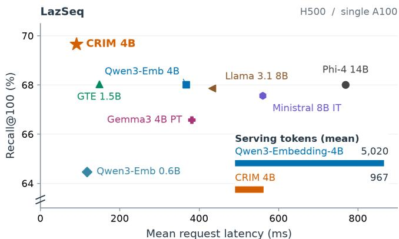
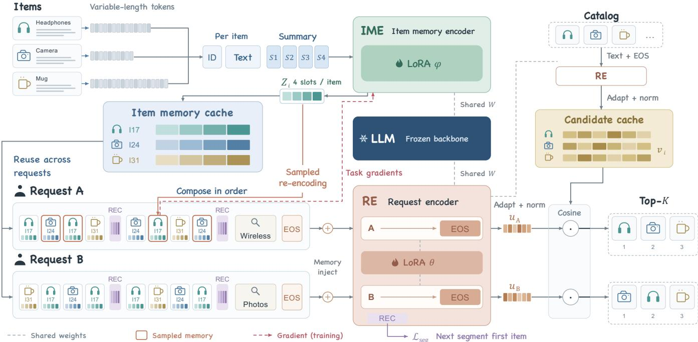
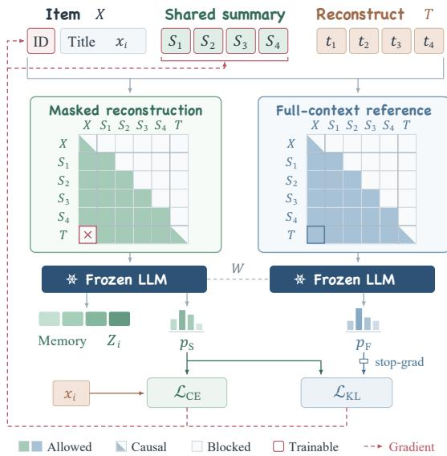
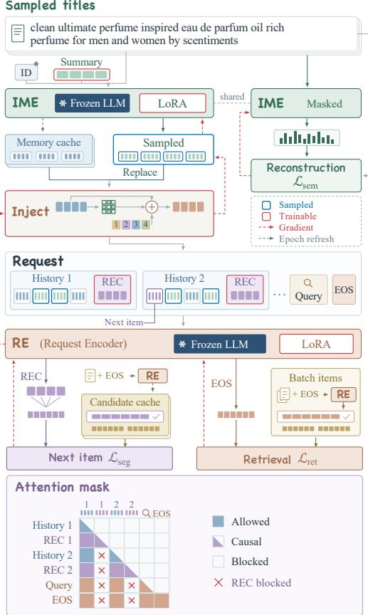
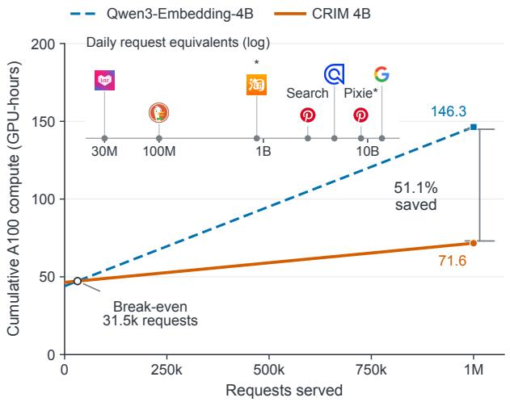
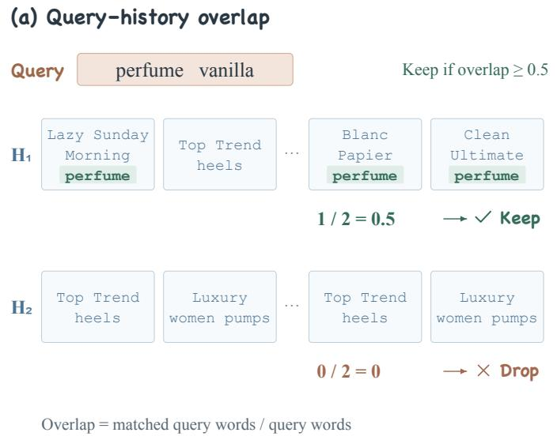
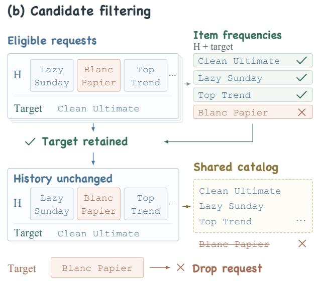

# CRIM: Composable and Reusable Item Memory for Eficient Personalized Retrieval

Haolin Li∗   
Tsinghua University   
Beijing, China   
Alibaba International Digital   
Commerce Group   
Beijing, China   
hl-li23@mails.tsinghua.edu.cn   
Zhaohui Xia   
Alibaba International Digital   
Commerce Group   
Beijing, China   
Yu Zhang†   
Alibaba International Digital   
Commerce Group   
Beijing, China   
Haipeng Zhang   
Alibaba International Digital   
Commerce Group   
Beijing, China   
Xun Zhu   
Tsinghua University   
Beijing, China   
Mang Li   
Alibaba International Digital   
Commerce Group   
Beijing, China   
Ji Wu†   
Tsinghua University   
Beijing, China   
Miao Li   
Tsinghua University   
Beijing, China

## Abstract

Large language models incur substantial training and inference costs in personalized search and recommendation, as growing interaction histories lengthen request inputs and repeatedly expose the same item text to the model. We propose Composable and Reusable Item Memory (CRIM), a framework that separates itemlevel semantic encoding from request-level history modeling. A small set of learnable summary tokens compresses each item into compact continuous memories, while segment-level readout tokens (REC tokens) introduce predictive supervision within the interaction history. These memories are independent of users and queries and can therefore be reused across requests. At inference time, CRIM composes cached memories in interaction order and incorporates an optional query to produce a personalized retrieval representation, reducing repeated item-text encoding while retain ing request-dependent contextual modeling. We further introduce a joint training mechanism that combines cached memories with sampled live re-encoding. Re-encoding only a few history items per request allows the retrieval objective to jointly optimize the item and request encoders at limited computational cost, while periodic cache refreshes maintain consistency. Extensive evaluation and cost analysis on MovieLens-1M, Qilin, and our new LazSeq dataset show that CRIM achieves state-of-the-art retrieval performance with substantially lower inference costs at the same backbone scale, while limiting item re-encoding during joint training. We will publicly release our code and dataset.

## CCS Concepts

• Information systems → Recommender systems; Retrieval eficiency.

  
Figure 1: Recall@100 versus mean request latency on LazSeq (single A100, histories up to 500 interactions). The inset reports mean serving input lengths, including memory slots, REC tokens, queries, and special tokens.

## Keywords

Recommender systems, large language models, token eficiency, personalized retrieval

## 1 Introduction

Personalized Web search and recommendation retrieve relevant items from large catalogs using a user’s ordered interaction history and, when available, a current query. Large language models provide rich semantic representations of items and queries, but growing histories increase both training and inference costs. Repeatedly encoding the same items across users and requests adds further overhead. Eficient personalized retrieval therefore requires addressing three challenges: reusing item semantics while retaining request-dependent contextual modeling; preserving both semantic information and interaction patterns in compressed representations;

and jointly optimizing item and retrieval encoders when cached representations reduce the amount of diferentiable computation.

Existing methods address diferent aspects of these challenges. Recformer [24] jointly models item text and interaction sequences, while processing history text for each request. Token Factory [5] converts heterogeneous features into soft tokens and compresses recommendation inputs, and ICAE [13] learns compact memories through autoencoding and language modeling. These approaches demonstrate the value of compression. For personalized retrieval, however, an item representation must also remain useful when composed into diferent histories, and text reconstruction alone does not directly supervise interaction patterns. Representation caching ofers a complementary way to reduce repeated computation. GNNAutoScale [11], for example, reuses historical embeddings in graph neural networks. Applying caching to language-modelbased item encoding requires coordinating encoder updates with the gradient paths available through cached representations, with out allowing full-history re-encoding to consume the savings from reuse.

Our central idea is to separate stable item semantics from dynamic request context. We propose Composable and Reusable Item Memory (CRIM). An item memory encoder (IME) independently maps each item to a compact block of continuous memories shared across users and requests. A request encoder (RE) composes these blocks in interaction order and incorporates an optional query to generate a personalized retrieval representation. This design moves repeated item-text encoding ofline while preserving contextual modeling of the current history and information need. Preserving item-text semantics allows retrieval to use the LLM’s pretrained semantic knowledge alongside learned interaction patterns.

To support semantic compression and sequence learning together, CRIM combines learnable summary tokens with segmentlevel readout tokens, termed REC tokens. Summary tokens encode each item’s semantics into a small number of continuous vectors. REC tokens read out intermediate history prefixes to predict subsequent interactions, introducing supervision throughout the sequence. We further develop a joint training mechanism that combines cached memories with sampled live re-encoding. Only a few history positions are re-encoded for each request, allowing retrieval gradients to update the IME through those positions. The remaining positions reuse cached memories and participate in RE training. Periodic refreshes keep the memory cache aligned with the evolving encoder. This mechanism allows item memories to adapt to the retrieval objective while limiting the cost of re-encoding long histories.

We introduce LazSeq, a benchmark for query-conditioned retrieval with approximately 30,000 requests, a shared catalog of 49,993 distinct items, and histories of up to 500 interactions. Together with MovieLens-1M (ML1M) [14] and Qilin [4], it supports an extensive evaluation across retrieval methods and task settings. CRIM achieves state-of-the-art retrieval performance. Compared with the Qwen3-Embedding-4B baseline [37], it improves Recall@100 by 2.49% on LazSeq and 33.61% on ML1M, and NDCG@100 by 5.64% on Qilin, all measured as relative improvements. As shown in Figure 1, CRIM combines strong retrieval quality with lower latency and fewer serving tokens on LazSeq at the same backbone scale. Our cost analysis relates ofline investment and request computation to the volume of requests that reuse item memories.

Our contributions are fourfold:

• Composable and reusable item memory. We propose a novel framework that separates item-level semantic encoding from request-level history modeling, enabling reuse across requests while retaining personalized contextual modeling.

• Semantic compression with sequence supervision. We combine summary tokens for compact item representations with REC tokens that introduce predictive supervision within interaction histories.

• Eficient joint training. We combine cached memories with sampled live re-encoding, allowing item memories to adapt to the retrieval objective while controlling reencoding costs.

• LazSeq and comprehensive evaluation. We introduce a long-history retrieval dataset and evaluate retrieval quality and computational eficiency across three datasets, supported by a cost analysis of memory reuse.

## 2 Related Work

Language models for personalized retrieval. Recformer [24] organizes item attributes as text sequences and jointly learns language representations and interaction patterns. TIGER [29] maps items to semantic identifiers and autoregressively predicts the next item. GEMS [38] unifies search and recommendation through gradient subspace decomposition that coordinates task-specific optimization signals. Related adaptation methods include LiRA [22], which aligns low-resource languages in a shared semantic space for multilingual retrieval, and AgentDet [21], which coordinates detection agents through a shared blackboard and knowledge base for zero-/few-shot object detection. CRIM focuses on repeated item encoding in long histories, using shared item memories to support request-dependent composition and integrate history with an optional query in a dense retrieval framework.

Context compression and reusable item representations. Prefixtuning [25] and prompt tuning [19] learn continuous task prompts. Context compression instead encodes input content: LLMLingua [17] prunes prompt tokens, while continuous compressors retain information from long text in a small set ofvectors. ICAE [13] learns compact memory slots through autoencoding and language modeling, while EBMC [6] pretrains a decoupled compressor using text reconstruction and completion. For industrial recommendation, Token Factory [5] maps heterogeneous features to soft tokens and compresses behavioral inputs. Dual-purpose Semantic IDs [20] combine discrete encoding with on-demand vector reconstruction to reduce item representation storage and transfer costs. CRIM uses individual items as the unit of reuse: summary tokens retain item semantics, and REC tokens introduce prediction objectives within interaction histories so that compact memories support composition and retrieval across users.

Eficient training with cached representations. Caching reduces repeated computation, but its efectiveness depends on gradient paths and representation refresh frequency. Graph Segment Training [3] backpropagates through sampled graph segments while reusing historical embeddings for the remaining segments. REST [35] reduces representation staleness by separating forward refreshes from parameter updates. CRIM applies partial diferentiable computation and caching to language-model-based item memory. Each request re-encodes only a small sample of history positions, allowing the retrieval objective to jointly optimize the IME and RE; periodic refreshes maintain cache consistency.

  
Figure 2: Overview of CRIM. The IME encodes each item into reusable continuous memories. The RE composes cached memory blocks in interaction order, incorporates an optional query, and produces a representation for retrieval against separately encoded catalog candidates.

## 3 Method

## 3.1 Task Definition and Framework

We study personalized retrieval from user interaction histories. Let I be an item catalog, where each item � has a textual description $x _ { i } . \mathrm { A }$ request consists of a chronologically ordered history $H =$ $( i _ { 1 } , \dots , i _ { N } )$ and an optional query �. The objective is to retrieve a relevant target item � from the full catalog. Setting $q = \emptyset$ yields history-based recommendation without an explicit query.

The same item can appear in the histories of multiple users and requests. Its textual semantics can be reused, whereas user interests depend on the interaction order and current query. CRIM therefore separates item-level semantic encoding from request-level history modeling through two modules. The IME compresses an item’s text and identity into a fixed number of continuous vectors. The RE composes these memories in interaction order and incorporates the

optional query:

$$
\begin{array} { c } { Z _ { i } = C _ { \phi } ( x _ { i } , e _ { i } ) \in \mathbb R ^ { K \times d } , } \\ { \displaystyle \quad u = f _ { \theta } ( Z _ { i _ { 1 } } , . . . , Z _ { i _ { N } } , q ) , } \\ { s ( H , q , i ) = \frac { u ^ { \top } v _ { i } } { \| u \| _ { 2 } \| v _ { i } \| _ { 2 } } . } \end{array}\tag{1}
$$

Here, �� is an item identity prefix, � is the number of memory vectors per item, � is the hidden dimension, and � is the candidate representation. Candidates are ranked by $s ( H , q , i )$

Item memories are encoded independently ofusers, histories, and queries, so they can be precomputed and cached. At inference time, CRIM retrieves the corresponding memory blocks in history order, retaining repeated interactions, and models the request context with the RE. Candidate vectors are constructed and cached separately for full-catalog retrieval. Figure 2 illustrates the framework.

## 3.2 Item Memory Encoding and Semantic Pretraining

To summarize item text, we append a shared set of � learnable summary tokens with embeddings $\boldsymbol { S } = \left( s _ { 1 } , \ldots , s _ { K } \right)$ to every item input. Let $E _ { i }$ denote the embedded item identity prefix and � (��) the embedded text template. Encoding yields

$$
Z _ { i } = \left[ F _ { \phi } ( E _ { i } \oplus T ( x _ { i } ) \oplus S ) \right] _ { \mathrm { s u m } } ,\tag{2}
$$

where ⊕ denotes concatenation and $F _ { \phi }$ is a causal language model. The operator $[ \cdot ] _ { \mathrm { s u m } }$ extracts the summary-position hidden states after the final normalization layer. Causal attention allows these positions to read the preceding identity prefix and item text. All items share these � learned embeddings, adding only �� summarytoken parameters regardless of catalog size. The resulting memory vectors depend on item content.

  
Figure 3: Semantic pretraining: summary tokens compress item identity and text under restricted-attention reconstruction and full-context distillation with a frozen backbone.

We first perform semantic pretraining on the item catalog through reconstruction. A decoding sequence is appended after the summary tokens, with the item title as the reconstruction target. A restricted attention mask allows decoding positions to access only the summary positions and preceding decoding tokens, blocking direct access to the source text and identity prefix. Consequently, source information must pass through the summary tokens to support reconstruction.

Alongside reconstruction cross-entropy, we use the predictive distribution under full context as a distillation target. The same frozen language model produces this reference distribution with direct access to the source text. Let $\mathcal { T }$ contain the supervised decoding positions in a batch, $a _ { i , t }$ be the target token, and $\boldsymbol { p } _ { i , t } ^ { \mathrm { m e m } }$ and $p _ { i , t } ^ { \mathrm { f u l l } }$ be the distributions under restricted and full attention. The pretraining objective is

$$
\begin{array} { r } { \mathcal { L } _ { \mathrm { p r e } } = \frac { 1 } { | \mathcal { T } | } \displaystyle \sum _ { ( i , t ) \in \mathcal { T } } [ - \log \mathcal { P } _ { i , t } ^ { \mathrm { m e m } } ( a _ { i , t } )  } \\ {  +  \lambda _ { \mathrm { K L } } D _ { \mathrm { K L } } ( \mathrm { s g } [ \mathcal { P } _ { i , t } ^ { \mathrm { f u l l } } ] | | \mathcal { P } _ { i , t } ^ { \mathrm { m e m } } ) ] , } \end{array}\tag{3}
$$

where sg stops gradients and $\lambda _ { \mathrm { K I } }$ controls the distillation weight. Cross-entropy directly supervises title reconstruction; the KL term aligns predictions under the two context conditions.

Semantic pretraining updates only summary-token embeddings, item identity embeddings, and their projection parameters. The language model backbone remains frozen, and no user interaction sequences are required. Figure 3 illustrates this stage. These pa rameters provide a semantic initialization for the item memories, which are subsequently adapted to personalized retrieval through downstream supervision.

## 3.3 Sequence-Aware Memory Composition

Independent item memories retain item semantics, while personalized retrieval additionally requires modeling interaction order and evolving interests. The RE therefore composes memories chronologically and uses segment-level supervision to learn representations of diferent history prefixes.

The memory vectors enter the RE as continuous input embeddings through a learnable residual mapping. For the �-th memory vector $z _ { i , k }$ of item �,

$$
\bar { z } _ { i , k } = z _ { i , k } + W _ { \mathrm { i n } } z _ { i , k } + a _ { k } ,\tag{4}
$$

where $W _ { \mathrm { i n } }$ is a residual projection and $a _ { k }$ is a learnable within-item memory-position embedding. Both are initialized to zero, so the RE initially receives the original memories and gradually learns an input representation suited to history modeling.

We divide the history into $J = \lceil N / b \rceil$ contiguous segments of at most � items. A shared set of learnable segment readout tokens, termed REC tokens, is inserted after each segment. History memories use causal attention. The REC tokens of segment � can attend to all memories up to that segment and earlier REC tokens within the same readout block. Subsequent history memories, query tokens, and the final retrieval position do not attend to REC hidden states. This provides additional supervision positions while preserving direct interactions among history memories.

For query-conditioned retrieval, query tokens follow the history and can attend to all history memories. The final EOS hidden state passes through a representation adapter and normalization to produce �. Inserting REC tokens does not advance the position indices of subsequent memories and query tokens, preserving their original positional relationships. The candidate branch reuses the RE’s language model to encode item text followed by EOS; a candidate-side representation adapter and normalization produce $v _ { i } .$

To supervise the history internally, each segment readout predicts the first item in the next segment. Let $r _ { j }$ be obtained by averaging segment $j ^ { \prime } s$ REC hidden states, then applying a shared readout adapter and normalization. For a representation ℎ, positive item �, and negative set $N ,$ define

$$
\ell ( h , y ; N ) = - \log \frac { \exp ( \cos ( h , v _ { y } ) / \tau ) } { \exp ( \cos ( h , v _ { y } ) / \tau ) + \sum _ { n \in N } \exp ( \cos ( h , v _ { n } ) / \tau ) } ,\tag{5}
$$

where � is a temperature. The segment objective is

$$
\mathcal { L } _ { \mathrm { s e g } } = \frac { 1 } { J - 1 } \sum _ { j = 1 } ^ { J - 1 } \ell ( r _ { j } , i _ { j b + 1 } ; N _ { j } ) .\tag{6}
$$

Here, $i _ { j b + 1 }$ is the first item of the next segment. Negatives are sampled uniformly from the catalog, excluding the positive item identity, and candidate representations are cached. We set $\mathcal { L } _ { \mathrm { s e g } } = 0$ when $J \leq 1$ . These intermediate prediction positions directly supervise the relationship between each history prefix and subsequent interactions.

## 3.4 Joint Training with Cached and Sampled Memories

Item memories must adapt to the retrieval objective, but live encoding of every history item makes training cost grow with history length. During joint training, we combine cached memories with sampled live re-encoding. The complete history participates in request modeling, while diferentiable item encoding is limited to a small set of history positions.

  
Figure 4: Joint training: sampled positions use live IME outputs; the others reuse cached memories. Retrieval, segment prediction, and reconstruction provide supervision.

For a request with � interactions, we sample a set S of min(�, �) positions uniformly without replacement, where � is the per-request re-encoding budget. Sampled positions use the current IME; the others read from the cache:

$$
\widetilde { Z } _ { t } = \left\{ \begin{array} { l l } { C _ { \phi } ( x _ { i _ { t } } , e _ { i _ { t } } ) , } & { t \in S , } \\ { \mathrm { s g } [ Z _ { i _ { t } } ^ { \mathrm { c a c h e } } ] , } & { t \notin S . } \end{array} \right.\tag{7}
$$

Live memories replace cached blocks at their original positions, preserving history order and length. Retrieval gradients reach the IME through the live blocks. Cached blocks still participate in RE computation and update request-side parameters and the memory input mapping.

Figure 4 illustrates the gradient paths. The two encoders share a frozen language model backbone with separate LoRA adapters [16]. The IME starts from semantic pretraining and updates its summary embeddings and LoRA parameters while fixing the item identity embeddings and projection. The request side jointly learns its LoRA adapter, memory input mapping, REC tokens, and representation adapters.

The joint objective combines final retrieval, segment prediction, and semantic preservation:

$$
\begin{array} { r l } & { \mathcal { L } _ { \mathrm { j o i n t } } = \mathcal { L } _ { \mathrm { r e t } } + \lambda _ { \mathrm { s e g } } \mathcal { L } _ { \mathrm { s e g } } + \lambda _ { \mathrm { s e m } } \mathcal { L } _ { \mathrm { s e m } } , } \\ & { \mathcal { L } _ { \mathrm { r e t } } = \ell ( u , y ; N _ { \mathrm { b a t c h } } ) . } \end{array}\tag{8}
$$

The set $N _ { \mathrm { b a t c h } }$ contains target items from other requests in the same training group, excluding identities matching the positive. These candidates are encoded live, so the loss optimizes both request and candidate representations. The segment loss is defined in Equation (6). The semantic term uses the restricted-attention reconstruction cross-entropy from Section 3.2, evaluated only on sampled, re-encoded items. Its weight and $\lambda _ { \mathrm { s e g } }$ control semantic and sequential supervision.

Encoder updates gradually make cached representations stale. At the end of each training epoch, we re-encode the catalog with the current parameters to refresh both the item memory cache and the trainable candidate cache. Refreshes do not retain a computation graph and use the same item inputs and encoding paths as live computation. Before evaluation, caches are rebuilt from the selected checkpoint.

Dataset-specific training and readout settings are given in Section 4.1.

## 3.5 Computational Savings and Cost Amortization

CRIM invests ofline computation in memory learning and cache maintenance to reduce repeated online computation. The reference uses the same backbone and encodes full history text per request. Both precompute candidate vectors and retrieve from the same catalog.

Per-request savings. For � history items averaging � text tokens each, direct encoding uses $N L + L _ { 0 }$ positions, where $L _ { 0 }$ is the query and template length. CRIM uses � vectors per item and � REC tokens per segment, giving

$$
\gamma = \frac { N K + J R + L _ { 0 } } { N L + L _ { 0 } } .\tag{9}
$$

For long histories, � approaches $\left( K { + } R / b \right) / L$ . Let $c _ { \mathrm { l i n } }$ and $c _ { \mathrm { a t t n } }$ denote the reference costs of linear projections/feed-forward computation and attention. Compression scales them approximately by � and $\gamma ^ { 2 }$ With additional memory-input operations costing �add, per-request savings are

$$
\Delta c \approx ( 1 - \gamma ) c _ { \mathrm { l i n } } + ( 1 - \gamma ^ { 2 } ) c _ { \mathrm { a t t n } } - c _ { \mathrm { a d d } } .\tag{10}
$$

The common candidate-matching cost cancels. Longer item text and fewer memory vectors increase request-encoding savings; total savings also depend on the share of candidate matching and input adaptation.

Cumulative savings. For a given serving horizon and refresh schedule, let $\Delta C _ { \mathrm { o f f } }$ denote CRIM’s additional ofline cost, including pretraining, joint training, initial cache construction, and maintenance. Net savings after $Q$ requests and the break-even volume, for

$\Delta C _ { \mathrm { o f f } } > 0$ and $\Delta c > 0 ,$ , are

$$
S ( Q ) = Q \Delta c - \Delta C _ { \mathrm { o f f } } ,\tag{11}
$$

$$
Q ^ { * } = \left\lceil \frac { \Delta C _ { \mathrm { o f f } } } { \Delta c } \right\rceil .\tag{12}
$$

For $Q \geq Q ^ { * }$ , inference savings cover the additional ofline investment; each further request saves Δ�. The benefit depends on compression gains and memory reuse within an update cycle. Section 4.4 measures these costs on LazSeq.

## 4 Experiments

## 4.1 Experimental Setup

Datasets. We evaluate on LazSeq, Qilin, and MovieLens-1M (ML1M). LazSeq and Qilin support query-conditioned personalized retrieval, where a model combines the user history and current query to predict a target item. ML1M supports sequential recommendation without an explicit query. Each request contains one target. History lengths are capped at 500 for LazSeq and 100 for Qilin and ML1M. All ML1M methods use the same request-level data protocol, without expanding history prefixes into additional training examples. Appendix A.2 gives dataset statistics, loading details, and checkpoint-selection protocols.

Baselines. All baseline results are obtained from our own reproductions, and we will release the corresponding code. We compare three groups of methods. The ID-based group contains GRU4Rec [15], NARM [23], STAMP [26], SASRec [18], BERT4Rec [32], S3Rec [39], LightSANs [10], SINE [33], and FEARec [7]. Generative retrieval and language-model recommendation methods include TIGER [29], LlamaRec [36], GenSAR [30], and GEMS [38]. The dense text encoders include GTE-1.5B [2], E5- Mistral-7B [34], Gemma3-4B (pretrained and instruction-tuned), Llama3.1-8B, Ministral-8B-Instruct, Phi-4-14B, Qwen3-4B, and Qwen3-Embedding-0.6B and -4B. Qwen3-Embedding-4B shares CRIM’s backbone and is the main reference for examining memory compression and computational cost.

ID-based methods use history item IDs. CRIM and query-aware dense encoders receive history item text and the query on LazSeq and Qilin. TIGER, LlamaRec, GenSAR, and GEMS use implementations adapted to the current retrieval tasks. Dense results use the corresponding LoRA-trained checkpoints.

Evaluation. We evaluate retrieval over the complete valid item catalog, retaining items that already occur in the user history. Recall@� and NDCG@� measure target retrieval and ranking quality. Results are averaged across test requests. We additionally report MRR@100, assigning zero to targets ranked below 100, and full-catalog MRR where available. Beam-limited runs without complete ranks do not report full-catalog MRR.

Implementation. We train with eight NVIDIA A100-80GB GPUs. CRIM uses Qwen3-Embedding-4B in BF16 with LoRA rank 16 for both encoders. A shared set of $K = 4$ summary tokens produces four memory vectors per item. Each history segment contains $b = 4$ items followed by � = 4 REC tokens. The re-encoding budget is � = 8 on LazSeq and � = 4 on Qilin and ML1M, and item memories and trainable candidate caches are refreshed after each epoch. Semantic pretraining uses a KL weight of 0.1. Joint training uses a learning rate of $1 0 ^ { - 4 }$ , temperature 0.05, segment loss weight 1, and semantic reconstruction weight 0.1.

On LazSeq and Qilin, joint training runs for at most three epochs with a global batch size of 64. The retrieval loss is computed within logical groups of at most eight target items. ML1M uses at most ten epochs with batch size eight, a mean readout from the final REC block, fixed pooled candidate encodings, and an additional titlegeneration loss. Its retrieval negatives also include catalog-sampled items. Table 5 in Appendix A.2 gives the full configurations.

## 4.2 The LazSeq Dataset

We construct LazSeq for personalized search with long interaction histories. Each request contains an ordered history, a current query, and a target item; history and target items have shared IDs and titles. Repeated interactions are retained. A shared item catalog supports the study of semantic reuse across requests.

Scale and characteristics. LazSeq contains approximately 30,000 requests with up to 500 history interactions each. Its shared catalog comprises 49,993 distinct items from history and target positions. CRIM uses 23,999 training requests, 3,000 validation requests, and 2,999 test requests. Fixed request splits and a title catalog support reproducible comparisons. Figure 6 in Appendix A.1 illustrates query–history filtering and catalog construction; the appendix also details the request splits.

## 4.3 Retrieval Results and Comparative Analysis

Tables 1–3 compare CRIM with sequential, generative, and dense retrieval methods. We report Recall, NDCG, MRR@100, and fullcatalog MRR, with cutofs shown in the tables. Relative improvements use unrounded results. Appendix A.4 compares method groups and additional ranking cutofs.

Long-history retrieval on LazSeq. CRIM achieves the highest Recall@50, Recall@100, and Recall@1000, reaching 0.5835, 0.6969, and 0.9330, respectively. These values improve over the strongest baseline at each cutofby 0.49%, 2.43%, and 0.83%: Qwen3-Embedding-4B at 50, GTE-1.5B at 100, and Phi-4 at 1000. CRIM ranks second at NDCG@50 and NDCG@100, reaching 0.2430 and 0.2614. At Recall@3000, it ranks second with 0.9737, following Phi-4 at 0.9750. Compared with Qwen3-Embedding-4B, CRIM improves Recall@50, @100, @1000, and @3000 by 0.49%, 2.49%, 1.67%, and 1.11%, respectively. These results show that four memory vectors per history item preserve the information needed for strong candidate retrieval over long histories.

Query-conditioned retrieval on Qilin. CRIM achieves the best NDCG@10, NDCG@100, MRR@100, and full-catalog MRR. Relative to Qwen3-Embedding-4B, NDCG@10 rises from 0.4126 to 0.4434, NDCG@100 from 0.4518 to 0.4772, and full-catalog MRR from 0.3682 to 0.4059, corresponding to gains of 7.48%, 5.64%, and 10.23%. CRIM also exceeds GTE-1.5B, the strongest baseline for these three metrics, by 0.70%, 0.71%, and 1.96%.

Sequential recommendation on ML1M.. Without an explicit query, CRIM leads all six reported metrics. Its Recall@10 of 0.1183 exceeds the strongest baseline, Ministral-8B-Instruct at 0.0719, by 64.52%.

Table 1: Full-catalog retrieval on LazSeq (histories up to 500 items). Bold/underlined values mark the best/second-best results; dashes denote metrics unavailable from beam-limited outputs.
<table><tr><td></td><td></td><td colspan="5">Recall</td><td colspan="3">NDCG</td><td colspan="2">MRR</td></tr><tr><td>Method</td><td>Year</td><td>@10</td><td>@50</td><td>@100</td><td>@1000</td><td>@3000</td><td>@10</td><td>@50</td><td>@100</td><td>@100</td><td>All</td></tr><tr><td>GRU4Rec</td><td>2016</td><td>0.0300</td><td>0.0670</td><td>0.0944</td><td>0.2598</td><td>0.3951</td><td>0.0164</td><td>0.0246</td><td>0.0290</td><td>0.0144</td><td>0.0151</td></tr><tr><td>NARM</td><td>2017</td><td>0.0223</td><td>0.0634</td><td>0.0894</td><td>0.2544</td><td>0.3941</td><td>0.0119</td><td>0.0207</td><td>0.0250</td><td>0.0109</td><td>0.0116</td></tr><tr><td>SASRec</td><td>2018</td><td>0.0313</td><td>0.0697</td><td>0.0937</td><td>0.2487</td><td>0.3765</td><td>0.0170</td><td>0.0253</td><td>0.0292</td><td>0.0147</td><td>0.0154</td></tr><tr><td>STAMP</td><td>2018</td><td>0.0290</td><td>0.0620</td><td>0.0794</td><td>0.2274</td><td>0.3588</td><td>0.0153</td><td>0.0225</td><td>0.0253</td><td>0.0128</td><td>0.0135</td></tr><tr><td>BERT4Rec</td><td>2019</td><td>0.0250</td><td>0.0600</td><td>0.0860</td><td>0.2661</td><td>0.4201</td><td>0.0127</td><td>0.0204</td><td>0.0246</td><td>0.0109</td><td>0.0117</td></tr><tr><td>S3Rec</td><td>2020</td><td>0.0340</td><td>0.0794</td><td>0.1097</td><td>0.3331</td><td>0.4965</td><td>0.0174</td><td>0.0272</td><td>0.0321</td><td>0.0148</td><td>0.0157</td></tr><tr><td>LightSANs</td><td>2021</td><td>0.0317</td><td>0.0730</td><td>0.0960</td><td>0.2511</td><td>0.3815</td><td>0.0163</td><td>0.0255</td><td>0.0292</td><td>0.0139</td><td>0.0146</td></tr><tr><td>SINE</td><td>2021</td><td>0.0357</td><td>0.0784</td><td>0.1030</td><td>0.2761</td><td>0.3998</td><td>0.0199</td><td>0.0293</td><td>0.0333</td><td>0.0174</td><td>0.0182</td></tr><tr><td>FEARec</td><td>2023</td><td>0.0333</td><td>0.0677</td><td>0.0950</td><td>0.2324</td><td>0.3738</td><td>0.0177</td><td>0.0253</td><td>0.0297</td><td>0.0150</td><td>0.0156</td></tr><tr><td>TIGER</td><td>2023</td><td>0.0317</td><td>0.0737</td><td>0.0927</td><td></td><td></td><td>0.0159</td><td>0.0251</td><td>0.0282</td><td>0.0133</td><td></td></tr><tr><td>LlamaRec</td><td>2023</td><td>0.0290</td><td>0.0637</td><td>0.0827</td><td>0.2381</td><td>0.3745</td><td>0.0160</td><td>0.0233</td><td>0.0263</td><td>0.0137</td><td>0.0144</td></tr><tr><td>GenSAR</td><td>2025</td><td>0.2121</td><td>0.3768</td><td>0.4308</td><td>一</td><td></td><td>0.1241</td><td>0.1608</td><td>0.1696</td><td>0.1060</td><td></td></tr><tr><td>GEMS</td><td>2026</td><td>0.0100</td><td>0.0333</td><td>0.0487</td><td>0.1627</td><td>0.3131</td><td>0.0066</td><td>0.0116</td><td>0.0141</td><td>0.0068</td><td>0.0073</td></tr><tr><td>GTE-1.5B</td><td>2024</td><td>0.3317</td><td>0.5783</td><td>0.6803</td><td>0.9097</td><td>0.9630</td><td>0.1890</td><td>0.2427</td><td>0.2593</td><td>0.1583</td><td>0.1594</td></tr><tr><td>Gemma3-4B-PT</td><td>2025</td><td>0.3030</td><td>0.5627</td><td>0.6657</td><td>0.9150</td><td>0.9667</td><td>0.1744</td><td>0.2319</td><td>0.2486</td><td>0.1489</td><td>0.1500</td></tr><tr><td>Gemma3-4B-IT</td><td>2025</td><td>0.2897</td><td>0.5500</td><td>0.6643</td><td>0.9140</td><td>0.9647</td><td>0.1617</td><td>0.2191</td><td>0.2377</td><td>0.1366</td><td>0.1377</td></tr><tr><td>Llama3.1-8B</td><td>2024</td><td>0.2983</td><td>0.5627</td><td>0.6787</td><td>0.9227</td><td>0.9693</td><td>0.1701</td><td>0.2285</td><td>0.2474</td><td>0.1454</td><td>0.1466</td></tr><tr><td>Ministral-8B-IT</td><td>2024</td><td>0.3057</td><td>0.5647</td><td>0.6757</td><td>0.9197</td><td>0.9693</td><td>0.1721</td><td>0.2295</td><td>0.2475</td><td>0.1452</td><td>0.1463</td></tr><tr><td>Phi-4-14B</td><td>2024</td><td>0.3153</td><td>0.5733</td><td>0.6800</td><td>0.9253</td><td>0.9750</td><td>0.1790</td><td>0.2357</td><td>0.2530</td><td>0.1510</td><td>0.1521</td></tr><tr><td>Qwen3-Emb.-0.6B</td><td>2025</td><td>0.2953</td><td>0.5467</td><td>0.6447</td><td>0.8953</td><td>0.9580</td><td>0.1745</td><td>0.2301</td><td>0.2460</td><td>0.1508</td><td>0.1520</td></tr><tr><td>Qwen3-Emb.-4B</td><td>2025</td><td>0.3390</td><td>0.5807</td><td>0.6800</td><td>0.9177</td><td>0.9630</td><td>0.1923</td><td>0.2458</td><td>0.2620</td><td>0.1604</td><td>0.1615</td></tr><tr><td>CRIM</td><td>Ours</td><td>0.3204</td><td>0.5835</td><td>0.6969</td><td>0.9330</td><td>0.9737</td><td>0.1850</td><td>0.2430</td><td>0.2614</td><td>0.1576</td><td>0.1587</td></tr></table>

Recall@100 reaches 0.3782, improving over GTE-1.5B’s 0.2900 by 30.40% and over Qwen3-Embedding-4B by 33.61%. NDCG@100 reaches 0.1139, a 47.67% gain over the strongest baseline, Qwen3- Embedding-4B. NDCG@10, MRR@100, and full-catalog MRR are 0.0629, 0.0548, and 0.0564, respectively. These results demonstrate improvements in both candidate retrieval and ranking quality for history-only recommendation under the ML1M configuration.

## 4.4 Eficiency and Cost Analysis

Online inference. Figure 1 measures end-to-end, batch-one latency on a single A100-SXM4-80GB over 200 shared LazSeq requests. Timing covers input preparation, request encoding, full-catalog retrieval, and returned IDs, with prebuilt caches. Appendix A.3 details warm-ups, repetitions, and cost calibration.

CRIM reduces mean latency to 90.76 ms from the dense reference’s 367.45 ms, a 4.05× speedup. The 95th-percentile latency falls from 818.03 to 173.39 ms. Mean serving input length decreases from 5,020.36 to 966.62 positions, including REC tokens, the query, and template tokens, a reduction of 80.75%. CRIM is also faster than the 0.6B embedding baseline at 117.17 ms while achieving higher Recall@100. Independent item encoding therefore shifts substantial work out of the online request path.

Cost amortization. Figure 5 combines estimated A100 optimiza tion and initial cache costs with serial warm-cache inference. The estimated upfront costs are 46.44 GPU-hours for CRIM and 44.02 for Qwen3-Embedding-4B. The online savings recover this difer ence after approximately 31,500 requests. At one million requests, cumulative compute reaches 71.63 and 146.33 GPU-hours, respectively, yielding a 51.05% saving. At ten million requests, the saving increases to 72.05%. This scenario holds the deployed model and catalog fixed. Training-time cache refreshes and later updates add to $\Delta C _ { \mathrm { o f f } }$ (Appendix A.3).

  
Figure 5: Cumulative A100 compute on LazSeq: optimization, initial cache, and warm-cache inference. Inset: published service volumes [1, 8, 9, 12, 28, 31]; the two P logos denote Pinterest Search and Pixie recommendations. Lazada: 30M searches/day (2020) [27]. Stars mark conversions from requests/s to requests/day (Appendix A.3).

Table 2: Full-catalog retrieval on Qilin (histories up to 100 items). Bold/underlined values mark the best/second-best results; dashes denote metrics unavailable from beam-limited outputs.
<table><tr><td colspan="2"></td><td colspan="2">Recall</td><td colspan="2">NDCG</td><td colspan="2">MRR</td></tr><tr><td>Method</td><td>Year</td><td>@10</td><td>@100</td><td>@10</td><td>@100</td><td>@100</td><td>All</td></tr><tr><td>GRU4Rec</td><td>2016</td><td>0.0000</td><td>0.0000</td><td>0.0000</td><td>0.0000</td><td>0.0000</td><td>0.0001</td></tr><tr><td>NARM</td><td>2017</td><td>0.0000</td><td>0.0000</td><td>0.0000</td><td>0.0000</td><td>0.0000</td><td>0.0000</td></tr><tr><td>SASRec</td><td>2018</td><td>0.0000</td><td>0.0000</td><td>0.0000</td><td>0.0000</td><td>0.0000</td><td>0.0001</td></tr><tr><td>STAMP</td><td>2018</td><td>0.0034</td><td>0.0034</td><td>0.0028</td><td>0.0028</td><td>0.0026</td><td>0.0026</td></tr><tr><td>BERT4Rec</td><td>2019</td><td>0.0000</td><td>0.0011</td><td>0.0000</td><td>0.0002</td><td>0.0000</td><td>0.0001</td></tr><tr><td>S3Rec</td><td>2020</td><td>0.0000</td><td>0.0000</td><td>0.0000</td><td>0.0000</td><td>0.0000</td><td>0.0000</td></tr><tr><td>LightSANs</td><td>2021</td><td>0.0000</td><td>0.0011</td><td>0.0000</td><td>0.0002</td><td>0.0000</td><td>0.0002</td></tr><tr><td>SINE</td><td>2021</td><td>0.0011</td><td>0.0022</td><td>0.0005</td><td>0.0007</td><td>0.0003</td><td>0.0004</td></tr><tr><td>FEARec</td><td>2023</td><td>0.0000</td><td>0.0000</td><td>0.0000</td><td>0.0000</td><td>0.0000</td><td>0.0001</td></tr><tr><td>TIGER</td><td>2023</td><td>0.0022</td><td>0.0022</td><td>0.0022</td><td>0.0022</td><td>0.0022</td><td></td></tr><tr><td>LlamaRec</td><td>2023</td><td>0.0011</td><td>0.0034</td><td>0.0004</td><td>0.0008</td><td>0.0002</td><td>0.0004</td></tr><tr><td>GenSAR</td><td>2025</td><td>0.0101</td><td>0.0246</td><td>0.0054</td><td>0.0084</td><td>0.0046</td><td></td></tr><tr><td>GEMS</td><td>2026</td><td>0.0000</td><td>0.0000</td><td>0.0000</td><td>0.0000</td><td>0.0000</td><td>0.0001</td></tr><tr><td>GTE-1.5B</td><td></td><td>2024 0.5969</td><td>0.7548</td><td>0.4404</td><td>0.4739</td><td>0.3977</td><td>0.3981</td></tr><tr><td>E5-Mistral-7B</td><td>2023</td><td>0.5039</td><td>0.6887</td><td>0.3542</td><td>0.3927</td><td>0.3146</td><td>0.3151</td></tr><tr><td>Gemma3-4B-PT</td><td>2025</td><td>0.5151</td><td>0.7021</td><td>0.3694</td><td>0.4085</td><td>0.3319</td><td>0.3324</td></tr><tr><td>Gemma3-4B-IT</td><td>2025</td><td>0.5017</td><td>0.6943</td><td>0.3636</td><td>0.4042</td><td>0.3286</td><td>0.3291</td></tr><tr><td>Llama3.1-8B</td><td>2024</td><td>0.5297</td><td>0.7044</td><td>0.3806</td><td>0.4187</td><td>0.3419</td><td>0.3424</td></tr><tr><td>Ministral-8B-IT</td><td>2024</td><td>0.5364</td><td>0.7055</td><td>0.3901</td><td>0.4252</td><td>0.3506</td><td>0.3512</td></tr><tr><td>Phi-4-14B</td><td>2024</td><td>0.5409</td><td>0.7100</td><td>0.3991</td><td>0.4355</td><td>0.3619</td><td>0.3625</td></tr><tr><td>Qwen3-4B</td><td>2025</td><td>0.5733</td><td>0.7301</td><td>0.4052</td><td>0.4373</td><td>0.3582</td><td>0.3587</td></tr><tr><td>Qwen3-Emb.-0.6B</td><td>2025</td><td>0.5465</td><td>0.7167</td><td>0.3984</td><td>0.4339</td><td>0.3585</td><td>0.3590</td></tr><tr><td>Qwen3-Emb.-4B</td><td>2025</td><td></td><td>0.5801 0.7592</td><td>0.4126</td><td>0.4518</td><td>0.3678</td><td>0.3682</td></tr><tr><td>CRIM</td><td>Ours</td><td>0.5845</td><td></td><td></td><td>0.74580.44340.4772 0.40540.4059</td><td></td><td></td></tr></table>

## 4.5 Ablation Studies

We conduct ablations on held-out LazSeq requests with a 49,993- item catalog. Each run selects its checkpoint by validation Recall@3000. Table 4 reports Recall, NDCG, and MRR at 100.

Sequence supervision. CRIM exceeds the variant without segment prediction by 3.70 percentage points in Recall@100, 1.94 points in NDCG@100, and 1.53 points in MRR@100. Retrieval loss alone gives 65.66% Recall@100; removing REC tokens together with segment supervision gives 66.29%. Across three seeds, segment supervision improves Recall@100 by 2.53–3.97 percentage points. The variant without semantic reconstruction trails CRIM by 0.27, 0.45, and 0.36 points in these metrics (Appendix B.1).

Semantic pretraining. CRIM exceeds the variant without semantic pretraining by 1.03 percentage points in Recall@100, 0.77 points in NDCG@100, and 0.71 points in MRR@100. Initializing item memories through text reconstruction therefore benefits subsequent joint training.

Cache-based joint optimization. Training-time re-encoding budgets � = 1, 4, 8 give Recall@100 between 69.56% and 69.69% (Appendix B.2, Table 7). CRIM exceeds the fixed-cache variant by 3.07 percentage points in Recall@100; refreshing every two epochs gives 68.49% recall.

Table 3: Full-catalog retrieval on ML1M (histories up to 100 items). Bold/underlined values mark the best/second-best results; dashes denote metrics unavailable from beam-limited outputs.
<table><tr><td colspan="2"></td><td colspan="2">Recall</td><td colspan="2">NDCG</td><td colspan="2">MRR</td></tr><tr><td>Method</td><td>Year</td><td>@10</td><td>@100</td><td>@10</td><td>@100</td><td>@100</td><td>All</td></tr><tr><td>GRU4Rec</td><td>2016</td><td>0.0510</td><td>0.1555</td><td>0.0269</td><td>0.0465</td><td>0.0227</td><td>0.0244</td></tr><tr><td>NARM</td><td>2017</td><td>0.0510</td><td>0.1671</td><td>0.0302</td><td>0.0523</td><td>0.0273</td><td>0.0290</td></tr><tr><td>SASRec</td><td>2018</td><td>0.0534</td><td>0.1740</td><td>0.0300</td><td>0.0531</td><td>0.0263</td><td>0.0279</td></tr><tr><td>STAMP</td><td>2018</td><td>0.0534</td><td>0.1647</td><td>0.0314</td><td>0.0531</td><td>0.0282</td><td>0.0298</td></tr><tr><td>BERT4Rec</td><td>2019</td><td>0.0487</td><td>0.2019</td><td>0.0279</td><td>0.0565</td><td>0.0259</td><td>0.0276</td></tr><tr><td>S3Rec</td><td>2020</td><td>0.0696</td><td>0.2065</td><td>0.0367</td><td>0.0629</td><td>0.0310</td><td>0.0330</td></tr><tr><td>LightSANs</td><td>2021</td><td>0.0534</td><td>0.1601</td><td>0.0273</td><td>0.0475</td><td>0.0221</td><td>0.0238</td></tr><tr><td>SINE</td><td>2021</td><td>0.0580</td><td>0.1671</td><td>0.0346</td><td>0.0548</td><td>0.0302</td><td>0.0318</td></tr><tr><td>FEARec</td><td>2023</td><td>0.0510</td><td>0.1717</td><td>0.0268</td><td>0.0508</td><td>0.0238</td><td>0.0254</td></tr><tr><td>TIGER</td><td>2023</td><td>0.0371</td><td>0.1647</td><td>0.0215</td><td>0.0463</td><td>0.0207</td><td></td></tr><tr><td>LlamaRec</td><td>2023</td><td>0.0557</td><td>0.1856</td><td>0.0322</td><td>0.0565</td><td>0.0287</td><td>0.0303</td></tr><tr><td>GenSAR</td><td>2025</td><td>0.0673</td><td>0.2251</td><td>0.0403</td><td>0.0689</td><td>0.0360</td><td></td></tr><tr><td>GEMS</td><td>2026</td><td>0.0046</td><td>0.0650</td><td>0.0017</td><td>0.0126</td><td>0.0023</td><td>0.0041</td></tr><tr><td>GTE-1.5B</td><td>2024</td><td>0.0580</td><td>0.2900</td><td>0.0273</td><td>0.0698</td><td>0.0243</td><td>0.0259</td></tr><tr><td>E5-Mistral-7B</td><td>2023</td><td>0.0487</td><td>0.2529</td><td>0.0231</td><td>0.0619</td><td>0.0215</td><td>0.0232</td></tr><tr><td>Gemma3-4B-PT</td><td>2025</td><td>0.0487</td><td>0.2135</td><td>0.0223</td><td>0.0529</td><td>0.0187</td><td>0.0204</td></tr><tr><td>Gemma3-4B-IT</td><td>2025</td><td>0.0464</td><td>0.2088</td><td>0.0211</td><td>0.0523</td><td>0.0181</td><td>0.0197</td></tr><tr><td>Llama3.1-8B</td><td>2024</td><td>0.0487</td><td>0.1949</td><td>0.0272</td><td>0.0556</td><td>0.0255</td><td>0.0272</td></tr><tr><td>Ministral-8B-IT</td><td>2024</td><td>0.0719</td><td>0.2807</td><td>0.0315</td><td>0.0723</td><td>0.0263</td><td>0.0282</td></tr><tr><td>Phi-4-14B</td><td>2024</td><td>0.0696</td><td>0.2854</td><td>0.0320</td><td>0.0742</td><td>0.0279</td><td>0.0297</td></tr><tr><td>Qwen3-4B</td><td>2025</td><td>0.0557</td><td>0.2390</td><td>0.0254</td><td>0.0608</td><td>0.0222</td><td>0.0238</td></tr><tr><td>Qwen3-Emb.-0.6B</td><td>2025</td><td>0.0255</td><td>0.2251</td><td>0.0130</td><td>0.0508</td><td>0.0151</td><td>0.0166</td></tr><tr><td>Qwen3-Emb.-4B</td><td>2025</td><td>0.0580</td><td>0.2831</td><td>0.0328</td><td>0.0771</td><td>0.0327</td><td>0.0344</td></tr><tr><td>CRIM</td><td>Ours 0.1183 0.3782 0.0629 0.1139 0.0548 0.0564</td><td></td><td></td><td></td><td></td><td></td><td></td></tr></table>

Table 4: LazSeq supervision and pretraining ablations (%). R, N, and M denote Recall, NDCG, and MRR. Best retrieval metrics are bold.
<table><tr><td>Variant</td><td>R@100</td><td>N@100</td><td>M@100</td></tr><tr><td>CRIM</td><td>69.69</td><td>26.14</td><td>15.76</td></tr><tr><td>w/o  $\mathcal { L } _ { \mathrm { s e g } }$ </td><td>65.99</td><td>24.19</td><td>14.23</td></tr><tr><td>w/o  $\mathcal { L } _ { \mathrm { { s e m } } }$ </td><td>69.42</td><td>25.69</td><td>15.40</td></tr><tr><td>Retrieval loss only</td><td>65.66</td><td>24.15</td><td>14.23</td></tr><tr><td>w/o REC and  $\mathcal { L } _ { \mathrm { s e g } }$ </td><td>66.29</td><td>24.39</td><td>14.39</td></tr><tr><td>w/o semantic pretraining</td><td>68.66</td><td>25.36</td><td>15.05</td></tr></table>

Memory capacity. We vary � over 1, 4, 8, 16, and 32. Four vectors give the highest Recall@100 and NDCG@100 while using a 2.560 GB serving cache, compared with 8.703 GB at � = 16 and 16.894 GB at � = 32 (Appendix B.3).

Additional analyses. Appendix B.4 compares sampled and fullhistory training costs; Appendix B.5 reports history and query interventions with paired confidence intervals; Appendix B.6 analyzes history-length and item-frequency groups.

## 5 Conclusion

We presented CRIM, a personalized retrieval framework that sep arates reusable item semantics from request-dependent history modeling. Summary tokens compress items into continuous memories, and REC tokens provide predictive supervision within ordered histories. Cached memories and sampled live re-encoding jointly train the IME and RE with a small diferentiable item-encoding budget. Across LazSeq, Qilin, and ML1M, CRIM achieves strong candidate recall and ranking quality. On LazSeq, it reduces serving input length by 80.75% and delivers a 4.05× latency speedup over the same-scale dense reference.

## References

[1] Algolia. 2025. Algolia Launches Breakthrough Trifecta of AI-Powered Ranking Capabilities. 4 March 2025; accessed 22 October 2026. https://www.algolia.com/about/news/algolia-launches-breakthrough-trifectaof-ai-powered-ranking-capabilities

[2] Alibaba-NLP. 2024. gte-Qwen2-1.5B-instruct: Model Card. Accessed 22 October 2026. https://huggingface.co/Alibaba-NLP/gte-Qwen2-1.5B-instruct

[3] Kaidi Cao, Mangpo Phothilimthana, Sami Abu-El-Haija, Dustin Zelle, Yanqi Zhou, Charith Mendis, Jure Leskovec, and Bryan Perozzi. 2023. Learning Large Graph Property Prediction via Graph Segment Training. In Advances in Neural Information Processing Systems, Vol. 36. https://papers.neurips.cc/paper\_files/paper/ 2023/hash/48f8143cebe113f4596e1781771578cd-Abstract-Conference.html

[4] Jia Chen, Qian Dong, Haitao Li, Xiaohui He, Yan Gao, Shaosheng Cao, Yi Wu, Ping Yang, Chen Xu, Yao Hu, Qingyao Ai, and Yiqun Liu. 2025. Qilin: A Multimodal Information Retrieval Dataset with APP-level User Sessions. In Proceedings of the 48th International ACM SIGIR Conference on Research and Development in Information Retrieval (SIGIR ’25). ACM, 3670–3680. doi:10.1145/3726302.3730279

[5] Xilun Chen, Shao-Chuan Wang, Baykal Cakici, Lukasz Heldt, Lichan Hong, Raghu Keshavan, Aniruddh Nath, Li Wei, and Xinyang Yi. 2026. Token Factory: Eficiently Integrating Diverse Signals into Large Recommendation Models. arXiv preprint arXiv:2606.19635 (2026). https://arxiv.org/abs/2606.19635

[6] Yuhong Dai, Jianxun Lian, Yitian Huang, Wei Zhang, Mingyang Zhou, Mingqi Wu, Xing Xie, and Hao Liao. 2025. Pretraining Context Compressor for Large Lan guage Models with Embedding-Based Memory. In Proceedings of the 63rd Annual Meeting of the Association for Computational Linguistics (Volume 1: Long Papers), Wanxiang Che, Joyce Nabende, Ekaterina Shutova, and Mohammad Taher Pile hvar (Eds.). Association for Computational Linguistics, Vienna, Austria, 28715– 28732. doi:10.18653/v1/2025.acl-long.1394

[7] Xinyu Du, Huanhuan Yuan, Pengpeng Zhao, Jianfeng Qu, Fuzhen Zhuang, Guan feng Liu, Yanchi Liu, and Victor S. Sheng. 2023. Frequency Enhanced Hybrid Attention Network for Sequential Recommendation. In Proceedings ofthe 46th International ACM SIGIR Conference on Research and Development in Information Retrieval. 78–88. doi:10.1145/3539618.3591689

[8] DuckDuckGo. n.d.. DuckDuckGo Press Page. Accessed 22 October 2026. https: //duckduckgo.com/press

[9] Chantat Eksombatchai, Pranav Jindal, Jerry Zitao Liu, Yuchen Liu, Rahul Sharma, Charles Sugnet, Mark Ulrich, and Jure Leskovec. 2018. Pixie: A System for Rec ommending 3+ Billion Items to 200+ Million Users in Real-Time. In Proceedings of the 2018 World Wide Web Conference on World Wide Web - WWW’18. 1775–1784. doi:10.1145/3178876.3186183

[10] Xinyan Fan, Zheng Liu, Jianxun Lian, Wayne Xin Zhao, Xing Xie, and Ji-Rong Wen. 2021. Lighter and Better: Low-Rank Decomposed Self-Attention Networks for Next-Item Recommendation. In SIGIR ’21: The 44th International ACM SIGIR Conference on Research and Development in Information Retrieval, Virtual Event, Canada, July 11-15, 2021. ACM, 1733–1737. doi:10.1145/3404835.3462978

[11] Matthias Fey, Jan E. Lenssen, Frank Weichert, and Jure Leskovec. 2021. GN-NAutoScale: Scalable and Expressive Graph Neural Networks via Historical Embeddings. In Proceedings of the 38th International Conference on Machine Learning (Proceedings ofMachine Learning Research, Vol. 139). PMLR, 3294–3304. https://proceedings.mlr.press/v139/fey21a.html

[12] Kairui Fu, Changfa Wu, Kun Yuan, Binbin Cao, Dunxian Huang, Yuliang Yan, Junjun Zheng, Jianning Zhang, Silu Zhou, Jian Wu, and Kun Kuang. 2026. RankGR: Rank-Enhanced Generative Retrieval with Listwise Direct Prefer ence Optimization in Recommendation. arXiv preprint arXiv:2602.08575 (2026). https://arxiv.org/abs/2602.08575

[13] Tao Ge, Jing Hu, Lei Wang, Xun Wang, Si-Qing Chen, and Furu Wei. 2024. In-context Autoencoder for Context Compression in a Large Language Model. In The Twelfth International Conference on Learning Representations. https: //arxiv.org/abs/2307.06945

[14] F. Maxwell Harper and Joseph A. Konstan. 2015. The MovieLens Datasets: History and Context. ACM Transactions on Interactive Intelligent Systems 5, 4, Article 19 (2015), 19 pages. doi:10.1145/2827872

[15] Balázs Hidasi, Alexandros Karatzoglou, Linas Baltrunas, and Domonkos Tikk. 2016. Session-based Recommendations with Recurrent Neural Networks. In International Conference on Learning Representations. https://arxiv.org/abs/1511. 06939

[16] Edward J Hu, Yelong Shen, Phillip Wallis, Zeyuan Allen-Zhu, Yuanzhi Li, Shean Wang, Lu Wang, and Weizhu Chen. 2022. LoRA: Low-Rank Adaptation of Large Language Models. In International Conference on Learning Representations. https://openreview.net/forum?id=nZeVKeeFYf9

[17] Huiqiang Jiang, Qianhui Wu, Chin-Yew Lin, Yuqing Yang, and Lili Qiu. 2023. LLMLingua: Compressing Prompts for Accelerated Inference of Large Language Models. In Proceedings ofthe 2023 Conference on Empirical Methods in Natural Language Processing. Association for Computational Linguistics, 13358–13376. doi:10.18653/v1/2023.emnlp-main.825

[18] Wang-Cheng Kang and Julian McAuley. 2018. Self-Attentive Sequential Recommendation. In 2018 IEEE International Conference on Data Mining. https: //arxiv.org/abs/1808.09781

[19] Brian Lester, Rami Al-Rfou, and Noah Constant. 2021. The Power of Scale for Parameter-Eficient Prompt Tuning. In Proceedings ofthe 2021 Conference on Empirical Methods in Natural Language Processing. Association for Computational Linguistics, 3045–3059. doi:10.18653/v1/2021.emnlp-main.243

[20] Baolei Li, Yiping Yuan, Yilin Zheng, Likang Yin, Ling Liu, Fabio Soldo, Romer Rosales, Xinyang Yi, and Lichan Hong. 2026. Tokens are All You Need: Dual-purpose Semantic IDs for Achieving LLM-Level I/O Eficiency in recommendation systems. arXiv preprint arXiv:2607.24865 (2026). https://arxiv.org/abs/2607.24865

[21] Haolin Li, Yaohua Wang, Ze Yan, Lijie Wen, and Biqing Huang. 2026. AgentDet: A Shared-Blackboard Multi-Agent Framework for Zero-/Few-Shot Object Detec tion. In Proceedings ofthe IEEE/CVF Conference on Computer Vision and Pattern Recognition (CVPR). 41626–41635.

[22] Haolin Li, Haipeng Zhang, Mang Li, Yaohua Wang, Lijie Wen, Zhang Yu, and Biqing Huang. 2026. Toward Robust Multilingual Adaptation of LLMs for Low-Resource Languages. In Proceedings of the 43rd International Conference on Machine Learning (Proceedings of Machine Learning Research, Vol. 306). PMLR, 72401– 72427. https://proceedings.mlr.press/v306/li26jh.html

[23] Jing Li, Pengjie Ren, Zhumin Chen, Zhaochun Ren, Tao Lian, and Jun Ma. 2017. Neural Attentive Session-based Recommendation. In Proceedings of the 2017 ACM on Conference on Information and Knowledge Management. 1419–1428. doi:10.1145/3132847.3132926

[24] Jiacheng Li, Ming Wang, Jin Li, Jinmiao Fu, Xin Shen, Jingbo Shang, and Julian McAuley. 2023. Text Is All You Need: Learning Language Representations for Sequential Recommendation. In Proceedings of the 29th ACM SIGKDD Conference on Knowledge Discovery and Data Mining. 1258–1267. doi:10.1145/3580305.3599519

[25] Xiang Lisa Li and Percy Liang. 2021. Prefix-Tuning: Optimizing Continuous Prompts for Generation. In Proceedings ofthe 59th Annual Meeting ofthe Association for Computational Linguistics and the 11th International Joint Conference on Natural Language Processing (Volume 1: Long Papers). Association for Computational Linguistics, 4582–4597. doi:10.18653/v1/2021.acl-long.353

[26] Qiao Liu, Yifu Zeng, Refuoe Mokhosi, and Haibin Zhang. 2018. STAMP: Short-Term Attention/Memory Priority Model for Session-based Recommendation. In Proceedings ofthe 24th ACM SIGKDD International Conference on Knowledge Discovery & Data Mining (London, United Kingdom). 1831–1839.

[27] MARKETECH APAC. 2020. Lazada PH introduces new solutions to help brands and online sellers. MARKETECH APAC. Published July 1, 2020. Accessed October 26, 2026. https://marketech-apac.com/lazada-ph-introduces-new-solutions-tohelp-brands-and-online-sellers/

[28] Pinterest. 2026. Pinterest Unveils Visual Search Ads and New Performance Tools. 17 September 2026; accessed 22 October 2026. https://newsroom.pinterest.com/ en-gb/news/new-pinterest-visual-search-performance-ads/

[29] Shashank Rajput, Nikhil Mehta, Anima Singh, Raghunandan Hulikal Keshavan, Trung Vu, Lukasz Heldt, Lichan Hong, Yi Tay, Vinh Tran, Jonah Samost, Maciej Kula, Ed Chi, and Maheswaran Sathiamoorthy. 2023. Recommender Systems with Generative Retrieval. In Advances in Neural Information Processing Systems, A. Oh, T. Naumann, A. Globerson, K. Saenko, M. Hardt, and S. Levine (Eds.), Vol. 36. Curran Associates, Inc., 10299–10315. doi:10.52202/075280-0452

[30] Teng Shi, Jun Xu, Xiao Zhang, Xiaoxue Zang, Kai Zheng, Yang Song, and Enyun Yu. 2025. GenSAR: Unifying Balanced Search and Recommendation with Generative Retrieval. In Proceedings ofthe Nineteenth ACM Conference on Recommender Systems. 124–134. doi:10.1145/3705328.3748071

[31] Vidhya Srinivasan. 2025. AI, Personalization and the Future of Shopping. 3 March 2025; accessed 22 October 2026. https://blog.google/products/ads-commerce/aipersonalization-and-the-future-of-shopping/

[32] Fei Sun, Jun Liu, Jian Wu, Changhua Pei, Xiao Lin, Wenwu Ou, and Peng Jiang. 2019. BERT4Rec: Sequential Recommendation with Bidirectional Encoder Representations from Transformer. In Proceedings ofthe 28th ACM International Conference on Information and Knowledge Management. https: //arxiv.org/abs/1904.06690

[33] Qiaoyu Tan, Jianwei Zhang, Jiangchao Yao, Ninghao Liu, Jingren Zhou, Hongxia Yang, and Xia Hu. 2021. Sparse-interest network for sequential recommendation. In Proceedings ofthe 14th ACM International Conference on Web Search and Data Mining. 598–606.

[34] Liang Wang, Nan Yang, Xiaolong Huang, Linjun Yang, Rangan Majumder, and Furu Wei. 2024. Improving Text Embeddings with Large Language Models. arXiv preprint arXiv:2401.00368 (2024). https://arxiv.org/abs/2401.00368

[35] Rui Xue, Tong Zhao, Neil Shah, and Xiaorui Liu. 2025. Haste Makes Waste: A Simple Approach for Scaling Graph Neural Networks. In Proceedings ofthe 42nd International Conference on Machine Learning (Proceedings ofMachine Learning Research, Vol. 267). PMLR, 70160–70182. https://proceedings.mlr.press/v267/ xue25e.html

[36] Zhenrui Yue, Sara Rabhi, Gabriel de Souza Pereira Moreira, Dong Wang, and Even Oldridge. 2023. LlamaRec: Two-Stage Recommendation using Large Language Models for Ranking. arXiv preprint arXiv:2311.02089 (2023).

[37] Yanzhao Zhang, Mingxin Li, Dingkun Long, Xin Zhang, Huan Lin, Baosong Yang, Pengjun Xie, An Yang, Dayiheng Liu, Junyang Lin, Fei Huang, and Jingren Zhou. 2025. Qwen3 Embedding: Advancing Text Embedding and Reranking Through Foundation Models. arXiv preprint arXiv:2506.05176 (2025). https: //arxiv.org/abs/2506.05176

[38] Jujia Zhao, Zihan Wang, Shuaiqun Pan, Suzan Verberne, and Zhaochun Ren. 2026. Unifying Search and Recommendation in LLMs via Gradient Multi-Subspace Tuning. In Proceedings ofthe 49th International ACM SIGIR Conference on Research and Development in Information Retrieval. https://arxiv.org/abs/2601.09496

[39] Kun Zhou, Hui Wang, Wayne Xin Zhao, Yutao Zhu, Sirui Wang, Fuzheng Zhang, Zhongyuan Wang, and Ji-Rong Wen. 2020. S3-Rec: Self-Supervised Learning for Sequential Recommendation with Mutual Information Maximization. In CIKM ’20: The 29th ACM International Conference on Information and Knowledge Management, Virtual Event, Ireland, October 19-23, 2020. ACM, 1893–1902.

## A Implementation and Evaluation Details

## A.1 LazSeq Construction

Figure 6 summarizes the filtering and catalog construction steps.

Request filtering. We retain requests with at least 100 original interactions and a lexical query–history overlap of at least 0.5, keeping the most recent 500 history items. To compute overlap, the query is lowercased and split on whitespace, discarding tokens of length one. The score is the fraction of retained query tokens appearing in the concatenated recent history titles. Requests may target either an item already present in the history or a previously unseen item.

Catalog construction and splitting. We aggregate eligible requests and count item occurrences in target and retained history positions. These frequencies determine the retained item set; requests are kept if their target belongs to this set. We then fill training, validation, and test splits in processed stream order at an approximate 8 : 1 : 1 ratio. Item frequencies are computed before splitting. The final shared catalog is the union of retained item IDs appearing in the three output splits. This request-level protocol provides a common candidate space across splits.

## A.2 Training and Evaluation Protocols

Model configuration. Table 5 gives the training settings. Figures 3 and 4 detail semantic pretraining and joint training. The backbone has hidden dimension 2,560. LazSeq semantic pretraining runs for five epochs with 32 items per GPU, summary learning rate 3 × $1 0 ^ { - 3 }$ , identity learning rate $5 \times 1 0 ^ { - 4 }$ , cosine decay, and 5% warmup. A 128-dimensional identity embedding projects to two prefix tokens; item titles are capped at 96 tokens. Each segment uses up to 1,024 catalog negatives. Joint training uses weight decay zero and gradient clipping at one. The LazSeq ablations use eight GPUs with the same global batch and logical contrastive groups. The cache-refresh variants refresh candidate vectors every epoch.

LazSeq and Qilin use the EOS readout and joint objective above. The queryless ML1M configuration uses the mean hidden state of the final REC block for the request representation and fixed pooled candidate encodings. It additionally uses a target-title generation loss and catalog-sampled retrieval negatives. Section 4.1 summarizes these settings.

Data and checkpoint protocols. Qilin has 7,144/893/893 training/validation/test requests and 159,477 catalog items; ML1M has 3,437/429/431 requests and 3,566 items. Each dataset uses a shared title catalog. LazSeq counts are given in Section 4.2. LazSeq is split at the request level, and a user can occur in multiple splits. Catalog membership is determined before the request split, while model training uses training requests. Filtering the retained catalog may shorten a history below the original 100-interaction eligibility threshold.

The selected CRIM epochs are 3, 2, and 7 for LazSeq, Qilin, and ML1M. Checkpoint selection uses validation Recall@3000, Recall@3000, and Recall@10, respectively. LazSeq ablations select validation Recall@3000, then evaluate the selected checkpoint once on the test set. Full MRR is unavailable for the beam-limited TIGER and GenSAR runs. Method years in the tables indicate publication or specific model release.

## A.3 A100 Measurements and Cost Calibration

Figure 1 measures five warm-ups followed by two passes over 200 fixed requests at batch size one. The cache is built before timing. Serving length counts actual RE input positions, including memory slots, REC tokens, query, and special tokens. The request path includes input preparation, encoding, cosine retrieval over 49,993 candidates, and returned IDs. Backbone operations use BF16; the stored serving memories and candidate vectors use FP32. The serving cache occupies 2.560 GB for CRIM, comprising 2.048 GB of item memories and 0.512 GB of candidate vectors. Dense reference candidates occupy 0.512 GB.

Figure 5 uses A100 measurements: estimated optimizer costs are 45.66 and 43.96 GPU-hours for CRIM and the dense reference, and initial cache construction takes 2,809.16 and 206.64 seconds. The online costs are 90.66 and 368.32 ms per request. These estimates cover optimizer computation, initial cache construction, and inference with a fixed model and catalog. For a cache-refresh or model-update schedule, the corresponding measured maintenance cost enters $\Delta C _ { \mathrm { o f f } }$ in Equation (11). Each additional GPU-hour of relative ofline cost requires approximately 12,965 further requests to amortize at these request costs.

For the service-volume inset in Figure 5, monthly and annual totals are divided by 30 and 365, respectively. Starred per-second rates are multiplied by 24 × 60 × 60 = 86,400, the number of seconds in a day. They represent daily equivalents at the reported rates. Lazada’s approximately 30 million searches per day is a published 2020 figure [27].

## A.4 Additional Comparisons

The method groups difer substantially. Among ID-based models, S3Rec has the highest Recall@100 at 0.1097. The adapted GenSAR implementation reaches 0.4308, Qwen3-Embedding-0.6B reaches 0.6447, and CRIM reaches 0.6969. Methods using item text generally perform better in this query-conditioned setting.

  
Figure 6: LazSeq construction. (a) Requests are filtered by query–history lexical overlap. (b) Item frequencies in history and target positions determine the retained candidate set; requests are kept when their target is retained.

Table 5: CRIM training configurations for the main results.
<table><tr><td>Setting</td><td>LazSeq</td><td>Qilin</td><td>ML1M</td></tr><tr><td>Backbone</td><td></td><td>Qwen3-Embedding-4B; bf16; LoRA rank 16</td><td></td></tr><tr><td>Slots / live history positions Segment length / cache refresh</td><td>K = 4 / at most 8</td><td>K = 4 / at most 4 4 items / every epoch</td><td>K = 4 / at most 4</td></tr><tr><td>Joint training learning rate</td><td></td><td>10−4; weight decay 0; gradient clip 1</td><td></td></tr><tr><td>Joint training maximum epochs / batch</td><td>3 / 64</td><td>3 / 64</td><td>10 / 8</td></tr><tr><td>Selected epoch</td><td>3</td><td>2</td><td>7</td></tr><tr><td>Validation metric</td><td>R@3000</td><td>R@3000</td><td>R@10</td></tr><tr><td>Request readout</td><td>Suffix EOS</td><td>Suffix EOS</td><td>Final REC-block mean</td></tr><tr><td>Candidate tower</td><td>Trainable, last token</td><td>Trainable, last token</td><td>Frozen, pooled store</td></tr><tr><td>Retrieval candidates during training</td><td>8 targets per logical group</td><td>8 targets per logical group</td><td>Positive + cached negatives</td></tr><tr><td>Segment negatives Loss weights (ret., seg., sem., gen.)</td><td>(1, 1, 0.1, 0)</td><td>Up to 1,024 catalog negatives (1, 1, 0.1, 0)</td><td>(1, 1, 0.1, 1)</td></tr><tr><td>Query / position</td><td>Yes / after history</td><td>Yes / after history</td><td>No</td></tr></table>

On LazSeq, CRIM ranks second at NDCG@50 and NDCG@100 with 0.2430 and 0.2614, compared with 0.2458 and 0.2620 for Qwen3- Embedding-4B. The dense reference leads Recall@10 at 0.3390 versus 0.3204 for CRIM. CRIM combines higher candidate recall and strong ranking quality with compact history inputs.

On Qilin, Recall@10 improves over Qwen3-Embedding-4B from 0.5801 to 0.5845, while GTE-1.5B achieves 0.5969. CRIM’s Recall@100 is 0.7458, compared with 0.7592 for Qwen3-Embedding-4B. Its main benefit on Qilin is therefore better target ranking, complementing the broader-cutof recall gains observed on LazSeq.

## B Additional Ablations and Diagnostics

## B.1 Consistency across Random Seeds

Table 6 summarizes seeds 42, 43, and 44. Segment supervision improves all three metrics in every seed. Mean Recall@100 is 69.68% for CRIM, 66.29% without segment supervision, and 66.43% with retrieval loss alone. Omitting semantic reconstruction lowers mean

Table 6: Objective ablations across seeds 42, 43, and 44. Values are mean ± sample standard deviation, in percentages. Best means are bold.
<table><tr><td>Variant</td><td>R@100</td><td>N@100</td><td>M@100</td></tr><tr><td>CRIM</td><td> $6 9 . 6 8 \pm 1 . 4 0$ </td><td> $2 6 . 0 2 \pm 0 . 2 0$ </td><td> $1 5 . 6 6 \pm 0 . 3 3$ </td></tr><tr><td>w/o segment loss</td><td> $6 6 . 2 9 \pm 0 . 7 3$ </td><td> $2 4 . 1 0 \pm 0 . 1 6$ </td><td> $1 4 . 1 0 \pm 0 . 1 2$ </td></tr><tr><td>w/o semantic loss</td><td> $6 9 . 1 2 \pm 1 . 1 1 $ </td><td> $2 5 . 6 1 \pm 0 . 3 2$ </td><td> $1 5 . 4 0 \pm 0 . 1 3$ </td></tr><tr><td>Retrieval loss only</td><td> $6 6 . 4 3 \pm 0 . 6 9$ </td><td> $2 4 . 1 2 \pm 0 . 0 3$ </td><td> $1 4 . 0 7 \pm 0 . 1 5$ </td></tr></table>

Recall@100 by 0.56 and NDCG@100 by 0.41 percentage points, and mean MRR@100 by 0.26 points. The main retrieval benefit of the auxiliary objectives comes from segment supervision.

## B.2 Live Re-encoding and Cache Refresh

Table 7 varies training-time re-encoding and item-memory refresh. Recall@100 is 69.56%, 69.66%, and 69.69% for $\kappa = 1 , 4 , 8 ,$ respectively. CRIM leads all three metrics, reaching 26.14% NDCG@100 and 15.76% MRR@100. It exceeds the fixed-cache variant by 3.07 points in Recall@100. Candidate caches refresh each epoch; evaluation uses rebuilt caches.

Table 7: Training-time history re-encoding and item-memory cache refresh on LazSeq. Metrics are percentages; evaluation uses rebuilt caches. Best retrieval metrics are bold.
<table><tr><td>Variant</td><td>R@100</td><td>N@100</td><td>M@100</td></tr><tr><td>CRIM (κ = 8, epoch refresh)</td><td>69.69</td><td>26.14</td><td>15.76</td></tr><tr><td>Re-encoding  $\kappa = 1$ </td><td>69.56</td><td>25.99</td><td>15.60</td></tr><tr><td>Re-encoding  $\kappa = 4$ </td><td>69.66</td><td>25.89</td><td>15.45</td></tr><tr><td>Refresh every two epochs</td><td>68.49</td><td>25.49</td><td>15.21</td></tr><tr><td>No item-memory cache refresh</td><td>66.62</td><td>24.70</td><td>14.70</td></tr></table>

## B.3 Memory Capacity and Storage

Table 8: Memory capacity on LazSeq. R and N use cutof 100; M is full-catalog MRR. Metrics are percentages. Cache includes FP32 item memories and candidate vectors. Best retrieval metrics are bold.
<table><tr><td>Variant</td><td>R@100</td><td>N@100</td><td>M (all)</td><td>Cache (GB)</td></tr><tr><td> $K = 1$ </td><td>69.02</td><td>25.38</td><td>15.09</td><td>1.024</td></tr><tr><td>CRIM (K = 4)</td><td>69.69</td><td>26.14</td><td>15.87</td><td>2.560</td></tr><tr><td> $K = 8$ </td><td>68.22</td><td>25.20</td><td>15.07</td><td>4.607</td></tr><tr><td> $K = 1 6$ </td><td>69.22</td><td>25.75</td><td>15.49</td><td>8.703</td></tr><tr><td> $K = 3 2$ </td><td>68.20</td><td>25.31</td><td>15.13</td><td>16.894</td></tr></table>

Table 8 compares $K = 1 , 4 , 8 , 1 6 , 3 2 . \mathrm { C R I M } ( K = 4 )$ leads all three metrics. Increasing � to 16 gives 69.22% Recall@100, while $K = 3 2$ gives 68.20%. Increasing � beyond four does not improve retrieval in these experiments. For 200 sampled requests, mean RE lengths for � = 1, 4, 8, 16 are 459.93, 1,126.02, 2,014.14, and 3,790.38 positions.

With hidden dimension $d = 2 { , } 5 6 0$ and catalog size $| { \cal I } | = 4 9 , 9 9 3 ,$ FP32 serving storage is $4 | { \cal T } | d ( K + 1 )$ bytes: � memory vectors and one candidate vector per item. Thus, increasing � from 4 to 16 multiplies storage by 3.4 and mean input length by 3.37 without improving quality. At $K = 3 2 ,$ , storage reaches 16.894 GB. These results support using four summary tokens per item.

## B.4 Live Item Encoding

In a controlled probe on two A100 80GB GPUs, the global batch is 64 and contrastive groups contain eight target items. After one warmup, three optimizer steps with � = 4 average 68.45 seconds and allocate at most 23.35 GB on either GPU. The all-history setting uses up to 500 live positions and runs out of memory during warm-up. The comparison holds the batch, RE history, and loss configuration fixed.

## B.5 History and Query Interventions

Table 9 changes inputs at a fixed checkpoint without retraining. Cross-user history swap replaces the history with another user’s sequence; order interventions retain the same multiset of items. Recent-history interventions retain the indicated sufix. The normmatched control replaces item-specific memory directions with the catalog mean while preserving the original slot norms. Removing the query tests the fitted model’s reliance on the current query.

Table 9: Inference-time input interventions on LazSeq. Values are percentages. Best values within each group are bold.
<table><tr><td>Variant</td><td>R@100</td><td>N@100</td><td>M@100</td></tr><tr><td>History content</td><td></td><td></td><td></td></tr><tr><td>Original history</td><td>69.52</td><td>25.93</td><td>15.53</td></tr><tr><td>Cross-user history swap</td><td>66.12</td><td>23.67</td><td>13.62</td></tr><tr><td>No history</td><td>65.82</td><td>23.69</td><td>13.68</td></tr><tr><td>Mean item memories</td><td>64.39</td><td>23.23</td><td>13.45</td></tr><tr><td>History order, length, and query</td><td></td><td></td><td></td></tr><tr><td>Original history</td><td>69.69</td><td>25.97</td><td>15.55</td></tr><tr><td>Permutation, seed 42</td><td>69.56</td><td>25.62</td><td>15.18</td></tr><tr><td>Permutation, seed 43</td><td>69.49</td><td>25.50</td><td>15.04</td></tr><tr><td>Permutation, seed 44</td><td>69.02</td><td>25.45</td><td>15.07</td></tr><tr><td>Reverse order</td><td>69.46</td><td>25.62</td><td>15.24</td></tr><tr><td>Most recent 50</td><td>68.82</td><td>25.56</td><td>15.19</td></tr><tr><td>Most recent 100</td><td>69.19</td><td>25.76</td><td>15.37</td></tr><tr><td>Most recent 250</td><td>69.56</td><td>25.92</td><td>15.51</td></tr><tr><td>Norm-matched mean memories</td><td>63.79</td><td>23.01</td><td>13.33</td></tr><tr><td>Remove query</td><td>11.04</td><td>4.30</td><td>2.79</td></tr></table>

We compute paired confidence intervals with 2,000 user-cluster bootstrap draws over 2,984 users and 2,999 requests. For cross-user history swap, the original-history Recall@100 advantage is 3.40 percentage points, with a 95% interval of [2.37, 4.39]; removing history yields a 3.70-point advantage, with [2.69, 4.70]. For normmatched mean memories, the advantage is 5.90 points, with [4.84, 6.96]. Across the three within-history permutations, NDCG@100 declines by 0.35–0.52 points and MRR@100 by 0.36–0.51 points; their paired intervals exclude zero. Recall@100 decreases by 0.13– 0.67 points.

## B.6 History-Length and Item-Frequency Groups

Table 10: Recall@100 (%) by retained history length and training frequency on the same 2,999 requests. Dense denotes Qwen3-Embedding-4B. Best values per row are bold.
<table><tr><td>Group</td><td>Requests</td><td>CRIM</td><td>Dense</td></tr><tr><td>History 1-50</td><td>116</td><td>81.03</td><td>70.69</td></tr><tr><td>History 51-100</td><td>450</td><td>78.22</td><td>65.78</td></tr><tr><td>History 101-250</td><td>1,540</td><td>76.04</td><td>68.70</td></tr><tr><td>History 251-500</td><td>893</td><td>52.97</td><td>67.53</td></tr><tr><td>Frequency 1–10</td><td>7</td><td>100.00</td><td>57.14</td></tr><tr><td>Frequency 11–100</td><td>1,718</td><td>72.47</td><td>68.86</td></tr><tr><td>Frequency &gt; 100</td><td>1,274</td><td>65.78</td><td>66.88</td></tr></table>

Table 10 groups the shared requests by retained history length and target frequency in training histories plus training targets. CRIM has higher recall in the groups through 250 items, whereas the dense reference leads in the 251–500 group. The aggregate paired Recall@100 diference is 1.70 points, with a 95% interval of [−0.60, 4.03]. Only seven requests fall in the frequency 1–10 group.