# CalibraRL: Confidence-Calibrated Reinforcement Learning for Mitigating Hallucinations in RAG

Qianchi Zhang∗   
School of Artificial Intelligence,   
Beihang University   
Beijing, China   
zhangqianchi@buaa.edu.cn   
Hainan Zhang†   
School of Artificial Intelligence,   
Beihang University   
Beijing, China   
zhanghainan@buaa.edu.cn

Hongwei Zheng Beijing Academy of Blockchain and Edge Computing Beijing, China

Liang Pang   
Institute of Computing Technology,   
Chinese Academy of Sciences   
Beijing, China   
pangliang@ict.ac.cn

Zhiming Zheng School of Artificial Intelligence, Beihang University Beijing, China

## Abstract

Large language models (LLMs) often produce plausible but incorrect answers, motivating reinforcement learning methods that reward correct answers, penalize incorrect answers, and allow abstention. However, fixed outcome-based rewards do not distinguish incorrect responses with diferent confidence levels or account for diferences in answering reliability across queries. Consequently, such rewards may inadequately penalize overconfident errors and fail to discourage unnecessary abstention. We propose CalibraRL, a reinforcement learning framework that incorporates response confidence and query-level answering evidence into reward design. For non-abstaining responses, CalibraRL combines correctness-based utility with a Brier-based penalty that encourages agreement between confidence and correctness. For abstentions, it estimates conditional answering reliability using a Beta posterior derived from the correctness of non-abstaining responses within each sampled group. The abstention reward increases with the posterior probability that the model’s accuracy on non-abstaining responses is below a predefined threshold. CalibraRL reuses training rollouts without requiring additional annotations indicating whether the model knows the answer to each question. Experiments on three QA datasets demonstrate that CalibraRL improves answer precision and reduces hallucinations compared with strong baselines. Further analysis shows that CalibraRL reduces mean expected calibration error (ECE) by 30.8% across two backbone models and three datasets, highlighting its potential to improve the reliability of retrieval-augmented generation (RAG) in web search.

## 1 Introduction

Large language models (LLMs) have become increasingly capable of answering knowledge-intensive questions, yet they remain prone to producing plausible but factually incorrect responses [14, 16]. Providing external documents can improve access to relevant information, but does not guarantee that a model will use the evidence correctly or recognize when it cannot answer reliably [18, 24]. Reliable question answering therefore requires balancing accurate answering with appropriate abstention, as insuficient abstention

Same Outcome, Different Reliability

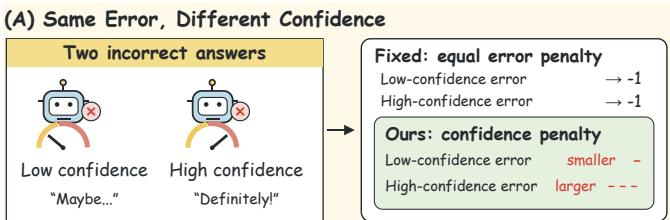

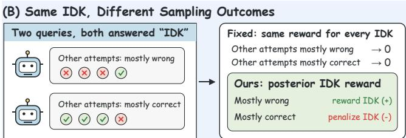  
Figure 1: Reward design motivation. IDK denotes abstention. (A) Unlike fixed penalties, our method penalizes higherconfidence errors more strongly. (B) Unlike fixed abstention rewards, our posterior-adaptive reward reflects the correctness of non-abstaining rollouts for the same query.

exposes users to incorrect information, whereas excessive abstention withholds answers that the model could otherwise provide correctly with the available evidence.

Recent studies have explored incorporating abstention into model training [38, 48]. R-Tuning constructs refusal-aware instruction data to teach models to answer questions within their estimated capabilities and acknowledge uncertainty otherwise [48]. TruthRL adopts a ternary reward that rewards correct answers, penalizes incorrect answers, and assigns a neutral reward to abstentions [38]. This design provides a learning signal for the trade-of between answering and abstaining. However, fixed ternary rewards assign raw reward values solely according to the final outcome category, without explicitly accounting for reliability diferences within that category. Our central observation is that the same outcome category can correspond to diferent reliability characteristics. As shown in Figure 1, two incorrect responses may have substantially diferent generation confidence. Although both require correction, a highconfidence error exhibits a larger discrepancy between confidence and correctness. Likewise, abstentions on diferent queries may be supported by diferent degrees of answering evidence. For one query, most of the other sampled non-abstaining responses may be incorrect, whereas for another, most may be correct. The former provides greater empirical support for abstention, while the latter suggests a potentially missed opportunity to answer correctly. These distinctions motivate training feedback that accounts not only for the observed outcome, but also for response confidence and answering evidence from the same query.

Our preliminary experiments support this motivation. First, empirical answer accuracy generally increases with generation confidence, indicating that confidence contains information about answer reliability. Nevertheless, incorrect responses span a broad confidence range, including a substantial proportion ofhigh-confidence errors. These observations motivate examining confidence along side correctness when designing training rewards. Second, among queries that elicit abstention, independent reference sampling reveals variation in correctness rates conditional on producing a non-abstaining response. The same abstention label therefore encompasses diferent empirical answering opportunities. Together, these observations motivate investigating whether confidence and answering evidence can provide useful training signals beyond outcome labels.

Motivated by these observations, we propose CalibraRL, a reinforcement learning framework combining confidence-aware answer rewards with posterior-adaptive abstention rewards. For nonabstaining responses, CalibraRL augments a signed correctness reward with a Brier-based penalty [5, 10]. It uses generation confidence derived from token probabilities to capture disagreement between confidence and correctness, imposing a larger additional penalty on high-confidence errors. For abstentions, CalibraRL con structs a Bayesian posterior over conditional answer accuracy from the correct and incorrect non-abstaining responses in the same roll out group. The posterior probability that this accuracy falls below a specified threshold determines the abstention reward, accounting for both observed outcomes and estimation uncertainty under finite sampling. Both components are incorporated into the raw rewards used to optimize the policy through Group Relative Policy Optimization (GRPO) [34]. The framework reuses training rollouts and reference answers for correctness verification, without requiring additional, precomputed labels of whether each query is known or unknown to the model.

Experiments on three QA datasets demonstrate that CalibraRL improves answer precision and reduces hallucinations compared with strong baselines. Further analysis shows that CalibraRL re duces mean expected calibration error (ECE) by 30.8% across two backbone models and three datasets, highlighting its potential to improve the reliability of retrieval-augmented generation (RAG) in web search.

Our main contributions are as follows:

• We identify reliability diferences within outcome categories through empirical analyses of confidence among incorrect responses and the accuracy of non-abstaining responses obtained through independent reference sampling for queries eliciting abstention.

• We propose CalibraRL, which combines a confidence-aware answer reward with a Bayesian posterior-adaptive abstention reward derived from same-query rollout evidence.

• Across three QA datasets and two backbones, we demonstrate improvements in answer precision and overall truthfulness over strong baselines, and analyze the contributions of both reward components through ablation studies.

## 2 Related Work

## 2.1 LLM Hallucinations

LLMs may generate fluent but factually incorrect or contextually unsupported responses [32]. Hallucinations can involve violations of factuality or faithfulness [14], while evaluations on TruthfulQA show that models may reproduce common human misconceptions [25]. SelfCheckGPT [26] detects inconsistencies across sampled responses, whereas semantic entropy [7] measures uncertainty over semantically distinct answers. However, consistency across responses does not guarantee factual correctness.

Existing mitigation methods improve factual reliability through retrieval augmentation [2, 17, 22, 37, 50, 54], response verification [6], contrastive decoding [3], and factuality-oriented training. Self-Alignment for Factuality [52] derives factuality-based preferences for Direct Preference Optimization (DPO) [31], while UAlign [46] incorporates confidence estimates and semantic entropy into reinforcement learning. Another line of research mitigates hallucinations by enabling models to abstain when they cannot answer reliably. R-Tuning [48] constructs refusal-aware training data based on knowledge gaps, while RLKF [23] derives reinforcement learning feedback through knowledge-state probing and consistency checking. TruthRL [38] employs Group Relative Policy Optimization (GRPO) [34], assigning positive rewards to correct answers, negative rewards to hallucinations, and zero rewards to abstentions. Together, these studies highlight the importance of improving factual reliability while enabling appropriate abstention.

## 2.2 Knowledge Boundary of LLMs

Knowledge-boundary research examines what models know [29] and whether they recognize their knowledge limits [20]. Prior work [20] distinguishes response correctness probability, �(True), from the probability of knowing an answer, �(IK), providing evidence of models’ self-assessment capabilities. However, models often express overconfidence, and reliable confidence estimation remains challenging on dificult tasks [43]. Models also learn previously unknown facts more slowly than knowledge-consistent examples during fine-tuning, potentially increasing hallucinations [9]. Self-evaluation research further suggests that models may fail to reliably express knowledge they possess [52], while knowledgestate probing examines their ability to recognize and use internal knowledge states [23, 27].

These observations distinguish knowledge availability from reliable expression: a single incorrect response does not necessarily indicate missing knowledge. A central challenge for abstention is therefore to translate answerability estimates into reliable answering or abstention decisions without unnecessarily withholding correct answers.

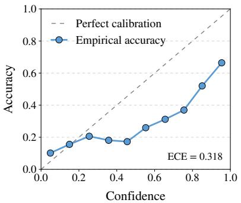  
(A) Confidence Calibration

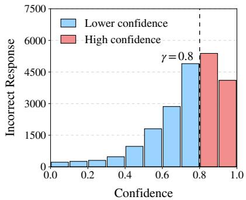  
(B) Confidence of Errors

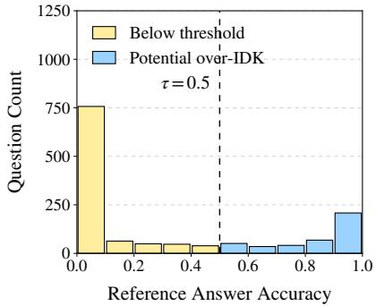  
(C) Answerability of IDK Questions  
Figure 2: Empirical motivation using LLaMA3-8B-Instruct on NQ. (A) Empirical accuracy generally increases with confidence. (B) Incorrect responses exhibit heterogeneous confidence. (C) Questions eliciting abstention difer in the accuracy of non-abstaining responses obtained through independent reference sampling. IDK denotes “I don’t know”, indicating abstention. Reference groups containing only abstentions are excluded from (C).

## 3 Preliminaries

## 3.1 Problem Formulation

We consider question answering with abstention, where a language model answers using provided documents or abstains. Let $\mathcal { D } =$ $\{ ( x _ { j } , \mathcal { A } _ { j } ) \} _ { j = 1 } ^ { N }$ , where $x _ { j } = ( q _ { j } , d _ { j } )$ contains a question and its associated documents, and ${ \mathcal { A } } _ { j }$ is the set of acceptable reference answers. Given �, an autoregressive policy $\pi _ { \theta }$ generates $o = \left( o _ { 1 } , \ldots , o _ { T } \right)$ and is prompted to output I don’t know (IDK) when uncertain.

Let $a ( o ) \in \{ 0 , 1 \}$ indicate abstention and $y ( o , \mathcal { A } ) \in \{ 0 , 1 \}$ denote the correctness of a non-abstaining response, assessed against A. Responses are categorized as correct answers, incorrect answers, or abstentions. Our objective is to encourage correct answers and appropriate abstention while discouraging incorrect answers and unnecessary abstention.

Following prior work [28, 36], we use the mean probability of generated tokens as a proxy for response confidence. For a nonabstaining response:

$$
c _ { \theta } ( x , o ) = \frac { 1 } { T } \sum _ { t = 1 } ^ { T } \pi _ { \theta } ( o _ { t } \mid x , o _ { < t } ) ,\tag{1}
$$

where � is the response length and $o _ { < t }$ denotes preceding tokens. This measure requires no additional prompting or multiple response samples.

## 3.2 Motivation

We motivate our reward design through two questions: ➊ Does model confidence align with answer correctness? ➋ Does the model abstain on questions it can answer correctly?

Figure 2(A) shows that accuracy tends to increases with confidence but generally lies below the ideal calibration line, with an ECE of 0.318. Thus, confidence is informative about correctness but exhibits substantial overconfidence. Figure 2(B) shows that incorrect responses span diferent confidence levels, including many above 0.8. A correctness-only reward treats these errors equally, failing to distinguish low-confidence errors from confidently incorrect responses. These observations motivate incorporating confidence– correctness alignment into the answer reward.

We next examine reference answering performance for questions that elicit IDK responses. For each question, reference accuracy is the proportion of correct responses among its non-IDK reference responses. All-IDK reference groups are excluded because this conditional accuracy is undefined. Figure 2(C) shows substantial variation: many questions have low reference accuracy, but some exceed 0.5 and others approach 1. Thus, an IDK response does not necessarily indicate consistently unsuccessful reference answering. High reference accuracy suggests potentially unnecessary abstention, motivating an abstention reward informed by query-level answering evidence.

These findings motivate two reward-design principles: ➊ penalizing discrepancies between response confidence and correctness; ➋ adapting abstention rewards to query-level answering performance.

## 4 Methodology

As shown in Figure 3, we sample a group of responses per query, identify abstentions, and evaluate the correctness of answered responses. For answered responses, we combine correctness utility with a confidence-based Brier penalty. For abstentions, we derive rewards from a Bayesian reliability estimate based on the group’s correct and incorrect answers. Finally, the resulting rewards are normalized within each group and used for GRPO optimization.

## 4.1 Confidence-Aware Answer Reward

For each input $x ,$ we sample a response group $\mathcal { G } _ { x } = \{ o _ { i } \} _ { i = 1 } ^ { G }$ . For a non-abstaining response $o _ { i }$ , let $y _ { i } = y ( o _ { i } , { \mathcal { A } } )$ denote its correctness and $c _ { i }$ denote its confidence computed according to (1). A correctness-only reward does not distinguish between responses with the same correctness label but diferent confidence levels. We therefore define the answer reward as:

$$
r _ { \mathrm { a n s } } ( o _ { i } , x ) = 2 y _ { i } - 1 - \lambda _ { c } ( c _ { i } - y _ { i } ) ^ { 2 } ,\tag{2}
$$

where $\lambda _ { c } \geq 0$ controls the strength of the confidence penalty.

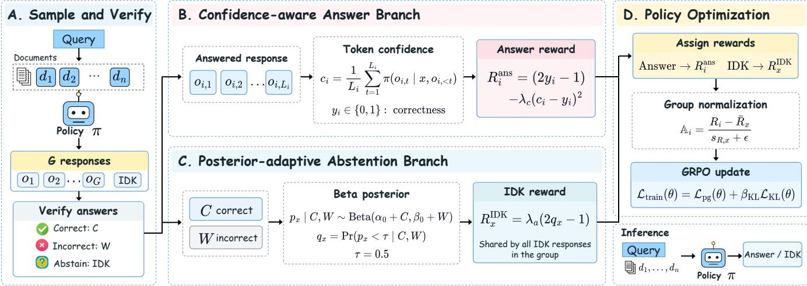  
Figure 3: Overview of our proposed framework. IDK denotes “I don’t know”, indicating abstention.

The correctness utility $2 y _ { i } - 1$ assigns +1 to correct answers and −1 to incorrect answers. The squared-error term is based on the Brier score [10] and penalizes discrepancies between response confidence and correctness. Equivalently,

$$
r _ { \mathrm { a n s } } ( o _ { i } , x ) = \left\{ \begin{array} { l l } { 1 - \lambda _ { c } ( 1 - c _ { i } ) ^ { 2 } , } & { y _ { i } = 1 } \\ { - 1 - \lambda _ { c } c _ { i } ^ { 2 } , } & { y _ { i } = 0 } \end{array} \right. .\tag{3}
$$

When $\lambda _ { c } ~ > ~ 0 ,$ higher confidence increases rewards for correct answers and strengthens penalties for incorrect answers. Rewards for incorrect answers never exceed −1, so lowering confidence cannot make these rewards positive. The penalty thus provides finer reward distinctions among responses that would otherwise receive the same correctness-based reward.

We use raw confidence scores without post-hoc calibration and treat them as fixed when computing policy gradients. These scores influence policy updates through the rewards and the resulting group-relative advantages.

## 4.2 Posterior-Adaptive Abstention Reward

To adapt abstention rewards to query-level answering performance, we estimate answering reliability from the non-abstaining responses in each sampled group. Let ${ \mathcal { I } } _ { x } = \{ i : a ( o _ { i } ) = 0 \}$ denote the index set of non-abstaining responses. The numbers of correct and incorrect answers are:

$$
C _ { x } = \sum _ { i \in \mathcal { I } _ { x } } y _ { i } , \qquad W _ { x } = \sum _ { i \in \mathcal { I } _ { x } } \left( 1 - y _ { i } \right) .\tag{4}
$$

Abstentions are excluded because they provide no answer whose correctness can be evaluated.

Let ${ \mathcal P } _ { x }$ denote the probability of a correct answer conditional on answering under the policy and sampling configuration used to generate the group:

$$
p _ { x } = \operatorname* { P r } ( y = 1 \mid x , a ( o ) = 0 ) .\tag{5}
$$

We model the correctness labels of non-abstaining responses as conditionally independent Bernoulli observations with success probability ${ \mathcal P } _ { x }$ . With a prior $p _ { x } \sim \mathrm { B e t a } ( \alpha _ { 0 } , \beta _ { 0 } )$ , where $\alpha _ { 0 } , \beta _ { 0 } > 0 ;$ , the

posterior is:

$$
p _ { x } \mid G _ { x } \sim \mathrm { B e t a } ( \alpha _ { 0 } + C _ { x } , \beta _ { 0 } + W _ { x } ) .\tag{6}
$$

For a reliability threshold $\tau \in ( 0 , 1 )$ , we compute the posterior probability that conditional answer accuracy falls below the threshold:

$$
q _ { x } = \mathrm { P r } ( p _ { x } < \tau \mid \mathcal { G } _ { x } ) = I _ { \tau } ( \alpha _ { 0 } + C _ { x } , \beta _ { 0 } + W _ { x } ) ,\tag{7}
$$

where $I _ { \tau }$ is the regularized incomplete beta function. The posterior incorporates both the observed correctness outcomes and the number of non-abstaining responses available in the group.

We map this probability to an abstention reward:

$$
r _ { \mathrm { a b s } } ( x , \mathcal { G } _ { x } ) = \lambda _ { a } ( 2 q _ { x } - 1 ) ,\tag{8}
$$

where $\lambda _ { a } \in [ 0 , 1 ]$ controls the reward magnitude. The reward lies in $[ - \lambda _ { a } , \lambda _ { a } ]$ . For $\lambda _ { a } > 0 ,$ it is positive when $q _ { x } > 1 / 2$ and increases with the posterior probability that answering reliability falls below $\tau .$ Thus, stronger evidence of unreliable answering leads to a higher abstention reward, whereas stronger evidence of reliable answering leads to a lower reward. All abstentions within the same group share this reward.

For each sampled group, we compute the posterior from the same fixed prior and the correctness labels obtained by comparing non-abstaining responses with the ground-truth answers. If a group contains only abstentions, $C _ { x } = W _ { x } = 0$ , and the posterior remains equal to the prior. Under the default uniform prior $\alpha _ { 0 } = \beta _ { 0 } = 1$ and threshold $\tau = 0 . 5$ , such a group receives zero abstention reward. Its identical rewards yield zero group-relative advantages and hence no reward-driven learning signal.

## 4.3 Confidence-Calibrated Policy Optimization

We adopt GRPO [34] as our optimization backbone, which computes advantages from relative rewards within a response group without requiring a separate value model. For each input �, a behavior policy $\pi _ { \theta _ { \mathrm { o l d } } }$ samples a group $\mathcal { G } _ { x } = \{ o _ { i } \} _ { i = } ^ { G }$ . We combine the confidenceaware answer reward and the posterior-adaptive abstention reward to assign a scalar reward to each response:

$$
r _ { i } = \left\{ \begin{array} { l l } { r _ { \mathrm { a b s } } ( x , { \mathcal G } _ { x } ) , \ } & { a ( o _ { i } ) = 1 , } \\ { r _ { \mathrm { a n s } } ( o _ { i } , x ) , \ } & { a ( o _ { i } ) = 0 . } \end{array} \right.\tag{9}
$$

We set $\lambda _ { c } = \lambda _ { a } = 0 . 5$ by default. With these weights, correct answers receive rewards no lower than abstentions, while abstentions receive higher rewards than incorrect answers. The reward gaps vary with response confidence and group-level answering reliability.

Given the rewards $\{ r _ { i } \} _ { i = 1 } ^ { G }$ , the group-relative advantage is:

$$
\mathbb { A } _ { i } = \frac { r _ { i } - \bar { r } } { s _ { r } + \varepsilon _ { \mathrm { s t d } } } , \qquad \bar { r } = \frac { 1 } { G } \sum _ { i = 1 } ^ { G } r _ { i } ,\tag{10}
$$

where $s _ { r }$ is the within-group reward standard deviation and $\varepsilon _ { \mathrm { s t d } } > 0$ ensures numerical stability. Each response-level advantage is shared across all tokens of that response.

For the �-th token of response $o _ { i } ,$ the importance ratio between the current and behavior policies is:

$$
\rho _ { i , t } ( \theta ) = \frac { \pi _ { \theta } ( o _ { i , t } \mid x , o _ { i , < t } ) } { \pi _ { \theta _ { \mathrm { o l d } } } ( o _ { i , t } \mid x , o _ { i , < t } ) } .\tag{11}
$$

The clipped surrogate contribution is:

$$
\begin{array} { r } { \ell _ { i , t } ( \theta ) = \operatorname* { m i n } \Big \{ \rho _ { i , t } ( \theta ) \mathbb { A } _ { i } , \qquad } \\ { \qquad \mathrm { c l i p } \big ( \rho _ { i , t } ( \theta ) , 1 - \epsilon , 1 + \epsilon \big ) \mathbb { A } _ { i } \Big \} , } \end{array}\tag{12}
$$

where $\epsilon > 0$ controls the clipping range. We compute the policy loss by averaging over tokens within each response and then over responses within each group:

$$
\mathcal { L } _ { \mathrm { p g } } ( \boldsymbol { \theta } ) = - \mathbb { E } _ { \boldsymbol { x } , \mathcal { G } _ { \boldsymbol { x } } } \left[ \frac { 1 } { G } \sum _ { i = 1 } ^ { G } \frac { 1 } { T _ { i } } \sum _ { t = 1 } ^ { T _ { i } } \ell _ { i , t } ( \boldsymbol { \theta } ) \right] ,\tag{13}
$$

where $T _ { i }$ is the response length, and the expectation is over training inputs and response groups sampled from the behavior policy.

We regularize deviations from a fixed reference policy $\pi _ { \mathrm { r e f } }$ using:

$$
\begin{array} { r } { \mathcal { L } _ { \mathrm { K L } } ( \theta ) = \mathbb { D } _ { \mathrm { K L } } ( \pi _ { \theta } \Vert \pi _ { \mathrm { r e f } } ) , } \end{array}\tag{14}
$$

where $\mathbb { D } _ { \mathrm { K L } }$ denotes the KL regularization term between the current and reference policies. The total training loss is:

$$
\mathcal { L } _ { \mathrm { t r a i n } } ( \theta ) = \mathcal { L } _ { \mathrm { p g } } ( \theta ) + \beta _ { \mathrm { K L } } \mathcal { L } _ { \mathrm { K L } } ( \theta ) ,\tag{15}
$$

where $\beta _ { \mathrm { K L } } \ge 0$ controls the regularization strength. The confidence penalty and the adaptive abstention reward influence policy op timization through the group-relative advantages. Rewards and advantages are treated as fixed during policy updates, with no gradients propagated through the confidence scores or posterior estimates used to compute the rewards.

## 4.4 Inference

At inference time, the trained policy takes a question and its associated documents as input and directly generates a concise answer or an abstention. The prompt in Appendix B.4 instructs the model to answer using the provided documents only when it is confident that its answer is correct. Otherwise, it should output “Idon’t know”. The model makes this decision during generation, without applying an explicit confidence threshold. Inference does not require ground-truth answers, group-level reliability estimation, or reward computation.

## 5 Experiments

## 5.1 Experimental Setup

5.1.1 Datasets. We evaluate our method on three widely used QA benchmarks covering diferent reasoning settings. For open-domain QA, we adopt Natural Questions (NQ) [21] and TriviaQA [19], two representative benchmarks for evaluating factual question answering. To further assess the model’s ability to integrate evidence across multiple documents, we conduct experiments on HotpotQA [47], a representative multi-hop QA benchmark. Together, these datasets enable us to evaluate our method across factual question answering and more challenging multi-hop reasoning scenarios. Detailed dataset statistics are reported in Appendix B.1.

5.1.2 Evaluation Metrics. We evaluate reliability and confidence calibration using four metrics: Precision (Prec.) [35, 46], which measures accuracy among non-abstained responses; Truthfulness (Truth.) [45, 52], which measures the proportion of correct answers or abstentions; Efective Reliability (ER) [8, 39], which balances correct answering against incorrect answering; and Expected Calibration Error (ECE) [12], which measures confidence calibration on non-abstained responses. Higher values indicate better performance for Prec., Truth., and ER, whereas lower ECE is better. Detailed definitions and computation procedures are provided in Appendix B.2.

5.1.3 Baselines. We compare our method with the following baselines on the same test set. Training-free methods include In-Context Learning (ICL), which uses answer-and-abstention demonstrations, and Prompting, which instructs the model to answer when confident and abstain otherwise. SFT-based methods include standard Supervised Fine-tuning (SFT), which trains the model to answer every question, and R-Tuning [48], which teaches the model to abstain beyond its knowledge. RL-based methods include DTA [35], which models knowledge boundaries using a four-quadrant partition and employs DPO [31]; Binary, which uses GRPO [34] with rewards of1 for correct answers and 0 otherwise; and TruthRL [38], which uses GRPO with rewards of 1, 0, and -1 for correct answers, abstentions, and incorrect answers, respectively.

5.1.4 Implementation. We use LLaMA3-8B-Instruct [11] and Qwen2.5- 7B-Instruct [30] as the backbone models following prior work [1, 40, 41, 53]. To ensure fair and consistent comparisons [4, 33], we follow prior work [44, 49, 51] and provide all baselines and our method with the same Top-5 Wikipedia passages retrieved by Contriever-MS MARCO [15]. Specifically, the retrieved passages are kept fixed across diferent methods for each query, ensuring that all methods have access to identical external evidence. All training experiments are conducted on four NVIDIA RTX PRO 6000 GPUs. Furthermore, we use the same data splits, retrieved contexts, generation settings, and evaluation protocols across all experiments to ensure consistent and reproducible evaluations. Additional implementation details are provided in Appendix B.3.

## 5.2 Main Results

We compare our method with all baselines on three QA benchmarks using two backbone models. Table 1 summarizes the main results.

Table 1: Main results (%) on NQ, TriviaQA, and HotpotQA using LLaMA3-8B-Instruct and Qwen2.5-7B-Instruct as base models. Results are reported in terms of Prec., Truth., and ER, with higher values indicating better performance for all metrics. Avg. denotes the unweighted mean across the three benchmarks. The best results are in bold and the second are underlined.
<table><tr><td rowspan="2">Method</td><td colspan="3">NQ</td><td colspan="3">TriviaQA</td><td colspan="3">HotpotQA</td><td colspan="3"> $\mathbf { A v g . }$ </td></tr><tr><td>Prec. ↑</td><td>Truth. ↑</td><td>ER↑</td><td>Prec. ↑</td><td>Truth. ↑</td><td>ER↑</td><td>Prec. ↑</td><td>Truth. ↑</td><td>ER↑</td><td>Prec. ↑</td><td>Truth. ↑</td><td>ER↑</td></tr><tr><td colspan="10">Base Model: LLaMA3-8B-Instruct</td><td></td></tr><tr><td>Prompting</td><td>42.88</td><td>63.43</td><td>-9.11</td><td>68.26</td><td>76.22</td><td>27.36</td><td>38.76</td><td>68.38</td><td>-11.61</td><td>49.97</td><td>69.34</td><td>2.21</td></tr><tr><td>ICL</td><td>13.17</td><td>36.45</td><td>-53.91</td><td>34.10</td><td>58.61</td><td>-19.97</td><td>6.11</td><td>33.61</td><td>-62.07</td><td>17.79</td><td>42.89</td><td>-45.32</td></tr><tr><td>SFT</td><td>43.71</td><td>43.88</td><td>-12.55</td><td>63.98</td><td>63.98</td><td>27.96</td><td>34.23</td><td>34.43</td><td>-31.45</td><td>47.31</td><td>47.43</td><td>-5.35</td></tr><tr><td>R-Tuning</td><td>61.36</td><td>85.96</td><td>8.25</td><td>75.87</td><td>84.12</td><td>34.05</td><td>51.45</td><td>81.77</td><td>1.09</td><td>62.89</td><td>83.95</td><td>14.46</td></tr><tr><td>DTA</td><td>49.88</td><td>66.59</td><td>-0.17</td><td>74.97</td><td>80.80</td><td>38.30</td><td>35.57</td><td>58.07</td><td>-18.79</td><td>53.47</td><td>68.49</td><td>6.45</td></tr><tr><td>Binary</td><td>49.50</td><td>49.53</td><td>-1.00</td><td>73.54</td><td>73.54</td><td>47.06</td><td>38.46</td><td>38.57</td><td>-23.04</td><td>53.83</td><td>53.88</td><td>7.67</td></tr><tr><td>TruthRL</td><td>63.48</td><td>80.61</td><td>14.32</td><td>78.35</td><td>81.12</td><td>49.44</td><td>51.95</td><td>77.30</td><td>1.84</td><td>64.59</td><td>79.68</td><td>21.87</td></tr><tr><td>CalibraRL (Ours)</td><td>68.65</td><td>87.89</td><td>14.40</td><td>80.27</td><td>85.03</td><td>45.94</td><td>57.10</td><td>84.46</td><td>5.14</td><td>68.67</td><td>85.79</td><td>21.83</td></tr><tr><td colspan="10">Base Model: Qwen2.5-7B-Instruct</td><td></td><td></td><td></td></tr><tr><td>Prompting</td><td>42.96</td><td>54.24</td><td>-11.30</td><td>69.36</td><td>74.47</td><td>32.27</td><td>42.81</td><td>65.48</td><td>-8.68</td><td>51.71</td><td>64.73</td><td>4.10</td></tr><tr><td>ICL</td><td>41.32</td><td>51.66</td><td>-14.29</td><td>67.52</td><td>71.88</td><td>30.35</td><td>37.02</td><td>53.95</td><td>-18.98</td><td>48.62</td><td>59.16</td><td>-0.97</td></tr><tr><td>SFT</td><td>40.18</td><td>40.94</td><td>-19.39</td><td>63.36</td><td>63.39</td><td>26.69</td><td>33.65</td><td>34.27</td><td>-32.39</td><td>45.73</td><td>46.20</td><td>-8.36</td></tr><tr><td>R-Tuning</td><td>54.72</td><td>77.15</td><td>4.76</td><td>74.23</td><td>80.54</td><td>36.60</td><td>48.81</td><td>74.16</td><td>-1.20</td><td>59.25</td><td>77.28</td><td>13.39</td></tr><tr><td>DTA</td><td>45.12</td><td>54.82</td><td>-8.03</td><td>71.32</td><td>75.67</td><td>36.17</td><td>41.89</td><td>62.59</td><td>-10.45</td><td>52.78</td><td>64.36</td><td>5.90</td></tr><tr><td>Binary</td><td>48.06</td><td>48.09</td><td>-3.88</td><td>74.79</td><td>74.79</td><td>49.58</td><td>42.96</td><td>42.96</td><td>-14.07</td><td>55.27</td><td>55.28</td><td>10.54</td></tr><tr><td>TruthRL</td><td>54.69</td><td>74.04</td><td>5.37</td><td>75.60</td><td>80.75</td><td>40.40</td><td>50.51</td><td>76.61</td><td>0.48</td><td>60.27</td><td>77.13</td><td>15.42</td></tr><tr><td>CalibraRL (Ours)</td><td>56.49</td><td>76.43</td><td>7.04</td><td>80.41</td><td>84.61</td><td>47.77</td><td>58.67</td><td>81.48</td><td>7.77</td><td>65.19</td><td>80.84</td><td>20.86</td></tr></table>

Table 2: Ablation results (%) on three QA benchmarks. w/o Answer Confidence removes the confidence reward term; w/o Adaptive Abstention replaces the adaptive abstention reward with a fixed reward of zero. Avg. denotes the unweighted mean across the three benchmarks. Best results are shown in bold.
<table><tr><td rowspan="3">Variant</td><td colspan="3">NQ</td><td colspan="3">TriviaQA</td><td colspan="3">HotpotQA</td><td colspan="3">Avg.</td></tr><tr><td>Prec. ↑</td><td>Truth. ↑</td><td>ER↑</td><td>Prec. ↑</td><td>Truth. ↑</td><td>ER↑</td><td>Prec. ↑</td><td>Truth. ↑</td><td>ER↑</td><td>Prec. ↑</td><td>Truth. ↑</td><td>ER↑</td></tr><tr><td colspan="10">Base Model: LLaMA3-8B-Instruct</td><td></td></tr><tr><td>CalibraRL (Ours)</td><td>68.65</td><td>87.89</td><td>14.40</td><td>80.27</td><td>85.03</td><td>45.94</td><td>57.10</td><td>84.46</td><td>5.14</td><td>68.67</td><td>85.79</td><td>21.83</td></tr><tr><td>w/o Answer Confidence</td><td>66.97</td><td>86.50</td><td>13.87</td><td>78.97</td><td>83.30</td><td>46.01</td><td>56.05</td><td>83.48</td><td>4.55</td><td>67.33</td><td>84.43</td><td>21.48</td></tr><tr><td>w/o Adaptive Abstention</td><td>65.81</td><td>84.65</td><td>14.20</td><td>79.17</td><td>83.58</td><td>45.99</td><td>56.26</td><td>83.52</td><td>4.71</td><td>67.08</td><td>83.92</td><td>21.63</td></tr><tr><td colspan="10">Base Model: Qwen2.5-7B-Instruct</td><td colspan="3"></td></tr><tr><td>CalibraRL (Ours)</td><td>56.49</td><td>76.43</td><td>7.04</td><td>80.41</td><td>84.61</td><td>47.77</td><td>58.67</td><td>81.48</td><td>7.77</td><td>65.19</td><td>80.84</td><td>20.86</td></tr><tr><td>w/o Answer Confidence</td><td>56.19</td><td>75.32</td><td>6.98</td><td>79.17</td><td>83.74</td><td>45.54</td><td>58.21</td><td>79.76</td><td>7.95</td><td>64.52</td><td>79.61</td><td>20.16</td></tr><tr><td>w/o Adaptive Abstention</td><td>55.48</td><td>74.97</td><td>6.16</td><td>79.86</td><td>84.12</td><td>47.09</td><td>58.18</td><td>80.46</td><td>7.64</td><td>64.51</td><td>79.85</td><td>20.30</td></tr></table>

(i) Overall performance. Our method achieves the highest precision in all six model–dataset settings and the highest truthfulness in five of them. These results indicate higher accuracy among answered questions and a lower proportion of incorrect outputs.

(ii) Efectiveness on multi-hop QA. Our method outperforms all baselines on all three metrics on HotpotQA with both backbone models. The improvements in precision and ER indicate that our method achieves higher accuracy on answered questions while also improving the balance between correct and incorrect answers across the full evaluation set.

(iii) Consistency across backbone models. Our method achieves higher precision and truthfulness than TruthRL on all three benchmarks with both backbone models, demonstrating consistent gains across the two evaluated backbones.

## 5.3 Further Analysis

5.3.1 Ablation Study. As shown in Table 2, we evaluate the contributions of the two reward components on NQ, TriviaQA, and HotpotQA using both backbone models, keeping training data, initialization, sampling settings, and optimization hyperparameters unchanged. The w/o Answer Confidence variant sets $\lambda _ { c } = 0 ,$ removing the Brier-shaped penalty and reducing the answer reward to $2 y _ { i } - 1$ while retaining adaptive abstention. The w/o Adaptive Abstention variant sets $\lambda _ { a } = 0 ;$ , replacing the posterior-adaptive abstention reward with zero while retaining answer-confidence shaping. Abstaining responses remain in the sampled groups and GRPO advantage computation. Removing either component reduces average precision, truthfulness, and ER on both backbones. The full method also achieves the highest precision and truthfulness in all six model–dataset settings, although some ablated variants yield slightly higher ER on individual datasets. These results indicate that both reward components contribute to the overall performance of CalibraRL.

Table 3: Efect of SFT initialization. CalibraRL applies reinforcement learning directly to the Instruct backbone, whereas SFT + CalibraRL first performs SFT following R-Tuning and then applies CalibraRL. All scores are reported as percentages, with higher values indicating better performance. Avg. denotes the unweighted mean across the three benchmarks. Best results are shown in bold.
<table><tr><td rowspan="2">Strategy</td><td colspan="3">NQ</td><td colspan="3">TriviaQA</td><td colspan="3">HotpotQA</td><td colspan="3">Avg.</td></tr><tr><td>Prec. ↑</td><td>Truth. ↑</td><td>ER↑</td><td>Prec. ↑</td><td>Truth. ↑</td><td>ER↑</td><td>Prec. ↑</td><td>Truth. ↑</td><td>ER↑</td><td>Prec. ↑</td><td>Truth. ↑</td><td>ER↑</td></tr><tr><td></td><td colspan="10">Base Model: LLaMA3-8B-Instruct</td></tr><tr><td>SFT + CalibraRL</td><td>58.92</td><td>74.68</td><td>11.00</td><td>74.15</td><td>77.20</td><td>42.59</td><td>47.22</td><td>72.41</td><td>-2.91</td><td>60.10</td><td>74.76</td><td>16.89</td></tr><tr><td>CalibraRL</td><td>68.65</td><td>87.89</td><td>14.40</td><td>80.27</td><td>85.03</td><td>45.94</td><td>57.10</td><td>84.46</td><td>5.14</td><td>68.67</td><td>85.79</td><td>21.83</td></tr><tr><td></td><td colspan="10">Base Model: Qwen2.5-7B-Instruct</td></tr><tr><td>SFT + CalibraRL</td><td>50.41</td><td>67.87</td><td>0.53</td><td></td><td>81.43</td><td>46.27</td><td>56.39</td><td>77.45</td><td>6.61</td><td>61.51</td><td>75.58</td><td>17.80</td></tr><tr><td></td><td></td><td></td><td></td><td>77.74</td><td></td><td>47.77</td><td>58.67</td><td>81.48</td><td>7.77</td><td>65.19</td><td>80.84</td><td></td></tr><tr><td>CalibraRL</td><td>56.49</td><td>76.43</td><td>7.04</td><td>80.41</td><td>84.61</td><td></td><td></td><td></td><td></td><td></td><td></td><td>20.86</td></tr></table>

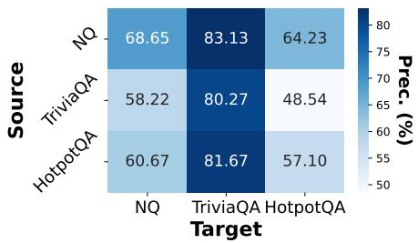  
(a) Precision

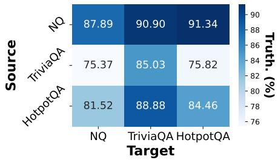  
(b) Truthfulness

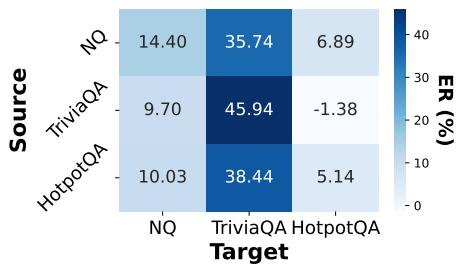  
(c) Efective Reliability  
Figure 4: Cross-dataset generalization results of CalibraRL using LLaMA3-8B-Instruct. Rows indicate source datasets used for training, and columns indicate target datasets used for evaluation. All scores are reported as percentages, with higher values indicating better performance.

5.3.2 Efect ofSFT Initialization. We investigate whether SFT ini tialization using the R-Tuning procedure benefits CalibraRL. We compare applying CalibraRL directly to the Instruct backbone with first performing SFT following R-Tuning and then applying CalibraRL, denoted as SFT + CalibraRL. As shown in Table 3, directly applying CalibraRL improves average precision, truthfulness, and ER across the three benchmarks by 8.58, 11.03, and 4.93 percentage points, respectively, on LLaMA3-8B-Instruct. The corresponding gains on Qwen2.5-7B-Instruct are 3.68, 5.26, and 3.06 percentage points. These results favor applying CalibraRL directly to the Instruct backbones over using R-Tuning-based SFT initialization under our experimental setup.

5.3.3 Confidence Calibration Analysis. Table 4 reports ECE before and after CalibraRL training on three QA benchmarks. CalibraRL reduces ECE on all three benchmarks with both backbones. The average ECE decreases by 24.9% for LLaMA3-8B-Instruct and 35.1% for Qwen2.5-7B-Instruct, with an overall reduction of 30.8% across both backbones and all three benchmarks. These results indicate improved confidence calibration on answered examples across the evaluated backbones and QA benchmarks.

Table 4: ECE performance before and after CalibraRL training on three datasets. Lower values indicate better calibration.
<table><tr><td>Stage</td><td>NQ</td><td>TriviaQA</td><td>HotpotQA</td></tr><tr><td colspan="4">Base Model: LLaMA3-8B-Instruct</td></tr><tr><td>Original Model</td><td>0.318</td><td>0.147</td><td>0.433</td></tr><tr><td>Ours</td><td>0.193</td><td>0.133</td><td>0.348</td></tr><tr><td colspan="4">Base Model: Qwen2.5-7B-Instruct</td></tr><tr><td>Original Model</td><td>0.444</td><td>0.239</td><td>0.513</td></tr><tr><td>Ours</td><td>0.266</td><td>0.172</td><td>0.338</td></tr></table>

5.3.4 Cross-Dataset Generalization. We evaluate the generalization of CalibraRL across QA datasets using LLaMA3-8B-Instruct. Specifically, we train a separate model on the training split of each source dataset and evaluate it on the held-out evaluation splits of all three datasets without further training or parameter updates. This setting examines how the learned answering and abstention behavior transfers across data distributions. As shown in Figure 4, diagonal entries report in-domain performance, whereas of-diagonal entries report cross-dataset performance. Models trained on NQ and HotpotQA achieve positive ER on both out-of-domain datasets. However, transfer performance varies across source–target pairs: the model trained on TriviaQA achieves an ER of 9.70 on NQ and −1.38 on HotpotQA. These results suggest that CalibraRL retains useful answering behavior in several cross-dataset settings, although its transfer performance depends on the source and target distributions.

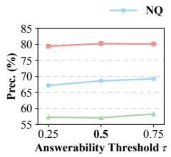

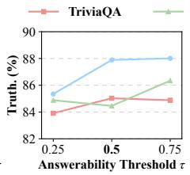

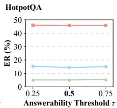

Figure 5: Sensitivity of CalibraRL to the reliability threshold � using LLaMA3-8B-Instruct. The bold tick label indicates the threshold used in the main experiments. All other hyperparameters are held fixed.  
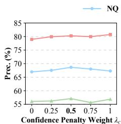

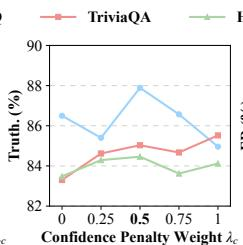

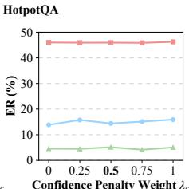  
Figure 6: Efect of the confidence penalty weight �� using LLaMA3-8B-Instruct. Setting $\lambda _ { c } = 0$ removes the confidence penalty while retaining the posterior-adaptive abstention reward. The bold tick label indicates the weight used in the main experiments. All other hyperparameters are held fixed.

5.3.5 Efect ofthe Reliability Threshold. The reliability threshold � in $\operatorname { E q . } ( 7 )$ defines the cutofused to compute the posterior probability that conditional answer accuracy falls below �. This probability is then used to compute the abstention reward in Eq. (8). We vary � over {0.25, 0.5, 0.75} and evaluate its efect on NQ, TriviaQA and HotpotQA using LLaMA3-8B-Instruct. As shown in Figure 5, precision and truthfulness on NQ increase as � increases, while performance on TriviaQA changes only slightly. On HotpotQA, truthfulness decreases at $\tau = 0 . 5$ and then increases at $\tau = 0 . 7 5 ,$ while precision varies more modestly. ER remains relatively stable across the tested thresholds on all three benchmarks. These results indicate that the efect of � varies across datasets and metrics, with no single tested threshold achieving the best performance in every setting.

5.3.6 Efect of the Confidence Penalty Weight. The confidence penalty weight $\lambda _ { c }$ controls the contribution of the squared-error penalty in the answer reward, $r _ { \mathrm { a n s } } ( o _ { i } , x ) = 2 y _ { i } - 1 - \lambda _ { c } ( c _ { i } - y _ { i } ) ^ { 2 }$ where $y _ { i } \in \{ 0 , 1 \}$ indicates answer correctness and $c _ { i }$ denotes response confidence. We vary $\lambda _ { c }$ over $\{ 0 , 0 . 2 5 , 0 . 5 , 0 . 7 5 , 1 \}$ on NQ, TriviaQA, and HotpotQA using LLaMA3-8B-Instruct, with all other hyperparameters held fixed. Setting $\lambda _ { c } = 0$ recovers the w/o Answer Confidence ablation by removing the confidence penalty while retaining the posterior-adaptive abstention reward. As shown in Figure $6 , \lambda _ { c } = 0 . 5$ yields the highest precision and truthfulness on NQ, although some other tested values yield higher ER. On TriviaQA, precision and truthfulness peak at $\lambda _ { c } = 1$ , while ER changes only slightly across the tested weights. Performance on HotpotQA also varies modestly. Overall, the efect of the confidence penalty depends on the dataset and metric, with no single tested weight performing best across all settings.

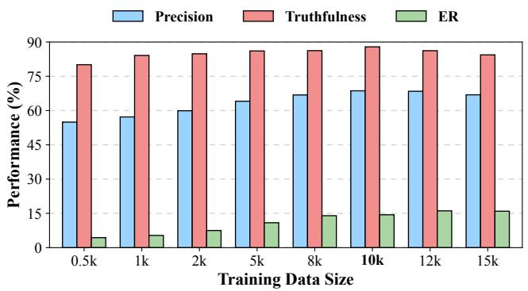  
Figure 7: Efect of training data size using LLaMA3-8B-Instruct on NQ. The bold tick label indicates the training size of 10k examples used in the main experiments.

5.3.7 Efect of Training Data Size. We investigate the efect of training data size using LLaMA3-8B-Instruct on NQ by varying the number of training examples from 0.5k to 15k. As shown in Figure 7, Precision, Truthfulness, and ER generally improve as the training set grows to 10k examples. At this size, CalibraRL achieves a precision of 68.65%, a truthfulness of 87.89%, and an ER of 14.40%. Increasing the training set beyond 10,000 examples further improves ER but reduces precision and truthfulness. These results indicate that larger training sets do not consistently improve all metrics. In our main experiments, we use 10k training examples, which provide strong overall performance without requiring a larger training set.

## 6 Conclusion

We identify a limitation of using fixed rewards for incorrect answers and abstentions: incorrect responses vary in confidence, while queries on which the model abstains difer in estimated answerability. We propose CalibraRL, which combines a Brier-based confidence penalty with a posterior-adaptive abstention reward derived from group-level correctness evidence. By reusing training rollouts, CalibraRL requires no additional annotations indicating whether the model knows the answer to each question. Experiments on three QA benchmarks with two instruction-tuned backbones demonstrate consistent improvements in precision and truthfulness over TruthRL. Further analysis shows improved confidence calibration on answered examples across both backbone models. These findings highlight the value of incorporating confidence and estimated answering reliability into reinforcement learning rewards for more reliable answering and abstention. Future work will explore robustness to noisy correctness feedback and extend CalibraRL to long-form generation.

## Acknowledgements

This work was funded by the National Natural Science Foundation of China (NSFC) under Grants No. 62406013 and No. U25B2070, the Beijing Advanced Innovation Center Funds for Future Blockchain and Privacy Computing, and the Fundamental Research Funds for the Central Universities.

## References

[1] Zouying Cao, Yifei Yang, Xiaojing Li, and Hai Zhao. 2025. AutoHall: Automated factuality hallucination dataset generation for large language models. IEEE Transactions on Audio, Speech and Language Processing 34 (2025), 184–195.

[2] Yiqun Chen, Lingyong Yan, Weiwei Sun, Xinyu Ma, Yi Zhang, Shuaiqiang Wang, Dawei Yin, Yiming Yang, and Jiaxin Mao. 2026. Improving retrieval-augmented generation through multi-agent reinforcement learning. Advances in Neural Information Processing Systems 38 (2026), 121336–121367.

[3] Yung-Sung Chuang, Yujia Xie, Hongyin Luo, Yoon Kim, James R Glass, and Pengcheng He. 2024. Dola: Decoding by contrasting layers improves factuality in large language models. In International Conference on Learning Representations, Vol. 2024. 54158–54183.

[4] Florin Cuconasu, Giovanni Trappolini, Federico Siciliano, Simone Filice, Cesare Campagnano, Yoelle Maarek, Nicola Tonellotto, and Fabrizio Silvestri. 2024. The power of noise: Redefining retrieval for rag systems. In Proceedings of the 47th International ACM SIGIR Conference on Research and Development in Information Retrieval. 719–729.

[5] Mehul Damani, Isha Puri, Stewart Slocum, Idan Shenfeld, Leshem Choshen, Yoon Kim, and Jacob Andreas. 2026. Beyond binary rewards: Training lms to reason about their uncertainty. In International conference on learning representations, Vol. 2026. 59456–59493.

[6] Shehzaad Dhuliawala, Mojtaba Komeili, Jing Xu, Roberta Raileanu, Xian Li, Asli Celikyilmaz, and Jason Weston. 2024. Chain-of-verification reduces hallucination in large language models. In Findings of the association for computational linguistics: ACL 2024. 3563–3578.

[7] Sebastian Farquhar, Jannik Kossen, Lorenz Kuhn, and Yarin Gal. 2024. Detecting hallucinations in large language models using semantic entropy. Nature 630, 8017 (2024), 625–630.

[8] Shangbin Feng, Weijia Shi, Yike Wang, Wenxuan Ding, Vidhisha Balachandran, and Yulia Tsvetkov. 2024. Don’t hallucinate, abstain: Identifying llm knowledge gaps via multi-llm collaboration. In Proceedings ofthe 62nd Annual Meeting ofthe Association for Computational Linguistics (Volume 1: Long Papers). 14664–14690.

[9] Zorik Gekhman, Gal Yona, Roee Aharoni, Matan Eyal, Amir Feder, Roi Reichart, and Jonathan Herzig. 2024. Does fine-tuning LLMs on new knowledge encourage hallucinations?. In Proceedings ofthe 2024 conference on empirical methods in natural language processing. 7765–7784.

[10] W Brier Glenn. 1950. Verification of forecasts expressed in terms of probability. Monthly weather review 78, 1 (1950), 1–3.

[11] Aaron Grattafiori, Abhimanyu Dubey, AbhinavJauhri, Abhinav Pandey, Abhishek Kadian, Ahmad Al-Dahle, Aiesha Letman, Akhil Mathur, Alan Schelten, Alex Vaughan, et al. 2024. The llama 3 herd of models. arXiv preprint arXiv:2407.21783 (2024).

[12] Chuan Guo, Geof Pleiss, Yu Sun, and Kilian Q Weinberger. 2017. On calibration of modern neural networks. In International conference on machine learning. PMLR, 1321–1330.

[13] Edward J Hu, yelong shen, Phillip Wallis, Zeyuan Allen-Zhu, Yuanzhi Li, Shean Wang, Lu Wang, and Weizhu Chen. 2022. LoRA: Low-Rank Adaptation of Large Language Models. In International Conference on Learning Representations. https: //openreview.net/forum?id=nZeVKeeFYf9

[14] Lei Huang, Weijiang Yu, Weitao Ma, Weihong Zhong, Zhangyin Feng, Haotian Wang, Qianglong Chen, Weihua Peng, Xiaocheng Feng, Bing Qin, et al. 2025. A survey on hallucination in large language models: Principles, taxonomy, challenges, and open questions. ACM transactions on information systems 43, 2 (2025), 1–55.

[15] Gautier Izacard, Mathilde Caron, Lucas Hosseini, Sebastian Riedel, Piotr Bojanowski, Armand Joulin, and Edouard Grave. 2021. Unsupervised dense information retrieval with contrastive learning. arXiv preprint arXiv:2112.09118 (2021).

[16] Ziwei Ji, Nayeon Lee, Rita Frieske, Tiezheng Yu, Dan Su, Yan Xu, Etsuko Ishii, Ye Jin Bang, Andrea Madotto, and Pascale Fung. 2023. Survey of hallucination in natural language generation. ACM computing surveys 55, 12 (2023), 1–38.

[17] Bowen Jin, Hansi Zeng, Zhenrui Yue, Jinsung Yoon, Sercan O Arik, Dong Wang, Hamed Zamani, and Jiawei Han. 2025. Search-R1: Training LLMs to Reason and Leverage Search Engines with Reinforcement Learning. In Second Conference on Language Modeling. https://openreview.net/forum?id=Rwhi91ideu

[18] Hailey Joren, Jianyi Zhang, Chun-Sung Ferng, Da-Cheng Juan, Ankur Taly, and Cyrus Rashtchian. 2025. Suficient context: A new lens on retrieval augmented

generation systems. In International Conference on Learning Representations, Vol. 2025. 20310–20334.

[19] MandarJoshi, Eunsol Choi, Daniel Weld, and Luke Zettlemoyer. 2017. TriviaQA: A Large Scale Distantly Supervised Challenge Dataset for Reading Comprehension. In Proceedings of the 55th Annual Meeting of the Association for Computational Linguistics (Volume 1: Long Papers). 1601–1611.

[20] Saurav Kadavath, Tom Conerly, Amanda Askell, Tom Henighan, Dawn Drain, Ethan Perez, Nicholas Schiefer, Zac Hatfield-Dodds, Nova DasSarma, Eli Tran Johnson, et al. 2022. Language models (mostly) know what they know. arXiv preprint arXiv:2207.05221 (2022).

[21] Tom Kwiatkowski, Jennimaria Palomaki, Olivia Redfield, Michael Collins, Ankur Parikh, Chris Alberti, Danielle Epstein, Illia Polosukhin, Jacob Devlin, Kenton Lee, Kristina Toutanova, Llion Jones, Matthew Kelcey, Ming-Wei Chang, Andrew M. Dai, Jakob Uszkoreit, Quoc Le, and Slav Petrov. 2019. Natural Questions: A Benchmark for Question Answering Research. Transactions ofthe Association for Computational Linguistics 7 (2019), 452–466.

[22] Patrick Lewis, Ethan Perez, Aleksandra Piktus, Fabio Petroni, Vladimir Karpukhin, Naman Goyal, Heinrich Küttler, Mike Lewis, Wen-tau Yih, Tim Rocktäschel, et al. 2020. Retrieval-augmented generation for knowledge-intensive nlp tasks. Advances in neural information processing systems 33 (2020), 9459–9474.

[23] Yuxin Liang, Zhuoyang Song, Hao Wang, and Jiaxing Zhang. 2024. Learning to trust your feelings: Leveraging self-awareness in llms for hallucination mitigation. In Proceedings ofthe 3rd Workshop on Knowledge Augmented Methods for NLP. 44–58.

[24] Hsin-Yi Lin, Yu-Che Chang, and Jen-Tzung Chien. 2025. Variational dehalluci nation via retrieval-augmented prompt learning. IEEE Transactions on Audio, Speech and Language Processing 34 (2025), 259–271.

[25] Stephanie Lin, Jacob Hilton, and Owain Evans. 2022. TruthfulQA: Measuring How Models Mimic Human Falsehoods. In Proceedings ofthe 60th Annual Meeting of the Association for Computational Linguistics (Volume 1: Long Papers). 3214–3252.

[26] Potsawee Manakul, Adian Liusie, and Mark Gales. 2023. SelfCheckGPT: Zero-Resource Black-Box Hallucination Detection for Generative Large Language Models. In Proceedings of the 2023 Conference on Empirical Methods in Natural Language Processing. 9004–9017.

[27] Shiyu Ni, Keping Bi, Jiafeng Guo, Lulu Yu, Baolong Bi, and Xueqi Cheng. 2025. Towards Fully Exploiting LLM Internal States to Enhance Knowledge Boundary Perception. In Proceedings ofthe 63rd Annual Meeting ofthe Association for Computational Linguistics (Volume 1: Long Papers). 24315–24329.

[28] Hadas Orgad, Michael Toker, Zorik Gekhman, Roi Reichart, Idan Szpektor, Hadas Kotek, and Yonatan Belinkov. 2025. Llms know more than they show: On the intrinsic representation of llm hallucinations. In International Conference on Learning Representations, Vol. 2025. 66880–66913.

[29] Fabio Petroni, Tim Rocktäschel, Sebastian Riedel, Patrick Lewis, Anton Bakhtin, Yuxiang Wu, and Alexander Miller. 2019. Language Models as Knowledge Bases?. In Proceedings of the 2019 Conference on Empirical Methods in Natural Language Processing and the 9th International Joint Conference on Natural Language Processing (EMNLP-IJCNLP). 2463–2473.

[30] Qwen, :, An Yang, Baosong Yang, Beichen Zhang, Binyuan Hui, Bo Zheng, Bowen Yu, Chengyuan Li, Dayiheng Liu, Fei Huang, Haoran Wei, Huan Lin, Jian Yang, Jianhong Tu, Jianwei Zhang, Jianxin Yang, Jiaxi Yang, Jingren Zhou, Junyang Lin, Kai Dang, Keming Lu, Keqin Bao, Kexin Yang, Le Yu, Mei Li, Mingfeng Xue, Pei Zhang, Qin Zhu, Rui Men, Runji Lin, Tianhao Li, Tianyi Tang, Tingyu Xia, Xingzhang Ren, Xuancheng Ren, Yang Fan, Yang Su, Yichang Zhang, Yu Wan, Yuqiong Liu, Zeyu Cui, Zhenru Zhang, and Zihan Qiu. 2025. Qwen2.5 Technical Report. arXiv:2412.15115 [cs.CL] https://arxiv.org/abs/2412.15115

[31] Rafael Rafailov, Archit Sharma, Eric Mitchell, Christopher D Manning, Stefano Ermon, and Chelsea Finn. 2023. Direct preference optimization: Your language model is secretly a reward model. Advances in neural information processing systems 36 (2023), 53728–53741.

[32] Abhilasha Ravichander, Shrusti Ghela, David Wadden, and Yejin Choi. 2025. HALoGEN: Fantastic LLM Hallucinations and Where to Find Them. In Proceedings ofthe 63rd Annual Meeting ofthe AssociationforComputational Linguistics (Volume 1: Long Papers). 1402–1425.

[33] Alireza Salemi and Hamed Zamani. 2024. Evaluating retrieval quality in retrieval augmented generation. In Proceedings ofthe 47th International ACM SIGIR Conference on Research and Development in Information Retrieval. 2395–2400

[34] Zhihong Shao, Peiyi Wang, Qihao Zhu, Runxin Xu, Junxiao Song, Xiao Bi, Haowei Zhang, Mingchuan Zhang, YK Li, Yang Wu, et al. 2024. Deepseekmath: Pushing the limits of mathematical reasoning in open language models. arXiv preprint arXiv:2402.03300 (2024).

[35] Xin Sun, Jianan Xie, Zhongqi Chen, Qiang Liu, Shu Wu, Yuehe Chen, Bowen Song, Zilei Wang, Weiqiang Wang, and Liang Wang. 2025. Divide-then-align: Honest alignment based on the knowledge boundary of rag. In Proceedings ofthe 63rd Annual Meeting ofthe Association for Computational Linguistics (Volume 1: Long Papers). 11461–11480.

[36] Hexiang Tan, Wanli Yang, Junwei Zhang, Xin Chen, Rui Tang, Du Su, Jingang Wang, Yuanzhuo Wang, Fei Sun, and Xueqi Cheng. 2026. BaseCal: Unsupervised Confidence Calibration via Base Model Signals. In Proceedings ofthe 64th Annual

Meeting of the Association for Computational Linguistics (Volume 1: Long Papers).   
5172–5187.   
[37] Yiteng Tu, Weihang Su, Yujia Zhou, Yiqun Liu, and Qingyao Ai. 2025. Robust fine   
tuning for retrieval augmented generation against retrieval defects. In Proceedings   
ofthe 48th International ACM SIGIR Conference on Research and Development in   
Information Retrieval. 1272–1282.   
[38] Zhepei Wei, Xiao Yang, Kai Sun, Jiaqi Wang, Rulin Shao, Jingxiang Chen, Moham   
mad Kachuee, Teja Gollapudi, Yiwei Liao, Nicolas SCHEFFER, Rakesh Wanga,   
Anuj Kumar, Yu Meng, Wen tau Yih, and Xin Luna Dong. 2026. TruthRL: Incen   
tivizing Truthful LLMs via Reinforcement Learning. In Forty-third International   
Conference on Machine Learning. https://openreview.net/forum?id=TnJMJm3Fbi   
[39] Bingbing Wen, Jihan Yao, Shangbin Feng, Chenjun Xu, Yulia Tsvetkov, Bill Howe,   
and Lucy Lu Wang. 2025. Know your limits: A survey of abstention in large   
language models. Transactions of the Association for Computational Linguistics 13   
(2025), 529–556.   
[40] Fei Wu, Zhenrong Zhang, Qikai Chang, Jianshu Zhang, Quan Liu, and Jun Du.   
2026. Step potential advantage estimation: Harnessing intermediate confidence   
and correctness for eficient mathematical reasoning. In Findings ofthe Association   
for Computational Linguistics: ACL 2026. 6361–6379.   
[41] Tengxiao Xi, Chen Wang, and Jiajun Zhang. 2026. Confidence introspection:   
A self-reflection method for reliable and helpful large language models. IEEE   
Transactions on Audio, Speech and Language Processing (2026).   
[42] Xi Xiao, Chen Liu, Chih-Ting Liao, Yunbei Zhang, Qizhen Lan, Yuxiang Wei,   
Lin Zhao, Janet Wang, Jianyang Gu, Muchao Ye, et al. 2026. Staying VIGIL ant   
Mitigating Visual Laziness via Counterfactual Visual Alignment in MLLMs. In   
European Conference on Computer Vision. Springer, 287–305.   
[43] Miao Xiong, Zhiyuan Hu, Xinyang Lu, Yifei Li, Jie Fu, Junxian He, and Bryan   
Hooi. 2024. Can llms express their uncertainty? an empirical evaluation of confi   
dence elicitation in llms. In International Conference on Learning Representations   
Vol. 2024. 23650–23678.   
[44] Fangyuan Xu, Weijia Shi, and Eunsol Choi. 2024. RECOMP: Improving retrieval   
augmented LMs with context compression and selective augmentation. In Inter  
national Conference on Learning Representations, Vol. 2024. 43478–43502.   
[45] Hongshen Xu, Zichen Zhu, Situo Zhang, Da Ma, Shuai Fan, Lu Chen, and Kai   
Yu. 2024. Rejection Improves Reliability: Training LLMs to Refuse Unknown   
Questions Using RL from Knowledge Feedback. In First Conference on Language   
Modeling. https://openreview.net/forum?id=lJMioZBoR8   
[46] Boyang Xue, Fei Mi, Qi Zhu, Hongru Wang, Rui Wang, Sheng Wang, Erxin Yu,   
Xuming Hu, and Kam-Fai Wong. 2025. Ualign: Leveraging uncertainty estimations   
for factuality alignment on large language models. In Proceedings of the 63rd   
Annual Meeting of the Association for Computational Linguistics (Volume 1: Long   
Papers). 6002–6024.   
[47] Zhilin Yang, Peng Qi, Saizheng Zhang, Yoshua Bengio, William Cohen, Ruslan   
Salakhutdinov, and Christopher D. Manning. 2018. HotpotQA: A Dataset for   
Diverse, Explainable Multi-hop Question Answering. In Proceedings ofthe 2018   
Conference on Empirical Methods in Natural Language Processing. Association for   
Computational Linguistics, Brussels, Belgium, 2369–2380. doi:10.18653/v1/D18-   
1259   
[48] Hanning Zhang, Shizhe Diao, Yong Lin, Yi Fung, Qing Lian, Xingyao Wang,   
Yangyi Chen, Heng Ji, and Tong Zhang. 2024. R-Tuning: Instructing Large   
Language Models to Say ‘I Don’t Know’. In Proceedings ofthe 2024 Conference   
ofthe North American Chapter ofthe Association for Computational Linguistics:   
Human Language Technologies (Volume 1: Long Papers). 7113–7139.   
[49] Qianchi Zhang, Hainan Zhang, Liang Pang, Yongxin Tong, Hongwei Zheng, and   
Zhiming Zheng. 2026. Less is more: Compact clue selection for eficient retrieval   
augmented generation reasoning. In Proceedings ofthe ACM Web Conference 2026.   
1971–1982.   
[50] Qianchi Zhang, Hainan Zhang, Liang Pang, Hongwei Zheng, and Zhiming Zheng.   
2024. Adacomp: Extractive context compression with adaptive predictor for   
retrieval-augmented large language models. arXiv preprint arXiv:2409.01579   
(2024).   
[51] Qianchi Zhang, Hainan Zhang, Liang Pang, Hong-Wei Zheng, and Zhiming   
Zheng. 2026. Stable-rag: Mitigating retrieval-permutation-induced hallucinations   
in retrieval-augmented generation. In Proceedings ofthe 64th Annual Meeting   
of the Association for Computational Linguistics (Volume 1: Long Papers). 25907–   
25926.   
[52] Xiaoying Zhang, Baolin Peng, Ye Tian, Jingyan Zhou, Lifeng Jin, Linfeng Song,   
Haitao Mi, and Helen Meng. 2024. Self-alignment for factuality: Mitigating   
hallucinations in llms via self-evaluation. In Proceedings of the 62nd Annual   
Meeting of the Association for Computational Linguistics (Volume 1: Long Papers)   
1946–1965.   
[53] Zhenrong Zhang, Fei Wu, Jun Du, Jianshu Zhang, and Si Wei. 2026. ReDiPPO:   
Reference-Guided Value Calibration and Discrepancy-Aware Token Reweighting   
for Mathematical Reasoning. arXiv preprint arXiv:2607.27631 (2026).   
[54] Yujia Zhou, Wenbo Zhang, Jingying Shao, Yan Liu, Xiaoxi Li, Jiajie Jin, Hongjin   
Qian, Zheng Liu, Chaozhuo Li, Jason Chen Zhang, et al. 2024. Trustworthi   
ness in retrieval-augmented generation systems: A survey. arXiv preprint   
arXiv:2409.10102 (2024).

## A Algorithm Details

Algorithm 1 summarizes CalibraRL training. Responses receive confidence-aware answer rewards or posterior-adaptive abstention rewards, with the posterior derived from a fixed prior and the correctness outcomes of the group’s non-abstaining responses.

Algorithm 1: CalibraRL   
Input: Training data D, initial policy $\pi _ { \theta }$ , fixed reference policy $\pi _ { \mathrm { r e f } } .$ group   
size �, prior parameters $\alpha _ { 0 } , \beta _ { 0 } ,$ reliability threshold $\tau ,$ reward weights   
$\lambda _ { c } , \lambda _ { a } ,$ clipping parameter $\epsilon ,$ KL weight $\beta _ { \mathrm { K L } }$ , stability constant $\varepsilon _ { \mathrm { s t d } }$   
Output: Trained policy ��   
1: for each training iteration do   
2: $\theta _ { \mathrm { o l d } }  \theta$   
3: Sample a training batch B from D   
4: for each $( x , { \mathcal { R } } ) \in { \mathcal { B } }$ do   
5: Sample $\mathcal { G } _ { x } = \{ o _ { i } \} _ { i = 1 } ^ { G }$ from $\pi _ { \theta _ { \mathrm { o l d } } } ( \cdot \mid x )$   
6: Identify abstentions $a _ { i }  a ( o _ { i } )$ for all �   
7: ${ { J } _ { x } } \gets \left\{ i : a _ { i } = 0 \right\}$   
8: for each $i \in \mathcal { I } _ { x }$ do   
9: $y _ { i } \gets y ( o _ { i } , \mathcal { A } )$   
10: $c _ { i } \gets c \theta _ { \mathrm { o l d } } ( x , o _ { i } )$ using Eq. (1)   
11: $r _ { i } \gets 2 y _ { i } - 1 - \lambda _ { c } ( c _ { i } - y _ { i } ) ^ { 2 }$   
12: end for   
13: $C _ { x } \gets \sum _ { i \in { \mathcal { I } } _ { x } }$ ��   
14: $\begin{array} { r } { W _ { x }  \sum _ { i \in { \mathcal { I } } _ { x } } ( 1 - y _ { i } ) } \end{array}$   
15: $q _ { x }  I _ { \tau } ( \alpha _ { 0 } + C _ { x } , \beta _ { 0 } + W _ { x } )$   
16: for each � such that $a _ { i } = 1$ do   
17: $r _ { i } \gets \lambda _ { a } ( 2 q _ { x } - 1 )$   
18: end for   
19: $\begin{array} { r } { \bar { r }  G ^ { - 1 } \sum _ { i = 1 } ^ { G } r _ { i } } \end{array}$   
20: $s _ { r } \gets \mathrm { S t d } ( r _ { 1 } , . . . , r _ { G } )$   
21: for $i = 1 , \ldots , G$ do   
22: $\mathbb { A } _ { i } \gets ( r _ { i } - \bar { r } ) / ( s _ { r } + \varepsilon _ { \mathrm { s t d } } )$   
23: end for   
24: Store ${ \mathcal { G } } _ { x }$ and its fixed advantages $\{ \mathbb { A } _ { i } \} _ { i = 1 } ^ { G }$   
25: end for   
26: for each policy update on the sampled batch do   
27: Compute token-level ratios $\rho _ { i , t } ( \boldsymbol { \theta } )$ using Eq. (11)   
28: Compute clipped terms $\ell _ { i , t } ( \theta )$ using Eq. (12)   
29: Compute ${ \mathcal { L } } _ { \mathrm { p g } } ( \theta )$ over the batch using Eq. (13)   
30: Compute $\dot { \mathcal { L } _ { \mathrm { K L } } } ( \boldsymbol { \theta } )$ against $\pi _ { \mathrm { r e f } }$ using Eq. (14)   
31: Ltrain $\gets \mathcal { L } _ { \mathrm { p g } } \cdot 1$ �KL LKL   
32: Update � by minimizing $\mathcal { L } _ { \mathrm { t r a i n } } ,$ keeping rewards and advantages   
fixed   
33: end for   
34: end for   
35: return $\pi _ { \theta }$

## B More Experimental Settings

## B.1 Datasets

We conduct experiments on three widely used QA datasets that cover both single-hop and multi-hop question-answering scenarios. Table 5 summarizes the key statistics of these datasets. Specifically, NQ [21] and TriviaQA [19] are representative single-hop datasets, where each question can typically be answered using information from a single passage retrieved from the corpus. These datasets primarily evaluate a model’s ability to locate and extract factual evidence eficiently. In contrast, HotpotQA [47] is a challenging multi-hop dataset that requires integrating and reasoning over multiple pieces of evidence distributed across diferent documents to derive the final answer. This dataset is particularly useful for testing a model’s reasoning and compositional understanding capabilities. Together, these datasets enable us to evaluate the answering reliability and abstention behavior of CalibraRL across factual and multi-hop QA settings.

Table 5: Dataset statistics, including reasoning types and the number of examples in each split.
<table><tr><td>Dataset</td><td>Type</td><td># Train</td><td># Dev</td><td># Test</td></tr><tr><td>NQ</td><td>single-hop</td><td>79.1k</td><td>8.7k</td><td>3.6k</td></tr><tr><td>TriviaQA</td><td>single-hop</td><td>78.7k</td><td>11.3k</td><td>8.8k</td></tr><tr><td>HotpotQA</td><td>multi-hop</td><td>88.9k</td><td>5.6k</td><td>5.6k</td></tr></table>

## B.2 Evaluation Metrics

Let � denote the total number of evaluation examples, and let $N _ { \mathrm { c o r } } { } _ { ; }$ $N _ { \mathrm { i n c } } ,$ and $N _ { \mathrm { a b s } }$ denote the numbers of correct answers, incorrect answers, and abstentions, respectively. Thus, $N = N _ { \mathrm { c o r } } + N _ { \mathrm { i n c } } + N _ { \mathrm { a b s } } ,$ and the number of answered examples is $N _ { \mathrm { a n s } } = N _ { \mathrm { c o r } } + N _ { \mathrm { i n c } }$

Precision. Precision measures the proportion of correct answers among answered examples. It evaluates answer accuracy conditional on the model choosing to answer.

Truthfulness. Truthfulness measures the proportion of eval uation examples on which the model either answers correctly or abstains: Truthfulness $\begin{array} { r } { \mathrm { ~ = ~ } \frac { N _ { \mathrm { c o r } } + N _ { \mathrm { a b s } } } { N } = 1 - \frac { N _ { \mathrm { i n c } } } { N } } \end{array}$ . Because abstentions contribute positively to this metric, we interpret it jointly with precision and ER.

ER. Efective reliability assigns a utility of +1 to correct answers, −1 to incorrect answers, and 0 to abstentions: $\begin{array} { r } { \mathrm { E R } = \frac { N _ { \mathrm { c o r } } - N _ { \mathrm { i n c } } } { N } } \end{array}$ . It measures the net utility of answering across the full evaluation set.

ECE. We compute ECE [12] only on answered examples. For each answered example �, let $c _ { i } \in [ 0 , 1 ]$ denote the response confidence and $y _ { i } \in \{ 0 , 1 \}$ indicate whether the answer is correct. We divide the confidence interval [0, 1] into � equal-width bins and assign each answered example to the corresponding bin. Let $B _ { m }$ denote the set of examples in bin �. For each nonempty bin, empiri cal accuracy and average confidence are $\begin{array} { r } { \operatorname { A c c } ( B _ { m } ) = \frac { 1 } { | B _ { m } | } \sum _ { i \in B _ { m } } y _ { i } } \end{array}$ and $\begin{array} { r } { \mathrm { C o n f } ( B _ { m } ) = \frac { 1 } { | B _ { m } | } \sum _ { i \in B _ { m } } c _ { i } } \end{array}$ . ECE is the weighted average of the absolute diferences between bin accuracy and bin confidence:

$$
\mathrm { E C E } = \sum _ { 1 \le m \le M } \frac { | B _ { m } | } { N _ { \mathrm { a n s } } } \left| \operatorname { A c c } ( B _ { m } ) - \operatorname { C o n f } ( B _ { m } ) \right| .\tag{16}
$$

We use $M = 1 0$ in all experiments. Lower ECE indicates closer agreement between confidence and empirical accuracy on answered examples.

Table 6: Prompt for the base models.

## Prompt for the Base Models

## <system>

You are a helpful, respectful, and honest assistant.   
Answer the question with a couple of words   
using the provided documents only when you are   
confident the answer is correct. Otherwise, respond   
exactly with ’I don’t know’.   
</system>   
<user>   
Question: {query}   
Documents:   
Doc1: {Document 1}   
Doc2: {Document 2}   
</user>

## B.3 Training Details

We use LLaMA3-8B-Instruct 1 [11] and Qwen2.5-7B-Instruct 2 [30] as the backbone models following prior work [1, 40, 41, 53]. These models and their variants have been widely adopted across various tasks and applications [42]. We train CalibraRL using GRPO with LoRA [13] for parameter-eficient fine-tuning. For both backbones, we set the dataset size parameter to 10k and the validation ratio to 0.1. LoRA is configured with a rank of 64, a scaling parameter of 128, and a dropout rate of 0.. We train both models for one epoch with a learning rate of $1 \times 1 0 ^ { - 6 }$ , a batch size of 4, and 8 gradient accumulation steps. The evaluation batch size is 32, and the warmup ratio is 0.03. The maximum prompt and response lengths are 2,048 and 16 tokens, respectively. During training, we sample 32 responses per query for LLaMA3-8B-Instruct and Qwen2.5-7B-Instruct, with sampling temperatures of 1.0 and 1.2, respectively. Both models use nucleus sampling with $\begin{array} { r } { p = 0 . 9 5 } \end{array}$ . We set the GRPO clipping parameter to 0.2 and the KL regularization coeficient to 0.01. The confidence penalty weight is 0.5. For the posterioradaptive abstention reward, we use a uniform Beta prior with $\alpha _ { 0 } =$ $\beta _ { 0 } = 1$ , a reliability threshold of $\tau = 0 . 5 ,$ and a reward scale of $\lambda _ { a } = 0 . 5$ . No additional confidence calibration transformation is fitted during training. We fix the random seed to 42 for all runs.

## B.4 Prompt

Table 6 presents the prompt template used for the base models. The system instruction encourages concise answers grounded in the supplied documents and requires the model to respond exactly with “I don’t know” when uncertain. The user message contains the question and the retrieved documents, which provide external evidence for answering.

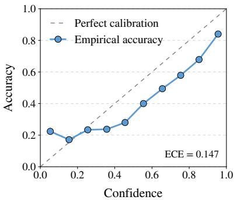  
(A) Confidence Calibration

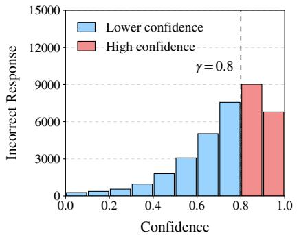  
(B) Confidence of Errors

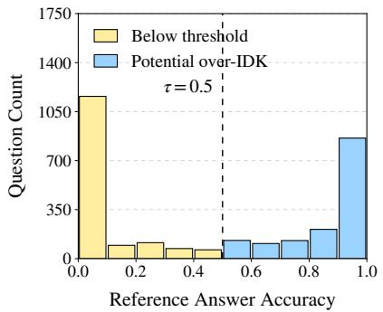  
(C) Answerability of IDK Questions

Figure 8: Empirical motivation using LLaMA3-8B-Instruct on TriviaQA. (A) Empirical accuracy generally increases with confidence. (B) Incorrect responses exhibit heterogeneous confidence. (C) Questions eliciting abstention difer in the accuracy of non-abstaining responses obtained through independent reference sampling.  
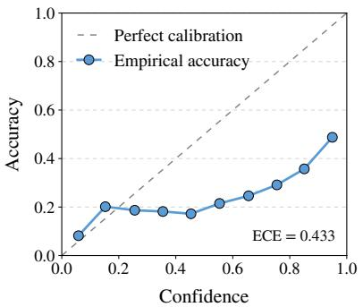  
(A) Confidence Calibration

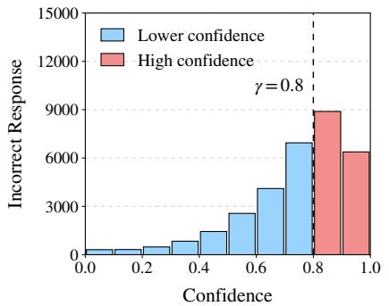  
(B) Confidence of Errors

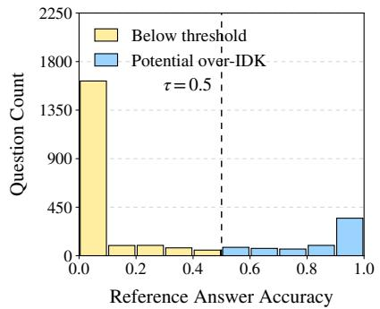  
(C) Answerability of IDK Questions  
Figure 9: Empirical motivation using LLaMA3-8B-Instruct on HotpotQA. (A) Empirical accuracy generally increases with confidence. (B) Incorrect responses exhibit heterogeneous confidence. (C) Questions eliciting abstention difer in the accuracy of non-abstaining responses obtained through independent reference sampling.

## C More Experimental Results

## C.1 Additional Empirical Motivation

We extend the empirical analyses in the preliminaries to TriviaQA and HotpotQA. Figure 8 and Figure 9 show the confidence–accuracy relationship, the confidence distribution of incorrect responses, and reference answer accuracy for questions eliciting abstention, following the same protocol used for NQ.

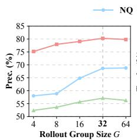

## C.2 Efect of Rollout Group Size

We vary the rollout group size � over {4, 8, 16, 32, 64}. Group size afects abstention reward estimation and group-relative advantage computation. As shown in Figure 10, increasing � from 4 to 32 gen erally improves performance across datasets. Precision increases by 10.63, 5.10, and 4.72 percentage points on NQ, TriviaQA, and HotpotQA, respectively, with improvements in truthfulness and ER. These results suggest that larger groups provide more informative samples for abstention reward estimation and group-relative advantage computation. Increasing � to 64 yields limited and inconsistent gains: NQ shows marginal improvements in precision and truthfulness but a slight decline in ER, TriviaQA exhibits a small increase in ER despite decreases in the other two metrics, and HotpotQA shows declines in all three metrics. Overall, � = 32 achieves the best or near-best performance, supporting its use as the default group size.

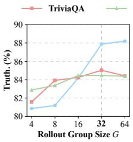

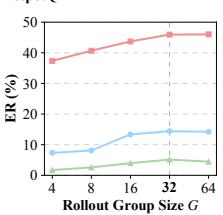  
Figure 10: Efect of rollout group size � on (a) precision, (b) truthfulness, and (c) efective reliability (ER) across NQ, TriviaQA, and HotpotQA. The vertical dashed lines indicate the default setting � = 32.