# Correlation-Aware Exploration for Long-Trace Reasoning

Junxing Hu<sup>1</sup> Zicheng Zhang<sup>1,\*</sup> Zhiqian Zhang<sup>1</sup> Ai Han<sup>1</sup> Yifeng Zhang<sup>1</sup> Pengzhang Liu<sup>1</sup> Ling Li<sup>2</sup>

<sup>1</sup>JD.com <sup>2</sup>Microsoft

## Abstract

Reasoning models trained with Group Relative Policy Optimization (GRPO) now produce chains of thought thousands of tokens long, and recent studies reveal that such training is prone to policy collapse. Entropy regularization is the standard remedy, but it works by pushing probability mass away from the few tokens that carry it and toward the vast low-probability tail of the vocabulary, and it applies this force once for every token of the reasoning trace. This puts the bonus in direct conflict with the entropy decay that convergence requires, and makes its coefficient difficult to set in the long-trace regime. To resolve this tension, we propose Info-GRPO, an information-theoretic framework that cultivates correlation between the policy and a latent prior. Rather than raising entropy everywhere, Info-GRPO builds on the mutual information between a latent variable and the trajectory it induces: augmenting prompts with latent seeds during training lets the model explore diverse policies correlated with the prior, while the seed-conditioned entropy is guided toward convergence. Diversity is therefore carried across whole reasoning traces rather than by per-token randomness, and exploration no longer fights entropy reduction. Experiments show that Info-GRPO outperforms vanilla GRPO and entropy-regularized GRPO across diverse reasoning benchmarks. On AIME24, it improves Avg@8 over GRPO by 3.75%, 1.66%, 4.16%, and 4.17% on four backbones, and it reaches the same majority-vote accuracy with 8× fewer samples.

## 1 Introduction

Recent reasoning models [1–5] have shifted the locus of computation from the prompt to the model’s own output: a single answer on a competition mathematics problem now routinely spans thousands of tokens of chain of thought [6, 7]. Central to this progress is Reinforcement Learning with Verifiable Rewards (RLVR) [8], which supplies scalable outcome-based supervision. The context such a policy must manage is therefore largely self-generated: a reasoning trace that grows as it is produced and that the training objective must shape end to end. Group Relative Policy Optimization (GRPO) [9] makes this practical by replacing the critic with group-relative advantage estimation, but it inherits a well-known weakness: as an on-policy method it reinforces existing high-reward paths and collapses onto a narrow set of strategies [10–12], which is precisely the failure mode that long, exploratory reasoning is supposed to avoid. Figure 1 previews the behaviour we obtain instead.

To counteract this collapse, the conventional remedy is an entropy bonus [13–17]. Maximizing entropy means driving the policy toward the uniform distribution, which is to say moving probability mass away from the few tokens the policy currently favours and onto everything else, as Figure 2(a) illustrates. In a small action space this is a mild and useful perturbation, but a long-trace language <sup>0.382Mean</sup> <sup>Entropy</sup>policy is the opposite regime, and two factors compound. The entropy of a whole trajectory ac-<sup>0.378</sup> <sub>Mean</sub> <sub>EntropyMean</sub> <sub>Entropy</sub>0.38cumulates over its steps, so a bonus applied to it acts once per token of the trace, and at each of 0.374 <sup>0.3820.382</sup> 0.376those steps the bonus pushes hardest on the tokens that are least likely, of which a ∼152K-token <sub>0.37</sub><sup>0.372</sup> 0.3780.378 <sup>0.374</sup>vocabulary [7] contains an overwhelming majority. The pressure the bonus places on tokens carrying <sup>0.368</sup> 0.3740.374 <sup>0.37</sup>negligible probability mass therefore accumulates with both the trace length and the vocabulary size, 0.364 <sup>0.3720.372</sup> 0.366so a growing share of the exploration budget is spent off the reasoning path. Token-level noise is the <sup>0.3680.368</sup> Orig Aug 1 Aug 2 Aug 3 Aug 4 Aug 5 Aug 6 Aug 7 Aug 8 Aug 9 Aug 10wrong instrument here for a second, practical reason: in a short generation an anomalous token is 0.3640.364cheap, but in an 8K-token derivation every subsequent step is conditioned on it. What long-horizon reasoning needs is the opposite profile: high diversity between candidate solution paths, and low uncertainty within each one.

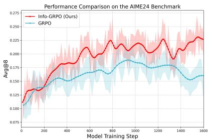

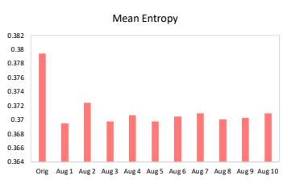

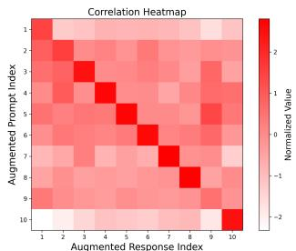  
(a) Validation performance for Qwen2.5-Math-7B-based methods (b) Response entropy under original vs. augmented seeds (c) Correlation for augmented prompt-response pair  
Figure 1: (a) Validation results on Qwen2.5-Math-7B show that Info-GRPO significantly outperforms the GRPO baseline. (b) Info-GRPO encourages mild high-entropy policies from original prompts and low-entropy policies from seed-augmented prompts. (c) The high correlation between random seeds and their respective outputs shows that generation is reliably steered by the seed it is conditioned on.

In this paper, we propose Info-GRPO, a framework that reframes exploration as a correlation-aware objective rather than a penalty on confidence. Instead of treating exploration and convergence as opposing forces, Info-GRPO conditions the policy on a latent prior and maximizes a generalized form of the mutual information between them. This relocates diversity from the token distribution to the trajectory distribution: different latent priors induce different reasoning paths, while each conditioned policy is free to become confident, so entropy can still fall along the trace as convergence requires (Figure 1). The latent prior is used only during training, and inference runs on the original prompt, so deployment is unchanged. In summary, our contributions are as follows.

• We show that naive entropy regularization in large vocabularies is structurally sensitive to the massive long-tail of tokens, whose contribution accumulates over every step of a long reasoning trace. By framing entropy regularization as a special case of mutual information, we reorient learning toward conditional entropy reduction, which is consistent with convergence.

• We introduce Info-GRPO, a correlation-aware training paradigm that augments prompts with latent variables and employs a mutual information objective to correlate distinct reasoning strategies with latent priors. This simple, effective design resolves exploration-convergence tension with a coherent trajectory of entropy reduction.

• We conduct evaluations across diverse benchmarks and models, demonstrating that Info-GRPO consistently outperforms GRPO baselines. Furthermore, latent-conditioned outputs exhibit distinct and interpretable reasoning patterns, providing a novel pathway for steering and analyzing cognitive strategies in LLMs.

## 2 Related Work

Reinforcement Learning for Long-Trace Reasoning. RL significantly improves LLM reasoning [1, 2, 5, 18, 19] and is now the standard route to chains of thought thousands of tokens long. Foundational methods include RLHF [20] and Verifiable Rewards (RLVR) [8, 21], while the value-model-free GRPO [9] notably enhances stability and efficiency over PPO [22]. Recent variants refine advantage estimation (Dr. GRPO [23]), stabilize MoE training (GSPO [24]), and introduce curricula (Light-R1 [25]). Others reshape the clipping and sampling pipeline (DAPO [15]) or reintroduce a value model for advantage estimation (VAPO [26], ORZ [27]), while a parallel line optimizes policies offline from pre-collected preferences [28–30]. A growing body of analysis attributes the gains of

RLVR to the emergence of reasoning behaviours rather than to correct answers alone [31], and further variants act on the length of the chain of thought, as in S-GRPO [32], which rewards conciseness and early termination. However, GRPO-based approaches fundamentally suffer from insufficient exploration and policy collapse [33]. Our work extends GRPO to concurrently improve exploration and exploitation.

Entropy Regularization for RL. Entropy regularization mitigates premature convergence and insufficient exploration in RL [12, 16]. The idea descends from the maximum-entropy principle [13, 34] and from deep RL methods that add an entropy term to the objective [14, 35]. For LLMs, recent works use entropy to drive reasoning [17], construct intermediate feedback [36], augment advantages for diversity [33, 37], and control early convergence [10, 16, 38]. A complementary line shapes the entropy trajectory along the trace rather than its level: ETR [39] rewards a monotonically decreasing uncertainty trend to obtain efficient chains of thought. However, the uncertainty introduced for exploration often weakens policy confidence, and it accumulates over every step ofa long trace. We augment entropy-regularized GRPO with a generalized mutual-information regularizer to ease this diversity-confidence contradiction.

Mutual Information for Structured Exploration. MI captures variable dependencies and structures representations [40–44], driving representation disentanglement [45, 46] and contrastive learning [47– 49]. In LLMs, MI controls reasoning by downweighting redundant GRPO completions [33], analyzing trajectory dynamics [50], and optimizing preference alignment [51], enabling structured exploration rather than purely stochastic diversity. Motivated by this, we maximize MI conditioned on a latent variable, so that latent–policy correlation carries diversity across whole reasoning traces rather than per-token randomness. More discussion of related work is provided in Appendix A.2.

## 3 Background

In RLVR we model the LLM as a policy π : from an initial state $s _ { 0 }$ (the prompt), at step t the state is the action history $s _ { t } = ( s _ { 0 } , a _ { 0 } , \ldots , a _ { t - 1 } )$ and the policy $\pi _ { \pmb { \theta } } ( \cdot \vert s _ { t } )$ emits a token $a _ { t }$ . The sequence ${ \boldsymbol { \tau } } = ( a _ { 0 } , a _ { 1 } , \dots )$ is the trajectory, i.e., the reasoning trace.

Group Relative Policy Optimization [9] avoids training a critic by estimating the advantage A<sup>ˆ</sup> of a trajectory τ against a sampled group $\mathcal { T } = \{ \tau ^ { i } \} _ { i = 1 } ^ { G }$ , and plugging it into a PPO-style clipped objective [22]:

$$
J _ { \mathrm { G R P O } } ( \pmb { \theta } , \mathcal { T } ) = \sum _ { \tau \in \mathcal { T } } \sum _ { t } \operatorname* { m i n } \Big ( r _ { t } ( \pmb { \theta } ) \hat { A } ( \tau ) , \mathrm { c l i p } \big ( r _ { t } ( \pmb { \theta } ) , 1 - \epsilon , 1 + \epsilon \big ) \hat { A } ( \tau ) \Big ) ,\tag{1}
$$

where $r _ { t } ( \pmb \theta ) = \pi _ { \pmb \theta } ( a _ { t } \mid s _ { t } ) / \pi _ { \pmb \theta _ { \mathrm { o l d } } } ( a _ { t } \mid s _ { t } )$ is the probability ratio.

Policy entropy measures the uncertainty of the policy. Crucially for what follows, the entropy of a trajectory is an accumulation over its steps:

$$
H ( \pi _ { \pmb \theta } ( T | s _ { 0 } ) ) : = \sum _ { \tau \in { \mathcal T } } \sum _ { t } H ( \pi _ { \pmb \theta } ( \cdot | s _ { t } ) ) , H ( \pi _ { \pmb \theta } ( \cdot | s _ { t } ) ) = - \sum _ { a \in V } \pi _ { \pmb \theta } ( a | s _ { t } ) \log \pi _ { \pmb \theta } ( a | s _ { t } ) ,\tag{2}
$$

where V is the vocabulary. A high entropy value corresponds to a uniform, uncertain policy that encourages exploration, while a low value signifies a deterministic, confident policy geared towards exploitation. Successful RLVR training reduces this quantity as the model commits to high-quality reasoning paths [16, 52]. The pathological case, entropy collapse, is a sharp early drop that forecloses exploration [10, 12, 37], countered by a token-level entropy bonus.

## 4 Why Entropy Bonuses Are Fragile at Long Trace Lengths

The entropy-regularized objective and its coefficient. Exploration is conventionally preserved by adding the bonus of Eq. (2) to the GRPO objective with weight $\beta > 0 !$

$$
J _ { \mathrm { e n t } } ( \pmb \theta ) = J _ { \mathrm { G R P O } } ( \pmb \theta , \mathcal { T } ) + \beta H ( \pi _ { \pmb \theta } ( \mathcal { T } \mid s _ { 0 } ) ) .\tag{3}
$$

Eq. (3) localizes the whole exploration–convergence tension in one scalar: the reward term seeks certainty by reducing entropy, the bonus pursues possibility by increasing it, and $\beta$ arbitrates. In practice this knob is hard to set [10, 16]: a small $\beta$ barely explores, while a large $\beta$ destabilizes training (Figure 2(a), at $\beta = 0 . 0 5 )$ . The sensitivity is structural rather than a matter of tuning.

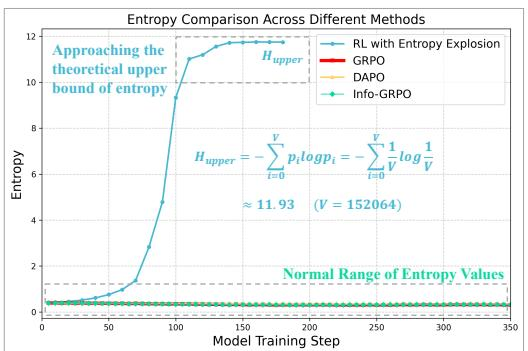  
(a) Normal entropy vs. entropy collapse during RL training

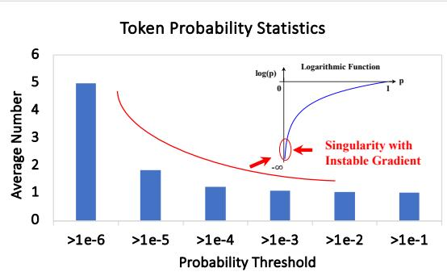  
(b) Average number of tokens exceeding various thresholds  
Figure 2: (a) An entropy bonus can degrade the policy into a uniform distribution, reaching its entropy upper bound. (b) This instability is inherent to LLMs, whose vocabularies are dominated by a vast tail of low-probability tokens, on which the entropy objective’s logarithmic factor is largest (see Proposition 1). Statistically, in Qwen2.5-7B’s 152,064 tokens, fewer than five exceed a $1 \overline { { 0 } } ^ { - 6 }$ <sup>Token</sup> <sup>Probability</sup> <sup>Statistics</sup> (b) Log(p)probability. This makes direct entropy maximization sensitive to its coefficient at this scale.

<sup>5</sup>Proposition 1 (Tail sensitivity of high-dimensional entropy maximization). Let $\pi _ { \theta } ( \cdot \mid s )$ be a 4bpolicy over a vocabulary A of size V , with entropy gradient $\begin{array} { r } { \nabla _ { \theta } H ( \pi _ { \theta } ) \ : = \ : - \sum _ { a \in A } \nabla _ { \theta } \pi _ { \theta } ( a \ | } \end{array}$ $s ) \cdot ( 1 + \log \pi _ { \pmb { \theta } } ( \ b { a } \mid s ) )$ N<sup>u</sup>), in which $( 1 + \log \pi _ { \theta } ( a \mid s ) )$ is the scalar factor contributed by the entropy 2<sub>a</sub><sup>g</sup>term alone. Characterizing thisfactor in probability space,for any threshold $\delta \in ( 0 , \dot { 1 } )$ the tail set $A _ { \delta } : = \{ a \in A \mid \pi _ { \pm } ( a \mid s ) < \delta \}$ <sub>1</sub>satisfies $\vert A _ { \delta } \vert \ge V - 1 / \delta ,$ , and the cumulative magnitude of the <sub>Singularity with Inst</sub>entropy-specificfactors over that tail, the Total Tail Instability (a probability-space diagnostic, see Remark $I ) ,$ is bounded below by

$$
\mathrm { T T I } = \sum _ { a \in A _ { \delta } } \big | 1 + \log \pi _ { \theta } ( a \mid s ) \big | \geq \left( V - \textstyle { \frac { 1 } { \delta } } \right) \big | 1 + \log \delta \big | ,\tag{4}
$$

whenever $V > 1 / \delta ,$ a condition readily met in $L L M s . ^ { 1 }$

Remark 1. TTI measures pressure in probability space. TTI sums the scalar factor $\left| 1 + \log \pi _ { \theta } ( a \mid s ) \right|$ over the tail. The realized parameter update additionally involves the policy Jacobian and the optimizer. What Eq. (4) gives is therefore a diagnostic of how the entropy objective allocates optimization pressure: the entropy term, alone in an RLVR objective, attaches a factor of magnitude at least $| 1 + \bar { \log { \delta } } |$ to each of at least $V - 1 / \delta$ tokens that jointly carry vanishing probability mass.

Remark 2. Trace length compounds the effect. Eq. (2) applies this per-step quantity once for every token of the trace, so for a trajectory of length T the misallocated pressure accumulates as $\mathcal { O } ( T \cdot \mathrm { T T I } )$ growing with trace length × vocabulary size. Short generations, where entropy bonuses are well behaved, sit at small T, while long-form reasoning sits at T in the thousands. A bonus that is benign in the former regime spends a growing share of the exploration budget off the reasoning path in the latter.

Remark 3. The entropy gradient is asymmetrically unstable. During entropy maximization the logarithmic factor amplifies countless near-zero probabilities, pushing the policy toward the uniform distribution (Figure 2(a)). During entropy minimization the same factor is suppressive, driving negligible probabilities toward zero, where the objective is well behaved. Exploration that is obtained by lowering a conditional entropy therefore avoids the regime that makes Eq. (3) fragile. Thi asymmetry, rather than the magnitude of any single gradient, is what our method exploits.

## 5 The Info-GRPO Framework

Motivated by Remark 3, we replace the fragile marginal entropy maximization with its direct information-theoretic extension. This shifts the regularization pressure toward the well-behaved minimization of conditional entropy, mitigating the tail sensitivity identified above while reusing existing computation modules. As shown in Figure 3, conditioning the policy on a latent variable $z \sim$ $p ( Z )$ lets the objective balance two competing entropic forces for stable and structured exploration:

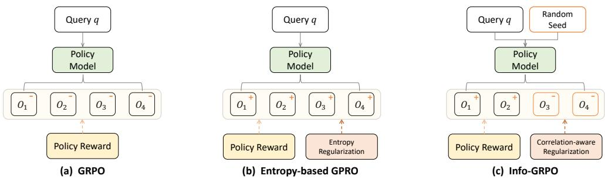  
Figure 3: An intuitive comparison of exploration methods. Plus (+) and minus (-) signs represent forces that increase or decrease policy entropy. (a) Vanilla GRPO focuses on exploitation (-), often causing policy collapse. (b) Entropy regularization promotes diversity by increasing all entropy (+), but risks collapsing towards a uniform distribution. (c) Info-GRPO balances a mild entropy increase (+) with a strong, seed-conditioned entropy decrease (-). This follows the mutual-information decomposition between seeds and outcomes, using correlation to drive stable exploration.

$$
\operatorname* { m a x } _ { \theta } \mathcal { I } _ { \mathrm { I n f o } } ( \theta ) = \alpha H ( \pi _ { \theta } ( \mathcal { T } \mid s _ { 0 } ) ) - H ( \pi _ { \theta } ( \mathcal { T } \mid s _ { 0 } , z ) ) .\tag{5}
$$

The objective is driven by a consolidation term, $- H ( \pi _ { \pmb { \theta } } ( \mathcal { T } \mid s _ { 0 } , z ) )$ , which compels each latentconditioned policy to converge to a confident strategy. This is counterbalanced by the weighted entropy bonus, in which the relaxation coefficient $\alpha \in [ 0 , 1 ]$ controls how much marginal-entropy pressure is retained: a small positive value anchors exploration in the model’s original policy, while values close to 1 reintroduce the tail sensitivity analyzed in Sec. 4.

Relation to Mutual Information. Our objective in Eq. (5) is derived from the information-theoretic decomposition of the mutual information (MI) between the trajectory τ and the latent variable z,

$$
I ( \tau , z \mid s _ { 0 } ) = \mathbb { E } _ { \tau \sim \pi _ { \theta } ( \cdot \mid s _ { 0 } , z ) , z \sim p ( Z ) } \left[ \log \frac { \pi _ { \theta } ( \tau , z \mid s _ { 0 } ) } { p ( z ) \pi _ { \theta } ( \tau \mid s _ { 0 } ) } \right] ,\tag{6}
$$

which admits the equivalent form $I ( \tau ; z \mid s _ { 0 } ) = H ( \tau \mid s _ { 0 } ) - H ( \tau \mid s _ { 0 } , z )$ . This decomposition, rather than a particular estimator, is the structural principle Info-GRPO retains: the first term maintains diversity at the prompt level, and the second compels each latent-conditioned policy to become confident. Exploration is thereby reframed as maximizing the statistical correlation between latent codes and reasoning paths, cultivating a diverse ensemble of low-entropy policies rather than a single high-entropy one. Diversity now lives between trajectories, not between tokens.

Two practical relaxations. Eq. (5) coincides with $I ( \tau ; z \mid s _ { 0 } )$ at $\alpha = 1$ with a seed-averaged marginal, and our implementation departs from that limit in two ways. (i) The marginal branch is anchored on unseeded prompts. Rather than the mixture $\begin{array} { r } { p ( \tau \mid s _ { 0 } ) = \sum _ { z } p ( z ) \pi _ { \pmb \theta } ( \bar { \tau } \mid s _ { 0 } , z ) } \end{array}$ , we estimate $H ( \tau \mid s _ { 0 } )$ from trajectories generated without a seed. The seed is a training-time device and inference always runs on the original prompt, so the unseeded branch serves as an inference-aligned anchor, whereas the mixture would tie it to a distribution never used at test time. (ii) The relaxation coefficient satisfies $\alpha < 1$ . The marginal term is the tail-sensitive component identified above: $\alpha = 1$ restores full pressure to flatten probability mass across the vocabulary and destabilizes training, while an overly small α leaves the anchor too weak. We use $\alpha = 0 . 5$ throughout, and refer to Eq. (5) as a generalized MI regularizer.

Implementation. Info-GRPO leaves the GRPO loop intact. To match vanilla $\mathrm { G R P O ^ { \circ } s }$ sampling budget $( G = 1 6 )$ , each prompt’s generations are split into two equal sub-groups: $\mathcal { T } _ { \mathrm { o r i } }$ from the base policy $\pi _ { \pmb { \theta } } ( \cdot \mid s _ { 0 } )$ , and $\dot { \tau } _ { \mathrm { a u g } }$ from the conditioned policy $\pi _ { \pmb { \theta } } ( \cdot \mid s _ { 0 } , z )$ , where z is drawn uniformly from a digital set $( e . g . , \{ \breve { 1 } , \dots , 1 0 \} )$ and appended to s<sub>0</sub> by a fixed template (“Choosing random seed $\{ z \} _ { \cdots } ^ { { \scriptscriptstyle - } , \gamma } )$ . Empirically these semantically neutral seeds outperform explicit semantic hints, which impose an alignment tax by constraining the reasoning style. The final objective is

$$
J _ { \mathrm { I n f o - G R P O } } ( \theta ) = J _ { \mathrm { G R P O } } ( \theta , { \mathcal T } _ { \mathrm { o n } } \cup { \mathcal T } _ { \mathrm { a u g } } ) + \lambda \left( \alpha H \big ( \pi _ { \theta } ( { \mathcal T } _ { \mathrm { o n } } \mid s _ { 0 } ) \big ) - H \big ( \pi _ { \theta } ( { \mathcal T } _ { \mathrm { a u g } } \mid s _ { 0 } , z ) \big ) \right) ,\tag{7}
$$

with advantages $\hat { A } ( \tau )$ estimated across the merged set $\mathcal { T } _ { \mathrm { o r i } } \cup \mathcal { T } _ { \mathrm { a u g } } ,$ , and the two entropy terms estimated by Monte Carlo approximation from $\mathcal { T } _ { \mathrm { o r i } }$ and $\mathcal { T } _ { \mathrm { a u g } }$ respectively. Algorithm 1 in Appendix A.3 summarizes the resulting training loop.

Table 1: Comparisons on multiple backbones and benchmarks (Avg@8, %). ‘†’ uses the official model. (bold = best, underline = second best). Additional comparisons are provided in Appendix ${ \mathrm { A . 4 . } }$
<table><tr><td>Backbone</td><td>Method</td><td>AIME24</td><td>AIME25</td><td>AMC</td><td>MATH500</td><td>Minerva</td><td>Average</td></tr><tr><td rowspan="7">Qwen2.5-7B</td><td>Base Model</td><td>12.08</td><td>7.50</td><td>42.77</td><td>75.50</td><td>35.06</td><td>34.58</td></tr><tr><td>GRPO</td><td>20.42</td><td>10.83</td><td>56.48</td><td>80.53</td><td>37.82</td><td>41.22</td></tr><tr><td>DAPO</td><td>18.75</td><td>11.25</td><td>48.95</td><td>78.13</td><td>36.53</td><td>38.72</td></tr><tr><td>CLIP-Cov</td><td>15.83</td><td>12.08</td><td>51.51</td><td>79.10</td><td>38.19</td><td>39.34</td></tr><tr><td>KL-Cov</td><td>15.40</td><td>11.25</td><td>59.94</td><td>74.05</td><td>35.94</td><td>39.32</td></tr><tr><td>Skywork-OR1</td><td>20.83</td><td>7.50</td><td>57.38</td><td>78.38</td><td>38.05</td><td>40.43</td></tr><tr><td>Info-GRPO (Ours)</td><td>22.08</td><td>8.75</td><td>58.28</td><td>79.60</td><td>38.37</td><td>41.42</td></tr><tr><td rowspan="8">Qwen2.5-Math-7B</td><td>Base Model</td><td>11.67</td><td>8.33</td><td>48.64</td><td>82.38</td><td>36.40</td><td>37.48</td></tr><tr><td>GRPO</td><td>21.25</td><td>11.67</td><td>66.57</td><td>86.75</td><td>38.97</td><td>45.04</td></tr><tr><td>DAPO</td><td>21.25</td><td>7.92</td><td>79.52</td><td>86.35</td><td>38.92</td><td>46.79</td></tr><tr><td>Dr. GRPO †</td><td>29.17</td><td>9.58</td><td>58.58</td><td>79.18</td><td>34.83</td><td>42.27</td></tr><tr><td>DARS-7B-ET ↑</td><td>26.25</td><td>15.42</td><td>60.84</td><td>83.38</td><td>39.06</td><td>44.99</td></tr><tr><td>DARS-7B-HW †</td><td>27.92</td><td>12.92</td><td>63.25</td><td>84.18</td><td>38.69</td><td>45.39</td></tr><tr><td>Skywork-OR1</td><td>22.50</td><td>13.33</td><td>81.02</td><td>84.73</td><td>38.19</td><td>47.95</td></tr><tr><td>Info-GRPO (Ours)</td><td>25.00</td><td>15.83</td><td>78.46</td><td>86.63</td><td>39.34</td><td>49.05</td></tr><tr><td rowspan="6">DeepSeek-R1-Distill-Qwen-7B</td><td>Base Model</td><td>54.58</td><td>34.17</td><td>81.63</td><td>92.03</td><td>39.89</td><td>60.46</td></tr><tr><td>GRPO</td><td>57.92</td><td>34.17</td><td>82.38</td><td>93.63</td><td>44.16</td><td>62.45</td></tr><tr><td>DAPO</td><td>58.33</td><td>37.50</td><td>82.53</td><td>93.63</td><td>44.53</td><td>63.30</td></tr><tr><td>Light-R1-7B-DS †</td><td>59.10</td><td>44.30</td><td>82.83</td><td>93.55</td><td>44.35</td><td>64.83</td></tr><tr><td>Skywork-OR1</td><td>59.58</td><td>37.92</td><td>82.08</td><td>93.73</td><td>44.12</td><td>63.48</td></tr><tr><td>Info-GRPO (Ours)</td><td>62.08</td><td>45.83</td><td>83.13</td><td>93.98</td><td>44.94</td><td>65.99</td></tr><tr><td rowspan="4">DeepSeek-R1-Distill-Llama-8B</td><td>Base Model</td><td>50.42</td><td>32.50</td><td>79.67</td><td>85.35</td><td>37.91</td><td>57.17</td></tr><tr><td>GRPO</td><td>53.75</td><td>35.42</td><td>81.02</td><td>86.23</td><td>37.22</td><td>58.73</td></tr><tr><td>DAPO</td><td>51.67</td><td>36.67</td><td>80.87</td><td>91.08</td><td>37.45</td><td>59.55</td></tr><tr><td>Info-GRPO (Ours)</td><td>57.92</td><td>37.50</td><td>83.28</td><td>91.45</td><td>37.96</td><td>61.62</td></tr></table>

Table 2: Code benchmark (LiveCodeBench) comparisons using DeepSeek-R1-Distill-Qwen-7B (%).
<table><tr><td>Method</td><td> $P a s s @ 1$ </td><td> $P a s s @ 8$ </td><td> $A v g @ 8$ </td></tr><tr><td>Base Model</td><td>36.92</td><td>48.75</td><td>36.74</td></tr><tr><td>GRPO</td><td>37.63</td><td>50.18</td><td>38.13</td></tr><tr><td>Info-GRPO (Ours)</td><td>40.86</td><td>51.97</td><td>40.14</td></tr></table>

## 6 Experiments

## 6.1 Setup and Metrics

We train four backbones: Qwen2.5-7B [53], Qwen2.5-Math-7B [54], DeepSeek-R1-Distill-Qwen-7B and DeepSeek-R1-Distill-Llama-8B [5]. For the Qwen2.5 series we use DAPO-Math-17K [15] (17,917 problems) with a 4,096-token trace budget matching their official configuration. For the DeepSeek-R1-Distill series we use the 48,371-sample set of He et al. [10] with an 8,192-token budget, since their reasoning traces are substantially longer. The learning rate is 1e−6 with batch size 128 and $G = 1 6$ rollouts per prompt sampled at temperature 1.0, and we set $\lambda = 0 . 0 0 5$ and $\alpha = 0 . 5$ throughout. Every method except those evaluated from officially released checkpoints is retrained by us with the same pipeline and core hyperparameters, on a single node with 8 NVIDIA B200 GPUs. Gradient clipping, loss scaling and the numerical stabilization of log-probabilities are configured identically for every method, including the entropy-regularized baselines, so that the differences we report originate at the objective level rather than from these safeguards. Accuracy is evaluated on AIME24 [55], AIME25 [56], AMC [55], MATH500 [57], Minerva [58] and LiveCodeBench [59] (30, 30, 83, 500, 272 and 279 problems), reporting Pass@1, Pass@8 and Avg@8 (the mean of Pass@1) over 8 trials at temperature 0.6 [10]. Latent–Trajectory Correlation is the average log-probability of a trace under a given seed, $\begin{array} { r } { \mathrm { C o r r } ( z , \tau \mid s _ { 0 } ) = \frac { 1 } { \mid \tau \mid } \sum _ { t } \log \pi ( a _ { t } \mid s _ { 0 } , z , a _ { < t } ) } \end{array}$ . Semantic Diversity follows [33]: the average pairwise Euclidean distance between JINA-v2 embeddings [60] of reasoning paths, aggregated across problems and seeds. Full settings are in Appendix A.3.

Table 3: Comparison with baselines using multiple backbones on AIME24 (MV @N, %).
<table><tr><td>Backbone</td><td>Samples (N)</td><td>4</td><td>8</td><td>16</td><td>32</td><td>64</td><td>128</td></tr><tr><td rowspan="2">Qwen2.5-Math-7B</td><td>GRPO</td><td>23.33</td><td>16.67</td><td>16.67</td><td>23.33</td><td>23.33</td><td>26.67</td></tr><tr><td>Info-GRPO (Ours)</td><td>23.33</td><td>30.00</td><td>26.67</td><td>26.67</td><td>26.67</td><td>26.67</td></tr><tr><td rowspan="2">DeepSeek-R1-Distill-Qwen-7B</td><td>GRPO</td><td>56.67</td><td>76.67</td><td>73.33</td><td>76.67</td><td>80.00</td><td>80.00</td></tr><tr><td>Info-GRPO (Ours)</td><td>63.33</td><td>80.00</td><td>80.00</td><td>80.00</td><td>80.00</td><td>80.00</td></tr></table>

Table 4: Ablation isolating the vocabulary tail.
<table><tr><td>Entropy scope</td><td>AIME24</td></tr><tr><td>None (GRPO)</td><td>57.92</td></tr><tr><td>Full vocab.</td><td>53.23</td></tr><tr><td>Head only</td><td>58.13</td></tr><tr><td>Seed-aug. MI</td><td>62.08</td></tr></table>

Table 5: Ablation on the maximum trace budget.
<table><tr><td>Budget AIME24</td><td></td><td>AIME25</td></tr><tr><td>2K</td><td>56.67</td><td>37.08</td></tr><tr><td>3K</td><td>61.25</td><td>37.92</td></tr><tr><td>4K</td><td>60.00</td><td>40.42</td></tr><tr><td>8K</td><td>62.08</td><td>45.83</td></tr></table>

Table 6: Ablation on the regularization coefficient λ.
<table><tr><td colspan="2">Coef λ AIME24</td><td>AIME25</td></tr><tr><td>0.5</td><td>57.08</td><td>39.58</td></tr><tr><td>0.05</td><td>58.75</td><td>40.42</td></tr><tr><td>0.005</td><td>62.08</td><td>45.83</td></tr><tr><td>0.002</td><td>62.08</td><td>44.17</td></tr></table>

## 6.2 Comparative Experiments

Comparisons on Math Benchmarks across Multiple Backbones. In Table 1, Info-GRPO consistently achieves the best overall performance on both Qwen and Llama backbones, demonstrating robust generalization beyond a single model family. For example, on AIME24, it improves Avg@8 over GRPO by 3.75%, 1.66%, 4.16%, and 4.17% based on four models, respectively. While some methods achieve strong performance on individual benchmarks, e.g., Dr. GRPO on AIME24, they exhibit less consistent behavior across tasks, resulting in weaker overall averages. Info-GRPO and GRPO are nearly tied on Qwen2.5-7B (41.42% vs. 41.22%), which delimits when our method helps. Correlation-aware exploration converts diversity into accuracy only if the backbone can produce valid reasoning paths to diversify over, and on the vanilla Qwen2.5-7B this precondition is weak. The same ceiling appears for the other exploration-driven baseline, Skywork-OR1 (40.43%). As backbone capacity increases, the overall average over GRPO improves by 4.01%, 3.54%, and 2.89% based on the other three models, respectively. Appendix A.4 reports P ass@1/P ass@8 and a diversity-based analysis of this case.

Comparisons on the Code Benchmark. Models are trained on a 13.7K-sample dataset [10]. The max token length is also 8K for consistency and efficiency. In Table 2, Info-GRPO outperforms both the base model and GRPO across all metrics, indicating that the improvements brought by our method extend beyond the mathematics domain and apply to broader reasoning tasks.

Test-Time Compute under Majority Voting. The same structure pays off at inference. Table 3 scales the sampling budget N under majority voting on AIME24. On DeepSeek-R1-Distill-Qwen-7B, Info-GRPO reaches 80.00 at N = 8, the accuracy GRPO attains only at N = 64, an 8× larger budget. On Qwen2.5-Math-7B, GRPO does not reach Info-GRPO’s peak of 30.00 even at N = 128, although on a 30-problem benchmark that gap is one problem. A diverse but individually confident set of reasoning modes produces candidates that agree sooner, so consensus needs less sampling.

## 6.3 Ablation Study

The ablation tables report Avg@8 (%) on DeepSeek-R1-Distill-Qwen-7B unless stated otherwise.

Isolating the Vocabulary Tail. We compare three configurations of Eq. (3) with only the entropy scope varied: no bonus, the bonus over the full vocabulary, and the bonus restricted to head tokens. Table 4 shows the predicted pattern: the full-vocabulary bonus degrades performance below the no-entropy baseline (57.92 → 53.23), whereas removing the tail from the same objective restores it (58.13). Since the two variants differ only in whether the tail participates, the tail is the locus of degradation. Info-GRPO reaches 62.08, well above the tail-masked variant: masking removes an instability, while the MI objective also converts exploration into structured reasoning modes.

Ablation on the Trace Budget and the Coefficient λ. Table 5 varies the trace budget. Performance improves as the budget grows from 2K to 8K, monotonically on AIME25 (37.08 → 45.83) and with the best result at 8K on AIME24: Info-GRPO helps most exactly in the long-trace regime where Remark 2 places the entropy bonus at its most misallocated. Table 6 sweeps λ: smaller values

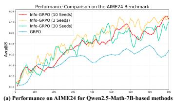

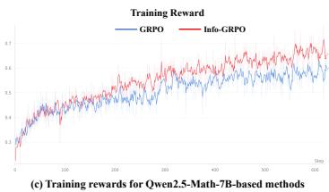

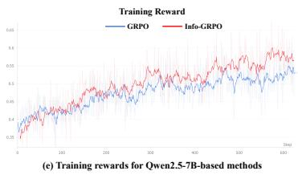

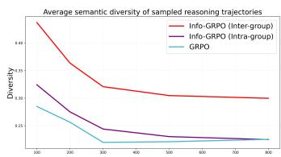  
(b) Average trajectory diversity for Qwen2.5-Math-7B-based methods

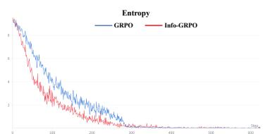  
(d) Entropy for Qwen2.5-Math-7B-based methods

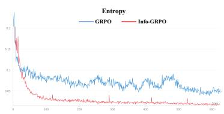  
(f) Entropy for Qwen2.5-7B-based methods  
Figure 4: Comprehensive analysis of exploration behavior, policy diversity, and training dynamics. (a) Validation performance on AIME24 shows that Info-GRPO consistently outperforms GRPO across different numbers of latent seeds, with the performance gain appearing to stabilize around 10 seeds. (b) Analysis of policy semantic diversity reveals that Info-GRPO (with 10 seeds) maintains high inter-group diversity across conditional seeds and low intra-group diversity within a seed, effectively balancing exploration and exploitation. (c–f) Info-GRPO exhibits entropy reduction while achieving higher training rewards compared to the GRPO baseline.

Table 7: Ablation on the relax ation coefficient α.
<table><tr><td>Coef α</td><td>AIME24</td><td>AMC</td></tr><tr><td>1.0 (exact MI)</td><td>52.50</td><td>75.90</td></tr><tr><td>0.5 (ours)</td><td>62.08</td><td>83.13</td></tr><tr><td>0.05</td><td>58.33</td><td>81.93</td></tr></table>

Table 8: Ablation disentangling latent seeds and MI regularization (Qwen2.5-Math-7B).
<table><tr><td>Method</td><td>AIME24</td></tr><tr><td>Vanilla GRPO</td><td>45.04</td></tr><tr><td>GRPO w/ seeds</td><td>42.23</td></tr><tr><td>Info-GRPO</td><td>49.05</td></tr></table>

Table 9: Ablation on structured latent variables (Qwen2.5-Math 7B).
<table><tr><td>Seed type Diversity AIME24</td><td></td><td></td></tr><tr><td>Semantic</td><td>0.307</td><td>23.33</td></tr><tr><td>Digital</td><td>0.300</td><td>25.00</td></tr></table>

constrain exploration and improve accuracy, so $\lambda = 0 . 0 0 5$ is used for all backbones and benchmarks.   
Appendix A.5 repeats the grid on disjoint benchmarks and another architecture.

Ablation on the Relaxation Coefficient $\alpha _ { \bullet }$ Table 7 shows why the exact-MI setting is not the practical one. $\mathrm { A t } \alpha = 1 . 0 $ , where Eq. (5) coincides with mutual information, training is unstable and AIME24 accuracy falls to 52.50, below vanilla GRPO, exactly as the tail sensitivity of the marginal term predicts. $\mathrm { A t } \alpha = 0 . 0 5$ the anchor is too weak. The intermediate $\alpha = 0 . 5$ is best on both and is used throughout.

Ablation on Latent Seeds and MI Regularization. To disentangle prompt augmentation from the MI objective, we test standard GRPO with seed-augmented prompts (Table 8). Without MI regularization, appending seeds acts purely as noise, degrading Avg@8 from 45.04% to 42.23%. The augmented prompt is only a vehicle, and the MI-guided regularizer is what turns the latent variable into a usable control signal. Replacing neutral digital seeds with semantic heuristics (Table 9) marginally increases diversity but degrades efficacy, exposing an alignment tax: explicit linguistic constraints push the model off its native reasoning abstractions.

Analysis of Latent Seeds and Policy Diversity. Varying the seed count (Figure 4(a)), Info-GRPO consistently outperforms GRPO, with gains stabilizing around 10 seeds. Figure 4(b) shows markedly higher inter-group semantic diversity across seeds and lower intra-group diversity within a seed: different latent variables steer the model toward different strategies while it remains confident within each, avoiding the policy collapse of vanilla GRPO. Figure 1(c) visualizes the seed–trajectory correlation as a block-diagonal structure, confirming that the policy uses the latent seed. Appendix A.6 gives qualitative cases in math and code.

Analysis of the Training Entropy. Figure 4(c–f) compares entropy and training rewards. Info-GRPO shows faster entropy reduction and steeper reward growth, indicating more stable optimization. Suppressing token-level randomness does not suppress exploration: it has been relocated to the trajectory distribution, which is what long-horizon reasoning needs, since per-token noise would let one anomalous token corrupt all that follows.

## 7 Conclusion

This paper examines the conflict between naive entropy regularization and convergence in long-trace reasoning, and traces it to the tail sensitivity of direct marginal entropy maximization in vast token spaces, a cost paid once per generated token and quantified in probability space by our TTI diagnostic, then verified by a controlled tail-masking ablation. We introduce Info-GRPO, an informationtheoretic framework that eases this tension through latent-variable augmentation and a generalized MI-guided regularizer. Experiments show consistent improvements over GRPO baselines across multiple benchmarks and model architectures. Info-GRPO’s advantage stems from correlation-aware exploration, as evidenced by seed-conditioned reasoning modes and stable training dynamics.

## Limitations

Trace lengths beyond 8K. Our longest trace budget is 8,192 tokens, set by the official configurations of the DeepSeek-R1-Distill backbones (4,096 for the Qwen2.5 series). Remark 2 predicts that the pressure an entropy bonus misallocates grows as O(T · TTI), so the effect motivating Info-GRPO should be at least as pronounced at 32K or 128K trace budgets. We have not verified this: doing so requires retraining at those budgets, which is beyond our compute. The claims in this paper are therefore supported up to 8K.

Statistical scope. We report Avg@8, the mean of Pass@1 over 8 independent decoding trials, and we do not report a dispersion estimate for it. The informative measurement would repeat the full RL training run with independent random seeds, which is prohibitively expensive at our scale. On 30-problem benchmarks a one-problem difference is worth roughly 3.3 points, so our conclusions there rest on the consistency of the trend across four backbones, six benchmarks, three metrics, and the larger MATH500 (500), Minerva (272) and LiveCodeBench (279) test sets.

What the latent seed contributes. How much of the gain is attributable to the seed itself remains open. Our ablations separate the MI regularizer from prompt augmentation, but not the effect of varying the seed from that of the conditional-entropy term, which a matched control holding the seed fixed across all augmented prompts would measure. How seeds should be scheduled over training, and whether a seed can be chosen per problem rather than sampled uniformly, are equally unexplored.

Latent space complexity. We rely on a flat, unstructured discrete latent space. As Table 9 shows, neutral digital seeds avoid the alignment tax incurred by semantic heuristics, but their unstructured na ture limits the granularity of control. Hierarchical or continuous latent spaces allowing compositional control over the reasoning process are a substantial standalone problem.

Evaluation scope and verifiable rewards. To isolate the algorithmic effect of the MI objective without confounds from noisy or hackable reward models, evaluation is restricted to domains with strict verifiable rewards, namely mathematics and code. Generalization to multi-step tool use, environments with varying reward sparsity, and fully open-ended reasoning therefore remains untested.

Boundary conditions. As reported in Sec. 6 and detailed in Appendix A.4, the method does not help when the backbone cannot produce valid reasoning paths to diversify over: on Qwen2.5-7B, Info-GRPO reaches the highest trajectory diversity of all methods on AIME25 without the highest accuracy. Adaptive modulation of the exploration term for such backbones is left to future work.

## References

[1] OpenAI. Openai o1 system card. arXiv preprint arXiv:2412.16720, 2024.

[2] OpenAI. Openai o3 and o4-mini system card, 2025. URL https://openai.com/index/ o3-o4-mini-system-card/.

[3] Anthropic. Claude 3.7 sonnet and claude code, 2025. URL https://www.anthropic.com/news/ claude-3-7-sonnet.

[4] Gemini Team. Gemini 2.5: Pushing the frontier with advanced reasoning, multimodality, long context, and next generation agentic capabilities. arXiv preprint arXiv:2507.06261, 2025.

[5] Daya Guo, Dejian Yang, Haowei Zhang, Junxiao Song, Ruoyu Zhang, Runxin Xu, Qihao Zhu, Shirong Ma, Peiyi Wang, Xiao Bi, et al. Deepseek-r1: Incentivizing reasoning capability in llms via reinforcement learning. arXiv preprint arXiv:2501.12948, 2025.

[6] Kimi Team. Kimi k1. 5: Scaling reinforcement learning with llms. arXiv preprint arXiv:2501.12599, 2025.

[7] An Yang, Anfeng Li, Baosong Yang, Beichen Zhang, Binyuan Hui, Bo Zheng, Bowen Yu, Chang Gao, Chengen Huang, Chenxu Lv, et al. Qwen3 technical report. arXiv preprint arXiv:2505.09388, 2025.

[8] Nathan Lambert, Jacob Morrison, Valentina Pyatkin, Shengyi Huang, Hamish Ivison, Faeze Brahman, Lester James V Miranda, Alisa Liu, Nouha Dziri, Shane Lyu, et al. Tulu 3: Pushing frontiers in open language model post-training. In Second Conference on Language Modeling, 2025.

[9] Zhihong Shao, Peiyi Wang, Qihao Zhu, Runxin Xu, Junxiao Song, Xiao Bi, Haowei Zhang, Mingchuan Zhang, YK Li, Yang Wu, et al. Deepseekmath: Pushing the limits of mathematical reasoning in open language models. arXiv preprint arXiv:2402.03300, 2024.

[10] Jujie He, Jiacai Liu, Chris Yuhao Liu, Rui Yan, Chaojie Wang, Peng Cheng, Xiaoyu Zhang, Fuxiang Zhang, Jiacheng Xu, Wei Shen, et al. Skywork open reasoner 1 technical report. arXiv preprint arXiv:2505.22312, 2025.

[11] Lu Ma, Hao Liang, Meiyi Qiang, Lexiang Tang, Xiaochen Ma, Zhen Hao Wong, Junbo Niu, Chengyu Shen, Runming He, Bin Cui, et al. Learning what reinforcement learning can’t: Interleaved online fine-tuning for hardest questions. arXiv preprint arXiv:2506.07527, 2025.

[12] Zhang-Wei Hong, Tzu-Yun Shann, Shih-Yang Su, Yi-Hsiang Chang, Tsu-Jui Fu, and Chun-Yi Lee. Diversity-driven exploration strategy for deep reinforcement learning. Advances in neural information processing systems, 31, 2018.

[13] Brian D Ziebart, Andrew L Maas, J Andrew Bagnell, Anind K Dey, et al. Maximum entropy inverse reinforcement learning. In AAAI, volume 8, pages 1433–1438. Chicago, IL, USA, 2008.

[14] Tuomas Haarnoja, Aurick Zhou, Pieter Abbeel, and Sergey Levine. Soft actor-critic: Off-policy maximum entropy deep reinforcement learning with a stochastic actor. In International conference on machine learning, pages 1861–1870. PMLR, 2018.

[15] Qiying Yu, Zheng Zhang, Ruofei Zhu, Yufeng Yuan, Xiaochen Zuo, Yu Yue, Weinan Dai, Tiantian Fan, Gaohong Liu, Lingjun Liu, et al. Dapo: An open-source llm reinforcement learning system at scale. The Thirty-ninth Annual Conference on Neural Information Processing Systems, 2025.

[16] Ganqu Cui, Yuchen Zhang, Jiacheng Chen, Lifan Yuan, Zhi Wang, Yuxin Zuo, Haozhan Li, Yuchen Fan, Huayu Chen, Weize Chen, et al. The entropy mechanism of reinforcement learning for reasoning language models. arXiv preprint arXiv:2505.22617, 2025.

[17] Shenzhi Wang, Le Yu, Chang Gao, Chujie Zheng, Shixuan Liu, Rui Lu, Kai Dang, Xionghui Chen, Jianxin Yang, Zhenru Zhang, et al. Beyond the 80/20 rule: High-entropy minority tokens drive effective reinforcement learning for llm reasoning. The Thirty-ninth Annual Conference on Neural Information Processing Systems, 2025.

[18] XAI. Grok 3 beta — the age of reasoning agents, 2025. URL https://x.ai/news/grok-3.

[19] Qwen Team. Qwq-32b: Embracing the power of reinforcement learning, 2025. URL https://qwenlm. github.io/blog/qwq-32b/.

[20] Long Ouyang, Jeffrey Wu, Xu Jiang, Diogo Almeida, Carroll Wainwright, Pamela Mishkin, Chong Zhang, Sandhini Agarwal, Katarina Slama, Alex Ray, et al. Training language models to follow instructions with human feedback. Advances in neural information processing systems, 35:27730–27744, 2022.

[21] Rulin Shao, Shuyue Stella Li, Rui Xin, Scott Geng, Yiping Wang, Sewoong Oh, Simon Shaolei Du, Nathan Lambert, Sewon Min, Ranjay Krishna, et al. Spurious rewards: Rethinking training signals in rlvr. arXiv preprint arXiv:2506.10947, 2025.

[22] John Schulman, Filip Wolski, Prafulla Dhariwal, Alec Radford, and Oleg Klimov. Proximal policy optimization algorithms. arXiv preprint arXiv:1707.06347, 2017.

[23] Zichen Liu, Changyu Chen, Wenjun Li, Penghui Qi, Tianyu Pang, Chao Du, Wee Sun Lee, and Min Lin. Understanding r1-zero-like training: A critical perspective. Second AIfor Math Workshop at International Conference on Machine Learning, 2025.

[24] Chujie Zheng, Shixuan Liu, Mingze Li, Xiong-Hui Chen, Bowen Yu, Chang Gao, Kai Dang, Yuqiong Liu, Rui Men, An Yang, et al. Group sequence policy optimization. arXiv preprint arXiv:2507.18071, 2025.

[25] Liang Wen, Yunke Cai, Fenrui Xiao, Xin He, Qi An, Zhenyu Duan, Yimin Du, Junchen Liu, Tanglifu Tanglifu, Xiaowei Lv, et al. Light-r1: Curriculum sft, dpo and rl for long cot from scratch and beyond. In Proceedings ofthe 63rd Annual Meeting ofthe Associationfor Computational Linguistics (Volume 6: Industry Track), pages 318–327, 2025.

[26] Yu Yue, Yufeng Yuan, Qiying Yu, Xiaochen Zuo, Ruofei Zhu, Wenyuan Xu, Jiaze Chen, Chengyi Wang, TianTian Fan, Zhengyin Du, et al. Vapo: Efficient and reliable reinforcement learning for advanced reasoning tasks. arXiv preprint arXiv:2504.05118, 2025.

[27] Jingcheng Hu, Yinmin Zhang, Qi Han, Daxin Jiang, Xiangyu Zhang, and Heung-Yeung Shum. Openreasoner-zero: An open source approach to scaling up reinforcement learning on the base model. arXiv preprint arXiv:2503.24290, 2025.

[28] Rafael Rafailov, Archit Sharma, Eric Mitchell, Christopher D Manning, Stefano Ermon, and Chelsea Finn. Direct preference optimization: Your language model is secretly a reward model. Advances in neural information processing systems, 36:53728–53741, 2023.

[29] Yu Meng, Mengzhou Xia, and Danqi Chen. Simpo: Simple preference optimization with a reference-free reward. Advances in Neural Information Processing Systems, 37:124198–124235, 2024.

[30] Kawin Ethayarajh, Winnie Xu, Niklas Muennighoff, Dan Jurafsky, and Douwe Kiela. Model alignment as prospect theoretic optimization. In Forty-first International Conference on Machine Learning, 2024.

[31] Kanishk Gandhi, Ayush K Chakravarthy, Anikait Singh, Nathan Lile, and Noah Goodman. Cognitive behaviors that enable self-improving reasoners, or, four habits of highly effective STars. In Second Conference on Language Modeling, 2025.

[32] Muzhi Dai, Chenxu Yang, and Qingyi Si. S-grpo: Early exit via reinforcement learning in reasoning models. arXiv preprint arXiv:2505.07686, 2025.

[33] Xiwen Chen, Wenhui Zhu, Peijie Qiu, Xuanzhao Dong, Hao Wang, Haiyu Wu, Huayu Li, Aristeidis Sotiras, Yalin Wang, and Abolfazl Razi. Dra-grpo: Exploring diversity-aware reward adjustment for r1-zero-like training of large language models. arXiv preprint arXiv:2505.09655, 2025.

[34] Marc Toussaint. Robot trajectory optimization using approximate inference. In Proceedings of the 26th annual international conference on machine learning, pages 1049–1056, 2009.

[35] Volodymyr Mnih, Adria Puigdomenech Badia, Mehdi Mirza, Alex Graves, Timothy Lillicrap, Tim Harley, David Silver, and Koray Kavukcuoglu. Asynchronous methods for deep reinforcement learning. In International conference on machine learning, pages 1928–1937. PMLR, 2016.

[36] Tianyu Zheng, Tianshun Xing, Qingshui Gu, Taoran Liang, Xingwei Qu, Xin Zhou, Yizhi Li, Zhoufutu Wen, Chenghua Lin, Wenhao Huang, et al. First return, entropy-eliciting explore. arXiv preprint arXiv:2507.07017, 2025.

[37] Daixuan Cheng, Shaohan Huang, Xuekai Zhu, Bo Dai, Wayne Xin Zhao, Zhenliang Zhang, and Furu Wei. Reasoning with exploration: An entropy perspective. arXiv preprint arXiv:2506.14758, 2025.

[38] Yiping Wang, Qing Yang, Zhiyuan Zeng, Liliang Ren, Liyuan Liu, Baolin Peng, Hao Cheng, Xuehai He, Kuan Wang, Jianfeng Gao, et al. Reinforcement learning for reasoning in large language models with one training example. The Thirty-ninth Annual Conference on Neural Information Processing Systems, 2025.

[39] Xuan Xiong, Huan Liu, Li Gu, Zhixiang Chi, Yue Qiu, Yuanhao Yu, and Yang Wang. Etr: Entropy trend reward for efficient chain-of-thought reasoning. In Proceedings ofthe 64th Annual Meeting ofthe Association for Computational Linguistics (Volume 1: Long Papers), pages 17576–17594, 2026.

[40] R Devon Hjelm, Alex Fedorov, Samuel Lavoie-Marchildon, Karan Grewal, Phil Bachman, Adam Trischler, and Yoshua Bengio. Learning deep representations by mutual information estimation and maximization. In International Conference on Learning Representations, 2019.

[41] Ben Poole, Sherjil Ozair, Aaron Van Den Oord, Alex Alemi, and George Tucker. On variational bounds of mutual information. In International conference on machine learning, pages 5171–5180. PMLR, 2019.

[42] Liangjian Wen, Yiji Zhou, Lirong He, Mingyuan Zhou, and Zenglin Xu. Mutual information gradient estimation for representation learning. In International Conference on Learning Representations, 2020.

[43] Kate Rakelly, Abhishek Gupta, Carlos Florensa, and Sergey Levine. Which mutual-information representation learning objectives are sufficient for control? Advances in Neural Information Processing Systems, 34: 26345–26357, 2021.

[44] Xin Chen, Hanxian Huang, Yanjun Gao, Yi Wang, Jishen Zhao, and Ke Ding. Learning to maximize mutual information for chain-of-thought distillation. In Findings of the Association for Computational Linguistics, pages 6857–6868, 2024.

[45] Xi Chen, Yan Duan, Rein Houthooft, John Schulman, Ilya Sutskever, and Pieter Abbeel. Infogan: Interpretable representation learning by information maximizing generative adversarial nets. Advances in neural information processing systems, 29, 2016.

[46] Shengjia Zhao, Jiaming Song, and Stefano Ermon. Infovae: Information maximizing variational autoencoders. arXiv preprint arXiv:1706.02262, 2017.

[47] Ting Chen, Simon Kornblith, Mohammad Norouzi, and Geoffrey Hinton. A simple framework for contrastive learning of visual representations. In International conference on machine learning, pages 1597–1607. PmLR, 2020.

[48] Qi Zhang, Yifei Wang, and Yisen Wang. On the generalization of multi-modal contrastive learning. In International Conference on Machine Learning, pages 41677–41693. PMLR, 2023.

[49] Seunghan Lee, Taeyoung Park, and Kibok Lee. Soft contrastive learning for time series. In The Twelfth International Conference on Learning Representations, 2024.

[50] Chen Qian, Dongrui Liu, Haochen Wen, Zhen Bai, Yong Liu, and Jing Shao. Demystifying reasoning dynamics with mutual information: Thinking tokens are information peaks in llm reasoning. The Thirtyninth Annual Conference on Neural Information Processing Systems, 2025.

[51] Teng Xiao, Zhen Ge, Sujay Sanghavi, Tian Wang, Julian Katz-Samuels, Marc Versage, Qingjun Cui, and Trishul Chilimbi. Infopo: On mutual information maximization for large language model alignment. In Proceedings of the 2025 Conference of the Nations of the Americas Chapter of the Association for Computational Linguistics: Human Language Technologies (Volume 1: Long Papers), 2025.

[52] Yichao Fu, Xuewei Wang, Yuandong Tian, and Jiawei Zhao. Deep think with confidence. arXiv preprint arXiv:2508.15260, 2025.

[53] Qwen Team. Qwen2.5: A party of foundation models, September 2024. URL https://qwenlm.github. io/blog/qwen2.5/.

[54] An Yang, Beichen Zhang, Binyuan Hui, Bofei Gao, Bowen Yu, Chengpeng Li, Dayiheng Liu, Jianhong Tu, Jingren Zhou, Junyang Lin, Keming Lu, Mingfeng Xue, Runji Lin, Tianyu Liu, Xingzhang Ren, and Zhenru Zhang. Qwen2.5-math technical report: Toward mathematical expert model via self-improvement. arXiv preprint arXiv:2409.12122, 2024.

[55] Jia Li, Edward Beeching, Lewis Tunstall, Ben Lipkin, Roman Soletskyi, Shengyi Huang, Kashif Rasul, Longhui Yu, Albert Q Jiang, Ziju Shen, et al. Numinamath: The largest public dataset in ai4maths with 860k pairs of competition math problems and solutions. Hugging Face repository, 13(9):9, 2024.

[56] Mislav Balunovic, Jasper Dekoninck, Ivo Petrov, Nikola Jovanovi ´ c, and Martin Vechev. Matharena:´ Evaluating llms on uncontaminated math competitions. arXiv preprint arXiv:2505.23281, 2025.

[57] Dan Hendrycks, Collin Burns, Saurav Kadavath, Akul Arora, Steven Basart, Eric Tang, Dawn Song, and Jacob Steinhardt. Measuring mathematical problem solving with the math dataset. In Thirty-fifth Conference on Neural Information Processing Systems Datasets and Benchmarks Track, 2021.

[58] Aitor Lewkowycz, Anders Andreassen, David Dohan, Ethan Dyer, Henryk Michalewski, Vinay Ramasesh, Ambrose Slone, Cem Anil, Imanol Schlag, Theo Gutman-Solo, et al. Solving quantitative reasoning problems with language models. Advances in neural information processing systems, 35:3843–3857, 2022.

[59] Naman Jain, King Han, Alex Gu, Wen-Ding Li, Fanjia Yan, Tianjun Zhang, Sida Wang, Armando Solar-Lezama, Koushik Sen, and Ion Stoica. Livecodebench: Holistic and contamination free evaluation of large language models for code. In The Thirteenth International Conference on Learning Representations, 2025.

[60] Michael Günther, Jackmin Ong, Isabelle Mohr, Alaeddine Abdessalem, Tanguy Abel, Mohammad Kalim Akram, Susana Guzman, Georgios Mastrapas, Saba Sturua, Bo Wang, et al. Jina embeddings 2: 8192-token general-purpose text embeddings for long documents. arXiv preprint arXiv:2310.19923, 2023.

[61] Edward J Hu, Yelong Shen, Phillip Wallis, Zeyuan Allen-Zhu, Yuanzhi Li, Shean Wang, Lu Wang, and Weizhu Chen. Lora: Low-rank adaptation of large language models. arXiv preprint arXiv:2106.09685, 2021.

[62] Zicheng Zhang, Haoran Li, Yifeng Zhang, Guoqiang Gong, Jiaxing Wang, Junxing Hu, Pengzhang Liu, and Qixia Jiang. The primacy of magnitude in low-rank adaptation. Advances in Neural Information Processing Systems, 38:39–69, 2025.

[63] Zicheng Zhang, Haoran Li, Jiaxing Wang, Guoqiang Gong, Anqi Li, Yudong Hu, Ting Xiong, Yurong Gao, Junxing Hu, Zhida Jiang, et al. The hidden power of scaling factor in lora optimization. arXiv preprint arXiv:2606.12883, 2026.

[64] Ronald J Williams. Simple statistical gradient-following algorithms for connectionist reinforcement learning. Machine learning, 8(3):229–256, 1992.

[65] Junxing Hu, Ai Han, Haolan Zhan, Pu Wei, Zhiqian Zhang, Yuhang Guo, Jiawei Lu, Zhen Chen, Haoran Li, and Zicheng Zhang. Hima-ecom: Enabling joint training of hierarchical multi-agent e-commerce assistants, 2026. URL https://arxiv.org/abs/2506.19846.

[66] Junxing Hu, Tianlong Li, Lei Yu, and Ai Han. Oxygent: Making multi-agent systems modular, observable, and evolvable via oxy abstraction. In Proceedings of the 64th Annual Meeting of the Association for Computational Linguistics (Volume 3: System Demonstrations), pages 586–596, 2026.

[67] Hao Zhou, Tiru Wu, Yan Jiang, Wanqi Zhou, Junxing Hu, and Ai Han. Hierarchical attacks for multi-modal multi-agent reasoning. arXiv preprint arXiv:2605.13213, 2026.

[68] Volodymyr Mnih, Koray Kavukcuoglu, David Silver, Andrei A Rusu, Joel Veness, Marc G Bellemare, Alex Graves, Martin Riedmiller, Andreas K Fidjeland, Georg Ostrovski, et al. Human-level control through deep reinforcement learning. nature, 518(7540):529–533, 2015.

[69] Tuomas Haarnoja, Haoran Tang, Pieter Abbeel, and Sergey Levine. Reinforcement learning with deep energy-based policies. In International conference on machine learning, pages 1352–1361. PMLR, 2017.

[70] John Schulman, Xi Chen, and Pieter Abbeel. Equivalence between policy gradients and soft q-learning. arXiv preprint arXiv:1704.06440, 2017.

[71] Zhicheng Yang, Zhijiang Guo, Yinya Huang, Yongxin Wang, Dongchun Xie, Hanhui Li, Yiwei Wang, Xiaodan Liang, and Jing Tang. Depth-breadth synergy in rlvr: Unlocking llm reasoning gains with adaptive exploration. arXiv preprint arXiv:2508.13755, 2025.

## A Appendix

This supplementary material is organized as follows to support the main manuscript:

• Section A.1: Additional theoretical proofs and derivations.

• Section A.2: Extended discussion of related work.

• Section A.3: More training hyperparameters and implementation details.

• Section A.4: Additional comparative results on further metrics, baselines and model series.

• Section A.5: Extended ablation studies complementing those in the main text.

• Section A.6: Qualitative case analyses demonstrating reasoning diversity.

• Section A.7: Disclosure regarding the use of AI assistants in manuscript preparation.

## A.1 Proof

Theorem 1 (Quantitative Bound of the Tail Set). Let $\pi _ { \boldsymbol { \theta } } ( \cdot | s )$ be a policy distribution over a discrete vocabulary A ofsize V. For any probability threshold $\delta \in ( 0 , 1 )$ , let the tail set $A _ { \delta }$ be defined as the set oftokens whose probability is less than δ:

$$
A _ { \delta } : = \{ a \in A \mid \pi _ { \theta } ( a | s ) < \delta \} .\tag{8}
$$

The size of this tail set, $\lvert A _ { \delta } \rvert$ , is lower-bounded asfollows:

$$
\left| { \cal A } _ { \delta } \right| \geq V - \frac { 1 } { \delta } .\tag{9}
$$

Proof. 1. Bounding the Size of the Head. First, we partition the vocabulary A into the tail set $A _ { \delta }$ and its complement, the head set $A _ { \delta } ^ { c } = A \setminus A _ { \delta }$ . By definition, for any token $a \in A _ { \delta } ^ { c }$ , its probability is bounded below by δ:

$$
\forall a \in A _ { \delta } ^ { c } , \quad \pi _ { \theta } ( a | s ) \geq \delta .\tag{10}
$$

The total probability mass is constrained by the normalization axiom of probability distributions:

$$
\sum _ { a \in A } \pi _ { \theta } ( a | s ) = 1 .\tag{11}
$$

We can decompose this sum over the head and tail sets:

$$
\sum _ { a \in A _ { \delta } ^ { c } } \pi _ { \theta } ( a | s ) + \sum _ { a \in A _ { \delta } } \pi _ { \theta } ( a | s ) = 1 .\tag{12}
$$

Since probabilities are non-negative, $\begin{array} { r } { \sum _ { a \in A _ { \delta } } \pi _ { \theta } ( a | s ) \ge 0 } \end{array}$ . This implies an upper bound on the probability mass contained within the head set:

$$
\sum _ { a \in A _ { \delta } ^ { c } } \pi _ { \theta } ( a | s ) \leq 1 .\tag{13}
$$

Combining this with the lower bound on individual token probabilities in the head set, we get:

$$
| A _ { \delta } ^ { c } | \cdot \delta \leq \sum _ { a \in A _ { \delta } ^ { c } } \pi _ { \theta } ( a | s ) \leq 1 .\tag{14}
$$

From this, we derive a strict upper bound on the size of the head set, $\vert A _ { \delta } ^ { c } \vert$ :

$$
\left| { \cal A } _ { \delta } ^ { c } \right| \leq \frac { 1 } { \delta } .\tag{15}
$$

This result is critical: it shows that the number of “high-probability" tokens is independent of the vocabulary size V and is solely limited by the chosen threshold δ.

2. Deriving the Lower Bound for the Tail Size. The size of the tail set is simply the total vocabulary size minus the size of the head set:

$$
\begin{array} { r } { | A _ { \delta } | = V - | A _ { \delta } ^ { c } | . } \end{array}\tag{16}
$$

Substituting our upper bound for $\vert A _ { \delta } ^ { c } \vert$ , we obtain the lower bound for the tail size:

$$
\left| { \cal A } _ { \delta } \right| \geq V - \frac { 1 } { \delta } .\tag{17}
$$

This proves the first part of the theorem. $\mathbf { A s } \ V \to \infty ,$ the term $1 / \delta$ becomes negligible, and thus $\left. A _ { \delta } \right. \approx V$ . The vast majority of tokens must lie in the tail.

Remark 1. According to our result, for large V, the gradient sum is dominated by at least $V - 1 / \delta$ such terms. For instance, in an LLM with $V = 1 5 0 , 0 0 0$ and a small probability threshold of $\delta \stackrel { \cdot } { = } 1 0 ^ { - 8 }$ the head can contain at most $1 0 ^ { 8 }$ tokens (a loose bound), but the tail is guaranteed to contain at least $1 5 0 , 0 0 0 - 1 0 ^ { 8 }$ , which is nonsensical unless the head is much smaller. A more realistic scenario, if we assume the top 100 tokens hold significant probability mass, we can set $\vert A _ { \delta } ^ { c } \vert = 1 0 0$ , implying $\delta \approx 0 . 0 1$ at most. Then $| A _ { \delta } | \geq 1 5 0 , 0 \bar { 0 } 0 - 1 0 0 \bar { = } 1 4 9$ , 900.

Theorem 2 (Quantitative Bound on the Entropy-Specific Tail Factor). Let $\pi _ { \boldsymbol { \theta } } ( \cdot | s )$ be a policy over a vocabulary A ofsize V. The entropy gradient can be decomposed into contributionsfrom a head set $A _ { \delta } ^ { c }$ and a tail set $A _ { \delta } = \{ a \in A \mid \bar { \pi _ { \theta } } ( \bar { a } | s ) < \delta \}$ , for any threshold $\delta \in ( 0 , 1 )$ :

$$
\nabla _ { \theta } H ( \pi _ { \theta } ) = - \underbrace { \sum _ { a \in A _ { \delta } ^ { c } } \nabla _ { \theta } \pi _ { \theta } ( a | s ) ( 1 + \log \pi _ { \theta } ( a | s ) ) } _ { \mathbf { G } _ { h e a d } } \underbrace { - \sum _ { a \in A _ { \delta } } \nabla _ { \theta } \pi _ { \theta } ( a | s ) ( 1 + \log \pi _ { \theta } ( a | s ) ) } _ { \mathbf { G } _ { e u i } } .\tag{18}
$$

We are concerned exclusively with the scalarfactor $( 1 + \log \pi _ { \theta } ( a | s ) )$ , which is contributed by the entropy term alone. The per-token policy Jacobian $\nabla _ { \theta } \pi _ { \theta } ( a | s )$ lies outside the quantity below. The cumulative magnitude ofthese logarithmic scalingfactors over the tail, which we define as the Total Tail Instability (TTI), is lower-bounded and grows linearly with V. Specifically:

$$
T T I : = \sum _ { a \in A _ { \delta } } | 1 + \log \pi _ { \theta } ( a | s ) | \geq \left( V - { \frac { 1 } { \delta } } \right) | 1 + \log \delta | .\tag{19}
$$

This bound holds provided $V > 1 / \delta ,$ a condition easily met in $L L M s$

Proof. 1. Bounding the Magnitude of Each Term. For any token $a \in A _ { \delta }$ , by definition, $0 ~ <$ $\pi _ { \theta } ( a | s ) < \delta$ Since the logarithm is a monotonically increasing function, this implies log $\pi _ { \theta } ( a | s ) <$ log δ. Therefore, for each term in the TTI sum, we can establish a lower bound on its magnitude:

$$
| 1 + \log \pi _ { \theta } ( a | s ) | > | 1 + \log \delta | .\tag{20}
$$

This holds true because for any small $\delta < 1 / e \approx 0 . 3 6$ , the term $\left( 1 + \log \delta \right)$ is negative, and its magnitude increases as δ approaches zero.

2. Bounding the Number of Terms. From Theorem 1, we have a tight lower bound on the size of the tail set $\lvert A _ { \delta } \rvert$

$$
\left| { \cal A } _ { \delta } \right| \geq V - \frac { 1 } { \delta } .\tag{21}
$$

By combining these two results, we can lower-bound the Total Tail Instability (TTI):

$$
\mathrm { T T I } = \sum _ { a \in A _ { \delta } } | 1 + \log \pi _ { \theta } ( a | s ) | > \sum _ { a \in A _ { \delta } } | 1 + \log \delta |\tag{22}
$$

$$
= \left| A _ { \delta } \right| \cdot \left| 1 + \log \delta \right|\tag{23}
$$

$$
\geq \left( V - \frac { 1 } { \delta } \right) | 1 + \log \delta | .\tag{24}
$$

This concludes the proof. The TTI, which aggregates the entropy-specific amplification factor over the tail, has a magnitude that scales at least linearly with the vocabulary size $\dot { V }$ □

Scope of Theorem 2. TTI is a probability-space tail-sensitivity diagnostic for the entropy objective. The omitted Jacobian $\nabla _ { \theta } \pi _ { \theta } ( a | s )$ is generally small for tail tokens, and the realized parameter update further depends on the optimizer, on gradient clipping and on numerical stabilization, so a complete characterization of that update would have to model all of these jointly.

What Theorem 2 establishes is the following. The entropy objective, alone among the terms in an RLVR objective, attaches a factor whose magnitude is at least $| \boldsymbol { 1 } + \log \delta |$ to every one of the at least $V - 1 / \delta$ tokens in the tail. The objective therefore allocates a share of its optimization pressure to a token set of size $\Theta ( V )$ that carries a vanishing share of the probability mass, and this allocation follows from the objective’s form rather than from any particular optimizer. This is the structural asymmetry Info-GRPO exploits: the conditional-entropy branch of Eq. (5) drives probabilities toward the well-behaved end of the logarithm, while the marginal branch, which does not, is down-weighted by $\alpha < 1$

Additional remarks on Proposition 1. The following remarks continue Remarks 1–3 of the main text.

Remark 4. A large V makes a dominant tail set inevitable. The first claim formalizes that a massive vocabulary forces an extremely sparse distribution, with the number of tail tokens growing linearly in V. In LLMs the region where the log $\pi _ { \boldsymbol { \theta } } ( a | \boldsymbol { s } )$ factor is large is therefore not a fringe case but nearly the entire action space, as Figure 2(b) illustrates on the sampling distribution of Qwen2.5-7B.

Remark 5. A dominant tail set spreads optimization pressure over the vocabulary. The second claim shows the cumulative amplification potential from tail tokens grows linearly in V. The entropy update therefore aggregates tens of thousands of terms whose scalar factors are large in magnitude, so a growing share of the entropy signal is allocated to tokens carrying almost no probability mass rather than to the few head tokens that determine the reasoning path. This is a statement about how the objective allocates pressure, not a claim that the resulting update necessarily diverges.

Remark 6. The issue is at the objective level, complementary to optimizer-level safeguards. Gradient clipping and numerical stabilization (e.g., log-space computation, ϵ-flooring) are indispensable in LLM training, but they operate downstream of the objective: clipping bounds the norm of the aggregated update without changing its direction, and numerical stabilization prevents overflow without removing the objective-level pressure to spread probability mass across the tail. Info-GRPO reshapes the objective itself and is therefore complementary to these safeguards rather than a replacement for them. All experiments in this paper, for both baselines and Info-GRPO, use identical clipping and stabilization settings (Appendix A.3), so the differences we report are not attributable to them.

## A.2 Related Work

Reinforcement Learning for LLM Reasoning. Reinforcement learning has emerged as a pivotal paradigm for improving the reasoning capabilities of Large Language Models (LLMs) [1, 2, 5, 18, 19]. Early work focused on aligning models with human preferences, typically using Reinforcement Learning from Human Feedback (RLHF) [20] on top of supervised fine-tuning and parameter-efficient adaptation [61–63]. This domain could be categorized into online and offline preference optimization. Online methods [9, 22, 64] generate responses dynamically during training, receiving real-time feedback. In contrast, offline methods [28–30] optimize policies using pre-collected preference datasets. Traditional methods like Proximal Policy Optimization (PPO) [22] and REINFORCE [64] are computationally expensive and suffer from instability due to the large and discrete action space. A significant advancement is the development of value-model-free methods, such as Group Relative Policy Optimization (GRPO) [9]. It addresses the instability in PPO by using trajectory-level comparisons instead of value networks, thereby reducing computational costs and enhancing the robustness of the training process. Reinforcement Learning with Verifiable Rewards (RLVR) [8, 21] has also emerged as a promising alternative, demonstrating how outcome-based reward signals can enhance reasoning, particularly in domains demanding rigorous logical deduction like mathematics and programming. A growing understanding in the literature [31] indicates that the presence of reasoning behaviors, rather than merely correct answers, is a primary driver of performance gains in RLVR. Recent works such as DRA-GRPO [33] aim to address this by explicitly incorporating semantic diversity into the reward computation. S-GRPO [32] improves the performance by encouraging conciseness and incentivizing early thinking termination. Dr. GRPO [23] removes the length and std normalization terms to avoid the optimization bias in GRPO. Light-R1 [25] introduces curriculum training with progressively increasing data difficulty combined with multi-stage post-training. DAPO [15] proposes four effective techniques, such as clip-higher, dynamic sampling, token-level policy gradient loss, and overlong reward shaping. VAPO [26] further integrates the value model by proposing length-adaptive GAE. ORZ [27] also utilizes a value model for advantage estimation with the Monte Carlo estimation. GRPO has also been extended to jointly train hierarchical multi-agent systems [65–67]. Despite the successes of these methods, challenges remain. Notably, GRPO-based approaches struggle with insufficient exploration and the lack of diversity in generated solutions [33]. In this work, we focus on extending GRPO to achieve improvements in exploration and exploitation capabilities.

Entropy Regularization for Reinforcement Learning. Entropy regularization has become an essential technique in RL to address issues such as premature convergence and insufficient exploration [12]. Early works focused on entropy as a means to encourage exploration in environments with high uncertainty [14, 22, 35, 68–70]. In particular, the maximum entropy principle [13, 34] has been used to balance reward maximization with policy stochasticity. It has been extended to language model training, where entropy-based terms are introduced into the reward function to enhance the model’s exploratory behaviors during reasoning tasks. Recent works focus on forking tokens, which introduce new reasoning paths to improve the reasoning performance of LLMs when. Wang et al. [17] highlight the importance of high-entropy tokens in driving reasoning behavior. FR3E [36] identifies high-uncertainty decision points in reasoning trajectories and builds intermediate feedback by conducting targeted rollouts. Other recent advancements in entropy-based exploration strategies, such as diversity-driven exploration [33] and the RL with entropy-augmented advantage [37], propose solutions by introducing entropy regularization into the advantage function. These methods reinforce exploratory behaviors, allowing LLMs to tackle complex reasoning tasks more effectively. In addition, Skywork-OR1 [10] utilizes the appropriate entropy control to mitigate premature convergence and improve test outcomes. 1-shot RLVR [38] promotes diverse exploration in outputs by adding an entropy loss with a coefficient to enhance model performance. KL-Cov and Clip-Cov [16] clip and apply the KL penalty to high-covariance tokens, respectively, to prevent entropy collapse. While effective at both a macroscopic level (preventing overall policy collapse) and a microscopic level (guiding exploration at individual token choices), it is challenging for entropy-based methods to balance exploration and exploitation, since the uncertainty introduced by entropy to promote exploration may weaken the confidence of the model. In this paper, we extend entropy-regularized GRPO with mutual information to address the contradiction between diversity and confidence.

Mutual Information for Structured Exploration. In unsupervised learning, Mutual Information (MI) has been widely used to capture dependencies between random variables and improve the diversity of learned representations [40–44]. The power of MI in learning disentangled representations in unsupervised settings is evident in methods like InfoGAN [45] and InfoVAE [46]. InfoGAN has disentangled prominent attributes to show its capacity for unsupervised discovery of interpretable concepts. Similarly, InfoVAE addresses limitations of variational autoencoders by incorporating an explicit mutual information constraint between the latent code and the generated data within its loss function. MI also underpins self-supervised contrastive learning, a field that employs the InfoNCE loss [47–49] to maximize the similarity between positive sample pairs and minimize the similarity between negative sample pairs by estimating mutual information. In the context of LLMs, mutual information has also been explored for enhancing model reasoning capabilities by ensuring that reasoning steps are not overly deterministic or constrained. For instance, the submodular mutual information used in GRPO-based methods [33] aims to downweight redundant completions and focus on diverse reasoning outputs. Qian et al. [50] investigate the reasoning trajectory of large reasoning models from the perspective of information theory. They find that the MI between intermediate representations and the answer arrives at peaks corresponding to tokens that indicate reflection or transition. Moreover, InfoPO [51] optimizes the conditional mutual information between responses and preferences given a prompt to avoid the Bradley-Terry assumption. In the context of controllability and randomness in generative models, the mutual information approach is particularly useful for balancing control over the model’s output while still allowing for enough randomness to explore diverse reasoning strategies. This motivates the emergence of Info-GRPO in this paper, which explores the combination of unsupervised mutual information maximization and RL techniques. Through maximizing the mutual information conditioned on a new latent variable, our method improves the quality of reasoning and ensures that LLM can handle more complex and abstract reasoning tasks.

Table 10: Training hyperparameters for Info-GRPO and baseline methods. Unless otherwise noted, models are trained by us using the same infrastructure and default settings. DAPO, Clip-Cov, and KL-Cov follow the official codebases and configurations.
<table><tr><td>Hyperparameter</td><td>Info-GRPO</td><td>DAPO</td><td>Clip-Cov</td><td>KL-Cov</td></tr><tr><td>Training batch size Responses per prompt (G) Max prompt length Max response length Learning rate (η) Sampling temperature</td><td>128 16 2048 8192  $1 \times 1 0 ^ { - 6 }$  1.0</td><td>128 16 2048 8192  $1 \times 1 0 ^ { - 6 }$  1.0</td><td>256 8 2048 8192  $5 \times 1 0 ^ { - 7 }$  1.0</td><td>256 8 2048 8192  $5 \times 1 0 ^ { - 7 }$  1.0</td></tr><tr><td>Clipping ratio (low / high) Covariance clip ratio Covariance bounds</td><td>0.2 / 0.2 一 一</td><td>0.2 / 0.28</td><td>1.0 / 1.0  $2 \times 1 0 ^ { - 4 }$  1.0 / 5.0</td><td>0.2 / 0.2  $2 \times 1 0 ^ { - 3 }$ </td></tr><tr><td>Enable filter groups Overlong buffer enabled Overlong buffer length Overlong penalty factor</td><td>No No 一</td><td>True Yes 4096</td><td>True No 2048 1.0</td><td>True No 2048 1.0</td></tr></table>

Algorithm 1 The Info-GRPO Training Algorithm   
1: Input: Initial policy $\pi _ { \pmb { \theta } } ,$ dataset D, learning rate η.   
2: Initialize: Policy parameters $\pmb \theta .$   
3: for each training iteration do   
4: Sample initial states $\{ s _ { 0 } ^ { ( i ) } \} \subset \mathcal { D }$ and latents $\{ z ^ { ( i ) } \} \sim p ( Z )$   
5: Sample trajectories: $\mathcal { T } _ { \mathrm { o r i } } = \{ \pi _ { \pm } ( \cdot \mid s _ { 0 } ^ { ( i ) } ) \}$ and $\mathcal { T } _ { \mathrm { a u g } } = \{ \pi _ { \pmb { \theta } } ( \cdot \mid s _ { 0 } ^ { ( i ) } , z ^ { ( i ) } ) \}$   
6: Calculate $J _ { \mathrm { I n f o - } }$ <sub>-GRPO</sub>(θ) per Eq. (7).   
7: Update θ: $\pmb { \theta } \gets \pmb { \theta } + \eta \nabla _ { \pmb { \theta } } J _ { \mathrm { I n f o - G R P O } } .$   
8: end for   
9: Return: Optimized parameters θ.

## A.3 Full Experimental Settings

Below, we introduce more training hyperparameters across different methods. In each rollout step, $G = 1 6$ responses are sampled per prompt with a temperature of 1.0. All models are trained on a single node with 8 NVIDIA B200 GPUs. In addition to our proposed Info-GRPO, we include Dr. GRPO [23], DARS [71], Light-R1 [25], Skywork-OR1 [10], DAPO [15], KL-Cov and Clip-Cov [16], as well as DAPO [15]. Unless otherwise specified, all models are trained by us using the same training pipeline and core hyperparameter settings as Info-GRPO, ensuring a fair comparison. In particular, gradient clipping, loss scaling and the numerical stabilization of log-probabilities are configured identically for every method, including the entropy-regularized baselines. These safeguards therefore act identically across all methods, and the differences we report originate at the objective level. In Table 1, every method except those marked † (Dr. GRPO, DARS-7B-ET, DARS-7B-HW and Light-R1-7B-DS) was trained from scratch by us under this unified pipeline on identical hardware. The † methods release checkpoints and are evaluated as published. The target entropy is set to 0.2 for Skywork-OR1 [10], while the clipping parameters for DAPO [15] are $\epsilon _ { l o w } = 0 . 2$ and $\epsilon _ { h i g h } = 0 . 2 8$ For KL-Cov, Clip-Cov, and DAPO, we follow the official implementations and configurations released by the respective authors. Moreover, Dr. GRPO [23], DARS [71], and Light-R1 [25] directly reuse the officially released checkpoints for evaluation and are therefore not retrained. Table 10 summarizes the key training hyperparameters for the methods. While Info-GRPO adopts a unified setup with mutual information regularization, KL-Cov and Clip-Cov differ mainly in their covariance-based clipping strategies and batch configurations, and DAPO further introduces asymmetric clipping and overlong response buffering. All results are obtained under the best-performing official or default settings.

Table 11: Comparison of methods on multiple backbones and benchmarks (Pass@1, %). ‘†’ indicates using the official model.
<table><tr><td>Backbone</td><td>Method</td><td>AIME24</td><td>AIME25</td><td>AMC</td><td>MATH500</td><td>Minerva</td><td>Average</td></tr><tr><td rowspan="6">Qwen2.5-7B</td><td>Base Model</td><td>13.33</td><td>6.67</td><td>40.96</td><td>75.40</td><td>35.66</td><td>34.40</td></tr><tr><td>GRPO</td><td>16.67</td><td>13.33</td><td>57.83</td><td>77.60</td><td>37.50</td><td>40.59</td></tr><tr><td>DAPO</td><td>13.33</td><td>16.67</td><td>51.81</td><td>78.60</td><td>35.66</td><td>39.21</td></tr><tr><td>CLIP-Cov</td><td>20.00</td><td>13.33</td><td>51.81</td><td>79.60</td><td>38.24</td><td>40.60</td></tr><tr><td>KL-Cov</td><td>16.67</td><td>10.00</td><td>57.83</td><td>74.20</td><td>34.56</td><td>38.65</td></tr><tr><td>Skywork-OR1 Info-GRPO (Ours)</td><td>16.67 16.67</td><td>10.00 13.33</td><td>57.83 59.04</td><td>77.80 79.40</td><td>38.24 40.07</td><td>40.11 41.70</td></tr><tr><td rowspan="6">Qwen2.5- Math-7B</td><td>Base Model</td><td>13.33</td><td>6.67</td><td></td><td></td><td>35.29</td><td>37.38</td></tr><tr><td>GRPO</td><td>23.33</td><td>10.00</td><td>49.40 69.88</td><td>82.20 86.80</td><td>37.13</td><td>45.43</td></tr><tr><td>DAPO</td><td>26.67</td><td>6.67</td><td>77.11</td><td>86.60</td><td>36.03</td><td>46.62</td></tr><tr><td>Dr. GRPO †</td><td>30.00</td><td>13.33</td><td>55.42</td><td>79.60</td><td>34.19</td><td>42.51</td></tr><tr><td>Skywork-OR1</td><td>26.67</td><td>16.67</td><td>80.72</td><td>84.20</td><td>37.13</td><td>49.08</td></tr><tr><td>Info-GRPO (Ours)</td><td>30.00</td><td>16.67</td><td>78.31</td><td>86.80</td><td>38.97</td><td>50.15</td></tr><tr><td rowspan="6">DeepSeek-R1 -Distill-Qwen -7B</td><td>Base Model</td><td>53.33</td><td>33.33</td><td>79.52</td><td>92.22</td><td>39.34</td><td>59.55</td></tr><tr><td>GRPO</td><td>66.67</td><td>40.00</td><td>79.52</td><td>95.00</td><td>42.65</td><td>64.77</td></tr><tr><td>DAPO</td><td>63.33</td><td>36.67</td><td>80.72</td><td>93.00</td><td>44.12</td><td>63.57</td></tr><tr><td>Light-R1-7B-DS †</td><td>63.33</td><td>43.33</td><td>81.93</td><td>93.20</td><td>45.59</td><td>65.48</td></tr><tr><td>Skywork-OR1</td><td>63.33</td><td>40.00</td><td>81.93</td><td>95.20</td><td>42.28</td><td>64.55</td></tr><tr><td>Info-GRPO (Ours)</td><td>56.67</td><td>50.00</td><td>84.34</td><td>94.80</td><td>46.32</td><td>66.43</td></tr><tr><td rowspan="4">DeepSeek-R1 -Distill-Llama -8B</td><td>Base Model</td><td>46.67</td><td>26.67</td><td>77.11</td><td>85.40</td><td>36.76</td><td>54.52</td></tr><tr><td>GRPO</td><td>46.67</td><td>36.67</td><td>80.72</td><td>84.40</td><td>38.97</td><td>57.49</td></tr><tr><td>DAPO</td><td>56.67</td><td>40.00</td><td>83.13</td><td>92.00</td><td>37.87</td><td>61.93</td></tr><tr><td>Info-GRPO (Ours)</td><td>60.00</td><td>46.67</td><td>84.34</td><td>91.60</td><td>38.60</td><td>64.24</td></tr></table>

Table 12: Comparison of methods on multiple backbones and benchmarks $( P a s s @ 8 , \% )$ . ‘†’ indicates using the official model.
<table><tr><td>Backbone</td><td>Method</td><td>AIME24</td><td>AIME25</td><td>AMC</td><td>MATH500</td><td>Minerva</td><td>Average</td></tr><tr><td>Qwen2.5-7B</td><td>Base Model GRPO DAPO CLIP-Cov KL-Cov Skywork-OR1 Info-GRPO (Ours)</td><td>30.00 30.00 33.33 30.00 30.00 33.33 36.67</td><td>20.00 23.33 23.33 20.00 23.33 20.00 26.67</td><td>67.47 73.49 67.47 71.08 74.70 74.70 77.11</td><td>88.80 88.80 90.60 90.20 83.60 87.60</td><td>47.79 47.79 50.74 51.10 48.53 48.90</td><td>50.81 52.68 53.09 52.48 52.03 52.91</td></tr><tr><td>Qwen2.5- Math-7B</td><td>Base Model GRPO DAPO Dr. GRPO † Skywork-OR1 Info-GRPO (Ours)</td><td>26.67 43.33 30.00 46.67 33.33 36.67</td><td>20.00 23.33 26.67 23.33 23.33 26.67</td><td>75.90 79.52 86.75 74.70 87.95 84.34</td><td>89.00 92.80 92.40 93.40 88.40 90.40 93.40</td><td>48.90 45.22 47.43 48.16 48.16 48.90 49.26</td><td>55.67 52.12 57.20 57.00 56.25 56.78 58.07</td></tr><tr><td>DeepSeek-R1 -Distill-Qwen -7B</td><td>Base Model GRPO DAPO Light-R1-7B-DS † Skywork-OR1 Info-GRPO (Ours)</td><td>80.00 83.33 83.33 83.33 80.00 86.67</td><td>56.67 60.00 63.33 66.67 63.33 70.00</td><td>91.57 95.18 92.77 90.36 93.98 95.18</td><td>98.00 98.20 98.20 99.20 99.00 98.40</td><td>53.68 56.62 56.99 55.88 56.25 57.35</td><td>75.98 78.67 78.92 79.09 78.51 81.52</td></tr><tr><td>DeepSeek-R1 -Distill-Llama -8B</td><td>Base Model GRPO DAPO Info-GRPO (Ours)</td><td>80.00 83.33 83.33 86.67</td><td>53.33 56.67 60.00 60.00</td><td>92.77 95.18 93.98 96.39</td><td>97.20 97.60 97.40 98.20</td><td>53.31 54.41 54.04 56.99</td><td>75.32 77.44 77.75 79.65</td></tr></table>

Table 13: Comparison with ETR [39] on DeepSeek-R1-Distill-Qwen-7B (Pass@1, %), under an identical decoding protocol.
<table><tr><td>Method</td><td>AIME24</td><td>AMC23</td><td>MATH500</td><td>Avg.</td></tr><tr><td>ETR</td><td>56.7</td><td>87.5</td><td>90.6</td><td>78.3</td></tr><tr><td>Info-GRPO (Ours)</td><td>56.7</td><td>84.3</td><td>94.8</td><td>78.6</td></tr></table>

## A.4 Comparative Experiments

More comparisons and analyses are provided as follows:

Comparison with trajectory-shaping entropy methods. ETR [39] shapes the trend of uncertainty over a chain of thought rather than its level, rewarding a monotonically decreasing trajectory. Info-GRPO exhibits the same downward trend in Figure 4(c–f) without an explicit trajectory penalty, since the conditional-entropy term supplies that pressure implicitly. Table 13 compares the two under an identical decoding protocol: they tie on AIME24, ETR is stronger on AMC23, and Info-GRPO is stronger on the much larger MATH500 (94.8 vs. 90.6), giving a comparable overall average. The two mechanisms therefore appear complementary.

Comparison on Pass@1 and Pass@8. Table 11 and Table 12 further report Pass@1 and Pass@8 results across multiple benchmarks and backbones to complement the main Avg@8 evaluation. It could be seen that Info-GRPO consistently achieves the best average performance based on all base models. For instance, for Pass@1, it improves over GRPO by 4.72% and 6.75% on average based on Qwen2.5-Math-7B and DeepSeek-R1-Distill-Llama-8B, respectively. On AIME24, the results show weaker performance on strong distilled backbones such as DeepSeek-R1-Distill-Qwen-7B, where single-attempt success is already near saturation. For Pass@8, it improves over GRPO by 2.99% and 2.85% on average based on Qwen2.5-7B and DeepSeek-R1-Distill-Qwen-7B, respectively. It could be observed that Info-GRPO performs competitively across most settings, with minor exceptions. Overall, these results suggest that Info-GRPO primarily enhances the quality and stability of the reasoning distribution under multi-sample evaluation, yielding consistent gains across models and metrics, while its advantage on single-attempt success naturally diminishes when the base model performance is already saturated.

Comparison on MV @N. We also evaluate test-time compute scaling via Majority Voting. We conducted experiments on the AIME24 benchmark using both the Qwen2.5-Math-7B and DeepSeek-R1-Distill-Qwen-7B backbones. We evaluated the vanilla GRPO baseline and our Info-GRPO model across increasing compute budgets (N ∈ {4, 8, 16, 32, 64, 128} samples per question) and applied Majority Voting (MV@N), reported in Table 3 of the main text. Info-GRPO exhibits significantly higher overall computational efficiency, reaching consensus and peak performance much earlier than the baseline. On Qwen2.5-Math-7B, it hits peak accuracy (30.0) at N=8, while GRPO does not reach that level even at N=128, though on a 30-problem benchmark that gap is one problem. On DeepSeek-R1-Distill-Qwen-7B, Info-GRPO hits 80.0 at N=8 vs. GRPO at N=64. This is consistent with Info-GRPO learning a diverse yet individually confident set of seed-conditioned reasoning modes during training, which reduces the test-time compute required to reach consensus on the correct answer.

Clarification of Comparison Methods using Official Configurations or Models. In Table 1, we further compare Info-GRPO with several recent methods using officially released codes or models under identical evaluation settings.

• Qwen2.5-7B setting. For KL-Cov and Clip-Cov [16], which release code but not pretrained models, we train them using the official implementations and report their best converged performance. Info-GRPO achieves superior results on most benchmarks, demonstrating consistent gains beyond entropy-based baselines.

• Qwen2.5-Math-7B setting. We compare with Dr. GRPO [23] by using its official model. Although Dr. GRPO achieves the highest scores on AIME24, it performs substantially worse on other datasets, resulting in a much lower overall average compared to Info-GRPO, and this phenomenon is consistent across all three metrics.

Table 14: Performance and diversity comparison on AIME25 using the Qwen2.5-7B base model.
<table><tr><td>Method</td><td>Avg@8</td><td>Diversity (Euclidean distance)</td></tr><tr><td>GRPO</td><td>10.83</td><td>0.206</td></tr><tr><td>DAPO</td><td>11.25</td><td>0.190</td></tr><tr><td>Clip-Cov</td><td>12.08</td><td>0.217</td></tr><tr><td>KL-Cov</td><td>11.25</td><td>0.205</td></tr><tr><td>Skywork-OR1</td><td>7.50</td><td>0.239</td></tr><tr><td>Info-GRPO (Ours)</td><td>8.75</td><td>0.287</td></tr></table>

• DeepSeek-R1-Distill-Qwen-7B setting. Light-R1 [25] with the publicly available model weight improves over GRPO and DAPO, but Info-GRPO still achieves the best mean performance, indicating stronger overall robustness.

Overall, these comparisons highlight that while some recent methods excel on specific benchmarks, Info-GRPO delivers more stable and consistent improvements across tasks and model families.

Comparisons on More Model Series. To further validate scalability, we evaluate GRPO, DAPO, and Info-GRPO on DeepSeek-R1-Distill-Llama-8B under identical training settings. As shown in Table 1, Table 11, and Table 12, Info-GRPO consistently achieves the best performance across multiple benchmarks and metrics, confirming that its benefits generalize beyond the Qwen family to other backbone architectures.

Failure Analysis. For the underperformance of our method on AIME25 in Table 1, we investigate the underlying causes as follows.

Deeper analysis. AIME25 is a highly demanding mathematical reasoning benchmark, where the headroom for diversity-based improvements is fundamentally constrained by the reasoning capacity of the base model. Although Entropy-regularized methods such as Skywork-OR1 and Info-GRPO generally benefit from increased sample diversity, the effectiveness of diversity depends critically on the quality of the candidate reasoning trajectories that the base model can generate. When the underlying model’s capability is relatively limited, promoting diversity tends to increase the likelihood of generating low-quality or unstable reasoning paths, which can reduce the probability that any ofthe eight sampled responses is correct. This hypothesis is further supported by the performance of another recent entropy-regularized method, Skywork-OR1. Although it improves diversity, its performance (7.5) is even lower than Info-GRPO and all other baselines. This serves as an additional indicator that diversity alone does not guarantee improved reasoning accuracy when base-model ability is the limiting factor.

Empirical evidence. Prior works typically measure diversity using token-level entropy, which cannot capture the semantic similarity between whole reasoning trajectories. Following the practice in DRA-GRPO [33], we adopt an embedding-based sequence-level diversity with the average Euclidean distance from pairwise embeddings. Table 14 illustrates that Info-GRPO achieves the highest diversity ceiling when averaging over all latent seeds. However, higher diversity does not correlate with higher accuracy on AIME25. Even at its diversity peak, Info-GRPO reaches 8.75, which is higher than Skywork-OR1 but remains below GRPO, DAPO, and Clip-Cov. This pattern is fully consistent with our hypothesis: When the base model struggles to produce stable reasoning trajectories, adding diversity amplifies variance more than it improves correctness.

## A.5 Ablation Study

The following results extend the ablation study of the main text.

Ablation on Coefficient λ. Table 6 of the main text shows a clear advantage for smaller values of λ on DeepSeek-R1-Distill-Qwen-7B: lower coefficients such as 0.005 and 0.002 constrain exploration and consistently enhance generation quality and stability, which is why 0.005 is selected as the default setting. This choice is not made on the headline test sets alone: the same ordering of λ holds on AMC and Minerva, which are disjoint from AIME24/25 (Table 15), and on a different architecture (Table 16), whose trend closely aligns with the Qwen-based dynamics and also peaks at 0.005. A single value of λ is then shared by all four backbones and all six benchmarks, with no per-benchmark tuning.

Table 15: Cross-benchmark ablation on λ using DeepSeek-R1-Distill-Qwen-7B (Avg@8, %), on benchmarks disjoint from the headline AIME sets.
<table><tr><td>Coef λ</td><td>AMC</td><td>Minerva</td></tr><tr><td>0.5</td><td>79.52</td><td>39.71</td></tr><tr><td>0.05</td><td>80.72</td><td>41.91</td></tr><tr><td>0.005 (Used)</td><td>83.13</td><td>44.94</td></tr></table>

Table 16: Ablation on coefficient λ using DeepSeek-R1-Distill-Llama-8B (%).
<table><tr><td rowspan="2">Coef λ</td><td colspan="3">AIME24</td><td colspan="3">AIME25</td></tr><tr><td>Pass@1</td><td>Avg@8</td><td>Pass@8</td><td>Pass@1</td><td>Avg@8</td><td>Pass@8</td></tr><tr><td>0.5</td><td>46.67</td><td>52.92</td><td>76.67</td><td>30.00</td><td>33.75</td><td>53.33</td></tr><tr><td>0.05</td><td>53.33</td><td>55.83</td><td>83.33</td><td>33.33</td><td>34.58</td><td>53.33</td></tr><tr><td>0.005</td><td>60.00</td><td>57.92</td><td>86.67</td><td>46.67</td><td>37.50</td><td>60.00</td></tr></table>

Ablation on the Trace Budget. Table 5 of the main text varies the maximum response length on DeepSeek-R1-Distill-Qwen-7B. Increasing the budget from 2K to 8K tokens leads to consistent gains on both AIME benchmarks, indicating that a more generous length is important for complex reasoning tasks, as it provides the model with sufficient capacity to elaborate on logical steps and computations, while a constrained length can truncate complete reasoning chains. The maximum response length is a backbone-dependent architectural constraint rather than a tuned hyperparameter: it is fixed at 4,096 tokens for the Qwen2.5 series to match their official configurations and at 8,192 tokens for the DeepSeek-R1-Distill series, whose reasoning traces are substantially longer, and the same limit is applied identically to every method trained on a given backbone. Pilot scaling runs beyond 8K yielded saturated performance at sharply higher inference cost, which is why 8K is used for the distilled models.

Ablation on Number of Latent Seeds. Table 17 shows a quantitative comparison of different numbers of latent seeds, complementing the trends observed in Figure 4(a). Based on 3, 10, and 30 seeds, Info-GRPO achieves comparable performance on all metrics, with no substantial or consistent advantage from increasing the seed count. In particular, 10 seeds match the best Pass@1 and Avg@8 scores while maintaining competitive Pass@8 performance. The measured semantic diversity also varies only slightly across settings, indicating that increasing the number of seeds mainly expands the implicit exploration space rather than yielding proportional gains in performance or diversity. These results support the conclusion that performance gains tend to stabilize around 10 seeds, which provides a balanced trade-off between expressive exploration and stable optimization. Therefore, 10 latent seeds are adopted as the default configuration in our experiments.

Analysis of the Policy Diversity. To complement the averaged intra-group diversity curve shown in Figure 4(b), Figure 5 further visualizes the per-seed intra-group diversity dynamics of Info-GRPO across all 10 latent seeds used in our experiments. Each curve corresponds to the diversity computed within a single latent seed, prior to averaging across seeds. While a few seeds exhibit mild fluctuations during early training, the overall trend is consistently downward and stabilizes over the extended horizon. This observation indicates that the averaged curve in Figure 4(b) faithfully reflects a typical training behavior shared across seeds, rather than being dominated by a particular latent seed. These results support the conclusion that Info-GRPO achieves stable and structured exploration by encouraging convergence within each latent-conditioned policy while preserving diversity across different seeds.

Table 17: Ablation on the number of latent seeds (%).
<table><tr><td>Number of Latent Seeds</td><td>Pass@1</td><td>Avg@8</td><td>Pass@8</td><td>Diversity (Euclidean distance)</td></tr><tr><td>3</td><td>30.00</td><td>25.00</td><td>40.00</td><td>0.28</td></tr><tr><td>30</td><td>26.67</td><td>23.33</td><td>30.00</td><td>0.31</td></tr><tr><td>10 (Used)</td><td>30.00</td><td>25.00</td><td>36.67</td><td>0.30</td></tr></table>

Average semantic diversity of sampled reasoning trajectories on AIME24  
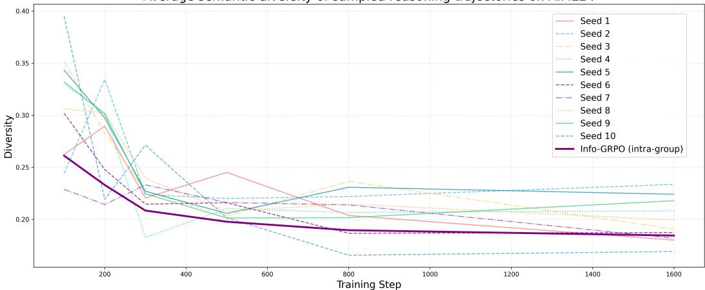  
Figure 5: Per-seed intra-group diversity dynamics of Info-GRPO (Qwen2.5-Math-7B) on AIME24 over an extended training horizon (up to 1600 steps). Each thin curve represents the intra-group diversity for a single latent seed, while the thick curve shows their average, reported as Info-GRPO (Intra-group) in Figure 4(b). Although some seeds exhibit mild early fluctuations, all curves follow a generally downward trend and gradually stabilize, confirming that the averaged curve accurately reflects the typical training behavior across seeds.

## A.6 Case Analysis

Mathematical Samples. Note that in the main text, we only use augmented prompts during training, while evaluation is conducted without prompt augmentation. Here, different augmented seeds are used at evaluation time solely for qualitative case analysis. Figure 6 presents a correlation heatmap for the following mathematical Question 1, and Table 18 reports the rewards of 8 sampled responses under different prompt seeds. In this representative example, we observe that different seeds can lead the model to follow noticeably different solution strategies, which in turn result in different rewards. Specifically, Response 1.1 with reward 1 adopts a more systematic algebraic reasoning process, explicitly deriving variable constraints and exhaustively accounting for all valid configurations, leading to the correct solution, whereas Response 1.2 with reward 0 follows a constructive, casebased reasoning path that prematurely restricts the solution space and consequently misses valid cases. While this observation is based on a single illustrative example and does not imply that all seeds consistently induce such divergent reasoning behaviors, it nonetheless provides qualitative evidence that our correlation-guided approach is capable of steering the model toward different reasoning trajectories and encouraging exploration over alternative solution paths.

## Question 1 (Math)

Find the number of ways to place a digit in each cell of a 2x3 grid so that the sum of the two numbers formed by reading left to right is 999, and the sum of the three numbers formed by reading top to bottom is 99. The grid below is an example of such an arrangement because 8 + 991 = 999 and 9 + 9 + 81 = 99.

<table><tr><td rowspan=1 colspan=1>0</td><td rowspan=1 colspan=1>0</td><td rowspan=1 colspan=1>8</td></tr><tr><td rowspan=1 colspan=1>9</td><td rowspan=1 colspan=1>9</td><td rowspan=1 colspan=1>1</td></tr></table>

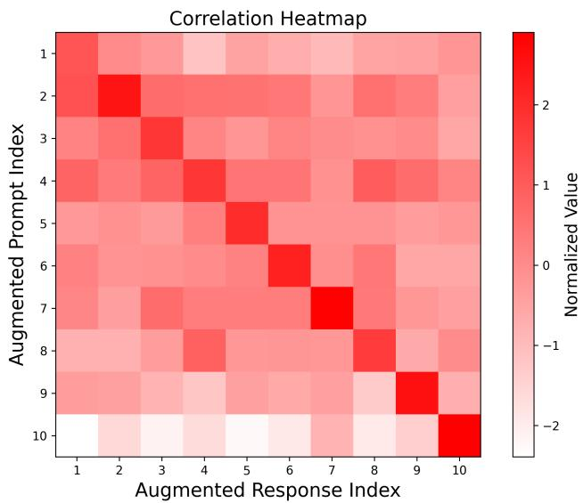  
Figure 6: The correlation heatmap for a case. It is generated by our Info-GRPO based on the DeepSeek-R1-Distill-Qwen-7B models.

Table 18: The scores for 8 responses under different prompt seeds.
<table><tr><td>Response</td><td>No seed</td><td>Seed1</td><td>Seed2</td><td>Seed3</td><td>Seed4</td><td>Seed5</td><td>Seed6</td><td>Seed7</td><td>Seed8</td><td>Seed9</td><td>Seed10</td></tr><tr><td>R1</td><td>1</td><td>1</td><td>0</td><td>1</td><td>1</td><td>1</td><td>0</td><td>1</td><td>1</td><td>1</td><td>1</td></tr><tr><td>R2</td><td>0</td><td>1</td><td>1</td><td>0</td><td>0</td><td>0</td><td>1</td><td>1</td><td>1</td><td>0</td><td>1</td></tr><tr><td>R3</td><td>1</td><td>1</td><td>1</td><td>1</td><td>0</td><td>0</td><td>1</td><td>1</td><td>1</td><td>0</td><td>1</td></tr><tr><td>R4</td><td>0</td><td>0</td><td>1</td><td>0</td><td>1</td><td>0</td><td>0</td><td>1</td><td>1</td><td>1</td><td>1</td></tr><tr><td>R5</td><td>1</td><td>1</td><td>1</td><td>1</td><td>1</td><td>1</td><td>1</td><td>1</td><td>0</td><td>1</td><td>1</td></tr><tr><td>R6</td><td>1</td><td>0</td><td>1</td><td>1</td><td>1</td><td>0</td><td>1</td><td>1</td><td>0</td><td>1</td><td>1</td></tr><tr><td>R7</td><td>1</td><td>1</td><td>1</td><td>1</td><td>1</td><td>1</td><td>1</td><td>1</td><td>1</td><td>1</td><td>0</td></tr><tr><td>R8</td><td>1</td><td>0</td><td>1</td><td>1</td><td>1</td><td>1</td><td>0</td><td>1</td><td>0</td><td>0</td><td>0</td></tr></table>

## Response 1.1 (under seed 1 with reward 1)

Alright, so I’ve got this problem where I need to figure out how many ways there are to place a digit in each cell of a 2×3 grid. The conditions are that the sum of the two numbers formed by reading left to right in each row should be 999, and the sum of the three numbers formed by reading top to bottom in each column should be 99.

Let me try to visualize the grid. It’s a 2×3 grid, meaning there are 2 rows and 3 columns. Each cell will contain a digit from 0 to 9. The example given is:

<table><tr><td rowspan=1 colspan=1>0</td><td rowspan=1 colspan=1>0</td><td rowspan=1 colspan=1>8</td></tr><tr><td rowspan=1 colspan=1>9</td><td rowspan=1 colspan=1>9</td><td rowspan=1 colspan=1>1</td></tr></table>

In this case, reading the first row left to right gives the number 008, which is 8, and the second row gives 991. Adding these together, $8 { \dot { + } } 9 9 1 = 9 9 9$ . For the columns, reading top to bottom, each column gives 09, 09, and 81. Adding these together, $9 + 9 + 8 1 = 9 9 $ Alright, so the key here is to figure out all such possible grids that satisfy these two conditions. Let me break it down.

First, let’s denote the grid cells as follows:

<table><tr><td rowspan=1 colspan=1>a</td><td rowspan=1 colspan=1>b</td><td rowspan=1 colspan=1>C</td></tr><tr><td rowspan=1 colspan=1>d</td><td rowspan=1 colspan=1>e</td><td rowspan=1 colspan=1>f</td></tr></table>

We find that:

$\cdot \ c + f = 9$   
$\cdot \ d = b + c + 1$   
$\bullet a + d = 9$   
$\cdot \ b + e = 9$   
We express the variables in terms of d and c:   
$\cdot \ a = 9 - d$   
$\bullet b = d - c - 1$   
$e = 1 0 - d + c$   
$f = 9 - c$   
We determine the constraints:   
• d ranges from 1 to 9   
• For each d, c ranges from 0 to d − 1   
The number of possible pairs $( c , d )$ is the sum from d = 1 to 9 of the number of c values,   
which is:   
$\sum _ { d = 1 } ^ { 9 } d = { \frac { 9 \times 1 0 } { 2 } } = 4 5$   
Thus, the number of ways to place the digits in the grid is:   
45

## Response 1.2 (under seed 2 with reward 0) Response 1.2 (under seed 2 with reward 0)

Alright, let me try to figure out how to solve this problem. So, we have a 2×3 grid, right? We   
need to place digits in each cell such that two conditions are satisfied:   
1. The sum of the two numbers formed by reading left to right in each row is 999.   
2. The sum of the three numbers formed by reading top to bottom in each column is   
99.   
The key steps are:   
1. The sum of the top digits $A + B + C = 9 .$   
2. The sum of the bottom digits $D + E + F = 9 .$   
3. The sum of the numbers formed by the columns must be 99.   
We analyze the columns:   
• Column 1: col<sub>1</sub> = D if A = 0, otherwise $1 0 A + D$   
$\bullet \mathrm { ~ C o l u m n ~ } 2 \colon \mathrm { c o l } _ { 2 } = E { \mathrm { ~ i f ~ } } B = 0 , { \mathrm { o t h e r w i s e ~ } } 1 0 B + E$   
• Column 3 $: \mathsf { c o l } _ { 3 } = F \mathrm { i f } C = 0 , \mathsf { o t h e r w i s e } 1 0 C + F$   
The sum of these columns must be:   
$\mathrm { c o l } _ { 1 } + \mathrm { c o l } _ { 2 } + \mathrm { c o l } _ { 3 } = 9 9$   
After thorough analysis, we find that the only valid grid is:   
$\bullet \ A = 0 , \ B = 9 , \ C = 0$   
$\bullet \ D = 9 , \ E = 0 , \ F = 0$   
This results in:   
$\bullet \ \mathrm { c o l } _ { 1 } = 9$

• col<sub>2</sub> = 90   
• col<sub>3</sub> = 0   
Thus, the sum of the columns is 9 + 90 + 0 = 99.   
Therefore, the number of such grids is:   
1

Code Samples. We further analyse a code sample in Question 2. The answers obtained from different seeds are provided in Response 2.1 and Response 2.2. It could be observed that although both solutions yield correct outputs, they rely on fundamentally different reasoning abstractions. One solution exploits problem-specific structural independence to collapse the state space, while the other solves the problem via a general-purpose dynamic programming formulation. This illustrates that different latent seeds can induce distinct yet valid reasoning trajectories rather than superficial variations. As a qualitative case, it is offered as an illustration of the seed-conditioned behavioural modes reported quantitatively in Figure 4(b), not as causal evidence that the seeds index separate reasoning manifolds.

Question 2 (Code)   
You will be given a question (problem specification) and will generate a correct Python   
program that matches the specification and passes all tests.   
Question:   
Takahashi has a piano with 100 keys arranged in a row. The i-th key from the left is called   
key i.   
He will play music by pressing N keys one by one. For the i-th press, he will press key A<sub>i</sub>,   
using his left hand if S = L, and his right hand if S = R.   
Before starting to play, he can place both of his hands on any keys he likes, and his fatigue   
level at this point is 0.   
During the performance, if he moves one hand from key x to key y, the fatigue level increases   
by |y − x| (conversely, the fatigue level does not increase for any reason other than moving   
hands).   
To press a certain key with a hand, that hand must be placed on that key.   
Task: Find the minimum possible fatigue level at the end of the performance.   
Input   
The input is given from Standard Input in the following format:   
N   
A\_1 S\_1   
A\_2 S\_2   
A\_N S\_N   
Output   
Print the minimum fatigue level at the end of the performance.   
Constraints   
• 1 ≤ N ≤ 100   
• 1 ≤ A<sub>i</sub> ≤ 100   
• N and A<sub>i</sub> are integers.   
• S<sub>i</sub> is L or R.

Okay, so I’ve got this problem to solve. Let me read it carefully and understand what’s being   
asked.   
The problem is about a piano with 100 keys. Takahashi is going to press N keys in a sequence.   
Each press is either with his left hand (L) or right hand (R). The initial placement of both   
hands can be anywhere, and the goal is to minimize the total fatigue. Fatigue increases when   
moving a hand from one key to another, specifically by the distance moved each time.   
So, the task is to find the minimal possible total fatigue after all the presses. It seems like a   
dynamic programming problem because each step depends on the previous state (where each   
hand is placed). The state of the system after each step is determined by the positions of the   
left and right hands.   
Let’s think about the states. At each step i, the left hand is on some key x, and the right on   
some key y. The initial state is x and y can be any keys, but initially, the fatigue is 0.   
So, the DP transition is as follows:   
For each step i (from 1 to N): For each previous state $( x _ { \mathrm { p r e v } } , y _ { \mathrm { p r e v } } )$ : If S is ‘L‘, then the new   
state is $( A _ { i } , y _ { \mathrm { p r e v } } )$ with cost increase $| A _ { i } ^ { - } - x _ { \mathrm { p r e v } } |$ . Otherwise, the new state is $( x _ { \mathrm { p r e v } } , A _ { i } )$ with   
cost increase $\dot { | } A _ { i } - y _ { \mathrm { p r e v } } |$   
After processing all steps, the minimum value over all states gives the answer.   
......   
Code:   
import sys   
def main():   
N = int(sys.stdin.readline())   
s\_list = []   
for \_ in range(N):   
a, s = sys.stdin.readline().split()   
s\_list.append((int(a), s))   
INF = float(’inf’)   
dp = [[INF] \* 101 for \_ in range(101)]   
# Initialize step 0: all (x, y) have cost 0   
for x in range(1, 101):   
for y in range(1, 101):   
dp[x][y] = 0   
for i in range(N):   
a, s = s\_list[i]   
new\_dp = [[INF] \* 101 for \_ in range(101)]   
for x\_prev in range(1, 101):   
for y\_prev in range(1, 101):   
if dp[x\_prev][y\_prev] == INF:   
continue   
current\_cost = dp[x\_prev][y\_prev]   
if s == ’L’:   
new\_x = a   
new\_y = y\_prev   
cost\_inc = abs(new\_x - x\_prev)   
else:   
new\_x = x\_prev   
new\_y = a   
cost\_inc = abs(new\_y - y\_prev)   
new\_cost = current\_cost + cost\_inc   
if new\_cost < new\_dp[new\_x][new\_y]:   
new\_dp[new\_x][new\_y] = new\_cost

```python
dp = new_dp
min_cost = INF
for x in range(1, 101):
for y in range(1, 101):
if dp[x][y] < min_cost:
min_cost = dp[x][y]
print(min_cost)
if __name__ == ’__main__’:
main()
```

## Response 2.2 (under seed 8 with reward 1)

```julia
Okay, so I have this problem to solve, and I need to find the minimum possible fatigue level
after playing a sequence of piano keys. Hmm, let me read the problem statement again to
make sure I understand it correctly.
So, Takahashi has a piano with 100 keys. Each key press is either with his left or right hand.
For each press, if he uses a hand, it has to be placed on the key before pressing. The fatigue
increases by the absolute difference of the keys when moving the hand. The initial fatigue is
zero. I need to find the minimal total fatigue after all the presses.
The question is to determine the initial positions of his hands and then track the movements
to minimize the total distance moved.
To solve this problem, we need to determine the minimum possible fatigue level after playing
a sequence of piano key presses using either the left or right hand. The fatigue level is
determined by the distance the hands move between consecutive key presses.
Code:
n = int(input())
left = []
right = []
for _ in range(n):
a, s = input().split()
a = int(a)
if s == ’L’:
left.append(a)
else:
right.append(a)
def calculate(arr):
total = 0
for i in range(1, len(arr)):
total += abs(arr[i] - arr[i-1])
return total
left_fatigue = calculate(left)
right_fatigue = calculate(right)
print(left_fatigue + right_fatigue)
```

## A.7 Usage of LLMs

LLMs are employed exclusively for grammar checking in this manuscript. They are not utilized for writing assistance, literature retrieval, or research ideation.