OmniAI Group of ZJU ACES Lab Zhejiang University

# DTCA: Denoising Token Credit Assignment for Reinforcement Learning in Diffusion Language Models

Hongze Chen1, Miao Pan1, Lizhou Liang1, Qinfeng Li1, Xinyin Ma2, Yongliang Shen1, Weishi Wang3, Daniel Dahlmeier3, Xuhong Zhang1, Wenqi Zhang1

1Zhejiang University 2National University of Singapore 3SAP

Difusion language models (DLMs) generate text through iterative denoising, enabling bidirectional context modeling and parallel token refinement. Recent studies have applied reinforcement learning (RL) to DLMs and improved their reasoning performance. However, the iterative denoising process makes credit assignment more challenging, as final outcome rewards provide limited information about how diferent tokens contribute to the final output. In this paper, we propose Denoising Token Credit Assignment (DTCA), a framework for token-level credit assignment in reinforcement learning for difusion language models. DTCA estimates token contributions by measuring the improvement in prediction confidence of remaining masked positions after token commitment and groups these signals according to part-of-speech (POS) categories. These contribution weights are used to select informative denoising timesteps and assign token-level learning signals during RL training. DTCA further calibrates these learning signals according to token-level entropy changes induced by policy updates. Experiments on LLaDA-8B-Instruct show that DTCA consistently improves mathematical reasoning performance across diferent generation budgets, with gains of up to 9.0 points on MATH500 and 5.3 points on GSM8K over the base model.

Project: https://zju-omniai.github.io/DTCA/ § Code: https://github.com/ZJU-OmniAI/DTCA # Email: 22651304@zju.edu.cn

## 1 Introduction

Difusion language models (DLMs) have recently attracted increasing attention as an emerging paradigm for language modeling due to their ability to model bidirectional context and perform parallel token refine ment (Labs et al., 2025; Google DeepMind, 2025; Song et al., 2025), ofering an alternative to autoregressive generation (Nie et al., 2025; Sahoo et al., 2024; Ye et al., 2025a; Yu et al., 2025). Recent studies have explored reinforcement learning for DLMs by leveraging the generation process, mainly constructing learning signals from denoising trajectories or intermediate states during training (He et al., 2026; Wang et al., 2025b; Oba et al., 2026; Monsefi et al., 2026; Huang et al., 2025). However, DLMs generate sequences through multiple denoising steps, where tokens are gradually committed and each commitment can afect the refinement of remaining masked positions (Ou et al., 2025). Therefore, RL optimization in DLMs requires finer-grained credit assignment that considers how diferent tokens afect subsequent refinement.

Achieving finer grained credit assignment requires estimating the contribution of individual tokens during DLM denoising. Specifically, we measure token contribution by how much a committed token improves the model’s prediction confidence on the remaining masked positions. However, directly estimating such token-level confidence improvements during RL training is challenging because multiple tokens are committed at the same denoising step and interact through the shared denoising process, making their individual efects dificult to isolate. Moreover, the estimated contribution can vary substantially across diferent rollout samples.

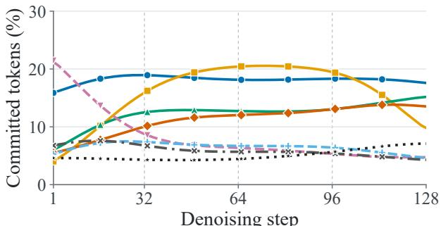  
(a) Commitment trajectories

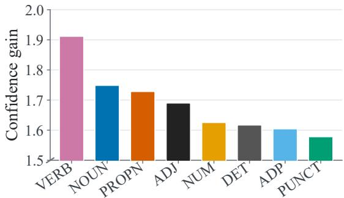  
(b) Confidence gain  
Figure 1 Preliminary analysis of POS-level diferences in DLM denoising using rollouts generated from the GSM8K (Cobbe et al., 2021) training set. (a) Commitment timing of diferent POS categories across denoising steps. (b) Improvement in the prediction confidence of remaining masked positions after individual token commitment, averaged within each POS category. POS tags denote NOUN (noun), NUM (numeral), PUNCT (punctuation), PROPN (proper noun), VERB (verb), ADP (adposition), DET (determiner), and ADJ (adjective).

To obtain more reliable estimates, we categorize tokens by part-of-speech (POS) categories and aggregate their refinement efects within each category. POS categories provide a natural grouping criterion because they capture diferent linguistic functions, with nouns and verbs typically carrying lexical information while determiners and adpositions mainly providing grammatical structure (de Marnefe et al., 2021).

The denoising behaviors of diferent POS categories are further analyzed using rollouts generated from the GSM8K (Cobbe et al., 2021) dataset. As shown in Figure 1(a), diferent POS categories exhibit distinct commitment trajectories across denoising steps. NOUN maintains a relatively high commitment ratio, whereas VERB has a high ratio at the beginning that declines substantially over the denoising process. Other categories, such as ADP, DET, and ADJ, exhibit relatively lower commitment ratios with more stable variations. Figure 1(b) further shows the confidence gain associated with diferent POS categories. Clear diferences emerge across categories: VERB achieves the largest confidence gain, followed by NOUN and PROPN, whereas categories such as DET and ADP show relatively smaller gains. These observations indicate that POS categories capture diferent denoising behaviors and refinement efects, making them a useful basis for grouping tokens and estimating contribution weights.

Based on these observations, we propose Denoising Token Credit Assignment (DTCA), a token-level credit assignment framework for reinforcement learning in difusion language models. DTCA estimates token contributions from denoising refinement signals and aggregates them into POS-level contribution weights to obtain more stable and interpretable learning signals. These contribution signals are then used to select informative denoising timesteps and derive token-level learning signals during RL optimization. DTCA further incorporates an entropy-based credit calibration module inspired by OPEFO (Xu et al., 2026) to calibrate the learning signals according to token-level entropy changes induced by policy updates. Experiments on LLaDA-8B-Instruct show that DTCA consistently improves mathematical reasoning performance across diferent generation budgets, with improvements of up to 9.0 percentage points on MATH500 (Lightman et al., 2024) and 5.3 percentage points on GSM8K (Cobbe et al., 2021) over the base model.

The main contributions are summarized as follows:

• We analyze diferent denoising behaviors across POS categories in difusion language models and use POS categories to estimate the efect of token commitments on subsequent refinement.

• We propose DTCA, a token-level credit assignment framework that aggregates denoising refinement signals by POS categories and uses the resulting contribution weights for denoising timestep selection and token credit assignment. DTCA further adapts entropy-based credit calibration from OPEFO (Xu et al., 2026) to the difusion language model setting for improved RL optimization.

• Extensive experiments demonstrate the efectiveness of DTCA on mathematical reasoning benchmarks and validate the benefits of its key components.

## 2 Preliminaries

## 2.1 Diffusion Language Model Denoising

Masked difusion language models generate responses through iterative denoising (Nie et al., 2025; Sahoo et al., 2024). Given a prompt q, let $\tau = ( x _ { T } , x _ { T - 1 } , . . . , x _ { 0 } )$ denote a sampled trajectory, where $x _ { t }$ is the partially masked response at denoising step t and $x _ { 0 }$ is the completed response. Under the monotonic unmasking schedule used in this work, each step reveals a subset of masked positions as predicted tokens; we call this token commitment. Committed tokens remain visible in subsequent states and can influence predictions at the remaining masked positions. The distribution $\pi _ { \theta } ( y \mid q )$ below is the response distribution induced by this iterative sampling procedure, not an autoregressive token factorization.

## 2.2 Reinforcement Learning for Diffusion Language Models

Given prompts $q \sim \mathcal { D }$ and sampled responses $y \sim \pi _ { \boldsymbol { \theta } } ( \cdot \mid q ) $ , reinforcement learning seeks to maximize expected sequence-level reward:

$$
\mathcal { I } ( \theta ) = \mathbb { E } _ { q \sim \mathcal { D } , y \sim \pi _ { \theta } ( . | q ) } [ R ( q , y ) ] .\tag{1}
$$

Group-relative policy optimization converts rewards from multiple responses to the same prompt into response advantages (Shao et al., 2024). In masked difusion RL, these advantages can be applied to predictions at selected denoising states (He et al., 2026). Let $\tau$ be the selected steps, $B _ { t }$ their optimization target positions, and $v _ { i }$ the target token at position i. A schematic token-level surrogate is

$$
\mathcal { L } _ { \mathrm { R L } } ( \theta ) = - \mathbb { E } \left[ \frac { 1 } { N } \sum _ { t \in \mathcal { T } } \sum _ { i \in \mathcal { B } _ { t } } A _ { t , i } \log \pi _ { \theta } ( v _ { i } \mid q , x _ { t } ) \right] + \beta _ { \mathrm { K L } } \mathcal { L } _ { \mathrm { K L } } ,\tag{2}
$$

where $\begin{array} { r } { N = \sum _ { t \in \mathcal { T } } | B _ { t } | } \end{array}$ and ${ \mathcal { L } } _ { \mathrm { K L } }$ denotes a penalty relative to a frozen reference policy (Shao et al., 2024; He et al., 2026). The exact target set, credit $A _ { t , i } ,$ KL estimator, and update loss used by DTCA are specified below and in Appendix B. A sequence-level reward alone does not identify which commitments help subsequent denoising; this motivates assigning credit at the denoising-state and target-token levels.

## 3 Method

We propose Denoising Token Credit Assignment (DTCA), a token credit assignment framework for reinforcement learning in difusion language models. As illustrated in Figure 2, DTCA estimates token contributions from denoising refinement dynamics and uses the resulting contribution weights for informative denoising state selection and token-level credit assignment. DTCA further calibrates the token-level learning signals according to entropy changes induced by policy updates.

## 3.1 Token Contribution Estimation by POS Category

As illustrated in Figure 2, DTCA estimates token-level refinement contributions from denoising dynamics and aggregates these estimates into category-level contribution weights. Given a denoising trajectory τ , diferent token commitments may have diferent efects on subsequent refinement. DTCA therefore estimates the refinement contribution of each committed token by measuring the improvement in prediction confidence of the remaining masked positions after the commitment.

Specifically, for each individual token commitment at denoising step t, let M denote the response positions that remain masked both before and after the commitment, excluding the committed position i. Given a fixed prompt q, we define the aggregate prediction confidence of a denoising state x over M as the sum of the maximum prediction probabilities at those positions:

$$
F ( x ; \mathcal { M } ) = \sum _ { j \in \mathcal { M } } \operatorname* { m a x } _ { v \in \mathcal { V } } p _ { \theta , j } ( v \mid q , x ) ,\tag{3}
$$

where $j$ indexes a masked position, $\nu$ is the vocabulary, and $p _ { \theta , j } ( v \mid q , x )$ is the probability assigned to token v at position $j$ conditioned on prompt $q$ and denoising state x. For a committed token $v _ { i } ,$ its refinement contribution estimate is computed as:

$$
\begin{array} { r } { \Delta P _ { i } = \operatorname* { m a x } \left( 0 , F ( x _ { t } ^ { ( i ) } ; \mathcal { M } ) - F ( x _ { t } ; \mathcal { M } ) \right) , } \end{array}\tag{4}
$$

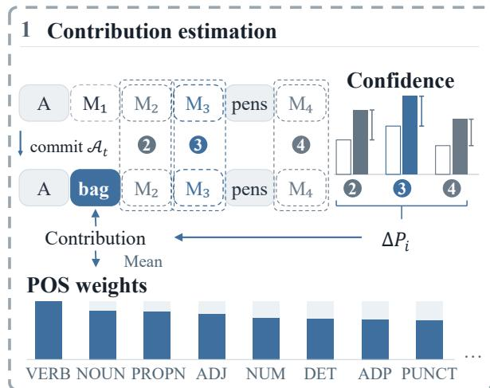

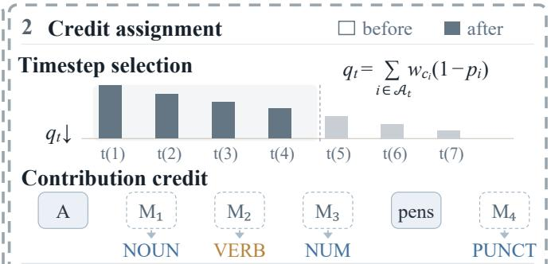

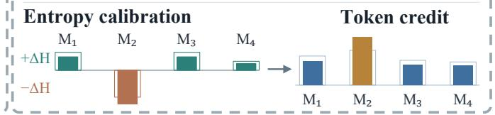  
Figure 2 Overview of Denoising Token Credit Assignment (DTCA). DTCA estimates token contributions from denoising refinement dynamics and uses the resulting contribution weights for denoising state selection and token-level credit assignment. The obtained learning signals are further calibrated according to entropy changes induced by policy updates for reinforcement learning optimization.

where $\boldsymbol { x } _ { t } ^ { ( i ) }$ denotes the denoising state after committing token $v _ { i }$ individually. Negative total changes are set to zero; the estimate is not divided by the number of remaining masks. A larger $\Delta P _ { i }$ indicates a stronger estimated refinement efect of the committed token on subsequent denoising.

Obtaining reliable token-level estimates directly during RL training is challenging because evaluating individual token efects requires re-evaluating token commitments with additional forward passes, introducing substantial computational overhead during policy optimization. Moreover, these estimates can vary across diferent rollout samples. Therefore, DTCA constructs contribution estimates from ofline denoising rollouts before RL training and groups them according to part-of-speech (POS) categories to obtain more stable category-level contribution weights.

During ofline estimation, DTCA uses a denoising budget equal to half of the maximum generation length. At each denoising step, two tokens are committed, and DTCA evaluates each token separately through additional forward passes based on the confidence improvement of remaining masked positions. These estimates are aggregated at the POS level to reduce variance across rollouts.

For each committed token $v _ { i } ,$ we assign its POS category as $c _ { i } = \phi ( v _ { i } )$ . The contribution of each POS category is obtained by averaging the refinement contribution estimates of tokens belonging to that category:

$$
m _ { c } = \frac { 1 } { N _ { c } } \sum _ { i : c _ { i } = c } \Delta P _ { i } ,\tag{5}
$$

where $N _ { c }$ denotes the number of committed tokens in POS category c. The resulting category-level contribution $m _ { c }$ represents the average refinement efect estimated for tokens in each category.

POS Contribution Weight Construction. The estimated POS contributions are normalized into bounded contribution weights:

$$
w _ { c } = 0 . 8 + 0 . 4 \frac { m _ { c } - \operatorname* { m i n } _ { j \in \mathcal { C } } m _ { j } } { \operatorname* { m a x } _ { j \in \mathcal { C } } m _ { j } - \operatorname* { m i n } _ { j \in \mathcal { C } } m _ { j } } ,\tag{6}
$$

where C denotes the set of POS categories. The weight $w _ { c }$ lies in the range [0.8, 1.2] and represents the scaling factor derived from the estimated refinement contribution of category c. We constrain this range to prevent excessive credit scaling while preserving the original RL objective. These weights are used to adjust token-level credits during RL optimization.

## 3.2 Contribution-Based Timestep Selection

The category contribution weights are also used to identify informative denoising timesteps for RL training. Following RLDF (He et al., 2026), DTCA optimizes only a subset of denoising timesteps from each rollout. For a denoising timestep $t ,$ let $\boldsymbol { A } _ { t }$ denote the set of tokens committed at this step. We compute the importance score of each timestep as:

$$
q _ { t } = \sum _ { i \in \mathcal { A } _ { t } } w _ { c _ { i } } ( 1 - p _ { i } ) ,\tag{7}
$$

where $p _ { i }$ denotes the confidence of token i when it is committed and $w _ { c _ { i } }$ denotes the contribution weight of its POS category. The term $1 - p _ { i }$ assigns higher scores to timesteps containing lower-confidence token commitments, while $w _ { c _ { i } }$ incorporates the estimated refinement contribution of the committed tokens.

DTCA ranks denoising timesteps according to $q _ { t }$ and selects the smallest set of timesteps whose cumulative score reaches a predefined fraction $\mu$ of the total score. The number of selected timesteps therefore adapts to the distribution of contribution signals in each rollout. Lower and upper bounds are applied to the number of selected timesteps for stable and eficient training.

## 3.3 Contribution-Based Credit Assignment

The category contribution weights are used to assign diferent credits to tokens within each selected denoising timestep. For a selected timestep t, let $B _ { t }$ denote the tokens used for optimization, including the committed tokens at timestep t and the retained masked positions selected by the threshold-based filtering strategy in RLDF (He et al., 2026). POS categories for all tokens in $B _ { t }$ are obtained from the completed rollout, where retained masked positions are associated with their final predicted tokens. The credit weight of token $v _ { i }$ is determined by the contribution weight of its POS category:

$$
a _ { t , i } = \frac { w _ { c _ { i } } } { \frac { 1 } { | \mathcal { B } _ { t } | } \sum _ { k \in \mathcal { B } _ { t } } w _ { c _ { k } } } ,\tag{8}
$$

where $c _ { i }$ is the POS category of token $v _ { i } .$ . The normalization keeps the average credit within each timestep equal to one, so that the overall scale of the timestep advantage remains unchanged. Given the original timestep advantage $A _ { t }$ , DTCA computes the token-level learning signal as

$$
A _ { t , i } = a _ { t , i } A _ { t } .\tag{9}
$$

Tokens from categories with larger contribution weights receive stronger learning signals, while tokens from categories with smaller contribution receive weaker signals. In this way, DTCA transforms the original response-level feedback into more fine grained token credit during RL training.

## 3.4 Entropy-Based Credit Calibration

Although DTCA provides token-level learning signals according to denoising contribution, diferent denoising states may induce diferent entropy changes during policy updates. To further calibrate the token-level learning signals, DTCA incorporates an entropy-based credit calibration module inspired by OPEFO (Xu et al., 2026). Unlike the original formulation for autoregressive generation, we adapt the token-level entropy change estimation to selected denoising states and their remaining target positions in difusion language models.

For each response $b ,$ selected denoising state $t ,$ and remaining target position i, the entropy change induced by the policy update is estimated as:

$$
\Delta H _ { t , i } ^ { ( b ) } = - \eta A _ { t , i } ^ { ( b ) } ( 1 - p _ { i } ^ { ( b ) } ) ^ { 2 } ( \log p _ { i } ^ { ( b ) } + H _ { i } ^ { ( b ) } ) ,\tag{10}
$$

where $p _ { i } ^ { ( b ) }$ denotes the probability assigned by the current policy to the target token and $H _ { i } ^ { ( b ) }$ denotes the entropy of the full prediction distribution at this position. This formulation follows the first-order entropy change estimation of OPEFO (Xu et al., 2026) while replacing autoregressive decoding steps with selected denoising states and target positions.

Within each response, the entropy-increasing and entropy-decreasing updates are separated according to the sign of $\Delta H _ { t , i } ^ { ( b ) }$ :

$$
S _ { b } ^ { + } = \{ ( t , i ) | \Delta H _ { t , i } ^ { ( b ) } > 0 \} , \qquad S _ { b } ^ { - } = \{ ( t , i ) | \Delta H _ { t , i } ^ { ( b ) } < 0 \} .\tag{11}
$$

Following OPEFO (Xu et al., 2026), we compute a separate entropy flow balancing coeficient for each response:

$$
\lambda _ { b } = \mathrm { c l i p } \left( \frac { \sum _ { ( t , i ) \in S _ { b } ^ { - } } | \Delta H _ { t , i } ^ { ( b ) } | - \sum _ { ( t , i ) \in S _ { b } ^ { + } } \Delta H _ { t , i } ^ { ( b ) } } { \sum _ { ( t , i ) \in S _ { b } ^ { - } } | \Delta H _ { t , i } ^ { ( b ) } | + \sum _ { ( t , i ) \in S _ { b } ^ { + } } \Delta H _ { t , i } ^ { ( b ) } } , - 0 . 9 5 , 0 . 9 5 \right) .\tag{12}
$$

The entropy balancing coeficient is then used to rescale token-level learning signals to balance entropyincreasing and entropy-decreasing updates. When $\lambda _ { b } > 0$ , entropy-increasing updates are amplified and entropy-decreasing updates are attenuated. When $\lambda _ { b } < 0$ , the adjustment is reversed. When $\lambda _ { b } = 0$ , the credits remain unchanged:

$$
\hat { A } _ { t , i } ^ { ( b ) } = \left\{ { ( 1 + \lambda _ { b } ) } A _ { t , i } ^ { ( b ) } , \quad \Delta H _ { t , i } ^ { ( b ) } > 0 , \right.\tag{13}
$$

## 4 Experiments

## 4.1 Experimental Setup

Model and data. We initialize RL training from LLaDA-8B-Instruct (Nie et al., 2025) without additional SFT. Following RLDF (He et al., 2026), we use the MATH (Hendrycks et al., 2021) training split with the same data processing pipeline for RL optimization. To construct the fixed POS contribution table, DTCA collects ofline denoising rollouts from the training data of MATH and GSM8K and builds a shared POS contribution table without updating model parameters.

Training. We train LLaDA-8B-Instruct with reinforcement learning without an intermediate SFT stage. For each rollout, DTCA selects denoising states with the highest POS-weighted uncertainty scores until covering 70% of the total score mass, with the number of selected states constrained between 2 and 32. We perform policy optimization using group-relative advantages and regularize the policy against a frozen reference model with the k3 KL estimator (Schulman, 2020). Rollouts are generated using block-wise decoding with KV cache, following Fast-dLLM (Wu et al., 2026b). Full implementation details and hyperparameters are provided in Appendix C.

Evaluation and baselines. We evaluate mathematical reasoning performance on MATH500 (Lightman et al., 2024) and GSM8K (Cobbe et al., 2021) using final-answer accuracy. Following prior work, we evaluate all models under generation budgets of 128, 256, and 512, with denoising steps matched to the corresponding maximum generation lengths. We compare DTCA with LLaDA-8B-Instruct, Uniform SFT, LLaDA-1.5, and representative reinforcement learning methods for difusion language models, including d1 (Zhao et al., 2025), ESPO (Ou et al., 2026), TraceRL (Wang et al., 2025b), Coupled-GRPO (Gong et al., 2026), and RLDF (He et al., 2026). Additional details on training configurations and baseline evaluation settings are provided in Appendix C.2 and Appendix C.4.

## 4.2 Main Results

Table 1 compares DTCA with supervised and reinforcement learning baselines on MATH500 and GSM8K. DTCA consistently improves over LLaDA-8B-Instruct across both benchmarks and all evaluated generation budgets. On MATH500, DTCA improves the base model by 9.0, 6.8, and 4.8 percentage points at budgets of 128, 256, and 512, respectively. On GSM8K, the corresponding improvements are 5.3, 2.1, and 2.5 percentage points. These results show that DTCA provides consistent gains under diferent denoising budgets rather than relying on a specific inference setting. Compared with supervised optimization and existing difusion language model reinforcement learning methods, DTCA achieves competitive performance across the reported settings, demonstrating the efectiveness of the proposed token-level credit assignment framework.

The largest improvements on both benchmarks occur at the smallest evaluated generation budget of 128, while gains remain positive at budgets of 256 and 512. Although the relative improvements become smaller at larger generation budgets, DTCA consistently improves over the base model, highlighting its stronger gains under limited denoising computation.

Table 1 Mathematical reasoning accuracy (%) on MATH500 and GSM8K. The last rows report DTCA, its ablation variants, and the improvement over the base model. Boldface indicates the best result in each column, and ∆ denotes the improvement over LLaDA-8B-Instruct.
<table><tr><td rowspan="2">Method</td><td colspan="3">MATH500</td><td colspan="3">GSM8K</td></tr><tr><td>128</td><td>256</td><td>512</td><td>128</td><td>256</td><td>512</td></tr><tr><td>LLaDA-8B-Instruct (Nie et al., 2025)</td><td>30.8</td><td>36.4</td><td>39.2</td><td>75.3</td><td>83.2</td><td>82.9</td></tr><tr><td>LLaDA-1.5 (Zhu et al., 2026)</td><td>32.6</td><td>39.4</td><td>39.8</td><td>76.2</td><td>81.6</td><td>83.0</td></tr><tr><td>Uniform SFT</td><td>24.6</td><td>30.0</td><td>32.6</td><td>74.8</td><td>80.7</td><td>78.6</td></tr><tr><td>d1 (Zhao et al., 2025)</td><td>33.6</td><td>37.6</td><td>37.2</td><td>75.8</td><td>82.4</td><td>81.8</td></tr><tr><td>ESPO (Ou et al., 2026)</td><td>37.6</td><td>38.0</td><td>40.2</td><td>78.1</td><td>83.2</td><td>84.0</td></tr><tr><td>TraceRL (Wang et al., 2025b)</td><td>32.6</td><td>34.2</td><td>34.0</td><td>76.6</td><td>80.4</td><td>81.8</td></tr><tr><td>Coupled-GRPO (Gong et al., 2026)</td><td>35.2</td><td>40.2</td><td>40.2</td><td>78.0</td><td>83.6</td><td>83.2</td></tr><tr><td>RLDF (He et al., 2026)</td><td>36.2</td><td>41.2</td><td>42.6</td><td>77.2</td><td>83.4</td><td>82.7</td></tr><tr><td>DTCA w/o Entropy Calibration</td><td>37.4</td><td>41.8</td><td>39.8</td><td>78.3</td><td>83.9</td><td>81.9</td></tr><tr><td>DTCA w/o Contribution Credit</td><td>36.2</td><td>39.4</td><td>41.2</td><td>77.1</td><td>82.9</td><td>82.3</td></tr><tr><td>DTCA (ours)</td><td>39.8</td><td>43.2</td><td>44.0</td><td>80.6</td><td>85.3</td><td>85.4</td></tr><tr><td>∆ vs. Base</td><td>+9.0</td><td>+6.8</td><td>+4.8</td><td>+5.3</td><td>+2.1</td><td>+2.5</td></tr></table>

DTCA DTCA w/o Contribution Credit DTCA w/o Entropy Calibration

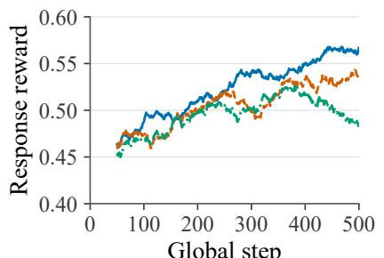  
(a) Reward

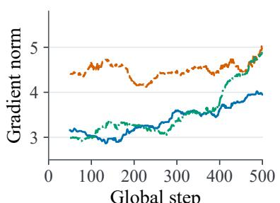  
(b) Gradient norm

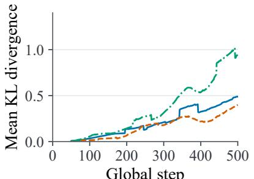  
(c) KL divergence  
Figure 3 Optimization dynamics of DTCA variants during RL training. (a) Response reward, (b) gradient norm, and (c) mean KL divergence. DTCA is compared with variants without Contribution Credit and Entropy Calibration.

## 4.3 Ablation Study

Table 1 reports ablation results for diferent DTCA components. DTCA w/o Contribution Credit replaces the contribution-based token credits with uniform credits while keeping the same timestep selection strategy. DTCA w/o Entropy Calibration removes the entropy-based credit calibration module while preserving contribution-based credit assignment and timestep selection.

Removing either component decreases performance compared with the full DTCA model across both benchmarks and diferent generation budgets. At the 256 generation budget, removing Contribution Credit leads to decreases of 3.8 and 2.4 percentage points on MATH500 and GSM8K, respectively, while removing Entropy Calibration results in smaller drops of 1.4 and 1.4 points. At the 512 generation budget, removing Entropy Calibration causes larger performance decreases, with drops of 4.2 and 3.5 points on MATH500 and GSM8K. These results show that both components contribute to the overall performance of DTCA.

## 4.4 Analysis of Optimization Dynamics

To understand how diferent DTCA components influence RL optimization, we analyze training dynamics in terms of reward, gradient norm, and KL divergence. Figure 3 compares DTCA with variants without Contribution Credit and Entropy Calibration during training.

Removing Contribution Credit results in similar reward trajectories to DTCA, but leads to substantially diferent update behaviors. In particular, the variant with uniform credit assignment consistently exhibits larger gradient norms throughout training while achieving comparable reward improvements. This suggests that contribution-based credit assignment mainly afects the quality of token-level learning signals, allowing the model to optimize with diferent update dynamics rather than simply changing the final reward trend. By considering token-level contribution diferences, DTCA provides a more structured learning signal than uniform credit assignment.

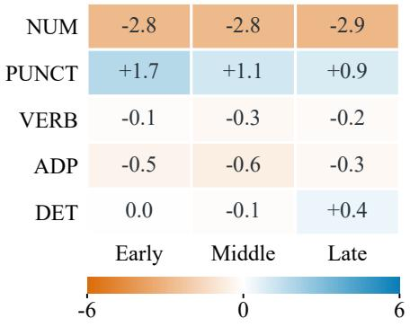  
(a) Commitment ratio

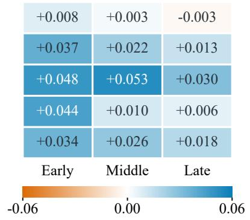  
(b) Confidence

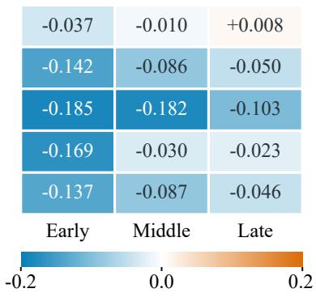  
(c) Entropy change  
Figure 4 Analysis of commitment dynamics on MATH500. DTCA is compared with the base model across three denoising stages. Each cell shows the diference in (a) token commitment ratio, (b) confidence at commitment, and (c) entropy at commitment.

Removing Entropy Calibration mainly afects the stability of later-stage policy updates. Although its reward trajectory initially follows a similar trend, the variant without entropy calibration shows a faster increase in KL divergence and lower reward in later training stages. This indicates that entropy calibration helps control policy changes by adjusting learning signals according to entropy changes, leading to more stable optimization during RL training.

## 4.5 Analysis of Token Commitment Dynamics

To understand whether contribution-based credit assignment changes the denoising behavior of difusion language models, we analyze token commitment patterns after RL training. Token commitment reflects when tokens become fixed during denoising, while the commitment distribution and prediction states provide insights into the learned denoising behavior. Figure 4 compares DTCA with the base model on MATH500 across early, middle, and late denoising stages. Each cell reports the diference between DTCA and the base model in token commitment ratio, prediction confidence at commitment, and target entropy at commitment.

DTCA changes the commitment distribution across token categories rather than uniformly shifting all commitments. For example, DTCA consistently reduces the commitment ratio of NUM tokens while increasing the commitment ratio of PUNCT tokens across diferent denoising stages. These changes suggest that DTCA learns diferent commitment patterns across token categories instead of simply accelerating or delaying all token predictions. Notably, changes in commitment frequency do not always correspond to changes in commitmen states. For example, VERB shows limited changes in commitment ratio but substantial increases in confidence and reductions in entropy at commitment. This indicates that DTCA influences not only which tokens are committed, but also the model states when commitments occur. The observed changes are consistent with leveraging denoising refinement signals to improve token-level credit assignment during reinforcement learning.

## 4.6 Analysis of Entropy-Based Credit Calibration

We study how entropy calibration changes token credits and prediction entropy across POS categories. We compare DTCA with a variant that keeps the same contribution-based credit assignment and timestep selection but removes entropy calibration. Figure 5 shows the entropy changes during training. Positive values mean increased entropy, and negative values mean decreased entropy. Values in parentheses show the relative change in assigned credit after calibration. We compare these credit changes with the entropy curves for each category.

In Figure 5, the two variants show similar entropy changes early in training and gradually diverge later. For most of the shown POS categories, DTCA has a lower curve late in training. Each curve shows changes relative to that run’s early training average. For example, without calibration, the NUM curve rises above zero after about 200 updates and stays positive for most of the remaining steps. DTCA stays near or below zero for most of this period. For SYM, the curve without calibration returns toward zero late in training, while DTCA remains negative. AUX shows the opposite pattern. Its curve without calibration drops sharply below zero near the end, while the DTCA curve stays close to zero. The diferences between the two variants therefore vary across POS categories, rather than following the same direction for all categories.

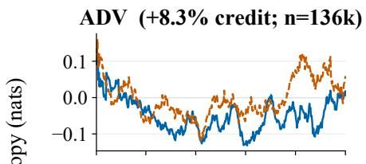

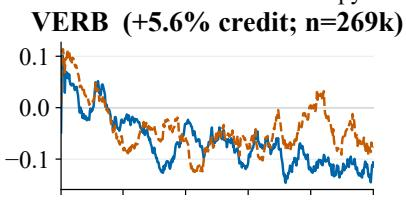

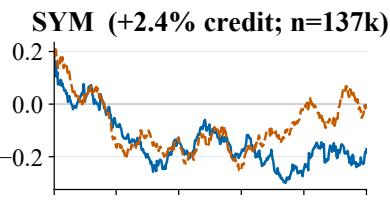

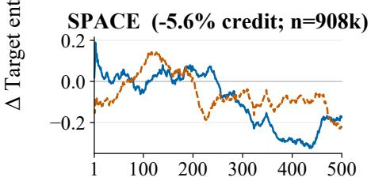

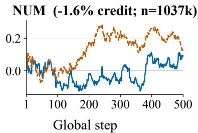

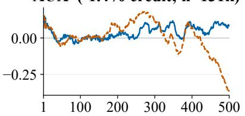  
Figure 5 Analysis of entropy-based credit calibration. Each panel shows the target entropy change of a POS category during RL training. The blue solid and orange dashed curves represent DTCA and DTCA without entropy calibration, respectively. The vertical axis shows the diference between the mean predictive entropy over the most recent 25 updates and the mean over the first 100 updates of the same run. Percentages in parentheses show the relative change in assigned credit after entropy calibration, and n is the number of tokens counted.

Credit changes and entropy changes do not always follow the same direction. For example, SYM receives more credit but stays below its early entropy average late in training. AUX receives less credit but ends above its early average. Credit changes the strength of the existing policy update. Whether entropy rises or falls also depends on the advantage signal, the current prediction distribution, and the target token. Compared with OPEFO (Xu et al., 2026), DTCA applies entropy flow balancing after assigning POS-based credits. Within each response, updates in the same entropy-change set share a scaling factor. This factor and the final normalization preserve the credit ratios within that set. Thus, entropy flow balancing still leaves diferent credits for tokens with diferent POS contribution weights. The two runs also see diferent denoising states and diferent mixes of target tokens as training progresses. The curves therefore show overall training trends, rather than measuring the same tokens immediately before and after a single policy update.

## 5 Conclusion

We presented Denoising Token Credit Assignment (DTCA), a framework for fine-grained token-level credit assignment in reinforcement learning for difusion language models. DTCA estimates token contributions from the confidence improvement of remaining masked positions after token commitment, aggregates these signals by POS categories, and uses the resulting contribution weights for denoising timestep selection and token-level credit assignment. DTCA further calibrates contribution credits according to entropy changes induced by policy updates, balancing entropy-increasing and entropy-decreasing updates. On LLaDA-8B-Instruct, DTCA improves the reproduced base model by 6.8 percentage points on MATH500 and 2.1 points on GSM8K under the 256-step evaluation setting. Training dynamics and component ablations show that contribution-based credit assignment improves token-level learning signals, while entropy-based calibration helps maintain more stable policy updates. These results demonstrate that denoising dynamics provide useful information for fine-grained credit assignment in reinforcement learning for difusion language models.

## References

Jacob Austin, Daniel D. Johnson, Jonathan Ho, Daniel Tarlow, and Rianne van den Berg. 2021. Structured denoising difusion models in discrete state-spaces. In Advances in Neural Information Processing Systems, volume 34, pages 17981–17993. Curran Associates, Inc.

Daixuan Cheng, Shaohan Huang, Xuekai Zhu, Bo Dai, Xin Zhao, Zhenliang Zhang, and Furu Wei. 2026. Reasoning with exploration: An entropy perspective. Proceedings of the AAAI Conference on Artificial Intelligence, 40(36):30377– 30385.

Karl Cobbe, Vineet Kosaraju, Mohammad Bavarian, Mark Chen, Heewoo Jun, Lukasz Kaiser, Matthias Plappert, Jerry Tworek, Jacob Hilton, Reiichiro Nakano, Christopher Hesse, and John Schulman. 2021. Training verifiers to solve math word problems. Preprint, arXiv:2110.14168.

Ganqu Cui, Lifan Yuan, Zefan Wang, Hanbin Wang, Yuchen Zhang, Jiacheng Chen, Wendi Li, Bingxiang He, Yuchen Fan, Tianyu Yu, Qixin Xu, Weize Chen, Jiarui Yuan, Huayu Chen, Kaiyan Zhang, Xingtai Lv, Shuo Wang, Yuan Yao, Xu Han, et al. 2025. Process reinforcement through implicit rewards. Preprint, arXiv:2502.01456.

Marie-Catherine de Marnefe, Christopher D. Manning, Joakim Nivre, and Daniel Zeman. 2021. Universal dependencies. Computational Linguistics, 47(2):255–308.

Sander Dieleman, Laurent Sartran, Arman Roshannai, Nikolay Savinov, Yaroslav Ganin, Pierre H. Richemond, Arnaud Doucet, Robin Strudel, Chris Dyer, Conor Durkan, Curtis Hawthorne, Rémi Leblond, Will Grathwohl, and Jonas Adler. 2022. Continuous difusion for categorical data. Preprint, arXiv:2211.15089.

Zitian Gao, Haoming Luo, Lynx Chen, Jason Klein Liu, Ran Tao, Joey Zhou, and Bryan Dai. 2025. What makes difusion language models super data learners? Preprint, arXiv:2510.04071.

Shansan Gong, Ruixiang Zhang, Huangjie Zheng, Jiatao Gu, Navdeep Jaitly, Lingpeng Kong, and Yizhe Zhang. 2026. Difucoder: Understanding and improving masked difusion models for code generation. In International Conference on Learning Representations, volume 2026, pages 15723–15750.

Google DeepMind. 2025. Gemini difusion. https://deepmind.google/models/gemini-diffusion. Accessed: 2025-05-24.

Ishaan Gulrajani and Tatsunori B Hashimoto. 2023. Likelihood-based difusion language models. In Advances in Neural Information Processing Systems, volume 36, pages 16693–16715. Curran Associates, Inc.

Daya Guo, Dejian Yang, Haowei Zhang, Junxiao Song, Peiyi Wang, Qihao Zhu, Runxin Xu, Ruoyu Zhang, Shirong Ma, Xiao Bi, et al. 2025. Deepseek-r1 incentivizes reasoning in llms through reinforcement learning. Nature, 645(8081):633–638.

Haoyu He, Katrin Renz, Yong Cao, and Andreas Geiger. 2025. Mdpo: Overcoming the training-inference divide of masked difusion language models. Preprint, arXiv:2508.13148.

Qi He, Huan Chen, Ya Guo, Huijia Zhu, Yi R. Fung, and Baojian Zhou. 2026. Reinforcement learning from denoising feedback. Preprint, arXiv:2605.25638.

Dan Hendrycks, Collin Burns, Saurav Kadavath, Akul Arora, Steven Basart, Eric Tang, Dawn Song, and Jacob Steinhardt. 2021. Measuring mathematical problem solving with the math dataset. Preprint, arXiv:2103.03874.

Jonathan Ho, Ajay Jain, and Pieter Abbeel. 2020. Denoising difusion probabilistic models. In Advances in Neural Information Processing Systems, volume 33, pages 6840–6851. Curran Associates, Inc.

Emiel Hoogeboom, Didrik Nielsen, Priyank Jaini, Patrick Forré, and Max Welling. 2021. Argmax flows and multinomial difusion: Learning categorical distributions. In Advances in Neural Information Processing Systems, volume 34, pages 12454–12465. Curran Associates, Inc.

Zemin Huang, Zhiyang Chen, Zijun Wang, Tiancheng Li, and Guo-Jun Qi. 2025. Reinforcing the difusion chain of lateral thought with difusion language models. In Advances in Neural Information Processing Systems, volume 38, Main Conference, pages 152677–152710. Curran Associates, Inc.

Haozhe Jiang, Haiwen Feng, Pieter Abbeel, Jiantao Jiao, Angjoo Kanazawa, and Nika Haghtalab. 2026. Dipod: Difusion policy optimization without drifting apart. Preprint, arXiv:2606.13795.

Amirhossein Kazemnejad, Milad Aghajohari, Eva Portelance, Alessandro Sordoni, Siva Reddy, Aaron Courville, and Nicolas Le Roux. 2025. Vineppo: Refining credit assignment in rl training of llms. Preprint, arXiv:2410.01679.

Inception Labs, Samar Khanna, Siddhant Kharbanda, Shufan Li, Harshit Varma, Eric Wang, Sawyer Birnbaum, Ziyang Luo, Yanis Miraoui, Akash Palrecha, Stefano Ermon, Aditya Grover, and Volodymyr Kuleshov. 2025. Mercury: Ultra-fast language models based on difusion. Preprint, arXiv:2506.17298.

Jiahui Li, Lin Li, Tai-Wei Chang, Kun Kuang, Long Chen, Jun Zhou, and Cheng Yang. 2025. RED: Unleashing token-level rewards from holistic feedback via reward redistribution. In Proceedings of the 2025 Conference on Empirical Methods in Natural Language Processing, pages 4993–5022, Suzhou, China. Association for Computational Linguistics.

Shufan Li, Konstantinos Kallidromitis, Akash Gokul, Yuta Kyuragi, and Aditya Grover. 2026. Guidance contrastive token credit assignment for discrete policy optimization. Preprint, arXiv:2605.29198.

Xiang Li, John Thickstun, Ishaan Gulrajani, Percy S Liang, and Tatsunori B Hashimoto. 2022. Difusion-lm improves controllable text generation. In Advances in Neural Information Processing Systems, volume 35, pages 4328–4343. Curran Associates, Inc.

Hunter Lightman, Vineet Kosaraju, Yuri Burda, Harrison Edwards, Bowen Baker, Teddy Lee, Jan Leike, John Schulman, Ilya Sutskever, and Karl Cobbe. 2024. Let's verify step by step. In International Conference on Learning Representations, volume 2024, pages 39578–39601.

Aaron Lou, Chenlin Meng, and Stefano Ermon. 2024. Discrete difusion modeling by estimating the ratios of the data distribution. Preprint, arXiv:2310.16834.

Amin Karimi Monsefi, Dominic Culver, Nikhil Bhendawade, Lokesh Boominathan, Manuel R. Ciosici, Yizhe Zhang, and Irina Belousova. 2026. Daca-grpo: Denoising-aware credit assignment for reinforcement learning in difusion language models. Preprint, arXiv:2605.16342.

Jinjie Ni, Qian Liu, Longxu Dou, Chao Du, Zili Wang, Hang Yan, Tianyu Pang, and Michael Qizhe Shieh. 2025. Difusion language models are super data learners. Preprint, arXiv:2511.03276.

Zanlin Ni, Shenzhi Wang, Yang Yue, Tianyu Yu, Weilin Zhao, Yeguo Hua, Tianyi Chen, Jun Song, Cheng Yu, Bo Zheng, and Gao Huang. 2026. The flexibility trap: Rethinking the value of arbitrary order in difusion language models. Preprint, arXiv:2601.15165.

Shen Nie, Fengqi Zhu, Zebin You, Xiaolu Zhang, Jingyang Ou, Jun Hu, Jun Zhou, Yankai Lin, Ji-Rong Wen, and Chongxuan LI. 2025. Large language difusion models. In Advances in Neural Information Processing Systems, volume 38, Main Conference, pages 50608–50646. Curran Associates, Inc.

Daisuke Oba, Hiroki Furuta, and Naoaki Okazaki. 2026. Difusion-state policy optimization for masked difusion language models. Preprint, arXiv:2602.06462.

Jingyang Ou, Jiaqi Han, Minkai Xu, Shaoxuan Xu, Jianwen Xie, Stefano Ermon, Yi Wu, and Chongxuan Li. 2026. Principled rl for difusion llms emerges from a sequence-level perspective. In International Conference on Learning Representations, volume 2026, pages 4941–4966.

Jingyang Ou, Shen Nie, Kaiwen Xue, Fengqi Zhu, Jiacheng Sun, Zhenguo Li, and Chongxuan Li. 2025. Your absorbing discrete difusion secretly models the conditional distributions of clean data. In International Conference on Learning Representations, volume 2025, pages 64972–65009.

Long Ouyang, Jefrey Wu, Xu Jiang, Diogo Almeida, Carroll Wainwright, Pamela Mishkin, Chong Zhang, Sandhini Agarwal, Katarina Slama, Alex Ray, John Schulman, Jacob Hilton, Fraser Kelton, Luke Miller, Maddie Simens, Amanda Askell, Peter Welinder, Paul F Christiano, Jan Leike, and Ryan Lowe. 2022. Training language models to follow instructions with human feedback. In Advances in Neural Information Processing Systems, volume 35, pages 27730–27744. Curran Associates, Inc.

Mihir Prabhudesai, Mengning Wu, Amir Zadeh, Katerina Fragkiadaki, and Deepak Pathak. 2025. Difusion beats autoregressive in data-constrained settings. In Advances in Neural Information Processing Systems, volume 38, Main Conference, pages 10581–10606. Curran Associates, Inc.

Haran Raajesh, Kulin Shah, Adam Klivans, and Philipp Krähenbühl. 2026. Mask-aware policy gradients for difusion language models. Preprint, arXiv:2607.15200.

Kevin Rojas, Jiahe Lin, Kashif Rasul, Anderson Schneider, Yuriy Nevmyvaka, Molei Tao, and Wei Deng. 2026. Improving reasoning for difusion language models via group difusion policy optimization. In International Conference on Learning Representations, volume 2026, pages 1938–1973.

Subham Sekhar Sahoo, Marianne Arriola, Yair Schif, Aaron Gokaslan, Edgar Marroquin, Justin T Chiu, Alexander Rush, and Volodymyr Kuleshov. 2024. Simple and efective masked difusion language models. In Advances in Neural Information Processing Systems, volume 37, pages 130136–130184. Curran Associates, Inc.

John Schulman. 2020. Approximating kl divergence. http://joschu.net/blog/kl-approx.html.

John Schulman, Filip Wolski, Prafulla Dhariwal, Alec Radford, and Oleg Klimov. 2017. Proximal policy optimization algorithms. Preprint, arXiv:1707.06347.

Zhihong Shao, Peiyi Wang, Qihao Zhu, Runxin Xu, Junxiao Song, Xiao Bi, Haowei Zhang, Mingchuan Zhang, Y. K. Li, Y. Wu, and Daya Guo. 2024. Deepseekmath: Pushing the limits of mathematical reasoning in open language models. Preprint, arXiv:2402.03300.

Jiaxin Shi, Kehang Han, Zhe Wang, Arnaud Doucet, and Michalis Titsias. 2024. Simplified and generalized masked difusion for discrete data. In Advances in Neural Information Processing Systems, volume 37, pages 103131–103167. Curran Associates, Inc.

Yuxuan Song, Zheng Zhang, Cheng Luo, Pengyang Gao, Fan Xia, Hao Luo, Zheng Li, Yuehang Yang, Hongli Yu, Xingwei Qu, Yuwei Fu, Jing Su, Ge Zhang, Wenhao Huang, Mingxuan Wang, Lin Yan, Xiaoying Jia, Jingjing Liu, Wei-Ying Ma, et al. 2025. Seed difusion: A large-scale difusion language model with high-speed inference. Preprint, arXiv:2508.02193.

Hongze Tan, Zihan Wang, Jianfei Pan, Jinghao Lin, Hao Wang, Yifan Wu, Tao Chen, Zhihang Zheng, Zhihao Tang, and Haihua Yang. 2026. Gtpo and grpo-s: Token and sequence-level reward shaping with policy entropy. Preprint, arXiv:2508.04349.

Xiaohang Tang, Rares Dolga, Sangwoong Yoon, and Ilija Bogunovic. 2026. wd1: Weighted policy optimization for reasoning in difusion language models. In International Conference on Learning Representations, volume 2026, pages 150357–150385.

Jonathan Uesato, Nate Kushman, Ramana Kumar, Francis Song, Noah Siegel, Lisa Wang, Antonia Creswell, Geofrey Irving, and Irina Higgins. 2022. Solving math word problems with process- and outcome-based feedback. Preprint, arXiv:2211.14275.

Chenyu Wang, Paria Rashidinejad, Andy (DiJia) Su, Song Jiang, Sid Wang, Siyan Zhao, Cai Zhou, Shannon Shen, Feiyu Chen, Tommi Jaakkola, Yuandong Tian, and Bo Liu. 2026. Spg: Sandwiched policy gradient for masked difusion language models. In International Conference on Learning Representations, volume 2026, pages 24623–24660.

Peiyi Wang, Lei Li, Zhihong Shao, Runxin Xu, Damai Dai, Yifei Li, Deli Chen, Yu Wu, and Zhifang Sui. 2024. Math-shepherd: Verify and reinforce llms step-by-step without human annotations. In Proceedings of the 62nd Annual Meeting of the Association for Computational Linguistics (Volume 1: Long Papers), pages 9426–9439.

Shenzhi Wang, Le Yu, Chang Gao, Chujie Zheng, Shixuan Liu, Rui Lu, Kai Dang, Xiong-Hui Chen, Jianxin Yang, Zhenru Zhang, Yuqiong Liu, An Yang, Andrew Zhao, Yang Yue, Shiji Song, Bowen Yu, Gao Huang, and Junyang Lin. 2025a. Beyond the 80/20 rule: High-entropy minority tokens drive efective reinforcement learning for llm reasoning. In Advances in Neural Information Processing Systems, volume 38, Main Conference, pages 115452–115486. Curran Associates, Inc.

Yinjie Wang, Ling Yang, Bowen Li, Ye Tian, Ke Shen, and Mengdi Wang. 2025b. Revolutionizing reinforcement learning framework for difusion large language models. Preprint, arXiv:2509.06949.

Chengyue Wu, Hao Zhang, Shuchen Xue, Shizhe Diao, Yonggan Fu, Zhijian Liu, Pavlo Molchanov, Ping Luo, Song Han, and Enze Xie. 2026a. Fast-dllm v2: Eficient block-difusion llm. In International Conference on Learning Representations, volume 2026, pages 128353–128370.

Chengyue Wu, Hao Zhang, Shuchen Xue, Zhijian Liu, Shizhe Diao, Ligeng Zhu, Ping Luo, Song Han, and Enze Xie. 2026b. Fast-dllm: Training-free acceleration of difusion llm by enabling kv cache and parallel decoding. In International Conference on Learning Representations, volume 2026, pages 57027–57051.

Shaoan Xie, Lingjing Kong, Xiangchen Song, Xinshuai Dong, Guangyi Chen, Eric P. Xing, and Kun Zhang. 2026. Advancing reasoning in difusion language models with denoising process rewards. In Proceedings of the 64th Annual Meeting of the Association for Computational Linguistics (Volume 1: Long Papers), pages 42703–42720, San Diego, California, United States. Association for Computational Linguistics.

Zhihui Xie, Jiacheng Ye, Lin Zheng, Jiahui Gao, Jingwei Dong, Zirui Wu, Xueliang Zhao, Shansan Gong, Xin Jiang, Zhenguo Li, and Lingpeng Kong. 2025. Dream-coder 7b: An open difusion language model for code. Preprint, arXiv:2509.01142.

Huimin Xu, Shuai Zhao, Xiaobao Wu, and Anh Tuan Luu. 2026. Understanding and preventing entropy collapse in rlvr with on-policy entropy flow optimization. arXiv preprint arXiv:2605.11491.

Jingyi Yang, Guanxu Chen, Xuhao Hu, and Jing Shao. 2025. Taming masked difusion language models via consistency trajectory reinforcement learning with fewer decoding step. Preprint, arXiv:2509.23924.

Jiacheng Ye, Jiahui Gao, Shansan Gong, Lin Zheng, Xin Jiang, Zhenguo Li, and Lingpeng Kong. 2025a. Beyond autoregression: Discrete difusion for complex reasoning and planning. In International Conference on Learning Representations, volume 2025, pages 77875–77898.

Jiacheng Ye, Shansan Gong, Liheng Chen, Lin Zheng, Jiahui Gao, Han Shi, Chuan Wu, Xin Jiang, Zhenguo Li, Wei

Bi, and Lingpeng Kong. 2024. Difusion of thought: Chain-of-thought reasoning in difusion language models. In Advances in Neural Information Processing Systems, volume 37, pages 105345–105374. Curran Associates, Inc.

Jiacheng Ye, Zhihui Xie, Lin Zheng, Jiahui Gao, Zirui Wu, Xin Jiang, Zhenguo Li, and Lingpeng Kong. 2025b. Dream 7b: Difusion large language models. Preprint, arXiv:2508.15487.

Runpeng Yu, Qi Li, and Xinchao Wang. 2025. Discrete difusion in large language and multimodal models: A survey. Preprint, arXiv:2506.13759.

Oussama Zekri and Nicolas Boulle. 2025. Fine-tuning discrete difusion models with policy gradient methods. In Advances in Neural Information Processing Systems, volume 38, Main Conference, pages 152868–152906. Curran Associates, Inc.

Kaiyi Zhang, Wei Wu, and Yankai Lin. 2026. Delta: Discriminative token credit assignment for reinforcement learning from verifiable rewards. Preprint, arXiv:2605.21467.

Hanyang Zhao, Dawen Liang, Wenpin Tang, David Yao, and Nathan Kallus. 2026. Difpo: Training difusion llms to reason fast and furious via reinforcement learning. Preprint, arXiv:2510.02212.

Siyan Zhao, Devaansh Gupta, Qinqing Zheng, and Aditya Grover. 2025. d1: Scaling reasoning in difusion large language models via reinforcement learning. In Advances in Neural Information Processing Systems, volume 38, Main Conference, pages 56729–56762. Curran Associates, Inc.

Jianyuan Zhong, Kaibo Wang, Ding Ding, Zijin Feng, Haoli Bai, Yang Xiang, Jiacheng Sun, and Qiang Xu. 2026. Stabilizing reinforcement learning for difusion language models. Preprint, arXiv:2603.06743.

Fengqi Zhu, Rongzhen Wang, Shen Nie, Xiaolu Zhang, Chunwei Wu, Jun Zhou, Yankai Lin, Ji-Rong Wen, and Chongxuan Li. 2026. LLaDA 1.5: Variance-reduced preference optimization for large language difusion models. In Proceedings of the 64th Annual Meeting of the Association for Computational Linguistics (Volume 1: Long Papers), pages 11425–11460, San Diego, California, United States. Association for Computational Linguistics.

## Appendix

## A Related Work

## A.1 Diffusion Language Models

Building on the denoising paradigm of difusion models (Ho et al., 2020), difusion language models (DLMs) generate text through iterative denoising (Hoogeboom et al., 2021; Dieleman et al., 2022; Gulrajani and Hashimoto, 2023) rather than autoregressive next-token prediction (Lou et al., 2024; Li et al., 2022; Ye et al., 2024). Early discrete difusion language models explore masked generation objectives and iterative refinement for language modeling (Austin et al., 2021; Sahoo et al., 2024; Shi et al., 2024). LLaDA scales this paradigm to large language models with a masked difusion objective and demonstrates competitive language generation performance (Nie et al., 2025). Subsequent works further study improved training objectives, generation strategies (Wu et al., 2026a; Xie et al., 2025), scaling behaviors (Ye et al., 2025b; Gong et al., 2026; Wu et al., 2026b), and data eficiency under limited-data and multi-epoch training settings (Prabhudesai et al., 2025; Ni et al., 2025; Gao et al., 2025). When applying reinforcement learning to these models, their iterative generation process requires particular consideration. Unlike autoregressive models, DLMs maintain multiple intermediate denoising states, where tokens are progressively committed and remaining masked positions are refined. This generation process introduces new challenges and opportunities for reinforcement learning in difusion models.

## A.2 Reinforcement Learning for Diffusion Language Models

Reinforcement learning for difusion language models requires optimization methods that account for the iterative denoising process (Raajesh et al., 2026; He et al., 2025). Existing approaches mainly adapt RL objectives (Schulman et al., 2017; Shao et al., 2024; Zekri and Boulle, 2025; Ni et al., 2026) or exploit intermediate denoising information (Xie et al., 2026) to construct efective learning signals (Tang et al., 2026; Rojas et al., 2026; Zhu et al., 2026). d1 introduces difu-GRPO (Zhao et al., 2025), Coupled-GRPO reduces likelihood estimation variance through complementary masks (Gong et al., 2026), and ESPO uses evidence lower bound as a proxy for sequence likelihood during RL optimization (Ou et al., 2026). Other methods leverage denoising trajectories (Yang et al., 2025) and intermediate states to improve RL training, including TraceRL, RLDF, and DiSPO (Wang et al., 2025b; He et al., 2026; Oba et al., 2026). These methods demonstrate how difusion generation characteristics can be incorporated into RL optimization (Zhao et al., 2026). However, they mainly focus on optimization objectives (Zhong et al., 2026; Jiang et al., 2026), likelihood estimation (Wang et al., 2026), or denoising trajectories, while how to assign fine-grained credit to individual tokens during the denoising process remains underexplored.

## A.3 Fine-grained Credit Assignment

Sequence-level rewards in language model reinforcement learning (Ouyang et al., 2022; Guo et al., 2025) provide limited information about which tokens or reasoning steps contribute to the final outcome, motivating recent studies on fine-grained credit assignment (Wang et al., 2025a; Cheng et al., 2026). Existing approaches improve reward granularity through process supervision (Uesato et al., 2022), step-level feedback, and token-level reward redistribution (Tan et al., 2026) or importance estimation (Lightman et al., 2024; Wang et al., 2024; Li et al., 2025; Cui et al., 2025; Kazemnejad et al., 2025; Li et al., 2026; Zhang et al., 2026). However, these methods are mainly developed for autoregressive language models, where tokens are generated sequentially. For difusion language models, DACA-GRPO provides an initial exploration of token-level credit assignment by weighting committed tokens according to denoising progress and changes in the predicted probabilities of remaining masked positions (Monsefi et al., 2026). Diferent from DACA-GRPO, DTCA estimates token contributions from confidence improvements after token commitment, aggregates these signals according to POS categories, and uses the resulting contribution structure for denoising timestep selection and token-level credit assignment.

## B Method Supplement

Notation and boundary cases. In $\operatorname { E q . 7 } , A _ { t }$ contains the positions committed at denoising step t and is used for timestep selection. The optimization targets $B _ { t }$ may difer and include both committed positions and retained masked positions selected by threshold-based filtering. POS categories for all optimization targets are obtained from the corresponding tokens in the completed rollout. In Eq. 10, η denotes the policy update step size used in the first-order entropy change approximation, and $S _ { b } ^ { + }$ and $S _ { b } ^ { - }$ collect targets with positive and negative estimated entropy changes in response b.

All 18 POS categories have entries in the contribution table. A POS tag outside this inventory, or a model token that cannot be aligned to a POS span, is assigned to the X category and uses its computed weight $w _ { \mathrm { X } }$ If all category means coincide, we set $w _ { c } = 1$ for every category. If the total magnitude of estimated entropy change is zero, we set $\lambda _ { b } = 0 , \mathrm { ~ A ~ }$ zero response advantage yields zero token credits without applying $\operatorname { E q } .$ . 14. We exclude empty commitment sets from ofline statistics and states with no optimization targets from training.

Algorithm 1 One RL Update with Denoising Token Credit Assignment (DTCA)   
1: Input: Policy π , reference $\pi _ { \mathrm { r e f } } .$ , prompts $x ,$ optimizer O   
Fixed ofline POS weights $\{ w _ { c } \}$ , threshold $\mu$   
2: $\tau  \pi _ { \theta } ( \mathcal { X } )$ ▷ Generate denoising rollouts   
3: Compute rewards, advantages $\{ A ^ { ( b ) } \}$ , and token POS categories   
4: for each response b in τ do   
5: for each denoising timestep t in response b do   
6: $\begin{array} { r } { q _ { t } ^ { ( b ) }  \sum _ { i \in \mathcal { A } _ { t } ^ { ( b ) } } w _ { c _ { i } } ( 1 - p _ { i } ) } \end{array}$   
7: end for   
8: Select the highest-scoring steps covering mass µ; apply count bounds to obtain $\mathcal { T } ^ { ( b ) }$   
9: for each selected timestep $t \in { \mathcal { T } } ^ { ( b ) }$ do   
10: Reconstruct $x _ { t } ^ { ( b ) }$ and form the retained targets $B _ { t } ^ { ( b ) }$   
11: $a _ { t , i } ^ { ( b ) } \gets w _ { c _ { i } } / \mathrm { M }$ ean $\mathsf { \Pi } _ { k \in \mathcal { B } _ { t } ^ { ( b ) } } ^ { \mathsf { \Gamma } } ( w _ { c _ { k } } )$ for $i \in \mathcal { B } _ { t } ^ { ( b ) }$   
12: $A _ { t , i } ^ { ( b ) } \gets a _ { t , i } ^ { ( b ) } A ^ { ( b ) }$   
13: Estimate $\Delta H _ { t , i } ^ { ( b ) }$ from $A _ { t , i } ^ { ( b ) } { : }$ , current target probabilities, and entropie   
14: end for   
15: end for   
16: for each response b in τ do   
17: Form $S _ { b } ^ { + }$ and $S _ { b } ^ { - } \mathrm { : }$ ; compute $\lambda _ { b }$ and clip it to [−0.95, 0.95]   
18: Scale $\check { A _ { t , i } ^ { ( b ) } }$ by $1 + \lambda _ { b }$ if $\Delta H _ { t , i } ^ { ( b ) } > 0 ,$ , otherwise by $1 - \lambda _ { b } ,$ to obtain $\hat { A } _ { t , i } ^ { ( b ) }$   
19: Normalize $\hat { A } _ { t , i } ^ { ( b ) }$ to obtain $\widetilde { A } _ { t , i } ^ { ( b ) }$ ▷ Preserve total response credit   
20: end for   
21 $\mathrm { : } ~ \theta \gets O ( \theta , \nabla _ { \theta } \mathcal { L } _ { \mathrm { D T C A } } )$

Training objective. Let $A ^ { ( b ) }$ be response b’s group-normalized advantage, used as $A _ { t }$ in Eq. 9 at each selected step $t \in \mathcal { T } ^ { ( b ) }$ . The targets $B _ { t } ^ { ( b ) }$ include masked positions with predicted token probability at least 0.2 and positions committed at step t. Since the completed rollout is available after generation, POS categories can be assigned to all targets in $B _ { t } ^ { ( b ) }$ . Eqs. 8–13 yield $\hat { A } _ { t , i } ^ { ( b ) }$ for each target. We restore the response’s total credit:

$$
\widetilde { A } _ { t , i } ^ { ( b ) } = \hat { A } _ { t , i } ^ { ( b ) } \frac { \sum _ { t ^ { \prime } \in \mathcal { T } ^ { ( b ) } } \sum _ { j \in \mathcal { B } _ { t ^ { \prime } } ^ { ( b ) } } A _ { t ^ { \prime } , j } ^ { ( b ) } } { \sum _ { t ^ { \prime } \in \mathcal { T } ^ { ( b ) } } \sum _ { j \in \mathcal { B } _ { t ^ { \prime } } ^ { ( b ) } } \hat { A } _ { t ^ { \prime } , j } ^ { ( b ) } } .\tag{14}
$$

This response-wide factor restores the overall credit scale after entropy calibration, while clipping $\lambda _ { b }$ may leave a residual entropy imbalance. The update loss is

$$
\mathcal { L } _ { \mathrm { D T C A } } ( \theta ) = \frac { 1 } { N } \sum _ { b } \sum _ { \substack { t \in \mathcal { T } ^ { ( b ) } } } \sum _ { i \in B _ { t } ^ { ( b ) } } \left[ - \widetilde { A } _ { t , i } ^ { ( b ) } \log \pi _ { \theta } ( v _ { i } ^ { ( b ) } \mid q ^ { ( b ) } , x _ { t } ^ { ( b ) } ) + \beta _ { \mathrm { K L } } \left( e ^ { d _ { t , i } ^ { ( b ) } } - 1 - d _ { t , i } ^ { ( b ) } \right) \right] ,\tag{15}
$$

where $\begin{array} { r } { N = \sum _ { b } \sum _ { t \in \mathcal { T } ^ { ( b ) } } | B _ { t } ^ { ( b ) } | } \end{array}$ | and $\begin{array} { r } { d _ { t , i } ^ { ( b ) } = \log \pi _ { \mathrm { r e f } } ( v _ { i } ^ { ( b ) } \mid q ^ { ( b ) } , x _ { t } ^ { ( b ) } ) - \log \pi _ { \theta } ( v _ { i } ^ { ( b ) } \mid q ^ { ( b ) } , x _ { t } ^ { ( b ) } ) } \end{array}$ . The reference policy is frozen. With one policy iteration, PPO ratio clipping is inactive. Entropy calibration modifies $\widetilde { A } _ { t , i } ^ { ( b ) }$ rather than adding an entropy loss.

## C Experimental Setup and Implementation Details

## C.1 Base Models and Datasets

The policy and frozen reference model both start from LLaDA-8B-Instruct, without an intermediate SFT stage. RL training uses the MATH training set processed for RLDF. Ofline POS contribution estimates are constructed from denoising rollouts over the MATH and GSM8K training splits without parameter updates to build a shared fixed POS contribution table. We evaluate on MATH500 and the GSM8K test split; neither evaluation split is used for RL training or POS table construction.

## C.2 Training Configuration

We reproduce the compared methods under a unified experimental setup wherever applicable. RL methods start from LLaDA-8B-Instruct and use the same RLDF-processed MATH training split and mathematical correctness reward. All methods are evaluated using the common protocol in Appendix C.4. Each method retains its own objective and method-specific settings: we follow its original paper first, and use its released open-source code for details not specified in the paper.

For DTCA and the locally reproduced RLDF baseline, we use full-parameter bfloat16 training with AdamW, a constant learning rate of $1 0 ^ { - 6 }$ , and zero weight decay. Each prompt produces four responses, whose rewards are standardized within the group to form response advantages. Both methods use the same low-probability threshold of 0.2 for training-target filtering, token-level loss normalization, and a frozen-reference $k _ { 3 }$ KL penalty with coeficient 0.01.

Their training rollouts use a maximum response length of 256 tokens and 256 denoising steps. Decoding uses a block size of 32 and a dynamic confidence threshold of 0.9; when no position crosses the threshold, the highest-confidence position is committed. This decoding threshold is distinct from the 0.2 training-target filter. KV caching is used during rollout generation.

## C.3 Implementation Details of DTCA

We tag completions with spaCy’s en\_core\_web\_sm POS model and align its word spans with model token positions. The 18 native POS categories share one contribution table. Before RL training, we map the ofline category means to [0.8, 1.2] using Eq. 6. These weights are used for both timestep selection and token credit assignment and remain fixed throughout RL training.

DTCA changes the timestep-selection and credit-assignment rules relative to the locally reproduced RLDF baseline. For state selection, we rank observed denoising steps by $q _ { t }$ and cover at least 70% of the total priority mass, selecting between 2 and 32 steps. At each selected step, training targets are the remaining masked positions retained by the shared low-probability filter, plus the positions committed at that step even if they fall below the filter threshold. POS credits are normalized to preserve the mean response advantage within each selected step. Entropy-flow calibration limits the absolute balancing coeficient to 0.95 and restores each response’s total credit after rescaling.

## C.4 Evaluation Settings

We evaluate each checkpoint at maximum response lengths of 128, 256, and 512 tokens, using the same number of denoising steps as the response length. For every setting, we use block size 32, dynamic confidence threshold 0.9, temperature 0, and one generated response per question. The same math prompt template and decoding settings are used for DTCA and all locally reproduced baselines.

We evaluate only whether the final answer is correct, without scoring the intermediate reasoning steps. Accuracy is the fraction of questions with correct final answers on the complete test split. All baseline scores in Table 1 are obtained from our local reproductions under this evaluation protocol.

## D Additional Experiments and Analysis

## D.1 Additional Ablation Studies

Contribution-based timestep selection. Table 2 compares selection rules on a shared dataset using our fixed POS weights in [0.8, 1.2]. DTCA uses $\mu \in \{ 0 . 4 0 , 0 . 7 0 \}$ and selects 2–32 states. RLDF samples without replacement from a temperature-1 softmax of state mean token surprisal, using 16 or 32 states or DTCA’s per-response count. RLDF top-k takes the k highest-surprisal states, or all available states if fewer than k. Coverage is the fraction of committed tokens, confidence $\sum _ { i } p _ { i } ,$ , low-confidence mass $\textstyle \sum _ { i } ( 1 - p _ { i } )$ , or entropy $\textstyle \sum _ { i } H _ { i }$ in selected states. Ratios are averaged over responses. Sampled RLDF uses 2,000 independent selections.

Table 2 Coverage of selected denoising states. State ratio is the selected fraction per response. RLDF (same count) matches DTCA’s count at each $\mu .$ All entries are mean percentages.
<table><tr><td>Method</td><td>State ratio</td><td>Token cov.</td><td>Conf. cov.</td><td>Low conf. cov.</td><td>Entropy cov.</td></tr><tr><td>DTCA  $( \mu = 0 . 4 0 )$ </td><td>16.82</td><td>19.99</td><td>17.72</td><td>40.59</td><td>37.81</td></tr><tr><td>RLDF k = 16</td><td>23.31</td><td>21.33</td><td>20.79</td><td>26.52</td><td>25.56</td></tr><tr><td>RLDF (same count,  $\mu = 0 . 4 0 )$ </td><td>16.82</td><td>15.01</td><td>14.34</td><td>19.93</td><td>19.22</td></tr><tr><td>RLDF top-16</td><td>23.31</td><td>10.01</td><td>7.33</td><td>42.46</td><td>35.88</td></tr><tr><td>DTCA  $( \mu = 0 . 7 0 )$ </td><td>31.81</td><td>36.02</td><td>33.24</td><td>62.81</td><td>59.31</td></tr><tr><td>RLDF k = 32</td><td>45.42</td><td>42.61</td><td>41.73</td><td>49.91</td><td>48.73</td></tr><tr><td>RLDF (same count,  $\mu = 0 . 7 0 )$ </td><td>31.81</td><td>28.94</td><td>28.06</td><td>36.46</td><td>35.21</td></tr><tr><td>RLDF top-32</td><td>45.42</td><td>28.75</td><td>24.99</td><td>66.39</td><td>60.66</td></tr></table>

At a matched state ratio of 16.82%, DTCA $( \mu = 0 . 4 0 )$ increases low-confidence coverage from 19.93% to 40.59% and entropy coverage from 19.22% to 37.81% relative to RLDF, while retaining broader token coverage. RLDF top-16 achieves slightly higher low-confidence coverage (42.46%) but covers fewer tokens (10.01% versus 19.99%).

At $\mu = 0 . 7 0$ and a matched state ratio of 31.81%, DTCA increases low-confidence coverage from 36.46% to 62.81% and entropy coverage from 35.21% to 59.31%. It also achieves higher coverage than RLDF $k = 3 2$ while selecting fewer states. RLDF top-32 obtains comparable uncertainty coverage but selects more states and covers fewer tokens. These results show that DTCA selects denoising states with diferent uncertainty distributions, while the impact of state selection on final performance is evaluated through the main results and ablations.

## D.2 Analysis of Denoising Dynamics

Policy entropy changes across POS categories. Figure 6 and the upper panel of Figure 7 compare currentcommit token entropy by POS. Over updates 401–500, NUM entropy is 0.063 nats below its early baseline in DTCA but 0.208 nats above it without calibration. Late positive shifts in the uncalibrated run also appear for PROPN, X, and SPACE, rather than being confined to NUM.

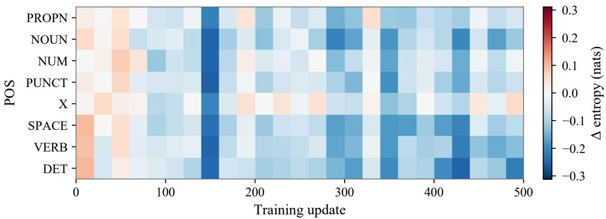  
Figure 6 Current-commit token entropy changes in DTCA. Each 20-update bin subtracts the POS-specific mean over updates 1–100. The color scale matches the upper panel of Figure 7.

## D.3 Additional Results

Training dynamics against RLDF. The lower panels of Figure 7 compare the training dynamics of DTCA and RLDF over 500 updates. The figure reports response reward, policy entropy, and mean KL divergence, with curves smoothed by a trailing 15-update mean. A higher response reward indicates that more sampled responses are correct.

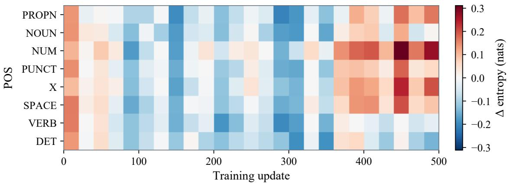

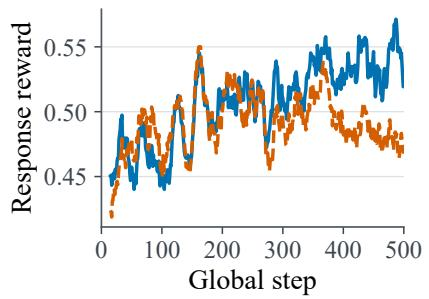  
(a) Reward

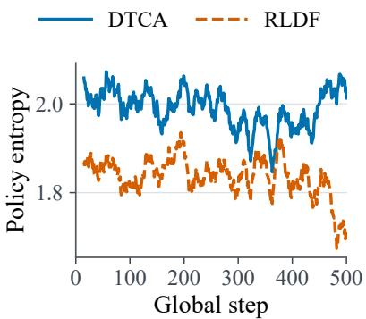  
(b) Policy entropy

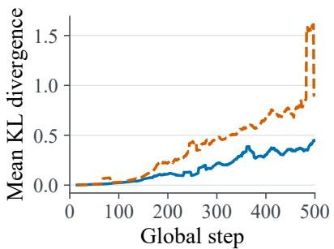  
(c) KL divergence  
Figure 7 Additional entropy and training-dynamics analyses. Top: current-commit token entropy changes in DTCA without entropy calibration, using the same early-training baseline, 20-update bins, and color scale as Figure 6. Bottom: DTCA versus RLDF in (a) response reward, (b) policy entropy, and (c) mean KL divergence, using trailing 15-update means.

The two methods start with similar reward trajectories, with average rewards of 0.464 for DTCA and 0.467 for RLDF over updates 1–100. Over updates 401–500, DTCA achieves a higher average reward of 0.537, compared with 0.482 for RLDF. During the same period, DTCA maintains higher policy entropy (2.00 vs. 1.78 nats) and lower mean KL divergence (0.36 vs. 0.89). These results show that DTCA and RLDF follow diferent optimization trajectories, with DTCA achieving higher reward while maintaining a smaller deviation from the reference policy.

The observed diferences are consistent with DTCA’s design, where contribution-based credit assignment provides token-dependent learning signals and entropy-based calibration adjusts updates according to entropy changes. This comparison reflects the combined efect of DTCA components and does not isolate individual module contributions.

Full POS entropy analysis. Figure 8 shows the nine POS categories most often retained as training targets in DTCA. Together with Figure 9, it extends Figure 5 to all 18 POS categories. These curves cover all retained targets at selected states, rather than only current-commit tokens. With run-specific early baselines, positive values indicate entropy increases, and curves compare changes rather than absolute levels.

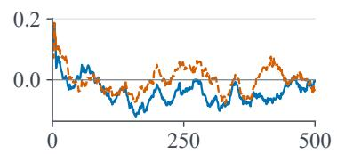

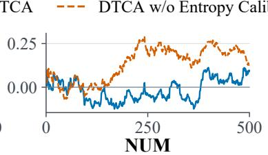

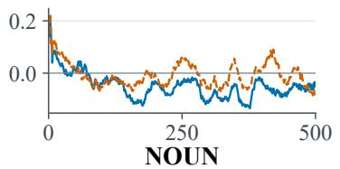

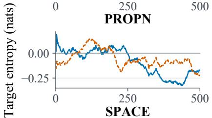

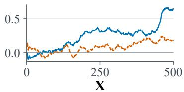

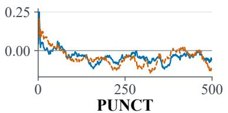

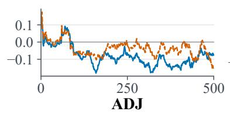

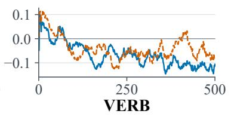  
Global step

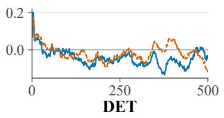  
Figure 8 Predictive entropy changes for DTCA’s nine most frequent target POS categories. Blue solid: DTCA. Orange dashed: without entropy calibration. Curves show trailing 25-update token-weighted means relative to each run’s POS-specific baseline over updates 1–100.

The frequent categories show diferent trends. Over updates 401–500, NUM is 0.051 nats above its early baseline in DTCA, compared with 0.209 nats without calibration. For X, the shifts are 0.447 and 0.184 nats. SPACE, ADJ, and VERB generally move below their early baselines in both runs. Calibration does not uniformly lower entropy across POS.

## DTCA DTCA w/o Entropy Calibration

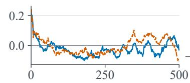

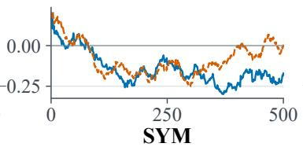

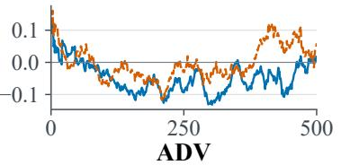

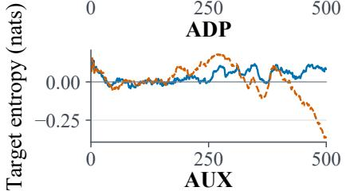

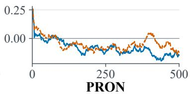

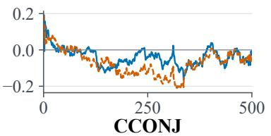

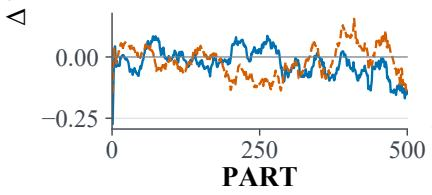

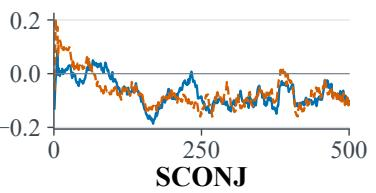  
Global step

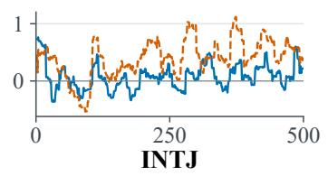  
Figure 9 Predictive entropy changes for the nine remaining POS categories, ordered by their frequency among DTCA’s retained targets. Colors, line styles, baseline, and smoothing match Figure 8.

The remaining categories also difer. Over updates 401–500, SYM falls by 0.192 nats from its early baseline in DTCA and by 0.014 nats without calibration. AUX instead rises by 0.072 nats in DTCA and falls by 0.133 nats without calibration. INTJ fluctuates sharply, warranting caution in interpreting its trend.

Entropy-flow calibration. Figures 8 and 9 summarize POS-level entropy trajectories over training. These are within-run trends rather than changes in matched tokens, since the models visit diferent states and retain diferent targets. Figure 10 complements these trajectories by examining the predicted entropy changes induced by individual policy updates, separated into entropy-increasing and entropy-decreasing parts.

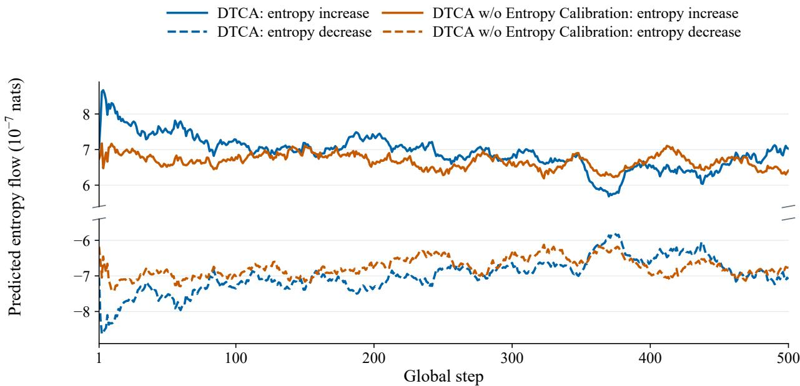  
Figure 10 Predicted entropy-increasing (solid) and entropy-decreasing (dashed) components for DTCA (blue) and DTCA without entropy calibration (orange). Curves use trailing 25-update means. The vertical axis is broken, with values in $1 0 ^ { - 7 }$ nats.

Solid curves show the total predicted increase, while dashed curves show the total predicted decrease. The broken vertical axis keeps both signs visible despite their similar magnitudes. Equal magnitudes imply a near-zero net predicted change.

DTCA keeps the two parts closer together. Over updates 1–100, its average net predicted change is $- 0 . 0 3 3 \times 1 0 ^ { - 7 }$ nats, compared with $- 0 . 2 6 7 \times 1 0 ^ { - 7 }$ nats without calibration. Over updates 401–500, the corresponding values $\mathrm { a r e \ - 0 . 0 8 1 \times 1 0 ^ { - 7 } }$ and $- 0 . 2 0 1 \times 1 0 ^ { - 7 }$ nats. Thus, the predicted increase and decrease nearly cancel under DTCA in both windows. These values are first-order estimates based on the training signals, not direct measurements of entropy after a parameter update.

## E Limitations

While DTCA provides an efective approach for fine-grained credit assignment in difusion language model reinforcement learning, several aspects remain open for future exploration. DTCA uses POS categories to aggregate token-level confidence improvements and obtain stable contribution estimates. This design relies on the quality of POS alignment and annotation, and more accurate token-level labeling strategies may further improve the estimation process. Moreover, DTCA currently defines token contribution based on the confidence improvement of remaining masked positions after token commitment. Developing more principled theoretical formulations for contribution estimation in difusion language models remains an interesting direction. Finally, our experiments focus on mathematical reasoning with LLaDA-8B-Instruct. Applying DTCA to other tasks, such as code generation, may require adapting the token grouping strategy to diferent token distributions and generation patterns. Further evaluation on diverse difusion language model architectures is also needed to understand the general applicability of DTCA.