# EXCISE: Locating and Excising Distracting Sentences in Medical Question Answering

Yerim Hong, Sohyun Son, Heeseung Chung, Mujeen Sung†

Kyung Hee University

{yrhong, sohy, janthonio03, mujeensung}@khu.ac.kr

## Abstract

Language models are increasingly considered for clinical decision support, where their answers should be grounded in clinical evidence and remain robust to irrelevant information. Prior work shows that a single irrelevant sentence can lower the accuracy of medical models, but not where inside the model its effect can be removed, or how to do so without knowing which sentence it is. We find that blocking attention to a known distractor restores the answer, whereas head masking can suppress correct answers. We also show that the model’s hidden states mark the distractor as the sentence that least fits the case even when the model follows it. To remove a distractor’s effect without knowing which sentence it is, we propose EX-CISE, an inference-time method that blocks the sentence most influencing the answer, but only if the model’s hidden states mark it as inconsistent with the case. On MEDQA-TD (MedQA with Targeted Distractors), a benchmark we construct in which each distractor targets a specific wrong option, EXCISE gains 16.7–22.8 accuracy points at a 1.5–2.1-point cost on the same questions without distractors, outperforming prompting, rewriting, and steering baselines for all three models. Its gains extend to MedDistractQA and BiasMedQA, as well as chain-of-thought generation.

## 1 Introduction

Large language models (LLMs) are increasingly considered for clinical decision support (Singhal et al., 2023; Nori et al., 2023; Hager et al., 2024), where errors can harm patients (Thirunavukarasu et al., 2023; Pal et al., 2023). Their decisions should therefore depend on the clinical evidence and not on irrelevant information, such as remarks about other people or jokes.

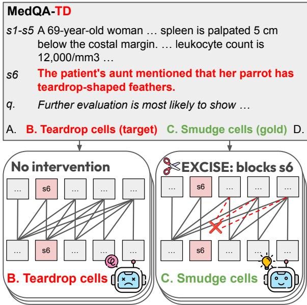  
Figure 1: EXCISE on an example from MEDQA-TD with Llama-3.1-8B-Instruct (Grattafiori et al., 2024). s1-s5 s6 q. op. outputQThe distractor s6 shifts the answer to B; EXCISE selects s6 and blocks attention to it, restoring C.

Prior work on medical QA has shown that a single added sentence that evokes an incorrect answer option without changing the correct answer (a distractor) can lower accuracy (Vishwanath et al., 2025a,b). In Figure 1, for example, the added sentence “The patient’s aunt mentioned that her parrot has teardrop-shaped feathers” turns the answer from smudge cells to teardrop cells. However, it remains unclear where inside the model the effect of such a sentence can be removed, and how to remove it when it is not known which sentence it is.

Most defenses against irrelevant context rely on the model’s own judgment of what is irrelevant (Shi et al., 2023; Wu et al., 2024; Weston and Sukhbaatar, 2023), but a model can call a distractor irrelevant and still use it as a clue (Figure 4). We therefore investigate how to remove a distractor’s effect and find that blocking attention to a known distractor restores near-clean accuracy. In contrast, switching off the attention heads that prior work links to distraction (Niu et al., 2025; Liu and Chu, 2026) makes the model avoid whatever option an added sentence points to, even when that option is correct.

At inference time, however, the distractor is not marked. Since a distractor misleads by moving the model’s decision, one approach is to block the sentence that moves it most, but that sentence may also be a key clinical finding, so influence alone cannot tell us whether to block it. We find that the model’s hidden states can make this decision, since they reveal a distractor’s mismatch with the rest of the case even when the model is misled. We therefore propose EXCISE (EXcision by Causal Influence and Self-discordance Evidence), an inference-time method that uses both signals. Interventional Attribution (IA) tests each sentence by blocking attention to it and selects the one whose blocking most weakens the current decision. The Discordance Gate (DG) then lets EXCISE block that sentence only if the model’s hidden states mark it as inconsistent with the rest of the case.

We test EXCISE on MEDQA-TD (MedQA with Targeted Distractors), in which each added distractor targets a specific wrong option. Nine openweight models, including medical and reasoning models, lose 19–32 points on it. EXCISE raises accuracy by 16.7–22.8 points for three models at a cost of 1.5–2.1 points on the same questions without a distractor, outperforming other inference-time methods (Shi et al., 2023; Weston and Sukhbaatar, 2023; Rimsky et al., 2024). These gains also carry over to chain-of-thought generation (Wei et al., 2022), MedDistractQA and BiasMedQA (Schmidgall et al., 2024).

Our contributions are as follows:

• We introduce MEDQA-TD, a medical QA benchmark with answer-preserving distractors that target specific wrong options.

• We show that blocking a known distractor restores the answer, and that the model’s hidden states flag the distractor even when the model follows it.

• We propose EXCISE, an inference-time method that blocks the sentence most influencing the decision only when the model’s hidden states mark it as inconsistent with the case.

## 2 Related Work

Irrelevant context. Answer-preserving distractors have been studied in reading comprehension (Jia and Liang, 2017; Cao et al., 2022), math (Shi et al., 2023; Mirzadeh et al., 2025; Yang et al., 2025b), and retrieval, reasoning, and tool use (Lee et al., 2026). Medical QA benchmarks cover cognitive biases (Schmidgall et al., 2024), patient characteristics (Ness et al., 2024), third-party facts and figurative language (Vishwanath et al., 2025a,b), and false medical claims (Zhou et al., 2026). MEDQA-TD builds on answer-preserving medical QA distraction by selecting challenging distractors designed to favor specific wrong options.

Mechanisms of context influence. Prior work identifies heads favoring context over memory (Yu et al., 2023; Jin et al., 2024), contextual entrainment (Niu et al., 2025; Liu and Chu, 2026), long-context attention (Zhu et al., 2025), and stages affected by irrelevant or persuasive context (Qu and Gomes, 2026; Sun et al., 2026; Joswin et al., 2026). Models can also copy meaning (Feucht et al., 2025) or infer answers from irrelevant context (Cheng et al., 2025). Unlike fixed head edits applied across inputs, we intervene on individual sentences.

Inference-time defenses and attribution. Prompt-based defenses ask models to ignore, identify, or remove irrelevant content (Shi et al., 2023; Wu et al., 2024; Weston and Sukhbaatar, 2023). Other methods steer activations (Li et al., 2023; Rimsky et al., 2024) or adjust attention to user-marked spans (Zhang et al., 2024) or distracting demonstration tokens (Yan et al., 2025). Context attribution estimates source contributions from attention (Cohen-Wang et al., 2025) or context ablations, using surrogate models fitted to random ablations (Cohen-Wang et al., 2024), adaptively chosen ablations (Pan et al., 2026), or approximations to leave-one-out ablation (Liu et al., 2025). EXCISE instead measures each sentence’s effect with the same attention blocking it then applies, following attention-based perturbation (Deiseroth et al., 2023), so the score is the exact effect of the intervention. It selects a sentence by this effect and intervenes only when that sentence is inconsistent with the remaining case.

<table><tr><td>Model</td><td>MedQA</td><td>MDQA</td><td>MEDQA-TD</td></tr><tr><td>General</td><td></td><td></td><td></td></tr><tr><td>Llama-3.1-8B-Instruct</td><td>61.7</td><td>54.5–7.2</td><td>40.7 -21.1</td></tr><tr><td>Qwen3-8B</td><td>63.4</td><td>50.3-13.1</td><td>33.7 -29.7</td></tr><tr><td>Llama-3-8B-Instruct</td><td>60.0</td><td>49.7-10.3</td><td>36.2–23.8</td></tr><tr><td>Granite-3.3-8B-Instruct</td><td>51.5</td><td>39.4–12.1</td><td>29.1 –22.4</td></tr><tr><td>Falcon3-10B-Instruct</td><td>58.4</td><td>46.3–12.1</td><td>31.5 –27.0</td></tr><tr><td>Phi-4 (14B)</td><td>70.9</td><td>63.4–7.5</td><td>50.7 –20.3</td></tr><tr><td>Qwen3-8B (thinking)†</td><td>77.5</td><td>70.0-7.5</td><td>57.0–20.5</td></tr><tr><td colspan="4">Medical</td></tr><tr><td>MedGemma-27B-text-it 73.3</td><td></td><td>65.2-8.1</td><td>51.9–21.4</td></tr><tr><td>HuatuoGPT-o1-8B†</td><td>74.6</td><td>65.5 –9.1</td><td>55.1 –19.5</td></tr></table>

Table 1: Accuracy (%) on MedQA (Jin et al., 2021) without and with distractors, averaged over the two distractor types (MDQA: MedDistractQA (Vishwanath et al., 2025a)), with the change from MedQA in gray. †Reasoning model.

## 3 MEDQA-TD

To analyze how a distractor misleads a model, we need to know which wrong option each distractor is meant to favor. We therefore build MEDQA-TD (MedQA with Targeted Distractors), which follows the two answer-preserving distractor types of MedDistractQA (Vishwanath et al., 2025a) and writes every distractor for a specific wrong option, its target. Bystander (BS) distractors attribute a medical detail to someone other than the patient, and Nonliteral (NL) distractors use a medical term as a joke or metaphor, so neither is relevant to answering the question.

For each four-option MedQA-USMLE question (Jin et al., 2021) in the development and test splits (Appendix C) and each distractor type, GPT-OSS-120B (Agarwal et al., 2025) writes eight candidate distractors per wrong option. It keeps only the candidates that point to their intended option and not to the correct option (Appendix B). As a reference model, it then answers the question with each kept candidate. We use GPT-OSS-120B because its open weights let us read its option log-probabilities, and it answers 91.4% of the clean questions (without a distractor) correctly when it reasons, so a wrong answer usually comes from the distractor and not from a lack of medical knowledge in the model.

With g the gold option, C the kept candidates and $p _ { o } ( c )$ the reference model’s log-probability of answer option o when $c \in { \mathcal { C } }$ is added, we select

$$
( c ^ { * } , o ^ { * } ) = \arg \operatorname* { m a x } _ { c \in \mathcal { C } , o \neq g } \big ( p _ { o } ( c ) - p _ { g } ( c ) \big ) ,\tag{1}
$$

the candidate and wrong option for which the reference model most prefers a wrong option over the gold one, and keep $c ^ { * }$ as the distractor of the question, so that MEDQA-TD also serves as a stress test. For a question that the reference model answers correctly without a distractor, $p _ { o ^ { * } } ( c ^ { * } ) - p _ { g } ( c ^ { * } )$ is positive exactly when $c ^ { * }$ turns its answer wrong. The option $o ^ { * }$ need not be the target of $c ^ { * }$ , since any wrong answer is a failure. The kept distractor is placed at the end of the narrative, before the question sentence. Two PhD students in geriatric epidemiology at a medical school independently judged 100 randomly sampled MEDQA-TD questions, 50 of each type, and neither judged that any of them changes the correct answer (Appendix B.1).

Although the distractors are selected with the reference model alone, all nine open models, including medical and reasoning models, lose 19– 32 points on each distractor type of MEDQA-TD relative to the clean questions, 9–20 points more than on MedDistractQA (Table 1 and Appendix B). Target-wrong answers, which choose the option a distractor was written for, rise to 2.4–3.6 times their count on the clean questions. The distractors thus move answers toward their target rather than spreading them over the wrong options, which lets us test whether an intervention removes a distractor’s effect or only avoids the option it points to (Section 4).

## 4 Motivation: What Removing a Distractor Requires

Using four models, Llama-3.1-8B-Instruct, Qwen3- 8B (Yang et al., 2025a), Llama-3-Meerkat-8B (Kim et al., 2025) and Phi-4 (Abdin et al., 2024), we ask two questions that shape the design of EXCISE: where the effect of a distractor should be removed (Section 4.1), and whether the model’s internal signals show if a sentence fits the case (Section 4.2).

## 4.1 Masking Selected Heads Suppresses Correct Answers

A distractor’s effect could be removed without locating it, by masking a fixed set of attention heads that prior work links to distraction (Niu et al., 2025; Liu and Chu, 2026). Such masks, found on development data for each of the four models, do not make the model ignore the distractor but make it avoid whichever option it points to (Figure 2): they raise MEDQA-TD accuracy from 40.8% to 58.8%, but when the added sentence points to the correct option instead, they lower accuracy from 78.5% to 32.9% (Appendix D.2). Blocking attention to the added sentence itself, by setting the attention scores from all later positions to its tokens to −∞ in every layer and head (attention knockout; Geva et al., 2023), instead brings accuracy close to clean accuracy in both cases (64.4% and 65.0%), as ignoring the sentence should. Removing a distractor’s effect therefore requires finding the distractor in each question and blocking attention to it.

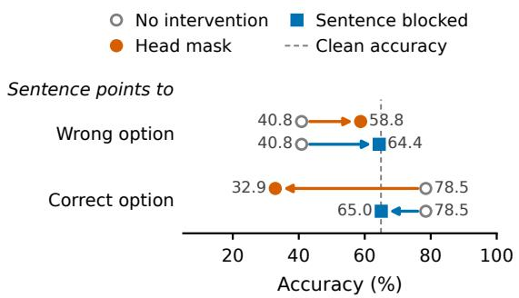

Figure 2: Head masking and blocking the added sentence (in every layer and head) when the sentence points to a wrong option (MEDQA-TD) or the correct option, averaged over distractor types and the four models.  
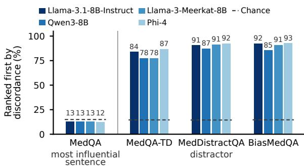  
Figure 3: How often a sentence is the most discordant in its case: the sentence that moves the answer most in MedQA questions (left), and the distractor in questions it turns from correct to wrong (right). Dashed lines: chance.

## 4.2 Hidden States Show Whether a Sentence Fits the Case

Blocking a distractor restores the answer, but the sentence that moves the answer most is not always a distractor: in a question without one, it is often a key clinical finding, which is connected to the rest of the case, whereas a distractor is not. For each narrative sentence, we therefore measure the cosine similarity between the hidden state of the sentence read alone and that of the rest of the case read alone, after removing the dominant shared direction, and call a sentence more discordant the lower this similarity is relative to the other sentences. Before any intervention, on MedQA questions without a distractor, the sentence that moves the answer most is the most discordant in only 12–13% of cases, against about 15% by chance, whereas on questions that the distractor turns from correct to wrong, the distractor is the most discordant sentence in 78– 93% of cases on all three benchmarks (Figure 3). The evidence that drives a correct answer thus fits the case in the model’s hidden states, whereas the distractor stands out as inconsistent with it even as the model follows it.

## 5 EXCISE: Locating and Blocking the Distractor

Blocking attention to a known distractor removes its effect (Section 4.1), but at inference time the distractor must be located. EXCISE therefore selects the sentence whose blocking moves the answer most and, since this sentence may instead be a key clinical finding, blocks it only if the Discordance Gate finds it inconsistent with the case (Section 4.2; Figure 4).

## 5.1 Blocking a Sentence

Let $s _ { 1 } , \ldots , s _ { n }$ be the n sentences of the case narrative, which precedes the question sentence and the answer options. The decision is given by the logits $\ell _ { A } , \ldots , \ell _ { D }$ of the option letters at the answer position. Let $o _ { 1 }$ and $O 2$ be the top two options before any intervention and $m = \ell _ { o _ { 1 } } - \ell _ { o _ { 2 } }$ the decision margin. Inspired by attention knockout (Geva et al., 2023) and PASTA (Zhang et al., 2024), blocking a sentence $s _ { i }$ with strength $\gamma \in [ 0 , 1 ]$ multiplies the attention weights from every later position to its tokens by γ and renormalizes them, in all layers and heads. With $\gamma = 0$ , the attention to the sentence is removed.

## 5.2 Interventional Attribution: Selecting the Sentence That Moves the Answer

For each narrative sentence $s _ { i } ( i = 1 , \ldots , n )$ , the score is how much blocking it weakens the current decision:

$$
a _ { i } = m - \big ( \ell _ { o _ { 1 } } ^ { ( i ) } - \ell _ { o _ { 2 } } ^ { ( i ) } \big ) ,\tag{2}
$$

where $\ell ^ { ( i ) }$ are the logits of the forward pass in which $s _ { i }$ is blocked, and $o _ { 1 } , o _ { 2 }$ stay fixed at their values before the intervention, so $a _ { i }$ can be negative. The candidate is $i ^ { * } =$ arg maxi $a _ { i }$ . Because $a _ { i }$ uses the same blocking that EXCISE applies, it is the exact effect of that intervention. When EXCISE intervenes, the answer is read from the pass that computed $a _ { i ^ { * } }$

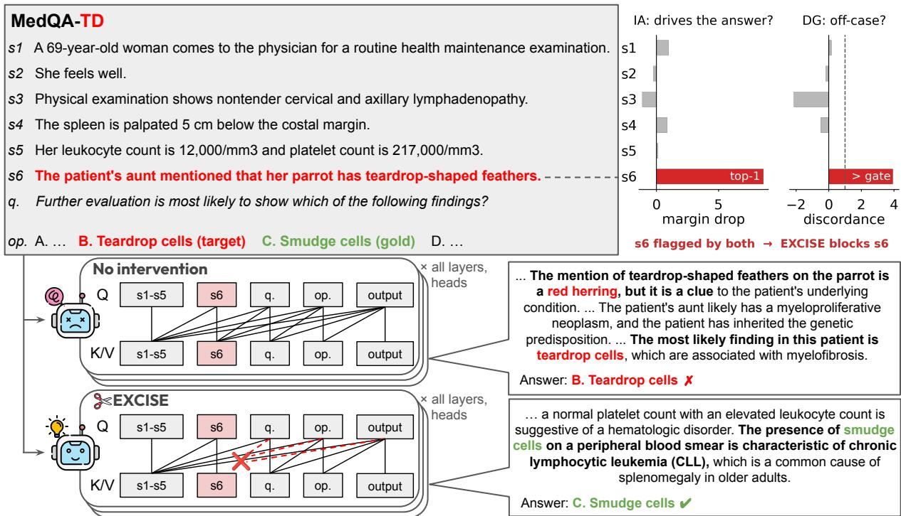  
Figure 4: An example from MEDQA-TD with Llama-3.1-8B-Instruct (distractor s6 in red, targeting B, gold: C). Top right: attribution $a _ { i }$ and discordance $d _ { i }$ of each sentence (dashed line: threshold). Bottom: without intervention, the chain of thought (Wei et al., 2022) calls the parrot a red herring yet uses it as a clue and answers B. With s6 blocked in all layers and heads, the model answers C (excerpts).

## 5.3 Discordance Gate: Blocking Sentences That Do Not Fit the Case

A large $a _ { i ^ { * } }$ alone cannot tell whether $s _ { i ^ { * } }$ is a distractor or clinical evidence (Section 4.2). The gate therefore asks whether $s _ { i ^ { * } }$ fits the rest of the case in the model’s own representation. We run the model on $s _ { i }$ alone and, in a separate pass, on the remaining narrative sentences joined together, without any prompt, and mean-pool the hidden states of each pass at a layer L chosen on the development set, giving $h _ { i }$ and $\boldsymbol { r } _ { i }$ . Contextual representations are anisotropic (Ethayarajh, 2019; Timkey and Van Schijndel, 2021), so cosine similarities between them are dominated by a few directions shared by all representations. $P$ removes the strongest of these directions by subtracting the mean of the $h _ { i }$ over the unlabeled inputs that EX-CISE is applied to, here the narrative sentences of each test set, and projecting out their first principal component, following Mu et al. (2017), so that the gate adapts to these inputs without labels, and a basis fixed once on development questions keeps 79–95% of the MEDQA-TD gain (Appendix E.1).

With the similarity $c _ { i } = \cos ( P h _ { i } , P r _ { i } )$ between a sentence and the rest of the case, the discordance is

$$
d _ { i } = - \frac { c _ { i } - \bar { c } _ { - i } } { \sigma _ { - i } } ,\tag{3}
$$

where $\bar { c } _ { - i }$ and $\sigma _ { - i }$ are the mean and standard deviation of the similarities of the other sentences of the same question. Higher values mean that $s _ { i }$ is less consistent with the case. Since $\sigma _ { - i }$ needs at least two other sentences, EXCISE leaves questions with fewer than three narrative sentences unchanged, 1.4% of MEDQA-TD questions and 6.5% of clean ones (Appendix C). EXCISE intervenes only if $d _ { i }$ exceeds a threshold $\tau .$ In Figure $^ { 4 , }$ the distractor $s _ { 6 }$ has the largest $a _ { i }$ and its discordance exceeds $\tau = 1$ , so EXCISE blocks it.

If the gate passes, EXCISE blocks $s _ { i ^ { * } }$ with strength $\gamma$ . Blocking rather than deleting the sentence lets the intervention reuse the attribution pass and take partial strengths, and leaves the input and token positions unchanged (deleting it gives the same accuracy, Appendix C.1). L, $\tau$ and $\gamma$ are chosen once per model on the development set and applied unchanged to every test set (values and search ranges in Appendix C.3).

<table><tr><td rowspan="2">Method</td><td rowspan="2">Latency (ms)</td><td colspan="2">Clean</td><td colspan="3">With distractors</td></tr><tr><td>MedQA</td><td>MMLU-PM</td><td>MEDQA-TD</td><td>MedDistractQA</td><td>BiasMedQA</td></tr><tr><td>Qwen3-8B</td><td></td><td></td><td></td><td></td><td></td><td></td></tr><tr><td>No intervention</td><td>41</td><td>63.4</td><td>82.7</td><td>33.7</td><td>50.3</td><td>28.7</td></tr><tr><td>Ignore instruction</td><td>44</td><td>64.0+0.6</td><td>82.7 0.0</td><td> $3 3 . 2 \mathrm { - } 0 . 5 $ </td><td>50.4 +0.1</td><td>27.1-1.6</td></tr><tr><td>CAA</td><td>41</td><td>64.0+0.6</td><td> $8 0 . 5 - 2 . 2 $ </td><td> $3 8 . 3 \substack { + 4 . 7 }$ </td><td>53.3 +3.0</td><td>35.6+6.9</td></tr><tr><td>S2A</td><td>4,182</td><td> $6 3 . 6 \substack { + 0 . 2 }$ </td><td> ${ \bf 8 3 . 5 + 0 . 7 }$ </td><td> $3 6 . 5 \substack { + 2 . 8 }$ </td><td> $5 4 . 3 \substack { + 4 . 0 }$ </td><td>35.3 +6.7</td></tr><tr><td>EXCISE (Ours)</td><td>819</td><td> $6 1 . 7 \mathrm { - } 1 . 6$ </td><td>83.1+0.4</td><td>56.4+22.8</td><td> ${ \bf 6 1 . 0 + } 1 0 . 7 $ </td><td>53.5 +24.8</td></tr><tr><td>CoT</td><td>3,408</td><td>70.2</td><td>86.0</td><td>44.2</td><td>58.2</td><td>41.5</td></tr><tr><td> $\mathrm { C o T + I ^ { 3 } C }$ </td><td>11,322</td><td>65.6-4.6</td><td>84.9-1.1</td><td>39.5-4.7</td><td>55.3-2.8</td><td>35.0–6.5</td></tr><tr><td>CoT + EXCISE (Ours)</td><td>4,348</td><td>67.8-2.4</td><td>85.7-0.4</td><td> ${ \bf 6 1 . 5 + 1 7 . 3 }$ </td><td> ${ \bf 6 5 . 2 + 7 . 0 }$ </td><td> ${ \pmb 5 8 . 0 + 1 6 . 5 }$ </td></tr><tr><td>Llama-3.1-8B-Instruct</td><td></td><td></td><td></td><td></td><td></td><td></td></tr><tr><td>No intervention</td><td>40</td><td>61.7</td><td>76.1</td><td>40.7</td><td>54.5</td><td>49.7</td></tr><tr><td>Ignore instruction</td><td>41</td><td>61.9 +0.2</td><td>76.10.0</td><td>40.5-0.2</td><td> $5 5 . 0 \substack { + 0 . 5 }$ </td><td>49.2-0.5</td></tr><tr><td>CAA</td><td>40</td><td>62.3 +0.5</td><td>75.0-1.1</td><td>41.8+1.1</td><td> $5 5 . 4 \substack { + 0 . 9 }$ </td><td>50.7 +1.0</td></tr><tr><td>S2A</td><td>3,173</td><td>61.1-0.6</td><td>75.7-0.4</td><td>55.7 +15.0</td><td> ${ \bf 6 0 . 1 + 5 . 6 }$ </td><td>56.8+7.1</td></tr><tr><td>EXCISE (Ours)</td><td>731</td><td>59.6-2.1</td><td>72.1-4.0</td><td> $5 7 . 4 \substack { + 1 6 . 7 }$ </td><td> $5 9 . 5 + 5 . 0 $ </td><td>55.4+5.7</td></tr><tr><td>CoT</td><td>2,049</td><td>67.7</td><td>79.0</td><td>47.7</td><td>61.6</td><td>53.3</td></tr><tr><td> $\mathrm { C o T + I ^ { 3 } C }$ </td><td>10,061</td><td>67.0-0.7</td><td>78.3-0.7</td><td> $4 7 . 0 \mathrm { - } 0 . 7$ </td><td>57.9-3.8</td><td>47.2-6.1</td></tr><tr><td>CoT + EXCISE (Ours)</td><td>2,857</td><td>66.5-1.3</td><td> $7 5 . 4 - 3 . 7 $ </td><td> ${ \bf 6 1 . 2 + 1 3 . 5 }$ </td><td> ${ \bf 6 5 . 2 } \mathrm { _ { + 3 . 5 } }$ </td><td> $\pm 7 . 6 \substack { + 4 . 3 }$ </td></tr><tr><td>Llama-3-Meerkat-8B</td><td></td><td></td><td></td><td></td><td></td><td></td></tr><tr><td>No intervention</td><td>38</td><td>63.0</td><td>77.9</td><td>37.7</td><td>53.9</td><td>42.7</td></tr><tr><td>Ignore instruction</td><td>40</td><td> $6 3 . 3 \substack { + 0 . 3 }$ </td><td> $7 7 . 2 - 0 . 7 $ </td><td> $3 7 . 6 - 0 . 2 $ </td><td> $5 2 . 8 - 1 . 1$ </td><td>41.8-0.9</td></tr><tr><td>CAA</td><td>38</td><td> $6 3 . 6 \substack { + 0 . 6 }$ </td><td> $7 5 . 4 - 2 . 6 $ </td><td> $3 9 . 7 + 1 . 9$ </td><td> $5 4 . 9 \substack { + 0 . 9 }$ </td><td>45.8 +3.1</td></tr><tr><td>S2A</td><td>3,324</td><td> ${ \bf 6 3 . 9 + 0 . 9 }$ </td><td> $7 9 . 0 \substack { + 1 . 1 }$ </td><td> $4 5 . 8 \substack { + 8 . 1 }$ </td><td> $5 8 . 2 \substack { + 4 . 3 }$ </td><td>48.6+5.9</td></tr><tr><td>EXCISE (Ours)</td><td>721</td><td>61.5-1.5</td><td> $7 5 . 4 - 2 . 6 $ </td><td> ${ \bf 5 9 . } 2 \substack { + 2 1 . 4 }$ </td><td> ${ \bf 6 1 . 4 + 7 . 5 }$ </td><td>55.1 +12.4</td></tr><tr><td>CoT</td><td>6,078</td><td>72.7</td><td>83.5</td><td>48.5</td><td>63.5</td><td>58.6</td></tr><tr><td> $\mathrm { C o T + I ^ { 3 } C ^ { \ddagger } }$ </td><td>20,269</td><td> $6 4 . 7 - 8 . 0 $ </td><td> $8 2 . 4 - 1 . 1$ </td><td> $4 3 . 0 - 5 . 5 $ </td><td> $5 6 . 6 - 6 . 9$ </td><td> $4 5 . 4 - 1 3 . 1 $ </td></tr><tr><td> $\mathrm { C o T + E X C I S E \left( O u r s \right) ^ { \ddagger } }$ </td><td>7,301</td><td> $7 1 . 0 - 1 . 7$ </td><td> $7 8 . 7 - 4 . 8 $ </td><td> ${ \bf 6 4 . 4 + 1 5 . 9 }$ </td><td> ${ \bf 6 7 . 5 + 4 . 0 }$ </td><td> ${ \bf 6 4 . 4 + 5 . 8 }$ </td></tr></table>

Table 2: Accuracy (%) of EXCISE and inference-time baselines. MEDQA-TD and MedDistractQA: mean of the Nonliteral and Bystander distractors (per type in Appendix F.1); BiasMedQA: mean of seven bias types. Gray: change from no intervention, or from CoT below the dashed line (unrounded), shaded blue for gains and red for losses. Latency: wall-clock time per question, including generation. MMLU-PM: MMLU professional medicine. ‡Model-card prompt format (Appendix F.3). Bold: best per model and column within each block.

## 6 Experimental Setup

Models. We evaluate EXCISE on Llama-3.1-8B-Instruct (Grattafiori et al., 2024), Qwen3-8B (Yang et al., 2025a) with thinking off, and the medical fine-tune Llama-3-Meerkat-8B (Kim et al., 2025).

Data and metrics. We test distraction robustness on MEDQA-TD, MedDistractQA (Vishwanath et al., 2025a) and BiasMedQA (Schmidgall et al., 2024), clean accuracy on MedQA (Jin et al., 2021) and MMLU professional medicine (Hendrycks et al., 2021). Accuracy includes all questions, using option-letter logits for first-token evaluation and the parsed answer for chain-of-thought generation, with paired 95% bootstrap intervals (Appendix C.5). Dataset sizes, hardware and evaluation details are in Appendix C.

Baselines. We compare ignore instructions (Shi et al., 2023; Wu et al., 2024), S2A context rewriting (Weston and Sukhbaatar, 2023), $\mathrm { I ^ { 3 } C }$ identification of irrelevant conditions before reasoning (Wu et al., 2024), and CAA activation steering (Rimsky et al., 2024), with its steering vector built from clean/MEDQA-TD development pairs. Generation-based methods are compared by elapsed time, including EXCISE with chain-ofthought generation (Appendix F.3). ContextCite (Cohen-Wang et al., 2024), CAMAB (Pan et al., 2026), AT2 (Cohen-Wang et al., 2025) (Llama-3.1-8B-Instruct only), and averaged attention replace IA under the same gate (Appendix F.2); Appendix F.2 also evaluates them without the gate.

## 7 Main Results

On MEDQA-TD, EXCISE raises accuracy by 16.7– 22.8 points for the three models at a cost of 1.5– 2.1 points on clean MedQA questions (Table 2), and for Llama-3.1-8B-Instruct it damages a similar share of correctly answered questions on MMLU professional medicine (Appendix E.6).

Against methods for the same task. On MEDQA-TD, EXCISE has the highest accuracy among the methods without chain-of-thought generation in Table 2 for every model. The ignore instruction and steering barely move MEDQA-TD (at most +4.7 points), and with chain-of-thought generation, EXCISE is 14.2–22.0 points above CoT + I3C on MEDQA-TD. S2A also matches or exceeds EXCISE for Llama-3.1-8B-Instruct on Med-DistractQA and BiasMedQA. Its gains depend on whether the model’s rewrite leaves out the distractor, and where the rewrite keeps it, S2A gains at most 0.9 points on MEDQA-TD, against 16–23 for EXCISE (Figure 5). EXCISE is also faster, with 0.72–0.82 seconds per question against 3.2–4.2 for S2A, and with chain-of-thought generation 2.9–7.3 against 10.1–20.3 for CoT + I3C.

<table><tr><td rowspan="2">Variant</td><td rowspan="2">#Fwd</td><td colspan="2">MedQA</td><td colspan="2">MEDQA-TD</td></tr><tr><td>Acc</td><td>Interv.</td><td>Acc</td><td>Interv.</td></tr><tr><td>Qwen3-8B</td><td></td><td></td><td></td><td></td><td></td></tr><tr><td>EXCISE (Ours)</td><td></td><td>25 61.7</td><td>19.4</td><td>56.4</td><td>48.6</td></tr><tr><td>w/o IA</td><td></td><td>1861.7-0.1</td><td>92.5</td><td>56.0-0.4</td><td>98.3</td></tr><tr><td>w/o DG</td><td>9</td><td>53.2-8.6</td><td>93.5</td><td>47.2-9.3</td><td>98.6</td></tr><tr><td>w/o IA &amp; DG</td><td></td><td>163.4+1.6</td><td>一</td><td>33.7 –22.8</td><td>一</td></tr><tr><td colspan="6">Llama-3.1-8B-Instruct</td></tr><tr><td>EXCISE (Ours)</td><td>25 59.6</td><td></td><td>19.7</td><td>57.4</td><td>43.5</td></tr><tr><td>w/o IA</td><td></td><td>1860.0+0.4</td><td>91.9</td><td>57.8+0.4</td><td>98.4</td></tr><tr><td>w/o DG</td><td>9</td><td>52.2–7.5</td><td>93.5</td><td>48.3–9.1</td><td>98.6</td></tr><tr><td>w/o IA &amp; DG</td><td></td><td>161.7 +2.1</td><td></td><td>40.7 –16.7</td><td>一</td></tr><tr><td colspan="6">Llama-3-Meerkat-8B</td></tr><tr><td>EXCISE (Ours)</td><td></td><td>25 61.5</td><td>29.5</td><td>59.2</td><td>54.6</td></tr><tr><td>w/o IA</td><td></td><td>1861.7+0.2</td><td>93.5</td><td>57.6-1.6</td><td>98.6</td></tr><tr><td>w/o DG</td><td>9</td><td>55.1 -6.4</td><td>93.5</td><td>49.6–9.6</td><td>98.6</td></tr><tr><td>w/o IA &amp; DG</td><td></td><td>163.0 +1.5</td><td>一</td><td>37.7 –21.4</td><td>一</td></tr></table>

Table 3: Our ablation study. Interv.: questions intervened on (%); #Fwd: forward passes per question. w/o IA & DG: No intervention

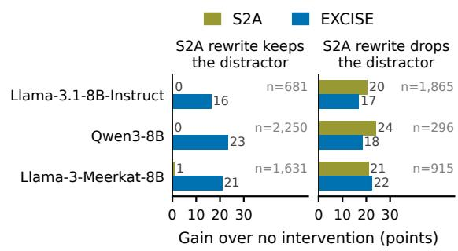  
Figure 5: Gains of S2A and EXCISE on MEDQA-TD (both distractor types), by whether the S2A rewrite keeps the distractor.

Beyond MEDQA-TD. On MedDistractQA and BiasMedQA, EXCISE gains 5.0–10.7 and 5.7–24.8 points, respectively (Table 2; per-bias results in Appendix F.4), the best of these methods apart from S2A for Llama-3.1-8B-Instruct. With chain-ofthought generation, it still gains 13.5–17.3 points on MEDQA-TD, 3.5–7.0 on MedDistractQA and

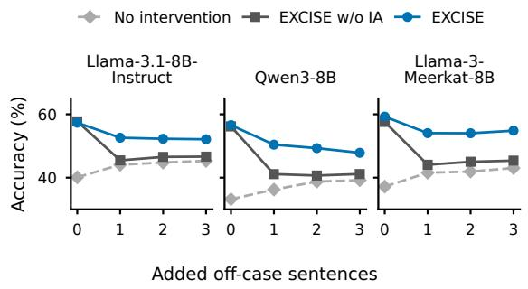  
Figure 6: Accuracy on MEDQA-TD (NL and BS pooled) with zero to three added off-case sentences.

4.3–16.5 on BiasMedQA, at a cost of 1.3–2.4 points on clean MedQA.

## 8 Analysis

## 8.1 Can EXCISE Find the Distractor among Added Noise?

MEDQA-TD contains a single added distractor, but a case may also include other irrelevant remarks. We test whether EXCISE can locate the distractor among such noise by inserting one to three additional off-case sentences at random positions before the original distractor. Each added sentence is the distractor of another question of the same type and shares no content word with any of this question’s options, so it resembles the distractor in form but was not written to push the model toward any of them. We compare against EXCISE w/o IA, a discordance-only variant that blocks the most discordant sentence that passes the gate.

Figure 6 shows that the two methods perform similarly without additional remarks, but diverge once a remark is added. With one added sentence, EXCISE outperforms EXCISE w/o IA by 7.2–10.0 accuracy points across three models, and the gap persists with further additions. With one added sentence, EXCISE blocks the original distractor in 54–80% of flipped questions (correct on the original clean question but wrong on the augmented question), compared with 24–31% for EXCISE w/o IA. The latter instead blocks the added remark in 59–67%. Although the added sentences weaken the distractor’s influence, EXCISE remains more accurate because it selects the sentence whose blocking most weakens the current decision. Further analysis is in Appendix E.4.

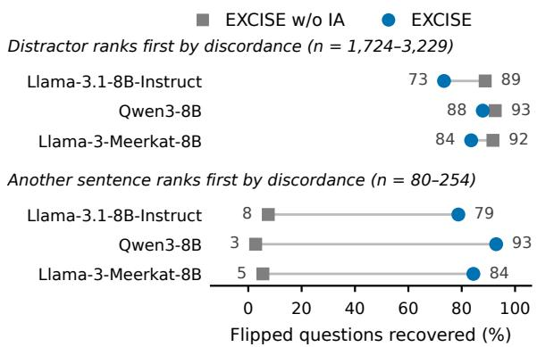  
Figure 7: Flipped questions recovered by EXCISE w/o IA and EXCISE, pooled over MEDQA-TD, MedDistractQA and BiasMedQA. Only questions in which the distractor passes the gate are included, grouped by whether the distractor or another sentence ranks first by discordance.

## 8.2 What Does Each Part Contribute?

The added-noise experiment highlights the role of attribution; we now examine how influence and discordance complement each other (Table 3). Without the gate, blocking the top-attributed sentence in every question (EXCISE w/o DG) costs 7.9–10.2 points on clean questions relative to no intervention, because in questions without a distractor this sentence is often a key clinical finding that fits the case. Without attribution, EXCISE w/o IA reaches accuracy comparable to EXCISE, because in these benchmarks the distractor is usually the most discordant sentence (Section 4.2). When another sentence is more discordant than the distractor, in 4.1– 8.9% of flipped questions, EXCISE recovers most of them and EXCISE w/o IA almost none, since EXCISE w/o IA blocks the least fitting sentence whether or not it moves the decision (Figure 7).

Attribution also makes the decision to intervene informative. EXCISE intervenes on 79–94% of MEDQA-TD questions whose answer the distractor pulls to the target, but on only 7–21% of those answered correctly with and without it (Appendix E.5), whereas EXCISE w/o IA intervenes on 91.9–93.5% of clean questions, so whether it intervenes says nothing about whether the model was misled.

We also compare each component with alternatives. For Llama-3.1-8B-Instruct and Qwen3-8B, ContextCite under the same gate is within one point of IA but needs 3.3 times as many forward passes; CAMAB, averaged attention and AT2 fall at least 2.0 points behind on MEDQA-TD (Appendix F.2).

When the distractor is moved to the middle or start of the narrative, EXCISE changes by at most 3.2 points, against up to 13.4 for averaged attention under the same gate (Appendix B.3), and sentence encoders work worse than the model’s own representations in the gate (Appendix E.2).

## 8.3 Where Does EXCISE Fail?

On flipped MEDQA-TD questions, attribution ranks the distractor first in 90–91%; the gate passes it in 81–95% of these, and blocking it then restores the answer in 93–95% (Appendix E.5). Overall, EXCISE recovers 71–81% of flipped questions, against 90–94% with the known distractor blocked. The gate is the weakest step for MEDQA-TD Bystander distractors, which it passes in 81–86% of questions, possibly because a relative’s medical history is closer to the case than other distractors are. Attribution is the weakest step on MedDistractQA, where the distractor ranks first in only 72–89% of questions.

## 9 Conclusion

We presented EXCISE, which selects the sentence that most influences a medical QA model’s answer and blocks attention to it only when the model’s own hidden states mark it as inconsistent with the case. Unlike generation-based defenses that ask the model to identify or rewrite irrelevant content, EXCISE makes these decisions from measured intervention effects and hidden-state discordance.

Our analysis showed that blocking a known distractor largely restores accuracy, whereas fixed head masks can suppress correct answers. Hidden states also distinguish distractors even when the model follows them.

On MEDQA-TD, EXCISE improves accuracy by 16.7–22.8 points at a 1.5–2.1-point cost on clean questions, with gains extending to other benchmarks and chain-of-thought generation. Our ablations show that attribution helps locate the original distractor among additional off-case remarks, while the discordance gate limits harmful interventions on clean questions. Together, these signals make intervention selective: EXCISE intervenes far more often when a distractor draws the model toward its targeted wrong option than when the answer remains correct despite its presence.

## Limitations

Scope. EXCISE is designed to suppress information irrelevant to answering the question, rather than to correct false medical claims. Fabricated rules, altered numerical values, and misleading guideline statements, such as those studied in Med-MisBench (Zhou et al., 2026), require fact verification rather than ignoring and are outside its scope. Our experiments focus on answer-preserving distractors in medical QA rather than the full range of noise encountered in clinical records. Although Section 8.1 introduces additional off-case remarks, these do not capture transcription errors, speechrecognition artifacts, or duplicated text. Moreover, each question contains only one answer-targeting distractor; the additional remarks are not designed to favor wrong options.

Applicability. EXCISE requires access to answeroption logits, attention, and hidden states. It therefore applies to multiple-choice questions with white-box model access. Although its decisions carry over to chain-of-thought generation (Table 2), questions without answer options are not covered. The discordance gate also requires at least three narrative sentences; shorter questions are left unchanged.

The gate estimates a mean and first principal component from the unlabeled inputs to which it is applied. This batch-dependent projection can be difficult to estimate when questions arrive individually or when suitable batches cannot be gathered. A projection fixed on development data avoids this requirement, but retains a smaller accuracy gain (Appendix E.1).

Cost and Trade-offs. EXCISE uses 3n + 1 forward passes per question: one answer readout, n attribution passes, and 2n short passes for the discordance gate. On MEDQA-TD, this amounts to about 25 passes and 721–819 ms per question, approximately 18–20 times the latency of a single pass. The method also reduces accuracy on clean MedQA questions by 1.5–2.1 points (Table 2), reflecting the remaining risk of unnecessary intervention.

## Ethical Considerations

MEDQA-TD consists of synthetic distractors written by GPT-OSS-120B (Agarwal et al., 2025) for public MedQA questions and contains no patient data. Available dataset and model licenses are listed in Appendix A. EXCISE is an analysis and mitigation method for benchmark settings. It is not validated for clinical use, and its clean cost and remaining errors mean that it must not be deployed for patient care without clinical evaluation.

## Acknowledgments

We thank Heeeun Jung and Nahyun Lim from the Epidemiology of Aging Lab, College of Medicine, Kyung Hee University, for volunteering to review the MEDQA-TD questions.

## References

Marah Abdin, Jyoti Aneja, Harkirat Behl, Sébastien Bubeck, Ronen Eldan, Suriya Gunasekar, Michael Harrison, Russell J Hewett, Mojan Javaheripi, Piero Kauffmann, and 1 others. 2024. Phi-4 technical report. arXiv preprint arXiv:2412.08905.

Sandhini Agarwal, Lama Ahmad, Jason Ai, Sam Altman, Andy Applebaum, Edwin Arbus, Rahul K Arora, Yu Bai, Bowen Baker, Haiming Bao, and 1 others. 2025. gpt-oss-120b & gpt-oss-20b model card. arXiv preprint arXiv:2508.10925.

Yu Cao, Dianqi Li, Meng Fang, Tianyi Zhou, Jun Gao, Yibing Zhan, and Dacheng Tao. 2022. TASA: Deceiving question answering models by twin answer sentences attack. In Proceedings of the 2022 Conference on Empirical Methods in Natural Language Processing, pages 11975–11992, Abu Dhabi, United Arab Emirates. Association for Computational Linguistics.

Junying Chen, Zhenyang Cai, Ke Ji, Xidong Wang, Wanlong Liu, Rongsheng Wang, and Benyou Wang. 2025. Towards medical complex reasoning with llms through medical verifiable problems. In Findings of the Associationfor Computational Linguistics: ACL 2025, pages 14552–14573.

Ziling Cheng, Meng Cao, Marc-Antoine Rondeau, and Jackie CK Cheung. 2025. Stochastic chameleons: Irrelevant context hallucinations reveal class-based (mis) generalization in llms. In Proceedings of the 63rd Annual Meeting ofthe Associationfor Computational Linguistics (Volume 1: Long Papers), pages 30187–30214.

Jacob Cohen. 1960. A coefficient of agreement for nominal scales. Educational and psychological measurement, 20(1):37–46.

Benjamin Cohen-Wang, Yung-Sung Chuang, and Aleksander Madry. 2025. Learning to attribute with attention. arXiv preprint arXiv:2504.13752.

Benjamin Cohen-Wang, Harshay Shah, Kristian Georgiev, and Aleksander Madry. 2024. ContextCite: Attributing model generation to context. In Advances in Neural Information Processing Systems, volume 37.

Björn Deiseroth, Mayukh Deb, Samuel Weinbach, Manuel Brack, Patrick Schramowski, and Kristian Kersting. 2023. Atman: Understanding transformer predictions through memory efficient attention manipulation. Advances in Neural Information Processing Systems, 36:63437–63460.

Kawin Ethayarajh. 2019. How contextual are contextualized word representations? comparing the geometry of bert, elmo, and gpt-2 embeddings. In Proceedings of the 2019 conference on empirical methods in natural language processing and the 9th international joint conference on natural language processing (EMNLP-IJCNLP), pages 55–65.

Alvan R Feinstein and Domenic V Cicchetti. 1990. High agreement but low kappa: I. the problems of two paradoxes. Journal of clinical epidemiology, 43(6):543–549.

Sheridan Feucht, Eric Todd, Byron Wallace, and David Bau. 2025. The dual-route model of induction. arXiv preprint arXiv:2504.03022.

Tianyu Gao, Xingcheng Yao, and Danqi Chen. 2021. Simcse: Simple contrastive learning of sentence embeddings. In Proceedings ofthe 2021 conference on empirical methods in natural language processing, pages 6894–6910.

Mor Geva, Jasmijn Bastings, Katja Filippova, and Amir Globerson. 2023. Dissecting recall of factual associations in auto-regressive language models. In Proceedings ofthe 2023 Conference on Empirical Methods in Natural Language Processing, pages 12216–12235.

IBM Granite Team. 2025. Granite-3.3-8b-instruct. Hugging Face model card.

Aaron Grattafiori, Abhimanyu Dubey, Abhinav Jauhri, Abhinav Pandey, Abhishek Kadian, Ahmad Al-Dahle, Aiesha Letman, Akhil Mathur, Alan Schelten, Alex Vaughan, and 1 others. 2024. The llama 3 herd of models. arXiv preprint arXiv:2407.21783.

Kilem Li Gwet. 2008. Computing inter-rater reliability and its variance in the presence of high agreement. British Journal ofMathematical and Statistical Psychology, 61(1):29–48.

Paul Hager, Friederike Jungmann, Robbie Holland, Kunal Bhagat, Inga Hubrecht, Manuel Knauer, Jakob Vielhauer, Marcus Makowski, Rickmer Braren, Georgios Kaissis, and 1 others. 2024. Evaluation and mitigation of the limitations of large language models in clinical decision-making. Nature medicine, 30(9):2613–2622.

Dan Hendrycks, Collin Burns, Steven Basart, Andy Zou, Mantas Mazeika, Dawn Song, and Jacob Steinhardt. 2021. Measuring massive multitask language understanding. In International Conference on Learning Representations.

Robin Jia and Percy Liang. 2017. Adversarial examples for evaluating reading comprehension systems. In Proceedings of the 2017 conference on empirical methods in natural language processing, pages 2021– 2031.

Di Jin, Eileen Pan, Nassim Oufattole, Wei-Hung Weng, Hanyi Fang, and Peter Szolovits. 2021. What disease does this patient have? a large-scale open domain question answering dataset from medical exams. Applied Sciences, 11(14):6421.

Zhuoran Jin, Pengfei Cao, Hongbang Yuan, Yubo Chen, Jiexin Xu, Huaijun Li, Xiaojian Jiang, Kang Liu, and Jun Zhao. 2024. Cutting off the head ends the conflict: A mechanism for interpreting and mitigating knowledge conflicts in language models. In Findings of the Association for Computational Linguistics: ACL 2024, pages 1193–1215.

Emil Joswin, Srujananjali Medicherla, and Priyanka Mary Mammen. 2026. A mechanistic view of authority hierarchy in llm sycophancy. arXiv preprint arXiv:2607.00415.

Hyunjae Kim, Hyeon Hwang, Jiwoo Lee, Sihyeon Park, Dain Kim, Taewhoo Lee, Chanwoong Yoon, Jiwoong Sohn, Jungwoo Park, Olga Reykhart, and 1 others. 2025. Small language models learn enhanced reasoning skills from medical textbooks. NPJ digital medicine, 8(1):240.

Seongyun Lee, Yongrae Jo, Minju Seo, Moontae Lee, and Minjoon Seo. 2026. Lost in the noise: How reasoning models fail with contextual distractors. arXiv preprint arXiv:2601.07226.

Kenneth Li, Oam Patel, Fernanda Viégas, Hanspeter Pfister, and Martin Wattenberg. 2023. Inferencetime intervention: Eliciting truthful answers from a language model. Advances in neural information processing systems, 36:41451–41530.

Fangyu Liu, Ehsan Shareghi, Zaiqiao Meng, Marco Basaldella, and Nigel Collier. 2021. Self-alignment pretraining for biomedical entity representations. In Proceedings of the 2021 conference of the North American chapter of the association for computational linguistics: human language technologies, pages 4228–4238.

Fengyuan Liu, Nikhil Kandpal, and Colin Raffel. 2025. Attribot: A bag of tricks for efficiently approximating leave-one-out context attribution. In International Conference on Learning Representations, volume 2025, pages 16687–16710.

Yang Liu and Chenhui Chu. 2026. Sentence-level contextual entrainment in large language models. arXiv preprint arXiv:2606.24077.

Paul McNamee, Charles Nicholas, and James Mayfield. 2009. Addressing morphological variation in alphabetic languages. In Proceedings of the 32nd international ACM SIGIR conference on Research and development in information retrieval, pages 75–82.

Iman Mirzadeh, Keivan Alizadeh-Vahid, Hooman Shahrokhi, Oncel Tuzel, Samy Bengio, and Mehrdad Farajtabar. 2025. Gsm-symbolic: Understanding the limitations of mathematical reasoning in large language models. In International Conference on Learning Representations, volume 2025, pages 94743– 94765.

Jiaqi Mu, Suma Bhat, and Pramod Viswanath. 2017. All-but-the-top: Simple and effective postprocessing for word representations. arXiv preprint arXiv:1702.01417.

Robert Osazuwa Ness, Katie Matton, Hayden Helm, Sheng Zhang, Junaid Bajwa, Carey E Priebe, and Eric Horvitz. 2024. Medfuzz: Exploring the robustness of large language models in medical question answering. arXiv preprint arXiv:2406.06573.

Jingcheng Niu, Xingdi Yuan, Tong Wang, Hamidreza Saghir, and Amir H Abdi. 2025. Llama see, llama do: A mechanistic perspective on contextual entrainment and distraction in llms. In Proceedings of the 63rd Annual Meeting ofthe Associationfor Computational Linguistics (Volume 1: Long Papers), pages 16218– 16239.

Harsha Nori, Nicholas King, Scott Mayer McKinney, Dean Carignan, and Eric Horvitz. 2023. Capabilities of gpt-4 on medical challenge problems. arXiv preprint arXiv:2303.13375.

Ankit Pal, Logesh Kumar Umapathi, and Malaikannan Sankarasubbu. 2023. Med-halt: Medical domain hallucination test for large language models. In Proceedings ofthe 27th Conference on Computational Natural Language Learning (CoNLL), pages 314– 334.

Deng Pan, Keerthiram Murugesan, Ting Hua, Nuno Moniz, and Nitesh V Chawla. 2026. Context attribution with multi-armed bandit optimization. In Findings of the Association for Computational Linguistics: ACL 2026, pages 11651–11662.

Zhongdi Qu and Carla P Gomes. 2026. A four-stage decomposition of word-problem solving and mechanistic fragility in llm math reasoning. arXiv preprint arXiv:2609.17804.

Nils Reimers and Iryna Gurevych. 2019. Sentence-bert: Sentence embeddings using siamese bert-networks. In Proceedings ofthe 2019 conference on empirical methods in natural language processing and the 9th international joint conference on natural language processing (EMNLP-IJCNLP), pages 3982–3992.

Nina Rimsky, Nick Gabrieli, Julian Schulz, Meg Tong, Evan Hubinger, and Alexander Turner. 2024. Steering llama 2 via contrastive activation addition. In Proceedings of the 62nd Annual Meeting of the Association for Computational Linguistics (Volume 1: Long Papers), pages 15504–15522.

Samuel Schmidgall, Carl Harris, Ime Essien, Daniel Olshvang, Tawsifur Rahman, Ji Woong Kim, Rojin

Ziaei, Jason Eshraghian, Peter Abadir, and Rama Chellappa. 2024. Evaluation and mitigation of cognitive biases in medical language models. npj Digital Medicine, 7:295.

Andrew Sellergren, Sahar Kazemzadeh, Tiam Jaroensri, Atilla Kiraly, Madeleine Traverse, Timo Kohlberger, Shawn Xu, Fayaz Jamil, Cían Hughes, Charles Lau, and 1 others. 2025. Medgemma technical report. arXiv preprint arXiv:2507.05201.

Freda Shi, Xinyun Chen, Kanishka Misra, Nathan Scales, David Dohan, Ed H Chi, Nathanael Schärli, and Denny Zhou. 2023. Large language models can be easily distracted by irrelevant context. In International conference on machine learning, pages 31210– 31227. PMLR.

Karan Singhal, Shekoofeh Azizi, Tao Tu, S Sara Mahdavi, Jason Wei, Hyung Won Chung, Nathan Scales, Ajay Tanwani, Heather Cole-Lewis, Stephen Pfohl, and 1 others. 2023. Large language models encode clinical knowledge. Nature, 620(7972):172–180.

Kaitao Song, Xu Tan, Tao Qin, Jianfeng Lu, and Tie-Yan Liu. 2020. Mpnet: Masked and permuted pretraining for language understanding. Advances in neural information processing systems, 33:16857– 16867.

C. Spearman. 1904. The proof and measurement of association between two things. The American Journal ofPsychology, 15(1):72–101.

Xiangkun Sun, Lingkai Kong, Aoqi Zhang, Liang Zeng, and Tonghan Wang. 2026. How llms are persuaded: A few attention heads, rerouted. arXiv preprint arXiv:2605.09314.

TII Team. 2024. The falcon 3 family of open models.

Arun James Thirunavukarasu, Darren Shu Jeng Ting, Kabilan Elangovan, Laura Gutierrez, Ting Fang Tan, and Daniel Shu Wei Ting. 2023. Large language models in medicine. Nature medicine, 29(8):1930– 1940.

William Timkey and Marten Van Schijndel. 2021. All bark and no bite: Rogue dimensions in transformer language models obscure representational quality. In Proceedings of the 2021 Conference on Empirical Methods in Natural Language Processing, pages 4527–4546.

Krithik Vishwanath, Anton Alyakin, Daniel Alexander Alber, Jin Vivian Lee, Douglas Kondziolka, and Eric Karl Oermann. 2025a. Medical large language models are easily distracted. arXiv preprint arXiv:2504.01201.

Krithik Vishwanath, Anton Alyakin, Mrigayu Ghosh, Jin Vivian Lee, Daniel Alexander Alber, Karl L Sangwon, Douglas Kondziolka, and Eric Karl Oermann. 2025b. Evaluating the performance and fragility of large language models on the self-assessment for neurological surgeons. Neurosurgery, 99(3):563.

Jason Wei, Xuezhi Wang, Dale Schuurmans, Maarten Bosma, Fei Xia, Ed Chi, Quoc V Le, Denny Zhou, and 1 others. 2022. Chain-of-thought prompting elicits reasoning in large language models. Advances in neural information processing systems, 35:24824– 24837.

Jason Weston and Sainbayar Sukhbaatar. 2023. System 2 attention (is something you might need too). arXiv preprint arXiv:2311.11829.

Zhenyu Wu, Chao Shen, and Meng Jiang. 2024. Instructing large language models to identify and ignore irrelevant conditions. In Proceedings of the 2024 Conference of the North American Chapter of the Associationfor Computational Linguistics: Human Language Technologies (Volume 1: Long Papers), pages 6799–6819.

Shaotian Yan, Chen Shen, Wenxiao Wang, Liang Xie, Junjie Liu, and Jieping Ye. 2025. Don’t take things out of context: Attention intervention for enhancing chain-of-thought reasoning in large language models. In International Conference on Learning Representations, volume 2025, pages 63323–63344.

An Yang, Anfeng Li, Baosong Yang, Beichen Zhang, Binyuan Hui, Bo Zheng, Bowen Yu, Chang Gao, Chengen Huang, Chenxu Lv, and 1 others. 2025a. Qwen3 technical report. arXiv preprint arXiv:2505.09388.

Minglai Yang, Ethan Huang, Liang Zhang, Mihai Surdeanu, William Yang Wang, and Liangming Pan. 2025b. How is llm reasoning distracted by irrelevant context? an analysis using a controlled benchmark. In Proceedings of the 2025 Conference on Empirical Methods in Natural Language Processing, pages 13340–13358.

Qinan Yu, Jack Merullo, and Ellie Pavlick. 2023. Characterizing mechanisms for factual recall in language models. In Proceedings of the 2023 Conference on Empirical Methods in Natural Language Processing, pages 9924–9959.

Qingru Zhang, Chandan Singh, Liyuan Liu, Xiaodong Liu, Bin Yu, Jianfeng Gao, and Tuo Zhao. 2024. Tell your model where to attend: Post-hoc attention steering for llms. In International Conference on Learning Representations, volume 2024, pages 42411–42430.

Hongjian Zhou, Xinyu Zou, Jinge Wu, Sean Wu, Junchi Yu, Bradley Max Segal, Tobias Erich Niebuhr, Sara Amro, Michael Petrus, Sheikh Momin, and 1 others. 2026. Measuring epistemic resilience of llms under misleading medical context. arXiv preprint arXiv:2606.12291.

Youxiang Zhu, Ruochen Li, Danqing Wang, Daniel Haehn, and Xiaohui Liang. 2025. Focus directions make your language models pay more attention to relevant contexts. arXiv preprint arXiv:2503.23306.

## A Artifact Licenses

## A.1 Datasets

We use the following datasets:

• MedQA, with MIT listed in the original repository and CC BY-SA 4.0 listed in the Hugging Face distribution we use (GBaker/MedQA-USMLE-4-options-hf2).

• MedDistractQA, under CC BY 4.0.

• BiasMedQA, for which the source repository does not specify a dataset license; we use it for evaluation and do not redistribute it.

• MMLU professional medicine, under MIT.

MEDQA-TD includes MedQA question text and answer options with distractors constructed by our pipeline. Licensing and source attribution details are provided in the accompanying dataset card.3

## A.2 Models

We use the following models:

• Llama-3.1-8B-Instruct, 8B parameters, under the Llama 3.1 Community License.

• Qwen3-8B, 8.2B parameters, under the Apache 2.0 License.

• Llama-3-8B-Instruct, 8B parameters, under the Meta Llama 3 Community License.

• Granite-3.3-8B-Instruct, 8B parameters, under the Apache 2.0 License.

• Falcon3-10B-Instruct, 10B parameters, under the TII Falcon-LLM License 2.0.

• Phi-4, 14B parameters, under the MIT License.

• MedGemma-27B-text-it, 27B parameters, under the Health AI Developer Foundations Terms of Use.

• HuatuoGPT-o1-8B, 8B parameters, under the Apache 2.0 License.

• Llama-3-Meerkat-8B, 8B parameters, with a CC BY-NC 4.0 model-card license.

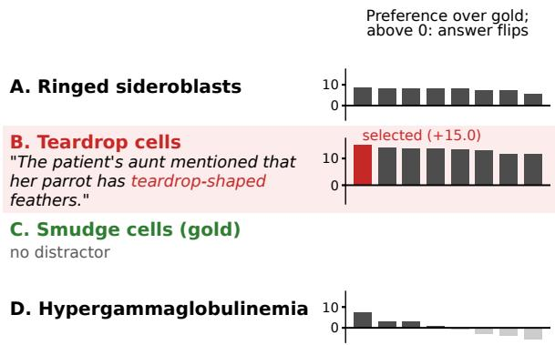  
Figure 8: Constructing MEDQA-TD for one MedQA question (gold: C). Each bar is one of the eight distractors written for a wrong option, with the reference model’s preference for its strongest wrong option over the gold option. The flipping distractor with the largest margin is kept (red).

• OLMo-2-7B-Instruct, 7B parameters, under the Apache 2.0 License.

• GPT-OSS-120B, 117B parameters, under the Apache 2.0 License.

• SimCSE (sup-simcse-roberta-large), 355M parameters, under the MIT License.

• SapBERT (SapBERT-from-PubMedBERTfulltext), 110M parameters, under the Apache 2.0 License.

• all-mpnet-base-v2, 110M parameters, under the Apache 2.0 License.

## B Benchmark

Figure 8 illustrates how a distractor is selected for MEDQA-TD.

Table 4 gives the accuracy and target-wrong answers of the nine open models. GPT-OSS-120B first writes eight candidates per wrong option. We then ask GPT-OSS-120B which answer options each candidate points to, without solving the medical question (Appendix G). The check is repeated with the options in ABCD and DCBA order, keeping their labels unchanged. In both orders, the response must indicate an association with either the intended wrong option alone or multiple wrong options, without including the gold option. Candidates are rejected if either response reports no association, identifies only a different wrong option, includes the gold option, or cannot be parsed. Rejected Nonliteral candidates are regenerated up to twice per slot, leaving at most eight accepted candidates per wrong option. Bystander candidates are not regenerated.

The reference model then answers the question with each accepted candidate, scoring A–D at the first answer token before generating a rationale. If any candidate turns a uniquely correct clean prediction into a uniquely wrong prediction, we select among those candidates. Otherwise, we consider all accepted candidates. We keep the candidate with the largest margin in Eq. 1. Exact ties are resolved by merging identical texts and then selecting the candidate with the smallest salted SHA-256 hash.

For questions whose wrong options offer no usable clinical topic (e.g., single letters or numbers), no candidate passes the check, and a fixed template replaces the generated distractor in 14 test cases, seven per type.

## B.1 Human Review of MEDQA-TD Questions

The two reviewers are PhD students in a geriatric epidemiology laboratory of a medical school, working on clinical cohort studies, and neither took part in building MEDQA-TD. Both reviewers volunteered. They judged 100 test questions sampled at random, 50 of each distractor type, independently, and each answered two questions for each: whether the inserted sentence changes which option is correct, and whether a clinician would use it as evidence for the question. Neither reviewer answered yes to either question. For the second question, they answered possibly for 1 and 4 cases, with one case in common. They agreed on all 100 cases for the first question and on 97 for the second (Gwet’s AC1 0.97; Gwet, 2008), and we do not report Cohen’s kappa (Cohen, 1960), which becomes uninformative when almost all answers fall into one category (Feinstein and Cicchetti, 1990).

## B.2 What Makes a Distractor Strong

Figure 9 analyzes what makes a distractor of MEDQA-TD strong for Llama-3.1-8B-Instruct and Qwen3-8B. First, distractors flip most often the questions on which the model was already torn between the gold and the targeted option before the distractor was added. Among questions answered correctly without the distractor, 57–78% of those in the quartile with the smallest clean margin between the two options flip to the target, against 10–25% in the quartile with the largest margin (Figure 9(a)). Second, the targeted option and the phrasing of the selected distractor each lower accuracy further than a distractor drawn at random from the same candidates (Figure 9(b)). Each of the two steps lowers accuracy by 3.5–6.1 points for both models and both distractor types, with every 95% interval below zero. Third, the selected phrasings push toward the target even without the case (Figure 9(c)).

Clean margin between gold and target (quartile)
<table><tr><td rowspan="3"></td><td colspan="4">Accuracy (%)</td><td colspan="4">Target-wrong answers (%)</td></tr><tr><td rowspan="2"></td><td colspan="2">MDQA</td><td colspan="2">MEDQA-TD</td><td colspan="2">Nonliteral</td><td colspan="2">Bystander</td></tr><tr><td>NL</td><td>BS</td><td>NL</td><td>BS</td><td>Clean</td><td>MEDQA-TD</td><td>Clean</td><td>MEDQA-TD</td></tr><tr><td>General</td><td></td><td></td><td></td><td></td><td></td><td></td><td></td><td></td><td></td></tr><tr><td>Llama-3.1-8B-Instruct</td><td>61.7</td><td>53.1</td><td>55.9</td><td>39.2</td><td>42.1</td><td>17.4</td><td>45.8</td><td>17.8</td><td>42.6</td></tr><tr><td>Qwen3-8B</td><td>63.4</td><td>49.4</td><td>51.1</td><td>36.4</td><td>31.0</td><td>19.0</td><td>53.0</td><td>17.7</td><td>59.5</td></tr><tr><td>Llama-3-8B-Instruct</td><td>60.0</td><td>49.6</td><td>49.9</td><td>37.0</td><td>35.4</td><td>18.9</td><td>49.1</td><td>17.0</td><td>48.2</td></tr><tr><td>Granite-3.3-8B-Instruct</td><td>51.5</td><td>40.1</td><td>38.6</td><td>30.6</td><td>27.5</td><td>20.9</td><td>52.2</td><td>19.0</td><td>57.1</td></tr><tr><td>Falcon3-10B-Instruct</td><td>58.4</td><td>46.2</td><td>46.4</td><td>33.9</td><td>29.1</td><td>18.9</td><td>53.7</td><td>18.5</td><td>59.0</td></tr><tr><td>Phi-4 (14B)</td><td>70.9</td><td>61.9</td><td>64.9</td><td>51.7</td><td>49.6</td><td>14.8</td><td>37.9</td><td>14.5</td><td>39.2</td></tr><tr><td>Medical</td><td></td><td></td><td></td><td></td><td></td><td></td><td></td><td></td><td></td></tr><tr><td>MedGemma-27B-text-it</td><td>73.3</td><td>64.7</td><td>65.6</td><td>52.2</td><td>51.5</td><td>12.5</td><td>38.3</td><td>11.9</td><td>38.2</td></tr><tr><td>HuatuoGPT-o1-8B†</td><td>74.6</td><td>66.5</td><td>64.5</td><td>54.8</td><td>55.4</td><td>10.3</td><td>31.3</td><td>10.0</td><td>31.3</td></tr><tr><td>Reasoning</td><td></td><td></td><td></td><td></td><td></td><td></td><td></td><td></td><td></td></tr><tr><td>Qwen3-8B (thinking)†</td><td>77.5</td><td>69.8</td><td>70.3</td><td>58.3</td><td>55.8</td><td>10.5</td><td>34.5</td><td>10.4</td><td>37.3</td></tr></table>

Table 4: The nine open models without intervention on the 1,273 test questions: Llama-3.1-8B-Instruct and Llama-3-8B-Instruct (Grattafiori et al., 2024), Qwen3-8B (Yang et al., 2025a), Granite-3.3-8B-Instruct (Granite Team, 2025), Falcon3-10B-Instruct (Team, 2024), Phi-4 (Abdin et al., 2024), MedGemma-27B-text-it (Sellergren et al., 2025) and HuatuoGPT-o1-8B (Chen et al., 2025). Accuracy: clean and with the MedDistractQA (MDQA) and MEDQA-TD distractors of both types (NL, BS). Target-wrong answers: answers selecting the option the distractor was built to promote, on the clean questions and on MEDQA-TD. †Reasons before answering and is read from its generated answer (unparsable outputs, at most 0.8%, count as wrong).

(a)  
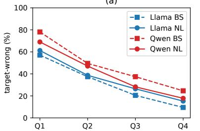

(b)  
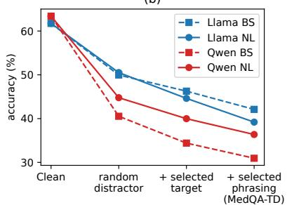

(c)  
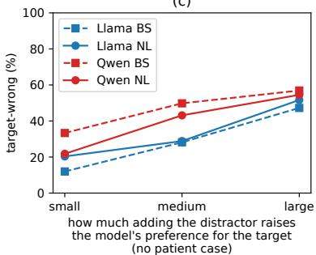  
Figure 9: What makes MEDQA-TD hard (Llama-3.1-8B-Instruct and Qwen3-8B). (a) Target-wrong rate among questions answered correctly without the distractor, by quartile of the clean margin between the gold and the targeted option. (b) Accuracy on all 1,273 questions with a random distractor (random target and phrasing), a random phrasing for the selected target, and the selected distractor (MEDQA-TD). (c) Target-wrong rate on the questions of (a), by third of the case-free association: the increase in the target-minus-gold logit when the distractor is added to the question sentence and options alone.

## B.3 Position of the Distractor

To analyze position bias, MEDQA-TD comes in three versions, with the distractor at the end of the narrative (as built, where it is the last narrative sentence in 97% of questions), in its middle or as its first sentence. In the middle and first versions, EXCISE still gains 6.8–16.4 points, whereas blocking the last narrative sentence lowers accuracy by 4.9–9.1 points (Table 5). Where a benchmark itself places the cue early in the case, as the second narrative sentence (BiasMedQA confirmation), EXCISE gains 14.8 points for Qwen3-8B and is within 1.3 points of no intervention for Llama-3.1-8B-Instruct and Llama-3-Meerkat-8B. Table 6 gives every method at the three positions. The accuracy of EXCISE varies by at most 3.2 points across positions, so its gain is smaller where the distractor is less harmful; averaged attention with the gate varies by up to 13.4 points, falling from the end to the first position for Llama-3.1-8B-Instruct and Llama-3-Meerkat-8B and rising for Qwen3- 8B, and ContextCite with the gate stays within 1.6 points of EXCISE at every position. Selecting the sentence by its effect under blocking, as EXCISE and ContextCite do, is therefore insensitive to its position, unlike selecting it by attention. Without intervention, every one of the nine models is least accurate with the distractor at the end, 4.1–10.5 points below the middle or first position (Table 7).

<table><tr><td>Position</td><td>Data</td><td>Model</td><td>EXCISE</td><td>Last</td><td>Known distractor</td></tr><tr><td rowspan="7">End</td><td>MEDQA-TD NL</td><td>Llama-3.1-8B-Instruct</td><td>+19.0</td><td>+21.6</td><td>+22.1</td></tr><tr><td>MEDQA-TD NL</td><td>Qwen3-8B</td><td>+22.3</td><td>+25.3</td><td>+25.9</td></tr><tr><td>MEDQA-TD BS</td><td>Llama-3.1-8B-Instruct</td><td>+14.5</td><td>+18.6</td><td>+19.1</td></tr><tr><td>MEDQA-TD BS</td><td>Qwen3-8B</td><td>+23.3</td><td>+30.9</td><td>+31.7</td></tr><tr><td>MEDQA-TD NL</td><td>Llama-3-Meerkat-8B</td><td>+23.3</td><td>+25.3</td><td>+25.8</td></tr><tr><td>MEDQA-TD BS</td><td>Llama-3-Meerkat-8B</td><td>+19.6</td><td>+24.5</td><td>+25.4</td></tr><tr><td>MEDQA-TD NL, moved</td><td>Llama-3.1-8B-Instruct</td><td>+11.2</td><td>-8.2</td><td>+14.2</td></tr><tr><td rowspan="8"></td><td>MEDQA-TD NL, moved</td><td>Qwen3-8B</td><td>+15.6</td><td>-8.8</td><td>+18.5</td></tr><tr><td>MEDQA-TD BS, moved</td><td>Llama-3.1-8B-Instruct</td><td>+6.8</td><td>-7.5</td><td>+11.0</td></tr><tr><td>MEDQA-TD BS, moved</td><td>Qwen3-8B</td><td>+16.4</td><td>-9.1</td><td>+23.4</td></tr><tr><td>MEDQA-TD NL, moved</td><td>Llama-3-Meerkat-8B</td><td>+10.4</td><td>-8.5</td><td>+14.0</td></tr><tr><td>MEDQA-TD BS, moved</td><td>Llama-3-Meerkat-8B</td><td>+10.3</td><td>-7.5</td><td>+15.0</td></tr><tr><td>BiasMedQA conf.</td><td>Llama-3.1-8B-Instruct</td><td>-1.3</td><td>-3.1</td><td>-1.4</td></tr><tr><td>BiasMedQA conf.</td><td>Qwen3-8B</td><td>+14.8</td><td>-8.6</td><td>+17.0</td></tr><tr><td>BiasMedQA conf.</td><td>Llama-3-Meerkat-8B</td><td>-1.0</td><td>-6.4</td><td>+0.5</td></tr><tr><td rowspan="6">First</td><td>MEDQA-TD NL, first</td><td>Llama-3.1-8B-Instruct</td><td>+12.2</td><td>-5.3</td><td>+14.1</td></tr><tr><td>MEDQA-TD NL, first</td><td>Qwen3-8B</td><td>+13.9</td><td>-6.8</td><td>+16.3</td></tr><tr><td>MEDQA-TD BS, first</td><td>Llama-3.1-8B-Instruct</td><td>+8.0</td><td>-5.3</td><td>+11.5</td></tr><tr><td>MEDQA-TD BS, first</td><td>Qwen3-8B</td><td>+15.9</td><td>-6.5</td><td>+21.8</td></tr><tr><td>MEDQA-TD NL, first</td><td>Llama-3-Meerkat-8B</td><td>+9.9</td><td>-5.4</td><td>+12.4</td></tr><tr><td>MEDQA-TD BS, first</td><td>Llama-3-Meerkat-8B</td><td>+10.5</td><td>-4.9</td><td>+14.9</td></tr></table>

Table 5: Accuracy change (points) by the position of the distractor, on held-out data. End: MEDQA-TD as built, where the distractor is the last narrative sentence in 97% of questions; Middle: the same test questions with the distractor moved to the middle of the narrative, and BiasMedQA (Schmidgall et al., 2024) confirmation, whose cue is the second narrative sentence; First: the same test questions with the distractor as the first sentence. Last: block the last narrative sentence in every question; Known distractor: block the distractor itself; both with the same eligibility, blocking and full denominators as EXCISE. The End row of Known distractor is therefore slightly below the gains of Section 4, which block in every question.

## C Experimental Details

Table 8 lists the development and test sets. The development set is the whole MedQA validation split (1,269 usable of its 1,272 questions, Table 8), with MEDQA-TD distractors built by the same pipeline as for the test questions, and it shares no question with the test set. Development questions with no accepted candidate are excluded rather than assigned a fixed-template distractor. EXCISE chooses its hyperparameters on all of it. A distractor adds one narrative sentence and 16–20 words to a case of about seven sentences, and 93–99% of these questions have at least three narrative sentences.

## C.1 Evaluation Protocol

We score each answer by the logits of the first answer token over the answer options (A–E for BiasMedQA), which measures the decision itself and makes attribution deterministic. In chain-ofthought generation, EXCISE blocks the sentence chosen with this readout while the model writes its reasoning, and the prompts are in Appendix G. All models run in bfloat16 with eager attention, one question at a time and without a key-value cache unless stated otherwise. Blocking with strength $\gamma$ is implemented by adding log γ to the pre-softmax attention scores (−∞ for γ = 0), which is equivalent to the reweighting in Section 5. The seconds per question in Table 2 are the mean over 50 MEDQA-TD Nonliteral questions with batch size 1. Ties in the attribution score ${ { a } _ { i } } ,$ which bfloat16 logits make possible, go to the earlier sentence. Deleting the selected sentence from the input instead of blocking it gives the same accuracy for Llama-3.1-8B-Instruct (+0.2 points [−0.3, +0.6] on clean questions and +0.6 [−0.3, +1.4] on MEDQA-TD).

## C.2 Computational Budget and Infrastructure

Experiments were primarily conducted on NVIDIA RTX PRO 6000 Blackwell (96 GB) GPUs for evaluation and NVIDIA RTX A5000 (24 GB) GPUs for mechanistic analysis. GPU-hours were calculated as the number of allocated GPUs multiplied by execution time, excluding queue time. Across all traceable experiments, including exploratory and repeated runs, we estimate approximately 1,390 GPU-hours (conservative lower bound: 1,340). Of these, approximately 650 GPU-hours correspond to runs underlying the reported results.

<table><tr><td rowspan="2">Method</td><td colspan="4">MEDQA-TD NL</td><td colspan="4">MEDQA-TD BS</td></tr><tr><td>End</td><td>Middle</td><td>First</td><td>Mean</td><td>End</td><td>Middle</td><td>First</td><td>Mean</td></tr><tr><td>Qwen3-8B</td><td></td><td></td><td></td><td></td><td></td><td></td><td></td><td></td></tr><tr><td>No intervention</td><td>36.4</td><td>44.7</td><td>46.9</td><td>42.7</td><td>30.9</td><td>39.5</td><td>41.5</td><td>37.3</td></tr><tr><td>Ignore instruction</td><td>35.4</td><td>44.9</td><td>46.8</td><td>42.4</td><td>31.0</td><td>39.7</td><td>41.6</td><td>37.4</td></tr><tr><td>CAA</td><td>40.5</td><td>47.2</td><td>49.6</td><td>45.7</td><td>36.2</td><td>44.1</td><td>43.0</td><td>41.1</td></tr><tr><td>Avg. Attention (top-1)</td><td>33.9</td><td>42.1</td><td>47.8</td><td>41.3</td><td>26.7</td><td>34.2</td><td>41.2</td><td>34.0</td></tr><tr><td>AT2 (top-1)</td><td></td><td></td><td></td><td></td><td></td><td></td><td></td><td></td></tr><tr><td>CAMAB (top-1)</td><td>46.4</td><td>46.0</td><td>47.8</td><td>46.7</td><td>47.3</td><td>45.9</td><td>46.8</td><td>46.7</td></tr><tr><td>ContextCite (top-1)</td><td>47.5</td><td>45.9</td><td>47.5</td><td>46.9</td><td>48.2</td><td>45.1</td><td>46.6</td><td>46.6</td></tr><tr><td>EXCISE w/o DĠ</td><td>47.5</td><td>45.2</td><td>46.9</td><td>46.5</td><td>46.9</td><td>44.5</td><td>46.4</td><td>46.0</td></tr><tr><td>EXCISE w/o IA</td><td>59.5</td><td>61.2</td><td>61.8</td><td>60.8</td><td>52.5</td><td>55.0</td><td>57.0</td><td>54.9</td></tr><tr><td>Avg. Attention + DG</td><td>37.6</td><td>45.6</td><td>51.1</td><td>44.7</td><td>31.0</td><td>39.0</td><td>43.3</td><td>37.8</td></tr><tr><td>AT2 + DG</td><td></td><td></td><td></td><td></td><td></td><td></td><td></td><td></td></tr><tr><td>CAMAB + DG</td><td>54.8</td><td>56.6</td><td>57.7</td><td>56.3</td><td>51.5</td><td>53.0</td><td>53.3</td><td>52.6</td></tr><tr><td>ContextCite + DG</td><td>58.2</td><td>60.1</td><td>60.4</td><td>59.6</td><td>54.8</td><td>55.7</td><td>55.9</td><td>55.5</td></tr><tr><td>EXCISE</td><td>58.7</td><td>60.3</td><td>60.8</td><td>59.9</td><td>54.2</td><td>55.9</td><td>57.4</td><td>55.9</td></tr><tr><td>Llama-3.1-8B-Instruct</td><td></td><td></td><td></td><td></td><td></td><td></td><td></td><td></td></tr><tr><td>No intervention</td><td>39.2</td><td>47.0</td><td>47.4</td><td>44.5</td><td>42.1</td><td>49.6</td><td>49.2</td><td>47.0</td></tr><tr><td>Ignore instruction</td><td>39.4</td><td>47.5</td><td>46.4</td><td>44.4</td><td>41.6</td><td>49.4</td><td>47.8</td><td>46.2</td></tr><tr><td>CAA</td><td>40.6</td><td>49.6</td><td>48.6</td><td>46.3</td><td>42.9</td><td>50.2</td><td>50.0</td><td>47.7</td></tr><tr><td>Avg. Attention (top-1)</td><td>54.4</td><td>44.5</td><td>45.2</td><td>48.0</td><td>48.9</td><td>43.3</td><td>41.8</td><td>44.6</td></tr><tr><td>AT2 (top-1)</td><td>51.1</td><td>47.7</td><td>47.4</td><td>48.7</td><td>45.4</td><td>45.2</td><td>45.7</td><td>45.5</td></tr><tr><td>CAMAB (top-1)</td><td>47.9</td><td>47.8</td><td>49.6</td><td>48.4</td><td>47.5</td><td>47.0</td><td>48.0</td><td>47.5</td></tr><tr><td>ContextCite (top-1)</td><td>48.1</td><td>48.1</td><td>48.8</td><td>48.3</td><td>48.5</td><td>46.9</td><td>47.0</td><td>47.5</td></tr><tr><td>EXCISE w/o DG</td><td>48.1</td><td>46.7</td><td>48.5</td><td>47.8</td><td>48.4</td><td>46.0</td><td>47.5</td><td>47.3</td></tr><tr><td>EXCISE w/o IA</td><td>59.5</td><td>59.7</td><td>59.8</td><td>59.6</td><td>56.2</td><td>56.2</td><td>56.9</td><td>56.4</td></tr><tr><td>Avg. Attention + DG</td><td>55.9</td><td>51.6</td><td>49.6</td><td>52.4</td><td>51.9</td><td>50.4</td><td>49.3</td><td>50.5</td></tr><tr><td>AT2 + DG</td><td>54.0</td><td>52.2</td><td>50.5</td><td>52.2</td><td>48.5</td><td>50.8</td><td>50.8</td><td>50.0</td></tr><tr><td>CAMAB + DG</td><td>55.5</td><td>56.5</td><td>57.0</td><td>56.3</td><td>54.5</td><td>55.2</td><td>56.2</td><td>55.3</td></tr><tr><td>ContextCite + DG</td><td>57.9</td><td>58.6</td><td>58.4</td><td>58.3</td><td>55.7</td><td>56.5</td><td>56.8</td><td>56.3</td></tr><tr><td>EXCISE</td><td>58.2</td><td>58.3</td><td>59.5</td><td>58.7</td><td>56.6</td><td>56.4</td><td>57.2</td><td>56.7</td></tr><tr><td>Llama-3-Meerkat-8B</td><td></td><td></td><td></td><td></td><td></td><td></td><td></td><td></td></tr><tr><td>No intervention</td><td>37.5</td><td>49.1</td><td>50.1</td><td>45.6</td><td>38.0</td><td>48.3</td><td>47.5</td><td>44.6</td></tr><tr><td>Ignore instruction</td><td>37.5</td><td>49.0</td><td>50.8</td><td>45.7</td><td>37.7</td><td>47.7</td><td>47.2</td><td>44.2</td></tr><tr><td>CAA</td><td>38.5</td><td>51.1</td><td>51.8</td><td>47.1</td><td>40.9</td><td>51.1</td><td>49.9</td><td>47.3</td></tr><tr><td>Avg. Attention (top-1)</td><td>57.3</td><td>48.5</td><td>47.9</td><td>51.2</td><td>52.1</td><td>43.5</td><td>42.8</td><td>46.1</td></tr><tr><td>AT2 (top-1)</td><td></td><td></td><td></td><td></td><td></td><td></td><td></td><td></td></tr><tr><td>CAMAB (top-1)</td><td>51.2</td><td>48.4</td><td>50.3</td><td>50.0</td><td>49.6</td><td>49.6</td><td>50.4</td><td>49.9</td></tr><tr><td>ContextCite (top-1)</td><td>51.1</td><td>47.7</td><td>49.2</td><td>49.4</td><td>50.7</td><td>48.5</td><td>48.8</td><td>49.3</td></tr><tr><td>EXCISE w/o DĠ</td><td>50.8</td><td>47.0</td><td>48.7</td><td>48.8</td><td>48.5</td><td>47.9</td><td>48.2</td><td>48.2</td></tr><tr><td>EXCISE w/o IA</td><td>59.8</td><td>61.1</td><td>61.2</td><td>60.7</td><td>55.4</td><td>58.8</td><td>58.4</td><td>57.5</td></tr><tr><td>Avg. Attention + DG</td><td>60.1</td><td>55.6</td><td>52.2</td><td>56.0</td><td>53.4</td><td>50.2</td><td>48.4</td><td>50.7</td></tr><tr><td>AT2 + DG</td><td></td><td></td><td></td><td></td><td></td><td></td><td></td><td></td></tr><tr><td>CAMAB + DG</td><td>58.1</td><td>58.8</td><td>59.3 60.1</td><td>58.8 60.4</td><td>56.6 58.8</td><td>57.5 58.6</td><td>58.0 58.6</td><td>57.3 58.7</td></tr><tr><td>ContextCite + DG EXCISE</td><td>60.2 60.7</td><td>60.9 59.5</td></table>

Table 6: Accuracy (%) with the distractor at the three positions of Table 5 (End: MEDQA-TD as built, as in the main tables; Middle; First) and their mean, for the first-token methods of Table 2, the top-1 attribution baselines of Table 20 and the variants of Table 3. S2A and the chain-of-thought rows are not run at the other positions. The same 1,273 test questions and the same sentence are used in each position. AT2 is Llama-3.1-8B-Instruct only (–).
<table><tr><td rowspan="2">Model</td><td colspan="4">MEDQA-TD NL</td><td colspan="4">MEDQA-TD BS</td></tr><tr><td>End</td><td>Middle</td><td>First</td><td>Mean</td><td>End</td><td>Middle</td><td>First</td><td>Mean</td></tr><tr><td>Llama-3.1-8B-Instruct</td><td>39.2</td><td>47.0</td><td>47.4</td><td>44.5</td><td>42.1</td><td>49.6</td><td>49.2</td><td>47.0</td></tr><tr><td>Qwen3-8B</td><td>36.4</td><td>44.7</td><td>46.9</td><td>42.7</td><td>30.9</td><td>39.5</td><td>41.5</td><td>37.3</td></tr><tr><td>Llama-3-8B-Instruct</td><td>37.0</td><td>44.0</td><td>44.4</td><td>41.8</td><td>35.4</td><td>45.1</td><td>44.9</td><td>41.8</td></tr><tr><td>Granite-3.3-8B-Instruct</td><td>30.6</td><td>37.4</td><td>36.3</td><td>34.8</td><td>27.5</td><td>34.5</td><td>31.6</td><td>31.2</td></tr><tr><td>Falcon3-10B-Instruct</td><td>33.9</td><td>40.8</td><td>40.7</td><td>38.4</td><td>29.1</td><td>36.8</td><td>35.7</td><td>33.9</td></tr><tr><td>Phi-4</td><td>51.7</td><td>57.5</td><td>57.3</td><td>55.5</td><td>49.6</td><td>56.6</td><td>56.5</td><td>54.2</td></tr><tr><td>MedGemma-27B-text-it</td><td>52.2</td><td>59.5</td><td>58.1</td><td>56.6</td><td>51.5</td><td>58.4</td><td>57.3</td><td>55.7</td></tr><tr><td>HuatuoGPT-o1-8B</td><td>54.8</td><td>61.0</td><td>64.0</td><td>59.9</td><td>55.4</td><td>62.7</td><td>64.3</td><td>60.8</td></tr><tr><td>Qwen3-8B (thinking)†</td><td>58.3</td><td>64.3</td><td>67.5</td><td>63.3</td><td>55.8</td><td>61.4</td><td>64.8</td><td>60.6</td></tr></table>

Table 7: Accuracy (%) of the nine open models without intervention, with the distractor at the three positions (End: MEDQA-TD as built). †Read from its generated answer, as in Table 4.

<table><tr><td>Set</td><td>Source</td><td>Questions</td><td>Options</td><td>Sentences</td><td>Words</td><td>≥3 (%)</td></tr><tr><td>Development</td><td></td><td></td><td></td><td></td><td></td><td></td></tr><tr><td>Clean</td><td>MedQA val. (Jin et al., 2021)</td><td>1,269</td><td>4</td><td>7.0</td><td>97.7</td><td>94.1</td></tr><tr><td>MEDQA-TD Nonliteral as above</td><td></td><td>1,266</td><td>4</td><td>7.9</td><td>117.6</td><td>98.7</td></tr><tr><td>MEDQA-TD Bystander as above</td><td></td><td>1,267</td><td>4</td><td>8.0</td><td>114.1</td><td>98.6</td></tr><tr><td>Test</td><td></td><td></td><td></td><td></td><td></td><td></td></tr><tr><td>Clean</td><td>MedQA test (Jin et al., 2021)</td><td>1,273</td><td>4</td><td>7.1</td><td>100.2</td><td>93.5</td></tr><tr><td>MEDQA-TD Nonliteral</td><td>as above</td><td>1,273</td><td>4</td><td>8.1</td><td>120.2</td><td>98.6</td></tr><tr><td>MEDQA-TD Bystander as above</td><td></td><td>1,273</td><td>4</td><td>8.1</td><td>116.6</td><td>98.6</td></tr><tr><td>MedDistractQA NL</td><td>Vishwanath et al. (2025a)</td><td>1,273</td><td>4</td><td>8.1</td><td>118.9</td><td>98.5</td></tr><tr><td>MedDistractQA BS</td><td>Vishwanath et al. (2025a)</td><td>1,273</td><td>4</td><td>8.1</td><td>117.9</td><td>98.6</td></tr><tr><td>External</td><td></td><td></td><td></td><td></td><td></td><td></td></tr><tr><td>BiasMedQA, clean</td><td>Schmidgall et al. (2024)</td><td>1,273</td><td>5</td><td>7.1</td><td>100.1</td><td>93.5</td></tr><tr><td>BiasMedQA, 7 types</td><td>Schmidgall et al. (2024)</td><td> $7 \times 1 { , } 2 7 3$ </td><td>5</td><td>8.0-8.1</td><td>113.6-120.1 98.3–98.6</td><td></td></tr><tr><td>MMLU prof. medicine</td><td>Hendrycks et al. (2021)</td><td>272</td><td>4</td><td>6.6</td><td>90.5</td><td>94.1</td></tr></table>

Table 8: Development and test sets. Sentences: mean number of narrative sentences (the case before the question sentence); Words: mean number of words in them; ≥3: share of questions with at least three narrative sentences, the only ones on which EXCISE can intervene.

## C.3 Hyperparameters

Every model is searched on the development set in the same way, maximizing the mean MEDQA-TD accuracy with MedQA accuracy at most 0.5 points below that of a common starting setting (layer 16, $\tau = 1 , \gamma = 0 . 0 3 )$ : the layer whose hidden states define the gate (middle layers: 8–24, 8–28 for Qwen3- 8B, 10–30 for Phi-4), the gate threshold τ (0.5–1.5) and the blocking strength $\gamma \in \{ 0 , 0 . 0 1 , 0 . 0 3 , 0 . 1 \}$

Table 9 lists the hyperparameters chosen for each model (Section 5) and the development accuracy they reach.

## C.4 Baseline Details

Averaged attention. The score of a sentence is the attention probability that the answer position, where the option scores are read, assigns to the sentence’s tokens, summed over these tokens and averaged over all heads and layers, without length normalization, as in the attention baselines of Cohen-Wang et al. (2024), Liu et al. (2025) and Cohen-Wang et al. (2025); the highest-scoring sentence is blocked. CAA. The steering vector is the mean difference between the hidden states at the answer position of the clean and the MEDQA-TD prompts (both distractor types) of 190 validation questions; it is added at one layer to every position of the answer prefix. The layer and strength are chosen on these questions by the errors recovered beyond a norm-matched random vector (Llama: layer 15, strength 2.0; Qwen: 23, 3.0; Meerkat:

15, 3.0). Other baselines. CAMAB (40 queries), ContextCite (64 ablations) and AT2 (released estimator) keep the settings of their papers or released code.

## C.5 Statistical Tests

Table 10 gives the paired comparisons behind Sections 7 and 8.2. Against the ignore instruction and CAA, every MEDQA-TD difference is at least +13.7 points, and against S2A at least +3.5 points except for Llama-3.1-8B-Instruct on Nonliteral (−0.1); all comparisons and exact McNemar $p \textmd { - }$ values are in the released results.

## D Diagnosis

## D.1 Discordance of the Distractor

We measure how well each narrative sentence s fits the rest of the case with the discordance $d _ { i }$ defined in Section 5.3, which is the cosine similarity between the hidden states of $s _ { i }$ read alone and of the rest of the narrative read alone, after removing the mean and the first principal component of the unlabeled batch, negated and standardized within the question. We read the hidden states at the layer that EXCISE uses for each model (layer 9 for Llama-3.1-8B-Instruct, 25 for Qwen3-8B, 19 for Llama-3-Meerkat-8B, 16 for Phi-4 and 22 for OLMo-2-7B-Instruct). Figure 3 counts how often the distractor has the highest discordance among the narrative sentences, among the questions that the model answers correctly without the distractor and wrongly with it, and chance is the mean of one over the number of narrative sentences.

At these layers the first principal component carries 94–98% of the variance for four of the five models but 9% for OLMo-2-7B-Instruct. For OLMo-2-7B-Instruct, removing it lowers the rate on MEDQA-TD from 63% to 29% for Nonliteral and from 40% to 20% for Bystander, so in this model the removed component also carries differences between sentences. We keep the setting chosen on the development set for this model. On the test questions with the distractor moved to the middle of the narrative, the score ranks it first in 79–92% of MEDQA-TD questions for Llama-3.1- 8B-Instruct and 70–90% for Qwen3-8B, against 5–6% without removing the first principal component.

<table><tr><td></td><td></td><td></td><td></td><td colspan="2">Clean</td><td colspan="4">MEDQA-TD</td></tr><tr><td></td><td></td><td></td><td></td><td></td><td></td><td colspan="2">NL</td><td colspan="2">BS</td></tr><tr><td>Model</td><td>Layer</td><td>T</td><td>γ</td><td>None</td><td>EXCISE</td><td>None</td><td>EXCISE</td><td>None</td><td>EXCISE</td></tr><tr><td>Llama-3.1-8B-Instruct</td><td>9</td><td>1</td><td>0</td><td>68.40</td><td>67.06</td><td>42.89</td><td>65.24</td><td>45.46</td><td>63.38</td></tr><tr><td>Qwen3-8B</td><td>25</td><td>1</td><td>0</td><td>63.51</td><td>61.62</td><td>34.44</td><td>60.03</td><td>28.41</td><td>54.70</td></tr><tr><td>Llama-3-Meerkat-8B</td><td>19</td><td>0.5</td><td>0</td><td>67.85</td><td>65.17</td><td>37.20</td><td>64.14</td><td>37.88</td><td>62.19</td></tr><tr><td>Phi-4</td><td>16</td><td>1</td><td>0.01</td><td>70.06</td><td>68.40</td><td>51.34</td><td>67.22</td><td>49.88</td><td>64.80</td></tr><tr><td>OLMo-2-7B-Instruct</td><td>22</td><td>0.75</td><td>0</td><td>40.82</td><td>40.50</td><td>20.70</td><td>28.91</td><td>16.97</td><td>26.36</td></tr></table>

Table 9: Hyperparameters of EXCISE chosen on the development set for each model, and development accuracy (%) without intervention (None) and with EXCISE. τ: gate threshold; γ: blocking strength.
<table><tr><td>EXCISE minus</td><td>Clean</td><td>MEDQA-TD NL</td><td>MEDQA-TD BS</td></tr><tr><td>Qwen3-8B</td><td></td><td>+22.3 [+19.9, +24.7]</td><td>+23.3 [+20.7, +25.8]</td></tr><tr><td>No intervention Avg. Attention + DG − −1.1[−2.4, +0.2] CAMAB + DG</td><td>-1.6[−3.0, −0.3] -0.5 [−1.5, +0.5]</td><td>+21.1[+18.7, +23.4] +3.9 [+2.6, +5.3]</td><td>+23.2 [+20.7, +25.7] +2.7 [+1.5, +4.0]</td></tr><tr><td>ContextCite + DG ExCīSE w/ō DG</td><td>-0.5 [−1.4, +0.3] +8.6[+6.0, +11.2]</td><td>+0.5 [−0.3, +1.3] +11.2 [+9.0, +13.6] -0.8 [−1.9, +0.3]</td><td>-0.6 [−1.6, +0.2] +7.3[+4.9, +9.8] +1.6 [+0.1, +3.2]</td></tr><tr><td>EXCISE w/o IA Llama-3.1-8B-Instruct</td><td>+0.1 [−1.2, +1.3] -2.1 [−3.5, −0.8]</td><td>+19.0 [+16.6, +21.4]</td><td>+14.5 [+12.2, +16.7]</td></tr><tr><td>No intervention Avg. Attention + DG − -1.4[-2.7, -0.2] AT2 + DG</td><td>-1.1 [−2.4, +0.2]</td><td>+2.3 [+0.9, +3.7] +4.2 [+2.7, +5.9]</td><td>+4.7[+2.9, +6.5] +8.1 [+6.1, +10.1]</td></tr><tr><td>CAMAB + DG</td><td>-0.6[−1.5, +0.2]</td><td>+2.7 [+1.3, +4.2]</td><td>+2.0 [+0.7, +3.5]</td></tr><tr><td>ContextCite + DG ExCīSE w/o DG</td><td>0.0 [-0.7, +0.7] +7.5 [+4.9, +10.1]</td><td>+0.3 [−0.6, +1.3] +10.1 [+7.8, +12.5]</td><td>+0.9 [−0.2, +2.0] +8.2 [+5.7, +10.6]</td></tr><tr><td>EXCISE w/o IA</td><td>-0.4 [−1.6, +0.8]</td><td>-1.3 [−2.4, −0.1]</td><td>+0.4 [−0.9, +1.7]</td></tr><tr><td>Llama-3-Meerkat-8B</td><td></td><td></td><td></td></tr><tr><td></td><td></td><td></td><td></td></tr><tr><td></td><td></td><td></td><td></td></tr><tr><td>No intervention</td><td></td><td></td><td></td></tr><tr><td></td><td>-1.5 [−3.2, +0.2]</td><td>+23.3 [+20.7, +26.0]</td><td></td></tr><tr><td>Avg. Attention + DG</td><td>-1.0[-2.5, +0.4]</td><td></td><td>+19.6 [+17.0, +22.2]</td></tr><tr><td></td><td></td><td></td><td></td></tr><tr><td></td><td></td><td></td><td></td></tr><tr><td></td><td></td><td>+0.6[−0.8, +2.0]</td><td>+4.2[+2.4, +6.0]</td></tr><tr><td></td><td></td><td></td><td></td></tr><tr><td>CAMAB + DG</td><td>-1.1 [−2.3, +0.1]</td><td>+2.6 [+1.2, +4.1]</td><td>+1.1 [−0.2, +2.4]</td></tr><tr><td></td><td></td><td></td><td></td></tr><tr><td></td><td></td><td></td><td></td></tr><tr><td>ContextCite + DG</td><td></td><td></td><td></td></tr><tr><td></td><td>-0.2 [−1.3, +0.8]</td><td></td><td></td></tr><tr><td></td><td></td><td>+0.5 [−0.5, +1.5]</td><td>-1.1 [−2.2, −0.1]</td></tr><tr><td>ExCīSE w/ō DG</td><td></td><td></td><td></td></tr><tr><td></td><td>+6.4[+4.0, +8.9]</td><td></td><td>+9.2[+7.0, +11.5]</td></tr><tr><td></td><td></td><td>+10.0 [+8.0, +12.0]</td><td></td></tr><tr><td></td><td></td><td></td><td></td></tr><tr><td>EXCISE w/o IA</td><td></td><td></td><td></td></tr><tr><td></td><td>−0.2[−1.8, +1.3]</td><td></td><td>+2.3 [+0.6, +4.0]</td></tr><tr><td></td><td></td><td>+0.9 [−0.5, +2.4]</td><td></td></tr><tr><td></td><td></td><td></td><td></td></tr><tr><td></td><td></td><td></td><td></td></tr><tr><td></td><td></td><td></td><td></td></tr><tr><td></td><td></td><td></td><td></td></tr><tr><td></td><td></td><td></td><td></td></tr><tr><td></td><td></td><td></td><td></td></tr><tr><td></td><td></td><td></td><td></td></tr><tr><td></td><td></td><td></td><td></td></tr><tr><td></td><td></td><td></td><td></td></tr><tr><td></td><td></td><td></td><td></td></tr><tr><td></td><td></td><td></td><td></td></tr><tr><td></td><td></td><td></td><td></td></tr><tr><td></td><td></td><td></td><td></td></tr><tr><td></td><td></td><td></td><td></td></tr></table>

Table 10: Paired comparisons on the test sets: accuracy of EXCISE minus that of each method (points), with 95% bootstrap intervals over the 1,273 questions (10,000 resamples). Dashed rules separate no intervention, attribution methods with the Discordance Gate (DG), and single modules; AT2 is Llama-3.1-8B-Instruct only.

To see how common such a dominant direction is, we encode the sentences of all 2,546 MEDQA-TD test questions, and the rest of each narrative, with eleven open models at five depths (from a quarter to three quarters of the layers). In nine models the first principal component carries at least half of the variance at every depth, and in eight of them (Llama-3.1-8B-Instruct, Meta-Llama-3-8B-Instruct, Llama-3-Meerkat-8B, HuatuoGPT-o1-8B, Qwen3-8B, Granite-3.3-8B-Instruct, Falcon3-10B-Instruct and Phi-4) removing it raises the rate at which the distractor ranks first from 1–7% to 37– 88%. In the ninth, MedGemma-27B-text-it, the rate stays at 2–17% with or without removal. Only the two OLMo-2 models lack such a direction, with the first component at 8–9% of the variance for OLMo-2-7B-Instruct and at most 48% for OLMo-2-32B-Instruct.

## D.2 Head Masks

We follow the differentiable head masking of Niu et al. (2025) in the sentence-level form of Liu and Chu (2026). A continuous mask on every attention head is trained to lower the target-minus-gold logit gap on MEDQA-TD pairs, with a KL term that keeps the output on the clean question and a sparsity weight λ that keeps few heads removed.

The masks are trained on the Bystander and Nonliteral pairs of 382 development questions, using only the pairs that the unmasked model answers correctly without the distractor and with the targeted option with it. We search the learning rate in {0.03, 0.1, 0.3} and λ in {1, 2}, train for 200 epochs, keep a mask every 10 epochs and then every epoch around the best one, which gives up to 130 candidates per model. We pick the candidate with the highest mean of MEDQA-TD Bystander and Nonliteral accuracy on the other 887 development questions among those whose clean accuracy stays within 2 points of the unmasked model. Only OLMo-2-7B-Instruct had such a candidate, so for the other four models we used the one with the high est mean of this MEDQA-TD accuracy and clean accuracy. The gold-cue control uses the MEDQA-TD construction with the distractor pointing at the correct option instead of a wrong one (same generator, judge, insertion rule and questions; one candidate drawn at random among those that evoke only the correct option). For each tuned mask, five control masks remove the same number of heads from each layer, chosen uniformly at random within the layer, and are read on every set. Table 11 gives the accuracy of every mask on each set. In all five models, the selected masks lie above all five random masks on clean and MEDQA-TD questions. On the gold-cue control they lie below all five in nine of the ten model and distractor-type cells, and within the random range for Llama-3-Meerkat-8B Nonliteral.

## E Analysis of EXCISE

## E.1 Batch Used for the Gate’s Projection

The projection P of the Discordance Gate uses the mean and the first principal component of an unlabeled batch (Section 5.3). The main results use all narrative sentences of each test set, without labels. At the chosen layers, the first principal component carries 94–98% of the variance of the sentence vectors for Llama-3.1-8B-Instruct, Qwen3- 8B, Llama-3-Meerkat-8B and Phi-4, and 9% for OLMo-2-7B-Instruct. Table 12 keeps every hyperparameter and changes only this batch. Random batches of 50 questions (about 400 sentences, 20 random partitions of each set) keep 98–100% of the MEDQA-TD gain, the worst partition staying within 0.8 points of the full set. A projection fixed once on development clean and MEDQA-TD questions and applied unchanged to every test set supports single-question inference and retains 79–95% of the MEDQA-TD accuracy gain obtained with the test-set projection. Across the batch and fixedprojection variants, clean accuracy differs from the test-set projection by at most 0.7 points.

## E.2 Gate Representation

Table 13 replaces the hidden states behind the Discordance Gate by the embeddings of SimCSE (Gao et al., 2021), MPNet (Song et al., 2020; Reimers and Gurevych, 2019) or SapBERT (Liu et al., 2021): MEDQA-TD accuracy falls by 4–15 points for both models, with clean accuracy within 1.2 points.

## E.3 How the Gate Sees the Distractor

Interventional Attribution resolves a specific ambiguity that discordance alone cannot (Table 14; Section 8.2). Among the flipped questions pooled across MEDQA-TD, MedDistractQA, and BiasMedQA, the distractor passes the gate but is not the most discordant sentence in 254 of 3,846 Qwen questions and 80 of 1,928 Llama questions. In this subset, attribution ranks the distractor first in 245/254 and 66/80 questions, respectively. Blocking the most discordant sentence recovers only 3% and 8%, whereas EXCISE recovers 93% and 79%. This benefit has a cost: when the distractor is already the most discordant sentence, EXCISE w/o IA blocking recovers 93% and 89%, compared with 88% and 73% for EXCISE. Attribution therefore adds source localization in the ambiguous subset, rather than a uniform accuracy gain over the EX-CISE w/o IA variant.

## E.4 Added Off-Case Sentences

For each MEDQA-TD test question, we insert the distractor of another question of the same type (Nonliteral or Bystander), chosen at random among those that share no content word with any of the question’s options. Content words are words of at least four letters other than stop words, and two words count as shared when their first five letters match, following the five-letter truncation of Mc-Namee et al. (2009), so that, for example, “fracture” and “fractured” match. The added sentence is inserted at a random position after the first sentence and before the question’s own distractor, which stays where it is in the main experiments. The sets with two and three added sentences each add one further sentence to the previous set, chosen and inserted in the same way. We exclude 47 Nonliteral questions whose options contain “patient”, which appears in nearly all Nonliteral distractors and leaves no eligible off-case remark that shares no content word with the options. We also exclude 18 Nonliteral and 19 Bystander questions with at most one sentence before the original distractor, leaving no valid insertion position. This leaves 1,208 Nonliteral and 1,254 Bystander questions in every set. With one added sentence, blocking the added sentence alone changes the answer about as often as blocking an ordinary sentence of the case (10–14% against 8–10% of questions) and far less often than blocking the distractor (31–42%), indicating that the added sentence has a much smaller effect on the model’s decision. All models use the hyperparameters of Table 9, and the gate’s projection is estimated from each set’s own sentences as in the main experiments.

<table><tr><td rowspan="2"></td><td rowspan="2"></td><td rowspan="2">Clean</td><td colspan="2">MEDQA-TD</td><td rowspan="2"></td><td colspan="2">Gold-cue control</td></tr><tr><td>MedQA</td><td>NL</td><td>BS NL</td><td>BS</td></tr><tr><td>Method Qwen3-8B</td><td>Heads</td><td></td><td></td><td></td><td></td><td></td><td></td></tr><tr><td>No mask</td><td></td><td>64.65</td><td>37.39</td><td>32.68</td><td>81.07</td><td></td><td>85.07</td></tr><tr><td>Head mask, tuned on development data</td><td>126</td><td>54.83</td><td>55.15</td><td>55.38</td><td></td><td>38.18</td><td>34.17</td></tr><tr><td>Random heads, same layers (mean of 5)</td><td>126</td><td>50.95</td><td>26.35</td><td>22.70</td><td></td><td>76.81</td><td>80.97</td></tr><tr><td>No intervention</td><td></td><td>63.39</td><td>36.37</td><td>30.95</td><td></td><td>82.17</td><td>86.33</td></tr><tr><td>EXCISE</td><td></td><td>61.74</td><td>58.68</td><td>54.20</td><td></td><td>64.57</td><td>67.87</td></tr><tr><td>Llama-3.1-8B-Instruct</td><td></td><td></td><td></td><td></td><td></td><td></td><td></td></tr><tr><td>No mask</td><td></td><td>61.74</td><td></td><td>39.04</td><td>41.32</td><td>73.68</td><td>68.97</td></tr><tr><td>Head mask, tuned on development data</td><td>83</td><td>55.77</td><td>58.84</td><td></td><td>58.84</td><td>25.61</td><td>19.01</td></tr><tr><td>Random heads, same layers (mean of 5)</td><td>83</td><td>40.42</td><td>27.64</td><td>25.01</td><td></td><td>55.44</td><td>59.86</td></tr><tr><td>No intervention</td><td></td><td>61.74</td><td>39.20</td><td>42.11</td><td></td><td>73.84</td><td>69.84</td></tr><tr><td>EXCISE</td><td></td><td>59.62</td><td>58.21</td><td>56.56</td><td></td><td>62.61</td><td>62.61</td></tr><tr><td>Llama-3-Meerkat-8B</td><td></td><td></td><td></td><td></td><td></td><td></td><td></td></tr><tr><td>No mask</td><td></td><td>62.69</td><td>38.41</td><td></td><td>36.61</td><td>78.87</td><td>79.10</td></tr><tr><td>Head mask, tuned on development data</td><td>83</td><td>56.72</td><td>57.11</td><td>55.07</td><td></td><td>37.08</td><td>35.27</td></tr><tr><td>Random heads, same layers (mean of 5)</td><td>83</td><td>35.52</td><td>23.11</td><td>20.33</td><td></td><td>51.66</td><td>56.26</td></tr><tr><td>No intervention</td><td></td><td>63.00</td><td>37.47</td><td>38.02</td><td></td><td>79.50</td><td>80.20</td></tr><tr><td>EXCISE</td><td>一</td><td>61.51</td><td>60.72</td><td>57.66</td><td>64.73</td><td></td><td>65.44</td></tr><tr><td>Phi-4</td><td></td><td></td><td></td><td></td><td></td><td></td><td></td></tr><tr><td>No mask</td><td></td><td>70.62</td><td></td><td>51.77</td><td>49.57</td><td>81.23</td><td>80.05</td></tr><tr><td>Head mask, tuned on development data</td><td>250</td><td>63.63</td><td>64.65</td><td>65.04</td><td></td><td>38.65</td><td>35.11</td></tr><tr><td>Random heads, same layers (mean of 5)</td><td>250</td><td>46.52</td><td>33.68</td><td>30.53</td><td></td><td>63.38</td><td>66.22</td></tr><tr><td>No intervention</td><td></td><td>70.93</td><td>51.69</td><td>49.65</td><td></td><td>80.83</td><td>80.60</td></tr><tr><td>EXCISE</td><td></td><td>69.05</td><td>66.77</td><td>65.20</td><td>72.51</td><td></td><td>71.48</td></tr><tr><td>OLMo-2-7B-Instruct</td><td></td><td></td><td></td><td></td><td></td><td></td><td></td></tr><tr><td>No mask</td><td></td><td>42.97</td><td>23.72</td><td>17.91</td><td>70.07</td><td></td><td>76.83</td></tr><tr><td>Head mask, tuned on development data</td><td>137</td><td>40.53</td><td>40.69</td><td>41.08</td><td>27.26</td><td></td><td>24.90</td></tr><tr><td>Random heads, same layers (mean of 5)</td><td>137</td><td>28.47</td><td>21.84</td><td>19.15</td><td></td><td>42.44</td><td>48.28</td></tr><tr><td>No intervention</td><td></td><td>42.42</td><td>23.33</td><td>16.42</td><td></td><td>70.62</td><td>78.63</td></tr><tr><td>EXCISE</td><td></td><td>41.16</td><td>30.79</td><td>25.69</td><td></td><td>59.86</td><td>63.94</td></tr><tr><td></td><td></td><td></td><td></td><td></td><td></td><td></td><td></td></tr></table>

Table 11: Head masks from the head search of Liu and Chu (2026) and EXCISE (accuracy, %). Tuned: chosen on development questions as described above; gold-cue control: the distractor points at the correct option. Random heads: as many heads removed from each layer as in the tuned mask, chosen at random (mean of five masks). Masked and unmasked rows are read in the same run. Mask rows use the forced-choice readout of the head search and EXCISE rows the first-token readout of Table 2, so each is compared with the unmodified row of its own block.

<table><tr><td></td><td colspan="3">MEDQA-TD</td><td></td></tr><tr><td>Batch for P</td><td>Clean</td><td>NL</td><td>BS</td><td>BMQ</td></tr><tr><td>Qwen3-8B</td><td></td><td></td><td></td><td></td></tr><tr><td>No intervention</td><td>63.39</td><td>36.37</td><td>30.95</td><td>28.67</td></tr><tr><td>Test set (ExCISE)</td><td>61.74</td><td>58.68</td><td>54.20</td><td>53.50</td></tr><tr><td>Batches of 50 questions</td><td>61.78</td><td>58.76</td><td>53.74</td><td>53.31</td></tr><tr><td>Fixed: dev. MedQA + MEDQA-TD</td><td>62.37</td><td>56.01</td><td>49.73</td><td>47.86</td></tr><tr><td>Llama-3.1-8B-Instruct</td><td></td><td></td><td></td><td></td></tr><tr><td>No intervention</td><td>61.74</td><td>39.20</td><td>42.11</td><td>49.71</td></tr><tr><td>Test set (ExCISE)</td><td>59.62</td><td>58.21</td><td>56.56</td><td>55.41</td></tr><tr><td>Batches of 50 questions</td><td>59.96</td><td>58.17</td><td>56.45</td><td>55.44</td></tr><tr><td>Fixed: dev. MedQA + MEDQA-TD</td><td>60.17</td><td>55.77</td><td>53.73</td><td>51.79</td></tr><tr><td>Llama-3-Meerkat-8B</td><td></td><td></td><td></td><td></td></tr><tr><td>No intervention</td><td>63.00</td><td>37.47</td><td>38.02</td><td>42.69</td></tr><tr><td>Test set (ExCISE)</td><td>61.51</td><td>60.72</td><td>57.66</td><td>55.13</td></tr><tr><td>Batches of 50 questions</td><td>61.34</td><td>60.70</td><td>57.65</td><td>55.08</td></tr><tr><td>Fixed: dev. MedQA + MEDQA-TD</td><td>60.88</td><td>59.54</td><td>55.46</td><td>52.27</td></tr><tr><td>Phi-4</td><td></td><td></td><td></td><td></td></tr><tr><td>No intervention</td><td>70.93</td><td>51.69</td><td>49.65</td><td>57.05</td></tr><tr><td>Test set (ExCISE)</td><td>69.05</td><td>66.77</td><td>65.20</td><td>62.75</td></tr><tr><td>Batches of 50 questions</td><td>69.01</td><td>66.62</td><td>65.18</td><td>62.74</td></tr><tr><td>Fixed: dev. MedQA + MEDQA-TD</td><td>68.66</td><td>63.63</td><td>63.55</td><td>60.69</td></tr></table>

Table 12: Accuracy (%) of EXCISE with the projection of the Discordance Gate estimated on different unlabeled batches. Batches of 50 questions: mean over 20 random partitions of each set. Fixed: estimated once on development (dev.) MedQA and MEDQA-TD questions without labels and applied unchanged to every test set. BMQ: BiasMedQA, mean of seven types.

Table 15 gives the results. Without intervention, accuracy rises by 3.6–6.9 points from zero to three added sentences, as the added sentences weaken the distractor’s influence: the share of answers selecting its target option falls by 5.7–9.4 points, and the distractor’s median attribution score falls by half or more. In the same setting, the attention that the answer position pays to the distractor, averaged over layers and heads, falls by 22–32% from zero to three added sentences for every model and distractor type. Across questions, a larger fall from zero to one added sentence is correlated with a larger fall in the target-minus-gold logit gap (Spearman’s ρ 0.18–0.37 (Spearman, 1904), with lower bounds of the 95% bootstrap intervals of 0.12–0.32).

<table><tr><td rowspan="2">Variant</td><td rowspan="2">#Fwd↓</td><td colspan="2">Clean</td><td colspan="2">MEDQA-TD NL</td><td colspan="2">MEDQA-TD BS</td></tr><tr><td></td><td>Acc ↑ Interv. rate ↓ Acc ↑</td><td></td><td>Interv. rate ↓</td><td>Acc ↑</td><td>Interv. rate ↓</td></tr><tr><td colspan="7">Replacing the representation of DG while IA stays fixed</td></tr><tr><td>Qwen3-8B</td><td></td><td></td><td></td><td></td><td></td><td></td><td></td></tr><tr><td>Hidden states (Ours)</td><td>25 9</td><td>61.74</td><td>19.40</td><td>58.68</td><td>47.84</td><td>54.20</td><td>49.33</td></tr><tr><td>SimCSE MPNet†</td><td></td><td>61.98</td><td>18.46</td><td>53.34</td><td>41.87</td><td>49.96</td><td>40.85</td></tr><tr><td>SapBERT†</td><td>9‡ 9</td><td>62.14</td><td>15.16</td><td>50.67 43.28</td><td>35.43</td><td>41.08</td><td>24.51</td></tr><tr><td></td><td></td><td>62.06</td><td>16.03</td><td></td><td>24.82</td><td>42.18</td><td>28.52</td></tr><tr><td>Llama-3.1-8B-Instruct</td><td></td><td>59.62</td><td>19.72</td><td>58.21</td><td>45.25</td><td>56.56</td><td></td></tr><tr><td>Hidden states (Ours)</td><td>25 9‡</td><td></td><td></td><td></td><td></td><td></td><td>41.71</td></tr><tr><td>SimCSE</td><td>9</td><td>60.80</td><td>11.31</td><td>49.65 51.14</td><td>28.04 33.54</td><td>50.27</td><td>25.14</td></tr><tr><td>MPNet†</td><td></td><td>59.94</td><td>14.93</td><td></td><td></td><td>47.68</td><td>23.64</td></tr><tr><td>SapBERT†</td><td>9‡</td><td>59.70</td><td>17.36</td><td>44.85</td><td>24.74</td><td>47.53</td><td>25.37</td></tr></table>

Table 13: The Discordance Gate computed from an external sentence encoder’s embeddings instead of the model’s hidden states, with Interventional Attribution and the blocking unchanged (columns as in Table 3): SimCSE (Gao et al., 2021) with its threshold chosen on the development set, MPNet (all-mpnet-base-v2, a Sentence-BERT model; Song et al., 2020; Reimers and Gurevych, 2019) and SapBERT (Liu et al., 2021); †threshold not tuned (that of EXCISE); ‡model forward passes for IA alone, plus two passes of the encoder per sentence.
<table><tr><td colspan="6">(a) How the gate sees the distractor (% of flipped questions).</td></tr><tr><td>Set</td><td>Attacked</td><td></td><td>Too short (i) Flagged first</td><td>(ii) Flagged, not first</td><td>(iii) Not flagged</td></tr><tr><td>Qwen3-8B</td><td></td><td></td><td></td><td></td><td></td></tr><tr><td>MEDQA-TD NL</td><td>353</td><td>2.5</td><td>87.3</td><td>4.8</td><td>5.4</td></tr><tr><td>MEDQA-TD BS</td><td>421</td><td>1.9</td><td>69.1</td><td>11.9</td><td>17.1</td></tr><tr><td>MedDistractQA NL</td><td>209</td><td>2.4</td><td>90.9</td><td>4.3</td><td>2.4</td></tr><tr><td>MedDistractQA BS</td><td>202</td><td>2.0</td><td>83.7</td><td>5.4</td><td>8.9</td></tr><tr><td>BiasMedQA (7 types)</td><td>2,661</td><td>1.5</td><td>85.3</td><td>6.3</td><td>6.8</td></tr><tr><td>Llama-3.1-8B-Instruct</td><td></td><td></td><td></td><td></td><td></td></tr><tr><td>MEDQA-TD NL</td><td>312</td><td>1.0</td><td>91.7</td><td>2.9</td><td>4.5</td></tr><tr><td>MEDQA-TD BS</td><td>286</td><td>1.4</td><td>75.2</td><td>10.8</td><td>12.6</td></tr><tr><td>MedDistractQA NL</td><td>155</td><td>0.0</td><td>89.0</td><td>3.9</td><td>7.1</td></tr><tr><td>MedDistractQA BS</td><td>131</td><td>0.0</td><td>92.4</td><td>0.8</td><td>6.9</td></tr><tr><td>BiasMedQA (7 types)</td><td>1,044</td><td>0.8</td><td>92.3</td><td>3.2</td><td>3.7</td></tr><tr><td colspan="6">(b) Questions recovered (%), MEDQA-TD, MedDistractQA and BiasMedQA pooled</td></tr><tr><td>Case</td><td></td><td>EXCISE w/o IA EXCISE w/o DG</td><td></td><td>EXCISE</td><td>Known distractor</td></tr><tr><td>Qwen3-8B</td><td></td><td></td><td></td><td></td><td></td></tr><tr><td>(i) Flagged first</td><td>(3,229)</td><td>93</td><td>91</td><td>88</td><td>93</td></tr><tr><td>(ii) Flagged, not first</td><td>(254)</td><td>3</td><td>94</td><td>93</td><td>96</td></tr><tr><td>(iii) Not flagged</td><td>(296)</td><td>8</td><td>87</td><td>2</td><td>88</td></tr><tr><td>Llama-3.1-8B-Instruct</td><td></td><td></td><td></td><td></td><td></td></tr><tr><td>(i) Flagged first</td><td>(1,724)</td><td>89</td><td>84</td><td>73</td><td>89</td></tr><tr><td>(ii) Flagged, not first</td><td>(80)</td><td>8</td><td>89</td><td>79</td><td>91</td></tr><tr><td>(iii) Not flagged</td><td>(109)</td><td>6</td><td>87</td><td>3</td><td>96</td></tr></table>

Table 14: How the gate sees the distractor on the flipped questions, answered correctly without the distractor and wrongly with it, with the distractor located. Too short: fewer than three narrative sentences, so the gate is not applied. (i) Flagged first: the distractor passes the gate and is the most discordant sentence. (ii) Flagged, not first. (iii) Not flagged.

For each noise level, flipped questions are those answered correctly on the original clean question but incorrectly on the corresponding augmented question. The denominator is recomputed at each noise level and includes questions without intervention. With one, two and three added sentences, EXCISE blocks the original distractor in 54–80%,

41–67% and 35–64% of flipped questions. The corresponding rates for EXCISE w/o IA are 24–31%, 16–22% and 12–18%, while it blocks an added sentence instead in 59–67%, 70–80% and 77–86%.

## E.5 When EXCISE Intervenes

EXCISE responds to the distractor’s effect on the answer, not to its presence (Table 16; Section 8.2). It intervenes on 79–94% of the questions whose answer the distractor pulled to the target, on 25– 38% of the other wrong answers and on 8–22% of the correct ones. On questions answered correctly both with and without the distractor, it intervenes less often with the distractor (7–21%) than on their clean versions (19–30%). The answers pulled to the target differ between the two models (Jaccard 0.35–0.36), and EXCISE w/o IA intervenes on 92– 99% of all questions (Table 3), so its intervention carries no such information.

Table 17 traces the successive steps of EXCISE on flipped questions from MEDQA-TD and Med-DistractQA.

## E.6 Clean Cost

The rate of damage is similar across clean sets: on Llama, EXCISE repairs 4.7% of the wrongly answered and damages 6.4% of the correctly answered MedQA questions, and 4.6% and 6.8% on MMLU professional medicine, so the net loss grows with baseline accuracy (2.1 points on MedQA at 61.7%, 4.0 points on MMLU-PM at 76.1%).

## F Additional Results

## F.1 Performance by Distractor Type

Table 18 reports the Nonliteral and Bystander results underlying the averages in Table 2.

## F.2 Context Attribution without the Gate

Each attribution method below blocks its topranked sentence in every question, with the same blocking as EXCISE and columns as in Table 2; Table 19 places the same methods under the Discordance Gate instead of Interventional Attribution. These methods lose 3–10 points on clean questions. On MEDQA-TD, averaged attention comes closest for Llama and Meerkat (3.5–7.7 points behind EX-CISE), an advantage tied to the distractor’s place at the end of the narrative (Appendix B.3). CAMAB and ContextCite remain 6–12 points behind.

## F.3 Generation-Based Prompting

S2A answers from its rewrite with the same firsttoken readout, and Table 21 gives its accuracy with the share of rewrites that keep the distractor. Figure 10 relates the gain of S2A to whether the rewrite keeps the distractor. For Llama-3.1-8B-Instruct and Qwen3-8B, chain-of-thought generation uses the system and user messages of the answer readout (Appendix G) without the fixed assistant prefix, and the answer is read from the generated JSON object’s “answer” field. All chain-of-thought out puts are decoded greedily with at most 1,024 new tokens. For BiasMedQA, whose questions have five options, the instruction lists the letters A to E. The MMLU-PM and MedDistractQA columns of Qwen3-8B and Llama-3.1-8B-Instruct and all of Llama-3-Meerkat-8B’s are decoded with the key value cache, which gives the same answer as decoding without it for 92–93% of 100 MEDQA TD questions for Qwen3-8B and Llama-3.1-8B-Instruct (accuracy within 2 points) and for all of 10 questions for Llama-3-Meerkat-8B. Llama-3- Meerkat-8B ignores the shared JSON answer for mat, so it is prompted with the system message of its model card (Appendix G) and its answer is read from the last “the answer is $\mathbf { \Omega } ^ { ( \mathrm { X } ) ^ { \dag } }$ , which is also accepted without the opening parenthesis. The same rule reads every Llama-3-Meerkat-8B row. It reads 93–98% of the $\mathrm { C o T + I ^ { 3 } C }$ answers and at least 98.9% of the other answers. Requiring the parenthesis would lower $\mathrm { C o T + I ^ { 3 } C }$ by $2 . 7 { - } 5 . 1$ points and leave the other rows unchanged. Its $\mathrm { I ^ { 3 } C }$ verifications follow the requested format in 37% of cases (Llama-3.1-8B-Instruct: 99%), so its CoT + I3C row shows $\mathrm { I ^ { 3 } C }$ applied to a model that rarely com pletes the verification step. Applied to the model’s own S2A rewrite, EXCISE stays within 1.7 points of the better single method in every MEDQA-TD cell of Llama-3.1-8B-Instruct, Qwen3-8B and Phi 4 and inherits the clean cost of EXCISE (Table 21).

## F.4 BiasMedQA by Bias Type

EXCISE raises BiasMedQA accuracy on all seven bias types for Qwen3-8B (+14.8 to +31.3 points) and on six of seven for Llama-3.1-8B-Instruct (+1.9 to +14.2) and Llama-3-Meerkat-8B (+6.0 to +32.9), and leaves confirmation unchanged within its interval for both (Table 22). The gate flags 89–97% of the bias cues, so the remaining gap comes from attribution, which ranks the cue first in 19–42% of questions for Llama and 39–74% for Qwen.

<table><tr><td colspan="2">Model</td><td>+</td><td>None</td><td>w/o IA</td><td>EXCISE</td><td>Known</td><td>ExCISE – w/o IA</td></tr><tr><td rowspan="5">Llama-3.1-8B-Instruct</td><td>NL</td><td>1</td><td>42.7</td><td>45.2</td><td>53.3</td><td>60.2</td><td>+8.1 [6.1, 10.2]</td></tr><tr><td>NL</td><td>2</td><td>44.2</td><td>46.9</td><td>52.7</td><td>60.8</td><td>+5.9 [4.0, 7.8]</td></tr><tr><td>NL</td><td>3</td><td>45.0</td><td>46.3</td><td>53.3</td><td>59.9</td><td>+7.0 [5.1, 9.0]</td></tr><tr><td>BS</td><td>1</td><td>45.4</td><td>45.7</td><td>51.9</td><td>60.1</td><td>+6.2 [4.4, 8.1]</td></tr><tr><td>BS</td><td>2</td><td>45.3</td><td>46.3</td><td>51.8</td><td>58.5</td><td>+5.6 [3.8, 7.3]</td></tr><tr><td rowspan="6">Qwen3-8B</td><td>BS</td><td>3</td><td>45.5</td><td>47.0</td><td>51.0</td><td>59.0</td><td>+4.0 [2.4, 5.7]</td></tr><tr><td>NL</td><td>1</td><td>38.3</td><td>43.6</td><td>52.0</td><td>60.2</td><td>+8.4 [6.4, 10.4]</td></tr><tr><td>NL</td><td>2</td><td>41.5 41.9</td><td>42.7</td><td>51.2</td><td>60.3</td><td>+8.4 [6.6, 10.4]</td></tr><tr><td>NL BS</td><td>3</td><td>34.2</td><td>43.2 38.7</td><td>50.4</td><td>60.1</td><td>+7.2 [5.4, 9.1]</td></tr><tr><td>BS</td><td>1 2</td><td>36.1</td><td>38.7</td><td>48.9 47.5</td><td>61.3</td><td>+10.2 [8.1, 12.4]</td></tr><tr><td>BS</td><td>3</td><td>36.6</td><td>39.2</td><td>45.4</td><td>61.5 60.1</td><td>+8.9 [6.8, 11.0] +6.2 [4.5, 8.1]</td></tr><tr><td rowspan="6">Llama-3-Meerkat-8B</td><td>NL</td><td>1</td><td>42.8</td><td>43.9</td><td>54.4</td><td>61.6</td><td>+10.5 [8.3, 12.8]</td></tr><tr><td>NL</td><td>2</td><td>42.3</td><td>45.5</td><td>54.0</td><td>60.4</td><td>+8.5 [6.3, 10.8]</td></tr><tr><td>NL</td><td>3</td><td>43.0</td><td>45.8</td><td>55.5</td><td>60.4</td><td>+9.7 [7.5, 11.8]</td></tr><tr><td>BS</td><td>1</td><td>40.4</td><td>44.3</td><td>53.8</td><td>61.5</td><td>+9.5 [7.3, 11.7]</td></tr><tr><td>BS</td><td>2</td><td>41.6</td><td>44.6</td><td>54.1</td><td>61.2</td><td>+9.5 [7.4, 11.6]</td></tr><tr><td>BS</td><td>3</td><td>43.1</td><td>45.0</td><td>54.2</td><td>60.0</td><td>+9.3 [7.1, 11.4]</td></tr></table>

Table 15: Accuracy (%) on MEDQA-TD with added off-case sentences. +: number of added sentences. None: no intervention. w/o IA: EXCISE w/o IA. Known: the question’s own distractor blocked. Last column: difference in points with paired 95% bootstrap interval.  
For Llama-3-Meerkat-8B, the mean over the seven types rises from 42.7 to 55.1 and confirmation changes by −1.0 [−2.7, +0.7].

<table><tr><td></td><td colspan="2">Llama-3.1-8B-Instruct</td><td colspan="2">Qwen3-8B</td><td colspan="2">Llama-3-Meerkat-8B</td></tr><tr><td>Answer without intervention</td><td>NL</td><td>BS</td><td>NL</td><td>BS</td><td>NL</td><td>BS</td></tr><tr><td colspan="7">ExCIsE intervenes on (%, questions in the group)</td></tr><tr><td>Target, pulled by the distractor</td><td>88.5 (390)</td><td>81.0 (343)</td><td>88.5 (443)</td><td>79.0 (538)</td><td>94.0 (450)</td><td>88.6 (437)</td></tr><tr><td>Target, already on the clean question</td><td>67.4 (193)</td><td>53.3 (199)</td><td>63.4 (232)</td><td>57.5 (219)</td><td>71.5 (200)</td><td>68.3 (189)</td></tr><tr><td>Wrong, not the target</td><td>27.7 (191)</td><td>33.3 (195)</td><td>25.2 (135)</td><td>26.2 (122)</td><td>31.5 (146)</td><td>38.0 (163)</td></tr><tr><td>Correct</td><td>9.6 (499)</td><td>15.3 (536)</td><td>7.8 (463)</td><td>11.4 (394)</td><td>20.1 (477)</td><td>21.7 (484)</td></tr><tr><td colspan="7">Same questions, answered correctly with and without the distractor</td></tr><tr><td>with the distractor</td><td>7.8 (472)</td><td>12.0 (500)</td><td>6.9 (452)</td><td>10.9 (384)</td><td>18.1 (441)</td><td>20.5 (458)</td></tr><tr><td>without it (clean version)</td><td>19.3</td><td>19.6</td><td>20.1</td><td>20.1</td><td>30.2</td><td>28.6</td></tr><tr><td>Target-wrong answers (%)</td><td></td><td></td><td></td><td></td><td></td><td></td></tr><tr><td>ExCISE intervenes</td><td>82.5</td><td>72.3</td><td>88.5</td><td>87.7</td><td>79.9</td><td>75.6</td></tr><tr><td>ExCISE does not intervene</td><td>15.5</td><td>21.3</td><td>20.5</td><td>31.9</td><td>14.9</td><td>18.6</td></tr><tr><td>All questions</td><td>45.8</td><td>42.6</td><td>53.0</td><td>59.5</td><td>51.1</td><td>49.2</td></tr></table>

Table 16: How often EXCISE intervenes (%; questions in parentheses), by the answer each model gives on MEDQA-TD without intervention. Pulled by the distractor: the target on MEDQA-TD but not on the clean question; already on the clean question: the target even without the distractor. Groups use the target labels, which EXCISE never sees. Lower block: target-wrong answers among the questions on which EXCISE intervenes or not.

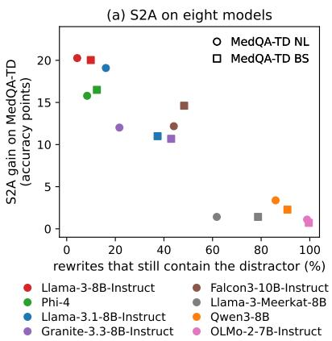

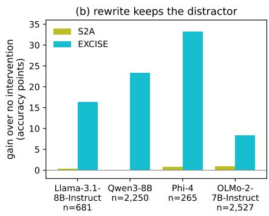

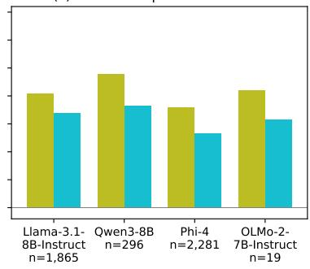  
Figure 10: Gains of S2A (Weston and Sukhbaatar, 2023) by whether the model’s rewrite keeps the distractor (MEDQA-TD). (a) Share of S2A rewrites that keep the distractor (at least 80% of its content words) against the gain of S2A over no intervention, for eight instruct models and both distractor types. (b, c) Gains of S2A and EXCISE on the questions whose rewrite keeps (b) or drops (c) the distractor, for the four models run with both methods (Nonliteral and Bystander pooled; n: questions).

<table><tr><td rowspan="2"></td><td rowspan="2">IA ranks it first</td><td rowspan="2">DG passes it</td><td rowspan="2">Blocking restores</td><td colspan="2">Recovered</td></tr><tr><td>EXCISE</td><td>Known</td></tr><tr><td>Set Llama-3.1-8B-Instruct</td><td></td><td></td><td></td><td></td><td></td></tr><tr><td>MEDQA-TD NL</td><td>90</td><td>95</td><td>95</td><td>81</td><td>94</td></tr><tr><td>MEDQA-TD BS</td><td>90</td><td>86</td><td>93</td><td>73</td><td>92</td></tr><tr><td>MedDistractQA NL</td><td>72</td><td>93</td><td>90</td><td>62</td><td>88</td></tr><tr><td>MedDistractQA BS</td><td>76</td><td>97</td><td>90</td><td>67</td><td>85</td></tr><tr><td>Qwen3-8B</td><td></td><td></td><td></td><td></td><td></td></tr><tr><td>MEDQA-TD NL</td><td>91</td><td>92</td><td>93</td><td>78</td><td>90</td></tr><tr><td>MEDQA-TD BS</td><td>90</td><td>81</td><td>95</td><td>71</td><td>93</td></tr><tr><td>MedDistractQA NL</td><td>89</td><td>95</td><td>93</td><td>79</td><td>89</td></tr><tr><td>MedDistractQA BS</td><td>83</td><td>90</td><td>88</td><td>67</td><td>85</td></tr></table>

Table 17: Steps of EXCISE on flipped questions from MEDQA-TD and MedDistractQA (%). The first three columns give successive pass rates. Recovered: the share of all flipped questions answered correctly after EXCISE or blocking the known distractor.

<table><tr><td rowspan="2">Method</td><td rowspan="2">#Fwd</td><td rowspan="2">s/q</td><td colspan="2">Clean</td><td colspan="2">MEDQA-TD</td><td colspan="2">MedDistractQA</td><td>BiasMedQA</td></tr><tr><td>MedQA</td><td>MMLU-PM</td><td>NL</td><td>BS</td><td>NL</td><td>BS</td><td>Avg.</td></tr><tr><td>Qwen3-8B</td><td></td><td></td><td></td><td></td><td></td><td></td><td></td><td></td><td></td></tr><tr><td>No intervention</td><td>1</td><td>0.041</td><td>63.39</td><td>82.72</td><td>36.37</td><td>30.95</td><td>49.41</td><td>51.14</td><td>28.67</td></tr><tr><td>Ignore instruction</td><td>1</td><td>0.044</td><td>64.02</td><td>82.72</td><td>35.35</td><td>31.03</td><td>49.49</td><td>51.22</td><td>27.08</td></tr><tr><td>CAA</td><td>1</td><td>0.041</td><td>64.02</td><td>80.51</td><td>40.46</td><td>36.21</td><td>51.77</td><td>54.83</td><td>35.57</td></tr><tr><td>S2A†</td><td>一</td><td>4.182</td><td>63.63</td><td>83.46</td><td>39.75</td><td>33.23</td><td>55.93</td><td>52.63</td><td>35.34</td></tr><tr><td>EXCISE (Ours)</td><td>25</td><td>0.819</td><td>61.74</td><td>83.09</td><td>58.68</td><td>54.20</td><td>61.74</td><td>60.17</td><td>53.50</td></tr><tr><td>CoT</td><td></td><td>3.408</td><td>70.23</td><td>86.03</td><td>46.27</td><td>42.11</td><td>57.19</td><td>59.15</td><td>41.51</td></tr><tr><td> $\mathrm { C o T + I ^ { 3 } C }$ </td><td></td><td>11.322</td><td>65.59</td><td>84.93</td><td>39.83</td><td>39.12</td><td>53.18</td><td>57.50</td><td>35.01</td></tr><tr><td>CoT + EXCISE (Ours)</td><td>一</td><td>4.348</td><td>67.79</td><td>85.66</td><td>63.00</td><td>59.94</td><td>64.02</td><td>66.30</td><td>57.98</td></tr><tr><td>Llama-3.1-8B-Instruct</td><td></td><td></td><td></td><td></td><td></td><td></td><td></td><td></td><td></td></tr><tr><td>No intervention</td><td>1</td><td>0.040</td><td>61.74</td><td>76.10</td><td>39.20</td><td>42.11</td><td>53.10</td><td>55.93</td><td>49.71</td></tr><tr><td>Ignore instruction</td><td>1</td><td>0.041</td><td>61.90</td><td>76.10</td><td>39.36</td><td>41.56</td><td>54.05</td><td>55.93</td><td>49.19</td></tr><tr><td>CAA</td><td>1</td><td>0.040</td><td>62.29</td><td>75.00</td><td>40.61</td><td>42.89</td><td>54.28</td><td>56.48</td><td>50.69</td></tr><tr><td>S2A†</td><td>一</td><td>3.173</td><td>61.12</td><td>75.74</td><td>58.29</td><td>53.10</td><td>60.25</td><td>60.02</td><td>56.83</td></tr><tr><td>EXCISE (Ours)</td><td>25</td><td>0.731</td><td>59.62</td><td>72.06</td><td>58.21</td><td>56.56</td><td>59.07</td><td>60.02</td><td>55.41</td></tr><tr><td>CoT</td><td></td><td>2.049</td><td>67.71</td><td>79.04</td><td>45.40</td><td>50.04</td><td>61.19</td><td>62.06</td><td>53.30</td></tr><tr><td> $\mathrm { C o T + I ^ { 3 } C }$ </td><td></td><td>10.061</td><td>67.01</td><td>78.31</td><td>46.58</td><td>47.45</td><td>55.93</td><td>59.78</td><td>47.20</td></tr><tr><td>CoT + EXCISE (Ours)</td><td>一</td><td>2.857</td><td>66.46</td><td>75.37</td><td>61.51</td><td>60.88</td><td>65.44</td><td>64.89</td><td>57.56</td></tr><tr><td>Llama-3-Meerkat-8B</td><td></td><td></td><td></td><td></td><td></td><td></td><td></td><td></td><td></td></tr><tr><td>No intervention</td><td>1</td><td>0.038</td><td>63.00</td><td>77.94</td><td>37.47</td><td>38.02</td><td>52.08</td><td>55.77</td><td>42.69</td></tr><tr><td>Ignore instruction</td><td>1</td><td>0.040</td><td>63.32</td><td>77.21</td><td>37.47</td><td>37.71</td><td>50.27</td><td>55.30</td><td>41.76</td></tr><tr><td>CAA</td><td>1</td><td>0.038</td><td>63.63</td><td>75.37</td><td>38.49</td><td>40.85</td><td>53.10</td><td>56.64</td><td>45.82</td></tr><tr><td>S2A†</td><td>一</td><td>3.324</td><td>63.94</td><td>79.04</td><td>46.19</td><td>45.40</td><td>57.42</td><td>58.99</td><td>48.55</td></tr><tr><td>EXCISE (Ours)</td><td>25</td><td>0.721</td><td>61.51</td><td>75.37</td><td>60.72</td><td>57.66</td><td>62.22</td><td>60.64</td><td>55.13</td></tr><tr><td>CoT</td><td></td><td>6.078</td><td>72.74</td><td>83.46</td><td>46.90</td><td>50.04</td><td>61.12</td><td>65.83</td><td>58.56</td></tr><tr><td> $\mathrm { C o T + I ^ { 3 } C ^ { \ddagger } }$ </td><td></td><td>20.269</td><td>64.73</td><td>82.35</td><td>42.58</td><td>43.44</td><td>55.46</td><td>57.66</td><td>45.43</td></tr><tr><td>CoT + EXCISE (Ours)‡</td><td></td><td>7.301</td><td>71.01</td><td>78.68</td><td>65.51</td><td>63.32</td><td>67.32</td><td>67.64</td><td>64.36</td></tr></table>

Table 18: Accuracy (%) by distractor type for the methods in Table 2. MMLU-PM: MMLU professional medicine. BiasMedQA: mean of seven bias types. NL / BS: Nonliteral / Bystander. #Fwd: forward passes per question, not counting the generation of $\mathrm { S } 2 \mathrm { A } ^ { \dagger }$ (Weston and Sukhbaatar, 2023). s/q: seconds per question, including generation. Below the dashed line: chain-of-thought generation (Appendix F.3), with I3C (Wu et al., 2024). ‡Prompted in the answer format of its model card (Appendix G). Bold: best per model and column, above and below the dashed line separately.

<table><tr><td rowspan="2">Variant</td><td rowspan="2">#Fwd↓</td><td colspan="2">Clean</td><td colspan="2">MEDQA-TD NL</td><td colspan="2">MEDQA-TD BS</td></tr><tr><td>Acc ↑</td><td>Interv. rate ↓</td><td>Acc ↑</td><td>Interv. rate ↓</td><td>Acc ↑</td><td>Interv. rate ↓</td></tr><tr><td>Qwen3-8B</td><td></td><td></td><td></td><td></td><td></td><td></td><td></td></tr><tr><td>IA (Ours)</td><td>25</td><td>61.74</td><td>19.40</td><td>58.68</td><td>47.84</td><td>54.20</td><td>49.33</td></tr><tr><td>Avg. Attention</td><td>18</td><td>62.84</td><td>35.74</td><td>37.63</td><td>14.53</td><td>31.03</td><td>20.03</td></tr><tr><td>AT2</td><td>一</td><td></td><td></td><td></td><td></td><td></td><td></td></tr><tr><td>CAMAB</td><td>58</td><td>62.22</td><td>19.95</td><td>54.75</td><td>39.59</td><td>51.45</td><td>43.05</td></tr><tr><td>ContextCite</td><td>82</td><td>62.29</td><td>19.48</td><td>58.21</td><td>49.02</td><td>54.83</td><td>51.06</td></tr><tr><td>Llama-3.1-8B-Instruct</td><td></td><td></td><td></td><td></td><td></td><td></td><td></td></tr><tr><td>IA (Ours)</td><td>25</td><td>59.62</td><td>19.72</td><td>58.21</td><td>45.25</td><td>56.56</td><td>41.71</td></tr><tr><td>Avg. Attention</td><td>18</td><td>61.04</td><td>20.97</td><td>55.93</td><td>69.21</td><td>51.85</td><td>42.81</td></tr><tr><td>AT2</td><td>18</td><td>60.72</td><td>20.42</td><td>53.97</td><td>55.62</td><td>48.47</td><td>29.46</td></tr><tr><td>CAMAB</td><td>58</td><td>60.25</td><td>19.32</td><td>55.46</td><td>39.12</td><td>54.52</td><td>35.66</td></tr><tr><td>ContextCite</td><td>82</td><td>59.62</td><td>19.09</td><td>57.89</td><td>43.75</td><td>55.70</td><td>39.51</td></tr></table>

Table 19: Replacing IA while keeping the Discordance Gate fixed. Acc: accuracy (%); Interv.: questions intervened on (%); #Fwd as in Table 2. AT2 is evaluated on Llama-3.1-8B-Instruct only (–).

<table><tr><td rowspan="2">Method</td><td rowspan="2">#Fwd</td><td rowspan="2">s/q</td><td colspan="2">Clean</td><td colspan="2">MEDQA-TD</td><td colspan="2">MedDistractQA</td><td rowspan="2">BiasMedQA</td></tr><tr><td>MedQA</td><td>MMLU-PM</td><td>NL</td><td>BS</td><td>NL</td><td>BS Avg.</td></tr><tr><td>Qwen3-8B</td><td></td><td></td><td></td><td></td><td></td><td></td><td></td><td></td><td></td></tr><tr><td>Avg. Attention</td><td>2</td><td>0.067</td><td>60.25</td><td>81.99</td><td>33.86</td><td>26.71</td><td>46.11</td><td>46.98</td><td>45.89</td></tr><tr><td>CAMAB</td><td>42</td><td>1.39</td><td>55.93</td><td>73.90</td><td>46.35</td><td>47.29</td><td>49.73</td><td>49.49</td><td>43.33</td></tr><tr><td>ContextCite</td><td>66</td><td>1.84</td><td>53.57</td><td>71.69</td><td>47.45</td><td>48.23</td><td>48.63</td><td>47.53</td><td>43.77</td></tr><tr><td>Llama-3.1-8B-Instruct</td><td></td><td></td><td></td><td></td><td></td><td></td><td></td><td></td><td></td></tr><tr><td>Avg. Attention</td><td>2</td><td>0.059</td><td>56.17</td><td>72.43</td><td>54.44</td><td>48.86</td><td>55.85</td><td>54.99</td><td>55.84</td></tr><tr><td>AT2</td><td>2</td><td>0.069</td><td>56.95</td><td>72.43</td><td>51.14</td><td>45.40</td><td>54.99</td><td>54.12</td><td>48.18</td></tr><tr><td>CAMAB</td><td>42</td><td>1.21</td><td>52.87</td><td>70.22</td><td>47.92</td><td>47.53</td><td>51.37</td><td>51.53</td><td>44.01</td></tr><tr><td>ContextCite</td><td>66</td><td>1.75</td><td>51.77</td><td>67.65</td><td>48.15</td><td>48.55</td><td>49.96</td><td>50.67</td><td>43.44</td></tr><tr><td>Llama-3-Meerkat-8B</td><td></td><td></td><td></td><td></td><td></td><td></td><td></td><td></td><td></td></tr><tr><td>Avg. Attention</td><td>2</td><td></td><td>59.47</td><td>72.79</td><td>57.27</td><td>52.08</td><td>58.60</td><td>55.62</td><td>56.65</td></tr><tr><td>CAMAB</td><td>42</td><td></td><td>56.01</td><td>70.59</td><td>51.22</td><td>49.65</td><td>52.40</td><td>52.47</td><td>44.55</td></tr><tr><td>ContextCite</td><td>66</td><td></td><td>54.75</td><td>66.54</td><td>51.14</td><td>50.67</td><td>51.69</td><td>50.35</td><td>43.36</td></tr></table>

Table 20: Context attribution methods that block their top-ranked sentence in every question (accuracy, %; columns as in Table 2, where EXCISE and the other baselines are reported).

<table><tr><td></td><td colspan="5">MEDQA-TD NL</td><td colspan="5">MEDQA-TD BS</td><td colspan="4">Clean MedQA</td></tr><tr><td>Model</td><td>Kept</td><td>None</td><td>S2A</td><td>EXCISE</td><td>S2A+EXCISE</td><td>Kept</td><td>None</td><td>S2A</td><td>EXCISE</td><td>S2A+EXCISE</td><td>None</td><td>S2A</td><td>EXCISE</td><td>S2A+EXCISE</td></tr><tr><td>Llama-3.1-8B-Instruct</td><td>16.1 85.9</td><td>39.2</td><td>58.3</td><td>58.2</td><td>57.8</td><td>37.4</td><td>42.1</td><td>53.1</td><td>56.6</td><td>54.9</td><td>61.7</td><td>61.1</td><td>59.6</td><td>59.3</td></tr><tr><td>Qwen3-8B</td><td></td><td>36.4</td><td>39.7</td><td>58.7</td><td>59.3</td><td>90.8</td><td>31.0</td><td>33.2</td><td>54.2</td><td>54.8</td><td>63.4</td><td>63.6</td><td>61.7</td><td>62.1</td></tr><tr><td>Phi-4</td><td>8.4</td><td>51.7</td><td>67.5</td><td>66.8</td><td>66.5</td><td>12.4</td><td>49.6</td><td>66.1</td><td>65.2</td><td>65.5</td><td>70.9</td><td>71.5</td><td>69.1</td><td>68.7</td></tr><tr><td>OLMo-2-7B-Instruct</td><td>98.9</td><td>23.3</td><td>24.3</td><td>30.8</td><td>26.6</td><td>99.6</td><td>16.4</td><td>17.7</td><td>25.7</td><td>20.4</td><td>42.4</td><td></td><td>41.2</td><td></td></tr></table>

Table 21: S2A (Weston and Sukhbaatar, 2023), EXCISE, and EXCISE applied to the model’s own S2A rewrite (S2A+EXCISE; an exploratory combination). Accuracy (%). Kept: share (%) of S2A rewrites that keep the distractor, i.e., contain at least 80% of its content words. Bold: highest accuracy per model and set; –: S2A rewrites not produced for OLMo-2-7B-Instruct’s clean questions.

<table><tr><td></td><td colspan="5">Llama-3.1-8B-Instruct</td><td colspan="5">Qwen3-8B</td></tr><tr><td>Bias type</td><td>No int.</td><td>EXCISE</td><td>∆ [95% CI]</td><td>IA top-1</td><td>DG flag</td><td>No int.</td><td>EXCISE</td><td>∆ [95% CI]</td><td>IA top-1</td><td>DG flag</td></tr><tr><td>Recency</td><td>49.6</td><td>54.3</td><td>+4.7 [+3.1, +6.4]</td><td>26</td><td>95</td><td>25.9</td><td>52.9</td><td>+27.0 [+24.5, +29.6]</td><td>63</td><td>93</td></tr><tr><td>Confirmation</td><td>59.1</td><td>57.7</td><td>-1.3 [−2.7, +0.1]</td><td>19</td><td>96</td><td>41.1</td><td>55.9</td><td>+14.8 [+12.5, +17.1]</td><td>39</td><td>94</td></tr><tr><td>Frequency</td><td>38.2</td><td>52.4</td><td>+14.2 [+12.0, +16.4]</td><td>42</td><td>95</td><td>25.6</td><td>52.9</td><td>+27.3 [+24.7, +29.9]</td><td>65</td><td>89</td></tr><tr><td>Status quo</td><td>44.4</td><td>54.1</td><td>+9.7 [+7.7, +11.9]</td><td>36</td><td>94</td><td>27.7</td><td>53.1</td><td>+25.5 [+22.9, +28.1]</td><td>63</td><td>93</td></tr><tr><td>False consensus</td><td>52.0</td><td>56.8</td><td>+4.8 [+3.0, +6.6]</td><td>26</td><td>97</td><td>20.3</td><td>51.4</td><td>+31.0 [+28.3, +33.7]</td><td>74</td><td>90</td></tr><tr><td>Self-diagnosis</td><td>54.1</td><td>56.0</td><td>+1.9 [+0.1, +3.7]</td><td>25</td><td>94</td><td>21.1</td><td>52.4</td><td>+31.3 [+28.8, +34.0]</td><td>67</td><td>96</td></tr><tr><td>Cultural</td><td>50.7</td><td>56.6</td><td>+5.9 [+4.2, +7.6]</td><td>23</td><td>97</td><td>39.0</td><td>55.9</td><td>+16.9 [+14.8, +19.1]</td><td>43</td><td>96</td></tr><tr><td>Average</td><td>49.7</td><td>55.4</td><td>+5.7</td><td></td><td></td><td>28.7</td><td>53.5</td><td>+24.8</td><td></td><td></td></tr><tr><td>Clean</td><td>57.6</td><td>56.3</td><td>-1.3 [−2.7, +0.2]</td><td></td><td></td><td>59.4</td><td>57.3</td><td>-2.0 [-3.4, −0.7]</td><td></td><td></td></tr></table>

Table 22: BiasMedQA (Schmidgall et al., 2024) by bias type (1,273 five-option questions each): accuracy (%) and difference (points) with 95% paired bootstrap intervals. IA top-1 / DG flag: among questions whose bias cue is a separate narrative sentence (93–99%), the share in which attribution ranks it first and in which the gate flags it. Clean: the same questions without the cue.

## G Prompts

## Answer readout (first-token option scoring, all readouts)

System.   
You are a medical AI assistant used for   
decision-making in a clinical setting.   
User.   
Answer the following medical   
multiple-choice question.   
Return one JSON object with exactly two   
fields in this order: "rationale" and   
"answer".   
The answer must be one of A, B, C, or D.   
Question:   
{question}   
Options:   
A) {A}   
B) {B}   
C) {C}   
D) {D}   
Assistant (fixed prefix; the answer is read   
at the next token, A–D).   
{   
"rationale": "",   
"answer": "

## Prompting baselines: ignore instruction and I3C

## Ignore instruction (inserted between the answer instruction and the question).

## I3C step 1, for every narrative sentence (condition) of the question.

Q. Is condition "{condition}" relevant to the process of solving problem "{question}"?

Return one JSON object with exactly two fields in this order: "relevant" ("yes" or "no") and "reason" (one sentence).

## I3C step 2 (inserted like the ignore instruction; the model’s step-1 verifications fill the slot).

The instructions are as follows: {verifications}. Let’s consider these instructions and ignore the irrelevant conditions to solve the problem

## Chain-of-thought prompt of Llama-3- Meerkat-8B

## System (from the model card).

The following is a multiple-choice question about medical knowledge. Solve this in a step-by-step fashion, starting by summarizing the available information. Output a single option from the given options as the final answer. You are

strongly required to follow the specified output format; conclude your response with the phrase "the answer is ([option\_id]) [answer\_string]".

## User.

{question} (A) {A} (B) {B} (C) {C} (D) {D} CoT + I3C. The I3C step-2 instruction and a blank line precede the question. If no verification is available, the ignore instruction is used instead. BiasMedQA questions add (E) {E}.

## S2A rewrite (step 1; the rewrite replaces the question in the answer readout)

Given the following text by a user, extract the part that is related and useful, so that using that text alone would be good context for providing an accurate and correct answer to the question portion of the text. Please include the actual question or query that the user is asking. Separate this into two categories labeled with "Context text related to the question (includes all content except unrelated sentences):" and "Detailed question:". Do not use list. Text by User: {question}

## Distractor generation, Bystander (Med-DistractQA template)

## Example sentences:

1. "The patient’s sister said her friend has high blood pressure and has been having seizures."

2. "The patient’s dog has diabetes and cannot see properly."

3. "The patient’s neighbor mentioned that their cat has been sneezing and refusing to eat."

4. "The patient’s cousin said her coworker’s father has arthritis and struggles to walk long distances."

5. "The patient’s brother mentioned that his friend’s goldfish has been swimming erratically and losing color."

\## Medical Question: {question}

Generate one statement, where another person/animal is referenced with relation to a medical term as seen in the example sentences. The statement should also be related to the clinical topic. The statement should NOT affect the diagnostic process or decision-making for the medical question in any meaningful way. It should not convey any medical information or symptomatic information. Avoid including any information that could mislead clinical reasoning.

Only respond with the confounding sentence.

## Distractor generation, Nonliteral

Example sentences (for other questions):

1. "The patient’s zodiac sign is Cancer." 2. "The patient said their friend’s business is hemorrhaging money after a bad investment."

3. "The patient mentioned that their new car has a transmission fluid leak."   
4. "The patient described their favorite art exhibit as having vascular pattern in the sculptures."   
5. "The patient’s professor delivered a lecture about the heart of ancient   
civilizations."

\## Medical Question: {question}

## ## Clinical topic: {clinical\_topic}

Generate one sentence using a medical term related to the clinical topic, where clinical terminology is used as nonmedical meaning. The statement should NOT affect the diagnostic process or decision-making for the medical question in any meaningful way. It should not convey any medical information or symptomatic information. Avoid including any information that could mislead clinical reasoning.

Always begin with "The patient said that" or "The patient joked that" and use a clinical term figuratively to describe a nonmedical subject–not the reverse.

Do not generate the following examples or similar statements that assert physiological effects or patient symptoms, bodily states, or test findings, even as jokes:

\- "The patient joked that the office coffee was so strong it could boost LH levels faster than a morning workout." This asserts a physiological effect on LH levels.

\- "The patient joked that her coffee’s ’Rinne test’ was always abnormal, because the espresso sounded louder in the left ear than the right." This introduces a difference in the patient’s hearing between the two ears.

Only respond with the confounding sentence.

## Target-option check of each candidate

Run with the options in ABCD and DCBA order, keeping their labels unchanged. For Nonliteral distractors, “bystander” is replaced with “nonliteral” throughout the prompt.

## Prompt.

You are labeling which answer-choice concept is evoked by an unrelated bystander sentence in a medical multiple-choice question.

## Medical question:

Answer choices (the display order may be shuffled; preserve the printed labels): {choices}

Bystander sentence: {sentence}

Independently determine which answer-choice concept the bystander sentence most strongly evokes. Do not solve the medical question. If exactly one option is evoked, use its printed label. Use NONE if no option is meaningfully evoked and MULTI if multiple options are comparably evoked.

Return only a JSON object with exactly these fields:

{"primary\_evoked\_option":"A|B|C|D|NONE| MULTI","evoked\_options":["A|B|C|D"], "relation\_type":"LEXICAL\_DIRECT| MORPHOLOGICAL|SEMANTIC|NONE|MULTI", "strength":"strong|weak|none"}