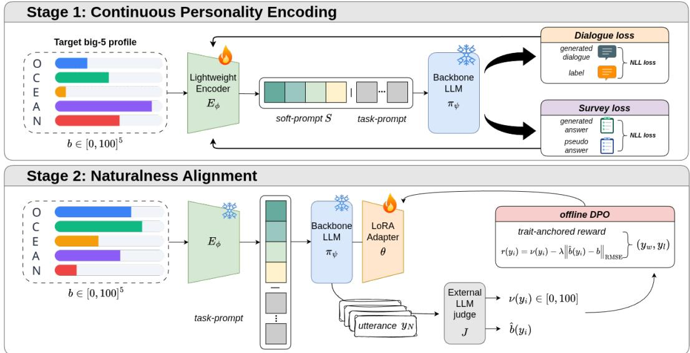

# FATE-5: FAITHFUL ALIGNMENT OF TRAIT EXPRESSION FOR CONTINUOUS BIG FIVE PERSONAL-ITY CONTROL

Gunhee Cho, Hongyeob Kim & Yun-Gyung Cheong

Department of Artificial Intelligence

Sungkyunkwan University

Suwon, South Korea

{skate4333,bongyeob2,aimecca}@skku.edu

## ABSTRACT

Controlling personality in large language models is important for building conversational agents that can be customized to different users and interaction settings. However, existing personality control methods often face a tradeoff between strong trait expression and natural dialogue generation. We introduce FATE-5, Faithful Alignment of Trait Expression for the Big Five, a two-stage framework that separates personality encoding from naturalness alignment. FATE-5 first learns continuous soft prompt representations of Big Five profiles using dialogue supervision and an auxiliary survey objective. It then improves dialogue naturalness through preference alignment based on both dialogue quality and personality agreement. Across three language model backbones, FATE-5 maintains strong trait expression while achieving substantially higher dialogue naturalness than other trait-strong methods. On held-out questionnaires, it achieves monotonicity correlations of 0.97–0.99 and recovery RMSE of 8.9–12.4, substantially improving over the evaluated baselines. These results demonstrate effective continuous personality control while maintaining natural conversational behavior.

## 1 INTRODUCTION

As large language models increasingly serve as conversational agents, controlling their personality is increasingly important for adapting them to different users and interaction settings (Vu et al., 2026). Such adaptation can be particularly useful in interactive applications, where personality can influence dialogue behavior, task success, and user satisfaction (Guo et al., 2025). The Big Five provides a natural framework for this purpose by organizing personality into five broad and continuous dimensions of Openness, Conscientiousness, Extraversion, Agreeableness, and Neuroticism (McCrae & John, 1992). Its continuous structure provides an interpretable way to specify the trait configuration and intensity an agent should express.

Recent work has explored several approaches for inducing Big Five personality in LLMs. Promptbased methods use natural language descriptions or explicit personality profiles to elicit desired traits (Jiang et al., 2024). Training-based approaches instead learn personality conditioned model representations or adaptations (Liu et al., 2024; Li et al., 2025a), while activation-based methods directly manipulate internal directions associated with personality traits (Feng et al., 2026). Prompting tends to preserve natural conversation while providing relatively weak trait expression. Training based methods offer more expressive conditioning mechanisms, although accurately matching the intended continuous trait intensity remains challenging. Activation steering provides flexible and strong control without retraining the underlying model. However, our interactive evaluation shows that strong intervention can substantially degrade dialogue naturalness. These limitations reveal a tradeoff between personality control strength and dialogue naturalness that existing approaches do not fully resolve.

To address this tradeoff, we propose FATE-5, Faithful Alignment of Trait Expression for the Big Five, a framework for faithful and natural continuous personality control. Given a target Big Five profile $\pmb { b } \in [ 0 , 1 0 0 ] ^ { 5 }$ , FATE-5 first maps the profile into continuous soft prompt embeddings using a lightweight personality encoder while keeping the pretrained language model frozen, following the general principle of parameter efficient prompt tuning (Lester et al., 2021). The encoder is trained using two complementary objectives. Dialogue supervision teaches how the target personality should be expressed in conversation, while an auxiliary survey objective strengthens the correspondence between continuous target values and their learned representation. This objective is motivated by psychometric studies showing that standardized personality instruments can provide structured measurements of personality expressed by LLMs (Serapio-Garc´ıa et al., 2025). We find, however, that stronger trait control can reduce dialogue naturalness. FATE-5 therefore separates personality encoding from naturalness alignment. After learning the personality representation, we freeze the encoder and attach a LoRA adapter to the backbone (Hu et al., 2022). We construct pref erence pairs that jointly consider dialogue naturalness and agreement with the target personality, and optimize the adapter using Direct Preference Optimization (Rafailov et al., 2023). This two stage design improves conversational quality while preserving strong personality control. We evaluate FATE-5 through complementary interactive dialogue and psychometric protocols, measuring both perceptible trait expression and recovery of the intended continuous personality profile.

Our contributions are as follows.

• We characterize continuous Big Five personality control along two dimensions: trait expression and dialogue quality. Using a multi-turn dialogue evaluation, we identify a tradeoff between strong personality induction and natural conversation in existing approaches.

• We introduce FATE-5, a two-stage framework that separates personality encoding from naturalness alignment. The first stage learns soft prompt representations of continuous Big Five profiles using dialogue and survey supervision. The second stage improves conversational naturalness through preference alignment based on both dialogue quality and personality agreement.

• We evaluate FATE-5 using dialogue and psychometric protocols across multiple backbones and questionnaire formats, with ablations of its key components, assessing both personality expression and control fidelity.

## 2 RELATED WORK

## 2.1 PERSONALITY CONTROL IN LARGE LANGUAGE MODELS

A growing body of work studies how personality can be imposed on or elicited from language mod els. The simplest approach specifies personality through natural-language instructions. Big5-Scaler encodes numerical Big Five scores directly into prompts and demonstrates that personality intensity can be controlled without parameter updates (Cho & Cheong, 2025). PersonaLLM similarly studies whether prompted LLM personas can express assigned Big Five characteristics across personality questionnaires and open-ended generation (Jiang et al., 2024). Prompt based approaches are inexpensive and model agnostic, but they often provide weaker trait expression than more direct intervention methods, limiting their ability to induce clear and consistent personality differences.

Other approaches modify model representations or parameters more directly. DPG uses a hypernetwork to generate personality-conditioned low-rank model adaptations (Liu et al., 2024). PsychAdapter learns layer-specific transformations from continuous psychological attributes and conditions transformer layers on these representations (Vu et al., 2026). Activation-steering approaches instead identify directions associated with personality traits in a pretrained model and intervene directly in its hidden states. PERSONA extracts trait-specific activation directions and supports continuous and compositional personality control through operations in activation space (Feng et al., 2026). More recent activation-space work also studies how layer selection affects the stability of Big Five steering (Bhandari et al., 2026). These approaches provide strong personality control, but their conversational quality is less clear. In our experiments, we find that stronger trait control can reduce dialogue naturalness. FATE-5 is designed to address this tradeoff by maintaining strong personality expression while improving natural dialogue quality.

  
Figure 1: Overview of FATE-5. Stage 1 learns a continuous personality representation from a target Big Five profile using a lightweight encoder while keeping the backbone LLM frozen. The encoder is trained jointly with dialogue loss and survey loss to strengthen trait expression. Stage 2 freezes the encoder and backbone, attaches a trainable LoRA adapter, and performs offline DPO using preference pairs scored by an external LLM judge. This stage improves dialogue naturalness while preserving the personality representation learned in Stage 1.

## 2.2 PSYCHOMETRIC EVALUATION OF LLM PERSONALITY

Standardized personality inventories have long been used to measure the Big Five traits. The Big Five Inventory provides a widely used measure of Openness, Conscientiousness, Extraversion, Agreeableness, and Neuroticism (John et al., 1991). The NEO Five Factor Inventory offers another established measure of the five broad dimensions (Costa & Mccrae, 1992), while the IPIP NEO 120 provides a public domain inventory covering both broad traits and their lower level facets (Johnson, 2014). Shorter instruments such as the Ten Item Personality Inventory enable more compact assessment (Gosling et al., 2003), and the BFI-2 extends the original BFI with a hierarchical structure that includes additional facet level information (Soto & John, 2017).

These psychometric instruments have also been increasingly used to measure personality in LLMs. PersonaLLM evaluates assigned Big Five personas using the BFI together with open ended writing tasks (Jiang et al., 2024). Serapio-Garc´ıa et al. (2025) develop a broader psychometric framework for administering personality inventories to LLMs and evaluating the reliability and construct validity of their responses. TRAIT further introduces a personality benchmark for LLMs using psychometrically grounded questions derived from established personality constructs (Lee et al., 2025). Other work compares Likert and forced choice formats and shows that the response format can substantially affect estimated LLM personality (Li et al., 2025b). Together, these studies establish standardized questionnaires as an important tool for analyzing personality in language models.

At the same time, psychometric evaluation of LLMs remains sensitive to how the assessment is conducted. Personality measurements can vary with prompt wording and response format, and widely available questionnaire items may also appear in model pretraining data (Serapio-Garc´ıa et al., 2025; Han et al., 2026). These findings motivate evaluating personality with multiple instruments and question formats rather than relying on a single questionnaire setting. In our experiments, we therefore use separate inventories for training and evaluation and complement questionnaire based mea surement with dialogue evaluation

## 3 METHOD

## 3.1 PROBLEM SETUP

We consider inducing a target personality in an instruction-tuned language model along the Big Five (OCEAN) dimensions. A target profile is a vector ${ \pmb b } = ( b _ { \mathrm { O } } , b _ { \mathrm { C } } , \tilde { b } _ { \mathrm { E } } , \tilde { b } _ { \mathrm { A } } , b _ { \mathrm { N } } ) \in [ 0 , \tilde { 1 0 } 0 ] ^ { 5 }$ , one score per trait. Given b and a dialogue context c, a personality conditioning method defines a policy $\pi ( \cdot \mid \bar { b } , c )$ that generates an utterance. Our goal is that the generated dialogue faithfully and naturally expresses b. The target trait levels should be perceptible in the conversation while it remains natural and engaging.

## 3.2 PERSONALITY ENCODER

We introduce a lightweight encoder $E _ { \phi } : [ 0 , 1 0 0 ] ^ { 5 } \to \mathbb { R } ^ { T \times d }$ that maps a target profile to a sequence of $T$ continuous soft-prompt embeddings

$$
S = E _ { \phi } ( \pmb { b } ) = \big ( \pmb { s } _ { 1 } , \ldots , \pmb { s } _ { T } \big ) , \qquad \pmb { s } _ { t } \in \mathbb { R } ^ { d } ,\tag{1}
$$

where d is the model hidden size. The encoder is a two-layer MLP with GELU activations. Let $\pi _ { \psi }$ be a pretrained, frozen language model with token embedding matrix $W _ { e }$ . Given a tokenized input x with embeddings $E ( x ) \doteq \breve { W } _ { e } [ x ]$ , we prepend the soft prompt and run the frozen model on the concatenated sequence,

$$
\pi ( \cdot \mid b , x ) = \pi _ { \psi } ( [ S ; E ( x ) ] ) .\tag{2}
$$

Only ϕ is trainable; the backbone $\psi$ never receives gradients. This keeps the personality signal confined to the input representation and makes the method parameter-efficient and backbone-agnostic.

## 3.3 TRAINING OBJECTIVE: DIALOGUE AND SURVEY

We train $E _ { \phi }$ with two complementary losses.

Dialogue loss. On a corpus of $( b , x , y )$ triples, where b denotes the personality profile, x the prompt, and $y$ the reference response, we minimize the negative log-likelihood of the response under the conditioned policy,

$$
\mathcal { L } _ { \mathrm { d i a l } } ( \phi ) = - \mathbb { E } _ { ( b , x , y ) } \sum _ { k } \log \pi ( y _ { k } \mid b , x , y _ { < k } ) .\tag{3}
$$

This teaches the soft prompt to shape generation toward b.

Survey loss. The dialogue loss shapes style, but on its own it encodes the target only weakly, causing the trait perceived by a reader to drift from b. To improve how faithfully the soft prompt encodes the target, we add an auxiliary survey loss that trains the conditioned model to report b under standardized Big Five questionnaires. For a standardized questionnaire with items $q _ { j }$ and an answer scale, let $\rho ( \cdot )$ denote the questionnaire’s scoring rubric that maps item responses to trait scores. We derive pseudo-answers $\tilde { a } _ { j }$ from the target b so that they are consistent with the target profile, and train the conditioned model to produce them. The construction of $\tilde { a } _ { j }$ is detailed in Appendix A.

$$
\mathcal { L } _ { \mathrm { s u r v } } ( \phi ) = \mathbb { E } _ { b } \sum _ { j } \ell ( \pi ( \cdot \mid b , q _ { j } ) , \tilde { a } _ { j } \big ( b ) ) ,\tag{4}
$$

where ℓ is a token-level loss on the rated answer. During training, we draw items from a set of training questionnaires. This auxiliary objective serves as a means to strengthen personality expression. The survey loss directly encourages the soft-prompt representation to preserve the target trait values.

Full objective. The encoder is trained end-to-end with

$$
\operatorname* { m i n } _ { \phi } \ \lambda _ { \mathrm { d i a l } } { \mathcal L } _ { \mathrm { d i a l } } ( \phi ) \ + \ \lambda _ { \mathrm { s u r v } } { \mathcal L } _ { \mathrm { s u r v } } ( \phi ) , \qquad \psi \mathrm { f r o z e n . }\tag{5}
$$

## 3.4 TRAIT-PRESERVING NATURALNESS ALIGNMENT VIA OFFLINE DPO

The encoder produces strong, measurable trait control, but prepending a soft prompt to a frozen backbone incurs a cost in fluency: conditioned generations are less natural than the unconditioned model. To recover naturalness without sacrificing the trait, we add a stage of offline preference alignment on top of the frozen encoder.

We attach a low-rank adapter (LoRA) θ to the frozen backbone $\pi _ { \psi }$ (the pretrained LLM of §3.2, whose own weights ψ stay fixed), giving a policy $\pi _ { \boldsymbol { \theta } } ( \cdot \mid \boldsymbol { b } , \boldsymbol { x } )$ that still uses the frozen soft prompt $S = E _ { \phi } ( b )$ but now has trainable weights θ. The reference policy $\pi _ { \mathrm { r e f } }$ is the same model with the adapter disabled.

Preference pairs. For each sampled profile b and topic, we draw N candidate utterances $\{ y _ { i } \}$ from the encoder policy. An external LLM judge J rates each candidate in a single call, returning a naturalness score $\nu ( y _ { i } ) \in [ 0 , 1 0 0 ]$ and an estimated profile $\hat { \pmb { b } } ( y _ { i } )$ . We score each candidate with a trait-anchored reward

$$
r ( y _ { i } ) = \nu ( y _ { i } ) - \lambda \left| \left| \hat { \boldsymbol { b } } ( y _ { i } ) - \boldsymbol { b } \right| \right| _ { \mathrm { R M S E } } ,\tag{6}
$$

and form a preference pair $( y _ { w } , y _ { l } )$ from the candidates with the highest and lowest rewards. The trait term $- \lambda \operatorname { R M S E } ( \hat { b } , b )$ is designed to discourage the alignment stage from washing out the target personality.

DPO objective. We optimize θ with the Direct Preference Optimization loss (Rafailov et al., 2023), keeping $\phi$ and ψ frozen:

$$
\begin{array} { r } { \mathcal { L } _ { \mathrm { D P O } } ( \boldsymbol { \theta } ) = - \mathbb { E } _ { ( b , y _ { w } , y _ { l } ) } \log \sigma \Big ( \beta \big [ \Delta _ { \boldsymbol { \theta } } ( y _ { w } ) - \Delta _ { \boldsymbol { \theta } } ( y _ { l } ) \big ] \Big ) , } \end{array}\tag{7}
$$

$$
\Delta _ { \theta } ( y ) = \log \pi _ { \theta } ( y \mid b , x ) - \log \pi _ { \mathrm { r e f } } ( y \mid b , x ) ,\tag{8}
$$

where $\sigma$ is the logistic function and $\beta$ the KL strength. Stage 2 keeps the personality encoder fixed and updates only the LoRA parameters, using a trait aware reward to encourage personality preservation.

## 4 EXPERIMENTS

## 4.1 DATA

The personality encoder and the trained baselines’ conditioning modules are learned from a corpus of examples, each providing a target profile b, a dialogue context x, and a response y that matches b. We build this corpus from two complementary sources.

Big5Chat (Li et al., 2025a) contributes persona grounded dialogues in which a speaker is instructed to a high or low level of a single Big Five trait. We take the utterance as the response y and label it with the corresponding profile, where the conditioned trait is set high or low and the others stay neutral. This source gives clean and strongly expressed trait signals, but its targets are coarse and categorical.

PANDORA (Gjurkovic et al., 2021) contributes real Reddit conversations. For each comment writ-´ ten by a user whose Big Five profile is known, we recover its parent comment as the context x and use the comment itself as the response $y ,$ labelled with the author’s continuous Big Five scores. This source provides fine-grained targets drawn from a real population, providing supervision across continuous trait values rather than only high or low settings.

In total the mixture contains about 46k examples, roughly 30k from Big5Chat and 16k from PANDORA, with all targets placed on a common 0 to 100 scale. We use this mixture only to train the encoder, which is conditioned on b to produce y under the dialogue loss of §3.3. The survey loss instead draws its items from the training questionnaires $\begin{array} { r l } { \mathcal { Q } _ { \mathrm { t r } } } & { { } = } \end{array}$ {BFI (John et al., 1991), IPIP-NEO-120 (Johnson, 2014)}. The preference alignment stage of §3.4 uses no external corpus at all. Its pairs come from on policy candidates that the encoder generates over random profiles and dialogue topics, and an external judge scores them. For evaluation we hold out two further questionnaires $\widehat { \mathcal { Q } _ { \mathrm { t e } } } = \ \{ \mathrm { T I P I }$ (Gosling et al., 2003), BFI-2 (Soto & John, 2017)}, which appear in no training stage.

## 4.2 MODELS AND BASELINES

Models. We evaluate every method on three instruction-tuned backbones from different model families, Llama-3-8B-Instruct (Grattafiori et al., 2024), Gemma-2-9B-Instruct (Team et al., 2024), and OLMo-2-13B-Instruct (OLMo et al., 2024). Each method is trained and evaluated on each backbone independently, and the backbone weights are frozen for every method. The encoder uses T=64 soft-prompt tokens from a two-layer MLP with hidden size 512 and is trained for 3k steps, and the offline DPO stage uses $\beta { = } 0 . 1 , \ i { = } 1$ , and LoRA with r=16 and α=32, on preference pairs built from N=5 candidates over 200 random profiles. The candidates are scored for the DPO reward by Llama-3.1-70B-Instruct (Grattafiori et al., 2024), which is distinct from the judges used for evaluation (§4.3).

Baselines. We compare against four representative families of controllable personality generation, all conditioned on the same target $\pmb { b } \in [ \bar { 0 , 1 0 0 } ] ^ { 5 }$ :

• Prompting (Big5-scaler) (Cho & Cheong, 2025). The target scores are verbalized in the system prompt and no parameters are trained.

• Steering vectors (Feng et al., 2026). Per-trait directions extracted from the backbone are added to the residual stream of the middle layers, scaled by the target profile.

• PsychAdapter (Vu et al., 2026). A trained module maps b to per-layer additive vectors injected at the middle layers, with the backbone frozen.

• DPG (Liu et al., 2024). A hypernetwork maps b to a low-rank weight modulation (LoRA) applied to the attention output projections, with the backbone frozen.

The trained baselines use the same personality dialogue corpus as ours but do not use the survey loss. Appendix B gives the full training and decoding configuration.

## 4.3 EVALUATION

We assess each method along two complementary axes, how the target personality is expressed in free dialogue and how faithfully it is measured by standardized questionnaires. Also, we ablate our own design. Each part answers one of the research questions.

## 4.3.1 DIALOGUE EXPRESSION (RQ1).

Two agents converse over a shared topic for 10 turns, with each agent assigned an independent random target profile. We use ten conversation topics, two for each Big Five trait, chosen to naturally elicit the trait of interest. Openness is probed by travel and music, Conscientiousness by daily habits and personal goals, Extraversion by making friends and social events, Agreeableness by a disagreement with a friend and helping a stranger in need, and Neuroticism by facing an unexpected setback and dealing with a stressful deadline. Each dialogue is evaluated only on the trait targeted by its topic. For each method and backbone, we generate 100 dialogues balanced across the ten topics.

We evaluate dialogue expression using two metrics:

• Trait accuracy. Given a dialogue, the evaluator selects which of the two agents expresses more of the target trait. Accuracy is the fraction of responses that match the ground-truth ordering of the two target scores.

• Naturalness. The evaluator rates how human-like and fluent the dialogue is on a 1–5 scale, which we rescale to 0–100.

For the main evaluation, we use three external LLM judges (GPT-5-mini, Claude-Haiku-4.5, and DeepSeek-V4-Flash) and average their scores. We report the results on all three backbones.

We additionally conduct a human evaluation on 50 Llama-3-8B dialogues using the same persona and topic configurations across methods. We collect 984 dialogue level evaluations from 59 unique workers. Human raters evaluate Trait and Naturalness using the same criteria as the LLM judges, with an additional “I don’t know” option for Trait. These responses account for 5.2% of Trait judgments and are excluded from Trait accuracy. Aggregated ratings show high split half reliability, reaching 0.90 for Trait and 0.94 for Naturalness. Further study details are provided in Appendix C.

<table><tr><td rowspan="3" colspan="2"></td><td colspan="6">LLM judge</td><td colspan="2">Human</td></tr><tr><td colspan="2">Llama-3-8B</td><td colspan="2">Gemma-2-9B</td><td colspan="2">OLMo-2-13B</td><td colspan="2">Llama-3-8B</td></tr><tr><td>Trait Acc.</td><td>Nat.</td><td>Trait Acc.</td><td>Nat.</td><td>Trait Acc.</td><td>Nat.</td><td>Trait Acc.</td><td>Nat.</td></tr><tr><td></td><td>Prompting (big5-scaler)</td><td>63.7</td><td>39.4</td><td>65.3</td><td>54.1</td><td>51.3</td><td>39.8</td><td>73.3</td><td>74.4</td></tr><tr><td>bassline</td><td>Steering vector</td><td>77.3</td><td>2.6</td><td>74.3</td><td>7.9</td><td>80.3</td><td>21.6</td><td>78.5</td><td>20.2</td></tr><tr><td></td><td>PsychAdapter</td><td>77.0</td><td>14.7</td><td>78.7</td><td>28.2</td><td>69.7</td><td>21.0</td><td>71.2</td><td>53.6</td></tr><tr><td>DPG</td><td></td><td>66.7</td><td>33.8</td><td>63.0</td><td>34.8</td><td>69.7</td><td>26.9</td><td>69.9</td><td>66.2</td></tr><tr><td>FATE-5</td><td></td><td>75.3</td><td>43.0</td><td>76.3</td><td>39.1</td><td>72.7</td><td>45.4</td><td>78.7</td><td>67.8</td></tr></table>

Table 1: Dialogue expression across three backbones, evaluated by LLM judges and humans. Trait Acc. measures whether the evaluator correctly identifies which agent has the higher target-trait level, and Nat. measures dialogue naturalness on a 0–100 scale. Best results are bolded and second-best results are underlined.

## 4.3.2 QUESTIONNAIRE MEASUREMENT (RQ2 AND RQ3).

To measure how faithfully each method encodes the target, and whether this survives a change of instrument, we administer the held-out inventories $\mathcal { Q } _ { \mathrm { t e } }$ . Given a target b, we condition the method, ask each item in a natural conversational phrasing, parse the rating, and apply the questionnaire’s rubric to recover an estimated profile ˆb. We report:

• Monotonicity (r), RQ2. Sweeping one trait’s target from 0 to 100 (others fixed at 50), the Pearson correlation between the target and the recovered score for that trait, capturing directional control.

• Recovery error (RMSE), RQ3. The RMSE between ˆb and b (0–100) over 25 random profiles, capturing absolute agreement or calibration.

Because self-report from LLMs is known to be phrasing-sensitive, We evaluate monotonicity under both a rigid “output a single digit” format and a natural conversational format, and report recovery error under the natural format. These experiments are conducted on Llama-3-8B, Gemma-2-9B, and OLMo-2-13B.

## 4.3.3 ABLATION OF OUR METHOD (RQ4).

On Llama-3-8B we remove or substitute one component at a time and re-score with the dialogue metrics, to attribute the roles of the encoder, the survey loss, and the DPO stage:

• Encoder × DPO (2×2). Our full model (encoder + DPO) versus the encoder alone (−DPO), a numeric text prompt with DPO (−encoder), and plain prompting (−encoder, −DPO), comparing learned soft-prompt conditioning against numeric prompting under matched DPO and non-DPO settings.

• − Survey loss. The encoder is retrained without $\mathcal { L } _ { \mathrm { s u r v } }$ (then aligned with DPO), testing whether the survey loss is what makes the trait faithfully encoded.

• Reward trait term. Setting λ=0 removes the trait anchor from the DPO reward (Eq. 6); we additionally sweep λ=2 to trace the trait and naturalness trade-off.

• DPO → SFT. Replacing DPO with supervised fine-tuning on the preferred candidate, testing whether the contrastive preference signal matters beyond imitation.

We provide examples of the numeric prompts used in the ablation in Appendix D.

<table><tr><td rowspan="3"></td><td colspan="3">Llama-3-8B</td><td colspan="3">Gemma-2-9B</td><td colspan="3">OLMo-2-13B</td></tr><tr><td colspan="2">Monot. r ↑</td><td rowspan="2">Recov. RMSE↓</td><td colspan="2">Monot. r ↑</td><td rowspan="2">Recov. RMSE↓</td><td colspan="2">Monot. r ↑</td><td rowspan="2">Recov. RMSE↓</td></tr><tr><td>rigid</td><td>natural</td><td>rigid</td><td>natural</td><td>rigid</td><td>natural</td></tr><tr><td>Prompting (big5-scaler)</td><td>0.78</td><td>0.93</td><td>20.7</td><td>0.92</td><td>0.86</td><td>18.0</td><td>0.94</td><td>0.65</td><td>25.4</td></tr><tr><td>Steering vector</td><td>0.15</td><td>0.45</td><td>28.8</td><td>0.68</td><td>0.74</td><td>28.6</td><td>0.39</td><td>0.78</td><td>26.8</td></tr><tr><td>PsychAdapter</td><td>-0.10</td><td>0.67</td><td>28.8</td><td>0.45</td><td>0.36</td><td>39.8</td><td>0.76</td><td>0.66</td><td>27.3</td></tr><tr><td>DPG</td><td>0.20</td><td>0.74</td><td>28.5</td><td>0.45</td><td>0.48</td><td>30.8</td><td>0.43</td><td>0.69</td><td>28.7</td></tr><tr><td>FATE-5</td><td>0.99</td><td>0.99</td><td>10.5</td><td>0.99</td><td>0.99</td><td>8.9</td><td>0.97</td><td>0.98</td><td>12.4</td></tr></table>

Table 2: Questionnaire measurement on all three backbones (RQ2, RQ3), using held-out inventories TIPI and BFI-2. Monotonicity is the Pearson correlation between target and recovered trait, under a rigid and a natural phrasing. Recovery RMSE (0–100) is the absolute error between the recovered and target profiles under the natural phrasing. For reference, always predicting the midpoint (50) yields an expected RMSE of 28.9 for uniformly sampled targets.

## 5 RESULTS

## 5.1 RQ1: EXPRESSION

Table 1 reports dialogue expression across the three backbones. Activation injection methods achieve high trait accuracy but substantially reduce naturalness. For example, Steering reaches high trait accuracy while its naturalness remains low at 2.6, 7.9, and 21.6 across Llama-3-8B, Gemma-2- 9B, and OLMo-2-13B. PsychAdapter improves naturalness compared with Steering but still remains below our method across all three backbones. Prompting generally provides lower trait accuracy and shows mixed naturalness across backbones.

Our method maintains high trait accuracy, ranging from 72.7 to 76.3 across the three backbones. Its naturalness scores are 43.0, 39.1, and 45.4 on Llama-3-8B, Gemma-2-9B, and OLMo-2-13B, respectively. These results indicate that our method preserves perceptible differences in target-trait levels while avoiding much of the naturalness degradation observed with activation-based approaches.

The human evaluation on Llama-3-8B shows a similar pattern. Steering achieves high trait accuracy but substantially lower naturalness, while prompting achieves the highest naturalness with lower trait accuracy. Our method obtains the highest trait accuracy at 78.7 while achieving a naturalness score of 67.8, compared with 74.4 for prompting. The human evaluation therefore shows that our method maintains high trait accuracy while preserving relatively high dialogue naturalness.

## 5.2 RQ2: CONTINUOUS CONTROL

Table 2 reports monotonicity across all three backbones, measured as the Pearson correlation between the target trait value and the score recovered from held out questionnaires. FATE-5 shows consistently strong directional control under both question formats. It reaches 0.99 under both rigid and natural phrasing on Llama-3-8B and Gemma-2-9B, and 0.97 and 0.98 on OLMo-2-13B.

The baselines are less consistent across backbones and response formats. Prompting shows strong monotonicity in several settings but drops to 0.65 under natural phrasing on OLMo-2-13B. The injection based methods also vary substantially across models and formats. Overall, FATE-5 shows consistently high target correlations across the evaluated backbones and questionnaire formats.

## 5.3 RQ3: QUESTIONNAIRE GENERALIZATION

Directional control alone does not guarantee that the recovered personality matches the intended target value. Table 2 therefore also reports recovery RMSE across all three backbones. FATE-5 achieves the lowest error in every setting, with RMSE values of 10.5, 8.9, and 12.4 on Llama-3-8B, Gemma-2-9B, and OLMo-2-13B, respectively.

The injection based baselines generally remain close to or above the no-control reference of about 28.9 RMSE, while prompting performs better with errors of 20.7, 18.0, and 25.4. FATE-5 substantially reduces these errors across all three backbones. Taken together, the results for RQ2 and RQ3 show that FATE-5 not only follows the intended trait direction but also recovers personality profiles substantially closer to the target values across models .

<table><tr><td>Configuration</td><td>Trait Acc.</td><td>Nat.</td></tr><tr><td>FATE-5 (Encoder+DPO, λ=1)</td><td>75.3</td><td>43.0</td></tr><tr><td>– DPO (Encoder only) – Encoder (numeric + DPO)</td><td>71.3 60.0</td><td>37.5 48.8</td></tr><tr><td>– Enc – DPO (numeric)</td><td>69.0</td><td>46.2</td></tr><tr><td>— Survey loss DPO → SFT</td><td>51.3</td><td>34.2</td></tr><tr><td></td><td>69.7</td><td>41.3</td></tr><tr><td>Reward λ=0</td><td>62.7</td><td>19.4</td></tr><tr><td>Reward λ=2</td><td>78.7</td><td>32.5</td></tr></table>

Table 3: Ablation of FATE-5 on Llama-3-8B (RQ4), scored using the same LLM judges as Table 1, which are distinct from the judge used to build the DPO preference pairs. Trait Acc. measures target-trait accuracy, and Nat. measures dialogue naturalness on a 0–100 scale. The full model row is taken from the Llama-3-8B column of Table 1. Each other row removes or substitutes one component.

## 5.4 RQ4: ABLATION

Table 3 reports the ablation results for FATE-5 on Llama-3-8B. The two-by-two comparison of the encoder and DPO stage highlights their distinct roles. Removing DPO while retaining the encoder lowers naturalness from 43.0 to 37.5, a decrease of 5.5 points. This suggests that DPO contributes to improving dialogue naturalness. Removing the encoder while applying the same DPO procedure to a numeric prompt reduces trait accuracy from 75.3 to 60.0, a decrease of 15.3 points. This shows that the encoder plays a key role in effective trait expression. At the same time, this configuration achieves the highest naturalness score of 48.8. The plain numeric prompt without either component reaches a trait accuracy of 69.0 and a naturalness score of 46.2. These results suggest that the encoder strengthens trait expression at the cost of some dialogue naturalness. This motivates the subsequent DPO stage, which compensates for this loss in naturalness while preserving the trait expression learned by the encoder. These results indicate that the learned personality representation and preference alignment work jointly: DPO improves naturalness when applied to the encoder representation while maintaining, and in this setting slightly improving, trait expression.

Removing the survey loss reduces trait accuracy from 75.3 to 51.3, supporting its importance for faithful personality encoding. The trait component of the reward is also important. Setting λ = 0 lowers both trait accuracy and naturalness. As detailed in Appendix E, removing the continuous trait term makes the reward highly discrete, producing many ties and reducing the number of usable preference pairs from 198 to 37. Thus, the trait term not only anchors personality agreement but also provides a denser preference signal. Increasing the weight to λ = 2 raises trait accuracy to 78.7 but reduces naturalness to 32.5, illustrating the tradeoff induced by the reward weight. Finally, replacing DPO with SFT reduces both trait accuracy and naturalness, suggesting that the contrastive preference objective provides additional benefit.

## 6 CONCLUSION

We introduced FATE-5, a framework for faithful and natural continuous Big Five personality control that separates personality representation from naturalness alignment. Experiments across three backbones and human evaluation show that FATE-5 maintains strong trait expression while producing substantially more natural dialogue than other trait-strong approaches. Psychometric evaluation further demonstrates reliable continuous control and substantially lower profile recovery error, while ablations support the contributions of survey supervision and preference alignment. These findings suggest that personality fidelity and natural dialogue quality, which are difficult to achieve simultaneously with existing methods, can be jointly maintained in personality-controllable conversational LLMs.

## AI USE STATEMENT

In this work, we used generative AI tools to assist with parts of the experimental process, including code development and debugging, and to support manuscript writing and language refinement. All AI-assisted experimental procedures, code, analyses, and written content were reviewed and verified by the authors. Generative AI was not used as a substitute for scientific judgment or independent validation of the results. The authors take full responsibility for the final content of the paper, including all experimental results, claims, and AI-assisted text.

## ETHICS STATEMENT

The human evaluation conducted in this study was reviewed and approved by the Institutional Review Board prior to data collection. All participants provided informed consent before taking part in the study, and participation was voluntary. The evaluation was conducted through Amazon Mechanical Turk, and participant responses were used only for the purposes of this research. No personally identifiable information was included in the analysis or reported in this paper.

## REPRODUCIBILITY STATEMENT

We provide the details needed to reproduce our experiments throughout the paper and appendix. The model architecture and training objectives are described in Section 3, while the datasets, baselines, and evaluation protocols are described in Section 4. Appendix A provides details of the survey supervision procedure, and Appendix B reports the full training, preference construction, baseline implementation, and generation settings. All experiments use fixed random seeds, and the model and optimization configurations are reported for each training stage.

## REFERENCES

Pranav Bhandari, Nicolas Fay, Sanjeevan Selvaganapathy, Amitava Datta, Usman Naseem, and Mehwish Nasim. Activation-space personality steering: Hybrid layer selection for stable trait control in LLMs. In Vera Demberg, Kentaro Inui, and Llu´ıs Marquez (eds.), Proceedings of the 19th Conference of the European Chapter of the Association for Computational Linguistics (Volume 1: Long Papers), pp. 6388–6403, Rabat, Morocco, March 2026. Association for Computational Linguistics. ISBN 979-8-89176-380-7. doi: 10.18653/v1/2026.eacl-long.300. URL https://aclanthology.org/2026.eacl-long.300/.

Gunhee Cho and Yun-Gyung Cheong. Scaling personality control in llms with big five scaler prompts. arXiv preprint arXiv:2508.06149, 2025.

Paul T. Costa and Rr Mccrae. Revised neo personality inventory (neo-pi-r) and neo-five-factor inventory (neo-ffi). 1992. URL https://api.semanticscholar.org/CorpusID: 141296215.

Xiachong Feng, Liang Zhao, Weihong Zhong, yichong huang, Yuxuan Gu, Lingpeng Kong, Xiaocheng Feng, and Bing Qin. Persona: Dynamic and compositional inference-time personality control via activation vector algebra. In C. Vondrick, B. Hariharan, C. Raffel, L. Pinto, D. Yang, and A. Faust (eds.), International Conference on Learning Representations, volume 2026, pp. 151839–151879, 2026. URL https://proceedings.iclr.cc/paper\_files/paper/2026/file/ f66ce276436c4cd151535b03841ac713-Paper-Conference.pdf.

Matej Gjurkovic, Vanja Mladen Karan, Iva Vukojevi´ c, Mihaela Bo´ snjak, and Jan Snajder. PAN-ˇ DORA talks: Personality and demographics on Reddit. In Lun-Wei Ku and Cheng-Te Li (eds.), Proceedings of the Ninth International Workshop on Natural Language Processing for Social Media, pp. 138–152, Online, June 2021. Association for Computational Linguistics. doi: 10.18653/v1/2021.socialnlp-1.12. URL https://aclanthology.org/2021. socialnlp-1.12/.

Samuel D Gosling, Peter J Rentfrow, and William B Swann. A very brief measure of the bigfive personality domains. Journal of Research in Personality, 37(6):504–528, 2003. ISSN 0092-6566. doi: https://doi.org/10.1016/S0092-6566(03)00046-1. URL https://www. sciencedirect.com/science/article/pii/S0092656603000461.

Aaron Grattafiori, Abhimanyu Dubey, Abhinav Jauhri, Abhinav Pandey, Abhishek Kadian, Ahmad Al-Dahle, Aiesha Letman, Akhil Mathur, Alan Schelten, Alex Vaughan, et al. The llama 3 herd of models. arXiv preprint arXiv:2407.21783, 2024.

Ao Guo, Atsumoto Ohashi, Ryu Hirai, Yuya Chiba, Yuiko Tsunomori, and Ryuichiro Higashinaka. User personality and its influence on the performance of pipeline and end-to-end task-oriented dialogue systems. Scientific Reports, 15:20745, 2025. doi: 10.1038/s41598-025-07101-7.

Jongwook Han, Woojung Song, Jonggeun Lee, and Yohan Jo. Quantifying data contamination in psychometric evaluations of LLMs. In Vera Demberg, Kentaro Inui, and Llu´ıs Marquez (eds.), Findings of the Association for Computational Linguistics: EACL 2026, pp. 6070–6088, Rabat, Morocco, March 2026. Association for Computational Linguistics. ISBN 979-8-89176-386- 9. doi: 10.18653/v1/2026.findings-eacl.319. URL https://aclanthology.org/2026. findings-eacl.319/.

Edward J Hu, Yelong Shen, Phillip Wallis, Zeyuan Allen-Zhu, Yuanzhi Li, Shean Wang, Lu Wang, and Weizhu Chen. Lora: Low-rank adaptation of large language models. 2022.

Hang Jiang, Xiajie Zhang, Xubo Cao, Cynthia Breazeal, Deb Roy, and Jad Kabbara. PersonaLLM: Investigating the ability of large language models to express personality traits. In Kevin Duh, Helena Gomez, and Steven Bethard (eds.), Findings of the Association for Computational Linguistics: NAACL 2024, pp. 3605–3627, Mexico City, Mexico, June 2024. Association for Computational Linguistics. doi: 10.18653/v1/2024.findings-naacl.229. URL https://aclanthology.org/2024.findings-naacl.229/.

Oliver P John, Eileen M Donahue, and Robert L Kentle. Big five inventory. Journal ofpersonality and social psychology, 1991.

John Johnson. Measuring thirty facets of the five factor model with a 120-item public domain inventory: Development of the ipip-neo-120. Journal of Research in Personality, 51, 08 2014. doi: 10.1016/j.jrp.2014.05.003.

Seungbeen Lee, Seungwon Lim, Seungju Han, Giyeong Oh, Hyungjoo Chae, Jiwan Chung, Minju Kim, Beong-woo Kwak, Yeonsoo Lee, Dongha Lee, Jinyoung Yeo, and Youngjae Yu. Do LLMs have distinct and consistent personality? TRAIT: Personality testset designed for LLMs with psychometrics. In Luis Chiruzzo, Alan Ritter, and Lu Wang (eds.), Findings of the Association for Computational Linguistics: NAACL 2025, pp. 8412–8452, Albuquerque, New Mexico, April 2025. Association for Computational Linguistics. ISBN 979-8-89176-195-7. doi: 10.18653/v1/2025.findings-naacl.469. URL https://aclanthology.org/2025. findings-naacl.469/.

Brian Lester, Rami Al-Rfou, and Noah Constant. The power of scale for parameter-efficient prompt tuning. In Marie-Francine Moens, Xuanjing Huang, Lucia Specia, and Scott Wentau Yih (eds.), Proceedings of the 2021 Conference on Empirical Methods in Natural Language Processing, pp. 3045–3059, Online and Punta Cana, Dominican Republic, November 2021. Association for Computational Linguistics. doi: 10.18653/v1/2021.emnlp-main.243. URL https://aclanthology.org/2021.emnlp-main.243/.

Wenkai Li, Jiarui Liu, Andy Liu, Xuhui Zhou, Mona T. Diab, and Maarten Sap. BIG5-CHAT: Shaping LLM personalities through training on human-grounded data. In Wanxiang Che, Joyce Nabende, Ekaterina Shutova, and Mohammad Taher Pilehvar (eds.), Proceedings of the 63rd Annual Meeting of the Association for Computational Linguistics (Volume 1: Long Papers), pp. 20434–20471, Vienna, Austria, July 2025a. Association for Computational Linguistics. ISBN 979-8-89176-251-0. doi: 10.18653/v1/2025.acl-long.999. URL https://aclanthology. org/2025.acl-long.999/.

Xiaoyu Li, Haoran Shi, Zengyi Yu, Yukun Tu, and Chanjin Zheng. Decoding LLM personality measurement: Forced-choice vs. Likert. In Wanxiang Che, Joyce Nabende, Ekaterina Shutova, and Mohammad Taher Pilehvar (eds.), Findings of the Association for Computational Linguistics: ACL 2025, pp. 9234–9247, Vienna, Austria, July 2025b. Association for Computational Linguistics. ISBN 979-8-89176-256-5. doi: 10.18653/v1/2025.findings-acl.480. URL https://aclanthology.org/2025.findings-acl.480/.

Jianzhi Liu, Hexiang Gu, Tianyu Zheng, Liuyu Xiang, Huijia Wu, Jie Fu, and Zhaofeng He. Dynamic generation of personalities with large language models. arXiv preprint arXiv:2404.07084, 2024.

Robert R. McCrae and Oliver P. John. An introduction to the five-factor model and its applications. Journal of Personality, 60(2):175–215, 1992. doi: https://doi.org/10.1111/j.1467-6494. 1992.tb00970.x. URL https://onlinelibrary.wiley.com/doi/abs/10.1111/ j.1467-6494.1992.tb00970.x.

Team OLMo, Pete Walsh, Luca Soldaini, Dirk Groeneveld, Kyle Lo, Shane Arora, Akshita Bhagia, Yuling Gu, Shengyi Huang, Matt Jordan, et al. 2 olmo 2 furious. arXiv preprint arXiv:2501.00656, 2024.

Rafael Rafailov, Archit Sharma, Eric Mitchell, Christopher D Manning, Stefano Ermon, and Chelsea Finn. Direct preference optimization: Your language model is secretly a reward model. In A. Oh, T. Naumann, A. Globerson, K. Saenko, M. Hardt, and S. Levine (eds.), Advances in Neural Information Processing Systems, volume 36, pp. 53728–53741. Curran Associates, Inc., 2023. doi: 10.52202/ 075280-2338. URL https://proceedings.neurips.cc/paper\_files/paper/ 2023/file/a85b405ed65c6477a4fe8302b5e06ce7-Paper-Conference.pdf.

Gregory Serapio-Garc´ıa, Mustafa Safdari, Clement Crepy, Luning Sun, Stephen Fitz, Peter Romero,´ Marwa Abdulhai, Aleksandra Faust, and Maja Mataric. A psychometric framework for evaluating´ and shaping personality traits in large language models. Nature Machine Intelligence, 7(12): 1954–1968, 2025. doi: 10.1038/s42256-025-01115-6.

C. J. Soto and O. P. John. The next big five inventory (bfi-2): Developing and assessing a hierarchical model with 15 facets to enhance bandwidth, fidelity, and predictive power. Journal of Personality and Social Psychology, 113:117–143, 2017. doi: 10.1037/pspp0000096.

Gemma Team, Morgane Riviere, Shreya Pathak, Pier Giuseppe Sessa, Cassidy Hardin, Surya Bhupatiraju, Leonard Hussenot, Thomas Mesnard, Bobak Shahriari, Alexandre Ram ´ e, et al. Gemma´ 2: Improving open language models at a practical size. arXiv preprint arXiv:2408.00118, 2024.

Huy Vu, Huy Anh Nguyen, Adithya V. Ganesan, Swanie Juhng, Oscar N. E. Kjell, Joao Sedoc, Margaret L. Kern, Ryan L. Boyd, Lyle Ungar, H. Andrew Schwartz, and Johannes C. Eichstaedt. Psychadapter: adapting llms to reflect traits, personality, and mental health. npj Artificial Intelligence, 2:26, 2026. doi: 10.1038/s44387-026-00071-9.

## A PSEUDO-ANSWER CONSTRUCTION FOR THE SURVEY LOSS

The survey loss (Eq. 4) requires, for a target profile b and a questionnaire item $q _ { j }$ , an answer $\tilde { a } _ { j }$ that a respondent with profile b would give. Since no human responses exist for arbitrary continuous targets, we derive $\tilde { a } _ { j }$ deterministically by inverting the questionnaire’s scoring rubric $\rho .$

Target sampling. Survey targets are sampled independently of the dialogue corpus. We draw 200 random profiles with each trait uniform on the 1–5 scale, $t _ { k } \sim \mathcal { U } ( 1 , 5 )$ , and pass the equivalent 0–100 profile $b _ { k } = 1 0 0 ( t _ { k } - 1 ) / 4$ to the encoder.

Item-level answers. Let $k ( j )$ be the trait that item $q _ { j }$ measures and $p _ { j } = ( t _ { k ( j ) } - 1 ) / 4 \in [ 0 , 1 ]$ the normalized target of that trait. For a questionnaire with answer options $\{ 1 , \ldots , M \}$ , the pseudoanswer is the nearest option on a linear map of $p _ { j }$ ,

$$
\tilde { a } _ { j } = \left\{ \begin{array} { l l } { \mathrm { r o u n d } \big ( 1 + \left( M - 1 \right) p _ { j } \big ) , } & { q _ { j } \mathrm { p o s i t i v e l y ~ k e y e d , } } \\ { \mathrm { r o u n d } \big ( M - \left( M - 1 \right) p _ { j } \big ) , } & { q _ { j } \mathrm { r e v e r s e ~ k e y e d , } } \end{array} \right.\tag{9}
$$

clipped to $[ 1 , M ]$ . Thus a high target yields strong agreement on positively keyed items and strong disagreement on reverse-keyed items, and a mid-range target yields the neutral option. Because every item of a trait receives the answer implied by the same $t _ { k ( j ) }$ , applying the rubric recovers the target up to rounding, $\rho ( \tilde { a } ) \approx b$ . We use $M { = } 5$ for BFI and IPIP-NEO-120. Items are assigned to traits and keyed according to each inventory’s published scoring key.

Training procedure. At each training step, one questionnaire is selected from $\mathcal { Q } _ { \mathrm { t r } }$ in rotation, and 8 of its items are sampled for each target in the batch. Each item is presented as a single-item prompt,

$$
\begin{array} { r l } & { \mathtt { S t a t e m e n t : } \quad \mathtt { \Omega ^ { n } < i t e m > \mathtt { u } } } \\ & { \mathtt { R a t e ~ \mathtt { f r o m ~ 1 } ~ \mathtt { ( s t r o n g l y ~ d i s a g r e e ) } } \ \mathtt { t o } \ M \quad \mathtt { ( s t r o n g l y ~ a g r e e ) } \ . } \\ & { \mathtt { O u t p u t ~ \mathtt { o n l y } ~ t h e ~ \mathtt { s i n g l e ~ d i g i t . } } } \end{array}
$$

with the soft prompt $E _ { \phi } ( \boldsymbol { b } )$ prepended, and ℓ in Eq. 4 is the negative log-likelihood of the answer digit $\tilde { a } _ { j }$ only; the prompt tokens are masked from the loss. The survey loss is enabled after a warmup of 300 steps trained on the dialogue loss alone, after which the two losses are combined with $\lambda _ { \mathrm { d i a l } } { = } 0 . 6$ and $\lambda _ { \mathrm { s u r v } } { = } 0 . 4 ( \mathrm { E q } . 5 )$

Separation from evaluation. Pseudo-answers are built only from the training inventories $\mathcal { Q } _ { \mathrm { t r } }$ and the rigid single-digit format above. The evaluation inventories $\mathcal { Q } _ { \mathrm { t e } }$ (TIPI, BFI-2) and the conversational phrasing used in §4.3 never appear in training, so the questionnaire results in Table 2 measure transfer to unseen items and formats rather than memorized answers.

## B TRAINING AND REPRODUCTION DETAILS

All methods are trained and evaluated separately for each backbone while the backbone weights remain frozen. All runs use bfloat16 on a single GPU with seed 42.

Personality encoder. Stage 1 uses a two layer MLP with GELU activations and hidden size 512. The encoder produces T=64 soft prompt tokens and is trained for 3k steps. We use AdamW with a learning rate of $1 0 ^ { - 3 }$ and weight decay of 0.01. The learning rate follows a linear schedule with 100 warmup steps. The batch size is 2 and gradient accumulation is 4, giving an effective batch size of 8. The maximum sequence length is 512 tokens.

The first 300 steps use only the dialogue loss as a warmup. After this period, we combine the two losses using $\lambda _ { \mathrm { d i a l } } { = } 0 . 6$ and $\lambda _ { \mathrm { s u r v } } { = } 0 . 4$ . At each survey step, we rotate through $\mathcal { Q } _ { \mathrm { t r } }$ and sample 8 items for each target. The targets come from 200 random profiles sampled uniformly over the answer scale. Pseudo answers are constructed deterministically as described in Appendix A.

Preference alignment. Stage 2 constructs preference pairs from the frozen encoder using 200 random profiles paired with the ten dialogue topics. For each profile, we sample $N { = } 5$ candidates. Generation uses temperature 1.0, top p of 0.95, repetition penalty 1.15, no repeat 4 grams, and at most 120 new tokens. We score the candidates using Eq. 6 with λ=1. The candidate with the highest reward is selected as $y _ { w }$ and the candidate with the lowest reward is selected as $y _ { l }$ . Pairs with a reward gap of zero are discarded. We use Llama-3.1-70B-Instruct as the scoring judge.

DPO trains a LoRA adapter with rank 16, scaling parameter $\alpha { = } 3 2$ , and dropout 0.05. The adapter is applied to all attention and MLP projections. Training runs for 200 optimizer steps with AdamW and a learning rate of $5 \times 1 0 ^ { - 5 }$ . We use $\beta { = } 0 . 1$ , gradient clipping at 1.0, and a maximum sequence length of 1024 tokens. For Llama-3-8B, the batch size is 2 and gradient accumulation is 4. For the larger backbones, the batch size is 1 and gradient accumulation is 8. Both settings give an effective batch size of 8. The encoder and backbone remain frozen throughout this stage.

Baselines. No official implementation directly supports our setting of continuous Big Five conditioning with a frozen instruction tuned backbone. We therefore reimplement the three trained baselines following their original papers and train them on the same corpus for the same 3k steps. We use the same optimizer, effective batch size, and sequence length as for our encoder. For consistency, each uses a two layer MLP with hidden size 512 that maps b to the injected parameters. This design allows the comparison to focus on the conditioning mechanism rather than model size or training budget.

• PsychAdapter. The MLP maps b to one additive vector for each layer in the middle 25 to 75% of the network. The vectors pass through tanh and are scaled by 8 to bound the perturbation. The learning rate is $5 \times 1 0 ^ { - 4 }$

• DPG. A hypernetwork maps b to a rank 8 LoRA modulation of the attention output projection in every layer. The modulation is applied with scale 0.5. The learning rate is $2 \times 1 0 ^ { - 4 }$

• Steering vectors. Directions are extracted from 300 profiles. Each profile is prompted with a numeric persona and one of generated open ended questions. For every layer and trait, we compute the covariance direction between the trait score and the hidden state of the final token and normalize the direction to unit norm. During generation, these directions are added to the residual stream in the middle 25 to 75% of layers. For trait t, the target score bt is mapped from [0, 100] to [−1, 1], and the steering coefficient is $\alpha _ { t } = c ( 2 b _ { t } / 1 0 0 - 1 )$ , where c controls the overall injection strength.

• Prompting with Big5 Scaler. We use the prompt format published by the authors without additional training.

For each baseline, we select the learning rate and injection scale from a small grid using a held out subset of the training corpus. We choose the setting with the lowest validation loss among those that do not produce degenerate text. The values reported above are the selected settings.

Dialogue generation. All methods use the same decoding settings. We use temperature 0.7, top p of 0.9, repetition penalty 1.15, no repeat 4 grams, and at most 120 new tokens per turn. Each dialogue contains 10 turns and uses a context window consisting of the most recent 6 utterances. We regenerate a dialogue if it ends before 8 utterances. If generation still fails after 5 attempts, we resample the persona and topic pair.

## C HUMAN EVALUATION SETTING

Sampling. From the 100 dialogues generated per method, we select 10 dialogues using a fixed random seed, with one dialogue selected for each topic. The same ten persona and topic configurations are used for all five methods. As a result, the 50 dialogues differ only in the generation method.

Instrument. The 50 dialogues are split across three forms containing 17, 17, and 16 dialogues. Each form includes dialogues from every method. Dialogue order is shuffled, method identities are hidden, and the agents are presented only as Speaker A and Speaker B. Each dialogue is rated using the same two criteria as the LLM judges. Trait is evaluated through a forced choice question with an additional “I don’t know” option. Naturalness is rated on a 1 to 5 scale and is rescaled to 0 to 100 using the same rescaling as the LLM judges. Each item presents only a behavioral description of the target trait, such as “outgoing, talkative and energetic,” and does not include the trait label.

Participants. We recruit workers through Amazon Mechanical Turk and restrict participation to workers with a lifetime HIT approval rate above 98%. Workers are paid \$3.00 per form. Each worker completes exactly one form, so no worker evaluates the same dialogue more than once.

Exclusions. We use 59 submissions from 59 unique workers and 984 dialogue level evaluations. At the response level, “I don’t know” answers account for 5.2% of Trait judgments. These responses are excluded from Trait accuracy but are included in the reported response totals.

<table><tr><td>λ</td><td>Usable pairs</td><td>Mean reward gap</td><td>Mean utterance length</td><td>Nat.</td></tr><tr><td>0</td><td>37</td><td>33.8</td><td>12.3</td><td>19.4</td></tr><tr><td>1</td><td>198</td><td>12.8</td><td>36.3</td><td>43.0</td></tr><tr><td>2</td><td>200</td><td>25.7</td><td>34.4</td><td>32.5</td></tr></table>

Table 4: Preference pair statistics for different values of λ on Llama-3-8B. With λ=0, the reward is limited to five discrete levels. This produces many ties between candidates and removes most profiles from preference training, resulting in a much smaller preference-training set. Mean reward gap is reported only as a within-setting diagnostic of pair separation and is not directly comparable across different values of λ, since the reward definition changes with λ. Mean utterance length is measured in tokens.

Reliability. Inter rater agreement is α=0.49 for Trait and α=0.45 for Naturalness. We use the nominal form of Krippendorff’s alpha for Trait and the interval form for Naturalness. Because each dialogue is rated by approximately twenty workers, the aggregated dialogue level scores are considerably more stable than individual ratings. Split half reliability with the Spearman–Brown correction reaches 0.94 for Naturalness and 0.90 for Trait. Human and LLM judge naturalness scores also show strong agreement at the level of individual dialogues. Across the 50 dialogues, the Pearson correlation is r=0.84 and the Spearman correlation is ρ=0.85. This agreement supports the use of LLM judges for the backbones that were not evaluated with human raters. We report 95% confidence intervals using 10,000 cluster bootstrap resamples at the dialogue level.

## D NUMERIC PROMPT USED IN THE ABLATION

You are a person with the following Big5 personality profile:   
Openness: 75/100 (high) --- imaginative, curious, and open to   
new experiences   
Conscientiousness: 20/100 (very low) --- spontaneous, flexible,   
and less structured   
Extraversion: 60/100 (moderate) --- outgoing, energetic, and   
socially enthusiastic   
Agreeableness: 45/100 (moderate) --- skeptical, competitive, and   
less inclined to compromise   
Neuroticism: 30/100 (low) --- emotionally stable, calm, and   
resilient under pressure   
Express these personality traits naturally in conversation.

## E WHY REMOVING THE TRAIT ANCHOR ALSO HURTS NATURALNESS

Setting λ=0 leaves only the naturalness score from the judge in the reward. One might therefore expect naturalness to improve. Instead, it drops sharply as shown in Table 3. This behavior originates from the preference data rather than from the optimization process.

The judge evaluates naturalness on a scale from 1 to 5. When λ=0, the reward can therefore take only five values and every reward gap is a multiple of 25. If all N=5 candidates for a profile receive the same score, the reward gap becomes zero and the pair is discarded. This occurs for most profiles. Among the 200 sampled profiles, only 37 profiles produce a usable pair, which corresponds to 18.5% of the data. In contrast, λ=1 produces usable pairs for 198 profiles, which corresponds to 99% of the data. Table 4 summarizes these statistics. The trait term provides a finer-grained signal that breaks these ties and allows almost every profile to contribute to preference training.