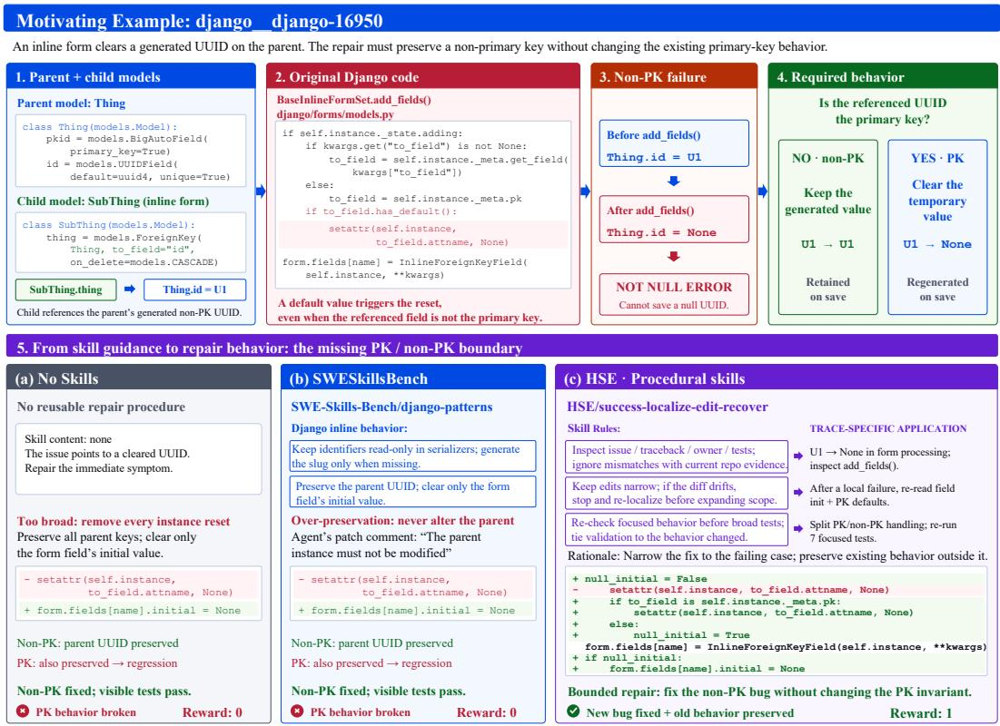
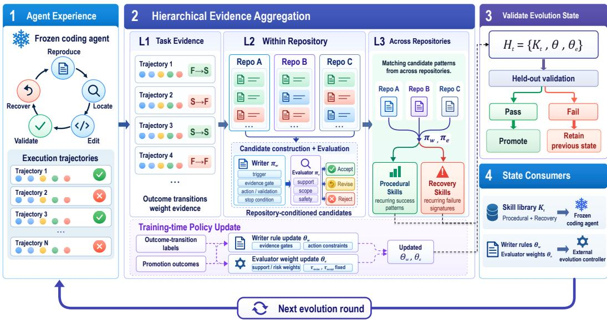

# HIERARCHICAL SKILL EVOLUTION FOR CODING AGENTS

Jun Gao, Yun Peng, Changhai Zhou, Yuhan Zhu, Xiangyu Zeng, Shiyang Zhang Yuhua Zhou, Luozheng Qin, Qian Qiao, Xiaoteng Ma, Baian Chen Weiyi Shang, Zhen Ming Jack Jiang, Lizhi Liao, Xiaoxue Ren

github.com/jungao1106/SKILL EVO

## ABSTRACT

Skills provide agents with reusable experience to guide future decisions without modifying the underlying model. However, coding trajectories are often entangled with task- and repository-specific contexts, making it challenging to distill procedural skills that generalize across diverse coding environments. To address this challenge, we present Hierarchical Skill Evolution (HSE), which progressively distills procedural knowledge from coding trajectories through hierarchical evidence aggregation. HSE first extracts task-level evidence from individual trajectories, then aggregates recurring evidence within the same repository to form repository-specific skill candidates, and finally consolidates consistent patterns across repositories into transferable skills across repositories. The evolution is driven by an external writer–evaluator loop that generates and assesses skills while keeping the underlying coding model frozen. The loop externally updates the writer and evaluator policies to improve subsequent skill generation and assessment. This hierarchy progressively filters task-specific details while preserving procedures that generalize across diverse coding environments. Successful trajectories yield reusable guidance for future tasks, while failed trajectories reveal recurring failure modes that guide avoidance and recovery. We evaluate HSE on SWE-bench Verified and DeepSWE, using GLM-5.2 across Pi and Claude Code harnesses and GPT-5.5 and Opus 4.8 with Pi. Across both benchmarks, 10 skills evolved solely from SWE-Gym improve coding performance across all evaluated settings, demonstrating transfer across benchmarks, coding models, and agent harnesses. We further evolve the skill library from target-benchmark trajectories without verifier feedback, relying solely on the learned evaluator for candidate assessment and achieving additional gains through benchmark-tailored skills.

## 1 INTRODUCTION

Skills allow coding agents to reuse experience from previous tasks without modifying the underlying model (Wang et al., 2023; Zhao et al., 2024; Wang et al., 2024; Ouyang et al., 2026b). This is particularly attractive for repository-level coding, where every attempt produces a rich trajectory of searches, code inspection, edits, tests, and recovery actions (Yang et al., 2024; Wang et al., 2025). Reusing these trajectories could prevent an agent from repeatedly rediscovering the same repair strategies. A trajectory, however, is not yet a reusable skill. It is entangled with a particular issue, repository structure, file paths, and patch, whereas a useful skill should guide future decisions without assuming that these task-specific details transfer.

Existing forms of agent experience expose both sides of this problem. Raw trajectory retrieval preserves concrete evidence but can encourage agents to copy solutions that are specific to a previous task or repository (Chen et al., 2025). SWESkillsBench provides broadly applicable domain knowledge, but this guidance may not tell an agent how to localize a particular bug, constrain a patch, validate the affected behavior, or recover after an incorrect edit (Han et al., 2026). Methods that synthesize or optimize skills from trajectories demonstrate that experience can be converted into reusable instructions (Zhao et al., 2024; Wang et al., 2024; Ouyang et al., 2026b; Ni et al., 2026; Yang et al., 2026a; Agrawal et al., 2026), but a central challenge remains: at what level should evidence be aggregated so that task-specific details are removed without also discarding the procedure that made the experience useful?

  
Figure 1: Motivating example: django django-16950. Panels 1–4 show the failure and the required primary-key boundary, and Panel 5 compares No Skills, SWESkillsBench, and HSE. Ap pendix C provides the skill documents, patches, and trace evidence.

We address this challenge with Hierarchical Skill Evolution (HSE), which uses repository structure as an intermediate level to progressively aggregate task-level evidence into repository-level patterns and cross-repository procedural skills. This hierarchy filters task- and repository-specific details while preserving transferable procedures. HSE evolves successful evidence into procedural skills and recurring failure signatures into recovery skills for escaping unsuccessful repair directions. An external writer–evaluator loop jointly evolves the skill library and the policies governing skill generation and assessment (Shinn et al., 2023; Ouyang et al., 2026b; Pryzant et al., 2023; Agrawal et al., 2026), while the coding model remains frozen and receives only the evolved skills.

Figure 1 illustrates this distinction on django django-16950. A seemingly direct fix resolves the reported non-primary-key UUID failure but regresses the existing primary-key behavior, requiring the agent to discover the behavioral boundary rather than simply remove the offending operation. In the selected No Skills and SWESkillsBench traces, the agents produce the incomplete repair. The HSE skill provides general guidance on minimal edits, focused validation, and re-localization. In the selected HSE trace, the agent re-examines field initialization and primary-key behavior, identifies the PK/non-PK distinction from the current code and tests, and produces a conditional repair that preserves both behaviors.

We evaluate HSE with GLM-5.2 under Pi and Claude Code on SWE-bench Verified and DeepSWE, with additional cross-model evaluation using GPT-5.5 and Opus 4.8 under Pi. Ten skills evolved solely on SWE-Gym consistently improve over No Skills and baselines across the target benchmarks and evaluated models, testing whether the learned procedures transfer beyond their source SWE-Gym environment. We further study target-benchmark adaptation by transferring the learned writer and evaluator policies and updating the skill library from trajectories of the target task set. This experiment measures whether HSE can continue improving its skill library after exposure to target tasks without access to verifier feedback.

• We formulate reusable skill evolution as a hierarchical process, progressing from task-level evidence through repository-conditioned patterns to reusable cross-repository procedures.

• We introduce a writer–evaluator framework that evolves successful and failed experience into procedural and recovery skills, while jointly updating the policies that govern subsequent skill construction and assessment.

• We evaluate frozen skill transfer, target-benchmark adaptation, component contributions, and cross-harness/model reuse across two coding benchmarks, two agent harnesses, and three underlying models.

## 2 RELATED WORK

Learning from Agent Experience. ReAct interleaves reasoning and actions, Reflexion converts feedback into verbal reflection, and Self-Refine iteratively revises outputs using generated feedback (Yao et al., 2023; Shinn et al., 2023; Madaan et al., 2023). Voyager stores executable skills, and ExpeL extracts natural-language insights and retrieves past experience without parameter updates (Wang et al., 2023; Zhao et al., 2024). Agent Workflow Memory induces reusable routines from trajectories (Wang et al., 2024). ReasoningBank distills structured reasoning items from both successful and failed experience and retrieves them at test time (Ouyang et al., 2026b). In coding, SWE-Exp retrieves prior trajectories under explicit leakage controls (Chen et al., 2025). These approaches motivate experience reuse, but do not perform HSE’s task-to-repository-to-cross-repository aggregation of procedural evidence.

Skill and Prompt Evolution. Trace2Skill hierarchically merges trajectory-derived skill patches (Ni et al., 2026), and SkillOpt aggregates success- and failure-derived edits into bounded skill updates (Yang et al., 2026a). AutoSkill extracts reusable skills from requirements, SkillOS trains a curator around a frozen executor, and MUSE-Autoskill manages and evaluates evolving skill packages (Yang et al., 2026b; Ouyang et al., 2026a; Lin et al., 2026). SkillRL combines general and task-specific skills with policy learning (Xia et al., 2026). Automatic prompt optimization provides another route to improving external instructions. ProTeGi edits prompts using textual feedback, whereas GEPA evolves prompts by reflecting on execution traces (Pryzant et al., 2023; Agrawal et al., 2026). HSE instead updates the writer and evaluator policies that construct and screen a separately deployable skill library.

## 3 PROBLEM FORMULATION

An issue-resolution task consists of an issue description, a repository snapshot, and an execution environment. A coding model interacts with the repository through an agent harness and produces a trajectory $\tau _ { i }$ of tool calls and observations. HSE evolves reusable skills and the rules that construct them without updating the coding model.

During training, for each task i, an evidence extractor ϕ retains trace-visible execution signals associated with inspected code, edits, tests, and recovery actions, while ψ summarizes the observed task outcome:

$$
z _ { i } = ( e _ { i } , y _ { i } ) , \qquad e _ { i } = \phi ( \tau _ { i } ) , \qquad y _ { i } = \psi ( \tau _ { i } ) .
$$

These task records form L1 evidence. Let $\rho ( i )$ denote the repository of task i. HSE first groups records by repository,

$$
\mathcal { E } _ { r } = \{ z _ { i } : \rho ( i ) = r \} ,
$$

and applies a writer $\pi _ { w }$ and evaluator $\pi _ { e }$ with external rule sets $\theta _ { w }$ and $\theta _ { e }$ :

$$
\begin{array} { r } { q _ { r } = \pi _ { w } ( \mathcal { E } _ { r } ; \theta _ { w } ) , \qquad a _ { r } = \pi _ { e } ( q _ { r } , \mathcal { E } _ { r } ; \theta _ { e } ) . } \end{array}
$$

Here $q _ { r }$ is a repository-conditioned candidate and $\textstyle a _ { r } \in$ {accept, revise, reject} is its assessment.   
This same-repository stage is L2.

L3 expands the support boundary across repositories. Accepted repository evidence is grouped by recurring procedural features to propose success skills, while repository failure evidence is grouped by recurring failure signatures to propose recovery skills. The writer converts each cross-repository

  
Figure 2: HSE training pipeline. Task evidence is aggregated within repositories into repositoryconditioned candidates and failure patterns, which are further consolidated across repositories into procedural and recovery skills.

group into a transferable candidate, and the evaluator checks its support, scope, and safety before promotion.

The evolving state is

$$
H _ { t } = ( K _ { t } , \theta _ { w } ^ { t } , \theta _ { e } ^ { t } ) ,
$$

where $K _ { t }$ denotes the library of accepted procedural and recovery skills, while $\theta _ { w } ^ { t }$ and $\theta _ { e } ^ { t }$ govern candidate construction and assessment. During training, a proposed state is evaluated on held-out validation tasks before it is accepted for the next iteration. The resulting transfer state has two consumers: the coding agent receives $K _ { t } ,$ , whereas the external writer $\pi _ { w }$ and evaluator $\pi _ { e }$ retain $\theta _ { w } ^ { t }$ and $\theta _ { e } ^ { t }$ to update their policies, respectively.

## 4 HIERARCHICAL SKILL EVOLUTION

Figure 2 summarizes HSE training as an iterative three-stage process. First, a frozen coding agent produces execution trajectories and task outcomes. Second, HSE progressively expands the evidence boundary from tasks (L1), to repositories (L2), and then across repositories (L3). In parallel, outcome-transition and promotion feedback update the external writer and evaluator rules. Third, the proposed evolution state is validated and transferred to the next round.

## 4.1 L1: AGENT ROLLOUTS AND TASK EVIDENCE

The frozen coding agent follows a recurring repair cycle with five stages: reproduce the problem, locate the responsible code, edit the implementation, validate the change, and recover when the current direction fails. Its tool interactions form an execution trajectory. During training, the tasklevel verifier supplies the observed outcome.

During training, L1 converts each trajectory into a task-level evidence record containing its five stage annotations and verifier outcome. The five stage tags—reproduce, locate, edit, validate, and recover—associate files, code locations, patches, and tests with their roles in the issue-solving process. When a corresponding outcome from the previous evolution round is available, HSE compares it with the current verifier outcome to form an outcome transition label. This transition determines the strength of the task evidence. Failed-to-successful and successful-to-failed transitions provide strong positive and strong negative evidence, respectively, whereas successful-to-successful and failed-to-failed transitions provide weak positive and weak negative evidence. When no paired outcome is available (in the first round), successful and unsuccessful trajectories are conservatively treated as weak evidence. These labels determine how task evidence participates in subsequent aggregation. Positive evidence supports candidate skills construction and promotion, negative evidence prevents unsafe promotion, and recurring negative evidence contributes to recovery-skill construction.

## 4.2 L2: REPOSITORY-CONDITIONED CANDIDATES

L2 aggregates labeled task evidence within each repository to identify recurring repository-level regularities. Candidate support requires repeated positive evidence together with a recurring observable signal, such as a shared code path, edited path, or validation command. Strong negative evidence acts as a regression constraint and prevents unsafe promotion. This same-repository boundary preserves useful local structure.

The writer $\pi _ { w }$ converts supported repository evidence into structured candidates. Each candidate specifies a trigger, an evidence gate, recommended actions, validation steps, and a stop condition. The evaluator $\pi _ { e }$ then assesses the candidate’s empirical support, repetition across tasks, scope, and safety. It accepts candidates that satisfy the promotion criteria, requests revision when additional specification or evidence is needed, and rejects candidates that are unsupported, unsafe, or overly task-specific.

L2 produces assessed repository-conditioned candidates and retains unresolved failure signatures for separate cross-repository aggregation at L3.

## 4.3 L3: TRANSFERABLE SKILLS

L3 expands the support boundary from individual repositories to multiple repositories through two complementary aggregation paths. Procedural skills are evolved from accepted repositoryconditioned candidates, while recovery skills are distilled from recurring unresolved failure signatures.

Procedural Skills. Accepted repository evidence is grouped by recurring procedural features, such as localizing the narrowest supported owner, making a bounded edit, and validating the changed behavior. When the same procedural pattern is supported by multiple repositories, the writer removes repository-specific identifiers and proposes a transferable procedure. The evaluator verifies its cross-repository support before promotion.

Recovery Skills. Unresolved failure signatures are aggregated separately across repositories. Recurring signatures may capture behaviors such as localization drift, a collapsed state distinction, or validation that does not expose the changed behavior. The writer turns a supported cross-repository failure signature into a trigger and recovery procedure, while the evaluator checks whether the failure condition receives sufficient cross-repository support. Recovery skills encode triggers and corrective procedures for recognizing and escaping recurring failure modes.

The accepted outputs of these two branches form the transferable skill library $K _ { t }$ . Cross-repository aggregation filters task- and repository-specific details while retaining procedures supported across diverse coding contexts.

## 4.4 WRITER AND EVALUATOR RULE UPDATES

During training, HSE periodically updates the external writer and evaluator rules that govern subsequent candidate construction and assessment. Each update summarizes the task-evidence labels accumulated since the previous update together with the promotion outcomes observed during hierarchical aggregation.

HSE updates the writer rules to determine what evidence and actions may appear in subsequent candidates. Candidate construction remains grounded in trace-visible evidence and respects the evidence requirements of the corresponding aggregation level. For example, accumulated unresolved evidence makes subsequent candidate construction more conservative, shifting the writer toward recovery and validation rather than direct editing. Conversely, successful promotions reinforce evidence patterns that have survived the preceding gates for reuse in subsequent candidates. These updates shape how the writer constructs future candidates, while candidate promotion remains determined by the evaluator.

The evaluator policy is parameterized by the weights assigned to the evidence features of each candidate. For a candidate c with evidence features $f ( c )$ , the evaluator computes

$$
\begin{array} { r } { s _ { \theta _ { e } } ( c ) = b + { \theta } _ { e } ^ { \top } f ( c ) , } \end{array}
$$

where $f ( c )$ includes positive and negative support, task- or repository-level support, repeated-signal indicators, and other risk indicators. The resulting score is mapped to a decision using two fixed thresholds. Candidates with scores above $\tau _ { \mathrm { a c c e p t } }$ are promoted unless strong-negative evidence is present, those between $\tau _ { \mathrm { r e v i s e } }$ and $\tau _ { \mathrm { a c c e p t } }$ are retained for revision, and the remainder are rejected.

HSE evolves the evidence weights $\theta _ { e }$ according to feedback accumulated after previous evaluation decisions, while keeping the decision thresholds $\tau _ { \mathrm { r e v i s e } }$ and $\tau _ { \mathrm { a c c e p t } }$ frozen. When a promoted candidate is subsequently associated with regression, HSE increases the penalties assigned to the negative or risk signals that contributed to its promotion. Conversely, when a revised or rejected candidate later accumulates consistent positive support, HSE increases the weights of the supporting signals that were previously undervalued. Strong-positive and strong-negative evidence induces larger updates than weak evidence, reflecting the greater informativeness of their outcome transitions.

## 4.5 HELD-OUT VALIDATION AND TRANSFER

During training, HSE treats the proposed skills and updated rules as one evolution state. Before the state is accepted, the current skill library is evaluated on held-out tasks to determine whether performance improves, remains stable, or regresses. A validated state becomes the new version, and when validation rejects a proposed state, the current accepted version is retained.

The resulting transfer package contains success skills, recovery skills, and the updated writer/evaluator rules. The frozen coding agent receives the transferable skills, while the external controller receives the rules required to continue evolution in the next round. New agent rollouts then provide L1 evidence for the next round, closing the loop in Figure 2.

## 4.6 TRAINING, STATIC INFERENCE, AND TARGET-BENCHMARK ADAPTATION

During training, HSE uses SWE-Gym trajectories and verifier outcomes to construct the skill library and calibrate the writer and evaluator policies. At static inference time, the learned state is frozen and only the skill library is provided to the coding agent.

For target-benchmark adaptation, HSE starts from the transferred skill library and fixed writer/evaluator policies, and updates only the skill library using newly collected target-task trajectories. Candidate updates are assessed by the learned evaluator without access to benchmark verifier outcomes or evaluation-time test results.

## 4.7 CASE: CONDITIONAL REPAIR IN THE HSE TRACE

The HSE skill in Figure 1, panel 5(c), instructs the agent to choose the narrowest owner supported by current evidence, keep the edit minimal, validate the affected behavior, and re-localize when a failed test contradicts the current repair direction.

In the selected trace, the agent first reproduces the UUID loss and inspects add fields(). A PKonly reset fixes the reproducer but fails an existing initialization check. The agent then re-examines field initialization and the primary-key generation path. The final patch resets default-valued primary keys before field construction, while preserving non-primary-key UUIDs on the parent instance and clearing only the form field’s initial value. This conditional repair preserves both behaviors and passes the focused tests. Appendix C provides the skill listing, selected trace events, final patch, and verifier results.

Table 1: Resolved rate (%) of static skill methods on SWE-bench Verified and DeepSWE with GLM-5.2. Pi and CC denote the Pi and Claude Code harnesses. Entries report the mean over three runs (Mean@3), with standard deviations shown as subscripts. HSE uses the frozen skill library evolved on SWE-Gym without target-benchmark adaptation. Bold indicates the best mean in each row.
<table><tr><td>Benchmark</td><td></td><td></td><td>Harness No Skills SWESkillsBench</td><td>GEPA</td><td>ReasoningBank</td><td>HSE</td></tr><tr><td rowspan="2">SWE-bench Verified</td><td>Pi</td><td> $7 3 . 5 _ { \pm 1 . 1 0 }$ </td><td> $7 4 . 7 _ { \pm 0 . 3 1 }$ </td><td> $7 4 . 6 _ { \pm 0 . 4 0 }$ </td><td> $7 2 . 8 _ { \pm 1 . 2 0 }$ </td><td> ${ \bf 7 5 . 4 _ { \pm 0 . 2 0 } }$ </td></tr><tr><td>CC</td><td> $7 6 . 1 _ { \pm 1 . 3 0 }$ </td><td> $7 9 . 7 _ { \pm 0 . 4 2 }$ </td><td> $7 8 . 9 _ { \pm 0 . 5 0 }$ </td><td> $7 6 . 6 _ { \pm 1 . 4 0 }$ </td><td> ${ \bf 8 0 . 6 _ { \pm 0 . 2 0 } }$ </td></tr><tr><td>DeepSWE</td><td>Pi CC</td><td> $4 3 . 1 _ { \pm 2 . 2 3 }$   $4 4 . 8 _ { \pm 3 . 1 1 }$ </td><td> $3 4 . 5 _ { \pm 0 . 8 8 }$   $3 8 . 6 _ { \pm 1 . 3 5 }$ </td><td> $4 6 . 6 _ { \pm 1 . 3 5 }$   $4 9 . 0 _ { \pm 1 . 3 5 }$ </td><td> $4 4 . 0 _ { \pm 2 . 2 3 }$   $4 6 . 0 _ { \pm 2 . 6 5 }$ </td><td> $\mathbf { 4 8 . 7 _ { \pm 0 . 8 8 } }$   ${ \bf 5 2 . 5 _ { \pm 0 . 5 1 } }$ </td></tr></table>

## 5 EVALUATION

We evaluate HSE on transfer, target-benchmark adaptation, component contributions, and generalization across harnesses and models, with token-cost analysis referred to Appendix A.

Setup. We evaluate HSE on SWE-bench Verified (500 tasks) and DeepSWE (113 tasks) (OpenAI, 2024; Huang et al., 2026). Unless otherwise specified, HSE refers to the frozen skill library evolved on SWE-Gym and transferred to the target benchmark without further adaptation. We report resolved rate, defined as the percentage of tasks with a successful verifier outcome. All experiments use GLM-5.2 with Pi and Claude Code (CC) as coding-agent harnesses, except for the cross-model evaluation, which additionally considers GPT-5.5 and Opus 4.8 with Pi due to the compatibility constraint. All reported differences in resolved rate are expressed in percentage points.

Model Serving. We serve GLM-5.2 on two B300 nodes using prefill/decode (P/D) disaggregation. The coding-agent harness manages agent interaction, including skill injection, while SGLang handles model inference.

## 5.1 STATIC INFERENCE

Table 1 compares HSE with No Skills, SWESkillsBench (Han et al., 2026), GEPA (Agrawal et al., 2026), and ReasoningBank (Ouyang et al., 2026b). HSE achieves the highest mean resolved rate across all four benchmark–harness settings, improving over No Skills by 1.9–4.5 points on SWEbench Verified and 5.6–7.7 points on DeepSWE. Notably, these gains are obtained by directly transferring the same skill library evolved on SWE-Gym, without any target-benchmark adaptation.

HSE also consistently improves over the strongest baseline on each benchmark. On SWE-bench Verified, it exceeds SWESkillsBench by 0.7–0.9 points, while on DeepSWE it exceeds GEPA by 2.1–3.5 points. In contrast, SWESkillsBench improves over No Skills on SWE-bench Verified but degrades performance on DeepSWE, suggesting that broadly applicable domain knowledge does not transfer uniformly across coding environments. HSE’s consistent gains instead support the value of evolving procedural guidance that transfers across repositories and benchmarks. HSE also has lower between-run standard deviations than No Skills in all four settings, indicating more consistent aggregate performance across the three runs.

## 5.2 TARGET-BENCHMARK ADAPTATION

Table 2 evaluates target-benchmark adaptation. Starting from the frozen HSE library transferred from SWE-Gym, each iteration collects target-task trajectories, updates the skill library with the fixed writer and evaluator, and reports performance after the evaluator gate. This setting measures how effectively HSE continues to adapt its skill library as target-task experience accumulates.

Mean resolved rate increases at every reported gate across all four settings. By Gate 8, HSE improves from 75.4% to 90.1% with Pi and from 80.6% to 93.9% with CC on SWE-bench Verified, corresponding to gains of 14.7 and 13.3 percentage points. On DeepSWE, the corresponding scores rise from 48.7% to 71.7% and from 52.5% to 75.8%, yielding gains of 23.0 and 23.3 points. These results show that HSE can further refine its transferred skill library from target-task experience.

Table 2: Resolved rate (%) of target-benchmark adaptation with GLM-5.2. HSE denotes the transferred skill library before target-benchmark adaptation. Gate 1–Gate 8 report the resolved rates achieved by the updated skill library after each evaluator gate. Entries report Mean@3, with standard deviations shown as subscripts.
<table><tr><td>Benchmark</td><td>Harness</td><td>HSE</td><td>Gate 1</td><td>Gate 2</td><td>Gate 3</td><td>Gate 4</td><td>Gate 5</td><td>Gate 6</td><td> $\mathrm { G a t e } 7$ </td><td>Gate 8</td></tr><tr><td rowspan="3">SWE-bench Verified</td><td>Pi</td><td> $7 5 . 4 _ { \pm 0 . 2 0 }$ </td><td> $8 1 . 1 _ { \pm 0 . 6 1 }$ </td><td> $8 5 . 1 _ { \pm 0 . 7 0 }$ </td><td> $8 6 . 1 _ { \pm 0 . 8 1 }$ </td><td> $8 6 . 3 _ { \pm 0 . 5 0 }$ </td><td> $8 7 . 6 _ { \pm 0 . 4 0 }$ </td><td> $8 8 . 7 _ { \pm 0 . 3 1 }$ </td><td> $8 9 . 4 _ { \pm 0 . 4 0 }$ </td><td> $9 0 . 1 _ { \pm 0 . 3 1 }$ </td></tr><tr><td>CC</td><td> $8 0 . 6 _ { \pm 0 . 2 0 }$ </td><td> $8 6 . 4 _ { \pm 0 . 7 2 }$ </td><td> $8 8 . 7 _ { \pm 1 . 0 1 }$ </td><td> $8 8 . 9 _ { \pm 0 . 8 1 }$ </td><td> $8 9 . 8 _ { \pm 0 . 9 2 }$ </td><td> $9 1 . 7 _ { \pm 0 . 7 0 }$ </td><td> $9 2 . 4 _ { \pm 0 . 4 0 }$ </td><td> $9 3 . 0 _ { \pm 0 . 4 0 }$ </td><td> $9 3 . 9 _ { \pm 0 . 4 6 }$ </td></tr><tr><td>Pi</td><td> $4 8 . 7 _ { \pm 0 . 8 8 }$ </td><td>55.8±1.77</td><td> $6 0 . 5 _ { \pm 1 . 3 5 }$ </td><td>61.7± 1.35</td><td> $6 8 . 4 _ { \pm 2 . 2 3 }$ </td><td> $6 9 . 6 _ { \pm 2 . 2 3 }$ </td><td> $7 0 . 8 _ { \pm 0 . 8 8 }$ </td><td> $7 1 . 1 _ { \pm 0 . 5 1 }$ </td><td> $7 1 . 7 _ { \pm 0 . 8 8 }$ </td></tr><tr><td>DeepSWE</td><td>CC</td><td> $5 2 . 5 \pm \mathrm { 0 . 5 1 }$ </td><td> $5 5 . 8 _ { \pm 2 . 6 5 }$ </td><td> $6 5 . 8 _ { \pm 2 . 2 3 }$ </td><td> $7 0 . 8 _ { \pm 1 . 7 7 }$ </td><td> $7 1 . 7 _ { \pm 0 . 8 8 }$ </td><td> $7 2 . 9 _ { \pm 1 . 3 5 }$ </td><td> $7 3 . 7 _ { \pm 1 . 0 2 }$ </td><td> $7 4 . 9 _ { \pm 0 . 5 1 }$ </td><td> $7 5 . 8 _ { \pm 0 . 5 1 }$ </td></tr></table>

Table 3: Resolved rate (%) after removing HSE components. No Skills and HSE repeat the maintable means without standard deviations. Parentheses show the change from the complete HSE pack.
<table><tr><td>Benchmark</td><td>Harness</td><td>No Skills</td><td>HSE</td><td>w/o Procedural Skills</td><td>w/o Recovery Skills</td></tr><tr><td rowspan="2">SWE-bench Verified</td><td>Pi</td><td>73.5</td><td>75.4</td><td>74.2 (−1.2)</td><td>74.6 (−0.8)</td></tr><tr><td>CC</td><td>76.1</td><td>80.6</td><td>77.0 (-3.6)</td><td>79.0 (−1.6)</td></tr><tr><td rowspan="2">DeepSWE</td><td>Pi</td><td>43.1</td><td>48.7</td><td>45.1 (-3.6)</td><td>43.4 (−5.3)</td></tr><tr><td>CC</td><td>44.8</td><td>52.5</td><td>47.8 (-4.7)</td><td>46.9 (−5.6)</td></tr></table>

## 5.3 COMPONENT ANALYSIS

Table 3 removes the cross-repository procedural skills or recovery skills from the deployed HSE pack. Removing either component lowers resolved rate in every setting, but their relative contributions reverse across benchmarks. Procedural removal incurs the larger loss on SWE-bench Verified (1.2 and 3.6 points), while recovery removal incurs the larger loss on DeepSWE (5.3 and 5.6 points). We hypothesize that this difference reflects the greater task difficulty of DeepSWE, where agents are more likely to encounter failed attempts and therefore benefit more from recovery guidance. For comparison, procedural removal costs 3.6 and 4.7 points on DeepSWE, and recovery removal costs 0.8 and 1.6 points on SWE-bench Verified.

On DeepSWE, removing the two recovery skills leaves HSE only 0.3 points above No Skills with Pi and 2.1 points above it with CC. Much of the full pack’s advantage on this benchmark is therefore lost even though the eight procedural skills remain. This provides a more specific explanation for the main-result pattern: guidance for revising an unsuccessful repair direction appears to contribute beyond guidance for initiating a repair. The Django case in Appendix C illustrates such a revision process.

Table 4 further isolates the contributions of hierarchical aggregation and controller updates in HSE. Removing hierarchical aggregation randomly shuffles task trajectories across repositories during skill evolution, disrupting the original hierarchical aggregation while preserving the same trajectories and evidence budget. This tests whether the hierarchical organization of evidence itself contributes beyond simply exposing the skill evolution process to the same task experience. This reduces performance by 1.2–2.0 points on SWE-bench Verified and 1.8–3.8 points on DeepSWE. Removing controller updates instead keeps the hierarchy but freezes the initial writer and evaluator rules throughout skill construction, resulting in losses of 0.6–1.4 and 1.8–2.1 points, respectively. These results indicate that both the hierarchical organization of evidence during skill evolution and the adaptive policies for constructing and assessing skill candidates contribute to the final transferred skill library.

## 5.4 GENERALIZATION ACROSS HARNESSES AND MODELS

Tables 5 and 6 evaluate whether a fixed HSE pack remains useful when the coding-agent harness or underlying model changes.

Table 4: Ablation of hierarchical aggregation and controller updates. All variants use the same SWE-Gym trajectories.
<table><tr><td rowspan="2">Method</td><td colspan="2">SWE-bench Verified</td><td colspan="2">DeepSWE</td></tr><tr><td>Pi</td><td>CC</td><td>Pi</td><td>CC</td></tr><tr><td>HSE</td><td>75.4</td><td>80.6</td><td>48.7</td><td>52.5</td></tr><tr><td>w/o Hierarchical Aggregation</td><td>74.2</td><td>78.6</td><td>46.9</td><td>48.7</td></tr><tr><td>w/o Controller Updates</td><td>74.8</td><td>79.2</td><td>46.9</td><td>50.4</td></tr></table>

Table 5: Resolved rate (%) for fixed HSE packs across harnesses. No Skills and in-harness HSE use the corresponding means from Table 1. $\Delta _ { \mathrm { N S } }$ and $\Delta _ { \mathrm { i n } }$ subtract the row’s transfer-harness No Skills and in-harness HSE scores from transfer-harness HSE, respectively.
<table><tr><td rowspan="2">Benchmark</td><td colspan="2">In-harness</td><td colspan="5">Transfer harness</td></tr><tr><td>Harness</td><td>HSE</td><td>Harness</td><td>No Skills</td><td>HSE</td><td> $\Delta _ { \mathrm { N S } }$ </td><td> $\Delta _ { \mathrm { i n } }$ </td></tr><tr><td rowspan="2">SWE-bench Verified</td><td>Pi</td><td>75.4</td><td>CC</td><td>76.1</td><td>79.2</td><td> $+ 3 . 1$ </td><td>+3.8</td></tr><tr><td>CC</td><td>80.6</td><td>Pi</td><td>73.5</td><td>80.4</td><td> $+ 6 . 9$ </td><td>-0.2</td></tr><tr><td rowspan="2">DeepSWE</td><td>Pi</td><td>48.7</td><td>CC</td><td>44.8</td><td>49.6</td><td> $+ 4 . 8$ </td><td>+0.9</td></tr><tr><td>CC</td><td>52.5</td><td>Pi</td><td>43.1</td><td>50.4</td><td> $+ 7 . 3$ </td><td>-2.1</td></tr></table>

Table 6: Cross-model resolved rate (%) with the Pi harness.
<table><tr><td>Model</td><td>Method</td><td>SWE-bench Verified</td><td>DeepSWE</td></tr><tr><td rowspan="2">GPT-5.5</td><td>No Skills</td><td>82.6</td><td>67.2</td></tr><tr><td>HSE</td><td>85.4</td><td>73.5</td></tr><tr><td rowspan="2">Opus 4.8</td><td>No Skills</td><td>88.6</td><td>59.3</td></tr><tr><td>HSE</td><td>90.2</td><td>61.1</td></tr></table>

Table 5 shows that cross-harness deployment improves over the transfer harness’s No Skills result in all four settings, by 3.1–7.3 points. Relative to the source harness’s HSE score, changes range from −2.1 to +3.8 points. The transferred packs remain useful across both harnesses.

Table 6 applies the same HSE pack to GPT-5.5 and Opus 4.8 with Pi. HSE improves GPT-5.5 by 2.8 points on SWE-bench Verified and 6.3 points on DeepSWE, and improves Opus 4.8 by 1.6 and 1.8 points, respectively. Positive gains with both models support reuse of the same procedural instructions beyond GLM-5.2.

## 6 LIMITATIONS AND CONCLUSION

The experiments span two benchmarks, two coding-agent harnesses, and three underlying models. Cross-model evaluation with GPT-5.5 and Opus 4.8 is conducted only under Pi, and the controller ablation evaluates the writer–evaluator update mechanism as a whole.

Across SWE-bench Verified and DeepSWE, the frozen HSE skill library improves over No Skills under both evaluated harnesses, and the same library remains useful when transferred to GPT-5.5 and Opus 4.8 under Pi. Target-benchmark adaptation yields further gains as target-task experience accumulates, while the component and mechanism analyses show contributions from procedural and recovery skills, hierarchical aggregation, and controller updates.

## AI USE STATEMENT

Generative AI assisted with manuscript drafting and polishing.

## REPRODUCIBILITY STATEMENT

Appendix C provides the skill documents, exact patches, and selected trace events used in the motivating example. Appendices D and E specify the method implementation and experimental protocol.

## REFERENCES

Lakshya A. Agrawal, Shangyin Tan, Dilara Soylu, Noah Ziems, Rishi Khare, Krista Opsahl-Ong, Arnav Singhvi, Herumb Shandilya, Michael J. Ryan, Meng Jiang, Christopher Potts, Koushik Sen, Alexandros G. Dimakis, Ion Stoica, Dan Klein, Matei Zaharia, and Omar Khattab. GEPA: Reflective prompt evolution can outperform reinforcement learning. In International Conference on Learning Representations, 2026. URL https://arxiv.org/abs/2507.19457.

Silin Chen, Shaoxin Lin, Yuling Shi, Heng Lian, Xiaodong Gu, Longfei Yun, Dong Chen, Lin Cao, Jiyang Liu, Nu Xia, and Qianxiang Wang. SWE-Exp: Experience-driven software issue resolution, 2025. URL https://arxiv.org/abs/2507.23361.

Tingxu Han, Yi Zhang, Wei Song, Chunrong Fang, Zhenyu Chen, Youcheng Sun, and Lijie Hu. SWE-Skills-Bench: Do agent skills actually help in real-world software engineering?, 2026. URL https://arxiv.org/abs/2603.15401.

Wenqi Huang, Charley Lee, Leonard Tng, and Serena Ge. DeepSWE: Measuring frontier coding agents on original, long-horizon engineering tasks, 2026. URL https://arxiv.org/abs/ 2607.07946.

Huawei Lin, Peng Li, Jie Song, Fuxin Jiang, and Tieying Zhang. MUSE-Autoskill: Self-evolving agents via skill creation, memory, management, and evaluation, 2026. URL https://arxiv. org/abs/2605.27366.

Aman Madaan, Niket Tandon, Prakhar Gupta, Skyler Hallinan, Luyu Gao, Sarah Wiegreffe, Uri Alon, Nouha Dziri, Shrimai Prabhumoye, Yiming Yang, Shashank Gupta, Bodhisattwa Prasad Majumder, Katherine Hermann, Sean Welleck, Amir Yazdanbakhsh, and Peter Clark. Self-refine: Iterative refinement with self-feedback. In Advances in Neural Information Processing Systems, volume 36, 2023. doi: 10.52202/ 075280-2019. URL https://papers.neurips.cc/paper\_files/paper/2023/ hash/91edff07232fb1b55a505a9e9f6c0ff3-Abstract-Conference.html.

Jingwei Ni, Yihao Liu, Xinpeng Liu, Yutao Sun, Mengyu Zhou, Pengyu Cheng, Dexin Wang, Erchao Zhao, Xiaoxi Jiang, and Guanjun Jiang. Trace2Skill: Distill trajectory-local lessons into transferable agent skills, 2026. URL https://arxiv.org/abs/2603.25158.

OpenAI. SWE-bench Verified. https://openai.com/index/ introducing-swe-bench-verified/, 2024. Human-validated subset of SWE-bench.

Siru Ouyang, Jun Yan, Yanfei Chen, Rujun Han, Zifeng Wang, Bhavana Dalvi Mishra, Rui Meng, Chun-Liang Li, Yizhu Jiao, Kaiwen Zha, Maohao Shen, Vishy Tirumalashetty, George Lee, Jiawei Han, Tomas Pfister, and Chen-Yu Lee. SkillOS: Learning skill curation for self-evolving agents, 2026a. URL https://arxiv.org/abs/2605.06614.

Siru Ouyang, Jun Yan, I-Hung Hsu, Yanfei Chen, Ke Jiang, Zifeng Wang, Rujun Han, Long T. Le, Samira Daruki, Xiangru Tang, Vishy Tirumalashetty, George Lee, Mahsan Rofouei, Hangfei Lin, Jiawei Han, Chen-Yu Lee, and Tomas Pfister. ReasoningBank: Scaling agent self-evolving with reasoning memory. In International Conference on Learning Representations, 2026b. URL https://arxiv.org/abs/2509.25140.

Jiayi Pan, Xingyao Wang, Graham Neubig, Navdeep Jaitly, Heng Ji, Alane Suhr, and Yizhe Zhang. Training software engineering agents and verifiers with SWE-Gym. In Proceedings of the 42nd International Conference on Machine Learning, pp. 47717–47737, 2025. URL https://proceedings.mlr.press/v267/pan25g.html.

Reid Pryzant, Dan Iter, Jerry Li, Yin Lee, Chenguang Zhu, and Michael Zeng. Automatic prompt optimization with “gradient descent” and beam search. In Proceedings of the 2023 Conference on Empirical Methods in Natural Language Processing, pp. 7957–7968. Association for Computational Linguistics, 2023. doi: 10.18653/v1/2023.emnlp-main.494. URL https://aclanthology.org/2023.emnlp-main.494/.

Noah Shinn, Federico Cassano, Ashwin Gopinath, Karthik Narasimhan, and Shunyu Yao. Reflexion: Language agents with verbal reinforcement learning. In Advances in Neural Information Processing Systems, 2023. URL https://doi.org/10.52202/075280-0377.

Guanzhi Wang, Yuqi Xie, Yunfan Jiang, Ajay Mandlekar, Chaowei Xiao, Yuke Zhu, Linxi Fan, and Anima Anandkumar. Voyager: An open-ended embodied agent with large language models, 2023. URL https://arxiv.org/abs/2305.16291.

Xingyao Wang, Boxuan Li, Yufan Song, Frank F. Xu, Xiangru Tang, Mingchen Zhuge, Jiayi Pan, Yueqi Song, Bowen Li, Jaskirat Singh, Hoang H. Tran, Fuqiang Li, Ren Ma, Mingzhang Zheng, Bill Qian, Yanjun Shao, Niklas Muennighoff, Yizhe Zhang, Binyuan Hui, Junyang Lin, Robert Brennan, Hao Peng, Heng Ji, and Graham Neubig. OpenHands: An open platform for AI software developers as generalist agents. In International Conference on Learning Representations, 2025. URL https://openreview.net/forum?id=OJd3ayDDoF.

Zora Zhiruo Wang, Jiayuan Mao, Daniel Fried, and Graham Neubig. Agent workflow memory, 2024. URL https://arxiv.org/abs/2409.07429.

Peng Xia, Jianwen Chen, Hanyang Wang, Jiaqi Liu, Kaide Zeng, Yu Wang, Siwei Han, Yiyang Zhou, Xujiang Zhao, Haifeng Chen, Zeyu Zheng, Cihang Xie, and Huaxiu Yao. SkillRL: Evolving agents via recursive skill-augmented reinforcement learning, 2026. URL https: //arxiv.org/abs/2602.08234.

John Yang, Carlos E. Jimenez, Alexander Wettig, Kilian Lieret, Shunyu Yao, Karthik Narasimhan, and Ofir Press. SWE-agent: Agent–computer interfaces enable automated software engineering. In Advances in Neural Information Processing Systems, volume 37, 2024. doi: 10.52202/ 079017-1601. URL https://papers.nips.cc/paper\_files/paper/2024/hash/ 5a7c947568c1b1328ccc5230172e1e7c-Abstract-Conference.html.

Yifan Yang, Ziyang Gong, Weiquan Huang, Qihao Yang, Ziwei Zhou, Zisu Huang, Yan Li, Xuemei Gao, Qi Dai, Bei Liu, Kai Qiu, Yuqing Yang, Dongdong Chen, Xue Yang, and Chong Luo. SkillOpt: Executive strategy for self-evolving agent skills, 2026a. URL https://arxiv. org/abs/2605.23904.

Yutao Yang, Junsong Li, Qianjun Pan, Bihao Zhan, Yuxuan Cai, Lin Du, Jie Zhou, Kai Chen, Qin Chen, Xin Li, Bo Zhang, and Liang He. AutoSkill: Experience-driven lifelong learning via skill self-evolution, 2026b. URL https://arxiv.org/abs/2603.01145.

Shunyu Yao, Jeffrey Zhao, Dian Yu, Nan Du, Izhak Shafran, Karthik Narasimhan, and Yuan Cao. ReAct: Synergizing reasoning and acting in language models. In International Conference on Learning Representations, 2023. URL https://arxiv.org/abs/2210.03629.

Andrew Zhao, Daniel Huang, Quentin Xu, Matthieu Lin, Yong-Jin Liu, and Gao Huang. ExpeL: LLM agents are experiential learners. In Proceedings of the AAAI Conference on Artificial Intelligence, volume 38, pp. 19632–19642, 2024. doi: 10.1609/aaai.v38i17.29936. URL https://ojs.aaai.org/index.php/AAAI/article/view/29936.

## A COST OF TRANSFERABLE SKILLS

Table 7 estimates context cost using word counts, avoiding dependence on a provider’s tokenizer. Generation counts model-produced text and tool calls; prefilling counts the visible input to every model call, including repeated history. The reported total is their sum, averaged over one trace per task.

Relative to SWESkillsBench, HSE uses approximately 34% and 39% fewer total words with Pi on SWE-bench Verified and DeepSWE, respectively, versus about 6% and 3% with CC. The step counts help interpret this difference: under Pi, HSE uses fewer steps on both benchmarks, while under CC on DeepSWE it uses slightly more steps (240.9 versus 237.3). A compact skill context can therefore coexist with a longer interaction sequence. Moreover, prefilling dominates the word totals in every condition, making repeated history an important part of context cost beyond the initial skill injection.

HSE still uses more total words than No Skills in all four settings. Its resolved-rate gains thus accompany additional context expenditure, while its advantage over SWESkillsBench is associated with a smaller context footprint.

Table 7: Mean word-count cost using one trace per task. The reported average injected skill context is 1.5K words for SWESkillsBench (49 skills) and 0.5K words for HSE (eight procedural skills and two recovery skills).
<table><tr><td></td><td></td><td colspan="4">SWE-bench Verified</td><td colspan="4">DeepSWE</td></tr><tr><td>Harness</td><td>Method</td><td>Generation</td><td>Prefilling</td><td>Steps</td><td>Total</td><td>Generation</td><td>Prefilling</td><td>Steps</td><td>Total</td></tr><tr><td rowspan="3">Pi</td><td>No Skills</td><td>2.1K</td><td>312.5K</td><td>52.4</td><td>314.7K</td><td>8.3K</td><td>2.4M</td><td>141.9</td><td>2.4M</td></tr><tr><td>SWESkillsBench</td><td>3.4K</td><td>578.8K</td><td>79.2</td><td>582.2K</td><td>14.8K</td><td>4.6M</td><td>223.6</td><td>4.6M</td></tr><tr><td>HSE</td><td>2.5K</td><td>382.6K</td><td>58.4</td><td>385.1K</td><td>9.0K</td><td>2.8M</td><td>151.6</td><td>2.8M</td></tr><tr><td rowspan="3">CC</td><td>No Skills</td><td>3.4K</td><td>450.6K</td><td>59.2</td><td>454.0K</td><td>12.3K</td><td>4.5M</td><td>184.2</td><td>4.5M</td></tr><tr><td>SWESkillsBench</td><td>6.2K</td><td>698.7K</td><td>79.8</td><td>704.9K</td><td>17.3K</td><td>6.9M</td><td>237.3</td><td>6.9M</td></tr><tr><td>HSE</td><td>3.5K</td><td>659.1K</td><td>74.0</td><td>662.6K</td><td>16.8K</td><td>6.7M</td><td>240.9</td><td>6.7M</td></tr></table>

## B EVIDENCE RULES

Task-level evidence construction. HSE constructs L1 evidence from trace-visible tool interactions. A deterministic extractor records public execution signals, including touched paths, edited paths, test commands, and the tool-call sequence. These signals, together with skill resources actually accessed in the trace, are then organized by a fixed model prompt into the five repair phases {reproduce, locate, edit, validate, recover}. Each phase record contains a trigger, actions, evidence to collect, and a stop condition. Invalid model outputs fall back to a deterministic template-based construction.

Aggregation and promotion. A repository-conditioned candidate must be supported by at least two positive task records and contain at least one repeated repository signal, defined by a recurring touched path, edited path, or test command. Candidates failing either condition are rejected before evaluator scoring. Candidates containing prohibited information, such as hidden patch content, task identifiers, or private sandbox paths, trigger the hard-safety filter and receive score zero.

Failure-derived candidates use cross-repository support as an evaluator feature. The support feature is activated at three supporting repositories during training. Meeting the corresponding failuresupport criterion contributes 0.16 to the evaluator score.

For an eligible candidate c, the evaluator computes

$$
\begin{array} { r } { s _ { \theta _ { e } } ( c ) = b + \theta _ { e } ^ { \top } f ( c ) . } \end{array}
$$

The decision thresholds are fixed throughout evolution:

$$
\tau _ { \mathrm { r e v i s e } } = 0 . 4 5 , \qquad \tau _ { \mathrm { a c c e p t } } = 0 . 6 2 .
$$

The final decision is

$$
a ( c ) = \left\{ \begin{array} { l l } { \mathrm { a c c e p t } , } & { s _ { \theta _ { e } } ( c ) \geq 0 . 6 2 \ \land \ \lnot \mathrm { s t r o n g . n e g a t i v e } ( c ) , } \\ { \mathrm { r e v i s e } , } & { 0 . 4 5 \leq s _ { \theta _ { e } } ( c ) < 0 . 6 2 , } \\ { \mathrm { r e j e c t } , } & { \mathrm { o t h e r w i s e } . } \end{array} \right.
$$

Writer and Evaluator Policy Updates The evaluator scores each candidate as

$$
\begin{array} { r } { s _ { \theta _ { e } } ( c ) = 0 . 3 5 + \theta _ { e } ^ { \top } f ( c ) , } \end{array}
$$

where $f ( c )$ includes positive support, task support, repeated signals, cross-repository support, event support, strong-negative evidence, diagnostics, and risk indicators. The initial nonzero weights are 0.08 for positive support, 0.03 for task support, 0.18 for a repeated signal, and 0.12 when positive support reaches two tasks. Failure-derived candidates additionally receive 0.10 per supporting repository, 0.01 per supporting event, and 0.16 when supported by at least three repositories. Strong-negative, diagnostic, and risk evidence contribute $- 0 . 2 0 , - 0 . 0 4$ , and −0.08, respectively. The decision thresholds remain fixed at $\tau _ { \mathrm { r e v i s e } } = 0 . 4 5$ and $\tau _ { \mathrm { a c c e p t } } = 0 . 6 2$

Every 40 new L1 task records, the evaluator updates the weights associated with the observed evidence,

$$
\begin{array} { r } { \theta _ { e , j } ^ { t + 1 } = \theta _ { e , j } ^ { t } + \alpha ( y ) \Delta _ { j } , \qquad \Delta _ { j } \in \{ - 1 , 0 , + 1 \} , } \end{array}
$$

where strong evidence uses $\alpha = 0 . 0 4$ and weak evidence uses $\alpha = 0 . 0 2$ $\Delta _ { j } = + 1$ increases and $\Delta _ { j } ~ = ~ - 1$ decreases the corresponding evidence weight according to subsequent feedback. Regression after promotion strengthens negative and risk-sensitive weights, whereas subsequent positive support increases previously undervalued supporting weights.

Writer updates are bounded rule changes over evidence gates, action constraints, validation, and recovery. Each update introduces at most three rule changes.

## C MOTIVATING EXAMPLE: SKILLS AND SELECTED TRAJECTORIES

This appendix documents the case in Figure 1 using the observed tool calls, source changes, and final evaluation. The task is SWE-bench Verified’s django django-16950: 16950 identifies the Django repair pull request, while the original issue is Django ticket 32210. We include the skill documents, source patches, and a chronological selection of the consequential trace events. The selection includes failed intermediate repairs and subsequent corrections in all three conditions.

## C.1 TASK CONTEXT AND THE STATE DISTINCTION

The parent has an auto-increment primary key, pkid, and a separate unique, default-valued UUID field, id. The inline child references Thing.id, not Thing.pkid. The following model definitions are reproduced from the issue text in the No Skills trajectory with only whitespace normalized; import and surrounding application setup are not shown.

Listing 1: Parent and child definitions in the original task text.

```python
1 class UUIDModel(models.Model):
2 pkid = models.BigAutoField(primary_key=True, editable=False)
3 id = models.UUIDField(default=uuid.uuid4, editable=False, unique=
True)
4
5 class Meta:
6 abstract = True
7
8 class Thing(UUIDModel):
9 name = models.CharField(max_length=191)
10
11 class SubThing(models.Model):
12 name = models.CharField(max_length=191)
13 thing = models.ForeignKey(
14 ’bugapp.Thing’,
```

15 to\_field=’id’,   
16 on\_delete=models.CASCADE,   
17 related\_name=’subthings’,   
18 )

In Django’s BaseInlineFormSet.add fields(), the implementation clears a new parent’s referenced field if that field has a default. In this task, doing so destroys the non-PK UUID and saving the parent raises a NOT NULL error. Default-valued primary keys require different handling: their existing reset is supported by the PK-generation hook on save. The source therefore needs to preserve the non-PK value without removing the established PK reset. The instance value and a form field’s initial are separate state, clearing the latter does not clear the former.

## C.2 SKILL DOCUMENTS

No Skills. This condition supplies no additional skill index.

SWESkillsBench. The run exposes 49 indexed entries, including django-patterns. The SWESkillsBench Django document contains application layout, model and ORM examples, DRF serializers, caching, signals, and middleware. Its concrete examples include read-only serializer identifiers and generating a slug only when the slug is absent. Neither example specifies how BaseInlineFormSet should distinguish PK from non-PK UUID state. The complete document is reproduced in Section C.8.

HSE Skills. H5 reads success-localize-edit-recover, listed in Section C.9. The skill asks the coding agent to inspect current evidence, choose the narrowest supported owner path, keep edits minimal, re-check focused behavior, and re-localize if the diff drifts from the symptom. It also prohibits copying a prior patch without fresh evidence or treating weak validation as success.

## C.3 TRACE READING CONVENTION

N, S, and H prefix the original step id in No Skills, SWESkillsBench, and HSE Skills, respectively. They are trace-local event identifiers, not aligned time or compute units. Tables below summarize the consequential actions and observations in their original order. Code and output listings are verbatim excerpts unless an editorial omission is explicitly marked.

## C.4 NO SKILLS: LOCAL TESTS PASS, BUT THE PATCH REMOVES A PK INVARIANT

Table 8: Selected No Skills events, in their original order.
<table><tr><td>Step</td><td>Recorded action</td><td>Observation and relevance</td></tr><tr><td>N11</td><td>Read add_fields () at the referenced-field/default branch.</td><td>The code executes setattr (.. ., None) on the parent instance.</td></tr><tr><td rowspan="2">N28</td><td>Create and run a non-PK</td><td>The form and formset are valid, but saving</td></tr><tr><td>UUID/inline-form reproducer.</td><td>raises IntegrityError: NOT NULL constraint failed:</td></tr><tr><td>N56</td><td>Run model-form and formset suites after an early repair.</td><td>_main___thing.id. The recorded result is FAILED (failures=4, errors=1);one</td></tr><tr><td>N65</td><td>Replace the early change with the original default-field clearing block.</td><td>visible failure checks that the inline field's initial is None. The edit succeeds. This is an actual correction after failure, not an unrevised first guess.</td></tr><tr><td>N78</td><td>Construct InlineForeignKeyFieldbefore the default-field branch and replace instance clearing with form.fields[name].initial =</td><td>The edit succeeds. No PK/non-PK branch is added; both parent key types remain populated.</td></tr><tr><td>N91-</td><td>None. Add an alternate-key save regression test</td><td>Ran 7 tests in 0.011s;OK.</td></tr><tr><td>N92</td><td>and run the UUID suite.</td><td></td></tr><tr><td>N94</td><td>Temporarily withdraw the source fix, run the added test, then restore it.</td><td>The assertIsNotNone check on parent . uuid fails on the original code.</td></tr><tr><td>N99</td><td>Run a wider selection of formset, admin, and form tests.</td><td>The output confirms restoration of the fix. Ran 1583 tests in 31.578s;OK (skipped=51). This count includes skipped tests.</td></tr></table>

The final repair preserves the non-PK UUID, resolving the reported failure, but also preserves default-valued PKs that the old branch reset. Its visible tests do not detect this instance-level regression. Listing 2 is the actual tool-returned unified patch at N78, including the movement of field construction; it is not a schematic reconstruction.

## Listing 2: No Skills source edit at N78: the returned unified patch.

```diff
1 --- /testbed/django/forms/models.py
2 +++ /testbed/django/forms/models.py
3 @@ -1169,20 +1169,23 @@
4 # to correctly resolve the initial form value.
5 if self.fk.remote_field.field_name != self.fk.remote_field.
model._meta.pk.name:
6 kwargs["to_field"] = self.fk.remote_field.field_name
7
8 + form.fields[name] = InlineForeignKeyField(self.instance, <sub>**</sub>
kwargs)
9 +
10 # If we’re adding a new object, ignore a parent’s auto
generated key
11 - # as it will be regenerated on the save request.
12 + # as it will be regenerated on the save request. Set the
inline form
13 + # field’s initial value to None without mutating the parent
instance
14 + # (which would discard a field default, e.g. a UUIDField’s
default,
15 + # and cause the parent save to fail with a NOT NULL
constraint).
16 if self.instance._state.adding:
17 if kwargs.get("to_field") is not None:
18 to_field = self.instance._meta.get_field(kwargs["
to_field"])
19 else:
20 to_field = self.instance._meta.pk
21 if to_field.has_default():
22 setattr(self.instance, to_field.attname, None)
23 + form.fields[name].initial = None
24
25 form.fields[name] = InlineForeignKeyField(self.instance,
kwargs)
26
27 def get_unique_error_message(self, unique_check):
28 unique_check = [field for field in unique_check if field !=
self.fk.name]
29 return super().get_unique_error_message(unique_check)
```

## C.5 SWESKILLSBENCH: RETRIES OCCUR, BUT THE SAME CORE EDIT REMAINS

Table 9: Selected SWESkillsBench events, in their original order.
<table><tr><td>Step</td><td>Recorded action</td><td>Observation and relevance</td></tr><tr><td>S57</td><td>Run an admin/inline-form reproducer and print parent UUID state.</td><td>UUID is present after parent-form validation but None after formset validation; saving raises a NOT NULL error.</td></tr><tr><td>S65</td><td>Run the existing UUID suite after an early edit.</td><td>Six tests run, four fail. Failures include expectations that the inline field&#x27;s initial be None.</td></tr><tr><td>S72</td><td>Move field construction earlier and clear only its initial.</td><td>The successful edit removes setattr(..., None) for both key types. Its comment says the parent instance must not be modified.</td></tr><tr><td>S74</td><td>Re-run the reproducer and existing UUID tests.</td><td>The output reports FORMSET SAVED; all six existing tests pass.</td></tr><tr><td>S86- S87</td><td>Add an alternate-key save regression test and run the UUID suite.</td><td>Seven tests pass. The output explicitly marks the old default-PK submission test ok.</td></tr><tr><td>S89</td><td>Substitute the original source, run the new test, then restore the fix.</td><td>Equality of parent.uuid and default_uuid fails on the original source. This checks the repair, not the</td></tr><tr><td>S108</td><td>Read the final models. py block again.</td><td>effect of removing a skill. The code still clears only form.fields[name].initial when the referenced field has a default; there is no PK/non-PK distinction.</td></tr></table>

S87’s visible result is important because the final evaluation later fails a strengthened version of the same old-behavior test. The following output is a contiguous excerpt from S87:

Listing 3: SWESkillsBench’s visible old-PK test passes at S87.

test\_inlineformset\_factory\_ignores\_default\_pks\_on\_submit (   
model\_formsets.test\_uuid.InlineFormsetTests.   
test\_inlineformset\_factory\_ignores\_default\_pks\_on\_submit)   
#24377 - Inlines with a model field default should ignore that default   
... ok

The two baseline patches have the same core executable change. They differ in explanatory comments and added test code, so they are not byte-identical full patches. Listing 4 preserves the actual SWESkillsBench comment separately from the SWESkillsBench skill document.

Listing 4: SWESkillsBench source edit at S72: the returned unified patch.

```diff
1 --- /testbed/django/forms/models.py
2 +++ /testbed/django/forms/models.py
3 @@ -1169,20 +1169,23 @@
4 # to correctly resolve the initial form value.
5 if self.fk.remote_field.field_name != self.fk.remote_field.
model._meta.pk.name:
6 kwargs["to_field"] = self.fk.remote_field.field_name
7
8 + form.fields[name] = InlineForeignKeyField(self.instance, <sub>**</sub>
kwargs)
```

```python
9 +
10 # If we’re adding a new object, ignore a parent’s auto
generated key
11 - # as it will be regenerated on the save request.
12 + # as it will be regenerated on the save request. The parent
instance
13 + # must not be modified (e.g. its default value shouldn’t be
unset) as
14 + # that could prevent it from being saved, so only the form
field’s
15 + # initial value is reset.
16 if self.instance._state.adding:
17 if kwargs.get("to_field") is not None:
18 to_field = self.instance._meta.get_field(kwargs["
to_field"])
19 else:
20 to_field = self.instance._meta.pk
21 if to_field.has_default():
22 setattr(self.instance, to_field.attname, None)
23 + form.fields[name].initial = None
24
25 form.fields[name] = InlineForeignKeyField(self.instance, <sub>**</sub>
kwargs)
26
27 def get_unique_error_message(self, unique_check):
28 unique_check = [field for field in unique_check if field !=
self.fk.name]
29 return super().get_unique_error_message(unique_check)
```

## C.6 HSE SKILLS: LOCAL FAILURE, FURTHER INSPECTION, AND CONDITIONAL REPAIR

Table 10: Selected HSE Skills events, in their original order.
<table><tr><td>Step</td><td>Recorded action</td><td>Observation and relevance</td></tr><tr><td>H5</td><td>Read the exported procedural skill's SKILL.md.</td><td>The tool returns the procedural skill used in the repair.</td></tr><tr><td>H98</td><td>Run a reproducer that prints parent field values before and after formset validation.</td><td>The generated UUID becomes None; saving fails. Both getattr and pre_save output for the non-PK field are</td></tr><tr><td>H105</td><td>Read add_fields() in models.py.</td><td>None. The output exposes the unconditional default-field reset.</td></tr><tr><td>H107</td><td>Search repository commit history with git log -p -S.</td><td>The returned history shows the earlier expansion of clearing from PKs to referenced fields with defaults.</td></tr><tr><td>H109- H111</td><td>Restrict resetting to default PKs and re-run the reproducer.</td><td>The one-test reproducer passes; the non-PK UUID is retained before and after</td></tr><tr><td>H121</td><td>Run the existing UUID suite.</td><td>saving. The repair is not yet complete. Six tests run; the alternate-key test fails because the inline field's initial is not</td></tr><tr><td></td><td></td><td>None. This is a visible repository-test failure.</td></tr><tr><td>H123</td><td>Read InlineForeignKeyField's initialization code.</td><td>The field copies its initial value from the referenced parent attribute, or from the parent PK when no alternate field is specified.</td></tr><tr><td>H127</td><td>Read get-pk_value_on_save () .</td><td>The hook returns a field default when saving an instance with no PK. This supports preserving the special PK reset</td></tr><tr><td>H140- H144</td><td>Make successive edits and re-read the changed block.</td><td>path. An intermediate version constructs the inline field before resetting the PK; the constructor would therefore capture the</td></tr><tr><td>H146</td><td>Introduce null_initial and reorder the final implementation.</td><td>old PK as its initial value. Reset PKs before field construction; for non-PKs, retain the instance value and clear only the constructed field's initial</td></tr><tr><td>H148</td><td>Run the existing UUID tests together with the reproducer.</td><td>value. Ran 7 tests in 0.015s;OK.The reproducer prints the same non-PK UUID</td></tr><tr><td>H159- H160</td><td>Add the final alternate-key regression test and run the UUID suite.</td><td>before formset validation and after saving. Seven tests pass.</td></tr><tr><td>H162</td><td>Withdraw the source fix, run the added regression test, then restore it.</td><td>The equality check against original_uuid fails without the fix;</td></tr><tr><td>H170</td><td>Inspect the final production-source diff.</td><td>the output confirms restoration. The final diff retains both the PK/non-PK</td></tr><tr><td>H172</td><td>Run broader validation.</td><td>branch and correct constructor ordering, as reproduced in Listing 8. Ran 1108 tests in 4.377s;OK</td></tr></table>

H121’s failure concerns the form field’s initial value, not the strengthened instance-state assertion added by the final benchmark evaluator. Its command and the consequential output lines are reproduced below; intervening test-runner output is omitted.

Listing 5: H121: visible repository-test command and selected failure lines.

```python
1 cd tests && python runtests.py model_formsets.test_uuid 2>&1 | tail
-30
2
3 # Output excerpt:
4 self.assertIsNone(formset.forms[0].fields["parent"].initial)
5 AssertionError: UUID(’d08bf034-64b1-406d-8aa8-064bd87b2477’) is not
None
```

H123 and H127 supply the two relevant code facts. These are contiguous excerpts from the returned source, not the coding agent’s explanation:

Listing 6: H123: the field initializes from parent-instance state.

```python
1 if self.to_field:
2 kwargs["initial"] = getattr(self.parent_instance, self
.to_field)
3 else:
4 kwargs["initial"] = self.parent_instance.pk
5 kwargs["required"] = False
6 super().__init__(<sub>*</sub>args, <sub>**</sub>kwargs)
```

Listing 7: H127: the PK-on-save hook, exactly as read.

```python
1 def get_pk_value_on_save(self, instance):
2 I " "
3 Hook to generate new PK values on save. This method is called
when
```

4 saving instances with no primary key value set. If this method   
returns   
5 something else than None, then the returned value is used when   
saving   
6 the new instance.   
7 " " n   
8 if self.default:   
9 return self.get\_default()   
10 return None

The final patch narrows the original reset instead of eliminating it for all parent keys. It also preserves execution order: resetting a PK after constructing the form field would leave that field initialized from the old PK. The null initial flag delays only the non-PK form-field reset.

Listing 8: H170: complete returned production-source diff, including comments and ordering.

```diff
1 diff --git a/django/forms/models.py b/django/forms/models.py
2 index 3fa04b821f..3f05a67d44 100644
3 --- a/django/forms/models.py
4 +++ b/django/forms/models.py
5 @@ -1172,15 +1172,29 @@ class BaseInlineFormSet(BaseModelFormSet):
6
7 # If we’re adding a new object, ignore a parent’s auto
generated key
8 # as it will be regenerated on the save request.
9 + null_initial = False
10 if self.instance._state.adding:
11 if kwargs.get("to_field") is not None:
12 to_field = self.instance._meta.get_field(kwargs["
to_field"])
13 else:
14 to_field = self.instance._meta.pk
15 if to_field.has_default():
16 - setattr(self.instance, to_field.attname, None)
17 + if to_field is self.instance._meta.pk:
18 + # The primary key is regenerated on save, so it
can be
19 + # safely cleared on the instance (the
InlineForeignKeyField
20 + # will then pick up None as its initial value).
21 + setattr(self.instance, to_field.attname, None)
22 + else:
23 + # A non-primary key with a default (e.g. a unique
UUIDField
24 + # referenced via to_field) isn’t regenerated on
save, so
25 + # the instance value must be preserved. Only the
form
26 + # field’s initial value is cleared to avoid
triggering
27 + # validation on empty extra forms.
28 + null_initial = True
29
30 form.fields[name] = InlineForeignKeyField(self.instance, <sub>**</sub>
kwargs)
31 + if null_initial:
32 + form.fields[name].initial = None
33
34 def get_unique_error_message(self, unique_check):
35 unique_check = [field for field in unique_check if field !=
self.fk.name]
```

## C.7 BENCHMARK VERIFICATION AND ADDED ASSERTIONS

The benchmark test patch adds the following two assertions after the existing formset-validity check in test inlineformset factory ignores default pks on submit:

Listing 9: Evaluation-time assertions added to the existing PK test.

```python
1 self.assertIsNone(formset.instance.uuid)
2 self.assertIsNone(formset.forms[0].instance.parent_id)
```

Here uuid is the primary key of the existing test model; it is not the non-PK id of the issue’s Thing. No Skills and SWESkillsBench fail the first added assertion because their patches retain the parent PK. HSE Skills passes the check. The three final evaluations use the same assertions.

Table 11: Required checks and final outcomes for the selected attempts. F2P/P2P refer to benchmark-required checks, not the total number of tests executed by the verifier process.
<table><tr><td>Condition</td><td>New-issue F2P</td><td>Existing-behavior P2P</td><td>Verifier tests</td><td>Reward</td></tr><tr><td>No Skills</td><td>1/1</td><td>2/3</td><td>6/7 pass</td><td>0</td></tr><tr><td>SWESkillsBench</td><td>1/1</td><td>2/3</td><td>6/7 pass</td><td>0</td></tr><tr><td>HSE Skills</td><td>1/1</td><td>3/3</td><td>7/7 pass</td><td>1</td></tr></table>

## C.8 COMPLETE SWESKILLSBENCH DJANGO SKILL

The following listing reproduces the complete django-patterns skill used by the SWESkills-Bench baseline, including its front matter, code examples, and quick-reference table.

Listing 10: Complete django-patterns/SKILL.md used by SWESkillsBench.

2 name: django-patterns   
3 description: Django architecture patterns, REST API design with DRF   
ORM best practices, caching, signals, middleware, and productio   
grade Django apps.   
4   
5   
6 # Django Development Patterns   
7   
8 Production-grade Django architecture patterns for scalable,   
maintainable applications.   
9   
10 ## When to Activate   
11   
12 Building Django web applications   
13 Designing Django REST Framework APIs   
14 Working with Django ORM and models   
15 Setting up Django project structure   
16 - Implementing caching, signals, middleware   
17   
18 ## Project Structure   
19   
20 ### Recommended Layout   
21   
22 1   
23 myproject/   
24 config/   
25 | init\_\_.py   
26 +-- settings/   
27 +-- init\_\_.py   
28 +-- base.py # Base settings   
29 | +-- development.py # Dev settings   
30 | +-- production.py # Production settings   
31 | +-- test.py # Test settings   
32 | +-- urls.py   
33 | +-- wsgi.py   
34 | +-- asgi.py   
35 +-- manage.py   
36 +-- apps/   
37 +-- \_init\_\_.py   
38 +-- users/   
39 +-- \_\_init\_\_.py   
40 +-- models.py   
41 +-- views.py   
42 +-- serializers.py   
43 +-- urls.py   
44 +-- permissions.py   
45 +-- filters.py   
46 +-- services.py   
47 +-- tests/   
48 +- products/   
49   
50 1   
51   
52 ### Split Settings Pattern   
53   
54 ‘‘‘python   
55 # config/settings/base.py

56 from pathlib import Path   
57   
58 BASE\_DIR = Path(\_\_file\_\_).resolve().parent.parent.parent   
59   
60 SECRET\_KEY = env(’DJANGO\_SECRET\_KEY’)   
61 DEBUG = False   
62 ALLOWED\_HOSTS = []   
63   
64 INSTALLED\_APPS = [   
65 ’django.contrib.admin’,   
66 ’django.contrib.auth’,   
67 ’django.contrib.contenttypes’,   
68 ’django.contrib.sessions’,   
69 ’django.contrib.messages’,   
70 ’django.contrib.staticfiles’,   
71 ’rest\_framework’,   
72 ’rest\_framework.authtoken’,   
73 ’corsheaders’,   
74 # Local apps   
75 ’apps.users’,   
76 ’apps.products’,   
77 ]   
78   
79 MIDDLEWARE = [   
80 ’django.middleware.security.SecurityMiddleware’,   
81 ’whitenoise.middleware.WhiteNoiseMiddleware’,   
82 ’django.contrib.sessions.middleware.SessionMiddleware’,   
83 ’corsheaders.middleware.CorsMiddleware’,   
84 ’django.middleware.common.CommonMiddleware’,   
85 ’django.middleware.csrf.CsrfViewMiddleware’,   
86 ’django.contrib.auth.middleware.AuthenticationMiddleware’,   
87 ’django.contrib.messages.middleware.MessageMiddleware’,   
88 ’django.middleware.clickjacking.XFrameOptionsMiddleware’,   
89 ]   
90   
91 ROOT\_URLCONF = ’config.urls   
92 WSGI\_APPLICATION = ’config.wsgi.application   
93   
94 DATABASES = {   
95 ’default’: {   
96 ’ENGINE’: ’django.db.backends.postgresql’,   
97 ’NAME’: env(’DB\_NAME’),   
98 ’USER’: env(’DB\_USER’),   
99 ’PASSWORD’: env(’DB\_PASSWORD’),   
100 ’HOST’: env(’DB\_HOST’),   
101 ’PORT’: env(’DB\_PORT’, default=’5432’),   
102 }   
103 }   
104   
105 # config/settings/development.py   
106 from .base import <sub>\*</sub>   
107   
108 DEBUG = True   
109 ALLOWED\_HOSTS = [’localhost’, ’127.0.0.1’]   
110   
111 DATABASES[’default’][’NAME’] = ’myproject\_dev   
112   
113 INSTALLED\_APPS += [’debug\_toolbar’]   
114   
115 MIDDLEWARE += [’debug\_toolbar.middleware.DebugToolbarMiddleware’]   
116   
117 EMAIL\_BACKEND = ’django.core.mail.backends.console.EmailBackend’   
118   
119 # config/settings/production.py   
120 from .base import <sub>\*</sub>

```python
121
122 DEBUG = False
123 ALLOWED_HOSTS = env.list(’ALLOWED_HOSTS’)
124 SECURE_SSL_REDIRECT = True
125 SESSION_COOKIE_SECURE = True
126 CSRF_COOKIE_SECURE = True
127 SECURE_HSTS_SECONDS = 31536000
128 SECURE_HSTS_INCLUDE_SUBDOMAINS = True
129 SECURE_HSTS_PRELOAD = True
130
131 # Logging
132 LOGGING = {
133 ’version’: 1,
134 ’disable_existing_loggers’: False,
135 ’handlers’: {
136 ’file’: {
137 ’level’: ’WARNING’,
138 ’class’: ’logging.FileHandler’,
139 ’filename’: ’/var/log/django/django.log’,
140 },
141 },
142 ’loggers’: {
143 ’django’: {
144 ’handlers’: [’file’],
145 ’level’: ’WARNING’,
146 ’propagate’: True,
147 },
148 },
149 }
150 1
151
152 ## Model Design Patterns
153
154 ### Model Best Practices
155
156 ‘‘‘python
157 from django.db import models
158 from django.contrib.auth.models import AbstractUser
159 from django.core.validators import MinValueValidator,
MaxValueValidator
160
161 class User(AbstractUser):
162 """Custom user model extending AbstractUser."""
163 email = models.EmailField(unique=True)
164 phone = models.CharField(max_length=20, blank=True)
165 birth_date = models.DateField(null=True, blank=True)
166
167 USERNAME_FIELD = ’email
168 REQUIRED_FIELDS = [’username’]
169
170 class Meta:
171 db_table = ’users’
172 verbose_name = ’user’
173 verbose_name_plural = ’users’
174 ordering = [’-date_joined’]
175
176 def _str__(self):
177 return self.email
178
179 def get_full_name(self):
180 return f"{self.first_name} {self.last_name}".strip()
181
182 class Product(models.Model):
183 """Product model with proper field configuration."""
184 name = models.CharField(max_length=200)
```

```python
185 slug = models.SlugField(unique=True, max_length=250)
186 description = models.TextField(blank=True)
187 price = models.DecimalField(
188 max_digits=10,
189 decimal_places=2,
190 validators=[MinValueValidator(0)]
191 )
192 stock = models.PositiveIntegerField(default=0)
193 is_active = models.BooleanField(default=True)
194 category = models.ForeignKey(
195 ’Category’,
196 on_delete=models.CASCADE,
197 related_name=’products’
198 )
199 tags = models.ManyToManyField(’Tag’, blank=True, related_name=’
products’)
200 created_at = models.DateTimeField(auto_now_add=True)
201 updated_at = models.DateTimeField(auto_now=True)
202
203 class Meta:
204 db_table = ’products’
205 ordering = [’-created_at’]
206 indexes = [
207 models.Index(fields=[’slug’]),
208 models.Index(fields=[’-created_at’]),
209 models.Index(fields=[’category’, ’is_active’]),
210 ]
211 constraints = [
212 models.CheckConstraint(
213 check=models.Q(price__gte=0),
214 name=’price_non_negative
215 )
216 ]
217
218 def _str__(self):
219 return self.name
220
221 def save(self, args, kwargs):
222 if not self.slug:
223 self.slug = slugify(self.name)
224 super().save(<sub>*</sub>args, <sub>**</sub>kwargs)
225 111
226
227 ### QuerySet Best Practices
228
229 ‘‘‘python
230 from django.db import models
231
232 class ProductQuerySet(models.QuerySet):
233 """Custom QuerySet for Product model."""
234
235 def active(self):
236 """Return only active products."""
237 return self.filter(is_active=True)
238
239 def with_category(self):
240 """Select related category to avoid N+1 queries."""
241 return self.select_related(’category’)
242
243 def with_tags(self):
244 """Prefetch tags for many-to-many relationship."""
245 return self.prefetch_related(’tags’)
246
247 def in_stock(self):
248 """Return products with stock > 0."""
```

```python
249 return self.filter(stock__gt=0)
250
251 def search(self, query):
252 """Search products by name or description."""
253 return self.filter(
254 models.Q(name__icontains=query) |
255 models.Q(description__icontains=query)
256 )
257
258 class Product(models.Model):
259 # ... fields ...
260
261 objects = ProductQuerySet.as_manager() # Use custom QuerySet
262
263 # Usage
264 Product.objects.active().with_category().in_stock()
265 111
266
267 ### Manager Methods
268
269 ‘‘‘python
270 class ProductManager(models.Manager):
271 """Custom manager for complex queries."""
272
273 def get_or_none(self, <sub>**</sub>kwargs):
274 """Return object or None instead of DoesNotExist."""
275 try:
276 return self.get( kwargs)
277 except self.model.DoesNotExist:
278 return None
279
280 def create_with_tags(self, name, price, tag_names):
281 """Create product with associated tags."""
282 product = self.create(name=name, price=price)
283 tags = [Tag.objects.get_or_create(name=name)[0] for name in
tag_names]
284 product.tags.set(tags)
285 return product
286
287 def bulk_update_stock(self, product_ids, quantity):
288 """Bulk update stock for multiple products."""
289 return self.filter(id__in=product_ids).update(stock=quantity)
290
291 # In model
292 class Product(models.Model):
293 # ... fields
294 custom = ProductManager()
295 111
296
297 ## Django REST Framework Patterns
298
299 ### Serializer Patterns
300
301 ‘‘‘python
302 from rest_framework import serializers
303 from django.contrib.auth.password_validation import validate_password
304 from .models import Product, User
305
306 class ProductSerializer(serializers.ModelSerializer):
307 """Serializer for Product model."""
308
309 category_name = serializers.CharField(source=’category.name’,
read_only=True)
310 average_rating = serializers.FloatField(read_only=True)
311 discount_price = serializers.SerializerMethodField()
```

```python
312
313 class Meta:
314 model = Product
315 fields = [
316 ’id’, ’name’, ’slug’, ’description’, ’price’,
317 ’discount_price’, ’stock’, ’category_name’,
318 ’average_rating’, ’created_at’
319
320 read_only_fields = [’id’, ’slug’, ’created_at’]
321
322 def get_discount_price(self, obj):
323 """Calculate discount price if applicable."""
324 if hasattr(obj, ’discount’) and obj.discount:
325 return obj.price <sub>*</sub> (1 - obj.discount.percent / 100)
326 return obj.price
327
328 def validate_price(self, value):
329 """Ensure price is non-negative."""
330 if value < 0:
331 raise serializers.ValidationError("Price cannot be
negative.")
332 return value
333
334 class ProductCreateSerializer(serializers.ModelSerializer):
335 """Serializer for creating products."""
336
337 class Meta:
338 model = Product
339 fields = [’name’, ’description’, ’price’, ’stock’, ’category’]
340
341 def validate(self, data):
342 """Custom validation for multiple fields."""
343 if data[’price’] > 10000 and data[’stock’] > 100:
344 raise serializers.ValidationError(
345 "Cannot have high-value products with large stock."
346 )
347 return data
348
349 class UserRegistrationSerializer(serializers.ModelSerializer):
350 """Serializer for user registration."""
351
352 password = serializers.CharField(
353 write_only=True,
354 required=True,
355 validators=[validate_password],
356 style={’input_type’: ’password’}
357 )
358 password_confirm = serializers.CharField(write_only=True, style={
input_type’: ’password’})
359
360 class Meta:
361 model = User
362 fields = [’email’, ’username’, ’password’, ’password_confirm’]
363
364 def validate(self, data):
365 """Validate passwords match."""
366 if data[’password’] != data[’password_confirm’]:
367 raise serializers.ValidationError({
368 "password_confirm": "Password fields didn’t match."
369 })
370 return data
371
372 def create(self, validated_data):
373 """Create user with hashed password."""
374 validated_data.pop(’password_confirm’)
```

```python
375 password = validated_data.pop(’password’)
376 user = User.objects.create(<sub>**</sub>validated_data)
377 user.set_password(password)
378 user.save()
379 return user
380 1
381
382 ### ViewSet Patterns
383
384 ‘‘‘python
385 from rest_framework import viewsets, status, filters
386 from rest_framework.decorators import action
387 from rest_framework.response import Response
388 from rest_framework.permissions import IsAuthenticated, IsAdminUser
389 from django_filters.rest_framework import DjangoFilterBackend
390 from .models import Product
391 from .serializers import ProductSerializer, ProductCreateSerializer
392 from .permissions import IsOwnerOrReadOnly
393 from .filters import ProductFilter
394 from .services import ProductService
395
396 class ProductViewSet(viewsets.ModelViewSet):
397 """ViewSet for Product model."""
398
399 queryset = Product.objects.select_related(’category’).
prefetch_related(’tags’)
400 permission_classes = [IsAuthenticated, IsOwnerOrReadOnly]
401 filter_backends = [DjangoFilterBackend, filters.SearchFilter,
filters.OrderingFilter]
402 filterset_class = ProductFilter
403 search_fields = [’name’, ’description’]
404 ordering_fields = [’price’, ’created_at’, ’name’]
405 ordering = [’-created_at’]
406
407 def get_serializer_class(self):
408 """Return appropriate serializer based on action."""
409 if self.action == ’create’:
410 return ProductCreateSerializer
411 return ProductSerializer
412
413 def perform_create(self, serializer):
414 """Save with user context."""
415 serializer.save(created_by=self.request.user)
416
417 @action(detail=False, methods=[’get’])
418 def featured(self, request):
419 """Return featured products."""
420 featured = self.queryset.filter(is_featured=True)[:10]
421 serializer = self.get_serializer(featured, many=True)
422 return Response(serializer.data)
423
424 @action(detail=True, methods=[’post’])
425 def purchase(self, request, pk=None):
426 """Purchase a product."""
427 product = self.get_object()
428 service = ProductService()
429 result = service.purchase(product, request.user)
430 return Response(result, status=status.HTTP_201_CREATED)
431
432 @action(detail=False, methods=[’get’], permission_classes=[
IsAuthenticated])
433 def my_products(self, request):
434 """Return products created by current user."""
435 products = self.queryset.filter(created_by=request.user)
436 page = self.paginate_queryset(products)
```

```python
437 serializer = self.get_serializer(page, many=True)
438 return self.get_paginated_response(serializer.data)
439 1
440
441 ### Custom Actions
442
443 ‘‘‘python
444 from rest_framework.decorators import api_view, permission_classes
445 from rest_framework.permissions import IsAuthenticated
446 from rest_framework.response import Response
447
448 @api_view([’POST’])
449 @permission_classes([IsAuthenticated])
450 def add_to_cart(request):
451 """Add product to user cart."""
452 product_id = request.data.get(’product_id’)
453 quantity = request.data.get(’quantity’, 1)
454
455 try:
456 product = Product.objects.get(id=product_id)
457 except Product.DoesNotExist:
458 return Response(
459 {’error’: ’Product not found’},
460 status=status.HTTP_404_NOT_FOUND
461 )
462
463 cart, _ = Cart.objects.get_or_create(user=request.user)
464 CartItem.objects.create(
465 cart=cart,
466 product=product,
467 quantity=quantity
468 )
469
470 return Response({’message’: ’Added to cart’}, status=status.
HTTP_201_CREATED)
471 11
472
473 ## Service Layer Pattern
474
475 ‘‘‘python
476 # apps/orders/services.py
477 from typing import Optional
478 from django.db import transaction
479 from .models import Order, OrderItem
480
481 class OrderService:
482 """Service layer for order-related business logic."""
483
484 @staticmethod
485 @transaction.atomic
486 def create_order(user, cart: Cart) -> Order:
487 """Create order from cart."""
488 order = Order.objects.create(
489 user=user,
490 total_price=cart.total_price
491 )
492
493 for item in cart.items.all():
494 OrderItem.objects.create(
495 order=order,
496 product=item.product,
497 quantity=item.quantity,
498 price=item.product.price
499 )
500
```

501 # Clear cart   
502 cart.items.all().delete()   
503   
504 return order   
505   
506 @staticmethod   
507 def process\_payment(order: Order, payment\_data: dict) -> bool:   
508 """Process payment for order."""   
509 # Integration with payment gateway   
510 payment = PaymentGateway.charge(   
511 amount=order.total\_price,   
512 token=payment\_data[’token’]   
513 )   
514   
515 if payment.success:   
516 order.status = Order.Status.PAID   
517 order.save()   
518 # Send confirmation email   
519 OrderService.send\_confirmation\_email(order)   
520 return True   
521   
522 return False   
523   
524 @staticmethod   
525 def send\_confirmation\_email(order: Order):   
526 """Send order confirmation email."""   
527 # Email sending logic   
528 pass   
529 111   
530   
531 ## Caching Strategies   
532   
533 ### View-Level Caching   
534   
535 ‘‘‘python   
536 from django.views.decorators.cache import cache\_page   
537 from django.utils.decorators import method\_decorator   
538   
539 @method\_decorator(cache\_page(60 15), name=’dispatch’) # 15 minutes   
540 class ProductListView(generic.ListView):   
541 model = Product   
542 template\_name = ’products/list.html   
543 context\_object\_name = ’products   
544 111   
545   
546 ### Template Fragment Caching   
547   
548 ‘‘‘django   
549    
550    
551 ... expensive sidebar content ...   
552    
553 1   
554   
555 ### Low-Level Caching   
556   
557 ‘‘‘python   
558 from django.core.cache import cache   
559   
560 def get\_featured\_products():   
561 """Get featured products with caching."""   
562 cache\_key = ’featured\_products’   
563 products = cache.get(cache\_key)   
564   
565 if products is None:

```python
566 products = list(Product.objects.filter(is_featured=True))
567 cache.set(cache_key, products, timeout=60 <sub>*</sub> 15) # 15 minutes
568
569 return products
570 11
571
572 ### QuerySet Caching
573
574 ‘‘‘python
575 from django.core.cache import cache
576
577 def get_popular_categories():
578 cache_key = ’popular_categories’
579 categories = cache.get(cache_key)
580
581 if categories is None:
582 categories = list(Category.objects.annotate(
583 product_count=Count(’products’)
584 ).filter(product_count__gt=10).order_by(’-product_count’)
[:20])
585 cache.set(cache_key, categories, timeout=60 60) # 1 hour
586
587 return categories
588 111
589
590 ## Signals
591
592 ### Signal Patterns
593
594 ‘‘‘python
595 # apps/users/signals.py
596 from django.db.models.signals import post_save
597 from django.dispatch import receiver
598 from django.contrib.auth import get_user_model
599 from .models import Profile
600
601 User = get_user_model()
602
603 @receiver(post_save, sender=User)
604 def create_user_profile(sender, instance, created, <sub>**</sub>kwargs):
605 """Create profile when user is created."""
606 if created:
607 Profile.objects.create(user=instance)
608
609 @receiver(post_save, sender=User)
610 def save_user_profile(sender, instance, <sub>**</sub>kwargs):
611 """Save profile when user is saved."""
612 instance.profile.save()
613
614 # apps/users/apps.py
615 from django.apps import AppConfig
616
617 class UsersConfig(AppConfig):
618 default_auto_field = ’django.db.models.BigAutoField’
619 name = ’apps.users’
620
621 def ready(self):
622 """Import signals when app is ready."""
623 import apps.users.signals
624
625
626 ## Middleware
627
628 ### Custom Middleware
629
```

```python
630 ‘‘‘python
631 # middleware/active_user_middleware.py
632 import time
633 from django.utils.deprecation import MiddlewareMixin
634
635 class ActiveUserMiddleware(MiddlewareMixin):
636 """Middleware to track active users."""
637
638 def process_request(self, request):
639 """Process incoming request."""
640 if request.user.is_authenticated:
641 # Update last active time
642 request.user.last_active = timezone.now()
643 request.user.save(update_fields=[’last_active’])
644
645 class RequestLoggingMiddleware(MiddlewareMixin):
646 """Middleware for logging requests."""
647
648 def process_request(self, request):
649 """Log request start time."""
650 request.start_time = time.time()
651
652 def process_response(self, request, response):
653 """Log request duration."""
654 if hasattr(request, ’start_time’):
655 duration = time.time() - request.start_time
656 logger.info(f’{request.method} {request.path} - {response.
status_code} - {duration:.3f}s’)
657 return response
658 ‘‘‘
659
660 ## Performance Optimization
661
662 ### N+1 Query Prevention
663
664 ‘‘‘python
665 # Bad - N+1 queries
666 products = Product.objects.all()
667 for product in products:
668 print(product.category.name) # Separate query for each product
669
670 # Good - Single query with select_related
671 products = Product.objects.select_related(’category’).all()
672 for product in products:
673 print(product.category.name)
674
675 # Good - Prefetch for many-to-many
676 products = Product.objects.prefetch_related(’tags’).all()
677 for product in products:
678 for tag in product.tags.all():
679 print(tag.name)
680
681
682 ### Database Indexing
683
684 ‘‘‘python
685 class Product(models.Model):
686 name = models.CharField(max_length=200, db_index=True)
687 slug = models.SlugField(unique=True)
688 category = models.ForeignKey(’Category’, on_delete=models.CASCADE)
689 created_at = models.DateTimeField(auto_now_add=True)
690
691 class Meta:
692 indexes = [
693 models.Index(fields=[’name’]),
```

694 models.Index(fields=[’-created\_at’]),   
695 models.Index(fields=[’category’, ’created\_at’]),   
696 ]   
697   
698   
699 ### Bulk Operations   
700   
701 ‘‘‘python   
702 # Bulk create   
703 Product.objects.bulk\_create([   
704 Product(name=f’Product {i}’, price=10.00)   
705 for i in range(1000)   
706 ])   
707   
708 # Bulk update   
709 products = Product.objects.all()[:100]   
710 for product in products:   
711 product.is\_active = True   
712 Product.objects.bulk\_update(products, [’is\_active’])   
713   
714 # Bulk delete   
715 Product.objects.filter(stock=0).delete()   
716   
717   
718 ## Quick Reference   
719   
720 Pattern | Description |   
721   
722 Split settings | Separate dev/prod/test settings |   
723 Custom QuerySet | Reusable query methods |   
724 Service Layer | Business logic separation |   
725 ViewSet | REST API endpoints |   
726 Serializer validation | Request/response transformation |   
727 select\_related | Foreign key optimization |   
728 prefetch\_related | Many-to-many optimization |   
729 Cache first | Cache expensive operations |   
730 Signals | Event-driven actions |   
731 Middleware | Request/response processing |   
732   
733 Remember: Django provides many shortcuts, but for production   
applications, structure and organization matter more than concise   
code. Build for maintainability.

## C.9 HSE PROCEDURAL SKILL

The following listing reproduces the HSE skill read at H5, with the run identifier and path lists omitted.

Listing 11: HSE success-localize-edit-recover/SKILL.md used at H5.

```yaml
2 name: success-localize-edit-recover
3 description: Training-distilled success pattern for localization,
narrow edit, and recovery.
4 active: true
5 quality_score: 0.81
6 quality_tier: success_pattern
7 risk_flags: []
8 use_policy: evidence-gated
9 level: success_pattern
10 status: frozen
11 skill_type: "success_pattern"
12 support_count: 5
13 event_support_count: 11
14 positive_support_count: 37
15 support_bucket: "support_3"
16 pattern_key: "localize+edit+recover"
17 trigger_index: 129
18
19
20 # success-localize-edit-recover
21
22 ## Status
23
24 Status: ‘frozen‘
25 - Source: training-only repo-level success evidence
26 Support: ‘5‘ repos; ‘11‘ repo events; ‘37‘ verifier-positive task
events
27 Support repos: Project-MONAI__MONAI, getmoto__moto, pandas
dev__pandas, pydantic__pydantic, python__mypy
28
29 ## Applicability
30
31 Use this skill when current task evidence calls for localization,
narrow edit, and recovery. It is a procedural prior, not a repo
specific patch recipe.
32
33 ## Evidence Gate
34
35 Use only after inspecting the current repository evidence. Ignore it
if the issue, traceback, owner path, or test signal does not match
the current task.
36
37 ## Actions
38
39 1. Start from the smallest public symptom: issue text, traceback,
failing assertion, or focused test.
40 2. Use repeated owner paths only as localization priors; confirm with
current repository evidence.
41 3. Choose the narrowest owner path that is supported by current
evidence before editing.
42 4. Keep edits minimal and re-check the focused behavior before broad
validation.
43 5. If the current diff drifts away from the symptom, stop and re
localize before expanding scope.
44
45 ## Do Not
46
```

47 1. Do not copy historical paths, tests, or patch shape without fresh   
current-task evidence.   
48 2. Do not broaden the edit solely because this skill was retrieved.   
49 3. Do not treat weak validation as success; tie validation to the   
changed behavior.   
50   
51 ## Support Summary   
52   
53 - Pattern key: ‘localize+edit+recover‘   
54 - Common focused tests: none   
55 - Associated failure signatures: localization-drift

## D IMPLEMENTATION DETAILS

HSE maintains the skill library and writer/evaluator policies outside the frozen coding model. The coding agent receives the exported skills, and the external policies manage their construction and assessment.

## D.1 HIERARCHICAL STATE

Table 12: Three levels of evidence aggregation in HSE.
<table><tr><td></td><td>Level Object</td><td>Role</td></tr><tr><td>L1</td><td>Task evidence</td><td>Organizes trajectory evidence into reproduce, locate, edit, validate, and recover stages.</td></tr><tr><td>L2</td><td>Repository candidate</td><td>Summarizes procedures supported by recurring evidence within one repository.</td></tr><tr><td></td><td>L3Transferable skill</td><td>Retains success or recovery procedures supported across multiple repositories.</td></tr></table>

The writer and evaluator are external policies for candidate construction and assessment at L2 and L3. During training, L1 records include verifier outcomes and the outcome-transition labels described in Section 4.

## D.2 CANDIDATE REPRESENTATION

Repository candidates and transferable skills share the representation

c = (trigger, evidence, actions, validation, stop condition).

The trigger identifies when the skill applies, and the evidence gate specifies what must be observed before acting. Actions define the repair procedure, validation checks the changed behavior, and the stop condition determines when to abandon or re-localize the current direction.

Repository-conditioned candidates may refer to local APIs, paths, and tests. L3 distills these candidates into reusable procedural instructions. Procedural skills aggregate positively supported trajectories, and recovery skills aggregate recurring failure signatures and corrective actions across repositories. The evaluator accepts, revises, or rejects candidates based on their support, scope, and safety.

## E EXPERIMENTAL DETAILS

## E.1 TRAINING AND VALIDATION SPLIT

From SWE-Gym’s 2,438 tasks across 11 repositories (Pan et al., 2025), we sample 500 tasks approximately evenly across repositories, using deterministic, evenly spaced sampling within each repository. The 26 tasks from bokeh/bokeh form the validation set, and the remaining 474 tasks

from ten repositories form the training set (approximately 95%/5%). The two sets share no repositories.

## E.2 BENCHMARKS AND EVALUATION

SWE-bench Verified contains 500 tasks, and DeepSWE contains 113 tasks. A task is resolved when its patch passes the benchmark verifier. All resolved rates are computed over the complete benchmark.

For static HSE evaluation, the transferred skill library is frozen and no target-benchmark trajectories are used for skill construction or updating.

For target-benchmark adaptation, trajectories from the target benchmark are used to update the skill library, and the resulting library is evaluated on the same complete target task set. Target-task verifier outcomes are used only to compute the reported resolved rates and are not provided as feedback to the writer or evaluator. The transferred writer and evaluator policies remain fixed throughout targetbenchmark adaptation. We use a fixed eight-round adaptation horizon for all settings, with no early stopping. Each round consists of a complete benchmark rollout followed by one writer–evaluator skill update, and we report the resulting library state after every round.

The primary experiments use GLM-5.2 with Pi and Claude Code (CC). No Skills uses no additional skill library, and SWESkillsBench supplies the domain-skill baseline. Static HSE uses ten skills evolved on SWE-Gym, including eight success skills and two recovery skills.

Statistical Reporting. For a benchmark with N tasks and $k _ { r }$ resolved tasks in run r, the Mean@3 reported in Tables 1 and 2 is

$$
\mathrm { M e a n @ 3 } = \frac { 1 0 0 } { 3 N } \sum _ { r = 1 } ^ { 3 } k _ { r } .
$$

Subscripts report the sample standard deviation of the three per-run resolved rates, using the conventional R − 1 denominator with $R = 3 .$ The benchmark denominators are N = 500 for SWE-bench Verified and N = 113 for DeepSWE. Tables 13 and 14 report the underlying integer resolved counts for each run. No Skills and in-harness HSE reference values in the component and cross-harness tables use the corresponding means from Table 1.

Table 13: Per-run resolved counts underlying the static-skill results in Table 1.
<table><tr><td>Benchmark</td><td>Harness</td><td>Method</td><td>Run 1</td><td>Run 2</td><td>Run 3</td></tr><tr><td rowspan="7">SWE-bench Verified</td><td rowspan="4">Pi</td><td>No Skills</td><td>362</td><td>367</td><td>373</td></tr><tr><td>SWESkillsBench</td><td>372</td><td>373</td><td>375</td></tr><tr><td>GEPA</td><td>371</td><td>373</td><td>375</td></tr><tr><td>ReasoningBank</td><td>358</td><td>364</td><td>370</td></tr><tr><td>HSE</td><td>376</td><td>377</td><td>378</td></tr><tr><td rowspan="5">CC</td><td>No Skills</td><td>374</td><td>380</td><td>387</td></tr><tr><td>SWESkillsBench</td><td>396</td><td>399</td><td>400</td></tr><tr><td>GEPA</td><td>392</td><td>394</td><td>397</td></tr><tr><td>ReasoningBank</td><td>376</td><td>383</td><td>390</td></tr><tr><td>HSE</td><td>402</td><td>403</td><td>404</td></tr><tr><td rowspan="8">DeepSWE</td><td rowspan="4">Pi</td><td>No Skills</td><td>46</td><td>49</td><td>51</td></tr><tr><td>SWESkillsBench</td><td>38</td><td>39</td><td></td></tr><tr><td>GEPA</td><td>51</td><td>53</td><td>40</td></tr><tr><td>ReasoningBank</td><td>47</td><td>50</td><td>54</td></tr><tr><td></td><td>HSE</td><td>54</td><td>55</td><td>52 56</td></tr><tr><td rowspan="4">CC</td><td>No Skills</td><td>47</td><td>51</td><td>54</td></tr><tr><td>SWESkillsBench</td><td>42</td><td>44</td><td>45</td></tr><tr><td>GEPA</td><td>54</td><td>55</td><td></td></tr><tr><td>ReasoningBank</td><td></td><td></td><td>57</td></tr><tr><td></td><td></td><td>HSE</td><td>49 59</td><td>52 59</td><td>55 60</td></tr></table>

Table 14: Per-run resolved counts underlying the target-benchmark adaptation results in Table 2.
<table><tr><td>Benchmark</td><td>Harness</td><td>HSE</td><td>Gate 1</td><td>Gate 2</td><td>Gate 3</td><td>Gate 4</td><td>Gate 5</td><td>Gate 6</td><td>Gate 7</td><td>Gate 8</td></tr><tr><td></td><td> $\mathrm { P i ^ { 1 } }$ </td><td>376</td><td>402</td><td>422</td><td>426</td><td>429</td><td>436</td><td>442</td><td>445</td><td>449</td></tr><tr><td>SWE-bench Verified</td><td> $\mathrm { P i ^ { 2 } }$ </td><td>377</td><td>406</td><td>425</td><td>431</td><td>431</td><td>438</td><td>443</td><td>447</td><td>450</td></tr><tr><td></td><td> $\mathrm { P i ^ { 3 } }$ </td><td>378</td><td>408</td><td>429</td><td>434</td><td>434</td><td>440</td><td>445</td><td>449</td><td>452</td></tr><tr><td></td><td> $\mathbf { C } \mathbf { C } ^ { 1 }$ </td><td>402</td><td>428</td><td>439</td><td>440</td><td>444</td><td>455</td><td>460</td><td>463</td><td>468</td></tr><tr><td></td><td> $\mathrm { C C ^ { 2 } }$ </td><td>403</td><td>433</td><td>443</td><td>445</td><td>450</td><td>458</td><td>462</td><td>465</td><td>468</td></tr><tr><td></td><td> $\mathrm { C C ^ { 3 } }$ </td><td>404</td><td>435</td><td>449</td><td>448</td><td>453</td><td>462</td><td>464</td><td>467</td><td>472</td></tr><tr><td></td><td> $\mathrm { P i } ^ { 1 }$ </td><td>54</td><td>61</td><td>67</td><td>68</td><td>75</td><td>76</td><td>79</td><td>80</td><td>80</td></tr><tr><td>DeepSWE</td><td> $\mathrm { P i ^ { 2 } }$ </td><td>55</td><td>63</td><td>68</td><td>70</td><td>77</td><td>79</td><td>80</td><td>80</td><td>81</td></tr><tr><td></td><td> $\mathrm { P i ^ { 3 } }$ </td><td>56</td><td>65</td><td>70</td><td>71</td><td>80</td><td>81</td><td>81</td><td>81</td><td>82</td></tr><tr><td></td><td> $\mathbf { C } \mathbf { C } ^ { 1 }$ </td><td>59</td><td>60</td><td>72</td><td>78</td><td>80</td><td>81</td><td>82</td><td>84</td><td>85</td></tr><tr><td></td><td> $\mathrm { C C ^ { 2 } }$ </td><td>59</td><td>63</td><td>74</td><td>80</td><td>81</td><td>82</td><td>84</td><td>85</td><td>86</td></tr><tr><td></td><td> $\mathrm { C C ^ { 3 } }$ </td><td>60</td><td>66</td><td>77</td><td>82</td><td>82</td><td>84</td><td>84</td><td>85</td><td>86</td></tr></table>