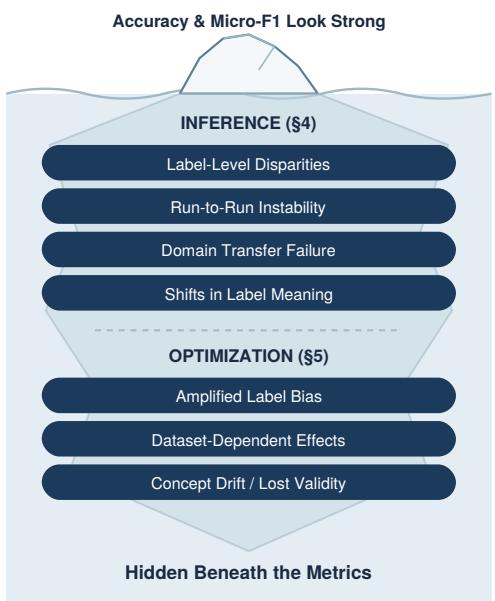
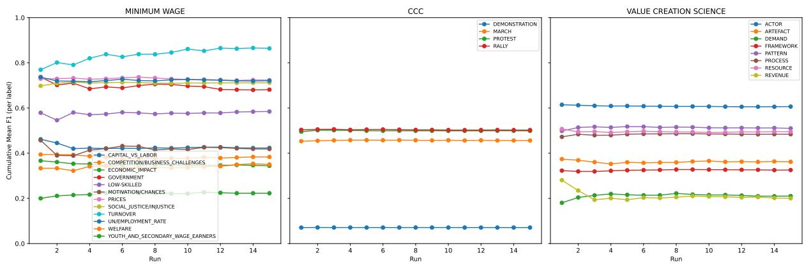
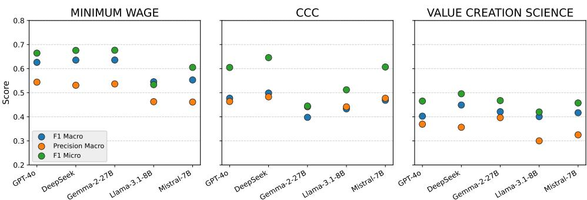
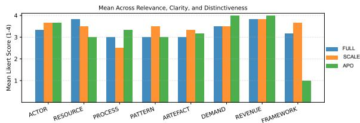
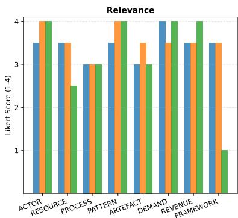
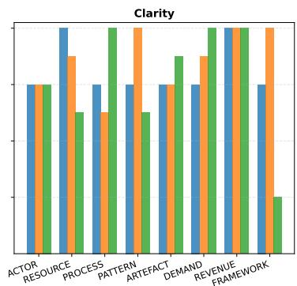
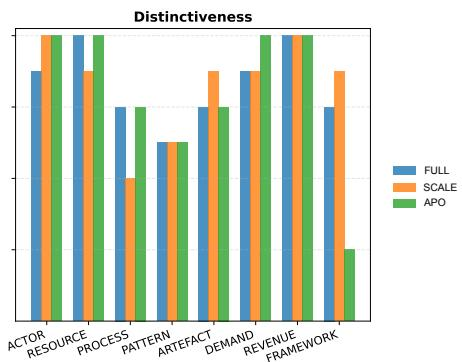

# High Scores, Hidden Failures: Evaluating Codebook-Based LLM Content Analysis

Elena Senger1,2 Yuri Campbell2 Rob van der Goot3 Barbara Plank1

1MaiNLP, Center for Information and Language Processing, LMU Munich & MCML, Germany 2Fraunhofer Institute for Systems and Innovation Research ISI, Germany 3Department of Computer Science, IT University of Copenhagen, Denmark elena.senger@cis.lmu.de, yuri.campbell@isi.fraunhofer.de robv@itu.dk, b.plank@lmu.de

## Abstract

Large language models (LLMs) are increasingly used for codebook-based content analysis in computational social science, where codebooks translate theoretical concepts into labeling schemes. While prior work reports strong predictive performance, it remains unclear whether these systems produce reliable and robust text annotations. We conduct a largescale empirical failure-mode analysis of LLMbased coding pipelines across four datasets and five models by systematically evaluating their stability, robustness, and conceptual validity under controlled perturbations, domain shifts, and optimization procedures. We uncover multiple failure modes that are largely invisible under standard metrics, showing that high aggregate scores frequently coexist with severe label-level disparities, instability across runs, domain sensitivity, and shifts in label interpretation. Importantly, these failure modes persist under widely used optimization strategies and remain largely invisible under standard metrics such as accuracy and micro-F1. Our results demonstrate that current LLM-based coding pipelines cannot be treated as stable measurement tools without targeted validation beyond aggregate performance.

## 1 Introduction

Large language models (LLMs) are increasingly used to annotate text data using natural language instructions, enabling scalable labeling for tasks such as dataset construction, qualitative coding, and content analysis (Törnberg, 2024; Abraham et al., 2025; Rytting et al., 2023; Xiao et al., 2023). In computational social science (CSS), these instructions are typically formalized as codebooks, structured annotation guidelines that map theoretical concepts onto predefined labels. For example, a codebook for analysing news coverage of minimum wage policies might define labels such as Prices, Government, Welfare, and Justice to classify the different concepts through which minimum wage policies are discussed in each text. By incorporating the codebook’s labels and their definitions directly into prompts, recent studies report strong predictive performance and substantial agreement between human and LLM annotations, suggesting that LLMs could serve as scalable substitutes for human coders (Rytting et al., 2023; Ramanathan et al., 2025; Ruckdeschel, 2025; Farjam et al., 2025).

  
Figure 1: Illustrative examples of LLM failure modes in inference and optimization hidden beneath metrics.

However, the use of LLMs for codebook-based annotation introduces two sources of potential failure. First, LLMs may fail to apply codebook instructions consistently during inference. A growing body of NLP research highlights prompt sensitivity (Shu et al., 2024; Mizrahi et al., 2024; Gu et al., 2023), where model predictions change under seemingly minor prompt variations, such as formatting choices, label ordering, or wording differences. Beyond prompt sensitivity, LLM-based coding pipelines may also exhibit broader robustness issues, including instability across repeated runs, inconsistent adherence to codebook definitions, and large disparities in performance across individual labels. Second, LLMs are increasingly used not only to apply annotation instructions but also to refine or optimize the prompts themselves. Recent approaches employ automatic prompt optimization or multi-agent prompting frameworks to iteratively modify prompts in order to improve predictive performance (Abraham et al., 2025; Zhao et al., 2025). While these methods can yield improvements on standard evaluation metrics, they also introduce additional risks. For instance, modifying prompts that encode coding schemes can implicitly alter label definitions, amplify disparities in label-level performance, or shift the conceptual meaning of the constructs being measured (see Section 5). These issues are consequential in content analysis, where annotations function as measurements (Krippendorff, 2018). They feed downstream statistical analyses (frequency comparisons, regressions, hypothesis testing), as well as qualitative interpretation, including conceptual and relational analysis. This requires that performance is balanced across labels for frequency-based claims to hold (Egami et al., 2023), results are comparable across runs, models, and corpora for findings to replicate, and the labels must retain the theoretical constructs the codebook was designed to measure (Halterman and Keith, 2025).

In this paper, we operationalize the risks around faithful LLM coding by defining controlled experiments and complementary metrics. Then, we empirically demonstrate that current LLM-based codebook methods systematically fail in predictable ways. We organize our study around a set offailure modes, spanning two stages of practical CSS pipelines: (1) inference failure modes, which arise when an LLM applies a fixed codebook (see Section 4), and (2) optimization-induced failure modes, which arise when an LLM is used to refine a codebook prior to inference (see Section 5). Our main contributions are:

• A framework for systematic failure-mode analysis for LLM content analysis, identifying predictable breakdowns at both the inference and optimization stages.

• Evidence across four datasets and five models that commonly reported performance metrics can misrepresent coding reliability by masking these failures, along with a minimal validation protocol (see Section 6) to uncover such failure modes.

• Two new expert-annotated datasets sharing a single codebook, enabling controlled domaintransfer evaluation, as well as code and evaluation pipeline to support reproducibility.1

## 2 Related Work

## 2.1 Reliability of LLM-Based Text Annotation

In CSS, LLMs are increasingly used to generate annotations for downstream analyses, such as estimating prevalence or testing hypotheses (Gligoric et al., 2025; Baumann et al., 2025). It has been shown that LLM annotations vary depending on the design of the prompt, the domain, the task, or the choice of model (Aldeen et al., 2023; Kocon´ et al., 2023). Therefore, naive use can produce unreliable statistical estimates (Gligoric et al., 2025) and propagate to downstream statistical inference (Baumann et al., 2025).

Within content analysis, research has increasingly explored how LLMs can leverage codebooks in zero-shot or few-shot coding scenarios (Rytting et al., 2023; Dunivin, 2025; Farjam et al., 2025). Prior work shows that incorporating codebook definitions or examples can improve classification performance (Ruckdeschel, 2025; Xiao et al., 2023). Other studies highlight that prompt design choices and codebook components (e.g., “Negative Clarification” or “Positive Example”) can influence model predictions (Halterman and Keith, 2025). Some work also reports variability in LLM coding results across repeated runs despite strong overall agreement with human annotations (Ramanathan et al., 2025), suggesting that stability remains an underexplored dimension of evaluation. However, existing studies primarily focus on aggregate performance metrics (Ruckdeschel, 2025; Xiao et al., 2023; Rytting et al., 2023; Dunivin, 2025; Farjam et al., 2025), leaving open questions about robustness, label-level disparities, and other potential failure modes when LLMs apply codebooks.

Where prior work documents that predictions shift under prompt variation, we systematically evaluate published codebook-design recommendations (Ruckdeschel, 2025; Halterman and Keith, 2025; Dunivin, 2025), run-to-run stability, labelname reliance, and domain transfer under controlled conditions. Our analysis extends prior findings by decomposing these effects at the label level and distinguishing robustness to stylistic variation from adherence to the underlying coding concepts.

## 2.2 Codebook Optimization with LLMs

A complementary line of research explores how LLMs themselves can be used to optimize codebook-prompts for LLM inference. Abraham et al. (2025) propose Automatic Prompt Optimization (APO), starting with a human-labeled subset and an initial task prompt. The LLM repeatedly generates semantically equivalent variations, evaluates them on the labeled data, and retains the best-performing prompts. Additionally, Zhao et al. (2025) introduce the multi-agent framework SCALE. SCALE simulates collaborative coding processes, including discussion and evolving codebooks. In our study, we apply APO and SCALE, analysing their robustness, comparability, and impact on the quality of codebooks. While prompt optimization techniques focus on improving predictive performance, their effects on robustness, and conceptual validity remain unexplored. In this work, we systematically analyse how codebook optimization interact with LLM-based annotation pipelines and show that performance improvements can coincide with amplified failure modes.

## 3 Data and Evaluation Setup

Datasets To address robustness, we evaluate across four datasets varying in domain, size, and label count (Table 1; codebooks in Appendix A). We include the CCC dataset (Halterman and Keith, 2025) (on protests in the United States) and MINI-MUM WAGE dataset (Ruckdeschel and Wiedemann, 2023) (on the impact of minimum wage policies) from prior work to ensure comparability. In addition, we introduce and release two datasets on Value Creation across distinct sources: the VALUE CREATION SCIENCE dataset, derived from scientific literature, and the VALUE CREATION NEWS, compiled from news-wire corpora. The former is the primary dataset and the latter was developed to evaluate robustness under domain shift. The related codebook captures concepts such as actor, demand, and resource, and was developed by a team of social scientists through an iterative annotation process, with refinements guided by inter-annotator agreement (Fleiss’ κ). Two domain experts further provide qualitative validation for this present study. Additional details on data sources, label sets, and annotation procedures are provided in Appendix B.

<table><tr><td>Dataset</td><td>Multi-Label</td><td>#Labels</td><td>#Train</td><td>#Val</td><td>#Test</td></tr><tr><td>CCC</td><td>×</td><td>4</td><td>4,706</td><td>1,007</td><td>1,010</td></tr><tr><td>MINIMUM WAGE</td><td>√</td><td>12</td><td>758</td><td>194</td><td>194</td></tr><tr><td>VALUE CREATION SCIENCE</td><td>√</td><td>8</td><td>2,149</td><td>268</td><td>269</td></tr><tr><td>VALUE CREATION NEWS</td><td>√</td><td>8</td><td></td><td></td><td>60</td></tr></table>

Table 1: Dataset statistics. Data split size is in number of documents.

Models and Evaluation Unless otherwise noted, inference experiments use Mistral-7B-Instruct-v0.3 (Jiang et al., 2023) at temperature 0.3, an open and relatively compact model accessible to a wide range of researchers.2 Cross-model comparisons appear in Section 4.2. To ensure comparability with the original SCALE setup, we run all three methods with GPT-4o. We report accuracy, micro-F1, macro-F1, macro-Precision, and Worst-Label-F1 to surface disparities masked by aggregate metrics. Accuracy measures the fraction of instances where every label of that instance is predicted correctly. For codebook-optimization approaches, we additionally report a human expert evaluation with Likert scale to evaluate the resulting codebook quality on VALUE CREATION SCIENCE.

## 4 Failure Modes in Inference

In the following subsections, we present the results of the inference experiments structured along their respective identified failure modes. Starting from an Unchanged codebook baseline (Table 2), we examine issues such as label-level disparities and overinterpretation. We further probe reliability through prompt diagnostics, evaluate context sensitivity via formatting and dataset variations, measure stochastic stability with repeated runs, test domain transfer on a new corpus, and assess model generalization across five LLMs.

## 4.1 Reliability of Label Application

Label-Level Disparities Standard metrics such as accuracy and micro-F1 aggregate across labels and can therefore mask severe per-category failures, a problem compounded by the highly imbalanced datasets typical of CSS. Balanced performance is essential for valid downstream interpretation. For example, in a simple frequency analysis of how often a concept appears in a corpus, systematic underperformance on certain labels directly biases results. Moreover, robust generalization to datasets with different label distributions requires models to perform reliably across all categories. Our experiments expose this pattern (Table 2). In MINIMUM WAGE, the label YOUTH-AND-SECONDARY-WAGE-EARNERS (support = 5) achieves the lowest F1 (28.90), while SOCIAL-JUSTICE/INJUSTICE (support = 59) reaches 72.97. More strikingly, the gap between worst-label-F1 and micro-F1 is 30 points for MINIMUM WAGE, 26 points for VALUE CREATION SCIENCE, and 28 points for CCC, which are differences entirely invisible in aggregate reporting. The consistent gap between macro-F1 and micro-F1 across all experiments further confirms uneven performance.

<table><tr><td rowspan="2">Codebook Variant</td><td colspan="5">MINIMUM WAGE</td><td colspan="5">CCC</td><td colspan="5">VALUE CREATION SCIENCE</td></tr><tr><td>Acc</td><td>mi. F1</td><td>ma. F1</td><td>ma. P</td><td>WLF1</td><td>Acc</td><td>mi. F1</td><td>ma. F1</td><td>ma. P</td><td>WLF1</td><td>Acc</td><td>mi. F1</td><td>ma. F1</td><td>ma. P</td><td>WLF1</td></tr><tr><td>Unchanged (§4.1, §4.1)</td><td>18.219.88</td><td>59.159.2</td><td>54.85.4 9</td><td>47.549.2 27</td><td>28.938.7</td><td>33.033.7</td><td>34.034.3</td><td>33.433.7</td><td>45.645.4 2.0</td><td>6.46.5</td><td>1.92.6</td><td>44.945.6</td><td>39.640.100</td><td>30.531.9</td><td>18.821.7</td></tr><tr><td>Generic Label (§4.1)</td><td>23.42 .0</td><td>55.756 </td><td>49.550.5</td><td>39.741.0</td><td>32.239.9</td><td>42.942.6</td><td>43.843.5</td><td>27.829.0</td><td>45.846.3</td><td>5.85.9 .</td><td>1.01.7</td><td>41.641. 2</td><td>38.738.2</td><td>27.527.9</td><td>19.327. 3</td></tr><tr><td>Swapped Label (§4.1)</td><td>2.93.4</td><td>37.739.0</td><td>29.9318.6 30:6</td><td>25.22 . 0</td><td>1.40.0</td><td>12.312. 44 </td><td>12.512.4</td><td>10.610.3</td><td>17.417. </td><td>2.52.3 2.0</td><td>2.02.2</td><td>39.940.4.4</td><td>35.134.6 3.</td><td>28.528.0</td><td>20.621.6</td></tr><tr><td>Label-Only (§4.1)</td><td>6.97.34 0</td><td>45.745.5</td><td>42.14.4 11.4</td><td>36.236.5</td><td>14.215.13 07</td><td>15.915.6</td><td>16.816. 0</td><td>24.024.7</td><td>46.546.00</td><td>5.85.8 </td><td>0.68.5</td><td>43.543.2 13.8</td><td>38.439.8 8.8</td><td>29.228.68</td><td>24.226.4 22.0</td></tr><tr><td>Simple Codebook (§4.2.i)</td><td>21.62.11 y</td><td>61.261.7 61.7</td><td>56.857.8</td><td>48.949.9</td><td>39.140.0</td><td>30.027.7</td><td>28.728.9</td><td>31.231.0</td><td>45.645.8 45.0</td><td>6.16.3</td><td>1.72.0</td><td>42.542.38 16.8</td><td>35.936.3</td><td>26.727.2</td><td>10.91363</td></tr><tr><td>Structured (§4.2.ii)</td><td>21.02.22.2</td><td>56.857.78</td><td>50.952 . 5</td><td>43.341.70</td><td>25.836.5</td><td>49.349.</td><td>50.250.00.0</td><td>38.638.855</td><td>47.47. </td><td>7.07 .8</td><td>1.92.2</td><td>44.341.00</td><td>38.139.9</td><td>29.830.0</td><td>12.10.0.</td></tr><tr><td>Majority Order (§4.2.iii)</td><td>20.719.95</td><td>60.2619. </td><td>54.75.31</td><td>45.74.4.4</td><td>36.431.8</td><td>29.028. 0</td><td>30.130.000</td><td>32.03.188</td><td>46.7476. .</td><td>6.26.14</td><td>0.40.6 2</td><td>43.643.3 43.9</td><td>40.239.8</td><td>29.939.2 0.2</td><td>21.82.0</td></tr><tr><td>Inverted Order (§4.2.iii)</td><td>13.1.0</td><td>55.956.4 55.4</td><td>49.850.3</td><td>42.342.77</td><td>31.832.7</td><td>57.757.3</td><td>58.758.8</td><td>45.45. </td><td>47.047.8</td><td>9.09.5</td><td>0.70.0 0.</td><td>36.236.6 35.8</td><td>33.333.7</td><td>33.434.3</td><td>16.317.6</td></tr></table>

Table 2: LLM-Inference results with baseline Unchanged Codebook vs. other codebook variants. We report accuracy (Acc), micro-F1 (mi. F1), macro-F1 (ma. F1), macro precision (ma. P), and worst-label-F1 (WLF1). For all metrics, we show their mean value and the 95% confidence interval over 10 runs. Bold values indicate statistically significant differences over baseline (p < 0.05) under paired t-tests. Underlined values indicate significance under paired bootstrap tests. Codebook variant numbers (e.g., §4.1) indicate where each variant is discussed. Results of an encoder baseline can be found in Appendix E for comparison.

Overinterpretation Ruckdeschel (2025) identify overinterpretation as a recurring issue in LLMbased coding: models infer meaning beyond what is explicitly stated. Our quantitative results confirm this tendency. In two of the three datasets, macro-Precision falls below macro-F1 (Table 2), indicating that models assign labels more liberally than the gold standard warrants. At the label level, precision lags behind recall in 17 of 24 labels, pointing to systematic overprediction rather than isolated errors. For CSS workflows that rely on label frequencies or co-occurrence counts (Baumann et al., 2025; Gligoric et al., 2025), such overcoding inflates the apparent prevalence of concepts in a corpus and can distort substantive conclusions.

Codebook-Specific Label Meanings A central assumption of codebook-based content analysis is that the model follows the provided definitions rather than defaulting to background knowledge acquired during pretraining. Ziems et al. (2024) argue that zero-shot performance is strongest when a model’s internal concept overlaps with the intended construct (e.g., stance or emotion detection), but declines on tasks requiring compliance with detailed instructions. Halterman and Keith (2025) make this issue explicit with two diagnostics: Generic Label Accuracy (replacing labels with pseudo-labels such as “Label 1”) and Swapped Label Accuracy (permuting names and definitions). Building on this work, we introduce a third diagnostic, Label-Only, in which inference uses only label names, without their definitions. The results (Table 2) reveal a consistent pattern across datasets: Label-Only achieves surprisingly high scores (Table 2), especially for VALUE CREATION SCIENCE, suggesting that models lean heavily on label names. In contrast, performance drops substantially under Generic Label and Swapped Label, sometimes more than in the Label-Only case, confirming reliance on label name over definitions.

## 4.2 Robustness

Context Sensitivity Prior work offers various, often conflicting guidelines for prompt design in LLM-based content analysis. We isolate three such recommendations, applying each as a single modification to the Unchanged codebook baseline (Table 2).

Ruckdeschel (2025) advocates for shorter, concise codebooks, while Halterman and Keith (2025) suggest using full codebooks for better overall performance. In our experiments, we use labels and their definitions as simplified codebooks, removing examples, clarifications and counter-examples (i.

  
Figure 2: Aggregated mean $\mathrm { F _ { 1 } }$ scores over 15 runs, illustrating the stabilizing effect of averaging multiple runs for each label.

Simple codebook, Table 2). We see that simplified codebooks degrade both micro/macro-F1 for VALUE CREATION SCIENCE and CCC datasets, but improve overall performance on MINIMUM WAGE marginally.

Halterman and Keith (2025) recommend explicit structural markers, e.g. prefixing each field with “definition:” or “example:”. In our experiments, when using their structured codebook style (ii. Structured, Table 2), CCC shows substantial gains across nearly all metrics, while MINIMUM WAGE and VALUE CREATION SCIENCE exhibit significant decreases in all metrics. We attribute this outcome to the average length of the texts in CCC, which is by far the longest of the three. Information signaled by markers ("definition") may help the model retrieve relevant information from the full context window.

Following Dunivin (2025)’s clause-order finding, we place majority labels first (iii. Majority Order). As shown in Table 2, this ordering yields only minor changes for MINIMUM WAGE and VALUE CREATION SCIENCE, but substantially degrades performance on CCC. Strikingly, CCC achieves its best micro/macro-F1 when the majority label order is inverted (iii. Inverted Order), though this harms performance on the other two datasets.

These contradictory outcomes across three independent design dimensions may help explain why studies, especially those with limited dataset diversity, sometimes arrive at opposing best-practice recommendations.

Stochastic Instability As Ramanathan et al. (2025) note, LLM (GPT-4) performance can vary across repeated runs. We observe the same effect with open-weight models when setting temperature above zero and not fixing a random seed.3 Figure 2 shows the aggregated mean F1 scores over 15 such runs. The degree of instability is dataset- and labeldependent (Figure 2). For CCC, scores remain highly stable. VALUE CREATION SCIENCE shows moderate run-to-run differences that are reduced by averaging three runs, while MINIMUM WAGE exhibits stronger variation, particularly for the lowsupport label TURNOVER. The pattern is consistent with the label-level disparities documented in Section 4.1: categories with small support are most vulnerable to both systematic underperformance and stochastic noise. Our observed variance is modest compared to the greater instability reported by Ramanathan et al. (2025), likely because open-weight models allow transparent control over sampling parameters. Closed-source APIs, by contrast, may introduce opaque configuration changes between provider updates, compounding run-to-run variability with silent shifts in model behaviour.

Model Generalization We compare GPT-4omini, DeepSeek-V3 (DeepSeek-AI et al., 2025), Gemma-2-27B-it (Team et al., 2024), Llama-3.1- 8B-Instruct, and Mistral-7B-Instruct-v0.3 (Jiang et al., 2023) using the Unchanged codebook on all three datasets (Figure 3). No model dominates consistently. For the VALUE CREATION SCIENCE dataset, performance levels are relatively close: Gemma achieves the highest precision, while DeepSeek leads in micro/macro-F1. Llama, in contrast, performs weakest overall. On the CCC dataset, Gemma’s F1 scores drop drastically, up to 25 percentage points below the other models, whereas the compact Mistral performs comparably to the much larger DeepSeek and GPT models. The pattern reverses for the MINIMUM WAGE dataset, where Gemma consistently outperforms all others, while Mistral and Llama lag behind. The absence of a stable model ranking across datasets poses a systemic threat for CSS. If conclusions depend heavily on which model (or version) is chosen, downstream analyses risk being contingent on arbitrary or even opaque implementation details. Closed-source models amplify this problem, as providers update them without notice, leading to silent shifts in performance and prompt sensitivity. What appears to be a stable, replicable pipeline today may yield different results, undermining the credibility of published findings, and may as a consequence even impact policy making.

Figure 3: An overview of model performance for the different datasets.
<table><tr><td></td><td>Acc</td><td>mi. F1</td><td>macro-F1</td><td>ma. P</td><td>WLF1</td></tr><tr><td>VALUE CREATION SCIENCE</td><td>1.92.1 1.6</td><td> $4 4 . 9 _ { 4 4 . 6 } ^ { 4 5 . 1 }$ </td><td> $3 9 . 6 _ { 3 9 . 0 } ^ { 4 0 . 1 }$ </td><td> $3 0 . 5 _ { 2 9 . 9 } ^ { 3 1 . 0 }$ </td><td>18.821.7 15.9</td></tr><tr><td>VALUE CREATION NEWS</td><td> $\underline { { \mathbf { 0 . 0 _ { 0 . 0 } ^ { 0 . 1 } } } }$ </td><td> $\underline { { { \bf 6 2 . 2 _ { 6 1 . 7 } ^ { 6 2 . 8 } } } }$ </td><td> $\underline { { \mathbf { 5 9 . 6 6 _ { 5 8 . 9 } ^ { 6 0 . 2 } } } }$ </td><td> $\underline { { \mathbf { 5 4 . 1 } _ { 5 3 . 5 } ^ { 5 4 . 7 } } }$ </td><td> $\underline { { \mathbf { 3 2 . 9 _ { 3 2 . 2 } ^ { 3 3 . 5 } } } }$ </td></tr></table>

Table 3: Metrics over ten runs for VALUE CREATION SCIENCE and VALUE CREATION NEWS, shown with their mean value and the 95% confidence interval over 10 runs. Bold values indicate statistically significant differences under paired t-tests $( p < 0 . 0 5 )$ . Underlined values indicate significance under paired bootstrap tests.

Domain Transfer Failure A critical assumption in codebook-based content analysis is that coding frameworks remain valid across new data sources within the same theoretical domain. We test this assumption by applying the VALUE CREATION SCIENCE codebook, developed on academic publications, to news articles covering the same business and economics topics. Both corpora share the underlying constructs but differ in register: style, vocabulary, and communicative conventions change. The results expose a paradox (Table 3). On one side, the per-label performance improves substantially in the news domain: micro-F1 rises from 44.89 to 62.22 and macro-F1 from 39.57 to 59.55, likely because news articles use simpler language and more direct formulations (qualitative examples in Appendix C). On the other side, this confidence does not extend to a holistic understanding of the coding task: the model fails to predict the full correct label set for any single instance, resulting in an overall accuracy of 0.0. Such domain sensitivity poses significant risks for comparative analyses and theory testing in CSS. A codebook that performs well on one text type may yield systematically different results on another, even when both sources address the same substantive questions. These inconsistencies can lead to spurious empirical patterns or failed replications.

## 5 Failure Modes in Optimization

Failure modes in LLM-based coding do not arise only during inference, additional risks emerge when LLMs are used to optimize codebooks that are later applied during inference. To study these effects, we first implement targeted minimal optimizations, introducing small structured changes to the original codebook to test their impact across datasets (see Table 4). These perturbations are generated zero-shot in a single LLM rollout.

Second, we evaluate real-world approaches, in which the complete codebook is optimized. Specifically, we apply (i) a zero-shot full-codebook improvement (FULL), prompting an LLM to refine the entire codebook; (ii) APO by Abraham et al. (2025); and (iii) the multi-agent framework SCALE (Zhao et al., 2025), both iterative prompt refinement methods. Using these setups, we analyse potential risks such as concept drift, bias amplification, and the practical feasibility of LLM-based codebook optimization.

<table><tr><td rowspan="2">Optimization</td><td colspan="6">MINIMUM WAGE</td><td colspan="4">CCC</td><td colspan="6">VALUE CREATION SCIENCE</td></tr><tr><td></td><td>Acc mi. F1 ma. F1 ma. P</td><td></td><td></td><td>WLF1</td><td></td><td></td><td>Acc mi. F1 ma. F1 ma. P WLF1</td><td></td><td></td><td></td><td></td><td></td><td></td><td>Acc mi. F1 ma. F1 ma. P WLF1</td></tr><tr><td>Unchanged Codebook</td><td>17.5</td><td>59.8</td><td>54.4</td><td>47.1</td><td>25.0</td><td>38.3</td><td>40.9</td><td>38.1</td><td>44.4</td><td>7.1</td><td>0.7</td><td>44.5</td><td>39.4</td><td>29.8</td><td>18.2</td></tr><tr><td>Label Names (§ 5.1, § 5.1)</td><td>26.8</td><td>56.0</td><td>51.0</td><td>44.8</td><td>22.2</td><td>45.4</td><td>47.2</td><td>40.1</td><td>46.3</td><td>7.4</td><td>3.4</td><td>42.4</td><td>35.3</td><td>29.3</td><td>8.5</td></tr><tr><td>Label Definition (§ 5.1, § 5.1)</td><td>19.1</td><td>60.0</td><td>55.7</td><td>46.1</td><td>28.6</td><td>52.9</td><td>55.0</td><td>44.4</td><td>45.0</td><td>13.0</td><td>1.9</td><td>45.5</td><td>39.8</td><td>30.8</td><td>14.8</td></tr><tr><td>Pos Clarification (§ 5.1, § 5.1)</td><td>21.1</td><td>58.1</td><td>53.7</td><td>46.6</td><td>25.0</td><td>35.4</td><td>37.3</td><td>35.7</td><td>44.8</td><td>7.5</td><td>2.6</td><td>44.5</td><td>39.0</td><td>29.4</td><td>12.3</td></tr><tr><td>Pos + Neg Clarification (§ 5.1, §5.1)</td><td>24.7</td><td>61.1</td><td>57.5</td><td>53.9</td><td>40.0</td><td>45.5</td><td>47.2</td><td>40.1</td><td>46.3</td><td>7.4</td><td>2.2</td><td>44.8</td><td>40.4</td><td>30.6</td><td>23.5</td></tr><tr><td>Pos Examples (§ 5.1, § 5.1)</td><td>13.4</td><td>58.5</td><td>55.8</td><td>47.9</td><td>38.7</td><td>31.3</td><td>31.6</td><td>32.4</td><td>52.1</td><td>5.1</td><td>2.6</td><td>45.8</td><td>40.0</td><td>31.3</td><td>15.1</td></tr><tr><td>Pos + Neg Examples (§ 5.1, § 5.1)</td><td>15.0</td><td>59.3</td><td>55.4</td><td>49.9</td><td>25.0</td><td>44.2</td><td>44.9</td><td>39.4</td><td>50.7</td><td>5.7</td><td>3.0</td><td>45.5</td><td>38.9</td><td>30.2</td><td>11.3</td></tr><tr><td>Full (§ 5.1, § 5.2 )</td><td>18.6</td><td>58.9</td><td>52.7</td><td>44.5</td><td>33.3</td><td>30.9</td><td>32.2</td><td>33.4</td><td>47.3</td><td>6.4</td><td>3.4</td><td>43.3</td><td>38.5</td><td>28.8</td><td>13.2</td></tr><tr><td>APO (§ 5.1, § 5.2 )</td><td>16.5</td><td>38.8</td><td>33.8</td><td>26.9</td><td>22.2</td><td>57.0</td><td>60.1</td><td>45.2</td><td>45.4</td><td>9.5</td><td>0.0</td><td>40.2</td><td>34.3</td><td>22.5</td><td>0.0</td></tr><tr><td>SCALE (§ 5.1, §5.2 )</td><td>17.0</td><td>39.7</td><td>33.6</td><td>22.9</td><td>9.3</td><td>49.5</td><td>59.9</td><td>44.0</td><td>42.2</td><td>5.6</td><td>0.0</td><td>38.1</td><td>36.7</td><td>23.7</td><td>26.2</td></tr></table>

Table 4: Results for different codebook adaptations across datasets. Each dataset reports accuracy (Acc), micro F1 (mi. F1), macro F1 (ma. F1), marco precision (ma. P), and worst label F1 (WLF1). For the structured experiment Mistral-7B-Instruct-v0.3 was used. GPT-4 was used for FULL, APO and SCALE experiments.

## 5.1 Amplified Bias and Sensitivity

Increasing Label Bias The label-level disparities observed during inference (Section 4.1) are amplified when LLMs are used to optimize codebooks. Small modifications to definitions or examples can disproportionately shift performance across labels (see Table 4). When evaluation relies solely on aggregate metrics, such as micro-F1, there is a danger of endorsing adaptations that improve majority classes while harming minority ones. A concrete case illustrates the danger: adding positive and negative examples improves micro/macro-F1, accuracy, and macro-Precision on both CCC and VALUE CREATION SCIENCE, yet simultaneously drives worst-label-F1 down to 5.67 and 11.32 respectively. Judged by aggregate metrics alone, these optimizations would be endorsed as beneficial. In practice, they systematically suppress minority categories, precisely the labels most vulnerable to begin with. The problem is compounded by automatic methods such as APO, which optimize for micro-F1 by design and therefore have no mechanism to prevent minority-label degradation.

Dataset Dependency for Optimization The dataset sensitivity documented for inference (Section 4.2) intensifies when LLMs are used to optimize codebooks, since each refinement step compounds the interaction between prompt wording and data characteristics. The absence of universal optimization rules motivates automated methods such as APO and SCALE, yet these introduce systematic risks of their own.

  
Figure 4: Overview of mean Likert scores across dimensions for each optimization method.

Our experiments show that even minimal adjustments, like adding examples, inserting clarifications, or reformulating definitions produce inconsistent effects across datasets (Table 4). What improves performance in one setting often degrades it in another, casting doubt on the existence of generalizable strategies for LLM-based refinements. This underscores the need for dataset-specific optimization methods that adapt prompts automatically rather than relying on fixed heuristics. Among real-world optimization methods, the simple FULL approach proves most stable, with macro-F1 decreasing by at most 5 points across datasets (Table 4). APO is more volatile: it performs well on CCC, but for VALUE CREATION SCIENCE it removed one label entirely, leading to weaker results. SCALE also exhibits high variability, improving CCC performance but reducing most metrics for the other two datasets. For VALUE CREATION SCIENCE, repeated SCALE runs produced drastically different and inconsistent outcomes ranging from leaving all labels unchanged to completely rewriting the codebook, resulting in labels that bore little resemblance to the originals. This run-level instability means that even the choice of which optimization run to deploy becomes a consequential, yet essentially arbitrary, decision.

<table><tr><td>Method</td><td>Definition for the REVENUE label</td></tr><tr><td>ORIGINAL</td><td>The benefit or reward an actor receives for contributing to value creation. Can be tangible or intangible. Examples: wages, profits, royalties, increases in social capital.</td></tr><tr><td>FULL</td><td>The reward or advantage received by an actor for participating in value creation, either tangible or intangible Examples: wages, profits, royalties, increases in social capital.</td></tr><tr><td>APO</td><td>The benefit or compensation received by an actor for their involvement in value creation. This can be either tangible or intangible. Examples: wages, profits, royalties, increases in social capital.</td></tr><tr><td>SCALE</td><td>The benefit or reward an actor receives for contributing to value creation. Can be tangible or intangible. Examples: wages, profits, royalties, increases in social capital, financial implications of operational changes, and benefits from educational initiatives. Clarification: Revenue can be seen as the return on investment for actors involved in the value creation process.</td></tr></table>

Table 5: Optimized versions of the label REVENUE across three approaches.

<table><tr><td>Dataset</td><td>Full APO</td><td></td><td>SCALE</td></tr><tr><td>MINIMUM WAGE (§ 5.3)</td><td>1</td><td>113,200</td><td>856</td></tr><tr><td>CCC (§ 5.3)</td><td></td><td>113,200</td><td>688</td></tr><tr><td>VALUE ČRÉATION SCIENCE (§ 5.3)</td><td></td><td>113,200</td><td>1,044</td></tr></table>

Table 6: Number of API calls required for each optimization method across datasets (§5.3).

## 5.2 Conceptual Validity of Optimized Codebooks

Optimization alters label definitions and occasionally label names, raising the question of whether the resulting codebooks still capture the theoretical constructs encoded in the original design. To evaluate this, two domain experts assessed each label description in the VALUE CREATION SCIENCE dataset using a 1–4 Likert scale (Lynn, 1986), a method commonly used to evaluate natural language generation outputs (Amidei et al., 2019). Due to low rating variance, inter-annotator agreement measured by Cohen’s κ is relatively low (κ = 0.34), although the observed agreement between annotators is high: 51.6% exact agreement and 87.3% of ratings differing by at most one scale point.4 Three dimensions were evaluated: relevance, clarity, distinctiveness (see Appendix G).

Relevance For relevance, the expert evaluated whether each label still reflected the intended concept of the original codebook. The highest mean score was achieved by SCALE (3.56), followed by FULL (3.44) and APO (3.19) (Figure 5). The APO approach received consistently high ratings, except for the label FRAMEWORK, which was removed during optimization. Despite this, overall performance in Table 4 remains strong given that one label could not be detected.

Clarity Since codebooks are intended for downstream analysis, it is essential that optimized label descriptions remain interpretable and clear to social scientists. Both SCALE outperforms FULL and APO with mean clarity scores of 3.44 compared to 3.25 and 3.06. This gap may stem from the richer definitions and examples that help differentiate labels (see Table 5).

Distinctiveness For codebooks to be analytically useful, labels must remain clearly distinct from one another. Again, FULL and SCALE yield higher mean Likert scores than APO.

For clarity and relevance, SCALE produces definitions experts judge superior to FULL (detailed scores in Appendix F. Yet FULL often achieves higher F1 scores (Table 4), revealing a disconnect: predictive gains can arise from simplified definitions that better align with model behavior while reducing conceptual interpretability. This tension highlights that quantitative metrics alone are insufficient for CSS applications where codebooks encode theoretical constructs.

## 5.3 Efficiency and Accessibility

Beyond performance, optimization approaches must also be feasible for researchers in practice. We therefore compare the efficiency of different methods by counting the number of API calls required for each approach (see Table 6). This provides an approximate measure of computational cost. FULL requires a single call per dataset. SCALE uses 688–1,044 calls depending on the dataset. APO requires 113,200 calls uniformly, over two orders of magnitude more than SCALE and five orders more than FULL, yet does not consistently outperform either alternative (Table 4). The cost-benefit profile of iterative optimization is thus far from guaranteed. Beyond cost, accessibility also matters: minimal prompt adjustments are within reach of any social scientist, whereas APO and SCALE demand non-trivial engineering skills.

## 6 Minimal Validation Protocol

To mitigate failure modes from Sections 4 and 5, we recommend the following minimal, low-cost validation protocol, intended as a practical screening procedure rather than a statistically exhaustive evaluation:

## Minimal Validation Protocol

Tail Risk: Report macro-F1, worst-label-F1, per label scores and label supports alongside micro-F1/accuracy; include macro-Precision to detect overcoding.

Meaning Adherence: Test Label-Only, Generic Label, and Swapped Label to detect reliance on label-name semantics.

Stability: Repeat inference ≥ 3 as a practical minimum for detecting substantial instability; report the number of runs and the resulting variability, and use more runs when variance is high or the API is stochastic/opaque.

Sensitivity: Apply semantics-preserving formatting or label-order perturbations to reveal prompt-specific effects.

Transfer: If possible, evaluate on an additional dataset from the same domain to detect shifts under domain or style changes.

Optimization Safeguards: When refining codebooks, include worst-label-F1 to protect minority labels, verify constructs with experts, and report computational cost.

## 7 Conclusion

LLMs enable large-scale content analysis in CSS but remain fragile and context-dependent. Our experiments demonstrate that high aggregate scores routinely coexist with severe label-level disparities, reliance on label-name semantics over codebook definitions, instability across runs, sensitivity to superficial formatting choices, and fragile domain transfer. When LLMs are additionally used to optimize codebooks, these problems do not diminish, they compound: optimization amplifies minoritylabel bias, produces dataset-contingent effects, and can silently alter the theoretical constructs a codebook is designed to measure. A recurring theme across all failure modes is that standard metrics are insufficient to detect them. To address this, we proposed a minimal validation protocol (Section 6) that operationalizes our findings into concrete checks, intended to be lightweight enough for routine adoption in CSS research.

## Limitations

Our analysis is limited to a small set of datasets, codebooks, and model configurations. While these reflect common CSS research settings, results may not generalize across domains, languages, or annotation frameworks. Nonetheless, our evaluation framework is applicable to any dataset, codebook, or LLM, and we hope future work will extend it to larger, multilingual, and domain-specific contexts. Finally, the human evaluation of optimized codebooks relies on only two experts, which may limit intersubjective validity.

## Ethical Considerations

This work studies the reliability of LLM-based text annotation and highlights potential risks when such annotations are used in downstream social science analyses. By identifying failure modes in inference and codebook optimization, our goal is to promote more transparent and responsible use of LLMs as measurement tools in research workflows. All datasets used in this study are either publicly available or released by the authors with appropriate documentation. We do not introduce new personal or sensitive data, and our experiments focus on methodological evaluation rather than producing judgments about individuals or groups. LLMs were used to assist with grammar, spelling, and refinement of the manuscript text. All technical content, analyses, and conclusions were developed and verified by the authors.

## Acknowledgments

We thank the reviewers for their insightful feedback. We thank Jan-Peter Bergmann for computing infrastructure, support and advice. ES and YC acknowledges financial support funded by the German Federal Ministry of Research, Technology and Space (BMFTR) under grant Wertschöpfungsradar 02J21A00X. We thank all project partners for their collaboration and the Scientific Advisory Board for their valuable guidance and support. BP acknowledges support funded by ERC Consolidator Grant DIALECT 101043235.

## References

Louis Abraham, Charles Arnal, and Antoine Marie. 2025. Prompt selection matters: Enhancing text annotations for social sciences with large language models. Preprint, arXiv:2407.10645.

Mohammed Aldeen, Joshua Luo, Ashley Lian, Venus Zheng, Allen Hong, Preethika Yetukuri, and Long Cheng. 2023. Chatgpt vs. human annotators: A comprehensive analysis of chatgpt for text annotation. In 2023 International Conference on Machine Learning and Applications (ICMLA), pages 602–609.

Jacopo Amidei, Paul Piwek, and Alistair Willis. 2019. The use of rating and Likert scales in natural language generation human evaluation tasks: A review and some recommendations. In Proceedings of the 12th International Conference on Natural Language Generation, pages 397–402, Tokyo, Japan. Association for Computational Linguistics.

Berk Atıl, Sarp Aykent, Alexa Chittams, Lisheng Fu, Rebecca J. Passonneau, Evan Radcliffe, Guru Rajan Rajagopal, Adam Sloan, Tomasz Tudrej, Ferhan Ture, Zhe Wu, Lixinyu Xu, and Breck Baldwin. 2025. Nondeterminism of “deterministic” LLM system settings in hosted environments. In Proceedings of the 5th Workshop on Evaluation and Comparison of NLP Systems, pages 135–148, Mumbai, India. Association for Computational Linguistics.

Joachim Baumann, Paul Röttger, Aleksandra Urman, Albert Wendsjö, Flor Miriam Plaza del Arco, Johannes B. Gruber, and Dirk Hovy. 2025. Large language model hacking: Quantifying the hidden risks of using llms for text annotation. Preprint, arXiv:2509.08825.

DeepSeek-AI, Aixin Liu, Bei Feng, Bing Xue, Bingxuan Wang, Bochao Wu, Chengda Lu, Chenggang Zhao, Chengqi Deng, Chenyu Zhang, Chong Ruan, Damai Dai, Daya Guo, Dejian Yang, Deli Chen, Dongjie Ji, Erhang Li, Fangyun Lin, Fucong Dai, and 181 others. 2025. Deepseek-v3 technical report. Preprint, arXiv:2412.19437.

Zackary Okun Dunivin. 2025. Scaling hermeneutics: a guide to qualitative coding with llms for reflexive content analysis. EPJ Data Science, 14(1):28.

Naoki Egami, Musashi Hinck, Brandon Stewart, and Hanying Wei. 2023. Using imperfect surrogates for downstream inference: Design-based supervised learning for social science applications of large language models. In Advances in Neural Information Processing Systems, volume 36, pages 68589–68601. Curran Associates, Inc.

Mike Farjam, Hendrik Meyer, and Meike Lohkamp. 2025. A practical guide and case study on how to instruct llms for automated coding during content analysis. Social Science Computer Review.

Kristina Gligoric, Tijana Zrnic, Cinoo Lee, Emmanuel Candes, and Dan Jurafsky. 2025. Can unconfident LLM annotations be used for confident conclusions? In Proceedings of the 2025 Conference of the Nations ofthe Americas Chapter ofthe Associationfor Computational Linguistics: Human Language Technologies (Volume 1: Long Papers), pages 3514–3533, Albuquerque, New Mexico. Association for Computational Linguistics.

Jiasheng Gu, Hongyu Zhao, Hanzi Xu, Liangyu Nie, Hongyuan Mei, and Wenpeng Yin. 2023. Robustness of learning from task instructions. In Findings of the Associationfor Computational Linguistics: ACL 2023, pages 13935–13948, Toronto, Canada. Association for Computational Linguistics.

Andrew Halterman and Katherine A. Keith. 2025. Codebook llms: Evaluating llms as measurement tools for political science concepts. Preprint, arXiv:2407.10747.

Albert Q. Jiang, Alexandre Sablayrolles, Arthur Mensch, Chris Bamford, Devendra Singh Chaplot, Diego de las Casas, Florian Bressand, Gianna Lengyel, Guillaume Lample, Lucile Saulnier, Lélio Renard Lavaud, Marie-Anne Lachaux, Pierre Stock, Teven Le Scao, Thibaut Lavril, Thomas Wang, Timothée Lacroix, and William El Sayed. 2023. Mistral 7b. Preprint, arXiv:2310.06825.

Jan Kocon, Igor Cichecki, Oliwier Kaszyca, Mateusz´ Kochanek, Dominika Szydło, Joanna Baran, Julita Bielaniewicz, Marcin Gruza, Arkadiusz Janz, Kamil Kanclerz, Anna Kocon, Bartłomiej Koptyra, Wik-´ toria Mieleszczenko-Kowszewicz, Piotr Miłkowski, Marcin Oleksy, Maciej Piasecki, Łukasz Radlinski,´ Konrad Wojtasik, Stanisław Wo´zniak, and Przemysław Kazienko. 2023. Chatgpt: Jack of all trades, master of none. Information Fusion, 99:101861.

Klaus Krippendorff. 2018. Content Analysis: An Introduction to Its Methodology, 4 edition. SAGE Publications, Inc., Los Angeles, CA.

Yinhan Liu, Myle Ott, Naman Goyal, Jingfei Du, Mandar Joshi, Danqi Chen, Omer Levy, Mike Lewis, Luke Zettlemoyer, and Veselin Stoyanov. 2019. Roberta: A robustly optimized BERT pretraining approach. CoRR, abs/1907.11692.

Mary R. Lynn. 1986. Determination and quantification of content validity. Nursing research, 35 6:382–5.

Moran Mizrahi, Guy Kaplan, Dan Malkin, Rotem Dror, Dafna Shahaf, and Gabriel Stanovsky. 2024. State of what art? a call for multi-prompt llm evaluation. Transactions of the Association for Computational Linguistics, 12:933–949.

Sriram Ramanathan, Lisa-Angelique Lim, Nazanin Rezazadeh Mottaghi, and Simon Buckingham Shum. 2025. When the prompt becomes the codebook: Grounded prompt engineering (groproe) and its application to belonging analytics. In Proceedings of the 15th International Learning Analytics and Knowledge Conference, LAK ’25, page 713–725, New York, NY, USA. Association for Computing Machinery.

Mattes Ruckdeschel. 2025. Just read the codebook! make use of quality codebooks in zero-shot classification of multilabel frame datasets. In Proceedings of the 31st International Conference on Computational Linguistics, pages 6317–6337, Abu Dhabi, UAE. Association for Computational Linguistics.

Mattes Ruckdeschel and Gregor Wiedemann. 2023. Argument aspect corpus.

Christopher Michael Rytting, Taylor Sorensen, Lisa Argyle, Ethan Busby, Nancy Fulda, Joshua Gubler, and David Wingate. 2023. Towards coding social science datasets with language models. Preprint, arXiv:2306.02177.

Bangzhao Shu, Lechen Zhang, Minje Choi, Lavinia Dunagan, Lajanugen Logeswaran, Moontae Lee, Dallas Card, and David Jurgens. 2024. You don’t need a personality test to know these models are unreliable: Assessing the reliability of large language models on psychometric instruments. In Proceedings ofthe 2024 Conference ofthe North American Chapter of the Association for Computational Linguistics: Human Language Technologies (Volume 1: Long Papers), pages 5263–5281, Mexico City, Mexico. Association for Computational Linguistics.

Robert H. Tai, Lillian R. Bentley, Xin Xia, Jason M. Sitt, Sarah C. Fankhauser, Ana M. Chicas-Mosier, and Barnas G. Monteith. 2024. An examination of the use of large language models to aid analysis of textual data. International Journal of Qualitative Methods, 23:16094069241231168.

Gemma Team, Morgane Riviere, Shreya Pathak, Pier Giuseppe Sessa, Cassidy Hardin, Surya Bhupatiraju, Léonard Hussenot, Thomas Mesnard, Bobak Shahriari, Alexandre Ramé, Johan Ferret, Peter Liu, Pouya Tafti, Abe Friesen, Michelle Casbon, Sabela Ramos, Ravin Kumar, Charline Le Lan, Sammy Jerome, and 179 others. 2024. Gemma 2: Improving open language models at a practical size. Preprint, arXiv:2408.00118.

Petter Törnberg. 2024. Best practices for text annotation with large language models. Sociologica, 18(2):67–85.

Ziang Xiao, Xingdi Yuan, Q. Vera Liao, Rania Abdelghani, and Pierre-Yves Oudeyer. 2023. Supporting qualitative analysis with large language models: Combining codebook with gpt-3 for deductive coding. In Companion Proceedings of the 28th International Conference on Intelligent User Interfaces, IUI

’23 Companion, page 75–78, New York, NY, USA. Association for Computing Machinery.

Chengshuai Zhao, Zhen Tan, Chau-Wai Wong, Xinyan Zhao, Tianlong Chen, and Huan Liu. 2025. SCALE: Towards collaborative content analysis in social science with large language model agents and human intervention. In Proceedings ofthe 63rd Annual Meeting of the Association for Computational Linguistics (Volume 1: Long Papers), pages 8473–8503, Vienna, Austria. Association for Computational Linguistics.

Caleb Ziems, William Held, Omar Shaikh, Jiaao Chen, Zhehao Zhang, and Diyi Yang. 2024. Can large language models transform computational social science? Computational Linguistics, 50(1):237–291.

## A Codebooks

We retained the original codebooks as closely as possible and reformatted them into a standardized prompt format for annotation.

## VALUE CREATION Codebook Prompt

The value creation codebook prompt:

You are an economic analyst examining the sociotechnical structure of value creation systems. You have been handed the following codebook as instructions to code text units for their aspects of value creation.

## Aspect Annotation in short text units.

The task is to find the aspect(s) present in a text unit. An aspect is defined as an element of the value creation system being discussed. It is possible that more than one aspect applies to a text unit; please mark all applicable aspects.

Below, the aspect categories are further explained. Each category has a label name and details defining or illustrating them.

## [ACTOR]

• A person or group providing a resource to help create value. Can be individuals or organized/informal groups (e.g., communities, companies).

• Examples: manufacturers, investors, employees, innovators, user communities.

## [RESOURCE]

• Something an actor uses to create value. Can be materials, objects processed, tools, information, or skills.

• Examples: machinery, raw materials, financial capital, data, technology, expertise.

## [PROCESS]

• A series of actions where actors use resources to create value. Includes primary activities (making and delivering products) and supporting activities.

## [PATTERN]

• Examples: manufacturing, procurement, distribution, maintenance, servicing.

• A regular and repeated way value creation is performed. Encompasses rules, norms, routines, and practices shaping actor roles or constraining actions.

• Examples: organizational structures, communication protocols, property rights, quality standards.

## [ARTEFACT]

• The output of the value creation process. Can be physical goods, intangible services, or product-service systems.

• Examples: consumer products, digital services, experiences, entertainment offerings.

## [DEMAND]

• A stated or expected need that an artefact fulfills. Needs can originate from individuals, groups, or society as a whole.

• Examples: consumer demand for essentials, societal challenges, personal preferences.

## [REVENUE]

• The benefit or reward an actor receives for contributing to value creation. Can be tangible or intangible.

• Examples: wages, profits, royalties, increases in social capital.

## [FRAMEWORK]

• External factors influencing how value is created. Includes environmental, political, legal, and social factors.

• Examples: regulatory regimes, market conditions, intellectual property laws, educational infrastructure.

In some cases, more than one label applies. Do not mention labels that do not apply.

## # Task

Assign one or more of the labels from the codebook to the following text:

## MINIMUM WAGE Codebook Prompt

You are a well-trained social scientist with a speciality for coding data for scientific research. You have been handed the following markdown codebook as instructions to code example sentences for their aspects.

## Aspect Annotation in short argumentative text units.

The task is to find the aspect of an argumentative sentence or short text unit. An aspect in this task is defined as a sub-topic of discourse in the broader topic of the debate about minimum wage. It is possible, that more than one aspect is present in a sentence, please mark all applicable aspects.

Below, the aspect categories are further explained. Each category has a label name and details defining or illustrating them.

## [MOTIVATION/CHANCES]

• Incentives and opportunities for workers to start a job/career, futher educate themselves and move up in a company.

• Influence of minimum wage on education in general or for particular groups.

• Eagerness and aspiration of workers.

• Keywords: motivation, incentives to education, upward mobility, worker morale.

• Examples:

– "If we raise the minimum wage, low skilled workers might become complacent and do not want to move up"

– "Paying employee better will make them more motivated to work for your company."

## [COMPETITION/BUSINESS CHAL-LENGES]

• Effects of minimum wage on business competition and profitability.

• Challenges for small businesses.

• Keywords: labour costs, payability, SME competition.

## [PRICES]

• Effects on consumer prices and inflation.

• Keywords: inflation, living costs, housing, daycare.

• Example: "Higher prices cancel positive effects of minimum wage."

## [SOCIAL JUSTICE/INJUSTICE]

• Fairness, inequality, poverty, and living wage.

• Keywords: dignity, standard of living, poverty line.

• Examples:

– "Workers should be able to afford paying their bills"

– "Wages have to fairly compensate workers"

## [WELFARE]

• Relationship between minimum wage and welfare spending.

• Keywords: welfare, subsidies, tax credits.

• Example: "Full-time workers should not have to rely on welfare"

## [ECONOMIC IMPACT]

• Effects on the overall economy and consumer spending.

• Keywords: ripple effect, economic growth.

## [TURNOVER]

• Effects on employee turnover and training costs.

• Keywords: job stability, hiring costs.

## [CAPITAL VS LABOR]

• Power disparity between workers and owners.

• Role of unions and exploitation.

• Keywords: collective bargaining, working class, sweatshops.

## [GOVERNMENT]

• State intervention and wage legislation.

• Keywords: regulation, free market.

• Example: "State vs. free market."

## [UN/EMPLOYMENT RATE]

• Effects on employment, unemployment, automation, outsourcing.

• Keywords: job loss, labor supply.

## [LOW-SKILLED]

• Effects on low-skilled and entry-level workers.

• Distinction from youth workers.

• Keywords: unskilled, entry-level.

## [YOUTH AND SECONDARY WAGE EARN-ERS]

• Part-time workers, students, teenagers.

• Secondary income earners.

In some cases, more than one label applies. Do not mention labels that do not apply.

## # Task

Assign one or more of the labels from the codebook to the following text:

## CCC Protest Dataset Prompt

Instruction: You’re an expert political scientist categorizing news stories about protests into categories. Carefully read the definitions below, read the story, and write the single Label that best match the story.

## [PROTEST]

• A crowd gathering to express disagreement with, or disapproval or anger or frustration toward, a specific individual or organization that is at or near the crowd’s gathering point.

• The crowd must be near the target of the protest or in negative reaction to a recent or current event.

## [RALLY]

• A crowd gathering to demonstrate and reinforce their mutual support for a set of political demands or claims.

• Typically includes speeches and may support press conferences.

## [DEMONSTRATION]

• A crowd gathering to demonstrate their support to an external audience.

• Usually involves signs, banners, flags, or pickets.

## [MARCH]

• A crowd moving on foot from one location to another.

• Does not include motorized or bicycle movement.

## # Task (single-label multi-class)

Do not write anything else except the Label in all caps.

Output Reminder: Write the name of the Label that fits best, with no other text. For example, "Label: PROTEST", "Label: RALLY", etc.

## ## Text

## B Details on Dataset Creation

This appendix describes the construction of the datasetsVALUE CREATION SCIENCE and VALUE CREATION NEWS. The datasets were developed as part of the Wertschöpfungsradar (Value Creation Radar, WSR) research project.

## B.1 Original Dataset

## B.1.1 Annotation Scheme

The annotation scheme is grounded in an abstract model of value creation systems, which distinguishes eight interdependent categories that characterise the essential elements of value creation processes. Each category is defined relationally— that is, through its connections to other elements in the model. The categories and their definitions are as follows:

• Actor (0): an individual or a collective that contributes a resource at its disposal to a process of creating an artefact.

• Resource (1): a capability of an actor that is used in the process of creating an artefact.

• Process (2): an activity for the creation of an artefact to which actors contribute their resources.

• Pattern (3): an organising principle through which a process integrates the resources to create an artefact.

• Artefact (4): a good that is created by integrating resources according to a pattern and that serves a demand.

• Demand (5): an articulated or anticipated need that an artefact serves.

• Revenue (6): a return an actor receives for contributing to the process of creating an artefact.

• Framework (7): a context factor that influences how value creation takes place.

Annotators were instructed to label noun phrases in English-language abstracts of scientific articles about value creation. Labels capture both positive and negative instances of each category (e.g., financial losses are labelled REVENUE; material costs are labelled RESOURCE).

## B.1.2 Annotation Process

The annotation procedure was developed iteratively across two phases: a pilot study and a main annotation campaign.

Pilot study. An internal pilot was conducted in June–July 2023, in which 8 annotators labelled 20 abstracts in parallel using the DOCCANO annotation tool.5 The pilot yielded a Fleiss’ κ of 0.31, indicating fair for multi-label span annotation, but insufficient agreement. A qualitative analysis of 75 annotator comments and a co-occurrence analysis of category overlaps revealed three main sources of disagreement: (i) ambiguous category boundaries, particularly between PATTERN and PROCESS, REVENUE and DEMAND, and ACTOR and FRAME-WORK; (ii) missing formal coding rules regarding grammatical forms, compound phrases, and abbreviations; and (iii) insufficient attention to the value-creation context when annotating.

Guideline revision. Based on the pilot findings, the annotation guidelines were substantially revised. Key improvements included: sharpened category definitions supplemented with illustrative positive and negative examples drawn from the pilot data; the introduction of a step-by-step annotation procedure recommending that annotators first identify ACTOR, PROCESS, and ARTEFACT before turning to the remaining categories; explicit coding rules restricting annotations to complete noun phrases, prohibiting the splitting of compound expressions, and requiring annotators to consider the relationships between labelled entities as specified by the value creation model. A one-page reference sheet summarising the definitions, explanatory notes, and examples was provided as a quickreference document.

Annotator training. Before the main campaign, annotators participated in a training session consisting of a presentation of the revised guidelines followed by a joint practice labelling exercise. An interactive training quiz was also distributed, which walked annotators through a sample text and tested their understanding of noun phrase boundaries, context-dependent category assignment, and the distinction between entities and concepts.

Main annotation campaign. The main campaign began in September 2023. Annotators labelled abstracts using DOCCANO with the eight predefined categories. The final dataset comprises 921 annotated abstracts. The collected annotated spans were proofed by a domain expert in order to improve label quality and remove any ambiguous data points.All involved social scientists consented to the use and release of this dataset.

## B.2 VALUE CREATION SCIENCE

From these 921 annotated abstracts, we selected the sentences which contained annotated noun-phrases and transformed the data into a multi-label dataset. That is, the whole sentence gets the labels of the identified spans that are contained in it. After that, we selected only sentences with at least one label and which carried enough context for the labels they carried. This helps to minimize context loss in the dataset transformation.

## B.3 VALUE CREATION NEWS

For the VALUE CREATION NEWS dataset, we collected 60 sentences from business-related news feeds and had the three most reliable annotators from the pilot study to label those.

## C Qualitative Examples of Domain Differences

Below we provide example sentences from the VALUE CREATION NEWS dataset. Compared to scientific abstracts in the VALUE CREATION SCI-ENCE dataset, these texts typically use simpler language and more direct formulations.

1. Example 1: “GameStop has significantly reduced its investments in cryptocurrencies, NFTs, and Web3 applications, now holding no crypto tokens and shifting focus back to core business areas.”

2. Example 2: “The telegraph quickly became popular for casual communication, and Ezra Cornell led its construction through southern New York.”

3. Example 3: “Modern companies must adopt data-driven strategies, leveraging technologies like IoT, Big Data, and AI to remain competitive and optimize decision-making.”

## D Statistical Significance Testing

In the following, we present the procedure for assessing (i) run-to-run stability and (ii) instance-

level uncertainty when comparing each prompt prototype against the baseline.

## D.1 Setup

For each dataset, we compare each prompt prototype against a fixed baseline prompt. We perform R=10 independent inference runs per (dataset, system) pair and store all test-set predictions. We compute accuracy, macro-F1, micro-F1, macroprecision, and micro-precision per run. Multi-label accuracy is subset accuracy (exact match). We set zero $\mathtt { \_ d i v i s i o n } { = } 0$ for F1 and precision.

## D.2 Run-Level Stability

We assess robustness to inference stochasticity via paired comparisons within each run index. For each run $r \in \{ 1 , \ldots , R \}$ , we compute metric values $M _ { \mathrm { b a s e } } ^ { ( r ) }$ and $M _ { \mathrm { p r o t o } } ^ { ( r ) }$ on the full test set, then form deltas $\delta _ { r } = M _ { \mathrm { p r o t o } } ^ { ( r ) } - M _ { \mathrm { b a s e } } ^ { ( r ) }$ . We apply a two-sided one-sample t-test on $\{ \delta _ { r } \} _ { r = 1 } ^ { R }$ to test $H _ { 0 } \colon \mathbb { E } [ \delta ] = 0$ and report per-system mean±std, ¯δ, the t-statistic, p-value, and t-based 95% confidence intervals with R−1 degrees of freedom. As a non-parametric sensitivity check, we also compute a two-sided Wilcoxon signed-rank test.

## D.3 Instance-Level Uncertainty

We quantify finite-sample uncertainty via a paired bootstrap that preserves baseline–prototype pairing on the same sampled instances $( B { = } 2 0 , 0 0 0 ;$ seed=42; 95% confidence level).

The observed run-averaged improvement is $\begin{array} { r } { \Delta _ { \mathrm { o b s } } = \frac { 1 } { R } \sum _ { r } ( M _ { \mathrm { p r o t o } } ^ { ( r ) } - M _ { \mathrm { b a s e } } ^ { ( r ) } ) } \end{array}$ . For each replicate b, we resample N instance indices with replacement and apply this index vector to $y , \hat { y } _ { \mathrm { b a s e } } ^ { ( r ) } ,$ and $\hat { y } _ { \mathrm { p r o t c } } ^ { ( r ) }$ for every run r, yielding a run-averaged bootstrap delta $\begin{array} { r } { \Delta _ { b } = \frac { 1 } { R } \sum _ { r } ( M _ { \mathrm { p r o t o } , b } ^ { ( r ) } - M _ { \mathrm { b a s e } , b } ^ { ( r ) } ) } \end{array}$ We report the 95% percentile CI $[ \Delta _ { 2 . 5 } , \Delta _ { 9 7 . 5 } ]$ and a two-sided bootstrap p-value:

$$
p _ { \mathrm { b o o t } } = 2 \mathrm { m i n } \big ( \mathrm { P r } ( \Delta _ { b } \leq 0 ) , \ \mathrm { P r } ( \Delta _ { b } \geq 0 ) \big ) .
$$

## D.4 Out-of-Domain Comparison

For the dataset-shift analysis, the two test sets contain different instances and are not paired at the instance level. We compute per-run metrics on each test set and apply a paired-delta t-test across runs. We obtain a 95% CI and two-sided p-value via an unpaired bootstrap over runs (same B and seed as above). For worst-label analysis, we compute per-label F1 per run, identify the label with the lowest mean F1 per test set, and compare these distributions using Welch’s t-test and an unpaired run-level bootstrap.

<table><tr><td>Dataset</td><td>Acc.</td><td>Micro-F1</td><td>Macro-F1</td><td>Macro-Prec.</td><td>WLF1</td></tr><tr><td>CCC</td><td>72.67</td><td>73.95</td><td>49.51</td><td>51.32</td><td>0.00</td></tr><tr><td>Minimum Wage</td><td>52.58</td><td>67.67</td><td>36.65</td><td>53.29</td><td>0.00</td></tr><tr><td>Value Creation Science</td><td>11.15</td><td>31.38</td><td>13.46</td><td>18.21</td><td>0.00</td></tr></table>

Table 7: Performance of the fine-tuned RoBERTa-large baseline across datasets.

## E Encoder Baseline: Fine-Tuned RoBERTa

We additionally evaluate a fine-tuned RoBERTa (Liu et al., 2019) baseline to contextualize the observed failure modes against a conventional supervised encoder model. We fine-tune roberta-large6 as a multi-label, or multi-class for CCC, sequence classification model using the training split of each dataset and select the best checkpoint on the validation split. Inputs are truncated to a maximum length of 512 tokens. We train for 3 epochs with a learning rate of $2 \times 1 0 ^ { - 5 }$ , batch size 8.

Table 7 reports the performance of the RoBERTa baseline across the three datasets. The results show that RoBERTa exhibits a pattern similar to the one observed for LLMs: relatively high aggregate scores, especially Micro-F1, can coexist with substantially lower Macro-F1 and a Worst-Label-F1 of 0.0. What shows that even a supervised encoder baseline can achieve moderate Micro-F1 while entirely failing on minority or difficult labels. However, the underlying causes of these failures differ. In LLM-based coding pipelines, failures may arise from prompt sensitivity, run instability, domain sensitivity, or semantic drift in label interpretation. In contrast, RoBERTa’s collapse on individual labels is more likely driven by label imbalance and sparse supervision, which are common in content analysis datasets.

## F Detailed Likert Scores

Figure 4 shows the Likert scores per label for each dimension.

## G Expert Evaluation Criteria

## Likert Scale

• 1 – Not relevant / clear / distinctive

  
Figure 5: Overview of relevance, clarity, and distinctiveness across optimization methods.

• 2 – Somewhat relevant / clear / distinctive

• 3 – Quite relevant / clear / distinctive

• 4 – Highly relevant / clear / distinctive

## Evaluation Dimensions

• Relevance: Does the code or label still capture the intended concept from the original codebook?

• Clarity: How easily can the code/label and its definition be understood by a researcher applying it?

• Distinctiveness: Is the code/label sufficiently distinct from other codes in the set, or could it overlap or be confused with another?