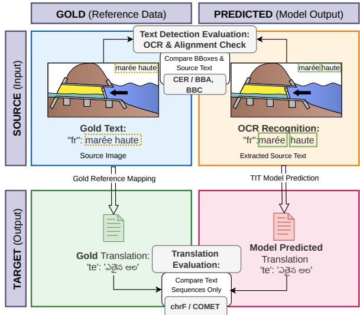
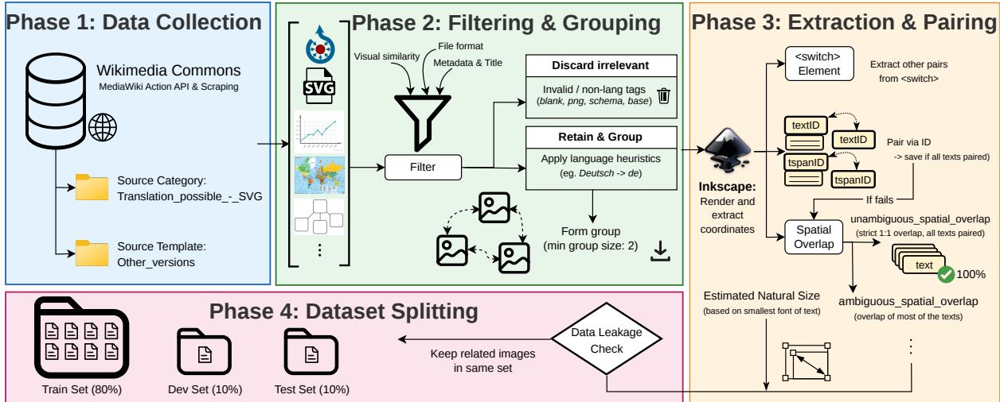
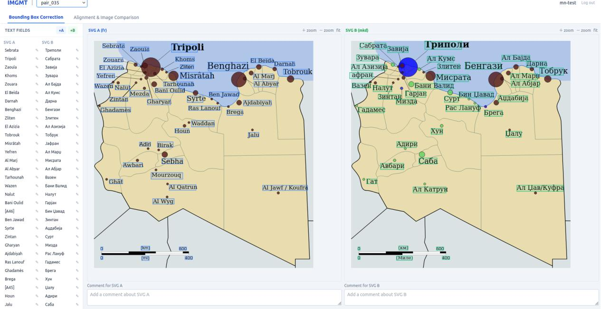

# IMGMT: Wikipedia-based Dataset For Evaluating Text-in-Image Translation

Šárka Uramová, Petar Kirilov Petrov, Josef Jon, Ondřej Bojar and Michal Novák

Charles University

Faculty of Mathematics and Physics

Prague, Czech Republic

{sarka.uramova458, petar.petrov242}@student.cuni.cz {jon, bojar, mnovak}@ufal.mff.cuni.cz

## Abstract

Text-in-image translation aims to translate all textual content embedded in an image. In Text Image Translation (TIT), the output is translated text; In-Image Machine Translation (IIMT) additionally renders the translation back into the image. We introduce IMGMT, a massively multilingual dataset and benchmark mined from localized SVG illustrations on Wikimedia Commons, focusing on diagrams, maps, and infographics. IMGMT contains 35,612 aligned image pairs grouped into 1,855 image sets, spanning 129 languages, 20+ writing systems, and 4,886 language pairs.

We propose a multi-level evaluation protocol that measures source-side text-region detection and OCR accuracy alongside target-side translation quality. We benchmark several multimodal large language models and a dedicated TIT system in English→X and X→English settings, and find that the source language and writing system substantially affect TIT quality. Finally, we show that IMGMT is not well suited for isolating the contribution of visual information in multimodal translation.

## 1 Introduction

Modern multimodal models can translate from text, images, or both. A family of text-in-image translation tasks takes an image as input and aims to translate all textual elements appearing within it. This setting includes Text Image Translation (TIT), which outputs translated text (optionally with bounding boxes), and In-Image Machine Translation (IIMT), which further renders the translated text back into the image. By contrast, in Multimodal Machine Translation (MMT), the source is text and the image is used only as auxiliary context.

Several datasets for text-in-image translation already exist (Ma et al., 2022; Lan et al., 2023; Qian et al., 2024; Lyu et al., 2025; Vaidya et al., 2025; Wu et al., 2026), but they share a key limitation:

<table><tr><td>129 unique languages</td><td></td><td>35,612 image pairs</td><td>3 Diverse scripts 你 from around the world</td></tr><tr><td></td><td>Writing System</td><td>Languages</td><td>Example Languages</td></tr><tr><td>Aa</td><td>Latin</td><td></td><td>67 en, fr, de, cS, it</td></tr><tr><td>K</td><td>Cyrillic</td><td></td><td>18 ru, uk, mk, bg, sr</td></tr><tr><td></td><td>Arabic</td><td>9</td><td>ar, fa, ur, ku, ps</td></tr><tr><td>3T</td><td>Devanagari</td><td>6</td><td>hi, mr, ne, dty</td></tr><tr><td>弟</td><td>Chinese (Hanzi)</td><td>6</td><td>zh, yue, wuu, zh_tw</td></tr><tr><td>D</td><td>Dravidian III</td><td>5</td><td>te, ml, ta, kn</td></tr><tr><td>可</td><td>Bengali-Assamese _</td><td>2</td><td>bn, as</td></tr><tr><td>M</td><td>Gurmukhi</td><td>2</td><td>pa, pa_guru</td></tr><tr><td>Ω</td><td>Other Regional Scripts</td><td>14</td><td>el, ko, ja, hy</td></tr></table>

Figure 1: IMGMT languages across different scripts.

limited language coverage. Even the most multilingual resources typically include only 14–16 languages (Li et al., 2025, 2026). Consequently, existing benchmarks do not sufficiently stress-test systems' multilingual capabilities, either in translating across a wide range of languages or in recognizing text written in diverse scripts.

Wikipedia has served as a rich source of multilingual supervision for multimodal tasks (e.g., Srinivasan et al., 2021). For vision-language tasks, a particularly appealing property is that many Wikipedia illustrations are localized: the same visual is available with labels translated into dozens of languages. Since these illustrations are often stored as SVGs, where text is encoded separately from the graphical elements, they can be mined to create aligned multilingual resources for text-in-image translation.

In this paper, we introduce IMGMT, a dataset and evaluation framework for assessing methods for text-in-image translation. IMGMT contains 35,612 aligned image pairs grouped into 1,855 sets of visually distinct SVG images extracted from Wikimedia Commons. The embedded text spans

  
Figure 2: Text Image Translation evaluation diagram.

129 languages, covering more than 20 writing systems (as illustrated in Figure 1), and yields 4,886 distinct language pairs.

IMGMT targets diagrams, maps, and infographics—content typically created as vector graphics. In contrast to scene text translation (Lan et al., 2023; Qian et al., 2024; Vaidya et al., 2025), where robustness to distorted or occluded text is often the primary challenge, our setting is dominated by translation-specific difficulties. Unlike document image translation (Liang et al., 2024), where translated passages can be substantially longer, the text snippets in IMGMT are often short and information-dense, and they frequently include specialized terminology and named entities from scientific and educational domains.

Along with the dataset, we release an evaluation framework. As shown in Figure 2, it evaluates system outputs on both the source and target sides: on the source side, it measures text-region detection and OCR accuracy; on the target side, it scores translations using standard MT metrics.

To demonstrate our evaluation framework in practice, we use it to benchmark multiple TIT systems, most of which are general-purpose vision– language models (VLMs).1 We evaluate their ability to translate from English into a wide range of target languages. In addition, we benchmark one system on translation into English to study how different source-side writing systems affect performance.

Beyond evaluating TIT systems, we ask whether IMGMT is also useful for evaluating multimodal machine translation, specifically for quantifying the contribution of the visual modality to translation quality. In many infographics, the extracted text is sufficiently self-contained to translate correctly on its own, especially when the system is given all text at once. Therefore, any improvement from providing the image may reflect either genuine visual grounding (e.g. resolving polysemy, units, or abbreviations using surrounding graphics) or incidental cues such as layout and line segmentation. To tease these factors apart, we compare translations produced with (i) the full source image, (ii) a text-only rendering that preserves layout while removing graphical content, and (iii) plain text input without any image.

The IMGMT dataset and evaluation framework are publicly available.2 We also provide a development repository³ with supplementary scripts and intermediate artifacts produced during this work.

The remainder of the paper is organized as follows. We first situate IMGMT in the context of related work (Section 2). We then introduce the dataset (Section 3) and describe our evaluation protocol (Section 4). Next, we detail our experimental setup and how we use IMGMT to benchmark TIT approaches (Section 5), followed by the benchmarking results (Section 6). Finally, we conclude in Section 7.

## 2 Related Work

## 2.1 Datasets for text-in-image translation

Existing datasets for TIT and IIMT vary widely in realism (synthetic vs. authentic), supervision (textonly vs. image-to-image), and domain. Synthetic resources such as E2E\_TIT\_With\_MT (Ma et al., 2022), the Multilingual IIMT dataset (Lan et al., 2024), IIMT30k (Tian et al., 2025), and VT-Syn (Vaidya et al., 2025) scale by rendering parallel text onto background images, producing large corpora with controllable variation; their synthetic nature makes it straightforward to provide both sourceand target-language texts and images.

Authentic datasets instead curate real images with natural typography and visual clutter, typically relying on OCR and MT during construction. They often omit target-language images, which limits their direct applicability to IIMT and prevents evaluation in the reverse translation direction. OCRMT30K (Lan et al., 2023), MTIT6 (Qian et al. 2024), and VT-Real (Vaidya et al., 2025) collect human-translated scene text from multiple OCR datasets, with OCRMT30K and MTIT6 additionally providing bounding boxes. Although MTIT6 does not include target images, it supports IIMT evaluation by applying OCR to system-generated target images to recover the translated text.

ECOIT (Zhu et al., 2023) and MIT-10M (Li et al. 2025) target e-commerce imagery crawled from the web, pairing OCR-extracted text with MT; ECOIT uses human post-editing, while MIT-10M applies a secondary MT system and embedding-based semantic similarity to filter likely translation errors. Following a similar pipeline, IMTBench/IMT-1M (Lyu et al., 2025) and MMTIT-Bench (Li et al., 2026) combine scene images, web-crawled images, and document images. DoTA (Liang et al., 2024) focuses on document-page translation, using images of scientific-paper pages and providing outputs in Markdown.

Vectra-Bench (Wu et al., 2026) is one of the few benchmarks with authentic source images that also provides target-language images (generated by vision–language models), enabling direct IIMT evaluation; it further emphasizes evaluation beyond text accuracy, including multilingual generalization and visual quality.

Most existing datasets cover only a small set of languages, with the broadest coverage (14–16 languages) reported by Li et al. (2025, 2026). In addition, because target-side images are often missing, these datasets are generally unsuitable for reversedirection translation.

IMGMT differs from prior datasets along three axes. First, it targets vector-graphic diagrams, maps, and infographics rather than natural scene photos, e-commerce images, or document pages, shifting the challenge toward translating short, information-dense labels with specialized terminology and named entities. Second, it is built from Wikipedia SVG variants that preserve the underlying visual content while changing only the text, yielding aligned multilingual image pairs with consistent layouts and text positions, and directly supporting IIMT. Third, it substantially expands multilingual breadth: IMGMT spans 129 languages and over 20 writing systems, enabling evaluation across

4,886 language pairs in both directions and stresstesting multilingual and multi-script text-in-image translation beyond the coverage of prior benchmarks.

## 2.2 Effect of Image in Multimodal Translation

The question of whether visual context improves translation quality has been studied extensively in the general MMT literature, most prominently in the context of the Multi30K dataset (Elliott et al., 2016) and the associated WMT Multimodal Translation shared tasks (Parida et al., 2024). CoMMuTE (Futeral et al., 2023) is an evaluation dataset for resolving textual ambiguity with visual context: 155 ambiguous English sentences, each paired with two images and two meaning-specific translations into French, German, and Czech by native speakers, with images sourced from Google Images or the authors.

Early architectures such as multi-encoder, double-attention or gated fusion models reported only marginal improvements from incorporating image features over strong text-only baselines, and subsequent adversarial evaluations (Elliott, 2018) showed that many multimodal systems are largely insensitive to the visual input, achieving similar scores even when paired with unrelated or shuffled images. Caglayan et al. (2019) revisited this question and found that visual grounding becomes useful mainly when the textual signal is degraded or ambiguous, rather than in standard, fully legible text conditions. More recently, Wu et al. (2021) argued that much of the previously reported benefit of visual context in prior work stemmed from erroneous evaluation protocols rather than from genuine multimodal grounding.

Recent work with large vision-language models suggests that visual context is useful mainly when it resolves information that is missing or ambiguous in the text. DeDiT (Liu et al., 2025), for example first detects textual ambiguity and then, optionally, uses the visual modality. Similarly, Yu et al. (2025) argue for adaptive fusion because images can help with ambiguity but may also introduce redundant or noisy information. Most recently, Guerra and Khrapunova (2026) show that the benefits of visual context are strongly task-dependent: relevant images help on CoMMuTE, but gains do not transfer consistently to other domains, including technical documentation with accompanying figures.

This distinction is especially relevant for diagrams, maps, and infographics. Visual structure may be important for locating text, recovering reading order, or linking labels to graphical elements, but once the text is correctly extracted and semantically self-contained, the surrounding image may add little to the translation itself. We therefore expect visual context to matter mainly for ambiguous labels, abbreviations, or domain-specific terms whose meaning depends on the graphic, while having little effect on ordinary text. Section 6 tests this hypothesis directly.

## 3 Dataset

The primary source of data for this project is Wikimedia Commons,4 a repository of freely usable images and other multimedia content related to Wikipedia topics. Our objective was to create a multilingual dataset consisting of image pairs that differ only in their textual content, where texts at identical positions represent mutual translations.

At the top level, the dataset is split into the directories train, dev and test. Within each split, files are organized into numbered folders representing image groups. Each group directory corresponds to one Wikimedia image with all its variants.5 It contains SVG source files, their PNG exports, and alignment annotations stored in JSON format. Each JSON file represents a directed translation pair between a source and a target language,6 specifying image metadata, bounding box coordinates and aligned texts. For detailed overview of the repository directory and JSON schema, see Appendix A.

## 3.1 Basic Statistics

The dataset contains 35,612 aligned image pairs across 1,855 image groups (i.e., visually distinct images), comprising 235,637 text strings in total. The number of language variants per group ranges from 2 to 77, with an average of 4.95 variants per group.

Overall the dataset includes 129 unique languages in over 20 writing systems (such as Latin, Cyrillic, Arabic, Devanagari, etc.; see more in Figure 1). Of 8,256 possible language pairs,7 the dataset includes 4,886 that can be used in both translation directions.

Theoretical vs. actual image pairs During the initial crawling (see Section 3.2), we collected raw URLs for all available image language variants in each group. Theoretically, taking any language as the source and any language as the target, this could lead up to 118k image pairs. However, webscraped SVG files are often noisy or unsuitable for our purpose. After applying our pipeline, the final dataset contains 35k pairs (about 30% of the theoretical maximum). The drop is intentional: many pairs could not be created because of issues in the SVG files, such as (1) invalid SVGs or SVGs with zero height or width, (2) font rendering errors, (3) failing the spatial overlap check, and (4) text saved as paths (<path>) instead of text elements (<text>) – unlike normal text elements, outlined paths do not store characters or words; they are saved only as drawing curves (shapes). While we could use OCR to read these shapes, we decided not to do so to avoid introducing recognition errors into the gold ground-truth data.

Language distribution The dataset contains a wide variety of languages, but they are not evenly distributed. The most common languages are English (appearing in 5k image pairs across the entire dataset), Spanish (with 3.5k image pairs) and French (appearing in 3.3k pairs). In contrast, some languages are very rare, for example, Northern Sami language and Venetian language appear in only 4 pairs within the whole dataset. The complete distribution is detailed in Appendix B.

The test split is similar: 3,575 image pairs in total and 548 of them (15%) involve English. This allows us to reliably test translations to and from English while still keeping other diverse languages in the test set.

String type distribution. Because IMGMT consists primarily of diagrams, maps, and infographics, we expect most extracted strings to be short and rarely to form full sentences. Across all 235,637 strings, the average length is 9.29 characters. To characterize the strings more deeply, we performed a multilingual analysis using an ensemble of three LLMs (Gemma 4, GPT-OSS-120B, Qwen3.8-27b). The models agreed on a label for 210,644 strings (89.4%; see Table 1), while the remaining 24,993 strings had no unanimous label. Across the full set of strings, about 60% are proper names, about 33–38% are common noun phrases, and 1–3% are statements without a finite verb; well-formed sentences account for only about 0.5%. Overall, this distribution indicates that IMGMT is dominated by short, label-like text, with a high share of proper names rather than sentence-level discourse.

  
Figure 3: Pipeline overview for generating the multilingual IMGMT dataset

<table><tr><td>Category</td><td>Count</td><td>Share</td></tr><tr><td>Proper name</td><td>126,835</td><td>60.2%</td></tr><tr><td>Common noun phrase</td><td>79,175</td><td>37.6%</td></tr><tr><td>Statement without finite verb</td><td>1,964</td><td>0.9%</td></tr><tr><td>List of common noun phrases</td><td>1,003</td><td>0.5%</td></tr><tr><td>Single clause</td><td>943</td><td>0.4%</td></tr><tr><td>List of proper names</td><td>493</td><td>0.2%</td></tr><tr><td>List mixing common and proper</td><td>127</td><td>0.1%</td></tr><tr><td>Multiple clauses</td><td>78</td><td>0.0%</td></tr><tr><td>List of statements without finite verb</td><td>26</td><td>0.0%</td></tr><tr><td>Consensus total</td><td>210,644</td><td>100.0%</td></tr><tr><td>No consensus (disagreed labels)</td><td>24,993</td><td></td></tr><tr><td>All strings</td><td>235,637</td><td></td></tr></table>

Table 1: Distribution of string types (LLM-based categorization). Shares are computed over the consensus subset.

## 3.2 Processing Pipeline

As shown in Figure 3, the pipeline consists of the four following steps: (1) data collection, (2) filtering and grouping, (3) extraction and pairing and (4) dataset splitting.

Data collection In this stage, raw multimodal data is sourced from Wikimedia Commons. We primarily crawl files from the category Translation\_possible\_-\_SVG,8 which is a rich source of multilingual diagrams, maps, graphs etc. Additionally, we extract explicitly linked language variants by parsing the Other versions templates often found on file description pages. This combined approach allows us to get a large initial pool of potential image translations.

Filtering and grouping The crawled data goes through a filtering process. Non-SVG formats or SVG files which cannot be parsed and images that render with zero width or height are immediately discarded. Then we parse the file descriptions to extract valid language codes using a custom heuristic mapped to ISO language codes. While images from the Translation\_possible\_-\_SVG category often label their variants by language, this is not always the case (some labels describe file types or visual changes rather than languages). Next, to accurately group the translated variants, we evaluate visual similarity across the images. Candidate files found within the same translation table on the image Wikimedia page are grouped together only if their visual layout is similar, evaluated using the Structural Similarity Index Measure (SSIM) (Wang et al., 2004). If a visually consistent cluster contains two or more valid language variants, we keep it as a separate group.

Extraction and pairing To accurately extract textual elements and their spatial coordinates, we utilize Inkscape (Inkscape Project, 2023) which renders the SVGs to provide precise absolute bounding boxes. The extracted text elements are then paired across languages using three prioritized strategies. First, if the SVG file contains <swi tch> elements, texts are paired purely based on predefined systemLanguage tags (the svg\_switch method). Second, if standard switches are absent, the pipeline attempts to align texts using structural identifiers (eg. tspanID or textID; the svg\_id\_match strategy). However, as internal IDs are frequently mismatched, missing or incomplete across translated images, we mostly rely on the third method: spatial overlap, which pairs text elements based on their intersection over union (IoU score). The image pairs are then categorized as unambiguous (strict 1:1 match between the boxes with zero unmapped ones; denoted unamb\_spatial\_overlap) and ambiguous mapping (the rest; labeled amb\_spatial\_overlap). Table 2 reports detailed statistics on the number of image pairs obtained by each alignment method in the cascade. Finally, the image dimensions and corresponding bounding boxes are normalized: we identify the minimum font size within an image group and proportionally scale the image dimensions and spatial coordinates by a calculated ratio, ensuring that the smallest text remains clearly legible.

<table><tr><td>Alignment Method</td><td>Train</td><td>Dev</td><td>Test</td></tr><tr><td>1. svg_switch</td><td>6,514</td><td>238</td><td>328</td></tr><tr><td>2. svg_id_match</td><td>366</td><td>41</td><td>28</td></tr><tr><td>3. unamb_spatial_overlap</td><td>8,842</td><td>1,223</td><td>1,065</td></tr><tr><td>4. amb_spatial_overlap</td><td>12,771</td><td>2,042</td><td>2,154 118,000</td></tr><tr><td colspan="4">Theoretically achievable image pairs Total JSON metadata files</td></tr></table>

Table 2: Success of text alignment methods across dataset splits. The methods are carried out in the specified order and an image pair is counted with the method which succeeds first.

Dataset splitting In the final stage, the processed data is distributed into train, dev and test sets using an 80:10:10 ratio.9 Importantly, this stage implements a data leakage prevention mechanism. Image groups that share identical visual content but differ slightly in layout or metadata — such as a standard historical map versus a visually impaired version, which might have been initially parsed as a separate groups — are identified and put into the same dataset split. This constraint guarantees that no language variant or minor visual modification of a specific image seen during training can appear in the development or test sets. The splitting algorithm also balances the distribution of the three alignment methods across all sets, as detailed in Table 2. However, to strictly prevent cross-split visual leakage, we did not enforce explicit balancing of individual languages or writing systems across the sets.

Producing the PNG images To convert the processed SVG files into raster PNG images, we use Inkscape via command-line interface. To maintain identical resolution and scale across all language variants within a single group, the target export height is extracted from the alignment JSON metadata (which was pre-calculated based on the smallest font size, as described above) and passed to Inkscape using the -export-height flag.

## 3.3 Manual Evaluation of the Dataset Collection Method

The dataset construction pipeline comprises multiple stages, each of which can introduce errors. For example, paired images can diverge beyond acceptable text differences, some text may be missed when it is encoded as vector paths rather than text objects, and our position-based heuristics can fail. To quantify the impact of these issues, we compare the automatically collected dataset against manual annotations.

We randomly sample 100 image pairs from the test set and annotate them using a purpose-built tool implemented for this study (a screenshot is shown in Appendix C).10 First, annotators judge whether the images in the pair are identical (still regardless the texts). They may decide to skip an example if they consider the images too different. Second, annotators manually correct the bounding boxes and their cross-image correspondences. All bounding-box edits are permitted (addition, deletion, and resizing). Annotators do not edit the text content associated with each box, as this is often impractical, particularly when the text uses an unfamiliar script. Finally, the annotators correct the cross-lingual correspondences. These are required to be one-to-one, which may require splitting or merging bounding boxes. In addition to visual cues, annotators can use automatic English translations of the extracted text fields provided by the annotation tool. Two annotators split the batch evenly, each correcting half of the pairs.

<table><tr><td rowspan="2">Bounding boxes</td><td colspan="3">Count</td><td colspan="3">Area</td></tr><tr><td>P</td><td>R</td><td>F1</td><td>P</td><td>R</td><td>F1</td></tr><tr><td>All boxes</td><td>96.2%</td><td>90.6%</td><td>91.5%</td><td>94.9%</td><td>86.8%</td><td>89.0%</td></tr><tr><td>Matched boxes</td><td>96.2%</td><td>90.2%</td><td>91.3%</td><td>94.9%</td><td>86.6%</td><td>88.9%</td></tr><tr><td>Correctly matched</td><td>92.7%</td><td>86.9%</td><td>88.3%</td><td>91.6%</td><td>83.3%</td><td>86.0%</td></tr></table>

Table 3: Manual evaluation of dataset quality. Rows correspond to (i) all detected text-field boxes (All boxes), (ii) boxes for which a one-to-one cross-image correspondence exists (Matched boxes), and (iii) boxes whose correspondence is the correct cross-lingual match (Correctly matched). Columns report precision/recall/F1 for box count (BBC) and area overlap (BBA).

In 13% cases the paired images were too different for text-in-image translation evaluation. In 16% cases the images were identical except for minor graphical differences. These images are usable for IIMT with a grain of salt but they are perfectly suitable for TIT evaluation. The remaining pairs of images were visually completely identical.

We measure bounding-box localization accuracy with two precision/recall metrics that quantify alignment between the manually annotated boxes and those in the original data. Bounding Box Count (BBC) measures agreement in the number of boxes, while Bounding Box Area (BBA) measures agreement by the area of overlap between boxes.

Table 3 reports bounding-box quality for all boxes (text-field detection), matched boxes (a oneto-one match exists across the pair), and correctly matched boxes (the match is the correct crosslingual correspondence).

After all steps, BBA precision remains above 91%, while recall is around 83%; most of the gap is due to text-field detection. BBC exhibits similar performance. Although this recall drop should not affect comparing multiple systems on the same dataset, it should be considered when interpreting the absolute results.

## 4 Evaluation Method

In our work, we focus on evaluating Text-in-Image Translation (TIT). As shown in Figure 2, our evaluation system compares gold reference data with model predictions (machine output).

Text detection and OCR evaluation The first phase evaluates the model's ability to accurately detect and read text from the source image. We compare the extracted predicted text with the source gold text using the Character Error Rate (CER).

If predicted bounding boxes are available - which may not be the case for models that only output raw text – we use them to pair the predicted texts with the reference texts. At the same time, we evaluate the bounding boxes localization accuracy by two metrics already introduced in Section 3.3: (1) BBA (Bounding Box Area), which measures spatial overlap by calculating the harmonic mean of area-based precision and recall across intersecting bounding boxes, and (2) BBC (Bounding Box Count), which measures discrete block-level retrieval based on paired True Positives. If not stated otherwise, we mean the F1 score by referring to these measures.

To handle cases where an OCR model splits a single line or paragraph into multiple smaller boxes, we use a text merging mechanism. If several predicted boxes overlap with the same reference box, we sort their text horizontally from left to right and join it into one string. We also merge their coordinates into a single bounding box before calculating the CER and BBA metrics.

Translation evaluation The second phase measures the quality of translated text. We evaluate the output using a traditional lexical metric chrF (Popović, 2015) and an advanced semantic metric COMET, specifically the wmt22-comet-da model (Rei et al., 2022).

Text-based alignment In scenarios where the prediction does not provide bounding box coordinates, the system aligns text blocks using the Hungarian algorithm for matching in bipartite graphs. Alignment is driven by a composite cost matrix combining text dissimilarity with a spatial reading-order penalty. Dissimilarity is calculated using CER for OCR or inverted quality score (one minus the metric score) for translation evaluation via chrF or COMET, with low-quality candidate pairs filtered out by task-specific thresholds. To maintain spatial consistency, we add a position penalty calculated as the absolute difference between the relative positions of predicted and reference texts, assuming a top-to-bottom left-to-right reading order. The algorithm then selects one-to-one pairs that minimize the total cost and rejects any pairs that exceed the threshold.

## 5 Experimental Setup

To demonstrate the practical utility of the proposed framework, we evaluate several multimodal systems on both the TIT and MMT tasks. All experiments are conducted on the dataset's test split. For TIT, we use the PNG versions of the images at their native resolution as the input, without any additional preprocessing or visual transformations.

Evaluation of TIT systems The first experiment evaluates the performance of several multimodal large language models (MLLMs) and one dedicated pipelined system on the TIT task with English as the source language.

The evaluated MLLMs are Qwen3.5 (MoE of 122B parameters, 10B active), Claude Haiku 4.5, Kimi K3 (MoE of 2.8T parameters, 104B active), and GPT-5.6 Luna. To ensure a fair comparison, all models are evaluated using the same zero-shot prompt. The prompt instructs the model to detect all text present in the bitmap image, estimate the corresponding source text bounding boxes, transcribe the detected text, and translate it into the target language. The expected output consists of a structured representation containing the predicted source text bounding boxes, the recognized source texts, and the translated target texts.

We also evaluate AnyTrans (Qian et al., 2024), a pipelined IIMT system that we slightly adapt to our benchmark. While AnyTrans can render translations back into the image, we do not use this capability in our TIT experiments. Given an input image and the source and target languages, the system performs translation in three stages. First, an OCR engine detects and recognizes the text in the image, producing transcriptions together with their bounding boxes. Our adaptation supports multiple OCR backends; in the experiments reported here, we use PaddleOCR (Cui et al., 2025) only. The recognized text is then passed to a large language model for translation; we use DeepSeek-V4-Flash-Thinking. Finally, in the rendering stage (not used in our TIT setup), the original text regions are removed and replaced with the translated text using the detected bounding boxes.

In these experiments, an image is scored only when the model returns a well-formed output that matches the required structured format. If the model fails to produce a valid result, that image is skipped and excluded from all metrics. Reported scores therefore reflect performance on the subset of English-source test images with valid model outputs, not on the full test set.

Effect of source script on TIT performance The second experiment aims to test the influence of writing systems on TIT performance. It evaluates GPT-5.6 Luna on language pairs with English as the target language, allowing for comparison of translation quality across different source scripts. GPT-5.6 Luna is selected for this experiment because it combines relatively strong overall performance with a low rate of invalid outputs as demonstrated in the previous experiment, resulting in a more complete and reliable evaluation across the diverse set of source languages. Results are reported separately for each script group using the same OCR and translation metrics.

Effects of visual modality on translation quality To isolate the contribution of visual context in our MMT analysis (beyond translating the extracted text alone) we compare three input conditions on the English-source test set. Because this experiment targets MMT, we evaluate only the four MLLMs and exclude AnyTrans. The extracted source text—pulled directly from the SVGs (i.e., without OCR)—is held constant across conditions: (1) Image, where the fully rendered source image is provided alongside the text input; (2) Text-only image, where we render the same image after removing all non-text graphical elements (e.g., backgrounds, icons, shapes) and retaining only the black text layer, preserving line breaks and spatial layout but discarding graphical content (see Section 3.2); and (3) No image, where the model receives only the extracted source text segments with no visual input.

## 6 Experiments and Results

TIT from English Table 4 reports end-to-end TIT scores for all evaluated systems, covering translation quality, OCR accuracy, and bounding-box localization. Kimi K3 performs best overall, achieving the highest chrF (61.3) and COMET (0.834). GPT-5.6 Luna attains slightly higher localization scores (BBA and BBC) while delivering comparable translation quality. Claude Haiku 4.5 lags behind on all metrics, with a CER of 0.822 and markedly lower translation and localization scores.

Qwen3.5 shows worse OCR quality and text localization, but almost the same translation quality. This suggests that end-to-end translation quality is not determined solely by exact source-side transcription and bounding-box prediction. Nevertheless, the large performance gap of Claude Haiku 4.5 across both source- and target-side metrics indicates that errors in text detection and recognition can become a major bottleneck when sufficiently severe. This is further evidenced by results on the gold source texts extracted from the SVGs in Table 6 – Claude has a similar translation performance to the other three models in that setting.

<table><tr><td>Model</td><td>chrF</td><td>COMET</td><td>CER</td><td>BBA</td><td>BBC</td></tr><tr><td>Qwen3.5</td><td>59.86</td><td>0.827</td><td>0.313</td><td>0.453</td><td>0.746</td></tr><tr><td>Kimi K3</td><td>61.30</td><td>0.834</td><td>0.174</td><td>0.620</td><td>0.829</td></tr><tr><td>GPT-5.6 Luna</td><td>59.72</td><td>0.826</td><td>0.224</td><td>0.655</td><td>0.838</td></tr><tr><td>Claude Haiku 4.5</td><td>39.78</td><td>0.681</td><td>0.822</td><td>0.203</td><td>0.542</td></tr><tr><td>AnyTrans</td><td>57.50</td><td>0.803</td><td>0.161</td><td>0.620</td><td>0.813</td></tr></table>

Table 4: Translation and OCR performance of multimodal LLMs on English-source language pairs.
<table><tr><td>Source Script</td><td>N</td><td>CER (∆)</td><td>BBA (∆)</td><td>BBC (∆)</td><td>chrF (∆)</td><td>COMET (∆)</td></tr><tr><td>Latin</td><td>255</td><td>-0.106</td><td>+0.028</td><td>+0.011</td><td>+7.38</td><td>+0.035</td></tr><tr><td>Dravidian</td><td>49</td><td>+0.359</td><td>-0.076</td><td>+0.005</td><td>-26.07</td><td>-0.129</td></tr><tr><td>Cyrillic</td><td>48</td><td>+0.094</td><td>+0.015</td><td>+0.002</td><td>+8.90</td><td>+0.073</td></tr><tr><td>Devanagari</td><td>25</td><td>-0.002</td><td>-0.006</td><td>+0.027</td><td>-3.12</td><td>-0.001</td></tr><tr><td>Bengali-Assamese</td><td>22</td><td>-0.025</td><td>-0.035</td><td>-0.068</td><td>-15.80</td><td>-0.098</td></tr><tr><td>Arabic</td><td>13</td><td>-0.129</td><td>-0.253</td><td>-0.229</td><td>-21.78</td><td>-0.132</td></tr><tr><td>Gurmukhi</td><td>11</td><td>+0.178</td><td>+0.032</td><td>+0.084</td><td>-16.21</td><td>-0.110</td></tr><tr><td>Gujarati</td><td>9</td><td>+0.174</td><td>-0.024</td><td>+0.062</td><td>-10.04</td><td>-0.070</td></tr><tr><td>Chinese</td><td>7</td><td>-0.003</td><td>+0.052</td><td>+0.075</td><td>+9.44</td><td>+0.032</td></tr><tr><td>Ol Chiki</td><td>5</td><td>+1.001</td><td>+0.055</td><td>+0.153</td><td>-49.50</td><td>-0.225</td></tr><tr><td>Georgian</td><td>5</td><td>+0.079</td><td>+0.187</td><td>+0.140</td><td>+9.68</td><td>+0.087</td></tr><tr><td>Japanese</td><td>3</td><td>-0.255</td><td>+0.099</td><td>-0.033</td><td>+19.37</td><td>+0.104</td></tr><tr><td>Korean</td><td>3</td><td>-0.232</td><td>-0.098</td><td>-0.012</td><td>+31.58</td><td>+0.197</td></tr><tr><td>Hebrew</td><td>3</td><td>-0.124</td><td>-0.205</td><td>-0.298</td><td>+21.12</td><td>+0.156</td></tr><tr><td>Burmese</td><td>2</td><td></td><td>-0.590</td><td>-0.774</td><td>-57.71</td><td>-0.754</td></tr><tr><td>Thai</td><td>1</td><td>+0.165</td><td>+0.144</td><td>+0.226</td><td>-0.36</td><td>-0.028</td></tr><tr><td>Armenian</td><td>1</td><td>+0.154</td><td>-0.050</td><td>-0.679</td><td>-24.18</td><td>+0.130</td></tr><tr><td>Overall</td><td>462</td><td>0.255</td><td>0.590</td><td>0.774</td><td>57.71</td><td>0.754</td></tr></table>

Table 5: Overall absolute scores, with per-script deltas shown in parentheses (row minus overall). Green indicates improvement (for CER: lower is better), red indicates degradation.

The AnyTrans pipeline achieves the lowest CER (0.161) and competitive localization. Its translation quality is slightly lower than Kimi K3, Qwen3.5, and GPT-5.6 Luna, though it remains well above Claude Haiku 4.5.

Effect of source script We next examine GPT-5.6 Luna on language pairs with English as the target language, grouped by the source writing system. Table 5 reports per-script deltas relative to the overall mean. Latin (the largest group) improves over the mean across all metrics. Cyrillic shows consistent gains in translation quality despite slightly worse OCR. Cyrillic and Latin patterns are also observed for Georgian and Chinese, respectively, albeit with much smaller N.

In contrast, Dravidian and Bengali-Assamese degrade across most metrics, indicating that these scripts remain challenging for both transcription and translation. Arabic further illustrates that the metrics do not necessarily move together: it exhibits better CER but worse localization and downstream translation, so accurate transcription alone is not sufficient. Overall, OCR accuracy, localization accuracy, and translation quality are only weakly coupled across scripts; results for very small groups should be interpreted cautiously.

<table><tr><td>Model</td><td>Image</td><td>No image</td><td>Text-only image</td></tr><tr><td>Claude Haiku 4.5</td><td>57.94</td><td>58.04</td><td>57.60</td></tr><tr><td>GPT-5.6 Luna</td><td>62.30</td><td>62.29</td><td>62.46</td></tr><tr><td>Kimi K3</td><td>62.95</td><td>62.76</td><td>63.08</td></tr><tr><td>Qwen3.5</td><td>57.43</td><td>60.18*</td><td>57.84</td></tr></table>

Table 6: chrF scores on the test split, computed with unaligned (line-order) matching, with paired bootstrap significance testing against the baseline condition. \* means significant at α = 0.05. All of the conditions use the gold, extracted texts from the SVGs, Image additionally uses the source image, Text-only image additionally uses only the text layer of the input image, and No image translates the extracted text without ever seeing the image.

Effects of visual modality on translation quality Table 6 reports chrF scores under three input conditions: Image (full image), Text-only image (text layer only), and No image. As apparent from the table, differences across conditions are small. Overall, providing the image does not materially change performance: either the extracted texts are already unambiguous, or these models are not reliably using the visual signal for disambiguation.

If we nevertheless treat the small differences as meaningful, the Image condition is never best for any of the four models and is worst (or tied-worst) for Claude Haiku 4.5, Kimi K3, and Qwen3.5. The strongest condition depends on the model: No image is best for Claude Haiku 4.5 and Qwen3.5, while Text-only image is best for GPT-5.6 Luna and Kimi K3.

For Claude Haiku 4.5, GPT-5.6 Luna, and Kimi K3, the spread between the best and worst condition is at most 0.49 chrF, plausibly within run-torun noise.

Overall, these results run counter to our hypothesis in Section 2.2: conditioning on the source image is neutral-to-harmful for chrF across all four models. This may reflect competition for attention/- context budget or OCR/reading errors from visual clutter; since infographic text is typically unambiguous, images offer little disambiguation benefit. We conclude that adding the source image is not a reliable way to improve translation quality on this benchmark.

## 7 Conclusion

In this paper, we introduced IMGMT, a massively multilingual dataset for evaluating text-in-image translation (image-only inputs), such as Text Image Translation (text-only output). We also proposed a multi-level evaluation protocol that combines complementary metrics at different granularities. We demonstrated the framework on several MLLMs and one dedicated system in both English→X and X→English settings, showing that the source language and writing system matter for TIT quality. Finally, we used IMGMT to probe the role of visual context in multimodal translation (text+image input). In our setup, adding the source image yields little benefit over text-only inputs and can even degrade performance, suggesting that IMGMT is not well suited for isolating the contribution of visual information in MMT.

Our experiments focused mainly on TIT; however, IMGMT can also be used to benchmark Inimage Machine Translation (image-only output), which we leave for future work.

## Limitations

Data and evaluation. The dataset is derived from Wikimedia Commons SVGs, which introduces limitations for both data quality and evaluation. First, the annotations do not capture all text present in the source images. To reduce noise, we extract only text represented as SVG text spans and do not apply OCR; as a result, text rendered as vector paths is missing. Moreover, we rely on Inkscape's spatial query tool, which requires text elements to have explicit id attributes; elements without an id (or embedded in complex paths/groups) cannot be queried for exact bounding boxes and are omitted to avoid alignment errors. These choices may bias evaluation (e.g., by overestimating recall). Second, the language-pair distribution is imbalanced: because the source images come from Wikimedia Commons, high-resource languages (e.g., English, Spanish, French, German, and Russian) dominate, while some low-resource or regional languages occur in fewer than 10 pairs. Finally, because IMGMT is built from publicly available Wikimedia data, there is a risk of data contamination: some tested MLLMs may have encountered parts of the benchmark during pre-training.

Experiments. Due to budget and computational constraints, we restricted our evaluation to translation directions that include English (English→X and X→English) in a zero-shot setting, and we evaluated only the test split. This means our results cover only a subset of the available benchmark pairs; the remaining roughly 30,000 pairs in the training and development splits were prepared primarily to enable future training or fine-tuning studies, but we did not evaluate all bidirectional pairs across the full dataset in this paper. In addition, while IMGMT is suitable for evaluating text-in-image translation approaches beyond TIT, including IIMT (image-only output), we did not benchmark the IIMT setup here.

## Acknowledgments

This work was supported by the project TQ01000458 (EdUKate) financed by the Technology Agency of the Czech Republic (www.tacr.cz) within the Sigma 3 Programme. It has been also partially supported by the grant TQ28000003 (NCUI, Národní centrum umělé inteligence), and the grants CZ.02.01.01/00/23\_020/0008518 (“Jazykověda, umělá inteligence a jazykové a řečové technologie: od výzkumu k aplikacím") and LM2023062 LINDAT/CLARIAH-CZ, both financed by the Ministry of Education, Youth and Sports of the Czech Republic.

We also thank the three anonymous reviewers for their helpful comments and suggestions.

## References

Ozan Caglayan, Pranava Madhyastha, Lucia Specia, and Loïc Barrault. 2019. Probing the need for visual context in multimodal machine translation. In Proceedings of the 2019 Conference of the North American Chapter of the Association for Computational Linguistics: Human Language Technologies, Volume 1 (Long and Short Papers), pages 4159–4170, Minneapolis, Minnesota. Association for Computational Linguistics.

Cheng Cui, Ting Sun, Manhui Lin, Tingquan Gao, Yubo Zhang, Jiaxuan Liu, Xueqing Wang, Zelun Zhang, Changda Zhou, Hongen Liu, Yue Zhang, Wenyu Lv, Kui Huang, Yichao Zhang, Jing Zhang, Jun Zhang, Yi Liu, Dianhai Yu, and Yanjun Ma. 2025. Paddleocr 3.0 technical report. Preprint, arXiv:2507.05595.

Desmond Elliott. 2018. Adversarial evaluation of multimodal machine translation. In Proceedings of the 2018 Conference on Empirical Methods in Natural Language Processing, pages 2974–2978, Brussels, Belgium. Association for Computational Linguistics.

Desmond Elliott, Stella Frank, Khalil Sima'an, and Lucia Specia. 2016. Multi30K: Multilingual English-

German image descriptions. In Proceedings of the 5th Workshop on Vision and Language, pages 70– 74, Berlin, Germany. Association for Computational Linguistics.

Matthieu Futeral, Cordelia Schmid, Ivan Laptev, Benoît Sagot, and Rachel Bawden. 2023. Tackling Ambiguity with Images: Improved Multimodal Machine Translation and Contrastive Evaluation. In Proceedings of the 61st Annual Meeting of the Association for Computational Linguistics (Volume 1: Long Papers), pages 5394–5413, Toronto, Canada. Association for Computational Linguistics.

Vera Senderowicz Guerra and Olesia Khrapunova. 2026. Is a picture worth a thousand words? exploration and implementation considerations for visual context in translation workflows. In Proceedings of the 26th Annual Conference of the European Association for Machine Translation (Volume 2), pages 91–103, Tilburg, The Netherlands. European Association for Machine Translation.

Inkscape Project. 2023. Inkscape. Version 1.3.2.

Zhibin Lan, Liqiang Niu, Fandong Meng, Jie Zhou, Min Zhang, and Jinsong Su. 2024. Translatotron-V(ison): An End-to-End Model for In-Image Machine Translation. In Findings of the Association for Computational Linguistics: ACL 2024, pages 5472–5485, Bangkok, Thailand. Association for Computational Linguistics.

Zhibin Lan, Jiawei Yu, Xiang Li, Wen Zhang, Jian Luan, Bin Wang, Degen Huang, and Jinsong Su. 2023. Exploring Better Text Image Translation with Multimodal Codebook. In Proceedings of the 61st Annual Meeting of the Association for Computational Linguistics (Volume 1: Long Papers), pages 3479–3491, Toronto, Canada. Association for Computational Linguistics.

Bo Li, Shaolin Zhu, and Lijie Wen. 2025. MIT-10M: A Large Scale Parallel Corpus of Multilingual Image Translation. In Proceedings of the 31st International Conference on Computational Linguistics, pages 5154–5167, Abu Dhabi, UAE. Association for Computational Linguistics.

Gengluo Li, Chengquan Zhang, Yupu Liang, Huawen Shen, Yaping Zhang, Pengyuan Lyu, Weinong Wang, Xingyu Wan, Gangyan Zeng, Han Hu, Can Ma, and Yu Zhou. 2026. MMTIT-bench: A multilingual and multi-scenario benchmark with cognition-perceptionreasoning guided text-image machine translation. In Proceedings of the IEEE/CVF Conference on Computer Vision and Pattern Recognition (CVPR), pages 16593–16602.

Yupu Liang, Yaping Zhang, Cong Ma, Zhiyang Zhang, Yang Zhao, Lu Xiang, Chengqing Zong, and Yu Zhou. 2024. Document Image Machine Translation with Dynamic Multi-pre-trained Models Assembling. In Proceedings of the 2024 Conference of the North American Chapter of the Association for Computational Linguistics: Human Language Technologies

(Volume 1: Long Papers), pages 7084–7095, Mexico City, Mexico. Association for Computational Linguistics.

Danyang Liu, Fanjie Kong, Xiaohang Sun, Dhruva Patil, Avijit Vajpayee, Zhu Liu, Vimal Bhat, and Najmeh Sadoughi. 2025. Detect, disambiguate, and translate: On-demand visual reasoning for multimodal machine translation with large vision-language models. In Proceedings of the 2025 Conference of the Nations of the Americas Chapter of the Association for Computational Linguistics: Human Language Technologies (Volume 1: Long Papers), pages 1559– 1570, Albuquerque, New Mexico. Association for Computational Linguistics.

Jiahao Lyu, Pei Fu, Zhenhang Li, Weichao Zeng, Jiahui Yang, Can Ma, Yu Zhou, Zhenbo Luo, and Jian Luan. 2025. Immersive Multimodal Translation: A Proxy Task for Cross-modal and Objective Evaluation of Unified Models.

Cong Ma, Yaping Zhang, Mei Tu, Xu Han, Linghui Wu, Yang Zhao, and Yu Zhou. 2022. Improving Endto-End Text Image Translation From the Auxiliary Text Translation Task. In 2022 26th International Conference on Pattern Recognition (ICPR), pages 1664–1670.

Shantipriya Parida, Ondřej Bojar, Idris Abdulmumin, Shamsuddeen Hassan Muhammad, and Ibrahim Said Ahmad. 2024. Findings of WMT2024 English-tolow resource multimodal translation task. In Proceedings of the Ninth Conference on Machine Translation, pages 677–683, Miami, Florida, USA. Association for Computational Linguistics.

Maja Popović. 2015. chrf: character n-gram f-score for automatic mt evaluation. In Proceedings of the tenth workshop on statistical machine translation, pages 392-395.

Zhipeng Qian, Pei Zhang, Baosong Yang, Kai Fan, Yiwei Ma, Derek F. Wong, Xiaoshuai Sun, and Rongrong Ji. 2024. AnyTrans: Translate AnyText in the Image with Large Scale Models. In Findings of the Association for Computational Linguistics: EMNLP 2024, pages 2432–2444, Miami, Florida, USA. Association for Computational Linguistics.

Ricardo Rei, José G. C. de Souza, Duarte Alves, Chrysoula Zerva, Ana C Farinha, Taisiya Glushkova, Alon Lavie, Luisa Coheur, and André F. T. Martins. 2022. COMET-22: Unbabel-IST 2022 submission for the metrics shared task. In Proceedings of the Seventh Conference on Machine Translation (WMT), pages 578–585, Abu Dhabi, United Arab Emirates (Hybrid). Association for Computational Linguistics.

Krishna Srinivasan, Karthik Raman, Jiecao Chen, Michael Bendersky, and Marc Najork. 2021. WIT: Wikipedia-based Image Text Dataset for Multimodal Multilingual Machine Learning. In Proceedings of the 44th International ACM SIGIR Conference on Research and Development in Information Retrieval

SIGIR '21, pages 2443–2449, New York, NY, USA. Association for Computing Machinery.

Yanzhi Tian, Zeming Liu, Zhengyang Liu, and Yuhang Guo. 2025. Exploring In-Image Machine Translation with Real-World Background. In Findings of the Association for Computational Linguistics: ACL 2025, pages 124–137, Vienna, Austria. Association for Computational Linguistics.

Shreyas Vaidya, Arvind Kumar Sharma, Prajwal Gatti, and Anand Mishra. 2025. Show Me the World in My Language: Establishing the First Baseline for Scene-Text to Scene-Text Translation. In Pattern Recognition, pages 312–328, Cham. Springer Nature Switzerland.

Zhou Wang, A.C. Bovik, H.R. Sheikh, and E.P. Simoncelli. 2004. Image quality assessment: from error visibility to structural similarity. IEEE Transactions on Image Processing, 13(4):600–612.

Qingyu Wu, Yuxuan Han, Haijun Li, Zhao Xu, Jianshan Zhao, Xu Jin, Longyue Wang, and Weihua Luo. 2026. Vectra: A New Metric, Dataset, and Model for Visual Quality Assessment in E-Commerce In-Image Machine Translation. Preprint, arXiv:2602.07014.

Zhiyong Wu, Lingpeng Kong, Wei Bi, Xiang Li, and Ben Kao. 2021. Good for misconceived reasons: An empirical revisiting on the need for visual context in multimodal machine translation. In Proceedings of the 59th Annual Meeting of the Association for Computational Linguistics and the 11th International Joint Conference on Natural Language Processing (Volume 1: Long Papers), pages 6153–6166, Online. Association for Computational Linguistics.

Zhuang Yu, Shiliang Sun, Jing Zhao, Tengfei Song, and Hao Yang. 2025. Imagination and contemplation: A balanced framework for semantic-augmented multimodal machine translation. In Findings of the Association for Computational Linguistics: EMNLP 2025, pages 10913–10928, Suzhou, China. Association for Computational Linguistics.

Shaolin Zhu, Shangjie Li, Yikun Lei, and Deyi Xiong. 2023. PEIT: Bridging the Modality Gap with Pretrained Models for End-to-End Image Translation. In Proceedings of the 61st Annual Meeting of the Association for Computational Linguistics (Volume 1: Long Papers), pages 13433–13447, Toronto, Canada. Association for Computational Linguistics.

## A Dataset Structure

data/   
I-- train/   
{1anguageGroupNumber}/   
|-- svg/   
|-- {langCode}.svg   
|-- png-base/   
|-- {1angCode}.png   
|-- {sourceLangCode}-{targetLangCode}.json   
dev/   
|-- Same structure as train   
test/   
|-- Same structure as train

Figure 4: Overall dataset directory layout  
{   
"alignment\_method": string,   
"source\_language": string,   
"source\_SVG": {   
"size": {   
"width": px,   
"height": px   
},   
"wikimedia\_url": url,   
"licensing": {   
"license": string,   
"original\_license": string,   
"author": string   
}   
},   
"source\_texts": [ string ],   
"source\_text\_bounding\_boxes": [   
{   
"x": float,   
"y": float,   
"w": float,   
"h": float   
}   
],   
"target\_language": language code,   
"target\_SVG": {   
"size": {   
"width": px,   
"height": px   
}   
"wikimedia\_url": url,   
"licensing": {   
"license": string,   
"original\_license": string,   
"author": string   
}   
"target\_texts": [ string ],   
"target\_text\_bounding\_boxes": [   
"x": float,   
"y": float,   
"w": float,   
"h": float   
}   
],   
}  
Figure 5: JSON structure

## B Language and Script Distribution

<table><tr><td>Lang</td><td>Writing System</td><td>Pairs</td><td>Targets</td><td>Top Paired Languages</td></tr><tr><td>en</td><td>Latin</td><td>5,089</td><td>121</td><td>es (386), fr (385), ru (325), de (271), it (187)</td></tr><tr><td>es</td><td>Latin</td><td>3,461</td><td>122</td><td>en (386), fr (274), pt (191), ru (177), de</td></tr><tr><td>fr</td><td>Latin</td><td>3,253</td><td>124</td><td>(171) en (385), es (274), de (184), ru (166), it (150)</td></tr><tr><td>ru</td><td>Cyrillic</td><td>2,591</td><td>117</td><td>en (325), es (177), fr (166), de (139), it (106)</td></tr><tr><td>de</td><td>Latin</td><td>2,568</td><td>121</td><td>en (271), fr (184), es (171), ru (139), it (95)</td></tr><tr><td>it</td><td>Latin</td><td>2,229</td><td>114</td><td>en (187), es (169), fr (150), ru (106), de (95)</td></tr><tr><td>ca</td><td>Latin</td><td>1,960</td><td>112</td><td>en (171), es (155), fr (104), it (76), de (75)</td></tr><tr><td>hi</td><td>Devanagari</td><td>1,728</td><td>109</td><td>en (141), te (132), ml (103), gu (100), kn</td></tr><tr><td>hu</td><td>Latin</td><td>1,707</td><td>108</td><td>(87) en (163), es (139), fr (109), de (84), ru (82)</td></tr><tr><td>pt</td><td>Latin</td><td>1,705</td><td>111</td><td>es (191), en (142), fr (101), ru (85), it (77)</td></tr><tr><td>pl</td><td>Latin</td><td>1,590</td><td>111</td><td>en (112), es (88), de (75), fr (73), ru (66)</td></tr><tr><td>te</td><td>Dravidian</td><td>1,570</td><td>81</td><td>en (147), ml (136), hi (132), gu (113), kn</td></tr><tr><td>ml</td><td>Dravidian</td><td>1,537</td><td>106</td><td>(98) te (136), en (125), hi (103), gu (97), kn (88)</td></tr><tr><td>ta</td><td>Dravidian</td><td>1,345</td><td>102</td><td>en (91), te (79), hi (68), ml (67), kn (60)</td></tr><tr><td>gu</td><td>Gujarati</td><td>1,322</td><td>74</td><td>te (113), en (112), hi (100), ml (97), as (75)</td></tr><tr><td>CS</td><td>Latin</td><td>1,313</td><td>112</td><td>en (87), fr (76), es (67), de (54), it (53)</td></tr><tr><td>uk</td><td>Cyrillic</td><td>1,299</td><td>111</td><td>en (92), ru (72), de (61), fr (61), es (60)</td></tr><tr><td>as</td><td>Bengali-Assamese</td><td>1,292</td><td>86</td><td>en (100), te (83), hi (82), ml (75), gu (75)</td></tr><tr><td>bn</td><td>Bengali-Assamese</td><td>1,231</td><td>105</td><td>en (106), hi (82), te (81), ml (72), gu (64)</td></tr><tr><td>ar</td><td>Arabic</td><td>1,144</td><td>109</td><td>en (101), es (78), fr (55), it (47), ru (45)</td></tr><tr><td>tr</td><td>Latin</td><td>1,072</td><td>109</td><td>en (77), fr (50), ru (50), es (48), de (38)</td></tr><tr><td>pa</td><td>Gurmukhi</td><td>1,053</td><td>75</td><td>te (89), en (83), hi (83), m1 (77), kn (68)</td></tr><tr><td>id</td><td>Latin</td><td>1,031</td><td>115</td><td>en (71), es (49), fr (44), de (37), it (34)</td></tr><tr><td>kn</td><td>Dravidian</td><td>1,025</td><td>68</td><td>te (98), ml (88), hi (87), en (87), gu (74)</td></tr><tr><td>nl</td><td>Latin</td><td>1,000</td><td>110</td><td>en (72), es (65), fr (53), de (50), it (41)</td></tr><tr><td>zh</td><td>Chinese</td><td>984</td><td>112</td><td>en (80), es (68), de (53), fr (52), ru (37)</td></tr><tr><td>mkd</td><td>Cyrillic</td><td>896</td><td>84</td><td>en (118), fr (59), es (59), ru (46), de (39)</td></tr><tr><td>SV</td><td>Latin</td><td>892</td><td>106</td><td>en (52), es (42), fr (40), de (38), it (37)</td></tr><tr><td>ja</td><td>Japanese</td><td>777</td><td>106</td><td>en (46), fr (36), es (32), ru (29), de (28)</td></tr><tr><td>ro</td><td>Latin</td><td>758</td><td>109</td><td>en (36), es (34), fr (32), de (30), it (26)</td></tr><tr><td>eo</td><td>Latin</td><td>750</td><td>104</td><td>en (37), es (34), fr (32), de (29), ca (27)</td></tr><tr><td>ko</td><td>Korean</td><td>730</td><td>110</td><td>en (34), fr (34), es (33), ca (25), de (23)</td></tr><tr><td>he</td><td>Hebrew</td><td>727</td><td>102</td><td>en (46), es (38), fr (38), de (28), ru (28)</td></tr><tr><td>fi</td><td>Latin</td><td>726</td><td>104</td><td>en (47), es (34), fr (33), de (32), it (24)</td></tr><tr><td>mr</td><td>Devanagari</td><td>720</td><td>73</td><td>hi (59), gu (57), en (53), te (52), ml (46)</td></tr><tr><td>gl</td><td>Latin</td><td>698</td><td>108</td><td>en (39), es (32), it (29), fr (28), de (27)</td></tr><tr><td>fa</td><td>Arabic</td><td>612</td><td>110</td><td>en (23), es (21), uk (19), fr (19), cs (18)</td></tr><tr><td>bg</td><td>Cyrillic</td><td>587</td><td>102</td><td>en (32), es (26), fr (26), de (21), it (19)</td></tr><tr><td>da</td><td>Latin</td><td>582</td><td>101</td><td>en (28), es (24), fr (23), de (20), ru (19)</td></tr><tr><td>ka</td><td>Georgian</td><td>565</td><td>103</td><td>en (78), ru (27), es (25), hu (22), it (20)</td></tr><tr><td>eu</td><td>Latin</td><td>565</td><td>104</td><td>en (27), es (23), fr (23), ca (20), ru (19)</td></tr><tr><td>1t</td><td>Latin</td><td>565</td><td>110</td><td>en (22), ca (20), es (20), fr (20), ru (19)</td></tr><tr><td>no</td><td>Latin</td><td>553</td><td>94</td><td>en (36), es (29), fr (26), ru (25), hu (23)</td></tr><tr><td>hr</td><td>Latin</td><td>545</td><td>98</td><td>en (41), es (27), fr (26), hu (20), de (19)</td></tr></table>

Table 7 – continued from previous page
<table><tr><td>Lang</td><td>Writing System</td><td>Pairs</td><td>Targets</td><td>Top Paired Languages</td></tr><tr><td>1v</td><td>Latin</td><td>538</td><td>99</td><td>de (24), fr (22), en (20), es (19), cs (18)</td></tr><tr><td>sat</td><td>Ol_Chiki</td><td>525</td><td>55</td><td>te (45), en (45), gu (41), hi (41), ml (41)</td></tr><tr><td>vi</td><td>Latin</td><td>517</td><td>106</td><td>en (30), es (25), fr (25), de (20), ca (17)</td></tr><tr><td>sl</td><td>Latin</td><td>454</td><td>100</td><td>en (28), es (16), ru (15), de (15), fr (15)</td></tr><tr><td>sk</td><td>Latin</td><td>439</td><td>103</td><td>fr (21), en (20), de (17), pl (15), cs (15)</td></tr><tr><td>af</td><td>Latin</td><td>411</td><td>105</td><td>en (21), fr (18), es (17), ca (14), de (14)</td></tr><tr><td>be</td><td>Cyrillic</td><td>401</td><td>104</td><td>en (21), fr (18), es (15), de (15), ru (14)</td></tr><tr><td>ne</td><td>Devanagari</td><td>401</td><td>53</td><td>en (29), gu (29), te (28), hi (27), bn (25)</td></tr><tr><td>la</td><td>Latin</td><td>348</td><td>100</td><td>en (17), fr (17), es (15), de (13), ru (12)</td></tr><tr><td>zh_hans</td><td>Chinese</td><td>340</td><td>66</td><td>en (27), es (26), fr (17), it (17), de (16)</td></tr><tr><td>bs</td><td>Latin</td><td>333</td><td>93</td><td>cs (11), en (10), it (10), p1 (9), ca (9)</td></tr><tr><td>el</td><td>Greek</td><td>310</td><td>101</td><td>fr (13), de (13), es (12), en (12), ca (11)</td></tr><tr><td>az</td><td>Latin</td><td>287</td><td>93</td><td>en (12), it (10), es (9), ru (9), pt (8)</td></tr><tr><td>hy</td><td>Armenian</td><td>285</td><td>91</td><td>en (18), fr (13), ru (12), es (12), de (10)</td></tr><tr><td>et</td><td>Latin</td><td>285</td><td>91</td><td>en (12), it (9), ru (9), p1 (9), fr (9)</td></tr><tr><td>nb</td><td>Latin</td><td>276</td><td>70</td><td>fr (17), en (17), es (16), de (13), ca (12)</td></tr><tr><td>zh_hant</td><td>Chinese</td><td>273</td><td>71</td><td>en (14), zh_hans (13), it (11), es (11), fr (9)</td></tr><tr><td>ur</td><td>Arabic</td><td>259</td><td>97</td><td>en (12), fr (9), es (9), it (8), ar (8)</td></tr><tr><td>is</td><td>Latin</td><td>250</td><td>94</td><td>en (8), es (7), ru (7), fr (6), p1 (6)</td></tr><tr><td>sr</td><td>Cyrillic</td><td>249</td><td>93</td><td>en (12), es (10), fr (10), de (9), ru (9)</td></tr><tr><td>th</td><td>Thai</td><td>238</td><td>97</td><td>fr (9), de (7), en (7), ca (7), ru (7)</td></tr><tr><td>mk</td><td>Cyrillic</td><td>238</td><td>95</td><td>de (8), fr (8), ca (8), en (7), ru (7)</td></tr><tr><td>ast</td><td>Latin</td><td>214</td><td>90</td><td>es (9), fr (8), hu (7), ca (7), be (6)</td></tr><tr><td>dty</td><td>Devanagari</td><td>213</td><td>46</td><td>ne (17), gu (14), as (13), hi (12), te (11)</td></tr><tr><td>ku</td><td>Latin</td><td>205</td><td>70</td><td>es (13), en (12), ca (11), it (8), de (8)</td></tr><tr><td>my</td><td>Burmese</td><td>199</td><td>77</td><td>id (7), en (7), de (6), fr (6), cs (6)</td></tr><tr><td>1b</td><td>Latin</td><td>190</td><td>87</td><td>fr (9), en (8), de (8), uk (7), p1 (6)</td></tr><tr><td>uz</td><td>Cyrillic</td><td>185</td><td>92</td><td>pl (6), de (5), tr (5), es (5), fr (5)</td></tr><tr><td>ga</td><td>Latin</td><td>184</td><td>86</td><td>es (7), p1 (5), hu (5), pt (4), s1 (4)</td></tr><tr><td>nn</td><td>Latin</td><td>182</td><td>83</td><td>fr (7), nl (6), de (6), en (5), es (5)</td></tr><tr><td>ms</td><td>Latin</td><td>175</td><td>88</td><td>ca (13), it (8), es (6), ru (6), hi (5)</td></tr><tr><td>an</td><td>Latin</td><td>172</td><td>84</td><td>es (5), en (5), uk (4), it (4), pl (4)</td></tr><tr><td>tl</td><td>Latin</td><td>164</td><td>94</td><td>it (4), pt (4), es (4), cs (4), tr (4)</td></tr><tr><td>br</td><td>Latin</td><td>163</td><td>67</td><td>en (9), fr (8), de (7), es (6), ru (6)</td></tr><tr><td>OC</td><td>Latin</td><td>146</td><td>85</td><td>ca (7), de (6), it (5), fr (5), ru (5)</td></tr><tr><td>or</td><td>Dravidian</td><td>119</td><td>41</td><td>hi (10), gu (10), en (7), te (7), mr (6)</td></tr><tr><td>sh</td><td>Latin</td><td>117</td><td>79</td><td>fr (3), en (3), ro (2), th (2), hi (2)</td></tr><tr><td>cy</td><td>Latin</td><td>116</td><td>42</td><td>en (11), es (9), fr (9), hu (6), ca (5)</td></tr><tr><td>xmf</td><td>Georgian</td><td>113</td><td>84</td><td>fr (3), uz (3), ca (3), de (3), uk (2)</td></tr><tr><td>wuu</td><td>Chinese</td><td>113</td><td>79</td><td>s1 (2), ka (2), fr (2), bg (2), pt (2)</td></tr><tr><td>su</td><td>Latin</td><td>111</td><td>55</td><td>en (6), fr (5), es (4), de (4), cs (4)</td></tr><tr><td>sa</td><td>Devanagari</td><td>111</td><td>58</td><td>en (7), hi (6), ca (4), ta (4), ml (4)</td></tr><tr><td>dsb</td><td>Latin</td><td>110</td><td>82</td><td>hsb (2), es (2), en (2), fr (2), be (2)</td></tr><tr><td>hsb</td><td>Latin</td><td>110</td><td>82</td><td></td></tr><tr><td>io</td><td></td><td>100</td><td>77</td><td>dsb (2), ko (2), it (2), de (2), hy (2)</td></tr><tr><td>kk</td><td>Latin Cyrillic</td><td>94</td><td>56</td><td>uk (2), fr (2), eo (2), pt (2), zh (2) en (4), it (4), cs (3), es (3), vi (3)</td></tr><tr><td>smn</td><td>Latin</td><td>83</td><td>53</td><td>en (6), fr (3), pt (3), de (3), it (3)</td></tr></table>

Continued on next page

Table 7 – continued from previous page
<table><tr><td>Lang</td><td>Writing System</td><td>Pairs</td><td>Targets</td><td>Top Paired Languages</td></tr><tr><td>ky</td><td>Cyrillic</td><td>81</td><td>77</td><td>es (2), ca (2), lt (2), hu (2), de (1)</td></tr><tr><td>SCO</td><td>Latin</td><td>76</td><td>76</td><td>hu (1), ar (1), hi (1), an (1), ro (1)</td></tr><tr><td>rue</td><td>Cyrillic</td><td>76</td><td>76</td><td>uk (1), sv (1), ko (1), az (1), eu (1)</td></tr><tr><td>ext</td><td>Latin</td><td>76</td><td>76</td><td>da (1), eo (1), hu (1), ast (1), ml (1)</td></tr><tr><td>bxr</td><td>Cyrillic</td><td>76</td><td>76</td><td>ms (1), da (1), an (1), vi (1), ml (1)</td></tr><tr><td>gd</td><td>Latin</td><td>76</td><td>76</td><td>nn (1), tt (1), wuu (1), ga (1), ru (1)</td></tr><tr><td>tt</td><td>Cyrillic</td><td>76</td><td>76</td><td>gd (1), ta (1), no (1), vi (1), cs (1)</td></tr><tr><td>war</td><td>Latin</td><td>76</td><td>76</td><td>sk (1), io (1), fr (1), vi (1), no (1)</td></tr><tr><td>1mo</td><td>Latin</td><td>76</td><td>76</td><td>sv (1), lv (1), bn (1), af (1), ka (1)</td></tr><tr><td>si</td><td>Sinhala</td><td>71</td><td>55</td><td>fr (3), en (3), de (3), es (3), bs (2)</td></tr><tr><td>km</td><td>Khmer</td><td>67</td><td>47</td><td>en (4), es (3), ru (3), g1 (3), fr (3)</td></tr><tr><td>ckb</td><td>Arabic</td><td>65</td><td>50</td><td>es (3), zh (2), hi (2), he (2), it (2)</td></tr><tr><td>ce</td><td>Cyrillic</td><td>63</td><td>32</td><td>ru (8), es (6), en (6), uk (4), hu (3)</td></tr><tr><td>mn</td><td>Cyrillic</td><td>62</td><td>51</td><td>ru (2), be (2), pt (2), ca (2), bg (2)</td></tr><tr><td>SW</td><td>Latin</td><td>57</td><td>41</td><td>zh (3), it (3), en (3), de (3), ar (2)</td></tr><tr><td>ba</td><td>Cyrillic</td><td>48</td><td>43</td><td>fr (2), ko (2), de (2), es (2), en (2)</td></tr><tr><td>yue</td><td>Chinese</td><td>43</td><td>31</td><td>fr (4), pt (4), ml (2), en (2), ca (2)</td></tr><tr><td>sd</td><td>Arabic</td><td>42</td><td>38</td><td>fa (2), fr (2), ru (2), es (2), ce (1)</td></tr><tr><td>fy</td><td>Latin</td><td>34</td><td>34</td><td>fa (1), ckb (1), nl (1), p1 (1), hi (1)</td></tr><tr><td>nap</td><td>Latin</td><td>34</td><td>34</td><td>sr (1), hsb (1), nl (1), g1 (1), sk (1)</td></tr><tr><td>ab</td><td>Cyrillic</td><td>25</td><td>25</td><td>uz (1), ru (1), id (1), fi (1), ko (1)</td></tr><tr><td>tg</td><td>Cyrillic</td><td>23</td><td>22</td><td>tl (2), nb (1), zh (1), cs (1), shn (1)</td></tr><tr><td>tok</td><td>Latin</td><td>21</td><td>21</td><td>be (1), hu (1), no (1), ru (1), ro (1)</td></tr><tr><td>ban</td><td>Latin</td><td>20</td><td>20</td><td>de (1), la (1), uz (1), br (1), si (1)</td></tr><tr><td>shn</td><td>Shan</td><td>20</td><td>20</td><td>es (1), xmf (1), de (1), br (1), la (1)</td></tr><tr><td>alb</td><td>Latin</td><td>19</td><td>12</td><td>es (3), ru (2), en (2), fr (2), de (2)</td></tr><tr><td>ks</td><td>Arabic</td><td>18</td><td>15</td><td>zh (2), bn (2), hi (2), ar (1), id (1)</td></tr><tr><td>pa_guru</td><td>Gurmukhi</td><td>17</td><td>17</td><td>gu (1), mr (1), ur (1), de (1), bn (1)</td></tr><tr><td>ang</td><td>Latin</td><td>14</td><td>14</td><td>en (1), tr (1), el (1), bjn (1), vi (1)</td></tr><tr><td>bjn</td><td>Arabic</td><td>14</td><td>14</td><td>mag (1), ang (1), id (1), tr (1), fr (1)</td></tr><tr><td>mag</td><td>Devanagari</td><td>14</td><td>14</td><td>bjn (1), ko (1), id (1), el (1), es (1)</td></tr><tr><td>so</td><td>Latin</td><td>13</td><td>13</td><td>de (1), af (1), sw (1), it (1), ca (1)</td></tr><tr><td>arz</td><td>Arabic</td><td>13</td><td>12</td><td>ja (2), be (1), pl (1), tr (1), fr (1)</td></tr><tr><td>sr_latn</td><td>Latin</td><td>6</td><td>6</td><td>ca (1), eu (1), tr (1), ru (1), de (1)</td></tr><tr><td>ps</td><td>Arabic</td><td>6</td><td>6</td><td>ca (1), vi (1), fr (1), kk (1), fa (1)</td></tr><tr><td>zh_tw</td><td>Chinese</td><td>5</td><td>5</td><td>id (1), fr (1), en (1), zh (1), ca (1)</td></tr><tr><td>vec</td><td>Latin</td><td>4</td><td>4</td><td>da (1), eu (1), s1 (1), ro (1)</td></tr><tr><td>se</td><td>Latin</td><td>4</td><td>4</td><td>hi (1), ks (1), ms (1), fr (1)</td></tr></table>

Table 7: Overview of all languages covered in the dataset, their writing systems, total translation pairs, number of unique paired target languages, and top paired counterpart languages.

## C Tool for Manual Annotation

  
Figure 6: A screenshot of the tool used for manual annotation