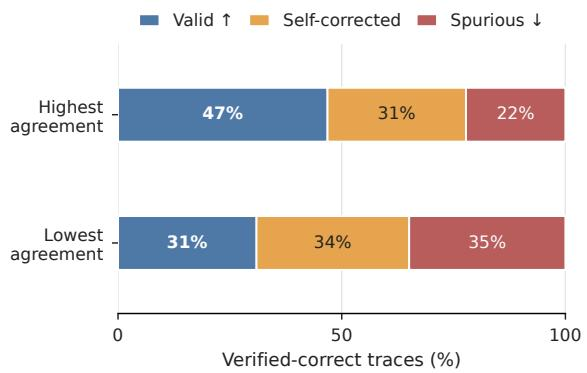
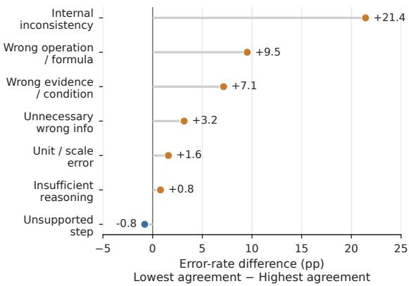
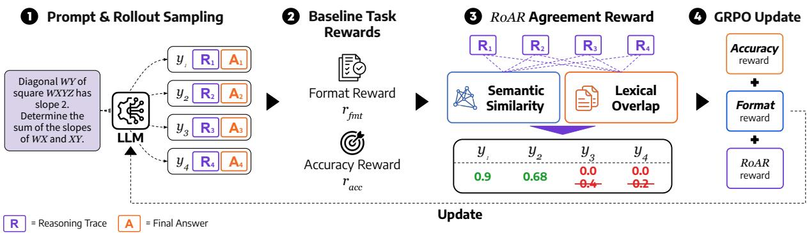
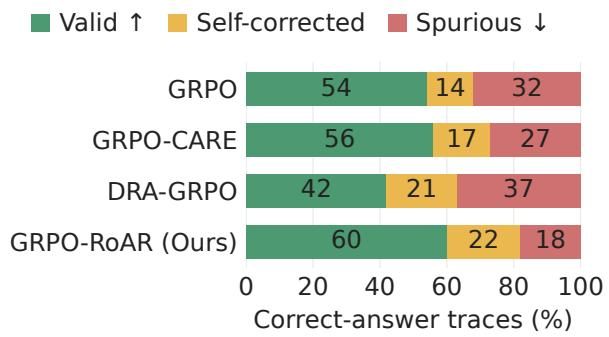
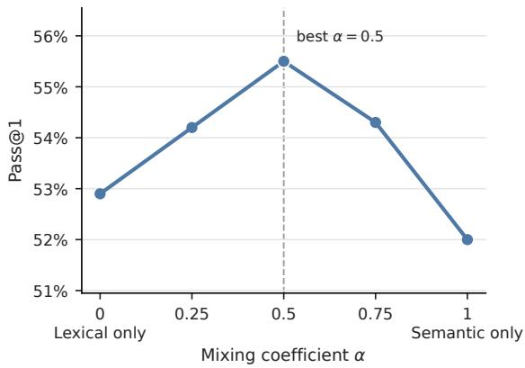
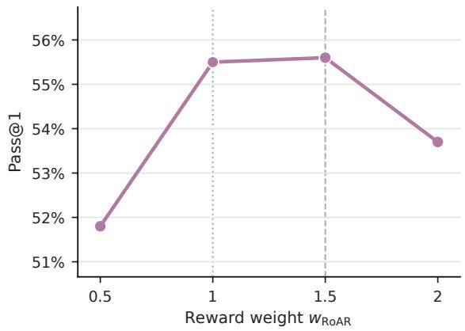

# Improving Reasoning with Rollout Agreement for Group-Based Policy Optimization

Sohyun Son and Yerim Hong and Jaeyun Park and Mujeen Sung Kyung Hee University, Yongin, Republic of Korea {sohy, yrhong, jaeyunpark, mujeensung}@khu.ac.kr

## Abstract

Recent methods for Reinforcement Learning with Verifiable Rewards (RLVR) use rollout diversity to improve reasoning performance or training efficiency. Despite these gains, the extent to which differences among correct answer rollouts reflect useful alternative reason ing or unresolved errors remains poorly under stood. We investigate this question through a blind paired analysis of a model trained with Group Relative Policy Optimization (GRPO), comparing the highest- and lowest-agreement correct-answer traces for the same problem. Across 126 pairs, low-agreement traces have more spurious reasoning than high-agreement traces (35% vs. 22%), including internal inconsistencies and misuse of problem condi tions. Based on these findings, we propose ROAR (Rollout-Agreement Reward), which adds reasoning-level agreement to GRPO’s re wards for verified-correct rollouts. ROAR computes this signal from existing on-policy rollout groups, requiring no human-written rationales, additional sampling, or separately trained pro cess evaluator. On five mathematical reason ing benchmarks, the 1.5B GRPO-ROAR model reaches 55.5% mean pass@1 under zero-shot evaluation using 7K training examples, exceeding GRPO and GRPO-CARE by 6.0 and 5.5 percentage points. A separate blind au dit of 100 problems answered correctly by all four 1.5B models finds spurious rates of 18% for GRPO-ROAR, 32% for GRPO, 27% for GRPO-CARE, and 37% for DRA-GRPO. Our findings identify reasoning validity as an im portant consideration when using rollout differ ences to guide learning. Our code is available at https://github.com/ldi-kyunghee/RoAR.

## 1 Introduction

Reinforcement Learning with Verifiable Rewards (RLVR) trains language models to generate intermediate reasoning using automatically checked outcomes, avoiding manual evaluation of each generated solution (Guo et al., 2025; Lambert et al., 2025; Shao et al., 2024). Group Relative Policy Optimization (GRPO) samples multiple candidate solutions, or rollouts, per problem and updates the policy using their relative rewards (Shao et al., 2024). Recent methods use differences among these rollouts to improve reasoning performance or training efficiency. DRA-GRPO (Chen et al., 2026a) reweights rewards to emphasize less redundant responses, while MMR-GRPO (Wei and Huang, 2026) combines outcome rewards and diversity when reweighting rollout rewards.

  
Figure 1: Different traces can reach the same correct answer. Blind paired analysis of the highest- and lowestagreement verified-correct traces for each of 126 problems from a GRPO-trained 1.5B model. Low-agreement traces have a higher spurious rate (35% vs. 22%) and a lower valid rate (31% vs. 47%).

The value of this preference depends on what makes a rollout different from its peers. A distinct reasoning path may offer a useful alternative, but it may also depart from others through faulty operations, misread conditions, or unresolved contradictions. Final-answer verification leaves this distinction open: a correct answer can follow from unsound intermediate reasoning (Zhang et al., 2025;

Chen et al., 2026b; Wang et al., 2025). This raises a question: what do differences among verifiedcorrect rollouts capture, and how should they guide learning?

We investigate this question by comparing reasoning traces that reach the same verified answer for the same problem. In a blind paired analysis of a GRPO-trained 1.5B model, the lowest-agreement traces have a higher spurious-reasoning rate than the highest-agreement traces (35% vs. 22%; Figure 1). The differences include internal inconsistencies, faulty operations, and misuse of problem conditions (Section 2). These results associate agreement with differences in reasoning validity that final-answer verification leaves unresolved.

We propose ROAR (Rollout-Agreement Reward), which adds a reasoning-level agreement reward to GRPO. It measures each trace’s agreement with the full on-policy group and awards the bonus only to verified-correct rollouts. ROAR computes this signal from existing rollouts, requiring no human-written rationales, additional sampling, or separately trained process evaluator.

We evaluate the resulting policy through both answer accuracy and reasoning validity. GRPO-ROAR achieves 55.5% mean pass@1 across five mathematical reasoning benchmarks at 1.5B, exceeding GRPO and GRPO-CARE by 6.0 and 5.5 percentage points, respectively (Table 1). A separate blind audit of 100 problems answered correctly by all four 1.5B models finds fewer spurious traces under GRPO-ROAR than under GRPO, GRPO-CARE, and DRA-GRPO (Section 5.1).

Our contributions are threefold:

• We analyze reasoning validity among verifiedcorrect rollouts and identify an association between low agreement and unresolved errors.

• We introduce ROAR, an agreement reward computed from existing rollout groups, and evaluate its accuracy at two model scales.

• We compare reasoning validity across GRPO, GRPO-ROAR, GRPO-CARE, and DRA-GRPO on shared correct-answer problems, alongside an analysis of final-answer consensus.

## 2 What Do Differences Among Correct-Answer Rollouts Capture?

We examine what differences among rollouts reflect when final-answer verification assigns them the same correctness reward. Comparing verifiedcorrect traces for the same problem lets us investigate variation in reasoning while holding the problem and final-answer correctness fixed. We ask whether traces that differ more from their peers are more likely to contain unresolved errors.

We sample K = 32 rollouts per problem on MinervaBench (Lewkowycz et al., 2022) from a GRPO-trained DeepSeek-R1-Distill-Qwen-1.5B model (Guo et al., 2025) and compute agreement among verified-correct rollouts. Following prior work on reasoning-level consistency (Knappe et al., 2024; Wan et al., 2025; Hong et al., 2025; Ling et al., 2026), we combine semantic similarity and lexical overlap. For each verified-correct rollout, we average its pairwise similarities to the other verified-correct rollouts for the same problem to obtain its agreement score. For each problem with at least five verified-correct rollouts, we pair the highest- and lowest-agreement traces, yielding 126 anonymized pairs. The traces are annotated with agreement labels hidden, using the guideline in Appendix L. A valid trace gives sound support for the answer. A self-corrected trace explicitly repairs or abandons an intermediate error before reaching a sound final path. A spurious trace contains unresolved errors or insufficient support for the answer. We also annotate reasoning-error types. Generation settings are provided in Appendix B.

The lowest-agreement traces have a higher spurious rate than the highest-agreement traces (35% vs. 22%) and a lower valid rate (31% vs. 47%; Figure 1). Even after fixing final-answer correctness, divergence from peer traces is therefore associated with differences in reasoning validity. Both agreement groups include valid and spurious traces.

The largest error-rate gaps occur in internal inconsistency (+21.4 percentage points), wrong operation or formula (+9.5), and wrong evidence or condition (+7.1; Figure 2). These failures include conflicting reasoning steps, faulty computations, and misuse of the given conditions. They provide concrete sources of variation among traces that final-answer verification treats equally.

These paired comparisons link rollout agreement to reasoning-validity differences among outputs receiving the same correctness reward.

## 3 Rollout-Agreement Reward

ROAR adds a reasoning-level agreement reward to GRPO. It uses the full on-policy rollout group as references and awards the bonus only to verifiedcorrect rollouts. This favors correct-answer traces that share reasoning patterns with other rollouts sampled for the same prompt, without additional rollout sampling. Diversity-based reward adjustment emphasizes less redundant responses (Chen et al., 2026a; Wei and Huang, 2026); ROAR uses agreement with peer traces as an additional learning signal.

  
Figure 2: Internal inconsistency shows the largest error-rate gap between agreement groups. Error-rate differences in the 126 paired comparisons are computed as lowest agreement minus highest agreement. Positive values indicate higher error rates in the lowestagreement verified-correct traces.

## 3.1 Measuring Rollout Agreement

We quantify rollout agreement over the reasoning traces extracted from the <think> spans. For a prompt $x ,$ let $\{ y _ { i } \} _ { i = 1 } ^ { K }$ denote the group of rollouts sampled from the policy, and let $t _ { i }$ denote the reasoning trace of rollout $y _ { i }$ . To obtain an agreement metric, we combine semantic similarity and lexical overlap, following prior work that treats these two views as complementary signals for reasoninglevel agreement (Knappe et al., 2024; Wan et al., 2025; Hong et al., 2025; Ling et al., 2026). Specifically, we define the pairwise similarity score $s ( i , j )$ between two reasoning traces as

$$
s ( i , j ) = \alpha s _ { \mathrm { s e m } } ( i , j ) + ( 1 - \alpha ) s _ { \mathrm { l e x } } ( i , j ) ,\tag{1}
$$

where $s _ { \mathrm { s e m } } ( i , j )$ is the cosine similarity between embeddings of the reasoning traces $t _ { i }$ and $t _ { j }$ , and $s _ { \mathrm { l e x } } ( i , j )$ is token-level F1 between the two traces. The coefficient $\alpha \in [ 0 , 1 ]$ controls the trade-off between semantic similarity and lexical overlap.

For each rollout, we compute its agreement score as the average pairwise similarity with all other rollouts sampled for the same prompt.

$$
a _ { i } ^ { \mathrm { a l l } } = \frac { 1 } { K - 1 } \sum _ { j = 1 \atop j \neq i } ^ { K } s ( i , j ) .\tag{2}
$$

The diagnostic in Section 2 compares correctanswer traces to control for answer correctness. For training, we use the full on-policy group as references, keeping the score well-defined even when verified-correct rollouts are sparse or absent. This group represents the reasoning patterns sampled by the current policy for the prompt. We evaluate the reference-set choice in Section 4.3.

Similarity can also be high among rollouts with incorrect final answers. We therefore award the agreement bonus only to verified-correct rollouts. Let $\mathbb { I } _ { \mathrm { c o r r e c t } } ( y _ { i } )$ be an indicator for whether the final answer of rollout $y _ { i }$ is correct. The ROAR reward for rollout $y _ { i }$ is defined as

$$
r _ { \mathrm { R o A R } } ( y _ { i } ) = \mathbb { I } _ { \mathrm { c o r r e c t } } ( y _ { i } ) \cdot a _ { i } ^ { \mathrm { a l l } } .\tag{3}
$$

Thus, an incorrect rollout receives no agreement reward, even if its trace is similar to other rollouts.

## 3.2 Integration into Group-based Policy Optimization

ROAR is integrated into GRPO by adding an agreement term to the per-rollout reward. For each rollout, we first compute the standard task reward used in our GRPO baseline, consisting of a format reward for output-structure compliance and a binary accuracy reward for verifiable final-answer correctness. We then add the rollout-agreement reward defined above.

$$
r _ { i } = w _ { \mathrm { f m t } } r _ { \mathrm { f m t } } ( y _ { i } ) + w _ { \mathrm { a c c } } r _ { \mathrm { a c c } } ( y _ { i } ) + w _ { \mathrm { R o A R } } r _ { \mathrm { R o A R } } ( y _ { i } ) .\tag{4}
$$

where $w _ { \mathrm { f m t } } , w _ { \mathrm { a c c } }$ , and $w _ { \mathrm { R O A R } }$ are the weights for the format, accuracy, and rollout-agreement rewards, respectively.

Given the rollout rewards $\{ r _ { i } \} _ { i = 1 } ^ { K } ,$ we compute group-relative advantages within each prompt group and apply the standard GRPO update (Shao et al., 2024). Thus, ROAR preserves the existing GRPO optimization procedure and can be incorporated as a plug-in reward. It provides reasoninglevel feedback through the existing rollout rewards without a separately trained reasoning-quality evaluator. Reward weights and training hyperparameters are provided in Appendix B.

  
Figure 3: Overview of ROAR within group-based policy optimization. ROAR measures reasoning-level agreement over the sampled rollout group and assigns the agreement reward only to verified-correct rollouts before the grouprelative policy update. R and A denote the reasoning trace andfinal answer; the figure uses K = 4.

Ablation variants. By default, ROAR computes agreement relative to all rollouts in the on-policy group and assigns the resulting reward only to verified-correct rollouts. To isolate these choices, we test a reference-set ablation that uses only verified-correct rollouts as references, and a rewardtarget ablation that assigns the agreement reward to all rollouts regardless of correctness.

## 4 Experiments

We evaluate answer accuracy, reward construction, and results across model scales and training seeds. Section 5 examines reasoning validity and finalanswer consensus.

## 4.1 Experimental Setup

Training data. We use the 7K mathematical reasoning training set from Open-RS (Dang and Ngo, 2026), which consists of problems selected from the s1 and DeepScaleR data sources (Muennighoff et al., 2025; Luo et al., 2025). It spans a range of difficulties and has been used in low-resource GRPO training for small reasoning models (Dang and Ngo, 2026; Chen et al., 2026a), allowing us to isolate the effect of the rollout-agreement reward under a fixed data budget.

Evaluation benchmarks. We evaluate on five mathematical reasoning benchmarks: AIME26<sup>1</sup>, MATH-500 (Lightman et al., 2024; Hendrycks et al., 2021), AMC23<sup>2</sup>, Minerva (Lewkowycz et al., 2022), and OlympiadBench (He et al., 2024). Compared with the Open-RS evaluation suite, we replace AIME24 with AIME26 and evaluate all models with reported AIME26 scores under the same inference and answer-verification settings; the remaining benchmarks are unchanged.

Model and training. We use DeepSeek-R1- Distill-Qwen-1.5B (Guo et al., 2025) as the base model. Our implementation builds on the Open-RS training pipeline (Dang and Ngo, 2026). We train an outcome-only GRPO baseline with format and binary accuracy rewards and reimplement GRPO-CARE (Chen et al., 2026b) under the same setup; ROAR adds the rollout-agreement reward defined in Section 3. GRPO-CARE provides a comparison using reasoning–answer coherence. We also train GRPO w/ LLM reward, which uses the RULERstyle approach (Corbitt et al., 2025) to obtain trajectory feedback from an LLM judge within each rollout group. For the 4B experiments, we train Qwen3-4B (Yang et al., 2025) with thinking mode enabled using the same 7K examples and training budget.

In the main experiments, we set the rolloutagreement weight to w<sub>ROAR</sub> = 1.0 and the semantic–lexical mixing coefficient to α = 0.5. We study the sensitivity to these choices in Section 5.3 and Appendices F and G. Implementation details for the GRPO-CARE and GRPO w/ LLM reward baselines are provided in Appendix B.

Evaluation protocol. We report pass@1 under zero-shot prompting. For pass@1, the model generates one solution per problem, and the final answer is extracted and checked against the ground-truth answer. For pass@4, we sample four solutions per problem and count the problem as correct if any extracted final answer is verified correct. For models trained in our environment, including GRPO, GRPO-CARE, GRPO w/ LLM reward, ROAR, and our ablation variants, we use our reimplementation of the Open-RS-style answer-extraction and verification protocol.

<table><tr><td>Model</td><td>AIME26</td><td>MATH-500</td><td>AMC23</td><td>Minerva</td><td>OlympiadBench</td><td>Avg.</td></tr><tr><td>DeepSeek-R1-Distill-Qwen-1.5B</td><td>20.0</td><td>82.8</td><td>62.9</td><td>26.5</td><td>43.3</td><td>47.1</td></tr><tr><td>OpenRS3 (Dang and Ngo, 2026)</td><td>26.7</td><td>84.4</td><td>72.5</td><td>26.8</td><td>51.3</td><td>52.3</td></tr><tr><td>DRA-GRPO (Chen et al., 2026a)</td><td>23.3</td><td>86.2</td><td>75.0</td><td>32.4</td><td>53.0</td><td>54.0</td></tr><tr><td>GRPO†</td><td>16.7</td><td>84.4</td><td>65.0</td><td>27.9</td><td>53.5</td><td>49.5</td></tr><tr><td>GRPO-CARE† (Chen et al., 2026b)</td><td>20.0</td><td>82.0</td><td>65.0</td><td>29.0</td><td>54.2</td><td>50.1</td></tr><tr><td>GRPO w/ LLM reward† (Corbitt et al., 2025)</td><td>20.0</td><td>83.2</td><td>75.0</td><td>29.4</td><td>51.6</td><td>51.8</td></tr><tr><td>GRPO-RoAR† (Ours)</td><td>26.7</td><td>84.8</td><td>80.0</td><td>30.9</td><td>55.3</td><td>55.5</td></tr><tr><td>Reference set: All → Correct</td><td>20.0</td><td>86.4</td><td>70.0</td><td>31.6</td><td>53.0</td><td>52.2</td></tr><tr><td>Reward target: Correct → All</td><td>23.3</td><td>82.2</td><td>75.0</td><td>27.9</td><td>51.1</td><td>51.9</td></tr></table>

Table 1: Pass@1 comparison across mathematical reasoning benchmarks. Numbers are in %. Bold numbers indicate the highest value in each column. † denotes models trained by us. All reported AIME26 scores are evaluated by us; external-baseline scores on the other four benchmarks are taken from Dang and Ngo (2026) and Chen et al. (2026a). Indented rows are ablations of ROAR.

## 4.2 Main Results

Table 1 reports pass@1 across five mathematical reasoning benchmarks. Performance differences are computed from unrounded scores. Our main GRPO-ROAR model achieves the highest average pass@1 of 55.5% among the 1.5B models. Compared with the base DeepSeek-R1-Distill-Qwen-1.5B model, our GRPO-ROAR method improves average pass@1 by 8.4 points. GRPO-ROAR outperforms GRPO by 6.0 points, GRPO-CARE by 5.5 points, and GRPO w/ LLM reward by 3.7 points. Paired bootstrap intervals over evaluation problems show positive pass@1 gains over GRPO and GRPO-CARE, with 95% CIs of [1.6, 10.6] and [0.9, 10.0] points, respectively (Appendix D).

Table 1 also compares prior 1.5B reasoning models, with externally reported scores identified in the caption. GRPO-ROAR exceeds the listed OpenRS3 and DRA-GRPO averages by 3.2 and 1.5 points, respectively. GRPO-ROAR achieves the best scores on AMC23 and OlympiadBench, at 80.0% and 55.3%. OpenRS3 matches its score on AIME26, while DRA-GRPO scores slightly higher on MATH-500 and Minerva.

As shown in Table 2, GRPO-ROAR achieves 68.3% pass@4, 2.1 points higher than outcomeonly GRPO. GRPO-CARE obtains 65.1%, which is 1.1 points below the GRPO baseline in this setting. Our evaluation of the released DRA-GRPO checkpoint yields 63.7% mean pass@4, 4.7 percentage points below GRPO-ROAR. Paired bootstrap confidence intervals for the pass@4 comparisons with GRPO, GRPO-CARE, and DRA-GRPO are reported in Appendix D.

<table><tr><td>Method</td><td>Pass@4</td></tr><tr><td>GRPO</td><td>66.2</td></tr><tr><td>GRPO-CARE</td><td>65.1 -1.1</td></tr><tr><td>DRA-GRPO</td><td>63.7 -2.5</td></tr><tr><td>GRPO-ROAR (Ours)</td><td>68.3 +2.1</td></tr></table>

Table 2: Macro-average pass@4 across five benchmarks. Numbers are in %. The small values denote percentagepoint differences from GRPO. DRA-GRPO results are obtained from our evaluation of its released checkpoint.

GRPO-ROAR takes nearly the same wall-clock time as outcome-only GRPO (Appendix C). The GRPO w/ LLM reward run takes 21 hours 58 minutes and incurs \$42.97 in judge API costs. The GRPO-ROAR run takes 11 hours 16 minutes without external judge calls.

## 4.3 Ablation Study

We examine how the reference set used to compute agreement and the choice of rollouts that receive the reward affect performance (Table 1). The default configuration uses all rollouts as references but rewards only verified-correct rollouts, achieving 55.5% mean pass@1. Rewarding all rollouts lowers this score to 51.9%, while restricting the reference set to verified-correct rollouts lowers it to 52.2%. In this setting, the full rollout group provides a useful reference, while conditioning the reward on correctness improves performance.

## 4.4 Performance Across Model Scales and Training Seeds

To assess training-run variability, we repeat the central comparison between GRPO and GRPO-ROAR with training seeds 0, 7, and 2025 at both model sizes. The models trained by us in Table 1 use training seed 2025, including the reward-design ablations. Table 3 reports the per-benchmark results at both model sizes. At 1.5B, GRPO-ROAR improves the mean pass@1 on all five benchmarks, raising the five-benchmark average from 51.6±1.9 to $5 3 . 4 \pm 2 . 1$

<table><tr><td rowspan="2">Task</td><td colspan="3">1.5B</td><td colspan="3">4B</td></tr><tr><td>GRPO</td><td>GRPO-ROAR</td><td> $\Delta$ </td><td>GRPO</td><td>GRPO-ROAR</td><td> $\Delta$ </td></tr><tr><td>AIME26</td><td> $2 2 . 2 { \pm } 6 . 9$ </td><td> $\mathbf { 2 4 . 4 \pm 3 . 8 }$ </td><td>+2.2</td><td> $6 1 . 1 { \pm } 5 . 1 $ </td><td> ${ \bf 6 6 . 7 \pm 5 . 8 }$ </td><td>+5.6</td></tr><tr><td>MATH-500</td><td> $8 3 . 8 { \pm } 0 . 7 $ </td><td> ${ \bf 8 3 . 9 2 1 . 0 }$ </td><td> $+ 0 . 1$ </td><td> $9 5 . 7 { \pm } 0 . 4 $ </td><td> $\mathbf { 9 6 . 4 \bot 0 . 4 }$ </td><td>+0.7</td></tr><tr><td>AMC23</td><td> $7 0 . 8 { \pm } 8 . 0 $ </td><td> ${ \bf 7 4 . 2 \pm 5 . 2 }$ </td><td> $+ 3 . 3$ </td><td> $\mathbf { 9 6 . 7 \pm 2 . 9 }$ </td><td> $9 5 . 8 { \pm } 5 . 2 $ </td><td>-0.8</td></tr><tr><td>Minerva</td><td> $2 9 . 4 { \pm } 1 . 3 $ </td><td> ${ \bf 3 0 . 5 } { \pm } { \bf 2 . 0 }$ </td><td> $+ 1 . 1$ </td><td> $4 6 . 2 { \pm } 0 . 8 $ </td><td> $\mathbf { 4 6 . 4 \bot \mathbf { \delta } } \mathbf { \mathbf { 0 . 4 } }$ </td><td>+0.2</td></tr><tr><td>OlympiadBench</td><td> $5 1 . 9 { \pm } 1 . 4 $ </td><td> ${ \bf 5 3 . 8 { \pm } 1 . 3 }$ </td><td> $+ 1 . 9$ </td><td> $7 3 . 8 { \pm } 0 . 6 $ </td><td> ${ \bf 7 5 . 4 \pm 0 . 6 }$ </td><td> $+ 1 . 5$ </td></tr><tr><td>Average</td><td> $5 1 . 6 { \pm } 1 . 9 $ </td><td> ${ \bf 5 3 . 4 2 . 2 . 1 }$ </td><td> ${ + 1 . 7 }$ </td><td> $7 4 . 7 { \pm } 1 . 3 $ </td><td> ${ \bf 7 6 . 1 \pm 1 . 9 }$ </td><td>+1.4</td></tr></table>

Table 3: Pass@1 (%), reported as mean ± sample SD over three training seeds for DeepSeek-R1-Distill-Qwen-1.5B and Qwen3-4B. Within each model size, both methods use the same $7 \mathrm { K }$ examples, training budget, and evaluation protocol. Average is the five-benchmark macro-average; its SD is computed across the per-seed macro-averages. $\Delta$ is the GRPO-ROAR improvement in percentage points, computed from unrounded scores.

To test whether the same reward remains useful with a larger model, we train Qwen3-4B under the same data, training budget, and evaluation protocol. Across three training seeds, GRPO-ROAR improves the mean pass@1 on four of five benchmarks and raises the five-benchmark average from 74.7% to 76.1% (Table 3). The gains include 0.7 points on MATH-500 and 1.5 points on Olympiad-Bench, while AMC23 decreases by 0.8 points on average.

The five-benchmark averages for individual training seeds are reported in Appendix E.

## 5 Analysis

We examine whether the accuracy gains reported in Section 4.2 are accompanied by changes in reasoning validity. We then analyze final-answer consensus and sensitivity to the agreement score and reward weight.

## 5.1 Reasoning Validity Beyond Correct Answers

We compare the reasoning supporting correct answers from the 1.5B GRPO, GRPO-CARE, DRA-GRPO, and GRPO-ROAR models. The blind audit uses 100 shared problems answered correctly by all four models, holding the problem and final-answer correctness fixed across methods. We shuffle the traces and annotate them with model identities hidden, using the three validity labels defined in Section 2 and the guideline in Appendix L. For DRA-GRPO, we use rollouts generated in our environment from its released checkpoint<sup>3</sup>.

  
Figure 4: Reasoning validity after training. Blind human audit on 100 shared problems answered correctly by GRPO, GRPO-CARE, DRA-GRPO, and GRPO-ROAR (1.5B). Bars show the percentages of valid, selfcorrected, and spurious traces.

Figure 4 shows spurious rates of 32% for GRPO, 27% for GRPO-CARE, 37% for DRA-GRPO, and 18% for GRPO-ROAR. GRPO-ROAR also has the highest valid rate (60%), while 22% of its traces are self-corrected. In this setting, the accuracy improvement under ROAR is accompanied by fewer unresolved errors in correct-answer traces. Human evaluation at the 4B scale also finds fewer spurious traces under GRPO-ROAR than under GRPO; details are provided in Appendix I. Appendix K illustrates the distinction between valid, self-corrected, and spurious traces.

As a complementary check, we apply GPT-6.1 Sol with low reasoning effort to the traces from the 1.5B audit using the same guideline. Human– LLM inter-annotator agreement (IAA), measured as exact agreement across the three categories, is 79.25%, with Cohen’s $\kappa = 0 . 6 6 5$ . The LLM judge also assigns GRPO-ROAR the lowest spurious rate; the full counts and protocol are provided in Ap-

<table><tr><td>Model</td><td>Strong</td><td>Weak Pass@1</td><td>Weak Pass@4</td></tr><tr><td>GRPO</td><td>48.7</td><td>21.2</td><td>47.9</td></tr><tr><td>GRPO-CARE</td><td>52.5</td><td>14.8</td><td>43.0</td></tr><tr><td>DRA-GRPO</td><td>48.4</td><td>20.9</td><td>46.9</td></tr><tr><td>GRPO-ROAR</td><td>48.8</td><td>28.1</td><td>52.4</td></tr></table>

Table 4: Answer-consensus diagnostic over four sampled rollouts. Strong denotes the percentage of problems where at least three rollouts produce the same extracted final answer. Weak Pass@1 and Weak Pass@4 are computed only on the weak-consensus subset. Numbers are in % and macro-averaged across five benchmarks. DRA-GRPO results are obtained from our evaluation of its released checkpoint.

pendix J.

## 5.2 Accuracy and Final-Answer Consensus

Because ROAR rewards reasoning-level agreement, a natural concern is that it encourages rollouts to converge to a single dominant final answer. We examine whether increased final-answer consensus accounts for its accuracy gains. For GRPO, GRPO-CARE, DRA-GRPO, and GRPO-ROAR, we examine final-answer consensus among the four rollouts sampled per problem. For DRA-GRPO, we evaluate the same released checkpoint used in the validity audit in our environment. A problem has strong answer consensus if at least three of the four rollouts produce the same extracted final answer, and weak answer consensus otherwise.

GRPO-ROAR has nearly the same strongconsensus rate as GRPO (48.8% vs. 48.7%). On each model’s weak-consensus subset, GRPO-ROAR reaches 28.1% pass@1 and 52.4% pass@4, compared with 21.2% and 47.9% for GRPO. DRA-GRPO has a similar strong-consensus rate (48.4%), with weak-consensus pass@1 and pass@4 of 20.9% and 46.9%, respectively. These results suggest that ROAR’s accuracy gains extend beyond increasing the frequency of strong final-answer consensus. Its higher accuracy on weak-consensus subsets shows that improved performance also occurs where sampled answers remain dispersed. Perbenchmark results are provided in Appendix H.

## 5.3 Sensitivity to Agreement Scoring and Reward Weight

We examine how the semantic–lexical mixing coefficient and rollout-agreement reward weight affect performance.

  
Figure 5: Ablation of the mixing coefficient α in the pairwise similarity score (Eq. 1). We report mean pass@1 across the five benchmarks. Numbers are in %. $\alpha = 0$ denotes lexical-only agreement, and $\alpha = 1$ denotes semantic-only agreement.

  
Figure 6: Sensitivity to the rollout-agreement reward weight $w _ { \mathrm { R O A R } } .$ . We report mean pass@1 across the five benchmarks. Numbers are in %.

Semantic–lexical mixing. We ablate the mixing coefficient α in Eq. 1, which interpolates between lexical overlap and semantic similarity. Figure 5 shows that the balanced setting $\alpha = 0 . 5$ performs best among the tested settings, reaching 55.5% mean pass@1, while lexical-only and semanticonly agreement obtain 52.8% and 52.0%. This suggests that semantic similarity and lexical overlap provide complementary agreement signals. We therefore use $\alpha = 0 . 5$ in the main experiments. Detailed per-benchmark results are provided in Appendix F.

Rollout-agreement weight. Figure 6 shows similar performance at w<sub>ROAR</sub> = 1.0 and w<sub>ROAR</sub> = 1.5, with mean pass@1 scores of 55.5% and 55.6%, respectively. Mean pass@1 falls to 51.8% at $w _ { \mathrm { R o A R } } = 0 . 5$ and 53.7% at $w _ { \mathrm { R o A R } } = 2 . 0$ . We use $w _ { \mathrm { R O A R } } ~ = ~ 1 . 0$ as the default. Detailed perbenchmark results are provided in Appendix G.

## 6 Related Work

## 6.1 Reasoning-Aware Rewards in GRPO

GRPO assigns the same correctness reward to correct-answer rollouts even when their reasoning quality differs (Shao et al., 2024; Lambert et al., 2025). Recent methods exploit properties of the rollout group to modify these rewards. DRA-GRPO (Chen et al., 2026a) reweights rewards according to semantic redundancy, giving greater weight to responses that are less similar to their peers. MMR-GRPO (Wei and Huang, 2026) combines outcome rewards and semantic redundancy through Maximal Marginal Relevance to reweight rollout rewards and accelerate training. These methods seek to give less redundant responses more influence during learning. Our paired analysis examines the reasoning differences among verifiedcorrect outputs, including errors that final-answer rewards leave unresolved. ROAR tests peer agreement as an additional signal in this setting.

Other approaches provide feedback on the reasoning process itself. Process reward models score intermediate steps using an external evaluator (Lightman et al., 2024; Zhang et al., 2025; Cheng et al., 2025), while RULER uses an LLM judge to score trajectories within each rollout group (Corbitt et al., 2025).

SCS (Wang et al., 2025) and GRPO-CARE (Chen et al., 2026b) specifically address spurious reasoning with auxiliary consistency signals. SCS uses trajectory agreement obtained through visual perturbation and truncationresampling to down-weight unreliable traces in multimodal reasoning. GRPO-CARE estimates reasoning–answer coherence with a reference model and incorporates it as a consistency reward. ROAR computes agreement directly within existing rollout groups and awards the bonus to verified-correct outputs, using neither input perturbations nor a separate reference model.

## 6.2 Agreement Signals from Multiple Rollouts

Self-consistency samples multiple reasoning paths and predicts an answer by majority vote (Wang et al., 2023). Consistency across generations also supports hallucination detection (Manakul et al., 2023) and confidence estimation (Lyu et al., 2025). Reasoning-level methods compare paths or rationales for answer aggregation (Knappe et al., 2024; Wan et al., 2025), while inter-chain similarity can reduce the sampling cost of self-consistency (Hong et al., 2025).

These approaches use agreement primarily at inference time. ROAR uses reasoning-level agreement during training. It reuses the rollout groups generated by GRPO (Shao et al., 2024) to compute an auxiliary reward and incorporate it into policy updates, without additional sampling.

## 7 Conclusion

We investigated what differences among verifiedcorrect rollouts capture. A blind paired analysis found more unresolved errors in low-agreement traces, including internal inconsistencies, faulty operations, and misuse of problem conditions. This association motivates testing agreement as additional feedback among outputs receiving the same correctness reward.

ROAR implements this design using existing onpolicy rollout groups and rewards verified-correct traces that share reasoning patterns with their peers. Across three training seeds, it improves average pass@1 at both 1.5B and 4B. In the blind audit of 100 problems answered correctly by all four 1.5B models, its spurious rate is 18%, compared with 32% for GRPO, 27% for GRPO-CARE, and 37% for DRA-GRPO; the supplementary 4B audit shows the same direction relative to GRPO. These findings show that agreement can be useful in the evaluated mathematical reasoning setting and that final-answer accuracy leaves important differences in reasoning validity unresolved. A further question is how to combine the discovery of diverse solution paths with learning from reliable ones.

## Limitations

Agreement as a proxy for reasoning validity. Multiple rollouts can share the same unresolved error and receive high agreement scores. Conversely, a valid solution strategy represented by few rollouts may receive a low score. Both valid low-agreement traces and spurious high-agreement traces occur in our paired analysis. Appendix K.1 provides a paired example of a high-agreement spurious trace and a low-agreement valid trace. The usefulness of agreement therefore depends on the reasoning patterns represented in the sampled group.

Scope of evaluation. Our experiments cover mathematical reasoning with 1.5B and 4B models trained on 7K examples. The paired diagnostic uses 32 rollouts and compares agreement among verified-correct outputs; training uses the full on-policy group with six rollouts. Our rewardconstruction ablations evaluate the reference-set choice, while the validity audits compare traces on problems answered correctly by all participating models. ROAR relies on reliable final-answer verification to determine which rollouts receive the agreement reward. Further study should examine larger models, other reasoning domains and training budgets, and how the choice between diversity and agreement varies across policy distributions and stages of training.

## Ethical Considerations

This work uses publicly available English mathematical reasoning benchmarks and publicly released models, which contain no personally identifying or offensive content (Appendix A). A potential risk is that agreement-based rewards may reinforce reasoning patterns that are common but flawed, giving users unwarranted confidence in model-generated explanations; we therefore report spurious-reasoning rates alongside accuracy rather than treating rewarded traces as verified.

## References

Xiwen Chen, Wenhui Zhu, Peijie Qiu, Xuanzhao Dong, Hao Wang, Haiyu Wu, Huayu Li, Aris Sotiras, Yalin Wang, and Abolfazl Razi. 2026a. DRA-GRPO: Your GRPO needs to know diverse reasoning paths for mathematical reasoning. In Findings of the Association for Computational Linguistics: ACL 2026, pages 13995–14019, San Diego, California, United States. Association for Computational Linguistics.

Yi Chen, Yuying Ge, Rui Wang, Yixiao Ge, Junhao Cheng, Ying Shan, and Xihui Liu. 2026b. GRPO-CARE: Consistency-aware reinforcement learning for multimodal reasoning. In Findings ofthe Associationfor Computational Linguistics: ACL 2026, pages 4305–4320, San Diego, California, United States. Association for Computational Linguistics.

Jie Cheng, Gang Xiong, Ruixi Qiao, Lijun Li, Chao Guo, Junle Wang, Yisheng Lv, and Fei-Yue Wang. 2025. Stop summation: Min-form credit assignment is all process reward model needs for reasoning. In Advances in Neural Information Processing Systems, volume 38, Main Conference, pages 131646–131671. Curran Associates, Inc.

Kyle Corbitt, Saumya Gandhi, Angky William, Andie Jones, Brad Hilton, David Corbitt, and Bohdan Kovalevski. 2025. RULER: Relative universal LLMelicited rewards. OpenPipe blog post.

Quy-Anh Dang and Chris Ngo. 2026. Reinforcement learning for reasoning in small LLMs: What works and what doesn’t. In Logical and Symbolic Reasoning in Language Models @ AAAI 2026.

Daya Guo, Dejian Yang, Haowei Zhang, Junxiao Song, Peiyi Wang, Qihao Zhu, Runxin Xu, Ruoyu Zhang, Shirong Ma, Xiao Bi, Xiaokang Zhang, Xingkai Yu, Yu Wu, Z. F. Wu, Zhibin Gou, Zhihong Shao, Zhuoshu Li, Ziyi Gao, Aixin Liu, and 175 others. 2025. DeepSeek-R1 incentivizes reasoning in LLMs through reinforcement learning. Nature, 645(8081):633–638.

Chaoqun He, Renjie Luo, Yuzhuo Bai, Shengding Hu, Zhen Thai, Junhao Shen, Jinyi Hu, Xu Han, Yujie Huang, Yuxiang Zhang, Jie Liu, Lei Qi, Zhiyuan Liu, and Maosong Sun. 2024. OlympiadBench: A challenging benchmark for promoting AGI with olympiad-level bilingual multimodal scientific problems. In Proceedings of the 62nd Annual Meeting of the Association for Computational Linguistics (Volume 1: Long Papers), pages 3828–3850, Bangkok, Thailand. Association for Computational Linguistics.

Dan Hendrycks, Collin Burns, Saurav Kadavath, Akul Arora, Steven Basart, Eric Tang, Dawn Song, and Jacob Steinhardt. 2021. Measuring mathematical problem solving with the MATH dataset. In Proceedings of the Neural Information Processing Systems Track on Datasets and Benchmarks, volume 1.

Colin Hong, Xu Guo, Anand Chaanan Singh, Esha Choukse, and Dmitrii Ustiugov. 2025. Slim-SC: Thought pruning for efficient scaling with selfconsistency. In Proceedings ofthe 2025 Conference on Empirical Methods in Natural Language Processing, pages 34500–34517, Suzhou, China. Association for Computational Linguistics.

Tim Knappe, Ryan Li, Ayush Chauhan, Kaylee Chhua, Kevin Zhu, and Sean O’Brien. 2024. Semantic selfconsistency: Enhancing language model reasoning via semantic weighting. In MATH-AI: The 4th Workshop on Mathematical Reasoning and AI at NeurIPS 2024.

Nathan Lambert, Jacob Morrison, Valentina Pyatkin, Shengyi Huang, Hamish Ivison, Faeze Brahman, Lester James V. Miranda, Alisa Liu, Nouha Dziri, Xinxi Lyu, Yuling Gu, Saumya Malik, Victoria Graf, Jena D. Hwang, Jiangjiang Yang, Ronan Le Bras, Oyvind Tafjord, Chris Wilhelm, Luca Soldaini, and 4 others. 2025. Tülu 3: Pushing frontiers in open language model post-training. In Conference on Language Modeling.

Aitor Lewkowycz, Anders Andreassen, David Dohan, Ethan Dyer, Henryk Michalewski, Vinay Ramasesh, Ambrose Slone, Cem Anil, Imanol Schlag, Theo Gutman-Solo, Yuhuai Wu, Behnam Neyshabur, Guy Gur-Ari, and Vedant Misra. 2022. Solving quantitative reasoning problems with language models. In Advances in Neural Information Processing Systems, volume 35, pages 3843–3857, Red Hook, NY, USA. Curran Associates Inc.

Hunter Lightman, Vineet Kosaraju, Yuri Burda, Harrison Edwards, Bowen Baker, Teddy Lee, Jan Leike, John Schulman, Ilya Sutskever, and Karl Cobbe. 2024. Let's verify step by step. In International Conference on Learning Representations, volume 2024, pages 39578–39601.

Zipeng Ling, Shuliang Liu, Seonil Son, Shenghong Fu, Yuehao Tang, Yao Wan, and Xuming Hu. 2026. Correct prediction, wrong steps? consensus reasoning knowledge graph for robust chain-of-thought synthesis. Preprint, arXiv:2604.14121.

Michael Luo, Sijun Tan, Justin Wong, Xiaoxiang Shi, William Tang, Manan Roongta, Colin Cai, Jeffrey Luo, Tianjun Zhang, Erran Li, Raluca Ada Popa, and Ion Stoica. 2025. DeepScaleR: Surpassing O1- Preview with a 1.5b model by scaling RL. Notion blog post.

Qing Lyu, Kumar Shridhar, Chaitanya Malaviya, Li Zhang, Yanai Elazar, Niket Tandon, Marianna Apidianaki, Mrinmaya Sachan, and Chris Callison-Burch. 2025. Calibrating large language models with sample consistency. In Proceedings ofthe AAAI Conference on Artificial Intelligence, volume 39, pages 19260–19268.

Potsawee Manakul, Adian Liusie, and Mark Gales. 2023. SelfCheckGPT: Zero-resource black-box hallucination detection for generative large language models. In Proceedings of the 2023 Conference on Empirical Methods in Natural Language Processing, pages 9004–9017, Singapore. Association for Computational Linguistics.

Niklas Muennighoff, Zitong Yang, Weijia Shi, Xiang Lisa Li, Li Fei-Fei, Hannaneh Hajishirzi, Luke Zettlemoyer, Percy Liang, Emmanuel Candès, and Tatsunori Hashimoto. 2025. s1: Simple test-time scaling. In Proceedings ofthe 2025 Conference on Empirical Methods in Natural Language Processing, pages 20275–20321, Suzhou, China. Association for Computational Linguistics.

Zhihong Shao, Peiyi Wang, Qihao Zhu, Runxin Xu, Junxiao Song, Xiao Bi, Haowei Zhang, Mingchuan Zhang, Y. K. Li, Y. Wu, and Daya Guo. 2024. DeepSeekMath: Pushing the limits of mathematical reasoning in open language models. Preprint, arXiv:2402.03300.

Guangya Wan, Yuqi Wu, Jie Chen, and Sheng Li. 2025. Reasoning aware self-consistency: Leveraging reasoning paths for efficient LLM sampling. In Proceedings of the 2025 Conference of the Nations of the Americas Chapter of the Association for Computational Linguistics: Human Language Technologies (Volume 1: Long Papers), pages 3613–3635, Albuquerque, New Mexico. Association for Computational Linguistics.

Jiahao Wang, Weiye Xu, Aijun Yang, Wengang Zhou, Lewei Lu, Houqiang Li, Xiaohua Wang, and Jinguo Zhu. 2025. Enhancing the outcome reward-based

RL training of MLLMs with self-consistency sampling. In Advances in Neural Information Processing Systems, volume 38, Main Conference, pages 132018–132052. Curran Associates, Inc.

Xuezhi Wang, Jason Wei, Dale Schuurmans, Quoc V. Le, Ed H. Chi, Sharan Narang, Aakanksha Chowdhery, and Denny Zhou. 2023. Self-consistency improves chain of thought reasoning in language models. In International Conference on Learning Representations.

Kangda Wei and Ruihong Huang. 2026. MMR-GRPO: Accelerating GRPO-style training through diversityaware reward reweighting. In Findings ofthe Association for Computational Linguistics: ACL 2026, pages 9584–9605, San Diego, California, United States. Association for Computational Linguistics.

An Yang, Anfeng Li, Baosong Yang, Beichen Zhang, Binyuan Hui, Bo Zheng, Bowen Yu, Chang Gao, Chengen Huang, Chenxu Lv, Chujie Zheng, Dayiheng Liu, Fan Zhou, Fei Huang, Feng Hu, Hao Ge, Haoran Wei, Huan Lin, Jialong Tang, and 41 others. 2025. Qwen3 technical report. Preprint, arXiv:2505.09388.

Zhenru Zhang, Chujie Zheng, Yangzhen Wu, Beichen Zhang, Runji Lin, Bowen Yu, Dayiheng Liu, Jingren Zhou, and Junyang Lin. 2025. The lessons of developing process reward models in mathematical reasoning. In Findings ofthe Associationfor Computational Linguistics: ACL 2025, pages 10495–10516, Vienna, Austria. Association for Computational Linguistics.

## A Data and Model Artifacts

Table 5 summarizes the external data, code, and model artifacts used in our experiments. All datasets are English mathematical or scientific reasoning problem sets. They cover competition mathematics, formal mathematical problem solving, and quantitative scientific reasoning. We use Open-RS as the training dataset, while the remaining datasets are used only for zero-shot evaluation. We use DeepSeek-R1-Distill-Qwen-1.5B and Qwen3-4B as base models and implement training using the Open-RS codebase.

Licenses and terms. The Open-RS dataset, Open-RS codebase, and DeepSeek-R1-Distill-Qwen-1.5B model are released under the MIT License, while AIME26 and Qwen3-4B are released under Apache-2.0 according to their Hugging Face cards or official repositories. For MATH-500, the Hugging Face dataset card points to the OpenAI PRM800K source repository, which is released under the MIT License. For Minerva, the Hugging Face dataset card we used does not explicitly specify a license; however, we found an equivalent 272-example Hugging Face mirror, svc-huggingface/minerva-math, released under the MIT License. For OlympiadBench, the official OpenBMB repository is released under the MIT License. For AMC23, we did not find an explicit license listed on the current Hugging Face dataset card. We use AMC23 only for academic evaluation.

<table><tr><td>Artifact</td><td>Use</td><td>Repository</td><td>License / terms source</td><td># Examples</td></tr><tr><td>Open-RS dataset</td><td>Train</td><td>knoveleng/open-rs</td><td>MIT</td><td>7,000</td></tr><tr><td>Open-RS codebase</td><td>Training pipeline</td><td>knoveleng/open-rs</td><td>MIT (official repo)</td><td></td></tr><tr><td>AIME26</td><td>Evaluation</td><td>math-ai/aime26</td><td>Apache-2.0</td><td>30</td></tr><tr><td>MATH-500</td><td>Evaluation</td><td>HuggingFaceH4/MATH-500</td><td>MIT (source repo)</td><td>500</td></tr><tr><td>AMC23</td><td>Evaluation</td><td>knoveleng/AMC-23</td><td>not specified</td><td>40</td></tr><tr><td>Minerva</td><td>Evaluation</td><td>knoveleng/Minerva-Math</td><td>MIT (equivalent mirror)</td><td>272</td></tr><tr><td>OlympiadBench</td><td>Evaluation</td><td>knoveleng/OlympiadBench</td><td>MIT (official repo)</td><td>675</td></tr><tr><td>DeepSeek-R1-Distill-Qwen-1.5B</td><td>Base model</td><td>deepseek-ai/DeepSeek-R1-Distill-Qwen-1.5B</td><td>3 MIT</td><td></td></tr><tr><td>Qwen3-4B</td><td>Base model</td><td>Qwen/Qwen3-4B</td><td>Apache-2.0</td><td></td></tr><tr><td>DRA-GRPO</td><td>Evaluation checkpoint</td><td>SpiceRL/DRA-GRPO</td><td>CC-BY-4.0 (model card)</td><td></td></tr><tr><td>all-MiniLM-L6-v2</td><td>Semantic similarity</td><td>sentence-transformers/all-MiniLM-L6-v2</td><td>Apache-2.0</td><td></td></tr></table>

Table 5: External data, code, and model artifacts used in this work. The table reports each artifact’s role in our experiments, repository, license or terms information available from the relevant repository or source, and dataset size when applicable.

Intended use. We use the Open-RS codebase to fine-tune the base models on Open-RS and evaluate them on the five benchmarks. We do not redistribute modified versions of datasets with unclear licensing terms.

## B Training Details

Table 6 summarizes the shared training hyperparameters used for the GRPO baseline, GRPO-CARE, and GRPO-ROAR unless otherwise specified. We compute semantic similarity using embeddings from sentence-transformers/all-MiniLM-L6-v2 and lexical overlap using token-level F1.

GRPO-CARE reimplementation. Our GRPO-CARE baseline uses the shared settings in Table 6, with CARE enabled using base reward index 0, minimum correct reward 0.1, bonus coefficient 0.5, confidence upper bound 0.95, consistency margin 0.01, reference EMA decay 0.995, and EMA update interval 10. Answers are extracted from the <answer>...</answer> span.

GRPO w/ LLM reward reimplementation. The 1.5B baseline uses the same 7K Open-RS training examples and 500 training steps as the main experiment, with six rollouts sampled per prompt. We use gpt-5-mini with minimal reasoning effort to score the trajectories in each rollout group. The judge returns one score per trajectory, which supplies the RULER reward in GRPO. We evaluate the resulting model with the same pass@1 protocol as the other models trained in our environment.

Motivating-analysis generation settings. For the analysis in Section 2, we sample 32 rollouts per problem on the 272-problem Minerva benchmark using temperature 0.6, top-p 0.95, and a maximum generation length of 32,768 tokens. We compute agreement among verified-correct rollouts with a semantic–lexical mixing coefficient of α = 0.5. We retain problems with at least five verified-correct rollouts and pair the highest- and lowest-agreement traces, yielding 126 pairs.

## C Resource-Overhead Check

Table 7 compares the resource use of outcome-only GRPO and GRPO-ROAR under matched training settings. Both runs complete 500 training steps on 8 NVIDIA B200 GPUs. The values are taken from W&B run summaries, logged profiler metrics, and sampled system telemetry. The two runs have comparable wall-clock times.

## D Bootstrap Confidence Intervals

Table 8 reports paired bootstrap confidence intervals over evaluation problems for the comparisons in Section 4.2. These intervals estimate uncertainty from the finite evaluation set. All intervals are computed from paired per-problem outcomes in our evaluations. For DRA-GRPO, the interval corresponds to our pass@4 evaluation of its released checkpoint; its pass@1 row in Table 1 combines published scores on four benchmarks with our AIME26 evaluation.

<table><tr><td>Parameter</td><td>Value</td></tr><tr><td>General Settings</td><td></td></tr><tr><td>Precision</td><td>bf16</td></tr><tr><td>vLLM</td><td>enabled, colocate mode</td></tr><tr><td>vLLM memory ratio</td><td>0.1</td></tr><tr><td>vLLM max length</td><td>4608</td></tr><tr><td>Evaluation during training</td><td>false</td></tr><tr><td>Training Configuration</td><td></td></tr><tr><td>Gradient accumulation</td><td>8</td></tr><tr><td>Gradient checkpointing</td><td>true</td></tr><tr><td>Learning rate</td><td>1.0 × 10−⁶</td></tr><tr><td>Scheduler</td><td>cosine with min-lr ratio 0.1</td></tr><tr><td>Warmup ratio</td><td>0.1</td></tr><tr><td>Max steps / epochs</td><td>500 / 1</td></tr><tr><td>Train batch size</td><td>12 per device</td></tr><tr><td>Generation Settings</td><td></td></tr><tr><td>Max completion length</td><td>3584</td></tr><tr><td>Number of generations</td><td>6</td></tr><tr><td>Temperature</td><td>0.7</td></tr><tr><td>Default training seed</td><td>2025</td></tr><tr><td>Reward Configuration</td><td></td></tr><tr><td>Reward functions</td><td>Tfmt, racc, rRoAR</td></tr><tr><td>Reward weights</td><td>1.0, 2.0, 1.0</td></tr><tr><td>Agreement reference</td><td>all rollouts</td></tr><tr><td>Reward target</td><td>verified-correct rollouts only</td></tr><tr><td>Mixing coefficient α</td><td>0.5</td></tr></table>

Table 6: Hyperparameter setup for GRPO training. The multi-seed experiments use three training seeds. For ROAR, the default configuration uses the full rollout group as the agreement reference and assigns the rolloutagreement reward only to verified-correct rollouts.

## E Results Across Training Seeds

Table 9 reports the five-benchmark mean pass@1 for each training seed at both model sizes. The perbenchmark means and standard deviations across seeds are reported in Table 3.

## F Detailed Results for Semantic–Lexical Mixing Ablation

Table 10 reports the per-benchmark results for the semantic–lexical mixing ablation discussed in Section 5.3. We use the full on-policy rollout group as the reference set and assign the agreement reward only to verified-correct rollouts, as in the default ROAR configuration. We vary only the mixing coefficient α in Eq. 1.

## G Detailed Results for Rollout-Agreement Weight Ablation

Table 11 reports the per-benchmark results for the rollout-agreement reward weight ablation discussed in Section 5.3. We use the full on-policy rollout group as the reference set and assign the

agreement reward only to verified-correct rollouts.   
We vary only the reward weight w<sub>ROAR</sub>.

## H Consensus-Conditioned Evaluation Details

Table 12 reports per-benchmark results for the consensus-conditioned evaluation in Section 5.2. As in the main analysis, strong consensus denotes problems where at least three of four sampled rollouts produce the same extracted final answer, and weak-consensus metrics are computed over the remaining problems.

## I Supplementary Qwen3-4B Human Analysis

We examine reasoning validity at the 4B scale using GRPO and GRPO-ROAR Qwen3-4B models trained under matched settings. We sample 100 problems where both models produce a correct first rollout. The traces are annotated with model identities hidden, using the guideline in Appendix L. Table 13 shows that the valid-trace rate increases from 49% to 56%, while the spurious-trace rate decreases from 36% to 29%; the self-corrected rate remains 15%.

## J LLM-Based Robustness Check for the 1.5B Analysis

We apply GPT-6.1 Sol to the traces from the same 100 shared correct-answer problems using the annotation guideline in Appendix L. The judge receives the problem, target answer, and candidate reasoning, without the human label. We use low reasoning effort and a maximum output length of 8192 tokens; no temperature or top-p parameter is specified. Human–LLM inter-annotator agreement (IAA), measured as exact agreement across the three categories, is 79.25%, with Cohen’s κ = 0.665.

Table 14 reports the label percentages for all four models. The judge also assigns GRPO-ROAR the lowest spurious rate, while assigning higher spurious rates to all four models than the human annotator. Human annotations remain the primary evaluation, with the LLM labels providing a complementary check. Table 15 provides the full confusion matrix.

## K Case Study

Figure 7 compares three responses to the same optimization problem. All three reach the correct final answer, 64 , but differ in reasoning validity.

<table><tr><td>Method</td><td>(h)</td><td></td><td>(s)</td><td>Runtime GPU-hours Step time Peak memory (GiB/GPU)</td><td>Reward comp. (ms)</td><td>RoAR comp. (ms)</td></tr><tr><td>GRPO</td><td>11.34</td><td>90.75</td><td>80.67</td><td>178.3</td><td>27.3</td><td></td></tr><tr><td>GRPO-ROAR</td><td>11.27</td><td>90.14</td><td>81.35</td><td>178.3</td><td>47.7</td><td>23.6</td></tr></table>

Table 7: Resource-overhead check for outcome-only GRPO and GRPO-ROAR under matched training runs. GPUhours are computed from wall-clock time and 8 GPUs. Reward-computation times are averages from logged profiler metrics.

<table><tr><td>Baseline</td><td>Metric</td><td> $\Delta$ </td><td>95% CI</td></tr><tr><td>GRPO</td><td>Pass@1</td><td>+6.0</td><td>[1.6, 10.6]</td></tr><tr><td>GRPO-CARE</td><td>Pass@1</td><td>+5.5</td><td>[0.9, 10.0]</td></tr><tr><td>GRPO</td><td>Pass@4</td><td>+2.1</td><td>[-1.2, 5.6]</td></tr><tr><td>GRPO-CARE</td><td>Pass@4</td><td>+3.2</td><td>[0.7, 6.2]</td></tr><tr><td>DRA-GRPO</td><td>Pass@4</td><td>+4.7</td><td>[1.5, 8.2]</td></tr></table>

Table 8: Paired bootstrap confidence intervals over evaluation problems. Deltas compare GRPO-ROAR against each baseline and are macro-average percentage-point differences across the five evaluation benchmarks.

In the GRPO response, the model initially derives the correct solution but later introduces an erroneous re-check. In particular, it incorrectly derives $c = a / 2$ and $d = a / 4 .$ , obtains the candidate value 203.5, and then states that this value is “way less than $6 4 . { } ^ { \ ' } { }$ Although the final answer returns to 64, this numerical comparison error is not explicitly corrected, so we label the trace as spurious.

The GRPO-ROAR response applies the Lagrange multiplier conditions to obtain $a \ = \ b ,$ $c = 2 a .$ , and $d = 4 a$ . It substitutes these relations into the constraint and verifies the minimum using the Cauchy-Schwarz inequality. This response is therefore labeled valid.

The GRPO-CARE response initially derives incorrect variable relations, then revisits the derivation after checking the Cauchy-Schwarz lower bound. It re-examines the Lagrange equations, corrects the variable relations, and derives the minimum. We label this response as self-corrected.

## K.1 A Counterexample to Agreement-Based Ranking

A pair from the GRPO-trained model in Section 2 illustrates how agreement can rank a spurious trace above a valid one. The problem asks for the freetrade price of barley in a small country with demand $Q ^ { D } \ = \ 4 - \ P$ , supply $\ Q ^ { S } \ = \ P .$ , and a world price of \$1 per bushel. Both traces return the correct price, \$1. At this price, demand is three bushels and supply is one, so the country imports two bushels. The higher-agreement trace repeatedly describes this shortage as exports, while the lower-agreement trace correctly identifies imports (Table 16). The export error remains unresolved, giving the higher-agreement trace its spurious label in the blind annotation.

## L Annotation Guideline for Reasoning Validity

We use the following annotation guideline for both human annotation and the 1.5B LLM robustness check. The target final answer is assumed to be correct, and annotators judge only whether the reasoning process supports that answer. The decision rules below are shared by human annotation and LLM evaluation; the JSON output instructions apply to the LLM judge. The LLM judge settings are reported in Appendix J.

<table><tr><td></td><td colspan="3">1.5B</td><td colspan="3">4B</td></tr><tr><td>Training seed</td><td>GRPO</td><td>GRPO-ROAR</td><td> $\Delta$ </td><td>GRPO</td><td>GRPO-ROAR</td><td> $\Delta$ </td></tr><tr><td>0</td><td>53.21</td><td>53.31</td><td>+0.10</td><td>75.41</td><td>74.35</td><td>-1.06</td></tr><tr><td>7</td><td>52.19</td><td>51.27</td><td>-0.92</td><td>73.16</td><td>75.93</td><td>+2.77</td></tr><tr><td>2025</td><td>49.50</td><td>55.52</td><td>+6.02</td><td>75.52</td><td>78.15</td><td>+2.64</td></tr></table>

Table 9: Five-benchmark mean pass@1 (%) for individual training runs. Each score is the macro-average over AIME26, MATH-500, AMC23, Minerva, and OlympiadBench. ∆ is the GRPO-ROAR improvement in percentage points, computed from unrounded scores. Bold indicates the higher score within each model size and training seed.

<table><tr><td>α</td><td></td><td>AIME26</td><td>MATH-500</td><td>AMC23</td><td>Minerva</td><td>OlympiadBench</td><td> $\mathbf { A v } \mathbf { g } .$ </td></tr><tr><td>0.00</td><td>(Lexical only)</td><td>23.3</td><td>84.0</td><td>70.0</td><td>34.2</td><td>52.7</td><td>52.8</td></tr><tr><td>0.25</td><td></td><td>26.7</td><td>85.2</td><td>77.5</td><td>30.9</td><td>50.7</td><td>54.2</td></tr><tr><td>0.50</td><td></td><td>26.7</td><td>84.8</td><td>80.0</td><td>30.9</td><td>55.3</td><td>55.5</td></tr><tr><td>0.75</td><td></td><td>30.0</td><td>85.2</td><td>72.5</td><td>30.9</td><td>52.9</td><td>54.3</td></tr><tr><td>1.00</td><td>(Semantic only)</td><td>23.3</td><td>83.6</td><td>70.0</td><td>32.7</td><td>50.5</td><td>52.0</td></tr></table>

Table 10: Per-benchmark ablation of the semantic–lexical mixing coefficient α in the mixed similarity score. Numbers are in %. α = 0 denotes lexical-only agreement, and $\alpha = 1$ denotes semantic-only agreement.

<table><tr><td> $w _ { \mathbf { R O A R } }$ </td><td>AIME26</td><td>MATH-500</td><td>AMC23</td><td>Minerva</td><td>OlympiadBench</td><td>Avg.</td></tr><tr><td>2.0</td><td>30.0</td><td>82.8</td><td>72.5</td><td>32.7</td><td>50.4</td><td>53.7</td></tr><tr><td>1.5</td><td>30.0</td><td>82.8</td><td>80.0</td><td>30.9</td><td>54.2</td><td>55.6</td></tr><tr><td>1.0</td><td>26.7</td><td>84.8</td><td>80.0</td><td>30.9</td><td>55.3</td><td>55.5</td></tr><tr><td>0.5</td><td>20.0</td><td>83.2</td><td>72.5</td><td>30.9</td><td>52.6</td><td>51.8</td></tr></table>

Table 11: Per-benchmark ablation of the rollout-agreement reward weight $w _ { \mathrm { R O A R } } .$ Numbers are in %. The shaded row denotes the default setting used in the main experiments.

<table><tr><td>Dataset</td><td>Model</td><td>Strong Cons.</td><td>Weak Pass@1</td><td>Weak Pass@4</td></tr><tr><td rowspan="4">AIME26</td><td>GRPO</td><td>13.3</td><td>3.8</td><td>26.9</td></tr><tr><td>GRPO-CARE</td><td>23.3</td><td>8.7</td><td>17.4</td></tr><tr><td>DRA-GRPO</td><td>13.3</td><td>11.5</td><td>15.4</td></tr><tr><td>GRPO-ROAR</td><td>20.0</td><td>16.7</td><td>33.3</td></tr><tr><td rowspan="4">MATH-500</td><td>GRPO</td><td>82.6</td><td>32.2</td><td>66.7</td></tr><tr><td>GRPO-CARE</td><td>82.0</td><td>23.3</td><td>63.3</td></tr><tr><td>DRA-GRPO</td><td>84.4</td><td>32.1</td><td>65.4</td></tr><tr><td>GRPO-ROAR</td><td>82.6</td><td>36.8</td><td>67.8</td></tr><tr><td rowspan="4">AMC23</td><td>GRPO</td><td>72.5</td><td>27.3</td><td>63.6</td></tr><tr><td>GRPO-CARE</td><td>80.0</td><td>0.0</td><td>50.0</td></tr><tr><td>DRA-GRPO</td><td>70.0</td><td>16.7</td><td>75.0</td></tr><tr><td>GRPO-ROAR</td><td>67.5</td><td>38.5</td><td>76.9</td></tr><tr><td rowspan="4">Minerva</td><td>GRPO</td><td>26.1</td><td>15.9</td><td>33.3</td></tr><tr><td>GRPO-CARE</td><td>29.4</td><td>13.5</td><td>33.3</td></tr><tr><td>DRA-GRPO</td><td>25.7</td><td>18.8</td><td>28.7</td></tr><tr><td>GRPO-ROAR</td><td>23.5</td><td>19.7</td><td>37.0</td></tr><tr><td rowspan="4">OlympiadBench</td><td>GRPO</td><td>49.0</td><td>26.7</td><td>49.1</td></tr><tr><td>GRPO-CARE</td><td>48.0</td><td>28.2</td><td>51.0</td></tr><tr><td>DRA-GRPO</td><td>48.6</td><td>25.6</td><td>49.9</td></tr><tr><td>GRPO-ROAR</td><td>50.4</td><td>28.7</td><td>46.9</td></tr><tr><td rowspan="4">MacroAvg</td><td>GRPO</td><td>48.7</td><td>21.2</td><td>47.9</td></tr><tr><td>GRPO-CARE</td><td>52.5</td><td>14.8</td><td>43.0</td></tr><tr><td>DRA-GRPO</td><td>48.4</td><td>20.9</td><td>46.9</td></tr><tr><td>GRPO-ROAR</td><td>48.8</td><td>28.1</td><td>52.4</td></tr></table>

Table 12: Per-benchmark consensus-conditioned evaluation over four sampled rollouts. Strong consensus denotes the fraction of problems where at least three rollouts produce the same extracted final answer. Weak Pass@1 and Weak Pass@4 are computed only over the remaining weak-consensus problems. Numbers are in %. DRA-GRPO is evaluated in our environment using its released checkpoint.

$$
{ \frac { 1 } { a } } + { \frac { 1 } { b } } + { \frac { 4 } { c } } + { \frac { 1 6 } { d } } \quad { \mathrm { s . t . } } \quad a + b + c + d = 1 , \quad a , b , c , d > 0 .
$$

GRPO Spurious   
Initial correct derivation. “From equations 1 and $3 { \mathrm { : } } - 1 / a ^ { 2 } = - 4 / c ^ { 2 } \Rightarrow 1 / a ^ { 2 } = 4 / c ^ { 2 } \Rightarrow c = 2 a .$ From equations 1 and 4:   
$- 1 / a ^ { 2 } = - 1 6 / d ^ { 2 } \Rightarrow d = 4 a .$ So a + a + 2a $+ 4 a \dot { = } 8 a = 1 ,$ and the expression evaluates to 64.”   
Later erroneous re-check. ${ } ^ { * } T a k i n g$ square roots, we ge $a = b = 2 c = 4 d .$ Wait, hold on ... from $4 c ^ { 2 } = a ^ { 2 } , s o c = a / 2 ,$ and from $1 6 d ^ { 2 } = a ^ { 2 } , s o$   
$d = a / 4 . ^ { \prime \prime }$   
Unresolved numerical comparison. “Now, plug these back into the original expression: $1 / a = 2 . 7 5 , 1 / b = 2 . 7 5 , 4 / c = 2 2 , 1 6 / d = 1 7 6 .$ Adding   
them up gives 203.5. Wait, that’s way less than 64. So that suggests that the minimum is $2 0 3 . 5 . ^ { \prime \prime }$   
Final output. “Therefore, the correct solution i $a = 1 / 8 , b = 1 / 8 , c = 1 / 4 , d = 1 / 2 ,$ and the expression evaluates to $6 4 . { } ^ { \mathrm { 3 5 } }$

$$
\mathbf { \eta } ^ { \mathrm { ~ f ~ } } e t \mathbf { \eta } ^ { \mathrm { ~ } } s
$$

$$
g ( a , b , c , d ) \overset { \bullet } { = } a + b + c \overset { \bullet } { + } d - 1 = 0 .
$$

$$
f ( a , b , c , d ) = 1 / a + 1 / b + 4 / c + 1 6 / d .
$$

$$
\begin{array} { r } { \dot { \nabla } f = \lambda \dot { \nabla } g . { } ^ { \mathrm { , } } } \end{array}
$$

$$
( - 1 / a ^ { 2 } , - 1 / b ^ { 2 } , - 4 / c ^ { 2 } , - 1 6 / d ^ { 2 } ) .
$$

$$
- { \frac { 1 } { a ^ { 2 } } } = \lambda , \quad - { \frac { 1 } { b ^ { 2 } } } = \lambda , \quad - { \frac { 4 } { c ^ { 2 } } } = \lambda , \quad - { \frac { 1 6 } { d ^ { 2 } } } = \lambda
$$

$$
a = b .
$$

$$
\displaystyle 3 , c ^ { 2 } = 4 a ^ { 2 } , s o c = 2 a .
$$

$$
d ^ { 2 } = 1 6 a ^ { 2 } , s o d = 4 a . ^ { , }
$$

$$
a = b , c = 2 a , d = 4 a .
$$

$$
a + b + c + d = a + a + 2 a + 4 a = 8 a = 1
$$

$$
a = 1 / 8 ,
$$

$$
a = b = { \frac { 1 } { 8 } } , \quad c = { \frac { 1 } { 4 } } , \quad d = { \frac { 1 } { 2 } } .
$$

$$
{ \frac { 1 } { 1 / 8 } } + { \frac { 1 } { 1 / 8 } } + { \frac { 4 } { 1 / 4 } } + { \frac { 1 6 } { 1 / 2 } } = 8 + 8 + 1 6 + 3 2 = 6 4 .
$$

$$
4 / c = 1 6
$$

$$
1 6 / d = 3 2 , s o 8 + 8 + 1 6 + 3 2 = 6 4 . ^ { , }
$$

$$
\left( { \frac { 1 } { a } } + { \frac { 1 } { b } } + { \frac { 4 } { c } } + { \frac { 1 6 } { d } } \right) ( a + b + c + d ) \geq ( 1 + 1 + 2 + 4 ) ^ { 2 } = 6 4 .
$$

$$
a + b + c + d = 1 ,
$$

$$
\bigstar \bigstar \bigstar | 6 4 \bigstar \bigstar
$$

GRPO-CARE Self-corrected   
Initial wrong path. “Therefore, $a ^ { 2 } = b ^ { 2 } = 4 c ^ { 2 } = 1 6 d ^ { 2 } .$ . Since all variables are positive, $a = b = 2 c = 4 d .$ So, let me express a, b, and d in terms ofc:   
$a = 2 c , b = 2 c , d = c / 4 .$ Substituting into the constraint gives $\dot { \cdot } c = 4 / 2 1 , a \stackrel { \cdot } { = } b = 8 / 2 1 ,$ , and $d = 1 / 2 1 . ^ { \prime \prime }$   
“Adding them up gives $2 1 / 8 + 2 1 / 8 + 2 1 + 3 3 6 = 1 4 4 9 / 4 = 3 6 2 . 2 5 .$ . So, 1449/4 is the minimal value.”   
Lower-bound check. “Now, using Cauchy-Schwarz,   
$\left( { \frac { 1 ^ { 2 } } { a } } + { \frac { 1 ^ { 2 } } { b } } + { \frac { 2 ^ { 2 } } { c } } + { \frac { 4 ^ { 2 } } { d } } \right) \left( a + b + c + d \right) \geq \left( 1 + 1 + 2 + 4 \right) ^ { 2 } = 6 4$   
Since a $+ b + c + d = 1 ,$ , this gives $S \geq 6 4 . ^ { \prime \prime }$   
Self-correction. “The Cauchy-Schwarz inequality gives a lower bound of 64, but using Lagrange multipliers I got a higher value. This suggests that perhaps   
the minimal value is 64, but my Lagrange multipliers gave a higher value, which is a contradiction. So,   
I must have made a mistake in applying Lagrange multipliers.”   
Corrected Lagrange path. “Let me re-examine the steps: $- 1 / a ^ { 2 } = - 1 / b ^ { 2 } \Rightarrow a = b , - 1 / a ^ { 2 } = - 4 / c ^ { 2 } \Rightarrow c = 2 a ,$ and   
$- 1 / a ^ { 2 } = - \stackrel {  } { 1 6 } / \stackrel {  } { d ^ { 2 } } \stackrel {  } { \Rightarrow } d = 4 a . \ : T h u s , a = b , \ : c = \stackrel {  } { 2 } a , d = 4 a . ^ { , }$   
Final output. $' T h e n ~ a + a + 2 a + 4 a = 8 a = 1 , s o ~ a = b = 1 / 8 , ~ c = 1 / 4 , ~ d = 1 / 2 .$ The expression $i s 8 + 8 + 1 6 + 3 2 = 6 4 .$ Therefore, the   
minimal value is 64  
Figure 7: Qualitative case study comparing reasoning validity across methods. All responses reach the same correct final answer, but exhibit different reasoning traces: spurious, valid, and self-corrected.

<table><tr><td>Model</td><td></td><td>Valid (↑) Self-corrected (—) Spurious (↓)</td><td></td></tr><tr><td>GRPO</td><td>49</td><td>15</td><td>36</td></tr><tr><td>GRPO-ROAR</td><td>56</td><td>15</td><td>29</td></tr></table>

Table 13: Supplementary blind human evaluation of the Qwen3-4B models trained under matched settings on 100 sampled problems where both models produce a correct first rollout. Entries are trace counts; arrows indicate the preferred direction.

<table><tr><td>Model</td><td colspan="3">Valid (↑) Self-corr. (—) Spurious (↓)</td></tr><tr><td>GRPO</td><td>45</td><td>13</td><td>42</td></tr><tr><td>GRPO-ROAR</td><td>47</td><td>18</td><td>35</td></tr><tr><td>GRPO-CARE</td><td>48</td><td>15</td><td>37</td></tr><tr><td>DRA-GRPO</td><td>42</td><td>18</td><td>40</td></tr></table>

Table 14: GPT-6.1 Sol (low reasoning effort) reasoningvalidity labels for all four 1.5B models on the same 100 shared correct-answer problems. Entries are percentages; arrows indicate the preferred direction.

<table><tr><td>Human \ LLM</td><td>Valid</td><td>Self-corr.</td><td>Spurious</td></tr><tr><td>Valid</td><td>177</td><td>12</td><td>23</td></tr><tr><td>Self-corrected</td><td>1</td><td>41</td><td>32</td></tr><tr><td>Spurious</td><td>4</td><td>11</td><td>99</td></tr></table>

Table 15: Human–LLM label agreement on the shared correct-answer traces. Rows are human labels; columns are GPT-6.1 Sol labels.

<table><tr><td>Higher agreement: 0.788 (Spurious)</td><td>Lower agreement: 0.671 (Valid)</td></tr><tr><td>&quot;If the world price is $1, and the country&#x27;s supply is  $\mathrm { Q s } = \mathrm { P } ,$  then at  $\mathrm { { P } = 1 , \mathrm { { \bar { Q } s } = 1 } }$  The demand is  $\mathrm { Q d } = 4 - 1 = 3 .$  So, the country will export the difference, which is 2 bushels.&quot;</td><td>“The world price is 1. So the demand in Moldavia is 3 and supply is 1, so 2 bushels will be imported. The price is still 1 because the world price is lower than the local equilibrium.&quot;</td></tr><tr><td>Verified final answer: $1</td><td>Verified final answer: $1</td></tr></table>

Table 16: A paired counterexample from the 126-pair GRPO diagnostic. Excerpts are taken from the reasoning traces. Agreement scores use the other verified-correct rollouts in the same 32-rollout group, following Section 2; labels are from the original blind annotation. The higher-agreement trace retains an incorrect trade direction despite reaching the correct final price.

## Annotation guideline for reasoning-validity

relation, mapping, or formal   
representation counts as a concrete   
You are an expert auditor for mathematical false claim when it is presented as   
reasoning-process validity. part of the reasoning rather than only   
Evaluate exactly ONE candidate reasoning as a tentative hypothesis being tested.   
process for ONE math problem. If a concrete false claim is asserted as a   
result, premise, calculation, condition   
The target final answer is assumed to be , relation, formula, definition,   
correct. mapping, or justification, do not label   
Do NOT judge final-answer accuracy. the reasoning "valid".   
Judge only whether the candidate reasoning A later correct answer, correct formula, or   
process supports the target final correct final path is not by itself an   
answer. observable correction of an earlier   
false claim.   
You will receive: The earlier false claim must be directly   
- Problem addressed: it must be explicitly   
Target final answer rejected, directly recomputed, replaced   
- Candidate reasoning by the corresponding correct claim, or   
clearly abandoned without remaining   
Output only a parseable JSON object with active in the final adopted   
exactly these keys: justification or final summary.   
{ If a concrete false claim remains active in   
"validity": "valid" | "self-corrected" | " the final adopted justification or   
spurious", final summary, label "spurious" even if   
"error\_type": ["none" | " the final answer is correct.   
wrong\_evidence\_or\_condition" | " If the problem asks for a formal   
wrong\_operation\_or\_formula" | " representation, model, equation, or   
unit\_or\_scale\_error" | formulation, every equation, relation,   
unsupported\_step" | " variable definition, mapping,   
internal\_inconsistency" | " dimensional relation, and structural   
answer\_rationale\_mismatch" | " component that the reasoning introduces   
insufficient\_reasoning" | " for that formulation must be checked   
unnecessary\_wrong\_information" | "other for internal consistency and   
"] consistency with the problem   
} requirements.   
A formal relation is a concrete claim even   
No explanation. if it is not repeated in the final   
No markdown. answer line.   
No extra keys. If the reasoning defines a quantity as   
scalar, vector, matrix, or structured   
Core decision rule: object, then any later equation,   
mapping, or relation involving that   
Scan the entire candidate reasoning, quantity must be dimensionally and   
including exploratory work, structurally compatible with that   
intermediate derivations, checks, definition.   
alternative approaches, and final A structurally or dimensionally   
summary. incompatible formal relation is a   
Do not inspect only the final answer line concrete false formal-representation   
or only the final adopted derivation claim, even if the final scalar   
First decide whether the reasoning contains equation or final numerical answer is   
an actual error. correct.   
An actual error must be grounded in a   
concrete false mathematical, Exploration vs. actual error:   
computational, definitional, condition  
based, unit/scale, dimensional, or A tentative exploratory route, hypothesis,   
formal-representation claim in the text. candidate model, or alternative   
approach is not automatically an actual   
Do not infer an actual error merely from error if it is clearly being tested,   
self-checking language such as "wait", compared, rejected, or abandoned before   
"maybe", "let me check", "that’s not the final adopted path.   
right", hesitation, repeated Do not penalize ordinary exploration merely   
recomputation, uncertainty, or ordinary because the reasoning tries an   
exploration, unless the surrounding approach that does not work, checks a   
reasoning actually states a false value candidate, compares alternatives, or   
, formula, condition, definition, computes that a tentative route fails.   
dimension, mapping, or calculation. However, if the reasoning presents a   
A stated incorrect arithmetic result, concrete false result as part of the   
numerical equality, formula, condition, main reasoning path, treats a wrong   
variable definition, dimensional route as a real working path before

```erb
repairing it, or uses a wrong route to If such an actual error is observably fixed
support the final answer, then it and the final path is sound, label "
counts as an actual error. self-corrected", not "valid".
A concrete false claim in the main adopted
path, in a required formal Use "spurious" when:
representation, or in the final summary - the reasoning is too vague or
counts as an actual error. insufficient to verify support;
A wrong claim is not observably corrected the target answer does not follow from
merely because it disappears from the the stated reasoning;
final answer line or final summary. an actual error remains unresolved;
The text must reject, fix, withdraw, an earlier wrong claim is silently
replace, or clearly abandon the wrong bypassed rather than corrected or
claim or the route containing it. abandoned;
A route-level correction is allowed. a wrong claim merely disappears from the
If the reasoning explicitly finds that a final answer without being rejected,
route fails a stated condition, fixed, withdrawn, replaced, or clearly
consistency check, substitution check, abandoned;
calculation check, or other problem- incompatible formulas, values,
relevant check, then abandons that definitions, dimensions, mappings,
route and replaces it with an conditions, or reasoning paths remain
independent, stable, mathematically active or appear in the final summary;
sound derivation, label "self-corrected a required formal representation contains
" rather than "spurious", unless the an unresolved structural, dimensional,
wrong claim remains active or reappears definitional, mapping, or
in the final summary. representation error;
the final adopted path is unclear or
Use "valid" when: unstable.
the reasoning contains enough support for
the target final answer; A final adopted path is stable only if the
the final adopted reasoning path is reasoning clearly settles on one
mathematically sound; compatible derivation, one compatible
there is no concrete false claim in any interpretation of the problem
asserted reasoning step; conditions, and one compatible final
any tentative hypothesis, candidate model, justification.
or exploratory suggestion is
explicitly tentative and is not used as Error types:
a result, premise, or final
justification; - none:
there is no unresolved or incompatible Use only with validity="valid".
claim in the main adopted path,
required formal representation, or - wrong_evidence_or_condition:
final summary. The reasoning misreads or misuses a problem
condition, value, premise, constraint,
Harmless self-checking, hesitation, domain, case, definition, diagram/
verbosity, repeated verification, table information, or previous context.
tentative exploration, or minor wording
imprecision is allowed only when it - wrong_operation_or_formula:
does not assert a concrete false The reasoning uses a wrong formula,
mathematical, computational, equation setup, algebraic manipulation,
definitional, condition-based, unit/ arithmetic procedure, sign, derivative
scale, dimensional, or formal- , integral, inequality transformation,
representation claim. comparison, calculation, dimensional
operation, mapping, or formal
Use "self-corrected" when: representation.
the reasoning contains an actual
intermediate error; and - unit_or_scale_error:
that error, or the route containing that The reasoning makes a unit, scale, exponent,
error, is later observably corrected, percentage, decimal, dimensional,
rejected, withdrawn, abandoned, or radians/degrees, normalization, or
replaced; and order-of-magnitude error.
- after the correction, the final adopted
path is sound, stable, and supports the - unsupported_step:
target final answer. The reasoning asserts an essential
conclusion without enough support, or
An actual error in a check, endpoint test, effectively guesses/rationalizes the
sanity check, intermediate derivation, target answer.
or final summary can count as an
intermediate error if it asserts a internal_inconsistency:
concrete false claim.
```

<table><tr><td>The reasoning contains unresolved conflicting values, equations, definitions, dimensions, mappings, signs, cases, or intermediate conclusions.</td><td>the final path is sound, choose &quot;self- corrected&quot;. If a failed route is explicitly rejected because it fails a stated condition or</td></tr><tr><td>- answer_rationale_mismatch: The reasoning supports a different answer from the target final answer, or its</td><td>consistency check, and the reasoning replaces it with an independent sound route, choose &quot;self-corrected&quot; rather than &quot;spurious&quot;. - If there is an actual error that is not</td></tr><tr><td>stated conclusion does not match the target final answer. - insufficient_reasoning:</td><td>observably corrected or abandoned, choose &quot;spurious&quot;.</td></tr><tr><td></td><td>If it is unclear whether an actual error was corrected or abandoned, choose &quot;</td></tr><tr><td>The reasoning is empty, nearly empty, or</td><td>spurious&quot;.</td></tr><tr><td>too thin to verify that the target</td><td>If a required formal representation contains an unresolved structural,</td></tr><tr><td>final answer follows.</td><td></td></tr><tr><td></td><td></td></tr><tr><td></td><td>dimensional, definitional, or mapping</td></tr><tr><td>- unnecessary_wrong_information:</td><td>inconsistency, choose &quot;spurious&quot; even</td></tr><tr><td>The reasoning includes a clearly false side</td><td>when the final scalar answer is correct.</td></tr><tr><td>claim that is not needed for the</td><td></td></tr><tr><td>solution and is not better captured by a more specific error type.</td><td> If it is unclear whether a statement is</td></tr><tr><td></td><td>actually wrong or merely imprecise, and it is not part of a required condition</td></tr><tr><td>- other:</td><td>, calculation, definition, formula,</td></tr><tr><td>Use only when a real self-correction or</td><td>unit/scale relation, dimensional</td></tr><tr><td>spurious issue does not fit the listed categories.</td><td>relation, mapping, formal</td></tr><tr><td></td><td>representation, check, or final summary , choose &quot;valid&quot; if the reasoning is</td></tr><tr><td>Error type policy:</td><td>otherwise sound.</td></tr><tr><td>- valid -&gt; [&quot;none&quot;] - self-corrected/spurious -&gt; never use [&quot;</td><td></td></tr><tr><td>none&quot;].</td><td></td></tr><tr><td>Use the minimal sufficient set of error types.</td><td></td></tr><tr><td>- Usually choose 1 or 2 representative error types.</td><td></td></tr><tr><td>- Prefer the root error over downstream</td><td></td></tr><tr><td>consequences. - For self-corrected, tag the corrected</td><td></td></tr><tr><td>error type.</td><td></td></tr><tr><td>- For spurious, tag the unresolved core error type.</td><td></td></tr><tr><td>Tie-breaks:</td><td></td></tr><tr><td>- If there is no actual error and the</td><td></td></tr><tr><td>reasoning is sufficient, choose &quot;valid&quot;.</td><td></td></tr><tr><td>- If the only evidence of an error is self-</td><td></td></tr><tr><td>checking language, hesitation, repeated</td><td></td></tr><tr><td>recomputation, or tentative exploration without a concrete false</td><td></td></tr><tr><td>claim, do not treat it as an actual</td><td></td></tr><tr><td>error. If a tentative exploratory route or</td><td></td></tr><tr><td>alternative model is clearly checked</td><td></td></tr><tr><td>and abandoned before the final adopted</td><td></td></tr><tr><td>path, do not count it as an actual error by itself.</td><td></td></tr><tr><td></td><td></td></tr><tr><td>If a stated arithmetic result, numerical</td><td></td></tr><tr><td>equality, formula, condition,</td><td></td></tr><tr><td>definition, dimensional relation,</td><td></td></tr><tr><td></td><td></td></tr><tr><td></td><td></td></tr><tr><td>mapping, or formal representation is</td><td></td></tr><tr><td></td><td></td></tr><tr><td></td><td></td></tr><tr><td></td><td></td></tr><tr><td>concretely false and is part of the</td><td></td></tr><tr><td></td><td></td></tr><tr><td></td><td></td></tr><tr><td></td><td></td></tr><tr><td>reasoning rather than only a tentative</td><td></td></tr><tr><td></td><td></td></tr><tr><td></td><td></td></tr><tr><td></td><td></td></tr><tr><td></td><td></td></tr><tr><td>hypothesis, count it as an actual error.</td><td></td></tr><tr><td></td><td></td></tr><tr><td></td><td></td></tr><tr><td></td><td></td></tr><tr><td></td><td></td></tr><tr><td></td><td></td></tr><tr><td></td><td></td></tr><tr><td></td><td></td></tr><tr><td></td><td></td></tr><tr><td></td><td></td></tr><tr><td></td><td></td></tr><tr><td></td><td></td></tr><tr><td></td><td></td></tr><tr><td></td><td></td></tr><tr><td></td><td></td></tr><tr><td></td><td></td></tr><tr><td></td><td></td></tr><tr><td></td><td></td></tr><tr><td></td><td></td></tr><tr><td> If there is an actual error that is</td><td></td></tr></table>