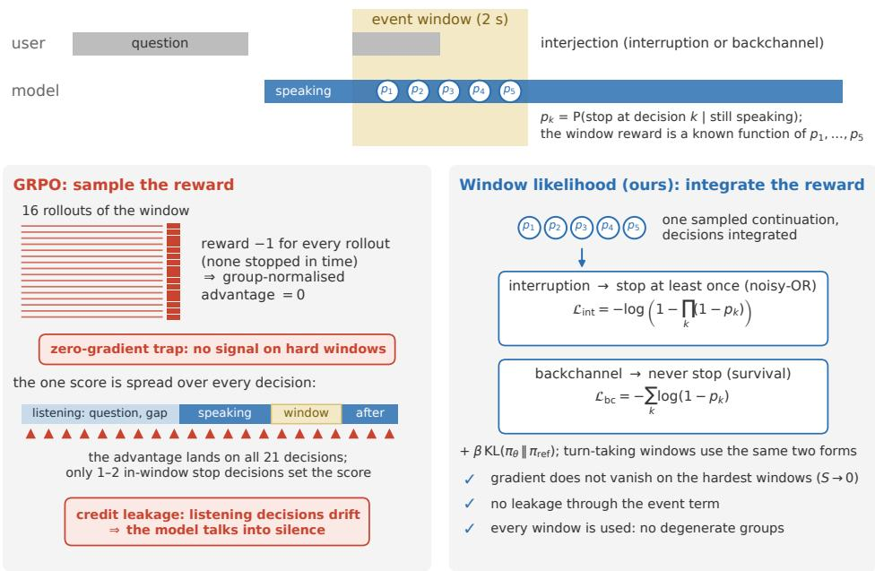
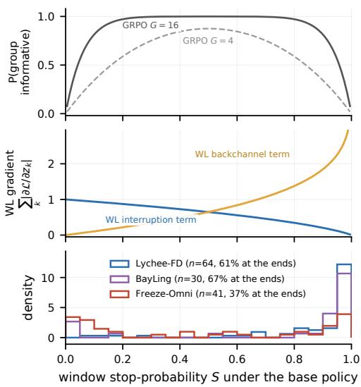
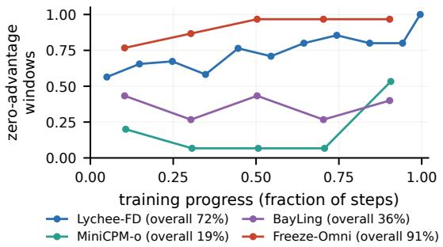
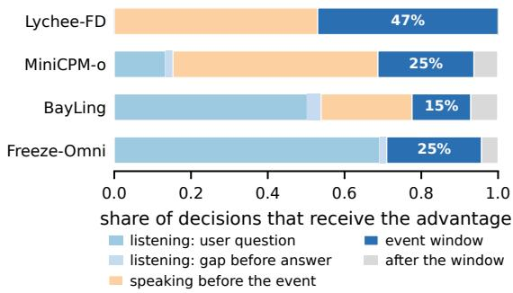
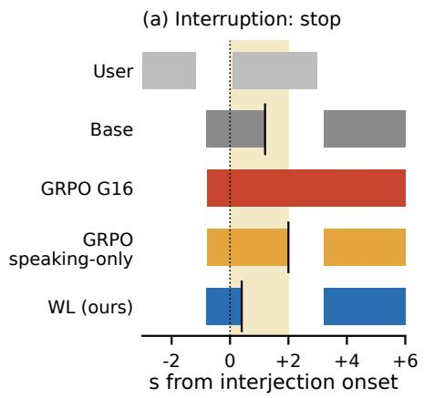
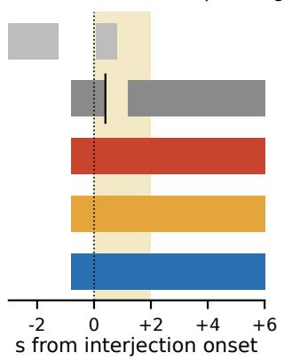
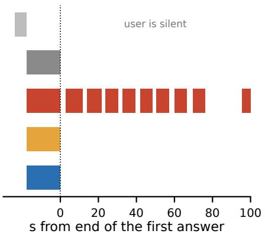
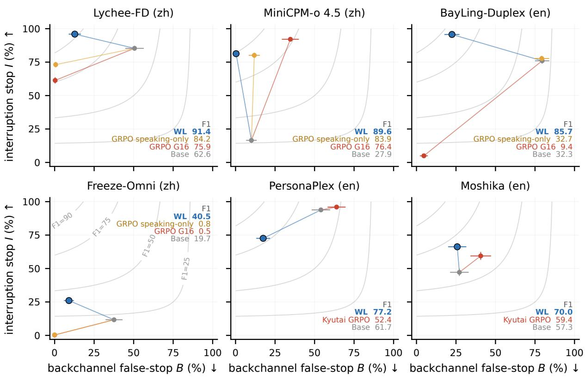
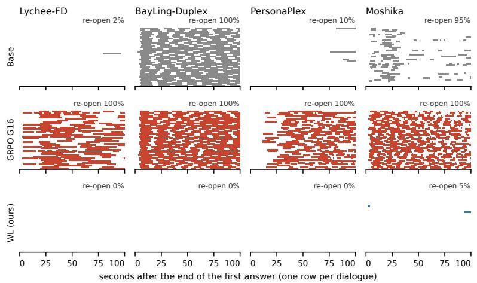
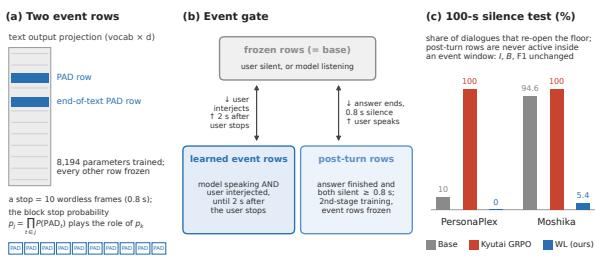

# Integrate the Reward, Don’t Sample It: Window Likelihood for Interruptions and Backchannels in Full-Duplex Speech Models

Guoqiang Hu1,2 Lichao Zhang2 Yizhou Peng1 Yuhao Luo2 Haifeng Hu2 Sallen Sun2 Will Yang2 Eng Siong Chng1 1Nanyang Technological University, Singapore 2Tencent guoqiang002@e.ntu.edu.sg

## Abstract

A full-duplex spoken dialogue model must yield when the user cuts in and hold when the user merely backchannels. Sequence-level RL with a timing reward (GRPO) is the usual recipe; we test its whole-rollout form on four open models and find two failures. A binary window reward gives zero advantage on exactly the windows that most need learning (a zero-gradient trap), and the one score per rollout is spread over listening-state decisions the reward is not written in terms of (credit leakage), so the model talks into silence or stops answering. Both come from sampling a reward that is a known function of a few binary control decisions. We propose window likelihood (WL): sample a continuation per window, but integrate in closed form over the stop decisions it visits and maximise the log-probability of acting correctly—a noisy-OR for yielding, a survival product for holding. On HumDial-FDBench, WL gives the best yield/hold F1 on all six structurally different open models we post-train, exceeds Kyutai’s released GRPO checkpoints (trained on different data), and adds no re-opening of the floor on any model.

## 1 Introduction

Full-duplex spoken dialogue models (Nguyen et al., 2023; Défossez et al., 2024; Veluri et al., 2024; Wang et al., 2025; Liu et al., 2026) emit speech and consume the user’s audio in the same stream, so the user can speak at any time. This makes one decision central: when the user starts talking while the model is talking, should the model yield or hold? An interruption (“wait, what about the price?”) calls for an immediate stop; a backchannel (“uh-huh”, “right”) calls for continuing. Open models get this wrong in both directions. Moshi yields to only a minority of real interruptions (Arora et al., 2025), while the released Lychee-FD stops on half of the user’s backchannels (Liu et al., 2026). The two errors sit on a seesaw: post-training that makes a model stop more also makes it stop on backchannels, and vice versa.

The common remedy is reinforcement learning (RL) with a timing reward (Chen et al., 2025; Ohashi et al., 2026; Li et al., 2026; Hsiao et al., 2026; Jung et al., 2026): sample several continuations of a dialogue window, score each by whether the model stopped when it should, and update with a group-relative advantage (GRPO; Shao et al., 2024). We ran one deliberately whole-rollout GRPO configuration (§5.1) on four open models that expose an explicit stop decision, and found two failures:

• Zero-gradient trap. The window reward is binary. When all rollouts agree, the groupnormalised advantage is zero: harmless on a window the policy already handles, a trap on the hard ones, where the base policy almost never stops (an interruption) or almost always stops (a backchannel). The windows on which all 16 rollouts fail are 23–34% of training windows on the three models we measured (§5.4).

• Credit leakage. One score per rollout is spread over every decision in it, but only one or two in-window stop decisions determine the score. Most of the credited decisions are listening-state decisions (“when do I start talking?”), which the reward is not written in terms of, and the result is a side effect the reward never asked for: after GRPO, Lychee-FD re-opens the floor in every 100-s silence and Freeze-Omni stops answering the first question.

Figure 4 (Appendix B) shows both failures, and the intended behaviour, on one model. Both failures share a cause (Figure 1): GRPO treats the window reward as a black-box scalar on the whole rollout, when it is a known function of a handful of binary control decisions inside that window. Sampling a known function of a few Bernoulli variables is wasteful, because its expectation is available in closed form; spreading its score over every decision is misplaced, because the function names the decisions it depends on. We therefore marginalise the control decisions of the sampled continuation in closed form and maximise the resulting expected window reward as a log-likelihood, which we call window likelihood (WL). Two properties follow from the form of the objective (§4.2), one for each failure above.

On HumDial-FDBench (Zhao et al., 2026; Wang et al., 2026), the only public benchmark we know of with real-recorded interruptions and user backchannels in two languages, WL gives the best yield/hold F1 on all six models, 13 to 62 points above the base (Table 1); matched on event-window rollouts, GRPO trails where it trains stably and collapses elsewhere, with a side effect on three of the four models. On PersonaPlex and Moshika, which have no control token, WL trains two rows of the text output projection and exceeds Kyutai’s released GRPO checkpoints while adding no silence side effect.

We contribute (i) window likelihood, a closedform replacement for sampled window rewards whose recipe applies whenever a verifiable reward is a known function of a few policy probabilities (§4); (ii) a measured account of two failures of whole-rollout GRPO on full-duplex models, with a causal ablation (§5.4); and (iii) a judge-free closedloop protocol that also catches silence side effects, with results on six models (§5).

## 2 Related Work

Full-duplex models. Open full-duplex models (Nguyen et al., 2023; Défossez et al., 2024; Veluri et al., 2024; Zhang et al., 2024; Ma et al., 2025; Zhang et al., 2025; Yu et al., 2025b) differ in how, and whether, the stop decision is expressed (control branch, control tokens, VAD-gated state classifier, or none); we post-train one model of each kind (§5.1).

Post-training for timing. Chen et al. (2025) apply online RL that balances barge-in against backchannel continuation on their own 1.1B model and synthetic tests. Ohashi et al. (2026) post-train Moshika and PersonaPlex with GRPO (G=16 rollouts per group) using rule-based rewards on four axes and an LLM content reward; we evaluate their released checkpoints. DuplexPO (Li et al., 2026)

applies GRPO only inside critical interaction windows with the history teacher-forced, which keeps the credit local but still samples the reward, and does not evaluate holding through a user backchannel. ASPIRin (Hsiao et al., 2026) projects the action space onto speak/silent but still samples; HiPLEX (Jung et al., 2026) routes sampled advantages to control decisions through event-causal masks, which is close to our speaking-only ablation. Preference-based variants build timing pairs offline (Wu et al., 2025a; Fang et al., 2026; Yu et al., 2025b); all of these estimate the reward by sampling.

Degenerate groups. Uniform groups with zero centred advantage are a known weakness of binary group rewards (Nie et al., 2026); the proposed fixes keep sampling—a sign advantage (Nie et al., 2026), group splitting (Deng et al., 2026), dynamic sampling (Yu et al., 2025a). We do not repair the sampler; we take the timing reward out of it.

## 3 Yield/Hold Decisions in Event Windows

Event windows and control decisions. A training dialogue contains the user’s first utterance, the model’s answer, and an interjection that starts at time $t _ { 0 }$ while the model is speaking. The interjection is labelled as an interruption or a backchannel. The event window is $[ t _ { 0 } , t _ { 0 } + 2 \mathrm { s } ]$ . Inside it the model makes K binary control decisions at its own decision rate (every 0.4 s for Lychee-FD, so $K \leq 5 ;$ every text position for MiniCPM-o and BayLing; every VAD frame for Freeze-Omni; every 80-ms frame for the Moshi family). A stop inside the window is a yield. What counts as a stop depends on the interface: the stop state of Lychee-FD’s control branch, the listen / turn-eos tokens of MiniCPMo, [EPAD] for BayLing, state 1 of Freeze-Omni’s state head, and a wordless block for the Moshi family (§4.3). Let $p _ { k } \in ( 0 , 1 )$ be the model’s probability of stopping at decision k, conditioned on the dialogue prefix in which it has kept speaking up to k. Given that prefix, which fixes one sampled content path, the probability that the model stops at least once within the window is

$$
S = 1 - \prod _ { k = 1 } ^ { K } ( 1 - p _ { k } ) ,\tag{1}
$$

with no independence assumption, because each $p _ { k }$ is already conditioned on the “kept speaking so far” prefix.

Metrics. Interruption stop rate I is the fraction of interruptions after which the model stops within 2 s; backchannel false-stop rate B is the fraction of backchannels after which it stops within 2 s. Their harmonic combination

$$
\mathrm { F } 1 = \frac { 2 I \left( 1 - B \right) } { I + 1 - B }\tag{2}
$$

is high only when the model both yields to interruptions and holds through backchannels; we call it F1 by analogy, as the harmonic mean of the yield rate I and the hold rate 1 − B. A fourth measure, the 100-s silence test, is defined with the protocol in §5.2.

## 4 Window Likelihood: Integrating over Control Decisions

## 4.1 Closed-Form Expected Window Reward as a Likelihood

We keep GRPO’s sampled continuation and replace its sampled score: the expected window reward is computed from the $p _ { k }$ in closed form and maximised as a log-likelihood,

$$
\mathcal { L } _ { \mathrm { i n t } } = - \log \Big ( 1 - \prod _ { k } ( 1 - p _ { k } ) \Big ) ,\tag{3}
$$

$$
\mathcal { L } _ { \mathrm { b c } } = - \sum _ { k } \log ( 1 - p _ { k } ) .\tag{4}
$$

Here k runs over the stop decisions visited inside the window (defined in the next paragraph). Equation (3) is a noisy-OR: the model stops at least once inside the window. Equation (4) is a survival likelihood: the model never stops inside the window. Both forms are standard—the noisy-OR of multiple-instance learning (Maron and Lozano-Pérez, 1998; Viola et al., 2006) and the discretetime survival likelihood (Singer and Willett, 1993); what is new is their use in place of a sampled turntaking reward. Unlike supervised training on a labelled stop time, nothing inside the window is labelled: the model may stop at any of its decisions, which is the multiple-instance setting.

The $p _ { k }$ come from a teacher-forced pass over a continuation sampled from the current policy (the rollout; one or two per window, Appendix A), at the speaking-state stop decisions visited inside the window, up to the continuation’s own stop if it has one. The visited decisions are marginalised in closed form; the content and any early stop are held fixed, and no gradient flows through the sampling.

WL is therefore a teacher-forced likelihood on selfgenerated continuations—a surrogate rather than an unbiased estimator of the expected reward. There is no reward model, no group and no advantage.

Recipe. The same three steps apply to any timing reward that is a known function of a few control decisions: name the decisions the reward depends on; write “at least once” as a noisy-OR and “never” as a survival product; teacher-force one rollout and add the log-likelihood as the timing term. The two auxiliary terms below are instances.

Auxiliary terms. Two further terms reuse the same two forms on timing events that every training dialogue already contains. A pre-event term $\mathcal { L } _ { \mathrm { p r e } }$ applies the survival form to the stop decisions between the model’s onset and $t _ { 0 }$ , so that the model is still speaking when the user comes in. A turntaking term ${ \mathcal L } _ { \mathrm { t t } }$ applies the noisy-OR to the startspeaking decisions in the 2 s after the user’s first utterance ends, and the survival form to those decisions while the user is still talking. The total loss is

$$
\mathcal { L } = \mathcal { L } _ { \mathrm { e v e n t } } + 0 . 5 \mathcal { L } _ { \mathrm { p r e } } + \mathcal { L } _ { \mathrm { t t } } + \beta \mathrm { K L } ( \pi _ { \theta } \| \pi _ { \mathrm { r e f } } ) ,\tag{5}
$$

with $\mathcal { L } _ { \mathrm { e v e n t } }$ equal to (3) or (4) according to the label, $\pi _ { \theta }$ the policy, $\pi _ { \mathrm { r e f } }$ the base model, and $\beta =$ 0.05 (0.1 for the Moshi family). Each auxiliary term is used only where the control channel also governs that decision (Appendix A lists the terms per model); the Moshi family uses neither (§4.3).

## 4.2 Two Properties That Follow from the Form

Let $z _ { k }$ be the logit of $p _ { k }$ and S the window stop probability (1).

The gradient does not vanish on the hardest windows. Since $\partial S / \partial z _ { k } = ( 1 - S ) p _ { k }$ vanishes as $O ( S )$ , maximising S itself would fade on exactly the windows where the base policy almost never stops. The log-likelihood (3) divides by S: ${ \partial \mathcal { L } _ { \mathrm { i n t } } } / { \partial z _ { k } } = - ( 1 - S ) p _ { k } / S$ is O(1) per decision (note $p _ { k } \leq S )$ and its sum over the window stays $\Theta ( 1 )$ as $S  0$ , decaying only as $S \to 1 ;$ for the backchannel term, $\partial \mathcal { L } _ { \mathrm { b c } } / \partial z _ { k } = p _ { k }$ . Integration removes the sampling variance and the uniform groups; the logarithm removes the vanishing.

A G-rollout GRPO group on the same window is informative with probability $1 - S ^ { G } - ( 1 - S ) ^ { G }$ Figure 2 plots both against S. They are different quantities, so the comparison is where each vanishes: GRPO’s probability at both ends, WL’s gradient only at the solved end. $\operatorname { A t } S = 0 . 0 2 \mathrm { a } G { = } 1 6$ group is informative with probability 0.28 (0.08 for G=4), while the WL interruption gradient over K=5 equal-probability decisions has magnitude 0.99; at S = 0.98 the backchannel gradient is 2.7 against the same 0.28. GRPO’s expected gradient on such a window is not zero, but it arrives through a rare informative group with high variance; WL delivers a Θ(1) gradient on every step, with no variance from the score itself. Where the base policies actually sit is measured in §5.4.

  
Figure 1: One event window, two ways to learn from it. Top: the user interjects while the model is speaking; inside the 2-s window the model makes a few binary stop decisions $p _ { 1 } , \ldots , p _ { K }$ , and the window reward is a known function of them. Left (GRPO): 16 sampled rollouts, one score each, spread over every decision in the rollout. Right (window likelihood): one sampled continuation; the expected reward is computed from its $p _ { k }$ in closed form and maximised as a likelihood.

  
Figure 2: Learning signal on one window against its stop probability S under the current policy. Top: probability that a GRPO group of G rollouts is informative. Middle: WL gradient magnitude $\textstyle \sum _ { k } | \partial { \mathcal { L } } / \partial z _ { k } |$ over K=5 equal-probability decisions, for the interruption term (want S → 1) and the backchannel term (want S → 0). Bottom: distribution of S over training windows under the base policies.

Gradient only where the reward depends on it. For models with a control channel, the event terms place gradient only on the in-window stop decisions: decisions made while listening (when to start the first answer, whether to talk into silence) do not appear in them, so a window reward cannot leak into them without a mask. Keeping those decisions from drifting for other reasons additionally needs the turn-taking term on the control-channel models, and the gate on the Moshi family (§4.3, Appendix D).

## 4.3 Instantiation for Models without a Control Token

PersonaPlex and Moshika (Défossez et al., 2024; Roy et al., 2026) have no stop decision: the text stream simply emits PAD while the model is silent. We instantiate WL with three components (Fig-

ure 7; Appendix D).

Projected stop. A stop is a run of ten consecutive wordless 80-ms frames (0.8 s, the merge gap also used in evaluation). The block score $\begin{array} { r } { p _ { j } \ = \ \prod _ { t \in j } P ( \mathrm { P A D } _ { t } ) } \end{array}$ is a product of teacherforced marginals along the sampled, worded prefix, a surrogate for the block probability. The survival form (4) is applied to the $p _ { j }$ ; because blocks overlap, the noisy-OR (3) is replaced by $\begin{array} { r } { - \log \operatorname* { m i n } ( \sum _ { j } p _ { j } , 1 ) } \end{array}$ , a monotone surrogate built on the union bound. On this family, therefore, both terms are surrogates rather than likelihoods.

Event rows. Only the PAD and end-of-text PAD rows of the text output projection are trained (8,194 parameters), so the model can change whether a word or PAD is emitted but not what is said—the separation that Lychee-FD gets from its control branch.

Event gate. PAD also encodes “stay silent while listening”, so an ungated readout leaks into the listening state exactly as GRPO does. The event rows are therefore switched in only while a yield/hold decision is defined—from the moment the user starts talking over the model until 2 s after the user stops— and the frozen rows elsewhere; the gate reads only the two audio channels (thresholds in Appendix D). A second pair ofpost-turn rows, trained in a second stage, removes the base model’s own re-opening after an answer with I and B unchanged.

## 5 Experiments

## 5.1 Experimental Setup

Models. We train the control head of Lychee-FD, an attention LoRA on MiniCPM-o and BayLing-Duplex, the state head of Freeze-Omni, and two text-projection rows on PersonaPlex and Moshika (Table 2, Appendix A). BayLing was never trained on backchannels; Freeze-Omni opens the floor only when its VAD fires, so its characteristic failure is not answering.

Training data. All models are trained only on the interruption and backchannel clips of the Hum-Dial Track-2 training set (Wang et al., 2026) in the model’s test language (Chinese for Lychee-FD, MiniCPM-o and Freeze-Omni; English for the others). No silence, monologue or synthetic data is constructed; the only exception is the Moshi postturn stage (§4.3), which uses the 16 s after the answer in the same backchannel dialogues. The training and test speakers and dialogues are disjoint.

Baseline: whole-rollout GRPO. One deliberately standard configuration (“GRPO G16” in tables): one window and 16 rollouts per step, ${ \bf a } \pm 1$ window reward, and a group-normalised advantage on every decision of the rollout, with the same KL weight, trained parameters and learning rate as WL (mechanics in Appendix A). Rollouts begin before the model’s first answer by our choice, so the policy also makes the listening-state decisions; windowed variants such as DuplexPO start inside the window, and the speaking-only ablation below is our nearest analogue. The two are matched on event-window rollouts and trained parameters; the remaining confounds (auxiliary terms, windows per step) are stated in §5.4.

Ablation: GRPO speaking-only. Identical, but the advantage is applied only to decisions made while the model is speaking; this is the causal ablation of §5.4.

Reference: Kyutai GRPO. The authors’ released checkpoints of Ohashi et al. (2026) for PersonaPlex and Moshika, trained with G=16 on 4,000 h of dialogue with multi-axis LLM-judged rewards. We build no GRPO baseline of our own for these two models: without a control channel, both the action projection and the speaking-state definition would be ours to invent.

Test set. Turn-taking benchmarks include Full-Duplex-Bench (Lin et al., 2025), Talking Turns (Arora et al., 2025), SID-Bench (Xia et al., 2026) and HumDial (Zhao et al., 2026); we use HumDial-FDBench (Zhao et al., 2026) because it contains real-recorded interruptions and user backchannels in two languages. It provides, per language, 1,500 real-recorded interruptions in five categories (ask a follow-up, deny, ask to repeat, shift topic, ask to wait; 300 each) and 300 user backchannels (examples in Table 3, Appendix B). Chinese is used for Lychee-FD, MiniCPM-o and Freeze-Omni, English for the others; third-party-speech categories are out of scope. Every configuration is a single training run; we report 95% bootstrap confidence intervals over test items (Appendix B).

## 5.2 Closed-Loop Evaluation Protocol

Timing behaviour can only be measured when the event actually happens: an interruption that arrives while the model is silent tests nothing. Benchmarks that replay a fixed user track, such as Full-Duplex-Bench and the official HumDial scoring, cannot guarantee this, because when a model starts and stops talking differs from model to model. We therefore evaluate all six models with one closedloop protocol.

Injection anchored to the model’s speech. The simulator plays the user’s question, waits for the model to start answering, and injects the real interjection recording 0.8, 1.6 or 2.4 s after the model’s onset (rotated across items). An item is valid only if the model is still speaking at injection time; invalid items are dropped and the valid count n is reported, so a model cannot score by staying silent. The same clips, delays and seeds are used for every model and configuration.

One window, one readout per family. An interruption counts as a yield, and a backchannel as a false stop, if the model’s own stop decision fires within 2 s of the interjection onset—the same window for every model, Freeze-Omni included. The decision is read from the channel of Table 2; for the Moshi family it is a gap of ≥0.8 s in output energy (within-answer pauses exceed 0.8 s in only 1–2.5% of cases, and a 1.2-s criterion preserves every ordering in Table 1). Reading the decision instead of transcribing the audio makes the metric deterministic and reproducible, and keeps it independent of each model’s speech quality.

No LLM judge. The official HumDial scoring labels ASR transcripts with DeepSeek-V3 without human validation (Wang et al., 2026), and transcript judges agree with humans only moderately on turn-taking (Krippendorff’s α = 0.61 in Full-Duplex-Bench v2, Lin et al., 2026; below 80% agreement in Talking Turns, Arora et al., 2025; scores that have not reproduced across papers, Ohashi et al., 2026; Jung et al., 2026). More fundamentally, a transcript records what was said, not when the model decided to stop; we therefore use no judge, and I, B and F1 follow from binary events on the model’s own timeline.

Silence test. A timing reward can also be satisfied by talking more. To catch this we add a test that event-window training never touches: the user asks one question, the model answers, and the user then stays silent for 100 s. We report how often the model re-opens the floor, i.e. talks into silence, and how many seconds it speaks in the window

(40 English questions shared by all six models;   
Appendix B).

## 5.3 Main Results: Yielding and Holding on Six Models

Overall. Table 1 gives the full-set results (operating points in Figure 5, Appendix B). WL has the highest F1 on every model, and its test-item CI is disjoint from the runner-up’s on all six (the smallest gap is MiniCPM-o: 89.6±1.2 against 83.9±2.0). On Lychee-FD and MiniCPM-o, where GRPO trained stably at the shared learning rate, WL exceeds the best GRPO variant by 7.2 and 5.7 F1; the BayLing and Freeze-Omni GRPO runs collapsed, and the GRPO runs on three of the four models carry a side effect the reward never asked for. §5.4 states what the gap can and cannot be attributed to.

Per model. GRPO fails differently on each control-channel model. It stops less on Lychee-FD (I 85.3→61.3) and over-stops on MiniCPM-o backchannels (B 34.7%). On BayLing it collapses interruption handling (I 76.0→4.9), and on Freeze-Omni it suppresses the single “stop and answer” state, so only 375 of 1,500 interruptions remain valid. WL raises F1 on every model; PersonaPlex alone does so by trading stop rate (93.8→72.6) for a third of the false stops, and Freeze-Omni’s absolute level stays low (§7).

Side effects under silence. Figure 6 (Appendix B) shows the behaviour behind the last column of Table 1. Freeze-Omni cannot re-open without a VAD trigger, and no MiniCPM-o configuration does. On the other four models, every GRPO run, ours and Kyutai’s, re-opens in 100% of silences and fills 41–68 s of the window. Our GRPO induces the behaviour on Lychee-FD (2.5%→100%) and keeps BayLing’s pre-existing re-opening (100%); Kyutai’s checkpoints show it on PersonaPlex (10%→100%) and Moshika (94.6%→100%), which we do not attribute to GRPO as such. WL re-opens in 0% of silences on five models and 5.4% on Moshika; BayLing’s 0% is over the 28 of 40 dialogues whose first answer ends, the opposite failure (§7).

By interruption category. Appendix C splits I by category. “Wait” (“hold on, talk later”) is the hardest category for every model and “deny” second; WL on Lychee-FD and BayLing is above 84% in every category. WL trails a GRPO configuration on two models: MiniCPM-o in every category (most on “wait”, 54.8 vs 83.6, bought with 0.3% vs 34.7% false stops) and PersonaPlex (§7).

<table><tr><td>Model</td><td>Configuration</td><td>I (%) ↑</td><td>n</td><td>B (%)↓</td><td>n</td><td>F1↑</td><td>100-s silence: re-open / s</td></tr><tr><td rowspan="4">Lychee-FD (zh)</td><td>Base</td><td> $8 5 . 3 \pm 1 . 9$ </td><td>1369</td><td> $5 0 . 5 \pm 5 . 9$ </td><td>273</td><td> $6 2 . 6 \pm 4 . 8$ </td><td>2.5% / 0.4 s</td></tr><tr><td>GRPO G16</td><td> $6 1 . 3 \pm 2 . 3$ </td><td>1500</td><td>0.3</td><td>300</td><td> $7 5 . 9 \pm 1 . 8$ </td><td>100% / 45.8 s</td></tr><tr><td>GRPO speaking-only</td><td> $7 3 . 1 \pm 2 . 1$ </td><td>1499</td><td>0.7</td><td>300</td><td> $8 4 . 2 \pm 1 . 4$ </td><td>0% / 0 s</td></tr><tr><td>WL (ours)</td><td> ${ \bf 9 5 . 9 \pm 1 . 0 }$ </td><td>1475</td><td> $1 2 . 8 \pm 3 . 9$ </td><td>298</td><td> ${ \bf 9 1 . 4 \pm 2 . 1 }$ </td><td>0% / 0 s</td></tr><tr><td rowspan="4">MiniCPM-0 4.5 (zh)</td><td>Base</td><td> $1 6 . 5 \pm 1 . 9$ </td><td>1447</td><td> $1 0 . 0 \pm 3 . 3$ </td><td>299</td><td> $2 7 . 9 \pm 2 . 7$ </td><td>0% / 0 s</td></tr><tr><td>GRPO G16</td><td> ${ \bf 9 2 . 1 \pm 1 . 4 }$ </td><td>1440</td><td> $3 4 . 7 \pm 5 . 4$ </td><td>297</td><td> $7 6 . 4 \pm 3 . 8$ </td><td>0% / 0 s</td></tr><tr><td>GRPO speaking-only</td><td> $8 0 . 1 \pm 1 . 9$ </td><td>1452</td><td> $1 1 . 9 \pm 3 . 6$ </td><td>295</td><td> $8 3 . 9 \pm 2 . 0$ </td><td>0% / 0 s</td></tr><tr><td>WL (ours)</td><td> $8 1 . 3 \pm 1 . 9$ </td><td>1450</td><td>0.3</td><td>296</td><td> ${ \bf 8 9 . 6 \pm 1 . 2 }$ </td><td>0% / 0 s</td></tr><tr><td rowspan="4">BayLing-Duplex (en)</td><td>Base</td><td> $7 6 . 0 \pm 2 . 1$ </td><td>1483</td><td> $7 9 . 5 \pm 4 . 5$ </td><td>298</td><td> $3 2 . 3 \pm 5 . 6$ </td><td>100% / 69.0 s</td></tr><tr><td>GRPO G16</td><td> $4 . 9 \pm 1 . 1$ </td><td>1495</td><td> $4 . 7 \pm 2 . 5$ </td><td>299</td><td> $9 . 4 \pm 2 . 0$ </td><td>100% / 67.9 s</td></tr><tr><td>GRPO speaking-only</td><td> $7 7 . 7 \pm 2 . 0$ </td><td>1489</td><td> $7 9 . 3 \pm 4 . 7$ </td><td>299</td><td> $3 2 . 7 \pm 5 . 8$ </td><td> $1 0 0 \% / 6 6 . 6 \mathrm { ~ s ~ }$ </td></tr><tr><td>WL (ours)</td><td> $\mathbf { 9 5 . 7 \pm 1 . 0 }$ </td><td>1434</td><td> $2 2 . 4 \pm 4 . 8$ </td><td>294</td><td> $\mathbf { 8 5 . 7 \pm 2 . 9 }$ </td><td> $\mathbf { 0 \% } / \mathbf { 0 \leq } ^ { \dag }$ </td></tr><tr><td rowspan="4">Freeze-Omni (zh)</td><td>Base</td><td> $1 1 . 7 \pm 1 . 5$ </td><td>1457</td><td> $3 7 . 6 \pm 5 . 4$ </td><td>298</td><td> $1 9 . 7 \pm 2 . 2$ </td><td>0% / 0 s</td></tr><tr><td>GRPO G16</td><td>0.3</td><td>375</td><td>0.0</td><td>104</td><td>0.5</td><td>0% / 0 s</td></tr><tr><td>GRPO speaking-only</td><td>0.4</td><td>779</td><td>0.0</td><td>168</td><td></td><td>0.8 0% / 0 s</td></tr><tr><td>WL (ours)</td><td> ${ \bf 2 6 . 0 \pm 2 . 2 }$ </td><td>1448</td><td> $9 . 1 \pm 3 . 2$ </td><td>298</td><td> ${ \bf 4 0 . 5 \pm 2 . 7 }$ </td><td>0% / 0 s</td></tr><tr><td rowspan="3">PersonaPlex (en)</td><td>Base</td><td> $9 3 . 8 \pm 1 . 2$ </td><td>1407</td><td> $5 4 . 0 \pm 5 . 8$ </td><td>274</td><td> $6 1 . 7 \pm 5 . 4$ </td><td> $1 0 \% / 1 . 4 \mathrm { s }$ </td></tr><tr><td>Kyutai GRPO†</td><td> ${ \bf 9 6 . 0 \pm 1 . 0 }$ </td><td>1411</td><td> $6 3 . 9 \pm 5 . 7$ </td><td>280</td><td> $5 2 . 4 \pm 6 . 0$ </td><td> $1 0 0 \% / 4 0 . 9 \mathrm { s }$ </td></tr><tr><td>WL (ours)</td><td> $7 2 . 6 \pm 2 . 2$ </td><td>1440</td><td> $1 7 . 5 \pm 4 . 4$ </td><td>286</td><td> $7 7 . 2 \pm 2 . 3$ </td><td> $\mathbf { 0 \% } / \mathbf { 0 \leq }$ </td></tr><tr><td rowspan="3">Moshika (en)</td><td>Base</td><td> $4 7 . 2 \pm 2 . 7$ </td><td>1200</td><td> $2 7 . 1 \pm 5 . 9$ </td><td>221</td><td> $5 7 . 3 \pm 2 . 8$ </td><td> $9 4 . 6 \% / \ 1 3 . 4 \ \mathrm { s }$ </td></tr><tr><td>Kyutai  $\mathrm { G R P O ^ { \dag } }$ </td><td> $5 9 . 4 \pm 3 . 0$ </td><td>1057</td><td> $4 0 . 7 \pm 6 . 5$ </td><td>214</td><td> $5 9 . 4 \pm 3 . 6 $ </td><td> $1 0 0 \% / 5 2 . 4 \mathrm { ~ s ~ }$ </td></tr><tr><td>WL (ours)</td><td> ${ \bf 6 6 . 3 \pm 2 . 6 }$ </td><td>1203</td><td> $2 5 . 8 \pm 5 . 8$ </td><td>217</td><td> ${ \bf 7 0 . 0 \pm 2 . 9 }$ </td><td> $5 . 4 \% / 0 . 2 s$ </td></tr></table>

Table 1: HumDial-FDBench full test set, one 2-s window for all models. $n = { \mathrm { v a l i d } }$ items; $\pm = 9 5 \%$ bootstrap CI half-width over test items (omitted at or near 0/100%). Silence: re-open rate / seconds of speech in the 100-s window over dialogues whose first answer ended (Appendix B); ‡12 of 40 first answers do not end. †Authors released checkpoints (Ohashi et al., 2026), different data and reward. Bold: best per column within a model.

## 5.4 Two GRPO Failures, Measured

Zero-gradient trap. In our GRPO runs, the share of training windows on which all 16 rollouts agree is 72% for Lychee-FD, 19% for MiniCPM-o, 36% for BayLing and 91% for Freeze-Omni (Figure 3a). The trap is driven by individual windows, not by the average stop rate: on 64 Lychee-FD training windows the mean stop probability is 0.885, yet 61% of the windows sit at $S \le 0 . 0 5$ or $S \geq 0 . 9 5$ (Figure 2, bottom). The windows on the wrong side of the extreme, where all 16 rollouts fail, are 23% of Lychee-FD’s, 33% of BayLing’s and 34% of Freeze-Omni’s training windows (64, 30 and 41 windows logged). A sampled group yields nothing on them, and they are where the WL gradient is largest (§4.2).

Credit leakage and its causal ablation. Figure 3b measures how much of GRPO’s advantage lands on decisions the reward does not depend on. The event window holds 47% of the credited decisions for Lychee-FD, 25% for MiniCPMo and Freeze-Omni, and 15% for BayLing. For

Freeze-Omni, 69% of credited decisions are listening decisions made while the user is still asking the first question—the direct source of its no-answer failure; for BayLing, 50% fall in the question and 24% in the answer before the event. The speaking-only ablation (Table 1) is the causal test: removing the gradient from listening decisions removes Lychee-FD’s talking into silence (100%→0%), cuts MiniCPM-o’s false stops (34.7%→11.9%), removes BayLing’s collapse without improving on the base (I 4.9%→77.7%, F1 32.7 vs 32.3) and halves Freeze-Omni’s noanswer rate on development-subset interruptions (72%→50%) while still collapsing. The ablation thus localises the collapses to listening-state credit but does not recover a working GRPO, and it stays below WL on all four models (84.2 / 83.9 / 32.7 / 0.8). We cannot attribute the remaining gap to the zero-gradient trap alone: WL also receives the auxiliary terms and sees more distinct windows per step, neither of which the GRPO baseline has, and on MiniCPM-o, where only 19% of groups are uniform, the gap is still 5.7 F1. WL’s own freedom from leakage is measured for the full loss of (5); the event term alone is not isolated.

  
Figure 3: Two failures of whole-rollout GRPO, measured. (a) Fraction of training windows (one per step) with zero advantage, i.e. all 16 rollouts identical, over training; the overall fraction is in parentheses; per window the zero-advantage probability averages 0.656 on Lychee-FD against 0.141 from the mean S, the Jensen gap of Nie et al. (2026). (b) Where the whole-rollout credit lands: share of decisions, by dialogue state, that receive the advantage (base-policy rollouts cut at injection + 2.5 s); only the dark segment is inside the event window.

## 6 Conclusion

Window likelihood replaces a sampled window reward by its closed-form expectation over the few control decisions the reward depends on. On six open full-duplex models with four control interfaces it gives the best yield/hold F1 and shows neither of the two GRPO failures we measured, while training only a stop-decision head where one exists and an attention LoRA otherwise. We argue the same move applies whenever a verifiable reward is a known function of a few policy probabilities, and WL could serve as the timing term inside windowed RL.

## 7 Limitations

Absolute level on Freeze-Omni. WL improves Freeze-Omni from F1 19.7 to 40.5, still low: its VAD-gated linear state head cannot separate “the user is still asking” from “the user has just asked”, and the window data carry no information about that distinction.

Shared control tokens. In BayLing-Duplex, [EPAD] means both “yield” and “end of answer”, so suppressing it on backchannels leaks into answer endings: 30% of WL’s first answers do not end within 120 s in the silence test (Appendix B).

Moshi family. WL on PersonaPlex trades stop rate for fewer false stops (repeat / shift / wait fall to 68 / 72 / 62%); the event-row readout moves the operating point rather than improving discrimination (a linear probe reaches AUC 0.795 against 0.769 for the base readout). Moshika WL still reopens in 2 of 37 silences with non-verbal audio that text-projection rows cannot control.

Scope. Our numbers are not comparable with the official HumDial leaderboard, which judges transcripts (§5.2). The study uses one benchmark and one training seed per configuration.

## References

Siddhant Arora, Zhiyun Lu, Chung-Cheng Chiu, Ruoming Pang, and Shinji Watanabe. 2025. Talking turns: Benchmarking audio foundation models on turntaking dynamics. In Proceedings of ICLR.

Chen Chen, Ke Hu, Chao-Han Huck Yang, Ankita Pasad, Edresson Casanova, Weiqing Wang, Szu-Wei Fu, Jason Li, Zhehuai Chen, Jagadeesh Balam, and Boris Ginsburg. 2025. Reinforcement learning enhanced full-duplex spoken dialogue language models for conversational interactions. In Proceedings of the Conference on Language Modeling (COLM).

Junbo Cui, Bokai Xu, Chongyi Wang, Tianyu Yu, Weiyue Sun, Yingjing Xu, Tianran Wang, Zhihui He, Wenshuo Ma, Tianchi Cai, et al. 2026. MiniCPM-o 4.5: Towards real-time full-duplex omni-modal interaction. ArXiv:2604.27393.

Alexandre Défossez, Laurent Mazaré, Manu Orsini, Amélie Royer, Patrick Pérez, Hervé Jégou, Edouard Grave, and Neil Zeghidour. 2024. Moshi: a speech-text foundation model for real-time dialogue. ArXiv:2410.00037.

Zeyun Deng, Yuzhe Lu, Yawei Wang, Linbo Liu, Qing Ping, Han Ding, Guande Wu, Panpan Xu, and Jun Huan. 2026. Prism-GRPO: Faster VLA policy optimization via splitting same-outcome groups. ArXiv:2608.17423.

Qingkai Fang, Shoutao Guo, and Yang Feng. 2026. BayLing-Duplex: Native full-duplex speech dialogue with a single autoregressive LLM. ArXiv:2606.14528.

Chi-Yuan Hsiao, Ke-Han Lu, Yu-Kuan Fu, Guan-Ting Lin, Hsiao-Tsung Hung, and Hung-yi Lee. 2026. ASPIRin: Action space projection for interactivityoptimized reinforcement learning in full-duplex speech language models. ArXiv:2604.10065.

Edward J. Hu, Yelong Shen, Phillip Wallis, Zeyuan Allen-Zhu, Yuanzhi Li, Shean Wang, Lu Wang, and Weizhu Chen. 2021. LoRA: Low-rank adaptation of large language models. ArXiv:2106.09685.

Kyudan Jung, Hyunsin Park, Yoonhyung Lee, Jinhwan Park, Jinhyeok Yang, KiHyun Nam, Jaegul Choo, and Jinkyu Lee. 2026. HiPLEX: Hierarchical policy factorization for full duplex speech language models. ArXiv:2610.07727.

Yuxin Li, Donghang Wu, Guan-Ting Lin, Hung-yi Lee, Chengwei Qin, Zhehuai Chen, and Chen Chen. 2026. Decoupling conversational dynamics in full-duplex spoken models through reinforcement learning. In Advances in Neural Information Processing Systems.

Guan-Ting Lin, Shih-Yun Shan Kuan, Jiatong Shi, Kai-Wei Chang, Siddhant Arora, Shinji Watanabe, and Hung-yi Lee. 2026. Full-duplex-bench-v2: A multiturn evaluation framework for duplex dialogue systems with an automated examiner. In Proceedings of ACL.

Guan-Ting Lin, Jiachen Lian, Tingle Li, Qirui Wang, Gopala Anumanchipalli, Alexander H. Liu, and Hung-yi Lee. 2025. Full-duplex-bench: A benchmark to evaluate full-duplex spoken dialogue models on turn-taking capabilities. ArXiv:2503.04721.

Zhenyu Liu, Xuanyu Zhang, Yunxin Li, Qixun Teng, Shenyuan Jiang, Haolan Chen, Mingjun Zhao, Fanbo Meng, Yu Xu, Yancheng He, Baotian Hu, Haizhou Li, and Min Zhang. 2026. Hierarchical acousticsemantic modeling: Modality separation and semantic coherence for full-duplex SLMs. In Proceedings of ACL.

Ziyang Ma, Yakun Song, Chenpeng Du, Jian Cong, Zhuo Chen, Yuping Wang, Yuxuan Wang, and Xie Chen. 2025. Language model can listen while speaking. In Proceedings of AAAI.

Oded Maron and Tomás Lozano-Pérez. 1998. A framework for multiple-instance learning. In Advances in Neural Information Processing Systems.

Tu Anh Nguyen, Eugene Kharitonov, Jade Copet, Yossi Adi, Wei-Ning Hsu, Ali Elkahky, Paden Tomasello, Robin Algayres, Benoit Sagot, Abdelrahman Mohamed, and Emmanuel Dupoux. 2023. Generative spoken dialogue language modeling. Transactions of the Association for Computational Linguistics, 11.

Wenhua Nie, Jianan Wu, Junlin Liu, Ziwei Li, Zheng Lin, Zhang Zijian, Yilong Fan, Haoran Zheng, and Jyh-Shing Roger Jang. 2026. Gradient starvation in binary-reward GRPO: Why group-mean centering fails and why the simplest fix works. ArXiv:2605.07689.

Atsumoto Ohashi, Neil Zeghidour, Alexandre Défossez, and Eugene Kharitonov. 2026. Multi-faceted interactivity alignment in full-duplex speech models. In Proceedings ofEMNLP.

Rajarshi Roy et al. 2026. PersonaPlex: Voice and role control for full duplex conversational speech models. NVIDIA preprint, https://research.nvidia. com/labs/adlr/personaplex.

Zhihong Shao, Peiyi Wang, Qihao Zhu, Runxin Xu, Junxiao Song, Xiao Bi, Haowei Zhang, Mingchuan Zhang, Y. K. Li, Y. Wu, and Daya Guo. 2024. DeepSeekMath: Pushing the limits of mathematical reasoning in open language models. ArXiv:2402.03300.

Judith D. Singer and John B. Willett. 1993. It’s about time: Using discrete-time survival analysis to study duration and the timing of events. Journal ofEducational Statistics, 18(2).

Bandhav Veluri, Benjamin N Peloquin, Bokai Yu, Hongyu Gong, and Shyamnath Gollakota. 2024. Beyond turn-based interfaces: Synchronous LLMs as full-duplex dialogue agents. In Proceedings of EMNLP.

Paul Viola, John C. Platt, and Cha Zhang. 2006. Multiple instance boosting for object detection. In Advances in Neural Information Processing Systems.

Chengyou Wang, Hongfei Xue, Guojian Li, Zhixian Zhao, Shuiyuan Wang, Shuai Wang, Xin Xu, Hui Bu, and Lei Xie. 2026. Full-duplex interaction in spoken dialogue systems: A comprehensive study from the ICASSP 2026 HumDial challenge. ArXiv:2604.21406.

Xiong Wang, Yangze Li, Chaoyou Fu, Yunhang Shen, Lei Xie, Ke Li, Xing Sun, and Long Ma. 2025. Freeze-omni: A smart and low latency speech-tospeech dialogue model with frozen LLM. In Proceedings of ICML.

Anne Wu, Laurent Mazaré, Neil Zeghidour, and Alexandre Défossez. 2025a. Aligning spoken dialogue models from user interactions. In Proceedings of ICML.

Boyong Wu, Chao Yan, Chen Hu, Cheng Yi, Chengli Feng, Fei Tian, et al. 2025b. Step-audio 2 technical report. ArXiv:2507.16632.

Kangxiang Xia, Bingshen Mu, Xian Shi, Jin Xu, and Lei Xie. 2026. Semantic-aware interruption detection in spoken dialogue systems: Benchmark, metric, and model. ArXiv:2603.24144.

Qiying Yu, Zheng Zhang, Ruofei Zhu, Yufeng Yuan, Xiaochen Zuo, Yu Yue, Weinan Dai, Tiantian Fan, Gaohong Liu, Lingjun Liu, et al. 2025a. DAPO: An open-source LLM reinforcement learning system at scale. ArXiv:2503.14476.

Wenyi Yu, Siyin Wang, Xiaoyu Yang, Xianzhao Chen, Xiaohai Tian, Jun Zhang, Guangzhi Sun, Lu Lu, Yuxuan Wang, and Chao Zhang. 2025b. SALMONNomni: A standalone speech LLM without codec injection for full-duplex conversation. In Advances in Neural Information Processing Systems.

Qinglin Zhang, Luyao Cheng, Chong Deng, Qian Chen, Wen Wang, Siqi Zheng, Jiaqing Liu, Hai Yu, Chaohong Tan, Zhihao Du, and Shiliang Zhang. 2025. OmniFlatten: An end-to-end GPT model for seamless voice conversation. In Proceedings ofACL.

Xinrong Zhang, Yingfa Chen, Shengding Hu, Xu Han, Zihang Xu, Yuanwei Xu, Weilin Zhao, Maosong Sun, and Zhiyuan Liu. 2024. Beyond the turn-based game: Enabling real-time conversations with duplex models. In Proceedings of EMNLP.

Zhixian Zhao, Shuiyuan Wang, Guojian Li, Hongfei Xue, Chengyou Wang, Shuai Wang, Longshuai Xiao, Zihan Zhang, Hui Bu, Xin Xu, Xinsheng Wang, Hexin Liu, Eng Siong Chng, Hung-yi Lee, and Lei Xie. 2026. The ICASSP 2026 HumDial challenge: Benchmarking human-like spoken dialogue systems in the LLM era. ArXiv:2601.05564.

## A Training Details

<table><tr><td>Model</td><td>Lang.</td><td>Stop decision</td><td>Trained part</td><td>GRPO comparison</td><td>Event rollouts</td></tr><tr><td>Lychee-FD (2026)</td><td>zh</td><td>control branch, one state per 0.4 s</td><td>control head</td><td>controlled</td><td>8,864</td></tr><tr><td>MiniCPM-o 4.5 (2026)</td><td>zh</td><td>listen / eos tokens (text vocabulary)</td><td>LoRA (attention)</td><td>controlled</td><td>1,200</td></tr><tr><td>BayLing-Duplex (2026)</td><td>en</td><td>[EPAD] / assistant tokens (text channel)</td><td>LoRA (attention)</td><td>controlled</td><td>2,400</td></tr><tr><td>Freeze-Omni (2025)</td><td>zh</td><td>VAD gate + state head</td><td>state head</td><td>controlled</td><td>2,400</td></tr><tr><td>PersonaPlex (2026)</td><td>en</td><td>none: silence = a run of PAD frames</td><td>2 projection rows</td><td>Kyutai GRPO</td><td>400 + 400</td></tr><tr><td>Moshika (2024)</td><td>en</td><td>none: silence = a run of PAD frames</td><td>2 projection rows</td><td>Kyutai GRPO</td><td> $1 , 6 0 0 + 1 , 6 8 0$ </td></tr></table>

Table 2: The six models and the training budget. The first four expose an explicit stop decision and support a controlled GRPO comparison with the same number of event-window rollouts (the turn-taking term on Lychee-FD adds two windows per step); the last two are compared with the authors’ released GRPO checkpoints (Ohashi et al., 2026). “Event rollouts”: sampled continuations on event windows; $\mathbf { \hat { \Sigma } } ^ { a } + b \mathbf { \hat { \Sigma } } :$ event-window stage + post-turn stage.

Common to all models. The continuation scored by WL is the model’s own answer with the interjection injected as at test time, generated as in a GRPO rollout and re-scored with a teacher-forced forward pass. “Event rollouts” in Table 2 counts these continuations; GRPO draws the same number, 16 per window on one window per step, interruption and backchannel windows alternating, no resampling. GRPO mechanics: rollouts in which the model is not speaking at injection are dropped from the group rather than scored; the advantage is (r − mean)/std over the group and multiplies the mean log-probability of the rollout’s decisions (all text positions for BayLing, control decisions otherwise); one update per group. The reward is not written in terms of listening decisions but depends on them through whether the model is speaking at injection; GRPO is credited on positions WL never scores, so the comparison tests the whole-rollout recipe rather than GRPO as such. Auxiliary terms per model: Lychee-FD pre-event and turn-taking; MiniCPM-o pre-event; BayLing-Duplex pre-event and turn-taking; Freeze-Omni turn-taking; PersonaPlex and Moshika neither (event gate and post-turn rows instead).

Lychee-FD. Control head only; 554 steps; learning rate $5 \times 1 0 ^ { - 6 } ;$ KL weight 0.05; sampling temperature 1.0 on the control branch. WL: 8 event windows × 2 continuations per step, plus 2 turn-taking windows; pre-event weight 0.5. GRPO: 1 window × 16 rollouts per step, ±1 reward; the speaking-only variant applies the advantage to decisions in the speaking state only. Lychee-FD base: Liu et al. (2026), built on Step-Audio 2 (Wu et al., 2025b).

MiniCPM-o 4.5. LoRA (Hu et al., 2021) on attention, rank 16, α = 32; learning rate $1 0 ^ { - 4 } ;$ ; KL 0.05; pre-event weight 0.5, no turn-taking term; WL 150 steps × 8 windows; GRPO 75 steps × 16 rollouts (1,200 rollouts each, so twice as many updates for WL).

BayLing-Duplex. LoRA on attention, rank 16, α = 32; learning rate $1 0 ^ { - 4 }$ ; KL 0.05 over all text positions; pre-event weight 0.5; turn-taking term; 150 steps, 16 windows or rollouts per step.

Freeze-Omni. State head only; learning rate 10−4; KL 0.05; turn-taking term (start within 2 s after the user’s question ends; do not start while the user is still asking); 150 steps, 16 windows or rollouts per step.

PersonaPlex / Moshika. Two rows (PAD, end-of-text PAD) of the text output projection; 16 training windows per step (event stage: 8 interruptions + 8 backchannels; post-turn stage: 16 backchannel dialogues run to the end of the answer plus 16 s, with a per-frame stay-silent likelihood on PAD and the event rows frozen); KL weight 0.1 over the full vocabulary; block of 10 frames; no pre-event or turn-taking term. Event stage: learning rate $3 \times 1 0 ^ { - 5 }$ , 25 steps (PersonaPlex) / 100 steps (Moshika). Post-turn stage: PersonaPlex, 25 steps at learning rate $1 0 ^ { - 4 }$ ; Moshika, 80 steps at $3 \times 1 0 ^ { - 5 }$ followed by 25 steps at $1 0 ^ { - 4 }$ (105 steps, the 1,680 windows of Table 2). Event-stage checkpoints were chosen by F1 on 57 held-out training windows (38 interruptions + 19 backchannels), never on test data; post-turn checkpoints are identical on interruption and backchannel windows by construction, so the first checkpoint (25 steps) of the 10−4 run is used. The gate is an in-place write of the two rows before each frame (a Python branch inside the forward pass is silently frozen by CUDA-graph capture).

## B Evaluation Details

<table><tr><td>Category</td><td>zh example</td><td>en example</td></tr><tr><td>ask</td><td>那怎么判断蛋白是否打发到位了呢？</td><td>How often should these video check-ins ideally be scheduled?</td></tr><tr><td>deny</td><td>不，这方法太老套了。</td><td>That&#x27;s not what I had in mind.</td></tr><tr><td>repeat</td><td>稍等一下，刚才没听全，能重新说一下 Sorry, could you repeat that part about ...? 吗?</td><td></td></tr><tr><td>shift</td><td>先不说这个了，我想问问...</td><td>Actually, I&#x27;d like to change the subject.</td></tr><tr><td>wait</td><td>外面有声音先别讲</td><td>I&#x27;m busy, talk later.</td></tr><tr><td></td><td>backchannel嗯嗯/好的/是呀</td><td>uh-huh / right</td></tr></table>

Table 3: HumDial-FDBench interjection categories with examples. Each language has 300 interruptions per category and 300 backchannels.

Silence test. 40 English HumDial questions, used for all six models (all answer English) so that the column is comparable across models. The model answers; after its first answer ends (energy-based end), 100 s of silence follow. Re-open: at least one new speech segment starts in the window. Seconds: total speech in the window. Dialogues in which the model gives no answer, or in which the first answer has not ended after 120 s, cannot enter the window; they are excluded from the two numbers and from Figure 6 (BayLing WL: 12 of 40 first answers do not end; Freeze-Omni GRPO: 4 of 40 unanswered; Moshika base and WL: 3 of 40 unanswered).

Bootstrap. Interruptions are resampled with replacement within each of the five categories and backchannels separately; I, B and F1 are recomputed per resample. The 40 silence dialogues are resampled as a whole. 10,000 resamples, seed $0 ; \pm = ( q _ { 9 7 . 5 } - q _ { 2 . 5 } ) / 2$ . Cells at 0 or 100%, and cells whose symmetric ± would cross 0 or 100%, are shown without ±; for a 0/40 cell the exact 95% upper bound is 8.8%.

Development subset. The subset used during development is the ask and deny categories of the test set (300 each) plus all 300 backchannels; every within-model ordering on it matches the full set.

Case study. Figure 4 shows one test item for each of the three situations on Lychee-FD.

  
(b) Backchannel: keep talking

  
(c) 100 s of silence: stay quiet

  
Figure 4: Lychee-FD on three test situations (one test item each; rows are the base model and three post-trained variants). Grey: user speech; coloured: model speech; black tick: the model’s stop decision; shaded band: the 2-s window in which a stop counts. (a) The user asks a follow-up question: the base and WL stop within the window, GRPO never stops, the speaking-only ablation stops at the edge. (b) The user says “哎是呀” (“oh yes”): the base stops (a false stop), the others keep talking. (c) 100 s of silence after the model’s first answer: GRPO re-opens the floor nine times; the others stay quiet.

WL (ours) GRPO speaking-only GRPO G16 / Kyutai GRPO (released) Base  

Figure 5: Operating points of every configuration (Table 1): backchannel false-stop rate B against interruption stop rate I, with 95% CIs; grey curves are F1 iso-lines (25, 50, 75, 90); the ideal is the top-left corner. Lines connect each configuration to its base; the F1 of each configuration is listed in a corner of its panel. GRPO moves along the seesaw (up-right or down-left). WL moves toward the corner on the four controlled models and on Moshika; on PersonaPlex it trades stop rate for far fewer false stops.  
  
Figure 6: The 100-s silence test, one row per dialogue that entered the test, speech drawn as filled bars; an ideal panel is empty. Our whole-rollout GRPO runs fill the window, and so do both released Kyutai checkpoints, whose re-opening we do not attribute to GRPO as such; WL is quiet. Freeze-Omni (VAD-gated) and MiniCPM-o (no configuration re-opens) are omitted.

## C Stop Rate by Category

<table><tr><td>Configuration</td><td></td><td>ask deny repeat shift wait</td><td></td><td></td><td></td></tr><tr><td>Lychee-FD</td><td></td><td></td><td></td><td></td><td></td></tr><tr><td>Base</td><td>88.4</td><td>79.5</td><td>85.1</td><td>91.0</td><td>82.4</td></tr><tr><td>GRPO G16</td><td>78.0</td><td>45.3</td><td>66.0</td><td>81.0 36.3</td><td></td></tr><tr><td>GRPO speaking-only</td><td>92.3</td><td>58.0</td><td>79.7</td><td></td><td>88.746.8</td></tr><tr><td>WL</td><td>100.0</td><td>89.1</td><td>99.0</td><td>99.7</td><td>91.9</td></tr><tr><td>MiniCPM-o 4.5</td><td></td><td></td><td></td><td></td><td></td></tr><tr><td>Base</td><td>19.4</td><td>14.9</td><td></td><td>13.4 19.8 14.8</td><td></td></tr><tr><td>GRPO G16</td><td>97.6</td><td>86.2</td><td>94.8</td><td></td><td>98.0 83.6</td></tr><tr><td>GRPO speaking-only</td><td>92.4</td><td>73.6</td><td>89.7</td><td></td><td>85.5 59.1</td></tr><tr><td>WL</td><td>95.5</td><td>74.3</td><td>92.3</td><td>88.9</td><td>54.8</td></tr><tr><td>BayLing-Duplex</td><td></td><td></td><td></td><td></td><td></td></tr><tr><td>Base</td><td>81.6</td><td>65.0</td><td>90.1</td><td></td><td>66.477.3</td></tr><tr><td>GRPO G16</td><td>8.1</td><td>2.0</td><td>8.7</td><td>1.7</td><td>4.3</td></tr><tr><td>GRPO speaking-only</td><td>84.8</td><td>66.7</td><td>89.1</td><td>73.0</td><td>75.3</td></tr><tr><td>WL</td><td>98.9</td><td>99.0</td><td>96.1</td><td>99.3</td><td>84.6</td></tr></table>

<table><tr><td>Configuration</td><td></td><td></td><td>ask deny repeat shift wait</td><td></td><td></td></tr><tr><td>Freeze-Omni</td><td></td><td></td><td></td><td></td><td></td></tr><tr><td>Base</td><td>2.7</td><td>17.3</td><td>1.8</td><td></td><td>2.4 34.3</td></tr><tr><td>GRPO G16</td><td>0.0</td><td>0.0</td><td>0.0</td><td>0.0</td><td>1.4</td></tr><tr><td>GRPO speaking-only</td><td>1.3</td><td>0.0</td><td>0.0</td><td>0.0</td><td>0.6</td></tr><tr><td>WL</td><td>32.4</td><td>26.4</td><td>28.6</td><td>19.8</td><td>23.1</td></tr><tr><td>PersonaPlex</td><td></td><td></td><td></td><td></td><td></td></tr><tr><td>Base</td><td>97.1</td><td>94.3</td><td>95.4</td><td>95.3</td><td>87.2</td></tr><tr><td>Kyutai GRPO</td><td>99.6</td><td>97.2</td><td>97.5</td><td>97.1</td><td>88.7</td></tr><tr><td>WL</td><td>84.0</td><td>76.4</td><td>68.3</td><td>72.5</td><td>62.0</td></tr><tr><td>Moshika</td><td></td><td></td><td></td><td></td><td></td></tr><tr><td>Base</td><td>53.4</td><td>41.6</td><td>42.5</td><td>52.0</td><td>46.4</td></tr><tr><td>Kyutai GRPO</td><td>70.0</td><td>53.1</td><td>58.7</td><td>64.3</td><td>51.1</td></tr><tr><td>WL</td><td>80.2</td><td>58.8</td><td>67.8</td><td>68.3</td><td>55.2</td></tr></table>

Table 4: Interruption stop rate (%) by category on the full test set.

## D The Moshi Family: Gate Mechanics and Gating Ablation

  
Figure 7: Window likelihood on the Moshi family. (a) A stop is a run of ten wordless frames; only the PAD and end-of-text PAD rows of the text output projection are trained. (b) The event rows are active only while a yield/hold decision is defined, the post-turn rows only in the silence after an answer; elsewhere the frozen rows make the model identical to its base. (c) Share of dialogues that re-open the floor in the 100-s silence test.

Gate thresholds. Event rows: active when output energy exceeded the speech threshold within the last 0.64 s and the user channel became active while the model was speaking, until 2 s after the user’s energy drops. Post-turn rows: active once the model has answered and both channels have been silent for 0.8 s, until the user speaks. A LoRA on the whole text head trained with the same objective collapses into non-stop babbling within ten steps, because “keep talking” is trivially satisfied by emitting words.

<table><tr><td>PersonaPlex variant</td><td>I</td><td>B</td><td>F1 silence</td></tr><tr><td>Base</td><td>95.7 54.0</td><td>62.1</td><td>10% / 1.4 s</td></tr><tr><td>Kyutai GRPO (released)</td><td></td><td></td><td>98.463.952.8100% / 40.9 s</td></tr><tr><td>WL, ungated readout</td><td></td><td></td><td>96.2 49.1 66.5 97% / 21.3 s</td></tr><tr><td>WL, energy-gated</td><td></td><td></td><td>88.1 18.084.913.5% / 1.8 s</td></tr><tr><td>WL, event-gated</td><td></td><td></td><td>80.2 17.5 81.3 10% / 1.4 s</td></tr><tr><td>WL, event-gated + post-turn 80.2 17.5 81.3 0% / 0 s</td><td></td><td></td><td></td></tr></table>

Table 5: Gating ablation on PersonaPlex (development subset: ask + deny interruptions and all backchannels; the ordering is identical on the full set, where the last row scores 77.2). The side effect follows the gate, not the objective.

Gating ablation. Table 5 varies only where the two learned rows are active (variant chosen on this development subset). Ungated, the readout leaks into listening like GRPO (97% re-opening); an energy gate drifts toward “keep talking” (7.5% of first answers never end); the event gate matches the base outside events, and the post-turn rows remove the base’s own re-opening without touching I or B.