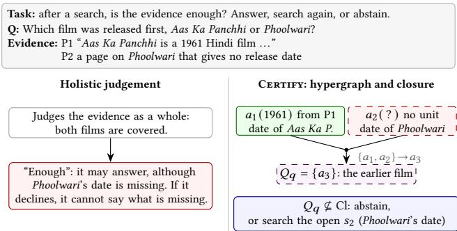
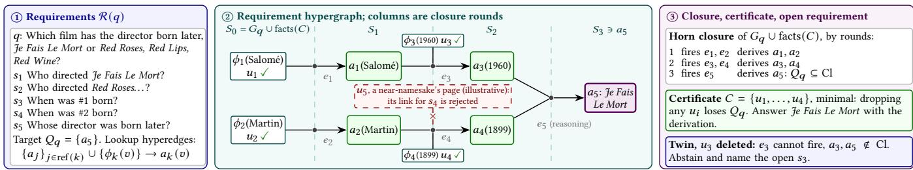

# Knowing When the Evidence Is Enough: Requirement-Directed Search with Horn-Closure Certificates

Xinyu Zhang Fudan University zhangxinyu@fudan.edu.cn

Weiwei Sun Fudan University wwsun@fudan.edu.cn

## Abstract

After each Web search, a search-augmented model must decide whether its evidence sufices: answer, search again, or abstain. Prevailing systems leave this to holistic model judgement, which can accept a context naming every entity yet lacking one required fact. We instead make suficiency structural: a per-query requirement hypergraph states which facts jointly yield another fact. This raises two challenges: deriving requirements from the question alone, and linking each requirement to passages about the right entity. Certify therefore decomposes the question, searches per requirement, and accepts links only after entity checks. Horn closure over the links yields a certificate, the minimal suficient passages and their derivation, or an abstention naming open requirements. Given correct retrieval, requirements and links, the decision is sound, and complete up to the entity check. Pooled over three corpora with unanswerable twins, Certify decides significantly more accurately than search agents, graph retrieval and suficiency judges in default configurations. On the same evidence, it matches a proprietary model’s suficiency label without an additional model call. Over 21M Wikipedia passages, entity checks add 4 to 13 points of decision accuracy where gold evidence exists. Finally, answers from its certificate are 80% correct, against 57% from all retrieved passages.

## 1 Introduction

Search-augmented language models [10, 45] now answer a large share of information needs on the Web. A Web search assistant or a search agent [27, 62] issues queries and reads the returned pages. It must then make one decision over and over: is the evidence it holds enough to answer, should it search again, or should it decline? This decision sits at the core of retrieval-augmented AI on the Web. It governs when the assistant stops querying, what it shows its reader, and when it tells the user that the evidence found does not support an answer. Answering too early produces confident answers that the retrieved pages do not support [28]. Searching too long wastes queries and latency [89, 100], and declining without saying what is missing gives the user nothing to act on. Retrieval-augmented generation (RAG) [41] makes this decision implicit: whether the context suficed is left to the reader.

Recent work makes the judgement explicit but keeps it inside a model. A suficient-context autorater asks a strong model whether a context could answer the question and combines its label with self-rated confidence to abstain [28]. Learned or prompted stopping rules decide when an agent has searched enough [42, 68]. These judgements are made by a model about a context as a whole or about a flat list of claims. Multi-hop questions, however, are conjunctions: which film was released first needs both release dates, and when did X’s mother die needs the mother’s identity before her date of death. A context that contains every entity of the question and most of the facts can still miss one conjunct, and nothing guarantees that the judgement notices which one. Making suficiency explicit poses three challenges. The requirements of a question are not given and must be derived from its text. A retrieved page must be linked to the requirement it states, not to a page about a related entity. The evaluation needs unanswerable questions whose deciding fact is truly absent from the corpus.

  
Figure 1: The decision we study, on evidence that lacks one of two dates, a gap that a holistic judgement can miss. Certify joins both dates in one hyperedge, so it answers only when both are stated and otherwise names the missing one.

We treat suficiency as a structural property of the evidence. For a query we build a requirement hypergraph: each directed hyperedge says that a set of facts jointly yields another fact. A comparison is then one hyperedge with two required tail facts, and a bridge question is a chain of hyperedges whose later requirements are instantiated with earlier answers. A context is suficient when the monotone Horn closure of the facts it states contains the answer. This yields Certify, a certificate-driven search procedure (Figure 1) that searches one requirement at a time, instantiated with the values already found, and links each retrieved unit to the requirement it states. It returns an inclusion-minimal suficient context with its derivation, or abstains and reports the open requirements. The closure does three things without an additional model call: it decides whether to answer, returns the minimal context the reader answers from, and names the open requirement to search next. On a bridge chain it checks that every lookup is supported, and the same closure decides joins, computed requirements and alternative derivations.

The certificate is deductive and certifies that the context states every required fact. When the gold support is retrieved and the requirements and links are correct, Certify is sound, and complete on the retrieval event up to the entity check, and its context is inclusion-minimal. A rule reading only the tail-to-head projection of the requirements cannot tell “� and � yield �” from “� or � yields �”.

Pooled over 2WikiMultiHopQA, MuSiQue and HotpotQA with search-checked twins, Certify decides significantly more accurately than search agents, graph retrieval and suficiency judges in default configurations. On the same evidence, it matches a fast proprietary model’s suficiency label without an additional model call. Answers from its certificate are 80.0% correct against 56.7% from the whole pool. Over 21 million Wikipedia passages [32], entity anchoring raises its decision accuracy by 4 to 13 points on gold-verified pairs.

Contributions.

• Suficiency as Horn closure. We decide suficiency by the Horn closure of a per-query requirement hypergraph, with no model call once the evidence is linked. With correct retrieval, requirements and links, it is sound, complete up to the entity check and inclusion-minimal. Rules reading only pairwise projections provably cannot tell a conjunction from a disjunction.

• Certify, requirement-directed search. Each search targets one requirement, instantiated with the values found, and anchored links supply its value. When the evidence does not sufice, Certify abstains and names the open requirement, the deleted one in 87.6% of traceable twins.

• Evaluation with search-checked twins. Questions are paired with search-checked unanswerable twins, and controls separate the evidence from the decision rule. With exact requirements Certify recovers every enabling set in agent logs and every provable ProofWriter answer.

## 2 Related Work

Deciding suficiency and abstaining in RAG. Suficient Context labels whether a context could answer a question with a prompted autorater and combines the label with self-rated confidence to abstain [28]. Identify-then-verify prompting lists what a context lacks [24]. S2G-RAG asks a judge for suficiency and for the missing items that drive the next query [42]. MuSiQue’s step-execution model judges a context suficient when it sufices for every hop [79]. HALT stops a search agent once a verifier matches every expected hop claim [68]. Uncertainty-driven retrieval [26], selective answering [30], training to refuse unsupported answers [71] and retrieval evaluators that trigger corrective search [91] all judge a context with a model. Certify derives suficiency from explicit requirement hyperedges and returns a minimal context with its derivation. Benchmarks probe abstention on unanswerable or misleading requests [8, 20, 35, 48, 54, 60, 61, 65, 70, 77, 94], and same-name entities mislead retrieval [7, 39]. Closest to our twins are the deletion-based contrasts of DiRe and MuSiQue [78, 79] and removing supporting evidence from the context [2, 21, 38, 52]. Our twins delete the evidence from the corpus and check by search that it is gone. Conformal guarantees bound risk over a query distribution [31, 43], certified robustness the efect of corrupted passages [87]. Our certificate is deductive and per query.

Iterative retrieval and search agents. Interleaved retrieval and reasoning [80], complexity routing [25], reasoning models that search [45] and agents trained to search [27] let the model decide when it has searched enough. So do models trained to abstain or to stop searching [49, 73, 97, 98, 100], self-reflection [1], step verification [46, 102] and learned stopping [63, 93]. More search can hurt abstention on unanswerable queries [89]. Decomposition into sub-questions retrieved or grounded one by one [34, 64, 69, 86, 90, 106, 108] or into question trees [5, 99] and planners that order sub-questions in a dependency graph or re-plan after evaluating each step [9, 10, 88, 107] decide what to search next. Search-inthe-Chain verifies each step against retrieved passages [90], and SR-RAG checks steps and chain completeness with a symbolic verifier [83]. QACheck, Think-on-Graph, ProgramFC and FOLK let an LLM judge whether sub-answers or reasoning paths sufice, or combine sub-results logically [57, 58, 74, 82]. In Certify, a closure over per-requirement links decides without a model call, returning a minimal context or the open requirement to search next.

Graphs and hypergraphs for retrieval and memory. Graph-based RAG links passages through entities and propagates relevance [22]. Query-specific hyper-relational graphs [59] and hypergraph RAG keep �-ary facts as hyperedges [17, 47, 50, 81, 96], hypergraph memories group long interactions [105], and recent work learns hyperedge retrievers [104]. Like them, Certify keeps �-ary facts as hyperedges, but its directed requirement hyperedges decide whether the evidence found sufices, which a rule reading only their pairwise projection cannot do reliably.

Directed hypergraphs and Horn reasoning. Directed hypergraphs and B-connectivity [18] and linear-time Horn satisfiability [16] are classical. Why-provenance attaches derivations to query answers [3, 4], query completeness decides whether an incomplete database still returns every answer [40, 66], and rationales and context attributions are sought for predictions and RAG answers [12, 15]. Our pruning is the classical deletion filter for minimal sets under a monotone predicate [11, 51], as in suficient input subsets [6] and minimal evidence groups [44]. Proofs over stated facts [14, 75], including deduction that names a missing premise [72], backward chaining or unification over facts that an LLM supplies or retrieves [33, 37, 76, 84, 85] and solvers over LLM-extracted facts [56] derive answers. So does concurrent work with deterministic operators over a knowledge lattice and abstention [67] or with Prolog written from passages [19]. We use the closure for a diferent decision, whether a retrieved context sufices.

## 3 Evidence, Requirements and Suficiency

A retrieval-augmented system answers a query � from a collection U of evidence units: passages of Web documents for a search assistant, or turns of an interaction log for an agent with memory. A context is a finite set $C \subseteq { \mathcal { U } }$ that the system passes to its reader. We make precise when a context sufices to answer �.

Requirement hypergraphs. Let $\mathcal { V } _ { q }$ be a finite set of atoms, the propositions that matter for �: the value of an intermediate entity, a date, the state of an object at some time.

Definition 3.1 (Requirement hypergraph). A requirement hypergraph is $\mathcal { R } ( \boldsymbol { q } ) = ( \mathcal { V } _ { \boldsymbol { q } } , \mathcal { E } _ { \boldsymbol { q } } , Q _ { \boldsymbol { q } } , G _ { \boldsymbol { q } } )$ , where every $r ~ \in ~ \mathcal { E } _ { q }$ is a directed hyperedge $r ~ = ~ ( \mathrm { R e q } ( r ) , h ( r )$ , Exc(�)) with required tail atoms $\begin{array} { r } { \operatorname { R e q } ( r ) \subseteq \mathcal { V } _ { q } , } \end{array}$ a head atom $h ( r ) \in \mathcal { V } _ { q }$ and excluded atoms $\operatorname { E x c } ( r ) \subseteq \mathcal { V } _ { q }$ (empty in both instantiations below). Here $Q _ { q } \subseteq \mathcal { V } _ { q }$

Knowing When the Evidence Is Enough: Requirement-Directed Search with Horn-Closure Certificates

  
Figure 2: Certify on a com lex case: re uirement h ergra h, Horn closure b rounds, minimal certificate and the twin’s open requirement.

is the set of target atoms and $G _ { q } \subseteq \mathcal { V } _ { q }$ the atoms given with the query. The tail size $\delta _ { r } ^ { T } = | \mathrm { R e q } ( r ) |$ counts the facts it conjoins.

Definition 3.2 (Evidence). Every unit $u \in \mathcal { U }$ states a set of atoms ${ \mathrm { f a c t s } } ( u ) \subseteq \mathcal V _ { q }$ and witnesses a set of hyperedges rules $( u ) \subseteq \mathcal { E } _ { q } .$ The hyperedges $\mathcal { E } _ { q } ^ { 0 } \subseteq \mathcal { E } _ { q }$ witnessed by no unit belong to the query. Both maps extend additively to contexts: facts $( C ) = \bigcup _ { u \in C }$ facts(�) and rules $( C ) = { \mathcal { E } } _ { q } ^ { 0 } \cup \bigcup _ { u \in C }$ rules(�).

Definition 3.3 (Horn closure). For atoms � and hyperedges �, let $\Phi _ { S , E } ( X ) = S \cup \{ h ( r ) : r \in E ,$ Req(�) ⊆ �}. The closure Cl(�, �) is the least fixpoint of $\Phi _ { S , E }$ . Excluded atoms do not take part in firing, so that a least fixpoint exists.

Definition 3.4 (Suficiency and violation). A context � is suficient for � if $Q _ { q } \subseteq \mathbf { C l } ( G _ { q }$ ∪ facts(�), rules(�). A hyperedge � is violated with respect to a set � of units (in Certify, the linked units of the retrieval pool) if Exc(�) ∩ facts(�) ≠ ∅. It is also violated if its head $h ( r )$ has a rival value whose support in � is at least that of the chosen value. Violations change the decision to answer, never the closure. Since a new unit can create a rival, the decision to answer is not monotone in the context, although suficiency is.

Lemma 3.5 (Closure operator). $\Phi _ { S , E }$ is monotone in �, � and �. Hence Cl(�, �) exists, $S \subseteq \operatorname { C l } ( S , E ) , \operatorname { C l }$ is monotone in both arguments and idempotent, and suficiency is monotone in the context: $C \subseteq$ �′ and � suficient imply $C ^ { \prime }$ suficient. Forward chaining with one counter per hyperedge computes Cl(�, �) in $\begin{array} { r } { O \big ( | S | + \sum _ { r \in E } ( \delta _ { r } ^ { T } + 1 ) \big ) } \end{array}$ time [16].

Two instantiations. Multi-hop questions over Web documents. A question is decomposed into requirements $s _ { 1 } , \ldots , s _ { m } ;$ , each a single fact question that may refer to the answers of earlier requirements $\operatorname { r e f } ( k ) \subseteq \{ 1 , \dots , k - 1 \}$ (“When did #1 die?”). Atom $a _ { k } ( \upsilon )$ reads “requirement � has value $v " . \mathrm { A }$ lookup requirement needs a passage: a passage � states $\phi _ { k } ( v ) \in \mathrm { f a c t s } ( u )$ if it states that the answer to $s _ { k }$ , instantiated with the chosen values of its references (one instantiation), is �, and the query contributes the hyperedge $\{ a _ { j } ( v _ { j } ) \} _ { j \in \mathrm { r e f } ( k ) } \cup \{ \phi _ { k } ( v ) \}  a _ { k } ( v )$ . A reasoning requirement, such as choosing the earlier of two dates, is computed from earlier derived facts: $\{ a _ { j } ( v _ { j } ) \} _ { j \in \mathrm { d e p } ( k ) } \to a _ { k } ( v )$ with dep(�) ⊇ ref(�). The target is $a _ { m } ( \boldsymbol { v } )$ for the last requirement � and its best-supported value �. Suficiency and minimality are relative to that instantiation and value, and rival values are left to the violation rule. Comparison questions therefore carry a genuine conjunction, $\delta _ { r } ^ { T } = 2 ,$ , that no single passage satisfies. Interaction logs of agents. For an environment with states $x _ { 0 } , \ldots , x _ { T }$ , an atom is a pair $( f , k )$ : fact $f$ during its �-th maximal validity interval. Turn � executes an action $\alpha _ { t }$ with preconditions $\mathrm { P r e } ( \alpha _ { t } )$ and witnesses the hyperedges $\{ ( g , \kappa ( g , t - 1 ) ) : g \in \mathrm { P r e } ( \alpha _ { t } ) \} \to ( w , \kappa ( w , t ) )$ for every fact � true at � but not at � − 1, where $\kappa ( f , t )$ indexes the interval of � that contains �. Each interval is produced only by the turn that opens it. Deleted facts only close intervals and generate no hyperedge, so nothing is ever underived and the closure stays monotone.

What projections lose. Many graph-based retrieval and memory systems keep a pairwise view of this structure. The tail-to-head projection of a hyperedge set is $\Pi ( { \mathcal { E } } ) = \{ ( v , h ( r ) ) : r \in { \mathcal { E } } , v \in \operatorname { R e q } ( r ) \}$ The tail shufle � replaces every � with $\delta _ { r } ^ { T } \geq 2$ by the singleton hyperedges $\{ v \} \to h ( r ) , v \in \operatorname { R e q } ( r )$ . It keeps Π unchanged and destroys only the conjunction. For retrieval over documents, let $\mathbf { B } \in \{ 0 , 1 \} ^ { | \mathcal { A } | \times | \mathcal { U } | }$ be the incidence between entities A and units, and let its 2-section be $\mathrm { S } _ { 2 } ( \mathbf { B } ) = \{ \{ a , b \} : \exists u , \mathbf { B } _ { a u } \mathbf { B } _ { b u } = 1 \}$

An instance M is a query with its requirements, evidence maps and context, suf(M) is its suficiency label, �M applies � to its hyperedges, and $\tau _ { \# } \mathcal { D }$ is the law of �M for $M \sim \mathcal { D }$ . The following proposition is why Certify decides on directed hyperedges.

Proposition 3.6 (Directed blindness). Let � be any decision rule whose input is the query, the contents ofthe atoms, the facts the context states and $\Pi ( { \mathcal E _ { q } } )$ . Then � returns the same label on an instance M and on its tail-shufled twin �M. For any distribution D over instances, on the balanced mixture of D and $\tau _ { \# } \mathcal { D } , \mathrm { P r } [ D$ errs] ≥ ${ \scriptstyle { \frac { 1 } { 2 } } } \operatorname* { P r } _ { \mathcal { M } \sim \mathcal { D } } \left[ \operatorname { s u f f } ( M ) \neq \operatorname { s u f f } ( \tau M ) \right]$

Proposition 3.7 (Unit blindness of the 2-section). Let $u ^ { \star }$ ∈ U be a unit every entity pair of which co-occurs in another unit. Then $\mathrm { S _ { 2 } ( \mathbf { B } ) }$ is the same for U and $\mathcal { U } \setminus \{ u ^ { \star } \}$ , so every retrieval or decision rule whose input is the query, entity contents and S (B) gives the same output on both collections. IfU is suficient and �★ is the only unit stating an atom outside $G _ { q }$ that no hyperedge derives and every derivation $o f Q _ { q }$ uses, suficiency flips from true to false. On the balanced mixture ofsuch pairs any such rule errs with probability at least ${ \frac { 1 } { 2 } } .$

This proposition is why Certify links individual units to requirements. Both propositions are scoped two-point separation arguments (Appendix A). A star expansion with one node per hyperedge, typed incidences and tail sizes $\delta _ { r } ^ { T }$ is information-equivalent to the hypergraph, and passage-node graphs keep unit identity. For them the question is whether the decision uses the information, as Certify does by construction (the directed witness is classical [18]).

Algorithm 1: Certify: certificate-driven search   
Input: query �; unit collection U; retriever; linker; search   
schedule $( \ell _ { 1 } , \ldots , \ell _ { L } )$   
Output: answer with certificate (�, derivation), or   
abstention with open requirements   
1 build $\mathcal { R } ( q ) ; / /$ oracle annotation, engine rules, or   
LLM decomposition of � alone   
2 pool $ \varnothing ;$ open $ \emptyset ;$   
3 foreach requirement �� in topological order do   
4 if a reference of�� is unresolved then   
open ← open ∪ $\{ k \} ;$ continue;   
5 instantiate � with the resolved values of its references;   
6 if $s _ { k }$ is a reasoning requirement then derive $a _ { k } ( \boldsymbol { v } )$ from   
dep(�) and the reader’s value � (no value: add � to   
open); continue;   
7 for $i = 1 , \ldots , L$ until some unit states $\phi _ { k } ( \cdot )$ do retrieve ℓ�   
new units for $s _ { k } ,$ , link each to $\phi _ { k } ( \cdot )$ and add it to pool;   
8 if no unit states $\phi _ { k } ( \cdot )$ then open ← open ∪ {�};   
9 $S \gets \mathrm { C l } ( G _ { q }$ ∪ facts(pool), rules(pool);   
10 if $Q _ { q } \nsubseteq S$ then return abstain with the requirements in   
open;   
11 if a lookup step ofthe derivation has no accepted link then   
return abstain with that requirement;   
12 $C \gets$ first producers of the backward derivation of $Q _ { q }$ over   
accepted links, in retrieval order;   
13 foreach $u \in C$ in retrieval order do if � \ {�} is suficient   
for $Q _ { q }$ over accepted links then $C \gets C \backslash \{ u \}$   
14 if violation rule and a hyperedge of the derivation is violated   
then return abstain with the violated requirement;   
15 return reader(�, �, derivation) with certificate   
(�, derivation)

## 4 Certified Suficiency

## Certify turns suficiency into search (Algorithm 1, Figure 2).

Requirements, retrieval and linking. On Web question answering, $\mathcal { R } ( q )$ comes from decomposing � with a language model that sees only � (deployed), or from dataset annotations (oracle, reported separately). Retrieval is per requirement: the query sent to the search engine is the instantiated requirement, so each search targets a single missing fact, and the open requirements decide what to search next. A reasoning requirement takes the value the reader computes in one call from every fact derived before it, its dep(�), and stays open without one. Linking asks a reader whether one unit states the answer to one instantiated requirement. Diferent values stated for the same requirement are grouped (normalised string match, containment or token $\mathrm { F } 1 \geq 0 . 6 $ , greedily in retrieval order against each group’s first string, which names it). The support of a value is the number of linked units that state it. Atoms $a _ { k } ( \upsilon )$ exist only for values that some linked unit states, so $\mathcal { V } _ { q }$ is finite and determined by the pool. The search for a requirement stops after the first round that links a unit, every unit of that round being judged.

The chosen value has the largest support among linked units (ties: the earliest), and a rival that ties it violates the requirement.

Entity anchoring and verification. Most false links connect a requirement to a passage about another entity, often a near-namesake, that states a value for the wrong subject. A linked unit is anchored to a lookup requirement when its title names the requirement’s subject: every word of the title (disambiguating parenthetical removed) occurs in the instantiated requirement. Title matching also selects documents in fact verification [55]. Consider a lookup step whose value has no anchored supporting link. It is verified when the reader, shown the first two supporting passages in turn, answers that one of them gives the value for exactly the entity the requirement names. Certify accepts the derivation only when the chosen value of every lookup step is anchored or verified (its link is accepted by this entity check). It computes the context over accepted links alone and lets the best-supported value stand when a rival ties it.

The Horn-closure certificate. After the search, forward chaining over the linked pool decides whether $Q _ { q }$ is derived, and the entity check is applied to each lookup step of the derivation. Over accepted links, a unit � states only the atoms $\mathrm { f a c t s } _ { \operatorname { a c c } } ( u ) \subseteq \mathrm { f a c t s } ( u )$ whose link passes the check for their step. There the backward derivation takes the earliest retrieved unit stating each of its atoms, and the deletion filter drops every unit whose removal keeps $Q _ { q }$ derived. The certificate is this minimal context � with its derivation, which gives each requirement’s value, passage and hyperedge (Figure 2). On abstention Certify reports the open requirements. Those whose references are resolved are the facts no linked passage states, the next to search for, and the others depend on them (after a failed check, it reports the failing lookup). On a bridge chain of lookups the closure is the step-wise rule “every lookup has an accepted link”. In general it requires the target itself to be derived and checks only the lookups its derivation uses, so the same check decides joins, computed requirements and alternative derivations. Given the links, the certificate attests that the context states every required fact (under the violation rule, also that no rival value is as well supported), not that the answer is correct.

Properties. Write $\mathcal { R } ^ { * } ( q )$ and facts∗, rules∗ for the true requirements and evidence maps, and $F _ { q } \subseteq \mathcal { U }$ for a suficient gold support. The following proposition states when Certify’s decision is exactly right.

Proposition 4.1 (Conditional certificate). Assume three hypotheses. (H1) Gold retrieval: the search for each requirement retrieves its gold units, so $F _ { q } \subseteq$ pool. (H2) Correct requirements: $\mathcal { R } ( q ) ~ = ~ \mathcal { R } ^ { * } ( q )$ , the true requirements instantiated with the values the pool states. (H3) Exact linking: $\mathrm { \dot { a c t s } } ( u ) ~ = ~ \mathrm { f a c t s } ^ { \ast } ( u )$ and rules(�) = rules∗(�) for � ∈ pool, and each lookup requirement has one true value. Then:

(1) Completeness on the retrieval event. $Q _ { q }$ is derived, so Certify abstains only on a violation or a lookup link that fails the entity check, neverfor lack ofevidence.

(2) Soundness. If Certify answers with context �, then � is suficient under $( \mathcal { R } ^ { * }$ , facts∗, rules∗) and violates no hyperedge ofits derivation (under (H3) no rival value is linked, so this holds with rival values allowed).

(3) Minimality. The returned � is suficient, and no proper subset is suficient over accepted links.

(4) Uniqueness. Suppose the pool derives $Q _ { q }$ by a single derivation (every atom derived as a head is stated by no unit and is the head of exactly one hyperedge that fires). If its stated atoms outside $G _ { q }$ and witnessed hyperedges outside $\mathcal { E } _ { q } ^ { 0 }$ each have exactly one producing unit in the pool, � is the unique inclusion-minimal subset of the pool suficient over accepted links and does not depend on the pruning order.

(5) Cost. Certification takes at most $\left| C _ { 0 } \right| + 1$ closure computations, where $C _ { 0 }$ is the backward-derivation set, each linear in the size of the instance.

The proof (Appendix A) uses only the closure’s monotonicity, with minimality as for the deletion filter [11, 51]. Below we relax exact linking to accepted links and bound false certificates on twins.

Corollary 4.2 (Accepted-link soundness). Proposition 4.1(2) holds for suficiency with exact linking required only on accepted links. Assume correct requirements, and let a twin delete every unit that states a fact every derivation $o f Q _ { q }$ uses. The certificate fires on it only ifan accepted unit stating that fact survives the deletion or the derivation uses a false accepted link. Its false-certificate rate on twins is at most the rate of surviving accepted statements plus that of derivations with a false accepted link.

Proof. The context is computed over accepted links, so every lookup step of the returned derivation is supported by an accepted link of the context. The proof of (2) goes through with exact linking restricted to accepted links. On a twin, with correct requirements the derivation contains the deleted fact’s requirement and derives it from some accepted unit. If every accepted link of the derivation is correct, the requirements are instantiated with true values and that unit states the fact, so it is a statement the deletion missed. □

## 5 Experimental Setup

Web question answering. We use the pooled Wikipedia corpora of HippoRAG 2 [22] for 2WikiMultiHopQA [23] and MuSiQue [79]: 1,000 questions per dataset over 6,119 and 11,656 passages, in which every question competes with the evidence of all others. The first 200 questions in their original order form the validation split, used for every choice of prompt, threshold and selective head. The remaining 800 form the test split, touched once per arm. All arms share one dense retriever (Qwen3-Embedding-0.6B [101]) and one reader (Qwen3-8B [92], no thinking, greedy, served with vLLM [36]). We use Qwen3-32B and DeepSeek V4.1 Flash where stated, and HotpotQA [95] from the same release (twins delete the passage of one of two Gemini-2.5-Flash lookups).

Unanswerable twins. For every question we build a twin whose evidence is deleted from the corpus. Unlike generated unanswerable questions [48, 61], it difers from its original only in that evidence. On MuSiQue we delete the supporting passages of the hops that MuSiQue’s own unanswerable contrast removes [79], so the choice of deletion is not ours. On 2WikiMultiHopQA we delete the gold passage of one lookup hop chosen with a fixed seed. On both we then search the remaining corpus for any other passage that states the deleted fact, with the gold bridge values and the 32B model as linker on the top 30 hits. We delete these as well (at most three), and questions whose fact is stated more often are dropped. A question is kept only if neither Qwen3-8B nor Qwen3-32B answers it correctly without context in five samples (a memory filter). This leaves 529 twins on 2WikiMultiHopQA (427 in test) and 826 on MuSiQue (661). The filter removes most guessable yes/no comparisons of 2WikiMultiHopQA, so conjunctions are tested mainly by bridge comparisons and MuSiQue requirements using two earlier answers.

Exact requirements. ProofWriter’s depth-5 test theories [75] and TextWorld logs [13] produced with AMA-Bench’s protocol [103] give exact requirement hypergraphs. In 959 episodes (671 for test), a query asks which turns enable an action, and its twin deletes one.

Baselines and controls. Each baseline runs in its default config uration, with its authors’ prompts, code or checkpoint, under our retriever, reader and corpus. Only HALT and S2G-RAG deviate: they abstain when their rule never accepts the evidence, the reading more favourable to them (App. B gives every method’s settings and the fixed seeds). Single pass: RAG on the top-5 passages, Verbalised suficiency (the reader checks each requirement before answering) and HippoRAG 2 [22] (graph-based retrieval). Suficiencyjudges: Sufficient Context [28], an autorater label (Qwen3-8B, Qwen3-32B or Gemini-2.5-Flash) combined with �(True) [29] in a selective head. Abstain-R1 [97] is a model trained with reinforcement learning to answer or abstain (its 3B checkpoint, closed-book by default). Search agents: Iterative search [62, 80], HALT [68] (a verifier-based stopping rule on that agent) and S2G-RAG [42] (suficiency-and-gap judging after each search). S2G-RAG prompts our reader in place of its distilled judge, and HALT’s verifier takes our reader’s current answer as its gold. Search-R1 [27], trained with reinforcement learning (its 7B checkpoint, and its 32B one with Qwen3-32B), never abstains, so a trajectory without an answer counts as an abstention. LogicRAG [9] orders sub-questions in a dependency graph, and SR-RAG [83] checks each sub-answer with a Prolog prover over extracted triples (reimplemented). Controls with Certify’s inputs: an LLM judge on Certify’s pool and requirement list, and an LLM judge on its accepted link table (decompose-and-verify with an LLM decision). The Suficient Context label on multi-step evidence (Certify’s pool, or the iterative agent’s or Search-R1’s evidence) alone decides whether that evidence’s answer stands, and Abstain-R1 reads Certify’s pool. Certify uses the same reader in every role and the deployed decomposition, and certifies over accepted links with rival values allowed (no violation rule). There were eight candidate rules per regime: two rival rules, each with no, subject or subject-or-value anchoring, and two that also accept verified links. The 200 validation items per corpus selected subject anchoring or verification on the pooled corpora (decision accuracy 68.4%) and subject anchoring alone at Web scale (52.4%).

Metrics. Correctness is judged by Gemini-2.5-Flash against the reference answers only. DeepSeek V4.1 Flash as a second judge agrees on 96.8, 96.0 and 96.6% of Certify’s answers and leaves the decision comparisons it covers unchanged. Gemini-2.5-Flash also audits links and twins. DeepSeek re-grades the links and audits the HotpotQA twins, and a blind annotator labels a sample. On answerable questions we report accuracy (Acc, over all originals / over those no reader answers from memory) and accuracy among answered questions (SAcc). Costs are LLM calls (Calls, verification included) and thousands of input tokens (Tok) per question. On originals and twins we report coverage (Cov, share answered), the twins answered (Twin) and those answered with the original’s gold answer (Gold), and abstention precision (AbsP). Decision accuracy (Dec) counts a correct answer on an original or an abstention on a twin, and always abstaining scores 50. ΔDec is Certify minus a row, ± its paired-bootstrap standard error. In the result tables the best value is bold, the second best underlined and Certify’s row shaded. Search-R1 rows use its own checkpoint (7B, or 32B with Qwen3-32B), and other rows use the setting’s model in every role. 2W, MQ and HQ are the three corpora. SR-RAG and Abstain-R1 are compared with Certify’s rebuilt 8B rows (App. C). Decoding is greedy. Diferences are tested with a paired bootstrap (10,000 resamples of pairs) and McNemar tests Holm-corrected over the arms of a setting. In the results, significantly, above and below mean Holm-corrected � < 0.05, and level means not significant, even where the bootstrap alone is significant.

Table 1: Accuracy and cost on answerable questions (test, 8B). Certify has the highest SAcc on both corpora, and only HALT and SR-RAG make more LLM calls. †Ofline indexing not counted.
<table><tr><td></td><td colspan="4">2WikiMultiHopQA</td><td colspan="4">MuSiQue</td></tr><tr><td></td><td>Acc↑ SAcc↑ Calls↓ Tok↓</td><td></td><td></td><td></td><td></td><td>Acc↑ SAcc↑ Calls↓ Tok↓</td><td></td><td></td></tr><tr><td>RAG (top-5)</td><td>31.8 / 22.5</td><td>50.2</td><td>1</td><td>0.9</td><td>17.9/16.3</td><td>41.8</td><td>1</td><td>0.8</td></tr><tr><td>Verbalised sufficiency</td><td>32.0 / 21.8</td><td>53.0</td><td></td><td>1.6</td><td>17.1/14.7</td><td>41.9</td><td>2</td><td>1.6</td></tr><tr><td>Iterative search</td><td>51.9 / 47.3</td><td>55.6</td><td>2-3</td><td>2.2</td><td>34.6 /31.9</td><td>41.8</td><td>3</td><td>2.1</td></tr><tr><td>S2G-RAG</td><td>45.0 / 40.0</td><td>71.6</td><td>5</td><td></td><td>5.6 17.0 / 15.6</td><td>59.6</td><td>7</td><td>8.2</td></tr><tr><td>Search-R1</td><td>70.2 /66.7</td><td>72.1</td><td>4</td><td></td><td>3.4 47.2/ 45.7</td><td>51.9</td><td>4</td><td>3.5</td></tr><tr><td>LogicRAG</td><td>61.3 /56.2</td><td>64.1</td><td>5</td><td></td><td>2.3 35.6 / 34.9</td><td>35.9</td><td>7</td><td>2.8</td></tr><tr><td>SR-RAG</td><td>65.2/ 57.4</td><td>66.2</td><td>23</td><td>19.9</td><td>39.2 /36.9</td><td>40.9</td><td>23</td><td>18.3</td></tr><tr><td>HippoRAG 2†</td><td>39.9/31.6</td><td>57.6</td><td>2</td><td>4.1</td><td>19.2/17.9</td><td>41.5</td><td>2</td><td>3.8</td></tr><tr><td>HALT</td><td>11.0/5.9</td><td>58.7</td><td>49</td><td>39.2</td><td>2.4/ 2.7</td><td>63.3</td><td>60</td><td>49.3</td></tr><tr><td>CERTIFY</td><td>73.0/65.6</td><td>85.8</td><td>17</td><td></td><td>8.9 30.8/ 28.4</td><td>74.5</td><td>22</td><td>11.1</td></tr></table>

## 6 Results

We ask five questions. RQ1: how accurate are certified answers on answerable questions? RQ2: does the certificate decide between answering and abstaining better than holistic suficiency judges and stopping rules when evidence is missing? RQ3: what does the certificate deliver beyond the decision, and at what cost? RQ4: how often do the hypotheses behind the certificate’s guarantee hold? RQ5: with exact requirements, what do pairwise views of the evidence lose?

## 6.1 RQ1: Answerable questions

Answers produced through the requirement hypergraph over accepted links are the most reliable (Table 1, 85.8% and 74.5% correct), and Certify answers the most 2WikiMultiHopQA originals correctly (73.0% of all). MuSiQue often states a fact on a page titled by neither the subject nor the value, and there Certify trades coverage for precision. It answers 30.8% of all originals correctly (34.1% without the entity check). Search-R1, SR-RAG, LogicRAG and the iterative agent answer more (34.6 to 47.2%) but also answer most twins. Decomposing from the question alone is level with the annotated decomposition (decision accuracy 68.7 and 57.3% against

68.0 and 55.9%, both under the violation rule and without the entity check, unlike Table 2’s row).

Answer: certified answers are the most reliable of those given.

## 6.2 RQ2: Answering or abstaining

Table 2 pairs every answerable question that passed the memory filter with its unanswerable twin. The entity check cuts the twins Certify answers from 20.6% and 13.2% (no check, rival values allowed) to 8.2% and 7.6%, and decision accuracy rises by +5.3 and +1.1 points, and significantly by +2.7 pooled over the three corpora. No baseline answers more answerable questions correctly while answering fewer twins than Certify. Each decides significantly less accurately on every corpus and pooled over the three (S2G-RAG by +11.4 points pooled). Of the eleven baselines, nine score below always abstaining (50) on both 2WikiMultiHopQA and MuSiQue, so the controls below, which abstain too, are the closer comparisons. Abstain-R1, trained to abstain, scores 35.3% pooled over the three corpora, closed-book, and stays below Certify on Certify’s own pool on every corpus (+11.5 pooled). With Gemini-2.5-Flash as its judge, S2G-RAG is below Certify on 2WikiMultiHopQA (+9.5) and pooled (+3.0), and level on MuSiQue and HotpotQA. These margins assume half of the queries are unanswerable. Certify beats Search-R1 in its default configuration once at least 1%, 19% and 12% are. It stays ahead of the Gemini label on its pool unless 47 to 83% are.

What the evidence and the closure each contribute. Three controls separate the evidence from the decision rule. The same LLM decides at 52.9 and 49.2% given Certify’s pool and requirement list and at 75.8 and 61.0% given its accepted table of the values linked to each requirement (decompose-and-verify with an LLM decision [34, 62, 90]). The closure, deciding that table without a model call, is above it on 2WikiMultiHopQA (+2.9) and level on MuSiQue and HotpotQA (−0.6 and +0.4 points). The Gemini Suficient Context label on Certify’s pool, which abstains on almost every twin, is below Certify on 2WikiMultiHopQA, MuSiQue and pooled (+4.3 pooled) and level on HotpotQA. The label of Qwen3-8B, whose links the closure reads, is below Certify by +15.2 and +6.8 points. Without a model call, the closure decides as accurately as the Gemini label on the same whole-pool answers (level, −0.8 pooled, −0.7 with 32B and +0.5 with DeepSeek). The Gemini margin thus comes from the answer. Conversely, with the label deciding and the certificate answering, decision accuracy is level with Certify’s (+0.3 pooled with 8B). The margin over the baselines therefore comes from the closure’s certified context, the search directed by the requirement hypergraph, and per-requirement linking (RQ3). The answering model matters as much. Search-R1’s answers, kept only when the Gemini label accepts the passages it retrieved, are level with Certify on every corpus (−1.1 pooled, and above it pooled with one of two other example sets, −2.7). Under the Qwen3-8B label they are below it pooled (+4.2), as is Search-R1’s 32B checkpoint under the Qwen3-32B label (+3.0). With Qwen3-32B in every role (Table 3) every baseline, Search-R1’s 32B checkpoint included, stays significantly below Certify on every corpus and pooled, and that checkpoint under the Gemini label is level (+0.6 pooled). With DeepSeek, Certify is significantly above every baseline and Search-R1 under the Gemini label (+5.0 pooled).

Table 2: Answering or abstaining on paired originals and twins (test, 8B, ± standard error). Certify is most accurate on 2WikiMultiHopQA and over two standard errors above every first-block baseline.
<table><tr><td></td><td colspan="8">2WikiMultiHopQA</td><td colspan="4">MuSiQue</td></tr><tr><td></td><td>Cov</td><td>Twin↓</td><td>Gold↓</td><td>AbsP↑</td><td>Dec↑</td><td>∆Dec</td><td>Cov</td><td>Twin↓</td><td>Gold↓</td><td>AbsP↑</td><td>Dec↑</td><td>∆Dec</td></tr><tr><td>Baselines, each on its own evidence</td><td></td><td></td><td></td><td></td><td></td><td></td><td></td><td></td><td></td><td></td><td></td><td></td></tr><tr><td>RAG (top-5)</td><td>48.2</td><td>32.8</td><td>3.7</td><td>64.9</td><td>44.8</td><td>33.8±1.8</td><td>30.4</td><td>20.7</td><td>4.2</td><td>57.0</td><td>47.8</td><td>12.6±1.3</td></tr><tr><td>Verbalised sufficiency</td><td>44.7</td><td>29.0</td><td>3.5</td><td>64.2</td><td>46.4</td><td>32.3±1.8</td><td>26.6</td><td>16.2</td><td>2.4</td><td>57.1</td><td>49.2</td><td>11.2±1.2</td></tr><tr><td>Iterative search</td><td>88.5</td><td>83.1</td><td>13.6</td><td>73.5</td><td>32.1</td><td>46.6±1.8</td><td>74.2</td><td>67.2</td><td>10.1</td><td>63.6</td><td>32.4</td><td>28.1±1.4</td></tr><tr><td>S2G-RAG</td><td>42.3</td><td>22.5</td><td>4.0</td><td>67.1</td><td>58.8</td><td>19.9±1.7</td><td>18.0</td><td>9.4</td><td>2.4</td><td>55.3</td><td>53.1</td><td>7.3±1.1</td></tr><tr><td>Search-R1</td><td>93.9</td><td>90.4</td><td>17.6</td><td>78.8</td><td>38.2</td><td>40.5±1.6</td><td>86.0</td><td>81.5</td><td>15.1</td><td>65.9</td><td>32.1</td><td>28.4±1.2</td></tr><tr><td>LogicRAG</td><td>87.0</td><td>81.5</td><td>13.8</td><td>71.2</td><td>37.4</td><td>41.3±1.7</td><td>98.6</td><td>98.2</td><td>12.4</td><td>66.7</td><td>18.4</td><td>42.1±1.2</td></tr><tr><td>SR-RAG</td><td>97.5</td><td>97.2</td><td>13.1</td><td>57.1</td><td>30.1</td><td>49.1±1.6</td><td>96.6</td><td>97.1</td><td>8.8</td><td>42.2</td><td>19.9</td><td>40.7±1.2</td></tr><tr><td>HippoRAG 2</td><td>51.4</td><td>33.0</td><td>4.0</td><td>68.9</td><td>49.3</td><td>29.4±1.8</td><td>33.4</td><td>23.3</td><td>3.8</td><td>57.5</td><td>47.3</td><td>13.2±1.3</td></tr><tr><td>HALT</td><td>6.6</td><td>1.9</td><td>0.2</td><td>52.5</td><td>52.0</td><td>26.7±1.4</td><td>2.4</td><td>0.9</td><td>0.3</td><td>50.8</td><td>50.9</td><td>9.5±1.0</td></tr><tr><td>Suff. Context (Gemini) Abstain-R1</td><td>40.0 51.8</td><td>24.8 51.8</td><td>3.3</td><td>62.7</td><td>48.4</td><td>30.3±1.8</td><td>27.3</td><td>18.2</td><td>4.1</td><td>56.3</td><td>48.9</td><td>11.5±1.2</td></tr><tr><td></td><td></td><td></td><td>6.1</td><td>50.0</td><td>27.2</td><td>52.0±1.9</td><td>20.0</td><td>20.0</td><td>2.7</td><td>50.0</td><td>41.4</td><td>19.2±1.2</td></tr><tr><td colspan="10">Decision rules on multi-step evidence, answer from it</td><td></td><td></td><td></td><td></td></tr><tr><td>LLM judge, CERTIFY&#x27;s pool</td><td>62.3</td><td>39.8</td><td>5.4</td><td>79.8</td><td>52.9</td><td>25.8±1.9</td><td>40.9</td><td>27.2</td><td>4.7</td><td>61.6</td><td>49.2</td><td>11.2±1.2</td></tr><tr><td>LLM judge, CERTIFY&#x27;s links</td><td>48.0</td><td>14.1</td><td>1.9</td><td>82.7</td><td>75.8</td><td>2.9±0.7</td><td>24.1</td><td>7.9</td><td>2.1</td><td>60.7</td><td>61.0</td><td>−0.6±0.4</td></tr><tr><td>Qwen3-8B label, CERTIFY&#x27;s pool</td><td>33.0</td><td>6.3</td><td>1.2</td><td>69.9</td><td>63.5</td><td>15.2±1.6</td><td>21.0</td><td>9.8</td><td>2.3</td><td>57.0</td><td>53.6</td><td>6.8±1.0</td></tr><tr><td>Gemini label, answer from ĊERTIFY&#x27;s pool</td><td>37.1</td><td>2.3</td><td>1.2</td><td>77.7</td><td>69.7</td><td>9.0±1.4</td><td>17.9</td><td>5.4</td><td>2.3</td><td>57.6</td><td>56.4</td><td>4.1±0.9</td></tr><tr><td>Gemini label, agent&#x27;s evidence</td><td>28.9</td><td>4.0</td><td>1.9</td><td>67.5</td><td>67.3</td><td>11.4±1.5</td><td>18.9</td><td>6.4</td><td>2.0</td><td>57.7</td><td>57.0</td><td>3.5±1.1</td></tr><tr><td>S2G-RAG, Gemini judge</td><td>31.3</td><td>5.2</td><td>1.4</td><td>69.0</td><td>69.2</td><td>9.5±1.4</td><td>13.3</td><td>2.4</td><td>0.6</td><td>56.3</td><td>57.6</td><td>2.8±1.0</td></tr><tr><td>Qwen3-8B label, Search-R1&#x27;s evidence</td><td>38.3</td><td>10.3</td><td>4.0</td><td>72.7</td><td>71.0</td><td>7.7±1.6</td><td>28.9</td><td>13.2</td><td>4.1</td><td>61.1</td><td>57.6</td><td>2.9±1.1</td></tr><tr><td>Gemini label, Search-R1&#x27;s evidence</td><td>40.5</td><td>5.2</td><td>2.6</td><td>79.7</td><td>78.0</td><td>0.7±1.3</td><td>27.9</td><td>8.8</td><td>3.8</td><td>63.3</td><td>62.1</td><td>−1.7±1.0</td></tr><tr><td>CERTIFY</td><td>44.3</td><td>8.2</td><td>1.6</td><td>82.4</td><td>78.7</td><td></td><td>22.8</td><td>7.6</td><td>2.1</td><td>59.8</td><td>60.4</td><td></td></tr></table>

Table 3: Decision accuracy (%) in further settings (test pairs, DeepSeek only on those not answerable from memory, Web only on verified pairs). Certify is best in 6 of the 13 columns, and no row is significantly above it.
<table><tr><td rowspan="2">Dec↑</td><td rowspan="2">8B HQ</td><td colspan="3">Qwen3-32B</td><td colspan="3">DeepSeek V4.1 Flash</td><td colspan="3">Web, 8B</td><td colspan="3">Web, 32B</td></tr><tr><td>2W</td><td>MQ</td><td>HQ</td><td>2W</td><td>MQ</td><td>HQ</td><td>2W</td><td>MQ</td><td>HQ</td><td>2W</td><td>MQ</td><td>HQ</td></tr><tr><td>RAG (top-5)</td><td>53.0</td><td>53.0</td><td>49.8</td><td>58.5</td><td>54.5</td><td>53.1</td><td>63.1</td><td>41.6</td><td>44.0</td><td>43.2</td><td>46.0</td><td>45.1</td><td>45.2</td></tr><tr><td>Iterative search</td><td>38.0</td><td>57.0</td><td>46.6</td><td>53.9</td><td>73.7</td><td>63.3</td><td>70.4</td><td>23.5</td><td>22.0</td><td>28.3</td><td>39.8</td><td>27.7</td><td>39.8</td></tr><tr><td>S2G-RAG</td><td>62.5</td><td>61.5</td><td>55.2</td><td>68.9</td><td>74.3</td><td>59.9</td><td>75.3</td><td>50.4</td><td>47.4</td><td>48.4</td><td>55.8</td><td>49.8</td><td>58.4</td></tr><tr><td>Search-R1</td><td>40.1</td><td>38.9</td><td>25.7</td><td>37.4</td><td>38.5</td><td>30.8</td><td>38.0</td><td>30.1</td><td>21.2</td><td>30.9</td><td>34.5</td><td>16.2</td><td>30.9</td></tr><tr><td>Suff. Context (Gemini)</td><td>61.3</td><td>54.8</td><td>51.0</td><td>64.5</td><td>54.5</td><td>53.1</td><td>65.2</td><td>42.5</td><td>45.6</td><td>48.0</td><td>49.6</td><td>46.1</td><td>48.8</td></tr><tr><td>Gemini label, top-5</td><td>64.2</td><td>61.2</td><td>54.4</td><td>66.5</td><td>60.0</td><td>53.9</td><td>64.6</td><td>49.6</td><td>50.3</td><td>50.4</td><td>52.7</td><td>49.8</td><td>50.8</td></tr><tr><td>LLM judge, CERTIFY&#x27;s links</td><td>71.2</td><td>77.6</td><td>64.1</td><td>73.5</td><td>83.1</td><td>65.1</td><td>78.0</td><td>58.8</td><td>48.4</td><td>55.2</td><td>58.4</td><td>47.6</td><td>56.2</td></tr><tr><td>Gemini label, CERTIFY&#x27;s pool</td><td>71.9</td><td>75.8</td><td>62.8</td><td>77.1</td><td>78.2</td><td>60.3</td><td>77.4</td><td>59.7</td><td>49.7</td><td>55.2</td><td>65.5</td><td>51.1</td><td>60.0</td></tr><tr><td>Qwen3-8B label, Search-R1&#x27;s evidence</td><td>69.1</td><td>72.8</td><td>57.8</td><td>71.5</td><td>70.7</td><td>56.5</td><td>68.9</td><td>59.3</td><td>47.4</td><td>54.2</td><td>60.2</td><td>46.0</td><td>53.8</td></tr><tr><td>Gemini label, Search-R1&#x27;s evidence</td><td>73.8</td><td>81.4</td><td>62.7</td><td>75.6</td><td>78.4</td><td>61.2</td><td>72.8</td><td>64.2</td><td>48.5</td><td>58.2</td><td>69.5</td><td>48.5</td><td>56.6</td></tr><tr><td>CERTIFY</td><td>71.6</td><td>81.3</td><td>64.2</td><td>75.4</td><td>84.4</td><td>65.4</td><td>77.9</td><td>63.7</td><td>50.0</td><td>58.6</td><td>65.5</td><td>51.5</td><td>60.6</td></tr></table>

Bounding false certificates. With the entity check Certify answers 8.2% and 7.6% of the twins (13.6% and 9.4% with the violation rule), and 1.6 and 2.1 points carry the original gold answer. These are bounded by surviving statements plus accepted false links. A BM25 and full-corpus string search flags 6.8% and 19.1% of the twins. Auditing all flagged twins and 100 unflagged ones, Gemini-2.5-Flash confirms a surviving statement for an estimated 2.6% and 4.6%. On pairs whose twin has no confirmed statement, every baseline stays significantly below Certify (pooled +12.0 to +42.9). Without the check, most false certificates come from links to related-entity pages, a failure of exact linking (H3) that the check targets, while the closure stays exact. With it, a false link, not a surviving statement, explains most answered twins. Gemini grades a link incorrect in 77, 52 and 59% of them and in 14, 31 and 22% of accepted originals (App. C). Answer: the certificate decides more accurately than every baseline, as accurately as a Gemini-2.5-Flash label on the same answers, and more accurately than Search-R1 under a label from its own model.

## 6.3 RQ3: What the certificate delivers

Context and abstention. The reader’s gain in Table 4 is significant with every model. Its passages-only row uses the 661 pooled answers without a rival value (59.3% from the whole pool). The named requirement is an open requirement whose references are resolved, or the failing lookup. It is counted on traceable twins, the 59% of twin abstentions whose original linked the deleted passages and whose plan has two or more lookups, one intact.

The decision. With decomposition, search and accepted links fixed, the closure decides without a model call. On chains oflookups it is the step-wise rule “every lookup has an accepted link” [79], and they difer on 0.5 to 6.5% of all decisions. Beyond chains it answers only when the target itself is derived. Where only the step-wise rule answers, a reasoning requirement has no value, and where only the closure answers, a lookup its derivation does not need is open (Table 4). The closure leads an LLM on the same links most on 2WikiMultiHopQA kinship chains (+13.6 on 70 pairs).

Table 4: What the certificate delivers, against the alternative on the same items (test, 8B unless stated, better value in bold). Reader: right on Certify’s answered originals. Complex: three or more lookups or a join.
<table><tr><td></td><td>Certificate</td><td>Alternative</td></tr><tr><td colspan="3">Context and abstention</td></tr><tr><td>Reader, 8B / 32B / DeepSeek (%) ↑</td><td>80.0 / 82.9 / 89.5</td><td>56.7 / 69.8 / 73.5 (pool)</td></tr><tr><td>Reader, passages only (%) ↑</td><td>74.0</td><td>21.8 (RAG, same size)</td></tr><tr><td>Names the deleted requirement (%) ↑</td><td>87.6</td><td>48.2 (at random)</td></tr><tr><td colspan="3">Decision on the same links, with no model call</td></tr><tr><td>Originals right, only it answers ↑</td><td>10 of 11</td><td>3 of 27 (step-wise)</td></tr><tr><td>Twins answered, only it answers ↓</td><td>9</td><td>14 (step-wise)</td></tr><tr><td colspan="3">Complex questions, 29% of pairs (%)</td></tr><tr><td>Originals right when answered ↑</td><td>74.8</td><td>52.7 (Search-R1)</td></tr><tr><td>Twins answered ↓</td><td>5.8</td><td>79.0 (Search-R1)</td></tr></table>

Table 5: Precision of Certify’s positive links by acceptance class (test, 8B, up to 150 links per class and all 88 verified 2WikiMultiHopQA links graded by Gemini-2.5-Flash, correct/graded in parentheses). Anchored links are the most precise in every row (bold). N/A: the Web rule has no verification step.
<table><tr><td></td><td>Accepted</td><td colspan="3"></td></tr><tr><td></td><td>share (%)</td><td>anchored</td><td>Precision (%)↑ verified</td><td>rejected</td></tr><tr><td></td><td>Pooled 2WikiMultiHopQA</td><td>77 96.7 (145/150)</td><td>43.2 (38/88)</td><td>20.0 (30/150)</td></tr><tr><td></td><td>MuSiQue</td><td>5084.7 (127/150)</td><td>74.0 (111/150)</td><td>54.7 (82/150)</td></tr><tr><td></td><td>HotpotQA</td><td>61 82.7 (124/150)</td><td>74.7 (112/150)</td><td>47.3 (71/150)</td></tr><tr><td>Web</td><td>2WikiMultiHopQA</td><td>5676.7 (115/150)</td><td></td><td>N/A 44.7 (67/150)</td></tr><tr><td></td><td>MuSiQue</td><td>44 79.3 (119/150)</td><td></td><td>N/A 54.0 (81/150)</td></tr><tr><td></td><td>HotpotQA</td><td>60 74.0 (111/150)</td><td></td><td>N/A 50.7 (76/150)</td></tr></table>

Complex questions. On the 429 complex pairs, Certify stays significantly above every baseline (by 5.1 to 42.0 points), carried by twin abstentions and accurate answers.

Cost. Certification costs mostly linking calls, each judging one passage for one requirement (17 and 22 LLM calls per question against Search-R1’s 4, verification under one). Only HALT and SR-RAG use more calls or tokens. Answer: without a model call, the certificate decides, makes the reader more accurate and mostly names the deleted requirement.

## 6.4 RQ4: The hypotheses in practice

Gold retrieval (H1) holds for 95.1% and 52.8% of the questions, and the accepted certificate fires for 88.0% and 62.1% of these. In an audit of up to 150 links per class, anchored links are far more often correct than rejected ones on every corpus and at both scales (Table 5, 96.7% against 20.0% on 2WikiMultiHopQA). A blind annotator (an author) confirms this on 135 links (anchored 97.8%, rejected 50.0% correct) and agrees with Gemini-2.5-Flash on 85.2% (� = 0.65). Answer: gold retrieval holds for 95.1% and 52.8% of questions, and exact linking far more often on anchored than on rejected links.

## 6.5 RQ5: Exact requirements

On 959 TextWorld episodes, the certificate recovers every enabling set and enables no twin. Pairwise rules fail on the test episodes, as directed blindness predicts. A prover with every pairwise link but no conjunction recovers 58.6% at depth two or more, and reachability in timed and untimed projections enables 17.2% and 84.2% of twins. An LLM on the same tables falls from 62.8% at depth one to 53.7% at depth ≥4 (32B). In ProofWriter several rules can yield a fact. A step-wise plan fixing one rule per requirement before reading the facts misses 20.6% of provable questions (36.1% at depth 5, 19.8 to 20.5% with random rule orders), and the closure none. Answer: the closure recovers every enabling set and provable answer that pairwise views, committed plans and an LLM on the same tables miss.

## 6.6 Web-scale retrieval: anchoring the links

We replace the pooled corpora by the 21M-passage 2018 Wikipedia dump of DPR [32]. A twin deletes every passage among the top 50 hits that states the deleted fact, leaving 413, 526 and 366 test pairs. As the 2018 snapshot lacks the gold support of many questions, we report the 113, 309 and 251 gold-verified pairs with Qwen3-8B and -32B in every role (Table 3). In these, every lookup has a passage titled by its gold page that states its gold value. Unanchored, Certify stays near always abstaining (50.4, 45.8 and 49.8% with 8B). In most of the twins it answers at 32B over all pairs, the linker accepts a passage about another entity at the deleted hop, often a near-namesake. Subject anchoring removes most such links and raises decision accuracy in all six cells, by +13.3, +4.2 and +8.8 with 8B and by +11.9, +4.7 and +6.6 with 32B (Table 3). On all pairs the gain is 4.0 to 8.6 points. Pooled, anchored Certify is significantly above every baseline with 8B and all but S2G-RAG with 32B, and level with Search-R1 under the Gemini label (+0.7 at 8B, +2.2 at 32B). Without the twins that keep a surviving statement, which no linking rule can remove (at least 20.6, 52.1 and 29.5% of all twins), it decides 63.9, 52.2 and 60.7% (8B).

## 7 Conclusion

We cast the decision to answer, search again or abstain as evidence suficiency over a per-query requirement hypergraph. Its Horn closure decides without a model call, returns a minimal suficient context with its derivation, and names the open requirements that direct the next search. When retrieval, requirements and links are correct, this decision is sound and complete up to the entity check. Where requirements are exact, as in agent logs and rule-based theories, the closure recovers every derivation, whereas rules reading only pairwise projections provably miss conjunctions and plans committed in advance miss alternatives. On three pooled corpora Certify decides significantly more accurately than search agents, graph retrieval and suficiency judges in default configurations. On the same evidence its closure matches a fast proprietary model’s suficiency label, and its certificate makes the reader more accurate. At Web scale, anchoring links to entity titles raises its decision accuracy on every corpus and model size.

## References

[1] Akari Asai, Zeqiu Wu, Yizhong Wang, Avi Sil, and Hannaneh Hajishirzi. 2024. Self-RAG: Learning to Retrieve, Generate, and Critique through Self-Reflection. In Proceedings of ICLR. 9112–9141.

[2] Pepa Atanasova, Jakob Grue Simonsen, Christina Lioma, and Isabelle Augenstein. 2022. Fact Checking with Insuficient Evidence. Transactions of the Association for Computational Linguistics 10 (2022), 746–763.

[3] Peter Buneman, Sanjeev Khanna, and Wang-Chiew Tan. 2001. Why and Where: A Characterization of Data Provenance. In Database Theory — ICDT 2001, Vol. 1973. 316–330.

[4] Marco Calautti, Ester Livshits, Andreas Pieris, and Markus Schneider. 2024. The Complexity of Why-Provenance for Datalog Queries. Proceedings ofthe ACM on Management ofData 2, 2 (2024), 1–16. PODS 2024.

[5] Shulin Cao, Jiajie Zhang, Jiaxin Shi, Xin Lv, Zijun Yao, Qi Tian, Lei Hou, and Juanzi Li. 2023. Probabilistic Tree-of-thought Reasoning for Answering Knowledge-intensive Complex Questions. In Findings ofEMNLP. 12541–12560.

[6] Brandon Carter, Jonas Mueller, Siddhartha Jain, and David Giford. 2019. What made you do this? Understanding black-box decisions with suficient input subsets. In Proceedings of the Twenty-Second International Conference on Artificial Intelligence and Statistics, Vol. 89. 567–576

[7] Anthony Chen, Pallavi Gudipati, Shayne Longpre, Xiao Ling, and Sameer Singh. 2021. Evaluating Entity Disambiguation and the Role of Popularity in Retrieval Based NLP. In Proceedings ofthe 59th Annual Meeting ofthe Association for Computational Linguistics and the 11th International Joint Conference on Natural Language Processing (Volume 1: Long Papers). 4472–4485.

[8] Jiawei Chen, Hongyu Lin, Xianpei Han, and Le Sun. 2024. Benchmarking Large Language Models in Retrieval-Augmented Generation. In Proceedings ofAAAI, Vol. 38. 17754–17762.

[9] Shengyuan Chen, Chuang Zhou, Zheng Yuan, Qinggang Zhang, Zeyang Cui, Hao Chen, Yilin Xiao, Jiannong Cao, and Xiao Huang. 2026. You Don’t Need Pre-Built Graphs for RAG: Retrieval Augmented Generation with Adaptive Reasoning Structures. In Proceedings ofAAAI, Vol. 40. 30270–30278.

[10] Zehui Chen, Kuikun Liu, Qiuchen Wang, Jiangning Liu, Wenwei Zhang, Kai Chen, and Feng Zhao. 2025. MindSearch: Mimicking Human Minds Elicits Deep AI Searcher. In Proceedings ofICLR.

[11] John W. Chinneck and Erik W. Dravnieks. 1991. Locating Minimal Infeasible Constraint Sets in Linear Programs. ORSA Journal on Computing 3, 2 (1991), 157–168.

[12] Benjamin Cohen-Wang, Harshay Shah, Kristian Georgiev, and Aleksander Mądry. 2024. ContextCite: Attributing Model Generation to Context. In Advances in NeurIPS, Vol. 37. 95764–95807.

[13] Marc-Alexandre Côté, Ákos Kádár, Xingdi Yuan, Ben Kybartas, Tavian Barnes, Emery Fine, James Moore, Matthew Hausknecht, Layla El Asri, Mahmoud Adada, Wendy Tay, and Adam Trischler. 2018. TextWorld: A Learning Envi ronment for Text-based Games. In Computer Games Workshop at IJCAI 2018. arXiv:1806.11532.

[14] Bhavana Dalvi, Peter Jansen, Oyvind Tafjord, Zhengnan Xie, Hannah Smith, Leighanna Pipatanangkura, and Peter Clark. 2021. Explaining Answers with Entailment Trees. In Proceedings ofEMNLP. 7358–7370.

[15] Jay DeYoung, Sarthak Jain, Nazneen Fatema Rajani, Eric Lehman, Caiming Xiong, Richard Socher, and Byron C. Wallace. 2020. ERASER: A Benchmark to Evaluate Rationalized NLP Models. In Proceedings ofACL. 4443–4458.

[16] William F. Dowling and Jean H. Gallier. 1984. Linear-Time Algorithms for Testing the Satisfiability of Propositional Horn Formulae. The Journal of Logic Programming 1, 3 (1984), 267–284.

[17] Yifan Feng, Hao Hu, Shihui Ying, Xingliang Hou, Shiquan Liu, Mingyuan Yang, Junchang Li, Shaoyi Du, Nanning Zheng, Han Hu, and Yue Gao. 2026. Hyper-RAG: combating LLM hallucinations using hypergraph-driven retrieval augmented generation. Nature Communications 17, 1 (2026), 5778.

[18] Giorgio Gallo, Giustino Longo, Stefano Pallottino, and Sang Nguyen. 1993. Directed Hypergraphs and Applications. Discrete Applied Mathematics 42, 2–3 (1993), 177–201.

[19] Jonas Gann and Michael Gertz. 2026. NeSy-RAG: Neuro-Symbolic RAG for Explainable Question Answering. arXiv:2608.06292

[20] Max Glockner, Xiang Jiang, Leonardo F. R. Ribeiro, Iryna Gurevych, and Markus Dreyer. 2025. NeoQA: Evidence-based Question Answering with Generated News Events. In Findings ofACL. 11842–11926.

[21] Runquan Gui, Yafu Li, Xiaoye Qu, Ziyan Liu, Yeqiu Cheng, and Yu Cheng. 2026. FaithRL: Learning to Reason Faithfully through Step-Level Faithfulness Maximization. arXiv:2602.0350

[22] Bernal Jiménez Gutiérrez, Yiheng Shu, Weijian Qi, Sizhe Zhou, and Yu Su. 2025. From RAG to Memory: Non-Parametric Continual Learning for Large Language Models. In Proceedings of ICML, Vol. 267. 21497–21515.

[23] Xanh Ho, Anh-Khoa Duong Nguyen, Saku Sugawara, and Akiko Aizawa. 2020. Constructing A Multi-hop QA Dataset for Comprehensive Evaluation of Rea soning Steps. In Proceedings ofCOLING. 6609–6625.

[24] Akriti Jain and Aparna Garimella. 2026. Knowing What’s Missing: Assessing Information Suficiency in Question Answering. In Findings of EACL. 4163– 4174.

[25] Soyeong Jeong, Jinheon Baek, Sukmin Cho, Sung Ju Hwang, and Jong Park. 2024. Adaptive-RAG: Learning to Adapt Retrieval-Augmented Large Language Models through Question Complexity. In Proceedings of NAACL. 7036–7050.

[26] Zhengbao Jiang, Frank Xu, Luyu Gao, Zhiqing Sun, Qian Liu, Jane Dwivedi Yu, Yiming Yang, Jamie Callan, and Graham Neubig. 2023. Active Retrieval Augmented Generation. In Proceedings ofEMNLP. 7969–7992.

[27] Bowen Jin, Hansi Zeng, Zhenrui Yue, Jinsung Yoon, Sercan Arik, Dong Wang, Hamed Zamani, and Jiawei Han. 2025. Search-R1: Training LLMs to Reason and Leverage Search Engines with Reinforcement Learning. In Conference on Language Modeling (COLM). arXiv:2503.09516.

[28] Hailey Joren, Jianyi Zhang, Chun-Sung Ferng, Da-Cheng Juan, Ankur Taly, and Cyrus Rashtchian. 2025. Suficient Context: A New Lens on Retrieval Augmented Generation Systems. In Proceedings ofICLR. arXiv:2411.06037.

[29] Saurav Kadavath, Tom Conerly, Amanda Askell, Tom Henighan, Dawn Drain, Ethan Perez, Nicholas Schiefer, Zac Hatfield-Dodds, Nova DasSarma, Eli Tran-Johnson, et al. 2022. Language Models (Mostly) Know What They Know. arXiv:2207.05221

[30] Amita Kamath, Robin Jia, and Percy Liang. 2020. Selective Question Answering under Domain Shift. In Proceedings ofACL. 5684–5696.

[31] Mintong Kang, Nezihe Merve Gürel, Ning Yu, Dawn Song, and Bo Li. 2024. C-RAG: Certified Generation Risks for Retrieval-Augmented Language Models. In Proceedings ofICML, Vol. 235. 22963–23000.

[32] Vladimir Karpukhin, Barlas Oguz, Sewon Min, Patrick Lewis, Ledell Wu, Sergey Edunov, Danqi Chen, and Wen-tau Yih. 2020. Dense Passage Retrieval for Open-Domain Question Answering. In Proceedings ofEMNLP. 6769–6781.

[33] Mehran Kazemi, Najoung Kim, Deepti Bhatia, Xin Xu, and Deepak Ramachan dran. 2023. LAMBADA: Backward Chaining for Automated Reasoning in Natural Language. In Proceedings ofACL. 6547–6568.

[34] Tushar Khot, Harsh Trivedi, Matthew Finlayson, Yao Fu, Kyle Richardson, Peter Clark, and Ashish Sabharwal. 2023. Decomposed Prompting: A Modular Approach for Solving Complex Tasks. In Proceedings ofICLR

[35] Polina Kirichenko, Mark Ibrahim, Kamalika Chaudhuri, and Samuel J. Bell. 2025. AbstentionBench: Reasoning LLMs Fail on Unanswerable Questions. In Advances in NeurIPS, Vol. 38. 190800–190850.

[36] Woosuk Kwon, Zhuohan Li, Siyuan Zhuang, Ying Sheng, Lianmin Zheng, Cody Hao Yu, Joseph Gonzalez, Hao Zhang, and Ion Stoica. 2023. Eficient Memory Management for Large Language Model Serving with PagedAttention. In Proceedings of SOSP. 611–626.

[37] Jinu Lee and Wonseok Hwang. 2025. SymBa: Symbolic Backward Chaining for Structured Natural Language Reasoning. In Proceedings of the 2025 Conference of the Nations of the Americas Chapter of the Association for Computational Linguistics: Human Language Technologies (Volume 1: Long Papers). 2468–2484.

[38] Kyungjae Lee, Seung-won Hwang, Sang-eun Han, and Dohyeon Lee. 2021. Robustifying Multi-hop QA through Pseudo-Evidentiality Training. In Proceedings ofACL. 6110–6119.

[39] Yoonsang Lee, Xi Ye, and Eunsol Choi. 2024. AmbigDocs: Reasoning across Documents on Diferent Entities under the Same Name. In Conference on Language Modeling (COLM).

[40] Alon Y. Levy. 1996. Obtaining Complete Answers from Incomplete Databases. In Proceedings of the 22nd International Conference on Very Large Data Bases (VLDB). 402–412.

[41] Patrick Lewis, Ethan Perez, Aleksandra Piktus, Fabio Petroni, Vladimir Karpukhin, Naman Goyal, Heinrich Küttler, Mike Lewis, Wen-tau Yih, Tim Rocktäschel, Sebastian Riedel, and Douwe Kiela. 2020. Retrieval-Augmented Generation for Knowledge-Intensive NLP Tasks. In Advances in NeurIPS, Vol. 33. 9459–9474.

[42] Minghan Li, Junjie Zou, Xinxuan Lv, Chao Zhang, and Guodong Zhou. 2026. S2G-RAG: Structured Suficiency and Gap Judging for Iterative Retrieval-Augmented QA. In Proceedings ofACL. 25846–25862.

[43] Shuo Li, Sangdon Park, Insup Lee, and Osbert Bastani. 2024. TRAQ: Trustworthy Retrieval Augmented Question Answering via Conformal Prediction. In Proceedings ofNAACL. 3799–3821.

[44] Xiangci Li, Sihao Chen, Rajvi Kapadia, Jessica Ouyang, and Fan Zhang. 2025. Minimal Evidence Group Identification for Claim Verification. In Proceedings of the 5th Workshop on Trustworthy NLP (TrustNLP 2025). 103–111.

[45] Xiaoxi Li, Guanting Dong, Jiajie Jin, Yuyao Zhang, Yujia Zhou, Yutao Zhu, Peitian Zhang, and Zhicheng Dou. 2025. Search-o1: Agentic Search-Enhanced Large Reasoning Models. In Proceedings ofEMNLP. 5420–5438.

[46] Xingxuan Li, Ruochen Zhao, Yew Ken Chia, Bosheng Ding, Shafiq Joty, Soujanya Poria, and Lidong Bing. 2024. Chain-of-Knowledge: Grounding Large Language Models via Dynamic Knowledge Adapting over Heterogeneous Sources. In Proceedings ofICLR. 9565–9587.

[47] Wen-Sheng Lien, Yu-Kai Chan, Hao-Lung Hsiao, Bo-Kai Ruan, Meng-Fen Chiang, Chien-An Chen, Yi-Ren Yeh, and Hong-Han Shuai. 2026. HyperRAG: Reasoning N-ary Facts over Hypergraphs for Retrieval Augmented Generation. In Proceedings of the ACM Web Conference 2026 (WWW ’26). 2465–2476.

[48] Gabrielle Kaili-May Liu, Bryan Li, Arman Cohan, William Gantt Walden, and Eugene Yang. 2026. Investigating Retrieval-Augmented Generation Systems on Unanswerable, Uncheatable, Realistic, Multi-hop Queries. In Proceedings of the 48th European Conference on Information Retrieval (ECIR). 360–370.

[49] Shiyu Liu, Yongjing Yin, Jianhao Yan, Yunbo Tang, Qinggang Zhang, Bei Li, Xin Chen, Jingang Wang, Xunliang Cai, and Jinsong Su. 2026. BAPO: Boundary Aware Policy Optimization for Reliable Agentic Search. In Findings of ACL. 36408–36426.

[50] Haoran Luo, Haihong E, Guanting Chen, Yandan Zheng, Xiaobao Wu, Yikai Guo, Qika Lin, Yu Feng, Zemin Kuang, Meina Song, Yifan Zhu, and Anh Tuan Luu. 2025. HyperGraphRAG: Retrieval-Augmented Generation via Hypergraph-Structured Knowledge Representation. In Advances in NeurIPS, Vol. 38. arXiv:2503.21322.

[51] Joao Marques-Silva, Mikoláš Janota, and Anton Belov. 2013. Minimal Sets over Monotone Predicates in Boolean Formulae. In Computer Aided Verification (CAV 2013), Vol. 8044. 592–607.

[52] Yifei Ming, Senthil Purushwalkam, Shrey Pandit, Zixuan Ke, Xuan-Phi Nguyen, Caiming Xiong, and Shafiq Joty. 2025. FaithEval: Can Your Language Model Stay Faithful to Context, Even If “The Moon is Made of Marshmallows”. In Proceedings ofICLR.

[53] Joyanta Jyoti Mondal, Md. Shifatul Ahsan Apurba, Mridul Banik, Md Masud Al Mahmud, and Ibne Farabi Shihab. 2026. Before Answering: Evidence Suficiency under Size-Matched Memory Construction. arXiv:2609.32269

[54] Aashiq Muhamed, Leonardo F. R. Ribeiro, Markus Dreyer, Virginia Smith, and Mona T. Diab. 2026. RefusalBench: Generative Evaluation of Selective Refusa in Grounded Language Models. In Proceedings ofEACL. 6811–6856.

[55] Yixin Nie, Haonan Chen, and Mohit Bansal. 2019. Combining Fact Extraction and Verification with Neural Semantic Matching Networks. In Proceedings of AAAI, Vol. 33. 6859–6866.

[56] Liangming Pan, Alon Albalak, Xinyi Wang, and William Wang. 2023. Logic-LM: Empowering Large Language Models with Symbolic Solvers for Faithful Logical Reasoning. In Findings ofEMNLP. 3806–3824.

[57] Liangming Pan, Xinyuan Lu, Min-Yen Kan, and Preslav Nakov. 2023. QACheck: A Demonstration System for Question-Guided Multi-Hop Fact-Checking. In Proceedings ofEMNLP: System Demonstrations. 264–273.

[58] Liangming Pan, Xiaobao Wu, Xinyuan Lu, Anh Tuan Luu, William Yang Wang, Min-Yen Kan, and Preslav Nakov. 2023. Fact-Checking Complex Claims with Program-Guided Reasoning. In Proceedings ofACL. 6981–7004.

[59] Pranoy Panda, Ankush Agarwal, Chaitanya Devaguptapu, Manohar Kaul, and Prathosh Ap. 2024. HOLMES: Hyper-Relational Knowledge Graphs for Multi hop Question Answering using LLMs. In Proceedings of ACL. 13263–13282.

[60] Mayur Patidar, Prayushi Faldu, Avinash Singh, Lovekesh Vig, Indrajit Bhattacharya, and Mausam. 2023. Do I have the Knowledge to Answer? Inves tigating Answerability of Knowledge Base Questions. In Proceedings ofACL. 10341–10357.

[61] Xiangyu Peng, Prafulla Kumar Choubey, Caiming Xiong, and Chien-Sheng Wu. 2025. Unanswerability Evaluation for Retrieval Augmented Generation. In Proceedings of ACL. 8452–8472.

[62] Ofir Press, Muru Zhang, Sewon Min, Ludwig Schmidt, Noah Smith, and Mike Lewis. 2023. Measuring and Narrowing the Compositionality Gap in Language Models. In Findings ofEMNLP. 5687–5711.

[63] Peng Qi, Haejun Lee, Tg Sido, and Christopher Manning. 2021. Answering Open-Domain Questions of Varying Reasoning Steps from Text. In Proceedings ofEMNLP. 3599–3614.

[64] Peng Qi, Xiaowen Lin, Leo Mehr, Zijian Wang, and Christopher D. Manning. 2019. Answering Complex Open-domain Questions Through Iterative Query Generation. In Proceedings ofEMNLP. 2590–2602.

[65] Pranav Rajpurkar, Robin Jia, and Percy Liang. 2018. Know What You Don’t Know: Unanswerable Questions for SQuAD. In Proceedings ofACL. 784–789.

[66] Simon Razniewski and Werner Nutt. 2011. Completeness of Queries over Incomplete Databases. Proceedings ofthe VLDB Endowment 4, 11 (2011), 749– 760.

[67] Yuze Ren, Shaoheng Fan, Tao Wang, Yabo Yan, and Han Han. 2026. Meet, Compare, or Abstain: LatWeave for Deterministic Multi-Hop Question Answering on Knowledge Lattices. arXiv:2609.27225

[68] Daeyoung Roh and Donghee Han. 2026. HALT: Verification-Aware Stopping for Retrieval-Augmented Search Agents. arXiv:2608.02009

[69] Zhengliang Shi, Shuo Zhang, Weiwei Sun, Shen Gao, Pengjie Ren, Zhumin Chen, and Zhaochun Ren. 2024. Generate-then-Ground in Retrieval-Augmented Generation for Multi-hop Question Answering. In Proceedings ofACL. 7339– 7353.

[70] Maojia Song, Renhang Liu, Xinyu Wang, Yong Jiang, Pengjun Xie, Fei Huang, Soujanya Poria, and Jingren Zhou. 2026. Demystifying Deep Search: A Holistic Evaluation with Hint-free Multi-Hop Questions and Factorised Metrics. In Proceedings of ICLR.

[71] Maojia Song, Shang Hong Sim, Rishabh Bhardwaj, Hai Leong Chieu, Navonil Majumder, and Soujanya Poria. 2025. Measuring and Enhancing Trustworthi ness of LLMs in RAG through Grounded Attributions and Learning to Refuse. In Proceedings ofICLR. 30783–30823.

[72] Zayne Sprague, Kaj Bostrom, Swarat Chaudhuri, and Greg Durrett. 2022. Natural Language Deduction with Incomplete Information. In Proceedings of EMNLP. 8230–8258.

[73] Jingbo Sun, Wenyue Chong, Songjun Tu, Qichao Zhang, Yaocheng Zhang, Jiajun Chai, Xiaohan Wang, Wei Lin, Guojun Yin, and Dongbin Zhao. 2026. AutoSearch: Adaptive Search Depth for Eficient Agentic RAG via Reinforcement Learning. In Findings ofACL. 28059–28079

[74] Jiashuo Sun, Chengjin Xu, Lumingyuan Tang, Saizhuo Wang, Chen Lin, Yeyun Gong, Lionel Ni, Heung-Yeung Shum, and Jian Guo. 2024. Think-on-Graph: Deep and Responsible Reasoning of Large Language Model on Knowledge Graph. In Proceedings of ICLR. 3868–3898.

[75] Oyvind Tafjord, Bhavana Dalvi, and Peter Clark. 2021. ProofWriter: Generating Implications, Proofs, and Abductive Statements over Natural Language. In Findings of ACL. 3621–3634.

[76] Oyvind Tafjord, Bhavana Dalvi Mishra, and Peter Clark. 2022. Entailer: Answering Questions with Faithful and Truthful Chains of Reasoning. In Proceedings of EMNLP. 2078–2093.

[77] Yixuan Tang and Yi Yang. 2024. MultiHop-RAG: Benchmarking Retrieval Augmented Generation for Multi-Hop Queries. In First Conference on Language Modeling.

[78] Harsh Trivedi, Niranjan Balasubramanian, Tushar Khot, and Ashish Sabharwal. 2020. Is Multihop QA in DiRe Condition? Measuring and Reducing Disconnected Reasoning. In Proceedings ofEMNLP. 8846–8863.

[79] Harsh Trivedi, Niranjan Balasubramanian, Tushar Khot, and Ashish Sabharwal. 2022. MuSiQue: Multihop Questions via Single-hop Question Composition. Transactions ofthe Association for Computational Linguistics 10 (2022), 539–554.

[80] Harsh Trivedi, Niranjan Balasubramanian, Tushar Khot, and Ashish Sabharwal. 2023. Interleaving Retrieval with Chain-of-Thought Reasoning for Knowledge-Intensive Multi-Step Questions. In Proceedings ofACL. 10014–10037.

[81] Changjian Wang, Weihong Deng, Weili Guan, Quan Lu, and Ning Jiang. 2026. Cross-Granularity Hypergraph Retrieval-Augmented Generation for Multi-hop Question Answering. In Proceedings ofAAAI, Vol. 40. 33368–33376.

[82] Haoran Wang and Kai Shu. 2023. Explainable Claim Verification via Knowledge-Grounded Reasoning with Large Language Models. In Findings ofthe Association for Computational Linguistics: EMNLP 2023. 6288–6304.

[83] Zehua Wang, Zhaojin Zhang, Boyu Qiu, Xiaolong Weng, Ying Xiong, Buzhou Tang, and Min Zhang. 2026. SR-RAG: Verifiable Multi-Hop Reasoning via On-the-fly Symbolic Graph Construction. In Findings of ACL. 38588–38606

[84] Leon Weber, Pasquale Minervini, Jannes Münchmeyer, Ulf Leser, and Tim Rocktäschel. 2019. NLProlog: Reasoning with Weak Unification for Question Answering in Natural Language. In Proceedings of ACL. 6151–6161.

[85] Nathaniel Weir, Peter Clark, and Benjamin Van Durme. 2024. NELLIE: A Neuro-Symbolic Inference Engine for Grounded, Compositional, and Explain able Reasoning. In Proceedings ofIJCAI. 3602–3612. Main Track.

[86] Tomer Wolfson, Mor Geva, Ankit Gupta, Matt Gardner, Yoav Goldberg, Daniel Deutch, and Jonathan Berant. 2020. Break It Down: A Question Understanding Benchmark. Transactions of the Association for Computational Linguistics 8 (2020), 183–198.

[87] Chong Xiang, Tong Wu, Zexuan Zhong, David Wagner, Danqi Chen, and Prateek Mittal. 2026. Certifiably Robust RAG against Retrieval Corruption. In 2026 IEEE Conference on Secure and Trustworthy Machine Learning (SaTML). 392–410.

[88] Yilin Xiao, Chuang Zhou, Yujing Zhang, Qinggang Zhang, Su Dong, Shengyuan Chen, Chang Yang, and Xiao Huang. 2025. LAG: Logic-Augmented Generation from a Cartesian Perspective. arXiv:2508.05509

[89] Roy Xie, Deepak Gopinath, David Qiu, Dong Lin, Haitian Sun, Saloni Potdar, and Bhuwan Dhingra. 2026. Over-Searching in Search-Augmented Large Language Models. In Proceedings of EACL. 7714–7739.

[90] Shicheng Xu, Liang Pang, Huawei Shen, Xueqi Cheng, and Tat-Seng Chua. 2024. Search-in-the-Chain: Interactively Enhancing Large Language Models with Search for Knowledge-intensive Tasks. In Proceedings ofthe ACM Web Conference 2024 (WWW ’24). 1362–1373.

[91] Shi-Qi Yan, Jia-Chen Gu, Yun Zhu, and Zhen-Hua Ling. 2024. Corrective Retrieval Augmented Generation. arXiv:2401.15884

[92] An Yang, Anfeng Li, Baosong Yang, Beichen Zhang, Binyuan Hui, Bo Zheng, Bowen Yu, Chang Gao, Chengen Huang, Chenxu Lv, et al. 2025. Qwen3 Techni cal Report. arXiv:2505.09388

[93] Diji Yang, Linda Zeng, Jinmeng Rao, and Yi Zhang. 2025. Knowing You Don’t Know: Learning When to Continue Search in Multi-round RAG through Self-Practicing. In Proceedings ofthe 48th International ACM SIGIR Conference on Research and Development in Information Retrieval. 1305–1315.

[94] Xiao Yang, Kai Sun, Hao Xin, Yushi Sun, Nikita Bhalla, Xiangsen Chen, Sajal Choudhary, Rongze Daniel Gui, Ziran Will Jiang, Ziyu Jiang, Lingkun Kong, Brian Moran, Jiaqi Wang, Yifan Ethan Xu, An Yan, Chenyu Yang, Eting Yuan, Hanwen Zha, Nan Tang, Lei Chen, Nicolas Schefer, Yue Liu, Nirav Shah, Rakesh Wanga, Anuj Kumar, Wen-tau Yih, and Xin Luna Dong. 2024. CRAG - Compre hensive RAG Benchmark. In Advances in NeurIPS, Vol. 37. 10470–10490.

[95] Zhilin Yang, Peng Qi, Saizheng Zhang, Yoshua Bengio, William Cohen, Ruslan Salakhutdinov, and Christopher D. Manning. 2018. HotpotQA: A Dataset for Diverse, Explainable Multi-hop Question Answering. In Proceedings of EMNLP. 2369–2380.

[96] Xiangjun Zai, Xingyu Tan, Xiaoyang Wang, Qing Liu, Xiwei Xu, and Wenjie Zhang. 2026. PRoH: Dynamic Planning and Reasoning over Knowledge Hypergraphs for Retrieval-Augmented Generation. In Proceedings of the ACM Web Conference 2026 (WWW ’26). arXiv:2510.12434.

[97] Haotian Zhai, Jingcheng Liang, and Dongyeop Kang. 2026. Abstain-R1: Calibrated Abstention and Post-Refusal Clarification via Verifiable RL. In Findings ofACL. 19674–19695.

[98] Fengji Zhang, Tianyu Fan, Yuxiang Zheng, Xinyao Niu, Chengen Huang, Jacky Keung, and Bei Chen. 2026. To Answer or to Abstain: Mitigating Search-Agent Hallucinations via Abstention-Aware Reinforcement Learning. arXiv:2607.10738

[99] Jiajie Zhang, Shulin Cao, Tingjian Zhang, Xin Lv, Juanzi Li, Lei Hou, Jiaxin Shi, and Qi Tian. 2023. Reasoning over Hierarchical Question Decomposition Tree for Explainable Question Answering. In Proceedings ofthe 61st Annual Meeting of the Association for Computational Linguistics (Volume 1: Long Papers). 14556–14570.

[100] Wenlin Zhang, Kuicai Dong, Junyi Li, Yingyi Zhang, Xiaopeng Li, Pengyue Jia, Yi Wen, Derong Xu, Maolin Wang, Yichao Wang, Yong Liu, and Xiangyu Zhao. 2026. To Search or Not to Search: Aligning the Decision Boundary of Deep Search Agents via Causal Intervention. In Proceedings ofthe ACM Web Conference 2026 (WWW ’26). 2049–2059.

[101] Yanzhao Zhang, Mingxin Li, Dingkun Long, Xin Zhang, Huan Lin, Baosong Yang, Pengjun Xie, An Yang, Dayiheng Liu, Junyang Lin, Fei Huang, and Jingren Zhou. 2025. Qwen3 Embedding: Advancing Text Embedding and Reranking Through Foundation Models. arXiv:2506.05176

[102] Ruochen Zhao, Xingxuan Li, Shafiq Joty, Chengwei Qin, and Lidong Bing. 2023. Verify-and-Edit: A Knowledge-Enhanced Chain-of-Thought Framework. In Proceedings ofACL. 5823–5840.

[103] Yujie Zhao, Boqin Yuan, Junbo Huang, Haocheng Yuan, Zhongming Yu, Haozhou Xu, Lanxiang Hu, Abhilash Shankarampeta, Zimeng Huang, Wentao Ni, Yuandong Tian, and Jishen Zhao. 2026. AMA-Bench: Evaluating Long-Horizon Memory for Agentic Applications. In Proceedings ofICML, Vol. 306. 162781–162809. arXiv:2602.22769.

[104] Zicheng Zhao, Linhao Luo, Junnan Dong, Haoran Luo, Xiaoli Li, Shirui Pan, and Chen Gong. 2026. HyperReCo: Retrieving and Connecting Evidence with Hypergraph Neural Networks for LLM Multi-hop Reasoning. arXiv:2609.32327

[105] Chulun Zhou, Chunkang Zhang, Guoxin Yu, Fandong Meng, Jie Zhou, Wai Lam, and Mo Yu. 2026. HGMem: Hypergraph-based Working Memory to Improve Multi-step RAG for Long-Context Complex Relational Modeling. In Proceedings of ICML, Vol. 306. 166312–166333.

[106] Rongzhi Zhu, Xiangyu Liu, Zequn Sun, Yiwei Wang, and Wei Hu. 2025. Mitigating Lost-in-Retrieval Problems in Retrieval Augmented Multi-Hop Question Answering. In Proceedings ofACL. 22362–22375.

[107] Yijie Zhu, Haojie Zhou, Wanting Hong, Tailin Liu, and Ning Wang. 2026. REAP: Enhancing RAG with Recursive Evaluation and Adaptive Planning for Multi Hop Question Answering. In Proceedings ofAAAI, Vol. 40. 35230–35238.

[108] Ziyuan Zhuang, Zhiyang Zhang, Sitao Cheng, Fangkai Yang, Jia Liu, Shujian Huang, Qingwei Lin, Saravan Rajmohan, Dongmei Zhang, and Qi Zhang. 2024. EficientRAG: Eficient Retriever for Multi-Hop Question Answering. In Proceedings ofEMNLP. 3392–3411.

## A Proofs

Lemma 3.5. If $X \subseteq X ^ { \prime } , S \subseteq S ^ { \prime }$ and $E \subseteq E ^ { \prime }$ , every head added by $\Phi _ { S , E } ( X )$ is added by $\Phi _ { S ^ { \prime } , E ^ { \prime } } ( X ^ { \prime } )$ , because $\operatorname { R e q } ( r ) \ \subseteq X$ implies $\operatorname { R e q } ( r ) \subseteq X ^ { \prime }$ and $r \in E$ implies $r \in E ^ { \prime }$ . On the finite lattice $2 ^ { \mathnormal { \mathcal { V } } _ { q } }$ the least fixpoint of a monotone map exists and equals $\textstyle \bigcup _ { i \geq 0 } \Phi _ { S , E } ^ { i } ( \varnothing )$ (Knaster–Tarski). Ordered maps have ordered least fixpoints, so Cl is monotone in � and $E . S \subseteq \Phi _ { S , E } ( X )$ for every � gives extensivity. Cl(�, �) being a fixpoint of $\Phi _ { \mathrm { C l } ( S , E ) , E }$ gives idempotence. Suficiency is monotone in the context as facts(�) and rules(�) are.

Proposition 4.1. (1) By (H1), $F _ { q } \subseteq p o o l ,$ so monotonicity gives

$$
\begin{array} { r l } & { Q _ { q } \subseteq \operatorname { C l } \bigl ( G _ { q } \cup \operatorname { f a c t s } ^ { * } ( F _ { q } ) , \operatorname { r u l e s } ^ { * } ( F _ { q } ) \bigr ) } \\ & { \qquad \subseteq \operatorname { C l } \bigl ( G _ { q } \cup \operatorname { f a c t s } ( p o o l ) , \operatorname { r u l e s } ( p o o l ) \bigr ) , } \end{array}
$$

using (H2) and (H3) to replace the true maps by the computed ones on the pool. So the closure test succeeds, and only a violation or a lookup link ofthe derivation that fails the entity check (Algorithm 1) can lead to abstention. (2) Certify answers only if � ⊆ pool passes the suficiency test. Under (H2)–(H3) the test computes the true closure, and as each lookup requirement has one true value no rival is linked, so no hyperedge of the derivation is violated under either rule. (3) Let $C _ { 0 }$ be the backward-derivation set, suficient by construction, and $u _ { 1 } , \ldots , u _ { m }$ the pruning order. $C _ { i } = C _ { i - 1 } \setminus \{ u _ { i } \}$ if that set is suficient, else $C _ { i } = C _ { i - 1 }$ , so every $C _ { i }$ is suficient. If �� $\in C _ { m }$ it was kept, so $C _ { i - 1 } \setminus \{ u _ { i } \}$ and, by monotonicity, its subset $C _ { m } \mathrm { ~ } \backslash$ {� } are insuficient. Every proper subset of $C _ { m }$ lies in some $C _ { m } \setminus \{ u \} . ( 4 )$ Under the single-derivation condition, every suficient subset of the pool derives $Q _ { q }$ by that derivation, since a hyperedge that fires in a subset fires in the pool (Lemma 3.5) and no other fires there. So it contains the set � of the unique producers of its stated atoms and witnessed hyperedges, and � is suficient, hence the unique minimal suficient subset, which pruning returns by (3). (5) The forward closure, which yields $C _ { 0 } ,$ is one computation and each pruning test one more. □

Proposition 3.6. $\Pi ( \tau { \mathcal { E } } ) = \Pi ( { \mathcal { E } } )$ and � changes nothing else that � reads, so $D ( M ) = D ( \tau M )$ . For a pair whose true labels difer, � is wrong on exactly one member. Under the balanced mixture each member has probability one half, so the error is at least half the probability that the labels difer. □

Proposition 3.7. S2(B) is the union over units of the pairs inside each unit. Every pair inside $u ^ { \star }$ lies inside another unit, so removing $u ^ { \star }$ removes no pair. A rule reading only the query, entity contents and $\mathrm { S _ { 2 } ( B ) }$ thus sees identical inputs on both collections. If $\cdot _ { u ^ { \star } }$ is the only unit stating an atom as in the proposition, removing it makes the targets underivable, so the true labels difer, and the two-point argument of Proposition 3.6 applies. □

## B Implementation Details

Search, linking and decomposition. For each lookup requirement, Certify retrieves up to three rounds of 5, 5 and 10 new passages, queried by the instantiated requirement, until one passage states an answer. The linker sees one passage and one instantiated requirement and returns a short answer or NONE, accepting explicit or directly implied answers and rejecting passages about another entity. One reader call with four in-context examples builds the hypergraph. Two other example sets change Certify’s decision accuracy by −1.2 and −1.7 pooled. Every baseline, the Gemini label on its pool and Search-R1 under the Qwen3-8B label stay significantly below it.

Baselines. RAG tells the reader to answer unanswerable if the documents are insuficient. Suficient Context uses its published one-shot prompt. The label and the reader’s �(True) enter a logistic head fitted on validation to the coverage of the unanchored certificate with the violation rule. The iterative agent alternates search queries and a final answer, may answer unanswerable, and stops before its limit of four searches on 94.5 to 99.5% of questions. With one search round of five passages per requirement, Certify links 10.7, 11.1 and 9.3 passages per question (default 13.2, 20.0 and 12.9) and decides as accurately (79.5, 60.4 and 71.5%, fresh run). With DeepSeek V4.1 Flash as judge (agreement 90.3–99.5% for other methods with 50+ answers), every baseline stays significantly below it (pooled from +12.0). Under it, S2G-RAG with the Gemini judge and Search-R1 under the Qwen3-8B label stay below (+3.3, +4.9) and Search-R1 under the Gemini label level (−0.2). HALT uses the authors’ claim prompt and released LoRA verifier. Answering at budget end by default, HALT and S2G-RAG fall further behind (HALT pooled +19.4; S2G-RAG +24.1, +11.5). S2G-RAG runs four six-passage turns with its evidence selector (its distilled judge is not public). Search-R1 runs the authors’ Qwen2.5-7B PPO checkpoint and, with Qwen3-32B, their only released 32B one (Qwen2.5- 32B GRPO). Both are trained on Natural Questions and HotpotQA training questions (ours: validation) and run with their settings and our retriever. Without the 53, 15 and 28 paired originals its model answers from memory, Certify still leads by $+ 4 0 . 0 , + 2 8 . 1$ and +31.7 points. Abstain-R1 runs the authors’ checkpoint and prompt (greedy, at most 4,096 tokens). A boxed “I don’t know” or none abstains. On Certify’s pool the passages precede the question, an input it was not trained on, and where its closed-book reading misses the original, Certify still leads by +11.4 (pool) and +16.8 (top-5). HippoRAG 2 runs the authors’ code (personalised PageRank over a Qwen3-8B entity graph) without a twin’s deleted passages. LogicRAG runs the authors’ code and prompts (� = 3, at most five rounds). Its answer step reads an LLM-written summary that can carry facts from memory. SR-RAG (no public code) runs its paper’s prompts and settings (up to three sub-queries of three passages, one feedback round), with our few-shot examples, fallback prompt and graph update. Counting its answers that say the documents lack the answer as abstentions, Certify still leads it by +28.1 pooled.

Unanswerable twins. Of 1,000 questions each, 24 (2WikiMulti-HopQA), 54 (MuSiQue) and 239 (HotpotQA) yield no valid twin, and 447, 120 and 274 of the rest are answered from memory. The deleted 2WikiMultiHopQA and HotpotQA hop is drawn per question with a fixed seed (with a second seed no method changes rank), and every bootstrap uses a fixed seed. The audit asks Gemini-2.5- Flash (DeepSeek on HotpotQA, whose hops Gemini wrote) whether flagged or dense top-10 passages state the deleted fact. Deleting 1–4 passages leaves every reader context the same size, and a lengthonly classifier tells originals from twins at chance (AUROC 0.50– 0.52) [53].

HotpotQA and Web scale. On HotpotQA, HippoRAG 2, LogicRAG, SR-RAG, HALT, Verbalised suficiency and Abstain-R1 decide significantly less accurately than Certify, by 14.8 to 42.0 points. On all Web pairs, anchoring raises Certify by 4.0 to 8.6 points, numerically at or above every baseline. Each HotpotQA lookup by Gemini-2.5-Flash is tied to a supporting passage. A question is kept only if each hop’s answer occurs in its passage and a bridge’s second lookup uses the first and yields the gold answer (779 of 1,000; 400 test pairs). These lookups define the twins and the oracle decomposition. Web twins delete 1.9, 2.5 and 2.3 passages on average (facts stated 9+ times dropped). Search-R1’s 32B Web rows use a same-settings rebuilt index (recall@10 0.964 vs. exact, first 0.965).

## C Entity Anchoring and Verification

Definition. Write $W ( x )$ for the set of lower-cased word tokens (maximal runs of letters and digits) of a string � that are longer than one character and not among of, de, the, bin, von, van, la, le, del, da, $d i ,$ and, du, al, el, $y .$ Write �(�) for the title of unit � with its disambiguating parenthetical removed. A unit � linked to the instantiated lookup requirement $q _ { k }$ (of ��) with value � is subject-anchored if $\emptyset \neq W ( t ( u ) ) \subseteq W ( q _ { k } )$ , and value-anchored if $W ( t ( u ) ) \neq \emptyset$ and $W ( t ( u ) ) ~ \subseteq ~ W ( v )$ or $\emptyset \neq W ( v ) \subseteq W ( t ( u ) )$ . A lookup requirement � of the derivation whose chosen atom $a _ { k } ( v _ { k } )$ has no subject anchored supporting unit is verified if the reader, given $q _ { k } ,$ , �� and the title and text of one of the first two units supporting $a _ { k } ( v _ { k } )$ (in linking order), answers Yes to whether the passage states that ${ \boldsymbol { v } } _ { k }$ answers $q _ { k }$ for exactly the entity $q _ { k }$ names, which accepts that unit’s link only. The accepted certificate is Algorithm 1’s certificate with rival values allowed, accepted only if every lookup requirement � of the derivation is anchored or, on the pooled corpora, verified. Otherwise Certify abstains and names requirement �. Its context uses accepted links only: a unit stating facts of two steps but accepted for one supports only that step. As later hops are instantiated with earlier values, a subject anchor at a hop with ref(�) ≠ ∅ checks the earlier bridge entity, so anchoring covers the derivation. At Web scale verification admits near-namesakes (43 of 65 twin steps).

Link audit. The false-link rates of Section 6.2 grade every supporting link of 150 accepted originals per corpus and of all answered twins. Of the answered twins that the surviving-statement audit covers, all but 1, 3 and 7 (of 12, 17 and 23) have a false link or a surviving statement. Grading the same links, DeepSeek V4.1 Flash keeps anchored links more precise than rejected ones on every corpus and finds fewer false derivations.

Human audit. The annotator labelled 135 of the 270 links drawn with a fixed seed and 100 twins (25 flagged and 25 unflagged per corpus), blind to the class and the model verdicts. Verified links are correct on 76.1%. DeepSeek agrees on 89.6% (� = 0.74). Gemini mostly difers by rejecting links the annotator accepts (16 against 4). Over all twins, the annotator’s estimated surviving-statement rates are 0.3 and 2.3% (Gemini 2.6 and 4.6%).

Further settings. Certify’s per-item 8B rows, lost with the original machines, were rebuilt from the stored links by re-running the identity checks. At most four decisions and seven answers per corpus changed (Dec 79.2 and 60.6 on 2WikiMultiHopQA and MuSiQue). They enter only diferences and RQ3’s step-wise comparison. Without pairs whose twin keeps a confirmed surviving statement (8, 26, 7), or any flagged one, every baseline stays significantly below Certify on every corpus (pooled +12.0 to +42.9). So does the Gemini label on its pool (+4.6), while Search-R1 under it stays level (−0.8). On the audited-clean Web twins, anchored Certify is above every baseline in all six cells (by 1.1 to 10.8).

A complex case. For Which film has the director born later, Je Fais Le Mort or Red Roses, Red Lips, Red Wine? (four lookups and a comparison, Figure 2), Certify certifies Je Fais Le Mort from four passages: its director Jean-Paul Salomé was born on 14 September 1960, Paul Martin on 8 February 1899. On the twin it abstains and names “When was Jean-Paul Salomé born?”, while Search-R1, LogicRAG and S2G-RAG answer it and Search-R1 and LogicRAG also miss the original. The case is drawn by a fixed rule from the 13 four-lookup pairs that Certify decides correctly and two or more agents miss.