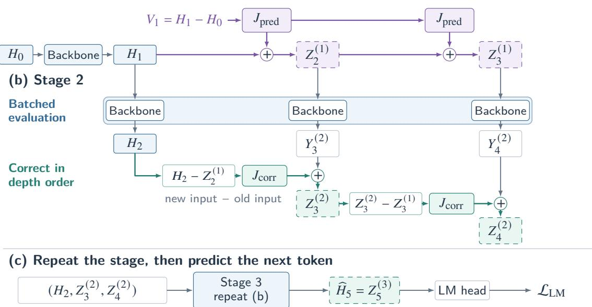
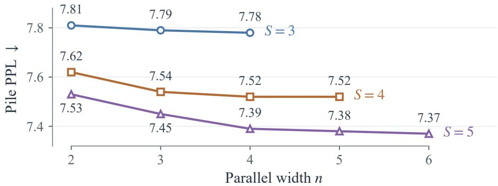
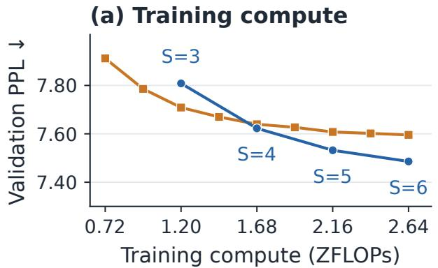
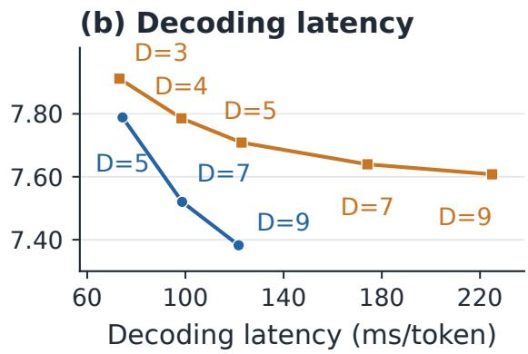
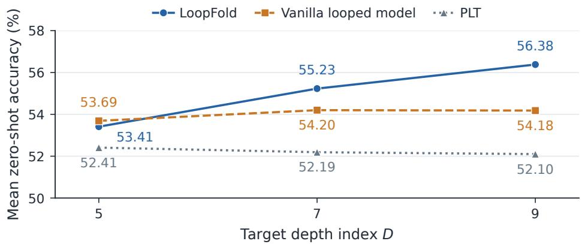

# LoopFold: Parallelizing Recurrent Depth in Looped Transformers

Feichen Song1, Boyi Zeng1, Yiqin Hao1, Shixiang Song1, He Li1, Yizhou Yang1, Zitong Wang2, Yifan Liu1, Ziwei He3, Zhouhan Lin1

1Shanghai Jiao Tong University

2Sun Yat-sen University 3Shanghai Innovation Institute

Abstract Looped Transformers increase computation per token by repeatedly applying a shared backbone, ofering a way to improve language modeling and downstream task performance at a fixed backbone parameter count. However, each loop depends on the preceding loop, so increasing recurrent depth also increases decoding latency. Existing approaches include Parallel Loop Transformers, which reduce latency by overlapping loop computation across token positions, but yield rapidly diminishing marginal accuracy gains at larger depths. To address this challenge, we introduce LoopFold, which folds computation at multiple recurrent depths into parallel batches for the same token prefix. A lightweight predictor estimates inputs to later loops so they can start before earlier loops finish. A corrector then refines the outputs of these later loops using newly available results from earlier loops. All components are trained jointly using only the final next-token prediction loss. In experiments with 1.4B models, deeper LoopFold configurations achieve progressively higher average zero-shot accuracy across eight tasks, rising from 53.41% to 56.38%. Vanilla looped models and PLT show limited gains over the same depth range. Compared with a nine-loop vanilla model, LoopFold uses five sequential stages and additional parallel computation to reduce decoding latency by 46%.

## 1. Introduction

Looped Transformers increase computation per token by repeatedly applying a shared backbone (Dehghani et al., 2019; Geiping et al., 2025a). This recurrent depth can improve language modeling and downstream task performance at a fixed backbone parameter count (Saunshi et al., 2025). However, each loop depends on the preceding loop’s output, so greater depth requires more sequential backbone stages and increases the wall-clock time needed to generate each token.

Existing approaches reduce decoding latency by overlapping recurrent computation across token positions. Parallel Loop Transformers (PLT) shift hidden states by one token between loops, allowing diferent loop depths to run concurrently using states from neighboring tokens (Wu et al., 2025). Adding loops initially improves accuracy, but the positional mismatch persists at every loop and the marginal gains quickly diminish at larger depths (Yang et al., 2026). Recurrent-depth parallel samplers refine several token drafts in parallel, but reducing the number of recurrent refinement steps between draft updates trades accuracy for faster decoding (Geiping et al., 2025b). The challenge is to start later loops before their inputs are available while still incorporating the results of earlier loops.

We introduce LoopFold to fold recurrent depth into parallel computation by batching hidden states from diferent depths of the same token prefix. Specifically, a lightweight predictor estimates the inputs to later loops, allowing them to start before the preceding loops finish. After each batched evaluation, a corrector uses the newly available earlier-loop results to refine outputs computed from the estimated inputs. These corrected states feed the next stage, and the deepest corrected state predicts the next token.

With 1.4B models, LoopFold achieves lower PPL and higher mean zero-shot accuracy as the target depth index increases (Figures 3 and 4). At target depth index � = 9, LoopFold requires only five sequential stages rather than nine, reducing latency by 46%. It improves accuracy on all eight evaluated tasks, with Avg-8 increasing by 2.20 percentage points relative to the vanilla looped model, at the cost of additional parallel computation. At matched training backbone-compute budgets of 1.68 and 2.16 ZFLOPs, and separately at comparable decoding latency, LoopFold achieves lower PPL and higher mean zero-shot accuracy than vanilla looped models. LoopFold thus improves the use of recurrent computation in two complementary ways: it can yield better quality at a fixed total backbone budget, and it can exploit available parallelism to perform additional recurrent computation without proportionally increasing decoding latency.

## 2. Related Work

Scaling latent computation. Recurrent-depth language models increase computation by repeatedly applying a shared transition, as in Universal Transformers (Dehghani et al., 2019). Such looping can approach the accuracy of deeper models with untied layers on arithmetic and question-answering tasks (Saunshi et al., 2025). PonderLM changes the input passed between loops, feeding a probabilityweighted average of token embeddings into the next loop (Zeng et al., 2026). Geiping et al. (2025a) sample recurrent depths during training to support variable test-time computation. Ouro instead learns an input-dependent exit gate for adaptive recurrent depth (Zhu et al., 2025). Hidden Decoding takes a diferent route, expanding each token into multiple embedding streams that the backbone processes together, while retaining their intermediate KV states as context (Liu et al., 2026).

Parallel recurrent computation. To shorten the sequential path between loops, PLT and recurrentdepth parallel samplers overlap computation across token positions. PLT pipelines loop depths using states shifted across token positions (Wu et al., 2025). Recurrent-depth parallel samplers accelerate decoding from pretrained checkpoints by refining several token drafts concurrently, relying on per-loop input injection and decodable intermediate states (Geiping et al., 2025b). LoopFold uses predicted inputs and output correction to run several backbone loops in parallel for the same token prefix.

Parallel correction methods. Classical Parareal uses a fine propagator for accurate parallel local solves and a cheaper coarse propagator for sequential correction, iterating toward the fine propagator’s sequential solution (Lions et al., 2001). Neural variants replace or parameterize the coarse component with learned networks (Lee et al., 2021). Related methods parallelize network evaluation through fixed-point or Newton iterations (Song et al., 2021; Lim et al., 2024), with SNLP using structured Jacobian approximations for Transformer layers (Han et al., 2026). LoopFold adapts parallel evaluation and correction to a shared recurrent backbone. Its predictor initializes later-loop inputs once, allowing several loops to run together, while its corrector incorporates newly available earlier-loop states into the parallel outputs. Unlike classical Parareal, which iteratively seeks to recover the sequential fine solution, LoopFold learns a fixed-stage parallel computation optimized directly for next-token prediction. Its objective is therefore not to match the sequential recurrent trajectory, but to produce predictive states under a constrained number of sequential stages.

## 3. Method

LoopFold supplies predicted inputs to later loops so that several recurrent depths can be evaluated together in a batch. For example, 1 3 3 first computes the state at depth index 1 and predicts

(a) Predict the later-loop inputs once

  
Figure 1 LoopFold with schedule $1 + 3 + 3$ . Three stages and width 3 reach target depth index $D = 5$ using seven backbone evaluations. (a) Predict deeper inputs from $H _ { 1 } - H _ { 0 }$ . (b) Evaluate three states together and correct using earlier-loop updates. (c) Repeat the stage and predict the next token.

provisional states at indices 2 and 3. The next two sequential stages produce corrected states at indices 2, 3, 4 and then 3, 4, 5, so the final state has target depth index � = 5 (Figure 1).

Let $H _ { 0 } = { \mathrm { E m b e d } } ( x _ { 1 : L } ) \in \mathbb { R } ^ { d \times L }$ , with each column representing one token, and let be the shared causal Transformer backbone. Its sequential states satisfy $H _ { j } = \mathcal { F } ( H _ { j - 1 } )$ . For parallel width � and total stage count �, a schedule 1 � � uses one initial backbone evaluation followed by � 1 stages of � parallel evaluations. Each schedule entry counts backbone evaluations in one sequential stage. A schedule is specified by $( n , S ) ; D = n + S - 1$ is the target depth index of its final corrected state. Diferent schedules can share the same �. Let $Z _ { j } ^ { ( s ) }$ denote the provisional state at depth index � after stage �.

## 3.1. Predicting Inputs for Later Loops

After computing $H _ { 1 } = \mathcal { F } ( H _ { 0 } )$ , we use its state change $V _ { 1 } = H _ { 1 } - H _ { 0 }$ as an initial increment along recurrent depth. A shared token-wise linear map �pred repeatedly transforms this increment, and the accumulated changes initialize deeper states. At identity initialization, this is simply linear extrapolation of the first loop’s state change:

$$
Z _ { 1 + \ell } ^ { ( 1 ) } = H _ { 1 } + \sum _ { m = 1 } ^ { \ell } J _ { \mathrm { p r e d } } ^ { m } V _ { 1 } , \qquad \ell = 1 , \ldots , n - 1 .\tag{1}
$$

Here, ${ \cal J } _ { \mathrm { p r e d } } ^ { m }$ denotes � successive applications of the shared predictor map. For $J _ { \mathrm { p r e d } } = I ;$ , the formula reduces to $Z _ { 1 + \ell } ^ { ( 1 ) } = H _ { 1 } + \ell V _ { 1 }$ . Training adapts the increments to the language-modeling objective. Prediction runs only once to supply the � 1 states that join $H _ { 1 }$ in the next batch.

## 3.2. Parallel Evaluation and Correction

At stage $s = 2 , \ldots , s .$ , we batch one sequential state with the provisional states from the preceding stage and evaluate them together:

$$
\begin{array} { r l } & { \bigl ( H _ { s } , Y _ { s + 1 } ^ { ( s ) } , \ldots , Y _ { s + n - 1 } ^ { ( s ) } \bigr ) } \\ & { \qquad = { \mathrm { S p l i t } } \Bigl [ \mathcal { F } \Bigl ( \mathrm { C o n c a t } _ { \mathrm { b a t c h } } \Bigl ( H _ { s - 1 } , Z _ { s } ^ { ( s - 1 ) } , \ldots , Z _ { s + n - 2 } ^ { ( s - 1 ) } \Bigr ) \Bigr ) \Bigr ] . } \end{array}\tag{2}
$$

Here, $\mathtt { C o n c a t } _ { \mathrm { b a t c h } }$ concatenates the � recurrent states along the batch dimension, $\mathcal { F }$ evaluates the � states in parallel, and Split separates the batched output back into its � lanes. All lanes use the same token positions and causal mask, while attention is computed independently within each lane. The first output advances the sequential recurrence to $H _ { s } ;$ the remaining $Y _ { j } ^ { ( s ) }$ are raw backbone outputs from the provisional inputs.

The backbone output $Y _ { j + 1 } ^ { ( s ) }$ is stale because it was computed from the previous estimate of its input. We therefore correct the output according to how much that input estimate has changed. A shared token-wise linear map $J _ { \mathrm { c o r r } }$ translates this input change into an output adjustment. Starting from $Z _ { s } ^ { ( s ) } = H _ { s }$ , we update the remaining outputs in depth order:

$$
Z _ { j + 1 } ^ { ( s ) } = Y _ { j + 1 } ^ { ( s ) } + J _ { \mathrm { c o r r } } \left( Z _ { j } ^ { ( s ) } - Z _ { j } ^ { ( s - 1 ) } \right) , \qquad j = s , \ldots , s + n - 2 .\tag{3}
$$

Table 1 Backbone computation per token (any model size). �: target depth index; �: sequential stages; �: parallel width after the first loop. Evaluations count all parallel lanes.

<table><tr><td>Model</td><td>Target depth index D</td><td>Backbone evaluations</td><td>Sequential stages S</td><td>Width n</td></tr><tr><td>Vanilla looped model</td><td>D</td><td>D</td><td>D</td><td>1</td></tr><tr><td>LoopFold</td><td>n + S - 1</td><td>1 + n(S − 1)</td><td>S</td><td>n</td></tr></table>

Because each corrected state is used to correct the next depth, newly available information propagates sequentially across the parallel outputs.

## 3.3. Training Objective and Computational Cost

After � stages, the deepest state $\widehat H _ { D } = Z _ { S + n - 1 } ^ { ( S ) } \ :$ , with target depth index $D = n + S - 1$ , produces the next-token logits and language-modeling loss:

$$
\ell _ { t } = W _ { \mathrm { L M } } \mathrm { R M } S \mathrm { N o r m } ( \widehat { H } _ { D } ) _ { t } , \qquad \mathcal { L } _ { \mathrm { L M } } = - \sum _ { t = 1 } ^ { L - 1 } \log s \mathrm { o f t m a x } ( \ell _ { t } ) _ { x _ { t + 1 } } .\tag{4}
$$

All components are trained jointly using only this loss, learning intermediate states for next-token prediction. The predictor and corrector use separate parameter matrices, each written as $J = I + \Delta J ,$ with $\Delta J \in \mathbb { R } ^ { d \times d }$ initialized to zero. Each map is shared across depths and token positions; the corrector is also shared across stages. During generation, the prefix stays fixed throughout the stages, and the next token is selected from the final output.

Counting each parallel lane gives $1 + n ( S - 1 )$ backbone evaluations in � sequential stages (Table 1). The two maps add $2 d ^ { 2 }$ parameters (8.39M at 1.4B) and $S ( n - 1 )$ token-wise linear-map applications per schedule.

## 4. Experiments

We evaluate LoopFold under three complementary comparison regimes. Matched-training-compute comparisons test whether LoopFold can improve model quality at the same total backbone budget. Comparable-latency comparisons test whether additional backbone evaluations can be shifted onto the parallel dimension to improve quality without increasing the number of sequential stages. Finally, matched-target-depth comparisons characterize quality when LoopFold reaches the same target depth index with fewer sequential stages. Because these regimes hold diferent quantities fixed, we report them separately rather than interpreting them interchangeably.

## 4.1. Experimental Setup

Models and training. We train 1.4B models from scratch on the Pile (Gao et al., 2020) using a LLaMA-style backbone (Touvron et al., 2023), a global batch size of 256, and a common 30B-token budget. Each schedule is trained separately with the same tokenizer, data order, and training recipe. The learning rate warms up to $2 \times 1 0 ^ { - 4 }$ over the first 1% of steps, then follows cosine decay to $2 \times 1 0 ^ { - 5 }$ The ablations use 410M models trained on 25B tokens.

Baselines. A vanilla looped model applies the shared backbone sequentially � times. Our PLT-� baselines use cross-loop pipelining without KV sharing (Wu et al., 2025). Hidden Decoding uses 5, 7, or 9 embedding streams per token (Liu et al., 2026). We omit recurrent-depth parallel samplers because they require per-loop input injection that our backbone does not use (Geiping et al., 2025b).

Quality metrics. We report Pile validation perplexity (PPL) and zero-shot accuracy on LAMBADA-OpenAI (LAMBADA-OAI) (Paperno et al., 2016; Radford et al., 2019), ARC-Easy and ARC-Challenge (Clark et al., 2018), WinoGrande (Sakaguchi et al., 2020), PIQA (Bisk et al., 2020), HellaSwag (Zellers et al., 2019), SciQ (Welbl et al., 2017), and RACE (Lai et al., 2017).

Training computation. We report total training backbone computation in ZFLOPs. For the 1.4B models, one backbone evaluation per original token corresponds to 0.24 ZFLOPs over the training run. The evaluation count per token is $1 + n ( S - 1 )$ for LoopFold, � for vanilla looped models and PLT, and the stream count for Hidden Decoding. This counts computation across all sequential stages, parallel lanes, and expanded token representations; the learned-map cost is given in Section 3.3.

Decoding latency. We measure wall-clock milliseconds per generated token with a 1,024-token prompt and a 1,024-token greedy continuation. The main comparisons use a decoding batch size of 1. Section 4.5 reports aggregate throughput for batches up to 16. All decoding benchmarks run on the same GPU in BF16 with tensor parallelism disabled, and timings cover the complete decoding schedule.

## 4.2. Parallel Width at Fixed Stage Count

Parallel width controls how many recurrent states the backbone evaluates in each batched evaluation. Figure 2 varies width while holding the number of sequential stages fixed at � = 3, 4, 5, testing whether additional parallel computation improves PPL within the same sequential-stage budget.

Increasing parallel width at a fixed stage count consistently improves PPL, showing that additional recurrent computation can improve model quality without extending the sequential path. However, the gain per added parallel lane decreases as width grows, indicating progressively lower returns from additional parallel computation.

  
Figure 2 Parallel width and Pile perplexity in LoopFold (1.4B, 30B training tokens). Each curve fixes sequential stages � and varies width �. Schedule $1 + n + \cdots + n$ reaches target depth index $D = n + S - 1$  
Vanilla looped model LoopFold

  
Figure 3 Pile PPL versus training compute and decoding latency (1.4B, 30B tokens). (a) LoopFold: $n = 2 , S = 3 – 6$ , ending with $1 + 2 + 2 + 2 + 2 + 2 ;$ ; vanilla looped: 3–11 loops. (b) LoopFold uses $1 + 3 + 3 , 1 + 4 + 4 + 4$ , and $1 + 5 + 5 + 5 + 5$ at $D = 5 , 7 , 9$ . Timing: batch 1, 1,024-token prompts/continuations, greedy decoding, same GPU, BF16, tensor parallelism disabled.

## 4.3. Quality versus Training Compute and Decoding Latency

At matched training backbone compute, we fix LoopFold’s width at 2 and increase its stage count to compare models across the same training budgets (Figure 3a and Table 2). The vanilla looped model leads at 1.20 ZFLOPs, whereas LoopFold achieves lower PPL and higher mean zero-shot accuracy at 1.68 and 2.16 ZFLOPs. Thus, the parallel schedule can improve prediction quality within the same training backbone budget while using fewer sequential stages. LoopFold also exceeds PLT and Hidden Decoding in mean accuracy across all three budgets.

At comparable decoding latency, LoopFold at target depth indices � = 5, 7, 9 is compared with vanilla looped models using 3, 4, and 5 loops, respectively (Figure 3b and Table 3). Each pair uses the same number of sequential stages, allowing LoopFold to perform additional recurrent computation in parallel within a similar time per token. This yields lower PPL and higher mean accuracy in all three pairs, with gains on all eight tasks for the two deeper schedules. PLT and Hidden Decoding decode faster but attain lower mean accuracy.

Table 2 Zero-shot accuracy at matched training backbone compute (1.4B, 30B Pile tokens). Vanilla looped models and PLT use 5/7/9 loops; Hidden Decoding uses $5 / 7 / 9$ streams per token. LoopFold schedules $1 + 2 + 2 , 1 + 2 + 2 + 2$ , and $1 + 2 + 2 + 2 + 2$ correspond to � = 4, 5, 6. Accuracy is in percent; Avg-8 is the unweighted mean across eight tasks.
<table><tr><td colspan="10">Training</td></tr><tr><td>Model</td><td>(ZFLOPs)</td><td>LAMBADA OAI</td><td>ARC-E</td><td>ARC-C</td><td>Wino</td><td>PIQA</td><td>Hella</td><td>SciQ</td><td>RACE</td><td>Avg-8</td></tr><tr><td>Vanilla Looped</td><td rowspan="4">1.20</td><td>59.65</td><td>52.90</td><td>28.24</td><td>57.14</td><td>69.86</td><td>50.55</td><td>78.90</td><td>32.25</td><td>53.69</td></tr><tr><td>PLT</td><td>57.27</td><td>50.42</td><td>26.96</td><td>54.70</td><td>69.26</td><td>48.47</td><td>79.10</td><td>33.11</td><td>52.41</td></tr><tr><td>Hidden Decoding</td><td>54.41</td><td>48.23</td><td>26.62</td><td>52.09</td><td>68.99</td><td>43.66</td><td>75.70</td><td>30.33</td><td>50.00</td></tr><tr><td>LoopFold  $( n = 2 , S = 3 )$ </td><td>57.60</td><td>53.16</td><td>28.16</td><td>55.33</td><td>69.59</td><td>49.57</td><td>79.40</td><td>33.11</td><td>53.24</td></tr><tr><td>Vanilla Looped</td><td rowspan="4">1.68</td><td>60.14</td><td>53.32</td><td>28.75</td><td>57.77</td><td>70.35</td><td>51.44</td><td>77.20</td><td>34.64</td><td>54.20</td></tr><tr><td>PLT</td><td>55.89</td><td>51.85</td><td>27.56</td><td>54.70</td><td>68.99</td><td>47.70</td><td>77.80</td><td>33.01</td><td>52.19</td></tr><tr><td>Hidden Decoding</td><td>52.92</td><td>48.32</td><td>25.60</td><td>52.49</td><td>68.88</td><td>43.44</td><td>74.70</td><td>30.62</td><td>49.62</td></tr><tr><td>LoopFold  $( n = 2 , S = 4 )$ </td><td>58.08</td><td>54.80</td><td>28.75</td><td>57.14</td><td>71.33</td><td>51.80</td><td>82.60</td><td>33.21</td><td>54.71</td></tr><tr><td>Vanilla Looped</td><td rowspan="4">2.16</td><td>60.00</td><td>52.36</td><td>27.13</td><td>57.85</td><td>70.84</td><td>51.66</td><td>79.70</td><td>33.88</td><td></td><td>54.18</td></tr><tr><td>PLT</td><td>56.84</td><td>51.05</td><td>27.22</td><td>55.41</td><td>70.29</td><td>47.72</td><td>76.30</td><td>31.96</td><td></td><td>52.10</td></tr><tr><td>Hidden Decoding</td><td>53.19</td><td>49.20</td><td>26.54</td><td>51.78</td><td>68.23</td><td>43.65</td><td></td><td>73.40</td><td>30.62</td><td>49.57</td></tr><tr><td>LoopFold  $( n = 2 , S = 5 )$ </td><td>60.90</td><td>55.39</td><td>28.92</td><td>56.75</td><td>71.27</td><td>52.79</td><td></td><td>80.30</td><td>34.74</td><td>55.13</td></tr></table>

Table 3 Zero-shot accuracy and decoding latency (1.4B, 30B Pile tokens). LoopFold uses $1 + 3 + 3 , 1 + 4 + 4 + 4 ,$ and $1 + 5 + 5 + 5 + 5$ at � = 5, 7, 9, paired with 3/4/5-loop vanilla looped models. PLT/Hidden Decoding sufixes count loops/streams per token. Timing: batch 1, 1,024-token prompts/continuations, greedy decoding, same GPU, BF16, tensor parallelism disabled. Accuracy is in percent; Avg-8 is the unweighted mean across eight tasks.
<table><tr><td colspan="10">Latency</td></tr><tr><td>Model</td><td>(ms/token)</td><td>LAMBADA OAI</td><td>ARC-E</td><td>ARC-C</td><td>Wino</td><td>PIQA</td><td>Hella</td><td>SciQ</td><td>RACE</td><td>Avg-8</td></tr><tr><td>PLT-5</td><td>24.93</td><td>57.27</td><td>50.42</td><td>26.96</td><td>54.70</td><td>69.26</td><td>48.47</td><td>79.10</td><td>33.11</td><td>52.41</td></tr><tr><td>PLT-7</td><td>25.35</td><td>55.89</td><td>51.85</td><td>27.56</td><td>54.70</td><td>68.99</td><td>47.70</td><td>77.80</td><td>33.01</td><td>52.19</td></tr><tr><td>PLT-9</td><td>25.16</td><td>56.84</td><td>51.05</td><td>27.22</td><td>55.41</td><td>70.29</td><td>47.72</td><td>76.30</td><td>31.96</td><td>52.10</td></tr><tr><td>Hidden Decoding-5</td><td>23.63</td><td>54.41</td><td>48.23</td><td>26.62</td><td>52.09</td><td>68.99</td><td>43.66</td><td>75.70</td><td>30.33</td><td>50.00</td></tr><tr><td>Hidden Decoding-7</td><td>23.95</td><td>52.92</td><td>48.32</td><td>25.60</td><td>52.49</td><td>68.88</td><td>43.44</td><td>74.70</td><td>30.62</td><td>49.62</td></tr><tr><td>Hidden Decoding-9</td><td>23.27</td><td>53.19</td><td>49.20</td><td>26.54</td><td>51.78</td><td>68.23</td><td>43.65</td><td>73.40</td><td>30.62</td><td>49.57</td></tr><tr><td>Vanilla Looped D = 3</td><td>73.11</td><td>56.36</td><td>50.21</td><td>27.65</td><td>55.17</td><td>69.86</td><td>48.40</td><td>75.20</td><td>33.01</td><td>51.98</td></tr><tr><td>LoopFold D = 5</td><td>74.41</td><td>58.01</td><td>51.64</td><td>27.73</td><td>54.78</td><td>70.24</td><td>49.81</td><td>81.80</td><td>33.30</td><td>53.41</td></tr><tr><td>Vanilla Looped D = 4</td><td>98.40</td><td>58.24</td><td>52.57</td><td>28.16</td><td>54.85</td><td>70.02</td><td>50.39</td><td>77.90</td><td>34.35</td><td>53.31</td></tr><tr><td>LoopFold D = 7</td><td>98.66</td><td>60.28</td><td>54.25</td><td>30.03</td><td>57.22</td><td>70.46</td><td>52.67</td><td>82.30</td><td>34.64</td><td>55.23</td></tr><tr><td>Vanilla Looped D = 5</td><td>122.88</td><td>59.65</td><td>52.90</td><td>28.24</td><td>57.14</td><td>69.86</td><td>50.55</td><td>78.90</td><td>32.25</td><td>53.69</td></tr><tr><td>LoopFold D = 9</td><td>121.68</td><td>61.61</td><td>55.13</td><td>29.35</td><td>59.75</td><td>72.42</td><td>54.46</td><td>82.30</td><td>35.98</td><td>56.38</td></tr></table>

## 4.4. Quality Across Target Depth Indices

To compare how model quality evolves across deeper configurations, Figure 4 reports mean zero-shot accuracy at matched target depth indices $D = 5 , 7 , 9$ . The corresponding LoopFold schedules are 1 3 3, 1 4 4 4, and $1 + 5 + 5 + 5 + 5$ , which jointly increase parallel width, sequential stage count, and total backbone computation.

  
Figure 4  Mean zero-shot accuracy across target depth indices (1.4B, 30B Pile tokens). At $D = 5 , 7 , 9 _ { \scriptscriptstyle ; }$ , LoopFold uses $1 + 3 + 3$ $1 + 4 + 4 + 4 .$ , and $1 + 5 + 5 + 5 + 5$ in $3 / 4 / 5$ stages; vanilla looped models and PLT use � loops. Accuracy is the unweighted mean (%) across eight tasks.

Across these configurations, LoopFold’s mean zero-shot accuracy increases from 53.41% at $D = 5$ to 56.38% at $D = 9$ , whereas the vanilla looped and PLT results vary less over the same target depth indices. At $D = 9 _ { \mathrm { { i } } }$ , the evaluated LoopFold configuration achieves 2.20 percentage points higher Avg-8 accuracy, lower PPL, and 46% lower decoding latency than the vanilla looped model, while using additional parallel backbone computation.

## 4.5. Throughput with Larger Decoding Batches

Because LoopFold batches recurrent states, decoding more sequences also enlarges the batch processed by the backbone. Table 4 reports throughput across decoding batch sizes from 1 to 16. We compare LoopFold $1 + 3 + 3 \ ( D = 5$ , three sequential stages) with a five-loop vanilla looped model.

Table 4  Decoding throughput at $D = 5$ (1.4B, tokens/s). LoopFold uses $1 + 3 + 3$ , with seven backbone evaluations in three stages, versus five loops in the vanilla looped model. � is batch size. Timing: 1,024-token prompts/continuations, greedy decoding, same GPU, BF16, tensor parallelism disabled. Speed ratio: LoopFold/vanilla looped throughput at equal $B ;$ blanks indicate unavailable measurements.
<table><tr><td>Model</td><td>B = 1</td><td> $B = 2$ </td><td> $B = 4$ </td><td> $B = 8$ </td><td> $B = 1 6$ </td></tr><tr><td>Vanilla Looped  $D = 5$ </td><td>8.14</td><td>16.15</td><td>31.67</td><td>65.31</td><td>130.18</td></tr><tr><td>LoopFold  $D = 5$ </td><td>13.44</td><td>26.24</td><td>52.26</td><td>105.35</td><td>209.12</td></tr><tr><td>Speed ratio to vanilla looped model</td><td>1.65×</td><td>1.62×</td><td>1.65×</td><td>1.61×</td><td>1.61×</td></tr></table>

At $B = 1$ , LoopFold achieves 1.65× the throughput of the five-loop vanilla looped model. As batch size increases, LoopFold throughput grows approximately linearly, maintaining stable per-sequence decoding throughput across the evaluated batch sizes.

## 4.6. KV Sharing Across Recurrent Stages

Although LoopFold decodes at latency close to a shallower vanilla looped model, storing an independent KV cache for every recurrent evaluation adds memory cost. We address this cost in the $1 . 4 \mathrm { B } \ 1 + 2 + 2 + 2$ model at target depth index $D = 5$ , comparing the default No KV sharing policy with two reuse policies. First-KV reuse retains the KV tensors from the first evaluation at each loop depth and reuses them in later stages, reducing the seven independent caches to five. To incorporate later-stage updates for recent tokens, Hard overwrite-64 additionally refreshes the most recent 64 cached positions using newly computed sequential states. Each variant uses the same cache policy in training and inference.

Table 5 KV sharing (1.4B, 30B Pile tokens, $1 + 2 + 2 + 2 , D = 5 )$ . First-KV reuse retains each depth’s first cache; Hard overwrite-64 also refreshes the latest 64 positions. Storage is relative to one full-backbone cache. Variants train with their inference cache policies. Timing: batch 1, 1,024-token prompts/continuations, greedy decoding, same GPU, BF16, tensor parallelism disabled.
<table><tr><td></td><td></td><td></td><td>Latency</td><td></td></tr><tr><td>Variant</td><td>Later-stage KV policy</td><td>KV storage</td><td>(ms/token)</td><td>Pile PPL ↓</td></tr><tr><td>No KV sharing</td><td>independent cache</td><td>7×</td><td>99.89</td><td>7.62</td></tr><tr><td>First-KV reuse</td><td>reuse all positions</td><td>5×</td><td>103.21</td><td>7.68</td></tr><tr><td>Hard overwrite-64</td><td>overwrite most recent 64</td><td>5×</td><td>104.94</td><td>7.63</td></tr></table>

First-KV reuse reduces KV storage from $7 \times$ to $5 { \times } ,$ with slightly higher PPL and decoding latency. Hard overwrite-64 retains this memory saving and recovers most of the PPL loss by refreshing recent cached states. This refresh adds a small further latency overhead.

## 4.7. Contributions of Prediction and Correction

To identify how prediction and correction contribute to the quality gains, we use 410M models with the $1 + 4 + 4 + 4$ schedule. Component removal tests the value of each operation, identity maps test the benefit of learning its transformation, and state measurements examine how provisional states change across stages.

## 4.7.1. Component Removal

No prediction initializes every lane with the same $H _ { 1 }$ while retaining correction. No correction keeps the learned initialization but passes raw backbone outputs directly to the next stage. All three variants retain the thirteen scheduled backbone evaluations and are trained separately.

Table 6 Component ablations (410M, 25B Pile tokens, $1 + 4 + 4 + 4 , D = 7 ) . J _ { \mathrm { p r e d } }$ and $J _ { \mathrm { c o r r } }$ denote prediction and correction. No prediction repeats $H _ { 1 }$ ; No correction uses raw backbone outputs. Variants train separately; ΔPPL is the increase over the complete model.
<table><tr><td>Variant</td><td>Initial states</td><td>Output correction</td><td>Pile PPL ↓</td><td>∆PPL</td></tr><tr><td>LoopFold</td><td> $J _ { \mathrm { p r e d } }$ </td><td> $J _ { \mathrm { c o r r } }$ </td><td>9.13</td><td>1</td></tr><tr><td>No prediction</td><td>repeated  $H _ { 1 }$ </td><td> $J _ { \mathrm { c o r r } }$ </td><td>9.29</td><td>+0.16</td></tr><tr><td>No correction</td><td> $J _ { \mathrm { p r e d } }$ </td><td>none</td><td>9.47</td><td>+0.34</td></tr></table>

Both components improve PPL under the same backbone budget. Removing correction has the larger penalty, highlighting the value of incorporating new earlier-loop results into the parallel states.

## 4.7.2. Learning the Prediction and Correction Maps

To test the value of learning each map, we hold one map fixed at identity throughout training while learning the backbone and the other map. Identity prediction therefore uses linear extrapolation, whereas Identity correction adds the input discrepancy directly to the output.

Table 7 Learned versus identity maps (410M, 25B Pile tokens, $1 + 4 + 4 + 4 , D = 7 )$ . Each identity variant fixes prediction $J _ { \mathrm { p r e d } }$ or correction $J _ { \mathrm { c o r r } }$ at � throughout training, while learning the backbone and the other map.
<table><tr><td>Variant</td><td> $J _ { \mathrm { p r e d } }$ </td><td> $J _ { \mathrm { c o r r } }$ </td><td>Pile PPL ↓</td></tr><tr><td>LoopFold</td><td>Learned</td><td>Learned</td><td>9.13</td></tr><tr><td>Identity prediction</td><td>I</td><td>Learned</td><td>9.21</td></tr><tr><td>Identity correction</td><td>Learned</td><td>I</td><td>9.20</td></tr></table>

Both identity variants outperform removal of the corresponding component, showing that linear extrapolation and direct discrepancy addition already provide useful operations. Learning both maps further lowers PPL, so adapting these operations to the jointly trained backbone adds value beyond their identity forms.

## 4.7.3. Evolution of Learned States

To examine how the parallel states evolve, Table 8 revisits the three variants in Table 6. We compare their provisional states with $H _ { 2 } , H _ { 3 } , H _ { 4 }$ from sequential rollouts of their own trained backbones on the same input. For each $Z _ { j } ^ { ( s ) }$ , we measure global cosine similarity and relative $L _ { 2 }$ distance:

$$
c _ { j } ^ { ( s ) } = \frac { \langle Z _ { j } ^ { ( s ) } , H _ { j } \rangle _ { F } } { \Vert Z _ { j } ^ { ( s ) } \Vert _ { F } \Vert H _ { j } \Vert _ { F } } , \qquad r _ { j } ^ { ( s ) } = \frac { \Vert Z _ { j } ^ { ( s ) } - H _ { j } \Vert _ { F } } { \Vert H _ { j } \Vert _ { F } } .\tag{5}
$$

Table 8 Provisional-state evolution (410M, 25B Pile tokens, $1 + 4 + 4 + 4 , D = 7 )$ . Reference states come from each variant’s own sequential backbone on the same input. S1 denotes initialization; arrows mark subsequent stages. Cosine uses full state tensors; relative $L _ { 2 }$ divides the Frobenius error by the reference state’s norm.
<table><tr><td>Variant</td><td>Metric</td><td> $H _ { 2 }$  (S1)</td><td> $H _ { 3 } \ ( S 1 {  } S 2 )$ </td><td> $H _ { 4 }  \ ( S 1 {  } S 2 {  } S 3 )$ </td></tr><tr><td rowspan="2">LoopFold</td><td>Cosine ↑</td><td>0.922</td><td>0.774→0.811</td><td>0.636→0.653→0.823</td></tr><tr><td>Relative  $L _ { 2 } \downarrow$ </td><td>0.394</td><td>0.642→0.588</td><td>0.809→0.792→0.573</td></tr><tr><td rowspan="2">No prediction</td><td>Cosine ↑</td><td>0.971</td><td>0.874→0.924</td><td>0.643→0.701→0.805</td></tr><tr><td>Relative  $L _ { 2 } \downarrow$ </td><td>0.239</td><td>0.494→0.389</td><td>0.777→0.726→0.594</td></tr><tr><td rowspan="2">No correction</td><td>Cosine ↑</td><td>0.506</td><td>0.517→0.870</td><td>0.234→0.224→0.414</td></tr><tr><td>Relative  $L _ { 2 } \downarrow$ </td><td>0.866</td><td>0.857→0.516</td><td>0.977→1.027→0.920</td></tr></table>

The complete model’s state at depth index $j = 4$ moves closer to its sequential reference across stages, while removing correction leaves weaker alignment. This is consistent with correction carrying earlier-loop information into deeper provisional states.

Repeated- $\cdot H _ { 1 }$ initialization starts closer to its own sequential states at depth indices 2 and 3, yet the complete model achieves better final PPL. This may indicate that minimizing instantaneous distance to the sequential trajectory is not necessary for good parallel refinement.

## 5. Conclusion

We introduced LoopFold to fold recurrent computation into parallel stages using a jointly trained backbone, predictor, and corrector. Experiments show that this design can improve language modeling and zero-shot downstream performance with fewer sequential backbone stages, while the component analyses highlight the importance of correction. These results suggest that recurrent depth and sequential decoding depth need not coincide: additional recurrent computation can be shifted onto the parallel dimension when provisional states are subsequently corrected.

LoopFold reduces sequential depth at the cost of additional backbone computation and thus higher FLOPs. It also increases KV-cache requirements; although KV sharing mitigates this overhead, our experiments show a modest trade-of in quality and/or latency. Reducing these computational and memory costs while preserving the benefits of parallel recurrent evaluation remains an important direction for future work.

## References

Yonatan Bisk, Rowan Zellers, Ronan Le Bras, Jianfeng Gao, and Yejin Choi. PIQA: Reasoning about physical commonsense in natural language. In Proceedings of the AAAI Conference on Artificial Intelligence, volume 34, pages 7432–7439, 2020. doi: 10.1609/aaai.v34i05.6239.

Peter Clark, Isaac Cowhey, Oren Etzioni, Tushar Khot, Ashish Sabharwal, Carissa Schoenick, and Oyvind Tafjord. Think you have solved question answering? try ARC, the AI2 reasoning challenge. arXiv preprint arXiv:1803.05457, 2018. URL https://arxiv.org/abs/1803.05457.

Mostafa Dehghani, Stephan Gouws, Oriol Vinyals, Jakob Uszkoreit, and Lukasz Kaiser. Universal transformers. In International Conference on Learning Representations, 2019. URL https://open review.net/forum?id=HyzdRiR9Y7.

Leo Gao, Stella Biderman, Sid Black, Laurence Golding, Travis Hoppe, Charles Foster, Jason Phang, Horace He, Anish Thite, Noa Nabeshima, Shawn Presser, and Connor Leahy. The pile: An 800GB dataset of diverse text for language modeling. arXiv preprint arXiv:2101.00027, 2020. URL https://arxiv.org/abs/2101.00027.

Jonas Geiping, Sean McLeish, Neel Jain, John Kirchenbauer, Siddharth Singh, Brian R. Bartoldson, Bhavya Kailkhura, Abhinav Bhatele, and Tom Goldstein. Scaling up test-time compute with latent reasoning: A recurrent depth approach. arXiv preprint arXiv:2502.05171, 2025a. URL https://arxiv.org/abs/2502.05171.

Jonas Geiping, Xinyu Yang, and Guinan Su. Eficient parallel samplers for recurrent-depth models and their connection to difusion language models. arXiv preprint arXiv:2510.14961, 2025b. URL https://arxiv.org/abs/2510.14961.

Ligong Han, Kai Xu, Hao Wang, and Akash Srivastava. SNLP: Layer-parallel inference via structured newton corrections. arXiv preprint arXiv:2605.17842, 2026. URL https://arxiv.org/abs/26 05.17842.

Guokun Lai, Qizhe Xie, Hanxiao Liu, Yiming Yang, and Eduard Hovy. RACE: Large-scale ReAding comprehension dataset from examinations. In Proceedings of the 2017 Conference on Empirical Methods in Natural Language Processing, pages 785–794. Association for Computational Linguistics, 2017. doi: 10.18653/v1/D17-1082.

Chang-Ock Lee, Youngkyu Lee, and Jongho Park. Parareal neural networks emulating a parallel-intime algorithm. arXiv preprint arXiv:2103.08802, 2021. URL https://arxiv.org/abs/2103 .08802.

Yi Heng Lim, Qi Zhu, Joshua Selfridge, and Muhammad Firmansyah Kasim. Parallelizing non-linear sequential models over the sequence length. In International Conference on Learning Representations, 2024. URL https://openreview.net/forum?id=E34AlVLN0v.

Jacques-Louis Lions, Yvon Maday, and Gabriel Turinici. A “parareal” in time discretization of PDE’s. Comptes Rendus de l’Académie des Sciences - Series I - Mathematics, 332:661–668, 2001. doi: 10.1016/S0764-4442(00)01793-6.

Aiwei Liu, Cheng Shi, Chuhan Wu, Ci Lei, Di Lu, Donald He, Fan Zhang, Fanhao Kong, Feifei Zhang, Guan Wang, Haicheng Wang, Haoyu Liu, Houjin Yu, Jiachen Ding, Jiayi Feng, Jie Zhou, Jijun Chi, Jindi Shi, Jing Lei, Junjie Zhang, Laiyi Li, Le Tian, Linhao Zhang, Miao Fan, Sijun Zhang, Wei Jia, Weiwei Shi, Wenhan Li, Wentao Zhao, Wenteng Liang, Xiao Zhou, Xiaojin Zhou, Xihuai Wang, Xinyu Gao, Xuanliang Wang, Xuyang Ao, Yang Yu, Yangxiu You, Yinuo Zhao, Yufei Kuang, Yufei Wang, Yuan Liu, Yuan Liu, Yuwen Chen, Zhencong Tian, Zhongyin Zhao, Zilin Yu, and Zitao Wang. Hidden decoding at scale: Latent computation scaling for large language models. arXiv preprint arXiv:2607.08186, 2026. URL https://arxiv.org/abs/2607.08186.

Denis Paperno, Germán Kruszewski, Angeliki Lazaridou, Ngoc Quan Pham, Rafaella Bernardi, Sandro Pezzelle, Marco Baroni, Gemma Boleda, and Raquel Fernández. The LAMBADA dataset: Word prediction requiring a broad discourse context. In Proceedings of the 54th Annual Meeting of the Association for Computational Linguistics, pages 1525–1534. Association for Computational Linguistics, 2016. doi: 10.18653/v1/P16-1144.

Alec Radford, Jefrey Wu, Rewon Child, David Luan, Dario Amodei, and Ilya Sutskever. Language models are unsupervised multitask learners. Technical report, OpenAI, 2019. URL https: //cdn.openai.com/better-language-models/language-models.pdf.

Keisuke Sakaguchi, Ronan Le Bras, Chandra Bhagavatula, and Yejin Choi. WinoGrande: An adversarial winograd schema challenge at scale. In Proceedings of the AAAI Conference on Artificial Intelligence, volume 34, pages 8732–8740, 2020. doi: 10.1609/aaai.v34i05.6399.

Nikunj Saunshi, Nishanth Dikkala, Zhiyuan Li, Sanjiv Kumar, and Sashank J. Reddi. Reasoning with latent thoughts: On the power of looped transformers. In International Conference on Learning Representations, 2025. URL https://openreview.net/forum?id=din0lGfZFd.

Yang Song, Chenlin Meng, Renjie Liao, and Stefano Ermon. Accelerating feedforward computation via parallel nonlinear equation solving. In Proceedings of the 38th International Conference on Machine Learning, volume 139 of Proceedings of Machine Learning Research, pages 9791–9800. PMLR, 2021. URL https://proceedings.mlr.press/v139/song21a.html.

Hugo Touvron, Thibaut Lavril, Gautier Izacard, Xavier Martinet, Marie-Anne Lachaux, Timothée Lacroix, Baptiste Rozière, Naman Goyal, Eric Hambro, Faisal Azhar, Aurélien Rodriguez, Armand Joulin, Edouard Grave, and Guillaume Lample. LLaMA: Open and eficient foundation language models. arXiv preprint arXiv:2302.13971, 2023. URL https://arxiv.org/abs/2302.13971.

Johannes Welbl, Nelson F. Liu, and Matt Gardner. Crowdsourcing multiple choice science questions. In Proceedings of the 3rd Workshop on Noisy User-generated Text, pages 94–106. Association for Computational Linguistics, 2017. doi: 10.18653/v1/W17-4413.

Bohong Wu, Mengzhao Chen, Xiang Luo, Shen Yan, Qifan Yu, Fan Xia, Tianqi Zhang, Hongrui Zhan, Zheng Zhong, Xun Zhou, Siyuan Qiao, and Xingyan Bin. Parallel loop transformer for eficient test-time computation scaling. arXiv preprint arXiv:2510.24824, 2025. URL https: //arxiv.org/abs/2510.24824.

Jian Yang, Shawn Guo, Wei Zhang, Tianyu Zheng, Yaxin Du, Haau-Sing Li, Jiajun Wu, Yue Song, Yan Xing, Qingsong Cai, Zelong Huang, Chuan Hao, Ran Tao, Xianglong Liu, Wayne Xin Zhao, Mingjie Tang, Weifeng Lv, Ming Zhou, and Bryan Dai. LoopCoder-v2: Only loop once for eficient test-time computation scaling. arXiv preprint arXiv:2606.18023, 2026. URL https://arxiv.org/abs/ 2606.18023.

Rowan Zellers, Ari Holtzman, Yonatan Bisk, Ali Farhadi, and Yejin Choi. HellaSwag: Can a machine really finish your sentence? In Proceedings of the 57th Annual Meeting of the Association for Computational Linguistics, pages 4791–4800. Association for Computational Linguistics, 2019. doi: 10.18653/v1/P19-1472.

Boyi Zeng, Shixiang Song, Siyuan Huang, Yixuan Wang, He Li, Ziwei He, Xinbing Wang, Zhiyu Li, and Zhouhan Lin. PonderLM: Pretraining language models to ponder in continuous space. In International Conference on Learning Representations, 2026. URL https://openreview.net/f orum?id=UrM4MNRYZm.

Rui-Jie Zhu, Zixuan Wang, Kai Hua, Tianyu Zhang, Ziniu Li, Haoran Que, Boyi Wei, Zixin Wen, Fan Yin, He Xing, Lu Li, Jiajun Shi, Kaijing Ma, Shanda Li, Taylor Kergan, Andrew Smith, Xingwei Qu, Mude Hui, Bohong Wu, Qiyang Min, Hongzhi Huang, Xun Zhou, Wei Ye, Jiaheng Liu, Jian Yang, Yunfeng Shi, Chenghua Lin, Enduo Zhao, Tianle Cai, Ge Zhang, Wenhao Huang, Yoshua Bengio, and Jason Eshraghian. Scaling latent reasoning via looped language models. arXiv preprint arXiv:2510.25741, 2025. URL https://arxiv.org/abs/2510.25741.