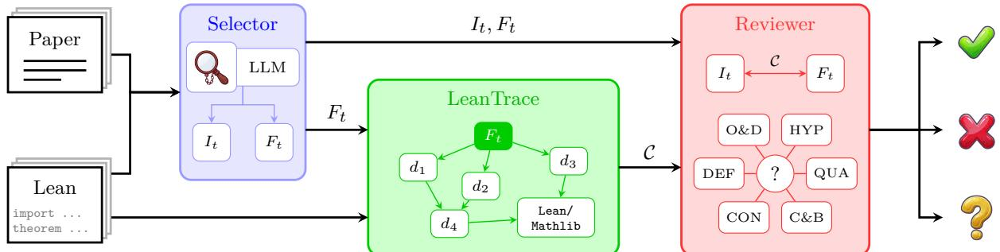
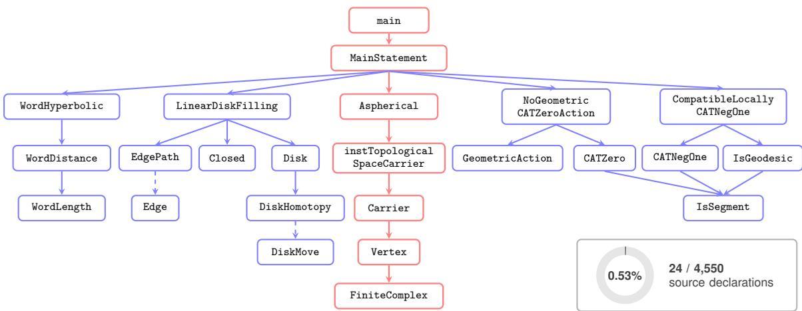
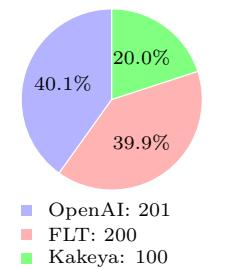
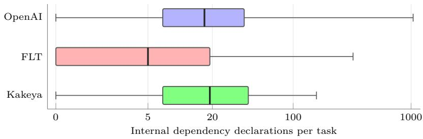

# MechAlign: Evaluating Semantic Alignment at the Project Level in Mathematical Formalization

Hao Shen1,\*, Ruichen Qiu1,\*, Lihong Zhi1, Xiao-Shan Gao1

## Abstract

Lean verifies that a formal proof establishes its stated proposition under declared assumptions, but does not check whether that proposition faithfully expresses the mathematical claim in a manuscript. Assessing this correspondence requires interpreting the main theorem through its project dependencies, which may be scattered throughout a large development. We introduce MechAlign, a framework for project-level semantic alignment review that combines formal dependency extraction with LLM-based assessment. Its extraction tool, LeanTrace, constructs a statement dependency graph from elaborated declarations, retaining definition bodies and structure constraints while excluding proof bodies and stopping at an explicit library boundary. The reviewer uses this context to investigate alignment and report discrepancies with localized evidence. We conduct a preliminary review of 201 main results from 173 OpenAI Math projects, using supplied informal descriptions and available paper context. A hyperbolic-group case illustrates how dependency inspection localizes a missing dimensional constraint relative to the manuscript, consistent with the upstream declaration of formalization scope. We also construct LeanReviewBench, comprising 501 fixed claim–statement–context triples from OpenAI Math, Fermat’s Last Theorem, and Kakeya, with description provenance recorded. The resource supports controlled comparisons of more project-level semantic alignment evaluations.

## 1 Introduction

Recent advances in large language models have enabled the generation of mathematical proofs at increasing scale [2, 7, 13, 20]. Lean formalization is also used to verify the stated results. For example, OpenAI’s mathematical research collection includes Lean projects for 173 manuscripts [13]. Lean checks that a formal proof establishes its stated proposition under the declared assumptions [3], but it does not check whether that proposition faithfully expresses the mathematical claim in the manuscript. This leaves a semantic gap:

Does the statement proved in the Lean project faithfully express the mathematical claim made in the manuscript?

Answering this question requires establishing the mathematical meaning of the formal statement. In a Lean project, that meaning is determined not only by the main theorem declaration but also by the definitions and constraints it refers to.

For example, a theorem stated using a predicate defined within the project may appear to match the manuscript, even though the predicate encodes additional assumptions or a weaker conclusion. Interpreting the predicate may, in turn, require tracing its dependencies. We use project-level alignment review to mean assessing a selected formal result against its informal claim by examining the project declarations that determine the result’s meaning.

Several methods can be used for project-level alignment review. A statement-only reviewer sees the main Lean declaration, but cannot inspect these supporting declarations. Providing full project access makes them available, but leaves the reviewer to locate and connect the relevant evidence. We therefore ask how to organize these declarations to support both evidence gathering and mathematical assessment.

We introduce MechAlign, a framework for project-level semantic alignment review. Its formal evidence extractor, LeanTrace, starts from a selected theorem’s elaborated type and follows references through declaration types and non-proof definition bodies. It retains structural constraints and stops expansion at an explicit library boundary, producing a statement dependency graph that organizes formal evidence around the selected result. MechAlign’s LLM-based reviewer inspects declarations and follows graph edges to assess alignment between the informal claim and the formal result, reporting discrepancies with supporting evidence. The extracted context supports this assessment but may not sufice to resolve every question of mathematical interpretation. Refer to Figure 1 for the structure of MechAlign.

Our primary application is OpenAI Math [13], where we inspect 201 selected main results from 173 projects and identify candidate discrepancies for further review. The HyperbolicObstruction case illustrates how inspecting a statement and its supporting structure reveals that the manuscript’s two-dimensionality requirement is not explicitly retained, consistent with the upstream declaration of formalization scope. We extend the extracted contexts with 200 selected targets from Fermat’s Last Theorem [1] and 100 from Kakeya [17] to construct LeanReviewBench, a resource of 501 fixed instances. Each instance pairs a supplied informal claim with a selected formal statement and includes the statement’s extracted dependency context. This structure supports a controlled, reproducible comparison of statement-only, full-project, and dependency-guided review in terms of discrepancy detection, evidence localization, and review cost. Supplementary collections broaden coverage of mathematical topics and dependency structures. Because their descriptions are derived from Lean, they support consistency checks against the supplied text but do not independently establish fidelity to a manuscript. The comparative evaluation and human adjudication remain to be completed.

Our contributions are threefold:

• We formulate a project-level semantic alignment review in which a selected formal result is assessed against its informal claim through the declarations that determine its meaning.

• We introduce MechAlign, combining LeanTrace’s extraction of statement dependencies with an LLM-based reviewer that inspects the resulting graph and reports localized semantic discrepancies.

• We construct LeanReviewBench, comprising 501 review instances from OpenAI Math, Fermat’s Last Theorem, and Kakeya, and we define a controlled comparison of statement-only, full-project, and dependency-guided review.

## 2 Related Work

Autoformalization Autoformalization converts informal problems into formal statements that can be verified in Lean 4 [3]. Herald [5] annotates Mathlib 4 with natural language and trains a dedicated Lean 4 translator. Process-driven Autoformalization [10] incorporates Lean compiler feedback through process-supervised verification. SAIR-Comb [6] combines structure-aware refinement with expert iteration and reinforcement learning for autoformalization in combinatorics. Agent-based approaches further integrate generation, checking, and refinement into interactive workflows. MASA [21] coordinates agents for formalization, syntactic checking, semantic assessment, and iterative repair. LeanMarathon [22] uses an evolving blueprint to coordinate agents across research-level formalization tasks. Numina-Lean-Agent [8] combines a general-purpose coding agent with Lean interaction and theorem retrieval tools through MCP. MechMath [18] uses sorrifierdriven decomposition to isolate unresolved subgoals while preserving the surrounding verified proof structure. Numina Fuse [16] provides a desktop workspace for developing Lean formalizations with AI agents. These advances increase the need to review completed formalizations.

Evaluation Metrics for Faithfulness FormalAlign [11] constructs evaluation sets from FormL4 and miniF2F [23] by augmenting existing informal-formal pairs with synthetic misalignments. The Human Equivalence Benchmark [9] provides 200 human-labeled candidate-reference pairs, while ProofNetVerif [15] contains 3,752 annotated examples for evaluating both reference-based and reference-free metrics. MA-Align [14] extends evaluation to graduate-level mathematics through 200 type-correct formalizations of statements and definitions labeled for semantic alignment.

Semantic Alignment Evaluation Recent work further examines diagnostic detail and contextual dependencies. FormalRx [19] evaluates alignment judgments together with error categorization, localization, and correction. FaithAlign [4] introduces phrase-level correspondence annotations with explicit informal context and formal dependencies, while FaithAlign-Gap tests whether evaluators recognize insuficient context.

These eforts motivate studying evidence acquisition as part of alignment review. LeanTrace supplies an explicit extraction policy for the statement dependencies of a selected result, and the review agent inspects that graph for semantic discrepancies. Our full-project comparison is intended to test the value of this organization of evidence; the method does not presume that source retrieval or existing alignment systems necessarily fail.

## 3 Method

In this section, we first define the project-level semantic alignment task. We then present LeanTrace, a tool for extracting the dependency graph of a selected theorem in a Lean project. Finally, we introduce MechAlign, an agent that uses this graph to evaluate semantic alignment in project-level mathematical formalization.

## 3.1 Task Definition

For a selected review target in a Lean project, let $I _ { t }$ denote the supplied informal mathematical claim and $F _ { t }$ the corresponding formal statement. The claim may come from a manuscript, an upstream comment, or documentation, or an explicitly identified Lean-derived description. Project-level semantic alignment review assesses whether $F _ { t }$ expresses $I _ { t }$ using its dependency context C. Agreement with a supplied description establishes fidelity to a manuscript only when that description has been independently checked against the manuscript. A review instance is

$$
x = ( I _ { t } , F _ { t } , { \mathcal { C } } ) .
$$

The context C collects declarations under the extraction policy in Section 3.2. Let $\mathrm { D e p } ( F _ { t } )$ contain the declarations referenced by the elaborated statement. For a project declaration d, Dep(d) follows its type and non-proof definition body and includes constructors for inductive types, structures, and classes, so that their constraints are traversed. Proof bodies are excluded. Referenced external-library declarations are retained as boundary nodes, with $\mathrm { D e p } ( d ) = \emptyset$ for such nodes. The context is then defined by

$$
\begin{array} { c } { { \displaystyle { \mathcal C } ^ { ( 0 ) } = \mathrm { D e p } ( F _ { t } ) , } } \\ { { \displaystyle { \mathcal C } ^ { ( k + 1 ) } = { \mathcal C } ^ { ( k ) } \cup \bigcup _ { d \in { \mathcal C } ^ { ( k ) } } \mathrm { D e p } ( d ) , } } \\ { { \displaystyle { \mathcal C } = \bigcup _ { k > 0 } { \mathcal C } ^ { ( k ) } . } } \end{array}
$$

Thus, C is the dependency closure of $F _ { t }$ relative to the extraction policy and library boundary.

The assessment assigns each instance x a label

$$
y ( x ) \in \{ \mathrm { a l i g n e d , ~ m i s a l i g n e d , ~ u n d e t e r m i n e d } \} .
$$

The labels indicate, respectively, that the formal statement expresses the informal claim that a semantic discrepancy has been identified or that the available evidence is insuficient to decide. The judgment is supported by the relevant declarations and a mathematical explanation. Cases labeled undetermined are reserved for subsequent human review and adjudication.

## 3.2 LeanTrace

LeanTrace constructs a statement dependency graph from an elaborated Lean project. Starting from $F _ { t } .$ the elaborated type of the selected theorem declaration, LeanTrace iteratively collects dependencies through declaration types and non-proof definition bodies. Newly discovered declarations are processed in turn until no unvisited declarations remain, with library declarations retained as boundary nodes without further expansion. Theorems and other proof-valued declarations contribute their types, but their proof bodies are neither exposed nor traversed.

For inductive types, structures, and classes, LeanTrace also follows their constructors and traverses the constructor types, collecting dependencies introduced by field types and constraints even when no field projection appears explicitly in the target statement. Operating on elaborated declarations captures both explicit dependencies and those introduced by elaboration, including instances, field projections, and gener ated auxiliary declarations.

  
Figure 1: Overview of MechAlign. The Selector obtains the paper and formal statements, LeanTrace extracts the formal dependency context, and the Reviewer assesses alignment using both formal and paper context.

Recursively expanding Mathlib would introduce a large collection of foundational declarations with complex dependencies. As a practical choice to keep the extracted context manageable, LeanTrace stops at the library boundary, retaining the names and types of referenced declarations from Mathlib and Lean’s core libraries without traversing their dependencies or expanding their implementations. The dependency closure C defined above is understood relative to these extraction rules and this boundary.

## 3.3 MechAlign

MechAlign is an LLM-assisted framework comprising a Selector, the LeanTrace extraction tool, and a Reviewer. The Selector uses supplied mappings between informal claims and Lean declarations when available. Otherwise, it searches the manuscript text and Lean source files within a configured scope to identify the manuscript’s main results and select corresponding declarations, supporting each selection with quotations from both sources. For each target, it records the supplied informal claim ${ \check { I } } _ { t } ,$ the selected formal statement $F _ { t }$ , and the claim’s source. Claims drawn from Lean comments or documentation are not treated as independently verified manuscript statements. LeanTrace extracts the dependency context C for the selected formal statement, retaining declaration types, non-proof values, and dependency relations.

The Reviewer receives context C together with $I _ { t } , \ F _ { t }$ to assess whether F aligns with $I _ { t } .$ It examines six dimensions: (1) objects and domains (O&D), checking that the formal types represent the intended mathematical objects and ranges; (2) hypotheses (HYP), checking for missing, additional, or altered assumptions; (3) quantifiers (QUA), checking their scope, order, and dependence on previously introduced variables; (4) constants and bounds (C&B), checking numerical factors, inequalities, and parameter restrictions; (5) conclusions (CON), checking that the formal statement covers the claimed result, including all asserted components; (6) definition semantics (DEF), following retained definitions to check that the underlying constructions and predicates express their intended meanings.

The Reviewer returns an aligned, misaligned, or undetermined judgment, together with explanations for the six dimensions and supporting quotations. Substantive judgments must cite both the supplied informal claim or context and formal evidence. A deterministic evidence check verifies that the quotations occur in the supplied sources; it does not independently validate the informal specification. Ambiguous correspondence or insuficient evidence leads to an undetermined judgment. MechAlign retains selection, extraction, and review records for inspection. The judgments remain model-assisted assessments of the supplied claim rather than formal guarantees of semantic equivalence or manuscript fidelity.

## 4 Semantic Alignment of OpenAI Math

We examine how LeanTrace supports review of a project presented as a proof of a mathematical claim. OpenAI Math provides the primary application. The study asks whether organizing formal evidence around the selected result helps identify semantic discrepancies and reduces the cost of locating that evidence. We introduce the review conditions, illustrate dependency inspection through one case, and describe how efectiveness, cost, and limitations are to be compared. Controlled comparative results remain to be completed.

  
Figure 2: LeanTrace context for HyperbolicObstruction. All 24 retained source declarations are shown with selected dependency edges; dashed arrows fold paths through auxiliary or constructor nodes. Red nodes and arrows mark the path from main to FiniteComplex through the asphericity and carrier definitions, inspected to determine whether the witness type enforces the manuscript’s two-dimensionality requirement. The shaded sector in the inset represents the retained fraction: 24 of 4,550 source declarations in the main theorem’s project import closure (0.53%), counting the root in both.

## 4.1 Review Setting and Compared Strategies

We used LeanTrace to inspect 201 theorems across 173 projects in openai/math, looking for discrepancies between the stated mathematical claims and their formal encodings. For each theorem, we compared its informal description in the existing Lean comments with the formal statement and used the extracted dependency graph to inspect the definitions and constraints that determine its meaning. Upstream docstrings, adjacent comments, and retained paper excerpts provided additional context; generated structural descriptions helped navigate the formal declarations. This preliminary review assesses correspondence with the supplied descriptions, which have not been independently validated against the manuscripts. Retained paper excerpts provide supplementary context; findings about manuscript fidelity remain candidates pending verification against the original mathematical sources. The source revision used for the review is listed in Appendix A.

To evaluate the benefit of dependency-guided review, we design a comparison of three ways of obtaining evidence for the same claim. Statement-only review exposes the main declaration without dependency content. Full-project review permits ordinary source searches and file readings, leaving the reviewer to locate relevant declarations. LeanTrace-assisted review supplies the extracted dependency graph and retained declarations. The planned comparison holds the model, claim, root, and source revision fixed, with access rules and budgets disclosed. Each strategy assesses whether the selected formal result expresses the supplied informal claim and reports any discrepancies with its supporting declarations and mathematical explanations.

## 4.2 Case Study: A Missing Dimensional Constraint

The main theorem of the HyperbolicObstruction manuscript requires a finite connected two-dimensional aspherical simplicial complex with a linear disk-filling bound and a fundamental group admitting no geometric CAT(0) action. We use the dimensional requirement to illustrate how project-level alignment review proceeds through the declarations that determine a formal statement’s meaning. The selected Lean result has the following signature (proof body omitted):

theorem main : MainStatement.{u}

A statement-only reviewer cannot determine from this declaration whether the witness is required to be two-dimensional.

Figure 2 shows all 24 retained source declarations and selected dependency paths extracted by LeanTrace. Following the root to MainStatement exposes the existential witness; the declaration prefix below omits the conjunction of conditions after the quantifiers. The complete definition is reproduced in Appendix B:

def MainStatement : Prop :=   
∃ K : FiniteComplex, ∃ x : K.Carrier, ∃ C : R,   
-- Remaining conditions omitted here.

The absence of a dimension condition in this excerpt is not suficient evidence of a missing requirement: that requirement could be encoded in the witness type or in one of the omitted predicates. Inspecting the retained witness type exposes its complete structure declaration:

structure FiniteComplex where   
n : N   
complex : AbstractSimplicialComplex (Fin n)

Here n specifies the size of the finite vertex index type; it does not specify the dimension of the complex.   
Neither field restricts simplex size to encode two-dimensionality.

The reviewer must also inspect the conditions imposed by MainStatement. The retained definition of Carrier gives the barycentric realization; Aspherical requires vanishing higher homotopy groups, and LinearDiskFilling bounds the triangle count in a disk certificate in terms of the length of a fillable closed edge path. Following its dependencies reaches the disk moves, including the triangular move:

| triangle (l r) (a b c) (h : {a, b, c} ∈ K.complex.faces)   
(hne : ({a, b, c} : Finset K.Vertex).card = 3) :   
DiskMove K (l ++ [a, b, c] ++ r) (l ++ [a, c] ++ r) 1

This constructor restricts an individual disk move to a triangular face; it does not prohibit higher-dimensiona simplices in K. The remaining clauses concern the fundamental group and compatible metrics on homotopyequivalent finite models. Inspecting these definitions localizes the discrepancy: the selected proposition does not explicitly require the witness to be two-dimensional. The complete retained mathematical definitions are supplied in Appendix B, so the assessment does not rely on the abbreviated snippets alone.

Although OpenAI’s oficial scope notes explicitly state that the witness’s two-dimensionality is not formalized [12], an exploratory review using Astra in Codex with full-project access incorrectly reported alignment with the informal claim, focusing on proof details and overlooking this omission. Especially, for this example, LeanTrace retains 24 of the 4,550 source declarations (0.53%) in the upstream main theorem’s project import closure, which spans 417 files. These counts include the root theorem and anonymous instances but exclude constructor branches, fields, generated declarations, and external libraries. When constructors and generated declarations are included, the dependency graph contains 41 internal dependencies beyond the root and 152 external-library boundary nodes.

Figure 2 displays the retained source declarations with selected edges and folded paths. The red path leads to the witness type, while the disk-filling branch supports the triangle-move check. LeanTrace thus provides a compact context for the Reviewer’s assessment of alignment, narrowing the set of declarations to inspect.

## 5 LeanReviewBench: A Reusable Review Resource

The OpenAI Math study illustrates how reviewing a main result requires interpreting the definitions and constraints behind its formal statement. To make such reviews repeatable across systems, we construct LeanReviewBench, a reusable collection of the review instances defined in Section 3.1. Each instance is a fixed triple $x = \left( I _ { t } , F _ { t } , \mathcal { C } \right)$ : a supplied informal claim, its selected formal statement, and the dependency context extracted by LeanTrace. The Selector and LeanTrace stages of MechAlign are completed during benchmark construction. Evaluation begins with the resulting triple and assesses the Reviewer’s semantic judgment, with the target correspondence and extracted context held fixed across systems.

As illustrated in Figure 3(a), the resource contains 501 tasks: the 201 OpenAI Math main-result tasks discussed in Section 4, 200 targets selected from the Fermat’s Last Theorem (FLT) development, and 100 from the three-dimensional Kakeya development. For FLT and Kakeya, we select individual theorem declarations throughout the developments, including intermediate results and supporting mathematical infrastructure, and use each selected declaration as the root for a separate LeanTrace extraction. FLT targets span elementary and algebraic number theory, local ramification, Galois representations, elliptic curves, modular forms, and modularity lifting. Kakeya targets cover geometric configurations, shading and density, covering and scale estimates, Frostman-type conditions, and intermediate lemmas leading to dimension bounds.

  
(a) Task distribution

  
(b) Per-task context size  
Figure 3: LeanReviewBench source composition and context-size distributions. Left: shares of 501 tasks. Right: per-task internal dependency counts, combining selected definitions and other internal declarations. Boxes span the first to third quartile, thick lines mark medians, and whiskers span the minimum to maximum. The horizontal axis uses a logarithmic transformation of count plus one to display zeros and the long tail; tick labels show original counts. Main statements and external-library boundary nodes are excluded.

This selection yields multiple review instances from each development, broadening the mathematical and dependency-structure coverage beyond the OpenAI main-result setting.

To construct each instance, we pin the upstream source and interpretation environment, select a root declaration, and prepare a statement project that retains definition and instance values and structure constraints while replacing theorem proofs with placeholders. LeanTrace extracts the root’s retained dependency graph to form $\mathcal { C } .$ An explicit declaration mapping associates $F _ { t }$ with its supplied description and qualifications, which together specify $I _ { t } .$ . We freeze the triple together with provenance and available annotations; reference labels remain separate from the model input. FLT descriptions were recovered from Lean-generated documentation, while Kakeya uses upstream comments and explicitly marked model-authored Lean paraphrases, with the source breakdown given in Appendix C. Compilation records, graph checks, and release validation check artifact integrity without certifying semantic alignment. Appendix C gives construction, mapping, validation, and detailed statistics.

Figure 3(b) characterizes the resulting formal contexts. OpenAI’s internal dependency counts are strongly right-skewed: the median is 17 declarations, and the middle half of tasks spans 7–38, while the largest context contains 1,041 internal declarations. FLT has a median of 5 internal declarations, whereas Kakeya has a median of 19 and an upper quartile of 41.25. FLT’s first quartile is zero: 64 tasks have no internal dependencies beyond the root, but all retain external-library boundary nodes. Counts exclude the main statement and library-boundary declarations, so they measure retained project dependencies rather than total context or mathematical dificulty. These diferent context profiles support analysis of reviewer behavior and cost across both small and large dependency closures.

For each triple, a reviewer assesses whether $F _ { t }$ expresses $I _ { t }$ using C and returns an aligned, misaligned, or undetermined verdict, supported by localized issues, relevant declarations, and a mathematical explanation. Evaluation should report judgment accuracy and answer coverage alongside execution success, model usage, latency, and evidence acquisition cost, separating execution failures from semantic abstentions. Results should be grouped by collection and description provenance: agreement with Lean-derived descriptions measures supplied-text consistency. Released reference labels are provisional model judgments; accuracy against human-adjudicated references remains to be established.

## 6 Discussion and Conclusion

We present MechAlign for reviewing whether a selected Lean result expresses its supplied informal claim through the project declarations that determine its meaning. LeanTrace extracts and organizes these dependencies, enabling the Reviewer to investigate semantic discrepancies and cite supporting evidence. Our preliminary OpenAI Math review and HyperbolicObstruction case illustrate this process, while LeanReviewBench provides 501 fixed review instances from OpenAI Math, Fermat’s Last Theorem, and Kakeya for reproducible studies of evidence acquisition and semantic judgment.

Limitations and Future Works. The extracted context excludes proof bodies and stops at the external-library boundary, so it may leave essential interpretation evidence unavailable; alignment review also does not certify the original proofs or their axiomatic assumptions. Some informal descriptions are Lean-derived, reference labels remain provisional, and shared developments and possible training exposure limit generalization claims. Future work will validate descriptions against independent mathematical sources, obtain human-adjudicated judgments, and complete controlled comparisons of statement-only, full-project, and dependency-guided reviews to assess judgment quality, evidence localization, and cost.

## Acknowledgment

This paper is supported by the Strategic Priority Research Program of CAS Grants XDA0480501 and XDA0480502, NSFC Grants 12288201, National Key R&D Program of China 2023YFA1009401.

## References

[1] Anthropic. Formalizing Fermat’s Last Theorem, September 2026. URL https://www.anthropic.co m/research/formalizing-fermats-last-theorem.

[2] Yichuan Cao, Ruichen Qiu, Junqi Liu, Jiaqi Wang, Dakai Guo, Ruyong Feng, Lihong Zhi, and Xiao-Shan Gao. Mechmath agent team: Llm driven agents for mathematical research. arXiv preprint arXiv:2607.04394, 2026.

[3] Leonardo de Moura and Sebastian Ullrich. The Lean 4 theorem prover and programming language. In Automated Deduction – CADE 28: 28th International Conference on Automated Deduction, Virtual Event, July 12–15, 2021, Proceedings, volume 12699 of Lecture Notes in Computer Science, pp. 625–635, Cham, 2021. Springer. doi: 10.1007/978-3-030-79876-5\_37.

[4] Yuming Feng, Tadd Mao, Dhruva Arekar, Tianjun Zhong, Jiani Huang, Xujie Si, and Ziyang Li. Aligning faithfulness for theory-scale autoformalization. arXiv preprint arXiv:2610.18498, 2026.

[5] Guoxiong Gao, Yutong Wang, Jiedong Jiang, Qi Gao, Zihan Qin, Tianyi Xu, and Bin Dong. Herald: A natural language annotated lean 4 dataset. In The Thirteenth International Conference on Learning Representations, 2025. URL https://openreview.net/forum?id=Se6MgCtRhz.

[6] Weijie Jiang, Gaolei He, Beibei Xiong, Jianlin Wang, and Zhengfeng Yang. Sair-comb: A structure-aware iterative refinement framework for combinatorics autoformalization. In Proceedings of the 64th Annual Meeting of the Association for Computational Linguistics (Volume 1: Long Papers), pp. 23452–23473, 2026.

[7] Jihao Liu, Guoxiong Gao, Zeming Sun, Bin Wu, Shurui Liu, Jiedong Jiang, Haocheng Ju, Leheng Chen, Ronnie Cheng, Xiping Zhang, et al. Danus: Orchestrating mathematical reasoning agents with fact-graph memory. arXiv preprint arXiv:2607.06447, 2026.

[8] Junqi Liu, Zihao Zhou, Zekai Zhu, Marco Dos Santos, Weikun He, jiawei liu, Yunzhou Xie, Junqiao Zhao, Qiufeng Wang, Lihong Zhi, Jia LI, and Wenda Li. Numina-lean-agent: An open and general agentic reasoning system for formal mathematics. In Forty-third International Conference on Machine Learning, 2026. URL https://openreview.net/forum?id=0bTEd4LpQr.

[9] Qi Liu, Xinhao Zheng, Xudong Lu, Qinxiang Cao, and Junchi Yan. Rethinking and improving autoformalization: Towards a faithful metric and a dependency retrieval-based approach. In The Thirteenth International Conference on Learning Representations, 2025. URL https://openreview.net/forum ?id=hUb2At2DsQ.

[10] Jianqiao Lu, Yingjia Wan, Zhengying Liu, Yinya Huang, Jing Xiong, Chengwu Liu, Jianhao Shen, Hui Jin, Jipeng Zhang, Haiming Wang, et al. Process-driven autoformalization in lean 4. arXiv preprint arXiv:2406.01940, 2024.

[11] Jianqiao Lu, Yingjia Wan, Yinya Huang, Jing Xiong, Zhengying Liu, and Zhijiang Guo. Formalalign: Automated alignment evaluation for autoformalization. In The Thirteenth International Conference on Learning Representations, 2025. URL https://openreview.net/forum?id=B5RrIFMqbe.

[12] OpenAI. A hyperbolic group without a geometric CAT(0) action. GitHub repository documentation, openai/math, 2026. URL https://github.com/openai/math/blob/1581d4cbdd69a0faf34b208961 4fe2a814316a6a/lean/docs/257.md#L7-L9. Lean formalization scope, lean/docs/257.md. Commit 1581d4cbdd69. Accessed October 26, 2026.

[13] OpenAI. OpenAI Math Repository, 2026. URL https://github.com/openai/math/tree/1581d4cb dd69a0faf34b2089614fe2a814316a6a.

[14] Nilay Patel, Noah Arias, Davit Babayan, Victoria Cochran, Timothy Libman, Hafsah Mahmood, Liam McCarty, Soli Munoz, Laurel Willey, and Jefrey Flanigan. Mathatlas: A benchmark for autoformalization in the wild. arXiv preprint arXiv:2605.14061, 2026.

[15] Auguste Poiroux, Gail Weiss, Viktor Kunčak, and Antoine Bosselut. Reliable evaluation and benchmarks for statement autoformalization. In Proceedings of the 2025 Conference on Empirical Methods in Natural Language Processing, pp. 17958–17980, 2025.

[16] Project Numina. Fuse: A desktop workspace for Lean formalization with AI agents. https://github .com/project-numina/fuse-desktop, 2026. GitHub repository. Accessed: 2026-10-26.

[17] Project Numina. kakeya-3d, 2026. URL https://github.com/project-numina/kakeya-3d.

[18] Ruichen Qiu, Yichuan Cao, Junqi Liu, Dakai Guo, Xiao-Shan Gao, Lihong Zhi, and Ruyong Feng. Mechmath: Sorrifier-driven formal decomposition workflow for automated theorem proving. In Third Conference on Language Modeling, 2026. URL https://openreview.net/forum?id=Rar8vdDbWg.

[19] Haocheng Wang, Baiyu Huang, Yingjia Wan, Xiao Zhu, Xiaoyang Liu, Yinya Huang, and Zhijiang Guo. Formalrx: Rectify and examine semantic failures in autoformalization. arXiv preprint arXiv:2607.04655, 2026.

[20] Junyi Zhang, Jinxi Yu, Eric Hanchen Jiang, Jiachen Lu, Zhi Zhang, Xinjie He, Hyunsik Chae, Ethan Ji, Alexander K Taylor, Vigyan Sahai, et al. Continual graph memory for mathematical research agents. arXiv preprint arXiv:2610.02945, 2026.

[21] Lan Zhang, Marco Valentino, and André Freitas. Masa: Llm-driven multi-agent systems for autoformalization. In Proceedings of the 2025 Conference on Empirical Methods in Natural Language Processing: System Demonstrations, pp. 615–624, 2025.

[22] Yuanhe Zhang, Yuekai Sun, Taiji Suzuki, Jason D Lee, and Fanghui Liu. Leanmarathon: Toward reliable ai co-mathematicians through long-horizon lean autoformalization. arXiv preprint arXiv:2606.05400, 2026.

[23] Kunhao Zheng, Jesse Michael Han, and Stanislas Polu. minif2f: a cross-system benchmark for formal olympiad-level mathematics. In International Conference on Learning Representations, 2022. URL https://openreview.net/forum?id=9ZPegFuFTFv.

## A Source Revisions and Interpretation Environment

The upstream sources are pinned to the revisions recorded in the released project metadata. All frozen task packages use the shared Lean and Mathlib interpretation environment listed below.

<table><tr><td>Component</td><td>Version or revision</td></tr><tr><td>Upstream sources</td><td></td></tr><tr><td>OpenAI Math</td><td>1581d4cbdd69a0faf34b2089614fe2a814316a6a</td></tr><tr><td>Fermat&#x27;s Last Theorem</td><td>6e837e75355538c7f80bab5b956861e86c4eacc2</td></tr><tr><td>Kakeya</td><td>a26427e3c2fcaf9f98694fbd0d4dd49e41dcf5e3</td></tr><tr><td colspan="2">Interpretation environment</td></tr><tr><td>Lean</td><td>leanprover/1ean4:v4.34.1</td></tr><tr><td>Mathlib</td><td>d13f23b723b8a846827a245b89c10fc7d3f11612</td></tr></table>

## B HyperbolicObstruction: Complete Statement Context

Section 4.2 displays only the code needed to explain the dimensional check. Case 1 reproduces the contextual manuscript claim and the retained mathematical definitions, including the complete MainStatement and the constructor branches for disk homotopies and disk moves. Imports, namespaces, and notation provide the original context; theorem proof bodies and elaborator-generated auxiliary declarations are omitted.

Informal   
There exist a finite connected two-dimensional aspherical simplicial complex K and a constant C < ∞   
with the following properties.   
1. Every combinatorial edge loop of length ℓ in the universal cover of K bounds a disk diagram with   
at most Cℓ triangular faces.   
2. The group π1K admits no geometric action on a proper complete CAT(0) space.   
In particular, π1K is word-hyperbolic, and no finite simplicial complex homotopy equivalent to K admits   
a locally CAT(0) geodesic length metric inducing its given topology. Consequently, no such model admits   
a compatible locally CAT(−1) geodesic length metric.   
Formal   
import Mathlib   
namespace OAI   
noncomputable section   
open scoped Topology ContinuousMap   
namespace HyperbolicObstruction   
structure FiniteComplex where   
n : N   
complex : AbstractSimplicialComplex (Fin n)   
namespace FiniteComplex   
abbrev Vertex (K : FiniteComplex) := Fin K.n   
def Carrier (K : FiniteComplex) :=   
{x : K.Vertex → R // (∀ i, 0 ≤ x i) ∧ (Σ i, x i) = 1 ∧   
∃ s ∈ K.complex.faces, ∀ i, i ∈/ s → x i = 0}   
instance (K : FiniteComplex) : TopologicalSpace K.Carrier :=   
inferInstanceAs (TopologicalSpace (Subtype \_))

Formal   
def Edge (K : FiniteComplex) (a b : K.Vertex) : Prop :=   
{a, b} ∈ K.complex.faces   
def EdgePath (K : FiniteComplex) : List K.Vertex → Prop   
| [] => False   
| [\_] => True   
| a :: b :: t => K.Edge a b ∧ K.EdgePath (b :: t)   
def Closed (K : FiniteComplex) (p : List K.Vertex) : Prop :=   
∃ a t, p = a :: (t ++ [a]) ∨ p = [a]   
inductive DiskMove (K : FiniteComplex) : List K.Vertex → List K.Vertex → N → Prop   
| stutter (l r) (a) :   
DiskMove K (l ++ [a, a] ++ r) (l ++ [a] ++ r) 0   
| spur (l r) (a b) (h : K.Edge a b) :   
DiskMove K (l ++ [a, b, a] ++ r) (l ++ [a] ++ r) 0   
| triangle (l r) (a b c) (h : {a, b, c} ∈ K.complex.faces)   
(hne : ({a, b, c} : Finset K.Vertex).card = 3) :   
DiskMove K (l ++ [a, b, c] ++ r) (l ++ [a, c] ++ r) 1   
inductive DiskHomotopy (K : FiniteComplex) : List K.Vertex → List K.Vertex → N → Prop   
| refl (p) : DiskHomotopy K p p 0   
| move {p q n} : DiskMove K p q n → DiskHomotopy K p q n   
| symm {p q n} : DiskHomotopy K p q n → DiskHomotopy K q p n   
| trans {p q r m n} : DiskHomotopy K p q m → DiskHomotopy K q r n →   
DiskHomotopy K p r (m + n)   
def Disk (K : FiniteComplex) (p : List K.Vertex) (faces : N) : Prop :=   
∃ a, K.DiskHomotopy p [a] faces   
def LinearDiskFilling (K : FiniteComplex) (C : R) : Prop :=   
∀ p, K.EdgePath p → K.Closed p → (∃ a, K.Disk p a) →   
∃ a, K.Disk p a ∧ (a : R) ≤ C \* (p.length - 1 : N)   
def Aspherical (K : FiniteComplex) (x : K.Carrier) : Prop :=   
∀ n : N, Subsingleton (HomotopyGroup.Pi (n + 2) K.Carrier x)   
end FiniteComplex   
def IsSegment {X : Type\*} [MetricSpace X] (fl : R → X) (x y : X) : Prop :=   
fl 0 = x ∧ fl 1 = y ∧   
∀ s ∈ Set.Icc (0 : R) 1, ∀ t ∈ Set.Icc (0 : R) 1,   
dist (fl s) (fl t) = |s - t| \* dist x y   
def IsGeodesic (X : Type\*) [MetricSpace X] : Prop :=   
∀ x y : X, ∃ fl, IsSegment fl x y   
def CATZero (X : Type\*) [MetricSpace X] : Prop :=   
∀ x y : X, ∃ fl, IsSegment fl x y ∧   
∀ z : X, ∀ t ∈ Set.Icc (0 : R) 1,   
dist z (fl t) ^ 2 ≤ (1 - t) \* dist z x ^ 2 + t \* dist z y ^ 2 -   
t \* (1 - t) \* dist x y ^ 2   
def CATNegOne (X : Type\*) [MetricSpace X] : Prop :=   
∀ x y : X, ∃ fl, IsSegment fl x y ∧   
∀ z : X, Real.cosh (dist z (fl (1 / 2))) ≤   
(Real.cosh (dist z x) + Real.cosh (dist z y)) /   
(2 \* Real.cosh (dist x y / 2))   
structure GeometricAction (G X : Type\*) [Group G] [MetricSpace X] where   
act : G →\* (X ≃i X)   
proper : ∀ C : Set X, IsCompact C →   
{g : G | ∃ x ∈ C, act g x ∈ C}.Finite

Formal   
cocompact : ∃ C : Set X, IsCompact C ∧ ∀ x : X, ∃ g : G, ∃ y ∈ C, act g y = x   
universe u   
def NoGeometricCATZeroAction (G : Type\*) [Group G] : Prop :=   
∀ (X : Type u) (\_ : MetricSpace X), Nonempty X → ProperSpace X → CompleteSpace X →   
CATZero X → IsEmpty (GeometricAction G X)   
def WordLength {G : Type\*} [Group G] (S : Finset G) (g : G) : N :=   
sInf {n | ∃ w : List G, w.length = n ∧   
(∀ a ∈ w, a ∈ S ∨ a−1 ∈ S) ∧ w.prod = g}   
def WordDistance {G : Type\*} [Group G] (S : Finset G) (g h : G) : R :=   
WordLength S (g−1 \* h)   
def WordHyperbolic (G : Type\*) [Group G] : Prop :=   
∃ S : Finset G, Subgroup.closure (S : Set G) = ⊤ ∧   
∃ fi : R, 0 ≤ fi ∧ ∀ a b c d : G,   
WordDistance S a c + WordDistance S b d ≤   
max (WordDistance S a b + WordDistance S c d)   
(WordDistance S a d + WordDistance S b c) + 2 \* fi   
def CompatibleLocallyCATNegOne (K : FiniteComplex) : Prop :=   
∃ m : MetricSpace K.Carrier,   
m.toUniformSpace.toTopologicalSpace = (inferInstance : TopologicalSpace K.Carrier) ∧   
(letI := m   
IsGeodesic K.Carrier ∧ ∀ x : K.Carrier, ∃ r : R, 0 < r ∧   
CATNegOne (Metric.ball x r))   
def MainStatement : Prop :=   
∃ K : FiniteComplex, ∃ x : K.Carrier, ∃ C : R,   
ConnectedSpace K.Carrier ∧ K.Aspherical x ∧ 0 ≤ C ∧ K.LinearDiskFilling C ∧   
NoGeometricCATZeroAction.{u} (FundamentalGroup K.Carrier x) ∧   
WordHyperbolic (FundamentalGroup K.Carrier x) ∧   
∀ L : FiniteComplex, Nonempty (K.Carrier ≃ L.Carrier) →   
¬ CompatibleLocallyCATNegOne L   
end HyperbolicObstruction   
end OAI

Case 1: Informal claim and corresponding formalization in the HyperbolicObstruction project. The informal statement requires a two-dimensional witness, whereas the selected formal statement contains no explicit dimension con straint.

## C LeanReviewBench: Construction and Detailed Statistics

This appendix details how the review triples in Section 5 are constructed and released. Target selection and LeanTrace extraction precede evaluation; reviewers consume the frozen claim, formal statement, and dependency context without repeating these stages.

## C.1 Target Selection and Coverage

The inventory contains 201 OpenAI Math main-result targets, 200 targets from anthropics/fermats-last-theorem, and 100 from project-numina/kakeya-3d. The OpenAI targets are those used in Section 4. For FLT and Kakeya, we select individual theorem declarations across the developments, including intermediate results and supporting infrastructure. Each selected declaration becomes the root of a separate review triple. Other theorem declarations reached during extraction contribute their types as context; their occurrence in a dependency closure does not create additional tasks.

Table 1: Selected review targets by area in FLT and Kakeya.  
(a) Fermat’s Last Theorem  
(b) Kakeya
<table><tr><td>Area</td><td>Targets</td><td>Area</td><td>Targets</td></tr><tr><td>Elementary number theory</td><td>15</td><td>Geometry</td><td>15</td></tr><tr><td>Algebraic number theory</td><td>30</td><td>Shading and density</td><td>15</td></tr><tr><td>Local ramification</td><td>25</td><td>Covers and scales</td><td>15</td></tr><tr><td>Galois representations</td><td>25</td><td>Frostman, Katz-Tao, and Sticky estimates</td><td>20</td></tr><tr><td>Frey and elliptic curves</td><td>30</td><td>Main Lemma 1</td><td>15</td></tr><tr><td>Modular forms and Hecke operators</td><td>25</td><td>Main Lemma 2</td><td>15</td></tr><tr><td>Modular-curve geometry</td><td>25</td><td>Bootstrap and dimension conclusions</td><td>5</td></tr><tr><td>Deformation and modularity lifting</td><td>25</td><td>Total</td><td>100</td></tr><tr><td>Total</td><td>200</td><td></td><td></td></tr></table>

Table 2: Internal dependency declaration occurrences by recorded kind, excluding main statements and externallibrary boundary nodes.
<table><tr><td>Collection</td><td>Def.</td><td>Structure</td><td>Abbrev.</td><td>Class</td><td>Inductive</td><td>Constructor</td><td>Recursor</td><td>Theorem</td><td>Opaque</td><td>Total</td></tr><tr><td>OpenAI</td><td>3,382</td><td>260</td><td>1,594</td><td>12</td><td>67</td><td>572</td><td>49</td><td>2,830</td><td>1</td><td>8,767</td></tr><tr><td>FLT</td><td>1,039</td><td>149</td><td>385</td><td>39</td><td>0</td><td>188</td><td>0</td><td>1,604</td><td>0</td><td>3,404</td></tr><tr><td>Kakeya</td><td>900</td><td>291</td><td>730</td><td>1</td><td>0</td><td>292</td><td>0</td><td>700</td><td>0</td><td>2,914</td></tr></table>

The selection covers eight areas in FLT and seven in Kakeya (Table 1). FLT targets range from elementary and algebraic number theory through local ramification, Galois representations, elliptic curves, modular forms, modular-curve geometry, and modularity lifting. Kakeya targets cover geometric configurations, shading and density, covers and scales, Frostman, Katz–Tao, and Sticky estimates, and intermediate lemmas and bootstrap arguments leading to dimension bounds. The counts document the selected coverage, rather than a representative sample of Lean mathematics. OpenAI’s domain labels use a diferent granularity and should not be pooled with these areas into a single domain count.

## C.2 Review Instance Construction

We pin upstream source revisions and the interpretation environment (Appendix A), register the selected declarations and any required local wrappers, and prepare statement artifacts. Target and auxiliary theorem proofs are replaced with placeholders, while definition and instance values, structure constraints, namespaces, and required notation are retained. LeanTrace extracts each selected statement $F _ { t }$ and its dependency context C under the policy in Section 3, including the external-library boundary.

An explicit declaration mapping associates the selected statement with a description and any scope qualifications, forming the supplied informal claim It. All 501 tasks have nonempty main descriptions. The 200 FLT descriptions were recovered from upstream HTML documentation generated from Lean. Kakeya’s 100 preferred descriptions comprise 82 upstream comments (82%) and 18 explicitly marked model-authored Lean paraphrases (18%). The latter include the description of KakeyaDimensionThree; the other 17 expand terse comments and retain explicit hypotheses. All six target statements with an explicit StickyFrostman hypothesis preserve it in their preferred descriptions. Original comments and description origins remain in the accompanying informal records.

For 32 Kakeya targets, the records also contain checked, page-linked background from the Guth–Wang–Zahl paper, identified as paper\_context. Such passages provide background rather than replacing the mapped target description or asserting its equivalence with Lean. For example, Main Lemma 1 in the paper has no exponent loss, whereas the selected Lean result requires $\beta < \gamma$ . The records distinguish descriptions, qualifications, and paper context through explicit mapping relations; missing auxiliary descriptions remain absent. Agreement with a Lean-derived description supports a supplied-text consistency test, while sourcegrounded alignment requires a reviewed independent specification.

The resulting triples are frozen in tasks.jsonl, accompanied by Lean text artifacts and provenance-rich informal records. Evaluation inputs are exported from these frozen packages without reparsing the Lean files or rebuilding the extraction environment. Formal declarations and dependency edges determine the retained context. Description origins, review status, preparation metadata, and reference labels are kept outside the exported model input.

## C.3 Context Statistics and Release Validation

Figure 3(b) reports the distribution of per-task internal dependency counts, combining the selected definition/structure inventory and remaining internal declarations. Counts exclude main statements and externallibrary boundary nodes; boxes show the first and third quartiles and median, and whiskers show the full observed range.

In FLT, 64 of the 200 tasks (32%) have no internal dependency declarations beyond the root. Each nevertheless retains between 4 and 130 external-library boundary nodes. Such roots are expressed through library declarations whose identities and types are retained without recursive expansion. A zero internal count therefore does not imply an empty context; a boundary type may still be insuficient if a judgment requires the library implementation.

The frozen packages separately enumerate a selected definition/structure inventory in their definitions field. Summing these entries across tasks gives 3,477 for OpenAI, 1,155 for FLT, and 1,191 for Kakeya, for a total of 5,823 occurrences. These entries are only part of the retained context, not a count of all internal declarations or of unique definitions. Shared declarations can occur in multiple tasks, and all three collections include tasks with no entries in this field. Table 2 additionally reports retained internal declarations by kind, including definitions, structures, abbreviations, constructors, classes, and supporting theorem types. These statistics characterize context size and composition rather than established semantic dificulty.

Compilation checks statement types and retained definition bodies in the pinned environment; theorem proofs remain placeholders. Archived closure replay checks the extraction record, while the release validator checks file hashes, target inventories, description mappings, graph consistency, and reference/input bindings. These checks establish artifact integrity without certifying proof correctness or semantic alignment.

The release includes provisional model judgments for all 501 tasks; descriptions and semantic references remain pending human adjudication. Repeated evaluations should record task and model identities, execution configuration, budgets, and execution outcomes, retaining collection and provenance breakdowns. Any held-out split must also account for shared source developments and overlapping dependencies.

## C.4 Code and Data Availability

The MechAlign implementation, including the LeanTrace extraction tool, and the LeanReviewBench data and evaluation tools will be made publicly available upon publication at https://github.com/MechMath/ MechAlign and https://github.com/MechMath/PaperLeanBench, respectively. The benchmark repository provides the frozen review instances, provenance records, provisional reference labels, and evaluation tools described above.

The released system supports explicitly supplied claim–declaration mappings, fresh dependency extraction, and six-dimension review with quotation checks. The original-paper locator is limited to pinned OpenAI TeX sources and archived target mappings; general manuscript search and automatic target selection are not implemented by the release. Benchmark evaluation uses the frozen supplied claim and dependency context without repeating selection or extraction; the MechAlign adapter assesses the main claim and encodes undetermined as insufficient\_information in protocol submissions.