# PRIORITY-PRESERVING ADVANTAGE AGGREGATION FOR MULTI-REWARD POLICY OPTIMIZATION

Xiangchi Yuan<sup>1</sup>, Xingjian Diao<sup>2</sup>, Zheyuan Liu<sup>3</sup>, Chunhui Zhang<sup>2</sup>, Dachuan Shi<sup>1</sup>, Kejing Xia<sup>1</sup>, Zhenbang Du<sup>1</sup>, Shenglong Yao<sup>1</sup>, Soroush Vosoughi<sup>2</sup>, Wenke Lee<sup>1</sup>

<sup>1</sup>Georgia Institute of Technology <sup>2</sup>Dartmouth College <sup>3</sup>University of Notre Dame

## ABSTRACT

LLM post-training often optimizes multiple objectives with unequal priorities, such as correctness and reasoning efficiency. However, the widely used additive reward aggregation in RL can violate these priorities: when primary and auxiliary advantages conflict, a sufficiently large auxiliary signal can overturn the preference induced by the primary objective. We term this problem advantage priority inversion. Although reward-level gating can protect priority more directly, it still removes potentially useful auxiliary distinctions among rollout samples that fail the primary condition. To address this trade-off, we propose Primary Advantage Policy Optimization (PAPO), a priority-aware advantage aggregation method that asymmetrically combines a primary and an auxiliary advantage. PAPO retains auxiliary supervision when the objectives agree and smoothly attenuates conflicting auxiliary signals, preserving the primary sign during fusion for primary-consistent ordering. This rule applies to sequence-level advantages in GRPO and token-level advantages in actor–critic PPO. Experiments on multiple domains and models show that PAPO consistently achieves the best primary objective while maintaining best or competitive auxiliary-objective performance across both GRPO- and PPO-based optimization. Code is available.

## 1 INTRODUCTION

Reinforcement learning (RL) has become a central component of large language model (LLM) posttraining, substantially improving reasoning and other complex capabilities (Schulman et al., 2017; Guo et al., 2025; Diao et al., 2026b; Yuan et al., 2025; 2026; Shi et al., 2026a;b). Many post-training tasks naturally involve more than one reward objective. Existing methods commonly combine such signals through additive reward or advantage aggregation, sometimes together with independent normalization or adaptive weighting (Ichihara & Jinnai, 2025; Diao et al., 2026a; Liu et al., 2026a; Jiang et al., 2026). However, these reward objectives are often not equally important. In many settings, one primary objective is more important and should determine whether an update is favored, while another auxiliary objective should only refine how that objective is achieved. For example, correctness should take priority over reasoning length, and task success should take priority over tool-use efficiency.

When such an asymmetric objective relationship is present, existing multi-reward optimization faces three challenges (i) Additive aggregation can invert the primary preference. When the primary and auxiliary advantages conflict, a sufficiently large auxiliary advantage can reverse the sign induced by the primary advantage, causing the policy to reinforce a primary-disfavored response or suppress a primary-favored one. We refer to this problem caused by additive aggregation methods (Guo et al., 2025; Aggarwal & Welleck, 2025; Jiang et al., 2026) as advantage priority inversion. Reducing the auxiliary weight can make such inversions less frequent, but cannot structurally prevent them when the relative advantage magnitudes vary across samples. (ii) Hard priority mechanisms discard useful supervision. Reward-level gating (Liu et al., 2026a;b; 2025; Team et al., 2026) can prevent the auxiliary objective from contributing when a primary condition is not satisfied, but does so through a coarse binary decision and removes potentially informative distinctions among gated responses. (iii) Response-level aggregation cannot resolve token-level conflicts in PPO. Actor–critic PPO estimates advantages at the token level through GAE, and the primary and auxiliary objectives may agree at some token positions but conflict at others within the same trajectory. Popular response-level aggregation rules (Team et al., 2026; Liu et al., 2026a;b) are designed only for GRPO and can therefore obscure the local conflicts that directly determine token-level policy updates.

To address these challenges, we propose Primary Advantage Policy Optimization (PAPO), a priority-aware advantage aggregation framework with three corresponding designs. (i) PAPO preserves primary priority during advantagefusion. When the primary and auxiliary advantages agree, PAPO retains the auxiliary contribution; when they conflict, PAPO smoothly bounds the auxiliary influence relative to the primary advantage so that it cannot reverse the primary sign. This signpreserving fusion further induces a primary-consistent ordering: optimization units favored by the primary objective remain ordered above primary-disfavored units. Although normalization may change the absolute sign of aggregated advantage, it still preserves preference ordering.

(ii) PAPO retains fine-grained auxiliary supervision rather than discarding it through hard gating. Instead of making a binary decision on whether the auxiliary signal is used, PAPO continuously attenuates conflicting auxiliary advantages according to their magnitude relative to the primary advantage. This allows auxiliary supervision to remain informative while preventing it from overturning the priority induced by the primary objective.

(iii) PAPO generalizes to the different policy optimization methods. For GRPO-based optimization (Guo et al., 2025), PAPO fuses independently normalized sequence-level primary and auxiliary advantages within each rollout group. For actor–critic PPO (Schulman et al., 2017), PAPO instead performs token-level fusion to resolve local primary–auxiliary conflicts within a trajectory. We further introduce a dual-head critic that separately estimates the primary and auxiliary returns before nonlinear actor-side PAPO aggregation, making sure the accurate critic estimation.

Our contributions are summarized as follows:

• We identify advantage priority inversion, a problem in primary–auxiliary reward optimization where a conflicting auxiliary advantage can overturn the preference induced by the primary objective. We further highlight the limitations of existing weighting, hard-gating, and response-level aggregation strategies for preserving such priority.

• We propose PAPO, a priority-aware advantage aggregation method that asymmetrically combines primary and auxiliary advantages. PAPO preserves the primary sign during fusion while retaining fine-grained auxiliary supervision, and induces a primary-consistent ordering that remains preserved under centered normalization.

• We instantiate PAPO at different optimization granularities: sequence-level aggregation for GRPO and token-level aggregation for PPO. For PPO, we further introduce a dual-head critic that preserves accurate objective-specific token-level credit assignment while keeping nonlinear PAPO fusion on the actor side.

• We evaluate PAPO on multiple domains and models across both GRPO- and PPO-based optimization, demonstrating consistent notable improvements on the primary objective while maintaining strong performance on the auxiliary objective.

## 2 RELATED WORKS

Policy Optimization for LLM Reasoning. RL has become an effective paradigm for improving the reasoning capabilities of LLMs. PPO (Schulman et al., 2017) and its variant VAPO (Yue et al., 2025) has been widely used for language-model post-training, while GRPO (Guo et al., 2025) and its variants (Zheng et al., 2025; Ma et al., 2026) eliminate the learned critic by estimating relative advantages from groups of rollouts. Recent method DAPO (Yu et al., 2026) further improves GRPO by introducing asymmetric clipping and dynamic sampling for large-scale training.

Multi-Reward Reinforcement Learning. Multi-reward RL has been increasingly used to optimize multiple dimensions of LLM behavior. Safe RLHF (Dai et al., 2023) separates helpfulness and safety into reward and cost objectives under constrained optimization. Liu et al. (2026b;a; 2025) condition the length reward on the accuracy reward to increase the efficiency for reasoning. More recently, AW-GRPO (Ichihara & Jinnai, 2025) and DVAO (Jiang et al., 2026) dynamically adjust reward weights according to the learning progress of individual objectives, and Wang et al. (2026) further studies imbalanced optimization among heterogeneous reward granularities.

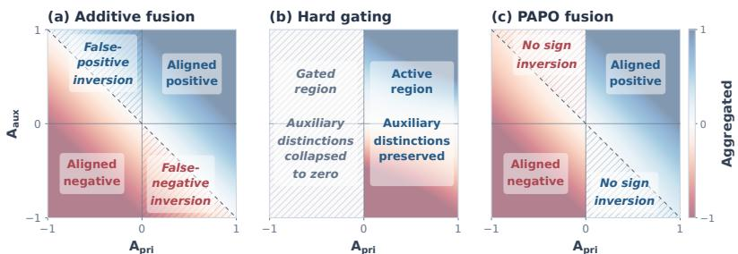  
Figure 1: Advantage aggregation. (a) Additive aggregation can cause advantage priority inversion, where a dominant auxiliary signal reverses the sign induced by the primary advantage. (b) Hard gating enforces priority coarsely by discarding auxiliary distinctions for unsatisfied primary condition. (c) PAPO preserves the primary sign during fusion while retaining graded auxiliary su pervision, maintaining the primary-induced preference structure.

## 3 PRELIMINARIES

Proximal Policy Optimization. For a token action $a _ { t }$ at state $s _ { t }$ , PPO defines the importance ratio $\begin{array} { r } { \rho _ { t } ( \theta ) = \frac { \pi _ { \theta } \left( a _ { t } \vert s _ { t } \right) } { \pi _ { \theta _ { \mathrm { o l d } } } \left( a _ { t } \vert s _ { t } \right) } } \end{array}$ and optimizes the clipped surrogate objective

$$
L ^ { \mathrm { P P O } } ( \theta ) =  { \mathbb { E } } _ { t } \left[ \operatorname* { m i n } \left( \rho _ { t } ( \theta ) A _ { t } , \operatorname { c l i p } ( \rho _ { t } ( \theta ) , 1 - \epsilon _ { p } , 1 + \epsilon _ { p } ) A _ { t } \right) \right] .\tag{1}
$$

In actor–critic PPO, the token-level advantage $A _ { t }$ is commonly estimated using Generalized Advantage Estimation (GAE). Given a value function $V _ { \phi } .$ , the TD error is $\delta _ { t } = r _ { t } + \gamma V _ { \phi } ( s _ { t + 1 } ) - V _ { \phi } ( s _ { t } )$ and the corresponding advantage is $\begin{array} { r } { A _ { t } = \sum _ { l = 0 } ^ { T - t } ( \gamma \lambda ) ^ { l } \delta _ { t + l } } \end{array}$ . The value function is trained toward the return target $\bar { R _ { t } } = \bar { A _ { t } } + { V } _ { \mathrm { o l d } } \bar { ( s _ { t } ) }$ , typically using a clipped value loss for stability.

Group Relative Policy Optimization. GRPO is a sequence-level policy optimization method for response-level reward feedback. Given a prompt x, GRPO samples a group of responses $\{ y _ { i } \} _ { i = 1 } ^ { G }$ from the old policy and obtains a reward $R _ { i }$ for each response. It estimates the relative advantage by normalizing rewards within the group: $\begin{array} { r } { A _ { i } = \frac { R _ { i } - \mu _ { \mathrm { g r o u p } } } { \sigma _ { \mathrm { g r o u p } } + \epsilon } } \end{array}$ , where $\mu _ { \mathrm { g r o u p } }$ and $\sigma _ { \mathrm { g r o u p } }$ denote the group mean and standard deviation. Define $\begin{array} { r } { \rho _ { i , t } ( \theta ) = \frac { \pi _ { \theta } \left( a _ { i , t } | s _ { i , t } \right) } { \pi _ { \theta _ { \mathrm { o l d } } } \left( a _ { i , t } | s _ { i , t } \right) } } \end{array}$ , the resulting response-level advantage is then used in a PPO-style clipped objective:

$$
L ^ { \mathrm { G R P O } } ( \theta ) = \mathbb { E } _ { i , t } \left[ \operatorname* { m i n } \left( \rho _ { i , t } ( \theta ) A _ { i } , \mathrm { c l i p } ( \rho _ { i , t } ( \theta ) , 1 - \epsilon _ { p } , 1 + \epsilon _ { p } ) A _ { i } \right) \right] .\tag{2}
$$

## 4 REVISITING MULTI-REWARD LLM: ADVANTAGE PRIORITY INVERSION

Popular advantage aggregation methods mentioned in Section 2 includes additive aggregation and gating, while these kind of methods have limitations on advantage priority inversion and losing informative auxiliary distinctions as illustrated in Figure 1, which motivates our PAPO design.

Additive aggregations invert primary preference. The common additive approaches (Guo et al., 2025; Aggarwal & Welleck, 2025) sum primary advantage $A _ { i , \mathrm { p r i } }$ and auxiliary advantage $A _ { i , \mathrm { a u x } }$ for response i in this form : $A _ { i } ^ { \mathrm { s u m } } = \bar { A _ { i , \mathrm { p r i } } } + \bar { \alpha } \bar { A _ { i , \mathrm { a u x } } } ,$ where $\alpha > 0$ controls the auxiliary contribution. As illustrated in Figure 1(a), when the two advantages conflict and the auxiliary term dominates $( \mathrm { i . e . , ~ } A _ { i , \mathrm { p r i } } A _ { i , \mathrm { a u x } } < 0$ and $\alpha | A _ { i , \mathrm { a u x } } | > | A _ { i , \mathrm { p r i } } | )$ , the aggregated advantage satisfies sign $\mathsf { \Omega } _ { \mathrm { l } } ( A _ { i } ^ { \mathrm { s u m } } ) \ne \mathrm { s i g n } ( A _ { i , \mathrm { p r i } } )$ . We refer to this as advantage priority inversion: such an inversion allows the auxiliary objective to overturn the preference induced by the primary objective during aggregation. For example, a response with $\bar { A _ { i , \mathrm { p r i } } } < 0$ can receive a positive aggregated advantage due to a sufficiently large positive auxiliary signal, while a response with $A _ { i , \mathrm { p r i } } > 0$ can be suppressed by a sufficiently negative one. Adjusting the auxiliary weight can reduce the frequency of such conflicts (Liu et al., 2026a; Jiang et al., 2026), but does not structurally prevent it.

Existing priority mechanisms remain coarse. Another strategy introduces priority through reward-level gating (Liu et al., 2026a;b; 2025; Team et al., 2026): $\bar { R _ { i , \mathrm { a u x } } }  R _ { i , \mathrm { a u x } } \bar { \bf 1 } \{ { \bar { R _ { i , \mathrm { p r i } } } } \geq \bar  \tau \}$ where 1{·} is indicator function and r is gating value. Such gating prevents the auxiliary reward from contributing when the primary condition is not satisfied by making a binary decision. However, as illustrated in Figure 1(b), responses that fail the primary condition receive no auxiliary distinction even when their auxiliary rewards can provide useful preference information. This motivates a softer mechanism that retains auxiliary distinctions while preventing advantage priority inversion.

Sequence-level aggregation cannot resolve token-level conflicts. Advantage priority inversion becomes more pronounced in actor–critic PPO, where GAE provides a distinct advantage at each token. The primary and auxiliary objectives may agree at some token positions but conflict at others within the same sequence. Consequently, agreement between sequence-level signals does not imply local agreement between token-level advantages $( \hat { A } _ { t } ^ { \mathrm { p r i } } \hat { A } _ { t } ^ { \mathrm { a u x } } \geq 0 )$ for every token t, even when the two objectives appear to agree at the sequence level. Previous sequence-level aggregation methods mentioned in Section 2 therefore hide local conflicts with advantage priority inversion that directly determine token-level policy updates, and can not be adapted to PPO.

## 5 METHOD

In light of the limitations analyzed in Section 4, we propose Primary Advantage Policy Optimization (PAPO), illustrated in Figure 2. PAPO performs priority-aware fusion directly in the advantage space: the primary advantage determines the preferred update direction, while the auxiliary advantage provides supplementary supervision without overriding this priority. This design preserves the primary sign during advantage fusion and, under standard centered normalization, maintains the induced primary-consistent ordering. Because PAPO operates at the advantage level, the same principle can be applied to different policy-optimization frameworks. We develop a sequence-level variant for GRPO and a token-level variant for PPO, where a multi-head critic provides accurate objective-specific credit assignment before the advantages are aggregated by PAPO.

## 5.1 PRIMARY ADVANTAGE POLICY OPTIMIZATION (PAPO)

Let $A _ { \mathrm { { p r i } } }$ and $A _ { \mathrm { a u x } }$ denote the primary and auxiliary reward objectives, and PAPO combines them using a directional asymmetric squashing rule:

$$
A _ { \mathrm { a g g } } = A _ { \mathrm { p r i } } + { \bf 1 } \{ A _ { \mathrm { p r i } } A _ { \mathrm { a u x } } \geq 0 \} \alpha A _ { \mathrm { a u x } } + { \bf 1 } \{ A _ { \mathrm { p r i } } A _ { \mathrm { a u x } } < 0 \} A _ { \mathrm { p r i } } \operatorname { t a n h } \left( \frac { \alpha A _ { \mathrm { a u x } } } { A _ { \mathrm { p r i } } + \epsilon \mathrm { s g n } ( A _ { \mathrm { p r i } } ) } \right) ,\tag{3}
$$

where α controls the strength of auxiliary supervision, $\operatorname { s g n } ( { \mathord { \cdot } } )$ denotes the sign function, $\mathbf { 1 } \{ \cdot \}$ is the indicator function, and ϵ is a small constant for numerical stability. The aggregation depends on whether the primary and auxiliary objectives agree. When $A _ { \mathrm { p r i } }$ and $A _ { \mathrm { a u x } }$ have the same sign, PAPO retains the auxiliary signal because both objectives favor the same update direction. When their signs conflict, Eq. 3 can be written as $\begin{array} { r } { A _ { \mathrm { a g g } } = A _ { \mathrm { p r i } } \left[ 1 - \operatorname { t a n h } \left( \frac { \alpha | A _ { \mathrm { a u x } } | } { | A _ { \mathrm { p r i } } | + \epsilon } \right) \right] } \end{array}$ . The multiplicative factor is strictly positive and at most one. Thus, a conflicting auxiliary signal can smoothly attenuate the primary advantage toward zero, but cannot reverse its sign. The tanh transformation further provides a smooth transition from approximately linear aggregation under weak conflict to saturation under strong conflict. Moreover, this sign preservation is the key mechanism by which PAPO enforces objective priority. In particular, it induces an ordering between optimization units favored and disfavored by the primary objective. This ordering preserves the coarse preference in duced by the primary objective: auxiliary supervision may refine preferences within each side of the primary decision boundary, but cannot promote a primary-disfavored unit above a primary-favored one. The following Proposition 1 shows that this primary-consistent ordering is preserved even after the centered normalization used in GRPO and PPO.

Proposition 1. Let an optimization unit denote a rollout in GRPO or a token position in $P P O ;$ the associated normalization set is a rollout group for GRPO and a token-level mini-batch for PPO. For any unit u with $A _ { u , \mathrm { p r i } } \ne 0 ,$ PAPO preserves the primary sign during aggregation: sign $( A _ { u , \mathrm { a g g } } ) = \mathrm { s i g n } ( A _ { u , \mathrm { p r i } } )$ . Moreover, for any units u and v in the same normalization, centered normalization $\hat { A } _ { k } = ( A _ { k , \mathrm { a g g } } - \mu ) / ( \sigma + \epsilon )$ preserves their primary-consistent ordering:

$$
A _ { u , \mathrm { p r i } } > 0 > A _ { v , \mathrm { p r i } } \quad \Longrightarrow \quad \hat { A } _ { u } > \hat { A } _ { v } .
$$

Proof sketch. For conflicting objectives, Eq. 3 expresses $A _ { \mathrm { a g g } }$ as $A _ { \mathrm { p r i } }$ multiplied by $1 \ : -$ $\mathrm { \ t a n h } ( \alpha | A _ { \mathrm { a u x } } | / ( | A _ { \mathrm { p r i } } | + \epsilon ) )$ , which is strictly positive. Hence, PAPO preserves the primary sign during aggregation, so $A _ { u , \mathrm { p r i } } > 0 > A _ { v , \mathrm { p r i } }$ implies $A _ { u , \mathrm { a g g } } > 0 > A _ { v , \mathrm { a g g } } .$ . Centered normalization is a strictly increasing affine transformation because $\sigma + \epsilon > 0$ , and therefore preserves this ordering. Full proofs are provided in Appendix A. We next instantiate this aggregation rule in GRPO and PPO, with their corresponding advantage estimation and normalization procedures.

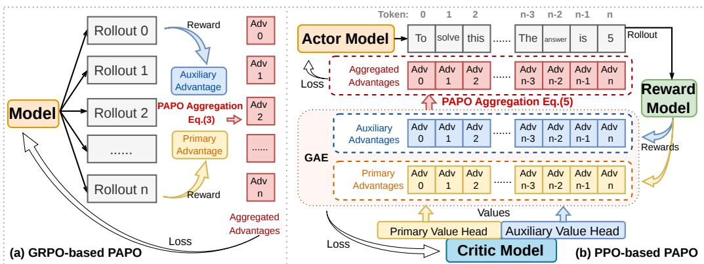  
Figure 2: Overview. (a) GRPO-based PAPO. Given multiple rollouts, primary and auxiliary rewards are converted to sequence-level advantages and combined. (b) PPO-based PAPO. A multihead critic estimates objective-specific values for the primary and auxiliary objectives. Token-level advantages are then computed using GAE and fused by PAPO before optimizing the actor.

## 5.2 GRPO-BASED PAPO: SEQUENCE-LEVEL ADVANTAGE AGGREGATION

For GRPO-based methods, PAPO operates on sequence-level advantages computed for each rollout. Given the primary and auxiliary rewards of the i-th rollout, we first form their corresponding raw advantages, $A _ { i , \mathrm { p r i } }$ and $A _ { i , \mathrm { a u x } }$ . Because the two reward signals may have different scales, we normalize them independently within each rollout group: $\begin{array} { r } { A _ { i , k } = \frac { A _ { i , k } - \mu _ { \mathrm { g r o u p } } ^ { k } } { \sigma _ { \mathrm { g r o u p } } ^ { k } + \epsilon } , k \in \{ \mathrm { p r i , a u x } \} } \end{array}$ . The normalized advantages are then fused using Eq. 3 to obtain $A _ { i } ^ { \mathrm { a g g } }$ . To retain the conventional zeromean advantage baseline, we further apply centered normalization within the same rollout group: $\begin{array} { r } { \hat { A } _ { i } = \frac { A _ { i } ^ { \mathrm { a g g } } - \mu _ { \mathrm { g r o u p } } ^ { \mathrm { a g g } } } { \sigma _ { \mathrm { g r o u p } } ^ { \mathrm { a g g } } + \epsilon } } \end{array}$ . As established in Proposition 1, PAPO preserves the primary sign during fusion, while the subsequent centered normalization preserves the resulting primary-consistent ordering. Therefore, although the absolute sign of an individual normalized advantage may change after centering, a response disfavored by the primary objective cannot be ranked above a primary-favored response due to the auxiliary objective.

## 5.3 PPO-BASED PAPO: TOKEN-LEVEL ADVANTAGE AGGREGATION

Token-Level Advantage with PAPO. Actor–critic PPO estimates a distinct advantage at each token through GAE. This token-level granularity is important for primary–auxiliary optimization: even within the same trajectory, the primary and auxiliary objectives may agree at some token positions but conflict at others. A response-level aggregation can therefore obscure local conflicts that directly determine the policy update. Therefore for PPO, we apply PAPO at the token level and estimate the two objectives separately before fusion. Specifically, we maintain two value heads, $V _ { \phi } ^ { \mathrm { p r i } } ( s _ { t } )$ and $V _ { \phi } ^ { \mathrm { a u x } } ( s _ { t } )$ , for the primary and auxiliary objectives, respectively. For $k \in \{ \mathrm { p r i , a u x } \}$ we independently compute the TD error and GAE:

$$
\delta _ { t } ^ { k } = r _ { t } ^ { k } + \gamma V _ { \phi } ^ { k } ( s _ { t + 1 } ) - V _ { \phi } ^ { k } ( s _ { t } ) , \qquad \hat { A } _ { t } ^ { k } = \sum _ { l = 0 } ^ { T - t } ( \gamma \lambda ) ^ { l } \delta _ { t + l } ^ { k } .\tag{4}
$$

Computing the two advantages independently preserves objective-specific temporal credit assignment before PAPO fusion. We then apply PAPO directly to $\hat { A } _ { t } ^ { \mathrm { p r i } }$ and $\hat { A } _ { t } ^ { \mathrm { a u x } }$ at every token:

$$
\hat { A } _ { t } ^ { \mathrm { a g g } } = \hat { A } _ { t } ^ { \mathrm { p r i } } + { \bf 1 } \left\{ \hat { A } _ { t } ^ { \mathrm { p r i } } \hat { A } _ { t } ^ { \mathrm { a u x } } \geq 0 \right\} \alpha \hat { A } _ { t } ^ { \mathrm { a u x } } + { \bf 1 } \left\{ \hat { A } _ { t } ^ { \mathrm { p r i } } \hat { A } _ { t } ^ { \mathrm { a u x } } < 0 \right\} \hat { A } _ { t } ^ { \mathrm { p r i } } \operatorname { t a n h } \left( \frac { \alpha \hat { A } _ { t } ^ { \mathrm { a u x } } } { \hat { A } _ { t } ^ { \mathrm { p r i } } + \epsilon \mathrm { s g n } ( \hat { A } _ { t } ^ { \mathrm { p r i } } ) } \right) .\tag{5}
$$

Then the fused token-level advantages are centered and normalized within the optimization minibatch: $\begin{array} { r } { \hat { A } _ { t } = \frac { \hat { A } _ { t } ^ { \mathrm { a g g } } - \mu _ { \mathrm { b a t c h } } ^ { \mathrm { a g g } } } { \sigma _ { \mathrm { b a t c h } } ^ { \mathrm { a g g } } + \epsilon } } \end{array}$ . As established in Proposition 1, PAPO preserves the primary sign at each token during fusion, while the subsequent centered normalization preserves the resulting primaryconsistent ordering within the normalization set. Thus, although centering may change the absolute sign of an individual token advantage, an auxiliary signal cannot rank a primary-disfavored token position above a primary-favored one. This allows PAPO to modulate local conflicts with finegrained auxiliary supervision while retaining the priority structure induced by the primary objective.

Dual-Head Critic Training. If we directly train a critic according to the fused advantage in Eq. 5 like actor, it would couple value estimation to the PAPO aggregation rule and collapse information from the primary and auxiliary objectives into a single target, because the fusion is generally many-to-one. Instead, we design two critic heads to independently estimate the returns of the primary and auxiliary objectives, while PAPO determines how their resulting advantages interact only during the actor update. For each objective $k \in \{ \mathrm { p r i , a u x } \}$ , we construct its return target from the corresponding GAE estimate:

$$
R _ { t } ^ { k } = \hat { A } _ { t } ^ { k } + V _ { \mathrm { o l d } } ^ { k } ( s _ { t } ) , \qquad k \in \{ \mathrm { p r i , a u x } \} .\tag{6}
$$

Each value head is therefore trained on its own unfused target, preserving the semantics and tokenlevel credit assignment of the corresponding reward objective independently of the actor-side PAPO transformation. Each head is optimized using the standard clipped value loss:

$$
L _ { k } ^ { \mathrm { V F } } ( \phi ) = \frac { 1 } { B } \sum _ { \mathrm { b a t c h } } \operatorname* { m a x } \left[ \left( V _ { \phi } ^ { k } ( s _ { t } ) - R _ { t } ^ { k } \right) ^ { 2 } , \left( \mathrm { c l i p } \left( V _ { \phi } ^ { k } ( s _ { t } ) , V _ { \mathrm { o l d } } ^ { k } ( s _ { t } ) - \epsilon _ { c } , V _ { \mathrm { o l d } } ^ { k } ( s _ { t } ) + \epsilon _ { c } \right) - R _ { t } ^ { k } \right) ^ { 2 } \right] ,\tag{7}
$$

where $\epsilon _ { c }$ denotes clipping range. The overall critic objective is $L ^ { \mathrm { V F } } ( \phi ) = L _ { \mathrm { p r i } } ^ { \mathrm { V F } } ( \phi ) + L _ { \mathrm { a u x } } ^ { \mathrm { V F } } ( \phi )$

Therefore, this yields a clear division of responsibility: the dual-head critic provides separate tokenlevel credit assignment for the primary and auxiliary objectives, whereas PAPO advantage aggregation performs priority-aware nonlinear fusion only at the actor update. Consequently, value estimation remains objective-specific and independent of the PAPO aggregation rule.

## 6 EXPERIMENTS

We design our experiments around four research questions: whether PAPO mainly improves the primary objective while having competitive auxiliary behavior (RQ1), how priority-aware aggregation changes the optimization dynamics of competing objectives (RQ2), which design components are responsible for the improvement (RQ3), and whether the resulting gains generalize across models, scales, reward semantics, and domains (RQ4). To answer RQ1, we evaluate PAPO on two representative multi-reward settings, competitional math reasoning and tool use.

Model and Baselines. We mainly include the Base model Qwen3-8B (Yang et al., 2025)and standard PPO (Schulman et al., 2017) and GRPO (Guo et al., 2025) with additive multi-reward aggregation, covering token- and sequence-level policy optimization. We additionally compare with the representative gating method GDPO (Liu et al., 2026a), which separately normalizes rewards. Our PAPO shares the same settings as the corresponding PPO or GRPO baseline. We also include additional models and baselines in Section 6.5 and Appendix B to evaluate the effectiveness of PAPO.

## 6.1 COMPETITION-LEVEL MATH REASONSING

Data and Reward Settings. We evaluate PAPO on competition-level mathematical reasoning with two objectives: answer correctness as the primary reward and reasoning efficiency as the auxiliary reward. We train on DAPO-17K(Yu et al., 2026) and evaluate on OlympiadBench(He et al., 2024), Minerva Math(Lewkowycz et al., 2022), AMC(Li et al., 2024), MATH-500(Hendrycks et al., 2021), AIME 2024, and AIME 2025. For a response $y ,$ the correctness reward is $R _ { \mathrm { a c c } } ( y ) = \mathbf { 1 } \{ \hat { y } = y ^ { * } \}$ where $\hat { y }$ is the extracted final answer and $y ^ { \ast }$ is the reference answer. We define the length compliance reward as $R _ { \mathrm { l e n } } ( y ) = \mathbf { 1 } \{ L ( y ) \leq T \}$ , where $L ( y )$ is the number of generated response tokens and $T \ : = \ : 8 . 0 0 0$ . We set $R _ { \mathrm { p r i } } ~ { = } ~ R _ { \mathrm { a c c } }$ and $R _ { \mathrm { a u x } } ~ { = } ~ R _ { \mathrm { l e n } }$ Finally, we report answer accuracy and length-budget compliance, with accuracy serving as the primary evaluation metric.

Table 1: Mathematical reasoning results. ∆ rows report changes relative to the Base model. Higher is better for both accuracy (Acc.↑) and length compliance (Len.↑). The best result within each optimization family is in bold.
<table><tr><td rowspan="3">Benchmark</td><td colspan="2">Base</td><td colspan="4">PPO-based</td><td colspan="6">GRPO-based</td></tr><tr><td colspan="2">Qwen3-8B</td><td colspan="2">PPO</td><td colspan="2">PAPO</td><td colspan="2">GRPO</td><td colspan="2">GDPO</td><td colspan="2">PAPO</td></tr><tr><td>Acc.</td><td>Len.</td><td>Acc.</td><td>Len.</td><td>Acc.</td><td>Len.</td><td>Acc.</td><td>Len.</td><td>Acc.</td><td>Len.</td><td>Acc.</td><td>Len.</td></tr><tr><td>Olympiad</td><td>38.8</td><td>51.6</td><td>35.9</td><td>77.4</td><td>42.9</td><td>87.2</td><td>38.9</td><td>75.7</td><td>39.6</td><td>74.1</td><td>43.2</td><td>90.2</td></tr><tr><td>∆0lympiad</td><td></td><td></td><td>-2.9</td><td>+25.8</td><td>+4.1</td><td>+35.6</td><td>+0.1</td><td>+24.1</td><td>+0.8</td><td>+22.5</td><td>+4.4</td><td>+38.6</td></tr><tr><td>Minerva</td><td>16.7</td><td>95.8</td><td>16.7</td><td>97.9</td><td>18.8</td><td>97.9</td><td>16.7</td><td>97.9</td><td>18.8</td><td>97.9</td><td>20.8</td><td>100.0</td></tr><tr><td>∆Minerva</td><td></td><td></td><td>0.0</td><td>+2.1</td><td>+2.1</td><td>+2.1</td><td>0.0</td><td>+2.1</td><td>+2.1</td><td>+2.1</td><td>+4.1</td><td>+4.2</td></tr><tr><td>AMC</td><td>82.5</td><td>60.0</td><td>77.5</td><td>92.5</td><td>95.0</td><td>85.0</td><td>82.5</td><td>97.5</td><td>85.0</td><td>87.5</td><td>92.5</td><td>87.5</td></tr><tr><td>△AMC</td><td></td><td></td><td>-5.0</td><td>+32.5</td><td>+12.5</td><td>+25.0</td><td>0.0</td><td>+37.5</td><td>+2.5</td><td>+27.5</td><td>+10.0</td><td>+27.5</td></tr><tr><td>MATH</td><td>85.4</td><td>83.0</td><td>85.0</td><td>97.0</td><td>89.6</td><td>94.8</td><td>84.4</td><td>92.8</td><td>85.2</td><td>92.6</td><td>89.8</td><td>97.8</td></tr><tr><td>∆MATH</td><td></td><td></td><td>-0.4</td><td>+14.0</td><td>+4.2</td><td>+11.8</td><td>-1.0</td><td>+9.8</td><td>-0.2</td><td>+9.6</td><td>+4.4</td><td>+14.8</td></tr><tr><td>AIME24</td><td>56.7</td><td>33.3</td><td>23.3</td><td>43.3</td><td>53.3</td><td>70.0</td><td>46.7</td><td>63.3</td><td>43.3</td><td>60.0</td><td>70.0</td><td>76.7</td></tr><tr><td>△AIME24</td><td></td><td></td><td>-33.4</td><td>+10.0</td><td>-3.4</td><td>+36.7</td><td>-10.0</td><td>+30.0</td><td>-13.4</td><td>+26.7</td><td>+13.3</td><td>+43.4</td></tr><tr><td>AIME25</td><td>40.0</td><td>16.7</td><td>23.3</td><td>53.3</td><td>40.0</td><td>46.7</td><td>36.7</td><td>60.0</td><td>33.3</td><td>53.3</td><td>43.3</td><td>73.3</td></tr><tr><td>△AIME25</td><td></td><td></td><td>-16.7</td><td>+36.6</td><td>0.0</td><td>+30.0</td><td>-3.3</td><td>+43.3</td><td>-6.7</td><td>+36.6</td><td>+3.3</td><td>+56.6</td></tr><tr><td>Average</td><td>53.4</td><td>56.7</td><td>43.6</td><td>76.9</td><td>56.6</td><td>80.3</td><td>51.0</td><td>81.2</td><td>50.9</td><td>77.6</td><td>59.9</td><td>87.6</td></tr><tr><td>∆Average</td><td></td><td></td><td>-9.8</td><td>+20.2</td><td>+3.2</td><td>+23.6</td><td>-2.4</td><td>+24.5</td><td>-2.5</td><td>+20.9</td><td>+6.5</td><td>+30.9</td></tr></table>

Table 2: Agentic tool-use results on WHEN2TOOL (Sun et al., 2026). ∆ rows report changes relative to the Base model. Acc.↑ denotes accuracy and Calls↓ denotes the average number of tool calls for a query. The best result within each optimization family is in bold.
<table><tr><td rowspan="3">Difficulty</td><td colspan="2">Base</td><td colspan="4">PPO-based</td><td colspan="6">GRPO-based</td></tr><tr><td colspan="2">Qwen3-8B</td><td colspan="2">PPO</td><td colspan="2">PAPO</td><td colspan="2">GRPO</td><td colspan="2">GDPO</td><td colspan="2">PAPO</td></tr><tr><td>Acc.</td><td>Calls</td><td>Acc.</td><td>Calls</td><td>Acc.</td><td>Calls</td><td>Acc.</td><td>Calls</td><td>Acc.</td><td>Calls</td><td>Acc.</td><td>Calls</td></tr><tr><td>Easy</td><td>88.11</td><td>1.33</td><td>93.78</td><td>0.15</td><td>94.56</td><td>0.22</td><td>93.89</td><td>0.13</td><td>93.89</td><td>0.08</td><td>95.67</td><td>0.12</td></tr><tr><td>∆Easy</td><td></td><td></td><td>+5.67</td><td>-1.18</td><td>+6.45</td><td>-1.11</td><td>+5.78</td><td>-1.20</td><td>+5.78</td><td>-1.25</td><td>+7.56</td><td>-1.21</td></tr><tr><td>Medium</td><td>88.89</td><td>1.41</td><td>87.22</td><td>0.23</td><td>92.44</td><td>0.49</td><td>87.00</td><td>0.16</td><td>89.77</td><td>0.14</td><td>89.22</td><td>0.15</td></tr><tr><td>∆Medium</td><td></td><td>一</td><td>-1.67</td><td>-1.18</td><td>+3.55</td><td>-0.92</td><td>-1.89</td><td>-1.25</td><td>+0.88</td><td>-1.27</td><td>+0.33</td><td>-1.26</td></tr><tr><td>Hard</td><td>75.67</td><td>1.47</td><td>77.78</td><td>0.73</td><td>79.56</td><td>0.96</td><td>82.22</td><td>0.69</td><td>76.89</td><td>0.52</td><td>84.89</td><td>0.71</td></tr><tr><td>∆Hard</td><td></td><td>1</td><td>+2.11</td><td>-0.74</td><td>+3.89</td><td>-0.51</td><td>+6.55</td><td>-0.78</td><td>+1.22</td><td>-0.95</td><td>+9.22</td><td>-0.76</td></tr><tr><td>Average</td><td>84.22</td><td>1.40</td><td>86.26</td><td>0.37</td><td>88.85</td><td>0.56</td><td>87.70</td><td>0.33</td><td>86.85</td><td>0.25</td><td>89.93</td><td>0.33</td></tr><tr><td>∆Average</td><td></td><td></td><td>+2.04</td><td>-1.03</td><td>+4.63</td><td>-0.84</td><td>+3.48</td><td>-1.07</td><td>+2.63</td><td>-1.15</td><td>+5.71</td><td>-1.07</td></tr></table>

Results. Table 1 summarizes the results on mathematical reasoning. PAPO consistently improves the primary accuracy objective to the best under both PPO- and GRPO-based training. On average, PAPO raises accuracy from 43.6 to 56.6 over PPO and from 51.0 to 59.9 over GRPO. These gains are accompanied by the best average length compliance, increasing from 76.9 to 80.3 and from 81.2 to 87.6, respectively. Compared with GDPO, PAPO-GRPO improves average accuracy from 50.9 to 59.9 while also increasing length compliance from 77.6 to 87.6. The accuracy gains are particularly pronounced on the more challenging Olympiad and AIME benchmarks, where auxiliary efficiency objectives can more strongly conflict with correctness.

## 6.2 AGENTIC TOOL USING

Data and Reward Settings. We evaluate PAPO on WHEN2TOOL (Sun et al., 2026), which contains 18 tool-use environments spanning single-hop and multi-hop tasks with easy, medium, and hard subsets. We treat answer correctness as the primary reward and tool-call efficiency as the auxiliary reward. For a response y, the correctness reward is $R _ { \mathrm { a c c } } ( y ) = \mathbf { 1 } \{ \hat { y } = y ^ { * } \}$ , where $\hat { y }$ is the extracted final answer and $y ^ { * }$ is the reference answer. Let $N _ { \mathrm { c a l l } }$ denote the number of executed tool calls and B the task-specific tool budget; we define the auxiliary reward as $R _ { \mathrm { a u x } } = \operatorname* { m a x } ( 0 , 1 - N _ { \mathrm { c a l l } } / ( B + \delta ) )$ with $\delta = 1$ . The tool call budget B is from task annotations, which use the number of annotated steps. Specifically, B = 3 for multi-step examples, and B = 1 for single-step examples. We report accuracy and the average number of tool calls, both average and across difficulty levels.

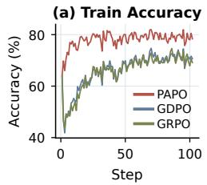

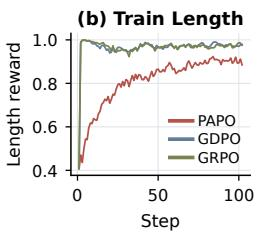

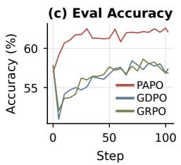

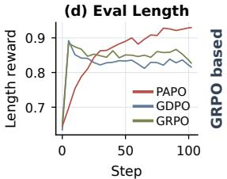

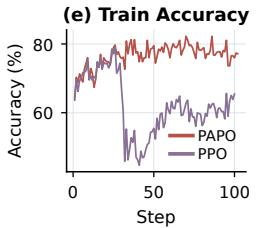

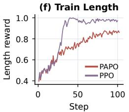

(g) Eval Accuracy  
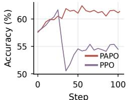

(h) Eval Length  
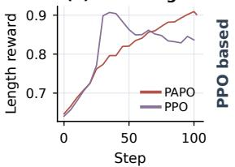  
Figure 3: PAPO Dynamics. PAPO maintains the best accuracy ↑ while having a competitive auxiliary length compliance ↑ for GRPO-based (top) and PPO-based (bottom) methods.

Results. Table 2 reports the tool-use results, where PAPO improves average accuracy from 86.26 to 88.85 over PPO and from 87.70 to 89.93 over GRPO. Under GRPO, this gain is achieved with essentially unchanged tool usage (0.33 calls on average), while under PPO, PAPO uses moderately more tools (0.56 vs. 0.37) in exchange for higher task accuracy. Compared with GDPO, PAPO-GRPO further raises average accuracy from 86.85 to 89.93, with only a small increase in tool calls from 0.25 to 0.33. The improvement is especially clear on hard subsets, where PAPO-GRPO increases accuracy from 82.22 to 84.89 while keeping tool usage nearly unchanged (0.69 to 0.71). Overall, PAPO first benefits task success rather than indiscriminately maximizing the auxiliary objective.

## 6.3 TRAINING AND EVALUATION DYNAMICS

To answer RQ2, we further illustrate how PAPO balances correctness and reasoning efficiency throughout training on math data in Figure 3. Across both GRPO- and PPO-based settings, baseline methods often optimize the auxiliary length objective rapidly without consistently improving evaluation accuracy, and this effect is particularly pronounced for PPO, where aggressive length optimization coincides with unstable or degraded correctness. In contrast, PAPO maintains stronger and more stable accuracy while progressively improving the length reward, ultimately achieving a better balance between the two objectives. These dynamics support our motivation that an easily optimized auxiliary objective can interfere with the primary task under unconstrained aggregation, whereas PAPO allows auxiliary supervision to refine the policy without overriding correctness.

## 6.4 ABLATION STUDIES

To answer RQ3, we conduct ablations to isolate the contribution of each component. (a) Ablation on α. Figure 4 studies the effect of the auxiliary coefficient α. Simply tuning α under conventional weighted aggregation does not provide reliable control over objective priority, as optimization can still favor the objective that is easier to improve rather than following the intended weighting (Liu et al., 2026a). In contrast, PAPO consistently maintains stronger primary accuracy across different values of α, while retaining competitive auxiliary performance. (b) Ablation on Multi-Head Critic. Table 3 disentangles the contributions of the multi-head critic (MHC) and PAPO aggregation under PPO-based training. Introducing MHC alone provides modest improvements, increasing math accuracy from 54.5 to 55.7 and tool-use accuracy from 86.25 to 86.84, together with improved length compliance. Adding PAPO on MHC yields larger gains, raising math accuracy to 61.1 and tool-use accuracy to 88.25, indicating that both components contribute to PAPO’s improvement.

## 6.5 ADDITIONAL MODEL SCALE AND DOMAINS

To answer RQ4, we extend PAPO to additional models, scales, and different reward semantics and domains, including multimodal safety alignment.

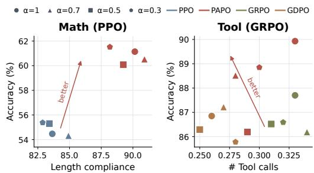

Table 3: PPO-based PAPO component ablation. MHC denotes the multi-head critic. Best results are in bold and second-best results are underlined.
<table><tr><td rowspan="2">Method</td><td colspan="2">Math</td><td colspan="2">Tool Use</td></tr><tr><td>Acc. ↑</td><td>Len. ↑</td><td>Acc. ↑</td><td>Calls ↓</td></tr><tr><td>Base</td><td>57.6</td><td>64.1</td><td>84.19</td><td>1.40</td></tr><tr><td>PPO</td><td>54.5</td><td>83.6</td><td>86.25</td><td>0.37</td></tr><tr><td>PPO + MHC</td><td>55.7</td><td>87.2</td><td>86.84</td><td>0.41</td></tr><tr><td> $\mathrm { P P O } + \mathrm { M H C } + \mathrm { P A P O }$ </td><td>61.1</td><td>90.2</td><td>88.25</td><td>0.56</td></tr></table>

Figure 4: Sensitivity to the auxiliary weight α.

Table 4: Math results on DeepSeek-R1-Distill-1.5B. Higher is better for both accuracy (Acc.) and length compliance (Len.). Best results are in bold and second-best results are underlined.
<table><tr><td rowspan="2">Method</td><td colspan="2">Olympiad</td><td colspan="2">Minerva</td><td colspan="2">AMC</td><td colspan="2">MATH</td><td colspan="2">AIME24</td><td colspan="2">AIME25</td><td colspan="2">Overall</td></tr><tr><td>Acc.</td><td>Len.</td><td>Acc.</td><td>Len.</td><td>Acc.</td><td>Len.</td><td>Acc.</td><td>Len.</td><td>Acc.</td><td>Len.</td><td>Acc.</td><td>Len.</td><td>Acc.</td><td>Len.</td></tr><tr><td>Base</td><td>22.8</td><td>43.1</td><td>15.6</td><td>81.3</td><td>47.5</td><td>50.0</td><td>66.2</td><td>75.8</td><td>16.7</td><td>16.7</td><td>16.7</td><td>13.3</td><td>39.4</td><td>60.0</td></tr><tr><td>PPO</td><td>28.6</td><td>66.1</td><td>16.7</td><td>93.8</td><td>65.0</td><td>80.0</td><td>73.6</td><td>91.0</td><td>16.7</td><td>36.7</td><td>20.0</td><td>46.7</td><td>45.8</td><td>75.8</td></tr><tr><td>PAPO</td><td>29.9</td><td>74.6</td><td>16.7</td><td>95.8</td><td>62.5</td><td>80.0</td><td>78.0</td><td>91.8</td><td>16.7</td><td>43.3</td><td>20.0</td><td>46.7</td><td>48.1</td><td>80.7</td></tr></table>

Additional Model Scale To examine whether PAPO generalizes beyond the primary model setting, we further evaluate it on additional smaller-scale backbone. Table 4 further demonstrates the effectiveness of PAPO on DeepSeek-R1-Distill-1.5B (Guo et al., 2025). Compared with PPO, PAPO improves average accuracy from 45.8 to 48.1 and length compliance from 75.8 to 80.7, with consistent gains across most benchmarks. These results indicate that PAPO remains effective across different model families and reasoning backbones while jointly improving the primary and auxiliary objectives. We also provide results of Qwen3-1.7B for agentic tool use in Section B.1.

Additional Domain We further evaluate PAPO in the multimodal safety-alignment setting of SafeRLHF-V (Ji et al., 2025), treating safety as the primary objective and helpfulness as the auxiliary objective. We evaluate Qwen2-VL-7B (in Section B.1) and LLaVA-1.6-7B (Liu et al., 2024a) on BeaverTails-V (Ji et al., 2025) and MM-SafetyBench (Liu et al., 2024b) against Base, RLHF (Ouyang et al., 2022) RLHF-V (Sun et al., 2024), LLaVA-RLHF (Sun et al., 2024), and SafeRLHF-V (Ji et al., 2025). Figure 5 shows that PAPO consistently improves safety while preserving strong helpfulness, and achieves a favorable trade-off across both model families. This further demonstrates that PAPO generalizes to different rewards and domains.

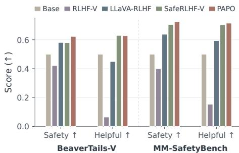  
Figure 5: Multimodal safety alignment.

Besides, we provide additional model results in Appendix B.1, additional training results for the tool use in Appendix B.2, and per-dataset evaluation dynamics during training in Appendix B.3. We conduct multiple runs with random seeds and evaluate pass@k in Appendix B.4 to complement the deterministic greedy-decoding evaluation above. Other implementation details and examples are listed in Appendix C and Appendix D.

## 7 CONCLUSION

We propose Primary Advantage Policy Optimization (PAPO), a priority-aware advantage aggregation framework that preserves aligned auxiliary supervision while smoothly constraining conflict ing signals. PAPO applies to both GRPO and PPO with token-level optimization with objectivespecific critic heads. Across mathematical reasoning, agentic tool use, and multimodal safety alignment, PAPO consistently improves primary-objective performance while maintaining strong auxiliary behavior, with gains that generalize across models, scales, reward semantics, and optimization frameworks. These results suggest that explicitly modeling reward objective priority is an effective way for multi-reward policy optimization.

## REPRODUCIBILITY STATEMENT

Code. We provide the implementation, training configurations, and evaluation scripts needed to reproduce the main experiments in the supplementary material. The code is available here, which covers both the GRPO- and PPO-based implementations of PAPO, including the dual-head critic used in the PPO setting.

Training and evaluation. Appendix C documents the datasets, reward definitions, model backbones, training objectives, hyperparameters, and evaluation protocols used throughout the experiments. We additionally provide implementation details for both mathematical reasoning and agentic tool-use settings, including the decoding protocols used for greedy and Pass@k evaluation.

Additional experiments. Appendix B reports additional ablations and analyses, including the effects of the auxiliary-reward weight, critic design, training and evaluation dynamics, and Pass@k evaluation under stochastic decoding. Prompt templates and task-specific evaluation details are also provided to facilitate reproduction of the reported results.

## ETHICS STATEMENT

This work studies multi-objective reinforcement learning for large language model post-training across mathematical reasoning, agentic tool use, and safety alignment. Our experiments do not involve human subjects or private user data, and tool-use experiments are conducted in controlled benchmark environments. PAPO focuses on prioritizing a primary objective while incorporating auxiliary objectives, including settings where safety is primary and helpfulness is secondary. We encourage future applications to carefully define the objective hierarchy and evaluate whether it reflects the intended safety and deployment requirements.

## AI USE STATEMENT

Generative AI tools were used to assist with grammar correction, language polishing, and improving the clarity and concision of the manuscript, as well as for discovery of potentially relevant literature. We reviewed all AI-assisted edits and independently verified suggested references against the original sources. The authors take full responsibility for the final text, citations, claims, experimental results, and presentation of the work.

## REFERENCES

Pranjal Aggarwal and Sean Welleck. L1: Controlling how long a reasoning model thinks with reinforcement learning. In Second Conference on Language Modeling, 2025.

Josef Dai, Xuehai Pan, Ruiyang Sun, Jiaming Ji, Xinbo Xu, Mickel Liu, Yizhou Wang, and Yaodong Yang. Safe rlhf: Safe reinforcement learning from human feedback. arXiv preprint arXiv:2310.12773, 2023.

Xingjian Diao, Zheyuan Liu, Chunhui Zhang, Weiyi Wu, Keyi Kong, Lin Shi, Kaize Ding, Soroush Vosoughi, and Jiang Gui. Addressing overthinking in large vision-language models via gated perception-reasoning optimization. In Findings of the Association for Computational Linguistics: ACL 2026, 2026a.

Xingjian Diao, Tianyu Yang, Wenjun Huang, Xiangchi Yuan, Chunhui Zhang, Xingchen Zhao, Weiyi Wu, Haotian Xu, Soroush Vosoughi, Xiangliang Zhang, et al. Of errors and echoes: Responsibility-aware credit assignment for tool-use agents. arXiv preprint arXiv:2610.16027, 2026b.

Daya Guo, Dejian Yang, Haowei Zhang, Junxiao Song, Ruoyu Zhang, Runxin Xu, Qihao Zhu, Shirong Ma, Peiyi Wang, Xiao Bi, et al. Deepseek-r1: Incentivizing reasoning capability in llms via reinforcement learning. arXiv preprint arXiv:2501.12948, 2025.

Chaoqun He, Renjie Luo, Yuzhuo Bai, Shengding Hu, Zhen Leng Thai, Junhao Shen, Jinyi Hu, Xu Han, Yujie Huang, Yuxiang Zhang, et al. Olympiadbench: A challenging benchmark for

promoting agi with olympiad-level bilingual multimodal scientific problems. arXiv preprint arXiv:2402.14008, 2024.

Dan Hendrycks, Collin Burns, Saurav Kadavath, Akul Arora, Steven Basart, Eric Tang, Dawn Song, and Jacob Steinhardt. Measuring mathematical problem solving with the math dataset. arXiv preprint arXiv:2103.03874, 2021.

Yuki Ichihara and Yuu Jinnai. Auto-weighted group relative preference optimization for multiobjective text generation tasks. In Proceedings of the 2025 Conference on Empirical Methods in Natural Language Processing: Industry Track, pp. 1134–1147. Association for Computational Linguistics, 2025. doi: 10.18653/v1/2025.emnlp-industry.80.

Jiaming Ji, Xinyu Chen, Rui Pan, Han Zhu, Jiahao Li, Donghai Hong, Boyuan Chen, Jiayi Zhou, Kaile Wang, Juntao Dai, Chi-Min Chan, Sirui Han, Yike Guo, and Yaodong Yang. Safe rlhf-v: Safe reinforcement learning from multi-modal human feedback. In Advances in Neural Information Processing Systems, 2025.

Guochao Jiang, Jingyi Song, Guofeng Quan, Chuzhan Hao, Guohua Liu, and Yuewei Zhang. Dvao: Dynamic variance-adaptive advantage optimization for multi-reward reinforcement learning. arXiv preprint arXiv:2605.25604, 2026.

Aitor Lewkowycz, Anders Andreassen, David Dohan, Ethan Dyer, Henryk Michalewski, Vinay Ramasesh, Ambrose Slone, Cem Anil, Imanol Schlag, Theo Gutman-Solo, et al. Solving quantitative reasoning problems with language models. Advances in neural information processing systems, 2022.

Jia Li, Edward Beeching, Lewis Tunstall, Ben Lipkin, Roman Soletskyi, Shengyi Huang, Kashif Rasul, Longhui Yu, Albert Q Jiang, Ziju Shen, et al. Numinamath: The largest public dataset in ai4maths with 860k pairs of competition math problems and solutions. Hugging Face repository, 2024.

Haotian Liu, Chunyuan Li, Yuheng Li, Bo Li, Yuanhan Zhang, Sheng Shen, and Yong Jae Lee. Llava-next: Improved reasoning, ocr, and world knowledge, January 2024a. URL https:// llava-vl.github.io/blog/2024-01-30-llava-next/.

Shih-Yang Liu, Xin Dong, Ximing Lu, Shizhe Diao, Mingjie Liu, Min-Hung Chen, Hongxu Yin, Yu-Chiang Frank Wang, Kwang-Ting Cheng, Yejin Choi, et al. Dler: Doing length penalty right-incentivizing more intelligence per token via reinforcement learning. arXiv preprint arXiv:2510.15110, 2025.

Shih-Yang Liu, Xin Dong, Ximing Lu, Shizhe Diao, Peter Belcak, Mingjie Liu, Min-Hung Chen, Hongxu Yin, Yu-Chiang Frank Wang, Kwang-Ting Cheng, Yejin Choi, Jan Kautz, and Pavlo Molchanov. Gdpo: Group reward-decoupled normalization policy optimization for multi-reward rl optimization. arXiv preprint arXiv:2601.05242, 2026a.

Wei Liu, Ruochen Zhou, Yiyun Deng, Yuzhen Huang, Junteng Liu, Yuntian Deng, Yizhe Zhang, and Junxian He. Learn to reason efficiently with adaptive length-based reward shaping. In International Conference on Learning Representations, 2026b.

Xin Liu, Yichen Zhu, Jindong Gu, Yunshi Lan, Chao Yang, and Yu Qiao. Mm-safetybench: A benchmark for safety evaluation of multimodal large language models. In European Conference on Computer Vision, pp. 386–403. Springer, 2024b.

Chiyu Ma, Shuo Yang, Kexin Huang, Jinda Lu, Haoming Meng, Shangshang Wang, Bolin Ding, Soroush Vosoughi, Guoyin Wang, and Jingren Zhou. Fipo: Eliciting deep reasoning with futurekl influenced policy optimization. arXiv preprint arXiv:2603.19835, 2026.

Long Ouyang, Jeffrey Wu, Xu Jiang, Diogo Almeida, Carroll Wainwright, Pamela Mishkin, Chong Zhang, Sandhini Agarwal, Katarina Slama, Alex Ray, et al. Training language models to follow instructions with human feedback. Advances in neural information processing systems, 2022.

John Schulman, Filip Wolski, Prafulla Dhariwal, Alec Radford, and Oleg Klimov. Proximal policy optimization algorithms. arXiv preprint arXiv:1707.06347, 2017.

Dachuan Shi, Abedelkadir Asi, Keying Li, Xiangchi Yuan, Leyan Pan, Wenke Lee, and Wen Xiao. Swireasoning: Switch-thinking in latent and explicit for pareto-superior reasoning LLMs. In The Fourteenth International Conference on Learning Representations, 2026a.

Dachuan Shi, Hanlin Zhu, Xiangchi Yuan, Wanjia Zhao, Kejing Xia, Wen Xiao, and Wenke Lee. Copt: Contrastive on-policy thinking with continuous spaces for general and agentic reasoning. arXiv preprint arXiv:2605.20075, 2026b.

Chung-En Sun, Linbo Liu, Ge Yan, Zimo Wang, and Tsui-Wei Weng. Llm agents already know when to call tools – even without reasoning. arXiv preprint arXiv:2605.09252, 2026.

Zhiqing Sun, Sheng Shen, Shengcao Cao, Haotian Liu, Chunyuan Li, Yikang Shen, Chuang Gan, Liangyan Gui, Yu-Xiong Wang, Yiming Yang, et al. Aligning large multimodal models with factually augmented rlhf. In Findings ofthe associationfor computational linguistics: ACL 2024, 2024.

Microsoft AI Team et al. Mai-thinking-1: Building a hill-climbing machine. Technical report, Technical report, Microsoft AI, 2026. https://microsoft. ai/pdf/mai-thinking . . . , 2026.

Peng Wang, Shuai Bai, Sinan Tan, Shijie Wang, Zhihao Fan, Jinze Bai, Keqin Chen, Xuejing Liu, Jialin Wang, Wenbin Ge, et al. Qwen2-vl: Enhancing vision-language model’s perception of the world at any resolution. arXiv preprint arXiv:2409.12191, 2024.

Wen Wang, Jiahua Bao, Yongsiqi Tu, Yihao Liu, Haotian Zhou, Haoxuan Ma, Mengyu Zhou, Wenkui Fan, Junwei He, Xiaoxi Jiang, and Guanjun Jiang. Smopd: Multi-reward reinforcement learning via specialize-and-merge online policy distillation. arXiv preprint arXiv:2608.03092, 2026.

An Yang, Anfeng Li, Baosong Yang, Beichen Zhang, Binyuan Hui, Bo Zheng, Bowen Yu, Chang Gao, Chengen Huang, Chenxu Lv, et al. Qwen3 technical report. arXiv preprint arXiv:2505.09388, 2025.

Qiying Yu, Zheng Zhang, Ruofei Zhu, Yufeng Yuan, Xiaochen Zuo, Yu Yue, Weinan Dai, Tiantian Fan, Gaohong Liu, Lingjun Liu, et al. Dapo: An open-source llm reinforcement learning system at scale. Advances in Neural Information Processing Systems, 2026.

Xiangchi Yuan, Xiang Chen, Tong Yu, Dachuan Shi, Can Jin, Wenke Lee, and Saayan Mitra. Mitigating forgetting between supervised and reinforcement learning yields stronger reasoners. arXiv preprint arXiv:2510.04454, 2025.

Xiangchi Yuan, Dachuan Shi, Chunhui Zhang, Zheyuan Liu, Shenglong Yao, Soroush Vosoughi, and Wenke Lee. Behavior knowledge merge in reinforced agentic models. In Proceedings of the 64th Annual Meeting of the Association for Computational Linguistics, 2026.

Yu Yue, Yufeng Yuan, Qiying Yu, Xiaochen Zuo, Ruofei Zhu, Wenyuan Xu, Jiaze Chen, Chengyi Wang, TianTian Fan, Zhengyin Du, et al. Vapo: Efficient and reliable reinforcement learning for advanced reasoning tasks. arXiv preprint arXiv:2504.05118, 2025.

Chujie Zheng, Shixuan Liu, Mingze Li, Xiong-Hui Chen, Bowen Yu, Chang Gao, Kai Dang, Yuqiong Liu, Rui Men, An Yang, Jingren Zhou, and Junyang Lin. Group sequence policy optimization. arXiv preprint arXiv:2507.18071, 2025.

## CONTENTS OF APPENDIX

A Proof 14   
B Additional Experimental Results 15   
B.1 Additional Models’ Results . 15   
B.2 Training and Evaluation Dynamics for Tool 15   
B.3 Per-Dataset Evaluation Dynamics 16   
B.4 Additional Pass@k Evaluation for Math 17   
C Training and Implementation Details 18   
C.1 Mathematical Reasoning 20   
C.2 Agentic Tool Use 20   
C.3 Safety Alignment 21   
C.4 Dataset Details and Statistics 22   
D Training and Reward Computation Examples 24   
D.1 Mathematical Reasoning Example 25   
D.2 Agentic Tool-Use Examples 26   
D.2.1 Three-Step Code Execution Example 26   
D.2.2 Three-Hop Retrieval Example 29

## A PROOF

For completeness, we restate Proposition 1 and provide its full proof.

Proposition 1. Let an optimization unit denote a rollout in GRPO or a token position in PPO; the associated normalization set is a rollout group for GRPO and a token-level mini-batch for PPO. For any unit u with $A _ { u , \mathrm { p r i } } \neq 0 .$ , PAPO preserves the primary sign during aggregation: $\mathrm { s i g n } ( A _ { u , \mathrm { a g g } } ) = \mathrm { s i g n } ( A _ { u , \mathrm { p r i } } )$ . Moreover, for any two units u and v in the same normalization set, centered normalization $\hat { A } _ { k } = ( A _ { k , \mathrm { a g g } } - \mu ) / ( \sigma + \epsilon )$ preserves their primary-consistent ordering:

$$
A _ { u , \mathrm { p r i } } > 0 > A _ { v , \mathrm { p r i } } \quad \Longrightarrow \quad \hat { A } _ { u } > \hat { A } _ { v } .
$$

Proof. Sign preservation during PAPO aggregation. Consider any optimization unit u with $A _ { u , \mathrm { p r i } } \neq$ 0. When the primary and auxiliary advantages are aligned, $A _ { u , \mathrm { p r i } } A _ { u , \mathrm { a u x } } \geq 0$ , PAPO reduces to

$$
A _ { u , \mathrm { a g g } } = A _ { u , \mathrm { p r i } } + \alpha A _ { u , \mathrm { a u x } } .
$$

Since $\alpha \geq 0$ and the two terms have the same sign,

$$
\mathrm { s i g n } ( A _ { u , \mathrm { a g g } } ) = \mathrm { s i g n } ( A _ { u , \mathrm { p r i } } ) .
$$

When the two advantages conflict, $A _ { u , \mathrm { p r i } } A _ { u , \mathrm { a u x } } < 0 .$ , Eq. 3 can be rewritten as

$$
A _ { u , \mathrm { a g g } } = A _ { u , \mathrm { p r i } } \left[ 1 - \operatorname { t a n h } \left( \frac { \alpha | A _ { u , \mathrm { a u x } } | } { | A _ { u , \mathrm { p r i } } | + \epsilon } \right) \right] .\tag{8}
$$

Because

$$
0 \leq \operatorname { t a n h } \left( \frac { \alpha | A _ { u , \mathrm { a u x } } | } { | A _ { u , \mathrm { p r i } } | + \epsilon } \right) < 1 ,
$$

the multiplicative factor in Eq. 8 satisfies

$$
0 < 1 - \operatorname { t a n h } \left( \frac { \alpha | A _ { u , \mathrm { a u x } } | } { | A _ { u , \mathrm { p r i } } | + \epsilon } \right) \leq 1 .
$$

Hence,

$$
\mathrm { s i g n } ( A _ { u , \mathrm { a g g } } ) = \mathrm { s i g n } ( A _ { u , \mathrm { p r i } } ) .
$$

Therefore, PAPO cannot reverse the sign induced by the primary objective during aggregation.

Primary-consistent ordering after centered normalization. Consider two optimization units u and v in the same normalization set such that

$$
A _ { u , \mathrm { p r i } } > 0 > A _ { v , \mathrm { p r i } } .
$$

By the sign-preservation result above,

$$
A _ { u , \mathrm { a g g } } > 0 > A _ { v , \mathrm { a g g } } ,
$$

and therefore

$$
A _ { u , \mathrm { a g g } } > A _ { v , \mathrm { a g g } } .
$$

The post-fusion centered normalization is

$$
\hat { A } _ { k } = \frac { A _ { k , \mathrm { a g g } } - \mu } { \sigma + \epsilon } .\tag{9}
$$

Since $\sigma + \epsilon > 0 , \mathrm { E q . ~ } 9$ is a strictly increasing affine transformation. Therefore,

$$
A _ { u , \mathrm { a g g } } > A _ { v , \mathrm { a g g } } \quad \Longrightarrow \quad \hat { A } _ { u } > \hat { A } _ { v } .
$$

Combining the two results gives

$$
A _ { u , \mathrm { p r i } } > 0 > A _ { v , \mathrm { p r i } } \quad \Longrightarrow \quad \hat { A } _ { u } > \hat { A } _ { v } .
$$

Thus, the primary-consistent ordering induced by PAPO is preserved after the centered normalization used in both GRPO and PPO.

Normalization does not necessarily preserve the absolute sign of each individual fused advantage. For example, a positive $A _ { u , \mathrm { a g g } }$ may become negative after subtracting the normalization mean. This does not constitute an auxiliary-induced priority inversion: the sign change results from shifting the common advantage reference point rather than from the auxiliary objective overturning the primary preference. Therefore, PAPO provides two complementary guarantees: it preserves the primary sign during advantage aggregation, while the resulting primary-consistent ordering remains intact after centered normalization.

## B ADDITIONAL EXPERIMENTAL RESULTS

## B.1 ADDITIONAL MODELS’ RESULTS

Additional Tool-Use Results. Table 5 shows the tool-use results of applying PAPO and baselines to the Qwen3-1.7B (Yang et al., 2025) model. PAPO achieves the highest overall accuracy of 81.11, compared with 75.96 for GRPO and 76.85 for GDPO, with notable gains on the medium and hard subsets. Although PAPO uses slightly more tool calls on average, the higher accuracy suggests that it avoids over-optimizing tool efficiency at the cost of accuracy, or task success rate, with comparable tool call efficiency.

Table 5: Tool-use results on Qwen3-1.7B. Higher is better for accuracy, while lower is better for tool calls. Best results are in bold and second-best results are underlined.
<table><tr><td rowspan="3">Method</td><td colspan="2">Easy</td><td colspan="2">Medium</td><td colspan="2">Hard</td><td colspan="2">Overall</td></tr><tr><td>Acc. ↑</td><td>Calls↓</td><td>Acc. ↑</td><td>Calls↓</td><td>Acc. ↑</td><td>Calls↓</td><td>Acc. ↑</td><td>Calls↓</td></tr><tr><td>Base</td><td>60.11</td><td>1.33</td><td>60.56</td><td>1.43</td><td>55.89</td><td>1.49</td><td>58.85</td><td>1.42</td></tr><tr><td>GRPO</td><td>85.33</td><td>0.18</td><td>76.33</td><td>0.30</td><td>66.22</td><td>0.65</td><td>75.96</td><td>0.38</td></tr><tr><td>GDPO</td><td>88.86</td><td>0.13</td><td>76.00</td><td>0.21</td><td>66.00</td><td>0.54</td><td>76.85</td><td>0.29</td></tr><tr><td>PAPO</td><td>88.00</td><td>0.17</td><td>80.78</td><td>0.29</td><td>74.56</td><td>0.87</td><td>81.11</td><td>0.44</td></tr></table>

Additional Safety Alignment Results. We continue to conduct additional safety alignment experiments on the additional multi-modality model Qwen2-VL-7B (Wang et al., 2024) and illustrate the results in Figure 6. Compared with other baselines, our PAPO achieves the best primary safety performance while having the best or very competitive auxiliary helpful score on both datasets.

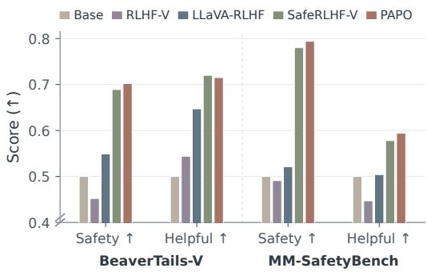  
Figure 6: Multimodal safety alignment results for the Qwen2-VL-7B model.

## B.2 TRAINING AND EVALUATION DYNAMICS FOR TOOL

Figure 7 shows the optimization dynamics of task correctness and tool-use efficiency. For both GRPO- and PPO-based methods, the number of tool calls decreases rapidly during training, suggesting that the auxiliary efficiency objective is relatively easy to optimize; however, lower tool usage does not necessarily yield better performance in accuracy. PAPO maintains stronger and more stable evaluation accuracy while using a moderate number of tool calls, whereas GRPO, GDPO, and especially standard PPO can reduce tool usage more aggressively at the cost of weaker or more volatile correctness.

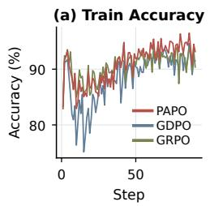

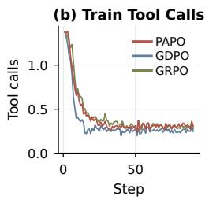

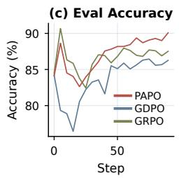

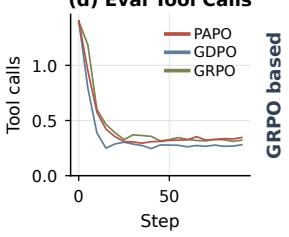

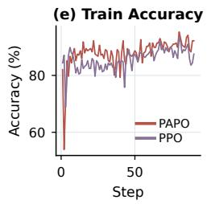

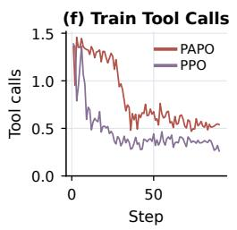

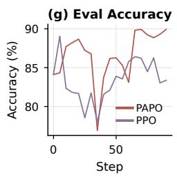

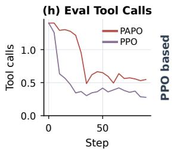  
Figure 7: Dynamics on agentic tool use. Although baseline methods can reduce tool calls aggressively, this behavior can coincide with degraded accuracy. PAPO maintains stronger primaryobjective performance while still reducing tool usage, yielding a better trade-off for GRPO-based (top) and PPO-based (bottom) methods.

## B.3 PER-DATASET EVALUATION DYNAMICS

To complement the aggregated training dynamics in Section 6.3 and Appendix B.2, we further report evaluation dynamics during training separately for each benchmark (math) and difficulty level (tool using). These results provide a more fine-grained view of how PAPO balances the primary and auxiliary objectives throughout optimization.

Mathematical Reasoning. Figure 8 presents the per-dataset evaluation dynamics on AIME24, AIME25, AMC, MATH-500, Minerva, and Olympiad. Across both optimization families, the baselines tend to improve the auxiliary length objective relatively quickly, but this does not consistently bring stronger correctness. Under GRPO-based optimization, GRPO and GDPO often reach comparable or higher length compliance early in training while remaining substantially below PAPO in accuracy, particularly on AIME24, AIME25, AMC, MATH-500, and Olympiad. PAPO instead maintains stronger accuracy while progressively improving length compliance, often matching or surpassing the baselines toward the end of training. The same pattern is even more pronounced for PPO: PPO rapidly increases the length reward, but this is accompanied by large accuracy drops on evaluation benchmarks, whereas PAPO has a more gradual efficiency improvement and preserves very stable correctness improvements. Minerva is less discriminative because length compliance quickly approaches its ceiling and accuracy varies over a narrow discrete range. Overall, the perdataset trajectories show that GRPO- and PPO-based baselines aggressively optimizing the auxiliary length objective, interfering with correctness, while PAPO better preserves the primary accuracy objective as efficiency improves.

Agentic Tool Use. Figure 9 reports evaluation dynamics separately for easy, medium, and hard tool-use subsets. All methods rapidly reduce tool calls, indicating that the auxiliary efficiency objective is comparatively easy to optimize. However, the difference in accuracy becomes increasingly apparent as task difficulty grows. PAPO maintains strong accuracy across all three difficulty levels and is particularly robust on medium and hard subsets, where more aggressive reductions in tool usage can coincide with unstable or lower accuracy. This effect is especially visible in the PPO-based setting, where PPO often reaches fewer tool calls earlier but exhibits considerably more volatile correctness. PAPO instead retains additional tool usage when needed, achieving our intended priority: tool efficiency should refine the solution process without overriding successful task completion.

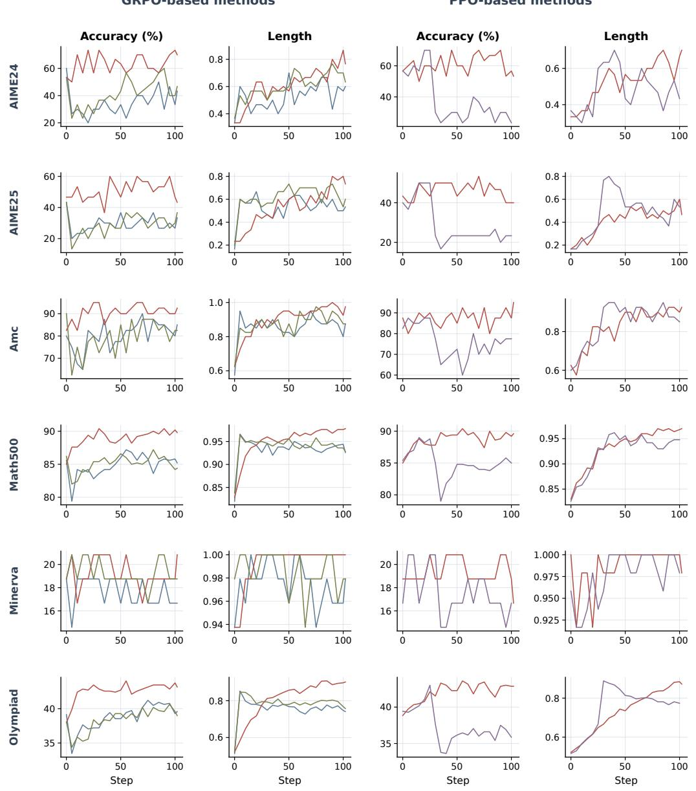  
Figure 8: Per-dataset evaluation dynamics on mathematical reasoning. We report accuracy and length compliance throughout training for each benchmark under GRPO- and PPO-based optimization.

## B.4 ADDITIONAL PASS@K EVALUATION FOR MATH

Table 6 provides a complementary Pass@k evaluation on the mathematical reasoning benchmarks. For each problem, we sample n independent responses and define

$$
\mathrm { P a s s } @ k = \frac { 1 } { N } \sum _ { i = 1 } ^ { N } \mathbb { I } \left[ \operatorname* { m a x } _ { j \in \{ 1 , \dots , k \} } r _ { i , j } = 1 \right] ,
$$

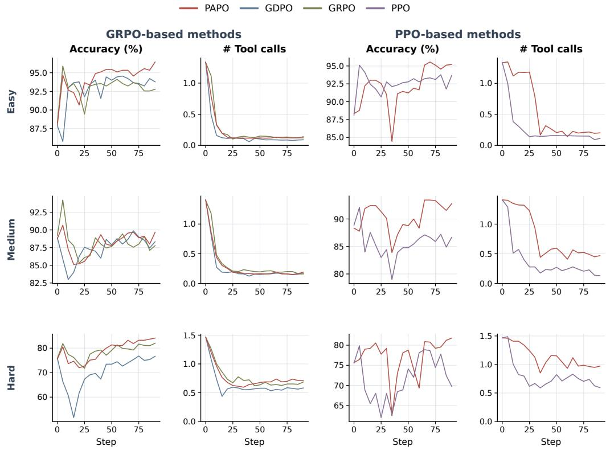  
Figure 9: Per-difficulty evaluation dynamics on agentic tool use. We report accuracy and the number of tool calls for easy, medium, and hard instances under GRPO- and PPO-based optimization.

where $r _ { i , j } ~ \in ~ \{ 0 , 1 \}$ indicates whether the j-th sampled response for problem i is correct. Thus, Pass@k measures the fraction of problems for which at least one of the first k sampled responses is correct. Unlike the main results in Table 1, which use greedy decoding without sampling to gain stable evaluation results, Pass@k requires multiple candidate responses for each prompt and therefore uses stochastic decoding. Consequently, the absolute values in this table are not directly comparable to those in the main evaluation. We use greedy decoding for the main results because it evaluates the learned policy through a deterministic single-response output, avoids additional variance from sampling, and provides a cleaner comparison across optimization methods. Pass@k instead serves as a complementary evaluation of the model’s ability to produce a correct solution across multiple sampled generations.

Importantly, PAPO remains consistently competitive under this different decoding protocol. On the per-dataset average, the two PAPO variants occupy the top two positions for every Pass@k metric: PAPO-GRPO achieves the highest Pass@1 and Pass@2, while PAPO-PPO achieves the highest Pass@3–5. Specifically, PAPO-PPO improves average Pass@1 from 50.08 to 59.08 over PPO and reaches 67.90 at Pass@5, while PAPO-GRPO improves Pass@1 from 52.49 to 59.97 over GRPO and reaches 67.63 at Pass@5. Meanwhile, both variants maintain strong length-budget compliance, reaching 83.42% for PAPO-PPO and 89.86% for PAPO-GRPO. These results indicate that PAPO’s improvements are not specific to deterministic greedy decoding: its advantage persists under stochastic sampling, improving the probability of obtaining correct solutions while retaining favorable length efficiency.

## C TRAINING AND IMPLEMENTATION DETAILS

We provide the training configurations used in our mathematical reasoning and agentic tool-use experiments. Within each optimization family, all methods use the same data, rollout configuration,

Table 6: Pass@k and length-compliance results on mathematical reasoning benchmarks. We report Pass@k (%) for $k \in \left\{ 1 , 2 , 3 , \bar { 4 } , 5 \right\}$ and the percentage of responses within the 8K-token length budget (Len. ≤8K). The best result for each metric is shown in bold, and the second-best result is underlined.
<table><tr><td>Dataset</td><td>Method</td><td>Pass@1</td><td>Pass@2</td><td>Pass@3</td><td>Pass@4</td><td>Pass@5</td><td>Len. ≤8K</td></tr><tr><td rowspan="6">AIME24</td><td>Base</td><td>50.67</td><td>60.00</td><td>63.00</td><td>63.33</td><td>63.33</td><td>30.00</td></tr><tr><td>PPO</td><td>41.33</td><td>48.67</td><td>53.67</td><td>57.33</td><td>60.00</td><td>84.67</td></tr><tr><td>GRPO</td><td>44.67</td><td>55.00</td><td>59.67</td><td>63.33</td><td>66.67</td><td>90.67</td></tr><tr><td>GDPO</td><td>46.00</td><td>53.00</td><td>57.33</td><td>60.67</td><td>63.33</td><td>96.00</td></tr><tr><td>PAPO-PPO (Ours)</td><td>63.33</td><td>73.33</td><td>76.00</td><td>76.67</td><td>76.67</td><td>68.00</td></tr><tr><td>PAPO-GRPO (Ours)</td><td>63.33</td><td>73.00</td><td>77.00</td><td>79.33</td><td>80.00</td><td>77.33</td></tr><tr><td rowspan="6">AIME25</td><td>Base</td><td>42.00</td><td>49.67</td><td>52.33</td><td>53.33</td><td>53.33</td><td>17.33</td></tr><tr><td>PPO</td><td>32.67</td><td>42.00</td><td>48.00</td><td>52.67</td><td>56.67</td><td>92.67</td></tr><tr><td>GRPO</td><td>35.33</td><td>44.67</td><td>50.33</td><td>54.00</td><td>56.67</td><td>94.00</td></tr><tr><td>GDPO</td><td>30.67</td><td>39.00</td><td>44.00</td><td>47.33</td><td>50.00</td><td>94.00</td></tr><tr><td>PAPO-PPO (Ours)</td><td>48.00</td><td>57.33</td><td>63.33</td><td>67.33</td><td>70.00</td><td>56.67</td></tr><tr><td>PAPO-GRPO (Ours)</td><td>52.67</td><td>60.67</td><td>65.33</td><td>68.00</td><td>70.00</td><td>76.67</td></tr><tr><td rowspan="6">AMC</td><td>Base</td><td>85.00</td><td>90.25</td><td>92.75</td><td>94.00</td><td>95.00</td><td>62.00</td></tr><tr><td>PPO</td><td>83.00</td><td>91.75</td><td>94.25</td><td>95.00</td><td>95.00</td><td>96.50</td></tr><tr><td>GRPO</td><td>85.00</td><td>91.50</td><td>93.50</td><td>94.50</td><td>95.00</td><td>99.50</td></tr><tr><td>GDPO</td><td>87.50</td><td>90.50</td><td>91.50</td><td>92.00</td><td>92.50</td><td>98.50</td></tr><tr><td>PAPO-PPO (Ours)</td><td>91.50</td><td>95.00</td><td>96.25</td><td>97.00</td><td>97.50</td><td>91.00</td></tr><tr><td>PAPO-GRPO (Ours)</td><td>91.50</td><td>94.50</td><td>95.00</td><td>95.00</td><td>95.00</td><td>95.50</td></tr><tr><td rowspan="6">MATH-500</td><td>Base</td><td>87.32</td><td>89.70</td><td>90.72</td><td>91.36</td><td>91.80</td><td>83.80</td></tr><tr><td>PPO</td><td>87.32</td><td>90.92</td><td>92.00</td><td>92.48</td><td>92.80</td><td>99.00</td></tr><tr><td>GRPO</td><td>88.16</td><td>91.40</td><td>92.46</td><td>93.00</td><td>93.40</td><td>99.28</td></tr><tr><td>GDPO</td><td>88.20</td><td>91.12</td><td>92.16</td><td>92.68</td><td>93.00</td><td>99.60</td></tr><tr><td>PAPO-PPO (Ours)</td><td>89.68</td><td>91.34</td><td>91.84</td><td>92.16</td><td>92.40</td><td>97.16</td></tr><tr><td>PAPO-GRPO (Ours)</td><td>89.48</td><td>90.86</td><td>91.50</td><td>91.92</td><td>92.20</td><td>97.56</td></tr><tr><td rowspan="6">Minerva</td><td>Base</td><td>18.75</td><td>20.00</td><td>20.62</td><td>20.83</td><td>20.83</td><td>94.17</td></tr><tr><td>PPO</td><td>16.25</td><td>17.92</td><td>18.54</td><td>18.75</td><td>18.75</td><td>100.00</td></tr><tr><td>GRPO</td><td>19.17</td><td>19.58</td><td>20.00</td><td>20.42</td><td>20.83</td><td>100.00</td></tr><tr><td>GDPO</td><td>18.33</td><td>20.21</td><td>20.62</td><td>20.83</td><td>20.83</td><td>100.00</td></tr><tr><td>PAPO-PPO (Ours)</td><td>18.75</td><td>20.21</td><td>21.25</td><td>22.08</td><td>22.92</td><td>100.00</td></tr><tr><td>PAPO-GRPO (Ours)</td><td>18.75</td><td>19.58</td><td>20.00</td><td>20.42</td><td>20.83</td><td>100.00</td></tr><tr><td rowspan="7">Olympiad</td><td>Base</td><td>39.82</td><td>41.89</td><td>42.95</td><td>43.66</td><td>44.20</td><td>52.38</td></tr><tr><td>PPO</td><td>39.88</td><td>43.79</td><td>45.39</td><td>46.34</td><td>47.02</td><td>97.71</td></tr><tr><td>GRPO</td><td>42.59</td><td>45.39</td><td>46.50</td><td>47.14</td><td>47.62</td><td>97.71</td></tr><tr><td>GDPO</td><td>43.01</td><td>45.49</td><td>46.50</td><td>47.14</td><td>47.62</td><td>98.04</td></tr><tr><td>PAPO-PPO (Ours)</td><td>43.21</td><td>45.86</td><td>46.93</td><td>47.53</td><td>47.92</td><td>87.68</td></tr><tr><td>PAPO-GRPO (Ours)</td><td>44.08</td><td>45.91</td><td>46.74</td><td>47.29</td><td>47.77</td><td>92.08</td></tr><tr><td></td><td></td><td></td><td></td><td></td><td></td><td></td></tr><tr><td rowspan="6">Avg.</td><td>Base PPO</td><td>53.93</td><td>58.58</td><td>60.40</td><td>61.09 60.43</td><td>61.42 61.71</td><td>56.61 95.09</td></tr><tr><td>GRPO</td><td>50.08 52.49</td><td>55.84 57.92</td><td>58.64 60.41</td><td>62.07</td><td>63.36</td><td>96.86</td></tr><tr><td>GDPO</td><td></td><td></td><td></td><td></td><td>61.21</td><td>97.69</td></tr><tr><td></td><td>52.28</td><td>56.55</td><td>58.69</td><td>60.11</td><td></td><td></td></tr><tr><td>PAPO-PPO (Ours)</td><td>59.08</td><td>63.85</td><td>65.93</td><td>67.13</td><td>67.90</td><td>83.42</td></tr><tr><td>PAPO-GRPO (Ours)</td><td>59.97</td><td>64.09</td><td>65.93</td><td>66.99</td><td>67.63</td><td>89.86</td></tr></table>

training budget, and optimization hyperparameters unless otherwise specified. PAPO only changes how the objective-specific advantages are aggregated and, for PPO, the corresponding critic parameterization. All experiments are conducted on a single node with 8 GPUs.

## C.1 MATHEMATICAL REASONING

GRPO-based methods. For the GRPO-based mathematical reasoning experiments (GRPO, GDPO, and PAPO-GRPO), we train on DAPO-17K and evaluate on the mathematical reasoning benchmarks described in the main paper. The maximum prompt and response lengths are 1,024 and 12,000 tokens, respectively. The length-reward threshold is fixed to 8,000 response tokens. For each prompt, we sample $G = 4$ responses. We use a global training batch size of 512, a policy mini-batch size of 64, and a micro-batch size of 8 per GPU. The actor learning rate is $1 \times \mathrm { 1 0 ^ { - 5 } }$ and all models are trained for 3 epochs. We use asymmetric PPO clipping with lower and upper clipping coefficients of 0.20 and 0.28, respectively. The policy objective includes an MSE-style KL regularization term with coefficient $5 \times 1 0 ^ { - 4 }$ , while KL is not incorporated into the environmental reward. For standard GRPO, the scalar training reward is the sum of correctness and length rewards with equal weights; For GDPO, we follow the implementations in Liu et al. (2026a) to make correctness and length retained as separate reward dimensions, independently normalized within each rollout group. For PAPO-GRPO, correctness is treated as the primary objective and length as the auxiliary objective. Unless otherwise specified, we use an auxiliary coefficient $\alpha = 1 . 0$ . Rollout groups without effective reward variation are filtered during GRPO-based training. Other detailed hyperparameters are listed in Table 7.

PPO-based methods. The PPO and PAPO-PPO experiments use the same training data, sequencelength limits, batch sizes, learning rate, clipping range, KL regularization, and 3-epoch training budget as the GRPO-based experiments. The main difference is that PPO uses one rollout per prompt $( G = 1 )$ and introduces a learned critic. The critic learning rate is $1 \times 1 0 ^ { - 5 }$ with no critic warmup. PPO uses a single value head trained on the scalar return associated with $R = R _ { \mathrm { a c c } } + R _ { \mathrm { l e n } }$ PAPO-PPO instead uses the dual-head critic introduced in Section 5: one value head estimates the correctness return, and the other estimates the length return. The two critic losses are equally weighted, which only determines the relative contribution of the two value-function losses and is independent of the auxiliary-advantage coefficient used by the actor. We use $\alpha = 1 . 0$ for PAPO-PPO unless otherwise specified. Other detailed hyperparameters are listed in Table 7.

Table 7: Training hyperparameters for mathematical reasoning experiments. Settings shared across methods are held fixed within each optimization family.
<table><tr><td>Hyperparameter</td><td>GRPO-based</td><td>PPO-based</td></tr><tr><td>Training batch size</td><td>512</td><td>512</td></tr><tr><td>Policy mini-batch size</td><td>64</td><td>64</td></tr><tr><td>Micro-batch / GPU</td><td>8</td><td>8</td></tr><tr><td>Rollouts / prompt</td><td>4</td><td>1</td></tr><tr><td>Maximum prompt length</td><td>1,024</td><td>1,024</td></tr><tr><td>Maximum response length</td><td>12,000</td><td>12,000</td></tr><tr><td>Length-reward threshold</td><td>8,000</td><td>8,000</td></tr><tr><td>Actor learning rate</td><td> $1 \times 1 0 ^ { - 5 }$ </td><td> $1 \times 1 0 ^ { - 5 }$ </td></tr><tr><td>Critic learning rate</td><td>一</td><td> $1 \times 1 0 ^ { - 5 }$ </td></tr><tr><td>Training epochs</td><td>3</td><td>3</td></tr><tr><td>PPO clipping range</td><td> $[ 0 . 2 0 , 0 . 2 8 ]$ </td><td> $[ 0 . 2 0 , 0 . 2 8 ]$ </td></tr><tr><td>Actor KL coefficient</td><td> $5 \times 1 0 ^ { - 4 }$ </td><td> $5 \times 1 0 ^ { - 4 }$ </td></tr><tr><td>KL type</td><td>MSE</td><td>MSE</td></tr><tr><td>PAPO auxiliary coefficient α</td><td>1.0</td><td>1.0</td></tr></table>

## C.2 AGENTIC TOOL USE

GRPO-based methods. For the When2Tool experiments, the training and evaluation splits contain 1,080 and 2,700 instances, respectively, combining both single-hop and multi-hop tasks. The maximum prompt length is 4,096 tokens and the maximum generated response length is 2,048 to kens. We sample $G = 8$ trajectories per prompt as group rollouts. We use a global training batch size of 256, a policy mini-batch size of 32, and a micro-batch size of 8 per GPU. The actor learning rate is $1 \times 1 0 ^ { - 5 }$ , and models are trained for 20 epochs. We do not apply either reward-level KL penalties or actor-level KL regularization in the GRPO-based tool-use experiments. During training, the agent is allowed at most 5 assistant turns and 4 user/environment turns, with a maximum tool-response length of 2,048 tokens. We allow at most one parallel tool call and disable explicit thinking mode during rollout. As described in Section 6.2, answer correctness is the primary reward and tool-use efficiency is the auxiliary reward. Standard GRPO optimizes the scalar reward $R = R _ { \mathrm { p r i } } + R _ { \mathrm { a u x } } .$ GDPO retains the two reward dimensions separately and combines their normalized advantages with equal weights. For PAPO-GRPO, we use correctness as the primary objective and tool efficiency as the auxiliary objective with α = 1. The tool-budget offset in the efficiency reward is fixed to $\delta = 1$ Other detailed hyperparameters are listed in Table 8.

PPO-based methods. PPO-based tool-use experiments use the same dataset, batch configuration, sequence lengths, multi-turn interaction limits, and 20-epoch training budget as the GRPO-based experiments. PPO samples one trajectory per prompt and uses an actor and learned critic with learning rates of $1 \times 1 0 ^ { - 5 }$ for both. We use asymmetric PPO clipping with lower and upper coefficients of 0.20 and 0.28, respectively. Standard PPO optimizes the scalar combination $R = R _ { \mathrm { p r i } } + R _ { \mathrm { a u x } } ,$ whereas PAPO-PPO maintains the two reward dimensions separately and applies PAPO to their corresponding advantages. PAPO-PPO uses the dual-head critic, with one value head for answer correctness and one for tool efficiency. We set the auxiliary coefficient to $\alpha = 0 . 3$ for PAPO-PPO. As in the GRPO-based setting, the tool-budget offset is $\delta = 1$ . Other detailed hyperparameters are listed in Table 8.

Table 8: Training hyperparameters for the When2Tool experiments.
<table><tr><td>Hyperparameter</td><td>GRPO-based</td><td>PPO-based</td></tr><tr><td>Training batch size</td><td>256</td><td>256</td></tr><tr><td>Policy mini-batch size</td><td>32</td><td>32</td></tr><tr><td>Micro-batch / GPU</td><td>8</td><td>8</td></tr><tr><td>Rollouts / prompt</td><td>8</td><td>1</td></tr><tr><td>Maximum prompt length</td><td>4,096</td><td>4,096</td></tr><tr><td>Maximum response length</td><td>2,048</td><td>2,048</td></tr><tr><td>Maximum assistant turns</td><td>5</td><td>5</td></tr><tr><td>Maximum environment turns</td><td>4</td><td>4</td></tr><tr><td>Maximum tool-response length</td><td>2,048</td><td>2,048</td></tr><tr><td>Maximum parallel tool calls</td><td>1</td><td>1</td></tr><tr><td>Actor learning rate</td><td> $1 \times 1 0 ^ { - 5 }$ </td><td> $1 \times 1 0 ^ { - 5 }$ </td></tr><tr><td>Critic learning rate</td><td></td><td> $1 \times 1 0 ^ { - 5 }$ </td></tr><tr><td>Training epochs</td><td>20</td><td>20</td></tr><tr><td>PPO clipping range</td><td></td><td>[0.20, 0.28]</td></tr><tr><td>KL regularization</td><td>None</td><td>None</td></tr><tr><td>Tool-budget offset δ</td><td>1.0</td><td>1.0</td></tr><tr><td>PAPO auxiliary coefficient α</td><td>1</td><td>0.3</td></tr></table>

## C.3 SAFETY ALIGNMENT

We evaluate PAPO in multimodal safety alignment following the experimental setup of Safe RLHF-V (Ji et al., 2025). We use BeaverTails-V as the preference dataset and retain its decoupled preference modeling setup, where a reward model (RM-V) provides the helpfulness signal and a cost model (CM-V) provides the safety signal. Following the original implementation, the preference models are initialized from LLaVA-1.5-7B, and we use PPO with GAE for policy optimization. We also retain the reference-policy KL regularization and the PTX objective based on Align-Anything-TI2T-Instruction-100K, so that the comparison isolates the effect of multi-objective advantage aggregation. To instantiate PAPO, we treat safety as the primary objective and helpfulness as the auxiliary objective. Since the original CM-V assigns a cost to unsafe behavior, we convert it into a maximization-oriented safety signal by negating the cost. Specifically, for each token t, we independently compute the safety and helpfulness advantages using GAE, denoted by $A _ { t , \mathrm { p r i } }$ and $A _ { t , \mathrm { a u x } } .$

respectively. These two advantages are estimated with separate value heads and normalized inde pendently before aggregation. We then apply PAPO token-wise by Eq. 5 The fused advantages are subsequently normalized following the same PPO pipeline used in our main experiments and are used in the clipped actor objective. All remaining RL regularization components are kept unchanged to enable a controlled comparison. Unless otherwise specified, we follow the original Safe RLHF-V training setup and official implementation for all remaining optimization hyperparameters, including the PPO configuration, KL regularization, PTX objective, batch configuration, and training schedule. Thus, the primary modification is the replacement of the original Lagrangian reward–cost combination with PAPO’s priority-aware advantage aggregation.

## C.4 DATASET DETAILS AND STATISTICS

We provide additional details on the training and evaluation datasets used throughout our experiments. Beyond reporting dataset sizes, we summarize the task composition, difficulty structure, and evaluation scope of each domain. The three settings differ substantially in both modality and objective semantics: mathematical reasoning evaluates correctness under a generation budget, agentic tool use evaluates task success under interaction cost, and multimodal safety alignment evaluates safety jointly with helpfulness.

Competition-level Mathematical Reasoning. We use DAPO-Math-17K (Yu et al., 2026) as the training set for the mathematical reasoning experiments. DAPO-Math-17K contains approximately 17K competition-style mathematical problems paired with verifiable reference answers and was originally constructed for reinforcement-learning post-training. The problems span common competition-mathematics domains such as algebra, geometry, number theory, and combinatorics. Its deterministic answer format makes it suitable for outcome-based RL, as correctness can be evaluated without an external judge model. We evaluate on six held-out benchmarks that cover substantially different difficulty regimes and sources. AIME 2024 and AIME 2025 contain 30 problems each from the corresponding American Invitational Mathematics Examinations and primarily test difficult high-school competition mathematics. AMC23 contains 40 problems from the 2023 American Mathematics Competitions and represents a relatively easier competition-level regime. MATH-500 is a curated 500-problem subset of MATH (Hendrycks et al., 2021), spanning algebra, geometry, number theory, counting and probability, intermediate algebra, and precalculus. Minerva Math (Lewkowycz et al., 2022) contains 272 quantitative problems drawn primarily from universitylevel STEM material, including subjects such as differential equations, physics, astronomy, and chemistry. Finally, we use the OE TO maths en COMP subset of OlympiadBench (He et al., 2024), containing 674 English, text-only, open-ended competition problems drawn from Olympiad-level mathematics. Table 9 summarizes the resulting training and evaluation suite. All six evaluation sets are used only for evaluation and do not contribute to training.

Agentic Tool Use. We use WHEN2TOOL (Sun et al., 2026) to study multi-reward optimization when the auxiliary objective directly controls interaction cost. Unlike conventional tool-use benchmarks in which every example is constructed to require a tool, WHEN2TOOL explicitly varies whether external tool use is necessary. It contains 18 environments: 15 single-hop environments and three multi-hop environments. The benchmark organizes tool necessity around three forms of model self-assessment: computational scale, which asks whether the model can reliably perform the required computation internally; knowledge boundaries, which asks whether the required information is available in the model’s parametric knowledge; and execution reliability, which asks whether the model can accurately execute a procedural operation without external assistance. Each category contains five single-hop environments. Computational-scale tasks include arithmetic, statistics, combinatorial counting, matrix operations, and primality testing. Knowledge-boundary tasks cover retrieval, historical facts, game rules, hashing, and decoding. Execution-reliability tasks require manipulating lists, performing date calculations, executing code, resolving schedules, or matching regular expressions. In addition, one three-hop environment is constructed for each category by chaining calculator, retriever, or code-execution operations. Importantly, the easy, medium, and hard splits are not merely generic notions of problem difficulty. They are designed to move the problem across a tool-necessity boundary. Easy examples are often directly solvable by the language model, medium examples lie near the boundary where tool use becomes beneficial, and hard examples deliberately increase computational scale, introduce unavailable information, or require sufficiently complex execution that tool use becomes substantially more important.

Table 9: Datasets used for mathematical reasoning. DAPO-Math-17K is used for policy optimization, while the remaining datasets are held out for evaluation. The evaluation suite spans standard competition mathematics, Olympiad-level problems, and university-level quantitative reasoning.
<table><tr><td>Dataset</td><td># Examples</td><td>Role</td><td>Scope</td></tr><tr><td>DAPO-Math-17K</td><td>~17K</td><td>Train</td><td>Competition-style mathematics with verifiable reference answers; covers algebra, geometry, number theory, com- binatorics, and related topics.</td></tr><tr><td>AMC23</td><td>40</td><td>Test</td><td>2023 AMC competition problems; comparatively short high-school competition mathematics across algebra, ge- ometry, number theory, and combinatorics.</td></tr><tr><td>AIME 2024</td><td>30</td><td>Test</td><td>AIME I and II 2024; difficult competition problems with integer final answers.</td></tr><tr><td>AIME 2025</td><td>30</td><td>Test</td><td>AIME I and II 2025; difficult competition problems with integer final answers.</td></tr><tr><td>MATH-500</td><td>500</td><td>Test</td><td>Curated subset of MATH covering algebra, geometry, number theory, counting/probability, intermediate alge- bra, and precalculus.</td></tr><tr><td>Minerva Math</td><td>272</td><td>Test</td><td>University-level quantitative reasoning from STEM sub- jects, including mathematics, physics, astronomy, and</td></tr><tr><td>OlympiadBench</td><td>674</td><td>Test</td><td>chemistry. English text-only open-ended competition mathematics (OE_TO_maths_en_COMP), emphasizing Olympiad-level reasoning.</td></tr></table>

Table 10 provides the full environment taxonomy and illustrates how difficulty changes within each environment. This controlled construction is particularly useful for our setting because minimizing tool calls is not uniformly desirable. On easy instances, avoiding a redundant call can improve efficiency without affecting correctness, whereas on hard instances an additional call may be essential for successful task completion.

Multimodal Safety Alignment. For multimodal safety alignment, we follow the setting of SafeRLHF-V (Ji et al., 2025) and use BeaverTails-V for alignment. BeaverTails-V extends preference-based safety supervision to vision-language models and contains paired multimodal prompts and responses with separate annotations for safety and helpfulness. Each record contains a textual question, an associated image, an image-severity annotation, two candidate model responses, the identity of the more helpful response, binary safety labels for both responses, the safer-response preference, and fine-grained harmlessness and helpfulness scores. The released data are divided into 20 fine-grained safety categories organized under nine broader safety domains, summarized in Table 11. The released BeaverTails-V data contain approximately 30K preference examples for training, while the evaluation portion contains roughly 30 examples per fine-grained category (approximately 590 in total, with small category-level variation). Candidate responses were generated using multiple vision-language models, yielding response pairs that can differ along both safety and helpfulness dimensions. The dataset therefore naturally exposes the non-equivalence of the two objectives: a response can become safer through over-refusal while simultaneously becoming less useful, motivating our choice of safety as the primary objective and helpfulness as the auxiliary objective. For out-of-distribution safety evaluation, we additionally use MM-SafetyBench (Liu et al., 2024b). MM-SafetyBench contains 5,040 text–image pairs across 13 safety-critical scenarios. In contrast to BeaverTails-V, which provides preference supervision for alignment, MM-SafetyBench is explicitly designed to evaluate whether multimodal models remain safe when potentially harmful intent is conveyed through the interaction between text and images. Its scenarios span illegal activity, hate speech, malware generation, physical harm, economic harm, fraud, sexual content, political lobbying, privacy violations, legal advice, financial advice, health consultation, and government decision-making. The benchmark further includes several image construction strategies, including generated images, typography-based images, and combined variants, to test whether harmful instructions can bypass text-only safety mechanisms.

Table 10: Environment composition of WHEN2TOOL. Each single-hop environment contains easy, medium, and hard instances. The last column summarizes how each environment moves from tasks that are often solvable internally to tasks for which tool assistance becomes increasingly useful or necessary. The three multi-hop environments contain three dependent operations.
<table><tr><td>Category</td><td>Environment</td><td>Capability</td><td>Easy → Hard progression</td></tr><tr><td>Computational</td><td>Calculator</td><td>Arithmetic evaluation</td><td>Small integer arithmetic → large multi-operation or trillion-scale expressions.</td></tr><tr><td>Scale</td><td>Statistics</td><td>Statistical computation</td><td>Mean/median of short lists → variance, standard deviation, or correlation over longer lists.</td></tr><tr><td></td><td>Counting</td><td>Combinatorial counting</td><td>Small combinations such as  $\binom { 6 } { 4 }$  → large combinatorial  $\textstyle { \binom { 8 0 } { 4 0 } }$ </td></tr><tr><td></td><td>Matrix</td><td>Matrix computation</td><td>quantities such as Small 2 × 2 operations → larger-matrix determinants and other matrix operations.</td></tr><tr><td></td><td>Prime</td><td>Primality testing</td><td>Small familiar integers → large integers whose primality is difficult to determine reliably without computation.</td></tr><tr><td>Knowledge</td><td>Retriever</td><td>Information retrieval</td><td>Common factual knowledge → obscure or synthetic entities requiring retrieval from the provided corpus.</td></tr><tr><td>Boundaries</td><td>Historical Year</td><td>Historical fact lookup</td><td>Well-known event dates → obscure or synthetic event years unavailable from parametric knowledge.</td></tr><tr><td></td><td>Game Rule</td><td>Rule/statistic lookup</td><td>Familiar game rules → rules or statistics of unfamiliar or synthetic games.</td></tr><tr><td></td><td>Hash</td><td>String hashing</td><td>Familiar hash functions such as MD5 → custom or previously unseen hashing procedures.</td></tr><tr><td></td><td>Decoding</td><td>String decoding</td><td>Familiar encodings such as Morse code → custom ciphers defined externally.</td></tr><tr><td>Execution</td><td>List Manipulation</td><td>Sequential operations</td><td>A few operations on short lists → longer or nested list transformations.</td></tr><tr><td>Reliability</td><td>DateTime</td><td>Date computation</td><td>Simple calendar operations → date arithmetic across months, years, and leap years.</td></tr><tr><td></td><td>Code Executor</td><td>Program execution</td><td>Simple expressions → loops, recursion, or dynamic-programming programs requiring extended execution.</td></tr><tr><td></td><td>Schedule</td><td>Constraint scheduling</td><td>Simple overlap checks → finding feasible intervals among multiple interacting events.</td></tr><tr><td></td><td>Regex Match</td><td>Regex execution</td><td>Simple patterns on short strings → complex regular expressions over longer inputs.</td></tr><tr><td>Multi-hop</td><td>Chained Calculator</td><td>Dependent computation</td><td>Three-step arithmetic chains with progressively larger and</td></tr><tr><td></td><td>Chained Retriever</td><td>Dependent retrieval</td><td>more complex intermediate values. Multi-step retrieval where one retrieved fact determines the</td></tr><tr><td></td><td>Chained Code Ex- Dependent execution ecutor</td><td></td><td>next query. Three sequential programs in which each output becomes the input to the next computation.</td></tr></table>

Table 11: Safety taxonomy of BeaverTails-V. The dataset contains 20 fine-grained categories grouped into nine broader safety domains, providing diverse supervision for multimodal safety alignment.
<table><tr><td>Safety domain</td><td>Fine-grained categories</td></tr><tr><td>National and public security</td><td>Terrorism or extremism; hacking or digital crime.</td></tr><tr><td>Health and safety risks</td><td>Harmful health content; environmental damage; dangerous behavior.</td></tr><tr><td>Physical and psychological harm</td><td>Violence and physical harm; psychological harm and manipulation; animal abuse.</td></tr><tr><td>Privacy and consent violations</td><td>Privacy invasion and surveillance; identity misuse and impersonation.</td></tr><tr><td>Discrimination and harassment</td><td>Discriminatory depictions; insulting and harassing behavior.</td></tr><tr><td>Deceptive and unethical behavior</td><td>Deception in personal relationships; financial and academic fraud.</td></tr><tr><td>False and sensitive information</td><td>False information; sensitive information in key areas.</td></tr><tr><td>Disturbing content</td><td>Horror and gore; psychological horror and dark themes.</td></tr><tr><td>Sexually explicit or inappropriate content</td><td>Pornographic content; sexual crimes.</td></tr></table>

## D TRAINING AND REWARD COMPUTATION EXAMPLES

We provide representative examples illustrating the actual training interface and reward computation for mathematical reasoning and agentic tool use. The problem inputs and ground-truth answers are

Table 12: Datasets used for multimodal safety alignment and evaluation. BeaverTails-V provides safety–helpfulness preference supervision, while MM-SafetyBench provides an independent multimodal safety evaluation.
<table><tr><td>Dataset</td><td># Examples</td><td>Role</td><td>Content / Annotation</td></tr><tr><td>BeaverTails-V</td><td>~30K</td><td>Train</td><td>Multimodal preference pairs across 20 safety categories; in- cludes separate safety and helpfulness preferences, binary safety labels, image-severity levels, and graded response scores.</td></tr><tr><td>BeaverTails-V</td><td>~590</td><td>Test</td><td>Held-out examples distributed across the same 20 fine-grained categories, generally 28–30 examples per category.</td></tr><tr><td>MM-SafetyBench</td><td>5,040</td><td>Test</td><td>Text-image safety benchmark covering 13 safety-critical sce- narios and multiple image-based attack constructions.</td></tr></table>

taken from the corresponding training datasets. The assistant responses below are valid examples constructed according to the actual training format.

## D.1 MATHEMATICAL REASONING EXAMPLE

We first consider a mathematical reasoning example whose ground-truth answer is 34.

Input.

System

You are a helpful math assistant. Solve the problem step by step. Put only the final answer in \boxed{} at the end of your response. Do not use an “Answer:” line; the final answer must be extractable from \boxed{}.

User

In triangle $A B C ,$ sin $\angle A = { \frac { 4 } { 5 } }$ and $\angle A < 9 0 ^ { \circ }$ . Let D be a point outside triangle $A B C$ such that $\angle B A D = \angle D A C$ and $\angle B D C = 9 0 ^ { \circ }$ . Suppose that $A D = 1$ and that $\begin{array} { r } { \frac { B D } { C D } = \frac { 3 } { 2 } } \end{array}$ . If $A B + A C$ can be expressed in the form $\frac { a { \sqrt { b } } } { c }$ where $a , b ,$ c are pairwise relatively prime integers, find $a + b + c .$

The reference answer is

$$
y ^ { * } = 3 4 .
$$

Example response.

Assistant

Since sin $\textstyle A = { \frac { 4 } { 5 } }$ and $A < 9 0 ^ { \circ }$ , we have

$$
\cos A = { \frac { 3 } { 5 } } .
$$

Because AD bisects $\angle A ,$ let

$$
\theta = { \frac { A } { 2 } } .
$$

Then

$$
\cos \theta = { \sqrt { \frac { 1 + \cos A } { 2 } } } = { \sqrt { \frac { 1 + { \frac { 3 } { 5 } } } { 2 } } } = { \frac { 2 } { \sqrt { 5 } } } , \qquad \sin \theta = { \frac { 1 } { \sqrt { 5 } } } .
$$

Place

$$
A = ( 0 , 0 ) , \qquad D = ( 1 , 0 ) ,
$$

with $A D$ on the x-axis, and write

$$
A B = m , \qquad A C = n .
$$

Then

$$
B = \left( { \frac { 2 m } { \sqrt { 5 } } } , { \frac { m } { \sqrt { 5 } } } \right) , \qquad C = \left( { \frac { 2 n } { \sqrt { 5 } } } , - { \frac { n } { \sqrt { 5 } } } \right) .
$$

Since $\angle B D C = 9 0 ^ { \circ }$ ,

$$
\begin{array} { r } { \left( B - D \right) \cdot \left( C - D \right) = 0 , } \end{array}
$$

and hence

$$
\left( { \frac { 2 m } { \sqrt { 5 } } } - 1 \right) \left( { \frac { 2 n } { \sqrt { 5 } } } - 1 \right) - { \frac { m n } { 5 } } = 0 .
$$

This simplifies to

$$
\frac { 3 } { 5 } m n - \frac { 2 } { \sqrt { 5 } } ( m + n ) + 1 = 0 .
$$

Furthermore,

$$
B D ^ { 2 } = m ^ { 2 } - \frac { 4 m } { \sqrt { 5 } } + 1 , \qquad C D ^ { 2 } = n ^ { 2 } - \frac { 4 n } { \sqrt { 5 } } + 1 .
$$

Since

$$
{ \frac { B D } { C D } } = { \frac { 3 } { 2 } } ,
$$

we obtain

$$
4 \left( m ^ { 2 } - \frac { 4 m } { \sqrt { 5 } } + 1 \right) = 9 \left( n ^ { 2 } - \frac { 4 n } { \sqrt { 5 } } + 1 \right) .
$$

Solving the two equations gives

$$
( m , n ) = \left( { \frac { \sqrt { 5 } } { 6 } } , { \frac { 4 { \sqrt { 5 } } } { 9 } } \right)
$$

or

$$
( m , n ) = \left( { \frac { 7 { \sqrt { 5 } } } { 6 } } , { \frac { 8 { \sqrt { 5 } } } { 9 } } \right) .
$$

The second configuration places D inside triangle ABC, whereas the problem requires D to lie outside. Therefore,

$$
A B + A C = { \frac { \sqrt { 5 } } { 6 } } + { \frac { 4 { \sqrt { 5 } } } { 9 } } = { \frac { 1 1 { \sqrt { 5 } } } { 1 8 } } .
$$

Thus,

$$
a = 1 1 , \qquad b = 5 , \qquad c = 1 8 ,
$$

and

$$
a + b + c = 3 4 .
$$

$$
\boxed { 3 4 }
$$

Reward computation. The last valid boxed answer is $\square \square \square .$ , which matches the ground truth. The response is also shorter than the 8,000-token length threshold. Therefore,

$$
R _ { \mathrm { a c c } } = 1 , \qquad R _ { \mathrm { l e n } } = 1 .
$$

## D.2 AGENTIC TOOL-USE EXAMPLES

We provide two multi-step tool-use examples that illustrate different forms of agentic dependency. The first requires iterative code execution, where later programs must be instantiated from earlier execution results. The second requires multi-hop retrieval, where later search queries depend on entities obtained in previous retrieval steps.

## D.2.1 THREE-STEP CODE EXECUTION EXAMPLE

We first consider a hard multi-step code-execution task. The expected intermediate results are

$$
x = 9 8 7 , \qquad y = 5 4 9 , \qquad z = 9 3 ,
$$

and the final ground-truth answer is

$$
y ^ { * } = 9 3 .
$$

The task-specific tool budget is

$$
B = 3 .
$$

Input.

## System

You can use the provided tools when helpful, but tool use is optional. Call at most one tool at a time and use arguments that match its schema. When you have the answer, end with exactly one final answer in the form \boxed{...}.

## User

Three-step code execution: Step 1: Run the following code. Call the result x.   
memo = {}   
def fib(n):   
if n in memo: return memo[n]   
if n < 2: return n   
memo[n] = fib(n-1) + fib(n-2)   
return memo[n]   
print(fib(16))   
Step 2: Using x, run: compute sum of all proper divisors of x (excluding x itself). Call the result y.   
Step 3: Using y, run: compute min coins for amount=y with coins=[1, 4, 6]. Call the result z.   
Return only z.

The instance exposes a single code-execution tool:

Tool   
{   
"type": "function",   
"function": {   
"name": "run\_code",   
"description":   
"Execute a Python code snippet and return its stdout output.",   
"parameters": {   
"type": "object",   
"properties": {   
"code": {   
"type": "string",   
"description": "Python code to execute."   
}   
},   
"required": ["code"]   
}   
}   
}

Step 1: computing the Fibonacci value. The first program is directly provided by the user, so the agent executes it:

Assistant

<tool\_call>   
{"name":"run\_code",   
"arguments":{   
"code":"memo = {}\ndef fib(n):\n if n in memo: return memo[n]\n if n < 2: return   
n\n memo[n] = fib(n-1) + fib(n-2)\n return memo[n]\nprint(fib(16))"   
}}   
</tool\_call>

The execution environment returns:

```json
Tool
{
"success": true,
"stdout": "987",
"stderr": "",
"exit_code": 0,
"result": "987"
}
```

The agent therefore obtains

x = 987.

Step 2: summing the proper divisors. The second program must be constructed using the execution result from the previous step:

Assistant Assistant

```vue
<tool_call>
{"name":"run_code",
"arguments":{
"code":"x = 987\ns = 0\nfor d in range(1, x):\n if x % d == 0:\n s += d\
nprint(s)"
}}
</tool_call>
```

The tool returns:

Tool

"success": true,   
"stdout": "549",   
"stderr": "",   
"exit\_code": 0,   
"result": "549"

Hence,

For reference,

$$
9 8 7 = 3 \times 7 \times 4 7 ,
$$

whose proper divisors are

1, 3, 7, 21, 47, 141, 329,

and therefore

1 + 3 + 7 + 21 + 47 + 141 + 329 = 549.

Step 3: computing the minimum number of coins. The final program is dynamically instantiated using y = 549:

Assistant

<tool\_call>   
{"name":"run\_code",   
"arguments":{   
"code":"y = 549\ncoins = [1, 4, 6]\ndp = [float(\"inf\")] <sub>\*</sub> (y + 1)\ndp[0] = 0\nfor   
amount in range(1, y + 1):\n for coin in coins:\n if coin <= amount:\n   
dp[amount] = min(dp[amount], dp[amount - coin] + 1)\nprint(dp[y])"   
}}   
</tool\_call>

The execution environment returns:

Tool   
{   
"success": true,   
"stdout": "93",   
"stderr": "",   
"exit\_code": 0,   
"result": "93"   
}

The agent therefore obtains

z = 93.

Since the user requests only the final value, the assistant terminates with:

Assistant

93

Reward computation. The final boxed answer matches the ground truth, so

$$
R _ { \mathrm { p r i } } = 1 .
$$

The trajectory executes three tool calls:

$$
N _ { \mathrm { c a l l } } = 3 .
$$

For this multi-step instance,

$$
B = 3 , \qquad \delta = 1 .
$$

Therefore,

$$
R _ { \mathrm { a u x } } = \operatorname* { m a x } \left( 0 , 1 - { \frac { N _ { \mathrm { c a l l } } } { B + \delta } } \right) = 1 - { \frac { 3 } { 3 + 1 } } = 0 . 2 5 .
$$

The raw reward vector is

$$
( R _ { \mathrm { p r i } } , R _ { \mathrm { a u x } } ) = ( 1 , 0 . 2 5 ) .
$$

This example illustrates a genuinely agentic dependency structure. Although the first program is given directly in the prompt, the second program cannot be instantiated until the first execution produces $x = 9 8 7$ , and the third cannot be instantiated until the second produces $y = 5 4 9$ . The agent must therefore maintain intermediate execution state and dynamically construct later tool arguments from earlier tool observations.

## D.2.2 THREE-HOP RETRIEVAL EXAMPLE

We next consider a three-hop retrieval task from RetrieverEnv. The task requires each subsequent query to be constructed from the result of the previous retrieval step.

The dependency chain is

$$
M o b y - D i c k  \mathrm { H e r m a n ~ M e l v i l l e }  \mathrm { U n i t e d ~ S t a t e s }  \mathrm { W a s h i n g t o n , D . C . } ,
$$

with ground-truth answer

$$
y ^ { * } = \mathrm { W a s h i n g t o n } , \mathrm { D } . \mathrm { C } .
$$

and tool budget

$$
B = 3 .
$$

## Input.

System

You can use the provided tools when helpful, but tool use is optional. Call at most one tool at a time and use arguments that match its schema. When you have the answer, end with exactly one final answer in the form \boxed{...}.

User

Three-step retrieval: Step 1: Who wrote Moby-Dick? Call the answer x. Step 2: In which country was x born? Call the answer y. Step 3: What is the capital of y? Call the answer z. Return only z.

The instance exposes two local retrieval tools, search corpus and read doc.

Tool 1001

{   
"type": "function",   
"function": {   
"name": "search\_corpus",   
"description":   
"Search local corpus and return metadata-only hits

(id/title/score). Use read\_doc to access full text.",   
"parameters": {   
"type": "object",   
"properties": {   
"query": {   
"type": "string",   
"description": "Search query text."   
},   
"top\_k": {   
"type": "integer",   
"description":   
"Maximum number of hits to return."   
}   
},   
"required": ["query"]   
}   
}   
},   
{   
"type": "function",   
"function": {   
"name": "read\_doc",   
"description": "Read a full document by id.",   
"parameters": {   
"type": "object",   
"properties": {   
"doc\_id": {   
"type": "string",   
"description":   
"Document id from search results."   
}   
},   
"required": ["doc\_id"]   
}   
}   
]

## Step 1: identifying the author. The agent first searches for Moby-Dick:

Assistant   
<tool\_call>   
{"name":"search\_corpus",   
"arguments":{"query":"Moby-Dick","top\_k":1}}   
</tool\_call>   
Tool   
{   
"success": true,   
"data": {   
"query": "Moby-Dick",   
"total\_hits": 10,   
"returned": 1,   
"hits": [   
{   
"id": "doc1",   
"title": "Moby-Dick",   
"snippet":   
"Moby-Dick is an 1851 novel by Herman Melville   
about Captain Ahab’s quest to hunt the white whale.",   
"score": 1   
}   
]   
}   
}  
From this result, the agent obtains

x = Herman Melville.

Step 2: identifying the birth country. The second query is generated from the entity obtained in Step 1:

Assistant

<tool\_call>   
{"name":"search\_corpus",   
"arguments":{   
"query":"Herman Melville biography",   
"top\_k":1   
}}   
</tool\_call>

Tool

{   
"success": true,   
"data": {   
"query": "Herman Melville biography",   
"total\_hits": 10,   
"returned": 1,   
"hits": [   
{   
"id": "doc10",   
"title": "Herman Melville biography",   
"snippet":   
"Herman Melville was born in New York City,   
United States, in 1819.",   
"score": 3   
}   
]   
}   
}

The agent therefore obtains

y = United States.

Step 3: identifying the capital. The final query is constructed from the country obtained in Step 2:

Assistant

<tool\_call>   
{"name":"search\_corpus",   
"arguments":{   
"query":"United States capital",   
"top\_k":1   
}}   
</tool\_call>

Tool

"success": true,   
"data": {   
"query": "United States capital",   
"total\_hits": 10,   
"returned": 1,   
"hits": [   
{   
"id": "doc7",   
"title": "United States capital",   
"snippet":   
"The capital of the United States is   
Washington, D.C., established in 1790   
as the seat of the federal government.",   
"score": 3   
}   
]   
}

Thus,

z = Washington, D.C.

Since the user requests only the final entity, the assistant terminates with:

<table><tr><td rowspan="2">Assistant</td><td colspan="2"></td></tr><tr><td></td><td></td></tr><tr><td rowspan="3"></td><td>Washington, D.C.</td><td></td></tr><tr><td></td><td></td></tr><tr><td></td><td></td></tr></table>

Reward computation. The final boxed answer matches the reference answer, so

$$
R _ { \mathrm { p r i } } = 1 .
$$

The trajectory contains three tool calls:

$$
N _ { \mathrm { c a l l } } = 3 .
$$

For this multi-step instance,

$$
B = 3 , \qquad \delta = 1 .
$$

Therefore,

$$
R _ { \mathrm { a u x } } = \operatorname* { m a x } \left( 0 , 1 - { \frac { N _ { \mathrm { c a l l } } } { B + \delta } } \right) = 1 - { \frac { 3 } { 3 + 1 } } = 0 . 2 5 .
$$

The raw reward vector is

$$
( R _ { \mathrm { p r i } } , R _ { \mathrm { a u x } } ) = ( 1 , 0 . 2 5 ) .
$$

Multi-hop dependency. This task requires multi-turn state propagation. The second query cannot be instantiated until the first retrieval identifies Herman Melville, and the third query cannot be instantiated until the second retrieval identifies the United States. The agent must therefore maintain the intermediate state $x  y  z$ , dynamically construct later tool arguments from earlier observations, and respect the one-tool-call-per-turn constraint. The final response, meanwhile, must expose only the requested terminal entity rather than the intermediate retrieval process.

Together, the two tool-use examples illustrate complementary forms of long-horizon agentic behavior. The code-execution example requires dynamically constructing executable programs from intermediate numerical states, whereas the retrieval example requires dynamically constructing semantic queries from intermediate entities. In both cases, task correctness serves as the primary objective, while tool-use efficiency provides auxiliary supervision over how the correct result is obtained.