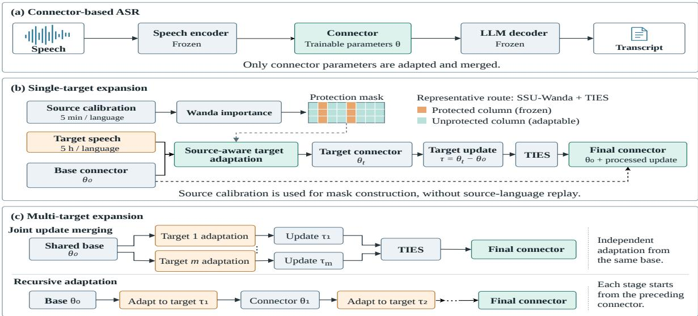

# Preserve to Expand: Source-Aware Adaptation and Model Merging for Multilingual LLM-Based ASR

Yuchen Zhang1,2 and Haralambos Mouratidis1,2 and Ravi Shekhar1,2

1Institute for Analytics and Data Science, University of Essex

2School of Computer Science and Electronic Engineering, University of Essex {yuchen.zhang, h.mouratidis, r.shekhar}@essex.ac.uk

## Abstract

Expanding multilingual ASR systems to new languages is challenging when adaptation must preserve previously supported languages with out replaying source-language training data. We study this problem in connector-based Speech LLMs, where a trainable connector maps speech representations into a frozen large language model. We evaluate targetupdate construction and merging strategies for adapting the connector while preserving source-language performance. In singletarget expansion, target-only fine-tuning and standard TIES merging learn new languages but cause severe source-language forgetting, while SSU-Wanda+TIES gives the best sourcepreserving trade-off. In multi-target expansion, update merging provides stable source retention, whereas recursive expansion can improve target adaptation under favorable orders but is highly order-sensitive. These results show that multilingual ASR expansion requires balancing target acquisition, source retention, and interactions among target-language updates.

## 1 Introduction

Recent speech foundation models have substantially improved multilingual automatic speech recognition (ASR) through larger training corpora, increased model capacity, and improved training objectives (Babu et al., 2022; Radford et al., 2023; Barrault et al., 2023). However, extending an existing multilingual ASR model to new languages remains challenging. Expansion often needs to be performed with limited data and computation while preserving performance on previously supported languages, creating a trade-off between target-language adaptation and source-language retention.

A common expansion strategy is to fine-tune the existing model on the new language, but this can cause catastrophic forgetting. Similar degradation has been observed in connector-based Speech

LLMs for ASR, where multilingual projectors are easy to adapt but may substantially harm originallanguage performance (Concina et al., 2026a,b). Replay-based continual learning can mitigate forgetting by interleaving previously supported languages during adaptation, but it requires storing and reusing replay data. When such data is unavailable or impractical to reuse, expansion must rely on replay-free target-language adaptation without gradient-based source adaptation.

Model merging offers an alternative by combining learned parameter updates without additional training (Yang et al., 2026). Methods such as weight averaging and task arithmetic integrate capabilities from different training runs or tasks in weight space (Wortsman et al., 2022; Ilharco et al., 2022), but independently learned updates may interfere. TIES-Merging mitigates this interference by removing small parameter changes and resolving sign conflicts between task vectors (Yadav et al., 2023). Language-specific merging has also been explored to reduce training and maintenance costs when adding or updating languages in multilingual models (Dmonte et al., 2026). However, how target-language updates behave in connector-based multilingual ASR expansion remains unclear, particularly without source-language replay during adaptation.

In this work, we study source-aware multilingual ASR expansion for connector-based Speech LLMs (Ma et al., 2025, 2024). Starting from a multilingual base connector (Zhang et al., 2026a), our goal is to adapt the connector to new target languages while preserving performance on the source languages, without replaying sourcelanguage training data or performing gradientbased source adaptation during expansion. We focus on two questions: RQ1: How can adaptation and merging balance target acquisition and source retention? and RQ2: How effectively can independent target updates be merged to support multiple

new languages?

To answer these questions, we conduct controlled experiments with three multilingual base connectors and six target languages. We compare direct target fine-tuning, source-aware parameterselective adaptation, and TIES-based target-update merging under the same target-language adaptation budget. Our experimental results suggest that source-aware merging substantially improves the adaptation–retention trade-off in single-target expansion, while multi-target expansion requires managing interactions among target-language updates. Joint update merging provides stable source retention, whereas recursive adaptation can achieve stronger target performance under favorable target orders.

Our main contributions are as follows. First, we introduce a source-aware multilingual ASR expansion setting for connector-based Speech LLMs, where new target languages are added while preserving existing source-language performance without source-language replay or gradient-based source adaptation. Second, we systematically compare target-update construction strategies, including direct fine-tuning, SSU-based parameterselective adaptation, SSU+FT, and TIES-based target-update merging, to characterize the tradeoff between target adaptation and source retention. Third, we extend the study from single-target to multi-target expansion and analyze how targetupdate interactions and recursive target order shape multilingual expansion.

## 2 Related Work

## 2.1 Multilingual ASR Expansion

Large-scale speech foundation models have advanced multilingual ASR through cross-lingual self-supervised learning, weakly supervised recognition, and unified multilingual speech modeling across diverse languages and tasks (Babu et al., 2022; Radford et al., 2023; Barrault et al., 2023). Recent LLM-based ASR systems further connect pretrained speech encoders with large language models through lightweight connectors, showing that frozen speech and language backbones can support multilingual recognition and benefit from auxiliary multimodal context (Fathullah et al., 2023; Ma et al., 2024; Yang et al., 2024). These developments motivate connector-based Speech LLMs as a parameter-efficient ASR framework, but leave open how to expand them to new languages while preserving existing multilingual capabilities.

Multilingual ASR systems often need to be expanded after the initial model has been trained, making new-language acquisition and sourcelanguage retention a central challenge. Prior work on multilingual ASR expansion has largely framed new-language acquisition and forgetting as a continual-learning problem, covering replay-based retention, parameter-regularized adaptation, and decoder-specific optimization strategies (Della Libera et al., 2024; Kwok et al., 2024; Concina et al., 2026b). In contrast, our work does not rely on source-language replay or gradient-based source adaptation during expansion. We instead study how target-language updates can be constructed and combined under lightweight source-language calibration, comparing parameter-selective adaptation and target-update merging in both single-target and multi-target connector expansion.

## 2.2 Model Merging for Adaptation

Model merging provides an alternative to continued fine-tuning by combining parameters or parameter updates from separately trained models. Model soups show that averaging the weights of multiple fine-tuned models can improve performance and robustness without increasing inference cost, particularly when the models are fine-tuned from the same initialization (Wortsman et al., 2022). Task arithmetic represents fine-tuning effects as task vectors and shows that these vectors can be added, subtracted, or composed to alter model behavior in parameter space (Ilharco et al., 2022). These approaches suggest that independently learned capabilities can sometimes be integrated without additional training.

However, merging fine-tuned models separately can introduce interference between parameter updates. TIES-Merging addresses this issue by trimming small parameter changes, resolving sign conflicts among task vectors, and merging only signaligned updates (Yadav et al., 2023). In multilingual settings, Dmonte et al. (2026) study languagespecific model merging as a way to reduce training and maintenance costs when individual languages are added or updated in multilingual task-specific LLMs. In the speech domain, model merging is explored for adding new tasks (Zhao et al., 2026; Lin et al., 2025), domains (Carvalho et al., 2026), and fairness (Lin et al., 2026; Bravo-Bravo et al., 2026). Nevertheless, existing model merging work has not fully examined connector-based multilingual

ASR expansion under a source-free setting, where target-language updates must be integrated while preserving source-language performance without access to source-language data during expansion.

## 2.3 Parameter-Selective Adaptation

Parameter-selective adaptation aims to reduce forgetting by restricting which parameters are updated during task or language adaptation (Liu et al., 2021; Zhang et al., 2024; Pan et al., 2024). Instead of updating the full model, these methods identify parameters or structural units that are important for previously learned capabilities and protect them during subsequent fine-tuning. This idea has been explored in continual learning through masking, pruning, and parameter-isolation strategies, where different subsets of model parameters are assigned to different tasks or protected from future updates (Mallya and Lazebnik, 2018; Mallya et al., 2018).

Source-Shielded Updates (SSU) apply this idea to target-language adaptation of LLMs by estimating source-language parameter importance and freezing source-important units during targetlanguage fine-tuning (Yamaguchi et al., 2026). This is particularly relevant to multilingual ASR expansion, where adapting to a new language can interfere with previously supported source languages. In our work, we adopt SSU-style sourceaware masking for connector adaptation, using a lightweight source-language calibration set only to construct masks.

## 3 Methodology

Figure 1 provides an overview of the connectorbased ASR architecture and the single-target and multi-target expansion strategies studied in this work.

## 3.1 Connector-Based ASR Backbone

We study multilingual expansion in a connectorbased ASR architecture (Ma et al., 2025, 2024; Zhang et al., 2026a), where only a lightweight connector is adapted while both the speech encoder and the language model remain frozen. Given an input speech signal S, a frozen speech encoder $\mathcal { E }$ produces acoustic representations:

$$
\mathbf { H } = { \mathcal { E } } ( S ) \in \mathbb { R } ^ { B \times T \times E } ,\tag{1}
$$

where B is the batch size, $T$ is the number of acoustic frames, and E is the encoder hidden dimension. To reduce the frame rate before passing

the representations to the LLM, we apply a stackdownsampling operator $\mathcal { D } _ { K } ( \cdot )$ that concatenates every K consecutive frames:

$$
\mathbf { H } ^ { ( K ) } = { \mathcal { D } } _ { K } ( \mathbf { H } ) \in \mathbb { R } ^ { B \times ( T / K ) \times ( E K ) } .\tag{2}
$$

A trainable connector $\mathcal { C } _ { \theta }$ maps the downsampled acoustic sequence into the LLM embedding space:

$$
\begin{array} { r } { \mathbf { Z } = \mathcal { C } _ { \theta } ( \mathbf { H } ^ { ( K ) } ) , } \end{array}\tag{3}
$$

where $\theta$ denotes the connector parameters. The frozen decoder-only LLM D then generates the transcription autoregressively:

$$
p ( \mathbf { y } \mid S ) = \prod _ { t = 1 } ^ { | \mathbf { y } | } p ( y _ { t } \mid y _ { < t } , \mathbf { Z } ) .\tag{4}
$$

All adaptation and merging operations in this work are applied only to the connector parameters, while the speech encoder and LLM decoder remain frozen.

## 3.2 Target Adaptation with Source Calibration

We begin with a multilingual base connector trained on a set of source languages. Let $\theta _ { \mathrm { b a s e } }$ denote the resulting base connector. Given a new target language, our goal is to adapt the connector to the target language while retaining performance on the original source languages.

We first construct a target-adapted connector by fine-tuning the base connector on target-language data:

$$
\theta _ { \mathrm { t g t } } = \mathrm { F T } ( \theta _ { \mathrm { b a s e } } , \mathcal { D } _ { \mathrm { t g t } } ) ,\tag{5}
$$

where ${ \mathcal { D } } _ { \mathrm { t g t } }$ denotes the target-language adaptation data. Direct fine-tuning uses $\theta _ { \mathrm { t g t } }$ itself as the expanded model. In merging-based settings, we view target adaptation as an update from the base connector:

$$
\tau _ { \mathrm { t g t } } = \theta _ { \mathrm { t g t } } - \theta _ { \mathrm { b a s e } } .\tag{6}
$$

We also use SSU as a parameter-selective target adaptation strategy (Yamaguchi et al., 2026). SSU uses a small source-language calibration set to estimate which columns of each weight matrix are important for source-language behavior, and then freezes those columns during target-language adaptation. In our work, the calibration set is drawn from the source languages of the base connector.

Let $\rho$ denote the column-freezing ratio. For each connector weight matrix $\textbf { W } \in \ \mathbb { R } ^ { d _ { \mathrm { o u t } } \times d _ { \mathrm { i n } } }$ SSU first assigns an element-wise importance score $s _ { i j }$ to each weight $W _ { i j }$ . Following SSU, we use the Wanda criterion to compute these scores from source-language calibration data. Specifically,

  
Figure 1: Overview of source-aware multilingual ASR expansion.

$$
s _ { i j } ^ { \mathrm { W a n d a } } = | W _ { i j } | \cdot \| \mathbf { x } _ { j } \| _ { 2 } ,\tag{7}
$$

where $\mathbf { x } _ { j }$ is the activation of the j-th input feature estimated from source-language calibration data.

We also evaluate two alternative masking criteria. In SSU-MAG, the element-wise score is based only on weight magnitude:

$$
s _ { i j } ^ { \mathrm { M a g } } = | W _ { i j } | .\tag{8}
$$

In SSU-RAND, columns are selected uniformly at random, without using an importance score.

For score-based variants, SSU aggregates element-wise scores into column scores:

$$
S _ { j } = \sum _ { i = 1 } ^ { d _ { \mathrm { o u t } } } s _ { i j } .\tag{9}
$$

The protected column set is selected by taking the top-ρ proportion of columns:

$$
\mathcal { P } _ { \rho } = \mathrm { T o p } _ { \rho } \left( \{ S _ { j } \} _ { j = 1 } ^ { d _ { \mathrm { i n } } } \right) .\tag{10}
$$

For SSU-RAND, ${ \mathcal P _ { \rho } }$ is instead sampled uniformly from the columns of W with the same cardinality.

The binary mask for W is defined as

$$
\begin{array} { r } { B _ { i j } = \left\{ \begin{array} { l l } { 0 , } & { \mathrm { i f ~ } j \in \mathscr { P } _ { \rho } , } \\ { 1 , } & { \mathrm { i f ~ } j \notin \mathscr { P } _ { \rho } . } \end{array} \right. } \end{array}\tag{11}
$$

Thus, protected columns are frozen during targetlanguage adaptation:

$$
W _ { i j }  W _ { i j } - \eta B _ { i j } \nabla _ { W _ { i j } } \mathcal { L } _ { \mathrm { t g t } } ,\tag{12}
$$

where η is the learning rate and ${ \mathcal { L } } _ { \mathrm { t g t } }$ is the targetlanguage training loss. For one-dimensional parameters such as biases, each parameter is treated as its own column.

The resulting SSU-adapted connector is denoted as

$$
\theta _ { \mathrm { t g t } } ^ { \mathrm { S S U } } = \mathrm { F T } _ { \mathbf { B } } ( \theta _ { \mathrm { b a s e } } , \mathcal { D } _ { \mathrm { t g t } } ) ,\tag{13}
$$

with update

$$
\tau _ { \mathrm { t g t } } ^ { \mathrm { S S U } } = \theta _ { \mathrm { t g t } } ^ { \mathrm { S S U } } - \theta _ { \mathrm { b a s e } } .\tag{14}
$$

Finally, we include an SSU+FT variant. In this setting, SSU is first used to obtain $\theta _ { \mathrm { t g t } } ^ { \mathrm { S S U } }$ , which is then further adapted with standard unmasked target-language fine-tuning:

$$
\theta _ { \mathrm { t g t } } ^ { \mathrm { S S U + F T } } = \mathrm { F T } ( \theta _ { \mathrm { t g t } } ^ { \mathrm { S S U } } , \mathcal { D } _ { \mathrm { t g t } } ) .\tag{15}
$$

This variant tests whether source-calibrated masked adaptation provides a better initialization for subsequent target-language optimization.

## 3.3 Target-Update Model Merging

For single-target expansion, the target update is

$$
\tau _ { \mathrm { t g t } } = \theta _ { \mathrm { t g t } } - \theta _ { \mathrm { b a s e } } ,\tag{16}
$$

where $\theta _ { \mathrm { t g t } }$ may be obtained from standard finetuning, SSU-based adaptation, or SSU+FT. We instantiate the merging operator using TIES-Merging

(Yadav et al., 2023). Given a set of target updates

$$
\mathcal { T } = \{ \tau ^ { ( 1 ) } , \dots , \tau ^ { ( n ) } \} ,\tag{17}
$$

where each $\tau ^ { ( j ) } \in \mathbb { R } ^ { d }$ is defined relative to $\theta _ { \mathrm { b a s e } } .$ TIES produces a merged update $\tau _ { m }$ through trim, elect sign, and disjoint merge.

First, TIES trims each update by retaining only the largest k% of entries by absolute value:

$$
\hat { \tau } _ { i } ^ { ( j ) } = \left\{ \stackrel { \tau _ { i } ^ { ( j ) } } { _ i } , \quad \mathrm { i f } | \tau _ { i } ^ { ( j ) } | \geq q _ { k } ( | \tau ^ { ( j ) } | ) , \right.\tag{18}
$$

Here, $q _ { k } ( | \tau ^ { ( j ) } | )$ is the threshold corresponding to the top-k% absolute values in $\tau ^ { ( j ) }$ . This removes small parameter changes before aggregation.

Second, TIES elects a sign for each parameter dimension based on the aggregate signed mass:

$$
\gamma _ { i } = \mathrm { s g n } \left( \sum _ { j = 1 } ^ { n } \hat { \tau } _ { i } ^ { ( j ) } \right) .\tag{19}
$$

When the signed mass is zero, we set $\gamma _ { i } = 0$ and the merged update for that dimension to zero.

Finally, TIES performs a disjoint merge by averaging only updates whose signs agree with the elected sign. Let

$$
\begin{array} { r } { \mathcal { A } _ { i } = \left\{ j \ \middle | \ \mathrm { s g n } ( \hat { \tau } _ { i } ^ { ( j ) } ) = \gamma _ { i } \ \mathrm { a n d } \ \hat { \tau } _ { i } ^ { ( j ) } \neq 0 \right\} . } \end{array}\tag{20}
$$

The merged update is

$$
( \tau _ { m } ) _ { i } = \left\{ \begin{array} { l l } { \displaystyle \frac { 1 } { | { \cal A } _ { i } | } \sum _ { j \in { \cal A } _ { i } } \hat { \tau } _ { i } ^ { ( j ) } , } & { \mathrm { i f ~ } | { \cal A } _ { i } | > 0 , } \\ { 0 , } & { \mathrm { i f ~ } | { \cal A } _ { i } | = 0 . } \end{array} \right.\tag{21}
$$

The final merged connector is obtained by scaling the merged update and adding it to the base connector:

$$
\theta _ { m } = \theta _ { \mathrm { b a s e } } + \lambda \tau _ { m } ,\tag{22}
$$

where λ is a scaling coefficient.

For conventional single-target merging, $\boldsymbol { \mathcal { T } } =$ $\{ \tau _ { \mathrm { t g t } } \}$ . In this case, there are no cross-update sign conflicts, and TIES reduces to trimming the target update before scaling:

$$
\begin{array} { r } { \theta _ { m } = \theta _ { \mathrm { b a s e } } + \lambda \mathrm { T o p K } ( \tau _ { \mathrm { t g t } } ; k ) . } \end{array}\tag{23}
$$

For multi-target expansion, let $\tau _ { \mathrm { t g t } } ^ { ( 1 ) } , \dots , \tau _ { \mathrm { t g t } } ^ { ( m ) }$ denote target-language updates independently obtained from the same base connector. We merge these target updatesly:

$$
\tau _ { m } = \mathcal { M } _ { \mathrm { T I E S } } \left( \{ \tau _ { \mathrm { t g t } } ^ { \left( 1 \right) } , \dots , \tau _ { \mathrm { t g t } } ^ { \left( m \right) } \} \right) ,\tag{24}
$$

and obtain

$$
\begin{array} { r } { \theta _ { \mathrm { m u l t i } } = \theta _ { \mathrm { b a s e } } + \lambda \tau _ { m } . } \end{array}\tag{25}
$$

In this setting, TIES can resolve sign conflicts among multiple target-language updates before aggregation. This allows us to test whether independently learned target-language updates can be combined without recursive fine-tuning on multiple target languages.

## 4 Experiments

## 4.1 Experimental Setting

We use Common Voice (Ardila et al., 2020) for base training and target adaptation. Following Zhang et al. (2026b), we train three multilingual base connectors covering Germanic, Romance, and Slavic languages and evaluate expansion to six target languages. Table 1 lists the languages. Base training and target adaptation each use 5 hours per language. SSU-Wanda additionally uses 5 minutes per source language from the validation split for activation collection and mask construction, without source-language replay or gradient-based source adaptation.

Group Languages   
Germanic (GEM) English (EN), German (DE), Dutch (NL), Danish (DA), Swedish (SV)   
Romance (ROA) French (FR), Spanish (ES), Portuguese (PT), Galician (GL), Catalan (CA)   
Slavic (SLA) Russian (RU), Ukrainian (UK), Belarusian (BE), Bulgarian (BG), Macedonian (MK)   
Targets Norwegian (NO), Italian (IT), Serbian (SR), Polish (PL), Slovenian (SL), Kyrgyz (KY)  
Table 1: Source-language groups and target languages.

<table><tr><td>Type</td><td>Base</td><td>Target</td></tr><tr><td>G+/S+</td><td>Germanic Romance Slavic</td><td>Norwegian (NO) Italian (IT) Serbian (SR)</td></tr><tr><td>G+/S-</td><td>Slavic Slavic</td><td>Polish (PL) Slovenian (SL)</td></tr><tr><td>G-/S+</td><td>Germanic Romance Slavic</td><td>Italian (IT) Norwegian (NO) Kyrgyz (KY)</td></tr><tr><td>G-/S-</td><td>Germanic Romance Slavic</td><td>Serbian (SR) Serbian (SR) Italian (IT)</td></tr></table>

Table 2: Single-target base–target configurations.G+/Gindicate language-group match/mismatch, and S+/S- indicate script match/mismatch.

Single-target experiments add each target independently under language-group and script match/mismatch conditions, as listed in Table 2. Multi-target experiments compare joint update merging with recursive adaptation, using Wandabased masking for SSU. We report source- and target-language WER to assess retention and adaptation, respectively.

For all experiments, only connector parameters are adapted, while the speech encoder and LLM remain frozen.We use AdamW with a learning rate of $1 \times 1 0 ^ { - 4 }$ , weight decay of $1 \times 1 0 ^ { - 6 }$ , batch size $^ { 4 , }$ and downsampling factor $K = 4$ . Training runs for up to 5 epochs with early stopping on validation loss. We use the final checkpoint from each run and decode with beam size 4. All experiments share these training settings and are conducted on two NVIDIA A6000 GPUs. Further details of the experimental setup are provided in Appendix A.

## 4.2 Single-Target Expansion

## 4.2.1 Target Adaptation and Source Retention

<table><tr><td>Base</td><td>Method</td><td>Source</td><td>Target</td><td>All</td><td>∆Source</td></tr><tr><td rowspan="7">GEM</td><td>Base</td><td>22.57</td><td>102.70</td><td>35.93</td><td>+0.00</td></tr><tr><td>Target FT</td><td>69.73</td><td>27.86</td><td>62.75</td><td>+47.15</td></tr><tr><td>SSU-Wanda+FT</td><td>67.46</td><td>28.47</td><td>60.96</td><td>+44.89</td></tr><tr><td>TIES</td><td>69.08</td><td>27.71</td><td>62.18</td><td>+46.50</td></tr><tr><td>SSU-Rand+TIES</td><td>29.42</td><td>30.30</td><td>29.56</td><td>+6.84</td></tr><tr><td>SSU-Mag+TIES</td><td>40.83</td><td>29.52</td><td>38.95</td><td>+18.26</td></tr><tr><td>SSU-Wanda+TIES</td><td>22.81</td><td>35.82</td><td>24.98</td><td>+0.24</td></tr><tr><td rowspan="7">ROA</td><td>Base</td><td>18.95</td><td>111.16</td><td>34.32</td><td>+0.00</td></tr><tr><td>Target FT</td><td>74.50</td><td>28.06</td><td>66.76</td><td>+55.54</td></tr><tr><td>SSU-Wanda+FT</td><td>55.15</td><td>29.45</td><td>50.87</td><td>+36.20</td></tr><tr><td>TIES</td><td>73.59</td><td>27.77</td><td>65.95</td><td>+54.63</td></tr><tr><td>SSU-Rand+TIES</td><td>33.79</td><td>29.50</td><td>33.08</td><td>+14.84</td></tr><tr><td>SSU-Mag+TIES</td><td>41.21</td><td>29.31</td><td>39.22</td><td>+22.25</td></tr><tr><td>SSU-Wanda+TIES</td><td>19.64</td><td>37.36</td><td>22.59</td><td>+0.69</td></tr><tr><td rowspan="7">SLA</td><td>Base</td><td>36.93</td><td>110.15</td><td></td><td></td></tr><tr><td>Target FT</td><td>91.41</td><td>36.37</td><td>49.13 82.24</td><td>+0.00 +54.49</td></tr><tr><td>SSU-Wanda+FT</td><td>85.61</td><td>36.15</td><td>77.36</td><td>+48.68</td></tr><tr><td>TIES</td><td>90.88</td><td>37.03</td><td>81.90</td><td>+53.95</td></tr><tr><td>SSU-Rand+TIES</td><td></td><td></td><td>56.50</td><td></td></tr><tr><td></td><td>59.46</td><td>41.69</td><td></td><td>+22.54</td></tr><tr><td>SSU-Mag+TIES SSU-Wanda+TIES</td><td>72.06 43.60</td><td>40.55 51.69</td><td>66.81 44.95</td><td>+35.13 +6.68</td></tr></table>

Table 3: Macro-averaged WER (%) ↓ for single-target expansion by base.

Table 3 reports macro-averaged WER for each base group. The results show a clear adaptation– retention trade-off. Target-only fine-tuning learns the new language effectively, but severely damages the original source languages. For example, on the Germanic base, Target FT reduces target WER from 102.70% to 27.86%, but increases source WER from 22.57% to 69.73%. The same pattern appears for Romance and Slavic, where source WER increases by +55.54% and +54.49%, respectively.

Standard TIES merging does not solve this problem in the single-target setting. Although it preserves the target-language gains of fine-tuning, it retains most of the source-language degradation, behaving similarly to Target FT across base groups. SSU-Wanda+FT is also insufficient on its own, even with source-important parameters frozen during target adaptation, the resulting connector still suffers substantial source degradation. These results suggest that neither conventional merging nor protected fine-tuning alone is enough to recover a balanced source–target solution.

In contrast, SSU-Wanda+TIES gives the strongest overall trade-off. It keeps source WER close to the base connector while still improving target performance substantially. For Germanic and Romance, source WER increases by only +0.24% and +0.69%, while target WER drops from 102.70% to 35.82% and from 111.16% to 37.36%, respectively. For Slavic, the harder expansion setting, SSU-Wanda+TIES reduces source degradation from +53.95% under TIES to +6.68%, while improving target WER from 110.15% to 51.69%. These results show that strong single-target expansion requires combining source-aware adaptation with update merging.

## 4.2.2 Effect of Source-Aware Protection

We next compare the three SSU masking criteria used with TIES: random masking, magnitudebased masking, and Wanda-based masking. Table 3 shows that all SSU+TIES variants reduce source forgetting compared with Target FT and standard TIES, but they differ in how they balance target adaptation and source retention. SSU-Rand+TIES often preserves stronger target-language gains than SSU-Wanda+TIES, but leaves more source degradation. For example, on the Slavic base, SSU-Rand+TIES reaches 41.69% target WER, but increases source WER by +22.54%. SSU-Wanda+TIES gives a higher target WER of 51.69%, but reduces source degradation to +6.68%. This suggests that random protection can limit update damage, but does not reliably select the directions most important for preserving source-language behavior.

SSU-Mag+TIES provides a more structured mask than random selection, but it is generally worse than SSU-Wanda+TIES in source retention and overall WER. Across all three base groups, SSU-Mag+TIES causes larger source degradation than SSU-Wanda+TIES, indicating that weight magnitude alone is not sufficient to identify sourceimportant connector directions. By incorporating source-language activations, SSU-Wanda produces a more conservative mask that better preserves the original multilingual capability.

Overall, SSU-Wanda+TIES gives the most reliable source-preserving trade-off. It achieves the lowest source WER and lowest overall WER for all three base groups, although it sometimes gives up part of the target-language gain achieved by SSU-Rand or SSU-Mag. We therefore use SSU-Wanda as the default SSU criterion in the multi-target experiments.

## 4.2.3 Base–Target Compatibility

<table><tr><td>Target Type</td><td></td><td>Method</td><td>Source</td><td>Target</td><td>All</td><td>∆Source</td></tr><tr><td rowspan="7">IT</td><td rowspan="7">G-/S-</td><td>Base</td><td>36.93</td><td>116.08</td><td>50.12</td><td>+0.00</td></tr><tr><td>Target FT</td><td>129.79</td><td>20.11</td><td>111.51</td><td>+92.86</td></tr><tr><td>SSU-Wanda+FT</td><td>115.24</td><td>23.36</td><td>99.93</td><td>+78.31</td></tr><tr><td>TIES</td><td>128.32</td><td>21.07</td><td>110.45</td><td>+91.40</td></tr><tr><td>SSU-Rand+TIES</td><td>52.82</td><td>39.52</td><td>50.60</td><td>+15.89</td></tr><tr><td>SSU-Mag+TIES</td><td>82.62</td><td>34.28</td><td>74.56</td><td>+45.70</td></tr><tr><td>SSU-Wanda+TIES</td><td>34.35</td><td>70.57</td><td>40.39</td><td>-2.57</td></tr><tr><td rowspan="7">SR</td><td rowspan="6">G+/S+ TIES</td><td>Base</td><td>36.93</td><td>66.58</td><td>41.87</td><td>+0.00</td></tr><tr><td>Target FT</td><td>57.12</td><td>24.51</td><td>51.69</td><td>+20.19</td></tr><tr><td>SSU-Wanda+FT</td><td>55.56</td><td>24.62</td><td>50.40</td><td>+18.63</td></tr><tr><td></td><td>56.46</td><td>24.62</td><td>51.15</td><td>+19.53</td></tr><tr><td>SSU-Rand+TIES</td><td>44.26</td><td>26.03</td><td>41.22</td><td>+7.33</td></tr><tr><td>SSU-Mag+TIES</td><td>46.12</td><td>25.91</td><td>42.75</td><td>+9.19</td></tr><tr><td>SSU-Wanda+TIES</td><td>41.10</td><td>27.63</td><td>38.85</td><td>+4.17</td></tr><tr><td rowspan="8">PL</td><td rowspan="8">G+/S-</td><td>Base</td><td>36.93</td><td>107.36</td><td>48.67</td><td>+0.00</td></tr><tr><td>Target FT</td><td>107.05</td><td>26.39</td><td>93.61</td><td>+70.13</td></tr><tr><td>SSU-Wanda+FT</td><td>104.80</td><td>26.17</td><td>91.70</td><td>+67.87</td></tr><tr><td>TIES</td><td>107.36</td><td>26.28</td><td>93.85</td><td>+70.43</td></tr><tr><td>SSU-Rand+TIES</td><td>76.95</td><td>28.09</td><td>68.81</td><td>+40.02</td></tr><tr><td>SSU-Mag+TIES</td><td>95.16</td><td>27.42</td><td>83.87</td><td>+58.24</td></tr><tr><td>SSU-Wanda+TIES</td><td>45.33</td><td>35.45</td><td>43.68</td><td>+8.41</td></tr><tr><td>Base</td><td>36.93</td><td></td><td></td><td></td></tr><tr><td rowspan="8">SL</td><td rowspan="8">G+/S-</td><td>Target FT</td><td>105.60</td><td>110.70 38.47</td><td>49.22 94.41</td><td>+0.00 +68.67</td></tr><tr><td>SSU-Wanda+FT</td><td>99.34</td><td>38.84</td><td>89.26</td><td>+62.41</td></tr><tr><td>TIES</td><td>105.37</td><td>40.07</td><td>94.49</td><td>+68.44</td></tr><tr><td>SSU-Rand+TIES</td><td>81.99</td><td>39.99</td><td>74.99</td><td>+45.07</td></tr><tr><td>SSU-Mag+TIES</td><td>92.93</td><td>40.03</td><td>84.11</td><td>+56.00</td></tr><tr><td>SSU-Wanda+TIES</td><td>58.04</td><td>43.72</td><td>55.65</td><td>+21.11</td></tr><tr><td></td><td></td><td></td><td></td><td></td></tr><tr><td>Base</td><td>36.93</td><td>150.01</td><td>55.78</td><td>+0.00</td></tr><tr><td rowspan="8">KY</td><td rowspan="8">G-/S+ TIES</td><td>Target FT</td><td>57.51</td><td>72.39</td><td>59.99</td><td>+20.58</td></tr><tr><td>SSU-Wanda+FT</td><td>53.09</td><td>67.77</td><td>55.54</td><td>+16.16</td></tr><tr><td></td><td>56.89</td><td>73.09</td><td>59.59</td><td>+19.96</td></tr><tr><td>SSU-Rand+TIES</td><td>41.30</td><td>74.84</td><td>46.89</td><td>+4.37</td></tr><tr><td>SSU-Mag+TIES</td><td>43.45</td><td>75.09</td><td>48.72</td><td>+6.52</td></tr><tr><td></td><td></td><td></td><td>46.18</td><td></td></tr><tr><td>SSU-Wanda+TIES</td><td>39.19</td><td>81.10</td><td></td><td>+2.26</td></tr><tr><td></td><td></td><td></td><td></td><td></td></tr></table>

Table 4: Detailed single-target expansion WER (%)↓ for the Slavic base.

Finally, we examine whether expansion difficulty depends on the relationship between the base and target languages. Table 4 reports detailed single-target results for the Slavic base, which covers all compatibility types in our design. Full Germanic and Romance per-target results are reported in Appendix B.1.

The results show that base–target compatibility affects expansion behavior, but not through a simple ranking of conditions. Serbian is the most compatible target in our design, with both the same language group and script as the Slavic base, and is comparatively easy to add. SSU-Wanda+TIES reaches 27.63% target WER with only +4.17% source degradation. However, same-group targets are not uniformly easy. Polish and Slovenian are both Slavic languages using Latin script in our setting, but they are harder to add than Serbian, and Slovenian causes much larger source degradation.

The comparison between Slovenian and Kyrgyz further shows that language-group match alone does not determine expansion difficulty. Slovenian is same-group but different-script, while Kyrgyz is different-group but same-script. Yet SSU-Wanda+TIES preserves source languages much better for Kyrgyz than for Slovenian, with +2.26% versus +21.11% source degradation, even though Kyrgyz remains difficult in target WER. This suggests that source retention and target learnability are related but not identical. A target can be hard to recognize while causing limited forgetting, or linguistically closer while producing a more disruptive update.

These mixed patterns suggest that group and script compatibility influence expansion, but their effect depends on how the target update interacts with source-important connector directions.

## 4.3 Multi-Target Expansion

Table 5 reports final-stage results under the configured target order. The order is NO → IT → SR for Germanic and Romance, and IT → SR → PL → SL → KY for Slavic. Joint methods merge all target updates at the final stage, whereas recursive methods follow the configured order.

## 4.3.1 Joint Update Merging versus Recursive Adaptation

Joint update merging provides a stable sourcepreserving solution, while recursive adaptation can learn target languages more aggressively but is more order-sensitive. TIES keeps source WER close to the base connector for all three base groups and substantially improves target WER, reducing it from 102.70% to 64.93% for Germanic, from 111.16% to 67.22% for Romance, and from 110.15% to 97.41% for Slavic. This shows that independently trained target updates can be merged jointly without severe source-language forgetting.

Source-aware variants of joint merging do not uniformly improve target performance in the multitarget setting. Hard SSU+TIES and Incremental dynamic SSU further protect source languages, but often retain less target-language improvement than TIES. This suggests that source protection can become too restrictive when multiple target updates are combined.

<table><tr><td>Base</td><td>Method</td><td>Source</td><td>Target</td><td>All</td></tr><tr><td rowspan="6">GEM</td><td>Base</td><td>22.57</td><td>102.70</td><td>52.62</td></tr><tr><td>TIES</td><td>22.11</td><td>64.93</td><td>38.17</td></tr><tr><td>Hard SSU+TIES</td><td>22.02</td><td>86.76</td><td>46.30</td></tr><tr><td>Incremental dynamic SSU</td><td>21.64</td><td>84.26</td><td>45.12</td></tr><tr><td>Recursive rebased SSU</td><td>37.13</td><td>45.39</td><td>40.23</td></tr><tr><td>Recursive FT then SSU</td><td>28.97</td><td>57.34</td><td>39.61</td></tr><tr><td rowspan="6">ROA</td><td>Base</td><td>18.95</td><td>111.16</td><td>53.53</td></tr><tr><td>TIES</td><td>19.58</td><td>67.22</td><td>37.45</td></tr><tr><td>Hard SSU+TIES</td><td>18.10</td><td>98.67</td><td>48.32</td></tr><tr><td>Incremental dynamic SSU</td><td>18.06</td><td>90.90</td><td>45.38</td></tr><tr><td>Recursive rebased SSU</td><td>58.27</td><td>56.53</td><td>57.62</td></tr><tr><td>Recursive FT then SSU</td><td>50.37</td><td>70.21</td><td>57.81</td></tr><tr><td rowspan="6">SLA</td><td>Base</td><td>36.93</td><td>110.15</td><td></td></tr><tr><td>TIES</td><td></td><td></td><td>73.54</td></tr><tr><td>Hard SSU+TIES</td><td>33.93</td><td>97.41</td><td>65.67</td></tr><tr><td></td><td>34.64</td><td>102.92</td><td>68.78</td></tr><tr><td>Incremental dynamic SSU</td><td>33.91</td><td>98.63</td><td>66.27</td></tr><tr><td>Recursive rebased SSU Recursive FT then SSU</td><td>103.43 38.45</td><td>73.61 81.67</td><td>88.52 60.06</td></tr></table>

Table 5: Final-stage WER (%) for multi-target expansion. Lower is better.

Recursive methods show a different trade-off. Recursive FT then SSU achieves the best target WER for Germanic and Slavic, and the best overall WER for Slavic under the configured order. However, its Romance result is much worse, indicating that recursive adaptation can produce stronger target learning but depends heavily on target order. Recursive rebased SSU is even less stable. Although it improves target WER in some settings, it causes large source degradation for Romance and Slavic, suggesting that recursively applying baseanchored target updates can accumulate sourcelanguage interference. Thus, unlike single-target expansion where SSU-Wanda+TIES is consistently strongest, multi-target expansion exposes a sharper trade-off between stable joint merging and ordersensitive recursive adaptation.

## 4.3.2 Recursive Order Sensitivity

Table 6 reports Recursive FT then SSU under all evaluated target orders. The results show strong order sensitivity, so the configured-order result in Table 5 should not be taken as the full capability of recursive adaptation.

For Romance, the configured order NO → IT → SR gives 57.81% overall WER, while IT → NO → SR improves it to 31.82%, outperforming TIES. Germanic shows a similar pattern, improving from 39.61% under the configured order to 35.05% with

<table><tr><td>Base</td><td>Target Order</td><td>Source</td><td>Target</td><td>All</td></tr><tr><td>GEM</td><td> $\mathrm { N O }  \mathrm { I T }  \mathrm { S R }$   $\Pi  \mathbf { N O }  \mathbf { S R }$   $\mathrm { S R }  \mathrm { I T }  \mathrm { N O }$   $\Pi  \mathrm { S R }  \mathrm { N O }$   $\mathrm { N O }  \mathrm { S R }  \mathrm { I T }$ </td><td>28.97 36.03 24.30 25.05 28.00</td><td>57.34 62.12 53.74 51.72 48.72</td><td>39.61 45.81 35.34 35.05 35.77</td></tr><tr><td>ROA</td><td> $\mathrm { N O }  \mathrm { I T }  \mathrm { S R }$   $\Pi  \mathbf { N O }  \mathbf { S R }$   $\mathrm { S R }  \mathrm { N O }  \mathrm { I T }$   $\mathrm { N O }  \mathrm { S R }  \mathrm { I T }$   $\Pi  \mathrm { S R }  \mathrm { N O }$ </td><td>50.37 23.57 21.07 23.83 23.00</td><td>70.21 45.59 59.16 54.37 52.35</td><td>57.81 31.82 35.35 35.28 34.00</td></tr><tr><td>SLA</td><td> $\mathrm { I T } \to \mathrm { S R } \to \mathrm { P L } \to \mathrm { S L } \to \mathrm { K Y }$   $\mathrm { S R }  \mathrm { P L }  \mathrm { S L }  \mathrm { K Y }  \mathrm { I T }$   $\mathrm { S R } \to \mathrm { K Y } \to \mathrm { P L } \to \mathrm { S L } \to \mathrm { I T }$   $\mathrm { K Y }  \mathrm { P L }  \mathrm { I T }  \mathrm { S L }  \mathrm { S R }$   $\mathrm { S R } \to \mathrm { S L } \to \mathrm { I T } \to \mathrm { P L } \to \mathrm { K Y }$ </td><td>38.45 54.83 91.46 44.72 39.88</td><td>81.67 69.92 70.25 85.33 81.20</td><td>60.06 62.37 80.86 65.03 60.54</td></tr></table>

Table 6: Final-stage WER (%) ↓ for Recursive FT then SSU under different orders.

IT → SR → NO. For Slavic, Recursive FT then SSU already outperforms TIES under the configured order, but different orders still vary substantially, from 60.06% to 80.86% overall WER.

These results show that recursive adaptation is not simply worse than update merging. It is a higher-variance strategy that can achieve stronger target adaptation under favorable orders, but can also accumulate interference under poorly matched orders. This is consistent with the target-update conflict analysis in Appendix B.4, where target updates show low cosine similarity and substantial sign disagreement. Overall, update merging is more stable and source-preserving, while recursive adaptation can achieve better overall WER when the target sequence is favorable.

## 5 Conclusion

In this paper, we studied source-aware expansion for connector-based multilingual ASR, where new languages are added while preserving the original base connector. Our results show that target fine-tuning and standard TIES merging learn new languages but often overwrite source-language performance, while SSU-Wanda+TIES gives the strongest single-target adaptation–retention tradeoff. For multi-target expansion, update merging is stable and source-preserving, whereas recursive adaptation can achieve stronger target performance under favorable orders but is highly order-sensitive. Overall, effective multilingual ASR expansion requires both source-aware preservation and careful coordination among target-language updates.

## 6 Limitations

This work has two main limitations. First, our experiments focus on connector-based Speech LLMs, where the speech encoder and LLM are kept frozen and only the connector is adapted. This setting allows us to study parameter-selective adaptation and model merging in a controlled way, but the conclusions may not directly generalize to systems that update the speech encoder, the LLM, or the full ASR model during language expansion. Second, our multi-target experiments cover a limited number of target languages and target orders. Although the results show clear order sensitivity in recursive expansion, we do not propose an automatic method for selecting the target order. A larger-scale study over more languages and principled order-selection strategies would be needed to fully characterize recursive multilingual expansion.

## 7 Ethical Considerations

Our experiments use publicly available speech data from Common Voice, without collecting new recordings or additional speaker metadata. We do not disclose any personally identifiable information about the speakers. Multilingual ASR expansion may broaden access to speech technologies, but improvements for newly added languages can come at the expense of previously supported languages, potentially reducing service quality for their speakers. ASR adaptation methods may affect languages and speaker groups differently, and improvements in average WER can obscure these disparities. To make differences across languages visible, we report per-language performance on both source and target languages.

## 8 Acknowledgments

This work has been funded by the European Union’s Horizon Europe research and innovation programme under the project ELOQUENCE (Grant Agreement No. 101135916) and the UKRI. Views and opinions expressed are, however, those of the author(s) only and do not necessarily reflect those of the European Union or the Research Executive Agency. Neither the European Union nor the granting authority can be held responsible for them.

## References

Rosana Ardila, Megan Branson, Kelly Davis, Michael Kohler, Josh Meyer, Michael Henretty, Reuben Morais, Lindsay Saunders, Francis Tyers, and Gregor Weber. 2020. Common voice: A massivelymultilingual speech corpus. In Proceedings of the Twelfth Language Resources and Evaluation Conference, pages 4218–4222.

Arun Babu, Changhan Wang, Andros Tjandra, Kushal Lakhotia, Qiantong Xu, Naman Goyal, Kritika Singh, Patrick Von Platen, Yatharth Saraf, Juan Pino, et al. 2022. Xls-r: Self-supervised cross-lingual speech representation learning at scale. arXiv preprint arXiv:2111.09296.

Loïc Barrault, Yu-An Chung, Mariano Cora Meglioli, David Dale, Ning Dong, Paul-Ambroise Duquenne, Hady Elsahar, Hongyu Gong, Kevin Heffernan, John Hoffman, et al. 2023. Seamlessm4t: Massively multilingual and multimodal machine translation. arXiv preprint arXiv:2308.11596.

Ashley E Bravo-Bravo, Yuchen Zhang, Haralambos Mouratidis, Ravi Shekhar, and Monorama Swain. 2026. Intercorrect: Intersection-aware correction of demographic model merging for fair asr. arXiv preprint arXiv:2610.08604.

Carlos Carvalho, Francisco Teixeira, Thomas Rolland, and Alberto Abad. 2026. Exploring the potential and limitations of model merging for multi-domain adaptation in asr. arXiv preprint arXiv:2603.05354.

Lorenzo Concina, Seraphina Fong, Marco Matassoni, and Alessio Brutti. 2026a. Meusli: a multilingual projector for llm-based asr and beyond. arXiv preprint arXiv:2607.22100.

Lorenzo Concina, Marco Matassoni, and Alessio Brutti. 2026b. Scalable expansion of multilingual speech LLMs for ASR: A continual learning approach. In Proceedings of Speech Language Models in Low-Resource Settings: Performance, Evaluation, and Bias Analysis (SPEAKABLE) @ LREC 2026, pages 59–65, Palma, Mallorca (Spain). ELRA Language Resources Association (ELRA).

Luca Della Libera, Pooneh Mousavi, Salah Zaiem, Cem Subakan, and Mirco Ravanelli. 2024. Cl-masr: A continual learning benchmark for multilingual asr. IEEE/ACM Transactions on Audio, Speech, and Language Processing, 32:4931–4944.

Alphaeus Dmonte, Vidhi Gupta, Daniel J Perry, and Mark Arehart. 2026. Improving training efficiency and reducing maintenance costs via language specific model merging. In Proceedings of the 19th Conference of the European Chapter of the Association for Computational Linguistics (Volume 5: Industry Track), pages 562–570.

Yassir Fathullah, Chunyang Wu, Egor Lakomkin, Junteng Jia, Yuan Shangguan, Ke Li, Jinxi Guo, Wenhan Xiong, Jay Mahadeokar, Ozlem Kalinli, Christian

Fuegen, and Mike Seltzer. 2023. Prompting large language models with speech recognition abilities. arXiv preprint arXiv:2307.11795.

Gabriel Ilharco, Marco Tulio Ribeiro, Mitchell Wortsman, Suchin Gururangan, Ludwig Schmidt, Hannaneh Hajishirzi, and Ali Farhadi. 2022. Editing models with task arithmetic. arXiv preprint arXiv:2212.04089.

Chin Yuen Kwok, Jia Qi Yip, and Eng Siong Chng. 2024. Continual Learning Optimizations for Autoregressive Decoder of Multilingual ASR systems. In Interspeech 2024, pages 1225–1229.

Tzu-Quan Lin, Wei-Ping Huang, Hao Tang, and Hungyi Lee. 2025. Speech-ft: Merging pre-trained and fine-tuned speech representation models for crosstask generalization. IEEE Transactions on Audio, Speech and Language Processing, 34:70–83.

Yi-Cheng Lin, Yu-Hsuan Li Liang, Hsuan Su, Tzu-Quan Lin, Shang-Tse Chen, Yun-Nung Chen, and Hung-yi Lee. 2026. Pseudo2real: Task arithmetic for pseudolabel correction in automatic speech recognition. In Findings ofthe Associationfor Computational Linguistics: ACL 2026, pages 1160–1175.

Yuhan Liu, Saurabh Agarwal, and Shivaram Venkataraman. 2021. Autofreeze: Automatically freezing model blocks to accelerate fine-tuning. arXiv preprint arXiv:2102.01386.

Ziyang Ma, Guanrou Yang, Yifan Yang, Zhifu Gao, Jiaming Wang, Zhihao Du, Fan Yu, Qian Chen, Siqi Zheng, Shiliang Zhang, and Xie Chen. 2024. An embarrassingly simple approach for llm with strong asr capacity. arXiv preprint arXiv:2402.08846.

Ziyang Ma, Guanrou Yang, Yifan Yang, Zhifu Gao, Jiaming Wang, Zhihao Du, Fan Yu, Qian Chen, Siqi Zheng, Shiliang Zhang, and Xie Chen. 2025. Speech Recognition Meets Large Language Model: Benchmarking, Models, and Exploration. In AAAI.

Arun Mallya, Dillon Davis, and Svetlana Lazebnik. 2018. Piggyback: Adapting a single network to multiple tasks by learning to mask weights. In European Conference on Computer Vision, pages 72–88. Springer.

Arun Mallya and Svetlana Lazebnik. 2018. Packnet: Adding multiple tasks to a single network by iterative pruning. In 2018 IEEE/CVF Conference on Computer Vision and Pattern Recognition, pages 7765– 7773. IEEE.

Rui Pan, Xiang Liu, Shizhe Diao, Renjie Pi, Jipeng Zhang, Chi Han, and Tong Zhang. 2024. Lisa: Layerwise importance sampling for memory-efficient large language model fine-tuning. Advances in Neural Information Processing Systems, 37:57018–57049.

Alec Radford, Jong Wook Kim, Tao Xu, Greg Brockman, Christine McLeavey, and Ilya Sutskever. 2023.

Robust speech recognition via large-scale weak supervision. In International conference on machine learning, pages 28492–28518. PMLR.

Mitchell Wortsman, Gabriel Ilharco, Samir Ya Gadre, Rebecca Roelofs, Raphael Gontijo-Lopes, Ari S Morcos, Hongseok Namkoong, Ali Farhadi, Yair Carmon, Simon Kornblith, et al. 2022. Model soups: averaging weights of multiple fine-tuned models improves accuracy without increasing inference time. In International conference on machine learning, pages 23965–23998. Pmlr.

Prateek Yadav, Derek Tam, Leshem Choshen, Colin A Raffel, and Mohit Bansal. 2023. Ties-merging: Resolving interference when merging models. In Advances in neural information processing systems, volume 36, pages 7093–7115.

Atsuki Yamaguchi, Terufumi Morishita, Aline Villavicencio, and Nikolaos Aletras. 2026. Mitigating catastrophic forgetting in target language adaptation of llms via source-shielded updates. In Proceedings of the 64th Annual Meeting of the Association for Computational Linguistics (Volume 1: Long Papers), pages 18949–18975.

Enneng Yang, Li Shen, Guibing Guo, Xingwei Wang, Xiaochun Cao, Jie Zhang, and Dacheng Tao. 2026. Model merging in llms, mllms, and beyond: Methods, theories, applications, and opportunities. ACM Computing Surveys, 58(8):1–41.

Guanrou Yang, Ziyang Ma, Fan Yu, Zhifu Gao, Shiliang Zhang, and Xie Chen. 2024. Mala-asr: Multimediaassisted llm-based asr. In Proc. Interspeech.

Hengyuan Zhang, Yanru Wu, Dawei Li, Sak Yang, Rui Zhao, Yong Jiang, and Fei Tan. 2024. Balancing speciality and versatility: a coarse to fine framework for supervised fine-tuning large language model. In Findings ofthe Associationfor Computational Linguistics: ACL 2024, pages 7467–7509, Bangkok, Thailand. Association for Computational Linguistics.

Yuchen Zhang, Ravi Shekhar, and Haralambos Mouratidis. 2026a. Language Family Matters: Evaluating LLM-Based ASR Across Linguistic Boundaries. In Proceedings ofthe 19th Conference ofthe European Chapter of the Association for Computational Linguistics (Volume 2: Short Papers), pages 487–499, Rabat, Morocco. Association for Computational Linguistics.

Yuchen Zhang, Ravi Shekhar, and Haralambos Mouratidis. 2026b. Language family matters: Evaluating llm-based asr across linguistic boundaries. arXiv preprint arXiv:2601.18899.

Qiuming Zhao, Guangzhi Sun, and Chao Zhang. 2026. Low-rank and sparse model merging for multi-lingual speech recognition and translation. In ICASSP 2026-2026 IEEE International Conference on Acoustics, Speech and Signal Processing (ICASSP), pages 18827–18831. IEEE.

## A Additional Experimental Setup

## A.1 Data Allocation and Calibration

Each multilingual base contains five source languages, with 5 hours of training speech per language, giving a total of 25 hours per base. Each target-language adaptation run uses 5 hours of speech. In single-target experiments, every run starts independently from the corresponding multilingual base connector.

The Germanic and Romance bases are each expanded to Norwegian, Italian, and Serbian. The Slavic base is expanded to Italian, Serbian, Polish, Slovenian, and Kyrgyz.

For SSU-Wanda, the calibration set contains 5 minutes of speech from the validation split of each source language, totaling 25 minutes per base. Calibration is therefore balanced by speech duration across source languages. It is used only for forward activation collection and mask construction. Source-language examples are not replayed or used for gradient-based adaptation during expansion. Random and magnitude-based masking do not require activation collection.

## A.2 Expansion Protocols

We evaluate both single-target and multi-target expansion. In single-target expansion, each target language is added independently to a base connector, with base–target pairs covering language-group and script match/mismatch conditions (Table 2). We compare direct target fine-tuning, TIES without source-aware protection, and SSU variants using random, magnitude-based, and Wanda-based masking.

In multi-target expansion, we study how multiple target-language updates can form a single expanded connector. For joint update merging, targetspecific connectors are independently adapted from the same base connector. Each target update is computed relative to that shared base, and the updates are merged without further gradient-based training. Recursive adaptation instead processes targets sequentially, using the connector produced by the preceding stage as the starting point for the next target. Each stage uses only the current target language for gradient-based training.

The configured order is $\mathrm { N O }  \mathrm { I T }  \mathrm { S R }$ for the Germanic and Romance bases, and $\Pi  \mathbf { S R }  \mathbf { P L }$ → SL → KY for the Slavic base. We additionally evaluate Recursive FT then SSU under the orders listed in Table 6. These constitute the evaluated subset of possible orders rather than an exhaustive enumeration.

## B Additional Experimental Results

## B.1 Full Single-Target Expansion Results

Tables 7–9 report full per-language WER for independent single-target expansion. These results complement the macro-averaged summary in Table 3 and show the source-retention trends for each original source language.

<table><tr><td rowspan="2">Method</td><td colspan="5">Original source languages</td><td>Target</td><td colspan="2">Source retention</td></tr><tr><td>DA</td><td>NL</td><td>EN</td><td>DE</td><td>SV</td><td>Target↓</td><td>Source ↓</td><td>∆Source ↓</td></tr><tr><td colspan="9">Added language: Norwegian</td></tr><tr><td>Base (zero-shot target)</td><td>27.76</td><td>19.37</td><td>19.17</td><td>23.61</td><td>22.96</td><td>62.60</td><td>22.57</td><td>+0.00</td></tr><tr><td>Target FT</td><td>44.52</td><td>19.99</td><td>17.48</td><td>24.26</td><td>62.70</td><td>33.12</td><td>33.79</td><td>+11.21</td></tr><tr><td>SSU-Wanda + FT (50%)</td><td>39.13</td><td>19.83</td><td>19.11</td><td>24.05</td><td>57.41</td><td>35.46</td><td>31.91</td><td>+9.34</td></tr><tr><td>TIES (no protection)</td><td>45.08</td><td>19.94</td><td>17.72</td><td>24.26</td><td>61.88</td><td>33.08</td><td>33.78</td><td>+11.20</td></tr><tr><td>SSU-Rand + TIES</td><td>32.47</td><td>18.91</td><td>18.06</td><td>23.38</td><td>35.73</td><td>36.59</td><td>25.71</td><td>+3.14</td></tr><tr><td>SSU-Mag + TIES</td><td>35.48</td><td>19.39</td><td>18.17</td><td>23.69</td><td>45.16</td><td>36.23</td><td>28.38</td><td>+5.80</td></tr><tr><td>SSU-Wanda + TIES</td><td>28.09</td><td>19.07</td><td>19.16</td><td>22.86</td><td>26.30</td><td>37.13</td><td>23.09</td><td>+0.52</td></tr><tr><td colspan="9">Added language: Italian</td></tr><tr><td>Base (zero-shot target)</td><td>27.76</td><td>19.37</td><td>19.17</td><td>23.61</td><td>22.96</td><td>109.69</td><td>22.57</td><td>+0.00</td></tr><tr><td>Target FT</td><td>37.70</td><td>86.12</td><td>18.93</td><td>70.51</td><td>71.32</td><td>18.66</td><td>56.92</td><td>+34.34</td></tr><tr><td>SSU-Wanda + FT (50%)</td><td>30.81</td><td>68.20</td><td>19.30</td><td>65.55</td><td>56.16</td><td>17.47</td><td>48.00</td><td>+25.43</td></tr><tr><td>TIES (no protection)</td><td>35.54</td><td>82.52</td><td>18.80</td><td>68.39</td><td>69.35</td><td>18.44</td><td>54.92</td><td>+32.34</td></tr><tr><td>SSU-Rand + TIES</td><td>27.12</td><td>19.93</td><td>18.52</td><td>23.20</td><td>24.90</td><td>18.76</td><td>22.74</td><td>+0.16</td></tr><tr><td>SSU-Mag + TIES</td><td>28.20</td><td>23.00</td><td>18.44</td><td>25.69</td><td>29.21</td><td>18.71</td><td>24.91</td><td>+2.34</td></tr><tr><td>SSU-Wanda + TIES</td><td>26.52</td><td>18.40</td><td>18.80</td><td>22.77</td><td>23.45</td><td>21.67</td><td>21.99</td><td>-0.59</td></tr><tr><td colspan="9">Added language: Serbian</td></tr><tr><td>Base (zero-shot target)</td><td>27.76</td><td>19.37</td><td>19.17</td><td>23.61</td><td>22.96</td><td>135.82</td><td>22.57</td><td>+0.00</td></tr><tr><td>Target FT</td><td>138.61</td><td>124.16</td><td>48.92</td><td>151.34</td><td>129.35</td><td>31.79</td><td>118.47</td><td>+95.90</td></tr><tr><td>SSU-Wanda + FT (50%)</td><td>147.62</td><td>132.01</td><td>44.59</td><td>153.74</td><td>134.36</td><td>32.48</td><td>122.46</td><td>+99.89</td></tr><tr><td>TIES (no protection)</td><td>140.84</td><td>123.39</td><td>47.26</td><td>151.03</td><td>130.14</td><td>31.60</td><td>118.53</td><td>+95.96</td></tr><tr><td>SSU-Rand + TIES</td><td>34.42</td><td>25.57</td><td>21.45</td><td>54.03</td><td>63.57</td><td>35.54</td><td>39.81</td><td>+17.23</td></tr><tr><td>SSU-Mag + TIES</td><td>61.59</td><td>51.93</td><td>27.74</td><td>98.15</td><td>106.64</td><td>33.61</td><td>69.21</td><td>+46.64</td></tr><tr><td>SSU-Wanda + TIES</td><td>28.91</td><td>18.65</td><td>17.68</td><td>25.57</td><td>26.00</td><td>48.68</td><td>23.36</td><td>+0.79</td></tr></table>

Table 7: Germanic single-target expansion results. Values are WER (%).

<table><tr><td></td><td colspan="5">Original source languages</td><td>Target</td><td colspan="2">Source retention</td></tr><tr><td>Method</td><td>CA</td><td>FR</td><td>GL</td><td>PT</td><td>ES</td><td>Target ↓</td><td>Source ↓</td><td>∆Source ↓</td></tr><tr><td colspan="9">Added language: Norwegian</td></tr><tr><td>Base (zero-shot target)</td><td>26.11</td><td>20.20</td><td>22.69</td><td>13.28</td><td>12.48</td><td>124.03</td><td>18.95</td><td>+0.00</td></tr><tr><td>Target FT</td><td>59.24</td><td>61.23</td><td>38.67</td><td>73.86</td><td>72.41</td><td>36.86</td><td>61.08</td><td>+42.13</td></tr><tr><td>SSU-Wanda + FT (50%)</td><td>31.41</td><td>32.66</td><td>26.57</td><td>33.10</td><td>24.28</td><td>41.04</td><td>29.61</td><td>+10.66</td></tr><tr><td>TIES (no protection)</td><td>55.88</td><td>58.52</td><td>36.78</td><td>71.82</td><td>70.67</td><td>36.41</td><td>58.73</td><td>+39.78</td></tr><tr><td>SSU-Rand + TIES</td><td>25.38</td><td>20.90</td><td>23.18</td><td>15.24</td><td>14.82</td><td>38.84</td><td>19.90</td><td>+0.95</td></tr><tr><td>SSU-Mag + TIES</td><td>27.35</td><td>23.58</td><td>23.75</td><td>22.76</td><td>19.72</td><td>38.34</td><td>23.43</td><td>+4.48</td></tr><tr><td>SSU-Wanda + TIES</td><td>24.41</td><td>19.78</td><td>22.42</td><td>12.73</td><td>12.18</td><td>46.94</td><td>18.30</td><td>-0.65</td></tr><tr><td colspan="9">Added language: Italian</td></tr><tr><td>Base (zero-shot target)</td><td>26.11</td><td>20.20</td><td>22.69</td><td>13.28</td><td>12.48</td><td>83.57</td><td>18.95</td><td>+0.00</td></tr><tr><td>Target FT</td><td>37.62</td><td>23.72</td><td>38.98</td><td>75.38</td><td>80.41</td><td>16.22</td><td>51.22</td><td>+32.27</td></tr><tr><td>SSU-Wanda + FT (50%)</td><td>29.10</td><td>21.11</td><td>31.38</td><td>61.98</td><td>69.41</td><td>16.09</td><td>42.60</td><td>+23.65</td></tr><tr><td>TIES (no protection)</td><td>36.90</td><td>23.40</td><td>38.43</td><td>74.60</td><td>80.31</td><td>16.34</td><td>50.72</td><td>+31.77</td></tr><tr><td>SSU-Rand + TIES</td><td>27.59</td><td>20.57</td><td>24.07</td><td>32.83</td><td>47.81</td><td>16.32</td><td>30.57</td><td>+11.62</td></tr><tr><td>SSU-Mag + TIES</td><td>27.66</td><td>20.93</td><td>25.25</td><td>41.27</td><td>57.76</td><td>16.23</td><td>34.58</td><td>+15.62</td></tr><tr><td>SSU-Wanda + TIES</td><td>24.82</td><td>20.08</td><td>22.37</td><td>14.56</td><td>16.59</td><td>17.06</td><td>19.69</td><td>+0.73</td></tr><tr><td colspan="9">Added language: Serbian</td></tr><tr><td>Base (zero-shot target)</td><td>26.11</td><td>20.20</td><td>22.69</td><td>13.28</td><td>12.48</td><td>125.88</td><td>18.95</td><td>+0.00</td></tr><tr><td>Target FT</td><td>108.78</td><td>115.21</td><td>108.97</td><td>108.39</td><td>114.58</td><td>31.10</td><td>111.19</td><td>+92.23</td></tr><tr><td>SSU-Wanda + FT (50%)</td><td>66.18</td><td>89.52</td><td>103.85</td><td>105.61</td><td>101.10</td><td>31.21</td><td>93.25</td><td>+74.30</td></tr><tr><td>TIES (no protection)</td><td>106.13</td><td>114.98</td><td>111.46</td><td>109.02</td><td>114.92</td><td>30.57</td><td>111.30</td><td>+92.35</td></tr><tr><td>SSU-Rand + TIES</td><td>35.34</td><td>42.33</td><td>48.10</td><td>75.70</td><td>52.99</td><td>33.35</td><td>50.89</td><td>+31.94</td></tr><tr><td>SSU-Mag + TIES</td><td>46.21</td><td>59.95</td><td>62.15</td><td>86.74</td><td>73.00</td><td>33.35</td><td>65.61</td><td>+46.66</td></tr><tr><td>SSU-Wanda + TIES</td><td>25.28</td><td>20.35</td><td>24.74</td><td>20.11</td><td>14.16</td><td>48.10</td><td>20.93</td><td>+1.97</td></tr><tr><td></td><td colspan="4">Original source languages</td><td></td><td colspan="2">Target</td><td>Source retention</td></tr><tr><td>Method</td><td>RU</td><td>UK</td><td>BE</td><td>BG</td><td>MK</td><td>Target ↓</td><td>Source ↓</td><td>∆Source ↓</td></tr><tr><td colspan="9">Added language: Italian</td></tr><tr><td>Base (zero-shot target)</td><td>27.79</td><td>52.88</td><td>37.52</td><td>31.48</td><td>34.97</td><td>116.08</td><td>36.93</td><td>+0.00</td></tr><tr><td>Target FT</td><td>131.42</td><td>127.99</td><td>159.59</td><td>115.63</td><td>114.32</td><td>20.11</td><td>129.79</td><td>+92.86</td></tr><tr><td>SSU-Wanda + FT (50%)</td><td>108.31</td><td>113.37</td><td>133.94</td><td>111.24</td><td>109.35</td><td>23.36</td><td>115.24</td><td>+78.31</td></tr><tr><td>TIES (no protection)</td><td>128.18</td><td>126.42</td><td>157.57</td><td>115.33</td><td>114.13</td><td>21.07</td><td>128.32</td><td>+91.40</td></tr><tr><td>SSU-Rand + TIES</td><td>47.93</td><td>59.19</td><td>59.10</td><td>44.18</td><td>53.70</td><td>39.52</td><td>52.82</td><td>+15.89</td></tr><tr><td>SSU-Mag + TIES</td><td>80.61</td><td>88.41</td><td>89.99</td><td>72.24</td><td>81.87</td><td>34.28</td><td>82.62</td><td>+45.70</td></tr><tr><td>SSU-Wanda + TIES</td><td>21.77</td><td>39.48</td><td>40.76</td><td>32.37</td><td>37.38</td><td>70.57</td><td>34.35</td><td>-2.57</td></tr><tr><td colspan="9">Added language: Serbian</td></tr><tr><td>Base (zero-shot target)</td><td>27.79</td><td>52.88</td><td>37.52</td><td>31.48</td><td>34.97</td><td>66.58</td><td>36.93</td><td>+0.00</td></tr><tr><td>Target FT</td><td>46.53</td><td>66.46</td><td>53.93</td><td>63.81</td><td>54.87</td><td>24.51</td><td>57.12</td><td>+20.19</td></tr><tr><td>SSU-Wanda + FT (50%)</td><td>41.16</td><td>68.28</td><td>51.56</td><td>63.54</td><td>53.26</td><td>24.62</td><td>55.56</td><td>+18.63</td></tr><tr><td>TIES (no protection)</td><td>45.51</td><td>65.73</td><td>52.85</td><td>63.46</td><td>54.74</td><td>24.62</td><td>56.46</td><td>+19.53</td></tr><tr><td>SSU-Rand + TIES</td><td>35.40</td><td>45.33</td><td>40.17</td><td>54.56</td><td>45.84</td><td>26.03</td><td>44.26</td><td>+7.33</td></tr><tr><td>SSU-Mag + TIES</td><td>36.96</td><td>47.55</td><td>41.23</td><td>57.41</td><td>47.45</td><td>25.91</td><td>46.12</td><td>+9.19</td></tr><tr><td>SSU-Wanda + TIES</td><td>32.84</td><td>43.65</td><td>38.58</td><td>48.05</td><td>42.36</td><td>27.63</td><td>41.10</td><td>+4.17</td></tr><tr><td colspan="9">Added language: Polish</td></tr><tr><td>Base (zero-shot target)</td><td>27.79</td><td>52.88</td><td>37.52</td><td>31.48</td><td>34.97</td><td>107.36</td><td>36.93</td><td>+0.00</td></tr><tr><td>Target FT</td><td>107.16</td><td>106.96</td><td>109.19</td><td>106.82</td><td>105.14</td><td>26.39</td><td>107.05</td><td>+70.13</td></tr><tr><td>SSU-Wanda + FT (50%)</td><td>104.99</td><td>107.50</td><td>107.00</td><td>102.63</td><td>101.88</td><td>26.17</td><td>104.80</td><td>+67.87</td></tr><tr><td>TIES (no protection)</td><td>107.27</td><td>106.91</td><td>109.82</td><td>107.07</td><td>105.72</td><td>26.28</td><td>107.36</td><td>+70.43</td></tr><tr><td>SSU-Rand + TIES</td><td>80.16</td><td>104.34</td><td>83.35</td><td>50.13</td><td>66.77</td><td>28.09</td><td>76.95</td><td>+40.02</td></tr><tr><td>SSU-Mag + TIES</td><td>98.06</td><td>106.02</td><td>98.56</td><td>82.44</td><td>90.75</td><td>27.42</td><td>95.16</td><td>+58.24</td></tr><tr><td>SSU-Wanda + TIES</td><td>31.26</td><td>73.66</td><td>44.96</td><td>34.74</td><td>42.04</td><td>35.45</td><td>45.33</td><td>+8.41</td></tr><tr><td colspan="9">Added language: Slovenian</td></tr><tr><td>Base (zero-shot target)</td><td>27.79</td><td>52.88</td><td>37.52</td><td>31.48</td><td>34.97</td><td>110.70</td><td>36.93</td><td>+0.00</td></tr><tr><td>Target FT</td><td>104.34</td><td>106.17</td><td>105.25</td><td>105.95</td><td>106.29</td><td>38.47</td><td>105.60</td><td>+68.67</td></tr><tr><td>SSU-Wanda + FT (50%)</td><td>80.01</td><td>105.25</td><td>97.90</td><td>106.38</td><td>107.19</td><td>38.84</td><td>99.34</td><td>+62.41</td></tr><tr><td>TIES (no protection)</td><td>103.98</td><td>105.29</td><td>105.04</td><td>105.85</td><td>106.66</td><td>40.07</td><td>105.37</td><td>+68.44</td></tr><tr><td>SSU-Rand + TIES</td><td>49.48</td><td>87.00</td><td>66.82</td><td>100.91</td><td>105.76</td><td>39.99</td><td>81.99</td><td>+45.07</td></tr><tr><td>SSU-Mag + TIES</td><td>70.86</td><td>98.35</td><td>83.38</td><td>105.27</td><td>106.80</td><td>40.03</td><td>92.93</td><td>+56.00</td></tr><tr><td>SSU-Wanda + TIES</td><td>29.48</td><td>54.45</td><td>40.37</td><td>70.74</td><td>95.17</td><td>43.72</td><td>58.04</td><td>+21.11</td></tr><tr><td colspan="9">Added language: Kyrgyz</td></tr><tr><td>Base (zero-shot target)</td><td>27.79</td><td>52.88</td><td>37.52</td><td>31.48</td><td>34.97</td><td>150.01</td><td>36.93</td><td>+0.00</td></tr><tr><td>Target FT</td><td>29.25</td><td>77.96</td><td>79.61</td><td>42.80</td><td>57.93</td><td>72.39</td><td>57.51</td><td>+20.58</td></tr><tr><td>SSU-Wanda + FT (50%)</td><td>25.67</td><td>73.34</td><td>73.42</td><td>38.68</td><td>54.35</td><td>67.77</td><td>53.09</td><td>+16.16</td></tr><tr><td>TIES (no protection)</td><td>29.19</td><td>77.97</td><td>78.43</td><td>42.14</td><td>56.71</td><td>73.09</td><td>56.89</td><td>+19.96</td></tr><tr><td>SSU-Rand + TIES</td><td>22.84</td><td>69.78</td><td>43.75</td><td>31.47</td><td>38.66</td><td>74.84</td><td>41.30</td><td>+4.37</td></tr><tr><td>SSU-Mag + TIES</td><td>23.11</td><td>71.78</td><td>47.83</td><td>32.84</td><td>41.66</td><td>75.09</td><td>43.45</td><td>+6.52</td></tr><tr><td>SSU-Wanda + TIES</td><td>21.90</td><td>67.37</td><td>40.11</td><td>29.90</td><td>36.66</td><td>81.10</td><td>39.19</td><td>+2.26</td></tr></table>

Table 8: Romance single-target expansion results. Values are WER (%).

Table 9: Slavic single-target expansion results. Values are WER (%).

Tables 10–12 report stage-by-stage multi-target expansion results. These tables provide the perlanguage details behind the final-stage summary in Table 5.

## B.2 Full Multi-Target Expansion Results

<table><tr><td rowspan=1 colspan=12>Method               Stage Accepted targets DA↓ NL↓EN↓ DE↓ SV↓Source mean ↓NO↓  IT↓ SR↓Target mean ↓ All ↓</td></tr><tr><td rowspan=1 colspan=12>Base                 0   Zero-shot      27.76 19.3719.17 23.61 22.96       22.5762.60109.69135.82      102.70 52.62</td></tr><tr><td rowspan=1 colspan=12>Order: NO→IT→SR (configured)</td></tr><tr><td rowspan=1 colspan=12>TIES (joint)            1   NO           45.08 19.9417.72 24.26 61.88       33.7833.08                     33.08 33.66</td></tr><tr><td rowspan=1 colspan=12>TIES (joint)           2   NO→IT       27.88 18.8417.46 23.48 24.44        22.4236.99 40.15              38.57 27.03</td></tr><tr><td rowspan=1 colspan=12>TIES (joint)            3    $\mathrm { N O } {  } \mathrm { I T } {  } \mathrm { S R }$   27.91 18.5216.83 22.25 25.03        22.1136.41 40.65117.72       64.93 38.17</td></tr><tr><td rowspan=1 colspan=3>Hard SSU+TIES        1   NO           28.09</td><td rowspan=1 colspan=9>19.0719.16 22.86 26.30        23.0937.13                     37.13 25.43</td></tr><tr><td rowspan=1 colspan=3>Hard SSU+TIES        2   NO→IT       26.55</td><td rowspan=1 colspan=1>19.03</td><td rowspan=1 colspan=8>18.72 22.82 23.13       22.0553.69 86.24              69.97 35.74</td></tr><tr><td rowspan=1 colspan=3>Hard SSU+TIES        3    $\mathrm { N O } {  } \mathrm { I T } {  } \mathrm { S R }$   27.24</td><td rowspan=1 colspan=1>18.87</td><td rowspan=1 colspan=1>18.16</td><td rowspan=1 colspan=7>23.04 22.80        22.0247.57 82.38 130.34       86.76 46.30</td></tr><tr><td rowspan=1 colspan=3>Incremental dynamic SSU1    NO           28.15</td><td rowspan=1 colspan=1>19.23</td><td rowspan=1 colspan=1>19.34</td><td rowspan=1 colspan=1>22.48</td><td rowspan=1 colspan=6>26.65       23.1736.95                     36.95 25.47</td></tr><tr><td rowspan=1 colspan=2>Incremental dynamic SSU2     $\mathrm { N O } {  } \mathrm { I T }$ </td><td rowspan=1 colspan=1>26.19</td><td rowspan=1 colspan=1>18.75</td><td rowspan=1 colspan=1>17.49</td><td rowspan=1 colspan=1>22.37</td><td rowspan=1 colspan=2>22.71       21.50</td><td rowspan=1 colspan=4>42.75 70.15              56.45 31.49</td></tr><tr><td rowspan=1 colspan=2>Incremental dynamic SSU3     $\mathrm { N O } {  } \mathrm { I T } {  } \mathrm { S R }$ </td><td rowspan=1 colspan=1>26.26</td><td rowspan=1 colspan=1>18.59</td><td rowspan=1 colspan=1>18.16</td><td rowspan=1 colspan=1>22.47</td><td rowspan=1 colspan=2>22.71        21.64</td><td rowspan=1 colspan=3>46.85 73.53132.41       84.26</td><td rowspan=1 colspan=1>45.12</td></tr><tr><td rowspan=1 colspan=2>Recursive rebased SSU   1   NO</td><td rowspan=1 colspan=1>28.69</td><td rowspan=1 colspan=2>19.1218.66</td><td rowspan=1 colspan=1>22.55</td><td rowspan=1 colspan=2>26.63        23.13</td><td rowspan=1 colspan=3>37.71                     37.71</td><td rowspan=1 colspan=1>25.56</td></tr><tr><td rowspan=1 colspan=1>Recursive rebased SSU</td><td rowspan=1 colspan=1> $\mathrm { N O } {  } \mathrm { I T }$ </td><td rowspan=1 colspan=1>35.50</td><td rowspan=1 colspan=1>18.96</td><td rowspan=1 colspan=1>17.22</td><td rowspan=1 colspan=1>22.77</td><td rowspan=1 colspan=2>35.64        26.02</td><td rowspan=1 colspan=1>38.43</td><td rowspan=1 colspan=2>20.72              29.58</td><td rowspan=1 colspan=1>27.03</td></tr><tr><td rowspan=1 colspan=1>Recursive rebased SSU</td><td rowspan=1 colspan=1>NO→IT→SR</td><td rowspan=1 colspan=1>43.00</td><td rowspan=1 colspan=1>26.48</td><td rowspan=1 colspan=1>17.69</td><td rowspan=1 colspan=1>39.85</td><td rowspan=1 colspan=2>58.62        37.13</td><td rowspan=1 colspan=1>43.83</td><td rowspan=1 colspan=2>31.53 60.79       45.39</td><td rowspan=1 colspan=1>40.23</td></tr><tr><td rowspan=1 colspan=3>Recursive FT then SSU   1   NO           28.18</td><td rowspan=1 colspan=1>19.11</td><td rowspan=1 colspan=1>18.82</td><td rowspan=1 colspan=1>22.89</td><td rowspan=1 colspan=2>26.62        23.13</td><td rowspan=1 colspan=3>37.35                     37.35</td><td rowspan=1 colspan=1>25.50</td></tr><tr><td rowspan=1 colspan=3>Recursive FT then SSU   2   NO→IT       31.35</td><td rowspan=1 colspan=1>18.59</td><td rowspan=1 colspan=1>17.90</td><td rowspan=1 colspan=1>22.43</td><td rowspan=1 colspan=5>27.27        23.5139.96 20.89              30.43</td><td rowspan=1 colspan=1>25.49</td></tr><tr><td rowspan=1 colspan=3>Recursive FT then SSU   3   NO→IT→SR   33.50</td><td rowspan=1 colspan=1>22.32</td><td rowspan=1 colspan=1>17.77</td><td rowspan=1 colspan=1>33.12</td><td rowspan=1 colspan=5>38.16       28.9748.92 77.49 45.60       57.34</td><td rowspan=1 colspan=1>39.61</td></tr><tr><td rowspan=1 colspan=12>Order: IT→NO→SR</td></tr><tr><td rowspan=1 colspan=3>TIES (joint)            1   IT            35.54</td><td rowspan=1 colspan=1>82.52</td><td rowspan=1 colspan=1>18.80</td><td rowspan=1 colspan=1>68.39</td><td rowspan=1 colspan=5>69.35        54.92       18.44              18.44</td><td rowspan=1 colspan=1>48.84</td></tr><tr><td rowspan=1 colspan=3>TIES (joint)           2   IT→NO       27.88</td><td rowspan=1 colspan=1>18.84</td><td rowspan=1 colspan=1>17.46</td><td rowspan=1 colspan=1>23.48</td><td rowspan=1 colspan=5>24.44        22.4236.99 40.15              38.57</td><td rowspan=1 colspan=1>27.03</td></tr><tr><td rowspan=1 colspan=2>TIES (joint)           3    $\mathrm { I T } \to \mathrm { N O } \to \mathrm { S R }$ </td><td rowspan=1 colspan=1>27.91</td><td rowspan=1 colspan=1>18.52</td><td rowspan=1 colspan=1>16.83</td><td rowspan=1 colspan=1>22.25</td><td rowspan=1 colspan=3>25.03        22.1136.41</td><td rowspan=1 colspan=2>40.65117.72       64.93</td><td rowspan=1 colspan=1>38.17</td></tr><tr><td rowspan=1 colspan=2>Hard SSU+TIES        1   IT</td><td rowspan=1 colspan=1>26.52</td><td rowspan=1 colspan=1>18.40</td><td rowspan=1 colspan=1>18.80</td><td rowspan=1 colspan=1>22.77</td><td rowspan=1 colspan=3>23.45       21.99</td><td rowspan=1 colspan=2>21.67              21.67</td><td rowspan=1 colspan=1>21.93</td></tr><tr><td rowspan=1 colspan=3>Hard SSU+TIES        2   IT→NO       26.55</td><td rowspan=1 colspan=1>19.03</td><td rowspan=1 colspan=1>18.72</td><td rowspan=1 colspan=1>22.82</td><td rowspan=1 colspan=3>23.13       22.0553.69</td><td rowspan=1 colspan=2>86.24              69.97</td><td rowspan=1 colspan=1>35.74</td></tr><tr><td rowspan=1 colspan=2>Hard SSU+TIES        3     $\mathrm { I T } \to \mathrm { N O } \to \mathrm { S R }$ </td><td rowspan=1 colspan=1>27.24</td><td rowspan=1 colspan=1>18.87</td><td rowspan=1 colspan=1>18.16</td><td rowspan=1 colspan=1>23.04</td><td rowspan=1 colspan=3>22.80        22.0247.57</td><td rowspan=1 colspan=1>82.38</td><td rowspan=1 colspan=1>130.34       86.76</td><td rowspan=1 colspan=1>46.30</td></tr><tr><td rowspan=1 colspan=2>Incremental dynamic SSU1    IT</td><td rowspan=1 colspan=1>26.65</td><td rowspan=1 colspan=1>18.69</td><td rowspan=1 colspan=1>17.89</td><td rowspan=1 colspan=1>23.08</td><td rowspan=1 colspan=3>23.27       21.92</td><td rowspan=1 colspan=1>21.18</td><td rowspan=1 colspan=1>21.18</td><td rowspan=1 colspan=1>21.79</td></tr><tr><td rowspan=1 colspan=1>Incremental dynamic SSU2</td><td rowspan=1 colspan=1>IT→NO</td><td rowspan=1 colspan=1>26.08</td><td rowspan=1 colspan=1>18.77</td><td rowspan=1 colspan=1>18.25</td><td rowspan=1 colspan=1>22.65</td><td rowspan=1 colspan=3>22.78       21.7043.11</td><td rowspan=1 colspan=1>62.40</td><td rowspan=1 colspan=1>52.76</td><td rowspan=1 colspan=1>30.58</td></tr><tr><td rowspan=1 colspan=1>Incremental dynamic SSU3</td><td rowspan=1 colspan=1> $\mathrm { I T } \to \mathrm { N O } \to \mathrm { S R }$ </td><td rowspan=1 colspan=1>26.50</td><td rowspan=1 colspan=1>18.78</td><td rowspan=1 colspan=1>18.33</td><td rowspan=1 colspan=1>22.54</td><td rowspan=1 colspan=1>22.66</td><td rowspan=1 colspan=1>21.76</td><td rowspan=1 colspan=1>43.97</td><td rowspan=1 colspan=1>65.97</td><td rowspan=1 colspan=1>132.25       80.73</td><td rowspan=1 colspan=1>43.87</td></tr><tr><td rowspan=1 colspan=1>Recursive rebased SSU</td><td rowspan=1 colspan=1>IT</td><td rowspan=1 colspan=1>26.69</td><td rowspan=1 colspan=1>18.63</td><td rowspan=1 colspan=1>18.47</td><td rowspan=1 colspan=1>23.17</td><td rowspan=1 colspan=1>23.14</td><td rowspan=1 colspan=1>22.02</td><td rowspan=1 colspan=1></td><td rowspan=1 colspan=1>21.57</td><td rowspan=1 colspan=1>21.57</td><td rowspan=1 colspan=1>21.95</td></tr><tr><td rowspan=1 colspan=1>Recursive rebased SSU</td><td rowspan=1 colspan=1>IT→NO</td><td rowspan=1 colspan=1>35.54</td><td rowspan=1 colspan=1>19.14</td><td rowspan=1 colspan=1>17.02</td><td rowspan=1 colspan=1>23.03</td><td rowspan=1 colspan=1>35.31</td><td rowspan=1 colspan=1>26.01</td><td rowspan=1 colspan=1>35.19</td><td rowspan=1 colspan=1>20.29</td><td rowspan=1 colspan=1>27.74</td><td rowspan=1 colspan=1>26.51</td></tr><tr><td rowspan=1 colspan=1>Recursive rebased SSU</td><td rowspan=1 colspan=1> $\mathrm { I T } \to \mathrm { N O } \to \mathrm { S R }$ </td><td rowspan=1 colspan=1>42.27</td><td rowspan=1 colspan=1>26.68</td><td rowspan=1 colspan=1>18.22</td><td rowspan=1 colspan=1>40.46</td><td rowspan=1 colspan=1>58.38</td><td rowspan=1 colspan=1>37.20</td><td rowspan=1 colspan=1>41.90</td><td rowspan=1 colspan=1>31.23</td><td rowspan=1 colspan=1>59.99       44.37</td><td rowspan=1 colspan=1>39.89</td></tr><tr><td rowspan=1 colspan=1>Recursive FT then SSU</td><td rowspan=1 colspan=1>IT</td><td rowspan=1 colspan=1>27.25</td><td rowspan=1 colspan=1>18.66</td><td rowspan=1 colspan=1>16.72</td><td rowspan=1 colspan=1>22.40</td><td rowspan=1 colspan=1>22.92</td><td rowspan=1 colspan=1>21.59</td><td rowspan=1 colspan=1></td><td rowspan=1 colspan=1>20.53</td><td rowspan=1 colspan=1>20.53</td><td rowspan=1 colspan=1>21.41</td></tr><tr><td rowspan=1 colspan=1>Recursive FT then SSU</td><td rowspan=1 colspan=1>IT→NO</td><td rowspan=1 colspan=1>28.10</td><td rowspan=1 colspan=1>18.59</td><td rowspan=1 colspan=1>16.60</td><td rowspan=1 colspan=1>22.52</td><td rowspan=1 colspan=3>28.01        22.7638.34</td><td rowspan=1 colspan=1>25.32</td><td rowspan=1 colspan=1>31.83</td><td rowspan=1 colspan=1>25.35</td></tr><tr><td rowspan=1 colspan=1>Recursive FT then SSU</td><td rowspan=1 colspan=1> $\mathrm { I T } \to \mathrm { N O } \to \mathrm { S R }$ </td><td rowspan=1 colspan=1>34.89</td><td rowspan=1 colspan=1>27.72</td><td rowspan=1 colspan=1>19.49</td><td rowspan=1 colspan=1>50.52</td><td rowspan=1 colspan=3>47.51        36.0366.88</td><td rowspan=1 colspan=1>81.67</td><td rowspan=1 colspan=1>37.81       62.12</td><td rowspan=1 colspan=1>45.81</td></tr><tr><td rowspan=1 colspan=12>Order: SR→IT→NO</td></tr><tr><td rowspan=1 colspan=3>TIES (joint)            1   SR           140.84</td><td rowspan=1 colspan=1>123.39</td><td rowspan=1 colspan=1>47.26</td><td rowspan=1 colspan=1>151.03</td><td rowspan=1 colspan=3>130.14       118.53</td><td rowspan=1 colspan=2>31.60       31.60</td><td rowspan=1 colspan=1>104.04</td></tr><tr><td rowspan=1 colspan=2>TIES (joint)           2    SR→IT</td><td rowspan=1 colspan=1>26.27</td><td rowspan=1 colspan=1>18.43</td><td rowspan=1 colspan=1>17.90</td><td rowspan=1 colspan=1>22.32</td><td rowspan=1 colspan=3>23.76       21.73</td><td rowspan=1 colspan=1>21.49</td><td rowspan=1 colspan=1>111.69       66.59</td><td rowspan=1 colspan=1>34.55</td></tr><tr><td rowspan=1 colspan=2>TIES (joint)           3    SR→IT→NO</td><td rowspan=1 colspan=1>27.91</td><td rowspan=1 colspan=1>18.52</td><td rowspan=1 colspan=1>16.83</td><td rowspan=1 colspan=1>22.25</td><td rowspan=1 colspan=3>25.03        22.1136.41</td><td rowspan=1 colspan=1>40.65</td><td rowspan=1 colspan=1>117.72       64.93</td><td rowspan=1 colspan=1>38.17</td></tr><tr><td rowspan=1 colspan=1>Hard SSU+TIES        1</td><td rowspan=1 colspan=1>SR</td><td rowspan=1 colspan=1>28.91</td><td rowspan=1 colspan=1>18.65</td><td rowspan=1 colspan=1>17.68</td><td rowspan=1 colspan=1>25.57</td><td rowspan=1 colspan=3>26.00       23.36</td><td rowspan=1 colspan=1></td><td rowspan=1 colspan=1>48.68       48.68</td><td rowspan=1 colspan=1>27.58</td></tr><tr><td rowspan=1 colspan=1>Hard SSU+TIES</td><td rowspan=1 colspan=1>SR→IT</td><td rowspan=1 colspan=1>26.31</td><td rowspan=1 colspan=1>18.58</td><td rowspan=1 colspan=1>17.82</td><td rowspan=1 colspan=1>22.48</td><td rowspan=1 colspan=3>23.06       21.65</td><td rowspan=1 colspan=1>64.82</td><td rowspan=1 colspan=1>125.20       95.01</td><td rowspan=1 colspan=1>42.61</td></tr><tr><td rowspan=1 colspan=1>Hard SSU+TIES</td><td rowspan=1 colspan=1> ${ \mathrm { S R } } { \to } { \mathrm { I T } } { \to } { \mathrm { N O } }$ </td><td rowspan=1 colspan=1>27.24</td><td rowspan=1 colspan=1>18.87</td><td rowspan=1 colspan=1>18.16</td><td rowspan=1 colspan=1>23.04</td><td rowspan=1 colspan=3>22.80        22.0247.57</td><td rowspan=1 colspan=1>82.38</td><td rowspan=1 colspan=1>130.37       86.77</td><td rowspan=1 colspan=1>46.30</td></tr><tr><td rowspan=1 colspan=1>Incremental dynamic SSU1</td><td rowspan=1 colspan=1>SR</td><td rowspan=1 colspan=1>28.65</td><td rowspan=1 colspan=1>18.61</td><td rowspan=1 colspan=1>17.99</td><td rowspan=1 colspan=1>25.73</td><td rowspan=1 colspan=3>26.25       23.44</td><td rowspan=1 colspan=1></td><td rowspan=1 colspan=1>49.25       49.25</td><td rowspan=1 colspan=1>27.75</td></tr><tr><td rowspan=1 colspan=1>Incremental dynamic SSU2</td><td rowspan=1 colspan=1>SR→IT</td><td rowspan=1 colspan=1>26.33</td><td rowspan=1 colspan=1>18.07</td><td rowspan=1 colspan=1>17.64</td><td rowspan=1 colspan=1>22.39</td><td rowspan=1 colspan=3>23.09       21.51</td><td rowspan=1 colspan=1>56.40</td><td rowspan=1 colspan=1>113.91       85.15</td><td rowspan=1 colspan=1>39.69</td></tr><tr><td rowspan=1 colspan=1>Incremental dynamic SSU3</td><td rowspan=1 colspan=1> ${ \mathrm { S R } } { \to } { \mathrm { I T } } { \to } { \mathrm { N O } }$ </td><td rowspan=1 colspan=1>25.77</td><td rowspan=1 colspan=1>18.40</td><td rowspan=1 colspan=1>17.51</td><td rowspan=1 colspan=1>22.68</td><td rowspan=1 colspan=1>22.64</td><td rowspan=1 colspan=2>21.4055.09</td><td rowspan=1 colspan=1>58.88</td><td rowspan=1 colspan=1>117.81       77.26</td><td rowspan=1 colspan=1>42.35</td></tr><tr><td rowspan=1 colspan=1>Recursive rebased SSU</td><td rowspan=1 colspan=1>SR</td><td rowspan=1 colspan=1>28.51</td><td rowspan=1 colspan=1>18.63</td><td rowspan=1 colspan=1>17.71</td><td rowspan=1 colspan=1>25.72</td><td rowspan=1 colspan=1>25.69</td><td rowspan=1 colspan=2>23.25</td><td rowspan=1 colspan=1></td><td rowspan=1 colspan=1>48.56       48.56</td><td rowspan=1 colspan=1>27.47</td></tr><tr><td rowspan=1 colspan=1>Recursive rebased SSU   2</td><td rowspan=1 colspan=1>SR→IT</td><td rowspan=1 colspan=1>32.12</td><td rowspan=1 colspan=1>21.44</td><td rowspan=1 colspan=1>17.42</td><td rowspan=1 colspan=1>33.47</td><td rowspan=1 colspan=1>32.12</td><td rowspan=1 colspan=2>27.31</td><td rowspan=1 colspan=1>43.42</td><td rowspan=1 colspan=1>49.35       46.39</td><td rowspan=1 colspan=1>32.76</td></tr><tr><td rowspan=1 colspan=1>Recursive rebased SSU   3</td><td rowspan=1 colspan=1> ${ \mathrm { S R } } { \to } { \mathrm { I T } } { \to } { \mathrm { N O } }$ </td><td rowspan=1 colspan=1>42.79</td><td rowspan=1 colspan=1>26.41</td><td rowspan=1 colspan=1>17.77</td><td rowspan=1 colspan=1>39.87</td><td rowspan=1 colspan=1>58.34</td><td rowspan=1 colspan=2>37.0441.22</td><td rowspan=1 colspan=1>32.54</td><td rowspan=1 colspan=1>58.93       44.23</td><td rowspan=1 colspan=1>39.73</td></tr><tr><td rowspan=1 colspan=1>Recursive FT then SSU</td><td rowspan=1 colspan=1>SR</td><td rowspan=1 colspan=1>31.27</td><td rowspan=1 colspan=1>20.39</td><td rowspan=1 colspan=1>19.37</td><td rowspan=1 colspan=1>36.68</td><td rowspan=1 colspan=1>41.01</td><td rowspan=1 colspan=2>29.74</td><td rowspan=1 colspan=1></td><td rowspan=1 colspan=1>35.68       35.68</td><td rowspan=1 colspan=1>30.73</td></tr><tr><td rowspan=1 colspan=1>Recursive FT then SSU</td><td rowspan=1 colspan=1>SR→IT</td><td rowspan=1 colspan=1>29.59</td><td rowspan=1 colspan=1>18.65</td><td rowspan=1 colspan=1>16.75</td><td rowspan=1 colspan=1>23.04</td><td rowspan=1 colspan=5>26.60       22.93       20.9084.49       52.69</td><td rowspan=1 colspan=1>31.43</td></tr><tr><td rowspan=1 colspan=3>Recursive FT then SSU   3     ${ \mathrm { S R } } { \to } { \mathrm { I T } } { \to } { \mathrm { N O } }$    30.30</td><td rowspan=1 colspan=9>18.4116.71 23.44 32.63        24.3034.70 25.88100.65       53.74 35.34</td></tr></table>

Table 10: Germanic multi-target expansion results under evaluated target orders. Values are WER (%).

<table><tr><td rowspan=1 colspan=11>Method               Stage Accepted targets CA↓ FR↓ GL↓ PT↓ ES↓Source mean ↓ NO↓IT↓ SR↓Target mean ↓All ↓</td></tr><tr><td rowspan=1 colspan=11>Base                 0   Zero-shot      26.11 20.20 22.69 13.28 12.48        18.95124.0383.57125.88      111.1653.53</td></tr><tr><td rowspan=1 colspan=11>Order: NO→IT→SR (configured)</td></tr><tr><td rowspan=1 colspan=11>TIES (joint)            1    NO           55.88 58.52 36.78 71.82 70.67       58.73 36.41                    36.4155.01</td></tr><tr><td rowspan=1 colspan=11>TIES (joint)           2   NO→IT       24.5619.58 22.43 13.91 17.38        19.57 71.8318.17              45.0026.83</td></tr><tr><td rowspan=1 colspan=3>TIES (joint)           3   NO→IT→SR   24.21</td><td rowspan=1 colspan=8>19.55 22.53 14.59 17.04        19.58 68.0019.13114.52       67.2237.45</td></tr><tr><td rowspan=1 colspan=3>Hard SSU+TIES        1    NO           24.41</td><td rowspan=1 colspan=3>19.78 22.42 12.73</td><td rowspan=1 colspan=5>12.18        18.30 46.94                    46.9423.08</td></tr><tr><td rowspan=1 colspan=3>Hard SSU+TIES        2   NO→IT       24.38</td><td rowspan=1 colspan=3>19.69 22.44 12.73</td><td rowspan=1 colspan=5>12.08        18.26123.5453.79              88.6738.38</td></tr><tr><td rowspan=1 colspan=3>Hard SSU+TIES        3    NO→IT→SR   24.19</td><td rowspan=1 colspan=1>19.75</td><td rowspan=1 colspan=2>22.20 12.63</td><td rowspan=1 colspan=5>11.72        18.10110.3157.55128.16       98.6748.32</td></tr><tr><td rowspan=1 colspan=3>Incremental dynamic SSU1    NO           24.41</td><td rowspan=1 colspan=1>19.73</td><td rowspan=1 colspan=2>22.41 13.31</td><td rowspan=1 colspan=5>12.72        18.52 45.32                    45.3222.98</td></tr><tr><td rowspan=1 colspan=2>Incremental dynamic SSU2    NO→IT</td><td rowspan=1 colspan=1>24.79</td><td rowspan=1 colspan=1>19.52</td><td rowspan=1 colspan=1>22.38</td><td rowspan=1 colspan=1>12.76</td><td rowspan=1 colspan=1>11.90        18.27</td><td rowspan=1 colspan=4>96.9833.09              65.0431.63</td></tr><tr><td rowspan=1 colspan=2>Incremental dynamic SSU3    NO→IT→SR</td><td rowspan=1 colspan=1>24.39</td><td rowspan=1 colspan=1>19.44</td><td rowspan=1 colspan=1>22.31</td><td rowspan=1 colspan=1>12.72</td><td rowspan=1 colspan=1>11.47        18.06</td><td rowspan=1 colspan=4>108.1938.23126.28       90.9045.38</td></tr><tr><td rowspan=1 colspan=2>Recursive rebased SSU   1    NO</td><td rowspan=1 colspan=1>24.67</td><td rowspan=1 colspan=1>19.52</td><td rowspan=1 colspan=1>22.46</td><td rowspan=1 colspan=1>13.27</td><td rowspan=1 colspan=1>12.72        18.53</td><td rowspan=1 colspan=4>45.59                    45.5923.04</td></tr><tr><td rowspan=1 colspan=1>Recursive rebased SSU</td><td rowspan=1 colspan=1>NO→IT</td><td rowspan=1 colspan=1>26.58</td><td rowspan=1 colspan=1>20.20</td><td rowspan=1 colspan=1>25.07</td><td rowspan=1 colspan=1>19.75</td><td rowspan=1 colspan=1>48.26       27.97</td><td rowspan=1 colspan=4>45.5016.72              31.1128.87</td></tr><tr><td rowspan=1 colspan=1>Recursive rebased SSU</td><td rowspan=1 colspan=1>NO→IT→SR</td><td rowspan=1 colspan=1>37.62</td><td rowspan=1 colspan=1>26.78</td><td rowspan=1 colspan=1>68.59</td><td rowspan=1 colspan=1>79.70</td><td rowspan=1 colspan=1>78.66       58.27</td><td rowspan=1 colspan=4>64.4552.50 52.65       56.5357.62</td></tr><tr><td rowspan=1 colspan=2>Recursive FT then SSU   1    NO</td><td rowspan=1 colspan=1>24.72</td><td rowspan=1 colspan=1>19.89</td><td rowspan=1 colspan=1>22.65</td><td rowspan=1 colspan=1>12.81</td><td rowspan=1 colspan=1>12.71        18.56</td><td rowspan=1 colspan=4>46.31                    46.3123.18</td></tr><tr><td rowspan=1 colspan=3>Recursive FT then SSU  2   NO→IT       24.84</td><td rowspan=1 colspan=1>19.38</td><td rowspan=1 colspan=1>23.03</td><td rowspan=1 colspan=1>14.47</td><td rowspan=1 colspan=1>20.14       20.37</td><td rowspan=1 colspan=4>57.9216.22              37.0725.14</td></tr><tr><td rowspan=1 colspan=3>Recursive FT then SSU  3   NO→IT→SR   33.96</td><td rowspan=1 colspan=1>28.44</td><td rowspan=1 colspan=1>46.95</td><td rowspan=1 colspan=1>83.08</td><td rowspan=1 colspan=1>59.41        50.37</td><td rowspan=1 colspan=4>106.9368.18 35.51       70.2157.81</td></tr><tr><td rowspan=1 colspan=11>Order: IT→NO→SR</td></tr><tr><td rowspan=1 colspan=3>TIES (joint)            1   IT            36.90</td><td rowspan=1 colspan=1>23.40</td><td rowspan=1 colspan=1>38.43</td><td rowspan=1 colspan=1>74.60</td><td rowspan=1 colspan=1>80.31        50.72</td><td rowspan=1 colspan=1></td><td rowspan=1 colspan=3>16.34              16.3444.99</td></tr><tr><td rowspan=1 colspan=3>TIES (joint)           2   IT→NO       24.56</td><td rowspan=1 colspan=1>19.58</td><td rowspan=1 colspan=1>22.43</td><td rowspan=1 colspan=1>13.91</td><td rowspan=1 colspan=1>17.38        19.57</td><td rowspan=1 colspan=1>71.83</td><td rowspan=1 colspan=3>18.17              45.0026.83</td></tr><tr><td rowspan=1 colspan=2>TIES (joint)           3   IT→NO→SR</td><td rowspan=1 colspan=1>24.21</td><td rowspan=1 colspan=1>19.55</td><td rowspan=1 colspan=1>22.53</td><td rowspan=1 colspan=1>14.59</td><td rowspan=1 colspan=1>17.04        19.58</td><td rowspan=1 colspan=1>68.00</td><td rowspan=1 colspan=3>19.13114.52       67.2237.45</td></tr><tr><td rowspan=1 colspan=2>Hard SSU+TIES        1    IT</td><td rowspan=1 colspan=1>24.82</td><td rowspan=1 colspan=1>20.08</td><td rowspan=1 colspan=1>22.37</td><td rowspan=1 colspan=1>14.56</td><td rowspan=1 colspan=1>16.59        19.69</td><td rowspan=1 colspan=1></td><td rowspan=1 colspan=3>17.06              17.0619.25</td></tr><tr><td rowspan=1 colspan=2>Hard SSU+TIES        2   IT→NO</td><td rowspan=1 colspan=1>24.38</td><td rowspan=1 colspan=1>19.69</td><td rowspan=1 colspan=1>22.44</td><td rowspan=1 colspan=1>12.73</td><td rowspan=1 colspan=1>12.08        18.26</td><td rowspan=1 colspan=1>123.5</td><td rowspan=1 colspan=3>53.794              88.6738.38</td></tr><tr><td rowspan=1 colspan=2>Hard SSU+TIES        3   IT→NO→SR</td><td rowspan=1 colspan=1>24.19</td><td rowspan=1 colspan=1>19.75</td><td rowspan=1 colspan=1>22.20</td><td rowspan=1 colspan=1>12.63</td><td rowspan=1 colspan=1>11.72        18.10</td><td rowspan=1 colspan=1>110.31</td><td rowspan=1 colspan=3>57.55128.16       98.6748.32</td></tr><tr><td rowspan=1 colspan=2>Incremental dynamic SSU1    IT</td><td rowspan=1 colspan=1>25.22</td><td rowspan=1 colspan=1>20.34</td><td rowspan=1 colspan=1>22.82</td><td rowspan=1 colspan=1>14.55</td><td rowspan=1 colspan=1>16.75        19.93</td><td rowspan=1 colspan=1></td><td rowspan=1 colspan=3>16.88              16.8819.43</td></tr><tr><td rowspan=1 colspan=1>Incremental dynamic SSU</td><td rowspan=1 colspan=1>IT→NO</td><td rowspan=1 colspan=1>24.21</td><td rowspan=1 colspan=1>19.78</td><td rowspan=1 colspan=1>22.54</td><td rowspan=1 colspan=1>12.80</td><td rowspan=1 colspan=1>11.92        18.25</td><td rowspan=1 colspan=1>103.51</td><td rowspan=1 colspan=1>27.66</td><td rowspan=1 colspan=2>65.5931.78</td></tr><tr><td rowspan=1 colspan=1>Incremental dynamic SSU</td><td rowspan=1 colspan=1>IT→NO→SR</td><td rowspan=1 colspan=1>24.18</td><td rowspan=1 colspan=1>19.79</td><td rowspan=1 colspan=1>22.45</td><td rowspan=1 colspan=1>12.76</td><td rowspan=1 colspan=1>11.80        18.19</td><td rowspan=1 colspan=1>103.11</td><td rowspan=1 colspan=1>32.51</td><td rowspan=1 colspan=2>124.36       86.6643.87</td></tr><tr><td rowspan=1 colspan=1>Recursive rebased SSU</td><td rowspan=1 colspan=1>IT</td><td rowspan=1 colspan=1>25.52</td><td rowspan=1 colspan=1>20.07</td><td rowspan=1 colspan=1>22.38</td><td rowspan=1 colspan=1>14.42</td><td rowspan=1 colspan=1>16.58        19.79</td><td rowspan=1 colspan=1></td><td rowspan=1 colspan=1>16.98</td><td rowspan=1 colspan=2>16.9819.32</td></tr><tr><td rowspan=1 colspan=1>Recursive rebased SSU</td><td rowspan=1 colspan=1>IT→NO</td><td rowspan=1 colspan=1>27.06</td><td rowspan=1 colspan=1>20.51</td><td rowspan=1 colspan=1>25.29</td><td rowspan=1 colspan=1>20.02</td><td rowspan=1 colspan=1>49.77       28.53</td><td rowspan=1 colspan=2>47.7516.20</td><td rowspan=1 colspan=2>31.9829.51</td></tr><tr><td rowspan=1 colspan=1>Recursive rebased SSU</td><td rowspan=1 colspan=1>IT→NO→SR</td><td rowspan=1 colspan=1>38.53</td><td rowspan=1 colspan=1>26.97</td><td rowspan=1 colspan=1>69.64</td><td rowspan=1 colspan=1>79.00</td><td rowspan=1 colspan=1>78.89       58.61</td><td rowspan=1 colspan=2>59.7752.87</td><td rowspan=1 colspan=1>52.98       55.21</td><td rowspan=1 colspan=1>57.33</td></tr><tr><td rowspan=1 colspan=1>Recursive FT then SSU</td><td rowspan=1 colspan=1>IT</td><td rowspan=1 colspan=1>24.80</td><td rowspan=1 colspan=1>19.35</td><td rowspan=1 colspan=1>23.32</td><td rowspan=1 colspan=1>13.61</td><td rowspan=1 colspan=1>14.49        19.11</td><td rowspan=1 colspan=2>16.86</td><td rowspan=1 colspan=1>16.86</td><td rowspan=1 colspan=1>18.74</td></tr><tr><td rowspan=1 colspan=2>Recursive FT then SSU  2   IT→NO</td><td rowspan=1 colspan=1>24.77</td><td rowspan=1 colspan=1>19.45</td><td rowspan=1 colspan=1>22.94</td><td rowspan=1 colspan=1>13.28</td><td rowspan=1 colspan=1>17.12        19.51</td><td rowspan=1 colspan=2>50.6817.68</td><td rowspan=1 colspan=1>34.18</td><td rowspan=1 colspan=1>23.70</td></tr><tr><td rowspan=1 colspan=2>Recursive FT then SSU  3   IT→NO→SR</td><td rowspan=1 colspan=1>25.54</td><td rowspan=1 colspan=1>21.22</td><td rowspan=1 colspan=1>28.81</td><td rowspan=1 colspan=1>18.45</td><td rowspan=1 colspan=1>23.81        23.57</td><td rowspan=1 colspan=2>60.4023.99</td><td rowspan=1 colspan=1>52.37       45.59</td><td rowspan=1 colspan=1>31.82</td></tr><tr><td rowspan=1 colspan=11>Order: SR→NO→IT</td></tr><tr><td rowspan=1 colspan=3>TIES (joint)            1   SR           106.13</td><td rowspan=1 colspan=1>114.98</td><td rowspan=1 colspan=1>111.46</td><td rowspan=1 colspan=1>109.02</td><td rowspan=1 colspan=1>114.92       111.30</td><td rowspan=1 colspan=4>30.57       30.57 97.84</td></tr><tr><td rowspan=1 colspan=3>TIES (joint)           2    SR→NO       24.74</td><td rowspan=1 colspan=1>20.69</td><td rowspan=1 colspan=1>24.78</td><td rowspan=1 colspan=1>24.51</td><td rowspan=1 colspan=1>18.60       22.66</td><td rowspan=1 colspan=2>41.13</td><td rowspan=1 colspan=1>90.87       66.00</td><td rowspan=1 colspan=1>35.05</td></tr><tr><td rowspan=1 colspan=2>TIES (joint)           3    SR→NO→IT</td><td rowspan=1 colspan=1>24.19</td><td rowspan=1 colspan=1>19.53</td><td rowspan=1 colspan=1>22.56</td><td rowspan=1 colspan=1>14.59</td><td rowspan=1 colspan=1>17.01        19.58</td><td rowspan=1 colspan=1>64.04</td><td rowspan=1 colspan=1>19.19</td><td rowspan=1 colspan=1>114.93       66.05</td><td rowspan=1 colspan=1>37.01</td></tr><tr><td rowspan=1 colspan=2>Hard SSU+TIES        1    SR</td><td rowspan=1 colspan=1>25.28</td><td rowspan=1 colspan=1>20.35</td><td rowspan=1 colspan=1>24.74</td><td rowspan=1 colspan=1>20.11</td><td rowspan=1 colspan=1>14.16       20.93</td><td rowspan=1 colspan=1></td><td rowspan=1 colspan=1></td><td rowspan=1 colspan=1>48.10       48.10</td><td rowspan=1 colspan=1>25.46</td></tr><tr><td rowspan=1 colspan=3>Hard SSU+TIES        2   SR→NO       24.06</td><td rowspan=1 colspan=1>19.22</td><td rowspan=1 colspan=1>22.08</td><td rowspan=1 colspan=1>12.62</td><td rowspan=1 colspan=1>11.67       17.93</td><td rowspan=1 colspan=1>99.91</td><td rowspan=1 colspan=1></td><td rowspan=1 colspan=2>127.42      113.6645.28</td></tr><tr><td rowspan=1 colspan=1>Hard SSU+TIES</td><td rowspan=1 colspan=1>SR→NO→IT</td><td rowspan=1 colspan=1>24.15</td><td rowspan=1 colspan=1>19.76</td><td rowspan=1 colspan=1>22.19</td><td rowspan=1 colspan=1>12.65</td><td rowspan=1 colspan=1>11.72        18.09</td><td rowspan=1 colspan=1>109.81</td><td rowspan=1 colspan=1>57.60</td><td rowspan=1 colspan=2>128.39       98.6048.28</td></tr><tr><td rowspan=1 colspan=1>Incremental dynamic SSU1</td><td rowspan=1 colspan=1>SR</td><td rowspan=1 colspan=1>25.05</td><td rowspan=1 colspan=1>20.03</td><td rowspan=1 colspan=1>24.80</td><td rowspan=1 colspan=1>20.55</td><td rowspan=1 colspan=1>14.23       20.93</td><td rowspan=1 colspan=1></td><td rowspan=1 colspan=1></td><td rowspan=1 colspan=1>47.55       47.55</td><td rowspan=1 colspan=1>25.37</td></tr><tr><td rowspan=1 colspan=1>Incremental dynamic SSU2</td><td rowspan=1 colspan=1>SR→NO</td><td rowspan=1 colspan=1>23.68</td><td rowspan=1 colspan=1>19.70</td><td rowspan=1 colspan=1>22.74</td><td rowspan=1 colspan=1>13.00</td><td rowspan=1 colspan=1>12.19        18.26</td><td rowspan=1 colspan=2>82.00</td><td rowspan=1 colspan=1>110.25       96.12</td><td rowspan=1 colspan=1>40.51</td></tr><tr><td rowspan=1 colspan=1>Incremental dynamic SSU3</td><td rowspan=1 colspan=1>SR→NO→IT</td><td rowspan=1 colspan=1>23.62</td><td rowspan=1 colspan=1>19.40</td><td rowspan=1 colspan=1>22.84</td><td rowspan=1 colspan=1>12.88</td><td rowspan=1 colspan=1>12.38        18.22</td><td rowspan=1 colspan=1>86.00</td><td rowspan=1 colspan=1>65.77</td><td rowspan=1 colspan=1>116.46       89.41</td><td rowspan=1 colspan=1>44.92</td></tr><tr><td rowspan=1 colspan=1>Recursive rebased SSU</td><td rowspan=1 colspan=1>SR</td><td rowspan=1 colspan=1>25.10</td><td rowspan=1 colspan=1>19.98</td><td rowspan=1 colspan=1>24.71</td><td rowspan=1 colspan=1>20.29</td><td rowspan=1 colspan=1>13.97       20.81</td><td rowspan=1 colspan=1></td><td rowspan=1 colspan=1></td><td rowspan=1 colspan=1>47.81       47.81</td><td rowspan=1 colspan=1>25.31</td></tr><tr><td rowspan=1 colspan=1>Recursive rebased SSU</td><td rowspan=1 colspan=1>SR→NO</td><td rowspan=1 colspan=1>33.60</td><td rowspan=1 colspan=1>29.30</td><td rowspan=1 colspan=1>45.92</td><td rowspan=1 colspan=1>69.17</td><td rowspan=1 colspan=1>49.07       45.41</td><td rowspan=1 colspan=2>75.43</td><td rowspan=1 colspan=1>41.72       58.58</td><td rowspan=1 colspan=1>49.17</td></tr><tr><td rowspan=1 colspan=1>Recursive rebased SSU</td><td rowspan=1 colspan=1>SR→NO→IT</td><td rowspan=1 colspan=1>38.54</td><td rowspan=1 colspan=1>27.46</td><td rowspan=1 colspan=1>70.50</td><td rowspan=1 colspan=1>80.22</td><td rowspan=1 colspan=1>80.78       59.50</td><td rowspan=1 colspan=2>63.4654.52</td><td rowspan=1 colspan=1>49.70       55.89</td><td rowspan=1 colspan=1>58.15</td></tr><tr><td rowspan=1 colspan=1>Recursive FT then SSU</td><td rowspan=1 colspan=1>SR</td><td rowspan=1 colspan=1>24.81</td><td rowspan=1 colspan=1>21.55</td><td rowspan=1 colspan=1>26.36</td><td rowspan=1 colspan=1>25.69</td><td rowspan=1 colspan=1>15.80       22.84</td><td rowspan=1 colspan=2></td><td rowspan=1 colspan=1>43.17       43.17</td><td rowspan=1 colspan=1>26.23</td></tr><tr><td rowspan=1 colspan=1>Recursive FT then SSU</td><td rowspan=1 colspan=1>SR→NO</td><td rowspan=1 colspan=1>24.10</td><td rowspan=1 colspan=1>20.45</td><td rowspan=1 colspan=1>25.01</td><td rowspan=1 colspan=1>17.56</td><td rowspan=1 colspan=1>14.64       20.35</td><td rowspan=1 colspan=2>41.09</td><td rowspan=1 colspan=2>69.51       55.3030.34</td></tr><tr><td rowspan=1 colspan=1>Recursive FT then SSU</td><td rowspan=1 colspan=2>SR→NO→IT   25.05</td><td rowspan=1 colspan=1>20.41</td><td rowspan=1 colspan=1>25.41</td><td rowspan=1 colspan=1>15.20</td><td rowspan=1 colspan=1>19.27        21.07</td><td rowspan=1 colspan=2>63.5016.60</td><td rowspan=1 colspan=2>97.38       59.1635.35</td></tr></table>

Table 11: Romance multi-target expansion results under evaluated target orders. Values are WER (%).

<table><tr><td rowspan=1 colspan=17></td></tr><tr><td rowspan=1 colspan=17></td></tr><tr><td rowspan=1 colspan=17></td></tr><tr><td rowspan=1 colspan=7></td><td rowspan=1 colspan=4>115.33 114.13128.32 21.07</td><td rowspan=1 colspan=6></td></tr><tr><td rowspan=1 colspan=4></td><td rowspan=1 colspan=1>23.17</td><td rowspan=1 colspan=1>34.90</td><td rowspan=1 colspan=1>39.05</td><td rowspan=1 colspan=3>34.3135.7933.44</td><td rowspan=1 colspan=1>85.05</td><td rowspan=1 colspan=2>43.92-</td><td rowspan=1 colspan=3></td><td rowspan=1 colspan=1>42.31</td></tr><tr><td rowspan=1 colspan=4></td><td rowspan=1 colspan=1>34.41</td><td rowspan=1 colspan=1>68.00</td><td rowspan=1 colspan=1>47.44</td><td rowspan=1 colspan=1>35.09</td><td rowspan=1 colspan=2>41.7645.34</td><td rowspan=1 colspan=1>71.05</td><td rowspan=1 colspan=1>69.67</td><td rowspan=1 colspan=1>42.62</td><td rowspan=1 colspan=3>61.115</td><td rowspan=1 colspan=1>1.26</td></tr><tr><td rowspan=1 colspan=4>TIES (joint)          4   IT→SR→PL→SL</td><td rowspan=1 colspan=1>24.78</td><td rowspan=1 colspan=1>40.90</td><td rowspan=1 colspan=1>38.96</td><td rowspan=1 colspan=1>33.32</td><td rowspan=1 colspan=2>38.27      35.25</td><td rowspan=1 colspan=1>99.18</td><td rowspan=1 colspan=1>60.48</td><td rowspan=1 colspan=1>90.83</td><td rowspan=1 colspan=3>95.93           86.60</td><td rowspan=1 colspan=1>58.07</td></tr><tr><td rowspan=1 colspan=4>TIES (joint)          5   IT→SR→PL→SL→KY</td><td rowspan=1 colspan=1>23.22</td><td rowspan=1 colspan=1>41.70</td><td rowspan=1 colspan=1>37.33</td><td rowspan=1 colspan=1>31.01</td><td rowspan=1 colspan=2>36.40      33.931</td><td rowspan=1 colspan=1>00.49</td><td rowspan=1 colspan=1>56.15</td><td rowspan=1 colspan=1>99.63100.40</td><td rowspan=1 colspan=3>130.37     97.41</td><td rowspan=1 colspan=1>65.67</td></tr><tr><td rowspan=1 colspan=4>Hard SSU+TIES           IT</td><td rowspan=1 colspan=1>21.77</td><td rowspan=1 colspan=1>39.48</td><td rowspan=1 colspan=1>40.76</td><td rowspan=1 colspan=1>32.37</td><td rowspan=1 colspan=2>37.38      34.35</td><td rowspan=1 colspan=1>70.57</td><td rowspan=1 colspan=2></td><td rowspan=1 colspan=3>70.57</td><td rowspan=1 colspan=1>40.39</td></tr><tr><td rowspan=1 colspan=4>Hard SSU+TIES      2   IT→SR</td><td rowspan=1 colspan=1>24.49</td><td rowspan=1 colspan=1>41.86</td><td rowspan=1 colspan=1>37.12</td><td rowspan=1 colspan=1>31.48</td><td rowspan=1 colspan=2>34.70      33.931</td><td rowspan=1 colspan=1>08.69</td><td rowspan=1 colspan=2>51.72</td><td rowspan=1 colspan=3>80.21</td><td rowspan=1 colspan=1>47.15</td></tr><tr><td rowspan=1 colspan=4>Hard SSU+TIES      3   IT→SR→PL</td><td rowspan=1 colspan=1>23.09</td><td rowspan=1 colspan=1>41.03</td><td rowspan=1 colspan=1>37.21</td><td rowspan=1 colspan=1>31.49</td><td rowspan=1 colspan=2>34.23      33.41</td><td rowspan=1 colspan=1>108.26</td><td rowspan=1 colspan=1>55.741</td><td rowspan=1 colspan=1>05.01</td><td rowspan=1 colspan=3>89.67</td><td rowspan=1 colspan=1>54.51</td></tr><tr><td rowspan=1 colspan=4>Hard SSU+TIES       4   IT→SR→PL→SL</td><td rowspan=1 colspan=1>25.48</td><td rowspan=1 colspan=1>45.28</td><td rowspan=1 colspan=1>36.73</td><td rowspan=1 colspan=1>31.38</td><td rowspan=1 colspan=2>34.42      34.661</td><td rowspan=1 colspan=1>11.25</td><td rowspan=1 colspan=1>58.99</td><td rowspan=1 colspan=1>106.05</td><td rowspan=1 colspan=3>107.27           95.89</td><td rowspan=1 colspan=1>61.87</td></tr><tr><td rowspan=1 colspan=4>Hard SSU+TIES      5   IT→SR→PL→SL→KY</td><td rowspan=1 colspan=1>24.65</td><td rowspan=1 colspan=1>46.94</td><td rowspan=1 colspan=1>36.77</td><td rowspan=1 colspan=1>30.90</td><td rowspan=1 colspan=2>33.95      34.641</td><td rowspan=1 colspan=1>10.54</td><td rowspan=1 colspan=1>59.66</td><td rowspan=1 colspan=1>105.35</td><td rowspan=1 colspan=3>108.82 130.24     102.92</td><td rowspan=1 colspan=1>68.78</td></tr><tr><td rowspan=1 colspan=4>Incremental dynamic SSU1   IT</td><td rowspan=1 colspan=1>21.72</td><td rowspan=1 colspan=1>39.42</td><td rowspan=1 colspan=1>40.16</td><td rowspan=1 colspan=1>32.41</td><td rowspan=1 colspan=2>37.71      34.28</td><td rowspan=1 colspan=1>70.94</td><td rowspan=1 colspan=2></td><td rowspan=1 colspan=3>70.94</td><td rowspan=1 colspan=1>40.39</td></tr><tr><td rowspan=1 colspan=2>Incremental dynamic SSU2</td><td rowspan=1 colspan=2>IT→SR</td><td rowspan=1 colspan=1>24.90</td><td rowspan=1 colspan=1>39.21</td><td rowspan=1 colspan=1>37.31</td><td rowspan=1 colspan=1>33.97</td><td rowspan=1 colspan=2>35.37      34.15</td><td rowspan=1 colspan=1>107.04</td><td rowspan=1 colspan=2>40.93</td><td rowspan=1 colspan=3>73.99</td><td rowspan=1 colspan=1>45.53</td></tr><tr><td rowspan=1 colspan=2>Incremental dynamic SSU 3</td><td rowspan=1 colspan=2>IT→SR→PL</td><td rowspan=1 colspan=1>24.85</td><td rowspan=1 colspan=1>39.26</td><td rowspan=1 colspan=1>37.32</td><td rowspan=1 colspan=1>33.36</td><td rowspan=1 colspan=2>34.78      33.911</td><td rowspan=1 colspan=1>06.99</td><td rowspan=1 colspan=1>44.17</td><td rowspan=1 colspan=1>104.57</td><td rowspan=1 colspan=3>85.24</td><td rowspan=1 colspan=1>53.16</td></tr><tr><td rowspan=1 colspan=2>Incremental dynamic SSU 4</td><td rowspan=1 colspan=2>IT→SR→PL→SL</td><td rowspan=1 colspan=1>24.85</td><td rowspan=1 colspan=1>39.26</td><td rowspan=1 colspan=1>37.32</td><td rowspan=1 colspan=1>33.36</td><td rowspan=1 colspan=2>34.78      33.911</td><td rowspan=1 colspan=1>06.99</td><td rowspan=1 colspan=1>44.17</td><td rowspan=1 colspan=1>104.57</td><td rowspan=1 colspan=1>108.12</td><td rowspan=1 colspan=2>90.96</td><td rowspan=1 colspan=1>59.27</td></tr><tr><td rowspan=1 colspan=2>Incremental dynamic SSU5</td><td rowspan=1 colspan=2>IT→SR→PL→SL→KY</td><td rowspan=1 colspan=1>24.85</td><td rowspan=1 colspan=1>39.26</td><td rowspan=1 colspan=1>37.32</td><td rowspan=1 colspan=1>33.36</td><td rowspan=1 colspan=2>34.78      33.91</td><td rowspan=1 colspan=1>106.99</td><td rowspan=1 colspan=1>44.171</td><td rowspan=1 colspan=1>04.57 1</td><td rowspan=1 colspan=1>08.12</td><td rowspan=1 colspan=2>129.30      98.63</td><td rowspan=1 colspan=1>66.27</td></tr><tr><td rowspan=1 colspan=2>Recursive rebased SSU  1</td><td rowspan=1 colspan=2>IT</td><td rowspan=1 colspan=1>21.72</td><td rowspan=1 colspan=1>39.25</td><td rowspan=1 colspan=1>40.33</td><td rowspan=1 colspan=1>32.41</td><td rowspan=1 colspan=2>38.15      34.37</td><td rowspan=1 colspan=1>70.05</td><td rowspan=1 colspan=2></td><td rowspan=1 colspan=1></td><td rowspan=1 colspan=2>70.05</td><td rowspan=1 colspan=1>40.32</td></tr><tr><td rowspan=1 colspan=2>Recursive rebased SSU  2</td><td rowspan=1 colspan=2>IT→SR</td><td rowspan=1 colspan=1>25.71</td><td rowspan=1 colspan=1>35.06</td><td rowspan=1 colspan=1>42.31</td><td rowspan=1 colspan=1>45.25</td><td rowspan=1 colspan=2>43.39      38.34</td><td rowspan=1 colspan=1>69.07</td><td rowspan=1 colspan=2>34.78</td><td rowspan=1 colspan=1></td><td rowspan=1 colspan=2>51.93</td><td rowspan=1 colspan=1>42.22</td></tr><tr><td rowspan=1 colspan=2>Recursive rebased SSU  3</td><td rowspan=1 colspan=1>IT→SR</td><td rowspan=1 colspan=1>→PL</td><td rowspan=1 colspan=1>96.49</td><td rowspan=1 colspan=1>105.05</td><td rowspan=1 colspan=1>106.12</td><td rowspan=1 colspan=1>99.59</td><td rowspan=1 colspan=1>100.21</td><td rowspan=1 colspan=1>101.49</td><td rowspan=1 colspan=1>41.331</td><td rowspan=1 colspan=1>01.54</td><td rowspan=1 colspan=1>32.34</td><td rowspan=1 colspan=3>58.40</td><td rowspan=1 colspan=1>85.33</td></tr><tr><td rowspan=1 colspan=2>Recursive rebased SSU  4</td><td rowspan=1 colspan=1>IT→SR</td><td rowspan=1 colspan=1>→PL→SL</td><td rowspan=1 colspan=1>104.34</td><td rowspan=1 colspan=1>104.03</td><td rowspan=1 colspan=1>107.081</td><td rowspan=1 colspan=1>03.871</td><td rowspan=1 colspan=1>05.00</td><td rowspan=1 colspan=1>104.86</td><td rowspan=1 colspan=1>54.261</td><td rowspan=1 colspan=1>02.69</td><td rowspan=1 colspan=1>39.56</td><td rowspan=1 colspan=1>46.23</td><td rowspan=1 colspan=1></td><td rowspan=1 colspan=1>60.69</td><td rowspan=1 colspan=1>85.23</td></tr><tr><td rowspan=1 colspan=2>Recursive rebased SSU  5</td><td rowspan=1 colspan=1>IT→SR</td><td rowspan=1 colspan=1>→PL→SL→KY</td><td rowspan=1 colspan=1>100.35</td><td rowspan=1 colspan=1>103.26</td><td rowspan=1 colspan=1>105.791</td><td rowspan=1 colspan=1>03.321</td><td rowspan=1 colspan=1>04.44</td><td rowspan=1 colspan=1>103.43</td><td rowspan=1 colspan=1>49.691</td><td rowspan=1 colspan=1>02.69</td><td rowspan=1 colspan=1>51.00</td><td rowspan=1 colspan=1>46.47</td><td rowspan=1 colspan=1>118.19</td><td rowspan=1 colspan=1>73.61</td><td rowspan=1 colspan=1>88.52</td></tr><tr><td rowspan=1 colspan=2>Recursive FT then SSU</td><td rowspan=1 colspan=2>IT</td><td rowspan=1 colspan=1>21.20</td><td rowspan=1 colspan=1>40.66</td><td rowspan=1 colspan=1>40.84</td><td rowspan=1 colspan=1>32.17</td><td rowspan=1 colspan=2>38.72      34.72</td><td rowspan=1 colspan=1>69.59</td><td rowspan=1 colspan=1></td><td rowspan=1 colspan=1></td><td rowspan=1 colspan=1></td><td rowspan=1 colspan=2>69.59</td><td rowspan=1 colspan=1>40.53</td></tr><tr><td rowspan=1 colspan=2>Recursive FT then SSU  2</td><td rowspan=1 colspan=2>IT→SR</td><td rowspan=1 colspan=1>32.92</td><td rowspan=1 colspan=1>39.23</td><td rowspan=1 colspan=1>43.06</td><td rowspan=1 colspan=1>50.56</td><td rowspan=1 colspan=2>47.51      42.66</td><td rowspan=1 colspan=1>104.13</td><td rowspan=1 colspan=1>25.59</td><td rowspan=1 colspan=1></td><td rowspan=1 colspan=1></td><td rowspan=1 colspan=2>64.86</td><td rowspan=1 colspan=1>49.00</td></tr><tr><td rowspan=1 colspan=2>Recursive FT then SSU  3</td><td rowspan=1 colspan=2>IT→SR→PL</td><td rowspan=1 colspan=1>81.45</td><td rowspan=1 colspan=1>99.21</td><td rowspan=1 colspan=1>73.48</td><td rowspan=1 colspan=1>49.38</td><td rowspan=1 colspan=2>53.14      71.33</td><td rowspan=1 colspan=1>82.84</td><td rowspan=1 colspan=1>51.58</td><td rowspan=1 colspan=1>29.19</td><td rowspan=1 colspan=1></td><td rowspan=1 colspan=2>54.53</td><td rowspan=1 colspan=1>65.03</td></tr><tr><td rowspan=1 colspan=2>Recursive FT then SSU  4</td><td rowspan=1 colspan=2>IT→SR→PL→SL</td><td rowspan=1 colspan=1>96.66</td><td rowspan=1 colspan=1>96.77</td><td rowspan=1 colspan=1>96.15</td><td rowspan=1 colspan=1>100.961</td><td rowspan=1 colspan=2>05.33      99.17</td><td rowspan=1 colspan=1>80.101</td><td rowspan=1 colspan=1>02.49</td><td rowspan=1 colspan=1>47.25</td><td rowspan=1 colspan=3>39.82           67.41</td><td rowspan=1 colspan=1>85.06</td></tr><tr><td rowspan=1 colspan=2>Recursive FT then SSU  5</td><td rowspan=1 colspan=3>IT→SR→PL→SL→KY22.22</td><td rowspan=1 colspan=1>47.88</td><td rowspan=1 colspan=1>45.83</td><td rowspan=1 colspan=1>34.63</td><td rowspan=1 colspan=2>41.71      38.45</td><td rowspan=1 colspan=1>86.83</td><td rowspan=1 colspan=1>44.14</td><td rowspan=1 colspan=1>99.92</td><td rowspan=1 colspan=3>97.3780.07      81.67</td><td rowspan=1 colspan=1>60.06</td></tr><tr><td rowspan=1 colspan=5>Order: SR→PL→SL→KY→IT</td><td rowspan=1 colspan=2></td><td rowspan=1 colspan=1></td><td rowspan=1 colspan=3></td><td rowspan=1 colspan=6></td></tr><tr><td rowspan=1 colspan=1>TIES (joint)</td><td rowspan=1 colspan=3>SR</td><td rowspan=1 colspan=1>45.51</td><td rowspan=1 colspan=1>65.73</td><td rowspan=1 colspan=1>52.85</td><td rowspan=1 colspan=1>63.46</td><td rowspan=1 colspan=3>54.74      56.46</td><td rowspan=1 colspan=5>24.62                      24.62</td><td rowspan=1 colspan=1>51.15</td></tr><tr><td rowspan=1 colspan=1>TIES (joint)</td><td rowspan=1 colspan=1></td><td rowspan=1 colspan=2>SR→PL</td><td rowspan=1 colspan=1>48.07</td><td rowspan=1 colspan=1>83.15</td><td rowspan=1 colspan=1>49.36</td><td rowspan=1 colspan=1>39.54</td><td rowspan=1 colspan=3>42.44      52.51</td><td rowspan=1 colspan=1>60.89</td><td rowspan=1 colspan=1>33.89</td><td rowspan=1 colspan=1></td><td rowspan=1 colspan=2>47.39</td><td rowspan=1 colspan=1>51.05</td></tr><tr><td rowspan=1 colspan=1>TIES (joint)</td><td rowspan=1 colspan=1></td><td rowspan=1 colspan=2>SR→PL→SL</td><td rowspan=1 colspan=1>50.69</td><td rowspan=1 colspan=1>86.72</td><td rowspan=1 colspan=1>57.45</td><td rowspan=1 colspan=1>64.85</td><td rowspan=1 colspan=2>76.11      67.16</td><td rowspan=1 colspan=1></td><td rowspan=1 colspan=1>96.02</td><td rowspan=1 colspan=1>41.44</td><td rowspan=1 colspan=1>55.00</td><td rowspan=1 colspan=2>64.15</td><td rowspan=1 colspan=1>66.03</td></tr><tr><td rowspan=1 colspan=1>TIES (joint)</td><td rowspan=1 colspan=1></td><td rowspan=1 colspan=2>SR→PL→SL→KY→IT</td><td rowspan=1 colspan=1>22.99</td><td rowspan=1 colspan=1>41.69</td><td rowspan=1 colspan=1>37.46</td><td rowspan=1 colspan=1>30.95</td><td rowspan=1 colspan=2>36.51      33.921</td><td rowspan=1 colspan=1>01.45</td><td rowspan=1 colspan=1>56.23</td><td rowspan=1 colspan=1>99.59</td><td rowspan=1 colspan=1>99.55</td><td rowspan=1 colspan=2>128.48      97.06</td><td rowspan=1 colspan=1>65.49</td></tr><tr><td rowspan=1 colspan=1>Hard SSU+TIES</td><td rowspan=1 colspan=1></td><td rowspan=1 colspan=2>SR</td><td rowspan=1 colspan=1>32.84</td><td rowspan=1 colspan=1>43.65</td><td rowspan=1 colspan=1>38.58</td><td rowspan=1 colspan=1>48.05</td><td rowspan=1 colspan=2>42.36      41.10</td><td rowspan=1 colspan=1></td><td rowspan=1 colspan=1>27.63</td><td rowspan=1 colspan=1></td><td rowspan=1 colspan=1></td><td rowspan=1 colspan=2>27.63</td><td rowspan=1 colspan=1>38.85</td></tr><tr><td rowspan=1 colspan=1>Hard SSU+TIES</td><td rowspan=1 colspan=1></td><td rowspan=1 colspan=2>SR→PL</td><td rowspan=1 colspan=1>24.82</td><td rowspan=1 colspan=1>42.45</td><td rowspan=1 colspan=1>36.97</td><td rowspan=1 colspan=1>32.83</td><td rowspan=1 colspan=2>35.39      34.49</td><td rowspan=1 colspan=1></td><td rowspan=1 colspan=1>50.02</td><td rowspan=1 colspan=1>105.27</td><td rowspan=1 colspan=1></td><td rowspan=1 colspan=2>77.65</td><td rowspan=1 colspan=1>46.82</td></tr><tr><td rowspan=1 colspan=1>Hard SSU+TIES</td><td rowspan=1 colspan=1></td><td rowspan=1 colspan=2>SR→PL→SL</td><td rowspan=1 colspan=1>25.98</td><td rowspan=1 colspan=1>44.13</td><td rowspan=1 colspan=1>36.80</td><td rowspan=1 colspan=1>32.87</td><td rowspan=1 colspan=2>35.93      35.14</td><td rowspan=1 colspan=1></td><td rowspan=1 colspan=1>50.70</td><td rowspan=1 colspan=1>104.74</td><td rowspan=1 colspan=1>106.28</td><td rowspan=1 colspan=2>87.24</td><td rowspan=1 colspan=1>54.68</td></tr><tr><td rowspan=1 colspan=1>Hard SSU+TIES</td><td rowspan=1 colspan=1></td><td rowspan=1 colspan=2>SR→PL→SL→KY</td><td rowspan=1 colspan=1>25.70</td><td rowspan=1 colspan=1>49.63</td><td rowspan=1 colspan=1>37.03</td><td rowspan=1 colspan=1>31.15</td><td rowspan=1 colspan=3>34.40     35.58</td><td rowspan=1 colspan=1>58.63</td><td rowspan=1 colspan=1>106.60</td><td rowspan=1 colspan=1>107.22</td><td rowspan=1 colspan=2>135.16     101.90</td><td rowspan=1 colspan=1>65.06</td></tr><tr><td rowspan=1 colspan=1>Hard SSU+TIES</td><td rowspan=1 colspan=1></td><td rowspan=1 colspan=2>SR→PL→SL→KY→IT</td><td rowspan=1 colspan=1>24.66</td><td rowspan=1 colspan=1>46.91</td><td rowspan=1 colspan=1>36.51</td><td rowspan=1 colspan=1>30.64</td><td rowspan=1 colspan=2>33.89      34.52</td><td rowspan=1 colspan=1>110.19</td><td rowspan=1 colspan=1>59.61</td><td rowspan=1 colspan=1>106.07</td><td rowspan=1 colspan=1>107.85</td><td rowspan=1 colspan=2>131.02     102.95</td><td rowspan=1 colspan=1>68.74</td></tr><tr><td rowspan=1 colspan=1>Incremental dynamic SSU</td><td rowspan=1 colspan=1></td><td rowspan=1 colspan=2>SR</td><td rowspan=1 colspan=1>32.65</td><td rowspan=1 colspan=1>43.97</td><td rowspan=1 colspan=1>38.64</td><td rowspan=1 colspan=1>48.25</td><td rowspan=1 colspan=2>42.65      41.23</td><td rowspan=1 colspan=1></td><td rowspan=1 colspan=1>27.90</td><td rowspan=1 colspan=1></td><td rowspan=1 colspan=1></td><td rowspan=1 colspan=2>27.90</td><td rowspan=1 colspan=1>39.01</td></tr><tr><td rowspan=1 colspan=1>Incremental dynamic SSU</td><td rowspan=1 colspan=1></td><td rowspan=1 colspan=2>SR→PL</td><td></td><td></td><td></td><td></td><td></td><td></td><td></td><td></td><td></td><td></td><td></td><td></td><td></td></tr><tr><td rowspan=1 colspan=1>Incremental dynamic SSU</td><td rowspan=1 colspan=1>3</td><td rowspan=1 colspan=2>SR→PL→SL</td><td rowspan=1 colspan=1>25.67</td><td rowspan=1 colspan=1>40.96</td><td rowspan=1 colspan=1>37.09</td><td rowspan=1 colspan=1>35.05</td><td rowspan=1 colspan=1>37.16</td><td rowspan=1 colspan=1>35.19</td><td rowspan=1 colspan=1></td><td rowspan=1 colspan=1>40.461</td><td rowspan=1 colspan=1>04.49</td><td rowspan=1 colspan=1>107.62</td><td rowspan=1 colspan=1></td><td rowspan=1 colspan=1>84.19</td><td rowspan=1 colspan=1>53.56</td></tr><tr><td rowspan=1 colspan=1>Incremental dynamic SSU</td><td rowspan=1 colspan=1>4</td><td rowspan=1 colspan=2>SR→PL→SL→KY</td><td rowspan=1 colspan=1>25.67</td><td rowspan=1 colspan=1>40.96</td><td rowspan=1 colspan=1>37.09</td><td rowspan=1 colspan=1>35.05</td><td rowspan=1 colspan=1>37.16</td><td rowspan=1 colspan=1>35.19</td><td rowspan=1 colspan=1></td><td rowspan=1 colspan=1>40.46</td><td rowspan=1 colspan=1>104.49</td><td rowspan=1 colspan=1>107.62</td><td rowspan=1 colspan=1>136.58</td><td rowspan=1 colspan=1>97.29</td><td rowspan=1 colspan=1>62.79</td></tr><tr><td rowspan=1 colspan=1>Incremental dynamic SSU5</td><td rowspan=1 colspan=1></td><td rowspan=1 colspan=2>SR→PL→SL→KY→IT</td><td rowspan=1 colspan=1>25.67</td><td rowspan=1 colspan=1>40.96</td><td rowspan=1 colspan=1>37.09</td><td rowspan=1 colspan=1>35.05</td><td rowspan=1 colspan=1>37.16</td><td rowspan=1 colspan=1>35.191</td><td rowspan=1 colspan=1>10.26</td><td rowspan=1 colspan=1>40.46</td><td rowspan=1 colspan=1>104.49</td><td rowspan=1 colspan=1>107.62</td><td rowspan=1 colspan=1>136.58</td><td rowspan=1 colspan=1>99.88</td><td rowspan=1 colspan=1>67.53</td></tr><tr><td rowspan=1 colspan=1>Recursive rebased SSU</td><td rowspan=1 colspan=1>1</td><td rowspan=1 colspan=2>SR</td><td rowspan=1 colspan=1>32.83</td><td rowspan=1 colspan=1>43.54</td><td rowspan=1 colspan=1>38.48</td><td rowspan=1 colspan=1>48.18</td><td rowspan=1 colspan=1>42.51</td><td rowspan=1 colspan=1>41.11</td><td rowspan=1 colspan=1></td><td rowspan=1 colspan=1>27.92</td><td rowspan=1 colspan=1></td><td rowspan=1 colspan=1></td><td rowspan=1 colspan=1></td><td rowspan=1 colspan=1>27.92</td><td rowspan=1 colspan=1>38.91</td></tr><tr><td rowspan=1 colspan=1>Recursive rebased SSU</td><td rowspan=1 colspan=1></td><td rowspan=1 colspan=2>SR→PL</td><td rowspan=1 colspan=1>59.75</td><td rowspan=1 colspan=1>92.70</td><td rowspan=1 colspan=1>58.64</td><td rowspan=1 colspan=1>56.97</td><td rowspan=1 colspan=1>52.18</td><td rowspan=1 colspan=1>64.05</td><td rowspan=1 colspan=1></td><td rowspan=1 colspan=1>47.21</td><td rowspan=1 colspan=1>37.64</td><td rowspan=1 colspan=1></td><td rowspan=1 colspan=1></td><td rowspan=1 colspan=1>42.43</td><td rowspan=1 colspan=1>57.87</td></tr><tr><td rowspan=1 colspan=1>Recursive rebased SSU</td><td rowspan=1 colspan=1></td><td rowspan=1 colspan=2>SR→PL→SL</td><td></td><td></td><td></td><td></td><td></td><td></td><td></td><td></td><td></td><td></td><td></td><td></td><td></td></tr><tr><td rowspan=1 colspan=1>Recursive rebased SSU</td><td rowspan=1 colspan=1>4</td><td rowspan=1 colspan=2>SR→PL→SL→KY</td><td rowspan=1 colspan=1>92.82</td><td rowspan=1 colspan=1>103.61</td><td rowspan=1 colspan=1>104.911</td><td rowspan=1 colspan=1>03.141</td><td rowspan=1 colspan=1>04.70</td><td rowspan=1 colspan=1>101.84</td><td rowspan=1 colspan=1>1</td><td rowspan=1 colspan=1>02.71</td><td rowspan=1 colspan=1>68.79</td><td rowspan=1 colspan=1>44.71</td><td rowspan=1 colspan=1>122.93</td><td rowspan=1 colspan=1>84.78</td><td rowspan=1 colspan=1>94.26</td></tr><tr><td rowspan=1 colspan=1>Recursive rebased SSU</td><td rowspan=1 colspan=1>5</td><td rowspan=1 colspan=2>SR→PL→SL→KY→IT</td><td rowspan=1 colspan=1>100.37</td><td rowspan=1 colspan=1>103.10</td><td rowspan=1 colspan=1>105.16</td><td rowspan=1 colspan=1>103.31</td><td rowspan=1 colspan=1>104.34</td><td rowspan=1 colspan=1>103.26</td><td rowspan=1 colspan=1>51.81</td><td rowspan=1 colspan=1>102.66</td><td rowspan=1 colspan=1>51.28</td><td rowspan=1 colspan=1>47.13</td><td rowspan=1 colspan=1>120.83</td><td rowspan=1 colspan=1>74.74</td><td rowspan=1 colspan=1>89.00</td></tr><tr><td rowspan=1 colspan=1>Recursive FT then SSU</td><td rowspan=1 colspan=1></td><td rowspan=1 colspan=2>SR</td><td rowspan=1 colspan=1>47.22</td><td rowspan=1 colspan=1>49.35</td><td rowspan=1 colspan=1>41.32</td><td rowspan=1 colspan=1>56.31</td><td rowspan=1 colspan=2>48.08      48.46</td><td rowspan=1 colspan=1></td><td rowspan=1 colspan=1>26.40</td><td rowspan=1 colspan=1></td><td rowspan=1 colspan=1></td><td rowspan=1 colspan=1></td><td rowspan=1 colspan=1>26.40</td><td rowspan=1 colspan=1>44.78</td></tr><tr><td rowspan=1 colspan=1>Recursive FT then SSU</td><td rowspan=1 colspan=1>2</td><td rowspan=1 colspan=2>SR→PL</td><td></td><td></td><td></td><td></td><td></td><td></td><td></td><td></td><td></td><td></td><td rowspan=1 colspan=1></td><td rowspan=1 colspan=1>36.74</td><td rowspan=1 colspan=1>55.84</td></tr><tr><td rowspan=1 colspan=1>Recursive FT then SSU</td><td rowspan=1 colspan=1>3</td><td rowspan=1 colspan=2>SR→PL→SL</td><td rowspan=1 colspan=1>98.46</td><td rowspan=1 colspan=1>100.15</td><td rowspan=1 colspan=1>96.28</td><td rowspan=1 colspan=1>101.57</td><td rowspan=1 colspan=2>104.40     100.17</td><td rowspan=1 colspan=1></td><td rowspan=1 colspan=1>100.54</td><td rowspan=1 colspan=1>48.50</td><td rowspan=1 colspan=1>39.90</td><td rowspan=1 colspan=1></td><td rowspan=1 colspan=1>62.98</td><td rowspan=1 colspan=1>86.23</td></tr><tr><td rowspan=1 colspan=1>Recursive FT then SSU</td><td rowspan=1 colspan=1>4</td><td rowspan=1 colspan=2>SR→PL→SL→KY</td><td rowspan=1 colspan=1>23.83</td><td rowspan=1 colspan=1>49.46</td><td rowspan=1 colspan=1>43.10</td><td rowspan=1 colspan=1>35.60</td><td></td><td></td><td></td><td></td><td></td><td></td><td></td><td></td><td></td></tr><tr><td rowspan=1 colspan=1>Recursive FT then SSU</td><td rowspan=1 colspan=1>5</td><td rowspan=1 colspan=2>SR→PL→SL→KY→IT</td><td rowspan=1 colspan=1>32.06</td><td rowspan=1 colspan=1>59.30</td><td rowspan=1 colspan=1>61.97</td><td rowspan=1 colspan=1>48.74</td><td rowspan=1 colspan=2>72.07      54.834</td><td rowspan=1 colspan=1>6.52</td><td rowspan=1 colspan=1>83.36</td><td rowspan=1 colspan=1>61.34</td><td rowspan=1 colspan=1>64.05</td><td rowspan=1 colspan=2>94.32      69.92</td><td rowspan=1 colspan=1>62.37</td></tr><tr><td rowspan=1 colspan=2>Order: SR→KY→PL→SL→IT</td><td rowspan=1 colspan=2></td><td rowspan=1 colspan=1></td><td rowspan=1 colspan=1></td><td rowspan=1 colspan=1></td><td rowspan=1 colspan=1></td><td rowspan=1 colspan=5></td><td rowspan=1 colspan=1></td><td rowspan=1 colspan=2></td><td rowspan=1 colspan=1></td></tr><tr><td rowspan=1 colspan=1>TIES (joint)</td><td rowspan=1 colspan=1></td><td rowspan=1 colspan=2>SR</td><td rowspan=1 colspan=1>45.51</td><td rowspan=1 colspan=1>65.73</td><td rowspan=1 colspan=1>52.85</td><td rowspan=1 colspan=1>63.46</td><td rowspan=1 colspan=3>54.74      56.46</td><td rowspan=1 colspan=1>24.62</td><td rowspan=1 colspan=1></td><td rowspan=1 colspan=1></td><td rowspan=1 colspan=2>24.62</td><td rowspan=1 colspan=1>51.15</td></tr><tr><td rowspan=1 colspan=1>TIES (joint)</td><td rowspan=1 colspan=1></td><td rowspan=1 colspan=2>SR→KY</td><td rowspan=1 colspan=1>25.95</td><td rowspan=1 colspan=1>53.47</td><td rowspan=1 colspan=1>37.06</td><td rowspan=1 colspan=1>31.40</td><td rowspan=1 colspan=3>33.62      36.30</td><td rowspan=1 colspan=1>38.72</td><td rowspan=1 colspan=1></td><td rowspan=1 colspan=1></td><td rowspan=1 colspan=2>104.53      71.62</td><td rowspan=1 colspan=1>46.39</td></tr><tr><td rowspan=1 colspan=1>TIES (joint)</td><td rowspan=1 colspan=1></td><td rowspan=1 colspan=1>SR→KY→</td><td rowspan=1 colspan=1>PL</td><td rowspan=1 colspan=1>22.75</td><td rowspan=1 colspan=1>43.95</td><td rowspan=1 colspan=1>36.90</td><td rowspan=1 colspan=1>30.54</td><td rowspan=1 colspan=3>34.56      33.74</td><td rowspan=1 colspan=1>46.26</td><td rowspan=1 colspan=1>101.85</td><td rowspan=1 colspan=1></td><td rowspan=1 colspan=2>116.81      88.31</td><td rowspan=1 colspan=1>54.20</td></tr><tr><td rowspan=1 colspan=1>TIES (joint)</td><td rowspan=1 colspan=1>4</td><td rowspan=1 colspan=1>SR→KY→</td><td rowspan=1 colspan=1>PL→SL</td><td rowspan=1 colspan=1>24.94</td><td rowspan=1 colspan=1>45.85</td><td rowspan=1 colspan=1>36.50</td><td rowspan=1 colspan=1>30.79</td><td></td><td></td><td></td><td></td><td></td><td></td><td></td><td></td><td></td></tr><tr><td rowspan=1 colspan=1>TIES (joint)</td><td rowspan=1 colspan=1></td><td rowspan=1 colspan=1>SR→KY→</td><td rowspan=1 colspan=1>PL→SL→IT</td><td rowspan=1 colspan=1>23.25</td><td rowspan=1 colspan=1>41.71</td><td rowspan=1 colspan=1>37.34</td><td rowspan=1 colspan=1>31.00</td><td rowspan=1 colspan=3>36.43      33.94100.71</td><td rowspan=1 colspan=1>56.14</td><td rowspan=1 colspan=1>99.59</td><td rowspan=1 colspan=1>100.36</td><td rowspan=1 colspan=2>129.91      97.34</td><td rowspan=1 colspan=1>65.64</td></tr><tr><td rowspan=1 colspan=1>Hard SSU+TIES</td><td rowspan=1 colspan=1></td><td rowspan=1 colspan=2>SR</td><td rowspan=1 colspan=1>32.84</td><td rowspan=1 colspan=1>43.65</td><td rowspan=1 colspan=1>38.58</td><td rowspan=1 colspan=1>48.05</td><td rowspan=1 colspan=3>42.36     41.10</td><td rowspan=1 colspan=1>27.63</td><td rowspan=1 colspan=1></td><td rowspan=1 colspan=1></td><td rowspan=1 colspan=2>27.63</td><td rowspan=1 colspan=1>38.85</td></tr><tr><td rowspan=1 colspan=1>Hard SSU+TIES</td><td rowspan=1 colspan=1></td><td rowspan=1 colspan=2>SR→KY</td><td rowspan=1 colspan=1>25.42</td><td rowspan=1 colspan=1>53.61</td><td rowspan=1 colspan=1>37.32</td><td rowspan=1 colspan=1>30.53</td><td rowspan=1 colspan=3>33.87      36.15</td><td rowspan=1 colspan=1>51.01</td><td rowspan=1 colspan=1></td><td rowspan=1 colspan=1></td><td rowspan=1 colspan=2>124.74     87.88</td><td rowspan=1 colspan=1>50.93</td></tr><tr><td rowspan=1 colspan=1>Hard SSU+TIES      4</td><td rowspan=1 colspan=1></td><td rowspan=1 colspan=2>SR→KY→PL→SL</td><td rowspan=1 colspan=1>25.70</td><td rowspan=1 colspan=1>49.63</td><td rowspan=1 colspan=1>37.02</td><td rowspan=1 colspan=1>31.14</td><td rowspan=1 colspan=3>34.40      35.58</td><td rowspan=1 colspan=1>58.59</td><td rowspan=1 colspan=1>106.59</td><td rowspan=1 colspan=1>107.19</td><td rowspan=1 colspan=2>135.14     101.88</td><td rowspan=1 colspan=1>65.05</td></tr><tr><td rowspan=1 colspan=1>Hard SSU+TIES</td><td rowspan=1 colspan=1>5</td><td rowspan=1 colspan=2>SR→KY→PL→SL→IT</td><td rowspan=1 colspan=1>24.65</td><td rowspan=1 colspan=1>46.93</td><td rowspan=1 colspan=1>36.77</td><td rowspan=1 colspan=1>30.90</td><td rowspan=1 colspan=2>33.95      34.64</td><td rowspan=1 colspan=1>110.39</td><td rowspan=1 colspan=1>59.64</td><td rowspan=1 colspan=1>105.36</td><td rowspan=1 colspan=1>108.80</td><td rowspan=1 colspan=2>130.21     102.88</td><td rowspan=1 colspan=1>68.76</td></tr><tr><td rowspan=1 colspan=1>Incremental dynamic SSU 1</td><td rowspan=1 colspan=1></td><td rowspan=1 colspan=2>SR</td><td rowspan=1 colspan=1>32.65</td><td rowspan=1 colspan=1>43.97</td><td rowspan=1 colspan=1>38.64</td><td rowspan=1 colspan=1>48.25</td><td rowspan=1 colspan=2>42.65      41.23</td><td rowspan=1 colspan=1></td><td rowspan=1 colspan=1>27.90</td><td rowspan=1 colspan=1></td><td rowspan=1 colspan=1></td><td rowspan=1 colspan=2>27.90</td><td rowspan=1 colspan=1>39.01</td></tr><tr><td rowspan=1 colspan=1>Incremental dynamic SSU 2</td><td rowspan=1 colspan=1></td><td rowspan=1 colspan=2>SR→KY</td><td rowspan=1 colspan=1>25.37</td><td rowspan=1 colspan=1>51.90</td><td rowspan=1 colspan=1>36.85</td><td rowspan=1 colspan=1>30.84</td><td rowspan=1 colspan=2>33.61      35.71</td><td rowspan=1 colspan=1></td><td rowspan=1 colspan=1>41.77</td><td rowspan=1 colspan=1></td><td rowspan=1 colspan=1></td><td rowspan=1 colspan=2>113.98      77.88</td><td rowspan=1 colspan=1>47.76</td></tr><tr><td rowspan=1 colspan=1>Incremental dynamic SSU 3</td><td rowspan=1 colspan=1></td><td rowspan=1 colspan=1>SR→KY</td><td rowspan=1 colspan=1>→PL</td><td rowspan=1 colspan=1>25.03</td><td rowspan=1 colspan=1>50.98</td><td rowspan=1 colspan=1>36.83</td><td rowspan=1 colspan=1>30.58</td><td rowspan=1 colspan=1>33.95</td><td rowspan=1 colspan=1>35.47</td><td rowspan=1 colspan=1></td><td rowspan=1 colspan=1>43.841</td><td rowspan=1 colspan=1>05.03</td><td rowspan=1 colspan=1></td><td rowspan=1 colspan=1>119.28</td><td rowspan=1 colspan=1>89.38</td><td rowspan=1 colspan=1>55.69</td></tr><tr><td rowspan=1 colspan=1>Incremental dynamic SSU 4</td><td rowspan=1 colspan=1>4</td><td rowspan=1 colspan=1>SR→KY→</td><td rowspan=1 colspan=1>PL→SL</td><td rowspan=1 colspan=1>25.03</td><td rowspan=1 colspan=1>50.98</td><td rowspan=1 colspan=1>36.83</td><td rowspan=1 colspan=1>30.58</td><td rowspan=1 colspan=1>33.95</td><td rowspan=1 colspan=1>35.47</td><td rowspan=1 colspan=1></td><td rowspan=1 colspan=1>43.841</td><td rowspan=1 colspan=1>05.03</td><td rowspan=1 colspan=1>106.99</td><td rowspan=1 colspan=1>119.28</td><td rowspan=1 colspan=1>93.79</td><td rowspan=1 colspan=1>61.39</td></tr><tr><td rowspan=1 colspan=1>Incremental dynamic SSU</td><td rowspan=1 colspan=1>5</td><td rowspan=1 colspan=1>SR→KY→</td><td rowspan=1 colspan=1>PL→SL→IT</td><td rowspan=1 colspan=1>25.03</td><td rowspan=1 colspan=1>50.98</td><td rowspan=1 colspan=1>36.83</td><td rowspan=1 colspan=1>30.58</td><td rowspan=1 colspan=1>33.95</td><td rowspan=1 colspan=1>35.4711</td><td rowspan=1 colspan=1>1.01</td><td rowspan=1 colspan=1>43.84</td><td rowspan=1 colspan=1>105.03</td><td rowspan=1 colspan=1>106.99</td><td rowspan=1 colspan=1>119.28</td><td rowspan=1 colspan=1>97.23</td><td rowspan=1 colspan=1>66.35</td></tr><tr><td rowspan=1 colspan=1>Recursive rebased SSU</td><td rowspan=1 colspan=1></td><td rowspan=1 colspan=2>SR</td><td rowspan=1 colspan=1>32.83</td><td rowspan=1 colspan=1>43.54</td><td rowspan=1 colspan=1>38.48</td><td rowspan=1 colspan=1>48.18</td><td rowspan=1 colspan=2>42.51      41.11</td><td rowspan=1 colspan=1></td><td rowspan=1 colspan=2>27.92</td><td rowspan=1 colspan=1></td><td rowspan=1 colspan=2>27.92</td><td rowspan=1 colspan=1>38.91</td></tr><tr><td rowspan=1 colspan=1>Recursive rebased SSU</td><td rowspan=1 colspan=1>2</td><td rowspan=1 colspan=2>SR→KY</td><td rowspan=1 colspan=1>25.28</td><td rowspan=1 colspan=1>54.85</td><td rowspan=1 colspan=1>39.00</td><td rowspan=1 colspan=1>35.27</td><td rowspan=1 colspan=2>36.31      38.14</td><td rowspan=1 colspan=1></td><td rowspan=1 colspan=2>29.66</td><td rowspan=1 colspan=1></td><td rowspan=1 colspan=2>88.58      59.12</td><td rowspan=1 colspan=1>44.14</td></tr><tr><td rowspan=1 colspan=1>Recursive rebased SSU</td><td rowspan=1 colspan=1>4</td><td rowspan=1 colspan=1>SR→KY→</td><td rowspan=1 colspan=1>PL→SL</td><td rowspan=1 colspan=1>89.81</td><td rowspan=1 colspan=1>103.481</td><td rowspan=1 colspan=1>04.351</td><td rowspan=1 colspan=1>03.061</td><td rowspan=1 colspan=1>04.61</td><td rowspan=1 colspan=1>101.06</td><td rowspan=1 colspan=1>1</td><td rowspan=1 colspan=2>02.7370.24</td><td rowspan=1 colspan=1>44.86</td><td rowspan=1 colspan=2>119.75      84.39</td><td rowspan=1 colspan=1>93.65</td></tr><tr><td rowspan=1 colspan=1>Recursive rebased SSU</td><td rowspan=1 colspan=1>5</td><td rowspan=1 colspan=1>SR→KY→</td><td rowspan=1 colspan=1>PL→SL→IT1</td><td rowspan=1 colspan=1>00.15</td><td rowspan=1 colspan=1>103.48</td><td rowspan=1 colspan=1>107.571</td><td rowspan=1 colspan=1>03.421</td><td rowspan=1 colspan=1>04.24</td><td rowspan=1 colspan=1>103.77</td><td rowspan=1 colspan=1>51.911</td><td rowspan=1 colspan=2>02.2551.95</td><td rowspan=1 colspan=1>47.081</td><td rowspan=1 colspan=2>19.75      74.59</td><td rowspan=1 colspan=1>89.18</td></tr><tr><td rowspan=1 colspan=1>Recursive FT then SSU</td><td rowspan=1 colspan=1></td><td rowspan=1 colspan=1>SR</td><td rowspan=1 colspan=1></td><td rowspan=1 colspan=1>43.27</td><td rowspan=1 colspan=1>53.60</td><td rowspan=1 colspan=1>40.85</td><td rowspan=1 colspan=1>51.83</td><td rowspan=1 colspan=2>45.10      46.93</td><td rowspan=1 colspan=1></td><td rowspan=1 colspan=2>26.53</td><td rowspan=1 colspan=1></td><td rowspan=1 colspan=2>26.53</td><td rowspan=1 colspan=1>43.53</td></tr><tr><td rowspan=1 colspan=1>Recursive FT then SSU</td><td rowspan=1 colspan=1>2</td><td rowspan=1 colspan=1>SR→KY</td><td rowspan=1 colspan=1></td><td rowspan=1 colspan=1>26.58</td><td rowspan=1 colspan=1>62.20</td><td rowspan=1 colspan=1>42.26</td><td rowspan=1 colspan=1>33.91</td><td></td><td></td><td></td><td></td><td></td><td></td><td></td><td></td><td></td></tr><tr><td rowspan=1 colspan=1>Recursive FT then SSU</td><td rowspan=1 colspan=1>3</td><td rowspan=1 colspan=1>SR→KY</td><td rowspan=1 colspan=1>→PL</td><td rowspan=1 colspan=1>23.17</td><td rowspan=1 colspan=1>50.99</td><td rowspan=1 colspan=1>42.30</td><td rowspan=1 colspan=1>33.40</td><td rowspan=1 colspan=2>40.54      38.08</td><td rowspan=1 colspan=1></td><td rowspan=1 colspan=2>36.4293.22</td><td rowspan=1 colspan=1></td><td rowspan=1 colspan=2>86.93      72.19</td><td rowspan=1 colspan=1>50.87</td></tr><tr><td rowspan=1 colspan=1>Recursive FT then SSU</td><td rowspan=1 colspan=1>4</td><td rowspan=1 colspan=1>SR→KY→</td><td rowspan=1 colspan=1>PL→SL</td><td rowspan=1 colspan=1>68.37</td><td rowspan=1 colspan=1>86.41</td><td rowspan=1 colspan=1>77.26</td><td rowspan=1 colspan=1>82.64</td><td rowspan=1 colspan=3>97.89      82.51</td><td rowspan=1 colspan=2>98.3056.94</td><td rowspan=1 colspan=1>43.03</td><td rowspan=1 colspan=2>121.35      79.91</td><td rowspan=1 colspan=1>81.36</td></tr><tr><td rowspan=1 colspan=1>Recursive FT then SSU</td><td rowspan=1 colspan=1>5</td><td rowspan=1 colspan=2>SR→KY→PL→SL→IT</td><td rowspan=1 colspan=1>80.73</td><td rowspan=1 colspan=1>88.71</td><td rowspan=1 colspan=1>95.41</td><td rowspan=1 colspan=1>90.37</td><td rowspan=1 colspan=3>102.08      91.4640.581</td><td rowspan=1 colspan=2>01.2540.34</td><td rowspan=1 colspan=1>43.931</td><td rowspan=1 colspan=2>25.15      70.25</td><td rowspan=1 colspan=1>80.86</td></tr></table>

Table 12: Slavic multi-target expansion results under evaluated target orders. Values are WER (%).

Table 13 reports the full stage-by-stage trajectories for the recursive orders summarized in Table 6. Target mean is computed over accepted targets at each stage.

## B.3 Recursive Multi-Target Order

<table><tr><td colspan="10">Romance</td><td colspan="7"></td></tr><tr><td>Method</td><td></td><td>Stage Accepted targets CA ↓</td><td></td><td>FR↓</td><td>GL↓</td><td></td><td>PT↓</td><td></td><td>ES ↓ Source mean ↓</td><td>NO↓</td><td></td><td>IT↓</td><td></td><td>SR ↓ Target mean ↓ All↓</td><td></td></tr><tr><td>Base</td><td>0</td><td>Zero-shot</td><td>26.11</td><td>20.20</td><td>22.69</td><td>13.28</td><td>12.48</td><td></td><td>18.95</td><td>124.03</td><td>83.57</td><td>125.88</td><td></td><td>111.16 53.53</td><td></td></tr><tr><td colspan="10">Easy-to-hard:  $N O {  } S R {  } I T$ </td><td colspan="7"></td></tr><tr><td>Recursive FT then SSU 1</td><td></td><td>NO</td><td>24.21</td><td>19.50</td><td>22.59</td><td>13.05</td><td>12.29</td><td></td><td>18.33</td><td>46.80</td><td></td><td></td><td></td><td>46.80 23.07</td><td></td></tr><tr><td>Recursive FT then SSU 2</td><td></td><td>NO→SR</td><td>42.22</td><td>48.04</td><td>52.57</td><td>88.80</td><td>65.94</td><td></td><td>59.52</td><td>108.24</td><td></td><td>32.83</td><td></td><td>70.53 62.66</td><td></td></tr><tr><td>Recursive FT then SSU 3</td><td></td><td>NO→SR→IT</td><td>26.58</td><td>21.12</td><td>27.72</td><td>19.33</td><td>24.37</td><td></td><td>23.83</td><td>72.73</td><td>17.00</td><td>73.38</td><td></td><td>54.37 35.28</td><td></td></tr><tr><td colspan="10">Hard-to-easy:  $I T {  } S R {  } N O$ </td><td colspan="7"></td></tr><tr><td>Recursive FT then SSU 1</td><td></td><td>IT</td><td>25.09</td><td>19.54</td><td></td><td></td><td></td><td></td><td>19.17</td><td></td><td></td><td>16.88</td><td></td><td></td><td>16.88 18.78</td></tr><tr><td>Recursive FT then SSU 2</td><td></td><td>IT→SR</td><td>25.51</td><td>21.15</td><td>23.02 28.24</td><td>13.64 14.54 21.02</td><td>21.28</td><td></td><td>23.44</td><td></td><td>21.13</td><td>53.30</td><td></td><td>37.22</td><td>27.38</td></tr><tr><td>Recursive FT then SSU 3</td><td></td><td> $\mathrm { I T \to S R \to N O }$ </td><td>26.93</td><td>21.45</td><td>27.84</td><td>16.90</td><td>21.87</td><td></td><td>23.00</td><td>44.73</td><td>25.47</td><td>86.84</td><td></td><td>52.35</td><td>34.00</td></tr><tr><td colspan="10">Germanic</td><td colspan="7"></td></tr><tr><td>Method</td><td></td><td>Stage Accepted targets DA ↓ NL ↓ EN ↓ DE ↓ SV ↓ Source mean ↓ NO ↓</td><td></td><td></td><td></td><td></td><td></td><td></td><td></td><td></td><td></td><td>IT↓</td><td></td><td>SR ↓ Target mean ↓ All ↓</td><td></td></tr><tr><td>Base</td><td>0</td><td>Zero-shot</td><td>27.76 19.37 19.17 23.61 22.96</td><td></td><td></td><td></td><td></td><td></td><td>22.57 62.60</td><td></td><td>109.69</td><td>135.82</td><td></td><td>102.70 52.62</td><td></td></tr><tr><td colspan="10">Easy-to-hard: IT→SR→NO</td><td colspan="7"></td></tr><tr><td>Recursive FT then SSU 1</td><td></td><td></td><td></td><td></td><td></td><td></td><td></td><td></td><td></td><td></td><td></td><td></td><td></td><td></td><td></td></tr><tr><td>Recursive FT then SSU 2</td><td></td><td>IT IT→SR</td><td>46.09</td><td></td><td>26.93 18.24 16.75 22.91 22.89 29.61 21.17</td><td>55.76 53.78</td><td></td><td></td><td>21.54 41.28</td><td></td><td>20.28 98.45</td><td>35.96</td><td></td><td>20.28 21.33 67.21 48.69</td><td></td></tr><tr><td>Recursive FT then SSU 3</td><td></td><td> $\mathrm { I T \to S R \to N O }$ </td><td>29.68</td><td></td><td>18.94 18.80 23.81 34.03</td><td></td><td></td><td></td><td>25.05</td><td>34.83</td><td>43.63</td><td>76.70</td><td></td><td>51.72 35.05</td><td></td></tr><tr><td colspan="10">Hard-to-easy: NO→SR→IT</td><td colspan="7"></td></tr><tr><td></td><td></td><td></td><td></td><td></td><td></td><td></td><td></td><td></td><td></td><td></td><td></td><td></td><td></td><td></td><td></td></tr><tr><td>Recursive FT then SSU 1 Recursive FT then SSU 2</td><td></td><td>NO NO→SR</td><td>27.88 19.10 35.08 29.03</td><td></td><td>17.28 22.65 26.00 19.20</td><td>48.54</td><td>49.10</td><td></td><td>22.58 40.86 36.19 57.25</td><td></td><td></td><td>36.75</td><td></td><td></td><td>40.86 25.63 47.0039.28</td></tr><tr><td>Recursive FT then SSU 3</td><td></td><td> $_ { \mathrm { N O  S R  I T } }$ </td><td>37.40</td><td>20.15</td><td>18.35</td><td>24.90</td><td>39.17</td><td></td><td>28.0038.16</td><td></td><td>20.48</td><td>87.51</td><td></td><td>48.72 35.77</td><td></td></tr><tr><td colspan="10"></td><td colspan="7"></td></tr><tr><td>Slavic</td><td></td><td></td><td></td><td></td><td></td><td></td><td></td><td></td><td></td><td>IT↓</td><td>SR↓</td><td>PL↓</td><td>SL↓</td><td></td><td></td><td></td></tr><tr><td>Method Base</td><td>Stage Accepted targets 0 Zero-shot</td><td></td><td>RU↓ 27.79</td><td>UK↓ 52.88</td><td>BE↓ 37.52</td><td>BG↓ 31.48</td><td>34.97</td><td>MK ↓ Source mean ↓</td><td>36.93</td><td>116.08</td><td>66.58</td><td>107.36</td><td>110.70</td><td>150.01</td><td>KY ↓ Target mean ↓ All ↓ 110.15 73.54</td><td></td></tr><tr><td colspan="10">Easy-to-hard: KY→PL→IT→SL→SR</td><td colspan="7"></td></tr><tr><td></td><td></td><td></td><td></td><td></td><td></td><td></td><td></td><td></td><td>39.53</td><td></td><td></td><td></td><td></td><td>74.97</td><td></td><td>74.97 45.44</td></tr><tr><td>Recursive FT then SSU 1 Recursive FT then SSU 2</td><td>KY  $\operatorname { K Y } {  } \operatorname { P L }$ </td><td></td><td>21.84 19.68</td><td>65.68 54.32</td><td>41.93 43.10</td><td>30.80 30.71</td><td>37.42 39.29</td><td></td><td>37.42</td><td></td><td></td><td>93.31</td><td></td><td>86.82</td><td></td><td>90.07 52.46</td></tr><tr><td>Recursive FT then SSU 3</td><td></td><td> $\mathrm { K Y  P L  I T }$ </td><td>32.87</td><td>68.13</td><td>67.02</td><td>40.10</td><td>60.47</td><td></td><td>53.72 36.94</td><td></td><td></td><td>49.37</td><td></td><td>116.98</td><td></td><td>67.76 58.98</td></tr><tr><td>Recursive FT then SSU 4</td><td></td><td> $\mathrm { K Y  P L  I T  S L }$ </td><td>66.34</td><td>85.65</td><td>89.81</td><td>78.42</td><td>102.17</td><td></td><td>84.48</td><td>53.17 88.41</td><td>29.84</td><td>35.76 91.13</td><td>40.15</td><td>123.59 99.56 117.72</td><td></td><td>63.17 75.01 85.33 65.03</td></tr><tr><td>Recursive FT then SSU 5</td><td></td><td> $\mathrm { K Y  P L  I T  S L  S R }$ </td><td>28.57</td><td>43.43</td><td>48.20</td><td>51.88</td><td>51.53</td><td></td><td>44.72</td><td></td><td></td><td></td><td></td><td></td></table>

Table 13: Stage-by-stage Recursive FT then SSU results under additional target orders. Values are WER (%).

Table 14 reports pairwise target-update conflict after TIES trimming. Low cosine similarity and high sign disagreement indicate that target updates often point in conflicting directions.

## B.4 Target-Update Conflict

<table><tr><td>Base</td><td>Target A</td><td>Target B</td><td>Cosine</td><td>Sign Disagreement</td><td>Support Jaccard</td></tr><tr><td>Germanic</td><td>Norwegian</td><td>Italian</td><td>0.053</td><td>0.473</td><td>0.667</td></tr><tr><td>Germanic</td><td>Norwegian</td><td>Serbian</td><td>0.037</td><td>0.481</td><td>0.667</td></tr><tr><td>Germanic</td><td>Italian</td><td>Serbian</td><td>0.047</td><td>0.475</td><td>0.667</td></tr><tr><td>Romance</td><td>Norwegian</td><td>Italian</td><td>0.064</td><td>0.466</td><td>0.668</td></tr><tr><td>Romance</td><td>Norwegian</td><td>Serbian</td><td>0.062</td><td>0.468</td><td>0.667</td></tr><tr><td>Romance</td><td>Italian</td><td>Serbian</td><td>0.048</td><td>0.475</td><td>0.667</td></tr><tr><td>Slavic</td><td>Italian</td><td>Serbian</td><td>0.034</td><td>0.483</td><td>0.667</td></tr><tr><td>Slavic</td><td>Italian</td><td>Polish</td><td>0.096</td><td>0.447</td><td>0.668</td></tr><tr><td>Slavic</td><td>Italian</td><td>Slovenian</td><td>0.063</td><td>0.466</td><td>0.668</td></tr><tr><td>Slavic</td><td>Italian</td><td>Kyrgyz</td><td>0.032</td><td>0.485</td><td>0.667</td></tr><tr><td>Slavic</td><td>Serbian</td><td>Polish</td><td>0.045</td><td>0.476</td><td>0.667</td></tr><tr><td>Slavic</td><td>Serbian</td><td>Slovenian</td><td>0.066</td><td>0.465</td><td>0.668</td></tr><tr><td>Slavic</td><td>Serbian</td><td>Kyrgyz</td><td>0.034</td><td>0.484</td><td>0.667</td></tr><tr><td>Slavic</td><td>Polish</td><td>Slovenian</td><td>0.082</td><td>0.455</td><td>0.668</td></tr><tr><td>Slavic</td><td>Polish</td><td>Kyrgyz</td><td>0.019</td><td>0.492</td><td>0.667</td></tr><tr><td>Slavic</td><td>Slovenian</td><td>Kyrgyz</td><td>0.036</td><td>0.482</td><td>0.667</td></tr></table>

Table 14: Pairwise target-update conflict after TIES trimming.