# QUANTITATIVE GENERALIZATION BOUNDS FOR MULTI-LAYER TRANSFORMERS: A FEW LONG STRINGS CAN BEAT MANY SHORT ONES

Marius Henry 1,3

Michael Rizvi-Martel 2

Michael Hahn 1

1 LaCoCo, Saarland University, Saarland Informatics Campus

2 Mila & Universite de Montr´ eal´ 3 Zuse School ELIZA

## ABSTRACT

Transformer-based language models exhibit an astonishing capacity to generalize to longer and more difficult problem instances than those seen in training. However, theoretical understanding of this phenomenon still lags behind. Unlike most machine learning models, the generalisation abilities of transformers inherently require considering two axes. On one hand, one must examine in-distribution statistical generalisation, which concerns the ability of a model to broaden a function from training samples to novel samples of the same distribution. On the other hand, given the sequential nature of language data, one must also consider length generalisation, which reflects whether a model trained on inputs of a given length can extrapolate to longer ones. These two notions have mostly been studied separately, leaving open how they interact. In this work, we give a joint treatment of both axes for fixed-precision transformers. We give generalisation guarantees in terms of the parameter sizes of the involved models, as well as the quantization space and the alphabet size that supply the sequences. Finally, we illustrate how the requirements in the sample count and training length trade off. In particular, we find that increasing training length can be exponentially more efficient than increasing the sample size. Experiments support predictions of the theory.

## 1 INTRODUCTION

The success of large language models (LLMs) has prompted research into the learning and generalization properties of the underlying transformer architecture. Classical statistical learning theory provides a wealth of techniques that bound the generalization error as a function of the data size and the complexity of the hypothesis class. Recent work has brought these to bear on transformers (Covering numbers: Edelman et al. (2022); Trauger & Tewari (2024), Bayesian methods: Lintilhac & Shaikh (2026); Rizvi-Martel et al. (2026), VC Dimension: Yang et al. (2026c), inter alia). These results primarily address the i.i.d. regime – for transformers, this in particular implies that the test inputs are drawn from the same length distribution as the training inputs.

However, for transformer learning theory, the i.i.d. paradigm is arguably insufficient: it is highly desirable to understand when transformers can extrapolate to sequences longer than seen during training. This phenomenon is referred to as lengthgeneralization (e.g. Bhattamishra et al., 2020; Anil et al., 2022; Kazemnejad et al., 2023), and is understood to be diagnostic of when a transformer actually learns an underlying algorithmic solution, as opposed to length-dependent heuristics (e.g. Zhou et al., 2024; Huang et al., 2026). It also indicates when LLMs can be expected to perform a task reliably across long contexts (Jobanputra et al., 2025).

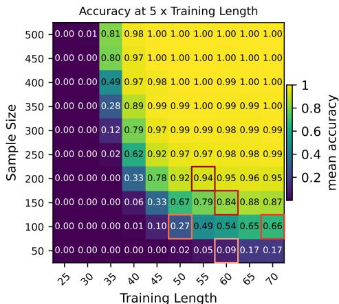  
Token Budget: 3k 5k 7k 9k 11k  
Figure 1: Our results predict that increasing the length of the training words can be much more token-efficient than increasing their number; test accuracy for the language $A _ { \mathrm { 1 5 } }$ (Sec. 5) on words five times longer than the training length. We highlight in red the highest-accuracy cell at five different training token budgets.

Length generalization is governed by two quantities: the number of training samples, and their length. Sample count determines how reliably the training data pins down the target function, as in classical statistical learning theory; sample length determines how well the model extrapolates, since the longest input length at which the target function’s behavior is observed dictates to which point a model will extrapolate beyond it. For a given target function and learning procedure, we thus need to consider not only its sample complexity (the required number of training samples), but also its length complexity (the required length of training samples).

Here, we take up the question of providing quantitative bounds on generalization along both axes for multi-layer transformers in the fixed-precision regime. We study the questions:

How do properties of a target function influence the length complexity and data complexity of the task?

When both sample size and length are bounded, how do they trade off? In particular, under afixed token budget, how to best allocate sample size and length?

and address these by providing generalization bounds depending on both sample size and input length. The main idea is that training length determines which behaviors become observable; sample size determines how reliably those behaviors are learned. Below a task-dependent length threshold, some competing behaviors cannot be distinguished. Around the relevant transition, longer examples can make informative events much more common; increasing length can thus strongly reduce sample complexity in this regime. Beyond that transition, the benefit of additional length diminishes and additional independent examples matter more.

## 2 BACKGROUND

## 2.1 TRANSFORMERS

We study transformers in the fixed-precision regime, without positional encodings, as formalized by Li & Cotterell (2025; 2026) (see also Li et al. (2024); London & Kanade (2025)).

This class is expressive enough to accommodate key algorithmic primitives relevant to transformers, such as retrieving past symbols, checking global symbol alternation patterns, or the “induction head” construction. Fixed-precision transformers are less expressive than log- or unbounded-precision transformers; this turns out to be necessary for obtaining quantitative results, because length generalization bounds for the latter are known to be uncomputable in the worst case by results of Yang et al. (2026a). We discuss the detailed comparison across models of transformers in Appendix A.

Our model of transformers derives from Li & Cotterell (2025): we consider transformers with softmax attention, fixed precision, no positional encodings and strict causal masking. However, we generalize over Li & Cotterell (2025) in viewing transformers not as binary classifiers, but as providing an output at every position. We provide details in Appendix B.2. All activations are computed in F, a finite subset of R extended with −∞ and ∞. The result of every operation is rounded to F.

Fix a finite alphabet Σ. A fixed-precision transformer T, also just called transformer consists of token embeddings in dimension D, a sequence of L layers each consisting of H softmax attention heads with a ReLU feedforward network, and finally a linear output projection. Overall, it takes a word $w \in \Sigma ^ { * }$ input and returns vectors of dimension ν at every input position: $T ( w ) \in \mathbb { F } ^ { \nu \times | w | }$ . We suppose that H always divides D, and that the dimension per head $D _ { h }$ is uniform among the heads. We omit layer norm, as it is not essential to our results and requires extra care in fixed precision; see Appendix E.5 for more details. Assuming that Σ, F and the output dimension ν are shared, we refer to these transformers as $\mathcal { F P T } ( L , D , H )$ . See Appendix B.2 for details.

## 2.2 LEARNING FRAMEWORK

We follow prior sample complexity bounds in studying an idealized learning model that abstracts away from the algorithmic process of learning. Capacity-based learning bounds (Edelman et al., 2022; Trauger & Tewari, 2024; Yang et al., 2026c) apply to Empirical Risk Minimization (ERM), which finds parameters minimizing training error under some constraint on the hypothesis class. We contrast it with the Guess & Check algorithm (G&C, Chiang et al., 2023; Buzaglo et al., 2024), which samples parameter settings from the parameter space until a setting interpolating the training set is found. Guess & Check expands over ERM by modeling the inductive bias of SGD-like optimizers towards solutions occupying large volumes in parameter space (Chiang et al., 2023; Buzaglo et al., 2024). This is an important difference over bounds based on ERM (Edelman et al., 2022; Yang et al., 2026c; Trauger & Tewari, 2024), as it (i) allows us to explicitly take into account the effect of both the hypothesis class and the ground-truth function, (ii) while bounds depend more mildly on the hypothesis model’s size than capacity-based bounds. This enables stronger results when the target function can be represented by small models, and we find it to be borne out empirically in experiments. G&C is closely related to a Bayesian interpretation of learning, as it samples from a posterior over the parameter space conditional on the training set (e.g. Haussler et al., 1994). We throughout work in the realizable regime, where the training data can be exactly fitted by an element of the hypothesis class. Here, ERM and G&C can be defined as follows:

Definition 2.1. Let a hypothesis class $\mathcal { H } = \mathcal { F P T } ( L _ { s } , D _ { s } , H _ { s } )$ (where $\cdots { \mathit { s } } ^ { \prime \prime }$ stands for “student”), and a training set $( X ^ { ( n ) } , Y ^ { ( n ) } ) _ { n = 1 , \dots , N } ,$ , be given.

The ERM Learner selects a transformer $T _ { s } ~ \in ~ \mathcal { H }$ such that Ts perfectly fits the training set: $T _ { s } ( X ^ { ( n ) } ) \equiv Y ^ { ( n ) } \forall ( X ^ { ( n ) } , Y ^ { ( n ) } ) _ { n = 1 , \ldots , N }$ . The Guess & Check Learner returns a sample from the posterior

$$
P \left( T _ { s } \mid T _ { s } ( X ^ { ( n ) } ) \equiv Y ^ { ( n ) } \forall ( X ^ { ( n ) } , Y ^ { ( n ) } ) _ { n = 1 , \ldots , N } \right)\tag{1}
$$

where $P ( T _ { s } )$ is the uniform distribution over H.

Intuitively, G&C adds an inductive bias towards hypotheses represented by a larger volume in parameter space. See Appendix A for discussion beyond the interpolating regime.

Remark 2.1. Throughout this paper, we consider the student–teacher learning framework between two transformers $T _ { s }$ and $T _ { t }$ , with $\mathbf { \bar { \Gamma } } L _ { s } \geq L _ { t } , D _ { s } \geq D _ { t } , H _ { s } \geq H _ { t }$ and $D _ { h , s } \geq D _ { h , t }$ for realizability.

## 3 LENGTH GENERALIZATION

We first derive length generalization bounds when unbounded data samples are available (Section 3.1); and statistical generalization bounds at a fixed length (Section 4.1). We then derive joint generalization bounds (Section 4.2).

## 3.1 DETERMINISTIC LENGTH GENERALIZATION

Our first result states that, if two fixed-precision transformers exactly agree up to a certain length bound C, they must agree everywhere. We in fact obtain two distinct bounds with different rates:

Lemma 3.1 (Deterministic Length Generalization). Let rF be a well chosen constant and let $T _ { s } \in \mathcal { F P T } ( L _ { s } , D _ { s } , H _ { s } )$ and $T _ { t } \bar { \in \mathcal { F P T } } ( L _ { t } , D _ { t } , H _ { t } )$ be fixed-precision transformers (2.1). Set

$$
C _ { 0 } : = r _ { \mathbb { F } } \left[ L _ { s } D _ { s } | \mathbb { F } | ^ { D _ { h , s } + 1 } + L _ { t } D _ { t } | \mathbb { F } | ^ { D _ { h , t } + 1 } \right] + 1 , \qquad C _ { 1 } : = \binom { r _ { \mathbb { F } } L _ { s } + | \Sigma | } { | \Sigma | }\tag{2}
$$

and let $C : = \operatorname* { m i n } ( C _ { 0 } , C _ { 1 } )$ . Then, $i f T _ { s }$ and $T _ { t }$ agree on every word in $\Sigma ^ { \leq C }$ , they are identical on every word in $\Sigma ^ { * }$ :

$$
\begin{array} { r } { T _ { s } | _ { \leq C } \equiv T _ { t } | _ { \leq C } \quad \implies \quad T _ { s } \equiv T _ { t } . } \end{array}\tag{3}
$$

This statement yields a first length generalization guarantee, in the setting where unbounded data samples are available: In this case, if a learned model $T _ { s }$ exactly fits data representing a target function expressed by $T _ { t }$ up to length $C ,$ then we know $T _ { s } \equiv T _ { t }$ even on longer length strings, i.e., length generalization occurs.

See Appendix D for the formal proof; here, we provide an informal discussion to build intuition. Given a teacher transformer $T _ { t }$ implementing the target function and a student $T _ { s }$ from the hypothesis class, we introduce the differencefunction, which checks for any given word if the output vectors of both transformers match at every position. Previously, Li & Cotterell (2025) showed that fixedprecision transformers with a binary classifying output layer are expressively equivalent to LTL[P], a fragment of linear temporal logic, and further can be represented as a partially-ordered deterministicfinite automaton (poDFA) (Figure 2). A poDFA is a DFA where the reachability relation defines a partial order on the state set; intuitively, such automata have no nontrivial loops. Intuitively, the state space describes the dynamic of the transformer’s KV-cache; as soon as some activation is added to the KV-cache, it cannot be removed anymore, giving rise to the partially ordered loop-free structure.

Building on this, we express the difference function between the student and the teacher as a logic formula in $\mathbf { L T L } [ \mathbf { P } ]$ , from which we obtain a poDFA $A _ { \Delta }$ . The student and the teacher transformers produce a different output somewhere on a word $w _ { 1 } \ldots , w _ { n }$ if and only if $A _ { \Delta }$ , run on the word, ends up in the unique absorbing disagreement state ⊥ (Figure 2e). As a supplement, we mention in Appendix C, D how transformers exist as ordered Mealy machines (Def. C.5), providing a similar underlying ordered structure on individual transformers, even outside of the learning framework.

We then upper-bound the height of $\pmb { \mathcal { A } } _ { \Delta } - \mathrm { i } . \mathrm { e } .$ ., the length of its longest transition chain. The key idea here is that observing behaviour on strings up to roughly this length should be important for length generalization, because strings of this length should be minimally required to be able to observe the whole state space of $A _ { \Delta } -$ and thus the whole range of behaviour expressed by the student and teacher models. We obtain $C _ { 0 } , C _ { 1 }$ as two upper bounds on the height of $\mathcal { A } _ { \Delta } \ ( \mathrm { { e q . } } \ 2 )$ ; whichever bound is smaller provides a tighter bound in a given setting, though neither dominates the other globally. Notably, we show some kind of tightness in L and F of our bounds in Appendix D.5, where we prove that any upper bound on the height must depends at least linearly on |F| and L.

Now, if $T _ { s }$ and $T _ { t }$ agree up to length $C = \displaystyle \operatorname* { m i n } \{ C _ { 0 } , C _ { 1 } \} , A _ { \Delta }$ cannot visit a ⊥ state on any word of this length. But given that $C$ upper-bounds the height of the automaton, the $\perp$ state cannot be reachable even by longer inputs, and $T _ { s } \equiv T _ { t }$ across $\Sigma ^ { * }$

The above entails a first length-generalization bound in the limiting case where all data up to some length is available; it is an illustrative first special case of our general result.

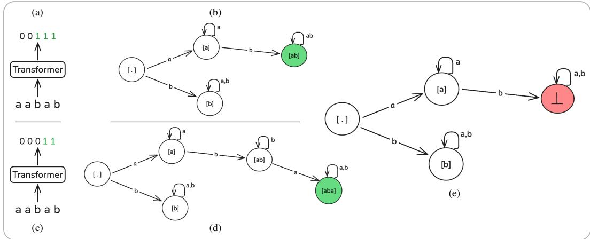  
Figure 2: Examples of poDFAs; the vertices are the states and the arrows are the transition functions $\delta .$ Figure (a) represents the transformer that outputs $" 1 "$ as soon as the input word has entered the language $L _ { 2 } : = a \Sigma ^ { * } b \bar { \Sigma } ^ { * }$ with (b) being the associated poDFA. Similarly, (c) depicts the transformer that recognizes the language $L _ { 3 } : = a \Sigma ^ { * } b \Sigma ^ { * } a \Sigma ^ { * }$ and (d) is its corresponding poDFA. Figure (e) is the $\mathsf { p o D F A } \mathcal { A } _ { \Delta }$ of the difference function between these two transformers. Any disagreement sends the run to the absorbing final state ⊥

## 3.2 EXTENSION TO THE PROBABILISTIC FRAMEWORK

We next ask for a similar length generalization guarantee when $T _ { s }$ and $T _ { t }$ are equal only on most strings up to length K. Setting the data distribution $\mathcal { D } _ { K } : = \mathrm { U n i f } ( \Sigma ^ { \leq K } )$ and using the bound C from Lemma 3.1, we indeed find a probabilistic extension of the guarantee:

Lemma 3.2 (Probabilistic Length Generalization). Let $0 < \epsilon < 1 , | \Sigma | \geq 2$ and consider the training words of length up to ${ \check { K } } ,$ , with

$$
K \geq | \Sigma | \left( C + \log \frac { 1 } { \epsilon } + \sqrt { \log ^ { 2 } \frac { 1 } { \epsilon } + 2 C \log \frac { 1 } { \epsilon } } \right) \sim \mathcal { O } \big ( | \Sigma | ( C + \log \frac { 1 } { \epsilon } ) \big ) .\tag{4}
$$

Then

$$
\begin{array} { r } { \operatorname* { P r } _ { \mathcal { D } _ { K } } \left[ T _ { s } ( w ) \neq T _ { t } ( w ) \right] \leq \epsilon \quad \implies \quad \forall M \geq K , \operatorname* { P r } _ { \mathcal { D } _ { M } } \left[ T _ { s } ( w ) \neq T _ { t } ( w ) \right] < 3 \epsilon . } \end{array}
$$

See Appendix D.4 for the formal proof. Intuitively, this holds for two reasons: (i) the poDFA $\mathbf { \mathcal { A } } _ { \Delta }$ ultimately reaches a sink absorbing state; (ii) the input distribution $\mathcal { D } _ { K }$ is uniform and so are the letters: this implies that for any non-absorbing state, the probability to leave the state by reading the next letter is at least of $1 / | \Sigma |$ . Therefore, after a big enough number of steps $K , A _ { \Delta }$ will be likely to live in an absorbing state. In particular, since the probability of a transition is at least $1 / | \Sigma |$ , the overall probability of a word to reach an absorbing state after $\bar { \boldsymbol { K } }$ steps dominates the binomial law $Y \sim \mathrm { B i n } ( K , 1 / | \bar { \Sigma } | )$ ). The lemma follows from the application of a Chernoff bound.

## 4 JOINING LENGTH AND STATISTICAL GENERALIZATION

## 4.1 DATA COMPLEXITY

We lift the deterministic statement to a statistical generalization statement. The key here is to combine Lemma 3.1 with statistical in-distribution generalization on the strings up to length $K \colon$

Proposition 4.1 (Statistical Generalization for ERM and G&C). Fix $\epsilon \in ( 0 , 1 )$ and $\delta \in ( 0 , \frac { 1 } { 5 } )$ Assume the targetfunction is represented by a teacher $T _ { t } \in \mathcal { F P T } ( L _ { t } , D _ { t } , H _ { t } )$ , and the learner (G&C or ERM) selects a student Ts from the hypothesis class $\mathcal { F P T } ( L _ { s } , D _ { s } , H _ { s } )$ . Let S be an i.i.d. sample ofN stringsfrom $\mathcal { D } _ { K }$

1. Let $T _ { s }$ be obtained by the G&C learner on S. If

$$
N \ge \frac { 1 } { \epsilon } \big ( B \log | \mathbb { F } | + 3 \log \frac { 2 } { \delta } \big ) , \qquad B \sim { \mathcal O } \big ( L _ { t } D _ { t } ^ { 2 } + D _ { s } D _ { t } ( L _ { s } + L _ { t } ) + | \Sigma | D _ { s } \big ) ,
$$

then, with probability at least $1 - \delta$ over S and the draw of $\mathbf { \nabla } T _ { s } ,$

$$
\operatorname* { P r } _ { w \sim \mathcal { D } _ { K } } \left[ T _ { s } ( w ) \neq T _ { t } ( w ) \right] < \epsilon .
$$

2. Let $T _ { s }$ be obtained by ERM on S. If

$$
N \ge \frac { 1 } { \epsilon } \big ( B _ { E R M } \log | \mathbb { F } | + \log ( 1 / \delta ) \big ) , \qquad B _ { E R M } \sim \mathcal { O } \big ( L _ { s } D _ { s } ^ { 2 } + | \Sigma | D _ { s } \big ) ,
$$

then, with probability at least $1 - \delta$ over S,

$$
\operatorname* { P r } _ { w \sim \mathcal { D } _ { K } } \left[ T _ { s } ( w ) \neq T _ { t } ( w ) \right] < \epsilon .
$$

Note here that $\mathcal { O } ( \cdot )$ absorbs constants depending on F and ν. The ERM bound has a similar flavor to bounds using capacity-based arguments (Edelman et al., 2022; Trauger & Tewari, 2024; Yang et al., 2026c) in that it scales with parameters count of the hypothesis class. The G&C bound has a similar dependency but scales with $D _ { s } D _ { t }$ rather than $D _ { s } ^ { 2 }$ . This provides improved generalization when a large student network learns a low-complexity target.

This result extends the work of Rizvi-Martel et al. (2026) with some improvements; we give the exact values of B and $B _ { E R M }$ and discuss the proof and extensions in Appendix E. For ERM, this is a straightforward application of Appendix B.1 in Buzaglo et al. (2024). For G&C, the proof strategy (Appendix E) is to show that low-complexity teachers can be embedded in many equivalent ways into the parameter space of a higher-complexity hypothesis class; this means that G&C is intrinsically more likely to find low-complexity interpolators. This insight (Buzaglo et al. (2024))

drives the appearance of a teacher complexity term, and a milder dependence on student complexity than based on hypothesis class parameter count alone.

## 4.2 MAIN RESULT: JOINT STATISTICAL AND LENGTH GENERALIZATION

We now combine length and statistical generalization to obtain our main result. The basic intuition is that generalization occurs when (i) the length is sufficiently long so that all representative behavior relevant at long lengths are already visible, (ii) the sample size is sufficient for achieving low test error at this length; combining (i) and (ii) then entails low test error at higher lengths. The result is:

Theorem 4.1 (Statistical and Length Generalization). Let the transformers $T _ { s } \in$ $\mathcal { F P T } ( L _ { s } , D _ { s } , H _ { s } )$ student and ${ T _ { t } } \in \bar { \mathcal { F P T } } ( L _ { t } , D _ { t } , H _ { t } )$ teacher satisfying 2.1, C as in $E q . \ 2 ,$ $\epsilon \in ( 0 , 1 )$ and $\delta \in ( 0 , \frac { 1 } { 5 } )$

Let $\dot { T } _ { s }$ be given by the Guess & Check learner, agreeing with $T _ { t }$ on N i.i.d. samples from $\mathcal { D } _ { K }$ with

$$
N \geq \frac { 1 } { \epsilon } \big ( B \log | \mathbb { F } | + 3 \log \frac { 2 } { \delta } \big ) \sim \mathcal { O } \left( \frac { 1 } { \epsilon } [ ( L _ { t } D _ { t } ^ { 2 } + D _ { s } D _ { t } ( L _ { s } + L _ { t } ) + | \Sigma | D _ { s } ) + \log \frac { 1 } { \delta } ] \right)\tag{5}
$$

and

$$
K \geq | \Sigma | \left( C + \log \frac { 1 } { \epsilon } + \sqrt { \log ^ { 2 } \frac { 1 } { \epsilon } + 2 C \log \frac { 1 } { \epsilon } } \right) \sim \mathcal { O } \big ( | \Sigma | ( C + \log \frac { 1 } { \epsilon } ) \big ) ,\tag{6}
$$

where

$$
\begin{array} { r } { C : = \operatorname* { m i n } ( C _ { 0 } , C _ { 1 } ) , \quad C _ { 0 } \sim \mathcal { O } \left( L _ { s } D _ { s } \exp ( D _ { h , s } ) + L _ { t } D _ { t } \exp ( D _ { h , t } ) \right) , \quad C _ { 1 } \sim \mathcal { O } \left( 2 ^ { | \Sigma | + L _ { s } } \right) . } \end{array}\tag{7}
$$

Then with probability $1 - \delta ,$ we have

$$
\forall M \ge K , \qquad \operatorname* { P r } _ { \mathcal { D } _ { M } } \left[ T _ { s } ( w ) \neq T _ { t } ( w ) \right] < 3 \epsilon .\tag{8}
$$

See Appendix F.1 for the formal proof. For ERM, an analogous result ensues from bounding N appropriately, following Proposition 4.1. In addition, the theorem can be adapted to alternative distributions $\widetilde { D } _ { K }$ if they sample enough long words; we give an example in Appendix F.4.

## 4.3 TRADEOFF BETWEEN LENGTH AND DATA COMPLEXITY

The previous theorem provides conditions on the data complexity N and the training length thresh old $\dot { K } ,$ such that low loss can be achieved. Assuming the same learning framework for student $T _ { s }$ teacher $T _ { t }$ and writing $s : = | \Sigma |$ , we now investigate how these quantities trade off, by giving an error bound for any joint choice of N and $K$

Theorem 4.2 (Joint Generalization Bound in Sample Size and Length). Define

$$
a _ { C } ( K ) : = \operatorname* { P r } \left( B i n ( K , \frac { 1 } { s } ) \geq C \right) , \quad \rho : = \frac { s } { s - 1 } \quad a n d \quad B _ { \delta } : = B \log | \mathbb { F } | + 3 \log \frac { 2 } { \delta } ,\tag{9}
$$

where C is the bound given in Lemma 3.1 and B is the sample complexity term from Proposition 4.1.

Now assume that the student is trained on N random samplesfrom $\mathcal { D } _ { K }$ and that K is big enough so that $a _ { C } ( K ) \neq 0 .$ . Then with probability $1 - \delta ,$ for any length $M \geq K$ , the error rate between the student and the teacher is bounded as

$$
\epsilon : = \mathrm { P r } _ { \mathcal { D } _ { M } } \left[ T _ { s } ( w ) \neq T _ { t } ( w ) \right] \leq \frac { \rho B _ { \delta } } { N \cdot a _ { C } ( K ) } .\tag{10}
$$

See Appendix F.2 for the proof. This value $a _ { C } ( K )$ lower-bounds the probability of reaching an absorbing state by time $K ,$ and $a _ { C } ( K ) = 0$ when $K < C$ . This theorem holds for either of the Guess & Check or the ERM learner, setting B accordingly following Proposition 4.1. Moreover, under an appropriate definition of $a _ { C } ( K )$ , the theorem even remains valid if the input strings are generated from appropriate nonuniform distributions (Appendix G.2). We further complement the upper bound (10) with a lower bound: there are families of target functions and input distributions such that the expected test error on long inputs is lower-bounded by $\frac { B } { 8 N a _ { C } ( K ) }$ for an appropriate choice of B (Appendix, Theorem G.3).

Takeaway: Importance of Long Training Samples for Transformers. This implies the following: First, when $K < C$ , there is no assurance of length generalization. Second, when $K$ just slightly exceeds $C ,$ , length generalization can be guaranteed, but only at an extraordinary sample size on the order of $\gtrapprox \hat { s } ^ { C }$ , with s the size of the alphabet. Namely, ${ \bf \dot { \mathbf { \psi } } } _ { a _ { C } } ( C ) = s ^ { - C } { \bf \Psi }$ , leading to a sample size requirement $N _ { r e q } ( C ) = N _ { 0 } s ^ { C }$ where $\begin{array} { r } { N _ { 0 } = \frac { \rho B _ { \delta } } { \epsilon } } \end{array}$ . Intuitively, this happens because only a small fraction of the samples will already have reached an absorbing state; most samples will thus not be informative about the target function’s behavior on long strings.

Third, increasing K by a constant can reduce the required sample size by a multiplicative factor. Specifically, increasing length from $C$ to $s C$ reduces the required sample size by a factor of at least $s ^ { \hat { C } } / 2 ;$ a linear increase of $\check { K }$ permits an exponential saving on $N$

Given a fixed training-token budget $B u d g e t = N K$ , the above considerations allow us to determine an optimal allocation to N and $K ;$ we show in Appendix F.3 that, for $C \geq 2$ , the following closed form achieves an error bound within a factor $1 + \mathcal { O } ( \sqrt { \log C / C } )$ of the optimum:

$$
\widehat { K } : = \left\lceil | \Sigma | \left( C + \log C + \sqrt { \log ^ { 2 } C + 2 C \log C } \right) \right\rceil ,
$$

provided $B u d g e t \geq \widehat { K }$ . Intuitively, this means that close-to-optimal budget allocation can be achieved at around $K \sim | \Sigma | C$ , exponentially more efficient than at $K \sim C$

Our result reveals that there are several regimes of generalization. When K is too small, there is in general no hope of length generalization no matter how large N is. When K has just crossed the threshold given by the longest chain, one may need a very large $N _ { \cdot }$ , because only few strings will have reached the final state. In this regime, increasing K further is much more efficient than increasing $N \colon$ increasing K by an additive constant can cut down $N$ by a multiplicative factor.

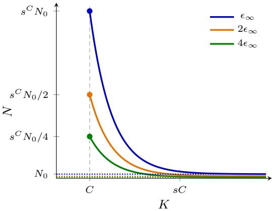

## 4.4 EXTENSION WITH LOCAL ATTENTION

Local attention has emerged as an effective and popular addition to transformers (e.g. Beltagy et al., 2020). It is also relevant because positional information often specifically introduces a locality bias favoring attention to recent position (Press et al., 2022; Su et al., 2024). Local attention thus simultaneously serves as a sim-

Figure 3: Schematic error-budget limit lines with linear axes. At $K = C$ , every budget can be respected with $N \sim \mathcal { O } ( s ^ { C } )$ training samples. By length $K = s C$ at least half of the words have reached their terminal absorbing states, so each curve is within a factor 2 of its floor; further length gains saturate.

plified account of the role of positional information (similar to positional functions in Limit Transformers, Huang et al. (2025a); Izzo et al. (2025)). In each layer, we add a certain number of local attention heads at some window size $W { \mathrm { : } }$ ; for these heads, context positions at distance $> W$ are masked. Both W and the number of local heads are hyperparameters. We refer to Li & Cotterell (2026) for the full formalization in the $\mathcal { F P T }$ context.

Formally, we can model an $\mathcal { F P T }$ with local attention in terms of a more complex automaton that arises as a cascade product of a poDFA with a simple automaton that maintains the last $L \cdot W$ symbols. That ${ \mathrm { i s } } ,$ we can model the difference automaton $\mathcal { A }$ in terms of the cascade product of a poDFA representing the output difference between the two transformers with a simple automaton that maintains the last $L \cdot W ^ { \dot { } }$ symbols. More details in Appendix G.1.

The statistical generalization guarantee (Proposition 4.1) is unaffected, because the number of parameters does not change when making some heads local. The length generalization guarantee changes. First, the construction we provide is only valid for the bound $C _ { 0 }$ in Eq. 2. Second this threshold $C _ { 0 }$ receives a factor of $R \dot { : } = W L + 1$ . Third, the bounding binomial probability to go forward in the underlying poDFA is also reduced from $| \Sigma | ^ { - 1 } \mathrm { t o } | \Sigma | ^ { - R } .$ . Thus, as long as $W$ is fixed, we have the same qualitative predictions as above: model size impacts data and length complexity; and sample size and length trade off.

## 5 EXPERIMENTS

We introduce three families of tasks, and study (i) the impact of teacher and student complexity on length and data complexity, and (ii) the predicted interaction between length and sample size.

Tasks. We defined three task families, each along a complexity scale indexed by $k \in \mathbb N ,$ as follows (i) Alternating languages $L _ { k } \mathbf { : }$ Detecting whether $\geq k$ distinct blocks of $\boldsymbol { a } ^ { \prime } \mathbf { s }$ and b’s have occurred (Yang et al., 2025a) – that is, checking membership in the languages $L _ { 2 } = a ^ { + } b ^ { + } \Sigma ^ { * } ; L _ { 3 } =$ $a ^ { + } b ^ { + } a ^ { + } \Sigma ^ { * }$ , etc. There is a teacher family with number of layers $L _ { k } = \Theta ( k )$ , embedding dimension $D _ { k } = O ( 1 )$ , head count $H _ { k } = O ( 1 )$ and fixed alphabet size $| \Sigma | _ { k } = O ( \bar { 1 } )$ . Specifically, the letter sampling is not uniform, with probability to alternate block set to 0.05. This still fits our theoretical framework, as explained in Appendix H.1.1. (ii) Alphabet languages $A _ { k } \mathbf { : }$ Detecting whether all symbols from a given alphabet $\dot { \Sigma } _ { k } = [ k ]$ have occurred. There is a teacher family with $L _ { k } = O ( 1 )$ $\bar { D } _ { k } = { \cal O } ( k ) , \bar { H _ { k } } = \bar { { \cal O } ( k ) } , | \Sigma | _ { k } = \bar { { \cal O } ( k ) }$ (iii) Induction Head tasks $I H _ { k } \colon$ Outputting which next tokens can follow the current token under the context’s bigram distribution over the alphabet $\Sigma _ { k } = [ k ]$ (cf. Edelman et al., 2024); that is, given the current token α output a vector $\in \mathbb { F } ^ { | \Sigma | }$ indicating for which symbols β the bigram αβ has contextually occurred. There is a teacher family with $\bar { L _ { k } } = O ( 1 ) , \bar { D _ { k } } = O ( k ) , \bar { H _ { k } } \stackrel { \_ } { = } O ( 1 ) , | \Sigma | _ { k } = O ( k )$ , with local attention. See Appendix H for teacher constructions. Taken together, these tasks allow us to test the theoretical prediction that the teacher size (impacted by $L , H , D , | \Sigma | )$ impacts both length and data complexity.

Setup. To test our predictions against ordinary gradient-based training, we train FP32 transformers with Adam Kingma & Ba (2014) and binary cross-entropy over 10 seeds. We use binary classification because exact logit-equality in FP32 is not realistic. The difference function between the student and the teacher then checks for logit signs rather than exact values (Appendix H.2). In addition, we retain only runs with perfect training accuracy—that is, runs that correctly classify every supervised target on every training word. This enforces the interpolation conditioning of Guess & Check. Trained architectural sizes are fixed and common across a family, unless explicitly varied. When sweeping N, we adjust K across tasks to match the fraction of words exhibiting the required blocks, letters, or bigrams, making examples approximately comparable in informativeness (Appendix H.2). Sweeps of K instead compare tasks at common lengths.

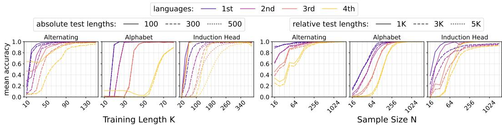  
Figure 4: Left: Impact of teacher’s size on length complexity. Larger teachers require training samples to be longer. The abscissa scale is linear, as suggested by theory. Right: Impact of teacher’s size on data complexity. Larger teachers require more training samples for similar length generalization performance. The abscissa scale is logarithmic, as suggested by theory. On both sides, the plotted tasks are respectively the Alternating $L _ { 4 } , L _ { 5 } , L _ { 6 } , L _ { 7 } ,$ , the Alphabet $A _ { 1 0 } , A _ { 1 2 } , A _ { 1 5 } , A _ { 2 0 }$ and the Induction Head $I H _ { 5 } , I H _ { 6 } , \mathsf { \bar { I } } H _ { 7 } , I \dot { H } _ { 8 }$

Effect of Transformers Size on Data and Length Complexity. Across the three families, increasing teacher size impacts the sample size N and training length K at which generalization becomes successful (Figure 4). This is in line with our theoretical predictions, in particular, the G&C-based bounds. Interestingly, the student size had relatively small impact on sample size and length (Appendix H.3.2). Thus, G&C-based bounds are successful in capturing the fact teacher size is an important factor beyond student size, but may still be overly pessimistic about the impact of student size.

Tradeoff between Sample Size and Length. Longer training words can substantially reduce the sample size needed for generalization (Figure 5). In particular, we find the non-linear interaction between the two quantities, qualitatively in line with the predictions from Figure 3. This backs the idea that an efficient token-budget allocation should ensure that training samples are long enough. See Appendix H.3.3 for further results showing the same pattern.

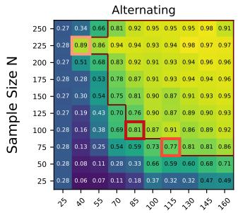

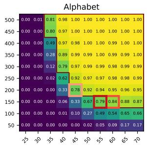  
Training Length K

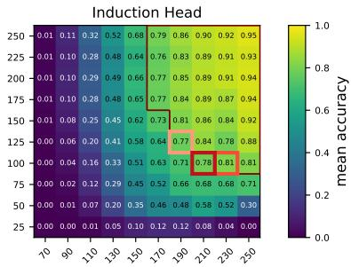  
Figure 5: Tradeoff between the training length and the sample size for one task of each language class: Alternating $L _ { 6 } ,$ Alphabet $A _ { \mathrm { 1 5 } }$ and Induction Head $I H _ { 7 }$ . Evaluation at length 5 times the training length. Brown contouring around all cells with accuracy $\geq 0 . 7 5$ . Under this condition, the 3 cells with the smallest tokenbudget are framed.

## 6 DISCUSSION

Our result goes beyond established theory in two ways: First, it goes beyond statistical generalization bounds for transformers by guaranteeing length generalization. Prior learning results for transformers characterize generalization error and sample size when the test and train samples are at the same sequence length (Edelman et al., 2022; Trauger & Tewari, 2024; Li et al., 2026; Truong, 2024; Yang et al., 2026c; Li et al., 2025; Rizvi-Martel et al., 2026; Lintilhac & Shaikh, 2026; Mousavi-Hosseini et al., 2025; Hanneke et al., 2026; Joshi et al., 2025). Our results instead consider the more general case of length generalization, in the setting of fixed-precision transformers. We note that our main result ingests the statistical generalization bound essentially as a black box; hence, our results might analogously also be formalized on the basis of other statistical generalization bounds.

Second, our results go beyond prior work on length generalization by giving explicit and joint rates for sample size and length. So far, the most generally predictive account of length generalization has been the RASP-L Conjecture (Zhou et al., 2024) and its formalization via C-RASP and Limit Transformers (Huang et al., 2025a). This theory has been highly predictive of which tasks empirically show length generalization (Yang et al., 2026b), but provides no quantitative predictions. Notably, C-RASP is more powerful than ${ \mathcal { F P T } } ;$ e.g. it can model the MAJORITY language. However, C-RASP is a too loose target for quantitive learning bounds: Yang et al. (2026a) show that, beyond the shallow-depth case (Izzo et al., 2025; Chen et al., 2025), any length threshold would need to grow uncomputably with model complexity. The positive fragment $\mathrm { { C } { \cdot } \mathrm { { R A S P } ^ { + } } }$ has expressivity equivalent to fixed-precision transformers and was studied in Yang et al. (2026a); Zetzsche et al. (2026). We compare with these results in detail in Appendix A. Importantly, our work innovates over these prior results by providing joint generalization guarantees in both sample size and length.

Like capacity-based generalization bounds (Edelman et al., 2022; Trauger & Tewari, 2024; Yang et al., 2026c), our work treats an idealized learning model that abstracts away from the computational process of finding a model fitting the training data. Understanding optimization dynamics for transformers has been difficult. Progress has been made for specific task families and restricted models, such as single layers (e.g. Yang et al., 2025b; Mwigo & Dasgupta, 2026; Huang et al., 2025b;

Wang et al., 2024) (including one-layer models performing chain-of-thought, Huang et al. (2025b)) or specific task families (e.g. Nichani et al., 2024). We view the study of G&C as an (imperfect) proxy for part of the implicit inductive bias of SGD-like learning; understanding of optimization dynamics for a general multi-layer model and a general hypothesis class will require new methods.

The main limitation of our results is that they predict asymptotic rates but not yet concrete realistic numerical bounds for specific tasks and models. The primary barrier here is that the bounds involve large constants involving the fixed-precision set F, which is large at full-precision training. It is an interesting question whether realistic numerical bounds can be obtained when training with strong quantization. Further limitations are that fixed-precision transformers are less expressive than logprecision or infinite-precision transformers, we did not treat positional encodings, and studied G&C and ERM as opposed to optimization dynamics.

## 7 CONCLUSION

We have provided generalization bounds for multi-layer fixed-precision transformers that account for the roles of both the number and the length of training samples. We provided a joint treatment of both dimensions, showing that, under a given token budget, increasing length can sometimes be exponentially more efficient than increasing sample size.

## ACKNOWLEDGMENTS

Funded in part by the Deutsche Forschungsgemeinschaft (DFG, German Research Foundation) – Project number 560456343. M.H. is supported by the Konrad Zuse School of Excellence in Learning and Intelligent Systems (ELIZA) through the DAAD programme Konrad Zuse Schools of Excellence in Artificial Intelligence, sponsored by the Federal Ministry of Education and Research.

## CONTRIBUTIONS

Ma.H. led the project. Mi.R. contributed Proposition 4.1. Mi.H. supervised the project.

## REFERENCES

Yotam Alexander, Yonatan Slutzky, Yuval Ran-Milo, and Nadav Cohen. Do neural networks need gradient descent to generalize? a theoretical study. In D. Belgrave, C. Zhang, H. Lin, R. Pascanu, P. Koniusz, M. Ghassemi, and N. Chen (eds.), Advances in Neural Information Processing Systems, volume 38, Main Conference, pp. 143774–143840. Curran Associates, Inc., 2025. doi: 10.52202/085713-4813. URL https://proceedings.neurips.cc/paper\_files/paper/2025/file/ d39fb2054215f07d1f90cc80c7a85edd-Paper-Conference.pdf.

Zeyuan Allen-Zhu, Yuanzhi Li, and Yingyu Liang. Learning and generalization in overparameterized neural networks, going beyond two layers. Advances in neural information processing systems, 32, 2019. URL https://proceedings.neurips.cc/paper\_files/paper/ 2019/hash/62dad6e273d32235ae02b7d321578ee8-Abstract.html.

Cem Anil, Yuhuai Wu, Anders Andreassen, Aitor Lewkowycz, Vedant Misra, Vinay Ramasesh, Ambrose Slone, Guy Gur-Ari, Ethan Dyer, and Behnam Neyshabur. Exploring length generalization in large language models. Advances in Neural Information Processing Systems, 35:38546–38556, 2022. URL https://proceedings.neurips.cc/paper\_files/paper/2022/ hash/fb7451e43f9c1c35b774bcfad7a5714b-Abstract-Conference.html.

Sanjeev Arora, Simon Du, Wei Hu, Zhiyuan Li, and Ruosong Wang. Fine-grained analysis of optimization and generalization for overparameterized two-layer neural networks. In Kamalika Chaudhuri and Ruslan Salakhutdinov (eds.), Proceedings of the 36th International Conference on Machine Learning, volume 97 of Proceedings of Machine Learning Research, pp. 322–332. PMLR, 09–15 Jun 2019. URL https://proceedings.mlr.press/v97/arora19a. html.

Jimmy Lei Ba, Jamie Ryan Kiros, and Geoffrey E. Hinton. Layer Normalization. arXiv preprint arXiv:1607.06450, 2016. URL https://arxiv.org/abs/1607.06450.

Peter L. Bartlett, Andrea Montanari, and Alexander Rakhlin. Deep learning: a statistical viewpoint, 2021. URL https://www.cambridge.org/core/journals/ acta-numerica/article/deep-learning-a-statistical-viewpoint/ 7BCB89D860CEDDD5726088FAD64F2A5A.

Iz Beltagy, Matthew E Peters, and Arman Cohan. Longformer: The long-document transformer. arXiv preprint arXiv:2004.05150, 2020. URL https://arxiv.org/abs/2004.05150.

Satwik Bhattamishra, Kabir Ahuja, and Navin Goyal. On the ability and limitations of transformers to recognize formal languages. In Proceedings of the 2020 Conference on Empirical Methods in Natural Language Processing (EMNLP), pp. 7096–7116, 2020. URL https: //aclanthology.org/2020.emnlp-main.576/.

J. A. Brzozowski. Languages of R-Trivial Monoids. Journal ofComputer and System Sciences, 20: 32–49, 1980. URL https://www.sciencedirect.com/science/article/pii/ 0022000080900033.

Gon Buzaglo, Itamar Harel, Mor Shpigel Nacson, Alon Brutzkus, Nathan Srebro, and Daniel Soudry. How uniform random weights induce non-uniform bias: Typical interpolating neural networks generalize with narrow teachers. In Ruslan Salakhutdinov, Zico Kolter, Katherine Heller, Adrian Weller, Nuria Oliver, Jonathan Scarlett, and Felix Berkenkamp (eds.), Proceedings of the 41st International Conference on Machine Learning, volume 235 of Proceedings of Machine Learning Research, pp. 5035–5081. PMLR, 21–27 Jul 2024. URL https: //proceedings.mlr.press/v235/buzaglo24a.html.

Thomas Chen, Tengyu Ma, and Zhiyuan Li. Non-asymptotic length generalization. In Aarti Singh, Maryam Fazel, Daniel Hsu, Simon Lacoste-Julien, Felix Berkenkamp, Tegan Maharaj, Kiri Wagstaff, and Jerry Zhu (eds.), Proceedings of the 42nd International Conference on Machine Learning, volume 267 of Proceedings of Machine Learning Research, pp. 8621–8682. PMLR, 13–19 Jul 2025. URL https://proceedings.mlr.press/v267/chen25ar.html.

Ping-yeh Chiang, Renkun Ni, David Yu Miller, Arpit Bansal, Jonas Geiping, Micah Goldblum, and Tom Goldstein. Loss landscapes are all you need: Neural network generalization can be explained without the implicit bias of gradient descent. In The Eleventh International Confer ence on Learning Representations, 2023. URL https://openreview.net/forum?id= QC10RmRbZy9.

Benjamin L Edelman, Surbhi Goel, Sham Kakade, and Cyril Zhang. Inductive Biases and Variable Creation in Self-Attention Mechanisms. In Kamalika Chaudhuri, Stefanie Jegelka, Le Song, Csaba Szepesvari, Gang Niu, and Sivan Sabato (eds.), Proceedings ofthe 39th International Conference on Machine Learning, volume 162 of Proceedings of Machine Learning Research, pp. 5793–5831. PMLR, 17–23 Jul 2022. URL https://proceedings.mlr.press/v162/ edelman22a.html.

Ezra Edelman, Nikolaos Tsilivis, Benjamin L. Edelman, Eran Malach, and Surbhi Goel. The evolution of statistical induction heads: In-context learning markov chains. In 38th Conference on Neural Information Processing Systems (NeurIPS 2024), volume 37, 2024. URL https://openreview.net/forum?id=qaRT6QTIqJ.

Michael Hahn and Mark Rofin. Why are sensitive functions hard for transformers? In Proceedings of the 62nd Annual Meeting of the Association for Computational Linguistics (Volume 1: Long Papers), pp. 14973–15008, 2024. URL https://aclanthology.org/2024.acl-long. 800.pdf.

Steve Hanneke, Idan Mehalel, and Shay Moran. Sample complexity of autoregressive reasoning: Chain-of-thought vs. end-to-end, 2026. URL https://arxiv.org/abs/2604.12013.

David Haussler, Michael Kearns, and Robert E Schapire. Bounds on the sample complexity of bayesian learning using information theory and the vc dimension. Machine learning, 14(1):83– 113, 1994. URL https://link.springer.com/article/10.1007/BF00993163.

Xinting Huang, Andy Yang, Satwik Bhattamishra, Yash Sarrof, Andreas Krebs, Hattie Zhou, Preetum Nakkiran, and Michael Hahn. A formal framework for understanding length generalization in transformers. In International Conference on Learning Representations (ICLR 2025), 2025a. URL https://arxiv.org/abs/2410.02140.

Xinting Huang, Aleksandra Bakalova, Satwik Bhattamishra, William Merrill, and Michael Hahn. Discovering interpretable algorithms by decompiling transformers to RASP. In Forty-third International Conference on Machine Learning, 2026. URL https://openreview.net/ forum?id=QnWjcTk14G.

Yu Huang, Zixin Wen, Aarti Singh, Yuejie Chi, and Yuxin Chen. Transformers provably learn chain-of-thought reasoning with length generalization. In The Thirty-ninth Annual Conference on Neural Information Processing Systems, 2025b. URL https://openreview.net/forum? id=aE0bCvXXBt.

Zachary Izzo, Eshaan Nichani, and Jason D. Lee. Quantitative bounds for length generalization in transformers, 2025. URL https://arxiv.org/abs/2510.27015.

Selim Jerad, Anej Svete, Jiaoda Li, and Ryan Cotterell. Disentangling the expressivity of rope. arXiv preprint arXiv:2608.11909, 2026. URL https://arxiv.org/abs/2608.11909.

Mayank Jobanputra, Yana Veitsman, Yash Sarrof, Aleksandra Bakalova, Vera Demberg, Ellie Pavlick, and Michael Hahn. Born a transformer–always a transformer? on the effect of pretraining on architectural abilities. Advances in Neural Information Processing Systems, 38:95463–95506, 2025. URL https://proceedings.neurips.cc/paper\_files/paper/2025/ hash/894403f9604374a7a003063e480f65b9-Abstract-Conference.html.

Nirmit Joshi, Gal Vardi, Adam Block, Surbhi Goel, Zhiyuan Li, Theodor Misiakiewicz, and Nathan Srebro. A theory of learning with autoregressive chain of thought, 2025. URL https:// arxiv.org/abs/2503.07932.

R. Kaas and J.M. Buhrman. Mean, median and mode in binomial distributions. Statistica Neerlandica, 34(1):13–18, March 1980. doi: 10.1111/j.1467-9574.1980.tb00681.x. URL https: //ideas.repec.org/a/bla/stanee/v34y1980i1p13-18.html.

Amirhossein Kazemnejad, Inkit Padhi, Karthikeyan Natesan Ramamurthy, Payel Das, and Siva Reddy. The impact of positional encoding on length generalization in transformers. Advances in Neural Information Processing Systems, 36:24892–24928, 2023. URL https://proceedings.neurips.cc/paper\_files/paper/2023/ hash/4e85362c02172c0c6567ce593122d31c-Abstract-Conference.html.

Diederik P Kingma and Jimmy Ba. Adam: A method for stochastic optimization. arXiv preprint arXiv:1412.6980, 2014. URL https://arxiv.org/abs/1412.6980.

Blanka Kov¨ er, Alexandra Butoi, Anej Svete, Michael Hahn, and Ryan Cotterell. Understanding the´ parameter space volume of transformers encoding boolean functions. In Forty-third International Conference on Machine Learning, 2026. URL https://openreview.net/forum?id= rUZVcnQjYW.

Jiaoda Li and Ryan Cotterell. Characterizing the Expressivity of Fixed-Precision Transformer Language Models. In 39th Conference on Neural Information Processing Systems (NeurIPS 2025), volume 38, 2025. URL https://arxiv.org/pdf/2505.23623.

Jiaoda Li and Ryan Cotterell. Characterizing the Expressivity of Local Attention in Transformers. In Proceedings of the 64th Annual Meeting of the Association for Computational Linguistics (Volume 1: Long Papers), pp. 37485–37507, 2026. doi: 10.18653/v1/2026.acl-long.1739. URL https://aclanthology.org/2026.acl-long.1739/.

Yawen Li, Tao Hu, Zhouhui Lian, Wan Tian, Yijie Peng, Huiming Zhang, and Zhongyi Li. Sharper generalization bounds for transformer, 2026. URL https://arxiv.org/abs/ 2603.21541.

Zhihao Li, Xue Jiang, Liyuan Liu, Xuelin Zhang, Hong Chen, and Feng Zheng. On the generalization ability of next-token-prediction pretraining. In Aarti Singh, Maryam Fazel, Daniel Hsu, Simon Lacoste-Julien, Felix Berkenkamp, Tegan Maharaj, Kiri Wagstaff, and Jerry Zhu (eds.), Proceedings of the 42nd International Conference on Machine Learning, volume 267 of Proceedings of Machine Learning Research, pp. 34943–34975. PMLR, 13–19 Jul 2025. URL https://proceedings.mlr.press/v267/li25ao.html.

Zhiyuan Li, Hong Liu, Denny Zhou, and Tengyu Ma. Chain of thought empowers transformers to solve inherently serial problems. In The Twelfth International Conference on Learning Representations, 2024. URL https://openreview.net/forum?id=3EWTEy9MTM.

Paul Lintilhac and Sair Shaikh. A sharper picture of generalization in transformers, 2026. URL https://arxiv.org/abs/2605.20988.

Charles London and Varun Kanade. Pause tokens strictly increase the expressivity of constantdepth transformers. Advances in Neural Information Processing Systems, 38:89765–89795, 2025. URL https://proceedings.neurips.cc/paper\_files/paper/2025/ hash/817c0ed5303e396e803d6a972f83c475-Abstract-Conference.html.

Toma´s Masopust and Micha ˇ el Thomazo. On the complexity of ¨ k-piecewise testability and the depth of automata. In Igor Potapov (ed.), Developments in Language Theory, volume 9168 of Lecture Notes in Computer Science, pp. 364–376, Cham, 2015. Springer. doi: 10.1007/ 978-3-319-21500-6 29. URL https://doi.org/10.1007/978-3-319-21500-6\_ 29.

Alireza Mousavi-Hosseini, Clayton Sanford, Denny Wu, and Murat A. Erdogdu. When do transformers outperform feedforward and recurrent networks? a statistical perspective, 2025. URL https://arxiv.org/abs/2503.11272.

Brian Mwigo and Anirban Dasgupta. Generalization bound for a shallow transformer trained using gradient descent. Transactions on Machine Learning Research, 2026. ISSN 2835-8856. URL https://openreview.net/forum?id=t3iUeMOT8Z.

John Myhill. Finite Automata and the Representation of Events. Technical Report TR-57-624, Wright Air Development Center, Wright-Patterson Air Force Base, Ohio, 1957.

Vaishnavh Nagarajan and J. Zico Kolter. Uniform convergence may be unable to explain generalization in deep learning, 2019. URL https://arxiv.org/abs/1902.04742.

Anil Nerode. Linear Automaton Transformations. Proceedings of the American Mathematical Society, 9(4):541–544, 1958. doi: 10.1090/S0002-9939-1958-0135681-9.

Eshaan Nichani, Alex Damian, and Jason D. Lee. How transformers learn causal structure with gradient descent. In Ruslan Salakhutdinov, Zico Kolter, Katherine Heller, Adrian Weller, Nuria Oliver, Jonathan Scarlett, and Felix Berkenkamp (eds.), Proceedings of the 41st International Conference on Machine Learning, volume 235 of Proceedings of Machine Learning Research, pp. 38018–38070. PMLR, 21–27 Jul 2024. URL https://proceedings.mlr.press/ v235/nichani24a.html.

Ofir Press, Noah Smith, and Mike Lewis. Train short, test long: Attention with linear biases enables input length extrapolation. In International Conference on Learning Representations, 2022. URL https://openreview.net/forum?id=R8sQPpGCv0.

Michael Rizvi-Martel, Satwik Bhattamishra, Guillaume Rabusseau, and Michael Hahn. From expressivity to sample complexity: Narrow teachers for transformers via c-rasp, 2026. URL https://arxiv.org/abs/2607.11760.

Jianlin Su, Murtadha Ahmed, Yu Lu, Shengfeng Pan, Wen Bo, and Yunfeng Liu. Roformer: Enhanced transformer with rotary position embedding. Neurocomputing, 568: 127063, 2024. URL https://www.sciencedirect.com/science/article/pii/ S0925231223011864.

Jacob Trauger and Ambuj Tewari. Sequence length independent norm-based generalization bounds for transformers. In Sanjoy Dasgupta, Stephan Mandt, and Yingzhen Li (eds.), Proceedings ofThe 27th International Conference on Artificial Intelligence and Statistics, volume 238 of Proceedings of Machine Learning Research, pp. 1405–1413. PMLR, 02–04 May 2024. URL https:// proceedings.mlr.press/v238/trauger24a.html.

Lan V Truong. On rank-dependent generalisation error bounds for transformers. arXiv preprint arXiv:2410.11500, 2024. URL https://arxiv.org/abs/2410.11500.

Zixuan Wang, Stanley Wei, Daniel Hsu, and Jason D. Lee. Transformers Provably Learn Sparse Token Selection While Fully-Connected Nets Cannot. In Ruslan Salakhutdinov, Zico Kolter, Katherine Heller, Adrian Weller, Nuria Oliver, Jonathan Scarlett, and Felix Berkenkamp (eds.), Proceedings of the 41st International Conference on Machine Learning, volume 235 of Proceedings of Machine Learning Research, pp. 51854–51912. PMLR, 21–27 Jul 2024. URL https://proceedings.mlr.press/v235/wang24ca.html.

Andy Yang and David Chiang. Counting like transformers: Compiling temporal counting logic into softmax transformers. In First Conference on Language Modeling, 2024. URL https: //openreview.net/forum?id=FmhPg4UJ9K.

Andy Yang, Michael Cadilhac, and David Chiang. Knee-deep in c-rasp: A transformer depth hierar-¨ chy. In 39th Conference on Neural Information Processing Systems (NeurIPS 2025), volume 38, 2025a. URL https://proceedings.neurips.cc/paper\_files/paper/2025/ hash/354a6e7be4f1a35127746b8147a31bfe-Abstract-Conference.html.

Andy Yang, Pascal Bergstraßer, Georg Zetzsche, David Chiang, and Anthony Widjaja Lin. Length ¨ Generalization Bounds for Transformers. In Forty-third International Conference on Machine Learning, 2026a. URL https://openreview.net/forum?id=XNXU8BJRT7.

Andy Yang, Blerta Veseli, Corentin Barloy, Michael Cadilhac, Andreas Krebs, Charles Paperman,¨ Howard Straubing, and Michael Hahn. Algebraic decomposition theory for transformer length generalization, 2026b. URL https://arxiv.org/abs/2608.13433.

Chenxiao Yang, Nathan Srebro, and Zhiyuan Li. Tight Sample Complexity of Transformers. In Steve Hanneke and Tor Lattimore (eds.), Proceedings of Thirty Ninth Conference on Learning Theory, volume 336 of Proceedings of Machine Learning Research, pp. 6887–6923. PMLR, 29 Jun–03 Jul 2026c. URL https://proceedings.mlr.press/v336/yang26a.html.

Tong Yang, Yu Huang, Yingbin Liang, and Yuejie Chi. Multi-head Transformers Provably Learn Symbolic Multi-step Reasoning via Gradient Descent. In D. Belgrave, C. Zhang, H. Lin, R. Pascanu, P. Koniusz, M. Ghassemi, and N. Chen (eds.), Advances in Neural Information Processing Systems, volume 38, Main Conference, pp. 116194–116285. Curran Associates, Inc., 2025b. doi: 10.52202/085713-3875. URL https://proceedings.neurips.cc/paper\_files/paper/2025/file/ a8f123480ede36612314d013aba6340c-Paper-Conference.pdf.

Georg Zetzsche, Hongjian Jiang, Andy Yang, Pascal Bergstraßer, Marco S¨ alzer, David Chiang, and¨ Anthony W. Lin. Length generalization for transformers via compression, 2026. URL https: //arxiv.org/abs/2609.08851.

Chiyuan Zhang, Samy Bengio, Moritz Hardt, Benjamin Recht, and Oriol Vinyals. Understanding deep learning requires rethinking generalization, 2017. URL https://arxiv.org/abs/ 1611.03530.

Hattie Zhou, Arwen Bradley, Etai Littwin, Noam Razin, Omid Saremi, Josh Susskind, Samy Bengio, and Preetum Nakkiran. What algorithms can transformers learn? a study in length generalization. In The Twelfth International Conference on Learning Representations, volume 2024, pp. 15898– 15926, 2024. URL https://openreview.net/forum?id=AssIuHnmHX.

Yijia Jessica Zhu and David Chiang. Exact-solution volume and length generalization in transformers. arXiv preprint arXiv:2610.07676, 2026. URL https://arxiv.org/abs/2610. 07676.

1 Introduction 1   
2 Background 2   
2.1 Transformers 2   
2.2 Learning framework 3   
3 Length Generalization 3   
3.1 Deterministic Length Generalization . 3   
3.2 Extension to the probabilistic framework . 4   
4 Joining Length and Statistical Generalization 5   
4.1 Data complexity . 5   
4.2 Main Result: Joint Statistical and Length Generalization 6   
4.3 Tradeoff between Length and Data Complexity 6   
4.4 Extension with Local Attention . 7   
5 Experiments 8   
6 Discussion 9   
7 Conclusion 10   
A FAQ 17   
B Conventions and Background 20   
B.1 Fixed-precision arithmetic 20   
B.2 Transformers 20   
C Logic 22   
C.1 Past temporal logic 22   
C.2 Past two-variable first-order logic . 23   
C.3 Transformers as logic formulas . 23   
C.4 Partially ordered automata 25   
C.5 Past subformulas and automaton height 27   
D Length Generalization 30   
D.1 Bounding the height with past subformulas 30   
D.2 Bounding the height with temporal profiles 32   
D.3 Deterministic length generalization . 33   
D.4 Probabilistic length generalization 34   
D.5 Dependence of Chain Length on L and F . 35   
D.5.1 Necessity of precision dependence 35   
D.5.2 Necessity of linear depth dependence 36   
E Data Complexity Bound 37   
E.1 Main statement and proof sketch . 37   
E.2 Absence of output projection matrices 38   
E.3 Per-position outputs 38   
E.4 Comparison to ERM 39   
E.5 Normalization within transformers in fixed precision 39   
F Main theorem and Tradeoff 41   
F.1 Main theorem 41   
F.2 Multiplicative upper bound . 41   
F.3 Tradeoff between Length and Data Complexity 43   
F.4 Adaptive main theorem: uniform training length . 44   
G Extensions 46   
G.1 Local Attention 46   
G.2 Generalization with Nonuniform Distribution over Vocabulary 48   
G.3 Lower Bound on Tradeoff . 49   
H Experiments 52   
H.1 Task families 52   
H.1.1 $L _ { k } \colon$ Alternating languages 52   
H.1.2 $A _ { k } { \mathrm { : } }$ Alphabet languages 52   
H.1.3 $I H _ { k } \colon$ Induction Head tasks . 53   
H.2 Protocol and evaluation 53   
H.3 Results . 55   
H.3.1 Impact of the teacher’s size . 55   
H.3.2 Impact of the student’s size . 57   
H.3.3 Tradeoff between training length and data complexity . 60   
I AI Usage 69

## A FAQ

## 1. How do the results relate to Yang et al. (2026a); Zetzsche et al. (2026)?

Yang et al. (2026a) give two core results: (i) an impossibility result for computable length generalization bounds for C-RASP, and (ii) a deterministic length generalization bound analogous to our Lemma 3.1 for C-RASP+.

The first result indicates that C-RASP is too powerful a target for obtaining quantitative learning results for transformers: even though C-RASP has been successful in predicting generalization behaviour experimentally (Huang et al., 2025a; Yang et al., 2026b), there are C-RASP-expressible tasks where training data would need to include strings with astronomically large lengths. Yang et al. (2026a); Zetzsche et al. (2026) further show an analogue of our Lemma 3.1 for $\mathrm { \bar { C } { \cdot } R A S P ^ { + } }$ , the positive fragment of C-RASP, giving a computable bound in the size of the defining C-RASP formula. Most recently, Zetzsche et al. (2026) have further studied the role of sample size. They show exponential sample size bounds for $\mathrm { { C - R A S P ^ { + } } }$ and another fragment, called C-RASP .

$\mathrm { { C - R A S P ^ { + } } }$ has the same expressivity as fixed-precision transformers, though there is no direct 1-to-1 link between the transformer size parameters $( L , D , H )$ and the size of defining $\mathrm { { C - R A S P ^ { + } } }$ formulas. As a consequence, length and sample complexities that we obtain may not be directly comparable to bounds obtained for $\mathrm { C } { \mathrm { - } } \mathrm { R A S P ^ { + } }$ in Yang et al. (2026a); Zetzsche et al. (2026).

An important difference of our results, besides directly applying to a transformer model rather than the $\mathrm { C } { \mathrm { - } } \mathrm { R A S P ^ { + } }$ logic, is that we obtain joint bounds allowing us to understand the tradeoff between sample length and sample size.

2. How do the experiments differ from the theoretical learning model? What are the implications of these differences?

The point of our experiments is to test theoretical predictions (obtained for idealized learners G&C or ERM on fixed-precision transformers) in a realistic training setup using gradient-based optimization (Adam) on high-precision (FP32) transformers. Whereas the theoretical setup asks for exact match of the output vectors, the experiments instead train for per-dimension binary cross-entropy. In experiments, we select only runs with perfect training accuracy, enforcing interpolation, as assumed in theory.

## 3. Why study fixed-precision transformers? Why not study C-RASP / Limit Transformers?

It is a well-established empirical finding that transformers show strong length generalization on the class of languages expressed by fixed-precision transformers (Li & Cotterell, 2025; Yang et al., 2026b). They are thus a natural target for joint treatment of sample and length complexity.

Fixed-precision transformers define a strict subset of C-RASP (Yang & Chiang, 2024) and Limit Transformers (Huang et al., 2025a; Izzo et al., 2025). On the one hand, there is empirical evidence that transformers also show length generalization on tasks that are expressible in C-RASP but not by fixed-precision transformers, such as MAJORITY or certain regular languages such as bounded-depth Dyck languages (Yang et al., 2026b), which require a transformer’s numerical precision to grow with the input length. On the other hand, as discussed above, Yang et al. (2026a) show that C-RASP cannot admit computable length generalization bounds, i.e., any threshold C satisfying (3) for all of C-RASP must grow faster in the size of the C-RASP formula (or Limit Transformer) than any computable function. This indicates that C-RASP is too broad as a target for quantitative length generalization bounds (Yang et al., 2026a; Zetzsche et al., 2026). It is an interesting question for future work whether tractable generalization bounds exist for some natural class between fixed-precision transformers and C-RASP.

## 4. How do the results relate to Izzo et al. (2025); Chen et al. (2025)?

Izzo et al. (2025); Chen et al. (2025) provide quantitative length generalization bounds for C-RASP or Limit Transformers fragments with only one or two layers. On the one hand, fixed-precision transformers form a strict subset of C-RASP/Limit Transformers; on the other hand, our results apply to the multi-layer setup, where computable quantitative bounds for C-RASP are impossible (see Items 1 and 3).

5. The paper studies ERM and G&C. Why not study optimizers like SGD or Adam?

Our work follows prior work (e.g. Edelman et al., 2022; Yang et al., 2026a; Chen et al., 2025; Izzo et al., 2025; Trauger & Tewari, 2024) in studying idealized learners abstracting away from gradient dynamics. ERM in particular is a highly popular standard approach for deriving learning bounds. Guess-and-check models the inductive bias of realistic training towards solutions occupying high volume in parameter space (Buzaglo et al., 2024), unlike ERM. Prior and concurrent work has provided evidence that parameter space volume is useful for understanding transformer generalization, finding that certain hard-to-learn functions occupy small volume in parameter space (Hahn & Rofin, 2024; Kov¨ er et al.,´ 2026; Zhu & Chiang, 2026); G&C is consistent with this by predicting easier generalization for functions occupying high parameter space volume. Neither G&C nor ERM should be considered full models of learning. For instance, for matrix factorization, Alexander et al. (2025) show that SGD can in some cases of matrix factorization generalize even better than G&C. Understanding gradient dynamics for general mutli-layer transformers is extremely difficult. Developing quantitative generalization bounds for gradient-based training is a major task for future work; the 1-layer setup might be a tractable starting point.

## 6. Could theframework be extended to handle positional encodings?

Prior bounds for statistical generalization (not length generalization) of transformers use fixed absolute positional encodings (Edelman et al., 2022; Yang et al., 2026c; Lintilhac & Shaikh, 2026). That would also be possible to include in our setup, though one would need to understand their effects on the automaton structure. Learnable absolute positional encodings are harder to account for as they lead to rapid growth of the parameter count with the input length (as acknowledged by Edelman et al. (2022)), and are inherently undefined outside of the training length range. Huang et al. (2025a) impose translation invariance constraints to constrain the hypothesis space in their analysis.

Relative positional encodings can be easier to account for, as they do not involve an unbounded number of parameters. Yang et al. (2025a) show that ALiBi (Press et al., 2022) can be understood (in the context of C-RASP) as the addition of local predicates; we expect the effect on fixed-precision transformers to be very similar to the effect provided by local attention. We opt to analyze local attention, as it is nowadays popular in LLM design and has been rigorously formalized in the fixed-precision setup by Li & Cotterell (2026). RoPE (Su et al., 2024) is harder to capture theoretically in the context of length generalization: while it can be formalized in terms of modular predicates (Yang et al., 2025a) (which admit exact automata-theoretic treatment in an appropriate extension of our poDFA framework, with appropriate modifications to the length complexity term), this does not characterize conventional RoPE implementation, which rather behave like fixed-length backwards-lookup operators (Jerad et al., 2026), and may in fact impair empirical length generalization (Jerad et al., 2026).

## 7. Can the theory predict specific numerical bounds?

Our aim is to predict qualitative rates and the shape of the tradeoff between sample size and input length. Predicting numerical bounds faces the challenge that constants depending on the precision set F will be extremely large at full-precision training. Constants involving it are in general needed (Appendix D.5). It is a highly interesting (and challenging) problem for future work to make bounds numerically tighter.

## 8. Are the teacher constructionsfor the three taskfamilies minimal?

For the Alternation Languages, Yang et al. (2025a) show that transformer depth for $L _ { k }$ must be $\geq k$ under a more expressive formalization of transformers (fixed-precision residual stream, unbounded-precision attention). Thus, our teacher family with $L _ { k } = \Theta ( k ) , D _ { k } =$ $O ( 1 ) , H _ { k } = O ( 1 )$ is optimal up to rates.

For the Alphabet Languages, we found models hard to train when head count $\mathrm { w a s } < k ,$ though we do not have a proof that an $\mathcal { F P T }$ requires $\Omega ( k )$ heads. However, a simple information-theoretic argument shows that $D _ { k } \cdot | \bar { \mathbb { F } } | = \Omega ( \log \bar { k } )$ is unavoidable; hence, the teachers do need to grow with k. For the Induction Head Languages, the same argument applies as $k \to \infty$

## 9. Why are there missing points in some experimental plots?

As detailed in Appendix ${ \mathrm { H } } . 2 ,$ across all configurations, each run over 10 random seeds, we strictly retain only the runs that achieve 100% training accuracy, consistent with the Guess & Check conditioning assumption. Notably, we observe in Figure 8 that Alternating languages $L _ { k }$ can’t reach 100% training accuracy when the trained student has less than $k - 1$ layers, as expected (Yang et al. (2025a)). Similarly, students learning from Alphabet languages $A _ { k }$ with head count $H _ { s } <$ k struggle to fit the training data (Figure 10).

10. What is strict causal masking? Why assume it?

Strict causal masking means that attention heads cannot attend to the query position, but only to strictly preceding positions. Strict causal masking increases expressivity compared to non-strict causal masking (Li & Cotterell, 2025). We believe that our techniques and main results would equally apply in the non-strict-masking setup, though then applying to a less expressive model and correspondingly a smaller class of functions.

11. The theoretical bounds include effects of both teacher size (the transformer representing the target function) and the student size (the transformers in the learner’s hypothesis class). Experiments show strong effects of the teacher but weak effects for the student. $W h y ?$

Our theoretical predictions provide worst-case sufficient upper bounds on the test error; practical learning outcomes may be better both because the theoretical analysis may not be tight and because gradient-based learning may generalize better than the theoretical idealizations ERM and G&C. Indeed, it is a common observation that key techniques for proving statistical learning bounds show an overly pessimistic dependency on the student size: overparameterized neural networks often generalize very well, far better than is accounted for by capacity-based bounds that guarantee learning for ERM via uniform convergence (e.g. Nagarajan & Kolter, 2019; Zhang et al., 2017; Bartlett et al., 2021). The G&C analysis as developed by Buzaglo et al. (2024), that we adopt in Section 4.1, goes some way towards ameliorating this, as its dependence on the student size is substantially milder than for the capacity-based ERM bounds. Some work has provided generalization bounds that scale very mildly in the student size for simpler neural networks (e.g. Allen-Zhu et al., 2019; Arora et al., 2019), though the extension of such results to transformers will likely require new techniques.

12. The bound C on the height of the difference automata is chosen as the minimum of two bounds (Lemma 3.1). When is which bound stronger? What do we know about tightness?

$C _ { 0 }$ involves the layer count, hidden dimension, and per-head dimension of both student and teacher; it is exponential in the per-head dimension and linear in the others. $C _ { 1 }$ involves only the student layer count and the alphabet size; it is exponential in either and becomes polynomial in $L _ { s }$ when the alphabet is fixed. Importantly, $C$ is the minimum both, i.e., our results always apply to the smaller of both bounds. Thus, even if our theorems were stated just for $C : = C _ { 0 }$ or $C : = C _ { 1 }$ , they would remain valid; giving two versions strengthens our results.

The two bounds have strengths in different hyperparameter regimes. In the regime where models are very deep, $C _ { 0 }$ is asymptotically smaller, and $C$ remains linear in $L _ { s }$ and $L _ { t }$ . In the regime where models are very wide, $\dot { C _ { 1 } }$ is asymptotically smaller, as it does not depend on the hidden dimension. The exception is when the number of heads also increases: then, the per-head dimension $D _ { h , }$ s decreases, and $C _ { 0 }$ may become more favorable.

Notably, only two quantities enter both bounds: L and $\left| \mathbb { F } \right| ;$ ; both bounds additionally require other quantities, but they can trade off which each other; $\mathrm { e . g . }$ ., as discussed above, taking into account $D$ can turn the depth dependence from exponential (in $C _ { 1 } )$ to linear (in $C _ { 0 } )$ We show the unavoidability of including the two quantities $L$ and $\left| \mathbb { F } \right|$ in Appendix D.5.

## B CONVENTIONS AND BACKGROUND

We specify the fixed-precision transformer model used throughout the paper, following Li & Cotterell (2025, Section 3 and Appendix B). Our main adaptations are that we retain the number of attention heads explicitly and that we drop layer norm as well as the attention score normalization (see Appendix E.5 for more). In addition, we distinguish tokenwise vectorial outputs from their word-level binary satisfaction framework.

## B.1 FIXED-PRECISION ARITHMETIC

Fixed-precision set. A fixed-precision set or finite-precision set F is a finite ordered set, constructed from a subset of the real numbers $\mathbb { F } _ { \mathrm { f i n } }$ containing 0 and 1, and extended with the two infinite limits:

$$
\mathbb { F } = \mathbb { F } _ { \mathrm { f i n } } \cup \{ - \infty , + \infty \} , \qquad \{ 0 , 1 \} \subseteq \mathbb { F } _ { \mathrm { f i n } } \subset \mathbb { R } , \qquad p : = | \mathbb { F } | .\tag{11}
$$

The set F is equipped with deterministic rules for rounding every elementary operation back to F, including overflow and underflow. When we study transformers on a fixed-precision set F, all scalar parameters and intermediate calculation values must belong to F. The precision convention is fixed and independent of the input length.

We use the natural extended-real rules whenever defined, in particular

$$
\exp ( - \infty ) = 0 , \qquad \exp ( + \infty ) = + \infty , \qquad f / ( \pm \infty ) = 0 \quad ( f \in \mathbb { F } _ { \mathrm { f i n } } ) .
$$

More details about the edge cases stemming from the finite-precision arithmetic can be found in Li & Cotterell (2025).

## B.2 TRANSFORMERS

Transformers read words $w = w _ { 1 } \cdot \cdot \cdot w _ { n } \in \Sigma ^ { * }$ directly; throughout, $n = | w |$ refers to the length of an input word. Differently to Li & Cotterell (2025), no end-of-sequence token is appended and transformer computations are performed only at the ordinary positions $1 , \ldots , n$ . This allows for a broader definition of transformers, with vectorial outputs at every position.

We use $i , j$ for positions, ℓ for layers, d for the vectorial dimension and h for heads.

Definition B.1 (Fixed-precision transformer). Fix a depth $L \geq 0 ,$ , a width $D \geq 1$ , and a number of heads $H \geq 1$ with H | D; put $D _ { h } = D / H .$ . A fixed-precision transformer assigns to each $w \in \Sigma ^ { * }$ of length n an output

$$
T ( w ) \in \mathbb { F } ^ { \nu \times n } .
$$

It consists ofa token embedding, L transformer blocks, and a pointwise output layer. Thus $T ( w ) _ { : , i } \in$ $\mathbb { F } ^ { \nu }$ is defined at every ordinary position $1 \leq i \leq n$ . We use $\mathcal { F P T } ( L , D , H )$ for the class of such transformers with the corresponding parameter sizes.

Remark. All calculations below use the fixed-precision convention of Definition B.1.

Embedding. A map $e : \Sigma  \mathbb { F } ^ { D }$ determines the 0-th layer $\Lambda ^ { ( 0 ) }$ , with

$$
\Lambda ^ { ( 0 ) } ( w ) \in \mathbb { F } ^ { D \times n } , \qquad \Lambda _ { : , i } ^ { ( 0 ) } ( w ) = e ( w _ { i } ) \quad ( 1 \leq i \leq n ) .\tag{12}
$$

There are no positional encodings.

For $0 \le \ell < L$ and $1 \leq h \leq H$ , we define the attention mechanism of head h with input $\Lambda ^ { ( \ell ) } \in$ $\mathbb { F } ^ { D \times n }$ . We sometimes omit ℓ and hfrom the notationfor readability purposes.

Attention. An attention mechanism is a map $\begin{array} { r l r } { \mathrm { A } _ { h } } & { { } : } & { \mathbb { F } ^ { D \times n } \quad  \quad \mathbb { F } ^ { D _ { h } \times n } } \end{array}$ . First, choose $W _ { Q } , W _ { K } , W _ { V } \in \mathbb { F } ^ { D _ { h } \times D }$ and set

$$
Q = W _ { Q } \Lambda ^ { ( \ell ) } , \qquad K = W _ { K } \Lambda ^ { ( \ell ) } , \qquad V = W _ { V } \Lambda ^ { ( \ell ) } .\tag{13}
$$

The attention mechanism has a strict causal masking: the visible positions at i are $\{ 1 , \ldots , i - 1 \}$ For $1 \leq j < i ,$ compute the attention score

$$
S _ { i , j } : = Q _ { : , i } ^ { \mathsf { T } } K _ { : , j } .\tag{14}
$$

For a given position i, we consider the maximum of queried attention scores at position i max := $\operatorname* { m a x } _ { j < i } S _ { i , j }$ and define the stabilized attention weights

$$
\alpha _ { i , j } : = \frac { \exp ( S _ { i , j } - \operatorname* { m a x } _ { i } ) } { \sum _ { k < i } \exp ( S _ { i , k } - \operatorname* { m a x } _ { i } ) } .
$$

The attention map is consequently defined as

$$
\mathrm { A } _ { h } ( \Lambda ^ { ( \ell ) } ) _ { : , i } : = \sum _ { j < i } \alpha _ { i , j } V _ { : , j } .
$$

As there is no well-defined attention scorefor thefirst index $i = 1$ , we set $\mathrm { A } _ { h } \big ( \Lambda ^ { ( \ell ) } \big ) _ { : , 1 } : = \mathbf { 0 } \in \mathbb { F } ^ { D _ { h } }$

We define by extension the head-agnostic attention mechanism $\mathrm { A } ^ { ( \ell ) }$ as the concatenation of the attention heads, with

$$
\begin{array} { r } { \mathrm { A } _ { : , i } ^ { ( \ell ) } ( \Lambda ^ { ( \ell ) } ) : = \left( \mathrm { A } _ { 1 } ( \Lambda ^ { ( \ell ) } ) _ { : , i } ^ { \top } , . . . , \mathrm { A } _ { H } ( \Lambda ^ { ( \ell ) } ) _ { : , i } ^ { \top } \right) ^ { \top } . } \end{array}
$$

For each intermediate sublayer $\Lambda ^ { ( \ell + 0 . 5 ) } , 0 \le \ell < L ,$ , we define a position-wisefeed-forward mech anism applied to this sublayer. We considerfeed-forwards with one hidden layer of dimension $D _ { \mathbb { H } }$ We set $D _ { \mathrm { f f } } = D f o \imath$ r the base case, but it can be changed without repercussions as long as the statistical complexity guarantees given in Appendix E.1 are adapted accordingly. We consider the ReLU activationfunction.

Feed-forward. Define $\mathrm { F F N } _ { \ell } : \mathbb { F } ^ { D } \to \mathbb { F } ^ { D }$ , applied independently at every one of the n positions, as

$$
\begin{array} { r } { \mathrm { F F N } _ { \ell } ( x ) : = \Theta _ { \ell } ^ { F _ { 2 } } \mathrm { R e L U } ( \Theta _ { \ell } ^ { F _ { 1 } } x + b _ { \ell } ^ { F _ { 1 } } ) + b _ { \ell } ^ { F _ { 2 } } , \qquad \mathrm { R e L U } ( t ) = \operatorname* { m a x } ( 0 , t ) , } \end{array}
$$

where $\Theta _ { \ell } ^ { F _ { 1 } } \in \mathbb { F } ^ { D _ { \mathrm { f f } } \times D } , \Theta _ { \ell } ^ { F _ { 2 } } \in \mathbb { F } ^ { D \times D _ { \mathrm { f f } } }$ , and the biases have matching dimensions. The parameters are shared across all positions.

Transformer block. Transformer blocks are simply the composition of an attention mechanism with a feed-forward, involving residual streams at each intermediate step. Layer norm is omitted; explanations on this architecture choice can be found in Appendix E.5. Consequently, each of the L transformer block is

$$
\Lambda ^ { ( \ell + \frac { 1 } { 2 } ) } = \Lambda ^ { ( \ell ) } ( \Lambda ^ { ( \ell ) } ) + \Lambda ^ { ( \ell ) } ,\tag{15}
$$

$$
\Lambda ^ { ( \ell + 1 ) } = \mathrm { F F N } _ { \ell } \big ( \Lambda ^ { ( \ell + \frac { 1 } { 2 } ) } \big ) + \Lambda ^ { ( \ell + \frac { 1 } { 2 } ) } .\tag{16}
$$

Output Layer The output layer is the pointwise map $\mathrm { O } : \mathbb { F } ^ { D } \to \mathbb { F } ^ { \nu }$ given by

$$
{ \mathrm { O } } ( x ) : = \Theta ^ { \mathrm { o u t } } x + b ^ { \mathrm { o u t } }
$$

where $\Theta ^ { \mathrm { o u t } } \in \mathbb { F } ^ { \nu \times D }$ and $b ^ { \mathrm { o u t } } \in \mathbb { F } ^ { \nu }$ are the parameters shared across positions. Thus

$$
T ( w ) _ { : , i } = \mathrm { O } \bigl ( \Lambda _ { : , i } ^ { ( L ) } ( w ) \bigr ) \qquad ( 1 \leq i \leq n ) .
$$

Attention arithmetic assumptions. For the transformers considered below, we impose the following conventions, motivated by the positive-sum argument of Li & Cotterell (2025, Appendix B.2, Lemma B.5). Attention sums depend only on the multiset of summands, and inserting zeros does not change them. Nonnegative summands have a nonnegative sum, with $+ \infty$ absorbing. There is an integer $K _ { \mathbb { F } } \geq 1$ , independent of input length, such that any such sum containing more than $K _ { \mathbb { F } }$ copies of a strictly positive finite value $\mathrm { i s } + \infty$ . We write

$$
r _ { \mathbb { F } } : = K _ { \mathbb { F } } + 1 .\tag{17}
$$

Stabilized exponentials are nonnegative; zero weights contribute zero even for infinite values. An empty prefix or a softmax denominator equal to 0 or +∞ gives the zero head output. All remaining arithmetic cases are resolved deterministically.

## C LOGIC

In this section, we define the past fragments of the linear temporal logic and of a two-variable firstorder logic, introduced by Li & Cotterell (2025). These fragments are expressively equivalent and provide the link between temporal formulas and the partially-ordered structure studied below, that applies to transformers.

Fix a finite nonempty alphabet Σ and a word $w = w _ { 1 } \cdot \cdot \cdot w _ { n } \in \Sigma ^ { * }$ . The positions $1 , \ldots , n$ are the ordinary token positions. We additionally use $n + 1$ as a virtual logical endpoint: it is an unlabelled position after the word, used only to evaluate word-level formulas.

## C.1 PAST TEMPORAL LOGIC

First we introduce LTL[P], the past fragment of the full linear temporal logic LTL[N, U, S, P] that provides several operators, such as next, until, and their past-time counterparts since and past. In our situation, the temporality refers to the positions of a given word, earlier positions thought as being in the past of later positions. The fragment LTL[P] uses only the past operator P, read “at some strictly earlier position”. The restriction to the past operator reflects the strict masking of the attention mechanism. We use its pointed formulas to describe tokenwise transformer outputs, and evaluate word-level formulas at the virtual endpoint.

Definition C.1 (Syntax and semantics of $\mathbf { L T L } [ \mathbf { P } ] )$ . The formulas of $\scriptstyle \mathbf { L } T L [ P ]$ are generated by

$$
\varphi : : = { \mathsf { T } } \mid \pi _ { a } \mid \neg \varphi \mid ( \varphi \land \varphi ) \mid \mathbf { P } \varphi , \qquad a \in \Sigma .\tag{18}
$$

For any position $1 \leq i \leq n + 1$ , where $n { \mathrel { + { 1 } } }$ is the virtual endpoint, satisfaction is defined inductively by

$$
\begin{array} { r l } & { w , i | - { \top }  \quad a l w a y s , } \\ & { w , i | - { \pi } _ { a }  \iff i \leq n \ a n d \ w _ { i } = a , } \\ & { w , i | - \neg \varphi \iff w , i | \neq \varphi ,  } \\ & { w , i | - \varphi \wedge \psi \iff w , i | = \varphi \ a n d w , i | = \psi , } \\ & { w , i | - \mathbf { P } \varphi \iff \exists j < i \ w i t h \ w , j | = \varphi . } \end{array}
$$

Thus P means “at some strictly earlier position”. The connectives $\perp , \lor , \Rightarrow$ are Boolean abbreviations. In particular, $\neg \mathbf { P } \neg \varphi$ means that φ holds at every earlier position, and is vacuously true at position 1.

Definition C.2. For a logicformula $\Psi \in L T L [ P ] _ { \mathrm { : } }$ , set

$$
w \mathbin { \Vdash } \Psi : = w , n + 1 \mathbin { \Vdash } \Psi , \qquad L ( \Psi ) : = \{ w \in \Sigma ^ { * } : w \models \Psi \} .\tag{19}
$$

Every atomic formula $\pi _ { a } , \ a \ \in \ \Sigma ,$ , is false at the virtual endpoint. In particular, the formula $\neg \lor _ { a \in \Sigma } \pi _ { a }$ holds precisely at this endpoint. We also have $L ( \neg \mathbf { P } ^ { \top } ) = \{ \epsilon \}$

Example 1. For $a , b , c \in \Sigma$

$$
\begin{array} { c } { { { \cal L } ( { \bf P } \pi _ { a } ) = \Sigma ^ { * } a \Sigma ^ { * } , } } \\ { { { \cal L } \big ( { \bf P } ( \pi _ { c } \wedge { \bf P } ( \pi _ { b } \wedge { \bf P } \pi _ { a } ) ) \big ) = \Sigma ^ { * } a \Sigma ^ { * } b \Sigma ^ { * } c \Sigma ^ { * } , } } \\ { { { \cal L } \big ( { \bf P } ( \pi _ { a } \wedge \neg { \bf P } \top ) \big ) = a \Sigma ^ { * } . } } \end{array}
$$

The last formula selects an a with no predecessor, hence checking for first symbol. Note that we nevertheless can’t express the language $\Sigma ^ { * } a$ in LTL[P].

Lemma C.1 (Prefix invariance). For $u , v \in \Sigma ^ { * } , 1 \leq i \leq | u | , a n d \varphi \in L T L [ P ]$

$$
u , i \neq \varphi \quad \Longleftrightarrow \quad u v , i \neq \varphi .
$$

Proof. Induct on $\varphi .$ Atomic predicates depend only on the current symbol, and P quantifies only over positions strictly before i. □

## C.2 PAST TWO-VARIABLE FIRST-ORDER LOGIC

The second logic that we introduce, a first-order logic, is equivalent to $\mathbf { L T L } [ \mathbf { P } ]$ . The two-variable fragment $\mathbf { F O } ^ { 2 } [ < ]$ uses only the position variables $x , y ,$ which may be reused under quantifiers. We then further restrict to its past fragment $\mathbf { P F O } ^ { 2 } [ < ] { \mathrm { : } }$ each new occurrence of a free variable must be upper bounded by the other, again reflecting strict causal masking. We first give its pointed formulas, then its sentences. Naming two positions with the variables x and y is in particular useful for describing an attention query and a key.

The syntax mirrors the construction of $\mathbf { L T L } [ \mathbf { P } ]$ : formulas are built from atomic statements using Boolean connectives and one restricted way of looking into the past.

Definition C.3 (Syntax and semantics of $\mathbf { P F O } ^ { 2 } [ < ] )$ . For $a \in \Sigma$ and variables $x , y ,$ formulas are generated by

$$
\theta : : = { \ o { \top } } \mid \pi _ { a } ( x ) \mid \neg \theta \mid ( \theta \wedge \theta ) \mid \exists y < x : \theta ( x , y ) ,
$$

where $\theta ( x , y )$ is always defined by a boolean combination of two unary formulas; e.g. $\theta ( x , y ) : =$ $\psi ( x ) \land \psi ( y )$ . As in Appendix $C . l ,$ positions range over $1 , \ldots , n + 1$ , with $n + 1$ the virtual endpoint. For a current position i and, when needed, an earlier position j, satisfaction is defined inductively by

$$
\begin{array} { r l r l } & { w , i \models \top } & & { \quad a l w a y s , } \\ & { w , i \models \pi _ { a } ( x ) } & & { \quad \iff i \leq n a n d w _ { i } = a , } \\ & { w , i \models \theta } & & { \quad \iff w , i \models \theta , } \\ & { w , i \models \theta \land \psi } & & { \quad \iff w , i \models \theta a n d w , i \models \psi , } \\ & { w , i \models \exists y < x : \theta ( x , y ) } & & { \quad \iff \exists j < i : w , i , j \models \theta ( x , y ) . } \end{array}
$$

Aformula with onefree variable is a pointed formula; aformula with nofree variables is a sentence. We use an unbounded existential quantifier only to close a pointed formula into a sentence, as in ∃x $: \theta ( x )$ . Boolean connectives and bounded universal quantifiers are abbreviations as usual.

Example 2. The sentence

$$
\exists x : { \bigl ( } \pi _ { c } ( x ) \land \exists y < x : { \bigl ( } \pi _ { b } ( y ) \land \exists x < y : \pi _ { a } ( x ) { \bigr ) } { \bigr ) }
$$

defines $\Sigma ^ { * } a \Sigma ^ { * } b \Sigma ^ { * } c \Sigma ^ { * }$ . The innermost quantifier reuses x for the a-position: within its scope, the outer c-position is no longer named. This is the first-order analogue of ${ \bf P } ( \pi _ { c } \wedge { \bf P } ( \pi _ { b } \wedge { \bf P } \bar { \pi } _ { a } ) )$ in $\mathbf { L T L } [ \mathbf { P } ]$

Remark C.1. For every fixed $k \in \mathbb N$ and every one-variable formula $\theta ( z )$ , we can express that at least, or exactly, k earlier positions satisfy θ. Define recursively

$$
\begin{array} { r l } & { \quad \exists ^ { \geq 0 } y < x : \theta ( y ) : = { \top } , } \\ & { \exists ^ { \geq k + 1 } y < x : \theta ( y ) : = \exists y < x : \big ( \theta ( y ) \wedge \exists ^ { \geq k } x < y : \theta ( x ) \big ) , } \\ & { \quad \exists ^ { = k } y < x : \theta ( y ) : = \big ( \exists ^ { \geq k } y < x : \theta ( y ) \big ) \wedge \neg \big ( \exists ^ { \geq k + 1 } y < x : \theta ( y ) \big ) . } \end{array}
$$

The recursive definition reuses x and y at each level, so it remains in $\mathbf { P F O } ^ { 2 } [ < ]$ . These are finite formulas for each fixed threshold k; they do not add an unbounded counting operation to the logic.

Lemma C.2 (Temporal–first-order correspondence). The logics LTL[P] and $P F O ^ { 2 } [ < ]$ have the same expressive power (Li & Cotterell, 2025, Theorem 2.1). More precisely, every LTL[P] formula is equivalent at each position to a $P F O ^ { 2 } [ < ]$ formula with one free variable, and every such $P F O ^ { 2 } [ < ]$ formula has an equivalent LTL[P] formula; consequently, their sentences define the same class oflanguages. Under this correspondence, the basic one-position past test, where $\varphi$ has only y free, is translated as

$$
{ \mathbf { P } } \varphi \qquad \longleftrightarrow \qquad \exists y < x : \varphi ( y ) .
$$

## C.3 TRANSFORMERS AS LOGIC FORMULAS

Under the attention arithmetic assumptions of Appendix B.2, fixed precision lets us describe every coordinate at every ordinary token position by a pointed $\mathbf { P F O } ^ { 2 } [ < ]$ formula. This is the tokenwise version of the compilation of Li & Cotterell (2025); in particular, it does not use an EOS token.

Proposition C.1 (Transformer-to-logic). Let $T \in \mathcal { F P T } ( L , D , H )$ have output dimension ν. For every output coordinate $1 \leq d \leq$ ν and $f \in \mathbb { F }$ , there is a pointedformula $\Phi _ { d , f } ^ { T } ( x ) \in P F O ^ { 2 } [ < ]$ such that,for every $w \in \Sigma ^ { * }$ and every ordinary position $1 \leq i \leq | w |$

$$
w , i \models \Phi _ { d , f } ^ { T } ( x ) \quad \Longleftrightarrow \quad T ( w ) _ { d , i } = f .\tag{20}
$$

More generally, the same statement holds for every coordinate and value of each residual layer $\Lambda ^ { ( \ell ) }$

Construction. For every layer $\ell ,$ coordinate $d ,$ and $f \in \mathbb { F } ,$ , construct $\Phi _ { d , f } ^ { ( \ell ) } ( x )$ so that

$$
\begin{array} { r } { w , i \mid = \Phi _ { d , f } ^ { ( \ell ) } ( x ) \quad \Longleftrightarrow \quad \Lambda _ { d , i } ^ { ( \ell ) } ( w ) = f . } \end{array}\tag{21}
$$

The embedding case is immediate:

$$
\Phi _ { d , f } ^ { ( 0 ) } ( x ) = \bigvee _ { a \in \Sigma \atop e ( a ) _ { d } = f } \pi _ { a } ( x ) .\tag{22}
$$

Every pointwise map $G : \mathbb { F } ^ { m }  \mathbb { F } ^ { r }$ is a finite lookup table. If its input coordinates are described by $\varphi _ { j , g } ( x )$ , its d-th output has value $f$ precisely when

$$
\Phi _ { d , f } ^ { G } ( x ) : = \bigvee _ { \mathbf { g } \in \mathbb { F } ^ { m } \atop G ( \mathbf { g } ) _ { d } = f } \bigwedge _ { j = 1 } ^ { m } \varphi _ { j , g _ { j } } ( x ) .\tag{23}
$$

Thus projections, residual connections, feed-forward maps, and the final output map preserve the construction using Boolean operations only.

It remains to consider one attention head. Its query, key, and value vectors are pointwise maps, so the preceding display gives formulas for every q, $\dot { \mathbf { k } } , \mathbf { v } \in \mathbb { F } ^ { D _ { h } }$ . Denote the corresponding formulas by

$$
\mathrm { Q } _ { \mathbf { q } } ^ { ( \ell , h ) } ( x ) , \qquad \mathrm { K } _ { \mathbf { k } } ^ { ( \ell , h ) } ( y ) , \qquad \mathrm { V } _ { \mathbf { v } } ^ { ( \ell , h ) } ( y ) ;
$$

for example, $w , i \Vdash \mathrm { Q } _ { \mathbf { q } } ^ { ( \ell , h ) } ( x )$ if and only if $Q _ { : , i } = \mathbf { q }$ . The relevant query–key/value relation is the two-variable formula

$$
\begin{array} { r l r } { \theta _ { \mathbf { q } , \mathbf { k } , \mathbf { v } } ( x , y ) } & { { } \equiv } & { \mathrm { Q } _ { \mathbf { q } } ^ { ( \ell , h ) } ( x ) \wedge \mathrm { K } _ { \mathbf { k } } ^ { ( \ell , h ) } ( y ) \wedge \mathrm { V } _ { \mathbf { v } } ^ { ( \ell , h ) } ( y ) . } \end{array}\tag{24}
$$

For each current query position $x ,$ , the maximum score, softmax denominator, and weighted value sum are finite case distinctions over the multiplicities of earlier positions y satisfying these relations. In particular, the required fixed thresholds vary with the query position and are expressed directly in $\mathbf { P F O } ^ { 2 } [ < ]$ by

$$
\exists ^ { \geq r } y < x : \theta _ { \mathbf { q } , \mathbf { k } , \mathbf { v } } ( x , y ) ,\tag{25}
$$

and their exact-count Boolean combinations, as in Remark C.1. Let $\Xi _ { \mathbf { q } , d , f } ^ { ( \ell , h ) } ( x )$ denote the resulting finite Boolean combination that selects the cases in which head h outputs value f in coordinate d for query $\mathbf { q } .$ Its output formula is

$$
\Phi _ { d , f } ^ { \mathrm { A } , ( \ell , h ) } ( x ) = \bigvee _ { \mathbf { q } \in \mathbb { F } ^ { D _ { h } } } \left( \mathrm { Q } _ { \mathbf { q } } ^ { ( \ell , h ) } ( x ) \wedge \Xi _ { \mathbf { q } , d , f } ^ { ( \ell , h ) } ( x ) \right) .\tag{26}
$$

Fixed precision gives finitely many query cases, and the arithmetic assumptions of Appendix B.2 let us clip multiplicities at $r _ { \mathbb { F } }$ . Thus only finitely many cases are needed.

Consequently, attention produces formulas satisfying equation 21 for the next sublayer, and the pointwise steps complete the induction over ℓ. Applying the final output lookup formula equation 23 yields equation 20. □

All formulas in Proposition C.1 are evaluated at ordinary token positions. By Lemma C.2, each has an equivalent pointed LTL[P] formula, using the $\mathbf { P F O ^ { 2 } } [ < ]$ presentation to keep the current position x and the earlier position y explicit.

## C.4 PARTIALLY ORDERED AUTOMATA

Word-level formulas define languages, whereas the pointed formulas equation 20 describe an output at each token. The corresponding automata verifying the formulas are respectively DFAs and Mealy machines.

Definition C.4 (Deterministic Finite Automaton). A DFA is a tuple $\boldsymbol { \mathcal { A } } = ( Q , \Sigma , \delta , q _ { 0 } , F _ { A } )$ , with finite state set Q, initial state $q _ { 0 } ,$ accepting set $F _ { A } \subseteq Q _ { }$ , and transitionfunction $\delta : Q \times \Sigma  Q .$ . By abuse ofnotation, extend δ to words by iterating over their letters:

$$
\delta ( q , \epsilon ) = q , \qquad \delta ( q , u a ) = \delta ( \delta ( q , u ) , a ) .
$$

It recognises the language $L ( { \mathcal { A } } ) = \{ u : \delta ( q _ { 0 } , u ) \in F _ { A } \}$

For our results, we do not need the following Mealy machine construction, as we work with the difference function which is expressed by a poDFA. Nevertheless, Mealy machines describe individual transformers: they process the input left to right and emit an output vector at every position. We shall see also that the height arguments can directly apply on Mealy machines. In general, Mealy machines provide the opportunity to deepen the ordered-automaton analyses of the transformers outside of the student–teacher learning framework.

Definition C.5 (Mealy Machine). A Mealy machine $\mathcal { M } = ( Q , \Sigma , \Gamma , \delta , q _ { 0 } , \lambda )$ is an automaton in the same way as the DFA C.4, but has a finite output alphabet Γ, an output map $\lambda : Q \times \Sigma  \Gamma$ and no notion ofaccepting states. On input $w = w _ { 1 } \cdot \cdot \cdot w _ { n } ,$ , it emits

$$
\mathcal { M } ( w ) _ { i } = \lambda ( \delta ( q _ { 0 } , w _ { 1 : i - 1 } ) , w _ { i } ) \qquad ( 1 \leq i \leq n ) .
$$

Intuitively, Mealy machines are automata such that their restricted behaviour, with respect to one output symbol, resembles a DFA.

Definition C.6 (Partially ordered automata). A DFA A or a Mealy machine M, is said to be partially ordered if reachability of its states is antisymmetric, equivalently if it contains no cycles but selfloops. Its height is the largest number of strict state changes along a run:

$$
\mathrm { h t } ( \mathcal { M } ) = \operatorname* { m a x } _ { w \in \Sigma ^ { * } } \bigl | \{ i : \delta ( q _ { 0 } , w _ { 1 : i } ) \neq \delta ( q _ { 0 } , w _ { 1 : i - 1 } ) \} \bigr | ,
$$

with the same definitionfor A. It is reduced ifall states are reachable and iftwo distinct states have different future behaviour.

Remark. Different future behaviours for DFAs means that for any two distinct states representers $w , w ^ { \prime } ,$ , there exists a suffix $v \in \Sigma ^ { * }$ such that, w.l.o.g. $\delta ( w , v ) \in F _ { A }$ while $\delta ( w ^ { \prime } , v ) \notin F _ { A }$ . For Mealy machines, it similarly means that for some suffix concatenation, the future emitted sequences must disagree.

We recall the language-level correspondence established by Li & Cotterell (2025, Section 4 and Appendix C).

Proposition C.2. For every $\Psi \in L T L [ P ]$ , the language $L ( \Psi ) = \{ w : w , | w | + 1 \left. \right. = \Psi \}$ is regular and its reduced DFA is partially ordered. The same holds for the equivalent word-level $P F O ^ { 2 } [ < ]$ formulas.

Proof. Li and Cotterell show that the syntactic monoid of an $\mathbf { L T L } [ \mathbf { P } ]$ -definable language is $\mathcal { R } \mathrm { . }$ trivial (Li & Cotterell, 2025, Appendix C): distinct monoid elements have distinct principal right ideals. The characterisation of Brzozowski (1980) identifies these regular languages exactly with those whose reduced DFA is partially ordered. The $\mathbf { P F O } ^ { 2 } [ < ]$ statement follows from Lemma C.2.

The states of this automaton have the usual right-context interpretation given by Myhill– Nerode (Myhill, 1957; Nerode, 1958).

Proposition C.3. Let A be the reduced DFA ofa regular language $\mathcal { L } .$ For any $u , v \in \Sigma ^ { * }$

$$
\delta ( q _ { 0 } , u ) = \delta ( q _ { 0 } , v ) \quad \Longleftrightarrow \quad \forall z \in \Sigma ^ { * } : \quad ( u z \in \mathcal { L } \iff v z \in \mathcal { L } ) .
$$

Thus its states are precisely the classes of prefixes with the same accepting continuations. For ${ \mathcal { L } } = L ( \Psi )$ , these classesform the states ofthe reduced poDFA above.

Proof. Prefixes reaching the same state have the same acceptance decision on every continuation, by determinism. Conversely, two distinct states of a reduced DFA admit a distinguishing continuation. Every state is reachable, so this identifies the states with the right-context classes. □

We now apply this correspondence to the tokenwise transformer formulas 20. Their past tests are recognised by poDFAs, and the current letter determines the output together with the states of these automata.

Proposition C.4 (Transformers as partially-ordered Mealy machines). Every transformer admitting the formulas equation 20 is realised by a finite partially ordered Mealy machine with output alphabet $\Gamma \overset { \mathbf { \cdot } } { = } \mathbb { F } ^ { \nu }$

$$
\mathcal { M } _ { T } ( w ) _ { i } = T ( w ) _ { : , i } \qquad ( 1 \leq i \leq | w | ) .
$$

In particular, Proposition C.1 provides theseformulasfor the transformers ofAppendix B.2.

Proof. Translate the pointed $\mathbf { P F O } ^ { 2 } [ < ]$ formulas into equivalent LTL[P] formulas $\Psi _ { d , f } ^ { T }$ by Lemma C.2, and let $\mathcal { P }$ collect their distinct past subformulas $\chi = \mathbf { P } \psi$ . For each $\chi .$ , Proposition C.2 provides a reduced poDFA ${ \mathcal A } _ { \chi } = ( Q _ { \chi } , \Sigma , \delta _ { \chi } , q _ { 0 , \chi } , F _ { \chi } )$ recognising $L ( \chi )$ . After a prefix $u ,$ its acceptance bit gives exactly the corresponding past test at the next token:

$$
\delta _ { \chi } ( q _ { 0 , \chi } , u ) \in F _ { \chi } \quad \Longleftrightarrow \quad u \sigma , | u | + 1 \left\lceil \frac { } { } \chi \right. \qquad ( \sigma \in \Sigma ) .
$$

Indeed, both sides ask whether $\psi$ holds at some position in $u ;$ prefix invariance preserves those truth values.

Take the reachable part of the product of these poDFAs, with

$$
\begin{array} { r } { q _ { 0 } = ( q _ { 0 , \chi } ) _ { \chi \in \mathcal { P } } , \qquad \delta ( q , \sigma ) = \big ( \delta _ { \chi } ( q _ { \chi } , \sigma ) \big ) _ { \chi \in \mathcal { P } } . } \end{array}
$$

For each current letter $\sigma ,$ evaluate $\Psi _ { d , f } ^ { T }$ by replacing $\pi _ { a }$ with ${ \bf 1 } \{ \sigma = a \}$ and each past test $\chi$ with $\mathbf { 1 } \{ q _ { \mathcal { X } } \in F _ { \mathcal { X } } \}$ , respecting Boolean connectives. Set $\lambda ( q , \sigma ) _ { d }$ to the unique f for which this evaluation is true. Equation equation 20 ensures existence and uniqueness on reachable states. The output uses the state before reading $\sigma ,$ so the past remains strict. Finally, every component can only advance in its reachability order; their finite product is therefore partially ordered. If $\mathcal { P }$ is empty, the product has one state. □

This proposition establishes the inherent ordered structure of the transformers, using Mealy machines. We shall see quickly that the difference function between two transformers translates naturally in the other ordered automaton that we defined earlier: the poDFA.

Remark C.2. Each $\Phi _ { d , f } ^ { T } ( x )$ gives a Boolean output on transitions of this machine. Testing it at the last ordinary token need not define a poDFA language: $\pi _ { a } ( x )$ would give $\Sigma ^ { * } a ,$ whose reduced DFA has a nontrivial cycle when $| \Sigma | \geq 2$ . The poDFAs used above instead recognise past tests at the virtual endpoint. Importantly, a fixed Mealy state may still emit different vectors on different input letters.

To identify the states intrinsically, write

$$
T _ { u } ( z ) : = \big ( T ( u z ) _ { : , | u | + j } \big ) _ { j = 1 } ^ { | z | } .
$$

This is the sequence emitted on the continuation z after reading u; it excludes the outputs already emitted on u.

Proposition C.5. For a transformer satisfying Proposition C.4, there is a unique reduced Mealy machine, up to isomorphism. Its states are the classes of

$$
u \sim _ { T } v \quad \iff \quad \forall z \in \Sigma ^ { * } : T _ { u } ( z ) = T _ { v } ( z ) ,
$$

and its transitions and outputs are

$$
\begin{array} { r } { q _ { 0 } = [ \epsilon ] , \qquad \delta ( [ u ] , a ) = [ u a ] , \qquad \lambda ( [ u ] , a ) = T ( u a ) _ { : , | u | + 1 } . } \end{array}
$$

This reduced machine is partially ordered. Consequently,

$$
\delta ( q _ { 0 } , u ) = \delta ( q _ { 0 } , v ) \quad \Longleftrightarrow \quad \forall z \in \Sigma ^ { * } : T _ { u } ( z ) = T _ { v } ( z ) .
$$

Proof. Causality gives $T _ { u } ( a z ) = T _ { u } ( a ) T _ { u a } ( z )$ , with concatenation of output sequences. Hence $u \sim _ { T } v$ implies equal outputs on a and ua ${ \sim } _ { T } \ v a$ , so the displayed maps are well defined. Equal states of the finite machine in Proposition C.4 imply equivalent prefixes; our construction is therefore a finite quotient. All classes are reachable and distinct classes have a distinguishing continuation. In any reduced realisation, these same classes correspond bijectively to states, proving reducedness and uniqueness.

Finally, reduction preserves partial order: repeatedly traversing a nontrivial quotient cycle would force infinitely many state changes in the original finite partially ordered machine, a contradiction.

## C.5 PAST SUBFORMULAS AND AUTOMATON HEIGHT

We relate past subformulas to the height of their associated automata. Word satisfaction is always evaluated at the virtual endpoint $| w | + 1$ of Appendix C.1.

Definition C.7 (Subformulas). For $\Psi \in L T L [ P ]$ , let Sub(Ψ) be the set of its syntactically distinct subformulas, including Ψ itself. Recursively,

$$
\begin{array} { r l r l } & { \mathrm { S u b } ( \top ) = \{ \top \} , } & & { \quad \mathrm { S u b } ( \pi _ { a } ) = \{ \pi _ { a } \} , } \\ & { \mathrm { S u b } ( - \varphi ) = \{ - \varphi \} \cup \mathrm { S u b } ( \varphi ) , } & & { \quad \mathrm { S u b } ( \mathbf { P } \varphi ) = \{ \mathbf { P } \varphi \} \cup \mathrm { S u b } ( \varphi ) , } \\ & { \mathrm { S u b } ( \varphi \wedge \psi ) = \{ \varphi \wedge \psi \} \cup \mathrm { S u b } ( \varphi ) \cup \mathrm { S u b } ( \psi ) . } \end{array}
$$

The past subformulas are those whose outermost operator is $\mathbf { P } \colon \mathrm { S u b } _ { \mathbf { P } } ( \Psi ) : = \{ \mathbf { P } \varphi : \mathbf { P } \varphi \in$ $\operatorname { S u b } ( \Psi ) ]$ }.

Definition C.8 (Past profile). For any formula $\Psi \in L T L [ P ]$ , we define the past profile of a word $u \in \Sigma ^ { * }$ as the vector

$$
\begin{array} { r } { \mathrm { p r o f } _ { \Psi } ( u ) \in \{ 0 , 1 \} ^ { \mathrm { S u b p } ( \Psi ) } , \qquad \mathrm { p r o f } _ { \Psi } ( u ) ( \mathbf { P } \varphi ) = \mathbf { 1 } \{ u , | u | + 1 = \mathbf { P } \varphi \} . } \end{array}\tag{27}
$$

It records which past subformulas hold after reading $u ,$ at its virtual endpoint $| u | + 1$

Example 3. For $\Psi = \mathbf { P } ( \pi _ { b } \wedge \mathbf { P } \pi _ { a } )$ , order the profile coordinates as $( \mathbf { P } \pi _ { a } , \Psi )$ . For distinct $a , b ,$ , the profiles of $\epsilon , a ,$ ab are respectively (0, 0), (1, 0), (1, 1).

For a language $L \subseteq \Sigma ^ { * }$ , we note the left residual at a prefix u with respect to a language L as

$$
u ^ { - 1 } L : = \{ v \in \Sigma ^ { * } : u v \in L \} .
$$

Lemma C.3. Let $u _ { 1 } , u _ { 2 } \in \Sigma ^ { * } . \mathrm { ~ } H$

$$
\mathrm { p r o f } _ { \Psi } ( u _ { 1 } ) = \mathrm { p r o f } _ { \Psi } ( u _ { 2 } ) ,\tag{PR}
$$

then,

$$
u _ { 1 } ^ { - 1 } L ( \Psi ) = u _ { 2 } ^ { - 1 } L ( \Psi ) ;
$$

equivalently for every $v \in \Sigma ^ { * }$

$$
u _ { 1 } v \in L ( \Psi ) \quad \Longleftrightarrow \quad u _ { 2 } v \in L ( \Psi ) .
$$

Proof. Write $l _ { i } = | u _ { i } |$ and $m = | \boldsymbol { v } |$ . By structural induction on $\varphi \in \operatorname { S u b } ( \Psi )$ , we show that, for $0 \leq k \leq m$

$$
u _ { 1 } v , l _ { 1 } + k + 1 \asymp \varphi \quad \Longleftrightarrow \quad u _ { 2 } v , l _ { 2 } + k + 1 \asymp \varphi .\tag{28}
$$

First, the atomic case compares the same suffix symbol, or the two virtual endpoints; hence the equivalence holds. The Boolean cases follow immediately.

Now consider $\varphi = \mathbf { P } \theta .$ . For $i \in \{ 1 , 2 \}$

$$
u _ { i } v , l _ { i } + k + 1 \models \mathbf { P } \theta \iff \operatorname { p r o f } _ { \Psi } ( u _ { i } ) ( \mathbf { P } \theta ) = 1 \lor \exists 0 \leq j < k : u _ { i } v , l _ { i } + j + 1 \models \theta .
$$

The first case says that θ already has a witness in $u _ { i } .$ , which is stored in the profile. The second says that it has a witness in the first k positions of v. By (PR), the first cases agree; by the induction hypothesis, so do the second. Thus the equivalence holds. Taking $\varphi = \Psi$ and $k = m$ proves the claim. □

Corollary C.1. Let $\Psi \in L T L [ P ]$ and let A be its minimal DFA. If two prefixes $u _ { 1 } , u _ { 2 } \in \Sigma ^ { * }$ have the same past profile, then they reach the same state of AΨ.

Proof. Lemma C.3 gives us that for every suffix $v \in \Sigma ^ { * }$

$$
u _ { 1 } v \in L ( \Psi ) \quad \Longleftrightarrow \quad u _ { 2 } v \in L ( \Psi ) .
$$

This is precisely the characterisation of Proposition C.3.

Definition C.9. For $b , b ^ { \prime } \in \{ 0 , 1 \} ^ { \mathrm { S u b } _ { \mathbf { P } } ( \Psi ) }$ , write $b \preceq b ^ { \prime }$ when

$$
\forall \chi \in \operatorname { S u b } _ { \mathbf { P } } ( \Psi ) , \qquad b ( \chi ) \leq b ^ { \prime } ( \chi ) .
$$

Write $b \prec b ^ { \prime }$ when $b \preceq b ^ { \prime }$ and $b \neq b ^ { \prime } .$

Lemma C.4. For all $u , v \in \Sigma ^ { * }$

$$
\operatorname { p r o f } _ { \Psi } ( u ) \preceq \operatorname { p r o f } _ { \Psi } ( u v ) .
$$

Proof. Let $\mathbf { P } \theta \in \mathrm { S u b } _ { \mathbf { P } } ( \Psi )$ and suppose that prof $\mathbf { \Psi } _ { \Psi } ( u ) ( \mathbf { P } \theta ) = 1$ . By definition, there is a position m $\dot { < } \ | u | + 1$ such that $u , m \ \models \ \theta$ . By Lemma $\mathrm { C } . 1 , u v , m \ \ v { U } \ v { U } \ v { U } \ v { U } \ V ,$ also $m \ < \ | u v | + 1$ . Hence $u v , | u v | + 1 \vartriangle = \mathbf { P } \theta$ , so prof $\mathbf { \nabla } _ { \Psi } ( u v ) ( \mathbf { P } \theta ) = 1$ . This holds for every coordinate. □

Lemma C.5. Let S be afinite set and let

$$
b _ { 0 } \prec b _ { 1 } \prec \cdot \cdot \cdot \prec b _ { r } \qquad i n \{ 0 , 1 \} ^ { S }
$$

under the coordinate-wise order. Then $r \leq | S |$

Proof. For every i, let $S _ { i } \subseteq S$ be the support of $b _ { i } ,$ namely the set of coordinates on which $b _ { i }$ is 1. The strict inequalities give

$$
S _ { 0 } \subsetneq S _ { 1 } \subsetneq \cdots \subsetneq S _ { r } \subsetneq S .
$$

Every strict inclusion increases cardinality by at least one. Thus there are at most |S| strict inclusions, proving $r \leq | S |$ □

Lemma C.6. Let $u _ { 0 } , \ldots , u _ { r } \in \Sigma ^ { * }$ be a sequence of prefixes such that, for every $0 \leq i < r ,$ , there is a word $x _ { i } \in \Sigma ^ { * }$ satisfying

$$
u _ { i + 1 } = u _ { i } x _ { i } \qquad a n d \qquad u _ { i } ^ { - 1 } L ( \Psi ) \neq u _ { i + 1 } ^ { - 1 } L ( \Psi ) .
$$

Then

$$
r \leq \big | \mathrm { S u b } _ { \mathbf { P } } ( \Psi ) \big | .
$$

Proof. By Lemma C.4,

$$
\quad \mathrm { p r o f } _ { \Psi } ( u _ { i } ) \preceq \mathrm { p r o f } _ { \Psi } ( u _ { i + 1 } ) \qquad ( 0 \leq i < r ) .
$$

If two consecutive profiles were equal, Lemma C.3 would imply $u _ { i } ^ { - 1 } L ( \Psi ) = u _ { i + 1 } ^ { - 1 } L ( \Psi )$ , contrary to assumption. Hence each displayed relation is strict. Lemma C.5, applied withgives the result. $S = \operatorname { S u b } _ { \mathbf { P } } ( \Psi )$ ,

We finally combine the previous definitions and results for the following result. In particular, the bound $C _ { 0 } ^ { \dot { \ } }$ from Eq. 2 is an application of this theorem:

Theorem C.1 (Past subformulas bound automaton height). For $\Psi \in L T L [ P ]$ , the reduced DFA $\mathcal { A } _ { \Psi }$ of $L ( \Psi )$ satisfies

$$
\begin{array} { r } { \mathrm { h t } ( \mathcal { A } _ { \Psi } ) \leq | \mathrm { S u b } _ { \mathbf { P } } ( \Psi ) | . } \end{array}
$$

Proof. The bound follows from Lemma C.6.

We can directly convey the above result to the Mealy machine. Intuitively, our transformers from Appendix B.2 are the Mealy machines made of the pointed formulas given in 20.

Corollary C.2. For a finite family G of pointed LTL[P] formulas, the reduced Mealy machine $\mathcal { M } _ { \mathcal { G } }$ emitting their truth values at each token similarly satisfies

$$
\mathrm { h t } ( \mathcal { M } _ { \mathcal { G } } ) \leq \left| \bigcup _ { \varphi \in \mathcal { G } } \mathrm { S u b } _ { \mathbf { P } } ( \varphi ) \right| .
$$

Proof. For the Mealy bound, store the shared past profile over $\textstyle \bigcup _ { \varphi \in { \mathcal { G } } } \operatorname { S u b } _ { \mathbf { P } } ( \varphi )$ . Together with the next letter, it determines the current truth values and the updated profile: the bit for Pθ becomes its old value OR the current truth of θ. Thus these profiles form a Mealy realisation. Each bit changes at most once, giving the stated height; reduction cannot increase it. □

## D LENGTH GENERALIZATION

For two $\mathcal { F P T s }$ given by $T _ { s } , T _ { t }$ sharing $\Sigma , \mathbb { F } ,$ and output dimension $\nu ,$ the difference function from Section 3.1 is

$$
\Delta ( w ) : = 1 \{ \exists 1 \leq i \leq | w | : T _ { s } ( w ) _ { : , i } \neq T _ { t } ( w ) _ { : , i } \} .\tag{29}
$$

We give two height bounds for its reduced poDFA $\mathbf { \mathcal { A } } _ { \Delta }$ . We use the arithmetic assumptions of Appendix B.2, with $p = | \mathbb { F } |$ and $r _ { \mathbb { F } } = K _ { \mathbb { F } } + 1$

## D.1 BOUNDING THE HEIGHT WITH PAST SUBFORMULAS

We count the past subformulas needed to describe one transformer’s outputs, then combine the two families into a formula for the difference function

Lemma D.1 (Simultaneous output representation). Under these arithmetic hypotheses, let $T \in$ $\mathcal { F P T } ( L , D , H )$ have output dimension ν, and put $D _ { h } = D / H$ . There areformulas $\Phi _ { d , f } ^ { T } \in L T L [ P ]$ $f o r 1 \leq d \leq \nu$ and $f \in \mathbb { F } _ { : }$ , such that, for every w $\in \Sigma ^ { * }$ and $1 \leq i \leq | w |$

$$
\begin{array} { r } { w , i \mid = \Phi _ { d , f } ^ { T } \quad \Longleftrightarrow \quad T ( w ) _ { d , i } = f . } \end{array}
$$

Their shared collection of distinct past subformulas satisfies

$$
\mathcal { P } ( T ) : = \bigcup _ { d = 1 } ^ { \nu } \bigcup _ { f \in \mathbb { F } } \mathrm { S u b } _ { \mathbf { P } } ( \Phi _ { d , f } ^ { T } ) , \qquad | \mathcal { P } ( T ) | \leq B ( T ) : = r _ { \mathbb { F } } L D p ^ { D / H + 1 } .\tag{30}
$$

Proof. Follow the layerwise construction of Appendix C.3, now directly in $\mathbf { L T L } [ \mathbf { P } ]$ . At layer 0, the embedding coordinates are described by

$$
\Phi _ { d , f } ^ { ( 0 ) } = \bigvee _ { a : e ( a ) _ { d } = f } \pi _ { a } .
$$

Moreover, if a pointwise map $g$ sends input coordinates with values $( f _ { 1 } , \ldots , f _ { r } )$ to $g ( f _ { 1 } , \ldots , f _ { r } )$ , then its output value $f$ is described by the Boolean combination

$$
\bigvee _ { \begin{array} { l } { ( f _ { 1 } , \dots , f _ { r } ) : g ( f _ { 1 } , \dots , f _ { r } ) = f } \end{array} } \bigwedge _ { j = 1 } ^ { r } \Phi _ { j , f _ { j } } .
$$

Thus projections, feed-forward maps, residuals, and the output map add no past operators. Only attention does.

Fix a layer ℓ and a head h, suppressing these indices below. For each key vector k $\mathbf { \Psi } _ { \mathbf { \epsilon } } \in \mathbb { F } ^ { D _ { h } }$ , coordinate $d \leq D _ { h }$ , and value $f \in \mathbb { F }$ , let $\theta _ { \mathbf { k } , d , f }$ describe the unary condition $K _ { : , i } =$ k and $V _ { d , i } = f .$ . These pointwise predicates add no past operators. Writing $\theta ( y )$ for their unary $\mathbf { P F O } ^ { 2 } [ < ]$ form, we describe the clipped counts

$$
c _ { \mathbf { k } , d , f } ( i ) = \operatorname* { m i n } \{ r _ { \mathbb { F } } , \left| \left\{ j < i : K _ { : , j } = \mathbf { k } , V _ { d , j } = f \right\} \right| \}
$$

using the threshold tests

$$
\exists ^ { = r } y < x : \theta ( y ) \quad ( 0 \leq r < r _ { \mathbb { F } } ) , \qquad \exists ^ { \geq r _ { \mathbb { F } } } y < x : \theta ( y ) .\tag{31}
$$

By Remark C.1, each successive at-least threshold adds one outer P to the conjunction of θ with the previous threshold. Thresholds $1 , \ldots , r _ { \mathbb { F } }$ share their shorter expansions, and exact counts are Boolean combinations of successive thresholds (threshold 0 is ⊤). Hence all tests for one θ add at most rF distinct past subformulas.

Fix an output coordinate d. The current query $\mathbf { q } = Q _ { : , i }$ and the clipped-count vector

$$
\mathbf { c } _ { i } = \left( c _ { \mathbf { k } , d , f } ( i ) \right) _ { \mathbf { k } \in \mathbb { F } ^ { D _ { h } } , \ d \leq D _ { h } , \ f \in \mathbb { F } }
$$

determine the head output. Indeed, these data identify the present keys, the maximum score, and each stabilized exponential $a \mathbf { \mathbf { _ k } }$ . If some $a _ { \mathbf { k } } = + \infty$ , or if

$$
c _ { { \bf k } , d , f } ( i ) = r _ { \mathbb { F } } \quad \mathrm { a n d } \quad a _ { \bf k } > 0 ,
$$

then the denominator overflows and the head output is zero. Otherwise, every type with a positive exponential has its exact multiplicity recorded, while zero terms contribute nothing. Multiset summation then determines the denominator, the weights, and the weighted value sum. Hence, for a finite lookup function $A _ { d }$

$$
\mathrm { A t t } _ { d , i } = A _ { d } (  { \mathbf { q } } ,  { \mathbf { c } } _ { i } ) .
$$

Expanding this finite lookup into Boolean cases reuses only the threshold tests above, and so introduces no further past subformulas.

There are

$$
| \mathbb { F } ^ { D _ { h } } | D _ { h } | \mathbb { F } | = D _ { h } p ^ { D _ { h } + 1 }
$$

key–coordinate–value types per head. Thus, if $\mathcal { P } _ { \ell }$ denotes the past subformulas available after layer $\ell ,$ then

$$
\begin{array} { r } { | \mathcal { P } _ { \ell } \setminus \mathcal { P } _ { \ell - 1 } | \le r _ { \mathbb { F } } H D _ { h } p ^ { D _ { h } + 1 } = r _ { \mathbb { F } } D p ^ { D / H + 1 } . } \end{array}
$$

Summing this bound over the L layers proves equation 30. All ν output coordinates and all $f \in \mathbb { F }$ reuse the same collection, so the final output map adds no factor. □

Remark D.1. We count distinct past subformulas, not occurrences or Boolean formula size. A general $\exists y < x : \theta ( x , y )$ need not translate into a single P-subformula. Here all counted predicates depend only on y; the current query is handled outside the past operators by Boolean cases.

The predicates $\Phi _ { d , f } ^ { T }$ describe the outputs of the Mealy machines from Appendix C.4. Comparing these predicates and checking for a mismatch anywhere in the word gives the difference function.

Proposition D.1 (Difference function as a logic formula). Let $T _ { s } , T _ { t }$ be student and teacher transformers satisfying the preceding hypotheses, over the same alphabet andprecision set, with the same output dimension ν. Using theformulas ofLemma D.1, define

$$
\psi _ { \Delta } : = \bigvee _ { d = 1 } ^ { \nu } \bigvee _ { f \in \mathbb { F } } \big ( \Phi _ { d , f } ^ { T _ { s } } \wedge \neg \Phi _ { d , f } ^ { T _ { t } } \big ) ,\tag{32}
$$

$$
\Psi _ { \Delta } : = \mathbf { P } \psi _ { \Delta } .\tag{33}
$$

Then

$$
w \Vdash \Psi _ { \Delta } \quad \Longleftrightarrow \quad \Delta ( w ) = 1 ,
$$

and

$$
| \operatorname { S u b } _ { \mathbf { P } } ( \Psi _ { \Delta } ) | \leq B ( T _ { s } ) + B ( T _ { t } ) + 1 .\tag{34}
$$

Moreover, ${ \cal L } ( \Psi _ { \Delta } ) \Sigma ^ { * } = { \cal L } ( \Psi _ { \Delta } )$

Proof. At each token, $\psi _ { \Delta }$ holds exactly when an output coordinate differs. Thus $\mathbf { P } \psi _ { \Delta }$ , evaluated at $| w | + 1$ , expresses $\Delta ( w ) = 1$ (and is false on ϵ). Boolean operations add no past subformulas:

$$
\operatorname { S u b } _ { \mathbf { P } } ( \Psi _ { \Delta } ) \subseteq { \mathcal { P } } ( T _ { s } ) \cup { \mathcal { P } } ( T _ { t } ) \cup \{ \mathbf { P } \psi _ { \Delta } \} .
$$

This proves the count. Causality preserves an existing mismatch under right concatenation, proving persistence. □

Corollary D.1. The reduced DFA $\mathbf { \mathcal { A } } _ { \Delta }$ of $L ( \Psi _ { \Delta } )$ is partially ordered and satisfies

$$
\begin{array} { r } { \mathrm { h t } ( A _ { \Delta } ) \leq B ( T _ { s } ) + B ( T _ { t } ) + 1 = r _ { \mathbb { F } } \big ( L _ { s } D _ { s } p ^ { D _ { s } / H _ { s } + 1 } + L _ { t } D _ { t } p ^ { D _ { t } / H _ { t } + 1 } \big ) + 1 . } \end{array}
$$

$H \Delta$ is not identically zero, $\mathbf { \mathcal { A } } _ { \Delta }$ has a unique accepting state, which is absorbing.

Proof. Apply Proposition C.2 and Theorem C.1 to $\Psi _ { \Delta }$ , then use equation 34. Every accepted prefix has residual $\Sigma ^ { * }$ by persistence, so all accepting prefixes reach the same absorbing state by Proposition C.3. □

Remark D.2 (Mealy-machine interpretation). Let $\mathcal { M } _ { T }$ be the reduced Mealy machine of $T .$ . The shared-profile argument of Appendix C.5 gives ht $( \mathcal { M } _ { T } ) \leq B ( T )$ . Running the two machines in parallel until their outputs differ gives

$$
\mathrm { h t } ( \mathcal { A } _ { \Delta } ) \leq \mathrm { h t } ( \mathcal { M } _ { T _ { s } } ) + \mathrm { h t } ( \mathcal { M } _ { T _ { t } } ) + 1 .\tag{35}
$$

Each strict product transition advances at least one component; entering the absorbing bad state adds at most one. Reduction cannot increase height.

## D.2 BOUNDING THE HEIGHT WITH TEMPORAL PROFILES

We bound the same difference-function poDFA $\mathbf { \mathcal { A } } _ { \Delta }$ using past nesting depth. This removes the exponential dependence on $D / H$ and gives a polynomial bound in depth, of degree $s = | \Sigma |$

Definition D.1 (Past depth and temporal profiles). The past depth of a formula is defined by

$$
\begin{array} { r l } { \mathrm { p d } ( \top ) = \mathrm { p d } ( \pi _ { a } ) = 0 , } & { \qquad \mathrm { p d } ( \neg \varphi ) = \mathrm { p d } ( \varphi ) , } \\ { \mathrm { p d } ( \mathbf P \varphi ) = 1 + \mathrm { p d } ( \varphi ) , } & { \qquad \mathrm { p d } ( \varphi \wedge \psi ) = \operatorname* { m a x } \{ \mathrm { p d } ( \varphi ) , \mathrm { p d } ( \psi ) \} . } \end{array}
$$

For $w \in \Sigma ^ { * }$ , write $w _ { < i } = w _ { 1 } \cdot \cdot \cdot w _ { i - 1 }$ and define

$$
U _ { 0 } ( w ) = \star , \qquad U _ { k + 1 } ( w ) = \big \{ ( w _ { i } , U _ { k } ( w _ { < i } ) ) : 1 \leq i \leq | w | \big \} ,\tag{36}
$$

where ⋆ is a fixed symbol. Unlike prof , the profile $U _ { k }$ does not depend on a particular formula: it records which (letter, lower-depth-profile) pairs have occurred.

The profile records which letters have appeared in which past contexts. For fixed $k ,$ there are finitely many profiles, and higher profiles determine all lower ones by forgetting their deepest context layer. For $k \geq 1$

$$
U _ { k } ( u a ) = U _ { k } ( u ) \cup \{ ( a , U _ { k - 1 } ( u ) ) \} .\tag{37}
$$

Thus profiles grow by inclusion and update deterministically from the next letter. Structural induction shows that $( w _ { i } , \dot { U } _ { k } ( w < _ { i } ) )$ determines every formula of past depth at most k at position i. At the virtual endpoint, all letter atoms are false, so $\dot { U _ { k } } ( w )$ alone determines truth. Equal profiles therefore give equal residual languages.

Lemma D.2 (Counting strict profile changes). For every $k \geq 0$ , along the prefixes of any word, $U _ { k }$ changes at most

$$
\binom { k + s } { s } - 1\tag{38}
$$

times. Consequently, $i f \mathrm { p d } ( \Psi ) \leq k ,$ , the reduced DFA of $L ( \Psi )$ has height at most $\binom { k + s } { s } - 1$

Proof. For each $a \in \Sigma .$ , define its next-change rank after u by

$$
r _ { a } ( u ) = \operatorname* { m i n } \{ j \geq 1 : U _ { j } ( u a ) \neq U _ { j } ( u ) \} .
$$

This is finite because $\mathbf { P } ^ { | u | + 1 } \top$ distinguishes u from ua at the virtual endpoint. In particular,

$$
U _ { k } ( u a ) \neq U _ { k } ( u ) \quad \Longleftrightarrow \quad r _ { a } ( u ) \leq k .\tag{39}
$$

Initially, $r _ { a } ( \epsilon ) = 1$ . If $t = r _ { a } ( u )$ , the ranks update as

$$
r _ { a } ( u a ) = t + 1 , \qquad r _ { b } ( u a ) = \operatorname* { m i n } \{ r _ { b } ( u ) , t + 1 \} \quad ( b \neq a ) .\tag{40}
$$

A letter not yet seen has rank 1. Otherwise, comparing with the prefix before its last occurrence shows that its rank is one plus the first depth at which the intervening profiles differ. Appending a changes profiles from depth t onwards, which gives equation 40.

For fixed k, let

$$
\rho _ { k } ( u ) : = \mathrm { s o r t } \big ( \operatorname* { m i n } \{ r _ { a } ( u ) , k + 1 \} : a \in \Sigma \big ) .
$$

If $t \leq k$ , Equation equation 40 replaces one entry t by $t + 1$ , leaves all entries below t fixed, and leaves every other altered entry at least t + 1. Hence

$$
U _ { k } ( u a ) \neq U _ { k } ( u ) \quad \Longrightarrow \quad \rho _ { k } ( u ) < _ { \mathrm { l e x } } \rho _ { k } ( u a ) .
$$

If $t > k ,$ , both $U _ { k }$ and $\rho _ { k }$ are unchanged. Since there are exactly

$$
\binom { k + s } { s }
$$

nondecreasing s-tuples in $\{ 1 , \ldots , k + 1 \} ^ { s }$ , the profile changes at most ${ \binom { k + s } { s } } - 1$ times. The profile automaton recognises $L ( \Psi )$ ; reduction cannot increase its height. □

This counts profile changes along a run, not the total number of profiles.

Lemma D.3 (Past depth of transformer outputs). Under the stated assumptions, a transformer $T \in \mathcal { F P T } ( L , D , H )$ with output dimension ν admits coordinate/value formulas $\Phi _ { d , f } ^ { T } \in \dot { L } T L [ P ]$ satisfying

$$
\begin{array} { r } { w , i \in \Phi _ { d , f } ^ { T } \iff T ( w ) _ { d , i } = f , \qquad \mathrm { p d } ( \Phi _ { d , f } ^ { T } ) \leq r _ { \mathbb { F } } L , } \end{array}
$$

for every $1 \leq i \leq \vert w \vert , 1 \leq d \leq \nu ,$ and $f \in \mathbb { F } .$

Proof. In the construction of Lemma D.1, embeddings have depth zero and pointwise maps do not increase depth. At each layer, the unary key/value predicates inherit the previous layer’s depth. Counting their occurrences up to $r _ { \mathbb { F } }$ adds at most $r _ { \mathbb { F } }$ nested past operators; attention then uses only Boolean combinations of these tests and the current query predicates. Each layer therefore increases depth by at most $r _ { \mathbb { F } }$ □

Corollary D.2. Put $L _ { * } = \operatorname* { m a x } \{ L _ { s } , L _ { t } \}$ . The reduced poDFA $\mathbf { \mathcal { A } } _ { \Delta }$ of the difference function satisfies

$$
\operatorname { h t } ( A _ { \Delta } ) \leq { \binom { r _ { \mathbb { F } } L _ { * } + s } { s } } .\tag{41}
$$

Proof. Set $k = r _ { \mathbb { F } } L _ { * }$ ∗. Using the output formulas of Lemma D.3 in equation 32 gives pd $( \psi _ { \Delta } ) \leq k$ Construct a DFA that stores $U _ { k } ( u )$ until the first mismatch. On reading $a , ( a , U _ { k } ( \bar { u } ) ) ,$ ) determines $\psi _ { \Delta }$ at the new position: if true, enter an accepting absorbing state; otherwise update $U _ { k }$ . This recognises $L ( \Psi _ { \Delta } )$ .

The profile grows by inclusion, so the DFA is partially ordered. Lemma D.2 allows at most $\binom { k + s } { s } - 1$ profile changes, and entering the accepting state adds at most one. Reduction preserves partial order and cannot increase height. □

For fixed Σ and F, this bound is polynomial in $L _ { * }$ , of degree $s = | \Sigma |$ , and independent of widths, head counts, and output dimension. It bounds automaton height, not the size of the representing formulas.

Remark D.3 (Mealy-machine interpretation). The same profile $U _ { r _ { \mathbb { F } } L } ( u )$ , together with the next letter, determines all outputs of T. It therefore also realises T as a Mealy machine, giving

$$
\mathrm { h t } ( \mathcal { M } _ { T } ) \leq \binom { r _ { \mathbb { F } } L + s } { s } - 1 .\tag{42}
$$

Summing the two individual bounds via equation 35 also bounds $\operatorname { h t } ( A _ { \Delta } )$ ). The poDFA proof above is sharper because both transformers share $U _ { r _ { \mathbb { F } } L _ { * } }$ on their common input.

Remark D.4. We remark that Masopust & Thomazo (2015) showed a related bound (also in terms of a binomial coefficient) on the height of the minimal DFA representing piecewise testable languages; such languages are expressible by fixed-precision transformers. Our result differs in applying to difference automata for general fixed-precision transformers, and in expressing the bound in terms of the size parameters of those transformers.

## D.3 DETERMINISTIC LENGTH GENERALIZATION

Either height bound from Corollary D.1-D.2 gives a deterministic length cutoff: any nonzero difference function between two transformers has its behaviour controlled by height of its poDFA. Taking the smaller bound yields the following result.

Lemma D.4 (Deterministic length generalization). Let $T _ { s } ~ \in ~ \mathcal { F P T } ( L _ { s } , D _ { s } , H _ { s } )$ and $\begin{array} { r l } { T _ { t } } & { { } \in } \end{array}$ $\mathcal { F P T } ( L _ { t } , D _ { t } , H _ { t } )$ satisfy the preceding hypotheses, with $L _ { s } \ \geq \ L _ { t }$ as in Remark 2.1. Using the arithmetic constant rF from Appendix B.2, set

$$
\begin{array} { r } { C _ { 0 } : = r _ { \mathbb { F } } \left[ L _ { s } D _ { s } | \mathbb { F } | ^ { D _ { h , s } + 1 } + L _ { t } D _ { t } | \mathbb { F } | ^ { D _ { h , t } + 1 } \right] + 1 , \qquad C _ { 1 } : = \binom { r _ { \mathbb { F } } L _ { s } + | \Sigma | } { | \Sigma | } . } \end{array}\tag{43}
$$

For $C : = \operatorname* { m i n } \{ C _ { 0 } , C _ { 1 } \}$ , agreement on all words of length at most C implies agreement on every word:

$$
\left. T _ { s } \right| _ { \mathsf { L } ^ { \mathsf { C } } } \equiv T _ { t } | _ { \mathsf { L } ^ { C } } \quad \implies \quad T _ { s } \equiv T _ { t } .
$$

Proof. Corollaries D.1 and D.2 give h $\scriptscriptstyle \{ { \cal A } _ { \Delta } ) \leq \operatorname* { m i n } \{ C _ { 0 } , C _ { 1 } \} = C . \ \mathrm { I f } \ T _ { s } \not \equiv T _ { t }$ , let w be a shortest word accepted by $A _ { \Delta }$ . Its run contains no self-loop as deleting the corresponding letter would give a shorter accepted word. Every letter therefore induces a strict transition, so $| w | \leq \mathrm { h t } ( \mathcal { A } _ { \Delta } ) \leq C ,$ contradicting agreement on $\Sigma ^ { \leq C }$ □

## D.4 PROBABILISTIC LENGTH GENERALIZATION

We now show that low error up to a sufficiently large cutoff persists at all larger lengths. The argument is automata-theoretic: a random input makes uniformly positive progress through a partially ordered DFA until it reaches an absorbing state.

Let $\boldsymbol { \mathcal { A } } = ( Q , \Sigma , \delta , q _ { 0 } , B )$ be a partially ordered DFA, with bad states $B \subseteq Q .$ , and let $s = | \Sigma | \geq 2$ Let $C \geq 0$ be an integer upper bound on h $\operatorname { t } ( \mathcal { A } )$ . For the difference function, take $\mathcal { A } = \mathcal { A } _ { \Delta }$ , with $B$ its accepting states and $\hat { C } = \operatorname* { m i n } \{ C _ { 0 } , C _ { 1 } \}$ from equation 43. For an exact length $m ,$ and for the distribution uniform over all words of length at most $K$ , respectively, write

$$
p _ { m } : = \operatorname* { P r } _ { w \sim \mathrm { U n i f } ( \Sigma ^ { m } ) } [ \delta ( q _ { 0 } , w ) \in B ] , \qquad D _ { K } : = \mathrm { U n i f } ( \Sigma ^ { \leq K } ) , \qquad e _ { K } : = \operatorname* { P r } _ { w \sim \mathcal { D } _ { K } } [ \delta ( q _ { 0 } , w ) \in B ] .
$$

Thus $p _ { m }$ is the bad-state probability at one fixed length, whereas $e _ { K }$ is the bad-state probability when every word of length at most $\dot { K }$ is equally likely. The mass that $\mathcal { D } _ { K }$ assigns to length K is

$$
\lambda _ { K } : = \operatorname* { P r } _ { w \sim \mathcal { D } _ { K } } [ | w | = K ] = \frac { s ^ { K } } { 1 + s + \cdots + s ^ { K } } = \frac { ( s - 1 ) s ^ { K } } { s ^ { K + 1 } - 1 } > \frac { s - 1 } { s } .
$$

Write $Q _ { \mathrm { a b s } }$ for the absorbing states of A, namely those satisfying $\delta ( q , a ) = q$ for every $a \in \Sigma$ . All other states are called transient.

Lemma D.5 (Absorption tail). Let $0 < \epsilon < 1$ . If

$$
K \geq s \left( C + \log \frac { 1 } { \epsilon } + \sqrt { \log ^ { 2 } \frac { 1 } { \epsilon } + 2 C \log \frac { 1 } { \epsilon } } \right) ,\tag{P}
$$

then a uniformly random word $W _ { K } \in \Sigma ^ { K }$ ends in a transient state with probability at most ϵ.

Proof. If $C = 0 ,$ the initial state is absorbing and the claim is immediate. At every transient state, at least one letter makes a strict transition. Count a step as successful if it makes a strict transition or the run was already absorbed. Each step has conditional success probability at least $1 / s ,$ so sequential coupling shows that the total success count stochastically dominates $\dot { Y ^ { \mathrm { ~ } } } \sim \mathrm { B i n } ( K ^ { \mathrm { ' } } , 1 / s )$ . If the run is still transient after K steps, all successes were strict transitions and there were fewer than $C$ of them. Hence

$$
\mathrm { P r } [ \delta ( q _ { 0 } , W _ { K } ) \not \in Q _ { \mathrm { a b s } } ] \leq \mathrm { P r } [ Y < C ] .
$$

We use Chernoff’s inequality to obtain an explicit sufficient cutoff.

Put $\mu = K / s$ and $\ell _ { \epsilon } = \log ( 1 / \epsilon )$ . The displayed condition implies $\mu > C$ . With $\eta = 1 - C / \mu \in$ $( 0 , 1 )$ , the multiplicative Chernoff lower-tail bound1 gives

$$
\operatorname* { P r } [ Y < C ] \leq \operatorname* { P r } [ Y \leq ( 1 - \eta ) \mu ] \leq \exp \left( - \frac { \mu \eta ^ { 2 } } { 2 } \right) = \exp \left( - \frac { ( \mu - C ) ^ { 2 } } { 2 \mu } \right) .
$$

It remains to make the exponent at least $\ell _ { \epsilon }$ . This is equivalent to

$$
\mu ^ { 2 } - 2 ( C + \ell _ { \epsilon } ) \mu + C ^ { 2 } \geq 0 .
$$

The larger root of the left-hand quadratic is

$$
C + \ell _ { \epsilon } + \sqrt { \ell _ { \epsilon } ^ { 2 } + 2 C \ell _ { \epsilon } } .
$$

Condition (P) is exactly the assertion that $\mu$ is at least this root. Hence $( \mu - C ) ^ { 2 } / ( 2 \mu ) \geq \ell _ { \epsilon }$ , and the preceding display is at most $e ^ { - \ell _ { \epsilon } } = \epsilon$ □

Theorem D.1 (Probabilistic length generalization). Let $0 < \epsilon < 1$ . Suppose that K satisfies (P) and that

$$
\operatorname* { P r } _ { w \sim \mathrm { U n i f } ( \Sigma \leq \kappa ) } [ \delta ( q _ { 0 } , w ) \in B ] \leq \epsilon .
$$

Then the probability of reaching a bad state remains small both at every fixed length $m \geq K$ and over all words of length at most $M \geq K .$

$$
\operatorname* { P r } _ { w \sim \mathrm { U n i f } ( \Sigma ^ { m } ) } [ \delta ( q _ { 0 } , w ) \in B ] < 3 \epsilon , \qquad \operatorname* { P r } _ { w \sim \mathrm { U n i f } ( \Sigma ^ { \le M } ) } [ \delta ( q _ { 0 } , w ) \in B ] < 3 \epsilon .
$$

Proof. The bad absorbing states at time K account for at most the bad probability conditioned on length K. Hence

$$
\operatorname* { P r } [ \delta ( q _ { 0 } , W _ { K } ) \in B \cap Q _ { \mathrm { a b s } } ] \leq p _ { K } \leq \frac { e _ { K } } { \lambda _ { K } } < \frac { s } { s - 1 } \epsilon \leq 2 \epsilon .\tag{A}
$$

By Lemma D.5, the run is still transient at time K with probability at most ϵ. If a word of length $m > K$ ends in a bad state, then at time K its run was either transient or already in a bad absorbing state. Therefore, by (A),

$$
\begin{array} { l } { { p _ { m } \leq p _ { K } + \mathrm { P r } [ \delta ( q _ { 0 } , W _ { K } ) \not \in Q _ { \mathrm { a b s } } ] } } \\ { { < \underbrace { ~ 2 \epsilon } _ { \mathrm { f r o m } ~ e _ { K } \leq \epsilon } + \underbrace { ~ \epsilon } _ { \mathrm { a b s o r p t i o n ~ t a i l } } = 3 \epsilon ~ ( m > K ) . } } \end{array}
$$

The same bound holds for $m = K$ by (A). Finally, $e _ { M }$ is a weighted average of $e _ { K }$ and the fixedlength errors $p _ { K + 1 } , \dotsc , p _ { M } ;$ ; each of these terms is strictly below 3ϵ. Thus $e _ { M } < 3 \epsilon$ □

Remark D.5. Keeping the alphabet dependence in the proof gives $p _ { m } , e _ { M } < ( 2 + 1 / ( s - 1 ) ) \epsilon$ . The upper-bound coefficient is 3 for binary alphabets and approaches 2 as s grows; this does not assert that the bound is attained.

## D.5 DEPENDENCE OF CHAIN LENGTH ON L AND F

We construct difference functions with unbounded poDFA height by varying either precision or depth, with the other architectural sizes fixed. Throughout, $\Sigma = { \bar { \{ a \} } }$ , and outputs are scalar.

Implementation convention. Both constructions use one head and arithmetic satisfying Appendix B.2, with attention sums rounded after summation.

To select specific positions with attention, we operate the following way. Choose a negative score $z \in \mathbb { F }$ such that $\exp ( z )$ rounds to zero. In particular, setting the convention that $\infty \cdot 0 = 0 ,$ z can take the value $- \infty$ . Selected positions then receive score 0 while unselected positions receive score z and value 0. Thus attention averages the selected values unless the denominator overflows.

Both constructions keep track of a fixed number of Boolean values, such as whether a position is selected. We represent each Boolean value using two coordinates: (1, 0) for true and $( 0 , 1 )$ for false. A separate coordinate stores the attention output.

## D.5.1 NECESSITY OF PRECISION DEPENDENCE

We create a family of framework where we increase precision while keeping both transformer architectures fixed. For each sufficiently large integer $k ,$ use the precision set

$$
\mathbb { F } _ { k } = \left\{ 0 , \pm \infty \right\} \cup \{ \pm j , \pm 1 / j : 1 \le j \le k \} \cup \mathcal { C } _ { k } .
$$

Here $\mathcal { C } _ { k }$ contains a bounded number of additional values needed for the attention scores and the Boolean encoding above, including its pointwise computations. Thus $p _ { k } : = | \mathbb { F } _ { k } | = 4 k + O ( 1 )$ grows linearly with k. Choose the arithmetic so that positive attention sums exceeding k overflow to $+ \infty$ . Increasing k therefore allows uniform attention to average more positions before overflowing.

Proposition D.2 (Precision can force linear height growth). For the precision structures $\mathbb { F } _ { k }$ above, there are pairs of transformers with fixed depths $\bar { L _ { s } } = L _ { t } = 2 ,$ , fixed widths, and $H _ { s } = H _ { t } = 1$ whose reduced difference poDFAs satisfy

$$
\operatorname { h t } ( A _ { \Delta _ { k } } ) = k + 2 = \Theta ( p _ { k } ) .
$$

Thus the height can grow linearly with precision-set size while the architectures and alphabet remain fixed.

Proof. Both transformers first apply uniform attention with value 1 at every position. The resulting bit is

$$
b ( i ) = { \bf 1 } \{ 2 \leq i \leq k + 1 \} .
$$

The teacher retains this bit through its second block. The student’s second block attends only to earlier positions with $b ( j ) = 1$ , using value $b ( j )$ , and takes the Boolean OR with the current bit. At most k positions are selected, so this attention never overflows. Consequently,

$$
T _ { t } ( w ) _ { i } = { \bf 1 } \{ 2 \leq i \leq k + 1 \} , \qquad T _ { s } ( w ) _ { i } = { \bf 1 } \{ i \geq 2 \} , \qquad \Delta _ { k } ( w ) = { \bf 1 } \{ | w | \geq k + 2 \} .
$$

The reduced DFA of $\{ w : | w | \geq m \}$ counts length up to m, then remains in an accepting sink. Its $m + 1$ states are distinct: counts $r < t \leq m$ are distinguished by a suffix of length $m - t .$ Its height is therefore $m ,$ giving $k + 2$ here. Only Boolean attention outputs occur in this construction, so the encoding and feed-forward width are independent of k. Their pointwise computations and the score maps require only a bounded number of additional scalar values, as claimed for $\mathcal { C } _ { k }$ □

Thus no height bound over arbitrary precision structures can ignore its precision set cardinality |F|.

## D.5.2 NECESSITY OF LINEAR DEPTH DEPENDENCE

Proposition D.3. For one fixed precision structure F, there are transformers $T _ { m }$ of depth $L = 2 m$ with fixed width and one head, whose difference poDFAs against an always-zero transformer have height $m = L / 2$

Proof. Fix a cutoff $k \geq 2$ and an adequate arithmetic with the same overflow as in the previous proposition. Its two-layer student computes ${ \bf 1 } \{ i \ \geq \ 2 \}$ . Taking the complement gives a marker $u _ { 1 } ( i ) = \mathbf { 1 } \{ i = 1 \}$

Two further layers move a unique marker forward by one position. Indeed, suppose

$$
u _ { j } ( i ) = { \bf 1 } \{ i = j \} .
$$

Thus, $u _ { j }$ is 1 only at position $j .$

The first added layer records whether the marker has appeared at the current position or earlier:

$$
s _ { j } ( i ) = u _ { j } ( i ) \vee { \bf 1 } \{ \mathrm { a n ~ e a r l i e r ~ m a r k e r ~ e x i s t s } \} = { \bf 1 } \{ i \geq j \} .
$$

The second layer attends uniformly to the earlier positions selected by $s _ { j }$ . At position $i > j$ , these are the positions $j , j + 1 , \dots , i - 1$ . But only position $j$ has value $u _ { j } = 1 ;$ ; all other selected position have value 0. Hence the attention output is

$$
r _ { j } ( i ) = { \left\{ \begin{array} { l l } { 1 / ( i - j ) , } & { 1 \leq i - j \leq k , } \\ { 0 , } & { { \mathrm { o t h e r w i s e } } . } \end{array} \right. }
$$

In particular, $r _ { j } ( i ) = 1$ holds exactly when $i = j + 1$ . Setting

$$
u _ { j + 1 } ( i ) = \mathbf { 1 } \{ r _ { j } ( i ) = 1 \}
$$

therefore creates a unique marker at position $j + 1$ . This shift uses fixed parameters and can be repeated for every j.

Starting from $u _ { 1 }$ , and applying $m - 1$ shifts, uses 2m layers and gives

$$
T _ { m } ( w ) _ { i } = { \bf 1 } \{ i = m \} , \qquad \Delta _ { m } ( w ) = { \bf 1 } \{ | w | \geq m \} .
$$

With $\mathbb { F } , \Sigma , D ,$ and H fixed, this proposition proves the necessity in, at least, a linear dependence on depth in the bound on the height of a difference transformer.

## E DATA COMPLEXITY BOUND

This appendix collects the statistical (in-distribution) generalization bound underlying Proposition 4.1. The core argument is imported from Rizvi-Martel et al. (2026), which studies the same student–teacher setting for single-output transformers; in order to keep the present paper selfcontained, we restate the main result in our notation and sketch its proof (Appendix E.1), pointing the reader to Rizvi-Martel et al. (2026) for full details. We then describe the two modifications needed for our setting, stemming from the absence of attention output projection matrices in our transformers (Appendix E.2) and the fact our transformers produce vectorial outputs at every position (Appendix E.3). Furthermore, we contrast the resulting G&C bound with the analogous bound for ERM (Appendix E.4) and discuss the statistical bounds on transformer architectures that include attention score rescaling or layer norm (Appendix E.5).

Throughout, we write $D _ { h , s } : = D _ { s } / H _ { s }$ and $D _ { h , t } : = \ D _ { t } / H _ { t }$ for the per-head dimensions, and $D _ { \mathrm { f f } , s } , D _ { \mathrm { f f } , t }$ for the hidden widths of the feed-forward blocks. All parameters take values in the finite set $\mathbb { F } ,$ so that a transformer in $\mathcal { F P T } ( L , D , H )$ has finitely many configurations and G&C samples uniformly among them.

## E.1 MAIN STATEMENT AND PROOF SKETCH

We say that a student Ts is teacher-equivalent (TE) to $T _ { t }$ on $\mathscr { D } _ { K } \operatorname { i f } \operatorname* { P r } _ { w \sim \mathcal { D } _ { K } } [ T _ { s } ( w ) \neq T _ { t } ( w ) ] = 0 .$ Let $\tilde { p }$ denote the probability that a uniformly random $T _ { s } \in \mathcal { F P T } ( L _ { s } , D _ { s } , \ddot { H _ { s } } )$ is TE. The following is the general form of the G&C bound, as given by Rizvi-Martel et al. (2026), where the considered transformer class $\widetilde { \mathcal { F P T } }$ uses output projection matrices after attention, and assumes only one output value per word instead of our vectorial outputs at every position.

Theorem E.1 (Statistical generalization for G&C; adapted from Theorem B.1 and Corollary B.1 of Rizvi-Martel et al. (2026)). Fix $\epsilon \in ( 0 , 1 )$ and $\delta \in ( 0 , \frac { 1 } { 5 } )$ . Let $T _ { t } \in \widetilde { \mathcal { F P T } } ( L _ { t } , D _ { t } , H _ { t } )$ be a teacher and $\mathcal { H } = \widetilde { \mathcal { F P T } } ( L _ { s } , D _ { s } , H _ { s } )$ a hypothesis class with

$$
L _ { s } \geq L _ { t } , \qquad D _ { s } \geq D _ { t } , \qquad H _ { s } \geq H _ { t } , \qquad D _ { h , s } \geq D _ { h , t } , \qquad D _ { \mathrm { f f } , s } \geq D _ { \mathrm { f f } , t } .
$$

Then

$$
{ \tilde { p } } \geq | \mathbb { F } | ^ { - B } ,
$$

where

$$
\begin{array} { r l } & { B : = | \Sigma | D _ { s } + L _ { t } \Big ( H _ { t } \big ( D _ { t } D _ { h , t } + 2 D _ { t } D _ { h , s } \big ) } \\ & { \qquad + \mathrm { \quad } ( H _ { s } - H _ { t } ) D _ { t } D _ { h , s } + D _ { s } D _ { t } + D _ { s } D _ { \mathrm { f f } , t } + D _ { t } D _ { \mathrm { f f } , s } + D _ { s } + D _ { \mathrm { f f } , s } \Big ) } \\ & { \qquad + \mathrm { \quad } ( L _ { s } - L _ { t } ) \big ( H _ { s } D _ { h , s } + D _ { \mathrm { f f } , s } + 1 \big ) D _ { t } . } \end{array}
$$

Consequently, $i f T _ { s }$ is obtained by the G&C learner on an i.i.d. sample S of N strings from $\mathcal { D } _ { K }$ with

$$
N \ge \frac 1 \epsilon \big ( B \log | \mathbb { F } | + 3 \log ( 2 / \delta ) \big ) ,
$$

then, with probability at least $1 - \delta$ over S and the draw of $\Upsilon _ { s } ,$

$$
\operatorname* { P r } _ { w \sim \mathcal { D } _ { K } } \left[ T _ { s } ( w ) \neq T _ { t } ( w ) \right] < \epsilon .
$$

One then has $B \sim \mathcal { O } \big ( L _ { t } D _ { t } ^ { 2 } + D _ { s } D _ { t } ( L _ { s } + L _ { t } ) + | \Sigma | D _ { s } \big )$  under the standard conventions $D = H D _ { h }$ and $D _ { \mathbb { H } } = D$

The output matrices term $L _ { t } D _ { s } D _ { t }$ is removed from B in Appendix E.2 and the readout term required for per-position outputs is added in Appendix E.3; Proposition 4.1 is the combination of Theorem E.1 with these two modifications and with the ERM bound of Appendix E.4.

Proof sketch. The proof has two ingredients.

From $\tilde { p }$ to a sample-complexity bound. The main lemma of Buzaglo et al. (2024) states that, for any finite hypothesis class and any $0 / 1$ loss, if the probability of sampling a TE hypothesis under the prior is $\begin{array} { r } { \bar { \tilde { p } } < \frac { 1 } { 2 } } \end{array}$ , then G&C generalizes to error below ϵ with probability at least $\mathrm { i } - \delta$ as soon as $N \geq ( - \log \tilde { p } + 3 \log ( 2 / \delta ) ) / \epsilon$ ϵ. Hence it suffices to lower bound $\tilde { p } ,$ and ${ \tilde { p } } \geq | \mathbb { F } | ^ { - B }$ yields the stated bound.

Lower bounding $\tilde { p }$ by constraint counting. We exhibit one explicit set of B parameter values such that any student agreeing with them on those B coordinates (and arbitrary elsewhere) computes exactly the function of $\bar { \mathbf { \Gamma } } _ { T _ { t } }$ . Since parameters are drawn uniformly from $\mathbb { F } ,$ , this event has probability exactly $\left| \mathbb { F } \right| ^ { - B }$ , and $\tilde { p }$ is at least as large. The construction proceeds layer by layer and maintains the invariant that, at every position, the residual stream of the student has the form $[ \lambda ^ { \star } , \mathbf { 0 } ]$ , where $\lambda ^ { \star } \in \mathbb { F } ^ { D _ { t } }$ is the residual stream of the teacher and the remaining $D _ { s } - D _ { t }$ coordinates are zero.

• Embedding. The first embedding coordinates of every token are given by the teacher’s embedding, and the bottom $D _ { s } - D _ { t }$ coordinates are set to zero; this contributes $| \Sigma | D _ { s }$ constraints.

• Teacher layers $( \ell \leq L _ { t } )$ . For each of the $H _ { t }$ teacher heads, the top-left $D _ { t } \times D _ { h , t }$ blocks of the student’s ${ \bf W } _ { Q } , { \bf W } _ { K } , { \bf W } _ { V }$ are set to the teacher’s matrices, and the blocks of $\mathbf { W } _ { Q } , \mathbf { W } _ { V }$ acting on the extra head coordinates are set to zero; since the query is zero on these coordinates, $\mathbf { W } _ { K }$ may be left free there. For the remaining $H _ { s } \mathrm { ~ - ~ } H _ { t }$ heads only the top block of $\mathbf { W } _ { V }$ is zeroed, so that they contribute nothing to the teacher coordinates. The output projection and the feed-forward block are constrained analogously: their teacher blocks are copied and the blocks that would leak into (or read from) the extra coordinates are zeroed, including the biases. This preserves the invariant and contributes the $L _ { t } ( \cdot )$ term of $B ;$ see Lemma B.2 of Rizvi-Martel et al. (2026) for the block matrices.

• Weak-identity layers $( L _ { t } < \ell \leq L _ { s } ) .$ . The extra $L _ { s } \mathrm { ~ - ~ } L _ { t }$ layers need only preserve the top $D _ { t }$ coordinates, not the full residual. Setting the first $D _ { t }$ columns of the attention output projection, of the second feed-forward matrix, and of the corresponding bias to zero suffices; the bottom coordinates may then take arbitrary values without affecting the teacher block. This contributes $( H _ { s } D _ { h , s } + \dot { D } _ { \mathrm { f f } , s } + 1 ) D _ { t }$ constraints per layer, which is the last term of $B$ (Theorem B.1 of Rizvi-Martel et al. (2026)).

Summing the three contributions gives $B ,$ and the asymptotic form follows by substituting $D =$ $H D _ { h }$ and $D _ { \mathrm { f f } } = D$ □

## E.2 ABSENCE OF OUTPUT PROJECTION MATRICES

Unlike the architecture in Rizvi-Martel et al. (2026), neither our teacher nor our student has an attention output projection. In the first $L _ { t }$ layers, there is therefore no output matrix to copy or pad with zeros. This removes $D _ { s } D _ { t }$ constraints per layer.

For each of the remaining $L _ { s } - L _ { t }$ weak-identity layers, the source construction zeros the part of the output projection that writes to the teacher coordinates. We instead zero the rows of the value matrices $\mathbf { W } _ { V }$ that produce these coordinates. There are $D _ { t }$ such rows in total, each with $D _ { s }$ entries. The residual connection then preserves the $D _ { t }$ first dimensions, and the count of fixed parameters on this layers is exactly as before.

We hence have for this distinction, a reduced constraint count

$$
B _ { \mathrm { n o - p r o j } } = B - L _ { t } D _ { s } D _ { t } .
$$

## E.3 PER-POSITION OUTPUTS

Theorem E.1 is stated for a single output per string, as in Rizvi-Martel et al. (2026). transformers in $\mathcal { F P T }$ instead return a vector of dimension ν at every position through the pointwise affine output layer O (Definition $2 . 1 )$ . We write $\mathbf { U } \in \mathbb { F } ^ { \nu \times D _ { : } }$ s and $\bar { \mathbf { u } } \in \mathbb { F } ^ { \nu }$ for the student’s output weights and bias, and $\mathbf { U } ^ { \star } \in \mathbb { F } ^ { \nu \times D _ { t } } , \mathbf { u } ^ { \star } \in \mathbb { F } ^ { \nu }$ for the teacher’s. Teacher-equivalence is understood in the strict per-string sense: $T _ { s }$ is TE if, with probability one over $w \sim \mathcal { D } _ { K }$ , its output matches the teacher’s at every position. The corresponding empirical loss on a sample $( w ^ { ( n ) } ) _ { n \leq N }$ is

$$
\frac { 1 } { N } \sum _ { n = 1 } ^ { N } \mathbb { I } \Big [ \exists i \le | w ^ { ( n ) } | : T _ { s } ( w ^ { ( n ) } ) _ { i } \neq T _ { t } ( w ^ { ( n ) } ) _ { i } \Big ] ,
$$

which is {0, 1}-valued per string and therefore fits the G&C lemma of Buzaglo et al. (2024) without change.

The constraint-counting argument carries over verbatim: the construction of Appendix E.1 preserves the teacher’s residual stream in the top $D _ { t }$ coordinates at every position, not only at the last one. The only additional constraints come from the output layer. Writing the student’s final residual stream at position $\mathrm { ~ ; ~ a s ~ } [ \lambda _ { i } ^ { \star } , \tilde { \lambda } _ { i } ]$ , matching the teacher’s output at every position requires the first $D _ { t }$ columns of U to equal $\mathbf { U } ^ { \star }$ , the remaining $D _ { s } - D _ { t }$ columns to be zero (so that $\tilde { \lambda } _ { i }$ does not leak into the output), and $\mathbf u = \mathbf u ^ { \star }$ . This fixes every entry of the output layer, adding exactly $( D _ { s } + 1 )$ ) ν constraints, so that the constraint count becomes

$$
B _ { \mathrm { s e q } } = B _ { \mathrm { n o - p r o j } } + \left( D _ { s } + 1 \right) \nu .
$$

Since $\nu$ is fixed by the task, this term is subleading whenever $\nu \leq D _ { t }$ , and the asymptotics of Theorem E.1 are unchanged.

## E.4 COMPARISON TO ERM

An analogous sample-complexity bound holds under Empirical Risk Minimization, obtained by a standard uniform-convergence argument over the finite hypothesis class $\mathcal { F P T } ( L _ { s } , D _ { s } , H _ { s } , \mathbb { F } ) ( \dot { \mathrm { A p } } \mathrm { - }$ pendix B.1 of Buzaglo et al. (2024)). Counting parameters layer by layer under $D _ { s } = H _ { s } D _ { h , . }$ and $D _ { \mathrm { f f } , s } = D _ { s } ( \vert \Sigma \vert D _ { s }$ for the embedding layer, $3 H _ { s } D _ { s } D _ { h , s } = 3 D _ { s } ^ { 2 }$ for the query, key and value matrices, $2 D _ { s } ^ { 2 }$ for the two feed-forward matrices, and $2 D _ { s }$ for the biases), the total parameter count of the student, and hence the ERM complexity term, is

$$
B _ { E R M } = | \Sigma | D _ { s } + L _ { s } \bigl ( 5 D _ { s } ^ { 2 } + 2 D _ { s } \bigr ) + ( D _ { s } + 1 ) \nu \sim \mathcal { O } \bigl ( | \Sigma | D _ { s } + L _ { s } D _ { s } ^ { 2 } \bigr ) ,
$$

so that ERM generalizes to error below ϵ with probability at least $1 - \delta$ whenever

$$
N \ge \frac 1 \epsilon \big ( B _ { E R M } \log | \mathbb { F } | + \log ( 1 / \delta ) \big ) .
$$

Contrasting this with $B \approx \mathcal { O } ( L _ { s } D _ { s } D _ { t } )$ from Theorem E.1, ERM scales with the square of the student width, whereas G&C scales with the product of the student and teacher widths; when the teacher is genuinely narrow $( D _ { t } \ll D _ { s } )$ , G&C therefore saves a factor on the order of $D _ { s } / D _ { t }$ over ERM. This narrow-teacher advantage is intrinsic to the volume-based argument underlying G&C, and is not captured by capacity-based bounds (Edelman et al., 2022; Trauger & Tewari, 2024; Yang et al., 2026c).

## E.5 NORMALIZATION WITHIN TRANSFORMERS IN FIXED PRECISION

Our transformer model is inspired by Li & Cotterell (2025), but omits the attention-score factor $1 / \sqrt { D _ { h } }$ and post layer normalization (Ba et al., 2016). Layer normalization and attention-score scaling can be seamlessly included in the ERM analysis of Appendix E.4. The argument counts the parameters of a finite hypothesis class and does not require a teacher–student embedding. Under the same realizability assumption, it is enough to include the learned normalization parameters in this count. As their number is linear in $L _ { s } D _ { s }$ , the leading order of the ERM bound $\hat { \mathcal { O } } \big ( L _ { s } D _ { s } ^ { 2 } + | \Sigma | D _ { s } \big )$ is unchanged.

Accounting for this factor and the normalization in the constructive Guess & Check argument of Rizvi-Martel et al. (2026) would require extra technical conditions on the fixed-precision arithmetic; by omitting them, we keep the assumptions on F simple. The same counting method applies with normalization whenever the embedding preserves the teacher’s computation exactly. But since both normalizations depend on the model dimensions, the embedding of the teacher in a larger student requires additional conditions on the fixed-precision arithmetic, as described below.

Attention-score scaling. The embedding pads the teacher’s queries and keys with zeros to preserve their dot product. With attention-score scaling, the teacher and student divide this product by $\sqrt { D _ { h , t } }$ and $\sqrt { D _ { h , s } } ,$ respectively. In infinite-precision arithmetic, these factors can be matched by rescaling the copied query projection matrix:

$$
W _ { Q } ^ { \star } \longmapsto c W _ { Q } ^ { \star } , \qquad c = \sqrt { D _ { h , s } / D _ { h , t } } .
$$

To use this rescaling in fixed precision, every entry of $c W _ { Q } ^ { \star }$ must belong to F. Representability of c is needed, but is not enough, as rounding within the projections, dot products, and score division can break the equality. Additional assumptions are hence required, ensuring that this rescaling preserves the rounded scores and controls the overflow and underflow.

Layer normalization. For a vector x, layer normalization takes the form

$$
\mathrm { L N } ( x ) = \gamma \odot \frac { x - \mu ( x ) \mathbf { 1 } } { \sqrt { v ( x ) + \epsilon _ { \mathrm { L N } } } } + \beta ,
$$

where $\mu ( x )$ and $v ( x )$ are the mean and variance across coordinates, γ and $\beta$ are learned vectors, and ϵLN is a stabilization constant. Absorbing this operation into the embedding requires accounting for the mean and variance of the added coordinates. Writing zero padding as $\bar { x } \overset { \cdot } { = } [ x ; 0 ] \in \mathbb { R } ^ { D _ { s } ^ { \backprime } }$ for $\boldsymbol { x } \in \mathbb { R } ^ { D _ { t } }$ and $a = D _ { t } / D _ { s }$ , we have in infinite-precision arithmetic,

$$
\mu ( \bar { x } ) = a \mu ( x ) , \qquad v ( \bar { x } ) = a v ( x ) + a ( 1 - a ) \mu ( x ) ^ { 2 } .
$$

The change thus depends on the input x, and cannot generally be corrected by fixed $\gamma$ and $\beta .$ More elaborate padding schemes would need to preserve the teacher’s normalized coordinates through every sublayer. Any compensating parameters must also be representable in F, and the correction must survive rounding for every residual vector the teacher can produce. Extra student layers pose a further problem: setting their attention and feed-forward to zero still leaves layer normalization acting on the residual. Thus, including layer normalization in the construction requires conditions on both the encoding and the arithmetic. Given the technical complexity, we prefer to formalize transformers without layer normalization for our results.

Remark E.1. These constraints concern our particular construction (Appendix E.1), rather than G&C itself. For ERM, the statistical bound applies directly to the normalized architecture, and Theorem 4.1 and Theorem 4.2 hold with the updated ERM statistical bound.

## F MAIN THEOREM AND TRADEOFF

## F.1 MAIN THEOREM

The main result given by Theorem 4.1 simply combines two results: sufficiently many samples give small error on $\mathcal { D } _ { K }$ , and a sufficiently large cutoff K extends that guarantee to every $\mathcal { D } _ { M }$ with $M \geq K$

Theorem F.1. $F i x \epsilon \in ( 0 , 1 ) , \delta \in ( 0 , \frac { 1 } { 5 } )$ , and $| \Sigma | \geq 2 .$ . Let the student $T _ { s } \in \mathcal { F P T } ( L _ { s } , D _ { s } , H _ { s } )$ and teacher $T _ { t } \in \mathcal { F P T } ( L _ { t } , D _ { t } , H _ { t } )$ satisfy the learning framework of Remark $2 . l ,$ and the arithmetic assumptions ofAppendix B.2. Let B be an admissible G&C complexity term from Proposition 4.1 and set $C = \mathrm { { \dot { m i n } } } { \bar { \{ { \cal C } } _ { 0 } , { \cal C } _ { 1 } \} }$ as in equation $2 .$

$I f T _ { s }$ is given by the Guess & Check procedure, agreeing with $T _ { t }$ on N i.i.d. samples from $\mathcal { D } _ { K }$ , with

$$
N \ge \frac { 1 } { \epsilon } \big ( B \log | \mathbb { F } | + 3 \log ( 2 / \delta ) \big )\tag{44}
$$

and

$$
K \ge | \Sigma | \left( C + \log ( 1 / \epsilon ) + \sqrt { \log ^ { 2 } ( 1 / \epsilon ) + 2 C \log ( 1 / \epsilon ) } \right) ,\tag{45}
$$

then, with probability at least $1 - \delta$ over the training sample and the G&C draw, we have

$$
\forall M \ge K , \qquad \operatorname* { P r } _ { \mathcal { D } _ { M } } \left[ T _ { s } ( w ) \neq T _ { t } ( w ) \right] < 3 \epsilon .\tag{46}
$$

Proof. By Proposition 4.1, the condition on N gives, with probability at least $1 - \delta .$

$$
e _ { K } : = \operatorname* { P r } _ { w \sim \mathcal { D } _ { K } } [ T _ { s } ( w ) \neq T _ { t } ( w ) ] < \epsilon .
$$

Fix any student in this event. Its difference function’s poDFA has height at most C by Corollaries D.1 and D.2. The condition on K is exactly the cutoff required by Theorem D.1, which gives $e _ { M } < 3 \epsilon$ for every $M \geq K$ . This implication is deterministic once the student is fixed, so no additional failure probability or union bound over M is needed. □

Hidden dependencies. Under the $D _ { \mathrm { f f } } = D$ feed-forward width convention, a sufficient sample budget has order

$$
\mathcal { O } \Bigg ( \frac { [ L _ { t } D _ { t } ^ { 2 } + D _ { s } D _ { t } ( L _ { s } + L _ { t } ) + | \Sigma | D _ { s } + D _ { s } \nu ] \log | \mathbb { F } | + \log ( 1 / \delta ) } { \epsilon } \Bigg ) .
$$

This retains the embedding and output-layer terms; the implicit constants are those of the datacomplexity bound. Additionally, for $\ell = \log ( 1 / \epsilon ) , \sqrt { \ell ^ { 2 } + 2 C \ell } \le C + \ell$ , so the sufficient length cutoff from Theorem D.1 is $\mathcal { O } ( | \Sigma | ( C + \log ( \bar { 1 } / \epsilon ) ) )$

For ERM, the same proof applies after replacing the sample condition by the ERM condition in Proposition 4.1; the length cutoff is unchanged.

## F.2 MULTIPLICATIVE UPPER BOUND

We prove Theorem 4.2 from Section 4.3. For this, we importantly show that, whichever absorbing state the automaton eventually reaches, it has probability at least $a _ { C } ( K )$ of reaching that state within K steps. This lets us control eventual disagreement using the disagreement already visible at length $K .$

Theorem F.2 (Joint generalization bound in sample size and length). Fix $\begin{array} { r } { s = | \Sigma | \geq 2 , \delta \in ( 0 , \frac { 1 } { 5 } ) . } \end{array}$ and integers $N \geq 1$ and $K \geq 0$ . Work under the learning and arithmetic assumptions ofRemark $2 . 1$ and Appendix B.2. Let $T _ { t }$ be the teacher and let $T _ { s }$ be obtained by G&Cfrom a labeled sample $S \sim$ $\mathcal { D } _ { K } ^ { N }$ , where ${ \mathcal { D } } _ { K } = { \mathrm { U n i f } } ( \Sigma ^ { \leq K } )$ . Let B be an admissible G&C complexity termfrom Proposition $4 . l ,$ let $\mathbf { \dot { \zeta } } C = \operatorname* { m i n } \{ C _ { 0 } , C _ { 1 } \}$ be the uniform height bound in equation $^ { 4 3 , }$ , and set

$$
a _ { C } ( K ) : = \operatorname* { P r } [ \operatorname { B i n } ( K , 1 / s ) \geq C ] , \qquad \rho : = \frac { s } { s - 1 } , \qquad B _ { \delta } : = B \log | \mathbb { F } | + 3 \log ( 2 / \delta ) .
$$

$H a _ { C } ( K ) > 0$ , then, with probability at least $1 - \delta$ over $S$ and the G&C draw, for every integer $M \geq K$

$$
\operatorname* { P r } _ { w \sim \mathcal { D } _ { M } } [ T _ { s } ( w ) \neq T _ { t } ( w ) ] \leq \frac { \rho B _ { \delta } } { N a _ { C } ( K ) } .\tag{47}
$$

For ERM, the same statement holds with an admissible ERM complexity term $B = B _ { E R M }$ from Proposition $4 . l ;$ the probability is then only over S.

We first establish the bound on the absorption time of an infinite run of letters.

Lemma F.1. Let A be a reduced poDFA of height at most $C ,$ driven by an infinite stream of i.i.d. uniform lettersfrom Σ. Write $Q _ { n } f o r$ its state after n letters, Tfor itsfirst hitting time ofits absorbing state, and $Z = Q _ { T }$ the absorbing state eventually reached. Then $T < \infty$ and for every absorbing state z,

$$
\operatorname* { P r } ( T \leq K \mid Z = z ) \geq a _ { C } ( K ) .
$$

Proof. At each transient state, the probability of leaving is at least $1 / s ,$ , so absorption must occurs within C strict transitions. A self-loop leaves the state unchanged, and future letters are independent; thus conditioning on $Z = z$ does not change the self-loop probability. Even under this conditioning, each step before absorption therefore makes progress with probability at least $1 / s .$ . By coupling with independent Bernoull $\dot { \operatorname { i } ( 1 / s ) }$ trials, absorption is no slower than obtaining $C$ successes, giving

$$
\operatorname* { P r } ( T \leq K \mid Z = z ) \geq \operatorname* { P r } [ \mathrm { B i n } ( K , 1 / s ) \geq C ] = a _ { C } ( K ) .
$$

□

Proofofthe theorem. For a fixed student, write

$$
p _ { m } : = \operatorname* { P r } _ { w \sim \mathrm { U n i f } ( \Sigma ^ { = m } ) } [ T _ { s } ( w ) \neq T _ { t } ( w ) ] , \qquad e _ { m } : = \operatorname* { P r } _ { w \sim \mathcal { D } _ { m } } [ T _ { s } ( w ) \neq T _ { t } ( w ) ] .
$$

We have by convention that disagreement means a mismatch at any output position, so the difference poDFA $A _ { \Delta }$ has at most a unique absorbing accepting state ⊥, with its height bounded by C.

Run $A _ { \Delta }$ on an i.i.d. uniform stream, with $T , Z$ as in the lemma, and set $q _ { \infty } : = \operatorname* { P r } ( Z = \bot )$ the probability that the ultimate absorbing state is the disagreement one. Since ⊥ is absorbing,

$$
p _ { K } = \operatorname* { P r } ( T \leq K , Z = \bot ) = \operatorname* { P r } ( T \leq K \mid Z = \bot ) \cdot q _ { \infty } \geq a _ { C } ( K ) \cdot q _ { \infty } .
$$

Moreover, persistence of disagreement makes $p _ { m }$ nondecreasing, so for every $M$

$$
e _ { M } = \frac { \sum _ { m = 0 } ^ { M } s ^ { m } p _ { m } } { \sum _ { m = 0 } ^ { M } s ^ { m } } \leq \frac { \sum _ { m = 0 } ^ { M } s ^ { m } p _ { M } } { \sum _ { m = 0 } ^ { M } s ^ { m } } = p _ { M } \leq q _ { \infty } .
$$

To connect the exact-length quantity $p _ { K }$ to the training distribution, observe that

$$
\lambda _ { K } : = \operatorname* { P r } _ { w \sim \mathcal { D } _ { K } } ( | w | = K ) = \frac { s ^ { K } } { \sum _ { m = 0 } ^ { K } s ^ { m } } = \frac { ( s - 1 ) s ^ { K } } { s ^ { K + 1 } - 1 } > \frac { s - 1 } { s } = \rho ^ { - 1 } .
$$

Therefore $e _ { K } \geq \lambda _ { K } p _ { K } \geq \lambda _ { K } a _ { C } ( K ) q _ { \infty }$ , which implies

$$
e _ { M } \leq q _ { \infty } \leq \frac { e _ { K } } { \lambda _ { K } a _ { C } ( K ) } \leq \frac { \rho e _ { K } } { a _ { C } ( K ) } .\tag{48}
$$

Finally, Proposition 4.1 gives $e _ { K } \le B _ { \delta } / N$ with probability at least $1 - \delta _ { \colon }$ , as we can apply the proposition with $\epsilon = B _ { \delta } / N$ . Substituting into equation 48 proves the result simultaneously for every $M \geq K$ . The ERM version is obtained identically, thanks to $\log ( 1 / \delta ) \leq 3 \log ( 2 / \delta )$ □

The factor $a _ { C } ( K )$ measures how much of the eventual disagreement is already visible at length K and the factor $\rho$ accounts for drawing training words uniformly from all words of length at most $K .$

## F.3 TRADEOFF BETWEEN LENGTH AND DATA COMPLEXITY

We give the calculations behind the tradeoff discussed in Section 4.3 and its implications for the allocation of a given token-budget. Keep the notation of Theorem F.2, with $s = \bar { | } \Sigma | \geq 2 , C \geq 1$ and $\rho = s / ( s - 1 )$ . Fix a target error $\epsilon \in ( 0 , 1 )$ and confidence $1 - \delta$ . The theorem gives the sufficient sample size

$$
N _ { \mathrm { r e q } } ( K ) : = \frac { N _ { 0 } } { a _ { C } ( K ) } , \qquad N _ { 0 } : = \frac { \rho B _ { \delta } } { \epsilon } , \qquad K \geq C .\tag{49}
$$

Here $N _ { 0 }$ is the limit sample size as $K  \infty$ , that would still satisfy the target error ϵ. Halving the target error doubles the $N _ { 0 } { } ^ { \cdot } { \mathbf { s } }$ and so it does for $N _ { \mathrm { r e q } } ( K )$ , at every length, without changing its dependence on $K .$

Three length regimes. The following table summarizes the sample sizes certified by the bound and already discussed in Section 4.3.

Proposition F.1 (Sample size as a function of length).

$$
\begin{array} { r } { \frac { t r a i n i n g \ l e n g t h \ | \ s u f f i c i e n t \ n u m b e r \ o f s a m p l e s \ } { K < C } \qquad \ n o f t n i t e  { N i s c e r t i f i e d } \ } \\ { K = C \qquad \ N _ { \mathrm { r e q } } ( C ) = s ^ { C } N _ { 0 } \qquad } \\ { K \ge s C \qquad \ N _ { 0 } \le N _ { \mathrm { r e q } } ( K ) \le 2 N _ { 0 } } \end{array}\tag{50}
$$

Thus increasing length from C to sC reduces the sufficient sample size by a factor of at least $s ^ { C } / 2 .$

Proof. For $K < C , a _ { C } ( K ) = 0$ , while $a _ { C } ( C ) = s ^ { - C }$ . At $K = s C$ , the binomial has integer mean C, which is also a median (Kaas & Buhrman, 1980, Theorem 1), so $a _ { C } ( s C ) \geq 1 / 2$ . The last row follows because $a _ { C } ( K )$ increases to one. □

How to invest a fixed token budget. Write Budget = NK for the token budget, an upper bound on the total number of tokens when sampling from $\mathcal { D } _ { K }$ . We keep K integral and ignore rounding of N. Substituting $N = \mathrm { B u d g e t } / K$ into the theorem gives

$$
\operatorname* { P r } _ { w \sim \mathcal { D } _ { M } } [ T _ { s } ( w ) \neq T _ { t } ( w ) ] \leq \frac { \rho B _ { \delta } } { \mathrm { B u d g e t } } \frac { K } { a _ { C } ( K ) } \qquad ( M \geq K ) ,\tag{51}
$$

with probability at least $1 - \delta$ . Thus the best allocation must maximize $a _ { C } ( K ) / K$

Corollary F.1 (Optimal token allocation). Suppose Budget $\ge s C$ . The smallest value of the upper bound in equation 51 is

$$
\epsilon ^ { \star } ( \mathrm { B u d g e t } ) = \frac { \rho B _ { \delta } } { \mathrm { B u d g e t } } \operatorname* { m i n } _ { c \le K \le \mathrm { B u d g e t } } \frac { K } { a _ { C } ( K ) } ,
$$

attained by

$$
K ^ { * } \in \arg \operatorname* { m a x } _ { C \leq K \leq \mathrm { B u d g e t } } \frac { a _ { C } ( K ) } { K } , \qquad N ^ { * } = \frac { \mathrm { B u d g e t } } { K ^ { * } } .
$$

Moreover,

$$
\frac { \rho B _ { \delta } s C } { \mathrm { B u d g e t } } \le \epsilon ^ { \star } ( \mathrm { B u d g e t } ) \le \frac { 2 \rho B _ { \delta } s C } { \mathrm { B u d g e t } } .\tag{52}
$$

In particular, choosing $K = s C$ gives an error bound within a factor two of the optimum.

Proof. Only $K / a _ { C } ( K )$ depends on the allocation. For $Y \sim \mathrm { B i n } ( K , 1 / s )$ , Markov’s inequality gives

$$
a _ { C } ( K ) = \operatorname* { P r } ( Y \geq C ) \leq { \frac { \operatorname { \mathbb { E } } [ Y ] } { C } } = { \frac { K } { s C } } , \qquad { \mathrm { h e n c e ~ } } \qquad { \frac { K } { a _ { C } ( K ) } } \geq s C .
$$

Conversely, $a _ { C } ( s C ) \geq 1 / 2 .$ , so choosing $K = s C$ gives $K / a _ { C } ( K ) \leq 2 s C$

There is no closed form formula to find the optimum, but the exact optimizer can be found by checking only $C \le K \le \mathrm { m i n } \{ \mathrm { B u d g e t } , 2 s C \}$ : every $K > 2 s C$ has $K \dot { / } a _ { C } ( K ) \geq K > 2 s C$ and cannot improve on $K = s C . { \mathrm { ~ } } { \mathrm { ~ } } \mathrm { ~ \AA ~ } K = C$ , the same ratio is $C s ^ { C }$ . For $\dot { C } \geq 2$ , choosing $K = s C$ therefore improves the error bound at a fixed token budget by a factor of at least $s ^ { C - 1 } / 2 .$

An explicit choice of K. For $C \geq 2 .$ , define

$$
\widehat { K } : = \left\lceil s \left( C + \log C + \sqrt { \log ^ { 2 } C + 2 C \log C } \right) \right\rceil .\tag{53}
$$

The Chernoff calculation in the proof of Lemma D.5, with tail probability $1 / C ,$ , gives $a _ { C } ( { \widehat { K } } ) \geq$ $1 - 1 / C$ . If the budget allows ${ \widehat K } \leq \mathrm { B u d g e t } .$ , let ${ \widehat { \epsilon } } ( { \mathrm { B u d g e t } } )$ be the bound obtained with $K = { \hat { K } }$ and $N = \mathrm { B u d g e t } / \widehat { K }$ . Then

$$
1 \leq \frac { \widehat { \epsilon } ( \mathrm { B u d g e t } ) } { \epsilon ^ { \star } ( \mathrm { B u d g e t } ) } \leq \frac { \widehat { K } } { s C ( 1 - 1 / C ) } = 1 + \mathcal { O } \left( \sqrt { \frac { \log C } { C } } \right) .
$$

Hence $\widehat { K } = s C + \mathcal { O } ( s \sqrt { C \log C } )$ is asymptotically optimal as $C \to \infty$ . The simpler choice $K = s C$ gives the uniform factor-two guarantee above. This supports the choice of the bound on K in the joint statistical and length generalization main result given by Theorem 4.1.

Least token budget for a target error. The same calculation can be read in reverse. By equation 49, the least token budget certified for error ϵ is

$$
\mathrm { B u d g e t } _ { \operatorname* { m i n } } ( \epsilon ) = N _ { 0 } \cdot \operatorname* { m i n } _ { K \ge C } \frac { K } { a _ { C } ( K ) } , \qquad N _ { 0 } s C \le \mathrm { B u d g e t } _ { \operatorname* { m i n } } ( \epsilon ) \le 2 N _ { 0 } s C .
$$

Choose a minimizing length $K$ and take $N = N _ { 0 } / a _ { C } ( K )$ . Thus both problems—minimizing error at a fixed budget and minimising budget at a fixed error—reduce to the same ratio $K / a _ { C } ( K )$ optimization.

## F.4 ADAPTIVE MAIN THEOREM: UNIFORM TRAINING LENGTH

We adapt Theorem 4.1 to the distribution that first chooses a length uniformly, then draws a word of that length:

$$
{ \widetilde { \cal D } } _ { K } : \quad k \sim \operatorname { U n i f } \{ 0 , \dots , K \} , \qquad w \sim \operatorname { U n i f } ( \Sigma ^ { k } ) .
$$

The sample-size condition is unchanged. For the length transfer, we use the fact that at least half of the sampled lengths are at least $K / 2$

Corollary F.2 (Main theorem for uniform training lengths). Fix $\epsilon \in ( 0 , \frac { 1 } { 2 } ) , \delta \in ( 0 , \frac { 1 } { 5 } )$ , and $s =$ $| \Sigma | \geq 2 .$ Use the learning and arithmetic assumptions of Theorem $F . l ,$ , with the same complexity term B and height bound C. Let $T _ { s }$ be obtained by G&Cfrom a labeled sample $S \sim \widetilde { \mathcal { D } } _ { K } ^ { N } .$ . If

$$
N \geq \frac { B \log | \mathbb { F } | + 3 \log ( 2 / \delta ) } { \epsilon }
$$

and

$$
\left\lceil { \frac { K } { 2 } } \right\rceil \geq s \left( C + \log { \frac { 1 } { 2 \epsilon } } + \sqrt { \log ^ { 2 } { \frac { 1 } { 2 \epsilon } } + 2 C \log { \frac { 1 } { 2 \epsilon } } } \right) ,
$$

then, with probability at least $1 - \delta$ over $S$ and the G&C draw,

$$
\forall M \ge K , \qquad \Pr _ { w \sim \widetilde { \mathcal { D } } _ { M } } [ T _ { s } ( w ) \neq T _ { t } ( w ) ] \le 4 \epsilon .
$$

Proof. The statistical argument of Proposition 4.1 applies to any input distribution, so the condition on $N$ gives error at most ϵ on $\widetilde { \cal D } _ { K }$ with probability at least $1 - \delta$ . Fix a student in this event and write

$$
p _ { m } : = \operatorname* { P r } _ { w \sim \mathrm { U n i f } ( \Sigma ^ { m } ) } [ T _ { s } ( w ) \neq T _ { t } ( w ) ] , \qquad \widetilde { e } _ { m } : = \frac { 1 } { m + 1 } \sum _ { k = 0 } ^ { m } p _ { k } .
$$

Since $I = \{ \lceil K / 2 \rceil , \ldots , K \}$ contains at least half the lengths,

$$
\frac { 1 } { | I | } \sum _ { k \in I } p _ { k } \leq \frac { K + 1 } { | I | } \widetilde { e } _ { K } \leq 2 \epsilon .
$$

Hence some $\smash { \widetilde { K } \in I }$ satisfies $p _ { \widetilde { K } } ~ \le ~ 2 \epsilon$ . The difference poDFA has height at most C. By the condition on K and Lemma D.5, it is still transient after $\widetilde { K }$ letters with probability at most 2ϵ. Any disagreement at a later length either already occurred by ${ \widetilde K } .$ , or the run was still transient then. Thus $p _ { m } \leq 4 \epsilon$ for every $m > { \widetilde K }$ . Averaging gives, for every $M \geq K$

$$
\widetilde e _ { M } \le \frac { K + 1 } { M + 1 } \epsilon + \frac { M - K } { M + 1 } 4 \epsilon \le 4 \epsilon .
$$

This holds for all M on the same statistical event.

As usual, for ERM, use its sample-size condition from Proposition 4.1. Here, the see that the bound given on K is roughly two times larger. However the rates do not change, and as in Theorem 4.1, the sufficient length remains $\mathcal { O } ( s ( C + \log ( 1 / \epsilon ) ) )$ .

Remark F.1. The multiplicative tradeoff bound from Theorem 4.2 also extends to $\widetilde { \cal D } _ { K }$ . At least half of its mass lies on lengths between $\lceil K / 2 \rceil$ and K. Thus, the same averaging argument finds a length in this interval with error at most twice the average error. Repeating the proof of Theorem F.2 therefore gives a bound of order

$$
\frac { 2 B _ { \delta } } { N a _ { C } ( \lceil K / 2 \rceil ) }
$$

on every later error. The factor 2 replaces the factor $\rho$ as it represents the mass of the upper half of the length range.

## G EXTENSIONS

## G.1 LOCAL ATTENTION

We keep fixed precision and strict causal masking. Each head is either global or local; a local head at position i attends only to ma $\mathfrak { c } ( 1 , i - W ) , \ldots , i - 1$ , for a common window size $W \geq 1$ . Let $\bar { T _ { s } , T _ { t } }$ have depths $L _ { s } , \bar { L _ { t } }$ and the same output dimension. Set

$$
s = | \Sigma | \geq 2 , \qquad R = W \operatorname* { m a x } ( L _ { s } , L _ { t } ) .
$$

We consider disagreement at ordinary token positions,

$$
\Delta ( w ) = \mathbf { 1 } \{ \exists i \leq | w | : T _ { s } ( w ) _ { i } \neq T _ { t } ( w ) _ { i } \} .
$$

By causality, $\Delta ( u ) = 1$ implies $\Delta ( u v ) = 1$ . We do not include disagreement evaluated only at EOS.

Definition G.1 (Cache–poDFA cascade). Let sufix $\mathbf { \dot { \mathbf { \rho } } } _ { R } ( u )$ retain the last min $( R , | u | )$ symbols of $u .$ A cache–poDFA cascade is a DFA with states $( c , q ) \in \dot { \Sigma } ^ { \le R } \times Q$ , initial state $( \epsilon , q _ { 0 } )$ , and transitions

$$
\delta ( ( c , q ) , a ) = \bigl ( \mathrm { s u f f i x } _ { R } ( c a ) , f ( q , c , a ) \bigr ) , \qquad q \preceq f ( q , c , a ) ,\tag{54}
$$

where $( Q , \preceq )$ is afinite partially ordered set. Its accepting states are those with $b ( q ) = 1$ , for a flag $b : Q  \{ 0 , 1 \}$ satisfying $b ( q ) \leq b ( f ( q , c , a ) )$ . The ordered component is a poDFA over $\begin{array} { r } { \dot { \Sigma } ^ { \le R } \times \bar { \Sigma } \dot { : } } \end{array}$ it reads the cache together with the next letter. Let $C _ { \mathrm { l o c } } \geq 1$ be an integer bound on the number of strict changes of q along a run, including a change of the disagreement flag.

Proposition G.1 (Representation of disagreement). The language $\{ w : \Delta ( w ) = 1 \}$ is recognized by a cache–poDFA cascade of radius R. In particular, the full DFA need not be partially ordered.

Proof. Write $Y ^ { j } \varphi$ to mean that $\varphi$ held $j$ positions earlier, with value false if that position does not exist. The finite-precision compilation of Li & Cotterell (2026) gives a pointed formula $\psi _ { \Delta } \in$ $\operatorname { L T L } [ \mathbf { P } , Y ]$ for disagreement at the current position. A local head uses the current representation and the previous $\dot { W }$ representations, adding shifts $Y ^ { j }$ with $j \le W$ . Global heads introduce only Boolean operations and $\mathbf { P } ,$ , as in Appendix C.3. Thus the total shift along any formula branch is at most R.

Move every shift inward using

$$
Y \mathbf { P } \varphi \equiv \mathbf { P } Y \varphi , \qquad Y ( \varphi \wedge \theta ) \equiv Y \varphi \wedge Y \theta , \qquad Y \neg \varphi \equiv Y ^ { \top } \wedge \neg Y \varphi .
$$

The resulting formula, still denoted $\psi _ { \Delta }$ , uses local atoms $Y ^ { j } \pi _ { a } , Y ^ { j } \top$ with $0 \leq j \leq R$ , Boolean operations, and P. The cache c and current letter a determine all local atoms; |c| also records which earlier positions exist.

Suppose t symbols have been read, and the next symbol is $a = w _ { t + 1 }$ . For each past subformula $\chi = \mathbf { P } \theta$ , store

$$
z _ { \chi } = \mathbf { 1 } \{ \exists j \leq t : w , j \leq \theta \} .
$$

This is the truth of $\chi$ before reading a. The cache is $c = \operatorname { s u f f i x } _ { R } ( w _ { 1 } \cdot \cdot \cdot w _ { t } )$

For any normalized subformula $\varphi ,$ define va $\mathrm { l } _ { \varphi } ( z , c , a )$ as its truth value at the current position. With $m = | { \dot { c } } |$ and positions in ca numbered from 1 to m + 1, compute it recursively as follows:

$$
\begin{array} { r l } & { \mathrm { v a l } _ { Y ^ { j } \pi _ { d } } ( z , c , a ) = \Big \{ \mathbf { 1 } \{ ( c a ) _ { m + 1 - j } = d \} , \quad j \leq m , } \\ & { \mathrm { ~ } j > m , } \\ & { \mathrm { v a l } _ { Y ^ { j } \top } ( z , c , a ) = \mathbf { 1 } \{ j \leq m \} , } \\ & { \mathrm { ~ } \mathrm { v a l } _ { \mathbf { P } \eta } ( z , c , a ) = z _ { \mathbf { P } \eta } , } \\ & { \mathrm { ~ } \mathrm { v a l } _ { \neg \varphi } ( z , c , a ) = 1 - \mathrm { v a l } _ { \varphi } ( z , c , a ) , } \\ & { \mathrm { ~ } \mathrm { v a l } _ { \varphi \wedge \eta } ( z , c , a ) = \mathrm { v a l } _ { \varphi } ( z , c , a ) \wedge \mathrm { v a l } _ { \eta } ( z , c , a ) . } \end{array}
$$

Here $l \in \Sigma , 0 \leq j \leq R$ , and $Y ^ { 0 }$ is the identity.

The state update is

$$
z _ { \chi } ^ { \prime } = z _ { \chi } \vee \mathrm { v a l } _ { \theta } ( z , c , a ) , \qquad b ^ { \prime } = b \vee \mathrm { v a l } _ { \psi _ { \Delta } } ( z , c , a ) .
$$

These updates record whether θ, or a disagreement, has occurred. Both use the old profile z, so past operators exclude the current position.

Starting from $z = b = 0$ , induction gives the stated meaning of z and $b = \Delta ( w _ { 1 } \cdot \cdot \cdot w _ { t } )$ . Each bit changes only from 0 to 1, so $\boldsymbol { q } = \left( \boldsymbol { z } , \boldsymbol { b } \right)$ is partially ordered. Let G count the distinct past subformulas before moving the shifts inward. Each gives at most $R + 1$ shifted versions; adding the disagreement flag gives

$$
C _ { \mathrm { l o c } } = ( R + 1 ) G + 1 .\tag{55}
$$

Remark G.1 (Scope of the height bound). This construction extends the bound on the count of the past subformulas from Appendix D.1 which stems the threshold $C _ { 0 }$ in Eq. 2. Each shifted past test changes from false to true at most once, so counting these tests bounds the ordered component’s height. In particular, setting the cache window W to 0 retrieves the global attention bound. However, we cannot extend the temporal-profile bound of Appendix D.2 with this method. Indeed, temporal profiles over Σ do not record the recent suffix needed by local attention. Adding the cache changes the alphabet, so the original profile bound no longer applies.

Definition G.2 (Settled states and absorption). A reachable state $( c , q )$ is settled if either $b ( q ) =$ 1 (disagreement has occurred), or every continuation keeps $b = 0$ (disagreement is impossible). Otherwise it is transient. Merge the first kind into a bad sink and the second into a safe sink. Both sets are closed under transitions, so this preserves the language. The merged states are absorbing; let τ be thefirst time the run reaches either ofthem.

Both transformers share the same suffix cache, which depends only on the input. The cache may keep changing after the outcome is settled. If the ordered component can never advance, the state is settled.

Lemma G.1 (Progress in a fresh block). From every transient state, some word of length at most $B = R + 1$ strictly advances the ordered component. Consequently, for independent uniform input symbols,

$$
\operatorname* { P r } \big [ s t r i c t ~ t r a n s i t i o n ~ i n ~ t h e ~ p o D F A ~ i n ~ t h e ~ n e x t ~ B ~ s t e p s ~ | ~ h i s t o r y \big ] \geq \alpha , \qquad \alpha = | \Sigma | ^ { - B } .\tag{56}
$$

Proof. A transient state admits a continuation causing disagreement. Take a word v ending at the first strict advance of the ordered component. If $| v | \leq B$ , use $v .$ Otherwise use its final B symbols. Either this shorter word advances the ordered component within R steps, or those steps restore the cache just before the last symbol of v, while q stays fixed. The last symbol then causes the same advance. This word has length $r \leq B$ and occurs at the start of the next block with probability $s ^ { - r } \geq s ^ { - B }$ , given any history. □

Theorem G.1 (Absorption tail with local attention). For an i.i.d. uniform input stream, every integer $K \geq 0$ satisfies

$$
\operatorname* { P r } [ \tau > K ] \le \operatorname* { P r } \left[ \mathrm { B i n } \left( \left\lfloor \frac { K } { B } \right\rfloor , \alpha \right) < C _ { \mathrm { l o c } } \right] , \qquad B = R + 1 , \quad \alpha = s ^ { - B } .\tag{57}
$$

In particular, for $0 < \epsilon < 1$ , write $\ell _ { \epsilon } = \log ( 1 / \epsilon )$ . The right-hand side is at most ϵ whenever

$$
K \ge B \left\lceil s ^ { B } \left( C _ { \mathrm { l o c } } + \ell _ { \epsilon } + \sqrt { \ell _ { \epsilon } ^ { 2 } + 2 C _ { \mathrm { l o c } } \ell _ { \epsilon } } \right) \right\rceil .\tag{58}
$$

This gives the sufficient scale $K = O \big ( ( R + 1 ) s ^ { R + 1 } ( C _ { \mathrm { l o c } } + \log ( 1 / \epsilon ) ) \big )$

Proof. Split the stream into blocks of length B. Count a block as successful if it contains an ordered advance or a settled state. By Lemma G.1, its success probability is at least α, given all previous blocks. Coupling with independent Bernoulli(α) trials shows that the number of successes in n blocks stochastically dominates $\mathrm { B i n } ( n , \alpha )$

If $\tau > n B$ , there are fewer than $C _ { \mathrm { l o c } }$ successful blocks: each contains a strict advance, and $C _ { \mathrm { l o c } }$ advances would leave the state settled. Taking $\ n \ = \ \lfloor K / B \rfloor$ proves Equation 57. For $\mu = \lfloor K / B \rfloor \alpha > C _ { \mathrm { l o c } }$ , the Chernoff bound gives

$$
\operatorname* { P r } [ \mathrm { B i n } ( \lfloor K / B \rfloor , \alpha ) < C _ { \mathrm { l o c } } ] \leq \exp \left( - \frac { ( \mu - C _ { \mathrm { l o c } } ) ^ { 2 } } { 2 \mu } \right) .
$$

Condition equation 58 makes this at most ϵ.

Corollary G.1 (Length generalization). Let $p _ { k } ~ = ~ \mathrm { P r } _ { w \sim \mathrm { U n i f } ( \Sigma ^ { k } ) } [ \Delta ( w ) ~ = ~ 1 ]$ and $\begin{array} { r l } { e _ { K } } & { { } = } \end{array}$ $\mathrm { P r } _ { w \sim \mathrm { U n i f } ( \Sigma ^ { \leq { \epsilon } } ) } [ \Delta ( w ) = 1 ]$ . For every $m \geq K$

$$
p _ { m } \leq p _ { K } + \operatorname* { P r } [ \tau > K ] .
$$

Thus, if K satisfies equation 58, then $p _ { K } \leq \epsilon$ implies $p _ { m } \leq 2 \epsilon$ for all $m \geq K$ . Likewise, $e _ { K } \leq \epsilon$ implies $p _ { m } < 3 \epsilon$ ϵ and $e _ { M } < 3 \epsilon$ for all m, $M \geq K$

Proof. Couple different lengths as prefixes of one infinite stream. If a disagreement occurs after time K but not by time $K ,$ , the state at time K must be transient. This proves the first inequality. For bounded-length sampling,

$$
p _ { K } \le e _ { K } / \lambda _ { K } , \qquad \lambda _ { K } = \frac { s ^ { K } } { 1 + s + \cdot \cdot \cdot + s ^ { K } } > \frac { s - 1 } { s } \ge \frac 1 2 .
$$

The tail bound gives $p _ { m } < 3 \epsilon ;$ averaging the errors at lengths above $K$ together with $e _ { K }$ gives the same bound for $e _ { M }$ □

A uniform bound on $C _ { \mathrm { l o c } }$ lets us combine this corollary with statistical generalization, keeping the same confidence. Local attention replaces single-step progress by blocks of length $R + 1$ , with progress probability at least $s ^ { - ( R + 1 ) }$

## G.2 GENERALIZATION WITH NONUNIFORM DISTRIBUTION OVER VOCABULARY

Our main length generalization bound is stated for a uniform distribution over the vocabulary Σ for simplicity. In fact, the proof yields a generalization to a nonuniform distribution P over Σ. In fact, even dependencies between successive symbols are allowed; in this case we can consider distributions $P$ over semi-infinite strings $X \in \Sigma ^ { \omega 2 }$ . We only need to assume that every poDFA over Σ reaches an absorbing state in finite time almost surely on $\dot { X } \sim P ;$ this is satisfied, $\mathrm { e . g . }$ ., if for each $i > 0$ and each $\sigma \in \Sigma \colon$

$$
P ( X _ { i } = \sigma | X _ { 1 \dots i - 1 } = \xi ) \geq \epsilon _ { P }\tag{59}
$$

for every $\xi \in \Sigma ^ { i - 1 }$ , for some $\epsilon _ { P } > 0$

Definition G.3. Let A be a poDFA, and P be a distribution over semi-infinite strings in $\Sigma ^ { \omega }$ . Define thefollowing random variables over semi-infinite strings $X \sim P .$

1. $T \in \mathbb { Z } :$ time of reaching an absorbing state

2. Z: the absorbing state eventually reached

Then define

$$
a _ { \mathcal { A } } ( K ) : = \operatorname* { m i n } _ { z \in Q _ { a b s o r b } } \operatorname* { P r } [ T \leq K | Z = z ]\tag{60}
$$

where $Q _ { a b s o r b }$ denotes the set of absorbing states $o f { \mathcal { A } } ;$ we restrict to states where $\operatorname* { P r } [ Z = z ] > 0$

To keep the same length distribution as $\mathcal { D } _ { K }$ , set $s = | \Sigma | \geq 2$ and define $\mathcal { D } _ { K } ^ { P }$ by drawing $X \sim P$ and an independent length L with

$$
\operatorname* { P r } ( L = \ell ) = \frac { s ^ { \ell } } { \sum _ { j = 0 } ^ { K } s ^ { j } } , \qquad 0 \le \ell \le K , \qquad w = X _ { 1 : L } .
$$

When P is the i.i.d. uniform source, $\mathcal { D } _ { K } ^ { P } = \mathcal { D } _ { K }$

Then the proof of our joint generalization bound (Theorem 4.2) carries through for $\mathcal { D } _ { K } ^ { P }$ , replacing the quantity $a _ { C } ( K )$ used in that theorem with a quantity defined from $a _ { \mathcal { A } } ( K )$

Theorem G.2 (Joint Generalization Bound in Sample Size and Length, Version of Theorem 4.2 for General Input Distribution). Use the same hypotheses as Theorem F.2, with teacher $T _ { t }$ and hypothesis class H, and define

$$
a ( K ) : = \operatorname* { i n f } _ { T _ { s } \in \mathcal { H } } a _ { \mathcal { A } ( \Delta ( T _ { t } , T _ { s } ) ) } ( K )\tag{61}
$$

where $\mathcal { A } ( \Delta ( T _ { t } , T _ { s } ) )$ represents the difference automatonfor $T _ { t }$ and $T _ { s } . ^ { 3 }$

Let $T _ { s }$ be trained on N i.i.d. samples from $\mathcal { D } _ { K } ^ { P }$ , with $a ( K ) > 0$ . Then, for every $M \geq K$ , the error rate on $\mathcal { D } _ { M } ^ { P }$ satisfies

$$
\operatorname* { P r } _ { w \sim \mathcal { D } _ { M } ^ { P } } [ T _ { s } ( w ) \neq T _ { t } ( w ) ] \leq \frac { \rho B _ { \delta } } { N \cdot a ( K ) } ,\tag{62}
$$

with probability at least $1 - \delta ,$ , where $\textstyle \rho : = { \frac { s } { s - 1 } }$ and $B _ { \delta } : = B \log | \mathbb { F } | + 3 \log ( 2 / \delta )$

The statement above assumes $\mathrm { G } \& \mathrm { C } ;$ as usual, it also holds for ERM with $B = B _ { E R M }$ from Proposition 4.1.

Proof. For a fixed student, write $e _ { m } = \mathrm { P r } _ { w \sim \mathcal { D } _ { \infty } ^ { P } } [ T _ { s } ( w ) \neq T _ { t } ( w ) ]$ , and let $p _ { K }$ be the error probability on the exact prefix $X _ { 1 : K }$ . Let q be the probability of ever disagreeing on $X \sim P$ . Since disagreement is absorbing, the definition of $a ( K )$ gives $p _ { K } \geq a ( K ) q$ , while $e _ { M } \leq q$ for every M. The mass at length K is

$$
\lambda _ { K } = \frac { s ^ { K } } { \sum _ { j = 0 } ^ { K } s ^ { j } } > \frac { s - 1 } { s } = \rho ^ { - 1 } .
$$

Thus $e _ { K } \geq \lambda _ { K } p _ { K } \geq \lambda _ { K } a ( K ) q$ , and

$$
e _ { M } \leq q \leq \frac { e _ { K } } { \lambda _ { K } a ( K ) } \leq \frac { \rho e _ { K } } { a ( K ) } .
$$

The statistical argument of Proposition 4.1 applies to $\mathcal { D } _ { K } ^ { P }$ and gives $e _ { K } \le B _ { \delta } / N$ with probability at least $1 - \delta$ (trivially if $B _ { \delta } / N \geq 1 )$ . Substitution proves the claim, with the same ERM adaptation as in Theorem F.2. □

## G.3 LOWER BOUND ON TRADEOFF

We show a lower bound also exhibiting a multiplicative interaction between N and $a ( K )$ . Our lower bound on the tradeoff matches the more general version allowing nonuniform input distributions (Appendix G.2).

Theorem G.3. Let $C , d \in \mathbb { N } .$ . There is a family ${ \mathcal { F } } _ { C , d }$ of target functions f representable by fixed precision transformers, such that, for every $\begin{array} { r } { 0 < \epsilon \leq \frac { 1 } { 4 } } \end{array}$ , there is an input distribution P satisfying:

Consider a learner with hypothesis class $\mathcal { H } : = \mathcal { F } _ { C , d }$ producing a hypothesis $T _ { s } \in { \mathcal { H } }$ from N i.i.d. samples at length K (each sample the length-K prefix of a sample from P, labeled with the output provided by the target f).

Then, define the risk $R _ { N , K }$ by averaging the test loss on very long test strings:

$$
\operatorname* { l i m } _ { K _ { t e s t }  \infty } \operatorname* { s u p } _ { \operatorname* { P r } _ { w \sim P } ( T _ { s } ( w | _ { 1 \dots K _ { t e s t } } ) \neq f ( w | _ { 1 \dots K _ { t e s t } } ) ) }
$$

across targets $f \in \mathcal { F } _ { C , d }$ and size-N i.i.d. datasets.

Then, for all N and all $K \ge C + 2$

$$
R _ { N , K } \leq \epsilon \quad \Rightarrow \quad \epsilon \geq \frac { \log _ { 2 } | \mathcal { F } _ { C , d } | } { 8 N a ( K ) }
$$

where $a ( K )$ is as defined in Eq. 61.

Note here that, in the setting of the function classes ${ \mathcal { F } } _ { C , d }$ built here, this bound closely resembles Theorem G.2: the numerator is the negative log probability that a uniform sample from H matches any given ground truth f – which is essentially the statistical complexity term B arising in the G&C bound (which is the negative log probability that a random sample from the hypothesis class matches the target, as per discussion in Appendix E) – whereas the denominator is proportional to the product of $N$ and $a ( K )$ , as in Theorem G.2. Thus, any bound applying at the generality of (i) general hypothesis classes $\mathcal { H } \subseteq \mathcal { F P T } ( L , D , H )$ , (ii) general distributions $\bar { P }$ over $\sum ^ { \infty }$ needs to have essentially this form, as we have both upper and lower bounds on ϵ of this form up to proportionality factors.

Proof. We define $P$ over $\Sigma ^ { \omega }$ so that successive symbols are always sampled independently; we thus specify the probability at the level of individual symbols (i.e., specify $P$ as a probability over Σ). Define

$$
\Sigma : = \{ 0 , 1 \} \times [ d ] \times \{ 0 , 1 \}\tag{63}
$$

with elements $( g , j , p )$ , with

$$
P ( ( g , j , p ) ) = P _ { 1 } ( g ) P _ { 2 } ( j ) P _ { 3 } ( p )\tag{64}
$$

where

$$
P _ { 1 } ( g = 1 ) = \eta \qquad P _ { 3 } ( p = 1 ) = r
$$

and $P _ { 2 }$ is uniform.

We parameterize the family by (i) the parameter $d \in \mathbb { N } , ( \mathrm { i i } )$ the parameter $C \in \mathbb { N } .$ , (iii) a bit vector $v \in \{ 0 , 1 \} ^ { d }$ , and (iv) a tilt $\eta > 0 , ( \mathrm { v } )$ a tilt $r \in ( 0 , 1 )$ . Here, $( \mathrm { i } ) { - } ( \mathrm { i } \mathrm { i } \mathrm { i } )$ jointly define $f \colon ( \mathbf { i v } ) - ( \mathbf { v } )$ define the distribution P. We later choose η based on ϵ, as $\eta : = 4 \epsilon$

Given a target $v = ( v _ { 1 } , \ldots , v _ { d } ) \in \{ 0 , 1 \} ^ { d }$ , we first define a poDFA as follows. The state set is

$$
\mathcal { Q } : = \{ q _ { 0 } , \bot \} \cup \{ q _ { j , i } : 0 \leq i \leq C ; 1 \leq j \leq d \} .\tag{65}
$$

1. Start in $q _ { 0 }$ .

2. Consider the first token, of the form $( g , j , p )$

(a) If $g \neq 1$ , go to ⊥.

(b) Else, j indexes a chain to go into. That is, go to $q _ { j , ( \mathrm { ~ } }$ 0.

3. Once we are in such a state

$$
\delta ( q _ { j , i } , ( g , j ^ { \prime } , p ) ) : = { \left\{ \begin{array} { l l } { q _ { j , i + 1 } } & { { \mathrm { i f ~ } } i < C , p = 1 } \\ { q _ { j , i } } & { { \mathrm { e l s e } } } \end{array} \right. }\tag{66}
$$

That is, each branch is $q _ { j , 0 }  q _ { j , 1 }  \cdot \cdot \cdot  q _ { j , C }$ where only $p = 1$ advances the chain Also, set $\delta ( \bot , \sigma ) \equiv \bot$ for every $\sigma \in \Sigma$

4. Every state $q _ { 0 } , \bot$ , and $q _ { j , i }$ with $i < C$ outputs 0. Endpoint $q _ { j , C }$ outputs an indicator for $v _ { j } { \mathrm { i } }$ that is for every $\sigma \in \Sigma .$

$$
\mathfrak { o } ( q _ { j , C } , \sigma ) = v _ { j }\tag{67}
$$

This is represented by a family of FPT s with $L = \Theta ( C ) , D = \Theta ( d ) , H = 1$

Now for any two distinct elements of ${ \mathcal { F } } _ { C , d } .$ , we note that the difference automaton $A _ { \Delta }$ has a very similar structure: it consists of chains of length $C$ again, and the symbols have the same effect of advancing in a chain as they have in the poDFAs given above.

Define

$$
a _ { C } ( t ) : = \operatorname* { P r } \left[ \mathrm { B i n } ( t , r ) \geq C \right]\tag{68}
$$

This in fact matches the definition of $a ( K )$ from Eq. 61.

A single example reveals $v _ { j }$ with probability

$$
q _ { j } ( K ) = \frac { \eta a _ { C } ( K - 2 ) } { d }\tag{69}
$$

After N independent examples, coordinate j remains “unrevealed” with prob

$$
\left( 1 - \frac { \eta a _ { C } ( K - 2 ) } { d } \right) ^ { N }\tag{70}
$$

Consider test length m. For a given coordinate $j ,$ the chance of it becoming relevant on a test sample here is

$$
\frac { \eta a _ { C } ( m - 2 ) } { d }\tag{71}
$$

The test error rate is:

$$
\mathrm { T e s t E r r o r R a t e } \ge \frac { \eta a _ { C } ( m - 2 ) } { 2 } \left( 1 - \frac { \eta a _ { C } ( K - 2 ) } { d } \right) ^ { N }\tag{72}
$$

Setting $m  \infty \colon$

$$
{ \mathrm { T e s t E r r o r R a t e } } \geq { \frac { \eta } { 2 } } \left( 1 - { \frac { \eta a _ { C } ( K - 2 ) } { d } } \right) ^ { N }\tag{73}
$$

Take $\eta = 4 \epsilon$

$$
\mathrm { T e s t E r r o r R a t e } \ge 2 \epsilon \left( 1 - \frac { 4 \epsilon a _ { C } ( K - 2 ) } { d } \right) ^ { N }\tag{74}
$$

If TestErrorRate $\leq \epsilon ,$ , then, dividing both sides by $\epsilon ,$ and applying Bernoulli’s Inequality

$$
\frac { 1 } { 2 } \geq \left( 1 - \frac { 4 \epsilon a _ { C } ( K - 2 ) } { d } \right) ^ { N } \geq 1 - \frac { 4 N \epsilon a _ { C } ( K - 2 ) } { d }
$$

Hence,

$$
\frac { 4 N \epsilon a _ { C } ( K - 2 ) } { d } \geq \frac { 1 } { 2 }
$$

Rearranging, and by monotonicity of $a _ { C }$ ,

$$
\epsilon \ge \frac { d } { 8 N a _ { C } ( K ) }\tag{75}
$$

Now, by construction, $d = \log _ { 2 } | \mathcal { F } _ { C , d } |$ . This concludes the result.

## H EXPERIMENTS

We use three controlled synthetic task families to test the qualitative predictions of our theory. We choose these families for variety in teacher depth, width, number of heads, alphabet size, and associated automaton height. The induction-head task also tests local positional information provided by a local attention head. We use standard FP32 arithmetic and test whether the theoretical predictions carry over to real-world numerical implementations. First, the logarithmic–linear tradeoff between training length K and sample size N suggests that an additive increase in $K$ can offset a multiplicative reduction in $N :$ increasing training length can therefore be more effective than adding examples. Second, larger teacher and larger student depth $L ,$ width $D ,$ or alphabet size $| \Sigma |$ can increase the sufficient requirements on $N$ and/or K, suggesting possible performance degradation at fixed training resources. These experiments also have an exploratory role: the two bounds on the automaton height C in Lemma 3.1 yield different dependencies on these quantities, and worst-case guarantees need not describe their empirical effects.

## H.1 TASK FAMILIES

## H.1.1 $L _ { k }$ : ALTERNATING LANGUAGES

Let the alphabet be $\Sigma _ { L } = \{ a , b \}$ . The language $L _ { k }$ consists of the words that begin with a and that contain at least k alternating constant blocks of a’s or b’s. Equivalently, writing the unique block decomposition of a nonempty word as $w = r _ { 1 } ^ { + } \cdot \cdot \cdot r _ { m } ^ { + }$ , with $r _ { i } ^ { + } = r _ { i } r _ { i } ^ { * }$ and where the consecutive $r _ { i } , r _ { i + 1 } \in \{ a , b \}$ are distinct.

$$
L _ { k } : = \left\{ w = r _ { 1 } ^ { + } \cdot \cdot \cdot r _ { m } ^ { + } \in \left\{ a , b \right\} ^ { * } : r _ { 1 } = a { \mathrm { ~ a n d ~ } } m \geq k \right\} .\tag{76}
$$

Thus $L _ { 3 }$ accepts aaabbbbbba and ababa, but rejects aaaabb and bbbaabb. These tasks are inspired by the alternating-block depth hierarchy of Yang et al. (2025a); here we ask for at least k blocks rather than exactly k. Yang et al. (2025a) prove that, in a fixed-precision paradigm with infinite precision inside attention, the minimal number of transformer layers required for to express the alternating languages $L _ { k }$ is $k - 1$ . We use this family to study increasing sequential depth, and hence the dependence on teacher depth $L _ { t } ,$ while keeping the alphabet fixed.

Specifics. The residual stream gives access to the current token, which is included when counting blocks. The target at position i is 1 exactly when the prefix $w _ { 1 } \cdot \cdot \cdot w _ { i }$ belongs to $L _ { k } ;$ the EOS target is the membership label of the full word. Evaluation includes every ordinary position and EOS. Each new letter differs from the previous one with probability 0.05, rather than 0.5, and words start with a with probability 0.95. This makes alternations rarer and avoids early target saturation. The distribution still fits our uniform sampling framework: one can equivalently consider an alphabet of 20 symbols, extending $\{ a , b \}$ with 18 padding symbols. Additionally, Appendix G.2 discusses the non-uniform extension for the the sample–length tradeoff multiplicative bound in Equation 10.

Example. For $L _ { 3 } ,$ , the target becomes 1 when the third block begins:

$$
\begin{array} { c } { { w } } \\ { { y } } \end{array} \left| \begin{array} { c c c c c c c c c c c c c c } { { \mathsf { a } } } & { { \mathsf { a } } } & { { \mathsf { a } } } & { { \mathsf { b } } } & { { \mathsf { b } } } & { { \mathsf { b } } } & { { \mathsf { a } } } & { { \mathsf { a } } } & { { \mathsf { a } } } & { { \mathsf { E 0 S } } } \\ { { 0 } } & { { 0 } } & { { 0 } } & { { 0 } } & { { 0 } } & { { 0 } } & { { 1 } } & { { 1 } } & { { 1 } } & { { 1 } } \end{array} \right.
$$

## H.1.2 $A _ { k } { \mathrm { : } }$ : ALPHABET LANGUAGES

Here $\Sigma _ { k } = \{ s _ { 1 } , \ldots , s _ { k } \}$ . These Alphabet languages ask whether every letter has occurred at least once in the word:

$$
A _ { k } : = \left\{ w \in \Sigma _ { k } ^ { * } : \forall j \in [ k ] , \exists i \in [ | w | ] \mathrm { ~ s u c h ~ t h a t ~ } w _ { i } = s _ { j } \right\} .\tag{77}
$$

For example, $A _ { 5 }$ accepts precisely the words over $\{ a , b , c , d , e \}$ in which no letter is missing. We assume a reference teacher construction, where one attention head monitors each letter, giving $H _ { t } =$ k. With this hypothesis, increasing k therefore varies $H _ { t }$ , the corresponding residual width $D _ { t }$ , and $\left| \Sigma _ { k } \right|$ together, rather than isolating head count.

Remark. Unlike the Alternating languages, we have no proof that representing $A _ { k }$ requires k teacher heads. We nevertheless use $\boldsymbol { H _ { t } ^ { \mathrm { ~ \check { ~ } ~ } } } = \boldsymbol { \check { k } }$ as a heuristic, supported by two main reasons. First, we empirically observed that learning the Alphabet languages with less heads than alphabet symbols is difficult. Secondly, under a sufficiently skewed distribution, if one head monitors two letters $a , b ,$ its attention mechanism may fail to detect a sporadic presence of letter b among a word full of a’s: indeed, most of the attention mass would be set on a’s, while fixed-precision rounding and saturation would potentially leave b undetected.

Specifics. Letters are sampled independently and uniformly. Each ordinary position is labelled by the membership of its prefix in $A _ { k }$ , and EOS by the membership of the full word. Evaluation includes all these positions.

Example. For $A _ { 3 }$ over $\{ a , b , c \}$ , the target becomes 1 once every letter has appeared:

$$
\begin{array} { c c c c c c c c } { { w } } \\ { { y } } \end{array} \left| \begin{array} { c c c c c c c } { { \sf a } } & { { \sf b } } & { { \sf c } } & { { \sf a } } & { { \sf b } } & { { \sf c } } & { { \sf E 0 S } } \\ { { 0 } } & { { 0 } } & { { 1 } } & { { 1 } } & { { 1 } } & { { 1 } } & { { 1 } } \end{array} \right.
$$

## H.1.3 $I H _ { k } \colon$ : INDUCTION HEAD TASKS

The Induction Head tasks have a vector-valued prediction at every ordinary token position; EOS is not supervised or evaluated. Here again, $\Sigma _ { k } = \mathbf { \bar { \{ } }  s _ { 1 } , \ldots , s _ { k } \}$ . For each $i \in [ | w | ]$ , the target output is a vector $I H _ { k } ( w ) _ { i } \in \{ 0 , 1 \} ^ { k }$ , with one dimension per letter in $\Sigma _ { k }$ , whose d-th coordinate records whether the bigram $\langle w _ { i } , s _ { d } \rangle$ has appeared strictly earlier in the word:

$$
\big ( I H _ { k } ( w ) _ { i } \big ) _ { d } : = \mathbf { 1 } \{ \exists j \in \{ 1 , \dots , i - 2 \} : \ ( w _ { j } , w _ { j + 1 } ) = ( w _ { i } , s _ { d } ) \} , \qquad d \in [ k ] .\tag{78}
$$

For instance, at the third position of abac, the current letter is a and the earlier bigram $\langle a , b \rangle$ has occurred, so the b-coordinate is 1. Thus $I H _ { k }$ is the product of k binary classification tasks, one for each possible successor $s _ { d }$ . Distinct letters must have distinct embeddings, so fixed precision requires $| \overline { { \mathbb { F } } } | ^ { D _ { t } } \geq k$ . This family therefore varies the alphabet size and the teacher’s width requirement, as well as the output dimension k.

Specifics. The induction-head task uses local positional information, unlike the preceding two families. A range-one local attention head can attend only to position $i - 1$ at position $i > 1$ , providing the information needed to form bigrams without a separate positional encoding. Appendix G.1 treats this extension through a finite suffix cache coupled to a partially ordered component. We use only its past-subformula-counting bound, corresponding to $C _ { 0 }$ in Lemma 3.1, with the additional cache and block factors. The temporal-profile bound $C _ { 1 }$ is not established for this extension.

Example. For $I H _ { 3 }$ over $\{ a , b , c \}$ , write target coordinates in the order $( a , b , c )$

$$
\begin{array}{c}  \begin{array} { c c c c c c c c c c c c c c c } { { w } } \\ { { y } } \end{array} | _ { \begin{array} { c c c c c c c c } { { \bf a } } \\ { { ( 0 , 0 , 0 ) } } \end{array} }  & { { ( 0 , 0 , 0 ) } } & { { ( 0 , 1 , 0 ) } } & { { ( 0 , 0 , 0 ) } } & { { ( 0 , 1 , 1 ) } } & { { ( 1 , 0 , 0 ) } } \end{array} \}
$$

## H.2 PROTOCOL AND EVALUATION

Binary loss and accuracy. Exact equality of FP32 outputs is not a useful experimental criterion, so we treat each target coordinate as a binary class. For a word w, let $s ( w )$ be its supervised positions, let $y _ { i , d } \in \{ 0 , 1 \}$ be the dth target coordinate at position i, and let $z _ { i , d }$ be the corresponding model logit. We minimize

$$
\mathcal { L } ( \theta ) = \frac { 1 } { \sum _ { n = 1 } ^ { N } | S ( w ^ { ( n ) } ) | } \sum _ { n = 1 } ^ { N } \sum _ { i \in S ( w ^ { ( n ) } ) } \frac { 1 } { \nu } \sum _ { d = 1 } ^ { \nu } \ell _ { \mathrm { B C E } } \big ( z _ { i , d } ^ { ( n ) } , y _ { i , d } ^ { ( n ) } \big ) ,\tag{79}
$$

$$
\ell _ { \mathrm { B C E } } ( z , y ) = - y \log \sigma ( z ) - ( 1 - y ) \log \bigl ( 1 - \sigma ( z ) \bigr ) ,\tag{80}
$$

with $\sigma ( z ) : = ( 1 + e ^ { - z } ) ^ { - 1 }$ . Note that the output dimension ν is only 1 for $L _ { k }$ and $A _ { k }$ , and $\nu = | \Sigma _ { k } |$ for $I H _ { k }$ . Thus the first two tasks use one BCE term at every ordinary position and EOS, whereas $I H _ { k }$ averages BCE across all $| \Sigma _ { k }$ | target coordinates at each ordinary position.

We classify a coordinate as $\widehat { y } _ { i , d } = \mathbf { 1 } \{ z _ { i , d } \geq 0 \}$ and a word is correct if $\widehat { y } _ { i , d } \ = \ y _ { i , d }$ for every $i \in \mathcal { S } ( w )$ and $d \in [ \nu ]$ . Accuracy is the fraction of correct words, and perfect accuracy means that every word is correct.

Remark. In the fixed-precision abstraction, the binary classifications given above, based on the logit regions $1 \{ z _ { i , d } < 0 \}$ and $\{ z _ { i , d } \geq 0 \}$ , are representable by boolean predicates in the same way as done in Proposition D.1. Equivalently, the binary classification framework naturally stems from an alternative definition of the difference function 29, checking on two logit regions rather than on exact equality.

Sampling and supervision. Unless stated otherwise, all ordinary input symbols are drawn independently and uniformly from the alphabet. Each sampled word has length exactly $K ,$ measured in ordinary symbols. Agreement requires an exact match at every supervised position, and the current letter can contribute through the residual stream.

For $L _ { k }$ and $A _ { k }$ , we additionally append and supervise an EOS token. These are language-recognition tasks, so the terminal readout of Li & Cotterell (2025) is natural, alongside our prefix-wise outputs. EOS is an experimental convention, not an assumption of our base framework. Requiring a correct EOS output adds a success condition, making evaluation at least as demanding as checking ordinary positions alone; we do not claim a measured effect on training difficulty. The persistent difference function in our bounds concerns ordinary positions, while EOS accuracy is an additional check.

Optimisation and repetitions. In all cases, optimisation uses Adam Kingma & Ba (2014) with a batch size of 32 and a learning rate searched ∈ {2e-5, 5e-5, 1e-4}, choosing the learning rate that induces the most seeds to fit perfectly the training data. Training lasts for at most 2,000 epochs and stops early when the epoch training loss is below 1e-5. Unless the quantity N is explicitly given, the training sets contains $N = 2 5 6$ i.i.d. samples. All configurations in all the experiments were run 10 times over 10 different seeds, each seed affecting the initialization, the training dataset and the evaluation dataset. Finally, a model is selected in our analyses if and only if it achieves perfect accuracy on its training set. This matches the consistency requirement of Guess-and-Check, but not its distribution over hypotheses.

Choice of training length. For simplicity, generated datasets are made of samples of length exactly K, instead of words of different lengths smaller than K. All the results of this paper hold up to a slight constant adaptation, stemming immediately from the deletion of the weight factor $\lambda _ { K }$ in Section D.4. Unless $\dot { K }$ is swept, it is chosen using task-specific coverage criteria: approximately 80% of $L _ { k }$ words starting with a contain the required blocks, 80% of $A _ { k }$ words contain every letter, and 50% of $I H _ { k }$ words have exhibited every bigram before the final ordinary position. These criteria concern the target task. They were also partially selected empirically to make the experiments interesting (neither trivial nor impossible). The lower threshold for $I H _ { k }$ reflects the useful coordinate-wise supervision available before all bigrams have occurred. The $A _ { k }$ and $I H _ { k }$ choices are guided by coupon-collector estimates.

Default student architectures. The trained transformers architecture is an enhanced version of the definition given in Appendix B.2, in order to closing in with real-world transformers. We use affine query, key, and value projections and apply an affine output projection after head concatenation. Attention scores are divided by $\sqrt { D _ { s , h } }$ as is customary. Furthermore, we apply Post LayerNorm (Ba et al., 2016) twice in each layer, once after the attention and once after the feed-forward. Localattention heads are also added for the induction head tasks $I H _ { k }$ The ReLU feed-forward layers have one hidden layer of width $2 D _ { s }$ . Outputs are evaluated by coordinate-wise binary classification rather than exact equality of the logits. Computations use PyTorch’s default FP32 precision, which naturally reflects the fixed-precision setting. We give the exact student parameter sizes of the experiments in the next section.

Remark. To prove that every LTL[P] formula can be simulated by a fixed-precision transformer despite vanishing attention weights, Li & Cotterell (2025, Section 3.3) provides a two-layer patch construction to implement the Past operator resilient to any input length. The first block identifies witnesses before attention weights vanish, and the second aggregates this set without saturation. Consequently, experimental and theoretical transformer depths for our tasks may differ by a constant; for example, the alphabet languages $A _ { k }$ might theoretically require two layers to handle vanishment of attention weights. Since FP32 saturation arises only at lengths far beyond our experiments and might not follow the exact arithmetic assumption stated in Appendix B.2, we ignore this distinction.

In the end, the evaluated models were selected based on representational complexity and tractability, ensuring they were sufficiently expressive to yield meaningful insights while remaining learnable.

Evaluation. We evaluate at absolute test lengths, such as $K _ { \mathrm { t e s t } } = 5 0 0$ , or relative lengths, such as $K _ { \mathrm { t e s t } } = 5 K$ . These lengths count ordinary symbols, excluding EOS. Each model is evaluated on 2,000 independent test words of the specified length. The supervised positions are the ordinary positions and EOS for $L _ { k }$ and $A _ { k }$ , and the ordinary positions only for $I H _ { k } ;$ accuracy is as defined above.

To match the selection prior of Guess-and-Check, as noticed above, we retain for plotting only models with perfect training accuracy. Consequently, a reported point can aggregate fewer than the 10 attempted seeds and a blank region in a plot signals that no seed achieved perfect training accuracy for that configuration. In particular, some configurations may represent only one of the ten seeds if the training was difficult on this configuration.

## H.3 RESULTS

We first examine whether increasing the teacher’s parameter size shifts the amount of data or training length needed for high test accuracy. Teacher sizes refer to realizations of the target functions. The three families probe different, sometimes coupled resources: depth $L _ { t }$ for $L _ { k } ;$ head count $H _ { t }$ , width $D _ { t }$ , and alphabet size for $A _ { k } { \mathrm { : } }$ ; and width requirements, alphabet size, and output dimension for $I H _ { k }$

We then study how varying the student parameter sizes can impact the performance, and how it compares with theory.

Finally, we demonstrate how the required training length K and sample size N trade-off for the three task families.

## H.3.1 IMPACT OF THE TEACHER’S SIZE

The two height bounds in Lemma 3.1 give different dependencies: $C _ { 0 }$ grows with depth and width, but decreases with head count at fixed width (other quantities held fixed); $C _ { 1 }$ depends on depth and alphabet size, not width or head count. The statistical bounds on N depend on width and depth. In addition, a larger alphabet lowers the worst-case probability of making progress in the automaton, impacting $K ,$ while also showing up in bounds on N. These effects can increase the sufficient requirements on N and $K$ . The experiments therefore give us insights on whether the empirically demanded quantities N and K pursue the theoretical sufficient requirements. For $I H _ { k }$ , only the local extension of the $C _ { 0 }$ argument is used.

In this subsection studying the impact of teacher’s size, student backbone $\left( L _ { s } , D _ { s } , H _ { s } \right)$ is held fixed across tasks; input embeddings and output dimensions still follow the task alphabet and targets. Moreover, among each family, all students have the same parameter sizes, despite having different targets. This permits to restrain the variations induced by different student sizes. For every family of tasks, we set the student structure to be large enough so that all the targetted teachers are realizable.

• For the alternating languages, the studied tasks are $L _ { 4 } , L _ { 5 } , L _ { 6 } , L _ { 7 }$ . Every student has exactly $L _ { s } = 6$ layers, embedding dimension $D _ { s } = 2 5 6$ , and one attention head $H _ { s } = 1$ When varying $\dot { K }$ , they all train on 256 samples. When varying N, the training length K is set, respectively for $L _ { 4 } , L _ { 5 } , L _ { 6 } , L _ { 7 } .$ , to 86, 111, 135, 158 (c.f. Choice of training lengh H.2).

• For the alphabet languages, the tasks are $A _ { 1 0 } , A _ { 1 2 } , A _ { 1 5 } , A _ { 2 0 }$ . Every student has one layer $L _ { s } = 1$ and $H _ { s } = 3 0$ attention heads. The global embedding dimension is fixed to $D _ { s } = $ 360. When varying K, they all train on 256 samples. When varying N, the training length K is set, respectively for $A _ { 1 0 } , A _ { 1 2 } , A _ { 1 5 } , A _ { 2 0 }$ , to 37, 47, 62, 89.

• For the induction head tasks, the targets are $I H _ { 5 } , I H _ { 6 } , I H _ { 7 } , I H _ { 8 }$ . Every student has two layers $L _ { s } = 2$ and embedding dimension $D _ { s } = 2 5 6$ and two heads per layer: one local head of range 1 and one global head. When varying K, they all train on 256 samples. When varying N, the training length K is set, respectively for $I H _ { 5 } , I H _ { 6 } , I H _ { 7 } , I H _ { 8 } ^ { - }$ , to 92, 144, 211, 292.

Remark. While we set $L _ { s } = 6$ for alternating languages to correspond with the minimal realizable number of layers of the biggest task $L _ { 7 }$ , we do not proceed accordingly for the alphabet languages

$A _ { k }$ . Indeed, we set $H _ { s }$ to 30 and not 20, as learnability was observed to be difficult when the number of heads is exactly the size of the alphabet. This choice does not alter the informative nature of the experiments or their relationship to the theoretical framework.

Required data complexity. We first vary N and compare task sizes within each family. The student backbone is fixed, while K is adjusted using the coverage criteria above. Larger tasks therefore receive longer, potentially more informative examples, which could partly offset their increased difficulty. Nevertheless, the observed sample requirement generally increases with task size. For $A _ { k }$ and $I H _ { k } ,$ , this comparison does not separate teacher size from alphabet size or, for $I H _ { k }$ , the number of output coordinates that must all be correct.

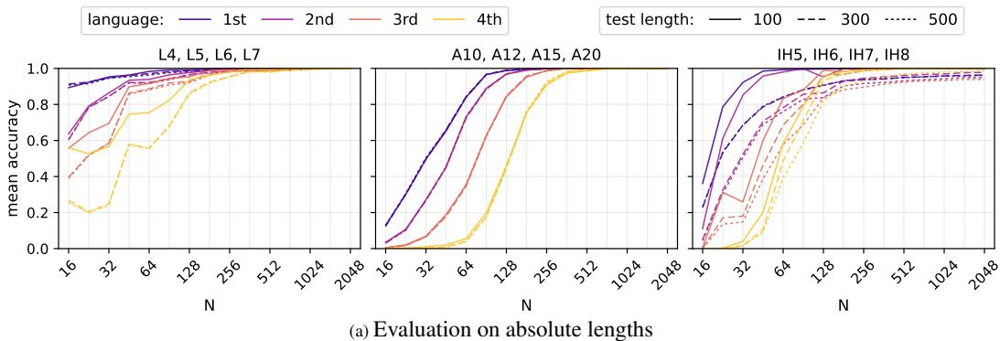

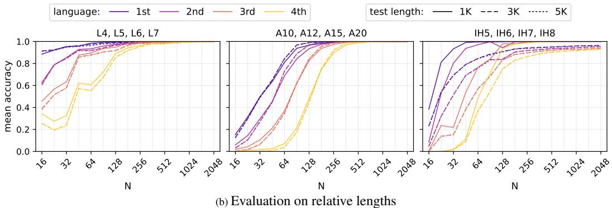  
Figure 6: Impact of teacher’s size on data complexity. $L _ { k }$ probes teacher depth $L _ { t } ; A _ { k }$ jointly varies $H _ { t } ,$ $D _ { t } ,$ , and $| \Sigma | ; { \bar { I } } H _ { k }$ varies alphabet size, width requirements, and output dimension. Student backbones are fixed within each family, while K follows the task-specific coverage criterion.

Required training length. We similarly sweep K, comparing task sizes at each common training length, with N and the student backbone fixed. Larger tasks generally require longer training words for high test accuracy. We observe that this is qualitatively consistent with the increased sufficient length scales.

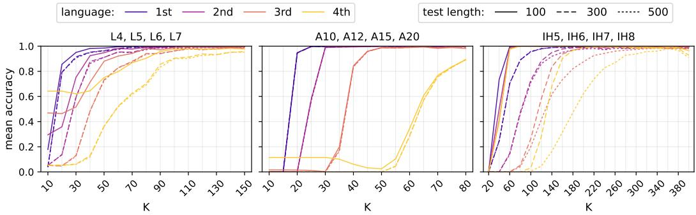  
(a) Evaluation on absolute lengths

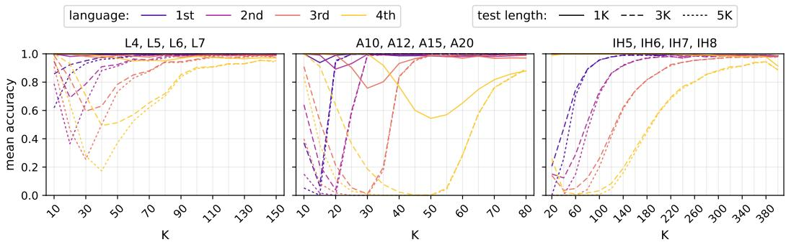  
(b) Evaluation on relative lengths  
Figure 7: Impact of teacher’s size on length complexity. $L _ { k }$ probes teacher depth $L _ { t } ; \ A _ { k }$ jointly varies $H _ { t } , D _ { t }$ , and $| \Sigma | ; I H _ { k }$ varies alphabet size, width requirements, and output dimension. Tasks are compared at shared values of K, with N and student backbones fixed. For relative evaluations, early accuracy is sometimes high for tasks that are trivial on short words: words of length 3K or 5K might still be short and have a trivial target.

## H.3.2 IMPACT OF THE STUDENT’S SIZE

We next vary the size of the student, $L _ { s } , D _ { s }$ and $H _ { s }$ , while holding the teacher and all other independent experimental parameters fixed. Conversely to the previous results studying the impact of the teacher sizes, we do not fix the student architecture within families. Instead for each task, we set parameters ’close’ to the hypothesized minimal size for realizability. Hence, apart from explicit variations of architectural parameters, the trained students use the following default architectures.

• For the alternating languages $L _ { k }$ , the tasks are $L _ { 4 } , L _ { 5 } , L _ { 6 } , L _ { 7 }$ . By default, the students have $L _ { s } = k - 1$ layers, embedding dimension $D _ { s } = 2 5 6$ , and one attention head $H _ { s } = 1$ $N = 2 5 6$ and K is set, respectively for $L _ { 4 } , L _ { 5 } , L _ { 6 } , L _ { 7 }$ , to 86, 111, 135, 158 (c.f. Choice of training lengh H.2).

• For the alphabet languages $A _ { k }$ , the tasks are $A _ { 1 0 } , A _ { 1 2 } , A _ { 1 5 } , A _ { 2 0 }$ . By default, the students have one layer $L _ { s } = 1$ and $H _ { s } \ = \ k$ attention heads. The global embedding dimension is fixed to $\dot { D } _ { s } = 3 6 0$ . N = 256 and K is set, respectively for $A _ { 1 0 } , A _ { 1 2 } , A _ { 1 5 } , A _ { 2 0 }$ , to 37, 47, 62, 89.

• For the induction head $I H _ { k }$ , the tasks are $I H _ { 5 } , I H _ { 6 } , I H _ { 7 } , I H _ { 8 }$ . By default, the students have two layers $L _ { s } = 2$ and embedding dimension $D _ { s } = 2 5 6$ , with two heads per layer: one local head of range 1 and one global head. $N = 2 5 6$ and K is set, respectively for $I H _ { 5 } , I H _ { 6 } , I H _ { 7 } , I H _ { 8 }$ , to 92, 144, 211, 292.

Overall, the effect of the student size is not consistently monotone. But the bounds describe worstcase sufficient resources and added capacity can also improve learning. This distinction is relevant in overparameterized models, as discussed in Appendix A.

Student depth. Increasing the number of student layers $L _ { s }$ sometimes improves learning and length generalization. For $A _ { k }$ , however, it substantially degrades length generalization. This ob servation is consistent with the depth dependence of both height bounds and the resulting sufficient requirements on N and $K$

Student embedding dimension. Varying the student embedding dimension $D _ { s }$ has little visible effect on length generalization and, in some settings, improves learning. Thus, increasing $D _ { s }$ does not appear to impose a systematic data or length-complexity cost in these experiments. At fixed $H _ { s } , C _ { 0 }$ increases with $D _ { s } ,$ whereas $C _ { 1 }$ is independent of width. The observations therefore do not support a simple monotone width penalty nor identify which bound is informative. For $I H _ { k } .$ , the comparison remains with the local extension of $C _ { 0 } ,$ not $C _ { 1 }$

Student head count. Although varying $H _ { s }$ may violate the condition $D _ { h , s } \ \geq \ D _ { h , t }$ from $\scriptstyle \mathrm { \mathrm { R e } } \cdot$ mark 2.1, the ERM learner depicted in Appendix E.4 does not require this condition as long as the target remains realizable. These experiments are therefore suitable for testing the theory’s qualitative predictions. We observe that increasing the number of student attention heads $H _ { s }$ appears to slightly harm learning in the $L _ { k }$ and $I H _ { k }$ families, but substantially improves it in the $A _ { k }$ family, including beyond the $k$ heads used in the reference construction. At fixed $D _ { s }$ , increasing $H _ { s }$ reduces $D _ { h , s } = D _ { s } / H _ { s }$ and hence the student contribution $r _ { \mathbb { F } } L _ { s } D _ { s } | \mathbb { F } | ^ { D _ { s } / H _ { s } + 1 }$ to $C _ { 0 } ; C _ { 1 }$ is unchanged. The improvement for $A _ { k }$ is notably compatible with this direction. For $I H _ { k } ,$ the sweep varies the total head count, always keeping equal numbers of local and global heads.

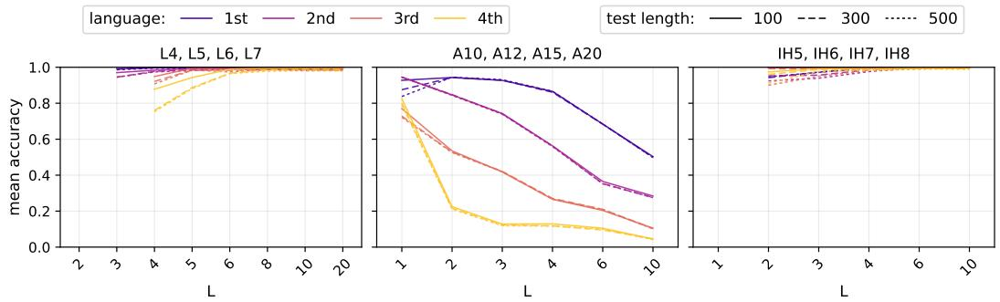

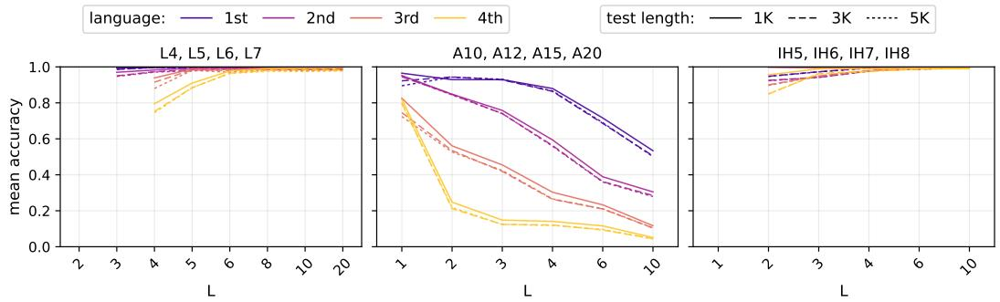  
(b) Evaluation on relative lengths  
Figure 8: Impact of the student’s depth on length generalization. We vary $L _ { s }$ while holding $D _ { s }$ and $H _ { s }$ fixed.

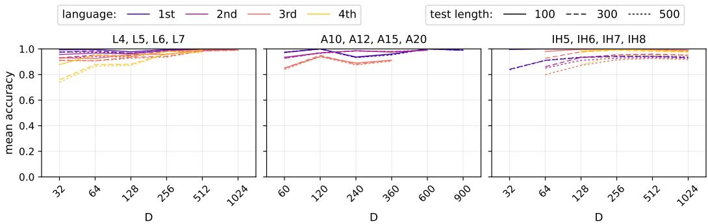  
(a) Evaluation on absolute lengths

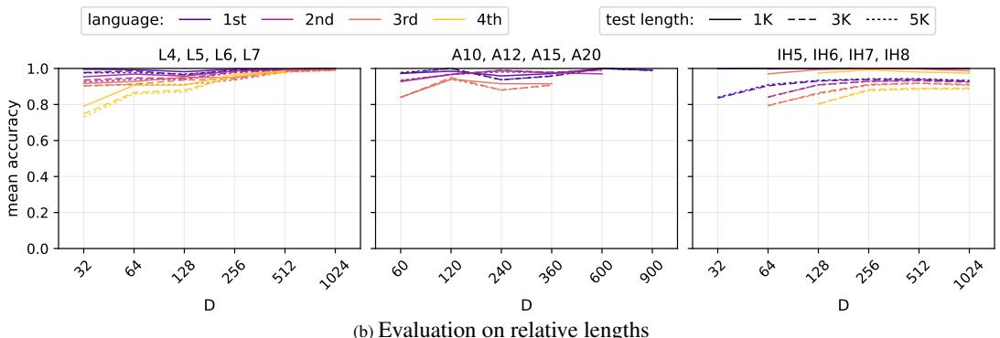  
Figure $9 { : }$ Impact of the student’s embedding dimension on length generalization. We vary $D _ { s }$ while holding $L _ { s }$ and $H _ { s }$ fixed.

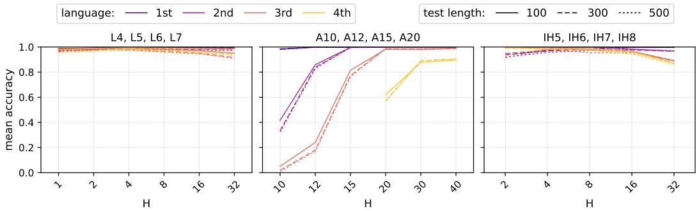

(a) Evaluation on absolute lengths  
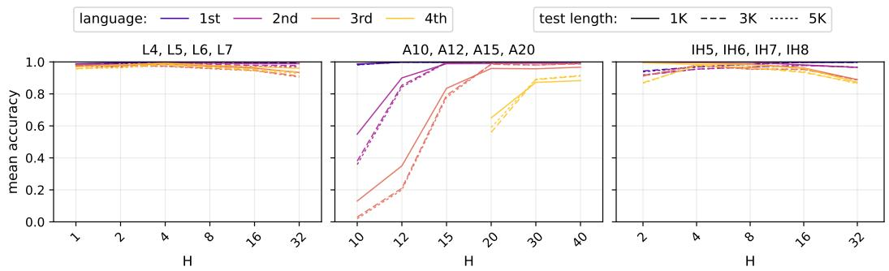  
(b) Evaluation on relative lengths  
Figure 10: Impact of the student’s head count on length generalization. We vary $H _ { s }$ while holding $L _ { s }$ and $D _ { s }$ fixed.

## H.3.3 TRADEOFF BETWEEN TRAINING LENGTH AND DATA COMPLEXITY

For these tradeoff experiments, student models are set with the following parameter sizes.

• The alternating task $L _ { 6 }$ has exactly 5 layers, $D _ { s } = 2 5 6$ and $H _ { s } = 1$

• The alphabet task $A _ { \mathrm { 1 5 } }$ has exactly 1 layer, $D _ { s } = 3 6 0$ and $H _ { s } = 2 0$ . The number of heads is 20 and not 15 no ease the learning procedure.

• The induction head task $I H _ { 7 }$ has exactly 2 layers, $D _ { s } = 2 5 6$ and it has two attention heads, one local head of range 1 and one global attention head.

We observe a tradeoff between training length K and sample size $N { : }$ longer examples can substantially reduce the number needed for length generalization. Both axes use linear scales. The observed frontier is qualitatively consistent with the logarithmic–linear tradeoff illustrated in Figure 3. For a fixed accuracy threshold, the configurations that achieve the threshold with the smallest token budget typically use a larger K and a smaller N. Conversely, for a fixed token budget, the configurations with the best accuracy likewise favor a larger K over a much larger N. This resembles the allocation suggested by Corollary F.1. For $I H _ { k } ,$ , the relevant theoretical comparison uses the blockwise local-attention extension of the $C _ { 0 }$ argument. The plotted budgets $N K$ count ordinary tokens; $L _ { k }$ and $A _ { k }$ additionally use one supervised EOS position per word.

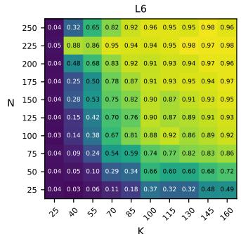

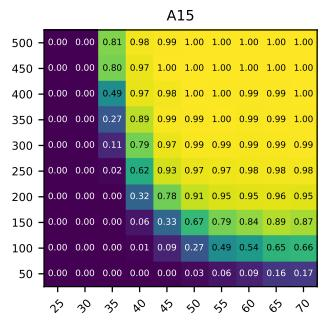  
(a) Evaluation at absolute test length 500

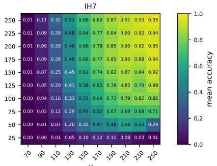

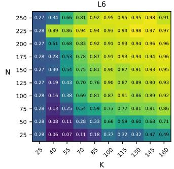

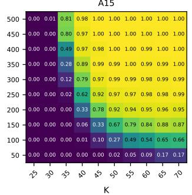  
(b) Evaluation at relative test length 5K

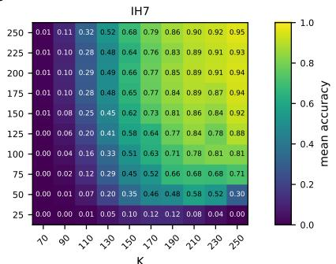

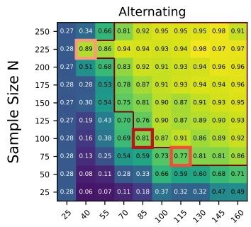

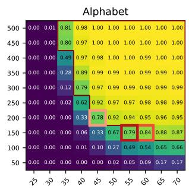  
Training Length K

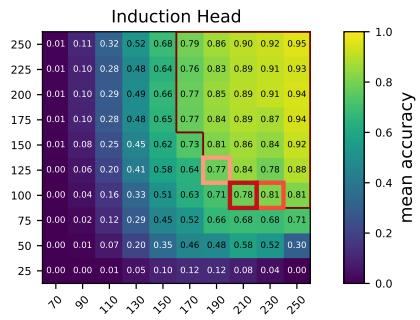  
(c) Here is Figure 5 for completeness. For a 0.75 minimum accuracy threshold, highlighted in red are the 3 configurations that have the smallest token-budget.

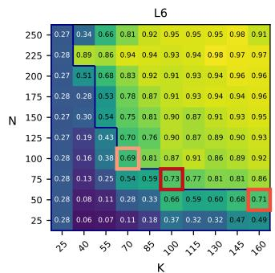

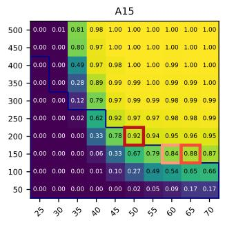

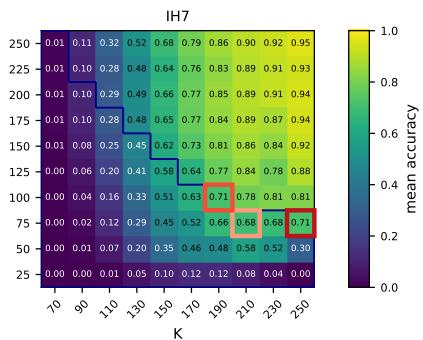  
(d) For a maximum token-budget threshold, respectively of 8000, 10000, 20000 tokens, highlighted in red are the 3 configurations that achieve the best accuracy  
Figure 11: Tradeoff between training length and data complexity. One task of each family: $L _ { 6 } , A _ { 1 5 }$ and $I H _ { 7 }$ to study the tradeoff between the two quantities.

We also include a control experiment in which the axis labelled N specifies a budget of supervised token positions rather than a number of words. Gains from increasing K at a fixed budget suggest a benefit from longer contexts beyond simply supplying more supervised positions. This is in agreement with theoretical predictions from Eq. 10.

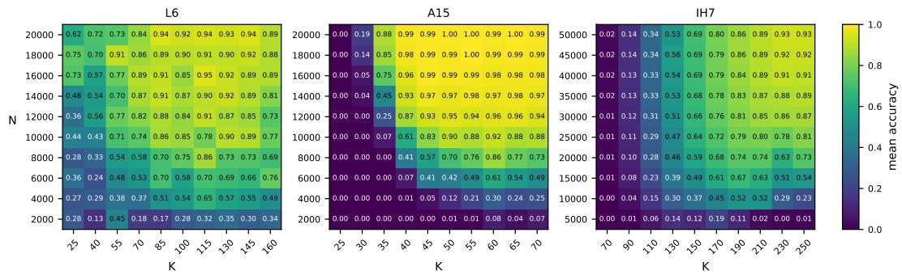  
Figure 12: Control experiment for $L _ { 6 } , A _ { 1 5 } .$ and $I H _ { 7 }$ , with evaluation at relative test length 5K. The axis labelled N gives the total token budget of the dataset rather than the number of words.

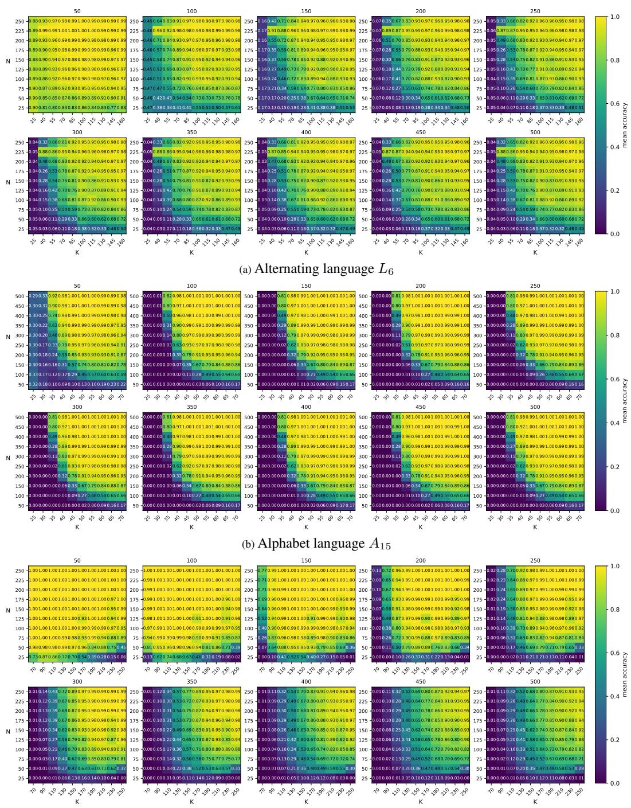  
(c) Induction Head task IH  
Figure 13: Tradeoff between training length and data complexity: evaluation on absolute lengths, from length 50 to length 500 with additive incrementation of 50.

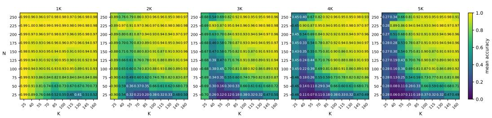

(a) Alternating language $L _ { 6 }$  
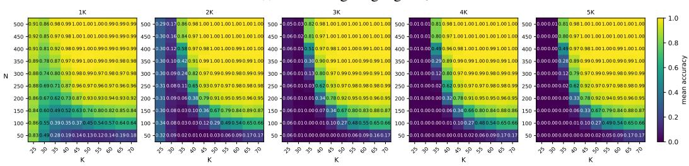

(b) Alphabet language A15  
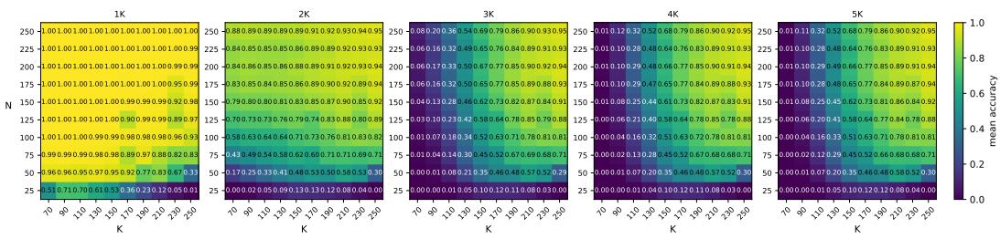  
(c) Induction Head task $I H _ { 7 }$  
Figure 14: Tradeoff between training length and data complexity: evaluation on relative lengths $1 \bar { K } , 2 K , 3 K , 4 K , 5 K$ , with K the training length of the involved cells configuration.

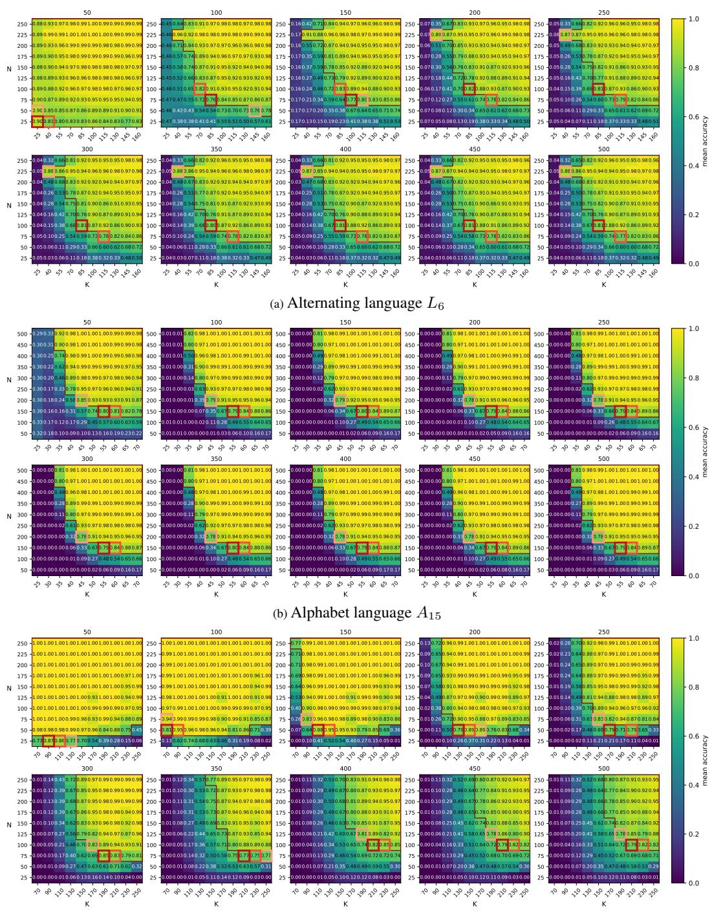  
(c) Induction Head task IH  
Figure 15: Tradeoff between training length and data complexity: evaluation on absolute lengths, from length 50 to length 500 with additive incrementation of 50. Red contouring for accuracy ≥ 0.75; highlighted in red are the 3 configurations under this constraint that have the smallest token-budget.

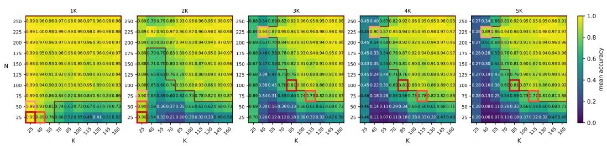

(a) Alternating language $L _ { 6 }$  
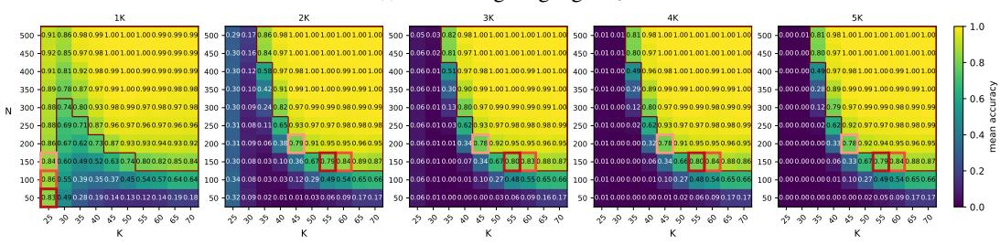

(b) Alphabet language A15  
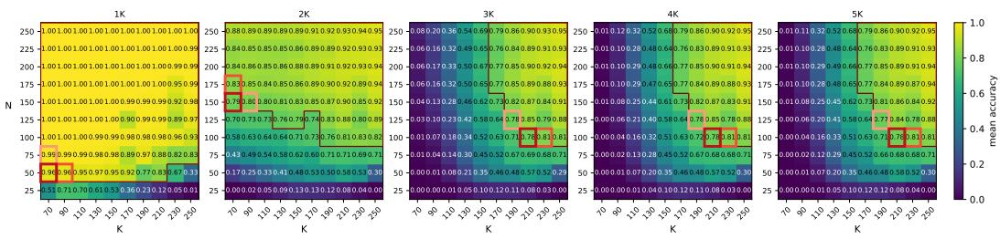  
(c) Induction Head task $I H _ { 7 }$  
Figure 16: Tradeoff between training length and data complexity: evaluation on relative lengths $1 \bar { K } , 2 K , 3 K , 4 K , 5 K$ , with K the training length of the involved cells configuration. Red contouring for accuracy $\geq 0 . 7 5 ;$ highlighted in red are the 3 configurations under this constraint that have the smallest tokenbudget.

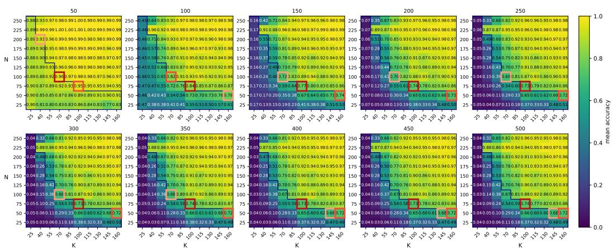

(a) Alternating language L6. Contouring cells with maximum token-budget 8000  
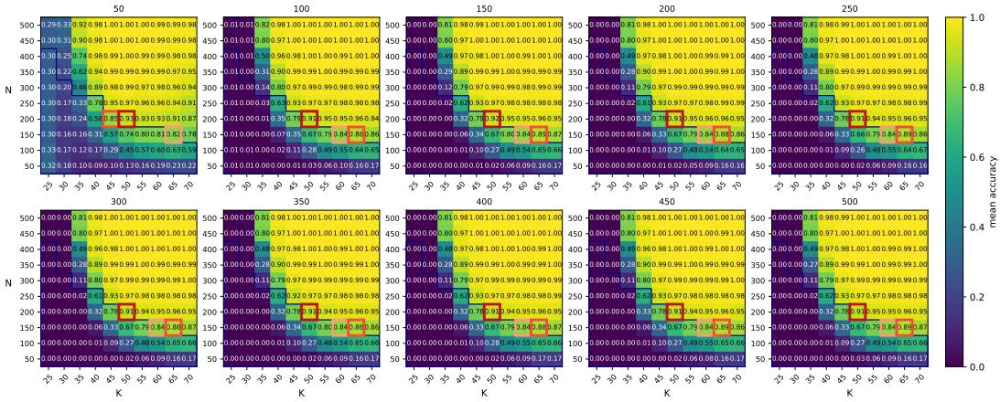  
(b) Alphabet language A15. Contouring cells with maximum token-budget 10000

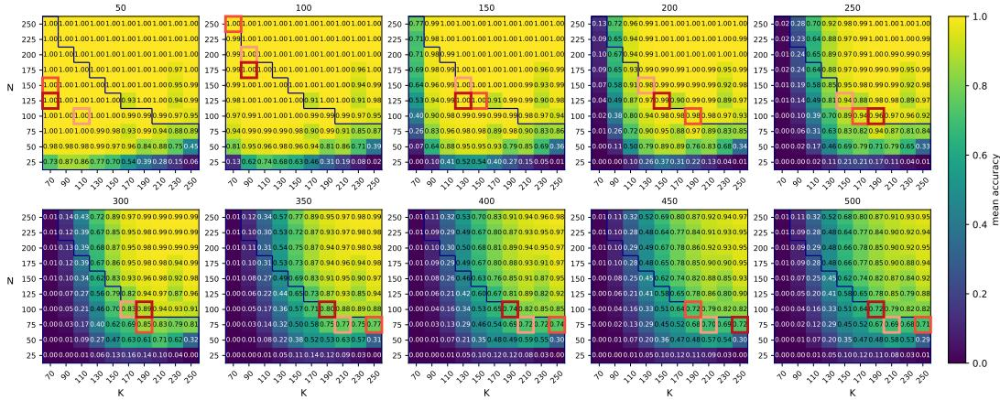  
(c) Induction Head task $I H _ { 7 } .$ . Contouring cells with maximum token-budget 20000

Figure 17: Tradeoff between training length and data complexity: evaluation on absolute lengths, from length 50 to length 500 with additive incrementation of 50. For their respective maximum token-budget threshold, highlighted in red are the 3 configurations that achieve the best accuracy.

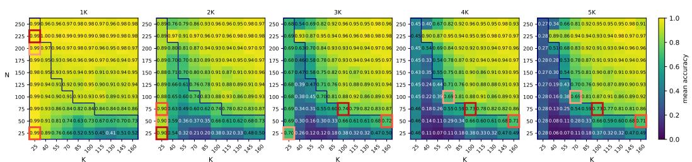

(a) Alternating language $L _ { 6 } .$ . Contouring cells with maximum token-budget 8000  
  
(b) Alphabet language $A _ { 1 5 } .$ Contouring cells with maximum token-budget 10000

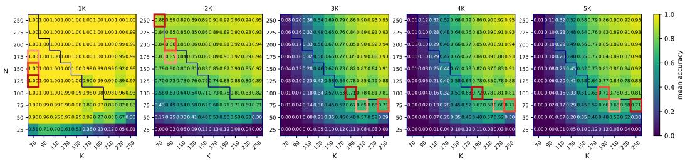  
(c) Induction Head task $I H _ { 7 }$ . Contouring cells with maximum token-budget 20000

Figure 18: Tradeoff between training length and data complexity: evaluation on relative lengths $1 \bar { K } , 2 K , 3 K , 4 K , 5 K$ , with K the training length of the involved cells configuration. For their respective maximum token-budget threshold, highlighted in red are the 3 configurations that achieve the best accuracy.

## I AI USAGE

In this work, we used generative AI tools for proofreading the paper and its mathematical content, revising the phrasing of mathematical claims, providing ingredients for proving mathematical claims, and assisting in the writing and proofreading of proofs. Additionally, we used generative AI tools for creating and editing software code, assisting with literature research for related work, and proposing edits for improving readability.

We have not used generative AI tools to help develop theoretical models or conceptual frameworks, propose or refine hypotheses, design or provide feedback on research methodology or experiments, support qualitative and thematic data analysis, or interpret results.

We have reviewed all AI-assisted work. For example, we checked LLM-generated research advices for potential plagiarism through a manual literature survey, we checked mathematical soundness of every mathematical claims, we tested the soundness of the LLM-generated/assisted code experiments, and we supervised and/or overwrote AI drafted writing in the paper. We take responsibility for the final content of this work, including text, claims or artifacts produced with the aid of generative AI.