# S3AC: Stabilized, Selective, and Scalable Actor–Critic for LLM Reasoning

Shuo Shen1, Guangran Cheng1, Chengqi Lyu1, Xiangsen Wang2, Yanan Sun1,\*, Wenwei Zhang1,\* 1Shanghai AI Laboratory 2Independent Researcher

## Abstract

Critic-free methods are widely used in reinforcement learning with verifiable rewards (RLVR) for long chain-of-thought (CoT) reasoning, avoiding difficult and costly critic training. Common alternatives lack token-level credit assignment and typically rely on grouped rollouts to estimate prompt-specific baselines. A critic can address both limitations, but long-CoT critic training is hindered by insufficient coverage of trajectories with diverse lengths and early gradients dominated by the newly initialized value head. We introduce S3AC (Stabilized, Selective, and Scalable Actor–Critic) for LLM reasoning, built around a practical critictraining recipe. The trained critic provides token-specific advantages and prompt-specific baselines. Using the prompt-level baseline to estimate difficulty, we propose Difficulty-Aware Prompt Sampling (DAPS). DAPS combines this estimate with outcome history to select prompts before generation, reducing rollout waste without offline difficulty initialization. S3AC improves group-rollout performance across dense and mixture-of-experts models from 1.5B to 397B parameters, outperforming a modern GRPO variant (GRPO-X). At 35B, it sustains single-rollout training while tested critic-free baselines deteriorate after initial gains.

## 1 Introduction

Critic-free methods, including GRPO, are widely used in reinforcement learning with verifiable rewards (RLVR) for large language model (LLM) reasoning (DeepSeek-AI, 2026; Kimi Team, 2026a,b; LLM-Core Xiaomi, 2026; Intern-S2-Preview Team, 2026). They avoid the difficulty and cost of training a value model for long responses under sparse rewards and an evolving policy. However, replacing the critic with reward statistics limits how learning signals distinguish prompts and reasoning steps.

A failure may be expected on a difficult prompt but surprising on an easy one, motivating a promptspecific baseline. GRPO estimates this baseline from grouped rollouts, requiring each group to wait for its slowest response (Xu and Ding, 2026; Hou et al., 2026). Common single-rollout alternatives, including REINFORCE++ (Hu et al., 2025) and FlashREINFORCE (Hu et al., 2026), use batch statistics instead. These shared baselines do not account for differences in prompt difficulty.

Even with a prompt-specific baseline, a single response-level advantage cannot distinguish the contributions of individual tokens. When an answer is incorrect, useful intermediate reasoning can receive the same negative signal as steps that lead away from a solution (Wu et al., 2026). This scalar signal does not reflect how the difficulty of reaching a correct answer changes as reasoning progresses.

A learned critic offers a common route to addressing both limitations: a prompt-conditioned baseline without grouped rollouts and tokenspecific learning signals throughout the response (Sutton et al., 1999). However, learning reliable value estimates for long reasoning trajectories remains challenging. Our analysis highlights two obstacles to effective value learning: initial-policy trajectories provide limited supervision on long, correct responses, while early gradients can be dominated by the newly initialized value head.

To address these obstacles, we introduce S3AC (Stabilized, Selective, and Scalable Actor–Critic) for LLM reasoning (Figure 1). We pretrain the critic on trajectories from policies of different strengths to broaden coverage across response lengths and outcomes. Small-scale value-head initialization controls initial predictions, while a larger gradient-clipping threshold reduces excessive rescaling of backbone updates by headdominated gradients. Updated online, the critic provides difficulty-aware, token-specific advantages throughout the response through generalized advantage estimation (Schulman et al., 2016).

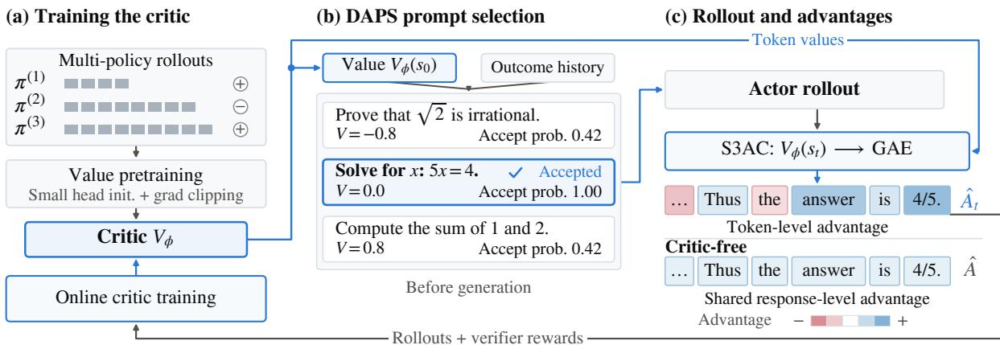  
Figure 1: Overview of S3AC for long-CoT RLVR. (a) Critic value pretraining and online updates (§3.3). (b) DAPS selects prompts using critic values and outcome history (§3.4). (c) S3AC uses token-level GAE advantages; critic-free methods share one advantage across the response (§3.2).

The critic’s usefulness extends to deciding what to generate. Because its prompt-conditioned estimate is available before rollout, it can guide prompt selection as well as policy learning. We propose Difficulty-Aware Prompt Sampling (DAPS), which combines this estimate with outcome history to select prompts of intermediate estimated difficulty. Some existing selectors require offline-initialized statistics or an auxiliary value model (Xu and Ding, 2026; Gao et al., 2026); DAPS reuses the critic already trained for policy learning.

We evaluate two dense and two multimodal mixture-of-experts models spanning 1.5B to 397B parameters. Under group rollout, actor–critic training improves average performance across all four models, outperforming GRPO-X on all seven evaluated benchmarks at 35B and all five at 397B. At 35B, it sustains single-rollout performance while the tested critic-free baselines decline after initial gains (Figure 4). DAPS further improves both rollout settings over uniform prompt sampling and reduces trajectories discarded by group filtering.

## 2 Related Work

Critic-based RL. PPO (Schulman et al., 2017) uses a learned critic with GAE (Schulman et al., 2016) to estimate advantages for policy optimization. For long-CoT reasoning, VC-PPO (Yuan et al., 2025) pretrains the value model and decouples the GAE parameters of the actor and critic, while VAPO (Yue et al., 2025b) adapts λ to response length. VinePPO (Kazemnejad et al., 2025), EVPO (Pan et al., 2026), and AsyPPO (Liu et al., 2026) improve value estimates through Monte

Carlo rollouts, explained-variance gating, and critic ensembles, respectively. SAO (Hou et al., 2026) and CompactionRL (Li et al., 2026) apply PPO to single-rollout training of large MoE models. While these methods address different aspects of actor– critic training, our work brings critic initialization, online value learning, and critic-guided prompt selection together in a unified framework. Our study combines targeted diagnostics and ablations with evaluations across rollout settings and model scales, including group-rollout training at 397B parameters.

Critic-free RL. Group-based methods such as GRPO (Shao et al., 2024), RLOO (Ahmadian et al., 2024), and DAPO (Yu et al., 2025) derive baselines from multiple responses to the same prompt. Single-rollout methods use batch statistics (REIN-FORCE++; Hu et al., 2025), add a sequence-level trust region to a batch-mean baseline (FlashRE-INFORCE; Hu et al., 2026), or track per-prompt values with a tabular estimator (SPO; Xu and Ding, 2026). These methods typically construct advantages from sequence-level reward statistics without learning a value function over intermediate response prefixes.

Difficulty-aware prompt sampling. Dynamic sampling (Yu et al., 2025) requires multiple responses per prompt and discards responses from uninformative groups after generation. Other methods estimate difficulty before rollout from reward history (GRESO; Zheng et al., 2025), from a tracker initialized with offline rollouts (SPO), or from a separately trained prompt-level value model (PCL; Gao et al., 2026). DAPS combines pass-rate history with value estimates from the existing S3AC critic, avoiding a separately trained difficulty model and supporting both group and single rollout.

## 3 Method

S3AC is an actor–critic framework for long-CoT RLVR that trains a value model for both policy learning and prompt selection (Figure 1). The critic provides prompt-conditioned baselines and tokenspecific advantages, while its initial-state value guides prompt sampling before generation. We first formulate the actor–critic update (§3.1), then examine the critic’s role under group and single rollout (§3.2), describe its training recipe (§3.3), and introduce DAPS (§3.4).

## 3.1 Actor–Critic Formulation

We model response generation as a token-level MDP. Given a prompt x, the actor $\pi _ { \theta }$ generates a response token by token: the state $s _ { t }$ contains x and the first t response tokens, and the action $a _ { t }$ is the next token. A verifier gives a scalar reward $R \in \{ - 1 , + 1 \}$ on the last token only, and we use $\gamma = 1$ . Following the actor–critic formulation (Sutton et al., 1999), a learned critic $V _ { \phi } ( s _ { t } )$ approximates the expected return $\mathbb { E } _ { \pi _ { \theta } } [ R \mid s _ { t } ]$ . At s0, the estimate depends on the prompt alone; subsequent values also condition on the generated response prefix.

For a response of $T$ tokens, we compute tokenspecific advantages using GAE (Schulman et al., 2016):

$$
\hat { A } _ { t } = \sum _ { l = 0 } ^ { T - t - 1 } \lambda ^ { l } \delta _ { t + l } ,\tag{1}
$$

where $\delta _ { t } = R _ { t } + V _ { \phi } ( s _ { t + 1 } ) - V _ { \phi } ( s _ { t } )$ is the TD error, with $R _ { t } = R$ at the last token and 0 elsewhere. The terminal value is $V _ { \phi } ( s _ { T } ) = 0$ . Equivalently, ${ \hat { A } } _ { t } =$ $G _ { t } ^ { \lambda } - V _ { \phi } ( s _ { t } )$ , where the λ-return $G _ { t } ^ { \lambda }$ bootstraps from later values when $\lambda < 1$ , trading variance for bias.

For actor updates, we adopt CISPO (MiniMax et al., 2025), whose core surrogate is

$$
\begin{array} { r } { \mathcal { T } _ { \mathrm { a c t o r } } ( \theta ) = \hat { \mathbb { E } } _ { t } \Big [ \mathrm { s g } ( \bar { r } _ { t } \hat { A } _ { t } ) \log \pi _ { \theta } ( a _ { t } \mid s _ { t } ) \Big ] , } \\ { \bar { r } _ { t } = \mathrm { c l i p } ( r _ { t } , 1 - \epsilon _ { \mathrm { l o w } } , 1 + \epsilon _ { \mathrm { h i g h } } ) , } \end{array}\tag{2}
$$

where $r _ { t } = \pi _ { \theta } ( a _ { t } \mid s _ { t } ) / \pi _ { \theta _ { \mathrm { o l d } } } ( a _ { t } \mid s _ { t } )$ is the importance ratio relative to the actor before the current batch of updates, and sg denotes stop-gradient. The clipped importance weights and advantages are thus treated as constants when differentiating the actor objective. To address training–inference mismatch, we combine importance-weight corrections with masking at both the token and sequence levels (§4.1; Appendix A.1).

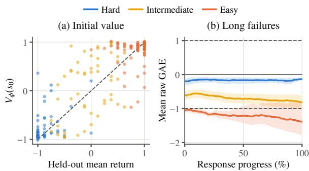  
Figure 2: Prompt-conditioned values and advantages (35B single rollout). (a) Initial value versus held-out return. (b) Long failures (> 20K tokens), using lengthadaptive GAE with $\alpha = 1 . 5$

For critic updates, we regress token-level values toward the Monte Carlo return R using a clipped squared-error loss (Engstrom et al., 2020). Let $V _ { t } = V _ { \phi } ( s _ { t } )$ and $V _ { t } ^ { \mathrm { o l d } } = V _ { \phi _ { \mathrm { o l d } } } ( s _ { t } )$ . The objective is

$$
\begin{array} { r } { \mathcal { L } _ { \mathrm { c r i t i c } } = \frac { 1 } { 2 } \hat { \mathbb { E } } _ { t } \left[ \operatorname* { m a x } \left\{ ( V _ { t } - R ) ^ { 2 } , ( \bar { V } _ { t } - R ) ^ { 2 } \right\} \right] , } \end{array}\tag{3}
$$

where $\hat { V _ { t } }$ is $V _ { t }$ clipped to $[ V _ { t } ^ { \mathrm { o l d } } - \epsilon _ { v } , \ V _ { t } ^ { \mathrm { o l d } } + \epsilon _ { v } ]$ and $\epsilon _ { v }$ controls value clipping. The expectation averages over valid response tokens.

## 3.2 How the Critic Shapes Learning Signals

We examine how the critic shapes learning signals across prompts of different difficulty and across positions within a response. The initial critic value $V _ { \phi } ( s _ { 0 } )$ estimates the policy’s expected return for a prompt before generation. Figure 2a plots these values against mean Monte Carlo (MC) returns from independent rollouts, using a frozen 35B actor– critic pair with one point per prompt. The values track differences in empirical returns, supporting their use as prompt-specific baselines. The promptspecific baseline is not limited to the initial position: subsequent values remain conditioned on the prompt throughout the response. Figure 2b illustrates this distinction in long failed responses: although all receive the same terminal reward of −1, their mean raw advantages remain close to zero for hard prompts and below −1 for easy prompts across response progress.

Within a response, expected returns can also change as reasoning progresses. A shared responselevel advantage cannot reflect these changes. Figure 3 illustrates this behavior with a pretrained critic: its value rises when the response identifies candidate values and increases further when it determines the requested term. GAE combines these evolving values with the observed reward to construct token-specific advantages, allowing different positions within a response to receive different learning signals.

A Candidate values identified  
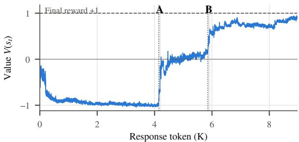

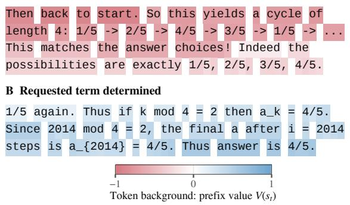  
Figure 3: Critic values on Intern-S2-Preview-35B rise as the response identifies candidate values (A) and determines the requested term, 4/5 (B). Expanded examples are in Appendix C.2.

Under group rollout, the group mean already provides a prompt-specific baseline, while the critic adds token-level advantages. Under single rollout, it also supplies the prompt-specific baseline missing from batch statistics. Our experiments show that S3AC outperforms GRPO-X under group rollout and sustains stable single-rollout training at 35B. These benefits require informative values across prompts and response positions, motivating the critic-training recipe in §3.3.

## 3.3 Training a Good Critic

We initialize the critic through value pretraining and then update it online as the policy evolves. Our pretraining recipe addresses two challenges: limited coverage of long, correct trajectories and optimization dominated by the newly initialized value head.

Coverage-oriented value pretraining. VC-PPO (Yuan et al., 2025) uses trajectories from a fixed initial policy, while SAO (Hou et al., 2026) emphasizes larger pretraining corpora. However, data scale alone does not ensure coverage of long, correct responses. We pool trajectories from policies of different strengths to broaden coverage across response lengths and outcomes, improving early online value prediction and downstream learning progress in our comparison (§4.3). We pretrain for two epochs with token-averaged MSE against terminal returns, freezing attention layers following SAO (Hou et al., 2026) and additionally freezing the MoE router.

Value-head optimization. In our runs, critic training exhibits much larger gradient norms than actor training, with the newly initialized value head dominating early pretraining gradients (§4.3). For a linear value head $v _ { t } = w ^ { \top } h _ { t } .$ , residual $e _ { t } = v _ { t } - R _ { : }$ and loss $\begin{array} { r } { \ell _ { t } = \frac { 1 } { 2 } e _ { t } ^ { 2 } . } \end{array}$

$$
\nabla _ { w } \ell _ { t } = e _ { t } h _ { t } , \qquad \nabla _ { h _ { t } } \ell _ { t } = e _ { t } w .
$$

The head gradient depends directly on hidden states, whereas the gradient entering the backbone is scaled by the small head weights. Global clipping driven by the head therefore also shrinks the much smaller backbone gradients. We initialize the head with standard deviation $1 / ( H { + } 1 )$ , where H is the hidden size, to control initial predictions. We also raise the gradient-clipping threshold from 1, a common actor-training setting, to 10 for the critic, reducing excessive rescaling of backbone updates.

Online adaptation. We update the critic on fresh rollouts as the policy evolves. Motivated by twotimescale actor–critic learning (Konda and Tsitsiklis, 1999), we use a critic learning rate five times the actor’s and two critic epochs per rollout batch versus one actor epoch. We decouple actor and critic GAE following VC-PPO (Yuan et al., 2025). The critic regresses on Monte Carlo returns $( \lambda _ { \mathrm { c r i t i c } } = 1 )$ , while the actor uses VAPO’s length-adaptive GAE (Yue et al., 2025b),

$$
\lambda _ { \mathrm { a c t o r } } = 1 - { \frac { 1 } { \alpha T } } ,
$$

where T is the response length and $\alpha = 1 . 5 .$

## 3.4 Difficulty-Aware Prompt Sampling

The same critic can also help decide which prompts the actor should attempt. In our group-rollout experiments, DAPO-style dynamic sampling (Yu et al., 2025) improves S3AC over retaining all groups, but it discards groups only after their responses have been generated. We therefore propose

Difficulty-Aware Prompt Sampling (DAPS), which combines the initial critic value with outcome history to guide prompt selection before generation.

Difficulty estimate. Before each rollout batch, we score candidate prompts with the latest critic. Under our binary reward convention, a success probability p corresponds to an expected return of $2 p - 1$ . We convert the initial critic value into a success-rate estimate and combine it with observed outcomes:

$$
p _ { c } = \mathrm { c l i p } \Big ( { \textstyle \frac { V _ { \phi } ( s _ { 0 } ) + 1 } { 2 } } , 0 , 1 \Big ) , \quad \hat { p } = \frac { S + n _ { c } p _ { c } } { N + n _ { c } } ,\tag{4}
$$

Here, S and N are the prompt’s successful and total attempt counts, and $n _ { c }$ controls the critic’s weight relative to these observations. For a new prompt with $S = N = 0$ , the estimate reduces to $p _ { c } .$ , so its difficulty can be initialized directly from the critic without separate offline rollouts. Observed outcomes complement this prediction as they become available. Both counts decay with training progress to limit the influence of stale observations as the policy evolves.

Acceptance. We favor prompts of intermediate estimated difficulty, a preference also used in prior prompt-selection methods (Xu and Ding, 2026; Gao et al., 2026). Each candidate is accepted with probability

$$
a = a _ { \operatorname* { m i n } } + \left( 1 - a _ { \operatorname* { m i n } } \right) 4 \hat { p } ( 1 - \hat { p } ) ,\tag{5}
$$

This probability peaks at $\hat { p } = 0 . 5$ . The positive acceptance floor gives even very easy or very hard prompts a chance of selection, in the spirit of $\epsilon \mathrm { - }$ greedy exploration (Sutton and Barto, 2018). After an initial period of uniform sampling, we gradually introduce this acceptance rule following the schedule in Appendix D.

Under group rollout, DAPS improves sample efficiency by reducing the number of responses discarded by dynamic sampling. It also improves performance under both group and single rollout.

## 4 Experiments

## 4.1 Experimental Setup

Training details. We train two dense models, Qwen2.5-Math-1.5B (Yang et al., 2024) and R1- Distill-1.5B (Guo et al., 2025), and two MoE models, Intern-S2-Preview-35B (Intern-S2-Preview Team, 2026) and Intern-S2-397B (InternLM, 2026).

Qwen2.5-Math-1.5B is trained on the 7.5k DAPO-Math subset used by FlashREINFORCE (Yu et al., 2025; Hu et al., 2026), R1-Distill-1.5B on MATH-1,460 (Qi et al., 2025), and the MoE models on inhouse prompt sets covering mathematics, instruction following, reasoning, physics, and chemistry.

Group rollout uses $K { = } 1 6$ responses per prompt for dense models and K=8 for MoE models; single rollout uses K=1. Each rollout batch is split into eight mini-batches and used for one actor epoch, yielding eight actor gradient steps. We report RL training progress in actor gradient steps throughout. We use asymmetric importance-weight clipping (clip-higher) and dynamic sampling under group rollout (Yu et al., 2025). To address training–inference mismatch (Yao et al., 2025), S3AC and GRPO-X combine token-level importance sampling with IcePoP masks (Team et al., 2025) and MIS-style sequence-level masking (Liu et al., 2025). We mask an entire response when its maximum token-level log-probability ratio between the training and rollout policies exceeds a threshold. S3AC uses DAPS on Qwen2.5-Math-1.5B, R1-Distill-1.5B, and Intern-S2-Preview-35B, and uniform sampling on Intern-S2-397B. Full training configurations appear in Appendix A (Table 6).

Baselines. For group rollout, we use GRPO-X, a modern variant of GRPO (Shao et al., 2024). For single rollout, we compare with REIN-FORCE++ (Hu et al., 2025) and FlashREIN-FORCE (Hu et al., 2026). GRPO-X uses the shared recipe, with Rollout Routing Replay (R3; Ma et al., 2026) and GEPO entropy control (Cheng et al., 2026) configured as in Table 6. S3AC, GRPO-X, and REINFORCE++ use CISPO (Eq. (2)); FlashREINFORCE retains its original objective and sequence-level trust region. Within each model, methods share the base checkpoint, training data, and evaluation protocol.

Evaluation. We evaluate Qwen2.5-Math-1.5B on MATH500 (Hendrycks et al., 2021; Lightman et al., 2024), AMC23, AIME25, Olympiad-Bench (He et al., 2024), and Minerva (Lewkowycz et al., 2022)1, and R1-Distill-1.5B on AIME24, AIME25, and AIME26. Both MoE models are evaluated on GPQA-Diamond (Rein et al.,

<table><tr><td colspan="7"></td></tr><tr><td>Method</td><td></td><td></td><td>IMO-</td><td></td><td>Rollout GPQA-D AnswerBench MMMU-Pro MathVision HMMT26 Avg</td><td></td><td></td></tr><tr><td>GRPO-X</td><td>group</td><td>88.9</td><td>81.4</td><td>80.8</td><td>87.5</td><td>86.9</td><td>85.1</td></tr><tr><td>S3AC</td><td>group</td><td>90.5</td><td>84.2</td><td>82.9</td><td>89.7</td><td>88.8</td><td>87.3</td></tr></table>

Table 1: Group-rollout results on Intern-S2-397B at gradient step 1,200. S3AC improves on all five benchmarks. Full training curves appear in Figure 7.
<table><tr><td></td><td></td><td colspan="6">(a) Qwen2.5-Math-1.5B</td><td colspan="4">(b) R1-Distill-1.5B</td></tr><tr><td>Method</td><td></td><td>Rollout MATH500</td><td>AMC23</td><td>AIME25</td><td>Olympiad Minerva</td><td></td><td>Avg</td><td>AIME24</td><td>AIME25</td><td>AIME26</td><td>Avg</td></tr><tr><td>GRPO-X</td><td>group</td><td>72.3</td><td>57.3</td><td>9.0</td><td>35.3</td><td>39.8</td><td>42.7</td><td>35.4</td><td>26.9</td><td>26.2</td><td>29.5</td></tr><tr><td>S3AC</td><td>group</td><td>71.7</td><td>56.7</td><td>11.2</td><td>35.4</td><td>41.3</td><td>43.3</td><td>38.9</td><td>27.4</td><td>27.9</td><td>31.4</td></tr><tr><td>REINFORCE++</td><td>single</td><td>69.3</td><td>56.6</td><td>8.1</td><td>32.1</td><td>36.1</td><td>40.4</td><td>29.6</td><td>24.4</td><td>21.0</td><td>25.0</td></tr><tr><td>FlashREINFORCE</td><td>E single</td><td>67.2</td><td>44.8</td><td>5.6</td><td>29.3</td><td>33.0</td><td>36.0</td><td>38.0</td><td>26.6</td><td>26.6</td><td>30.4</td></tr><tr><td>S3AC</td><td>single</td><td>71.4</td><td>57.3</td><td>10.2</td><td>35.4</td><td>40.7</td><td>43.0</td><td>37.2</td><td>27.9</td><td>24.4</td><td>29.8</td></tr></table>

Table 2: Main results on the 1.5B models. Scores are avg@16 in block (a) and avg@32 in block (b); Olympiad is OlympiadBench. Within each model, methods share the base checkpoint and training data.
<table><tr><td colspan="10">IMO- Rollout AIME24 AIME25 GPQA-D AnswerBench MMMU-Pro MathVision MathVista Avg</td></tr><tr><td>Method</td><td></td><td></td><td></td><td></td><td></td><td></td><td></td><td></td><td></td></tr><tr><td>GRPO-X</td><td>group</td><td>91.5</td><td>89.8</td><td>67.8</td><td>60.3</td><td>69.5</td><td>70.1</td><td>85.6</td><td>76.4</td></tr><tr><td>S3AC</td><td>group</td><td>93.1</td><td>91.3</td><td>74.9</td><td>67.5</td><td>74.6</td><td>75.4</td><td>86.7</td><td>80.5</td></tr><tr><td>REINFORCE++</td><td>single</td><td>87.7</td><td>87.3</td><td>62.5</td><td>51.6</td><td>60.8</td><td>62.2</td><td>80.8</td><td>70.4</td></tr><tr><td>FlashREINFORCE</td><td>E single</td><td>85.4</td><td>81.9</td><td>51.1</td><td>53.9</td><td>54.9</td><td>63.0</td><td>81.3</td><td>67.4</td></tr><tr><td>S3AC</td><td>single</td><td>91.9</td><td>90.0</td><td>76.1</td><td>66.8</td><td>78.1</td><td>76.0</td><td>87.8</td><td>80.9</td></tr></table>

Table 3: Per-benchmark results on Intern-S2-Preview-35B. Each row reports the checkpoint with the highest seven-benchmark average for that run in Figure 4. Both single-rollout critic-free methods improve early in training and then decline. Scores are avg@16 on AIME, avg@4 on GPQA-D and IMO-AnswerBench, and avg@1 elsewhere.

2024), IMO-AnswerBench (Luong et al., 2025), MMMU-Pro (Yue et al., 2025a), and MathVision (Wang et al., 2024), with AIME24, AIME25, and MathVista-mini (Lu et al., 2024) added for 35B and HMMT26 for 397B. Evaluation sampling settings are in Appendix A.2.

## 4.2 Main Results

We evaluate the complete S3AC recipe under group and single rollout with benchmark performance and training stability.

Group rollout: gains beyond a group baseline. Even when grouped responses already provide a prompt-specific baseline, S3AC improves over GRPO-X (§4.1; Tables 1–3). At 35B, the bestcheckpoint average increases from 76.4 to 80.5, with gains on all seven benchmarks. These gains extend to 397B, where S3AC raises the average from 85.1 to 87.3 and leads on all five benchmarks. Together with gains on both 1.5B models, this supports S3AC’s scalability from 1.5B dense models to 397B MoE models. The gains are consistent with §3.2: beyond the prompt-level information captured by group rewards, the critic conditions on the evolving response prefix and provides different learning signals across token positions.

Single rollout: performance gains and training stability. With one response per prompt, S3AC achieves scores comparable to its group-rollout results (Tables 2 and 3). On Qwen2.5-Math-1.5B and 35B, its advantage over the best critic-free baseline within each setting is larger under single rollout. At 35B, S3AC reaches 80.9 versus 70.4 for REINFORCE++, a 10.5-point gain. This pattern is consistent with the critic supplying the prompt-specific baseline missing from batch-level reward statistics, alongside token-specific advantages (§3.2). Figure 2 illustrates this distinction: despite identical terminal rewards, long failed responses receive mean advantages closer to zero for hard prompts and more negative for easy prompts.

The full 35B training curves show sustained single-rollout learning (Figure 4a). Both critic-free baselines improve initially but then decline, while S3AC retains most of its gains through 1,600 gradient steps. REINFORCE++ exhibits rapid growth in rollout entropy and response length, whereas FlashREINFORCE shifts toward shorter responses as its score declines (Figure 4b,c). These dynamics support S3AC’s stabilized actor–critic design for sustained single-rollout training at 35B. Appendix B provides full 35B benchmark curves, Qwen single-rollout dynamics, and training and evaluation statistics (Figures 8–9; Table 7). Stable 35B single-rollout training also extends to alternative policy losses (Table 8). We next examine the pretraining choices in §3.3.

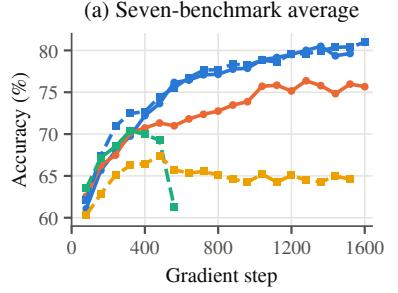

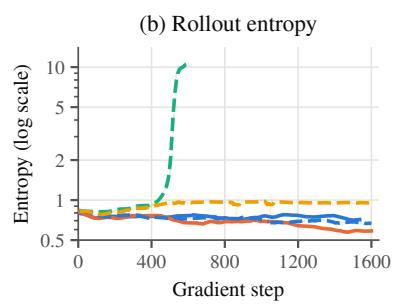

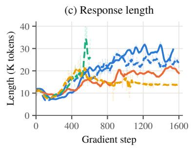  
Figure 4: Training dynamics on Intern-S2-Preview-35B: (a) seven-benchmark average, (b) rollout entropy, and (c) response length. S3AC uses DAPS.

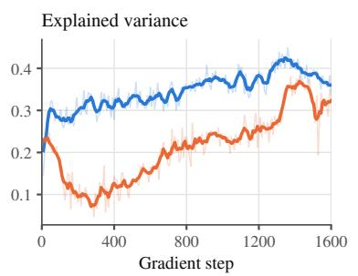

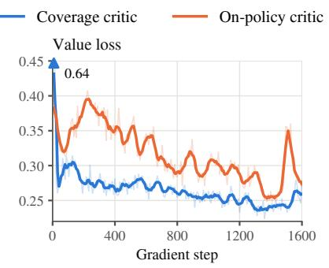

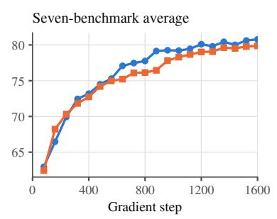  
Figure 5: Coverage pretraining improves value prediction and learning progress on Intern-S2-Preview-35B, reaching higher final performance within the same actor-update budget (group rollout).

## 4.3 Analysis of Critic Pretraining

We examine the proposed value-pretraining method of §3.3 on Intern-S2-Preview-35B; full setups and diagnostics are in Appendix C.

Pretraining data: broader coverage improves value prediction and learning progress. Pretraining on trajectories from multiple policies yields a more accurate critic early in online training. The motivation is limited coverage: among responses longer than 24K tokens, only 5.0% are correct in initial-policy samples, compared with 61.8% for the policy at gradient step 1,600 (Figure 10a,b). We compare a coverage critic, pretrained on trajectories from policies of different strengths, with an on-policy critic, pretrained only on initial-policy trajectories. Both runs share the actor initialization and the online recipe under group rollout; the two recipes also differ in data amount (Appendix C.1). The coverage critic attains higher EV and lower value loss early in online training, and the gap narrows as the on-policy critic adapts online (Figure 5). In this comparison, coverage pretraining enables faster learning progress and higher final performance within the same actorupdate budget.

Pretraining optimization: initialization and clipping. Consistent with the analysis in §3.3, the value head accounts for over 99% of the squared gradient norm during the first 10 critic updates on Intern-S2-Preview-35B, despite having only 2,048 parameters (Appendix C.3). We evaluate the initialization and clipping choices in Table 4. An initialization standard deviation of 0.01 is already below the standard Xavier scale for this head. Reducing it further to 1/(H+1) lowers early value loss from 0.72 to 0.45 and yields the lowest final loss among the tested initializations. In a separate ablation using initial-policy data, increasing the clipping threshold from 1 to 10 reduces the fraction of clipped updates from 99.7% to 12.5%, while final value loss remains comparable. Compared with disabling clipping, this setting retains protection against extreme gradients.

<table><tr><td>Config</td><td>Value loss Grad.</td><td>Grad Clip</td><td>steps first 20 last 20 first 20 (%)</td></tr><tr><td> $1 / ( H { + } 1 )$  0 342  $0 . 1 / ( H + 1 )$  342 0.01 342 0.72</td><td>Head init. std. (coverage data, clip 10) 342 0.45 0.21 0.47 0.22 0.47 0.23</td><td>4.3 5.8 5.2 0.24 17.5 26.3</td><td>0.3 2.0 1.8</td></tr><tr><td></td><td>Max grad norm (on-policy data, recipe init.)</td><td></td><td></td></tr><tr><td>10 (2 seeds)</td><td>256 0.38</td><td>0.20 14.5</td><td>12.5</td></tr><tr><td></td><td></td><td></td><td></td></tr><tr><td>1 (3 seeds)</td><td>256 0.38</td><td>0.20 14.4</td><td>99.7</td></tr><tr><td>none (3 seeds)</td><td>256 0.39</td><td>0.20 15.0</td><td>n/a</td></tr></table>

Table 4: Value-pretraining ablations on Intern-S2- Preview-35B. Loss: mean training loss over the first/last 20 critic gradient steps. Clip: percentage of gradient steps exceeding the clip threshold.
<table><tr><td colspan="5">Grad. step</td></tr><tr><td>Setting</td><td>Prompts × K</td><td>budget</td><td>Uniform</td><td>+DAPS</td></tr><tr><td>35B group</td><td>512×8</td><td>1,520</td><td>79.04</td><td>80.49</td></tr><tr><td>35B single</td><td>4096×1</td><td>1,520</td><td>74.40</td><td>76.94</td></tr><tr><td>R1D group</td><td> $2 5 6 \times 1 6$ </td><td>1,024</td><td>30.87</td><td>31.08</td></tr><tr><td>R1D single</td><td> $4 0 9 6 \times 1$ </td><td>1,024</td><td>30.16</td><td>30.36</td></tr></table>

Table 5: DAPS with group and single rollout: best checkpoint scores within the listed gradient-step budgets. Curves are in Appendix D.

Additional results comparing value pretraining at 35B and 397B are provided in Appendix C.4.

## 4.4 Difficulty-Aware Prompt Sampling

We now evaluate DAPS (§3.4), the selective component of S3AC, which reuses the critic for prompt selection before generation. We compare DAPS with uniform sampling using matched actor and critic initialization and the same S3AC training recipe within each pair. Detailed training and sampling settings are provided in Appendix D.

Does critic-guided prompt selection improve learning? Within matched gradient-step budgets, DAPS improves the best evaluated S3AC score on both Intern-S2-Preview-35B and R1-Distill-1.5B under group and single rollout (Table 5). Full training curves are provided in Appendix D.

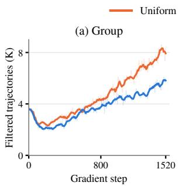

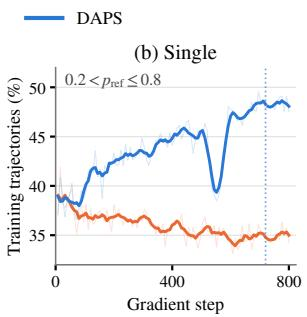  
Figure 6: DAPS sampling on Intern-S2-Preview-35B. (a) Trajectories discarded per rollout batch by the group filter. (b) Single-rollout training share on prompts with $0 . 2 < p _ { \mathrm { r e f } } \leq 0 . 8$

Does selection before generation reduce waste? Under group rollout, DAPS reduces the number of trajectories discarded by dynamic sampling, with a larger gap later in training (Figure 6a). Both methods retain the same number of trajectories per training batch, so fewer generated responses are lost to filtering. This supports the motivation in §3.4: selecting prompts before generation complements DAPO-style dynamic sampling by reducing generation spent on groups later discarded.

Does DAPS help without a group filter? The gains under single rollout show that DAPS also benefits training without group filtering. To examine which prompts enter training, we use each prompt’s success rate in a completed uniform-sampling run, denoted by $p _ { \mathrm { r e f } }$ . After the initial sampling ramp, DAPS consistently allocates a larger share of training trajectories to prompts with $0 . 2 < p _ { \mathrm { r e f } } \leq 0 . 8$ (Figure 6b). This pattern is consistent with the acceptance rule’s preference for prompts of intermediate estimated difficulty (§3.4).

## 5 Conclusion

S3AC enables effective critic training for long-CoT RLVR through broader trajectory coverage, small-scale value-head initialization, and relaxed critic gradient clipping. The trained critic provides prompt-specific baselines and token-level advantages. Experiments show that this actor–critic approach outperforms GRPO-X under group rollout across 1.5B–397B models and sustains stable single-rollout training at 35B. Beyond policy learning, DAPS reuses critic values and outcome history to select prompts before generation, reducing discarded responses under group rollout and improving performance in both settings.

## Limitations

Task scope. All experiments are reasoning-style tasks with verifiable rewards, namely math, science and multimodal reasoning. We do not evaluate agentic multi-turn settings, where credit must be assigned across tool calls and environment turns, so whether our findings carry over to agentic RL remains open. The reported experiments do not systematically assess variability across independent RL training seeds.

Compute overhead. S3AC costs 27–40% more amortized wall time per actor gradient step than GRPO-X, because the critic must be trained and run for inference alongside the policy.

## Ethical Considerations

Our work aims to improve long-CoT reasoning in LLMs through RLVR. Higher benchmark scores do not establish the safety or reliability of model outputs in real-world applications; models may still generate incorrect or harmful content. Deployment requires application-specific evaluation and safeguards. Large-scale actor–critic training also requires additional computational resources and energy, and these costs should be weighed against the observed performance gains.

## References

Arash Ahmadian, Chris Cremer, Matthias Gallé, Marzieh Fadaee, Julia Kreutzer, Olivier Pietquin, Ahmet Üstün, and Sara Hooker. 2024. Back to basics: Revisiting REINFORCE-style optimization for learning from human feedback in LLMs. In Proceedings of the 62nd Annual Meeting of the Association for Computational Linguistics (Volume 1: Long Papers), pages 12248–12267.

Guangran Cheng, Chengqi Lyu, Songyang Gao, Wenwei Zhang, and Kai Chen. 2026. Group entropy-controlled policy optimization. Preprint, arXiv:2607.16850.

DeepSeek-AI. 2026. DeepSeek-V4.1-Flash: Pushing the limits of KV cache compression. Preprint, arXiv:2609.19969.

Logan Engstrom, Andrew Ilyas, Shibani Santurkar, Dimitris Tsipras, Firdaus Janoos, Larry Rudolph, and Aleksander Madry. 2020. Implementation matters in deep RL: A case study on PPO and TRPO. In International Conference on Learning Representations.

Zhaolin Gao, Joongwon Kim, Wen Sun, Thorsten Joachims, Sid Wang, Richard Yuanzhe Pang, and Liang Tan. 2026. Prompt curriculum learning for

efficient LLM post-training. In The Fourteenth International Conference on Learning Representations.

Daya Guo, Dejian Yang, Haowei Zhang, Junxiao Song, Peiyi Wang, Qihao Zhu, Runxin Xu, Ruoyu Zhang, Shirong Ma, Xiao Bi, Xiaokang Zhang, Xingkai Yu, Yu Wu, Z. F. Wu, Zhibin Gou, Zhihong Shao, Zhuoshu Li, Ziyi Gao, Aixin Liu, and 175 others. 2025. DeepSeek-R1 incentivizes reasoning in LLMs through reinforcement learning. Nature, 645(8081):633–638.

Chaoqun He, Renjie Luo, Yuzhuo Bai, Shengding Hu, Zhen Thai, Junhao Shen, Jinyi Hu, Xu Han, Yujie Huang, Yuxiang Zhang, Jie Liu, Lei Qi, Zhiyuan Liu, and Maosong Sun. 2024. OlympiadBench: A challenging benchmark for promoting AGI with olympiad-level bilingual multimodal scientific problems. In Proceedings ofthe 62nd Annual Meeting of the Associationfor Computational Linguistics (Volume 1: Long Papers), pages 3828–3850.

Dan Hendrycks, Collin Burns, Saurav Kadavath, Akul Arora, Steven Basart, Eric Tang, Dawn Song, and Jacob Steinhardt. 2021. Measuring mathematical problem solving with the MATH dataset. In Proceedings of the Neural Information Processing Systems Track on Datasets and Benchmarks, volume 1.

Zhenyu Hou, Yujiang Li, Jie Tang, and Yuxiao Dong. 2026. Single-rollout asynchronous optimization for agentic reinforcement learning. Preprint, arXiv:2607.07508.

Jian Hu, Jason Klein Liu, Haotian Xu, and Wei Shen. 2025. REINFORCE++: Stabilizing critic-free policy optimization with global advantage normalization. Preprint, arXiv:2501.03262.

Jian Hu, Yifan Zhang, Hao Zhang, Binfeng Xu, Shaokun Zhang, Hongqing Peng, Zhiding Yu, Pavlo Molchanov, Jan Kautz, and Yi Dong. 2026. FlashRE-INFORCE: Critic-free single-rollout asynchronous RL for agentic language models. alphaXiv preprint.

Intern-S2-Preview Team. 2026. Intern-S2-Preview: Scientific agentic foundation model. Preprint, arXiv:2608.13505.

InternLM. 2026. Intern-S2-397B. Hugging Face model card. https://huggingface.co/internlm/Inte rn-S2-397B.

Amirhossein Kazemnejad, Milad Aghajohari, Eva Portelance, Alessandro Sordoni, Siva Reddy, Aaron Courville, and Nicolas Le Roux. 2025. VinePPO: Refining credit assignment in RL training of LLMs. In Proceedings of the 42nd International Conference on Machine Learning, volume 267 of Proceedings of Machine Learning Research, pages 29557–29590.

Kimi Team. 2026a. Kimi K2.5: Visual agentic intelligence. Preprint, arXiv:2602.02276.

Kimi Team. 2026b. Kimi K3: Open frontier intelligence. Preprint, arXiv:2607.24653.

Vijay Konda and John Tsitsiklis. 1999. Actor-critic algorithms. In Advances in Neural Information Processing Systems, volume 12.

Aitor Lewkowycz, Anders Andreassen, David Dohan, Ethan Dyer, Henryk Michalewski, Vinay Ramasesh, Ambrose Slone, Cem Anil, Imanol Schlag, Theo Gutman-Solo, Yuhuai Wu, Behnam Neyshabur, Guy Gur-Ari, and Vedant Misra. 2022. Solving quantitative reasoning problems with language models. In Advances in Neural Information Processing Systems, volume 35, pages 3843–3857.

Yujiang Li, Zhenyu Hou, Yi Jing, Jie Tang, and Yuxiao Dong. 2026. CompactionRL: Reinforcement learning with context compaction for long-horizon agents. Preprint, arXiv:2607.05378.

Hunter Lightman, Vineet Kosaraju, Yura Burda, Harri Edwards, Bowen Baker, Teddy Lee, Jan Leike, John Schulman, Ilya Sutskever, and Karl Cobbe. 2024. Let’s verify step by step. In The Twelfth International Conference on Learning Representations.

Jiacai Liu, Yingru Li, Yuqian Fu, Jiawei Wang, Qian Liu, and Yu Shen. 2025. When speed kills stability: Demystifying RL collapse from the training-inference mismatch. Blog post. https://yingru.notion.si te/When-Speed-Kills-Stability-Demystifyin g-RL-Collapse-from-the-Training-Inference -Mismatch-271211a558b7808d8b12d403fd15edd a.

Jiashun Liu, Johan Obando-Ceron, Han Lu, Yancheng He, Weixun Wang, Wenbo Su, Bo Zheng, Pablo Samuel Castro, Aaron Courville, and Ling Pan. 2026. Asymmetric proximal policy optimization: mini-critics boost LLM reasoning. In The Fourteenth International Conference on Learning Representations.

LLM-Core Xiaomi. 2026. MiMo-V2.6: Scaling reinforcement learning towards self-improvement. Preprint, arXiv:2610.11959.

LMDeploy Contributors. 2023. LMDeploy: A toolkit for compressing, deploying, and serving LLM. GitHub repository. https://github.com/InternL M/lmdeploy.

Pan Lu, Hritik Bansal, Tony Xia, Jiacheng Liu, Chunyuan Li, Hannaneh Hajishirzi, Hao Cheng, Kai-Wei Chang, Michel Galley, and Jianfeng Gao. 2024. MathVista: Evaluating mathematical reasoning of foundation models in visual contexts. In The Twelfth International Conference on Learning Representations.

Thang Luong, Dawsen Hwang, Hoang H Nguyen, Golnaz Ghiasi, Yuri Chervonyi, Insuk Seo, Junsu Kim, Garrett Bingham, Jonathan Lee, Swaroop Mishra, Alex Zhai, Huiyi Hu, Henryk Michalewski, Jimin Kim, Jeonghyun Ahn, Junhwi Bae, Xingyou Song, Trieu Hoang Trinh, Quoc V Le, and Junehyuk Jung. 2025. Towards robust mathematical reasoning. In Proceedings of the 2025 Conference on Empirical

Methods in Natural Language Processing, pages 35418–35442.

Wenhan Ma, Hailin Zhang, Liang Zhao, Yifan Song, Yudong Wang, Fuli Luo, and Zhifang Sui. 2026. Stabilizing MoE reinforcement learning by aligning training and inference routers. In International Conference on Machine Learning.

MiniMax, Aili Chen, Aonian Li, Bangwei Gong, Binyang Jiang, Bo Fei, Bo Yang, Boji Shan, Changqing Yu, Chao Wang, Cheng Zhu, Chengjun Xiao, Chengyu Du, Chi Zhang, Chu Qiao, Chunhao Zhang, Chunhui Du, Congchao Guo, Da Chen, and 108 others. 2025. MiniMax-M1: Scaling testtime compute efficiently with lightning attention. Preprint, arXiv:2506.13585.

Chengjun Pan, Shichun Liu, Jiahang Lin, Dingwei Zhu, Jiazheng Zhang, Shihan Dou, Songyang Gao, Zhenhua Han, Binghai Wang, Rui Zheng, Xuanjing Huang, Tao Gui, and Yansong Feng. 2026. EVPO: Explained variance policy optimization for adaptive critic utilization in LLM post-training. Preprint, arXiv:2604.19485.

Penghui Qi, Zichen Liu, Xiangxin Zhou, Tianyu Pang, Chao Du, Wee Sun Lee, and Min Lin. 2025. Defeating the training-inference mismatch via FP16. Preprint, arXiv:2510.26788.

David Rein, Betty Li Hou, Asa Cooper Stickland, Jackson Petty, Richard Yuanzhe Pang, Julien Dirani, Julian Michael, and Samuel R. Bowman. 2024. GPQA: A graduate-level Google-proof Q&A benchmark. In First Conference on Language Modeling.

John Schulman, Philipp Moritz, Sergey Levine, Michael Jordan, and Pieter Abbeel. 2016. High-dimensional continuous control using generalized advantage estimation. In 4th International Conference on Learning Representations, Conference Track Proceedings.

John Schulman, Filip Wolski, Prafulla Dhariwal, Alec Radford, and Oleg Klimov. 2017. Proximal policy optimization algorithms. Preprint, arXiv:1707.06347.

Zhihong Shao, Peiyi Wang, Qihao Zhu, Runxin Xu, Junxiao Song, Xiao Bi, Haowei Zhang, Mingchuan Zhang, Y. K. Li, Y. Wu, and Daya Guo. 2024. DeepSeekMath: Pushing the limits of mathematical reasoning in open language models. Preprint, arXiv:2402.03300.

Richard S. Sutton and Andrew G. Barto. 2018. Reinforcement learning: an introduction, second edition. Adaptive computation and machine learning series. The MIT Press.

Richard S. Sutton, David McAllester, Satinder Singh, and Yishay Mansour. 1999. Policy gradient methods for reinforcement learning with function approximation. In Advances in Neural Information Processing Systems, volume 12, pages 1057–1063. MIT Press.

Ling Team, Anqi Shen, Baihui Li, Bin Hu, Bin Jing, Cai Chen, Chao Huang, Chao Zhang, Chaokun Yang, Cheng Lin, Chengyao Wen, Congqi Li, Deng Zhao, Dingbo Yuan, Donghai You, Fagui Mao, Fanzhuang Meng, Feng Xu, Guojie Li, and 85 others. 2025. Every step evolves: Scaling reinforcement learning for trillion-scale thinking model. Preprint, arXiv:2510.18855.

Ke Wang, Junting Pan, Weikang Shi, Zimu Lu, Houxing Ren, Aojun Zhou, Mingjie Zhan, and Hongsheng Li. 2024. Measuring multimodal mathematical reasoning with MATH-Vision dataset. In Advances in Neural Information Processing Systems, volume 37, pages 95095–95169.

Yihong Wu, Liheng Ma, Lingfeng Xiao, Muzhi Li, Xinyu Wang, Yingxue Zhang, and Jian-Yun Nie. 2026. Rethinking groups in critic-free RLVR. Preprint, arXiv:2606.17250.

XTuner Contributors. 2023. XTuner: A toolkit for efficiently fine-tuning LLM. GitHub repository. https://github.com/InternLM/xtuner.

Zhongwen Xu and Zihan Ding. 2026. Single-stream policy optimization. In The Fourteenth International Conference on Learning Representations.

An Yang, Beichen Zhang, Binyuan Hui, Bofei Gao, Bowen Yu, Chengpeng Li, Dayiheng Liu, Jianhong Tu, Jingren Zhou, Junyang Lin, Keming Lu, Mingfeng Xue, Runji Lin, Tianyu Liu, Xingzhang Ren, and Zhenru Zhang. 2024. Qwen2.5-Math technical report: Toward mathematical expert model via self-improvement. Preprint, arXiv:2409.12122.

Feng Yao, Liyuan Liu, Dinghuai Zhang, Chengyu Dong, Jingbo Shang, and Jianfeng Gao. 2025. Your efficient RL framework secretly brings you off-policy RL training. Blog post. https://fengyao.notion .site/off-policy-rl.

Qiying Yu, Zheng Zhang, Ruofei Zhu, Yufeng Yuan, Xiaochen Zuo, Yu Yue, Weinan Dai, Tiantian Fan, Gaohong Liu, juncai liu, LingJun Liu, Xin Liu, Haibin Lin, Zhiqi Lin, Bole Ma, Guangming Sheng, Yuxuan Tong, Chi Zhang, Mofan Zhang, and 17 others. 2025. DAPO: An open-source LLM reinforcement learning system at scale. In Advances in Neural Information Processing Systems, volume 38, pages 113222–113244.

Yufeng Yuan, Yu Yue, Ruofei Zhu, Tiantian Fan, and Lin Yan. 2025. What’s behind PPO’s collapse in long-CoT? Value optimization holds the secret. Preprint, arXiv:2503.01491.

Xiang Yue, Tianyu Zheng, Yuansheng Ni, Yubo Wang, Kai Zhang, Shengbang Tong, Yuxuan Sun, Botao Yu, Ge Zhang, Huan Sun, Yu Su, Wenhu Chen, and Graham Neubig. 2025a. MMMU-Pro: A more robust multi-discipline multimodal understanding benchmark. In Proceedings of the 63rd Annual Meeting of the Association for Computational Linguistics (Volume 1: Long Papers), pages 15134–15186.

Yu Yue, Yufeng Yuan, Qiying Yu, Xiaochen Zuo, Ruofei Zhu, Wenyuan Xu, Jiaze Chen, Chengyi Wang, TianTian Fan, Zhengyin Du, Xiangpeng Wei, Xiangyu Yu, Gaohong Liu, Juncai Liu, Lingjun Liu, Haibin Lin, Zhiqi Lin, Bole Ma, Chi Zhang, and 8 others. 2025b. VAPO: Efficient and reliable reinforcement learning for advanced reasoning tasks. Preprint, arXiv:2504.05118.

Haizhong Zheng, Yang Zhou, Brian Bartoldson, Bhavya Kailkhura, Fan Lai, Jiawei Zhao, and Beidi Chen. 2025. Act only when it pays: Efficient reinforcement learning for LLM reasoning via selective rollouts. In Advances in Neural Information Processing Systems, volume 38, pages 124321–124346.

## A Experimental Details

## A.1 Training Configurations

Our training pipeline is built on XTuner (XTuner Contributors, 2023), with LMDeploy (LMDeploy Contributors, 2023) used for rollout generation. Table 6 summarizes the training configurations; all methods start from the same base checkpoint within each model. All group-rollout runs use dynamic sampling (Yu et al., 2025), discarding groups whose responses are all correct or all incorrect. On Intern-S2-397B, both S3AC and GRPO-X apply an adaptive length regularizer that favors shorter correct responses in high-accuracy groups; S3AC uses the adjusted rewards for both actor and critic training.

## A.2 Evaluation

We evaluate both 1.5B models offline at gradient step 1,024. For Qwen2.5-Math-1.5B, we use temperature 0.7, top-p 0.7, and avg@16 on every benchmark. We cap the combined prompt and response length at 4,096 tokens; FlashREIN-FORCE (Hu et al., 2026) reports a 4,096-token response budget.

For R1-Distill-1.5B, we use temperature 0.8, top-p 0.95, a 16,384-token response limit, and avg@32. Small score differences on R1-Distill-1.5B should be interpreted cautiously given the variability across repeated evaluations.

For Intern-S2-Preview-35B and Intern-S2-397B, we use temperature 0.8 and top-p 1.0, with response limits of 64K and 62K tokens, respectively. We report avg@16 on AIME and HMMT26, avg@4 on GPQA-Diamond and IMO-AnswerBench, and avg@1 on the remaining benchmarks.

## A.3 Baselines

GRPO-X uses the group z-score as the advantage, and REINFORCE++ normalizes the reward by the batch mean and standard deviation. The MoE GRPO-X baselines additionally use GEPO entropy control (Cheng et al., 2026), as described in §4.1. FlashREINFORCE follows its original configuration, with a batch-mean baseline and a sequencelevel trust region.

<table><tr><td></td><td>Qwen2.5-Math-1.5B</td><td>R1-Distill-1.5B</td><td>Intern-S2-Preview-35B</td><td>Intern-S2-397B</td></tr><tr><td>Training data</td><td>DAPO-Math 7.5k</td><td>MATH-1,460</td><td>in-house</td><td>in-house</td></tr><tr><td>Prompts × K (group)</td><td>256 × 16</td><td> $2 5 6 \times 1 6$ </td><td>512 × 8</td><td>1024 × 8</td></tr><tr><td>Prompts × K (single)</td><td>4096 × 1</td><td>4096 × 1</td><td>8192 × 1</td><td></td></tr><tr><td>Dynamic sampling (group)</td><td>yes</td><td>yes</td><td>yes</td><td>yes</td></tr><tr><td>Max response length</td><td>3,072</td><td>16,384</td><td>50K</td><td>62K</td></tr><tr><td>Actor updates per rollout batch</td><td>8</td><td>8</td><td>8</td><td>8</td></tr><tr><td>Actor / critic learning rate</td><td colspan="4"> $1 \times 1 0 ^ { - 6 } / 5 \times 1 0 ^ { - 6 }$ </td></tr><tr><td>Actor / critic gradient clip</td><td colspan="4">1.0 / 10.0</td></tr><tr><td>Rollout temperature / top-p</td><td></td><td>1.0 / 1.0</td><td></td><td></td></tr><tr><td>S3AC gradient steps (group / single) Evaluation interval (gradient steps)</td><td>1,024 160</td><td>1,024 160</td><td>1,520 / 1,600 80</td><td>1,200 80</td></tr><tr><td></td><td></td><td></td><td></td><td></td></tr><tr><td>CISPO clip range R3 routing replay</td><td colspan="4">[0.8, 1.28]</td></tr><tr><td>IcePoP token mask range</td><td colspan="4"></td></tr><tr><td>MIS-style sequence mask range</td><td colspan="4">[0.5, 5] [0, 5]</td></tr><tr><td>GEPO (GRPO-X/ S3AC)</td><td></td><td>no / no</td><td>yes / no</td><td></td></tr><tr><td></td><td>no /no</td><td></td><td></td><td>yes / no</td></tr><tr><td>DAPS (S3AC) DAPS peak success rate μ</td><td>on 0.5</td><td>on 0.5</td><td>on 0.5</td><td>off</td></tr><tr><td>Acceptance floor amin</td><td>0.3</td><td>0.3</td><td>0.3</td><td></td></tr><tr><td>Critic prior count nc</td><td>3</td><td>3</td><td>3</td><td></td></tr><tr><td>Count decay per rollout batch</td><td>0.99</td><td>0.99</td><td>0.99</td><td></td></tr></table>

Table 6: Training configurations for the main results. DAPS settings refer to S3AC. – denotes not applicable.

## B Additional Results and Training Dynamics

Figures 7 and 8 provide the full MoE learning curves for §4.

Table 7 reports training statistics, evaluation response lengths, and truncation rates.

Policy-loss variants. CISPO, DIS (Hou et al., 2026), and DIS with a sequence mask train stably from the same actor and critic, scoring 79.8–80.2 (Table 8). These single-seed runs have different restart histories and serve as a robustness check.

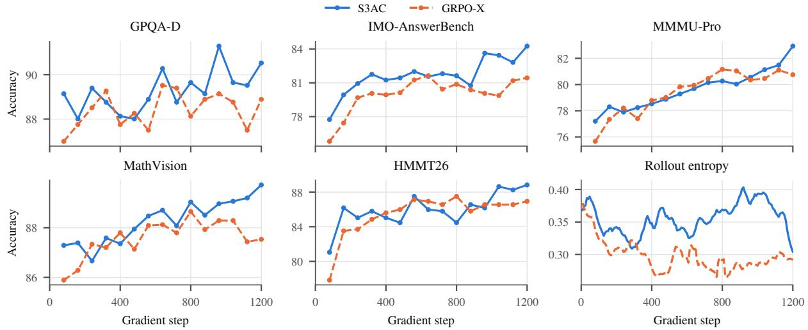

Figure 7: Group-rollout training on Intern-S2-397B. The five benchmark curves report raw evaluation scores; rollou entropy uses a moving average over 40 gradient steps.
<table><tr><td></td><td></td><td colspan="5">Training (80 gradient steps)</td><td colspan="2">Evaluation</td></tr><tr><td>Method</td><td>Rollout</td><td>Grad. steps</td><td>Entropy</td><td>Length</td><td>Reward</td><td>EV</td><td>Length</td><td>Trunc. (%)</td></tr><tr><td colspan="9">Qwen2.5-Math-1.5B (eval: gradient step 1,024, ≤4,096 tokens)</td></tr><tr><td>GRPO-X</td><td>group</td><td>952–1,024</td><td>0.15</td><td>993</td><td>-0.32</td><td></td><td>921</td><td>3.1</td></tr><tr><td>S3AC</td><td>group</td><td>952-1,024</td><td>0.07</td><td>965</td><td>-0.06</td><td>0.35</td><td>912</td><td>3.7</td></tr><tr><td>REINFORCE++</td><td>single</td><td>952–1,024</td><td>1.50</td><td>1535</td><td>-0.40</td><td>一</td><td>1723</td><td>28.9</td></tr><tr><td>FlashREINFORCE</td><td>single</td><td>952-1,024</td><td>0.17</td><td>1540</td><td>-0.35</td><td></td><td>1951</td><td>41.1</td></tr><tr><td>S3AC</td><td>single</td><td>952–1,024</td><td>0.10</td><td>919</td><td>-0.01</td><td>0.45</td><td>1156</td><td>9.2</td></tr><tr><td colspan="9">R1-Distill-1.5B (eval: gradient step 1,024, ≤16,384 tokens)</td></tr><tr><td>GRPO-X</td><td>group</td><td>952–1,024</td><td>1.11</td><td>4.8K</td><td>0.61</td><td></td><td>8.8K</td><td>7.3</td></tr><tr><td>S3AC</td><td>group</td><td>952–1,024</td><td>0.63</td><td>7.9K</td><td>0.73</td><td>0.31</td><td>11.8K</td><td>26.3</td></tr><tr><td>REINFORCE++</td><td>single</td><td>952-1,024</td><td>1.18</td><td>3.3K</td><td>0.33</td><td>一</td><td>6.4K</td><td>1.2</td></tr><tr><td>FlashREINFORCE</td><td>single</td><td>952–1,024</td><td>1.27</td><td>4.2K</td><td>0.71</td><td></td><td>9.0K</td><td>11.8</td></tr><tr><td>S3AC</td><td>single</td><td>952–1,024</td><td>0.66</td><td>7.5K</td><td>0.71</td><td>0.34</td><td>12.1K</td><td>29.3</td></tr><tr><td colspan="9">Intern-S2-Preview-35B (eval: 64K context, ≤63,488 response tokens)</td></tr><tr><td>GRPO-X</td><td>group</td><td>1,528-1,600</td><td>0.59</td><td>20.3K</td><td>0.28</td><td></td><td></td><td></td></tr><tr><td>S3AC</td><td>group</td><td>1,448–1,520</td><td>0.72</td><td>25.2K</td><td>0.38</td><td>0.37</td><td>24.2K</td><td>1.8</td></tr><tr><td>REINFORCE++†</td><td>single</td><td>536-608</td><td>10.0</td><td>29.5K</td><td>-0.87</td><td>一</td><td>25.6K</td><td>26.0</td></tr><tr><td>FlashREINFORCE</td><td>single</td><td>1,520–1,592</td><td>0.96</td><td>13.8K</td><td>0.14</td><td></td><td>20.6K</td><td>16.7</td></tr><tr><td>S3AC</td><td>single</td><td>1,528–1,600</td><td>0.67</td><td>23.8K</td><td>0.46</td><td>0.67</td><td>21.7K</td><td>0.5</td></tr></table>

Table 7: Training and evaluation statistics near the end of each run. Training metrics average 10 batch-level records over 80 actor gradient steps. A dash indicates an unavailable statistic. †REINFORCE++ uses a post-collapse window.

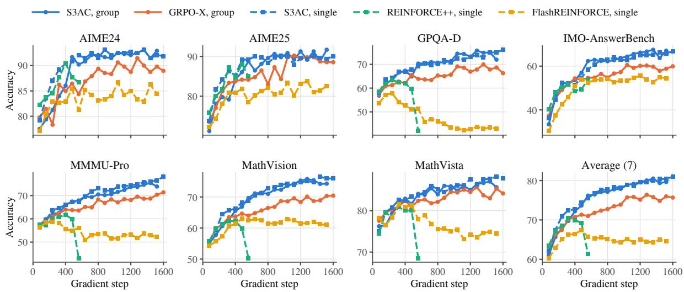

Figure 8: Full benchmark curves on Intern-S2-Preview-35B, including the seven-benchmark average shown in Figure 4a. Points are raw evaluations; the x-axis counts actor gradient steps.  
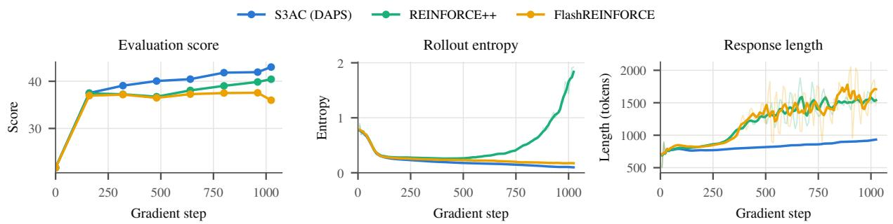

Figure 9: Single-rollout training on Qwen2.5-Math-1.5B: average benchmark score, rollout entropy, and response length. S3AC uses DAPS. Scores are offline avg@16. Entropy and length use moving averages over 40 gradient steps with faint raw values.
<table><tr><td></td><td colspan="7">IMO-</td></tr><tr><td>Policy loss</td><td>AIME24</td><td>AIME25</td><td>GPQA-D</td><td></td><td></td><td>AnswerBench MMMU-Pro MathVision MathVista</td><td></td><td>Avg</td></tr><tr><td>CISPO + IcePoP + seq. mask</td><td>92.0</td><td>89.9</td><td>74.8</td><td>66.2</td><td>75.3</td><td>75.3</td><td>87.9</td><td>80.2</td></tr><tr><td>DIS</td><td>91.3</td><td>89.2</td><td>75.1</td><td>64.8</td><td>78.5</td><td>74.0</td><td>88.2</td><td>80.1</td></tr><tr><td>DIS + seq. mask</td><td>91.2</td><td>88.7</td><td>73.7</td><td>63.4</td><td>78.5</td><td>74.5</td><td>88.3</td><td>79.8</td></tr></table>

<table><tr><td>Policy loss</td><td>Entropy</td><td>Length</td><td>EV</td><td>Mask (%)</td></tr><tr><td>CISPO + IcePoP + seq. mask</td><td>0.816</td><td>22.3</td><td>0.72</td><td>3.6</td></tr><tr><td>DIS</td><td>0.737</td><td>18.1</td><td>0.75</td><td></td></tr><tr><td>DIS + seq. mask</td><td>0.761</td><td>17.0</td><td>0.78</td><td>6.6</td></tr></table>

Table 8: Policy-loss variants for single-rollout Intern-S2-Preview-35B; all settings other than the policy loss are identical. Top: benchmark scores averaged over gradient steps 1,360, 1,440, 1,520. Bottom: means over the 10 logged points at gradient steps 1,448–1,520 of rollout entropy, response length (K tokens), actor-target EV, and sequence mask rate (Mask).

## C Additional Critic Experiments

This section provides token-level value examples for §3.2 and the experimental setups and diagnostics for §4.3.

## C.1 Experimental Setup

Pretraining data and sources. For Intern-S2- Preview-35B, the coverage critic learns from trajectories generated by policies of different strengths across multiple stages of prior experiments. Its preparation includes value pretraining on a corpus of 327,680 trajectories (7.08B response tokens). The on-policy critic is pretrained only on 65,536 initial-policy trajectories (0.74B response tokens). At 1,600 actor gradient steps, the coverage and onpolicy runs achieve seven-benchmark averages of 80.78 and 79.86.

Value-pretraining configuration. We pretrain for two epochs with cosine learning-rate decay from $1 0 ^ { - 5 } { \mathrm { ~ t o ~ } } 5 \times 1 0 ^ { - 6 }$ after a 3% linear warmup. The loss is $\textstyle { \frac { 1 } { 2 } } ( V _ { \phi } ( s _ { t } ) - R ) ^ { 2 }$ , averaged over response tokens using the terminal verifier reward R. The FP32 value head has initialization standard deviation $1 / ( H { + } 1 )$ , and the gradient norm is clipped at 10. Attention, the MoE router and any vision tower and projector are frozen. Online configurations are given in §3.3 and Table 6.

## C.2 Data Coverage and Token-Level Values

Response length and correctness. Figure 10 compares sampled trajectories from the initial policy and the policy at gradient step 1,600. Among responses longer than 24K tokens, 5.0% are correct in the initial-policy sample versus 61.8% at gradient step 1,600. The stronger-policy data thus supply long correct trajectories that are rare in the initial-policy data.

Token-level value examples. Figure 11 expands the example in Figure 3 and adds a numerical multiple-choice example, both evaluated with the coverage critic. In the first, the value rises when the response identifies the possible sequence values, including $4 / 5 ,$ , and increases further when it determines that the requested term is $4 / 5 .$ . In the second, the value rises sharply from negative values toward zero after the response computes 0.1622 and matches it to option H (0.1614). These examples illustrate how the coverage critic tracks meaningful reasoning progress within a response, providing fine-grained value estimates for token-level credit assignment.

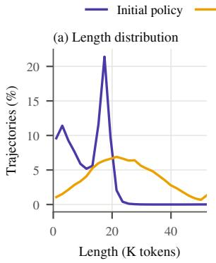

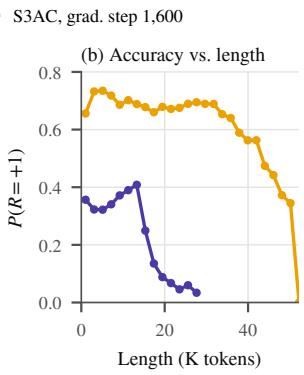  
Figure 10: Response-length distribution (a) and accuracy by length (b) for the initial policy and the policy at gradient step 1,600 on Intern-S2-Preview-35B. Bins span 2K tokens.

## C.3 Value-Pretraining Optimization

Gradient imbalance. Figure 12 reports the head and backbone gradient norms during the first 10 critic gradient steps of 35B value pretraining, supporting the analysis in §4.3.

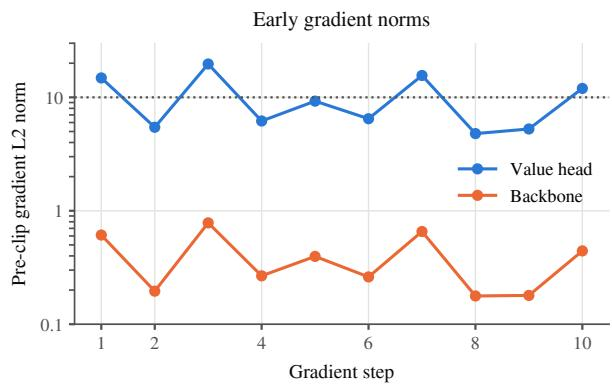  
Figure 12: Head and backbone gradient norms over the first 10 critic gradient steps of 35B value pretraining, measured after distributed gradient reduction and before clipping. The dotted line marks the clipping threshold of 10.

## (a) Sequence reasoning: answer 4/5

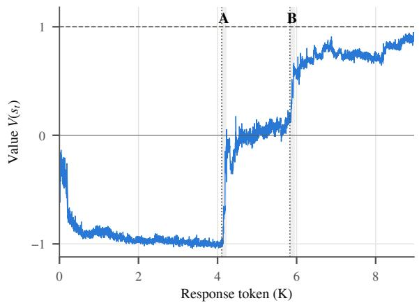

## A Candidate values identified

Next iteration a 3/5 2/5 false > a = 2\*(3/5) 6/5 1 1/5. Then back to start. So this yields a cycle of length 4: 1/5 -> 2/5 4/5 3/5 1/5 This matches the answer choices! Indeed the possibilities are exactly 1/5, 2/5, 3/5, 4/5.

## B Requested term determined

a\_3 (mod 3) 3/5. a\_4 (mod 0) 1/5 again. Thus if k mod 4 2 then $\mathsf { a \_ k } = \mathsf { 4 } / 5 .$ Since 2014 mod 4 2, the final a after i 2014 steps is a\_{2014} 4/5. Thus answer is 4/5. However we need to confirm that this fits with the original flowchart.

(b) Numerical approximation: option H, 0.1614  
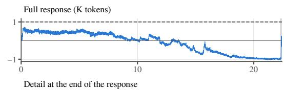

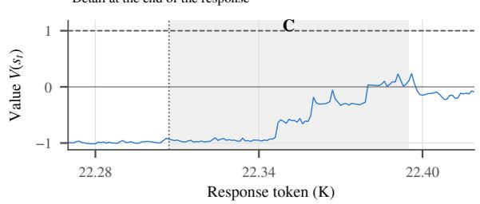  
C Computed value matches an option  
Thus I\_z(2,5) 0.8378. Then p-value 1 - 0.8378 0.1622. That matches option H: 0.1614. Indeed it's a close number. Thus p-value is about 0.162. Option H is 0.1614. So likely answer H.

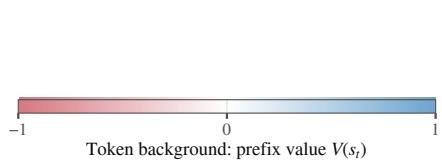  
Figure 11: Illustrative critic values on Intern-S2-Preview-35B: (a) identifying candidate values (A) and determining the requested term, 4/5 (B); (b) matching 0.1622 to option H (0.1614), with a 150-token detail. Shaded ranges match the excerpts. Curves and colors show raw values before each response token; dashed lines mark reward +1.

## C.4 Value Pretraining at Different Model Scales

We compare value pretraining at 35B and 397B. The 35B critic is pretrained on 1.13M trajectories (6.24B response tokens), and the Intern-S2- 397B critic on 1.85M trajectories (10.0B response tokens), using the configuration described in Appendix C.1.

The 397B critic achieves lower and more stable value loss, together with smaller gradient norms (Figure 13), suggesting stronger value-fitting capacity for the larger critic in these runs.

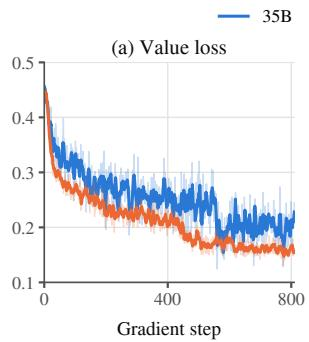

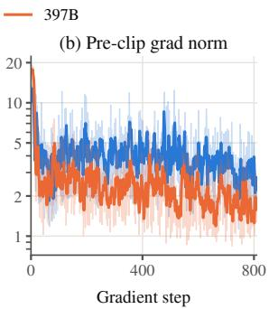  
Figure 13: Value pretraining at 35B and 397B: (a) training value loss and (b) pre-clip gradient norm.

## D DAPS Details

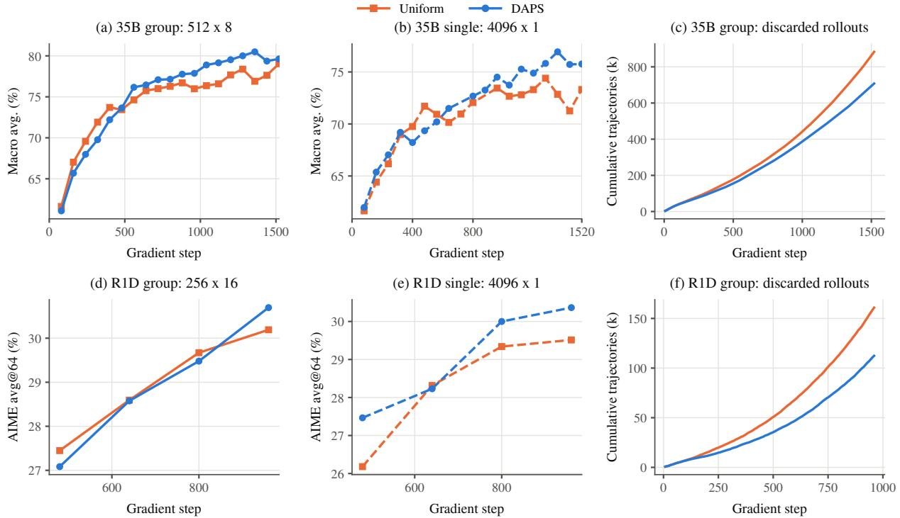  
Figure 14: DAPS vs. uniform sampling on 35B (top) and R1D (bottom). Columns show group-rollout evaluation, single-rollout evaluation with 4,096 trajectories per rollout batch, and cumulative trajectories discarded by the group filter. Scores are seven-benchmark macro averages for 35B and AIME avg@64 for R1D. Horizontal axes show gradient steps.

## D.1 Experimental Setup

Training settings. We use the S3AC recipe in Appendix A with matched actor and critic initialization within each pair; the 35B runs use the coverage critic from Appendix C.1. Table 9 lists prompt batch sizes and acceptance floors. All settings use $n _ { c } = 3$ and a count-decay factor of 0.99 per rollout batch (eight actor gradient steps). At initialization, 40 gradient steps of uniform sampling precede an 80-gradient-step acceptance ramp. We rescore prefetched prompts after the critic is trained on each rollout batch, using a window twice the previous candidate count.

<table><tr><td>Setting</td><td>Prompts × K</td><td> $a _ { \mathrm { m i n } }$ </td></tr><tr><td>35B group</td><td> $5 1 2 \times 8$ </td><td>0.3</td></tr><tr><td>35B single</td><td> $4 0 9 6 \times 1$ </td><td>0.1</td></tr><tr><td>R1D group</td><td> $2 5 6 \times 1 6$ </td><td>0.3</td></tr><tr><td>R1D single</td><td> $4 0 9 6 \times 1$ </td><td>0.3</td></tr></table>

Table 9: Prompt batch sizes and minimum acceptance probabilities for the four DAPS comparisons.

Evaluation and sampling diagnostic. The paired ablations in this section retain 4,096 prompts per batch for 35B single rollout, whereas the main results use 8,192. For R1D, two offline evaluations of 32 responses per question yield avg@64 on AIME 2024/2025/2026; other evaluation settings follow Appendix A.2. For each pair, Table 5 reports the score from each method’s best evaluated checkpoint within a common gradient-step budget; Figure 14 shows the original score at each checkpoint. Figure 6b uses each prompt’s success rate over the first 1,600 gradient steps of a completed uniform-sampling run as a common difficulty reference for both methods.

## D.2 Additional Results

Figure 14 shows a sustained late-stage advantage for 35B under both group and single rollout. R1D gains vary across training. Under group rollout, DAPS reduces cumulative discarded trajectories on both models. Prompt scoring adds computation, particularly with larger single-rollout batches.