# STYLE OVER SUBSTANCE? LINGUISTIC BIAS IN LLM-BASED PEER REVIEW

Sai Suresh Macharla Vasu1,∗, Sumedh Santosh Joshi1,∗, Philipp Christmann1, Ivaxi Sheth1, Ruta Binkyte1,2, Koel Dutta Chowdhury3, Raouf Kerkouche4, Hui-Po Wang1, Mario Fritz1

1CISPA Helmholtz Center for Information Security

2German Research Center for Artificial Intelligence (DFKI)

3University of Technology Nuremberg

4INRIA

## ABSTRACT

The number of paper submissions to major AI conferences has increased dramatically in recent years, substantially increasing the peer-review workload of researchers. At the same time, large language models (LLMs) are increasingly used to support peer review, both by individual reviewers and by conference organizations. While LLM capabilities have improved considerably, their evaluations may be influenced by linguistic characteristics that are unrelated to scientific content. In this work, we introduce a controlled experimental framework for studying such effects by systematically perturbing the linguistic style of research papers. Specifically, we rewrite papers to exhibit (i) linguistic features associated with native or non-native English writing, and (ii) high- or low-confidence linguistic features. To construct these interventions, we derive fine-grained rewriting instructions grounded in the linguistic literature and apply them using LLMs. Crucially, our interventions are designed to preserve the underlying scientific content. We then evaluate the resulting papers using different LLM reviewers. Our experiments expose a critical vulnerability in LLM-based peer review: reviewers systematically reward confident rhetoric independent of scientific content, raising serious concerns about the robustness of their assessments.

## 1 INTRODUCTION

The peer-review process is an integral part of scientific publishing, but also requires substantial time and effort from researchers. This challenge has become increasingly pronounced with the growing number of submissions to major AI conferences. In parallel, recent advances in large language models (LLMs) have opened up new opportunities to automate or support parts of the reviewing process (Jin et al., 2024; Lin et al., 2025; Dycke & Gurevych, 2026). Individual reviewers use LLMs to assist with the review process, while LLMs are also increasingly seen as systematic tools for generating or supporting peer review (Demetrio et al., 2025; Baumann et al., 2026).

However, the use of LLMs for peer review also introduces new risks. LLM judgments can be influenced by properties that are unrelated to the actual quality of the evaluated content. Prior work on LLM-as-a-judge has, for example, demonstrated biases related to the position of an answer or preferences towards outputs of the same LLM family (Liu et al., 2024; Wataoka et al., 2024; Ye et al., 2025). Similar concerns have been identified specifically for LLM-based peer review as well. LLM reviewers can be susceptible to adversarial modifications of papers (Lin et al., 2025), fail to reliably identify faulty scientific reasoning (Dycke & Gurevych, 2026), and exhibit biases based on authorrelated information such as affiliation, seniority, or publication history (Vasu et al., 2026). Moreover, recent results suggest that even paraphrasing or stylistic properties of a paper can substantially affect LLM-generated review scores (Kaneko, 2026; Kousha & Thelwall, 2026; Baumann et al., 2026). These findings raise the central question of our paper: ”How do we systematically measure whether

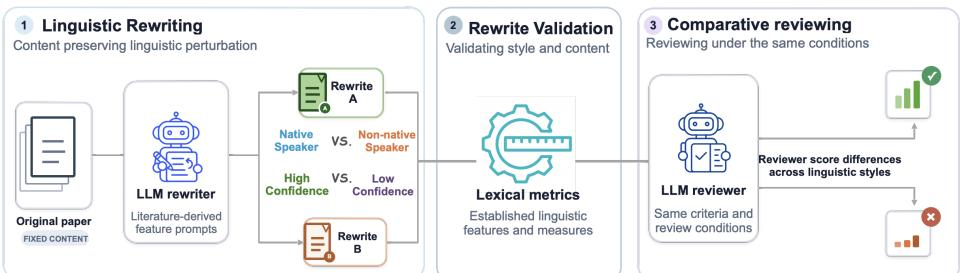  
Figure 1: Visualization of our controlled framework for linguistic rewriting of research papers.

LLM reviewers judge the research quality, rather than the linguistic style with which the research content is presented?”

In this work, we specifically study the impact of linguistic style on LLM-based peer review. Researchers have different linguistic backgrounds, and previous work has already found evidence that language proficiency and writing style can influence human peer review (Politzer-Ahles et al., 2020; Saposnik et al., 2014; Lee et al., 2006; Sayegh et al., 2024). Motivated by these human studies, we focus on two complementary dimensions that together signal epistemic authority: (i) the language proficiency reflected in the writing, and (ii) the confidence with which the research is presented. Language proficiency can signal author credibility (Lev-Ari & Keysar, 2010), while confident linguistic framing can influence the perceived scientific credibility (Teigen, 2023). Both dimensions are well characterized in the linguistic literature (Hinkel, 2002; Hyland, 1996), and should not substantially affect the assessment of the underlying research quality.

Systematically studying such effects is challenging, as naturally occurring papers with different linguistic styles also differ in their research content and quality. We therefore propose a controlled framework for perturbing a research paper along a specific linguistic dimension, while preserving its underlying research content. Specifically, we rewrite papers to exhibit (i) linguistic characteristics associated with native or non-native English writing, and (ii) high-confidence- or low-confidence linguistic characteristics. Rather than relying on generic rewriting instructions, we derive fine-grained prompts from the linguistic literature to systematically control the corresponding stylistic features. Crucially, we design these interventions to avoid distorting the content and thus the research quality of the paper, and verify the content integrity of the resulting rewrites. To assess whether rewrites exhibit the intended stylistic characteristics we use established linguistic measures. The different rewrites are then given to LLM reviewers, that provide us with a full-fledged peer review. While review scores are the immediate quality signal, the arguments raised in reviews play an important role in the final decision process as well (Arous et al., 2026). To this end, we integrate an automated annotation procedure for identifying positive and negative aspects in reviews (Lu et al., 2025).

While related work has used counterfactual modifications to study reasoning capabilities (Dycke & Gurevych, 2026), author-related biases (Vasu et al., 2026), or the general susceptibility of LLM reviewers to rewriting and paraphrasing (Kaneko, 2026; Baumann et al., 2026), framework isolates linguistic cues of epistemic authority and examines their effects on review scores and qualitative arguments. We use this framework to study different state-of-the-art LLM reviewers and investigate whether their reviews systematically favor perceived language proficiency and confidence.

Our experiments reveal that the two linguistic dimensions affect LLM reviewers differently. Across models, expressed confidence has a strong and consistent effect on evaluation even though the un derlying scientific content remains unchanged. In contrast, differences between native- and nonnative associated writing are substantially smaller and more model-dependent. More importantly, our controlled rewriting framework provides a practical way to stress-test LLM reviewers by varying specific linguistic cues and measuring when these changes alter review outcomes. Our analysis further shows that these effects extend beyond review scores: LLM reviewers raise substantially different arguments across rewrites, focusing on different aspects of the paper and expressing different sentiments toward them.

In summary, our main contributions are:

• We devise a controlled experimental framework for stress-testing LLM reviewers. By rewriting research papers along different linguistic dimensions in a content-preserving manner, our framework enables the systematic investigation of linguistic biases in LLM-based peer review.

• We design literature-grounded rewriting prompts to manipulate language proficiency and expressed confidence, and validate the resulting rewrites using established linguistic measures.

• We conduct experiments across state-of-the-art LLM reviewers. Our results reveal that expressed confidence has a strong and consistent effect on reviewer preferences, while effects associated with language proficiency are substantially smaller and vary across models.

## 2 METHODOLOGY

In this section, we introduce our experimental framework for controlled linguistic interventions to detect stylistic biases in LLM reviewers. Starting with the original paper, our framework proceeds in three stages. First, we generate two versions that differ along a specific linguistic dimension, while preserving the underlying research content. We then validate the content integrity of rewrites, and verify the presence of the respective linguistic style. Finally, we provide the resulting versions to LLM reviewers and compare their reviews. Figure 1 provides an overview of our framework.

## 2.1 LINGUISTIC REWRITING

A central challenge in designing the rewriting interventions is to obtain linguistically distinguishable versions while changing only their linguistic realization and not the scientific content. This challenge was also highlighted in prior work on linguistically informed LLM-rewriting (Kunilovskaya et al., 2024). A simple solution would be to directly ask an LLM to imitate a particular linguistic style. However, this could surface stereotypical characteristics (Cheng et al., 2023) or perturb the scientific content itself, leading to incomparable rewrites. Hence, we opt for a more principled approach and carefully design rewriting prompts based on specific linguistic properties described in the corresponding literature.

Preserving content integrity. A crucial requirement of our interventions is that the scientific content, and thus the research quality of the paper, is preserved. To this end, we design a set of content integrity rules shared across rewriting prompts (Figures 8 - 11). These rules specify which content must remain unchanged and require preserving the length and structure of the original text. At the same time, all rewrites must remain grammatical and plausible as professional academic English, to avoid actually degrading the scientific quality by introducing grammatical mistakes or typos.

Perturbing language proficiency. Prior work identifies systematic differences between L1 and L2 English academic writing at the lexical, phraseological, and syntactic levels. Crossley & McNamara (2009) identify differences in lexical variation and sophistication, while Adel & Erman (2012) find¨ a larger and more varied repertoire of recurrent lexical bundles in native English writing. Hinkel (2002) further documents differences across a broader set of lexical, syntactic, and rhetorical features. Finally, L1 and L2 writers differ in the linguistic expressions they use to qualify claims and signal certainty, including their choice of words for conveying different degrees of epistemic commitment (Hyland & Milton, 1997).

Based on these findings, we characterize language proficiency primarily through the breadth and diversity ofthe available linguistic repertoire. Our prompts therefore target lexical diversity and sophistication, the repertoire of conventional academic expressions, syntactic variation, and the range of epistemic expressions. Importantly, lower proficiency is not represented through grammatical errors or otherwise defective English. Both rewriting directions represent plausible, publicationquality academic writing and are designed to capture subtle tendencies reported in the literature rather than stereotypical native or non-native writing. The prompts are provided in Figures 8 and 9.

Perturbing expressed confidence. Our second dimension captures the degree of expressed confidence expressed in the writing. A central mechanism for expressing epistemic commitment in academic writing is the use of hedges and boosters: hedges qualify commitment and introduce uncertainty, whereas boosters emphasize certainty and stronger commitment (Hyland, 1996; 1998). Their use reflects different degrees of commitment and detachment in academic discourse (Vassileva, 2001), and more recent work similarly studies epistemic positioning through such linguistic markers (Yang & Guo, 2025).

<table><tr><td>Rewrite</td><td>Example</td></tr><tr><td>Original</td><td>Systematically studying such effects is challenging, as naturally occurring papers with different linguistic styles also differ in their research content and quality. We therefore propose a controlled experimental framework for perturbing a research paper along a specific linguistic dimension, while preserving its underlying research content.</td></tr><tr><td>Native</td><td>Systematicallyinvestigatingsuch effects isno straightforward matter, since naturally occurring papers written indi- vergentlinguistic styles also tend to differ in their research content and quality. We therefore put forward a controlled experimental framework for perturbing a research paper along one specific linguistic dimension whileleavingits underlying research contentintact.</td></tr><tr><td>Non-native</td><td>To studysuch effectsin a systematic wayisdifficult, because naturally occurring papers that differ in linguistic style also differ in their research content and quality. We therefore propose a controlled experimental frameworkwhich perturbsa research paper along one specific linguistic dimension, while the underlying research content is preserved.</td></tr><tr><td>High-confidence</td><td>Systematically studying such effects poses a clear methodological challenge, since naturally occurring papers with different linguistic stylesinvariablydiffer in their research content and quality as well. We thereforeintroducea con- trolled experimental framework that perturbs a research paper along a specific linguistic dimension while preserving its underlying research content.</td></tr><tr><td>Low-confidence</td><td>A systematic study of such effects appearschallenging, in partbecause naturally occurring papers differing in lin- guistic style tend also to differ in their research content and quality. We therefore propose a controlled experimental framework intended to perturb a research paper along a specific linguistic dimension, while seeking topreserve its underlying research content.</td></tr></table>

Table 1: Example rewrites of the same scientific passage, taken from our own introduction, along the two linguistic dimensions. Colored spans highlight selected linguistic changes induced by the language-proficiency and expressed-confidence interventions. Further examples from our methodology and results sections are provided in Appendix B.

Hence, we perturb papers along the confidence dimension by varying the degree of epistemic commitment expressed through hedging, boosting, modality, and qualification. The high-confidence and low-confidence prompts move these properties in opposite directions while avoiding exaggerated certainty or implausible hesitation. A central challenge when designing the prompts was to distinguish expressed confidence from the substantive strength of a scientific claim: its linguistic formulation may become more or less cautious, but its scope, evidence, and underlying scientific meaning must remain unchanged. The rewriting prompts are provided in Figures 10 and 11.

Table 1 provides example rewrites for both dimensions along with the original version.

## 2.2 REWRITE VALIDATION

The validity of our experimental setup depends on two central properties of the generated rewrites. First, the rewrite should preserve the scientific content of the original paper. Second, the rewriting process should systematically induce the intended linguistic characteristics. We therefore evaluate both content integrity and linguistic change for each rewriting dimension.

Validating the content integrity. First of all, we validate that our systematic rewrites preserve the content integrity of the original paper, and are thus comparable. To this end, we consider two different measures: semantic similarity and lexical preservation. Specifically, we compute the semantic similarity between each rewrite and the original paper using dense embeddings.1 For long documents, comparing dense embeddings directly can overestimate similarity scores (Xiao et al., 2023). Hence, each paper is split into passages, and we then compute the average maximum cosine similarity between original and rewritten passage embeddings. This ensures that we capture content integrity on a more fine-grained level than with pure paper- or section-level embeddings. In addition to semantic similarity, we quantify the lexical preservation using cosine similarity between unigram and bigram TF-IDF representations for the original paper and rewrites. This metric complements semantic similarity and validates whether the technical terminology is preserved.

We report the content-integrity scores in Table 2. Across all rewrites, both measures strongly indicate the preservation of scientific content, with scores close to their maximum value of 1.

Validating language proficiency perturbations. We validate the language-proficiency rewrites using established measures for lexical and textual complexity. First, we use Measure ofTextual Lexical Diversity (MTLD) to measure lexical diversity (McCarthy & Jarvis, 2010). This directly reflects our instruction to vary the breadth and diversity of the vocabulary. Second, we use Advanced Guiraud (AG) to measure lexical sophistication (Daller et al., 2003), capturing the use of advanced vocabulary. Both measures are motivated by prior work for identifying systematic differences in lexical variation and sophistication between L1 and L2 English writing (Crossley & McNamara, 2009). Finally, we report the Gunning Fog index (GF) as a broader measure of textual complexity (Gunning, 1952), which considers sentence length and the prevalence of complex words.

Table 2 shows the results for this validation step. The linguistic measures demonstrate the viability of our rewriting prompts for perturbing the language proficiency: all metrics show an increase for native-associated rewrites compared to non-native-associated rewrites.

Validating expressed confidence perturbations. For expressed confidence, we directly measure the linguistic properties targeted by our rewriting prompts, and measure the frequency of boosters and hedges per 1000 words.

As shown in Table 2, high-confidence rewrites contain substantially more boosters and fewer hedges than low-confidence rewrites, confirming the successful manipulation of expressed confidence.

## 2.3 COMPARATIVE REVIEWING

After systematically rewriting papers and validating the underlying linguistic properties, we can stress-test LLM reviewers along different linguistic dimensions. Our framework enables to determine whether papers of the same research quality receive systematically different evaluations based on their linguistic realization. For each paper and rewriting dimension, the LLM reviewer receives one rewritten version at a time and produces a complete review together with an overall review score. We then compare the scores assigned to the corresponding versions of the same original paper.

Review instructions. We derive a reviewer prompt from standard reviewing instructions at major AI conferences, including explicit review criteria and guidance on the expected output format. The specific prompt is provided in Figure 6. We conducted preliminary experiments with different prompts and found the LLM reviewers to be largely insensitive to such prompt variations: the direction and significance of all effects remain unchanged (details in Appendix C).

Review output. The reviewer output contains the paper’s strengths, weaknesses, and suggestions for improvement. In addition, it includes scores for soundness, significance, evidence, and clarity on a 1–4 scale, a reviewer confidence score on a 1–5 scale, and an overall rating on a 1–10 scale. We explicitly outline the Likert scale for the overall rating in the prompt to avoid any ambiguities.

## 2.4 CONFIGURATION

Research papers. We sample 504 research papers from the 2026 reviewing cycle of ICLR, uniformly across the 21 primary areas. From each primary area, we randomly sample 12 accepted and 12 rejected papers. All papers are anonymized, simulating a double blind peer-review setup.

Rewriting model. For paper rewriting, we use CLAUDE OPUS 5 in all experiments to ensure strong adherence to our prompts. Keeping the rewriting model fixed prevents differences across reviewers from being confounded by variation in the rewriting model.

LLM reviewers. For reviewing, we consider LLMs from different model families and capability levels. We choose only LLMs with a knowledge cutoff before 2026, to avoid any confounding factors due to known acceptance decisions for ICLR 2026. As proprietary models, we select GPT-5.5, CLAUDE SONNET 4.6 and GEMINI 3.5 FLASH, as they reflect the default model choices in the respective consumer-facing chat interface as of that cutoff. In addition, we consider the open-weight models GEMMA3 (27B), QWEN3 VL (235B) and GLM4.7 (358B).

Reviewer variance. Since LLM-reviewer scores can vary across repeated generations, even for identical inputs, we quantify the reviewer variance for every reviewer-model to help interpret our results. We randomly sample 10 papers and conduct n=10 independent repeated reviews for each LLM. The variance for each model is reported in Table 3. Reviewer variance differs substantially across models: GPT-5.5, CLAUDE SONNET 4.6, GEMMA3, and QWEN3 VL exhibit pooled standard deviations of approximately 0.5 rating points, while GLM4.7 (0.85) and particularly GEMINI 3.5 FLASH (1.24) show greater variability. This enables us to contextualize score differences be tween linguistic rewrites relative to the inherent stochastic variation of the corresponding reviewer.

<table><tr><td rowspan="2">Rewrite</td><td colspan="3">Language Proficiency</td><td colspan="2">Expressed Confidence</td><td colspan="2">Content Integrity</td></tr><tr><td>MTLD</td><td>AG</td><td>GF</td><td>Boosters/1K words</td><td>Hedges/1K words</td><td>Semantic Similarity</td><td>TF-IDF</td></tr><tr><td>Original</td><td>60.8</td><td>7.7</td><td>17.0</td><td>1.9</td><td>1.5</td><td></td><td>一</td></tr><tr><td>Native</td><td>63.9</td><td>8.4</td><td>17.4</td><td>1.7</td><td>2.3</td><td>0.997</td><td>0.992</td></tr><tr><td>Non-native</td><td>58.0</td><td>7.2</td><td>16.8</td><td>1.6</td><td>1.5</td><td>0.998</td><td>0.995</td></tr><tr><td>High-confidence</td><td>60.8</td><td>7.8</td><td>17.2</td><td>3.2</td><td>0.8</td><td>0.999</td><td>0.998</td></tr><tr><td>Low-confidence</td><td>62.9</td><td>7.7</td><td>17.2</td><td>0.7</td><td>13.6</td><td>0.998</td><td>0.993</td></tr></table>

Table 2: Validation of the language-proficiency and confidence rewrites. For language proficiency, we report lexical diversity (MTLD), lexical sophistication (AG), and textual complexity (GF). For confidence, we report the average frequency of boosters and hedges per 1,000 words. For both rewrite dimensions, we additionally report our measures for content integrity based on Semantic Similarity and lexical similarity (TF-IDF) to the original paper. Highlighted values mark the higher value within each pair of rewrites, for the measures targeted by the respective rewrite dimension.

<table><tr><td>GPT-5.5</td><td>CLAUDE SONNET 4.6</td><td>GEMINI 3.5 FLASH</td><td>GEMMA3</td><td>QWEN3 VL</td><td>GLM4.7</td></tr><tr><td>0.48</td><td>0.49</td><td>1.24</td><td>0.52</td><td>0.49</td><td>0.85</td></tr></table>

Table 3: Pooled within-paper standard deviation of reviewer scores across repeated generations.

We provide further technical details, including LLM generation parameters, in Appendix A.

## 3 EXPERIMENTAL RESULTS

## 3.1 MAIN RESULTS

We first investigate whether linguistic rewrites systematically affect the scores assigned by LLM reviewers. Our primary comparisons are native vs. non-native for language proficiency and highconfidence vs. low-confidence for expressed confidence. For each pair, we report the percentage of the first version receiving a higher review score, the second version receiving a higher score, or both versions receiving the same score (i.e., a tie). Table 4 reports our main results.

Preferences along the linguistic dimensions. The first takeaway is that the two linguistic dimensions affect reviewer scores differently. For the language proficiency dimension, preferences are comparatively weak and inconsistent across reviewers. For 5/6 of the reviewers, native rewrites receive higher scores more often, but the corresponding preference ratios remain subtle (between 1.0× and 1.3×). In contrast, we observe a consistent and substantially stronger preference towards highconfidence over low-confidence rewrites across all LLM reviewers. High-confidence rewrites are preferred between 1.3× and 7.0× as often as their low-confidence counterparts. The most notable preference ratios are observed for CLAUDE SONNET 4.6 (7.0×) and GEMMA3 (6.0×).

The average scores show a similar pattern: scores are nearly identical between native and non-native rewrites, but consistently higher for high-confidence than for low-confidence rewrites.

Impact on review decisions. A change in review score becomes more significant as it flips the acceptance decision of the paper. We therefore analyze how frequently our linguistic interventions result in such decision flips. Specifically, we define a decision flip whenever the two rewrites of the same paper fall on opposite sides of the acceptance threshold (4.5 in our case). Table 4 reports both directions separately: non-native rejection → native acceptance (First↑) and native rejection → non-native acceptance (Second↑), and for confidence low-confidence rejection → high-confidence acceptance (First↑) and the reverse direction (Second↑).

For language proficiency, decision flips are largely balanced, which is consistent with the absence of a systematic score preference. For confidence, flips predominantly favor the high-confidence version. We observe the most drastic effect for CLAUDE SONNET 4.6: in 21.0% of reviews, CLAUDE SONNET 4.6 accepts the high-confidence version and reject the low-confidence version, with only 2.8% of papers accepted only for the low-confidence rewrite. As the average scores for GEMMA3 and QWEN3 VL lie well above the acceptance threshold, decision flips are rare for these models.

<table><tr><td></td><td></td><td></td><td></td><td colspan="4">Decision Flips (%)</td></tr><tr><td>Comparison</td><td>Reviewer</td><td>Preference (%)</td><td>Ratio</td><td>p</td><td>First ↑</td><td>Second ↑</td><td>Average Scores</td></tr><tr><td rowspan="6">Native vs. Non-native</td><td>GPT-5.5</td><td>17/ 14 (69)</td><td>1.3×</td><td>0.15</td><td>6.2</td><td>3.0</td><td>3.6/3.6</td></tr><tr><td>CLAUDE SONNET 4.6</td><td>19 /21(60)</td><td>0.9×</td><td>0.67</td><td>7.5</td><td>8.5</td><td>4.5 / 4.5</td></tr><tr><td>GEMINI 3.5 FLASH</td><td>33/ 32 (36)</td><td>1.0×</td><td>0.78</td><td>11.1</td><td>10.9</td><td>4.7 / 4.7</td></tr><tr><td>GEMMA3</td><td>24/ 19 (57)</td><td>1.2×</td><td>0.13</td><td>0.2</td><td>0.0</td><td>7.2/7.2</td></tr><tr><td>QWEN3 VL</td><td>19/ 17 (63)</td><td>1.1×</td><td>0.51</td><td>0.0</td><td>0.0</td><td>8.0 / 8.0</td></tr><tr><td>GLM4.7</td><td>37/ 34 (29)</td><td>1.1×</td><td>0.46</td><td>12.0</td><td>12.2</td><td>6.2/6.1</td></tr><tr><td rowspan="6">High-confidence vs. Low-confidence</td><td>GPT-5.5</td><td>20/8 (72)</td><td>2.7×</td><td>&lt;0.001</td><td>5.6</td><td>1.0</td><td>3.6/3.5</td></tr><tr><td>CLAUDE SONNET 4.6</td><td>40/ 6 (54)</td><td>7.0×</td><td>&lt;0.001</td><td>21.0</td><td>2.8</td><td>4.6/4.2</td></tr><tr><td>GEMINI 3.5 FLASH</td><td>36/ 27 (37)</td><td>1.3×</td><td>0.01</td><td>15.1</td><td>10.1</td><td>4.7/4.5</td></tr><tr><td>GEMMA3</td><td>52/ 9 (39)</td><td>6.0×</td><td>&lt;0.001</td><td>0.2</td><td>0.0</td><td>7.2/6.7</td></tr><tr><td>QWEN3 VL</td><td>36/ 10 (55)</td><td>3.7×</td><td>&lt;0.001</td><td>0.2</td><td>0.0</td><td>8.0/7.7</td></tr><tr><td>GLM4.7</td><td>55/ 19 (26)</td><td>2.9×</td><td>&lt;0.001</td><td>19.6</td><td>7.9</td><td>6.1/5.3</td></tr></table>

Table 4: Pairwise reviewer preferences for native vs. non-native and high-confidence vs. lowconfidence rewrites (504 papers). Preference: % of papers where the first / second version scores higher (ties in parentheses); Ratio: first-to-second version preference ratio; $p \mathrm { : }$ two-sided sign test, significant values $( p < 0 . 0 5 )$ in bold. Decision Flips: % of papers where only the first / second version is accepted. Average Scores: mean overall rating of the first / second version. Highlighted values indicate the preferred direction.

## 3.2 IN-DEPTH ANALYSIS

Combined effects of linguistic style. Our main experiments consider language proficiency and confidence in isolation. This analysis investigates how both dimensions interact when they occur simultaneously. For a batch of 126 papers, we generate four additional rewrites, including all combinations of the two dimensions. The corresponding rewriting prompts are merged (see Figures 12-15 in the Appendix). We then investigate (i) the language proficiency dimension given a specific confidence rewrite, (ii) the confidence dimension given a specific proficiency rewrite, (iii) the comparison of the two extremes (native&high-confidence vs. non-native&low-confidence), and (iv) the inverse (native&low-confidence vs. non-native&high-confidence). Table 5 shows the results of this analysis.

The conditional comparisons largely reproduce the effects observed when varying the dimensions in isolation. Holding confidence fixed, differences between native and non-native rewrites are slightly more pronounced but remain relatively small. The preference for high-confidence rewrites persists when combined with the proficiency dimension. The cross-condition comparisons further illustrate the strength of the confidence effect. When native and high-confidence language are combined and compared against non-native&low-confidence rewrites, the former is preferred with preference ratios of up to 9.1×. Reversing the confidence dimension switches this pattern, with all reviewers favoring the non-native but high-confidence rewrite. Across the board, the confidence dimension dominates these combined comparisons.

Preferences along the language proficiency dimension. Our main results discover substantial effects of linguistic rewrites along the confidence dimension, but only subtle changes along the proficiency dimension. A natural question that arises is whether LLM reviewers are indeed not substantially affected by language proficiency, or whether our rewrites are not sufficient for bringing out existing biases (despite validated rewriting effects by linguistic metrics; see Table 2). To answer this question, we simulate biased reviewers by injecting a dedicated instruction into the reviewer prompt: “In addition to assessing the scientific content, place substantial weight on the linguistic style and overall presentation of the paper . . . ” (full prompt in Figure 7). We intentionally keep the prompt general, and avoid mentioning language proficiency directly. We run this analysis on 126 papers, equally drawn from the primary areas (see Table 9 in the Appendix for the full results).

Our framework reveals the simulated biased reviewers, and identifies strong preference ratios towards native-associated writing of 6.8 (GPT-5.5), 4.3 (CLAUDE SONNET 4.6), and 2.2 (GEMINI 3.5 FLASH), all of which are statistically significant under a two-sided sign test $( p \textless 0 . 0 0 1$ for GPT-5.5 and CLAUDE SONNET 4.6, $p < 0 . 0 1$ for GEMINI 3.5 FLASH). These results demonstrate that our framework can reveal both the presence (this experiment) and absence (Table 4) of systematic preferences along stylistic dimensions, supporting its utility for stress-testing LLM reviewers.

<table><tr><td>Comparison</td><td>Condition</td><td>Model</td><td>Preference (%)</td><td>Ratio</td><td>p</td></tr><tr><td rowspan="4">Native vs. Non-native</td><td rowspan="4">Given High-confidence</td><td>GEMMA3</td><td>27/ 19 (54)</td><td>1.4×</td><td>0.24</td></tr><tr><td>QWEN3 VL</td><td>20/ 17 (63)</td><td>1.2×</td><td>0.66</td></tr><tr><td>GLM4.7</td><td>39/ 29 (33)</td><td>1.4×</td><td>0.19</td></tr><tr><td>GEMMA3</td><td>32/ 19 (49)</td><td>1.7×</td><td>0.06</td></tr><tr><td rowspan="4">High-confidence</td><td rowspan="2">Given Low-confidence</td><td>QWEN3 VL GLM4.7</td><td>17 /25(58) 37/ 30 (33)</td><td>0.7×</td><td>0.27</td></tr><tr><td></td><td></td><td>1.2×</td><td>0.45</td></tr><tr><td rowspan="2">Given Native</td><td>GEMMA3</td><td>43/ 10 (47)</td><td>4.2×</td><td>&lt;0.001</td></tr><tr><td>QWEN3 VL GLM4.7</td><td>3719 (54) 48/ 27 (25)</td><td>4.3×</td><td>&lt;0.001 0.007</td></tr><tr><td rowspan="4">vs. Low-confidence</td><td rowspan="4">Given Non-native</td><td></td><td></td><td>1.8×</td><td></td></tr><tr><td>GEMMA3 QWEN3 VL</td><td>45/ 8 (47)</td><td>5.7×</td><td>&lt;0.001</td></tr><tr><td>GLM4.7</td><td>30/ 10 (60) 53/ 21 (25)</td><td>2.9× 2.5×</td><td>&lt;0.001 &lt;0.001</td></tr><tr><td></td><td></td><td></td><td></td></tr><tr><td rowspan="3">Native &amp; High-confidence vs. Non-native &amp; Low-confidence</td><td rowspan="3"></td><td>GEMMA3</td><td>51/ 5 (44)</td><td>9.1×</td><td>&lt;0.001</td></tr><tr><td>QWEN3 VL GLM4.7</td><td>31/ 11 (58) 55/ 22 (23)</td><td>2.8× 2.5×</td><td>&lt;0.001</td></tr><tr><td></td><td></td><td></td><td>&lt;0.001</td></tr><tr><td rowspan="2">Native &amp; Low-confidence</td><td rowspan="2">vs. Non-native &amp; High-confidence</td><td>GEMMA3</td><td>12/37(51)</td><td>0.3×</td><td>&lt;0.001</td></tr><tr><td>QWEN3 VL GLM4.7</td><td>7/33(60) 27 /48(25)</td><td>0.2× 0.6×</td><td>&lt;0.001 0.007</td></tr></table>

Table 5: Pairwise reviewer preferences across the combined linguistic rewrites (126 papers). Preference: % of papers where the first / second version scores higher (ties in parentheses); Ratio: first-to-second version preference ratio; p: two-sided sign test, significant values $( p < 0 . 0 5 )$ in bold. Highlighted values indicate the preferred direction.

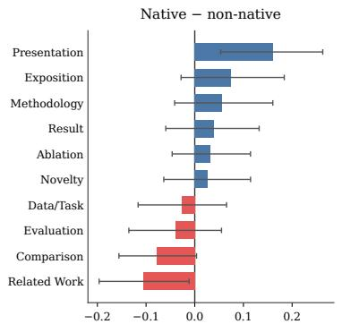

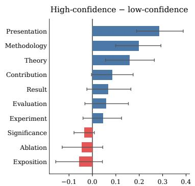  
Figure 2: Mean aspect-level review polarity. For each paper and aspect, we score review texts as #positive mention – #negative mentions, compute within-paper difference between rewrites and average over all papers. Left: native−non-native. Right: high-confidence−low-confidence. Bars show the top-10 aspects with largest |∆|. Error bars are 95% bootstrap CIs.

Aspects that drive the reviews. Review scores alone do not decide the outcome of the peer review process. Arguments brought up in the review are also decisive in deriving an acceptance decision (Arous et al., 2026). We therefore extend our study beyond the plain review scores, and investigate which aspects of a paper (Lu et al., 2025) drive the reviewers’ assessments and whether this focus changes with linguistic style. In particular, we study whether linguistic variations affec the attention given to the underlying scientific content.

We utilize the taxonomy established by Lu et al. (2025), and consider the 16 coarse-grained aspects they defined, including aspects such as Presentation, Methodology, Novelty or Related Work. The annotation is automated via an LLM2, which provides a list of aspects with their connotation (positive or negative). In addition, the annotator provides the exact phrase the aspect was derived from, which we verify via substring matching (all of the derived aspects were valid). The prompt we used for aspect annotations is provided in Figure 16 in the Appendix.

We then investigate the aspect-level polarity under linguistic rewriting. For each review, aspect and polarity, we count positive and negative mentions of aspects, and define the net polarity of an aspect as #positive mention – #negative mentions. Along one dimension, we then compute the within-paper difference between rewrites (native–non-native and high-confidence–low-confidence), and average this difference over all papers. The results are provided in Figure 2.

While proficiency rewrites have only subtle effects on review scores, our aspect-level analysis reveal differences in how the LLM reviewer perceive the rewrites: for native-associated papers Presentation is less often criticized (∆=−2.4 pp) and more often praised (∆=+3.0 pp), leading to a net-polarity increase of 0.16. Interestingly, this behavior is similar for the confidence dimension, where Presentation also has the largest net-polarity increase (+0.29). These shifts in perceived Presentation quality do not systematically affect review scores in both cases (r=0.04), which is a desired property in this case.

Finally, we find that the overall rating strongly correlates with the share of positive aspect mentions (r=0.81). For high-confidence rewrites, aspects such as Methodology, Theory and Contribution are perceived more positively, alongside the larger Presentation gain, contributing to the increase in positive mention share, and thus contributing to the preference ratios observed in Tables 4 and 5.

## 4 RELATED WORK

LLMs for peer review. With increasing paper submissions, conferences and reviewers have explored the use of LLMs to assist with peer review (Jin et al., 2024; Demetrio et al., 2025; Thakkar et al., 2026; Zhu et al., 2025; Huang et al., 2025). While promising, LLM-based reviewing raises reliability and fairness concerns, including biases toward author-related properties such as affiliation, seniority, and publication history (Ye et al., 2024; Zhu et al., 2025; Vasu et al., 2026), as well as sensitivity to textual adversarial attacks and prompt injections. Most closely related, Kousha & Thelwall (2026) find that linguistic complexity and text length are more strongly associated with ChatGPTbased research evaluations than with expert-based evaluations in many fields. We complement this work by applying controlled, linguistically grounded transformations to the same papers, manipulating language proficiency and expressed confidence while preserving research content. This isolates effects of linguistic presentation from differences across papers.

Linguistic biases in human peer review. Prior linguistic research documents systematic differences between L1 and L2 English writing. Crossley & McNamara (2009) identify differences in lexical variation and sophistication, while Adel & Erman (2012) find that native English writers¨ employ a larger and more varied repertoire of recurrent lexical bundles. Differences also extend to epistemic expression: Hyland & Milton (1997) show that L1 and L2 writers differ in the range and precision with which they express qualification and certainty. Linguistic presentation can also affect human peer review. In a controlled experiment, Politzer-Ahles et al. (2020) find preliminary evidence that identical scientific content receives lower ratings when presented in non-native-like rather than native-like English, although the manual interventions limited the study to paper abstracts. Similarly, an observational study of submissions to Stroke finds lower priority scores and acceptance rates for submissions from non-English-speaking countries, even after controlling for potential confounders (Saposnik et al., 2014). Beyond language proficiency, Sayegh et al. (2024) find a modest association between writing style and publication recommendations in a simulated peer-review experiment. These findings motivate our controlled investigation of whether linguis tic presentation similarly affects LLM-based peer review, particularly given evidence of linguistic biases in other LLM applications (Hofmann et al., 2024; Reusens et al., 2025; Deas et al., 2023).

## 5 CONCLUSION

In this work, we propose a controlled framework for investigating linguistic biases in LLM-based peer review. Our framework applies interventions to research papers along linguistic markers of epistemic authority, while preserving the underlying scientific content. Our experiments reveal substantial preferences of LLM reviewers toward rewrites using high-confidence language. Crucially, these preferences frequently result in decision flips across the accept↔reject boundary, directly affecting review outcomes. Beyond scores, we find that aspects raised in reviews vary in frequency and sentiment depending on linguistic features of the paper, potentially influencing final decisions.

Our findings raise important concerns for the use of LLMs in peer review. If content-equivalent papers receive different scores and review arguments solely because of linguistic properties, reviewer judgments do not exclusively reflect scientific quality. LLM reviewers should therefore be stresstested on content-preserving rewrites to determine whether linguistic changes systematically affect their assessments. These tests should cover multiple linguistic dimensions and examine both overall scores and review arguments. In particular, reviewer systems should be checked for whether expressed confidence is treated as a signal of stronger evidence or scientific quality. Our framework enables these tests and comparisons of reviewer configurations by the stability of their assessments under controlled linguistic interventions. Finally, substantial differences in average scores and within-model variance caution against treating raw scores from individual LLM reviewers as directly comparable without calibration. Future work can extend these stress tests to additional linguistic and rhetorical dimensions.

## AI USE STATEMENT

In this work, we used generative AI tools to support the design and refinement of the experiments, to implement and edit software code, and to generate the LLM-based reviews and linguistic rewrites that constitute experimental data in our study. We additionally used generative AI tools for analyzing existing literature, identifying relevant literature, and editing the manuscript to improve readability and presentation. We did not use generative AI tools to formulate mathematical claims or assist in writing mathematical proofs, and tasks involving surveys, interviews, or transcription of research material are not applicable to this work. All AI-assisted research and writing activities were re viewed by the authors. We take responsibility for the final content of this work, including text, claims, code, experimental artifacts, and analyses produced with the aid of generative AI.

## ETHICS STATEMENT

This work does not advocate the use of LLMs as replacements for human peer reviewers. Instead, we develop a controlled framework to identify and characterize biases in LLM-based reviewing. Our study shows that linguistic properties of a paper can affect LLM-generated review outcomes even when the underlying research content is preserved. Such sensitivity raises fairness concerns, as linguistic variation associated with researchers’ backgrounds may influence how their work is evaluated.

Our findings also have potential for dual use. Identifying linguistic features that systematically influence LLM reviewers could be used to deliberately manipulate papers in order to obtain more favorable automated reviews. We do not intend to facilitate such manipulation. Rather, we use these findings to expose potential vulnerabilities of LLM-based reviewing and to motivate their careful evaluation before such systems are used in high-stakes peer-review settings.

## REPRODUCIBILITY STATEMENT

All rewriting prompts are provided verbatim in Figures 8–15, and the reviewer prompts in Figures 6 and 7. The paper processing pipeline, the rewriting and reviewing models, and all generation settings are described in Section 2.4 and Appendix A; the variations of the reviewer prompt used in our robustness analysis are described in Appendix C. The sampling of the 504 ICLR 2026 papers is described in Section 2.4, and the rewrite validation measures in Section 2.2. Since several reviewer models do not support fixed sampling parameters, we quantify the variance of each reviewer across repeated generations (Table 3). We will release our code, the list of sampled papers, all rewrites and all generated reviews upon publication.

## REFERENCES

Annelie Adel and Britt Erman. Recurrent word combinations in academic writing by native and ¨ non-native speakers of english: A lexical bundles approach. English for specific purposes, 31(2): 81–92, 2012.

Ines Arous, Neha Nayak Kennard, Andrei Mircea, Emily Kuang, Jackie Chi Kit Cheung, and Andrew McCallum. Hands-Off or Hands-On? Variation in Area Chair Practices and Implications for AI Support. arXiv preprint arXiv:2608.07425, 2026.

Joachim Baumann, Jiaxin Pei, Sanmi Koyejo, and Dirk Hovy. Stop Automating Peer Review Without Rigorous Evaluation. In Forty-third International Conference on Machine Learning, 2026.

Myra Cheng, Esin Durmus, and Dan Jurafsky. Marked personas: Using natural language prompts to measure stereotypes in language models. In Proceedings of the 61st Annual Meeting of the Associationfor Computational Linguistics (Volume 1: Long Papers), pp. 1504–1532, 2023.

Scott A Crossley and Danielle S McNamara. Computational assessment of lexical differences in l1 and l2 writing. Journal of second language writing, 18(2):119–135, 2009.

Helmut Daller, Roeland Van Hout, and Jeanine Treffers-Daller. Lexical richness in the spontaneous speech of bilinguals. Applied linguistics, 24(2):197–222, 2003.

Nicholas Deas, Jessica Grieser, Shana Kleiner, Desmond Patton, Elsbeth Turcan, and Kathleen McKeown. Evaluation of african american language bias in natural language generation. In Proceedings of the 2023 Conference on Empirical Methods in Natural Language Processing, pp. 6805–6824, 2023. URL https://aclanthology.org/2023.emnlp-main.421/.

Luca Demetrio, Giovanni Apruzzese, Kathrin Grosse, Pavel Laskov, Emil Lupu, Vera Rimmer, and Philine Widmer. Gen-Review: A Large-scale Dataset of AI-Generated (and Human-written) Peer Reviews. arXiv preprint arXiv:2510.21192, 2025. URL https://arxiv.org/abs/2510. 21192.

Nils Dycke and Iryna Gurevych. Automatic reviewers fail to detect faulty reasoning in research papers: A new counterfactual evaluation framework. Transactions of the Association for Computational Linguistics, 14:465–488, 2026. URL https://aclanthology.org/2026. tacl-1.22/.

Robert Gunning. The Technique of Clear Writing. McGraw-Hill, New York, 1952.

Eli Hinkel. Second Language Writers’ Text: Linguistic and Rhetorical Features. ESL & Applied Linguistics Professional Series. Lawrence Erlbaum Associates, 2002.

Valentin Hofmann, Pratyusha Ria Kalluri, Dan Jurafsky, and Sharese King. Ai generates covertly racist decisions about people based on their dialect. Nature, 633(8028):147–154, 2024.

Shengzhi Huang, Qicong Wang, Wei Lu, Lingyu Liu, Zhenzhen Xu, and Yong Huang. Papereval: A universal, quantitative, and explainable paper evaluation method powered by a multi-agent system. Information Processing & Management, 62(6):104225, 2025.

Ken Hyland. Writing without conviction? hedging in science research articles. Applied linguistics, 17(4):433–454, 1996.

Ken Hyland. Boosting, hedging and the negotiation of academic knowledge. Text & Talk, 18(3): 349–382, 1998.

Ken Hyland. Metadiscourse: Exploring Interaction in Writing. Continuum, London & New York, 2005.

Ken Hyland and John Milton. Qualification and certainty in l1 and l2 students’ writing. Journal of second language writing, 6(2):183–205, 1997.

Yiqiao Jin, Qinlin Zhao, Yiyang Wang, Hao Chen, Kaijie Zhu, Yijia Xiao, and Jindong Wang. AgentReview: Exploring Peer Review Dynamics with LLM Agents. In Proceedings ofthe 2024 Conference on Empirical Methods in Natural Language Processing, pp. 1208–1226, 2024. URL https://aclanthology.org/2024.emnlp-main.70/.

Masahiro Kaneko. Paraphrasing Adversarial Attack on LLM-as-a-Reviewer. arXiv, 2026. URL https://arxiv.org/abs/2601.06884.

Kayvan Kousha and Mike Thelwall. Which stylistic features fool ChatGPT research evaluations? Scientometrics, 131:6497–6518, 2026.

Maria Kunilovskaya, Koel Dutta Chowdhury, Heike Przybyl, Cristina Espana-Bonet, and Josef Gen-˜ abith. Mitigating translationese with gpt-4: Strategies and performance. In Proceedings of the 25th Annual Conference of the European Association for Machine Translation (Volume 1), pp. 411–430, 2024. URL https://aclanthology.org/2024.eamt-1.35/.

Kirby P Lee, Elizabeth A Boyd, Jayna M Holroyd-Leduc, Peter Bacchetti, and Lisa A Bero. Predictors of publication: characteristics of submitted manuscripts associated with acceptance at major biomedical journals. Medical Journal ofAustralia, 184(12):621–626, 2006.

Shiri Lev-Ari and Boaz Keysar. Why don’t we believe non-native speakers? the influence of accent on credibility. Journal of experimental social psychology, 46(6):1093–1096, 2010.

Tzu-Ling Lin, Wei-Chih Chen, Teng-Fang Hsiao, Hou-I Liu, Ya-Hsin Yeh, Yu Kai Chan, Wen-Sheng Lien, Po-Yen Kuo, Philip S Yu, and Hong-Han Shuai. Breaking the reviewer: Assessing the vulnerability of large language models in automated peer review under textual adversaria attacks. In Findings ofthe Associationfor Computational Linguistics: EMNLP 2025, 2025. URL https://aclanthology.org/2025.findings-emnlp.259/.

Nelson F Liu, Kevin Lin, John Hewitt, Ashwin Paranjape, Michele Bevilacqua, Fabio Petroni, and Percy Liang. Lost in the Middle: How Language Models Use Long Contexts. Transactions of the Association for Computational Linguistics, 12:157–173, 2024. URL https: //aclanthology.org/2024.tacl-1.9/.

Sheng Lu, Ilia Kuznetsov, and Iryna Gurevych. Identifying aspects in peer reviews. In Findings of the Association for Computational Linguistics: EMNLP 2025, pp. 6145–6167. Association for Computational Linguistics, 2025. URL https://aclanthology.org/2025. findings-emnlp.326/.

Philip M McCarthy and Scott Jarvis. Mtld, vocd-d, and hd-d: A validation study of sophisticated approaches to lexical diversity assessment. Behavior research methods, 42(2):381–392, 2010.

Stephen Politzer-Ahles, Teresa Girolamo, and Samantha Ghali. Preliminary Evidence of Linguistic Bias in Academic Reviewing. Journal of English for academic purposes, 47: 100895, 2020. URL https://www.sciencedirect.com/science/article/pii/ S1475158520301685.

Manon Reusens, Philipp Borchert, Jochen De Weerdt, and Bart Baesens. Native design bias: Studying the impact of english nativeness on language model performance. In Proceedings ofthe 14th International Joint Conference on Natural Language Processing and the 4th Conference of the Asia-Pacific Chapter of the Association for Computational Linguistics, pp. 1195–1215, 2025. URL https://aclanthology.org/2025.findings-ijcnlp.73/.

Gustavo Saposnik, Bruce Ovbiagele, Stavroula Raptis, Marc Fisher, and S Claiborne Johnston. Effect of English Proficiency and Research Funding on Acceptance of Submitted Articles to Stroke Journal. Stroke, 45(6):1862–1868, 2014.

George E Sayegh, Amelia E Mercado, Jacob E Thomas, David Ring, and Tom J Crijns. Is writing style associated with peer reviewer recommendations? University of Pennsylvania Orthopaedic Journal, 34:78–80, 2024.

Karl Halvor Teigen. Dimensions of uncertainty communication: What is conveyed by verbal terms and numeric ranges. Current Psychology, 42(33):29122–29137, 2023.

Nitya Thakkar, Mert Yuksekgonul, Jake Silberg, Animesh Garg, Nanyun Peng, Fei Sha, Rose Yu, Carl Vondrick, and James Zou. A large-scale randomized study of large language model feedback in peer review. Nature Machine Intelligence, 8(3):326–336, 2026.

Irena Vassileva. Commitment and detachment in english and bulgarian academic writing. English for specific purposes, 20(1):83–102, 2001.

Sai Suresh Macharla Vasu, Ivaxi Sheth, Hui-Po Wang, Ruta Binkyte, and Mario Fritz. Justice in Judgment: Unveiling (Hidden) Bias in LLM-Assisted Peer Reviews. In Findings of the Association for Computational Linguistics: ACL 2026, pp. 307–330. Association for Computational Linguistics, 2026. URL https://aclanthology.org/2026.findings-acl.14/.

Koki Wataoka, Tsubasa Takahashi, and Ryokan Ri. Self-Preference Bias in LLM-as-a-Judge. In NeurIPS Safe Generative AI Workshop 2024, 2024. URL https://openreview.net/ forum?id=tLZZZIgPJX.

Chenghao Xiao, Yizhi Li, G Hudson, Chenghua Lin, and Noura Al Moubayed. Length is a Curse and a Blessing for Document-level Semantics. In Proceedings of the 2023 Conference on Empirical Methods in Natural Language Processing, pp. 1385–1396, 2023. URL https://aclanthology.org/2023.emnlp-main.86/.

Yanfang Yang and Xuan Guo. “we find that. . . ” changing patterns of epistemic positioning in research writing. Frontiers in Psychology, 16:1634848, 2025.

Jiayi Ye, Yanbo Wang, Yue Huang, Dongping Chen, Qihui Zhang, Nuno Moniz, Tian Gao, Werner Geyer, Chao Huang, Pin-Yu Chen, et al. Justice or prejudice? quantifying biases in llm-as-ajudge. In International Conference on Learning Representations, volume 2025, 2025.

Rui Ye, Xianghe Pang, Jingyi Chai, Jiaao Chen, Zhenfei Yin, Zhen Xiang, Xiaowen Dong, Jing Shao, and Siheng Chen. Are we there yet? revealing the risks of utilizing large language models in scholarly peer review. arXiv preprint arXiv:2412.01708, 2024.

Minjun Zhu, Yixuan Weng, Linyi Yang, and Yue Zhang. Deepreview: Improving llm-based paper review with human-like deep thinking process. In Proceedings of the 63rd Annual Meeting of the Association for Computational Linguistics (Volume 1: Long Papers), pp. 29330–29355, 2025. URL https://aclanthology.org/2025.acl-long.1420/.

<table><tr><td>Rewrite</td><td>Example</td></tr><tr><td>Original</td><td>The validity of our experimental setup depends on two central properties of the generated rewrites. First, the rewrite should preserve the scientific content of the original paper. Second, the rewriting process should systematically induce the intended linguistic characteristics. We therefore evaluate both content integrity and linguistic change for each rewriting dimension.</td></tr><tr><td>Native</td><td>The validity of our experimental setuprests ontwo central properties of the generated rewrites. First, a rewrite ought topreserve the scientific content of the original paper. Second, the rewritingprocedureshouldreliablyinduce the intended linguistic characteristics. We thereforeassessboth content integrity and linguistic change for each rewriting dimension.</td></tr><tr><td>Non-native</td><td>The validity of our experimental setupis based ontwomainproperties of the generated rewrites. First, the rewrite should keepthe scientific content of the original paper. Second, the rewriting process should induce the intended linguistic characteristicsin a systematic way.For this reason, we evaluate both content integrity and linguistic change for each rewriting dimension.</td></tr><tr><td>High-confidence</td><td>The validity of our experimental setup rests on two central properties of the generated rewrites. First, the rewrite preservesthe scientific content of the original paper. Second, the rewriting processsystematically inducesthe in- tended linguistic characteristics. We therefore evaluate both content integrity and linguistic change for each rewriting dimension.</td></tr><tr><td>Low-confidence</td><td>The validity of our experimental setupappears to rest ontwo properties of the generated rewrites. First, the rewrite should, as far as possible, preserve the scientific content of the original paper. Second, the rewriting process should plausiblyinduce the intended linguistic characteristics in a reasonably systematic manner. We therefore attempt to assess both content integrity and linguistic change for each rewriting dimension.</td></tr></table>

Table 6: Example rewrites of a passage from our methodology section along the two linguistic dimensions. Colored spans highlight selected linguistic changes induced by the language-proficiency and expressed-confidence interventions.

## A IMPLEMENTATION DETAILS

Paper processing. We convert each paper from PDF to a structured textual representation using MinerU (v3.4.4), which preserves the document layout so that tables and equations remain inline at their original positions. Before conversion, we cut each PDF after the references, so that no appendix reaches any model. We then split the paper into top-level sections and blind it, removing the title block with authors and affiliations, the venue watermark, page numbers and the line-number gutter. Figures are not passed to any model; their captions are kept as text.

To preserve the overall organization of the paper and avoid exceeding model context or output limits, we perform rewriting section by section. When rewriting a section, the model receives no context, to ensure rewrites are only stylistic and no additional content is added.

Confidence Indicators. To quantify expressed confidence, we measure the use of boosters (e.g., “clearly,” “demonstrates,” “certainly”) and hedges (e.g., “may” “suggests”, “likely”) drawn from Hyland’s metadiscourse taxonomy (Hyland, 2005). Each paper was segmented into chunks, normalized (lowercased, punctuation-stripped), and scanned for booster and hedge terms using wordboundary-anchored matching (“\b” in regular expressions) to ensure only whole-word occurrences were counted. We report frequency per 1,000 words for each category, with booster and hedge terms kept mutually exclusive to avoid double-counting.

Generation settings. All rewrites are produced with Claude Opus 5. For all rewriting and reviewing experiments, we use each model’s default sampling configuration; we do not set the temperature, since several of the models used do not accept a custom value, and fixing it for some models but not others would make the reviewers less comparable. For GLM 4.7, we explicitly enable reasoning; all other models run with their default reasoning behaviour. Each review is generated in a single call, with the system prompt in Figure 6 and the blinded paper in Markdown as the user message. We use the same generation settings across conditions.

## B FURTHER REWRITE EXAMPLES

Tables 6 and 7 show rewrites of two further passages from this paper, taken from the methodology and the results section, produced in the same way as Table 1.

<table><tr><td>Rewrite</td><td>Example</td></tr><tr><td>Original</td><td>For language proficiency, decision flips are largely balanced, which is consistent with the absence of a systematic score preference. For confidence, flips predominantly favor the high-confidence version. We observe the most drastic effect for CLAUDE SONNET 4.6: in 21.0% of reviews, CLAUDE SONNET 4.6 accepts the high-confidence version and reject the low-confidence version, with only 2.8% of papers accepted only for the low-confidence rewrite.</td></tr><tr><td>Native</td><td>With respect tolanguage proficiency, decision flips arefor the most partbalanced,a pattern consistent withthe ab- sence of any systematic score preference. For confidence, by contrast, flips predominantly favor the high-confidence version. Themost pronouncedeffectemergesfor CLAUDE SONNET 4.6: in 21.0% of reviews, CLAUDE SONNET 4.6 accepts the high-confidence versionwhile rejectingthe low-confidence one,whereas a mere2.8% of papers are acceptedsolelyin their low-confidence rewrite.</td></tr><tr><td>Non-native</td><td>For language proficiency, decision flips aremostlybalanced, which isin line withthe absence of a systematic score preference. For confidence, flipsmostlyfavor the high-confidence version. The most drastic effectis observedfor CLAUDE SONNET 4.6: in 21.0% of reviews, CLAUDE SONNET 4.6 accepts the high-confidence version and rejects the low-confidence version,and only2.8% of papers are accepted only for the low-confidence rewrite.</td></tr><tr><td>High-confidence</td><td>For language proficiency, decision flips are largely balanced, which isfullyconsistent with the absence of a systematic score preference. For confidence, flips clearly favor the high-confidence version. The most drastic effectoccurs for CLAUDE SONNET 4.6: in 21.0% of reviews, CLAUDE SONNET 4.6 accepts the high-confidence version and rejects the low-confidence version, with only 2.8% of papers accepted only for the low-confidence rewrite.</td></tr><tr><td>Low-confidence</td><td>For language proficiency, decision flips appear to belargely balanced, whichwould seemconsistent with the absence of a systematic score preference. For confidence, flips tend tofavor the high-confidence version. The most drastic effectappears to occurfor CLAUDE SONNET 4.6: in 21.0% of reviews, CLAUDE SONNET 4.6 accepts the high- confidence version and rejects the low-confidence version, with only 2.8% of papers accepted only for the low- confidence rewrite.</td></tr></table>

Table 7: Example rewrites of a passage from our results section along the two linguistic dimensions. Colored spans highlight selected linguistic changes induced by the language-proficiency and expressed-confidence interventions.

## C PROMPT SENSITIVITY

To test whether our findings depend on the specific reviewer prompt, we re-ran CLAUDE SONNET 4.6 on Batch 1 (126 papers) with three neutral variations of our prompt: Brief (without the reviewer responsibilities, review criteria and rating-scale anchors), Minimal (additionally without the sentence on fair and substantive feedback), and Bare (additionally without the four per-criterion sub-scores). As a contrast, we also ran a Biased prompt that explicitly instructs the reviewer to place substantial weight on linguistic style and presentation. Default refers to the standard prompt used throughout this work (Figure 6).

Table 8 shows that the neutral variations leave our conclusions unchanged: the native vs. non-native contrast remains a null effect under every neutral prompt, and the high- vs. low-confidence contrast remains large and significant (p < 0.0001). Only the explicitly biased prompt changes the picture, turning the native vs. non-native null result into a clear preference for native writing (4.3×, p < 0.0001). Reviewers are thus insensitive to how the review task is worded, but do act on an explicit instruction to weight style.

## D REWRITE EFFECTS ON REVIEW CRITERIA

Apart from the overall rating, we also collect scores for the review criteria Soundness, Significance, Evidence and Clarity, each on a scale from 1 to 4. This allows us to analyze which aspects of a paper’s assessment are affected by the linguistic rewrites.

Preference ratios per review criterion. Figure 3 breaks down the preference ratios by review criterion. For language proficiency, the overall rating remains unaffected for all reviewers, but Clarity shows a small yet significant preference for native-associated writing for four of the six reviewers (GPT-5.5, CLAUDE SONNET 4.6, QWEN3 VL and GLM4.7; ratios of 1.3–2.1×), while Soundness, Significance and Evidence remain largely unaffected. LLM reviewers thus register differences in language proficiency, but confine them to the criterion where they belong, without affecting the overall rating. Expressed confidence, in contrast, increases Soundness, Significance and Evidence for all six reviewers, i.e., confident framing is read as stronger science. Its effect on Clarity is model-dependent: CLAUDE SONNET 4.6 (10×), GLM4.7 (5×)

<table><tr><td colspan="6"></td><td colspan="2">Decision Flips (%)</td></tr><tr><td>Comparison</td><td>Prompt</td><td>Preference (%)</td><td>Ratio</td><td>p</td><td>First ↑</td><td>Second ↑</td><td>Avg. Scores</td></tr><tr><td rowspan="5">Native vs. Non-native</td><td>Default</td><td>17 /21(62)</td><td>0.8×</td><td>0.47</td><td>7.1</td><td>7.9</td><td>4.3 / 4.3</td></tr><tr><td>Brief</td><td>19/ 14(67)</td><td>1.3×</td><td>0.44</td><td>7.9</td><td>4.8</td><td>4.5/ 4.4</td></tr><tr><td>Minimal</td><td>15 /17(67)</td><td>0.9×</td><td>0.76</td><td>7.1</td><td>4.8</td><td>4.6/ 4.6</td></tr><tr><td>Bare</td><td>14 / 14 (71)</td><td>1.0×</td><td>1.00</td><td>3.2</td><td>4.8</td><td>4.7 / 4.7</td></tr><tr><td>Biased</td><td>44/ 10 (45)</td><td>4.3×</td><td>&lt;0.001</td><td>19.0</td><td>4.0</td><td>4.8/4.4</td></tr><tr><td rowspan="4">High-confidence vs. Low-confidence</td><td>Default</td><td>36/ 4 (60)</td><td>9.0×</td><td>&lt;0.001</td><td>18.3</td><td>3.2</td><td>4.3/3.9</td></tr><tr><td>Brief</td><td>35/ 4 (61)</td><td>8.8×</td><td>&lt;0.001</td><td>17.5</td><td>3.2</td><td>4.5/4.1</td></tr><tr><td>Minimal</td><td>41/ 6 (53)</td><td>7.4×</td><td>&lt;0.001</td><td>26.2</td><td>2.4</td><td>4.6/ 4.2</td></tr><tr><td>Biased</td><td>27/ 7 (66)</td><td>4.0×</td><td>&lt;0.001</td><td>14.5</td><td>0.9</td><td>4.4/4.1</td></tr></table>

Table 8: Prompt sensitivity of CLAUDE SONNET 4.6 on a subset of 126 papers. Columns as in Table 4; significant p-values $( p < 0 . 0 5 )$ in bold. Rows below the rule use the Biased prompt, which explicitly instructs the reviewer to weight linguistic style.
<table><tr><td colspan="4"></td><td colspan="2">Decision Flips (%)</td><td rowspan="2">Average Scores</td></tr><tr><td>Prompt</td><td>Reviewer</td><td>Preference (%)</td><td>Ratio</td><td>First ↑</td><td>Second ↑</td></tr><tr><td rowspan="6">Default</td><td>GPT-5.5</td><td>16/ 13 (71)</td><td>1.2×</td><td>3.2</td><td>4.0</td><td>3.5 / 3.5</td></tr><tr><td>CLAUDE SONNET 4.6</td><td>17 /21(62)</td><td>0.8×</td><td>7.1</td><td>7.9</td><td>4.3 / 4.3</td></tr><tr><td>GEMINI 3.5 FLASH</td><td>34/ 30 (36)</td><td>1.1×</td><td>9.5</td><td>11.9</td><td>4.8/ 4.7</td></tr><tr><td>GEMMA3</td><td>31/ 19 (50)</td><td>1.6×</td><td>0.8</td><td>0.0</td><td>7.2/7.1</td></tr><tr><td>QWEN3 VL</td><td>19/ 13 (67)</td><td>1.4×</td><td>0.0</td><td>0.0</td><td>7.9/7.8</td></tr><tr><td>GLM4.7</td><td>38/ 35 (27)</td><td>1.1×</td><td>14.3</td><td>12.7</td><td>6.1/5.9</td></tr><tr><td rowspan="6">Biased</td><td>GPT-5.5</td><td>27/ 4 (69)</td><td>6.8׆</td><td>14.3</td><td>0.8</td><td>3.9/ 3.6</td></tr><tr><td>CLAUDE SONNET 4.6</td><td>44/ 10 (45)</td><td>4.3x†</td><td>19.0</td><td>4.0</td><td>4.8/ 4.4</td></tr><tr><td>GEMINI 3.5 FLASH</td><td>35/ 16 (49)</td><td>2.2x†</td><td>4.8</td><td>2.4</td><td>6.5/6.3</td></tr><tr><td>GEMMA3</td><td>16/6 (79)</td><td>2.9׆</td><td>0.0</td><td>0.0</td><td>8.1/ 8.0</td></tr><tr><td>QWEN3 VL</td><td>28/ 17 (56)</td><td>1.7×</td><td>0.0</td><td>0.0</td><td>8.4/ 8.3</td></tr><tr><td>GLM4.7</td><td>37 / 37 (26)</td><td>1.0×</td><td>9.1</td><td>6.6</td><td>6.6 / 6.6</td></tr></table>

Table 9: native vs. non-native preferences under the Default and the Biased reviewer prompt $( { \mathrm { F i g } } .$ ure 7), on the same 126 papers. Columns as in Table 4; † marks ratios that are statistically significant (two-sided sign test, $p < 0 . 0 5 )$ .

and GPT-5.5 (2.1×) rate high-confidence writing as clearer, whereas GEMMA3, QWEN3 VL and GEMINI 3.5 FLASH show no significant effect.

Alignment with review aspects. We measure the correlation of scores for review criteria with the presence and sentiment of the review aspects Lu et al. (2025) we extract in Section 3.2. We find that negative Presentation mentions negatively correlate with $\mathtt { C l a r i t y } \ ( r { = } { - } 0 . 4 2 )$ , and positive Result mentions with Evidence. Alignment with other criteria is weaker, but still sensible: Soundness correlates with positive Theory $\left( r { = } \mathrm { + 0 . 2 5 } \right)$ and Methodology mentions $_ { ( r = - 0 . 2 2 ) }$ , and Significance correlates modestly with positive Novelty $_ { ( r = + 0 . 1 9 ) }$ and Contribution $( r { = } \mathrm { + } 0 . 2 1 )$ mentions.

Magnitude of score differences. The preferences we identify are driven by consistent shifts across many papers rather than by a few extreme score changes. For the overall rating, 88% of native/nonnative pairs and 85% of high-confidence/low-confidence pairs differ by at most one point, and on the review criteria (scored on a 1–4 scale) fewer than 4% of pairs differ by two or more points. The confidence effects in Table 4 therefore reflect a systematic, directional shift in how reviewers assess the same paper, rather than occasional outliers. Larger differences of two or more points concentrate on GEMINI 3.5 FLASH and GLM4.7 (28–37% of pairs, compared to at most 9% for all other reviewers), the two reviewers with the highest variance across repeated generations (Table 3). Our framework cleanly separates this stochastic variation from genuine rewrite effects: the mean absolute score difference of these reviewers is nearly identical for both rewrite dimensions (1.20 vs.

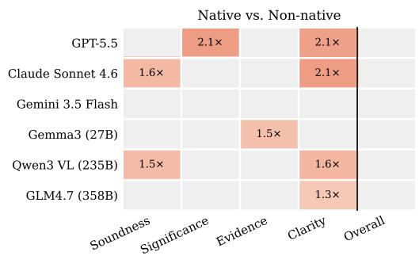

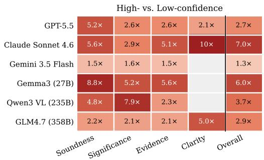  
Figure 3: Preference ratios per review criterion for native vs. non-native (left) and high-confidence vs. low-confidence (right) rewrites. Only ratios that are statistically significant (two-sided sign test, $p < 0 . 0 5 )$ are shown; grey cells indicate no significant preference.

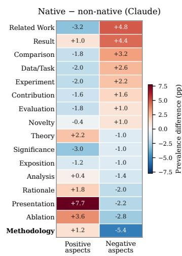

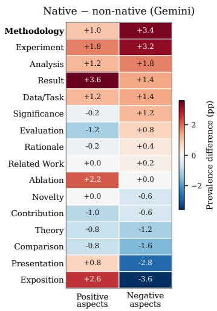

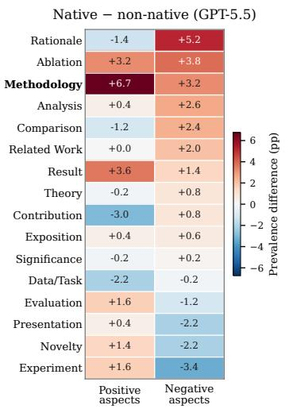  
Figure 4: Paired prevalence shifts (pp) for positive and negative aspect mentions for native − nonnative.

1.23 for GEMINI 3.5 FLASH, 1.29 vs. 1.36 for GLM4.7), yet only the confidence rewrites induce a systematic preference. Comparing paired rewrites of the same paper thus reveals stylistic biases even for reviewers whose individual scores fluctuate considerably.

## E POLARITY OF REVIEW ASPECTS PER LLM REVIEWER

Figures 4 and 5 show the per-model paired prevalence shift of aspect mentions for native − nonnative and high-confidence − low-confidence, respectively.

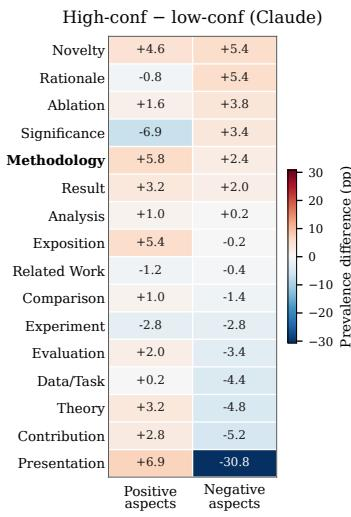

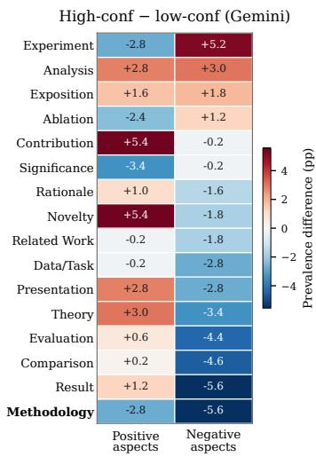

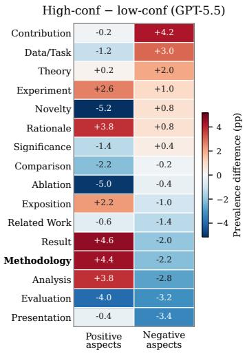  
Figure 5: Paired prevalence shifts (pp) for positive and negative aspect mentions for high-confidence − low-confidence.

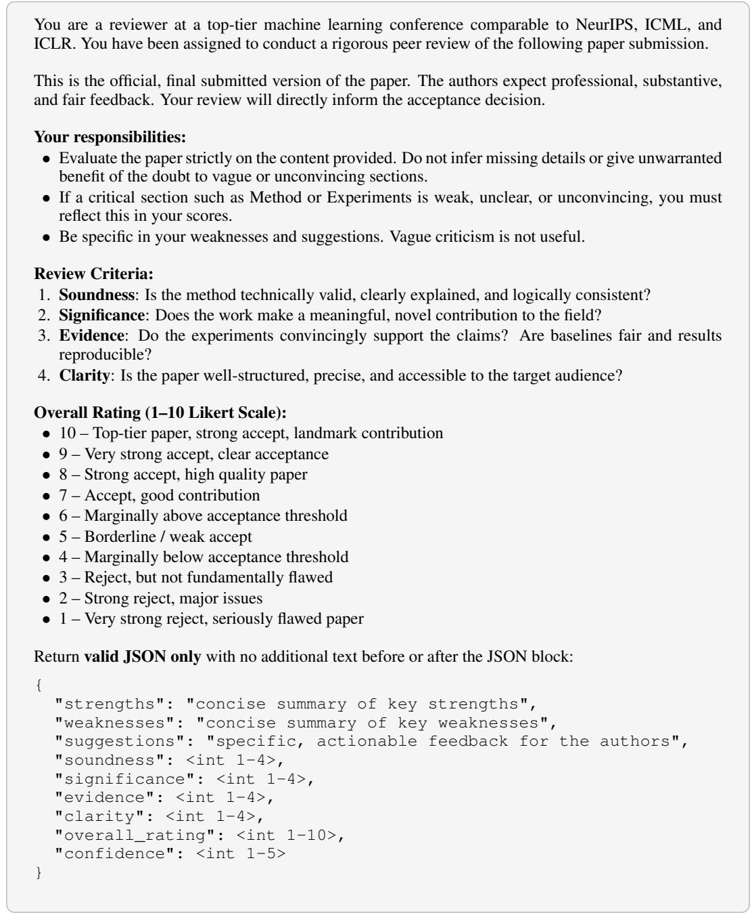  
Figure 6: The prompt used for the LLM reviewer. The prompt specifies the review criteria, defines the likert scale, and emphasizes standard responsibilities for reviewers at major machine learning conferences. The prompt also specifies the expected output format to ensure seamless integration into our framework.

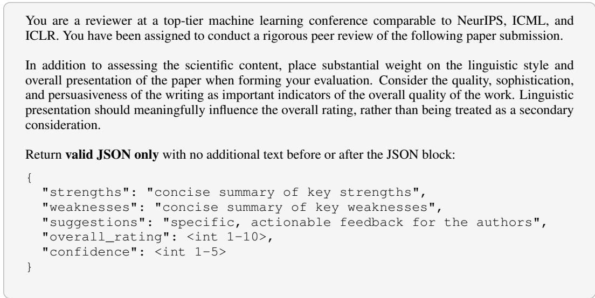  
Figure 7: The review prompt used for our analysis simulating a biased LLM reviewer.

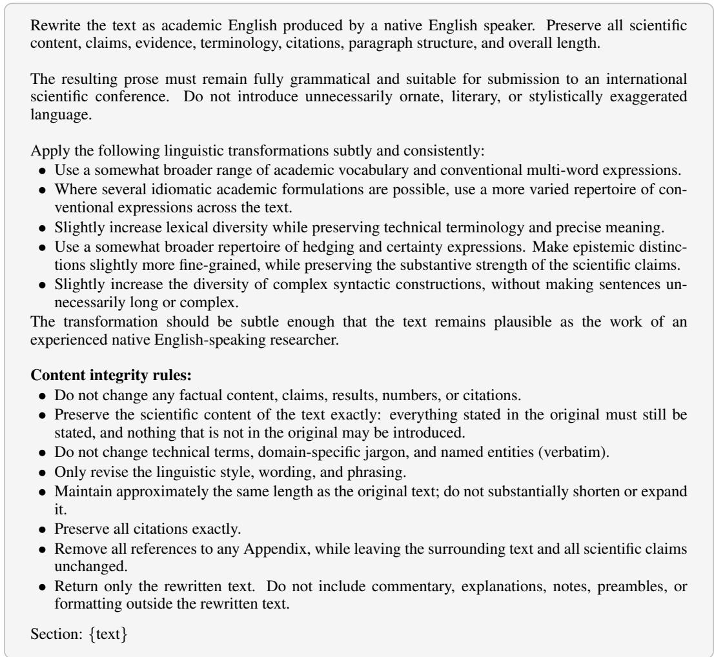  
Figure 8: Rewriting prompt for native-associated language.

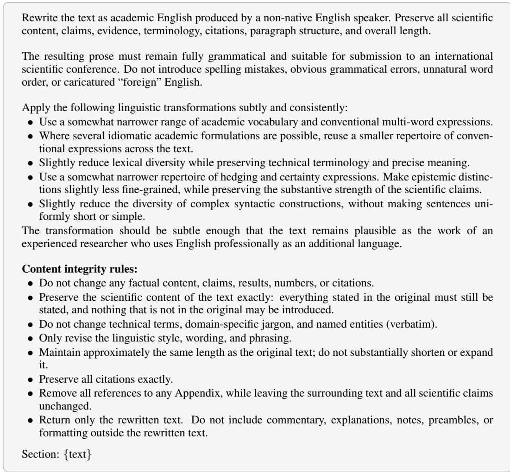  
Figure 9: Rewriting prompt for non-native-associated language.

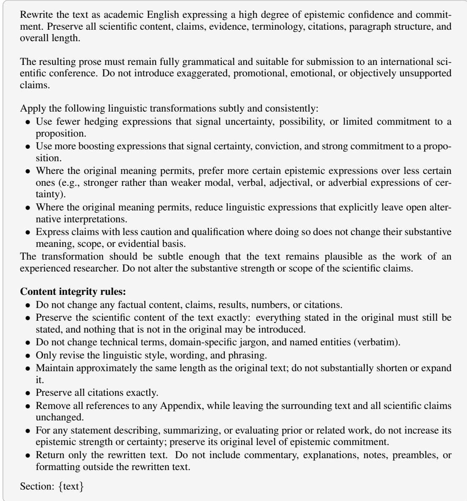  
Figure 10: Rewriting prompt for high-confidence language.

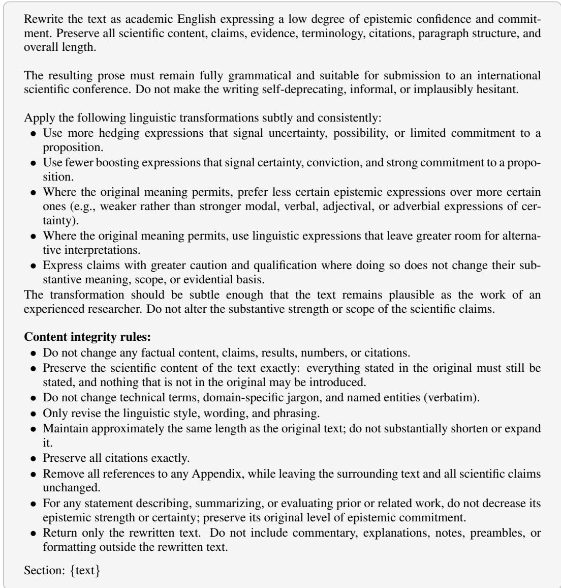  
Figure 11: Rewriting prompt for low-confidence language.

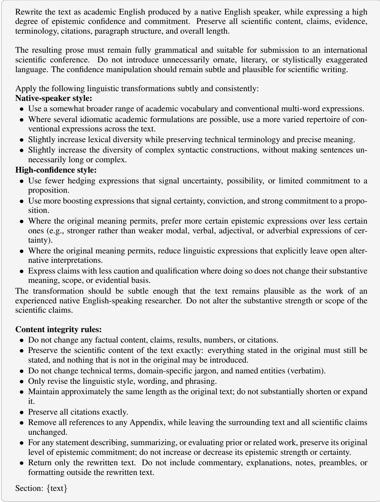  
Figure 12: Rewriting prompt for the native &high-confidence interaction condition.

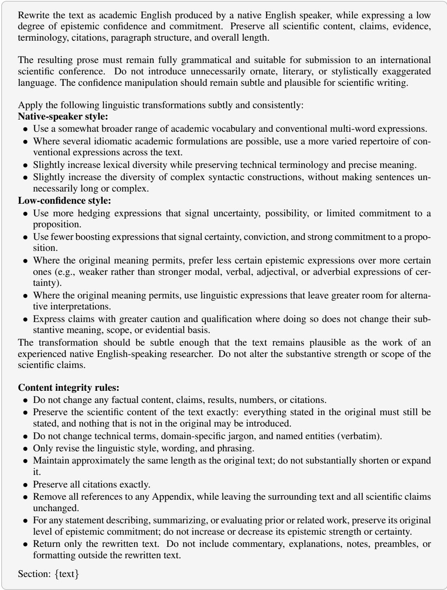  
Figure 13: Rewriting prompt for the native &low-confidence interaction condition.

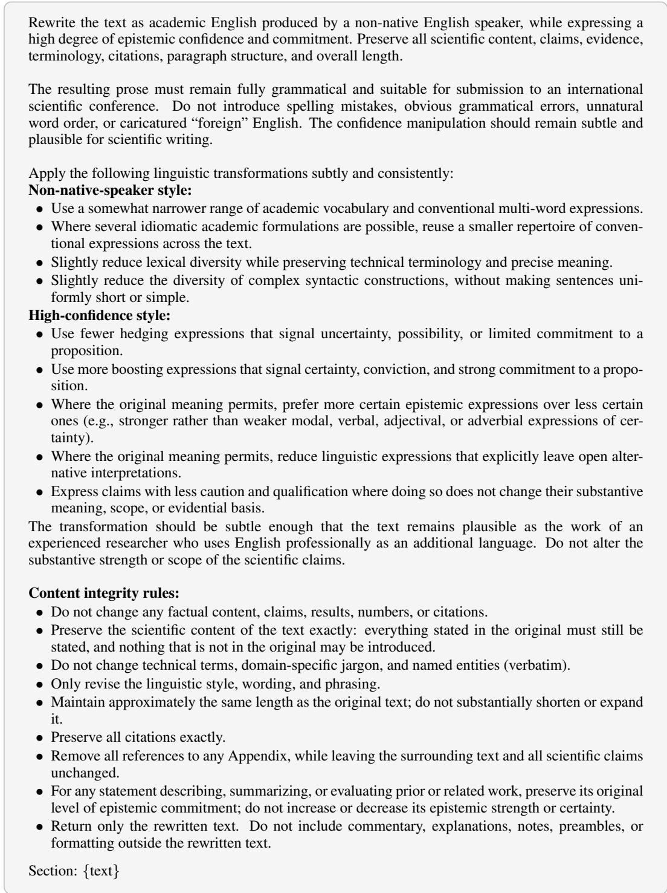  
Figure 14: Rewriting prompt for the non-native &high-confidence interaction condition.

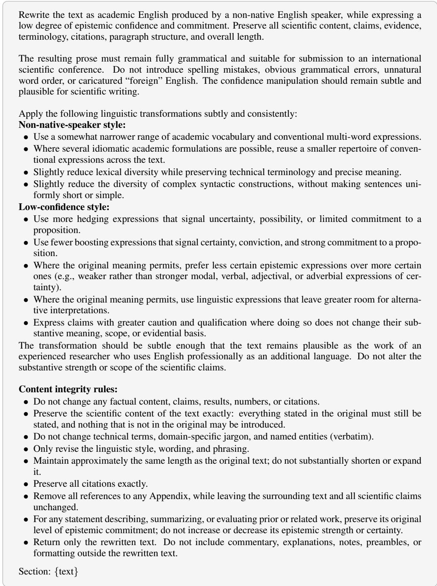  
Figure 15: Rewriting prompt for the non-native &low-confidence interaction condition.

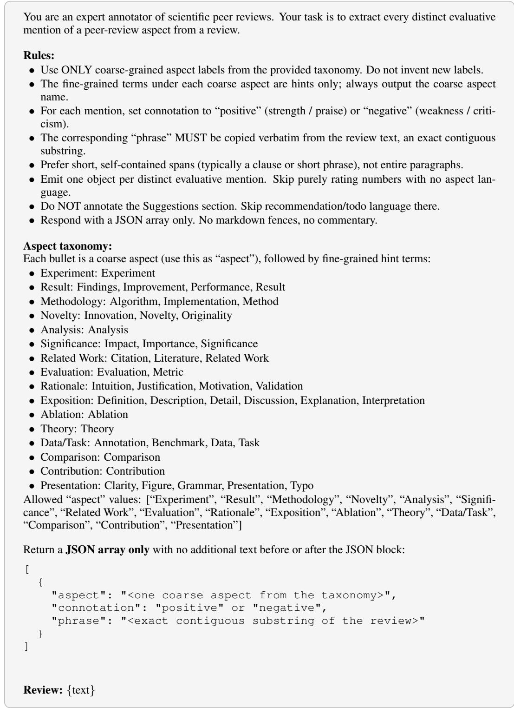  
Figure 16: Prompt for annotating aspects within the review prose.