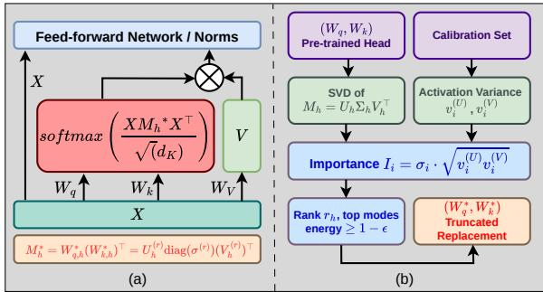

# SVD-Attention: Efficiently Analyzing Attention Blocks in Transformers

Debopam Sanyal1 Hongjie Chen2 Riya Elizabeth Kuriyan1 Arth Tak1 Divya Kothandaraman2 Akshay Mehra2 Joshua Kimball2 Alexey Tumanov1 1Georgia Institute of Technology 2Dolby Laboratories

## Abstract

Pretrained transformers spend a large share of their inference compute inside self-attention, yet the per-head query-key interaction is structurally low-rank by construction. We ask a diagnostic question: across layers and architectures, which heads actually use the full rank budget on real data, and which do not? We propose SVD-Attention, a post-hoc method that decomposes the per-head interaction matrix $M _ { h }$ and scores every singular mode by both its spectral magnitude and its activation variance across tokens on a small calibration set. The score keeps the modes the head can amplify and that real data actually activates, and discards the rest; the resulting factorization is exact for the retained modes and needs no finetuning. Across seven pretrained models and five task types, the diagnostic finds a task-dependent pattern: redundancy sits in the early to middle layers for sentiment and image classification and for generation, and in the late layers for dense prediction and extractive question answering. It is also predictive: truncating the layers it flags costs at most 1.75 F1, while truncating the same number of layers elsewhere in the same model costs up to 50 F1. SVD-Attention is an analysis tool rather than a compression method: acting on it reduces inference FLOPs by 0.8- 1.5% on its own and by 8-11% when composed with weight pruning, with 0-4% change in task quality.

## 1 Introduction

Multi-head self-attention is the central building block of modern transformers, and a long line of work has sought to reduce its cost by changing the attention pattern (Beltagy et al., 2020; Liu et al., 2021), approximating the softmax kernel (Wang et al., 2020a; Choromanski et al., 2020; Meng et al., 2025; Fan et al., 2025), or removing redundancy from pretrained projection weights after training (Yuan et al., 2023; Wang et al., 2025; Sanyal et al., 2026). We follow this third direction.

Existing post-hoc methods decompose $W _ { q , h }$ and $W _ { k , h }$ independently, which leaves their product, the object the softmax actually consumes, unconstrained. We instead decompose the per-head interaction matrix $M _ { h } = W _ { q , h } W _ { k , h } ^ { \top }$ directly. $M _ { h }$ has rank at most $d _ { h }$ , so the head has algebraic room for many directions but uses far fewer in practice: a singular direction only affects the head’s output if real input tokens vary along it, and otherwise contributes a constant offset that softmax absorbs. We outline our method in Fig. 1.

We therefore score each mode of $M _ { h }$ by the product of its singular value and the geometric mean of its query- and key-side activation variances on a small calibration set. Keeping the smallest set of modes that captures a (1 − ϵ) fraction of that importance gives an exact rank- $\cdot r _ { h }$ factorization with no finetuning. We use this diagnostic to ask three questions. First, does adding data to the score change which modes look important compared to ranking by singular value alone (RQ1)? Second, where in a pretrained transformer does the diagnostic find the most redundancy, and does the pattern depend on the task (RQ2)? Third, is the diagnostic predictive: when we remove the modes it flags, does performance hold up where the score is low and drop where it is high (RQ3)?

We run the diagnostic on seven pretrained transformers spanning language understanding (Distil-BERT), extractive question answering (RoBERTabase, MiniLM), generation (Llama-2-7B), vision classification (ViT, Swin), and dense prediction (DPT-Large). Redundancy sits in the early to middle layers for sentiment and image classification and for generation, and in the late layers for dense prediction and extractive question answering. Acting on the diagnostic reduces inference FLOPs by 0.8-1.5% on its own; composing it with weight pruning (Sun et al., 2024) raises the reduction to 8-11%, with task quality within 0-4% of baseline and no gradient updates. In the flagged layers more than half of the average head’s rank budget can be discarded for 0.16 F1 (RoBERTa-base on SQuAD 2.0), and the same diagnostic predicts where truncation instead fails.

## 2 Related Work

Efficient attention. The quadratic cost of softmax attention has motivated linear and sparse approximations (Wang et al., 2020a; Choromanski et al., 2020; Liu et al., 2021), and recent work continues to close the gap with softmax (Meng et al., 2025; Fan et al., 2025). These methods change the attention computation itself. Our work is orthogonal: we keep softmax attention intact and study redundancy in the pretrained projection weights.

Token-level compression. A complementary direction reduces the number of tokens rather than the per-token cost: Token Merging groups similar tokens at each layer and increases throughput with negligible accuracy drop (Bolya et al., 2022). Token merging shrinks the sequence length while our method shrinks the per-head channel dimension $d _ { h }$ so the two axes are complementary.

Post-training SVD of weights. Closest to our setting, ASVD (Yuan et al., 2023) compresses LLM projections by reweighting columns according to activation magnitudes before SVD, and SVD-LLM (Wang et al., 2025) adds a truncation-aware whitening step that links singular value loss to output loss. Both compress each weight matrix in isolation and are not specific to attention. We differ in three ways. First, our unit of decomposition is the per-head interaction matrix $M _ { h }$ , the object the softmax consumes; compressing $W _ { q , h }$ and $W _ { k , h }$ separately leaves their product unconstrained. Second, our score uses activation variance in the singular bases, which captures discriminability rather than magnitude: a mode contributing a near-constant offset to every token is washed out by softmax even when its activations are large. Third, we use the construction as a diagnostic for where redundancy lives across layers and tasks, not only as a compression algorithm.

Magnitude-based pruning. WANDA (Sun et al., 2024) prunes individual weights by the product of weight magnitude and input activation norm, with no retraining. WANDA and our method are both training-free and calibration-based but target different units: WANDA removes individual entries within each weight matrix, while we remove whole singular modes of $M _ { h }$ . We compose with

  
Figure 1: Conceptual representation of our proposed SVD-Attention is shown in (a). The SVD-Attention method is outlined in (b).

WANDA as a stronger baseline in §5.

Attention rank and head pruning. Elhage et al. (2021) analyze the combined QK matrix as a circuit object, the same object we decompose, and Bhojanapalli et al. (2020) study the per-head rank budget as an expressivity limit; our finding is the complement, that real data often does not use a budget that is algebraically sufficient. Michel et al. (2019) and Voita et al. (2019) prune whole heads, a coarser unit than ours: a head that is indispensable as a whole can still spend most of its rank budget on modes that no token varies along. DRONE (Chen et al., 2021) and FWSVD (Hsu et al., 2022) are data-aware low-rank compressors, but like ASVD and SVD-LLM their objective is reconstruction error, which ranks a spectrally large but data-inactive mode highly.

## 3 SVD-Attention Method

Fig. 1 outlines the method; Section 3.8 gives the complete algorithm.

## 3.1 Setup

Let $X \in \mathbb { R } ^ { N \times d }$ be the input to a self-attention layer with H heads, head dimension $d _ { h } \ : = \ : d / H$ , and per-head projections $W _ { q , h } , W _ { k , h } \in \mathbb { R } ^ { d \times d _ { h } }$ . The attention logits inside head h depend on X only through the interaction matrix

$$
M _ { h } \ = \ W _ { q , h } W _ { k , h } ^ { \top } \ \in \ \mathbb { R } ^ { d \times d } ,\tag{1}
$$

since $Q _ { h } K _ { h } ^ { \top } ~ = ~ X M _ { h } X ^ { \top }$ By construction rank $( M _ { h } ) ~ \leq ~ d _ { h }$ , so $M _ { h }$ lives in a subspace of dimension at most $d _ { h }$ inside a $d \times d$ matrix. We ask whether real input data uses this rank budget fully, or whether some modes are unused in practice and can be removed.

## 3.2 Decomposition

We decompose $M _ { h }$ directly with the singular value decomposition:

$$
M _ { h } = U _ { h } \Sigma _ { h } V _ { h } ^ { \top } ,\tag{2}
$$

where $U _ { h } , V _ { h } \in \mathbb { R } ^ { d \times d }$ are orthogonal and $\Sigma _ { h } =$ $\mathrm { d i a g } ( \sigma _ { 1 } , \dots , \sigma _ { d } )$ with $\sigma _ { 1 } \geq . . . \geq \sigma _ { d } \geq 0$ . Because rank $( M _ { h } ) \leq d _ { h }$ , at most $d _ { h }$ singular values are nonzero. The columns of $U _ { h }$ form a basis for queries and those of $V _ { h }$ a basis for keys; the two bases are in general distinct.

## 3.3 Data-Aware Importance

The singular value $\sigma _ { i }$ measures how much mode i can amplify a query-key interaction, but not whether real tokens differ along that mode. A direction along which all tokens project to the same value adds a near-constant offset to every attention logit and is washed out by the softmax, so it contributes nothing to the head’s output regardless of its singular value. We capture this with a data-aware variance term.

Given a small calibration set ${ \mathcal C } = \{ X ^ { \left( c \right) } \} _ { c = 1 } ^ { \left| { \mathcal C } \right| }$ of layer inputs, we project each example into the two bases and measure how much tokens vary along each singular direction:

$$
v _ { i } ^ { ( U ) } = \frac { 1 } { | \mathcal { C } | } \sum _ { c } \operatorname { V a r } _ { t } \big [ ( X ^ { ( c ) } U _ { h } ) _ { t , i } \big ] ,\tag{3}
$$

and analogously $v _ { i } ^ { ( V ) }$ using $V _ { h }$ , with the variance taken across tokens $t \in \{ 1 , \ldots , N \}$ and averaged over calibration examples. We combine the weightside capacity and the data-side activation into a single importance score:

$$
\begin{array} { r } { \mathbb { Z } _ { i } = \sigma _ { i } \cdot \sqrt { v _ { i } ^ { ( U ) } v _ { i } ^ { ( V ) } } . } \end{array}\tag{4}
$$

The geometric mean is the right combination because it goes to zero whenever either side is zero: if queries vary along mode i but all keys project to the same value, the dot product $q _ { s , i } k _ { t , i }$ is constant across key tokens and the mode produces no differentiation (Yuan et al., 2023). The arithmetic mean would give such a mode misleadingly moderate importance.

## 3.4 Adaptive Rank Selection and Replacement

We sort modes by $\mathcal { T } _ { i }$ in descending order and pick the smallest $r _ { h }$ such that the top modes capture at

least a $( 1 - \epsilon )$ fraction of the linear importance:

$$
r _ { h } = \operatorname* { m i n } \Bigg \{ r : \frac { \sum _ { i = 1 } ^ { r } \mathcal { T } _ { ( i ) } } { \sum _ { i = 1 } ^ { d } \mathcal { T } _ { ( i ) } } \geq 1 - \epsilon \Bigg \} ,\tag{5}
$$

where $\mathcal { T } _ { ( i ) }$ denotes the i-th largest score. Each head chooses its own rank, so heads that use less of the rank budget are compressed more aggressively. Let $U _ { h } ^ { ( r ) } , V _ { h } ^ { ( r ) } ~ \in ~ \mathbb { R } ^ { d \times r _ { h } }$ collect the columns of $U _ { h }$ and $V _ { h }$ at the $\mathrm { t o p } { \cdot } r _ { h }$ modes and let $\sigma ^ { ( r ) } = ( \sigma _ { \pi ( 1 ) } , \ldots , \sigma _ { \pi ( r _ { h } ) } )$ collect their singular values. We replace the per-head projections by

$$
\begin{array} { r } { W _ { q , h } ^ { * } = U _ { h } ^ { ( r ) } \mathrm { d i a g } ( \sqrt { \sigma ^ { ( r ) } } ) , \quad W _ { k , h } ^ { * } = V _ { h } ^ { ( r ) } \mathrm { d i a g } ( \sqrt { \sigma ^ { ( r ) } } ) . } \end{array}\tag{6}
$$

This factorization is exact for the retained modes: $M _ { h } ^ { * } = W _ { q , h } ^ { * } ( W _ { k , h } ^ { * } ) ^ { \top } = U _ { h } ^ { ( r ) } \mathrm { d i a g } ( \sigma ^ { ( r ) } ) ( \boldsymbol { V } _ { h } ^ { ( r ) } ) ^ { \top }$ the truncated SVD of $M _ { h }$ at rank $r _ { h }$ . The only approximation error comes from the discarded modes, and is bounded (§3.6).

## 3.5 Inference Cost

The replacement weights have shape $d \times r _ { h }$ instead of $d \times d _ { h }$ , so each compressed head reduces both the projection FLOPs and the attention-logit FLOPs by a factor of $r _ { h } / d _ { h }$ . The decomposition is performed once offline, and the reported reduction assumes the discarded query and key dimensions are not computed. For models using rotary position embeddings (RoPE), such as Llama-2-7B, we apply the same post-hoc truncation and evaluate it empirically (§3.7). We report analytic FLOPs throughout, as the post-training compression literature we build on does; realizing them as wall-clock speedup requires an attention kernel operating at the reduced dimension $r _ { h }$ , since padding the discarded dimensions back erases the saving.

## 3.6 Truncation Error Bound

We bound the spectral-norm error introduced by truncating $M _ { h }$ to rank $r _ { h }$ using our data-aware ordering.

Setup. Let $M _ { h } = U _ { h } \Sigma _ { h } V _ { h } ^ { \top }$ be the SVD of the per-head interaction matrix, with singular values $\sigma _ { 1 } \geq . . . \geq \sigma _ { d } \geq 0$ . Let $\pi$ be the permutation that sorts modes by $\mathcal { T } _ { i } = \sigma _ { i } \sqrt { v _ { i } ^ { ( U ) } v _ { i } ^ { ( V ) } }$ in descending order, and let $S = \{ \pi ( \mathbf { \dot { 1 } } ) , \dots , \pi ( r _ { h } ) \}$ be the indices of the retained modes. Define

$$
\widetilde { M } _ { h } \ = \ \sum _ { i \in \mathcal { S } } \sigma _ { i } u _ { i } v _ { i } ^ { \top } .\tag{7}
$$

This is exactly the rank $. . r _ { h }$ matrix produced by Algorithm 1.

Proposition. The spectral-norm truncation error satisfies

$$
\left. M _ { h } - \widetilde { M } _ { h } \right. _ { 2 } = \operatorname* { m a x } _ { i \notin \mathcal { S } } \sigma _ { i } .\tag{8}
$$

Proof. By construction $M _ { h } \mathrm { ~  ~ { ~ - ~ } ~ } \widetilde { M } _ { h }$ = $\sum _ { i \notin S } \sigma _ { i } u _ { i } v _ { i } ^ { \top }$ The vectors $\{ u _ { i } \} _ { i \not \in { \cal S } }$ are mutually orthonormal because they are columns of $U _ { h } ;$ the same holds for $\{ v _ { i } \} _ { i \notin { \cal S } }$ . Hence $M _ { h } - \widetilde { M } _ { h }$ has $\begin{array} { r } { \mathrm { S V D } \sum _ { i \notin S } \sigma _ { i } u _ { i } v _ { i } ^ { \top } } \end{array}$ already in canonical form, and its spectral norm equals its largest singular value, $\operatorname* { m a x } _ { i \notin { \cal S } } \sigma _ { i } .$ . □

Comparison with Eckart–Young. The Eckart– Young theorem (Eckart and Young, 1936) gives

$$
\operatorname* { m i n } _ { \mathrm {  ~ \scriptstyle { \ r a n k } ( \boldsymbol { B } ) } \leq { r _ { h } } } \| { \boldsymbol M } _ { h } - { \boldsymbol B } \| _ { 2 } = \sigma _ { { r _ { h } + 1 } } .\tag{9}
$$

The minimum is attained by retaining the top-$r _ { h }$ singular values in spectral order. When the data-aware ordering agrees with the spectral ordering, our truncation is optimal in the spectral norm. When it disagrees, the gap is the difference between our retained set and the $\mathrm { t o p } { - } r _ { h }$ spectral set:

$$
\left. \left. M _ { h } - \widetilde { M } _ { h } \right. \right. _ { 2 } \ - \ \sigma _ { r _ { h } + 1 } = \ \left( \operatorname* { m a x } _ { i \not \in S } \sigma _ { i } \right) - \sigma _ { r _ { h } + 1 } .\tag{10}
$$

The right-hand side is non-negative and is zero when no high-spectral mode is discarded in favor of a lower-spectral one.

Why we accept this gap. We trade spectral-norm optimality for a property the spectral ranking lacks: modes that are spectrally large but data-inactive contribute a near-constant offset to the attention logits. Concretely, if all tokens project to nearly the same value $\bar { c } _ { i }$ along mode i, then mode $i \ ' s$ contribution to the logit $\bar { q } _ { s } ^ { \top } k _ { t }$ is approximately $\sigma _ { i } \bar { c } _ { i } ^ { 2 }$ for every $( s , t )$ pair. A constant added to every entry of a softmax row leaves the output distribution unchanged, so retaining such a mode wastes rank budget without changing attention. The variance term in $\mathcal { T } _ { i }$ is the data-side analogue of $\sigma _ { i }$ and quantifies precisely how much each mode contributes beyond a constant offset. The gap in Eq. 10 therefore upper-bounds a quantity we explicitly do not want to minimize.

Frobenius bound. The same argument applies to the Frobenius norm:

$$
\left. M _ { h } - \widetilde { M } _ { h } \right. _ { F } ^ { 2 } = \sum _ { i \notin \mathcal { S } } \sigma _ { i } ^ { 2 } .\tag{11}
$$

The Eckart-Young Frobenius lower bound is $\textstyle \sum _ { i > r _ { h } } \sigma _ { i } ^ { 2 }$ , and the data-aware Frobenius error exceeds this by exactly the spectral mass we sacrifice to keep data-active modes.

## 3.7 SVD-Attention with RoPE

Llama-2-7B applies rotary position embeddings (RoPE) (Su et al., 2024) to the queries and keys after the linear projections. For positions s and t, the RoPE-augmented queries and keys are

$$
\tilde { q } _ { s } = R _ { s } q _ { s } , \quad \tilde { k } _ { t } = R _ { t } k _ { t } ,\tag{12}
$$

where $q _ { s } ~ = ~ ( X W _ { q , h } ) _ { s } , ~ k _ { t } ~ = ~ ( X W _ { k , h } ) _ { t }$ , and $\begin{array} { r l r } { R _ { s } , R _ { t } } & { { } \in } & { \mathbb { R } ^ { d _ { h } \times d _ { h } } } \end{array}$ are orthogonal, positiondependent rotations. The resulting attention score is

$$
\tilde { q } _ { s } ^ { \top } \tilde { k } _ { t } = q _ { s } ^ { \top } R _ { s } ^ { \top } R _ { t } k _ { t } = ( X W _ { q , h } ) _ { s } ^ { \top } R _ { s } ^ { \top } R _ { t } ( X W _ { k , h } ) _ { t }\tag{13}
$$

Unlike standard attention, the effective query-key interaction is therefore not fully described by a single position-independent matrix $M _ { h }$ : the bilinear form depends on relative position through $R _ { s } ^ { \top } R _ { t }$

We nonetheless compute the SVD of $M _ { h }$ and use it as a diagnostic proxy for the query-key interaction in RoPE models. After selecting the retained modes, we replace the query and key projections with the truncated factors

$$
\boldsymbol { W } _ { \boldsymbol { q } , \boldsymbol { h } } ^ { * } = \boldsymbol { U } _ { \boldsymbol { h } } ^ { ( r ) } \mathrm { d i a g } ( \sqrt { \sigma ^ { ( r ) } } ) , \quad \boldsymbol { W } _ { \boldsymbol { k } , \boldsymbol { h } } ^ { * } = \boldsymbol { V } _ { \boldsymbol { h } } ^ { ( r ) } \mathrm { d i a g } ( \sqrt { \sigma ^ { ( r ) } } ) ,\tag{14}
$$

or, when an implementation expects the original head dimension $d _ { h }$ , their zero-padded versions. The standard RoPE operation is then applied to the resulting queries and keys without changing the RoPE module itself, inducing the score

$$
( \tilde { q } _ { s } ^ { * } ) ^ { \top } \tilde { k } _ { t } ^ { * } = ( X W _ { q , h } ^ { * } ) _ { s } ^ { \top } R _ { s } ^ { \top } R _ { t } ( X W _ { k , h } ^ { * } ) _ { t } ,\tag{15}
$$

which has the same RoPE form as the original model. This is a practical post-hoc approximation, not an exact low-rank factorization of the full position-dependent interaction; the exact factorization statement in §3.4 applies to the positionindependent matrix $M _ { h }$ . The three arguments below say why the approximation is nonetheless well founded.

Mode selection is position-independent. Writing $R _ { s } ^ { \top } R _ { t } = R _ { D }$ with $D = t - s$ , the RoPE logit is $x _ { s } ^ { \top } M ^ { \top } x _ { t }$ with $M ^ { ( D ) } = W _ { q , h } R _ { D } W _ { k , h } ^ { \top }$ , so the effective interaction is a relative-position family and $M _ { h }$ is its $D = 0$ member. But $R _ { D }$ is orthogonal and acts inside the head space, after the projection. Hence for every D the column space of $\bar { \mathbf { \chi } } _ { M } ( D )$ lies in that of $W _ { q , h }$ , its row space in that of $W _ { k , h }$ , and rank ${ ( M ^ { ( D ) } ) } ^ { * } \le d _ { h }$ . RoPE re-weights directions the head already reads; it adds no rank and cannot make the head read an input direction that $W _ { q , h }$ or $W _ { k , h }$ does not span. Which input directions a head reads is what our diagnostic measures, and the activation variances behind it are computed on the layer input X, which RoPE never touches, so the selection criterion is position-independent by construction.

The truncation error is bounded uniformly in position. Let $q _ { s } ^ { * }$ and $k _ { t } ^ { * }$ be the queries and keys produced by the truncated projections. The logit error splits into two cross terms, each a product of a truncation error on one side and a rotated but not rescaled vector on the other. Because $R _ { D }$ preserves length, Cauchy-Schwarz gives

$$
\begin{array} { r l } & { \left| \tilde { q } _ { s } ^ { \top } \tilde { k } _ { t } - \left( \tilde { q } _ { s } ^ { * } \right) ^ { \top } \tilde { k } _ { t } ^ { * } \right| } \\ & { \qquad \leq \left\| q _ { s } - q _ { s } ^ { * } \right\| \left\| k _ { t } \right\| + \left\| q _ { s } ^ { * } \right\| \left\| k _ { t } - k _ { t } ^ { * } \right\| , } \end{array}\tag{16}
$$

which contains no D. A rotation changes the orientation of the error but not its magnitude, so the failure mode a nontrivial interaction would produce, an error that is small at short range and grows with distance, is precisely what the isometry precludes. This relies on the same $R _ { D }$ acting on the exact and on the truncated queries and keys, which holds because RoPE is applied in the original head coordinates.

Changes for a discarded mode. What RoPE does change is the fate of a discarded mode. If every token projects to nearly the same value along mode i, its contribution to the logit is approximately $\sigma _ { i } \bar { c } _ { i } ^ { ( U ) } \bar { c } _ { i } ^ { ( V ) } \left( u _ { i } ^ { \top } R _ { D } v _ { i } \right)$ . This varies with D but is identical for every token pair at that offset. Without RoPE it is a constant that softmax absorbs exactly; with RoPE it becomes a fixed positional bias that varies with distance but carries no information about which tokens sit at those positions. Discarding such a mode therefore removes at most a positional bias, never content-dependent signal. This is weaker than exact absorption, and we state it as such.

Empirical check. in Tab. 3, truncating the flagged Llama-2-7B layers {8, . . . , 11} keeps WikiText-2 perplexity within 0.11 of baseline (5.58 against 5.47) and MMLU within 0.65 points (44.65 against 45.30), while truncating the non-flagged layers $\{ 4 , \ldots , 7 \}$ costs 2.64 perplexity (8.11) and 4.45 MMLU (40.85). A proxy breaking down under rotation would degrade both; instead the diagnostic separates them cleanly.

Grouped-query attention. Llama-2-7B uses standard multi-head attention. For grouped-query attention (GQA), where multiple query heads share a key/value head, a RoPE-aware extension would also need to account for the shared key projection across the group. A fully RoPE-aware variant would further need to account for the rotary coordinate structure explicitly, for example by selecting complete rotary coordinate pairs or by decomposing the relative-position-dependent family rather than the single matrix $M _ { h }$ . We leave both to future work.

## 3.8 Algorithm

Algorithm 1 summarizes the full SVD-ATTENTION procedure for one attention layer and one head. The procedure is applied independently across heads and across the layers selected by the diagnostic. The calibration pass that produces $\{ X ^ { ( c ) } \} _ { c = 1 } ^ { | { \mathcal { C } } | }$ is a single forward pass per example with hooks attached at the input of each attention layer, run once before any decomposition.

## 4 Experimental Setup

We evaluate on seven pretrained transformers across five task types: DistilBERT (Sanh et al., 2019) on SST-5 (Socher et al., 2013) for sentiment classification (Accuracy); RoBERTa-base (Liu et al., 2019) and MiniLM (Wang et al., 2020b) on SQuAD 2.0 (Rajpurkar et al., 2018) and NewsQA (Trischler et al., 2017) for extractive question answering (F1); Llama-2-7B (Touvron et al., 2023) on TruthfulQA (Lin et al., 2022) (ROUGE-L), MMLU (Hendrycks et al., 2021) (5-shot Accuracy) and WikiText-2 (Merity et al., 2017) (perplexity) for generation; Swin-B (Liu et al., 2021) and ViT-B/16 (Dosovitskiy et al., 2021) on ImageNet-1K (Deng et al., 2009) for image classification at 224 × 224 (Top-1); and DPT-Large (Ranftl et al., 2021) on ADE20K (Zhou et al., 2017) for semantic segmentation (mIoU). All models are public checkpoints; we apply no finetuning or architectural changes.

Calibration. We draw 20000, 2000, 200, and 50 examples from the training split/benchmarks of ImageNet-1K, SST-5, TruthfulQA, and ADE20K respectively, and compute the per-mode variances in one forward pass per example with hooks at each attention layer. For the extractive QA models we calibrate on 1,303 SQuAD 2.0 examples (1% of train) unless stated otherwise; §5.3 shows the layer-level answer is unchanged from 100 to 19,548 examples.

Algorithm 1 SVD-ATTENTION for one head   
Require: Pretrained projections $W _ { q , h } , W _ { k , h } \in$   
$\mathbb { R } ^ { d \times d _ { h } }$ ; calibration inputs $\{ X ^ { ( c ) } \} _ { c = 1 } ^ { | { \mathcal { C } } | }$ at this   
layer; threshold ϵ   
Ensure: Replacement projections $W _ { q , h } ^ { * } , W _ { k , h } ^ { * } \in$   
$\mathbb { R } ^ { d \times r _ { h } }$   
1: $M _ { h } \gets W _ { q , h } W _ { k , h } ^ { \top }$ ▷ interaction matrix   
2: $U _ { h } , \Sigma _ { h } , V _ { h } ^ { \top } \gets \mathrm { S V D } ( M _ { h } )$ ▷   
$\Sigma _ { h } = \mathrm { d i a g } ( \sigma _ { 1 } , \dots , \sigma _ { d } )$   
3: for $c = 1 , \ldots , | { \mathcal { C } } |$ do   
4: $\hat { X } _ { U } ^ { ( c ) } \gets X ^ { ( c ) } U _ { h }$   
5: $\hat { X } _ { V } ^ { ( c ) } \gets X ^ { ( c ) } V _ { h }$   
6: end for   
7: for $i = 1 , \ldots , d$ do   
8: $\begin{array} { r } { v _ { i } ^ { ( U ) } \gets \frac { 1 } { | { \mathcal C } | } \sum _ { c } \operatorname { V a r } _ { t } \big [ \hat { X } _ { U , : , i } ^ { ( c ) } \big ] } \end{array}$   
9: $\begin{array} { r } { v _ { i } ^ { ( V ) } \gets \frac { 1 } { | { \mathcal C } | } \sum _ { c } \operatorname { V a r } _ { t } \big [ \hat { X } _ { V , : , i } ^ { ( c ) } \big ] } \end{array}$   
10: ${ \mathcal { T } } _ { i } \gets \sigma _ { i } \cdot \sqrt { v _ { i } ^ { ( U ) } v _ { i } ^ { ( V ) } }$   
11: end for   
12: Sort modes by $\mathcal { T } _ { i }$ in descending order, giving   
permutation π   
13: $r _ { h } \gets$ min $\left\{ r : \sum _ { i \leq r } \mathcal { T } _ { ( i ) } \big / \sum _ { i } \mathcal { T } _ { ( i ) } \geq 1 - \epsilon \right\}$   
14: $U _ { h } ^ { ( r ) } \gets [ U _ { h , : , \pi ( 1 ) } \cdot \cdot \cdot U _ { h , : , \pi ( r _ { h } ) } ]$   
15: $V _ { h } ^ { ( r ) } \gets [ V _ { h , : , \pi ( 1 ) } \cdot \cdot \cdot V _ { h , : , \pi ( r _ { h } ) } ]$   
16: $\sigma ^ { ( r ) } \gets ( \sigma _ { \pi ( 1 ) } , \ldots , \sigma _ { \pi ( r _ { h } ) } )$   
17: $W _ { q , h } ^ { * }  U _ { h } ^ { ( r ) } \mathrm { d i a g } ( \sqrt { \sigma ^ { ( r ) } } )$   
18: $W _ { k , h } ^ { * } \gets V _ { h } ^ { ( r ) } \operatorname { d i a g } ( \sqrt { \sigma ^ { ( r ) } } )$   
19: return $W _ { q , h } ^ { * } , W _ { k , h } ^ { * }$

Knobs and baselines. The diagnostic exposes an energy threshold ϵ and a set of target layers; we sweep $\epsilon \in \{ 0 . 1 , . . . , 0 . 6 \}$ and report representative configurations (layer-wise sweep in §5.2). We compare against the unmodified model, against WANDA (Sun et al., 2024) at sparsity 0.1, and against our method composed with WANDA on top, using the same calibration set throughout.

Metrics. We report task quality and the change in inference FLOPs relative to the unmodified model, computed from the per-head retained rank $r _ { h }$ and post-WANDA sparsity.

<table><tr><td colspan="4">(a) ViT-B, ImageNet-1K, layers {6, 7, 8} (Top-1 %)</td></tr><tr><td colspan="2">Method</td><td>€ = 0.1</td><td> $\epsilon = 0 . 2$ </td><td> $\epsilon = 0 . 3$ </td></tr><tr><td colspan="2">Singular value only</td><td>77.84</td><td>77.13</td><td>76.12</td></tr><tr><td colspan="2">SVD-Attention (data-aware)</td><td>77.94</td><td>77.62</td><td>76.86</td></tr><tr><td colspan="2">Gap</td><td>+0.10</td><td>+0.49</td><td>+0.74</td></tr><tr><td colspan="5">(b) RoBERTa-base d  $u \epsilon = 0 . 3 ( F I ,$  mean retained rank of 64)</td></tr><tr><td>Dataset</td><td>Layers</td><td>rh (sv)</td><td>F1 (sv)</td><td>rh (ours) F1 (ours)</td></tr><tr><td>SQuAD 2.0</td><td> $\{ 8 , \ldots , 1 1 \}$ </td><td>38.6</td><td>63.08 29.0</td><td>82.85</td></tr><tr><td>NewsQA</td><td> $\{ 8 , \dots , 1 1 \}$ </td><td>38.6</td><td>59.33 27.0 28.8</td><td>69.06</td></tr><tr><td>NewsQA</td><td> $\{ 4 , \ldots , 7 \}$ </td><td>38.5</td><td>20.73</td><td>59.77</td></tr></table>

Table 1: Ablation of the ranking rule, holding the unit of decomposition and the layer selection fixed. (a) On ViT-B the data-aware score wins at every ϵ and the gap widens as more modes are discarded. (b) On RoBERTabase the singular-value-only rule keeps roughly ten more modes per head and still loses up to 39 F1.

## 5 Results

## 5.1 Answering the Research Questions

RQ1: Does data add information beyond singular value? To isolate the variance term, we compare our ranking against ranking by $\sigma _ { i }$ alone at three values of ϵ (Tab. 1a). The data-aware score wins at every ϵ, and the gap widens monotonically: +0.10 Top-1 at ϵ = 0.1, +0.49 at $\epsilon = 0 . 2 .$ , and +0.74 at $\epsilon = 0 . 3$ . This is the expected signature of a useful data-aware term: at small ϵ few modes are discarded and the two rankings nearly agree, but as more are removed the singular-value-only ranking starts discarding modes that real data uses. The effect is far larger on RoBERTa-base at $\epsilon = 0 . 3$ (Tab. 1b), where that rule keeps roughly ten more modes per head and still loses up to 39 F1: on NewsQA layers {4, . . . , 7} it scores 20.73 against our 59.77. A mode can therefore be spectrally large and contribute only a near-constant offset, which is precisely the mode a reconstruction-based objective would retain and ours discards.

RQ2: Where does redundancy live, and does it depend on the task? The answer depends on the task type. For the three classification models (DistilBERT, ViT-B, Swin-B) and for generation on Llama-2-7B, the diagnostic flags the early to middle layers as the most compressible, though not the very earliest: DistilBERT at {0, 1, 2}, Swin-B at $\{ 4 , \ldots , 7 \}$ , ViT-B at {6, 7, 8}, and Llama-2-7B at $\{ 8 , \ldots , 1 1 \}$ (Tab. 2). For dense prediction (DPT-Large on ADE20K) the pattern shifts to the late layers {16, . . . , 19}, where truncation preserves mIoU exactly. Extractive QA joins dense prediction rather than classification: the diagnostic flags RoBERTa-base at {8, . . . , 11} of 12 layers and MiniLM at {9, 10, 11}, replicating across two architectures and two datasets (Tab. 3a). A single reading covers both reversals. Dense prediction and span extraction need token-level detail preserved through the early and middle blocks, so heads there use more of their rank budget and the redundancy shifts late; in sentiment and image classification and in generation the early and middle layers do generic token-level processing and the heavy taskspecific work is concentrated in the late blocks.

<table><tr><td>Model</td><td>Layers</td><td>€</td><td>Metric</td><td>∆ FLOPs</td></tr><tr><td colspan="5">DistilBERT on SST-5 (Accuracy %)</td></tr><tr><td>Baseline</td><td></td><td></td><td>49.95</td><td></td></tr><tr><td>WANDA-only</td><td></td><td></td><td>49.82</td><td>-9.65%</td></tr><tr><td>Ours</td><td>{0, 1, 2}</td><td>0.1</td><td>50.95</td><td>-0.83%</td></tr><tr><td>Ours + WANDA</td><td>{0, 1, 2}</td><td>0.1</td><td>51.09</td><td>-10.39%</td></tr><tr><td colspan="5">RoBERTa-base on NewsQA (F1)</td></tr><tr><td>Baseline</td><td></td><td></td><td>70.81</td><td></td></tr><tr><td>Ours</td><td>{8, . . . , 11}</td><td>0.1</td><td>70.74</td><td>-1.47%</td></tr><tr><td>Ours</td><td>{8, . . , 11}</td><td>0.3</td><td>69.06</td><td>-3.63%</td></tr><tr><td>Ours + WANDA</td><td>{8, . . . , 11}</td><td>0.1</td><td>70.61</td><td>-10.33%</td></tr><tr><td>Ours + WANDA</td><td>{8, . . . , 11}</td><td>0.3</td><td>69.04</td><td>-12.32%</td></tr><tr><td colspan="5">Llama-2-7B on TruthfulQA (ROUGE-L)</td></tr><tr><td>Baseline</td><td></td><td></td><td>0.5362</td><td></td></tr><tr><td>WANDA-only</td><td></td><td></td><td>0.5359</td><td>-9.55%</td></tr><tr><td>Ours</td><td> $\begin{array} { c } { { \{ 8 , \ldots , 1 1 \} } } \\ { { \{ 8 , \ldots , 1 1 \} } } \end{array}$ </td><td>0.1</td><td>0.4952</td><td>-1.13%</td></tr><tr><td>Ours + WANDA</td><td></td><td>0.1</td><td>0.4948</td><td>-10.57%</td></tr><tr><td colspan="5">ViT-B on ImageNet-1K (Top-1 %)</td></tr><tr><td>Baseline</td><td></td><td></td><td>81.08</td><td></td></tr><tr><td>WANDA-only</td><td></td><td></td><td>81.02</td><td>-9.45%</td></tr><tr><td>Ours</td><td>{6, 7, 8}</td><td>0.1</td><td>77.94</td><td>-0.76%</td></tr><tr><td>Ours + WANDA</td><td>{6, 7, 8}</td><td>0.1</td><td>77.94</td><td>-10.13%</td></tr><tr><td colspan="5">Swin-B on ImageNet-1K (Top-1 %)</td></tr><tr><td>Baseline</td><td></td><td></td><td>84.71</td><td></td></tr><tr><td>WANDA-only</td><td></td><td></td><td>84.67</td><td>-9.49%</td></tr><tr><td>Ours</td><td> $\begin{array} { c } { { \{ 4 , \ldots , 7 \} } } \\ { { \{ 4 , \ldots , 7 \} } } \end{array}$ </td><td>0.1</td><td>84.68</td><td>-1.29%</td></tr><tr><td>Ours + WANDA</td><td></td><td>0.1</td><td>84.67</td><td>-10.65%</td></tr><tr><td colspan="5">DPT-Large on ADE20K (mIoU)</td></tr><tr><td>Baseline</td><td></td><td></td><td>45.99</td><td></td></tr><tr><td>WANDA-only</td><td></td><td></td><td>46.02</td><td>-6.98%</td></tr><tr><td>Ours</td><td> $\{ 1 6 , \ldots , 1 9 \}$ </td><td>0.1</td><td>46.02</td><td>-1.54%</td></tr><tr><td>Ours + WANDA</td><td> $\{ 1 6 , \ldots , 1 9 \}$ </td><td>0.1</td><td>46.02</td><td>-8.40%</td></tr></table>

Table 2: Main results across seven pretrained transformers and five task types; settings whose metrics do not fit this format are reported in Tab. 3. Ours applies SVD Attention (data-aware SVD truncation); Ours + WANDA applies WANDA pruning at sparsity 0.1 on top. Metric measures task quality in units written in bold. ∆ FLOPs is the % reduction in inference FLOPs relative to baseline.

RQ3: Is the diagnostic predictive? Truncating the diagnostic-selected layers preserves task quality across all seven models (Tab. 2, Tab. 3). The clearest evidence comes from the QA models, where the metric has the most headroom: at ϵ = 0.3, truncating the flagged layers costs at most 1.75 F1 in every setting, while truncating the same number of layers elsewhere in the same model costs up to 50 F1 (MiniLM on NewsQA, 55.58 against 5.94). Llama-2-7B separates the same way on probes denser than ROUGE-L (Tab. 3b): at the flagged layers MMLU falls 0.65 points and perplexity rises 0.11, while the non-flagged layers cost 4.45 MMLU and 2.64 perplexity. Effects are smaller on the remaining models: Swin-B drops 0.03 Top-1 at −1.29% FLOPs, ViT-B drops 3.14 Top-1 at −0.76%, and DPT-Large is unchanged in mIoU at −1.54%. DistilBERT scores +1.00 accuracy above baseline at −0.83% FLOPs, but we do not read this as an improvement: differences of this size are small for a five-class metric and Tab. 5 in §5.2 shows several layer choices above baseline, so we claim only that quality is preserved. The metric does detect damage when there is damage: sweeping ϵ from 0.1 to 1.0 on DistilBERT layers {0, . . . , 5}, accuracy falls monotonically from 50.5 to 38.2. Composing with WANDA at 10% sparsity adds roughly nine percentage points of FLOP reduction while changing quality by at most 0.13 F1 on RoBERTa-base/NewsQA. Most of the composed figure is WANDA’s; the point of the composition is that the two methods remove different weights, so their savings add rather than compete. The diagnostic also predicts where compression fails (§5.2), its layer-level answer is stable under distribution shift, calibration draw, and calibration size (§5.3), and within the flagged layers the quality-versus-ϵ frontier is smooth rather than a cliff (§5.4).

<table><tr><td colspan="4">(a) Extractive QA at ∈ = 0.3 (F1)</td></tr><tr><td>Model / dataset</td><td colspan="2">Baseline</td><td>Non-flagged</td></tr><tr><td>RoBERTa / SQuAD 2.0</td><td colspan="2">83.01</td><td>52.23 {4..7}</td></tr><tr><td>RoBERTa / NewsQA</td><td colspan="2">70.81</td><td>58.85 {0..3}</td></tr><tr><td>MiniLM / SQuAD 2.0</td><td colspan="2">69.06 {8..11} 77.77</td><td>69.98 {6..8}</td></tr><tr><td>MiniLM / NewsQA</td><td colspan="2">77.12 {9..11} 56.03 55.58 {9..11}</td><td>5.94 {3..5}</td></tr><tr><td colspan="4">(b) Llama-2-7B at ∈ = 0.1</td></tr><tr><td>Metric</td><td colspan="2">Baseline Flagged {8..11}</td><td>Non-flagged {4..7}</td></tr><tr><td>MMLU 5-shot (%)</td><td colspan="2">45.30 44.65</td><td>40.85</td></tr><tr><td>WikiText-2 PPL (↓)</td><td colspan="2">5.47</td><td>8.11</td></tr></table>

Table 3: Flagged against non-flagged layer groups at matched ϵ, for the settings whose metrics do not fit the format of Tab. 2. Flagged is the layer group the diagnostic selects; Non-flagged truncates the same number of layers elsewhere in the same model. Layer sets in braces.

## 5.2 Layer-Wise Sweep

Tabs. 4, 5, 6, 7 report the layer-wise sweep at ϵ = 0.1 for four of the seven models. These results back the layer-selection claims in §5.1: the configuration the diagnostic flags as most redundant

(bold row) gives the best accuracy-FLOPs tradeoff, and truncating in the wrong layers degrades performance sharply.
<table><tr><td>Layers</td><td>Top-1 (%) SVD ∆ FLOPs + WANDA</td></tr><tr><td>{0, 1, 2}</td><td>77.22 -2.47% -11.67%</td></tr><tr><td>{3, 4, 5} 77.92</td><td>-1.09% -10.43%</td></tr><tr><td>{6,7, 8} 77.94</td><td>-0.76% -10.13%</td></tr><tr><td>{9, 10, 11} 71.63</td><td>-0.62% -10.00%</td></tr><tr><td> $\{ 0 , \ldots , 5 \}$  71.07</td><td>-3.56% -12.66%</td></tr><tr><td> $\{ 6 , \ldots , 1 \dot { 1 } \}$  67.60</td><td>-1.38% -10.69%</td></tr><tr><td> $\{ 0 , \ldots , 1 1 \}$  47.89</td><td>-4.94% -13.90%</td></tr></table>

Table 4: ViT-B layer-wise sweep on ImageNet-1K at $\epsilon = 0 . 1$ . Truncating middle layers {6, 7, 8} preserves Top-1 within 3.14 points of the baseline (81.08). Pushing truncation to layers {9, 10, 11} or wider drops accuracy sharply.

<table><tr><td>Layers</td><td>Acc. (%)</td><td>SVD ∆ FLOPs + WANDA</td></tr><tr><td>{0, 1}</td><td>50.63</td><td>-1.79% -11.26%</td></tr><tr><td>{2,3}</td><td>49.64</td><td>-1.53% -11.03%</td></tr><tr><td>{0, 1, 2}</td><td>50.95</td><td>-0.83% -10.39%</td></tr><tr><td>{3, 4, 5}</td><td>50.62 -1.57%</td><td>-11.06%</td></tr><tr><td> $\left\{ 0 , \ldots , 5 \right\}$ </td><td>50.50 -4.15%</td><td>-13.38%</td></tr></table>

Table 5: DistilBERT layer-wise sweep on SST-5 at ϵ = 0.1. Several layer choices land slightly above the baseline (49.95), including the flagged group {0, 1, 2}; we read this as quality being preserved rather than improved.

<table><tr><td>Layers</td><td>Top-1 (%)</td><td>SVD ∆ FLOPs + WANDA</td></tr><tr><td> $\{ 0 , \ldots , 3 \}$ </td><td>84.68</td><td>-1.70% -11.06%</td></tr><tr><td> $\{ 4 , \ldots , 7 \}$ </td><td>84.68</td><td>-1.29% -10.65% -0.62%</td></tr><tr><td> $\{ 8 , \ldots , 1 1 \}$ </td><td>84.64</td><td>-10.05%</td></tr><tr><td> $\big \{ 1 2 , \dots , 1 5 \big \}$ </td><td>84.24</td><td>-10.01%</td></tr><tr><td> $\{ 1 6 , \ldots , 1 9 \}$ </td><td>83.41</td><td>-0.50% -9.94% -0.54%</td></tr><tr><td> $\{ 2 0 , \ldots , 2 3 \}$ </td><td>80.88</td><td>-9.98%</td></tr><tr><td>all 24 layers</td><td>76.33</td><td>-5.22% -14.26%</td></tr></table>

Table 6: Swin-B layer-wise sweep on ImageNet-1K $\mathrm { ~ a t ~ } \epsilon ~ = ~ 0 . 1$ . Accuracy is well preserved in the first three blocks (layers 0-11) and degrades monotonically as truncation moves to later blocks.

## 5.3 Robustness of the Diagnostic

Our pipeline is deterministic. We use public pretrained checkpoints, we do no training or finetuning, and we run only forward passes for calibration and evaluation, so no random seed enters the decomposition, the mode selection, or the metric, and repeated runs are bit-identical. The one real source of variation is which examples land in the calibration set. We separate the three ways a calibration set can vary and test each: the distribution it is drawn from, which examples happen to be drawn, and how many.

<table><tr><td>Layers</td><td>mIoU SVD ∆ FLOPs + WANDA</td></tr><tr><td> $\{ 0 , \ldots , 3 \}$ </td><td>44.29 -2.00%</td></tr><tr><td> $\{ 4 , \ldots , 7 \}$  45.38</td><td>-1.55%</td></tr><tr><td> $\{ \boldsymbol { 8 } , \ldots , \boldsymbol { 1 } \dot { 1 } \}$  45.73</td><td>-1.52%</td></tr><tr><td> $\big \{ 1 2 , \dots , 1 5 \big \}$  45.95</td><td>-1.70%</td></tr><tr><td> $\{ \mathbf { 1 6 } , \ldots , \mathbf { 1 9 } \}$  46.02</td><td>-1.54%</td></tr><tr><td> $\big \{ 2 0 , \dots , 2 3 \big \}$  45.99</td><td>-1.01% -15.56%</td></tr><tr><td>all 24 layers 43.32</td><td>-9.31%</td></tr></table>

Table 7: DPT-Large layer-wise sweep on ADE20K at $\epsilon = 0 . 1$ . mIoU rises monotonically as the truncation window moves later, the opposite of ViT-B and Swin-B; late layers $\{ 1 6 , \ldots , 1 9 \}$ preserve baseline mIoU.

Different distribution. We take RoBERTa-base finetuned on SQuAD 2.0, calibrate the diagnostic only on SQuAD 2.0 data, and evaluate on NewsQA (baseline F1 57.95 in this shifted setting). We repeat the experiment on MiniLM at $\epsilon = 0 . 6$ , where truncation is most destructive and instability would be easiest to see (baseline F1 48.39). Tab. 8 shows the layers flagged redundant stay redundant under shift and the layers flagged critical stay critical.

<table><tr><td colspan="3">RoBERTa-base, ∈ = 0.3 (F1)</td></tr><tr><td>Layers truncated</td><td>calib 1%calib 15%</td><td></td></tr><tr><td>{8, . . . , 11} (flagged redundant)</td><td>56.25</td><td>56.03</td></tr><tr><td> $\{ 0 , \ldots , 3 \}$ </td><td>51.55</td><td>53.34</td></tr><tr><td> $\{ 4 , \ldots , 7 \}$  (flagged critical)</td><td>25.87</td><td>25.49</td></tr><tr><td colspan="3"> $M i n i L M , \epsilon = 0 . 6 ( F I )$ </td></tr><tr><td>{9, 10, 11} (flagged redundant)</td><td colspan="2">37.45</td></tr><tr><td>{3, 4, 5}</td><td colspan="2">15.88</td></tr><tr><td>{6, 7, 8} (flagged critical)</td><td colspan="2">5.73</td></tr></table>

Table 8: Robustness to distribution shift. The diagnostic is calibrated on SQuAD 2.0 and evaluated on NewsQA. On MiniLM the flagged layers hold up even when 60% of the importance mass is discarded, while truncating the critical layers {6, 7, 8} costs over 42 F1.

Different examples, same size. We rebuilt the calibration set five times with different random draws of the same size on DistilBERT/SST-5 and reran the whole diagnostic each time. Tab. 9 reports $\epsilon = 0 . 9$ , the most aggressive truncation we ran, because that is where instability would be easiest to see. The spread across draws is under 0.2 accuracy and the ranking of layer groups is identical in all five draws. The same holds at every ϵ from 0.5 to 0.9, where the largest standard deviation anywhere in the sweep is 0.39.

<table><tr><td></td><td>Layers truncated Accuracy (mean ± std)</td><td>Min-Max</td></tr><tr><td>{0, 1} (flagged)</td><td> $4 5 . 7 3 \pm 0 . 0 6$ </td><td>45.70-45.84</td></tr><tr><td>{2,3}</td><td> $4 4 . 4 9 \pm 0 . 1 6$ </td><td>44.21-44.57</td></tr><tr><td>{4, 5}</td><td> $4 4 . 2 5 \pm 0 . 1 2$ </td><td>44.07-44.39</td></tr></table>

Table 9: Robustness to the calibration draw. DistilBERT on SST-5 at $\epsilon = 0 . 9 $ , mean over five independent draws of the same size.

Calibration size. We swept the calibration budget on RoBERTa-base/SQuAD 2.0 across more than two orders of magnitude at $\epsilon = 0 . 3$ (Tab. 10). The flagged layers vary by only 0.25 F1 as the calibration set grows from 100 to 19,548 examples, and the ordering of the layer groups is identical at every size. The same holds on MiniLM under distribution shift, where at every ϵ from 0.2 to 0.6 all four layer groups return the same F1 whether we calibrate with 1, 16, 64, or 256 examples. A very small calibration budget therefore recovers the same mode selection, which also means the diagnostic is cheap to run.

<table><tr><td colspan="4">Calib. size (share)  $\{ 0 , \ldots , 3 \}$   $\{ 4 , \ldots , 7 \}$   $\{ 8 , \ldots , 1 1 \}$ </td></tr><tr><td>100 (0.08%)</td><td>76.87</td><td>56.95</td><td>83.10</td></tr><tr><td>1,303 (1%)</td><td>77.06</td><td>52.23</td><td>82.85</td></tr><tr><td>6,516 (5%)</td><td>75.23</td><td>51.76</td><td>82.86</td></tr><tr><td>13,032 (10%)</td><td>75.41</td><td>53.51</td><td>82.97</td></tr><tr><td>19,548 (15%)</td><td>75.58</td><td>53.57</td><td>82.95</td></tr></table>

Table 10: Robustness to calibration size. RoBERTabase on SQuAD 2.0 at $\epsilon = 0 . 3 ( \mathrm { F 1 }$ , baseline 83.01). Bold column is the layer group the diagnostic flags as redundant.

## 5.4 Rank-Energy Frontier in the Flagged Layers

The energy threshold ϵ controls how much of the importance mass is discarded, and therefore how many modes each head keeps. Tab. 11 sweeps it on the layers the diagnostic flags in RoBERTabase/SQuAD 2.0. The mean retained rank falls from 49 to 38 to 29 of 64 as ϵ goes from 0.1 to 0.3, while F1 moves from 83.24 to 82.85 against a baseline of 83.01; discarding more than half of the average head’s rank budget therefore costs 0.16 F1.

Two things follow. First, the redundancy the diagnostic reports is large in absolute terms rather than a marginal trim at the tail of the spectrum, which is what the small whole-model FLOP percentages in Tab. 2 might otherwise suggest. Second, ϵ behaves as a usable dial rather than a threshold that has to be tuned precisely: within the flagged layers quality degrades gradually, so it is the layer selection rather than the exact energy level that determines whether truncation is safe. The contrast with Tab. 3, where the same ϵ applied to nonflagged layers costs up to 50 F1, is the point.

<table><tr><td></td><td>€ = 0.1</td><td> $\epsilon = 0 . 2$   $\epsilon = 0 . 3$ </td></tr><tr><td>F1</td><td>83.24</td><td>83.09 82.85</td></tr><tr><td>Mean retained rank  $r _ { h }$ </td><td>49</td><td>38</td></tr></table>

Table 11: RoBERTa-base on SQuAD 2.0, flagged layers $\{ 8 , \ldots , 1 1 \}$ (baseline F1 83.01, $d _ { h } ~ = ~ 6 4 )$ . The quality-versus-ϵ frontier is smooth: more than half of the average head’s rank budget is discarded at $\epsilon = 0 . 3$ for a loss of 0.16 F1.

## 6 Conclusion

We presented SVD-Attention, a data-aware spectral diagnostic that scores each singular mode of the per-head interaction matrix $M _ { h }$ by its singular value and the geometric mean of query- and key-side activation variances, and discards the rest without finetuning. Two findings emerge. First, the layer at which redundancy concentrates depends on task type: early to middle for sentiment and image classification and for generation, late for dense prediction and extractive question answering. Second, acting on the diagnostic yields measurable FLOP reductions across all seven models we tested and composes with weight-level pruning such as WANDA. The diagnostic also predicts where compression fails, positioning SVD-Attention as a measurement tool first and a compression tool second.

## 7 Limitations

We acknowledge several limitations. First, our compression gains are modest in absolute terms compared with token-level methods, primarily because we compress only multi-head self-attention. Our contribution is the diagnostic and its no-finetuning property, not a state-of-the-art compression ratio. Second, we report analytic FLOPs. Turning them into wall-clock speedup requires an attention kernel at the reduced per-head dimension, since padding the discarded dimensions back erases the saving. Third, under RoPE the query-key interaction is a relative-position family rather than a single matrix. We argue in §3.7 that mode selection is nonetheless position-independent and that the truncation error is bounded uniformly in position, but we do not claim an exact factorization of the full family and we do not treat grouped-query attention. Finally, we do not evaluate interactions with quantization or with attention-pattern modifications such as linear attention; we expect the gains to compose, but this has not been verified empirically.

## Acknowledgments

This work was conducted in part during an internship at Dolby Laboratories. This work was also supported in part by CoCoSys, one of seven centers in JUMP 2.0, a Semiconductor Research Corporation (SRC) program sponsored by DARPA.

## References

Iz Beltagy, Matthew E Peters, and Arman Cohan. 2020. Longformer: The long-document transformer. arXiv preprint arXiv:2004.05150.

Srinadh Bhojanapalli, Chulhee Yun, Ankit Singh Rawat, Sashank Reddi, and Sanjiv Kumar. 2020. Low-rank bottleneck in multi-head attention models. In International Conference on Machine Learning (ICML).

Daniel Bolya, Cheng-Yang Fu, Xiaoliang Dai, Peizhao Zhang, Christoph Feichtenhofer, and Judy Hoffman. 2022. Token merging: Your vit but faster. arXiv preprint arXiv:2210.09461.

Patrick Chen, Hsiang-Fu Yu, Inderjit Dhillon, and Cho-Jui Hsieh. 2021. Drone: Data-aware low-rank compression for large nlp models. In Advances in Neural Information Processing Systems (NeurIPS).

Krzysztof Choromanski, Valerii Likhosherstov, David Dohan, Xingyou Song, Andreea Gane, Tamas Sarlos, Peter Hawkins, Jared Davis, Afroz Mohiuddin, Lukasz Kaiser, and 1 others. 2020. Rethinking attention with performers. arXiv preprint arXiv:2009.14794.

Jia Deng, Wei Dong, Richard Socher, Li-Jia Li, Kai Li, and Li Fei-Fei. 2009. Imagenet: A large-scale hierarchical image database. In IEEE Conference on Computer Vision and Pattern Recognition (CVPR).

Alexey Dosovitskiy, Lucas Beyer, Alexander Kolesnikov, Dirk Weissenborn, Xiaohua Zhai, Thomas Unterthiner, Mostafa Dehghani, Matthias Minderer, Georg Heigold, Sylvain Gelly, Jakob Uszkoreit, and Neil Houlsby. 2021. An image is worth 16x16 words: Transformers for image recognition at scale. In International Conference on Learning Representations (ICLR).

Carl Eckart and Gale Young. 1936. The approximation of one matrix by another of lower rank. Psychometrika, 1(3):211–218.

Nelson Elhage, Neel Nanda, Catherine Olsson, Tom Henighan, Nicholas Joseph, Ben Mann, Amanda Askell, Yuntao Bai, Anna Chen, Tom Conerly, and 1 others. 2021. A mathematical framework for transformer circuits. Transformer Circuits Thread, 1(1):12.

Qihang Fan, Huaibo Huang, and Ran He. 2025. Breaking the low-rank dilemma of linear attention. In IEEE Conference on Computer Vision and Pattern Recognition (CVPR).

Dan Hendrycks, Collin Burns, Steven Basart, Andy Zou, Mantas Mazeika, Dawn Song, and Jacob Steinhardt. 2021. Measuring massive multitask language understanding. In International Conference on Learning Representations (ICLR).

Yen-Chang Hsu, Ting Hua, Sungen Chang, Qian Lou, Yilin Shen, and Hongxia Jin. 2022. Language model compression with weighted low-rank factorization. In International Conference on Learning Representations (ICLR).

Stephanie Lin, Jacob Hilton, and Owain Evans. 2022. Truthfulqa: Measuring how models mimic human falsehoods. In Proceedings of the 60th annual meeting of the association for computational linguistics (volume 1: long papers), pages 3214–3252.

Yinhan Liu, Myle Ott, Naman Goyal, Jingfei Du, Mandar Joshi, Danqi Chen, Omer Levy, Mike Lewis, Luke Zettlemoyer, and Veselin Stoyanov. 2019. Roberta: A robustly optimized bert pretraining approach. arXiv preprint arXiv:1907.11692.

Ze Liu, Yutong Lin, Yue Cao, Han Hu, Yixuan Wei, Zheng Zhang, Stephen Lin, and Baining Guo. 2021. Swin transformer: Hierarchical vision transformer using shifted windows. In IEEE International Conference on Computer Vision (ICCV).

Weikang Meng, Yadan Luo, Xin Li, Dongmei Jiang, and Zheng Zhang. 2025. Polaformer: Polarity-aware linear attention for vision transformers. In International Conference on Learning Representations (ICLR).

Stephen Merity, Caiming Xiong, James Bradbury, and Richard Socher. 2017. Pointer sentinel mixture models. In International Conference on Learning Representations (ICLR).

Paul Michel, Omer Levy, and Graham Neubig. 2019. Are sixteen heads really better than one? In Advances in Neural Information Processing Systems (NeurIPS).

Pranav Rajpurkar, Robin Jia, and Percy Liang. 2018. Know what you don’t know: Unanswerable questions for squad. In Annual Meeting of the Association for Computational Linguistics (ACL).

René Ranftl, Alexey Bochkovskiy, and Vladlen Koltun. 2021. Vision transformers for dense prediction. In 2021 IEEE/CVF International Conference on Computer Vision (ICCV), pages 12159–12168. IEEE.

Victor Sanh, Lysandre Debut, Julien Chaumond, and Thomas Wolf. 2019. Distilbert, a distilled version of BERT: smaller, faster, cheaper and lighter. In NeurIPS EMC2 Workshop.

Debopam Sanyal, Anantharaman Iyer, Alind Khare, Trisha Jain, Akshay Jajoo, Myungjin Lee, James Kerce, and Alexey Tumanov. 2026. Klas: Using similarity to stitch neural networks for improved accuracyefficiency tradeoffs. In International Conference on Learning Representations, volume 2026, pages 144515–144537.

Richard Socher, Alex Perelygin, Jean Wu, Jason Chuang, Christopher D Manning, Andrew Y Ng, and Christopher Potts. 2013. Recursive deep models for semantic compositionality over a sentiment treebank. In Conference on Empirical Methods in Natural Language Processing (EMNLP).

Jianlin Su, Murtadha Ahmed, Yu Lu, Shengfeng Pan, Wen Bo, and Yunfeng Liu. 2024. Roformer: Enhanced transformer with rotary position embedding. Neurocomputing, 568.

Mingjie Sun, Zhuang Liu, Anna Bair, and J. Zico Kolter. 2024. A simple and effective pruning approach for large language models. In International Conference on Learning Representations (ICLR).

Hugo Touvron, Louis Martin, Kevin Stone, Peter Albert, Amjad Almahairi, Yasmine Babaei, Nikolay Bashlykov, Soumya Batra, Prajjwal Bhargava, Shruti Bhosale, and 1 others. 2023. Llama 2: Open foundation and fine-tuned chat models. arXiv preprint arXiv:2307.09288.

Adam Trischler, Tong Wang, Xingdi Yuan, Justin Harris, Alessandro Sordoni, Philip Bachman, and Kaheer Suleman. 2017. Newsqa: A machine comprehension dataset. In Workshop on Representation Learningfor NLP (RepL4NLP).

Elena Voita, David Talbot, Fedor Moiseev, Rico Sennrich, and Ivan Titov. 2019. Analyzing multi-head self-attention: Specialized heads do the heavy lifting, the rest can be pruned. In Annual Meeting of the Associationfor Computational Linguistics (ACL).

Sinong Wang, Belinda Z Li, Madian Khabsa, Han Fang, and Hao Ma. 2020a. Linformer: Self-attention with linear complexity. arXiv preprint arXiv:2006.04768.

Wenhui Wang, Furu Wei, Li Dong, Hangbo Bao, Nan Yang, and Ming Zhou. 2020b. Minilm: Deep selfattention distillation for task-agnostic compression of pre-trained transformers. In Advances in Neural Information Processing Systems (NeurIPS).

Xin Wang, Yu Zheng, Zhongwei Wan, and Mi Zhang. 2025. Svd-llm: Truncation-aware singular value decomposition for large language model compression. In International Conference on Learning Representations (ICLR).

Zhihang Yuan, Yuzhang Shang, Yue Song, Dawei Yang, Qiang Wu, Yan Yan, and Guangyu Sun. 2023. Asvd: Activation-aware singular value decomposition for compressing large language models. arXiv preprint arXiv:2312.05821.

Bolei Zhou, Hang Zhao, Xavier Puig, Sanja Fidler, Adela Barriuso, and Antonio Torralba. 2017. Scene parsing through ADE20K dataset. In IEEE Conference on Computer Vision and Pattern Recognition (CVPR).