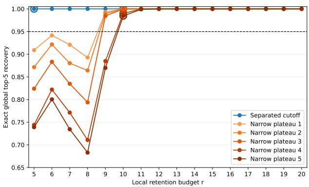
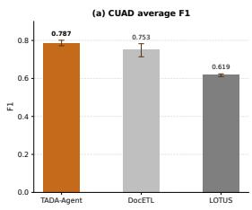
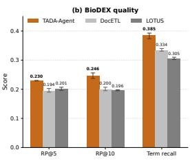

# Semantic Atoms for Scalable Text Analysis in Data Analytics in the Era of LLM-Based Agents

Jinxiang Xie <sup>1</sup> Zihao Li <sup>2</sup> Rui Ding <sup>3</sup> Bartuer Zhou <sup>3</sup> Shi Han <sup>3</sup> Dongmei Zhang

<sup>1</sup>Nanjing University <sup>2</sup>Tsinghua University <sup>3</sup>Microsoft Research

## Abstract

Much of the information needed for data analysis is buried in text columns: an analyst may infer customer frustration from complaint text and use it to explain resolution time. We call workloads in which processing text columns is central to subse quent data analysis TADA (Text Analysis in Data Analytics). In an agentic setting, the user’s query dynamically specifies this processing, and answering it interleaves LLM-based semantic steps with exact SQL or Python operations. This mixed execution raises two design questions: which work should be neural and which symbolic, and which semantic outputs later steps can reuse. We address them for agent-planned TADA workflows with two complementary, query-driven semantic atoms. Each atom takes a sequence of text items and a natural-language query specifying the semantic task: Tagging returns one string per input item (N →N), while Categorization returns M category objects over N input items (N → M). Tagging results are materialized as a row-aligned column and Categorization results as a category table; SQL or Python then performs exact computation over this exposed state. The atoms add no expressive power over semantic-operator systems that offer a semantic map; Tagging is functionally such a map. Their purpose is to make reusable semantic state the uniform, default output of every semantic call. We realize this interface in TADA-Agent, whose atoms run inside generated Python programs and internally handle inputs beyond a reliable context window. We evaluate TADA Agent on TABench, a benchmark of 40 complete analysis requests over spreadsheet tables spanning workflow composition, input–output structure, and literature-grounded analytical scenarios. Against a semantic-operator baseline and

relative to a held-out TADA reference run, TADA-Agent delivers comparable row-level semantic quality, has higher complete-artifact preservation estimates, and uses over an order of magnitude fewer semantic-model requests under the evaluated native execution paths. Large-scale fixedtaxonomy runs and public legal and biomedical benchmarks show that the same Tagging API can be used beyond one context window and across domains, with task-specific queries and downstream normalization.

## 1. Introduction

Text has long been part of analytical data, yet it has seldom been handled as a core analytical substrate in its own right. The relational model gives analysts a clean algebra over structured columns (Codd, 1970), while classical text analysis provides a separate toolbox for turning documents into linguistic features, labels, or summaries (Manning & Schutze¨ , 1999). Modern analytical tables, however, increasingly combine text and structured columns. For example, a customer-support table may contain a text column of billing complaints alongside structured columns such as resolution time and region. We refer to such tables as text-bearing tables. An analyst may infer each complaint’s frustration and main theme from the text, then use these derived variables in a regression to explain variation in resolution time. We use TADA (Text Analysis in Data Analytics) for such workloads, in which semantic processing over text columns produces intermediate artifacts for subsequent data analysis. Throughout the paper, TADA names this workload, TADA-Agent names our system, and Tagging and Categorization name the interface that the system exposes to an agent.

The execution of TADA requests is changing in the agentic era. Semantic-query interfaces now support both humanauthored programs and agentic execution. In an LLM-based analytical agent, the user expresses analytical intent through a natural-language query, and the agent may plan a multistep execution to answer it (Yao et al., 2023; Tang et al., 2025). LLM calls perform the neural computation required for semantic processing over text, while SQL, dataframe, and statistical runtimes provide symbolic computation for exact filtering, sorting, aggregation, and model fitting. Within such an execution, a semantic result may become an intermediate variable reused by later semantic or symbolic steps. In short, TADA in the agentic setting has two salient characteristics: semantic needs are specified dynamically by the query rather than fixed by a predefined task, and answering the query may require neural and symbolic steps to be interleaved. Consider the query, “Sort the billing complaints by customer frustration, identify the main theme of each complaint, and regress resolution time on frustration and complaint theme.” It dynamically specifies frustration and theme as semantic variables, which must be derived through neural processing and then used by symbolic sorting and regression, raising two challenges.

The first challenge is interface design. The system must decide which work is done by an LLM and which by exact code, and which LLM outputs are kept as semantic state: values, such as a frustration score per row, that later steps can read without calling the model again. TADA requires both neural and symbolic computation: LLM calls are needed to perform query-specified semantic processing over text, whereas operations such as applying a filter, sorting values, computing aggregates, and fitting models have exact symbolic implementations. A poorly placed boundary can reduce semantic coverage or execution reliability. Symbolic surrogates are often inadequate for context-dependent meanings, while delegating operations with established deterministic implementations directly to generation introduces avoidable variability. In the running example, sorting by frustration should use neural computation to infer a rowlevel frustration value and symbolic code to perform the actual sorting.

Existing systems often expose task-level semantic operators, each of which packages semantic processing with a particular analytical action, such as filtering, sorting, or aggregation (Snowflake, 2026b; Databricks, 2026; Apache Doris, 2026; Patel et al., 2025; Liu et al., 2024; Dai et al., 2024; Lee et al., 2025; Qi et al., 2026). A composite contract determines which state the orchestrator can reuse. The orchestrator can use only the state exposed by an operator’s output contract. In the billing-complaint example, a semantic sort returns ordered complaints but not the row-level frustration variable required by the later regression. A plan that relies on this sort must invoke an additional semantic computation to derive that variable, repeating the semantic processing for the same notion of frustration and potentially producing values inconsistent with the earlier ordering, as illustrated in Figure 1(a). The repetition stems from this plan choice. Most semantic-operator systems also provide a semantic map, and a plan that maps frustration first and then sorts and regresses symbolically avoids the repetition. Whether the agent finds that plan depends on which operators it is offered and which outputs those operators return by default. The system must therefore place two boundaries well. The execution boundary decides which work is neural and which is symbolic; the interface boundary decides what semantic state each call exposes to subsequent analytical steps.

The second challenge is scale: a large table may not fit reliably in one call. Consider identifying the main topics in thousands of complaints. A natural divide-and-conquer strategy follows a MapReduce structure: partition the rows, process each chunk, and consolidate the local results. Yet each stage raises questions specific to semantic computation. During partitioning, large chunks approach the model’s input and output limits, whereas small chunks provide less evidence and may produce unstable local topics. During local processing, the system must preserve information that is infrequent within one chunk but potentially important globally. Splitting and reassembling rows is not enough: the system must select suitable chunks, preserve globally important semantics through local LLM calls, and consolidate the local results reliably.

To address the interface-design challenge, TADA places the neural–symbolic execution boundary at the semantic output and exposes that output through two complementary, query-driven atoms. Tagging maps N input text items, typically drawn from a text column, to N output strings (N → N), while Categorization maps the same N text items to a list of M category objects (N → M). Both atoms also take a query q that specifies the semantic processing to perform. This atom-level query need not be identical to the user’s analytical query: the agent may derive it as one step in the workflow. The semantic task is therefore query-defined, while the two output contracts remain fixed. LLM calls perform the semantic processing needed to produce the atom outputs; filtering, sorting, and model fitting remain in the symbolic runtime. Tagging values are materialized as a row-aligned column keyed by row identifiers (rid), whereas Categorization objects are materialized as a separate category table keyed by fresh category identifiers (cid). The boundary therefore both confines neural computation to semantic processing and exposes its result as state that subsequent analytical steps can reuse. The TADA plan in Figure 1(b) Tags frustration once: symbolic code sorts by the materialized column, and the regression reuses that same column. Categorization discovers a shared theme vocabulary, and a subsequent Tagging call maps each complaint to the most relevant discovered theme. This Categorization–then–Tagging composition provides the discovery-and-assignment functionality of a task-level semantic grouping operation while preserving both the category vocabulary and its row-level assignments: LLM calls produce semantic state, exact operations consume it, and that state remains available across subsequent steps. The two atoms do not compute anything that a semantic-operator system with a semantic map cannot also compute: Tagging is functionally such a map. What TADA changes is the default. Every semantic call returns reusable state, so the map-first decomposition is the plan the interface offers by default, and the agent does not have to discover it among composite alternatives.

(a) Composite semantic operators   
ordered = semantic\_sort(text, "frustration")   
theme = semantic\_theme(text)   
# frustration is processed again   
frustration = semantic\_map(text, "frustration")   
regress(resolution\_time ∼ frustration + theme)   
(b) TADA atoms and symbolic operations   
frustration = ta.tag(text, "score frustration 1-10")   
ordered = sort(table, by=frustration)   
themes = ta.categorize(text, "main complaint themes")   
theme = ta.tag(text, "map to a label in {themes}")   
regress(resolution\_time ∼ frustration + theme)  
Figure 1. Two plans for the same user query: “Sort the billing complaints by customer frustration, identify the main theme of each complaint, and regress resolution time on frustration and complaint theme.” (a) A plan built from composite semantic operators receives only each step’s final result: the sort exposes an ordering but no frustration values, so the regression derives frustration again. Moving the map call before the sort would avoid this; the figure shows the plan that a composite sort invites, not the only plan an operator system permits. (b) TADA Tags frustration once as a reusable column that symbolic sorting and regression both consume; Categorization then Tagging yields a shared theme vocabulary together with its row-level assignments.

To address the second challenge, the two atom APIs handle large-scale execution internally, so the agent uses the same interface at every input scale. Large-scale Categorization follows three stages. Planning fixes a chunk size n under model capacity and uses a pilot to select the local retention budget r ≥ k for the requested category count k. Local processing randomly partitions the rows and retains up to r candidates per chunk, preserving more information than local top-k alone. A semantic reduction then consolidates synonymous and overlapping candidates into the final category table. We formulate local retention as a top-k preservation problem: a sufficient condition identifies how chunk size, retention, and support margins affect recovery, and a theory-guided bootstrap selects the smallest r meeting a target reliability.

Large-scale Tagging follows two paths. Independent Tagging partitions rows, applies the same query to each chunk, and reassembles outputs by rid. Joint Tagging is needed when rows must share an output domain: large-scale Categorization first establishes one category list, after which row assignment reduces to the independent path. Partitioning, validation, parallel calls, retries, and consolidation remain internal to the two atoms.

We realize the interface in TADA-Agent, an analytical agent that generates and executes Python workflows over text-bearing tables. ta.tag and ta.categorize are Python APIs invoked through Programmatic Tool Calling (Anthropic, 2025), so atom calls remain inside the same runtime as dataframe operations and control flow. In contrast, exposing the atoms only as peer tools through Traditional Tool Calling would unfold a data-dependent loop into repeated orchestrator–tool interactions and move intermediate tables and category lists across that boundary. A strong reasoning model plans the analysis while efficient lightweight models execute focused atom calls. A textanalysis skill supplies API contracts, composition patterns, and canonical examples, but the orchestrator still chooses the workflow and symbolic methods.

We evaluate the interface on TABench, 40 complete analysis requests over spreadsheet tables, organized by workflow composition, input–output structure, and a literaturegrounded scenario taxonomy. TADA-Agent and semantic operators are close on classification and extraction; semantic operators better reproduce the reference output’s absolute ranking scale, whereas TADA-Agent’s ordering agrees more with the reference and it performs best on constrained generation. TADA-Agent also has higher complete-artifact preservation estimates than semantic operators in all five evaluated classes, although a coding agent without the atoms matches these estimates in three of the five. These comparisons are made against a held-out TADA run as the common reference, and the class-level intervals overlap, so they describe agreement with that reference rather than absolute quality; in particular, ordering agreement partly reflects TADA-Agent’s run-to-run consistency. Under the evaluated native execution paths, it uses at least 41.8 times fewer dedicated semantic-model requests than the semantic-operator implementation; this measures implementation-level request fan-out rather than an intrinsic property of every operator interface. The large-scale evaluation covers both atoms at different levels: Tagging is evaluated end to end beyond one context window, while a controlled study of Categorization isolates whether locally retained candidates recover the global top-k under fixed assignments. In this study, r = k suffices when the cutoff is separated, whereas near-tied distributions require a larger pilot-selected budget. Public legal and biomedical benchmarks separately test whether the unchanged Tagging API transfers beyond TABench with benchmark-specific postprocessing.

## Our contributions are:

1. An agent-era formulation and semantic-atom interface. We frame agent-driven TADA around two design decisions: which work an LLM performs and which exact code performs, and which LLM outputs remain available to later steps. We identify two recurring shapes of such reusable outputs: row-aligned values and corpus-level vocabularies. We expose these shapes through complementary N → N Tagging and N → M Categorization atoms. They add no expressive power over semantic operators; the contribution is making reusable state the default output of every semantic call. They are an initial interface, not a universal algebra.

2. TADA-Agent and scalable atom execution. TADA-Agent invokes the atoms from generated Python and preserves their public contracts across one-call and multi-call execution.

3. TABench and empirical evaluation. TABench provides 40 complete TADA requests spanning workflow, structure, and scenario. The evaluation separates row-level quality, artifact reliability, and semantic-model request cost, with additional evidence on large-scale execution and public extraction benchmarks.

## 2. Related Work

## 2.1. Semantic Operators and AI Functions

Semantic query processing is the closest line of work to TADA. LOTUS provides both LLM and tool-using agentic semantic operators; its dataframe APIs cover mapping, filtering, extraction, aggregation, ranking, and joins, with optimized implementations and accuracy guarantees (Patel et al., 2025). SUQL extends SQL with free-text primitives for question answering and summarization over unstructured passages (Liu et al., 2024); UQE compiles a SQL-like language for unstructured data using LLM reasoning, sampling, and classical query optimization (Dai et al., 2024). Sema couples a high-performance DuckDB engine with a semantic query algebra (Qi et al., 2026); SABER proposes an extended relational algebra as a unifying, SQL-compatible foundation (Lee et al., 2025). Industrial platforms expose related AI functions in SQL (Snowflake, 2026b; Databricks, 2026; Apache Doris, 2026). Across these interfaces, natural language specifies semantic processing, and most of them already separate model-backed calls from relational execution. TADA does not add expressive power to this design space: its Tagging atom is functionally a semantic map. It differs in which outputs the agent receives by default. Every semantic call returns either a row-aligned column or a category table, exact operations remain in the symbolic runtime, and the orchestrator composes both through generated code.

The implementations reveal an execution boundary consistent with TADA’s design. LOTUS semantic filtering produces Boolean decisions and applies the resulting mask to a dataframe, while semantic top-k places a pairwise model comparator inside deterministic selection and sorting algorithms (Patel et al., 2025). Snowflake and Apache Doris similarly expose AI filters as Boolean functions used by an ordinary SQL WHERE clause (Snowflake, 2026a; Apache Doris, 2026). Thus a logical API may be a composite semantic operator even when its implementation already embeds semantic processing in a symbolic algorithmic shell. TADA makes this boundary explicit and uniform across its two atoms: LLM calls produce semantic values, and the surrounding runtime performs selection, sorting, and aggregation.

What each operator returns also differs by operator: an operator may return a filtered or top-k dataframe, a joined table, or a textual aggregate. LOTUS, for example, returns selected rows from sem topk and text from sem agg unless the caller supplies a structured format (Patel et al., 2025). Existing systems also expose useful escape hatches, including LOTUS filter decisions and raw outputs, Databricks extraction schemas, and DocETL intermediate reductions (Patel et al., 2025; Databricks, 2026; Shankar et al., 2025). These mechanisms are optional and operatorspecific. SABER independently identifies the lack of uniform semantics and composability as a systems problem (Lee et al., 2025). TADA’s difference from these systems is a design choice, not a capability gap: it makes two uniformly shaped outputs the primary interface: row-level values remain available to subsequent symbolic operations, and category objects give later Tagging calls a shared, reusable vocabulary.

## 2.2. Analytical Agents and Semantic Pipeline Systems

Tool-using LLM agents provide the execution setting that motivates the TADA interface. ReAct interleaves reasoning and actions (Yao et al., 2023), while Toolformer studies self-supervised learning of which APIs to call, when, and with what arguments (Schick et al., 2023). Recent surveys describe agents that orchestrate SQL, code, visualization, and LLM calls for data analysis (Tang et al., 2025). Programmatic Tool Calling further allows generated code to invoke model-backed tools inside a code-execution environment, avoiding a model round trip for every iteration of a loop (Anthropic, 2025). TADA-Agent uses this execution pattern to place Tagging and Categorization inside the same Python workflow as dataframe and statistical operations.

Several semantic data systems target whole pipelines rather than single operators. DocETL represents complex document-processing pipelines and uses agentic rewrites, plan evaluation, and optimization to improve their execution (Shankar et al., 2025). Palimpzest searches over logical and physical plans to trade off quality, cost, and runtime (Liu et al., 2025). ZenDB extracts semantic document structure for efficient downstream queries (Lin et al., 2024), while EVAPORATE constructs structured views over heterogeneous data lakes (Arora et al., 2023). TAG argues for database-backed generation beyond Text2SQL and retrievalonly interfaces (Biswal et al., 2024). These systems address the same overall problem of representing, optimizing, and answering complex data requests, usually from a declarative program or plan. TADA approaches it from the side of an agent that writes the plan step by step, and studies one part of it: what a semantic call should return when its result must remain available to later filtering, ranking, grouping, comparison, and statistical modeling.

Benchmarks. SemBench evaluates semantic query processing engines such as LOTUS, Palimpzest, ThalamusDB, and BigQuery on SQL queries with semantic operators across scenarios and data modalities, measuring cost, latency, and quality against labels derived from human annotations (Lao et al., 2026). TABench is complementary rather than a replacement. It is text-only and smaller, and each case is a complete analysis request posed to an agent in natural language, so the agent must choose the decomposition, combine semantic and exact steps, and deliver output files under an explicit contract. Many of these requests have no unique answer, which is why our evaluation uses a reference run and an LLM judge; SemBench’s human-label ground truth avoids this limitation for the operator-level queries it covers.

## 2.3. Stable and Large-Scale Semantic Processing

TADA-Agent also builds on work that improves the reliability and scale of LLM-based data processing. CAST studied corpus-level Summarization and row-level Tagging, including their run-to-run stability under Algorithmic Prompting and Thinking-before-Speaking (Xie et al., 2026). Building on these prompting principles, TADA defines Categorization and Tagging as query-driven $N  M$ and $N  N$ contracts for agent-generated analytical workflows.

Large inputs require more than independent LLM calls. DocETL uses hierarchical reduction and optimization for longdocument workloads (Shankar et al., 2025); UQE combines sampling with compiler-style execution (Dai et al., 2024); and semantic query systems optimize batching, operator order, and model invocation (Patel et al., 2025; Qi et al., 2026). TADA focuses specifically on preserving the two atom outputs across multiple calls: independent Tagging is reassembled by row identity, Categorization semantically consolidates local proposals, and joint Tagging follows discover–then–assign.

The top-k analysis draws on classical distributed ranking and concentration results. Fagin, Lotem, and Naor study instance-optimal aggregation algorithms for top-k middleware queries (Fagin et al., 2003); Theobald, Weikum, and Schenkel analyze top-k evaluation with probabilistic guarantees (Theobald et al., 2004); and Hoeffding-style bounds control ranking inversions under randomized sampling (Hoeffding, 1963). TADA applies these ideas to local candidate retention in a semantic Categorization pipeline. The controlled analysis fixes canonical assignments to isolate retention, while the end-to-end scale experiment evaluates fixed-taxonomy Tagging.

## 3. Two Semantic Atoms and Their Composition

This section defines the two semantic atoms, Tagging and Categorization, and presents a systematic taxonomy of their composition with symbolic operations. We first recover familiar semantic operators and then examine broader analytical workflows enabled by the same atom outputs.

## 3.1. Tagging and Categorization

Both atoms accept a sequence of text items and an atomlevel query. Let $X = ( x _ { 1 } , \ldots , x _ { N } ) $ denote the N input texts, and let q specify the semantic processing to perform. The texts typically come from one table column. When the requested processing depends on several columns, the agent first serializes their row-wise values into an intermediate text item $x _ { i }$ . The atom-level query q may likewise be derived from the user’s analytical query as part of the agent’s plan.

Tagging. Tagging returns one string for each input text:

$$
\operatorname { T a g } ( X , q ) \to S = ( s _ { 1 } , . . . , s _ { N } ) .\tag{1}
$$

Each $s _ { i }$ is the result for the corresponding input text $x _ { i } .$ Depending on $q ,$ the string may contain a sentiment label, an extracted postcode, a keyword, a summary, or a numeric score written as text. The output list preserves the length and order of X. When the result is materialized, TADA-Agent writes the list as one new column, associating each $s _ { i }$ with the rid of its input row.

The atom query specifies the semantic processing. For example, it may ask Tagging to classify sentiment using a given label set, extract a postcode, or assign a score from 1 to 10. A request for several output columns calls Tagging once per column. Extracting province, city, and postcode therefore uses three calls with three queries. Each call keeps the same N →N form in Equation 1.

Categorization. Categorization returns a list of category objects for the input texts:

$$
\mathbf { C a } \mathrm { T E G O R I Z E } ( X , q ) \to { \mathcal { C } } = ( c _ { 1 } , \dots , c _ { M } ) .\tag{2}
$$

Each $c _ { j }$ contains a required name and an optional description. The atom query specifies how the texts should be categorized (for example, by topic or issue type) and any constraints on the categories, including their number. The returned count M is the number of objects produced for that request. When materialized, TADA-Agent writes the objects as a separate category table and assigns a fresh cid to each row.

Categorization produces the category objects but does not assign them to input rows. A workflow that needs both operations first calls Categorization, inserts the returned names and descriptions into a new atom query, and then calls Tagging. The new query may, for example, ask Tagging to “map each review to the most relevant label in the following list.” Category discovery and row assignment are thus two explicit atom calls linked by query text.

## 3.2. From Semantic Operators to Analytical Workflows

Tagging and Categorization expose deliberately simple outputs: one string per row and one list of categories, respectively. Their usefulness comes from the analytical workflow that composes them. TADA-Agent can construct a sequence of atom-level queries from the user’s analytical query, invoke either atom, materialize its output, and continue with another atom call or a symbolic operation. Repeated calls create several columns; row-wise serialization brings several input columns into one Tagging call; loops apply the same atom to groups or time periods; and materialized labels, scores, and categories become inputs to OLAP operations, control flow, and model fitting. The frustration and theme columns in Figure 1(b) illustrate this reusable state in one multi-step workflow.

Many familiar semantic operators are derived workflows over these outputs. A semantic map is a Tagging call whose result is written as a column. A semantic filter Tags a Boolean decision and applies an ordinary Filter. A pointwise semantic sort Tags the requested row-level value and invokes an ordinary Sort, while a top-k endpoint adds a symbolic cutoff. Fixed-label semantic grouping Tags a group name and applies GroupBy. Open grouping first Categorizes the column to discover a shared vocabulary, then Tags every row under that vocabulary before GroupBy. Wholecolumn summarization is a Categorization query requesting one summary. These decompositions mirror the physical structure of well-engineered semantic operators, and the same workflows can be written with an operator system that exposes a semantic map. The difference is that the neural output is the primary analytical artifact by default, whereas in a composite operator it is an internal or optional value behind one action.

Table 1 moves from the single example in Figure 1 to 16 representative requests. Its scenario axis comes from the literature-grounded taxonomy used to construct TABench. The taxonomy synthesizes established work on classification and extraction (Hendrycks et al., 2021; D’Oosterlinck et al., 2023; Arora et al., 2023; Xie et al., 2026), semantic filtering, grouping, aggregation, and ranking (Patel et al.,

2025; Dai et al., 2024; Liu et al., 2024; Qi et al., 2026; Lee et al., 2025; Lao et al., 2026), and multi-step document and analytical workflows (Shankar et al., 2025; Lin et al., 2024; Liu et al., 2025; Tang et al., 2025). A request may carry several scenario labels because one analytical workflow can perform, for example, classification, filtering, and summarization in sequence.

Table 1 spans all nine supported taxonomy families, from classification and semantic grouping to pattern detection, data repair, and semantic column generation. Several requests combine these families: finding topics among negative reviews composes classification, filtering, and summarization; emerging-topic analysis combines summarization with temporal pattern detection.

The table also covers output structures that are not obvious from either atom alone. Inputs range from one text column to several columns serialized by row. Outputs include one or many derived columns, filtered row subsets, category lists with row assignments, group-specific lists, hierarchical categories, scalar aggregates, ordered rows, and fitted models. Hierarchical topic analysis recursively invokes Categorization over groups created from an earlier result. Semantic feature construction discovers aspects, converts each aspect into a row-aligned predictor, and passes those predictors to a statistical model. Thus the fixed N →N and N →M atom contracts do not fix the shape of the complete analytical result.

The atom query determines how a returned string is interpreted by the next operation: as a Boolean decision for Filter, a category name for GroupBy, a number for Sort or Average, or text retained as a new column.

The first eight rows of Table 1 recover familiar semanticmap, filter, grouping, aggregation, and ranking families. Each uses one or two atom calls, optionally followed by symbolic code. The remaining rows cross these operator boundaries. They include loops over groups, hierarchical discovery, semantic filtering followed by summarization, text-conditioned numeric aggregation, temporal comparison, global score constraints, and regression over semantically constructed features. The interface does not need a separate model-backed operator for each analytical verb; the agent builds these workflows from two exposed output shapes.

The constrained-rating request illustrates the split. Tagging scores every review from 1 to 5. The symbolic runtime converts the strings to numbers, sorts them, computes percentile cutoffs, and rewrites the scores so that only the top 10% receive 5. The LLM supplies row-level semantics; symbolic code enforces the global constraint exactly. Control flow can likewise apply Categorization once per organization or time period, or recursively within every discovered topic. These patterns keep semantic outputs available to the rest of

Table 1. Representative TADA requests viewed by scenario, input–output structure, workflow composition, and correspondence to existing semantic operators. Scenario names follow the fine-grained intent taxonomy; the appendix groups these leaves into 12 broader reporting classes.
<table><tr><td>Representative request</td><td>Scenario</td><td>Input-output</td><td>TADA workflow</td><td>Existing operator</td></tr><tr><td colspan="5">Workflows corresponding to familiar semantic-operator families</td></tr><tr><td>Label each review as positive, negative, or neutral</td><td>Classification</td><td>N×1 → N ×1</td><td>Tag with the three labels written in the query</td><td>sem_map</td></tr><tr><td>Discover issue categories and group the reviews by them</td><td>Grouping; classification</td><td>N×1 → (M, N×1)</td><td>Categorize → build a query from the category names → Tag → GroupBy</td><td>Semantic grouping</td></tr><tr><td>Keep comments that imply a risk of Semantic filtering customer churn</td><td></td><td>N×1 → N′×1</td><td>Tag a Yes/No decision → Filter</td><td>sem_filter</td></tr><tr><td>Extract time, location, scope, and cause from each incident</td><td>Information extraction</td><td>N×1 → N×w</td><td>Invoke Tagging w times, once for each output column</td><td>sem_map/ sem_extract</td></tr><tr><td>Produce one overall summary of the Text summarization survey responses</td><td></td><td>N×1 → 1</td><td>Categorize with a query requesting one overall summary</td><td>sem_agg</td></tr><tr><td>Return the ten support tickets with highest inferred urgency</td><td>Semantic ranking</td><td>N ×1 → k rows</td><td>Tag a score → convert strings to numbers → Sort → take sem_t opk k</td><td></td></tr><tr><td>Map country-name variants to a canonical country name</td><td>Data quality repair</td><td>N×1 → N×1</td><td>Tag the canonical name</td><td>sem_map</td></tr><tr><td>Infer priority from description, category, and customer tier</td><td>generation</td><td>Classification; column N ×y → N × 1</td><td>Serialize the y input values row by row → Tag a priority</td><td>sem_map</td></tr><tr><td colspan="5">Workflows composed beyond one semantic operator</td></tr><tr><td>Discover the main feedback topics for each organization</td><td>Text summarization</td><td>{Ng×1 → Mg}g∈G</td><td>GroupBy organization → ForEach group: Categorize</td><td>No single operator</td></tr><tr><td>Discover broad topics and then subtopics within each topic</td><td>Grouping; Summarization</td><td>N×1 → (M1, {M2,j})</td><td>Categorize → build a query → Tag → GroupBy → ForEach group: Categorize</td><td>No single operator</td></tr><tr><td>Discover the main topics among negative reviews</td><td>Classification; Filtering; Summarization</td><td></td><td>N × 1 → N′× 1 → M Tag sentiment → Filter negative rows → Categorize</td><td>No single operator</td></tr><tr><td>Compute the average rating of semantically negative reviews</td><td>Classification; Filtering; text-numeric analysis</td><td></td><td>N × (text, number) → 1 Tag sentiment → Filter negative rows → Average rating No single operator</td><td></td></tr><tr><td>Explain products with unusually high return rates from their comments</td><td>Summarization; text-numeric analysis</td><td>N × (text, number) → N′×text → M</td><td>Detect high return rates → Filter products → Categorize No single operator comments</td><td></td></tr><tr><td>Rate reviews from 1 to 5 with only the top 10% receiving 5</td><td>Scoring; Ranking</td><td>N×1 → N×1</td><td>Tag raw scores → convert to numbers → Sort → compute cutoffs → write final ratings</td><td>No single operator</td></tr><tr><td>Find topics appearing this month but absent from earlier months</td><td>Summarization; pattern detection</td><td>{Nt×1 → Mt}t∈T</td><td>GroupBy time → ForEach period: Categorize → compare category lists</td><td>No single operator</td></tr><tr><td>Use discovered review aspects as features in a regression</td><td>Grouping; column generation</td><td>N×1 → M → N × M → model</td><td>Categorize aspects → Tag once per aspect → Regression No single operator</td><td></td></tr></table>

the workflow.

## 4. TADA-Agent Design and Implementation

Section 3 defines the semantic state that an analytical workflow can reuse. TADA-Agent realizes this interface by making Tagging and Categorization available inside its Python code-execution environment. Three design choices are central: Programmatic Tool Calling keeps atom calls inside generated control flow, separate model roles assign orchestration and atom execution to models suited to each kind of work, and a text-analysis skill teaches the orchestrator how to construct valid workflows.

## 4.1. Programmatic Tool Calling for Text Analysis

Under Traditional Tool Calling, an orchestrator invokes a top-level tool, receives its result, and then chooses the next action. Tagging and Categorization could be registered as tools beside a Python tool. This design is natural for isolated semantic operations, but it places the orchestrator between every semantic call and the code around it.

TADA workflows frequently invoke semantic processing inside data-dependent OLAP operations and control flow. Consider “for each organization, summarize the topics in its reviews.” With Traditional Tool Calling, the orchestrator must enumerate the organizations, return from Python execution, invoke a semantic tool for every organization, retain each result, and assemble the mapping. The compact loop is unfolded into a sequence of model decisions and tool calls. Group-specific tables and partial results repeatedly cross the model–tool boundary, increasing round trips and creating opportunities to omit a group or lose the correspondence between a group and its result.

```python
(a) Traditional tool calling
orgs = python(groupby) # orgs enter context
for org in orgs:
rows = python(slice) # rows enter context
topics = categorize(rows)
# topics enter context
assemble(topics)
(b) Programmatic tool calling
topics = {}
for org, rows in table.groupby("org"):
topics[org] = ta.categorize(rows)
# state stays in runtime
write_json(topics) # final result only
```  
Figure 2. Group-wise Categorization. (a) Traditional tool calling unfolds the loop into orchestrator steps, repeatedly placing groups, table slices, and partial results in model context. (b) Programmatic Tool Calling keeps the loop and intermediate state inside the executed workflow; only the final mapping returns.

Anthropic uses Programmatic Tool Calling for the alternative in which generated code invokes tools inside a codeexecution environment (Anthropic, 2025). TADA-Agent follows this pattern: ta.tag and ta.categorize are Python APIs callable from the generated workflow. The group-wise request becomes:

The organizations are discovered at runtime, while dataframe slices and category lists remain inside code execution. The same interface supports deeper nesting: hierarchical topic analysis Categorizes the full column, Tags rows with the discovered names, and Categorizes each resulting group. Multi-output extraction invokes Tagging several times; constrained scoring Tags a semantic value and lets numpy or pandas enforce global cutoffs. The atoms therefore remain ordinary calls inside the workflow rather than an API vocabulary that grows with each composition.

Programmatic Tool Calling assumes a safe code-execution environment and couples execution to the libraries available there. TADA-Agent makes this trade-off because its target workflows already require dataframe, statistical, and machine-learning libraries. Keeping semantic calls in the same runtime preserves loop variables, table state, exceptions, and result structure across the whole analysis workflow.

## 4.2. Separate Model Roles

The orchestrator and atom calls solve different problems. The orchestrator analyzes the request, reasons over the schema, chooses a decomposition, writes the workflow, and responds to execution failures. This role benefits from a strong reasoning model because its decisions span the complete analysis.

An atom call has a narrower contract. The library combines a fixed system prompt with one query and a text column, invokes the selected model, validates the structured response, and returns one of two prescribed output shapes. CAST provides the prompting foundation: TADA-Agent adapts Algorithmic Prompting and Thinking-before-Speaking to the two contracts (Xie et al., 2026). Atom-model selection is independent of orchestration, allowing efficient lightweight models to handle high-volume calls.

## 4.3. Skill-Based Implementation

TADA-Agent is implemented as a text-analysis skill. When activated, the skill provides the two API signatures, input and output conventions, composition rules, and canonical examples. The skill guides the orchestrator; the codeexecution tool runs the Python workflow in which the APIs are available. The orchestrator still decides how to compose them with symbolic code.

The public contracts remain unchanged across input scales. Batching, parallel calls, validation, recovery, independent versus joint Tagging, and category consolidation remain inside the library. The orchestrator therefore uses one analytical workflow rather than constructing a separate MapReduce program (Section 5).

## 5. Large-Scale TADA Execution

Large-scale text analysis follows a MapReduce-style semantic execution rather than simple chunking and concatenation. Consider discovering the top-k topics from a textual column with thousands of rows. Categorizing row chunks independently does not produce the global top-k: chunks may omit globally important topics, use synonymous names, or choose different levels of granularity.

The execution addresses a distinct problem at each stage. The map stage partitions the input under a chunking configuration fixed by model capacity, local stability, and consolidation cost. Per-chunk processing must preserve enough information for the global request, motivating a local candidate budget $r \geq k .$ The reduce stage then semantically consolidates local proposals into one representative global result. Independent Tagging is the simpler row-aligned case and can be reassembled by rid; joint Tagging first uses large-scale Categorization to establish one shared output list. Partitioning, parallel calls, consolidation, and recovery remain inside the two atom implementations, leaving their public APIs unchanged.

## 5.1. Planning a Large-Scale Request

The central large-scale problem is to discover the global top-k categories from N text items that cannot be processed reliably in one call. TADA randomly partitions the input into chunks of approximately n rows, asks each chunk for its top-r category candidates, and consolidates the local proposals into the final top-k. Planning therefore fixes the chunk size n under model capacity and selects the local retention budget $r \geq k$

These parameters are coupled. Smaller chunks exhibit greater sampling variation, so a globally important category is more likely to fall below a local cutoff; retaining a larger r provides a buffer. Larger chunks reduce this variation and can use an r closer to k. The category distribution also matters: if the k-th most frequent category is clearly more frequent than the $( k { + } 1 ) { - } \mathrm { t h } , r = k$ suffices, whereas several nearly equally frequent categories around rank k require each chunk to keep more than k candidates. Increasing r improves preservation but raises mapper output and consolidation cost.

Once n is fixed and r is selected, large-scale Categorization follows the partition–consolidate plan in Section 5.3. Independent Tagging directly partitions and reassembles rows, while Joint Tagging first uses large-scale Categorization to establish one shared output domain (Section 5.4). The next subsection formalizes the remaining planning question: given n, how to select r so that local retention preserves the requested global top-k.

## 5.2. Top-k Preservation

We analyze an idealized version of this pipeline. Each text item belongs to exactly one category. After the items are randomly divided into chunks, each chunk reports its r most frequent categories and their exact local counts; the reducer merges identical categories across chunks and returns the k largest combined counts. Planning is therefore a top-k preservation problem: when does this local top-r truncation recover the full population’s top-k?

Formally, let $Y ( x ) \in \{ 1 , \ldots , C \}$ be the category of item $x ,$ and order the full-input supports as

$$
p _ { i } = \frac { 1 } { N } \sum _ { x \in X } \mathbf { 1 } [ Y ( x ) = i ] , \quad \Delta _ { i , r } = p _ { i } - p _ { r + 1 } ,\tag{3}
$$

with the categories indexed so that $p _ { 1 } \geq \cdots \geq p _ { C }$ . Let $T _ { k }$ be the full-input top-k and $\widehat { T } _ { k }$ the result after local retention. For B balanced chunks with minimum size $n _ { \mathrm { m i n } }$ , the full analysis (Appendix C) gives the sufficient bound

$$
\operatorname* { P r } \left( \widehat { T } _ { k } = T _ { k } \right) \geq 1 - B ( C - r ) \sum _ { i = 1 } ^ { k } \exp \left( - \frac { n _ { \operatorname* { m i n } } \Delta _ { i , r } ^ { 2 } } { 2 } \right) .\tag{4}
$$

The bound makes the trade-off explicit. Increasing chunk size reduces local sampling variation; increasing r moves the comparison from $p _ { k + 1 }$ to the smaller $p _ { r + 1 }$ and widens $\Delta _ { i , r }$ . A large frequency gap after rank k allows $r \ = \ k$ whereas nearly equal frequencies around rank k require a larger $r ,$ at the price of longer local outputs and more consolidation work.

Operational selection. TADA uses a random pilot sample to select r. The sample is sized to fit within one Categorization call and one Tagging call. Categorization identifies the candidate set from the sample, Tagging maps the pilot rows to that list, and symbolic counting yields category counts $c _ { 1 } , \ldots , c _ { C }$ and support estimates $\widehat { p } _ { i } = c _ { i } / N _ { \mathrm { p } }$

Rather than substituting these noisy estimates directly into Equation 4, TADA propagates their uncertainty through a paired bootstrap. For each outer replicate u, it draws a support profile from the Jeffreys Dirichlet posterior induced by the pilot counts. Conditional on that profile, it simulates V balanced partitions for the target N and $n .$ For every candidate $r ,$ it retains the exact local top-r counts and compares the combined result with the realized full-input top-k. All candidates share the same support profiles and partitions. If $Z _ { u , v } ( r )$ indicates recovery in partition replicate $v ,$ then

$$
\widehat { \rho } _ { u } ( r ) = \frac { 1 } { V } \sum _ { v = 1 } ^ { V } Z _ { u , v } ( r ) .\tag{5}
$$

Let $Q _ { \alpha } ( \boldsymbol r )$ be a lower empirical quantile of $\widehat { \rho } _ { u } ( r )$ across pilot-profile draws. Given a target recovery $1 - \delta ,$ TADA selects

$$
\begin{array} { r } { \widehat { r } = \operatorname* { m i n } \left\{ r \in \mathcal { R } : Q _ { \alpha } ( r ) \geq 1 - \delta \right\} . } \end{array}\tag{6}
$$

Thus, the planner chooses the smallest tested retention budget that meets the target. In TADA-Agent, we set the batch size to $n = 1 { , } 0 0 0$ , which is suitable for commonly used lightweight LLMs. Appendix C gives the theorem, proof, bootstrap details, and the assumptions separating retention error from semantic assignment and consolidation error.

## 5.3. Large-Scale Categorization

Once n is fixed and r is selected (Sections 5.1–5.2), TADA-Agent randomly shuffles the N input rows and partitions them into $B = \lceil N / n \rceil$ balanced chunks $X _ { 1 } , \ldots , X _ { B }$ . It constructs a local query $q _ { r }$ from the user query by requesting up to r categories, ordered by their prominence in the chunk. Categorization then runs in parallel:

$$
\mathcal { C } _ { b } = \mathrm { C A T E G O R I Z E } ( X _ { b } , q _ { r } ) , \quad | \mathcal { C } _ { b } | \leq r , \quad b \leq B .\tag{7}
$$

Despite random shuffling, the local lists $\mathcal { C } _ { 1 } , \ldots , \mathcal { C } _ { B }$ may still use synonymous names or different descriptions for the same category. TADA-Agent therefore consolidates names and descriptions across all local lists and uses the pilot support estimate $\widehat { p }$ to select the k categories that best represent the full input:

$$
\widehat { \mathcal { C } } _ { k } = \operatorname { S E L E C T K } ( \operatorname { C O N S O L I D A T E } ( \mathcal { C } _ { 1 } , \dots , \mathcal { C } _ { B } ; \widehat { p } , q ) , k ) .\tag{8}
$$

## 5.4. Large-Scale Tagging

Consider two Tagging requests. “Extract the postcode from each address” is independent: each result depends only on its row and the same query. “Assign each review one of at most 20 recurring keywords” is joint: the rows must share one output domain, and that domain cannot be determined from any row alone; it must first be inferred from the full dataset.

Therefore, Independent Tagging can process chunks directly under the same query, whereas Joint Tagging requires a global discovery step before parallel row assignment. TADA reuses large-scale Categorization for this step; once the shared domain is fixed, row assignment becomes an Independent Tagging task.

Independent Tagging. TADA-Agent partitions an independent request, runs Tagging in parallel, and reassembles the row-aligned strings by stable identifier:

$$
S _ { b } = \operatorname { T A G } ( X _ { b } , q ) , \qquad b = 1 , \ldots , B ,\tag{9}
$$

$$
S = \mathrm { R E A S S E M B L E B Y R I D } ( S _ { 1 } , \dots , S _ { B } ) .\tag{10}
$$

Joint Tagging. TADA-Agent first derives a Categorization query $q _ { C }$ that discovers the shared domain, then constructs an assignment query $q _ { A }$ and uses the independent path:

$$
\mathcal { C } = \mathrm { C A T E G O R I Z E } _ { \mathrm { l a r g e } } ( X , q _ { C } ) ,\tag{11}
$$

$$
q _ { A } = \mathbf { B _ { U I L D A S S I G N M E N T Q U E R Y } } ( q , \mathcal { C } ) ,\tag{12}
$$

$$
S = \operatorname { T a G } _ { \mathrm { i n d , l a r g e } } ( X , q _ { A } ) .\tag{13}
$$

For the keyword example, $q _ { C }$ asks Categorization to identify up to 20 representative keyword labels shared across the dataset. The assignment query $q _ { A }$ lists their names and descriptions and asks each row to return its most relevant keyword.

## 6. Evaluation

We organize the evaluation around three questions:

RQ1: Quality, reliability, and request cost. Across the TABench scenario taxonomy, how does TADA-Agent compare with a semantic-operator system and nonsemantic baselines in row-level quality, completeartifact reliability, and dedicated semantic-model requests?

RQ2: Large-scale execution. Beyond one reliable context window, does batched Tagging preserve assignments, and does Categorization retain the candidates needed for the global top-k?

RQ3: Transfer beyond TABench. Does the Tagging interface, unchanged, transfer to established legal and biomedical extraction benchmarks?

## 6.1. RQ1: Quality, Artifact Reliability, and Request Cost

Benchmark and protocol. TABench evaluates 40 complete analysis requests over spreadsheet tables (workbooks) rather than isolated semantic calls. Its taxonomy derives from a structured review and contains 12 scenario classes organized along analytical scenario, semantic operation, and input–output structure (construction details in Appendix F). Each case provides a source table, a natural-language request, an output contract, and evaluation criteria. The 40 scored cases cover ten scenario classes with three to five cases each (Table 8). Their source tables have 89–201 rows and 2–8 columns (200 rows in 38 cases), 7,890 rows in total. Seven cases carry rule-based answers derived from generator-injected phenomena such as near-duplicates and entity aliases.

All configurations receive the same inputs and requests. Because most TABench requests have no unique answer, we use one held-out TADA run as a common reference output rather than assign absolute scores. This reference is fixed for every method, including three independent TADA repetitions. Row-aligned outputs without rule-based answers are judged per differing cell (Table 2); other non-deterministic outputs are judged as complete artifacts (Table 3). Seven cases with rule-based answers instead use absolute accuracy and enter neither table. For reference-based comparisons, an anonymized, position-swapped LLM judge casts three votes in each A/B order; a unit wins only when both orders give the same majority result. If the two orders disagree, the comparison is a tie. On integer-rating tasks, scores that differ by one scale step are also treated as ties. Coverage is audited over all 40 cases; a missing required row or output is a coverage failure rather than a successful judgment unit.

Controlled configurations. The controlled configurations use the same public frontier models where their execution paths permit: Claude Opus 5 hosts TADA-Agent and the Claude Code baseline; semantic calls (atom or operator) execute on Claude Sonnet 5, and GPT-5.5 serves as the judge. The five configurations share the frozen tasks and evaluator but differ in the semantic interface and execution support available to the host agent: (i) the full system with both semantic atoms; (ii) semantic operators, an external semantic-operator system executed through its official

Table 2. Row-level semantic quality on TABench by scenario class. Except for the semantic-ranking row, each entry is the percentage of evaluated units judged at least as good as the common reference output, with a 95% case–run cluster-bootstrap interval over three independent runs per configuration (identical inputs, models, and judge). The semantic-ranking row reports mean within-case Spearman ρ against the same reference, macro-averaged over the four ranking cases and three runs, with a case–run cluster-bootstrap 95% interval computed the same way (wide because only four cases enter this row); the complementary absolute-score agreement is reported in the text, and Direct is omitted because its incomplete/malformed Q34 artifacts yield method-dependent row coverage. Bold marks the highest point estimate and does not imply statistical significance; classes are never aggregated.
<table><tr><td>Scenario class</td><td>TADA-Agent</td><td>Semantic operators</td><td>Claude Code</td><td>Code-only</td><td>Direct</td></tr><tr><td>Classification</td><td>98.6 [97.0, 100.0]</td><td>97.5 [96.1, 98.8]</td><td>97.9 [95.2, 100.0]</td><td>96.6 [94.0, 98.8]</td><td>94.7 [91.3, 98.0]</td></tr><tr><td>Field extraction</td><td>98.9 [96.6, 99.9]</td><td>98.2 [95.5, 99.7]</td><td>97.9 [93.9, 99.7]</td><td>90.6 [80.3, 98.4]</td><td>82.5 [72.2, 95.0]</td></tr><tr><td>Semantic ranking (Spearman ρ)</td><td>0.801 [0.600, 0.980]</td><td>0.752 [0.483, 0.957]</td><td>0.774 [0.558, 0.962]</td><td>0.590 [0.249, 0.921]</td><td></td></tr><tr><td>Constrained generation</td><td>89.1 [83.8, 94.0]</td><td>78.6 [64.2, 88.8]</td><td>84.2 [74.8, 90.6]</td><td>35.0 [27.5, 42.8]</td><td>60.3 [55.2, 64.0]</td></tr></table>

Python APIs on the same semantic model and fixed serving endpoint, instantiated with LOTUS 1.2.4 (Patel et al., 2025); (iii) Claude Code, run without the TADA skill or atom APIs, so the coding agent must choose its own decomposition; (iv) Code-only, which must express all semantic judgments as symbolic code; and (v) Direct, a single prompted call without agent scaffolding. Each configuration is run three times independently to expose run-to-run variance.

The three measurements are reported separately. The seven rule-based cases are at or near ceiling for both TADA-Agent and semantic operators (summary results appear in the appendix). Confidence intervals use case–run cluster bootstrap for row units and descriptive Wilson intervals for artifacts. We use 10,000 bootstrap resamples with a fixed analysis seed; all task inputs are held fixed, while the three independent model executions capture run-to-run stochasticity. Scenario placement uses method-independent criteria: a case is reported separately when its output contract or available metric does not measure the named scenario. The normalization-and-repair class therefore appears in the appendix; its only row-level case is at ceiling (99.8–100.0 across methods), and its remaining cases are deterministic contract checks.

Semantic quality. Table 2 shows a mixed result. Classification and field extraction are near ceiling for both systems: TADA-Agent differs from semantic operators by 1.1 and 0.7 points. These classes mainly test whether the caller can apply a well-defined semantic decision consistently across rows, so the two interfaces offer similar quality when the desired output is already row-aligned.

The distinction is clearer on ranking and constrained generation. For ranking, Table 2 reports mean within-case Spearman correlation with the reference output: TADA reaches 0.801 versus 0.752 for semantic operators, though the fourcase intervals overlap widely. A complementary absolutescore agreement measure favors semantic operators (86.6% versus 81.9%); it is the percentage of scored items that exactly match the reference rating or differ by one scale step, macro-averaged over case–run units. Unlike Spearman ρ, it rewards reproducing the reference’s numerical scale as well as its ordering. Semantic operators better match the reference’s scale calibration, while TADA-Agent’s ordering agrees more with the reference. Because the reference is itself a TADA run, this ordering agreement measures TADA-Agent’s run-to-run consistency but measures the baselines’ agreement with a different system; it is not evidence of better ranking quality. Both systems order the standard ranking cases nearly identically $( \rho \ge 0 . 9 3 )$ , and most of the difference comes from one calibration-sensitive scoring case. On constrained generation TADA leads (89.1 versus 78.6); the advantage arises when a semantic value must subsequently satisfy a workbook-level cardinality, distribution, or formatting rule that symbolic code can enforce exactly. We do not interpret any overlapping intervals as significant differences.

Artifact reliability and request cost. The broader difference appears in whether each system delivers a complete artifact without omitting required content (Table 3). Relative to the same fixed reference, TADA-Agent has higher preservation point estimates than semantic operators in all five classes. The largest observed gaps occur in grouping (8/9 versus 5/9), aggregation and summarization (12/12 versus 6/12), and anomaly detection (6/6 versus 4/6). Filtering is closer (9/12 versus 8/12), while numerical and temporal analysis remains uncertain at 6/9 versus 4/9. The largest differences occur when several judgments and symbolic steps must survive into one delivered workbook. Because the denominators are small, these estimates are descriptive and specific to this reference; we do not aggregate them into a single TABench score. They are better read as evidence about failure modes than as a ranking of systems. Claude Code without the atoms matches TADA-Agent’s estimate in three of the five classes, and single-call Direct prompting matches it in two. The largest gap to semantic operators is in aggregation and summarization, where semantic operators also score below Direct prompting; we have not analyzed the causes of these failures.

Request cost separates the systems more sharply. Across 120 task-runs, TADA makes 451 successful dedicated semantic-model requests (3.76 per task-run), counting intent detection, data batches, and category consolidation. The recorded semantic-operator executions contain at least 18,852 requests (≥ 157.10 per task-run), at least 41.8 times the TADA count under the evaluated native execution paths. This comparison describes the physical request fan-out of the two implementations; it does not imply that every operator interface must execute per row. Host-agent and judge calls are excluded on both sides; the metric counts requests sent to the dedicated semantic-processing model. The LO-TUS total is a strict lower bound because failed or unpersisted requests cannot always be reconstructed.

Table 3. Complete-artifact preservation on TABench. Each entry counts outputs judged at least as complete and correct as the fixed reference, with descriptive 95% Wilson intervals in percent. The unit is a delivered artifact rather than a row; functionally determined identity columns do not count as missing content. These results are specific to this reference output and are not combined with Table 2.
<table><tr><td>Scenario class</td><td>TADA-Agent</td><td>Semantic operators</td><td>Claude Code</td><td>Code-only</td><td>Direct</td></tr><tr><td>Grouping and clustering</td><td>8/9 [56.5, 98.0]</td><td>5/9 [26.7, 81.1]</td><td>8/9 [56.5, 98.0]</td><td> $6 / 9 \ [ 3 5 . 4 , 8 7 . 9 ]$ </td><td> $5 / 9 \ [ 2 6 . 7 , 8 1 . 1 ]$ </td></tr><tr><td>Semantic filtering</td><td>9/12 [46.8, 91.1]</td><td>8/12 [39.1, 86.2]</td><td>6/12 [25.4, 74.6]</td><td> $4 \dot { / } 1 2 [ 1 3 . 8 , 6 0 . 9 ]$ </td><td> $0 \dot { / } 1 2 [ 0 . 0 , 2 4 . 2 ]$ </td></tr><tr><td>Aggregation and summarization</td><td>12/12[75.8, 100.0]</td><td>6/12 [25.4, 74.6]</td><td></td><td></td><td>12/12 [75.8, 100.0] 11/12 [64.6, 98.5] 12/12 [75.8, 100.0]</td></tr><tr><td>Numerical and temporal analysis</td><td> $\mathbf { 6 / 9 } \ [ 3 5 . 4 , 8 7 . 9 ]$ </td><td> $\dot { 4 } / 9 \ [ 1 8 . 9 , 7 3 . 3 ]$ </td><td> $\mathbf { 6 / 9 } \ [ 3 5 . 4 , 8 7 . 9 ]$ </td><td> $\mathbf { 6 } / 9 \ [ 3 5 . 4 , 8 7 . 9 ]$ </td><td>1/9 [2.0, 43.5]</td></tr><tr><td>Anomaly detection</td><td>6/6 [61.0, 100.0]</td><td>4/6 [30.0, 90.3]</td><td> $3 / 6 [ 1 8 . 8 , 8 1 . 2 ]$ </td><td> $5 / 6 \ [ 4 3 . 6 , 9 7 . 0 ]$ </td><td> $\mathbf { 6 } / 6 \ [ 6 1 . 0 , 1 0 0 . 0 ]$ </td></tr></table>

Table 4. Recorded calls to the dedicated semantic-processing LLM across three runs of each TABench task. “Mean per task-run” is the mean number of such LLM calls, not elapsed time. The ≥ symbol marks conservatively incomplete request logs.
<table><tr><td>Metric</td><td>TADA-Agent</td><td>Sem. operators</td></tr><tr><td>Task-runs</td><td>120</td><td>120</td></tr><tr><td>Successful requests</td><td>451</td><td>≥18,852</td></tr><tr><td>Mean calls per task-run</td><td>3.76</td><td>≥157.10</td></tr><tr><td>Relative count</td><td>1.0×</td><td>≥41.8×</td></tr></table>

Validity and error analysis. Direct prompting drops 461– 643 rows per run on row-aligned tasks, so its scores reflect incomplete delivery as well as weaker judgments. Codeonly preserves coverage but loses semantic quality in all three runs. TADA satisfies every deterministic output contract, including required sheets and columns, row coverage, length limits, and required scoring scales, with zero coverage failures. These baselines separate two roles: agent scaffolding supports completion, while the atoms supply reproducible semantic judgments.

Evaluator notes show how the alternatives fail. Lexiconbased sentiment mislabels sarcastic feedback, and TF–IDF clustering groups shared surface terms into incoherent issue categories. Other runs complete the semantic step but omit required filtering, aggregation, or workbook mutation. The rubric does not penalize an alternative method when it produces the correct workbook; these cases instead motivate evaluating delivered artifacts rather than tool invocation or a plausible chat explanation.

Judge agreement is high: unanimous three-vote agreement ranges from 88.9% to 94%. Six human annotators independently label a stratified sample of 39 units under the same anonymized A/B presentation; the sample oversamples contested and low-confidence judgments. Of the 33 units with a human majority, the judge matches 26 (78.8%, Cohen’s $\kappa = 0 . 6 8 )$ , including 17/19 in the contested stratum, with two direction reversals. Its mean agreement with individual annotators (0.60) exceeds their mean pairwise agreement (0.55; Fleiss $\kappa = 0 . 3 2 )$ . The six units without a human majority are adjacent ratings on the reference scale, which the deterministic rule treats as ties.

Within the scope of this comparison, TADA retains competitive row-level quality with higher complete-artifact preservation estimates, full contract compliance, and far fewer semantic-model requests, without uniformly better isolated judgments. The comparison is between complete systems. It does not separate the atom interface from TADA-Agent’s prompting, batching, and skill guidance, and it does not measure how often baseline plans recompute a semantic variable. We therefore read these results as evidence that the interface is workable and efficient in practice, not as a causal attribution of the gains to the interface alone.

## 6.2. RQ2: Large-Scale Execution

RQ2 evaluates end-to-end Tagging and isolates one scaling component of Categorization. The first experiment tests whether batched Tagging preserves row assignments beyond one reliable context window. The second tests whether locally retained candidates recover the global top-k under fixed canonical assignments.

End-to-end scaling. We use three fixed-taxonomy workloads: four-way sentiment and topic assignment over 32,179 Play Store reviews, and category assignment over 6,628 synthetic enterprise-feedback messages. Three strong-model annotation rounds produce reference labels by majority vote; rows without a two-vote majority (0.2–3.1%) are excluded. TADA-Agent uses the internal Tagging path with n = 1,000 for three repetitions per workload. Claude Code runs under a controlled coding-agent protocol: each repetition starts in a fresh directory containing only the data file and query, with configuration, skills, and tool extensions disabled; the agent chooses its own method and decomposition. LOTUS sem map uses its standard per-row projection. Its optimizer covers filters, joins, top-k, and group-by, but not semantic maps, so one call per row is the native execution path for this workload. Because repeated 32K runs exceed our serving budget, Table 5 marks its single measured subset results (500 rows for the 32K workloads and 2,050 rows from a checkpointed enterprise-feedback run); quality is not extrapolated beyond what was measured.

We report accuracy, macro-F1, and accuracy normalized by mean pairwise agreement among the three annotation rounds. Macro-F1 averages per-class F1, so minority classes receive equal weight. A normalized score of 1.0 means agreement with the voted reference matches inter-annotator agreement; it is a calibration point, not an upper bound. Pairwise agreement is 0.957/0.908/0.762 across the three workloads.

End-to-end results. TADA-Agent has the highest observed full-scale accuracy on all three workloads (0.973, 0.942, and 0.837), with normalized accuracy at or above 1.0. It is also stable across the three repetitions: the accuracy standard deviations are 0.000, 0.002, and 0.015. Claude Code varies more across runs. On topic assignment, its accuracy ranges from 0.723 to 0.928 (s.d. = 0.116); on sentiment, its macro-F1 is 0.577 versus 0.928 for TADA, showing that most errors occur in minority classes. One earlier Claude Code run timed out after three hours without producing an output and was rerun under the same controlled protocol. LOTUS falls between the two full-scale systems in normalized accuracy (0.93–1.00) on the measured subsets, but these are not matched full-workload repetitions.

Execution cost. TADA processes one batch per semantic request: 33 requests for each 32K-row run and 7 for each 6.6K-row run. For the two 32K workloads, a clean run uses 1.2–1.6M provider-reported tokens and takes 12–37 minutes; the 6.6K workload uses 0.29–0.34M tokens and completes in 2–10 minutes. One sentiment run encountered transient provider failures, increasing observed request events to 105 and wall time to 165 minutes without changing the planned 33-request computation. LOTUS instead invokes its native semantic map once per row. A 32K run therefore requires 32,179 calls, or 975× TADA’s planned request count. Extrapolating from measured per-row execution gives 4–6M tokens and 36–42 hours at the same concurrency. Claude Code uses 22–155 API messages per completed run, with token accounting dominated by cache reads. Full telemetry and metering caveats appear in Appendix G.1.

When categories must also be discovered. The preceding experiment supplies the target taxonomy to every system.

We also test a harder variant in which Claude Code must first invent a category vocabulary and then assign rows to it, matching the role of TADA’s joint Tagging path (Section 5.4). After aligning its discovered labels to the reference taxonomy, Claude Code reaches $0 . 6 8 \pm 0 . 0 1$ accuracy on the 32K topic workload and $0 . 2 1 \pm 0 . 0 8$ on enterprise feedback. In each run, 3–8 discovered categories have no reference counterpart, mainly because the agent merges categories at a different granularity or invents catch-all buckets. The alignment protocol and discovered vocabularies appear in Appendix G.4.

Large-scale Categorization. The controlled study validates the candidate-retention stage of large-scale Categorization, isolated from semantic assignment and consolidation. We freeze six N = 32,000 populations over 20 canonical categories, fix k = 5 and $n = 1 , 0 0 0$ , and evaluate $r = 5 , \ldots , 2 0$ . One population has a clear cutoff. The other five share three near-cutoff competitors and a geometric tail, with only the cutoff gap narrowing across levels (generation details in Appendix H.1).

A 1,000-row pilot drives the selection rule from Section 5.2. To account for sampling uncertainty, we draw 100 plausible category-frequency profiles from the pilot and simulate 20 matched random partitions for each profile. For evaluation, each candidate r is tested over 5,000 fresh random partitions under the known full distribution, with no LLM call during this test. This separates planning under pilot uncertainty from evaluation on the held-out full population.

Figure 3 shows that every r recovers the separated top-5 and the planner selects r = 5. Across the distributions with small frequency gaps, fixed-r = 5 recovery falls from 90.9% to 73.9%. The smallest r whose held-out recovery reaches 0.95 is 9 for levels 1–3 and 10 for levels 4–5; the pilot rule selects r = 10 throughout. Thus it retains one extra category in the first three levels and selects the minimum sufficient value in the last two. Recovery at the selected budget is 98.5–100%. The analytical bound describes how chunk size, cutoff gap, and tail width control retention; the bootstrap gives the operating estimate under sampling and partition uncertainty.

## 6.3. RQ3: Transfer Beyond TABench

To test whether the same interface applies beyond TABench, we reproduce two public document-extraction benchmarks used in related work, retaining their native tasks and evaluators. CUAD (Hendrycks et al., 2021) tests legal clause extraction, and BioDEX (D’Oosterlinck et al., 2023) tests biomedical adverse- event extraction. Both can be expressed through the unchanged Tagging interface, which lets this experiment test cross-domain transfer without adding domainspecific atoms; benchmark-specific postprocessing remains

Table 5. Large-scale end-to-end execution. Accuracy is agreement with the majority-vote labels. Acc./agreement divides accuracy by inter-annotator agreement (1.0 means they match). TADA-Agent and Claude Code report mean ± s.d. over three full-scale runs; LOTUS rows are measured subsets: 500 rows for the 32K workloads and the first 2,050 rows for the 6.6K workload (†). Macro-F1 and Acc./agreement are also means across valid full-scale repetitions; only Accuracy displays its across-run s.d.
<table><tr><td>Workload</td><td>System</td><td>Accuracy</td><td>Macro-F1</td><td>Acc./agreement</td></tr><tr><td rowspan="3">Sentiment 32,179 rows</td><td rowspan="3">TADA-Agent Claude Code LOTUS†</td><td> $\mathbf { 0 . 9 7 3 { \scriptstyle \pm 0 . 0 0 0 } }$ </td><td>0.928</td><td>1.017</td></tr><tr><td> $0 . 8 1 7 { \scriptstyle \pm 0 . 0 4 7 }$ </td><td>0.577</td><td>0.854</td></tr><tr><td>0.954</td><td>0.884</td><td>0.997</td></tr><tr><td rowspan="3">Topic assign. 32,179 rows</td><td>TADA-Agent</td><td> $\mathbf { 0 . 9 4 2 { \scriptstyle \pm 0 . 0 0 2 } }$ </td><td>0.838</td><td>1.038</td></tr><tr><td>Claude Code</td><td> $0 . 8 5 6 { \scriptstyle \pm 0 . 1 1 6 }$ </td><td>0.729</td><td>0.943</td></tr><tr><td>LOTUS†</td><td>0.881</td><td>0.838</td><td>0.970</td></tr><tr><td rowspan="3">Category assign. 6,628 rows</td><td>TADA-Agent</td><td> $\mathbf { 0 . 8 3 7 { \scriptstyle \pm 0 . 0 1 5 } }$ </td><td>0.829</td><td>1.098</td></tr><tr><td>Claude Code</td><td> $0 . 6 5 8 { \scriptstyle \pm 0 . 0 1 3 }$ </td><td>0.605</td><td>0.863</td></tr><tr><td>LOTUS†</td><td>0.706</td><td>0.671</td><td>0.926</td></tr></table>

  
Figure 3. Probability of recovering the true global top-5 categories over 5,000 random partitions of each fixed 32K-row population as the local retention budget varies from $r = 5 \tan 2 0 .$ . The dashed line is the 0.95 target; outlined circles mark pilot-selected values. The blue separated distribution needs no extra candidates; the five orange curves progressively narrow the cutoff gap.

## outside the atom.

CUAD evaluates query-specific legal clauses as row-aligned Tagging followed by deterministic normalization. BioDEX contains 100 drug-safety reports evaluated against 24,313 MedDRA terms. TADA-Agent Tags adverse-reaction phrases and then uses benchmark-specific retrieval and deterministic alignment against a top-200 MedDRA candidate set. Three completed TADA runs use the same model and candidate budget. The DocETL and LOTUS baselines are single protocol-matched runs; unmatched repetitions are excluded. Figure 4 therefore shows uncertainty only where comparable repeats exist.

On CUAD, TADA-Agent reaches 0.787 average F1, compared with 0.753 for DocETL and 0.619 for LOTUS under the common environment. On BioDEX, its three-run means are 0.230 RP@5, 0.246 RP@10, and 0.385 term recall, with standard deviations 0.0009, 0.0095, and 0.0104. The recorded LOTUS point is (0.194, 0.200, 0.334) and



  
Figure 4. Public document-extraction benchmarks (higher is better). (a) Reproduced CUAD average F1; TADA-Agent, DocETL, and LOTUS rerun with the same $\mathtt { G P T } \mathtt { - } 5 \mathtt { . } 5$ model and evaluator. (b) Reproduced BioDEX report precision at 5 and 10 predictions (RP@5/10) and recall of gold adverse-event terms under the same model, candidate budget, and official evaluator; bars are means over completed runs, and error bars show the observed min–max where repeats exist. Provenance caveats are stated in the text.

DocETL is (0.201, 0.196, 0.305). Thus the same Tagging interface produces the highest observed CUAD score and higher BioDEX point estimates under the reproduced protocols, subject to the uneven baseline repetition.

## 7. Discussion, Limitations, and Conclusion

TADA places the semantic interface at reusable state: Tagging materializes one string per input row, Categorization a category table, and exact operations remain in the symbolic runtime. This is an interface choice, not an increase in expressive power. A semantic-operator system that offers a semantic map, or exposes intermediate decisions, can express the same workflows, and a careful plan over such operators can avoid the repeated computation shown in Figure 1(a). TADA makes that plan the default rather than an option the agent must find. Composite semantic operators remain appropriate when their final artifact completes the task. TADA targets multi-step analyses in which later operations must reuse semantic results. The choice is therefore workload-dependent. A one-shot filter or top-k request may benefit from an optimized composite implementation;

a workflow that later groups, models, audits, or revises the same semantic variable benefits from materializing that variable once.

The evaluation reflects this distinction. Semantic operators remain a strong baseline for isolated judgments and better reproduce the reference output’s absolute ranking scale. At the workflow level, TADA has higher observed completeartifact preservation, satisfies deterministic output requirements, and invokes the semantic model fewer times. The ranking intervals overlap and the artifact samples are small; within those bounds, the results show that reusable state can preserve competitive semantic quality while helping an agent complete multi-step analytical requests.

Several limitations define the current interface. Tagging returns one string per input item, and Categorization returns category objects over a text column or row group. Pairwise semantic joins, global matching, graph-structured outputs, and comparison-based ranking may require additional atoms when their outputs cannot be represented by these contracts. Such an extension should be driven by a recurring output structure that later steps need to reuse, not by adding one operator for every analytical verb. Richer values also raise schema questions: confidence, provenance, multiple labels, and structured records may need explicit contracts rather than serialization into strings.

Large-scale execution introduces a second boundary for both atoms. Independent Tagging can partition rows without changing the task, whereas joint Tagging first needs a shared domain. Categorization also depends on retaining locally proposed categories that may matter globally. Our study isolates this retention stage under exact assignments, counts, and consolidation. Real deployments add errors at all three steps, so the bootstrap estimates only recovery under pilot and partition noise. The tested scales do not establish asymptotic cost or latency across providers.

Dedicated semantic-model requests compare interface fanout under a fixed model and endpoint, not total systems cost. Batches may contain more tokens, providers may cache or schedule differently, and host-agent reasoning also costs resources. We therefore report requests separately from tokens and time; the preferred granularity depends on overhead, rate limits, latency, retries, and incrementaloutput needs. In particular, the measured request reduction compares the evaluated native implementations and does not imply that a semantic operator cannot itself batch or materialize outputs.

Materialized semantic state also changes how errors propagate. Reuse prevents a workflow from recomputing the same notion inconsistently, but it can carry one mistaken value into several later operations. Because the state is stored as ordinary table data, an agent or user can inspect, revise, and recompute its downstream effects without rerunning unrelated semantic steps. The present evaluation measures final artifacts and hard contracts, not the effort needed to repair an intermediate error; studying this cost is future work.

The logical interface does not prescribe one physical plan: implementations may cache materialized columns, fuse compatible calls, or consolidate categories incrementally while preserving row identity and output contracts. Future work should also study additional contracts for recurring structures, such as pairwise relations or graphs, that cannot be represented by the current two.

The frozen TABench suite contains 43 requests. The current two-atom interface supports and scores 40 of them across ten of the 12 reporting classes; the three boundary cases require text-to-table structuring, semantic imputation, or semantic joins outside its output contracts. This coverage result motivates additional atoms for recurring reusable structures rather than one operator per analytical verb. TABench still does not cover every domain or interaction. Its row-level and complete-artifact measures depend on a fixed reference and calibrated LLM judge; human agreement supports but does not remove this dependence. Because the reference is a held-out TADA run, the ranking correlation measures TADA’s run-to-run consistency but measures the baselines’ agreement with a different system. The evaluation also compares complete systems: it does not include an ablation that holds prompting and batching fixed while swapping the atom interface for semantic operators, and it does not directly count recomputed or inconsistent semantic variables in baseline plans. End-to-end large-scale Categorization with open category discovery is likewise not evaluated for TADA; the retention study isolates only the candidate-retention stage. The public benchmarks broaden the evidence for Tagging, although BioDEX repetition is uneven. Future work should add matched repetitions and reference-free or human-authored evaluation targets.

TADA illustrates how domain-specific agents can expose expert-defined semantic contracts while retaining flexible, query-driven workflow composition.

## References

Anthropic. Introducing advanced tool use on the Claude developer platform, 2025. URL https: //www.anthropic.com/engineering/ advanced-tool-use.

Apache Doris. AI FILTER. Apache Doris Documentation, 2026. URL https://doris.apache.org/ docs/4.x/sql-manual/sql-functions/ ai-functions/ai-filter/. Retrieved June 9, 2026.

Arora, S., Yang, B., Eyuboglu, S., Narayan, A., Hojel, A., Trummer, I., and Re, C. Language models enable´ simple systems for generating structured views of heterogeneous data lakes. Proceedings of the VLDB Endowment, 17(2):92–105, 2023. doi: 10.14778/3626292. 3626294. URL https://doi.org/10.14778/ 3626292.3626294.

Biswal, A., Patel, L., Jha, S., Kamsetty, A., Liu, S., Gonzalez, J. E., Guestrin, C., and Zaharia, M. Text2sql is not enough: Unifying AI and databases with TAG. arXiv preprint arXiv:2408.14717, 2024. doi: 10.48550/ arXiv.2408.14717. URL https://arxiv.org/ abs/2408.14717.

Codd, E. F. A relational model of data for large shared data banks. Communications of the ACM, 13(6):377– 387, 1970. doi: 10.1145/362384.362685. URL https: //doi.org/10.1145/362384.362685.

Dai, H., Wang, B. Y., Wan, X., Dai, B., Yang, S., Nova, A., Yin, P., Phothilimthana, P. M., Sutton, C., and Schuurmans, D. UQE: A query engine for unstructured databases. In Advances in Neural Information Processing Systems, volume 37, pp. 29807–29838, 2024.

Databricks. Enrich data using AI functions. Databricks Documentation, 2026. URL https://docs.databricks.com/aws/en/ large-language-models/ai-functions. Retrieved June 9, 2026.

D’Oosterlinck, K., Remy, F., Deleu, J., Demeester, T., Develder, C., Zaporojets, K., Ghodsi, A., Ellershaw, S., Collins, J., and Potts, C. BioDEX: Large-scale biomedical adverse drug event extraction for real-world pharmacovigilance. In Bouamor, H., Pino, J., and Bali, K. (eds.), Findings of the Association for Computational Linguistics: EMNLP 2023, pp. 13425–13454, Singapore, December 2023. Association for Computational Linguistics. doi: 10.18653/v1/2023.findings-emnlp. 896. URL https://aclanthology.org/2023. findings-emnlp.896/.

Fagin, R., Lotem, A., and Naor, M. Optimal aggregation algorithms for middleware. Journal of Computer and System Sciences, 66(4):614–656, 2003. doi: 10.1016/ S0022-0000(03)00026-6. URL https://doi.org/ 10.1016/S0022-0000(03)00026-6.

Hendrycks, D., Burns, C., Chen, A., and Ball, S. CUAD: An expert-annotated NLP dataset for legal contract review. Advances in Neural Information Processing Systems (NeurIPS) Datasets and Benchmarks Track, 2021. URL https://arxiv.org/abs/2103.06268.

Hoeffding, W. Probability inequalities for sums of bounded random variables. Journal of the American Statistical Association, 58(301):13–30, 1963. doi: 10.1080/ 01621459.1963.10500830. URL https://doi.org/ 10.1080/01621459.1963.10500830.

Lao, J., Zimmerer, A., Ovcharenko, O., Cong, T., Russo, M., Vitagliano, G., Cochez, M., Ozcan, F., Gupta, G.,<sup>¨</sup> Hottelier, T., Jagadish, H. V., Kissel, K., Schelter, S., Kipf, A., and Trummer, I. SemBench: A benchmark for semantic query processing engines. Proceedings of the VLDB Endowment, 19(8):1754–1767, 2026. doi: 10. 14778/3811243.3811249. URL https://www.vldb. org/pvldb/vol19/p1754-trummer.pdf.

Lee, C., Zhao, Z., and Xiong, J. SABER: A SQL-compatible semantic document processing system based on extended relational algebra. arXiv preprint arXiv:2509.00277, 2025. doi: 10.48550/arXiv.2509.00277. URL https: //arxiv.org/abs/2509.00277.

Lin, Y., Hulsebos, M., Ma, R., Shankar, S., Zeigham, S., Parameswaran, A. G., and Wu, E. Towards accurate and efficient document analytics with large language models. arXiv preprint arXiv:2405.04674, 2024. doi: 10.48550/arXiv.2405.04674. URL https://arxiv. org/abs/2405.04674.

Liu, C., Russo, M., Cafarella, M. J., Cao, L., Chen, P. B., Chen, Z., Franklin, M. J., Kraska, T., Madden, S., Shahout, R., and Vitagliano, G. Palimpzest: Optimizing AI-powered analytics with declarative query processing. In Proceedings of the Conference on Innovative Data Systems Research (CIDR), 2025.

Liu, S., Xu, J., Tjangnaka, W., Semnani, S. J., Yu, C. J., and Lam, M. S. SUQL: Conversational search over structured and unstructured data with large language models. In Findings of the Association for Computational Linguistics: NAACL 2024, pp. 4535– 4555, 2024. doi: 10.18653/v1/2024.findings-naacl. 283. URL https://doi.org/10.18653/v1/ 2024.findings-naacl.283.

Manning, C. D. and Schutze, H. ¨ Foundations of Statistical Natural Language Processing. MIT Press, Cambridge, MA, 1999.

Patel, L., Jha, S., Pan, M., Gupta, H., Asawa, P., Guestrin, C., and Zaharia, M. Semantic operators and their optimization: Enabling llm-based data processing with accuracy guarantees in LOTUS. Proceedings ofthe VLDB Endowment, 18(11):4171–4184, 2025. doi: 10.14778/3749646. 3749685. URL https://www.vldb.org/pvldb/ vol18/p4171-patel.pdf.

Qi, K., Xie, D., Li, W., Zhang, H., Zhu, Y., Yu, J. X., and Zhao, K. Sema: A high-performance system for LLM-based semantic query processing. arXiv preprint arXiv:2603.11622, 2026. doi: 10.48550/arXiv.2603. 11622. URL https://arxiv.org/abs/2603. 11622.

Schick, T., Dwivedi-Yu, J., Dess\`ı, R., Raileanu, R., Lomeli, M., Hambro, E., Zettlemoyer, L., Cancedda, N., and Scialom, T. Toolformer: Language models can teach themselves to use tools. In Advances in Neural Information Processing Systems, volume 36, pp. 68539–68551, 2023.

Shankar, S., Chambers, T., Shah, T., Parameswaran, A. G., and Wu, E. DocETL: Agentic query rewriting and evaluation for complex document processing. Proceedings ofthe VLDB Endowment, 18(9):3035–3048, 2025. doi: 10.14778/3746405.3746426. URL https://doi. org/10.14778/3746405.3746426.

Snowflake. AI FILTER. Snowflake Documentation, 2026a. URL https://docs.snowflake.com/ en/sql-reference/functions/ai\_filter. Retrieved July 29, 2026.

Snowflake. Snowflake cortex AI functions. Snowflake Documentation, 2026b. URL https: //docs.snowflake.com/en/user-guide/ snowflake-cortex/aisql. Retrieved June 9, 2026.

Tang, Z., Wang, W., Zhou, Z., Jiao, Y., Xu, B., Niu, B., Zhou, X., Li, G., He, Y., Zhou, W., Song, Y., Tan, C., Wang, B., He, C., Wang, X., and Wu, F. LLM/agent-asdata-analyst: A survey. arXiv preprint arXiv:2509.23988, 2025. doi: 10.48550/arXiv.2509.23988. URL https: //arxiv.org/abs/2509.23988.

Theobald, M., Weikum, G., and Schenkel, R. Top-k query evaluation with probabilistic guarantees. In Proceedings of the 30th International Conference on Very Large Data Bases (VLDB), pp. 648–659, 2004.

Xie, J., Li, Z., He, W., Ding, R., Han, S., and Zhang, D. CAST: Achieving stable LLM-based text analysis for data analytics. In Findings of the Association for Computational Linguistics: ACL 2026, pp. 2401–2420, 2026. doi: 10.18653/v1/2026.findings-acl. 113. URL https://aclanthology.org/2026. findings-acl.113.

Yao, S., Zhao, J., Yu, D., Du, N., Shafran, I., Narasimhan, K., and Cao, Y. ReAct: Synergizing reasoning and acting in language models. In International Conference on Learning Representations, 2023. URL https: //openreview.net/forum?id=WE\_vluYUL-X.

## A. Additional Discussion and Scope

## A.1. What is atomic in TADA?

Tagging and Categorization are atomic at the interface boundary: each exposes one stable output structure to the analytica workflow. Atomicity does not mean that an implementation uses one prompt, one LLM call, or no internal symbolic processing. A Tagging call may perform intent detection, batching, validation, and recovery before returning one string per input item. Categorization may generate local candidates and consolidate them before returning one category list. The caller observes the same contract regardless of these internal choices.

The atom-level query specifies the semantic processing to perform. It may include a perspective, allowed labels, a scale, or a category count, but it does not redefine the output structure. Tagging always returns one string per input item; Categorization always returns category objects with a required name and optional description. This separation lets the semantic task vary without expanding the public API.

## A.2. Strings, types, and symbolic validation

Tagging uses strings as a common interchange representation. Depending on the query, a returned string may denote a Boolean decision, category name, number, extracted span, translation, or summary. The symbolic runtime is responsible for converting values to the required type and validating task-specific constraints before using them in filtering, sorting, aggregation, or model fitting. The contract therefore provides representational flexibility but does not by itself guarantee that every returned string is valid for its downstream operation.

## A.3. Relationship to semantic operators

Many row-level semantic operators can be decomposed into Tagging followed by an exact operation, and category-discovery workflows can be expressed through Categorization followed, when needed, by Tagging. The decomposition does not make the atoms more expressive than an operator system with a semantic map; the same workflows can be written there. It is most useful when later steps need the semantic state itself. A composite operator remains preferable when the final filtered, ranked, joined, or aggregated artifact is the only required result, or when its implementation uses specialized pairwise or retrieval algorithms.

The two atoms are not a completeness claim. Pairwise joins, comparison-based ranking, graph construction, global matching, and other structured outputs may motivate additional atoms. The criterion is a new semantic output structure that cannot be represented through the existing contracts, rather than a new sequence of symbolic operations over outputs the two atoms already expose.

## A.4. What scale transparency guarantees

Scale transparency means that the public signature and output structure do not change with input size. It does not assert that a one-call and multi-call execution produce identical semantic values. Partitioning changes the context seen by local calls, candidate retention may discard information, and semantic consolidation may merge or split categories differently. Validation, retries, completion checks, and the large-scale experiments in the main paper characterize these implementation-level risks.

## B. Atom and Agent Implementation Materials

## B.1. Prompting and model roles

The atom library combines a dedicated system prompt, the atom-level query, and the selected text values. The prompts adapt the Algorithmic Prompting and Thinking-before-Speaking principles used by CAST to the current Tagging and Categorization contracts. The orchestrator model is selected independently: it analyzes the user request, inspects the table schema, writes the complete Python workflow, and responds to execution failures. Atom models execute the narrow, high-volume semantic calls. Recording both model identifiers is therefore necessary to reproduce a TADA-Agent run.

Table 6. Public atom contracts and their materialized analytical state.
<table><tr><td>Atom</td><td>Input</td><td>Raw return</td><td>Materialization</td><td>Large-scale path</td></tr><tr><td>Tagging</td><td>Text sequence X and atom- level query q</td><td>One string si for each  $x _ { i } ,$  preserving length and or- der</td><td>One row-aligned column associated with input rid values</td><td>Independent: partition and reassemble; joint: discover a shared cate- gory list, then use the in-</td></tr><tr><td>Categorization</td><td>Text sequence X and atom- level query q</td><td>Category objects with a re- quired name and optional fresh cid values description</td><td>One category table with</td><td>Partition, retain local candidates, semantically consolidate, and select the requested global list</td></tr></table>

## B.2. Programmatic Tool Calling and the text-analysis skill

The text-analysis skill supplies the orchestrator with the two API signatures, input and output conventions, composition rules, and canonical examples. The orchestrator then invokes ta.tag(data, column, query) and ta.categorize(data, column, query) inside generated Python. Dataframe slices, loop variables, atom outputs, and exceptions remain in the same code-execution environment.

## B.3. Scale-transparent execution and recovery

For independent Tagging, each chunk is processed under the same query and the library verifies that every input row has exactly one output before reassembling by rid. For joint Tagging, large-scale Categorization first establishes a shared category list and the library constructs one assignment query for every chunk. For Categorization, the library shuffles rows, produces local candidate lists under budget r, and semantically consolidates all local lists and pilot support evidence in one global call. The implementation rejects a reducer input that exceeds its conservative context budget rather than introducing a multi-stage reducer.

For each reported large-scale run, we record N, k, n, r, the realized chunk sizes, model identifiers, prompts, random seeds, mapper and reducer calls, retries, completion checks, token usage, and wall time. Missing rows, duplicate identifiers, malformed category objects, under-filled local lists, and failed consolidation calls are execution outcomes rather than ignorable logging events.

## C. Top-k Preservation and Bootstrap Planning

## C.1. Fixed-taxonomy preservation analysis

Consider the idealized candidate-retention layer used to guide the large-scale Categorization planner. Let $\mathcal { L } = ( \ell _ { 1 } , \ldots , \ell _ { C } )$ be fixed canonical categories, and assign each item exactly one category through a partition-invariant function Y . Order the categories by their full-input support:

$$
p _ { i } = { \frac { 1 } { N } } \sum _ { x \in X } \mathbf { 1 } [ Y ( x ) = i ] , \qquad p _ { 1 } \geq p _ { 2 } \geq \cdots \geq p _ { C } .\tag{14}
$$

After a random shuffle, let $X _ { 1 } , \ldots , X _ { B }$ be balanced chunks and let $n _ { \mathrm { m i n } } = \operatorname* { m i n } _ { b } \left| X _ { b } \right|$ . Each chunk computes exact category counts and retains its local top-r:

$$
A _ { b } ( i ) = \sum _ { x \in X _ { b } } \mathbf { 1 } [ Y ( x ) = i ] ,\tag{15}
$$

$$
H _ { b } = \mathrm { T O P R } ( A _ { b } , r ) ,\tag{16}
$$

$$
\widehat { T } _ { k } = \mathrm { T O P K } \big ( \mathrm { S U M C A N O N I C A L C O U N T S } \big ( H _ { 1 } , \dots , H _ { B } \big ) , k \big ) .\tag{17}
$$

Here TOPR returns the r categories with largest chunk counts together with those counts, using a fixed tie rule, and SUMCANONICALCOUNTS combines retained counts by immutable category identifier. Assume $k \leq r \leq C _ { : }$ , define $p _ { C + 1 } = 0$ , and let

$$
\Delta _ { i , r } = p _ { i } - p _ { r + 1 } .\tag{18}
$$

Let $T _ { k } = \{ 1 , \ldots , k \}$ denote the full-input top-k.

Theorem 1 (Top-k preservation). Assume $p _ { k } > p _ { k + 1 } ; Y$ is fixed independently of the random partition; each chunk computes exact counts and exact local top-r categories; and the reducer sums retained counts by canonical identifier. Then

$$
\operatorname* { P r } \left( \widehat { T } _ { k } = T _ { k } \right) \geq 1 - B ( C - r ) \sum _ { i = 1 } ^ { k } \exp \left( - \frac { n _ { \operatorname* { m i n } } \Delta _ { i , r } ^ { 2 } } { 2 } \right) ,\tag{19}
$$

where the probability is over the random partition, conditional on $\mathcal { L }$ and $Y$

Proof. Let $\begin{array} { r } { \widehat { S } ( i ) = \sum _ { b = 1 } ^ { B } A _ { b } ( i ) \mathbf { 1 } [ i \in H _ { b } ] } \end{array}$ be the count observed by the reducer. Suppose no positive count of a full-input top-k category is discarded. The chunks partition X, so $\widehat S ( i ) = N p _ { i }$ for every $i \leq k ,$ , whereas $\widehat { S } ( j ) \leq N p _ { j }$ for every $j > k$ Hence

$$
\widehat { S } ( i ) \geq N p _ { k } > N p _ { k + 1 } \geq N p _ { j } \geq \widehat { S } ( j ) \qquad ( i \leq k < j ) ,
$$

and the reducer returns $T _ { k }$

If $A _ { b } ( i ) > 0$ for some $i \leq k$ but $i \notin H _ { b } ,$ , then at least one retained category $j > r$ ties or overtakes it. For a random chunk, the difference $\mathbf { 1 } [ Y ( x ) = i ] - \mathbf { 1 } [ Y ( x ) = j ]$ lies in $\lceil - 1 , 1 \rceil$ and has mean at least $\Delta _ { i , r }$ . Hoeffding’s inequality for sampling without replacement bounds this inversion by $\mathrm { e x p } ( - | \bar { X _ { b } } | \Delta _ { i , r } ^ { 2 } / 2 )$ (Hoeffding, 1963). A union bound over B chunks, k protected categories, and $C - r$ tail categories yields Equation 19. Ties are included in the failure event. When $r = C$ , no category is discarded and recovery is exact.

For $r < C$ , the smallest protected gap gives the sufficient condition

$$
n _ { \mathrm { m i n } } \geq \frac { 2 } { \Delta _ { k , r } ^ { 2 } } \ln \left( \frac { B k ( C - r ) } { \delta } \right) \quad \Longrightarrow \quad \operatorname* { P r } ( \widehat { T } _ { k } = T _ { k } ) \geq 1 - \delta .\tag{20}
$$

The condition uses the realized minimum chunk size $n _ { \mathrm { m i n } } = \lfloor N / B \rfloor$ with $B = \lceil N / n \rceil$

## C.2. Theory-guided operational bootstrap

The sufficient bound explains which quantities govern retention but can be vacuous and is sensitive to plugging noisy pilot frequencies into a squared gap. TADA therefore records the plug-in bound as a diagnostic and uses a paired bootstrap to select r.

Let the pilot produce canonical assignments $S ^ { \mathrm { p } } = ( s _ { 1 } ^ { \mathrm { p } } , \ldots , s _ { N _ { \mathrm { p } } } ^ { \mathrm { p } } )$ . For each outer bootstrap replicate $u ,$ the planner:

1. draws a support profile from the Jeffreys Dirichlet posterior Dirichlet $( c _ { 1 } + { \textstyle { \frac { 1 } { 2 } } } , \dots , c _ { C } + { \textstyle { \frac { 1 } { 2 } } } )$ , where $c _ { i }$ is the pilot count of category i;

2. draws multiple random balanced-partition count tables under the resampled profile;

3. for each partition simulation v, computes the realized full-input top-k, denoted $T _ { k } ^ { ( u , v ) }$

4. for every candidate $r \in \mathcal { R }$ , retains local top-r counts, combines them by canonical identifier, and records whether $\widehat { T } _ { k } ^ { \left( u , v \right) } = T _ { k } ^ { \left( u , v \right) }$

All candidate values share the same support profiles and partition draws. If $Z _ { u , v } ( r ) \in \{ 0 , 1 \}$ is the recovery indicator, the conditional recovery for outer replicate u is

$$
\widehat { \rho } _ { u } ( r ) = \frac { 1 } { V } \sum _ { v = 1 } ^ { V } Z _ { u , v } ( r ) .
$$

The implementation takes a lower empirical quantile $Q _ { \alpha } ( \boldsymbol { r } )$ across $\widehat { \rho } _ { 1 } ( r ) , \ldots , \widehat { \rho } _ { U } ( r )$ and selects the smallest candidate whose quantile meets the target recovery. This quantile represents pilot-profile uncertainty; the finite number of partition simulations is recorded separately as Monte Carlo error rather than being presented as a deployment guarantee. This makes the theoretical connection explicit without treating either the conservative sufficient bound or simulation error as a calibrated probability estimate.

Table 7. Single-run neural–symbolic boundary diagnostic. Sort coverage reports returned identifiers over requested rows; aggregation reports exact agreement on count, sum, and average.
<table><tr><td>N</td><td>Monolithic sort</td><td>Monolithic filter F1</td><td>Monolithic agg.</td><td>Atom+symbolic</td></tr><tr><td>100</td><td>79/100</td><td>1.000</td><td>No</td><td>Exact</td></tr><tr><td>200</td><td>161/200</td><td>0.765</td><td>No</td><td>Exact</td></tr><tr><td>500</td><td>280/500</td><td>0.678</td><td>No</td><td>Exact</td></tr><tr><td>1000</td><td>400/1000</td><td>0.105</td><td>No</td><td>Exact</td></tr></table>

The planner records, for every candidate r, the empirical gap $\widehat { p } _ { k } - \widehat { p } _ { r + 1 }$ , the plug-in theorem lower bound, bootstrap mean recovery, lower pilot-profile quantile, Monte Carlo diagnostics, and candidate-retention volume Br. If the pilot exposes no category below rank k, r is not identifiable from the observed tail; the implementation uses a conservative configured budget and records that fallback.

## C.3. Scope of the analysis

The theorem and bootstrap isolate candidate retention under one canonical label per row and exact consolidation. Live Cate gorization additionally contains semantic discovery, local under-filled lists, synonymous category names, and consolidation error. The experiments therefore report an evaluation with known full-population labels, a fixed semantic-assignment layer, and a separate end-to-end open-discovery layer rather than attributing every failure to n or r. The bootstrap also treats the observed pilot category list as the available tail and the pilot Tagging outputs as canonical. Unseen categories, pilot-to-full taxonomy drift, Tagging error, and the difference between count-ranked local top-r and LLM-ranked category proposals are reported as limitations rather than absorbed into the retention estimate.

## D. Neural–Symbolic Boundary Diagnostic

We use a controlled diagnostic to test the execution boundary motivating TADA. Each task receives the full synthetic table in one GPT-4.1 call. The monolithic condition asks the model to perform semantic processing together with sorting, filtering, or aggregation. The atom+symbolic condition uses Tagging to extract the row-level semantic values and Python to perform the exact operation. No agent orchestration, chunking, consolidation, or recovery is used.

Tagging followed by symbolic code is exact for all three tasks at every tested size. The monolithic sort is incomplete at every size, the filter degrades sharply as N grows, and every monolithic aggregate is numerically incorrect. At N = 1000, the sort output also contains three duplicate identifiers.

This diagnostic isolates the neural–symbolic boundary on templated inputs with rule-based answers. Each scale point has one GPT-4.1 execution, and the monolithic condition uses a raw prompt rather than a mature semantic-operator system; it therefore illustrates a mechanism rather than estimating comparative system performance.

## E. Public-Benchmark Protocol Details

## E.1. CUAD

CUAD is implemented as row-aligned clause Tagging followed by deterministic normalization into the official evaluation format. The main text reports 0.787 average F1 for TADA-Agent versus 0.753 for DocETL and 0.619 for LOTUS under the common evaluation environment.

## E.2. BioDEX

BioDEX contains 100 drug-safety reports evaluated against the 24,313-term MedDRA vocabulary. TADA first extracts free-text adverse-reaction phrases through Tagging and then deterministically aligns them to the top-200 retrieved candidate terms. Three saved TADA runs yield mean (SD) values of 0.2295 (0.0009) RP@5, 0.2465 (0.0095) RP@10, and 0.3849 (0.0104) term recall. Their 95% t intervals are [0.2273, 0.2317], [0.2229, 0.2700], and [0.3591, 0.4107], respectively. The protocol-matched DocETL point is (0.201, 0.196, 0.305) and the LOTUS point is (0.194, 0.200, 0.334), ordered as RP@5, RP@10, and term recall. Other saved LOTUS runs use different prompting and retrieval settings and are excluded from the matched comparison.

## F. TABench Construction, Task Suite, and Evaluation

## F.1. Taxonomy-derived construction procedure

TABench was constructed from a literature-grounded taxonomy of user intents over free-text columns. The taxonomy has nine top-level classes: classification and labeling, open grouping and clustering, semantic filtering, information extraction and text structuring, aggregation and summarization, joint analysis of text and structured columns, semantic ranking, anomaly detection and data repair, and semantic augmentation. For benchmark annotation, three broad classes are split where their output contracts differ materially: field extraction versus text-to-table structuring, numerical/temporal analysis versus semantic join, and anomaly detection versus repair. This yields the 12 scenario classes used in the main paper (S1–S12 in Table 8): S1 row-wise classification, S2 open grouping and clustering, S3 semantic filtering, S4 field extraction, S5 textto-table structuring, S6 aggregation and summarization, S7 numerical/temporal analysis, S8 semantic join, S9 semantic ranking, S10 anomaly detection, S11 normalization and repair, and S12 constrained generation and augmentation.

Case construction followed four stages. First, each scenario class was mapped to at least one realistic workbook intent and to the semantic and deterministic operations needed to answer it. Second, source workbooks were generated with stable row keys and with enough structured context to exercise downstream filtering, grouping, joining, aggregation, or ranking rather than only an isolated LLM call. Third, each request received an explicit output contract and query-specific rubric covering schema, row or group coverage, deterministic computation, semantic content, and usability. Fourth, cases were annotated along analytical scenario, semantic operation, and input–output structure.

The suite was built in two rounds. A seed round produced 26 cases, one per distinct taxonomy leaf sub-scenario then covered. An expansion round added 17 cases targeting the remaining independent leaf sub-scenarios, in two groups: new queries over already-frozen source workbooks (each on a distinct workbook, with answers not derivable from the original task’s output), and newly generated workbooks whose generator injects controlled phenomena (near-duplicate paraphrase clusters, entity-alias variants, format-diverse numeric and date fields, misleading auxiliary columns) and therefore carries deterministic gold labels alongside the judge protocol. Three seed cases probing text-to-table structuring, semantic imputation, and semantic join were excluded from the evaluated suite because their required output structure falls outside the two-atom contract; they are discussed as boundary evidence in the main paper’s Discussion section rather than scored. The resulting evaluated suite contains 40 cases. It is a coverage-driven diagnostic sample, not a claim about the empirical frequency of all real-world spreadsheet requests.

## F.2. Task inventory

The TABench suite contains 43 source-workbook and natural-language-request pairs. The scored evaluation uses 40 of them, organized by the scenario classes of the taxonomy (Table 8). Ten of the 12 classes are represented; text-to-table structuring (S5) and semantic join (S8) are the boundary classes excluded above; the remaining excluded request probes semantic imputation, another output contract not represented by the current atoms. Every covered class contains at least three cases; several requests additionally stress multiple columns, cross-row context, or misleading auxiliary signals. The suite therefore evaluates complete semantic–symbolic workflows rather than isolated calls to a preselected semantic operator.

## F.3. Contract checks and rule-based answers

The normalization-and-repair class (S11) is reported here because its row-level metric evaluates a single case; the remaining cases use rule-based contract checks. On the row-level case all five methods lie between 99.8 and 100.0 with fully overlapping intervals. On the seven cases with rule-based answers, TADA-Agent scores exactly 100% on all of them; the semantic-operator baseline is at 100% on five, with 99.9±0.1 and 98.2±3.2 on the remaining two.

## F.4. Semantic-operator execution and request ledger

The semantic-operator baseline runs through the library’s official sem <sub>\*</sub> APIs with unchanged prompts, model, temperature, and batch size on the same fixed endpoint. Two engineering accommodations were required and are disclosed: the library’s sem extract JSON mode is incompatible with the serving endpoint’s structured-output interface, so affected cases use a semantically equivalent per-field sem map fallback; and one long-running case was completed through 25-row checkpointed chunks after a host interruption, with all rows preserved. The request ledger classifies every task-run’s evidence as exact (persisted per-call progress), reconstructed (deterministic per-row arithmetic from completed artifacts), or bounded (randomized traces with provable ranges). Judge calls and host-agent turns are excluded. The reported total of at least 18,852 requests is a strict lower bound: one failed task-run defines 400 planned per-row requests but preserves no durable progress and no deliverable, so it contributes zero; failed and recovery attempts without persistent usage are likewise excluded. Full token totals are not reported because per-request usage was not persistently recorded by the library, and wall time is not used as evidence because endpoint and substrate latency confound it

Table 8. TABench task inventory by scenario class. Dominant program structure describes the typical composition; a query may exercise more than one class’s mechanics. S5 and S8 are boundary classes outside the two-atom contract and are discussed rather than scored.
<table><tr><td>ID</td><td>Scenario class</td><td>Cases</td><td>Dominant program structure</td></tr><tr><td>S1</td><td>Row-wise classification</td><td></td><td>Q01–Q03, Q27, Q28 Tag typed labels against a fixed or inferred label set (one string value per row per call).</td></tr><tr><td>S2</td><td>Open grouping &amp; clustering</td><td>Q04, Q05, Q36</td><td>Categorize a corpus-level taxonomy, optionally Tag rows with its identifiers; variants add outlier isolation.</td></tr><tr><td></td><td>S3 Semantic filtering</td><td>Q06–Q08, Q29, Q38</td><td>Tag a predicate per row, then deterministic row selec- tion; includes negated, implicit, and alias-sensitive pred-</td></tr><tr><td></td><td>S4 Field extraction</td><td>Q40</td><td>icates. Q09, Q10, Q30, Q39, Tag typed fields per row from free text; repeated per output column; includes open-set and relational attribu-</td></tr><tr><td></td><td>S6 Aggregation &amp; summarization</td><td>Q13–Q15, Q31</td><td>tions. Group rows deterministically, Categorize or summarize per group, compare across groups or time.</td></tr><tr><td></td><td>S7 Numerical/temporal analysis</td><td>Q16, Q17, Q32, Q42</td><td>Combine semantic state with numeric filtering, aggre- gation, or multi-column fusion.</td></tr><tr><td></td><td>S9 Semantic ranking</td><td>Q19, Q20, Q33, Q34</td><td>Tag scores on the requested numerical scale or ordering constructs, then deterministic sort.</td></tr><tr><td></td><td>S10 Anomaly detection</td><td>Q21, Q22, Q37</td><td>Categorize or Tag to expose outliers, near-duplicates, or emerging segments.</td></tr><tr><td></td><td>S11 Normalization &amp; repair</td><td>Q23, Q44, Q45</td><td>Tag canonical values or suspect flags preserving the original column.</td></tr><tr><td></td><td>S12 Constrained generation &amp; augmentation Q24–Q26, Q35</td><td></td><td>Tag generated columns under explicit output con- straints.</td></tr></table>

## F.5. Judge protocol and calibration

The unified protocol records per-case judgment-unit counts, disputed-unit fractions, per-run net verdicts, the adjacent-level tie rule for fixed integer rating scales, and the stratified human-calibration design. The controlled matrix comprises 17,949 row-aligned judged units (107,694 judge calls) and 266 case-level units (1,596 calls); the semantic-operator comparison adds further row-aligned and case-level units judged under the identical protocol.

Stratified human calibration. The calibration sample contains 39 judgment units drawn from the row-aligned tasks: 21 from contested units (where per-run judge verdicts disagreed or direction majorities conflicted), 12 from low-confidence units, and 6 from high-confidence units. Six human annotators independently and blindly labeled every unit under the same anonymized A/B presentation as the judge (A better / B better / tie), without access to system identities or judge verdicts. Annotators reach a majority verdict on 33 of 39 units; the judge matches the human majority on 26 of these 33 (78.8%, Cohen’s κ = 0.68), with two direction reversals and the remainder tie-versus-preference disagreements. Table 9 breaks the comparison down by stratum and task. Inter-annotator agreement is itself moderate (mean pairwise raw agreement 0.55, Fleiss κ = 0.32), and the judge’s mean raw agreement with individual annotators (0.60) falls within the annotator pool’s own range (0.36–0.77). All six majority-free units fall on fixed-scale rating tasks where the candidates differ by one scale step, the regime absorbed by the deterministic tie-band rule. The sample was drawn from an earlier calibration pool and includes Q12, which is used only for judge calibration and does not enter the final 40-case system scores.

## F.6. Error-analysis procedure

After scoring, evaluator notes and available traces were inspected to classify recurring failure modes. These include lexical or rule-based substitution for a semantic judgment, incoherent open-ended categories, incomplete row coverage, incorrect symbolic post-processing, missing workbook mutations, and tool failures. These categories are diagnostic rather than additional scoring rules.

Table 9. Human calibration of the LLM judge on 39 stratified judgment units, six annotators. Maj. = units with a human majority verdict; Agree = judge matches human majority; Flip = directional conflict (one side A, the other B).
<table><tr><td></td><td>Units</td><td>Maj.</td><td>Agree</td><td>Flip</td></tr><tr><td>By stratum</td><td></td><td></td><td></td><td></td></tr><tr><td>Contested</td><td>21</td><td>19</td><td>17</td><td>1</td></tr><tr><td>Low-confidence</td><td>12</td><td>8</td><td>4</td><td>1</td></tr><tr><td>High-confidence</td><td>6</td><td>6</td><td>5</td><td>0</td></tr><tr><td>By task type</td><td></td><td></td><td></td><td></td></tr><tr><td>Summarization (Q24)</td><td>8</td><td>8</td><td>8</td><td>0</td></tr><tr><td>Translation (Q25)</td><td>7</td><td>7</td><td>7</td><td>0</td></tr><tr><td>Document revision (Q12)</td><td>6</td><td>5</td><td>1</td><td>1</td></tr><tr><td>Relevance rating (Q20)</td><td>6</td><td>4</td><td>2</td><td>1</td></tr><tr><td>Multi-column extraction (Q10)</td><td>4</td><td>4</td><td>4</td><td>0</td></tr><tr><td>Priority rating (Q26)</td><td>4</td><td>1</td><td>1</td><td>0</td></tr><tr><td>Sentiment rating (Q19)</td><td>3</td><td>3</td><td>2</td><td>0</td></tr><tr><td>Urgency triage (Q02)</td><td>1</td><td>1</td><td>1</td><td>0</td></tr><tr><td>Total</td><td>39</td><td>33</td><td>26</td><td>2</td></tr></table>

## G. Large-Scale End-to-End Execution Details

This appendix documents per-repetition execution and cost telemetry for the RQ2 end-to-end comparison in the main paper.   
All rows correspond to recorded runs; nothing is estimated except where explicitly marked.

## G.1. Per-repetition cost telemetry

Table 10 lists every repetition. The three systems are metered differently, and the table preserves those distinctions rather than merging them: TADA-Agent and LOTUS token counts are provider-reported physical usage; Claude Code counts are recovered from its session transcripts (one entry per assistant API message), where token totals are dominated by prompt-cache reads and three repetitions have incomplete token fields (marked ∗), which we leave unavailable rather than estimate.

Three notes qualify the table. First, TADA-Agent sentiment repetition 1 is the telemetry exception disclosed in the main text: transient provider failures inflated the planned 33 calls to 105 observed request events, the wall time to 164.6 minutes, and the provider token report was lost. The chunking plan was unchanged; repetitions 2–3 executed it exactly. Second, the Claude Code topic repetition shown as repetition 2 replaced an earlier attempt that exceeded a three-hour timeout without producing output. Third, the LOTUS category row aggregates the first 2,050 frame rows of a checkpointed full-frame run that spanned several resumed processes at varying concurrency; its calls are exact but wall time and tokens are not aggregable across processes and are therefore omitted.

## G.2. Full-scale cost estimates for the per-row baseline

LOTUS sem map issues one LLM call per input row, so per-row cost is additive and the measured subsets scale linearly. From the 500-row measurements (119.6/183.6 prompt and 5.0/5.5 completion tokens per row; 4.7/4.0 seconds per row at concurrency one), one full 32,179-row repetition is estimated at 32,179 calls (exact by definition; 975× TADA-Agent’s 33), 4.0M tokens for sentiment and 6.1M for topic (3–5× TADA-Agent’s measured 1.2–1.6M), and roughly 36–42 hours of wall time at the same serving concurrency (>100×). Call count is exact; token and time figures are linear extrapolations of measured per-row cost, not measurements.

## G.3. Coding-agent repetition artifacts

Each controlled coding-agent repetition leaves a saved output file, an exit status, and a session transcript. Transcriptrecovered telemetry (Table 10) shows the agent’s self-chosen execution structure varies widely across completed repetitions of the same task: 22–155 assistant API messages, with heavier repetitions corresponding to iterative script debugging and re-reads of intermediate files (visible as cache-read-dominated token totals). One topic repetition exceeded a three-hour budget without producing output and was replaced by a completed rerun under the identical protocol; the replacement is the repetition reported in the main table.

Table 10. Per-repetition execution cost. Calls: planned LLM calls for TADA-Agent (observed attempts in parentheses where they differ), API messages for Claude Code, per-row calls for LOTUS. Tokens in thousands; “cache” is Claude Code prompt-cache reads. Wall time in minutes. ∗: transcript token fields incomplete; –: not recorded or not aggregable.
<table><tr><td>Workload</td><td>Rep</td><td>Calls</td><td>Prompt</td><td>Compl.</td><td>Cache</td><td>Wall</td></tr><tr><td colspan="7">TADA-Agent (provider-reported)</td></tr><tr><td>Sentiment</td><td></td><td>33 (105)</td><td></td><td></td><td></td><td>164.6</td></tr><tr><td>Sentiment</td><td>2</td><td>33</td><td>891.7</td><td>349.2</td><td></td><td>15.1</td></tr><tr><td>Sentiment</td><td>3</td><td>33</td><td>891.7</td><td>259.9</td><td></td><td>12.2</td></tr><tr><td>Topic</td><td>1</td><td>33</td><td>894.7</td><td>623.5</td><td></td><td>29.2</td></tr><tr><td>Topic</td><td>2</td><td>33</td><td>894.7</td><td>674.5</td><td></td><td>31.8</td></tr><tr><td>Topic</td><td>3</td><td>33</td><td>894.7</td><td>656.0</td><td></td><td>36.8</td></tr><tr><td>Category</td><td>1</td><td>7</td><td>242.5</td><td>49.5</td><td></td><td>2.3</td></tr><tr><td>Category</td><td>2</td><td>7</td><td>242.5</td><td>56.5</td><td></td><td>9.6</td></tr><tr><td>Category</td><td>3</td><td>7</td><td>242.5</td><td>95.4</td><td></td><td>5.4</td></tr><tr><td colspan="7">Claude Code (transcript-recovered)</td></tr><tr><td>Sentiment</td><td>1</td><td>67</td><td>93.1</td><td>51.0</td><td>39.4</td><td>9.1</td></tr><tr><td>Sentiment</td><td>2</td><td>99</td><td>131.6</td><td>65.1</td><td>734.6</td><td>10.0</td></tr><tr><td>Sentiment</td><td>3</td><td>40</td><td>5.5*</td><td>20.7</td><td>12.0*</td><td>29.4</td></tr><tr><td>Topic</td><td>1</td><td>40</td><td>57.9</td><td>35.0</td><td>20.6</td><td>7.9</td></tr><tr><td>Topic</td><td>2</td><td>106</td><td>71.2</td><td>27.6</td><td>441.4</td><td>106.2</td></tr><tr><td>Topic</td><td>3</td><td>155</td><td>260.2</td><td>49.9</td><td>850.5</td><td>67.9</td></tr><tr><td>Category</td><td>1</td><td>22</td><td>16.9</td><td>12.3</td><td>21.3</td><td>2.0</td></tr><tr><td>Category</td><td>2</td><td>57</td><td>39.4</td><td>23.2</td><td>142.8</td><td>3.9</td></tr><tr><td>Category</td><td>3</td><td>29</td><td>*</td><td>15.3</td><td>*</td><td>2.4</td></tr><tr><td colspan="7">LOTUS sem_map (provider-reported)</td></tr><tr><td>Sentiment</td><td>s500</td><td>500</td><td>59.8</td><td>2.5</td><td></td><td>39.3</td></tr><tr><td>Topic</td><td>s500</td><td>500</td><td>91.8</td><td>2.8</td><td></td><td>33.7</td></tr><tr><td>Category</td><td>p2050</td><td>2,050</td><td></td><td>一</td><td></td><td></td></tr><tr><td></td><td></td><td></td><td>一</td><td></td><td>一</td><td>一</td></tr></table>

## G.4. Open-vocabulary mapping protocol

In the open-vocabulary variant, the coding agent must first discover its own category vocabulary. Because discovered labels need not match reference names, we score them through an explicit semantic label mapping: each discovered label is mapped to the closest reference category, or to none when no reference category corresponds; rows whose labels map to none are counted as errors against the full denominator. Table 11 lists every repetition. Unmapped labels are of two kinds: granularity merges (one discovered label spanning several reference categories, e.g. “bugs, crashes & performance”) and invented catch-all buckets (“general criticism & complaints”).

Table 11. Open-vocabulary repetitions: discovered vocabulary size, labels with no reference correspondence, and mapped accuracy.
<table><tr><td>Workload / rep</td><td>Discovered</td><td>Unmapped</td><td>Mapped acc.</td></tr><tr><td>Topic 32K / 1</td><td>10</td><td>4</td><td>0.690</td></tr><tr><td>Topic 32K / 2</td><td>10</td><td>3</td><td>0.675</td></tr><tr><td>Topic 32K / 3</td><td>10</td><td>7</td><td>0.685</td></tr><tr><td>Category 6.6K / 1</td><td>12</td><td>8</td><td>0.296</td></tr><tr><td>Category 6.6K / 2</td><td>11</td><td>6</td><td>0.134</td></tr><tr><td>Category 6.6K / 3</td><td>10</td><td>4</td><td>0.195</td></tr></table>

## H. Adaptive Retention Evaluation Details

## H.1. Controlled distributions

The controlled retention experiment isolates the fixed-taxonomy retention stage analyzed in Appendix C. It uses N = 32,000 fixed canonical assignments over C = 20 categories, requests the global top-5, and partitions the rows into B = 32 chunks of n = 1,000. No LLM call occurs during the retention replay. This is deliberately separate from open Categorization, where semantic discovery and consolidation introduce additional errors.

Table 12. Planner position relative to the full $r = 5 , \ldots$ , 20 recovery matrix. The oracle is the first r whose recovery and every larger tested r remain at least 0.95. Empirical recovery uses 5,000 partitions of each fixed population.
<table><tr><td>Regime</td><td> $p _ { 5 } - p _ { 6 }$ </td><td> $\mathrm { O r a c l e } r ^ { \star }$ </td><td> $\widehat { r }$ </td><td> $\widehat { Q } _ { . 0 5 }$ </td><td> $\operatorname { R e c . } \mathrm { a t } r = 5$ </td><td> ${ \mathrm { R e c . ~ a t ~ } } \widehat { r }$ </td></tr><tr><td>Separated</td><td>0.061891</td><td>5</td><td>5</td><td>1.00</td><td>1.000</td><td>1.000</td></tr><tr><td>Narrow 1</td><td>0.002293</td><td>9</td><td>10</td><td>0.90</td><td>0.909</td><td>1.000</td></tr><tr><td>Narrow 2</td><td>0.001963</td><td>9</td><td>10</td><td>0.95</td><td>0.871</td><td>1.000</td></tr><tr><td>Narrow 3</td><td>0.001634</td><td>9</td><td>10</td><td>0.95</td><td>0.824</td><td>1.000</td></tr><tr><td>Narrow 4</td><td>0.001306</td><td>10</td><td>10</td><td>0.95</td><td>0.744</td><td>0.990</td></tr><tr><td>Narrow 5</td><td>0.001175</td><td>10</td><td>10</td><td>0.95</td><td>0.739</td><td>0.985</td></tr></table>

The six populations are generated from explicit descending rank weights. In every case,

$$
( w _ { 1 } , \ldots , w _ { 5 } ) = ( 2 . 0 0 , 1 . 7 5 , 1 . 5 0 , 1 . 2 5 , 1 . 0 0 ) ,
$$

$$
p _ { i } = \frac { w _ { i } } { \sum _ { j } w _ { j } } .
$$

For the separated cutoff,

$$
w _ { 6 } = 0 . 4 0 , \qquad w _ { i } = 0 . 3 0 ( 0 . 8 5 ) ^ { i - 7 } , \quad i = 7 , \ldots , 2 0 .
$$

The five narrow levels share

$$
w _ { i } = 0 . 7 5 ( 0 . 8 8 ) ^ { i - 9 } , \quad i = 9 , \ldots , 2 0 ,
$$

and use the following near-cutoff weights:

<table><tr><td></td><td> $w _ { 6 }$ </td><td> $w _ { 7 }$ </td><td> $w _ { 8 }$ </td></tr><tr><td>1 2</td><td>0.965</td><td>0.955</td><td>0.945 0.950</td></tr><tr><td>3</td><td>0.970</td><td>0.960 0.965</td><td>0.955</td></tr><tr><td>4</td><td>0.975</td><td></td><td></td></tr><tr><td></td><td>0.980</td><td>0.970</td><td>0.960</td></tr><tr><td>5</td><td>0.982</td><td>0.972</td><td>0.962</td></tr></table>

The separated gap is $p _ { 5 } - p _ { 6 } = 0 . 0 6 1 8 9 1$ ; the five narrow gaps are 0.002293, 0.001963, 0.001634, 0.001306, and 0.001175. We allocate $\lfloor N p _ { i } \rfloor$ rows to each category and distribute the remaining rows by largest fractional remainder, producing one fixed 32,000-row population per case.

For each population, a 1,000-row sample supplies the planner with canonical assignments. The planner draws 100 outer support profiles from a Jeffreys Dirichlet posterior and evaluates 20 paired random partitions per profile for every candidate $r \in \{ 5 , \ldots , 1 0 \}$ . It chooses the minimum certified candidate when one exists; otherwise it records a conservative fallback to the configured maximum $r = 1 0$

## H.2. Connection to the preservation analysis

The theorem and planner use the same quantities: $n _ { \mathrm { m i n } } , B , k , r ,$ and the gap from a protected top-k category to rank $r + 1$ The plug-in sufficient bound is zero at both selected operating points, so it is not a calibrated certificate. It still predicts the qualitative response: larger cutoff gaps and chunks reduce local rank inversions, while retaining past a near-tied plateau increases the relevant gap.

The paired bootstrap supplies the operational estimate. Outer profiles represent pilot-distribution uncertainty; inner simulations estimate random-partition recovery. Shared draws across r reduce comparison noise. The separated case needs no extra budget. Across the five narrow levels, the minimum reliable r is 9 or 10 and the planner recommends 10: exact in the two hardest levels, conservative by one category in the other three, and never too small. Recommended-point recovery ranges from 98.5% to 100%.

Why not always retain all categories? If recovery were the only objective, setting $r = C = 2 0$ would remove candidate retention loss by construction. The planner instead solves a constrained cost problem: find the smallest local budget that reaches the target reliability. Here $B = 3 2 , \thinspace \thinspace \mathrm { s o ~ } r = 1 0$ sends 320 category objects to the reducer, whereas $r = 2 0$ sends 640. The latter also increases mapper output tokens, reducer context, latency, and—in open Categorization—the number of low-support or synonymous proposals that semantic consolidation must resolve. For the hardest narrow level, increasing r from 10 to 20 raises empirical recovery from 98.5% to 100% while doubling candidate volume. Thus the selected r is the minimum reliable budget, not the unconstrained quality-maximizing value.

Shared curve shape and the dip at $r = 8 .$ The five orange curves look similar by design: they form a controlled family that changes only the cutoff gap while keeping the three-category near-cutoff structure and geometric tail fixed. Empirical recovery need not be monotone in r because the reducer sums only retained local counts. Changing r changes which categories have nearly complete versus systematically truncated counts. In narrow level 5, at $r = 8$ the average retained-count fractions for global ranks 5–8 are approximately 96.8%, 95.6%, 94.7%, and 93.9%. The three competitors are therefore almost fully represented while the true rank-5 category still loses enough count for its small global margin to be reversed. $\mathrm { A t } r = 9 \mathrm { - } 1 0$ , all four fractions exceed 99% and recovery rises sharply. We therefore define the minimum reliable value as the first r whose recovery and every larger tested r remain above the target, rather than the first isolated crossing.

Role of the analysis. At these operating points the sufficient bound is vacuous, so the bootstrap is the selection mechanism. The bound nevertheless identifies the relevant rank-sensitive margin $\Delta _ { k , r } = p _ { k } - p _ { r + 1 }$ rather than only the adjacent gap $p _ { k } - p _ { k + 1 }$ , explaining why retaining past a near-tied plateau can help. It also exposes the scaling variable $n _ { \mathrm { m i n } } \Delta _ { k . } ^ { 2 }$ and the dependence on $B , k ,$ and tail size, which determine the bootstrap simulation and the controlled distributions. It supplies a distribution-free sufficient certificate in regimes where the bound is nonvacuous and proves exact recovery at $r = C$ , while separating candidate-retention error from semantic assignment and consolidation error.

## H.3. Scope and evidence

The controlled experiment characterizes candidate retention under fixed canonical assignments, complementing the fixedtaxonomy end-to-end Tagging evaluation in the main paper. Its protocol, population-generating distributions, and aggregate recovery results are reported here.