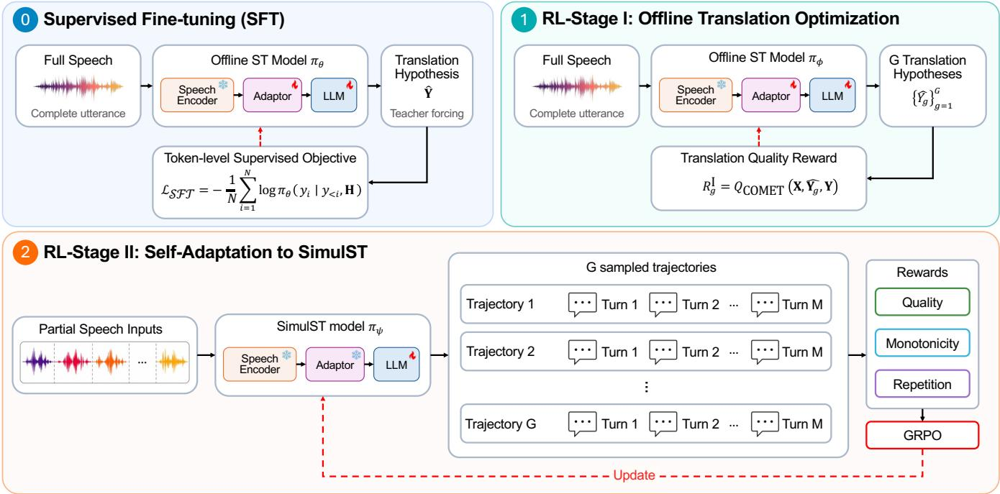
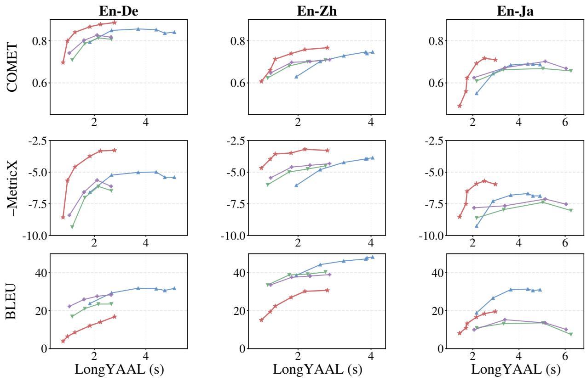
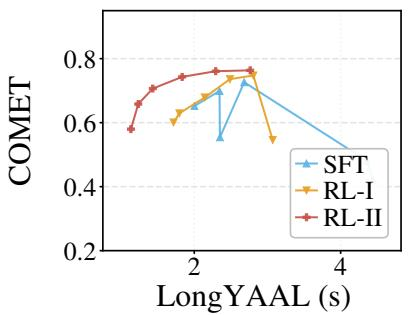
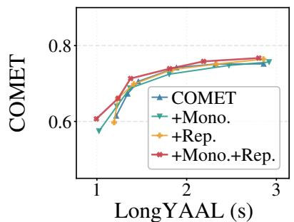
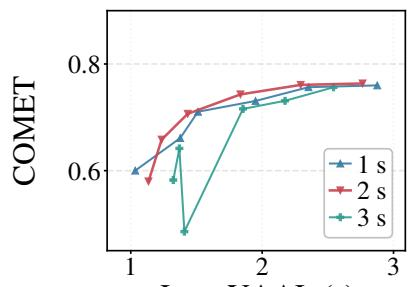
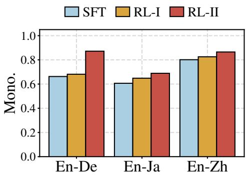

# SimPOTrans: Self-Adaptation for Ofline-to-Simultaneous Speech Translation via Reinforcement Learning

Haotian Tan, Hiroki Ouchi, Sakriani Sakti∗

Nara Institute of Science and Technology, Japan tan.haotian.tf5@naist.ac.jp, hiroki.ouchi@is.naist.jp, ssakti@is.naist.jp

## Abstract

Simultaneous speech translation (SimulST) aims to translate ongoing speech with low latency while preserving translation quality. Recent studies have adopted large language models (LLMs) for SimulST and formulated it as a multi-turn dialogue task for eficient generation, achieving state-of-the-art performance. However, existing dialogue-style SimulST approaches typically rely on specialized training schemes to acquire simultaneous translation behavior, either using synthesized read/write trajectories, which may provide suboptimal training signals, or jointly optimizing translation quality and latency, whose competing objectives may cause optimization instability. In this paper, we introduce SimPO-Trans, a reinforcement learning (RL) framework that enables ofline speech translation models to self-adapt to dialoguestyle SimulST. Through a simple two-stage RL post-training pipeline, SimPOTrans rewards an ofline model for exhibiting translation behaviors beneficial to simultaneous scenarios when given partial speech inputs, thereby enabling ofline-tosimultaneous self-adaptation without synthesized read/write trajectories or explicit latency optimization. At inference time, SimPOTrans requires no external decision policy and enables flexible quality–latency control by simply adjusting the chunk size of speech input. Experiments on the ACL 60/60 and MCIF benchmarks across three language directions (En→De, En→Zh, and En→Ja) demonstrate that SimPOTrans outperforms several strong baselines, achieving a superior quality– latency trade-of.

Code: https://github.com/Tan-ht/SimPOTrans Demo: https://tan-ht.github.io/naist-simulst-demo/

## Introduction

Simultaneous speech translation (SimulST) aims to mimic human interpreters by translating ongoing speech in real time. Unlike ofline speech translation (ST), which processes complete utterances, SimulST generates translations from partial speech input while balancing translation quality and latency with a read/write decision policy.

Earlier SimulST approaches rely on predefined decision policies, either learned through dedicated training strategies (Ma, Pino, and Koehn 2020; Zeng, Li, and Liu 2021) or applied to ofline-trained ST models at inference time (Ma et al. 2019; Liu, Spanakis, and Niehues 2020; Papi, Negri, and Turchi 2023; Papi, Turchi, and Negri 2023). They often require training multiple models for diferent latency regimes or depend heavily on handcrafted rules. Recent studies have shown that LLM-based translation backbones can substantially improve the quality-latency trade-of for SimulST (Ouyang et al. 2024; Tan et al. 2025; Koshkin, Sudoh, and Nakamura 2024; Yang et al. 2026; Tan, Ouchi, and Sakti 2026). In particular, LLM-based SimulST has been formulated as a multi-turn dialogue, with partial speech inputs as user prompts and incremental translations as assistant responses (Wang et al. 2025; Fu et al. 2026; Ouyang, Xu, and Li 2025b). This paradigm enables eficient generation through KV-cache reuse and allows models to learn read/write policies from synthesized trajectories. However, these methods rely on either potentially suboptimal synthesized trajectories or explicit joint optimization of quality and latency, whose competing objectives may cause optimization instability.

In this paper, we introduce SimPOTrans, a reinforcement learning (RL) framework that enables ofline speech translation models to self-adapt to dialogue-style SimulST through Group Relative Policy Optimization (GRPO) (Shao et al. 2024). Our intuition is that an ofline model may occasionally exhibit translation behaviors well suited to simultaneous scenarios when given partial speech inputs. By rewarding these spontaneously exhibited simultaneous behaviors, Sim-POTrans guides the ofline model to self-adapt to SimulST without requiring synthesized read/write trajectories or explicit latency optimization. Specifically, SimPOTrans applies a simple two-stage RL post-training pipeline to an ofline ST model using standard ofline speech translation data. The first stage strengthens the model’s overall translation capability on complete utterances. Building on this foundation, the second stage exposes the model to partial speech inputs in a multi-turn setting, enabling it to self-adapt from ofline to simultaneous translation. By learning from its self-generated dialogue-style trajectories, the model learns what content to translate and how to formulate it at each turn. Consequently, it acquires strong simultaneous translation capability without relying on synthesized read/write trajectories or explicit latency optimization. At inference time, SimPOTrans requires no external decision policy, and its quality-latency trade-of can be controlled simply by varying the chunk size of speech input. Our main contributions are summarized as follows:

• We introduce SimPOTrans, an RL framework that enables ofline ST models to self-adapt to SimulST by discovering and reinforcing efective simultaneous translation behavior through self-generated trajectories.

• We develop a simple two-stage RL post-training pipeline. It first strengthens the overall translation capability and then exposes the ofline ST model to partial speech inputs, allowing the model to learn what content to translate and how to translate at each turn without using synthesized data or an explicit latency objective.

• We show that SimPOTrans not only improves translation quality but also induces translation behavior better suited to simultaneous scenarios.

## Related Work

## Dialogue-Style SimulST

Dialogue-style LLM-based SimulST formulates simultaneous translation as a multi-turn dialogue task, where speech segments and incremental translations are interleaved as user prompts and assistant responses, respectively. Existing approaches typically require synthesized read/write trajectories for training. A read/write trajectory records the interleaved process as $\boldsymbol { \tau } = ( \mathbf { S } _ { 1 } , \mathbf { Y } _ { 1 } , \ldots , \mathbf { S } _ { M } ^ { \phantom { \dagger } } , \mathbf { Y } _ { M } )$ , with each $\mathbf { S } _ { m }$ denoting a speech segment read by the model and ${ \bf Y } _ { m }$ denoting the incremental translation written in response. InfiniSST (Ouyang, Xu, and Li 2025b) constructs such data from word alignments over ofline parallel data. EASiST (Fu et al. 2026) and CLASI (Cheng et al. 2024) instead prompt LLMs to synthesize the read/write trajectory. This paradigm enables eficient inference over unbounded speech input by reusing the key-value (KV) cache of LLMs across turns and has achieved state-of-the-art performance. However, trajectories synthesized using automatic alignment tools or LLMs may contain segmentation and alignment errors, resulting in suboptimal training signals. In contrast, SimPOTrans enables dialogue-style SimulST using only conventional ofline ST data, without any synthesized read/write trajectories.

## Reinforcement Learning for SimulST

Existing studies of reinforcement learning (RL) for machine translation have primarily focused on text translation (He et al. 2024; Ive et al. 2021; Xu et al. 2025; Yu et al. 2025), while only a few studies have applied RL to SimulST. CLASI (Cheng et al. 2024) conducts RL post-training on a supervised SimulST model using high-quality human interpretation data and a combination of process and outcome rewards. However, it sufers from optimization instability and reward hacking due to the dificulty of balancing these rewards. Hibiki-Zero (Labiausse et al. 2026) applies RL with intermediate BLEU rewards computed against time-indexed reference prefixes to optimize for the quality–latency tradeof. However, it requires temporal supervision constructed from coarsely synchronized target speech, source-side timestamps, and partial references. HPO (Ouyang et al. 2026)

follows InfiniSST (Ouyang, Xu, and Li 2025b) to build a dialogue-style SimulST backbone using synthesized training trajectories and then applies RL to jointly optimize translation quality and latency. Existing methods either require synthesized data, temporal supervision, or an explicit latency optimization objective. In contrast, SimPOTrans enables an ofline ST model to self-adapt to dialogue-style SimulST without requiring synthesized training data, temporal supervision, or explicit latency optimization.

## Ofline Models for SimulST

Earlier studies primarily utilized ofline-trained models for SimulST through inference-time decision policies. MoSST (Dong et al. 2022) applies CIF (Dong and Xu 2020) to identify word boundaries and enables SimulST using a test-time wait-k policy (Ma et al. 2019). Local Agreement (LA) (Liu, Spanakis, and Niehues 2020; Polák et al. 2022) commits only the hypotheses shared across two consecutive chunks, while EDAtt (Papi, Negri, and Turchi 2023) and AlignAtt (Papi, Turchi, and Negri 2023) use cross-attention information to discard unstable trailing outputs. These approaches allow a single ofline model to operate under diferent latency requirements without adapting the model itself. However, their performance depends heavily on the design of the inference-time policy, while the model is not explicitly trained to handle partial speech inputs. In contrast, SimPO-Trans adapts the model to learn what and how to translate from partial speech inputs. It performs SimulST through simple chunk-by-chunk generation and supports diferent latency regimes by varying the input chunk size.

## Proposed Method

As illustrated in Figure 1, SimPOTrans starts from a conventional ofline speech translation model and adapts it to dialogue-style SimulST through a two-stage RL-based policy optimization procedure. We first perform supervised fine-tuning (SFT) to establish ofline translation capability. RL-Stage I then improves sequence-level translation quality on complete utterances, while RL-Stage II exposes the model to partial speech inputs in a multi-turn setting and reinforces self-generated trajectories that are better suited to SimulST. We train SimPOTrans on a standard ofline speech translation dataset D. Each training example is a triplet (S, X, Y) ∈ D, where $\textbf { S } = ~ ( s _ { 1 } , \ldots , s _ { T } )$ is the source speech, $\mathbf { X } = \left( x _ { 1 } , \ldots , x _ { L } \right)$ is its source transcript, and $\mathbf { Y } = \left( y _ { 1 } , \dotsc , y _ { N } \right)$ is the reference translation.

## Supervised Fine-Tuning for Ofline Translation

Following recent LLM-based speech translation systems (Tan et al. 2025; Ouyang, Xu, and Li 2025b), we adopt a translation backbone πθ consisting of a speech encoder, an adaptor, and an LLM. Given the source speech S, the speech encoder $f _ { \mathrm { e n c } }$ extracts acoustic representations, which are projected by the adaptor $f _ { \mathrm { a d a } }$ into the embedding space of the LLM:

$$
\mathbf { H } = f _ { \mathrm { a d a } } \left( f _ { \mathrm { e n c } } ( \mathbf { S } ) \right) .\tag{1}
$$

The resulting speech representations are incorporated into the input prompt, and the LLM autoregressively generates a

  
Figure 1: Overview of the SimPOTrans training pipeline. (1) Stage 0: Ofline Translation Pretraining (SFT). SFT establishes the ofline translation capability of the LLM-based speech translation model. (2) Stage 1: Ofline Translation Optimization (RL). RL-Stage I uses GRPO with a translation-quality reward to further enhance ofline translation quality on complete utterances. (3) Stage 2: Ofline-to-Simultaneous Translation Adaptation (RL). RL-Stage II exposes the ofline-trained model to partial speech inputs in a multi-turn setting and optimizes it with quality and monotonicity rewards together with a repetition penalty, enabling the model to self-adapt to dialogue-style SimulST.

translation hypothesis $\hat { \mathbf { Y } } = ( \hat { y } _ { 1 } , \dots , \hat { y } _ { \hat { N } } )$ , where

$$
\hat { y } _ { i } \sim \pi _ { \boldsymbol \theta } \left( \cdot \mid \hat { y } _ { < i } , \mathbf { H } \right) .\tag{2}
$$

The model is optimized using the standard cross-entropy loss:

$$
\mathcal { L } _ { \mathrm { S F T } } = - \frac { 1 } { N } \sum _ { i = 1 } ^ { N } \log \pi _ { \theta } \left( y _ { i } \mid y _ { < i } , \mathbf { H } \right) .\tag{3}
$$

During SFT, the speech encoder remains frozen, while the adaptor is fully fine-tuned and the LLM is adapted using LoRA. The resulting model $\pi _ { \theta }$ provides the initialization for the subsequent RL post-training.

## Two-Stage Policy Optimization

Both RL stages employ GRPO for optimization. For each training example, the old policy $\pi _ { \omega _ { \mathrm { o l d } } }$ samples a group of G outputs $\{ \mathcal { O } _ { g } \} _ { g = 1 } ^ { \hat { G } }$ , where ω denotes the trainable parameters of the current stage. Given the stage-specific reward $R _ { g }$ for each output, its group-relative advantage is computed as

$$
A _ { g } = \frac { R _ { g } - \mathrm { m e a n } ( \{ R _ { j } \} _ { j = 1 } ^ { G } ) } { \mathrm { s t d } ( \{ R _ { j } \} _ { j = 1 } ^ { G } ) + \epsilon } ,\tag{4}
$$

where ϵ is a small constant for numerical stability. This sequence-level advantage is shared across all tokens in the corresponding output. Let $\mathrm { c l i p } _ { \varepsilon } ( x ) = \mathrm { c l i p } ( x , 1 - \varepsilon , 1 + \varepsilon )$

where ε controls the clipping range. For the t-th token of $\mathcal { O } _ { g }$ the per-token clipped surrogate term is defined as

$$
\ell _ { g , t } ( \omega ) = \operatorname* { m i n } \left\{ \frac { \pi _ { \omega } } { \pi _ { \omega _ { \mathrm { o l d } } } } A _ { g } , \mathrm { c l i p } _ { \varepsilon } \left( \frac { \pi _ { \omega } } { \pi _ { \omega _ { \mathrm { o l d } } } } \right) A _ { g } \right\} .\tag{5}
$$

where $\pi _ { \omega } / \pi _ { \omega _ { \mathrm { o l d } } }$ denotes the token-level importance sampling ratio. The GRPO training loss is then defined as:

$$
\mathcal { L } _ { \mathrm { G R P O } } ( \omega ) = - \frac { 1 } { G } \sum _ { g = 1 } ^ { G } \frac { 1 } { L _ { g } } \sum _ { t = 1 } ^ { L _ { g } } \ell _ { g , t } ( \omega ) .\tag{6}
$$

where $L _ { g }$ is the number of generated tokens in $\mathcal { O } _ { g }$

Stage I: Ofline Translation Optimization We further optimize the ofline translation capability before adapting it to simultaneous translation. We initialize $\pi _ { \phi }$ from the SFT model $\pi _ { \theta } , \mathrm { i . e . , } \phi  \theta$ . Given a complete source utterance S and its speech representations H, the old policy $\pi _ { \phi _ { \mathrm { o l d } } }$ samples G translation hypotheses:

$$
\hat { \mathbf Y } _ { g } \sim \pi _ { \phi _ { \mathrm { o l d } } } \left( \cdot \mid \mathbf H \right) , \qquad g = 1 , \ldots , G .\tag{7}
$$

We use COMET (Rei et al. 2020) as the translation quality reward:

$$
R _ { g } ^ { \mathrm { I } } = Q _ { \mathrm { C O M E T } } \left( \mathbf { X } , \hat { \mathbf { Y } } _ { g } , \mathbf { Y } \right) .\tag{8}
$$

Using $\{ R _ { g } ^ { \mathrm { I } } \} _ { g = 1 } ^ { G }$ , we compute the group-relative advantages according to Eq. (4) and optimize $\pi _ { \phi }$ using Eq. (6). During

RL-Stage I, the speech encoder remains frozen, while the adaptor and the LoRA parameters of the LLM are updated. The resulting model $\pi _ { \phi }$ provides the initialization for the subsequent RL-Stage II.

Stage II: Self-Adaptation to SimulST In Stage II, the ofline-optimized model self-adapts to SimulST by processing partial speech inputs and learning from its self-generated multi-turn translation trajectories. Specifically, we initialize the SimulST model $\pi _ { \psi }$ from $\pi _ { \phi } ,$ i.e., $\psi  \phi$ , and require the old policy $\pi _ { \psi _ { \mathrm { o l d } } }$ to operate in a multi-turn dialogue manner. For each source utterance S, we sample G translation trajectories. We first divide S into M fixed-duration chunks $\mathbf { S } _ { 1 } , \hdots , \mathbf { S } _ { M }$ . At turn $m$ of the multi-turn generation process, the speech encoder processes all currently available speech, $\mathbf { S } _ { \leq m }$ . From the resulting representations, we retain only those corresponding to the latest chunk $\mathbf { S } _ { m }$ and pass them through the adaptor:

$$
\mathbf { H } _ { m } = f _ { \mathrm { a d a } } \left( \mathrm { S l i c e } _ { m } \left[ f _ { \mathrm { e n c } } \left( \mathbf { S } _ { \leq m } \right) \right] \right) ,\tag{9}
$$

where $\mathrm { S l i c e } _ { m } [ \cdot ]$ selects the encoder frames corresponding to $\mathbf { S } _ { m } .$ . For the g-th trajectory, the LLM generates a translation segment at each turn conditioned on the interleaved speech representations and translation segments from the preceding turns:

$$
\hat { \mathbf { Y } } _ { g , m } \sim \pi _ { \psi _ { \mathrm { o l d } } } \left( \cdot \mid \mathbf { H } _ { 1 } , \hat { \mathbf { Y } } _ { g , 1 } , \hdots , \mathbf { H } _ { m - 1 } , \hat { \mathbf { Y } } _ { g , m - 1 } , \mathbf { H } _ { m } \right)\tag{10}
$$

After all M turns, the complete translation is obtained by concatenating all generated segments:

$$
\hat { \mathbf Y } _ { g } = \mathrm { C o n c a t } \left( \hat { \mathbf Y } _ { g , 1 } , \ldots , \hat { \mathbf Y } _ { g , M } \right) .\tag{11}
$$

Translation quality reward. We evaluate translation quality using the same COMET reward as in RL-Stage I:

$$
Q _ { g } = Q _ { \mathrm { C O M E T } } \left( \mathbf { X } , \hat { \mathbf { Y } } _ { g } , \mathbf { Y } \right) .\tag{12}
$$

The reward is computed on the complete translation rather than individual output segments. Therefore, no chunk-level references are required.

Monotonicity reward. Prior studies have shown that improving translation monotonicity correlates with improvements in both quality and latency in SimulST (Doi et al. 2024; Makinae et al. 2024). We therefore encourage the generated translation to follow an ordering consistent with the source. Following prior work (Makinae et al. 2024), we obtain word alignments between the source transcript X and the generated translation $\hat { \mathbf Y } _ { g }$ using Awesome-Align (Dou and Neubig 2021). Let $\mathbf { a } _ { g }$ and ${ \bf b } _ { g }$ denote the source and target positions of the aligned word pairs, respectively. We compute the monotonicity score using Spearman’s rank correlation coeficient and map it to the same [0, 1] scale as the quality reward:

$$
\mathcal { M } _ { g } = \frac { \rho _ { \mathrm { s p } } \left( \mathbf { a } _ { g } , \mathbf { b } _ { g } \right) + 1 } { 2 } .\tag{13}
$$

Only trajectories with a monotonicity score lower than $\kappa _ { \mathrm { m o n o } } = 0 . 9$ are penalized:

$$
R _ { g } ^ { \mathrm { m o n o } } = - \operatorname* { m a x } \left( 0 , \kappa _ { \mathrm { m o n o } } - \mathcal { M } _ { g } \right) .\tag{14}
$$

Repetition penalty. We empirically observe that repeating content from the preceding turn is the most frequent error during simultaneous adaptation. To suppress this behavior, we measure the n-gram overlap between each pair of adjacent output segments:

$$
o _ { g , m } = \frac { \left| \mathcal { N } _ { n } ( \hat { \mathbf { Y } } _ { g , m } ) \cap \mathcal { N } _ { n } ( \hat { \mathbf { Y } } _ { g , m - 1 } ) \right| } { \left| \mathcal { N } _ { n } ( \hat { \mathbf { Y } } _ { g , m } ) \right| } ,\tag{15}
$$

where $\textstyle { \mathcal { N } } _ { n } ( \cdot )$ denotes the set of n-grams extracted from an output segment. We set $o _ { g , m } = 0$ if either segment contains no n-grams. We compute the repetition penalty by averaging the excess overlap above a predefined threshold across all adjacent output pairs:

$$
P _ { g } ^ { \mathrm { r e p } } = \frac { 1 } { M - 1 } \sum _ { m = 2 } ^ { M } \mathrm { m a x } \left( 0 , o _ { g , m } - \kappa _ { \mathrm { r e p } } \right) ,\tag{16}
$$

where $\kappa _ { \mathrm { r e p } } = 0 . 6 5$ during training.

Overall training objective. The overall trajectory-level reward is defined as

$$
R _ { g } ^ { \mathrm { I I } } = Q _ { g } + \lambda _ { \mathrm { m o n o } } R _ { g } ^ { \mathrm { m o n o } } - \lambda _ { \mathrm { r e p } } P _ { g } ^ { \mathrm { r e p } } ,\tag{17}
$$

where $\lambda _ { \mathrm { m o n o } }$ and $\lambda _ { \mathrm { r e p } }$ control the contributions of the monotonicity reward and repetition penalty, respectively. This objective promotes translation quality and monotonicity while discouraging excessive repetition between adjacent turns. Using $\{ \breve { R } _ { g } ^ { \mathrm { I I } } \breve  \} _ { g = 1 } ^ { G } .$ , we compute the group-relative advantages according to Eq. (4) and optimize $\pi _ { \psi }$ using Eq. (6). During RL-Stage II, both the speech encoder and the adaptor remain frozen, and only the LoRA parameters of the LLM are updated.

## SimulST Inference for Unbounded Speech

At inference time, the incoming speech is divided into fixedduration chunks of $\delta$ seconds and translated in a dialoguestyle manner, with each chunk initiating a new generation turn. The quality–latency trade-of can be controlled by varying δ. To prevent the dialogue context from becoming excessively long, we periodically reset it based on the duration of the retained speech. Once the duration exceeds 20 seconds, the context is reset when the latest translation ends with sentence-ending punctuation. If adding the next chunk would extend the retained speech beyond 30 seconds before such punctuation is generated, the context is forcibly reset before processing that chunk.

## Experimental Setup

## Data

We train our models on the widely used CoVoST 2 (Wang et al. 2021) corpus. We consider three English-to-X directions: En→De, En→Zh, and En→Ja. Each contains approximately 430 hours of training speech. For evaluation, we use two long-form speech translation benchmarks derived from scientific presentations. ACL 60/60 (Salesky et al. 2023) consists of recordings of ACL 2022 talks paired with translations into multiple languages. We additionally evaluate on the MCIF development set (Papi et al. 2026), which contains long-form scientific talks and serves as the development data for the IWSLT 2026 simultaneous speech translation track (Adelani et al. 2026).

## Model Configuration

Our backbone comprises the Whisper-large-v3 encoder (Radford et al. 2023), a two-layer MLP adaptor, and Qwen3-8B (Yang et al. 2025), adapted with LoRA (Hu et al. 2022) of rank 16 and scale 32. We use AdamW with learning rates of $1 \times 1 0 ^ { - 4 } , 2 \times 1 0 ^ { - 6 }$ , and $5 \times 1 0 ^ { - 6 }$ for SFT, RL-Stage I, and RL-Stage II, respectively. All stages use weight decay 0.01 and $( \beta _ { 1 } , \beta _ { 2 } ) = ( 0 . 9 , 0 . 9 5 )$ ). In both RL stages, we sample with a temperature of 0.7 and $\mathrm { t o p } { - } p = 0 . 9 5$ and reuse each rollout batch for 10 epochs. We set the GRPO clipping parameter to 0.2, clip gradients at norm 1.0, and apply no KL regularization. Group sizes are 12 and 8 for RL-Stages I and II, respectively, with XCOMET-XL (Guerreiro et al. 2024) as the quality reward. RL-Stage II uses 2.0-second chunks and $\lambda _ { \mathrm { m o n o } } = 0 . 2 , \lambda _ { \mathrm { r e p } } = 0 . 0 5$

## Evaluation Metrics

Translation Quality We primarily evaluate translation quality using XCOMET-XL and MetricX-24 (Juraska et al. 2024). XCOMET-XL is a learned reference-based metric with scores ranging from 0 to 1, where higher is better. Since XCOMET-XL is also used as the quality reward during reinforcement learning, relying exclusively on it for evaluation may overestimate improvements resulting from direct optimization toward the reward model. We therefore include MetricX-24 as an independent, complementary metric. MetricX-24 is a learned translation evaluation metric that predicts an error score between 0 and 25, where lower is better. We also report BLEU (Papineni et al. 2002) to facilitate comparison with prior work.

Latency We report non-computation-aware (NCA) LongYAAL (Polák et al. 2025), which measures latency over continuous, unbounded speech while mitigating the segmentation bias of conventional average-lagging metrics.

## Baselines

We compare SimPOTrans with three representative LLMbased SimulST systems:

• SimulSense (Tan, Ouchi, and Sakti 2026) decouples read/write decisions from translation generation by using a separately trained decision module to trigger translation upon detecting a new interpreting unit, achieving a strong quality–latency trade-of.

• InfiniSST (Ouyang, Xu, and Li 2025b) formulates SimulST as a multi-turn dialogue task and trains the model using synthesized interleaved read/write trajectories. It achieved the best translation quality in the lowlatency track of IWSLT 2025 (Ouyang, Xu, and Li 2025a; Agostinelli et al. 2025).

• HPO (Ouyang et al. 2026) applies RL post-training to InfiniSST using hierarchical rewards that jointly optimize translation quality and latency, achieving state-of-the-art performance.

These baselines represent three major directions in recent LLM-based SimulST: dedicated decision modules, dialoguestyle trajectory supervision, and RL-based joint optimization of quality and latency. For controlled comparison, we reproduce all three systems using the same training data and LLM backbone as SimPOTrans.

We additionally compare SimPOTrans with low-latency results from four systems submitted to the IWSLT 2026 Simultaneous Speech Translation Track (Adelani et al. 2026): NeMo (Grigoryan et al. 2026), CUHKSZ (Yang and Nakamura 2026), PINCH-AST (Bentes and Safka 2026), and CUNI-POCKET (Ortega and Macháček 2026). These results satisfy the oficial low-latency criterion of at most 2 seconds and provide a reference for comparison with recent shared-task systems, although they do not constitute controlled comparisons.

## Main Results

## SimPOTrans Achieves Superior Quality–Latency Trade-ofs

Figure 2 compares the quality–latency trade-ofs across three language directions and three quality metrics on ACL 60/60. SimPOTrans consistently outperforms all baselines in terms of both COMET and MetricX-24 across diferent latency regimes. BLEU exhibits a diferent trend, and we discuss this discrepancy in a later analysis.

## SimPOTrans Delivers Strong Low-Latency Performance without Additional Context

Table 1 compares SimPOTrans with systems submitted to the IWSLT 2026 Simultaneous Speech Translation Track on the MCIF development set. We focus on the low-latency regime, in which all systems operate at a LongYAAL of at most two seconds. For En→De, SimPOTrans achieves a COMET score of 0.87 with a LongYAAL of 1.6 seconds, outperforming all systems except NeMo, a cascaded system that incorporates additional context extracted from PDF documents. For En→Zh, SimPOTrans achieves the highest COMET score of 0.76 while maintaining a LongYAAL of 1.7 seconds. These results demonstrate that SimPOTrans delivers strong low-latency translation performance without relying on any additional contextual information.

## SimPOTrans Induces Translation Behavior Better Suited to SimulST

Figure 2 reveals a discrepancy between semantic metrics and the n-gram-based lexical-overlap metric BLEU: Sim-POTrans performs better on COMET and MetricX but substantially worse on BLEU. A similar discrepancy is reported by HPO (Ouyang et al. 2026), which attributes it to potential reward hacking. Instead, our analysis suggests that the oflineto-simultaneous self-adaptation of SimPOTrans encourages the model to preserve the source meaning while expressing it in a more monotonic manner better suited to simultaneous translation. Such reformulation may deviate from the wording and word order of the reference, resulting in lower n-gram overlap and consequently lower BLEU scores.

  
SimulSense InfiniSST HPO Proposed SimPOTrans

Figure 2: Comparison of quality–latency trade-ofs on the ACL 60/60 benchmark for En→De, En→Zh, and En→Ja. Rows report COMET, MetricX-24, and BLEU, respectively, with latency measured by LongYAAL. MetricX-24 scores are negated so that higher values consistently indicate better translation quality across all metrics. The SimPOTrans curves are obtained using chunk sizes of {1.0, 1.5, 2.0, 3.0, 4.0, 5.0} seconds.
<table><tr><td>Lang.</td><td>System</td><td>COMET</td><td>LongYAAL</td><td>PDF</td></tr><tr><td rowspan="4">En→De</td><td>NeMo*</td><td>0.93</td><td>2.0</td><td>V</td></tr><tr><td>CUHKSZ</td><td>0.85</td><td>1.5</td><td>√</td></tr><tr><td>PINCH-AST*</td><td>0.84</td><td>1.8</td><td>X</td></tr><tr><td>CUNI-POCKET Ours</td><td>0.77 0.87</td><td>1.7 1.6</td><td>X X</td></tr><tr><td rowspan="4">En→Zh</td><td>CUHKSZ</td><td>0.74</td><td>1.5</td><td></td></tr><tr><td>PINCH-AST*</td><td>0.72</td><td>1.8</td><td>√</td></tr><tr><td>Ours</td><td></td><td></td><td>X</td></tr><tr><td></td><td>0.76</td><td>1.7</td><td>X</td></tr></table>

Table 1: Comparison with IWSLT 2026 Simultaneous Track systems on the MCIF development set in the low-latency regime (≤ 2 s). LongYAAL is reported in seconds. Asterisks indicate cascaded systems. PDF indicates whether PDFderived extra context is used.

Figure 4 compares translation monotonicity across the three training stages of SimPOTrans in the simultaneous setting. Monotonicity consistently increases across all three language directions, showing that the resulting translations more closely follow the source order. The En→Zh example in Figure 5 provides a concrete illustration. The ofline model produces a translation that closely follows the reference order and achieves a BLEU score of 54.2, despite requiring substantial reordering relative to the source transcript. In contrast, SimPOTrans conveys the core meaning in a more monotonic manner, but receives a substantially lower BLEU score of 30.8. This decrease reflects the reduced ngram overlap caused by changes in wording and word order, illustrating how BLEU may penalize reformulations that are better suited to simultaneous translation.

## Ablation Study

## Efect of Simultaneous Adaptation

Figure 3(a) compares the quality–latency trade-ofs across checkpoints after SFT, RL-Stage I, and RL-Stage II. After simultaneous adaptation in RL-Stage II, increasing the chunk size leads to consistent improvements in translation quality alongside increasing latency, forming a smooth quality– latency curve. This enables flexible control of the operating point simply by varying the chunk size. In contrast, the SFT

Source: But actually this direction is still quite popular because of the transformer model.   
Target: 但 实际上， 由于变压器模型， 这个⽅向 仍然 很受欢迎  
Figure 5: An En→Zh example comparing translation behaviors before and after ofline-to-simultaneous self-adaptation. Colored spans and connecting lines indicate source–target alignments. The ofline model largely follows the reference word order, which involves substantial reordering relative to the source. In contrast, SimPOTrans conveys the core meaning in an order closer to the source, producing a more monotonic translation better suited to simultaneous generation.

  
(a)

  
(b)

  
LongYAAL (s)  
(c)

Figure 3: Ablation studies. (a) Comparison of quality–latency trade-ofs across diferent training stages. (b) Efects of the monotonicity reward (Mono.) and repetition penalty (Rep.) in RL-Stage II. (c) Efect of the speech chunk size in RL-Stage II.  
  
Figure 4: Monotonicity across SimPOTrans training stages under simultaneous inference with a fixed chunk size of 1.5 seconds.

Source: But actually this direction is still quite popular because of the transformer model.  
Target: 但 因为 转换器模型 的原因， 实际上 这个⽅向 仍然 很受欢迎。

and RL-Stage I models produce irregular curves and perform poorly on partial speech inputs. These results demonstrate that RL-Stage II is essential for adapting the ofline model to simultaneous translation.

## Efect of Auxiliary Rewards

Figure 3(b) evaluates the auxiliary terms in RL-Stage II. The monotonicity reward yields mixed quality gains, while the repetition penalty provides more consistent improvements. Combining both achieves the best overall quality–latency trade-ofs, showing their complementary efects in promoting monotonic generation and reducing repetition.

## Efect of Chunk Size in RL-Stage II

Figure 3(c) compares the fixed chunk sizes used in RL-Stage II. Training with 2-second chunks achieves the best overall quality–latency trade-ofs, while 1-second chunks provide insuficient context and 3-second chunks perform poorly at low latency. We therefore use a 2-second chunk size for RL-Stage II.

## Limitations

Although SimPOTrans demonstrates superior quality– latency trade-ofs over several strong baselines, it currently processes speech using fixed-duration chunks, which may split semantically or acoustically coherent units. Future work could explore boundary-aware chunking strategies. In addi tion, our evaluation focuses solely on speech-to-text translation. Future work could extend SimPOTrans to speech-tospeech translation.

## Conclusion

In this work, we introduced SimPOTrans, a two-stage RL post-training framework that enables ofline speech translation models to self-adapt to dialogue-style SimulST. Sim-POTrans first improves translation quality on complete utterances and then learns to handle partial speech inputs through self-generated multi-turn trajectories, eliminating the need for synthesized data and explicit latency optimization. Experiments on ACL 60/60 and MCIF across three language directions demonstrate superior quality–latency trade-ofs over strong LLM-based baselines. Further analyses show that SimPOTrans induces translation behavior better suited to simultaneous scenarios.

## References

Adelani, D. I.; Agostinelli, V.; Anastasopoulos, A.; Bentivogli, L.; Bojar, O.; Bratières, S.; Carpuat, M.; Carraro, F.; Cattoni, R.; Cettolo, M.; et al. 2026. Speech Translation and Metrics in 2026: Findings of the IWSLT Campaign. In Proceedings ofthe 23rd International Conference on Spoken Language Translation (IWSLT 2026), 336–422.

Agostinelli, V.; Alumäe, T.; Anastasopoulos, A.; Bentivogli, L.; Bojar, O.; Borg, C.; Bougares, F.; Cattoni, R.; Cettolo, M.; Chen, L.; et al. 2025. Findings of the IWSLT 2025 evaluation campaign. In Proceedings of the 22nd International Conference on Spoken Language Translation (IWSLT 2025), 412–481.

Bentes, C.; and Safka, C. 2026. Pinch-AST: Robust Cascaded Speech Translation System for the IWSLT 2026 Simultaneous Speech Translation Task. In Proceedings of the 23rd International Conference on Spoken Language Translation (IWSLT 2026), 268–271.

Cheng, S.; Huang, Z.; Ko, T.; Li, H.; Peng, N.; Xu, L.; and Zhang, Q. 2024. Towards achieving human parity on endto-end simultaneous speech translation via llm agent. arXiv preprint arXiv:2407.21646.

Doi, K.; Ko, Y.; Makinae, M.; Sudoh, K.; and Nakamura, S. 2024. Word Order in English-Japanese Simultaneous Interpretation: Analyses and Evaluation using Chunk-wise Monotonic Translation. In The 21st International Conference on Spoken Language Translation, 302.

Dong, L.; and Xu, B. 2020. CIF: Continuous Integrate-And-Fire for End-To-End Speech Recognition. In ICASSP 2020 - 2020 IEEE International Conference on Acoustics, Speech and Signal Processing (ICASSP), 6079–6083.

Dong, Q.; Zhu, Y.; Wang, M.; and Li, L. 2022. Learning when to translate for streaming speech. In Proceedings ofthe 60th Annual Meeting of the Association for Computational Linguistics (Volume 1: Long Papers), 680–694.

Dou, Z.-Y.; and Neubig, G. 2021. Word Alignment by Finetuning Embeddings on Parallel Corpora. In Conference of the European Chapter ofthe Associationfor Computational Linguistics (EACL).

Fu, B.; Yu, D.; Liao, M.; Li, C.; Chen, X.; Chen, Y.; Fan, K.; and Shi, X. 2026. Eficient and adaptive simultaneous speech translation with fully unidirectional architecture. In Proceedings of the AAAI Conference on Artificial Intelligence, 30735–30743.

Grigoryan, L.; Bataev, V.; Andrusenko, A.; Hrinchuk, O.; Karamyan, D.; Albasiri, E.; Lavrukhin, V.; Karpov, N.; and Ginsburg, B. 2026. NeMo@ IWSLT 2026: Cascaded System for Simultaneous Speech Translation. In Proceedings of the 23rd International Conference on Spoken Language Translation (IWSLT 2026), 204–211.

Guerreiro, N. M.; Rei, R.; van Stigt, D.; Coheur, L.; Colombo, P.; and Martins, A. F. T. 2024. xCOMET: Transparent Ma-

chine Translation Evaluation through Fine-grained Error Detection. Transactions of the Association for Computational Linguistics, 12: 979–995.

He, Z.; Wang, X.; Jiao, W.; Zhang, Z.; Wang, R.; Shi, S.; and Tu, Z. 2024. Improving machine translation with human feedback: An exploration of quality estimation as a reward model. In Proceedings of the 2024 Conference of the North American Chapter ofthe Associationfor Computational Linguistics: Human Language Technologies (Volume 1: Long Papers), 8164–8180.

Hu, E. J.; Shen, Y.; Wallis, P.; Allen-Zhu, Z.; Li, Y.; Wang, S.; Wang, L.; Chen, W.; et al. 2022. Lora: Low-rank adaptation of large language models. ICLR, 1(2): 3.

Ive, J.; Li, A. M.; Miao, Y.; Caglayan, O.; Madhyastha, P.; and Specia, L. 2021. Exploiting Multimodal Reinforcement Learning for Simultaneous Machine Translation. In Proceedings of the 16th Conference of the European Chapter of the Association for Computational Linguistics: Main Volume, 3222–3233. Online: Association for Computational Linguistics.

Juraska, J.; Deutsch, D.; Finkelstein, M.; and Freitag, M. 2024. MetricX-24: The Google submission to the WMT 2024 metrics shared task. In Proceedings of the Ninth Conference on Machine Translation, 492–504.

Koshkin, R.; Sudoh, K.; and Nakamura, S. 2024. Transllama: Llm-based simultaneous translation system. In Findings of the Association for Computational Linguistics: EMNLP 2024, 461–476.

Labiausse, T.; Fabre, R.; Estève, Y.; Défossez, A.; and Zeghidour, N. 2026. Simultaneous speech-to-speech translation without aligned data. arXiv preprint arXiv:2602.11072.

Liu, D.; Spanakis, G.; and Niehues, J. 2020. Low-Latency Sequence-to-Sequence Speech Recognition and Translation by Partial Hypothesis Selection. In Proc. Interspeech, 3620– 3624.

Ma, M.; Huang, L.; Xiong, H.; Zheng, R.; Liu, K.; Zheng, B.; Zhang, C.; He, Z.; Liu, H.; Li, X.; et al. 2019. STACL: Simultaneous translation with implicit anticipation and controllable latency using prefix-to-prefix framework. In Proceedings of the 57th Annual Meeting of the Association for Computational Linguistics, 3025–3036.

Ma, X.; Pino, J.; and Koehn, P. 2020. SimulMT to SimulST: Adapting simultaneous text translation to end-to-end simultaneous speech translation. In Proceedings of the 1st Conference of the Asia-Pacific Chapter of the Association for Computational Linguistics and the 10th International Joint Conference on Natural Language Processing, 582–587.

Makinae, M.; Sakai, Y.; Kamigaito, H.; and Watanabe, T. 2024. Simul-MuST-C: Simultaneous Multilingual Speech Translation Corpus Using Large Language Model. In Proceedings of the 2024 Conference on Empirical Methods in Natural Language Processing, 22185–22205. Miami, Florida, USA: Association for Computational Linguistics.

Ortega, A. S.; and Macháček, D. 2026. A Pocket Ofline Model for Simultaneous Speech Translation as CUNI Submission to IWSLT 2026. In Proceedings ofthe 23rd Interna-

tional Conference on Spoken Language Translation (IWSLT 2026), 197–203.

Ouyang, S.; Ding, S.; Hrinchuk, O.; Lavrukhin, V.; Yan, B.; Ginsburg, B.; and Li, L. 2026. Hierarchical Policy Optimization for Simultaneous Translation of Unbounded Speech. In Proceedings of the 64th Annual Meeting of the Association for Computational Linguistics (Volume 1: Long Papers), 1772–1787.

Ouyang, S.; Xu, X.; Dandekar, C.; and Li, L. 2024. Fasst: Fast llm-based simultaneous speech translation. arXiv preprint arXiv:2408.09430.

Ouyang, S.; Xu, X.; and Li, L. 2025a. Cmu’s iwslt 2025 simultaneous speech translation system. In Proceedings ofthe 22nd International Conference on Spoken Language Translation (IWSLT 2025), 309–314.

Ouyang, S.; Xu, X.; and Li, L. 2025b. InfiniSST: Simultaneous Translation of Unbounded Speech with Large Language Model. In Findings oftheAssociationfor Computational Linguistics: ACL 2025, 3032–3046. ISBN 979-8-89176-256-5.

Papi, S.; Negri, M.; and Turchi, M. 2023. Attention as a Guide for Simultaneous Speech Translation. In Proceedings ofthe 61st Annual Meeting ofthe Associationfor Computational Linguistics (Volume 1: Long Papers), 13340–13356. Toronto, Canada: Association for Computational Linguistics.

Papi, S.; Turchi, M.; and Negri, M. 2023. AlignAtt: Using Attention-based Audio-Translation Alignments as a Guide for Simultaneous Speech Translation. In Proc. INTER-SPEECH, 3974–3978.

Papi, S.; Züfle, M.; Gaido, M.; Savoldi, B.; Liu, D.; Douros, I.; Bentivogli, L.; and Niehues, J. 2026. MCIF: Multimodal Crosslingual Instruction-Following Benchmark from Scientific Talks. In The Fourteenth International Conference on Learning Representations.

Papineni, K.; Roukos, S.; Ward, T.; and Zhu, W.-J. 2002. BLEU: A Method for Automatic Evaluation of Machine Translation. In Proceedings of the 40th Annual Meeting ofthe Associationfor Computational Linguistics, 311–318.

Polák, P.; Papi, S.; Bentivogli, L.; and Bojar, O. 2025. Better Late Than Never: Evaluation of Latency Metrics for Simultaneous Speech-to-Text Translation. arXiv preprint arXiv:2509.17349.

Polák, P.; Pham, N.-Q.; Nguyen, T. N.; Liu, D.; Mullov, C.; Niehues, J.; Bojar, O.; and Waibel, A. 2022. CUNI-KIT System for Simultaneous Speech Translation Task at IWSLT 2022. In Proceedings of the 19th International Conference on Spoken Language Translation, 277–285.

Radford, A.; Kim, J. W.; Xu, T.; Brockman, G.; McLeavey, C.; and Sutskever, I. 2023. Robust speech recognition via large-scale weak supervision. In International conference on machine learning, 28492–28518. PMLR.

Rei, R.; Stewart, C.; Farinha, A. C.; and Lavie, A. 2020. COMET: A neural framework for MT evaluation. In Proceedings of the 2020 conference on empirical methods in natural language processing (emnlp), 2685–2702.

Salesky, E.; Darwish, K.; Al-Badrashiny, M.; Diab, M.; and Niehues, J. 2023. Evaluating multilingual speech translation

under realistic conditions with resegmentation and terminology. In Proceedings of the 20th International Conference on Spoken Language Translation (IWSLT 2023), 62–78.

Shao, Z.; Wang, P.; Zhu, Q.; Xu, R.; Song, J.; Bi, X.; Zhang, H.; Zhang, M.; Li, Y.; Wu, Y.; et al. 2024. Deepseekmath: Pushing the limits of mathematical reasoning in open language models. arXiv preprint arXiv:2402.03300.

Tan, H.; Ouchi, H.; and Sakti, S. 2026. SimulSense: Sense-Driven Interpreting for Eficient Simultaneous Speech Translation. In ICASSP 2026 - 2026 IEEE International Conference on Acoustics, Speech and Signal Processing (ICASSP), 19437–19441.

Tan, H.; Widiaputri, R. F.; Saragih, J. M.; Ko, Y.; Sudoh, K.; Nakamura, S.; and Sakti, S. 2025. NAIST simultaneous speech translation system for IWSLT 2025. In Proceedings of the 22nd International Conference on Spoken Language Translation (IWSLT 2025), 369–378.

Wang, C.; Wu, A.; Gu, J.; and Pino, J. 2021. CoVoST 2 and massively multilingual speech translation. In Interspeech, volume 2021, 2247–2251.

Wang, M.; Vu, T.; Wang, Y.; Shareghi, E.; and Hafari, G. 2025. Conversational simulmt: Eficient simultaneous translation with large language models. In Proceedings of the 22nd International Conference on Spoken Language Translation (IWSLT 2025), 93–105.

Xu, T.; Huang, Z.; Sun, J.; Cheng, S.; and Lam, W. 2025. SeqPO-SiMT: Sequential Policy Optimization for Simultaneous Machine Translation. In Findings of the Association for Computational Linguistics:ACL 2025, 16107–16123. Vienna, Austria: Association for Computational Linguistics.

Yang, A.; Li, A.; Yang, B.; Zhang, B.; Hui, B.; Zheng, B.; Yu, B.; Gao, C.; Huang, C.; Lv, C.; et al. 2025. Qwen3 technical report. arXiv preprint arXiv:2505.09388.

Yang, Z.; and Nakamura, S. 2026. CUHKSZ Simultaneous Speech Translation System for IWSLT 2026. In Proceedings of the 23rd International Conference on Spoken Language Translation (IWSLT 2026), 111–118.

Yang, Z.; Wei, L.; Koshkin, R.; Chen, X.; and Nakamura, S. 2026. SASST: Leveraging Syntax-Aware Chunking and LLMs for Simultaneous Speech Translation. In Proceedings of the AAAI Conference on Artificial Intelligence, 34358– 34367.

Yu, D.; Zhao, Y.; Zhu, J.; Xu, Y.; Zhou, Y.; and Zong, C. 2025. SimulPL: Aligning human preferences in simultaneous machine translation. arXiv preprint arXiv:2502.00634.

Zeng, X.; Li, L.; and Liu, Q. 2021. RealTranS: End-to-end simultaneous speech translation with convolutional weightedshrinking transformer. In Findings of the Association for Computational Linguistics: ACL-IJCNLP 2021, 2461–2474.