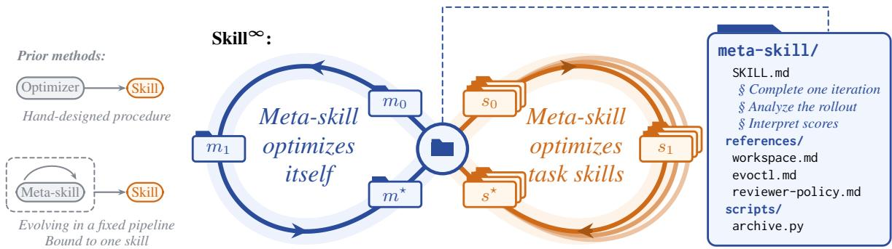
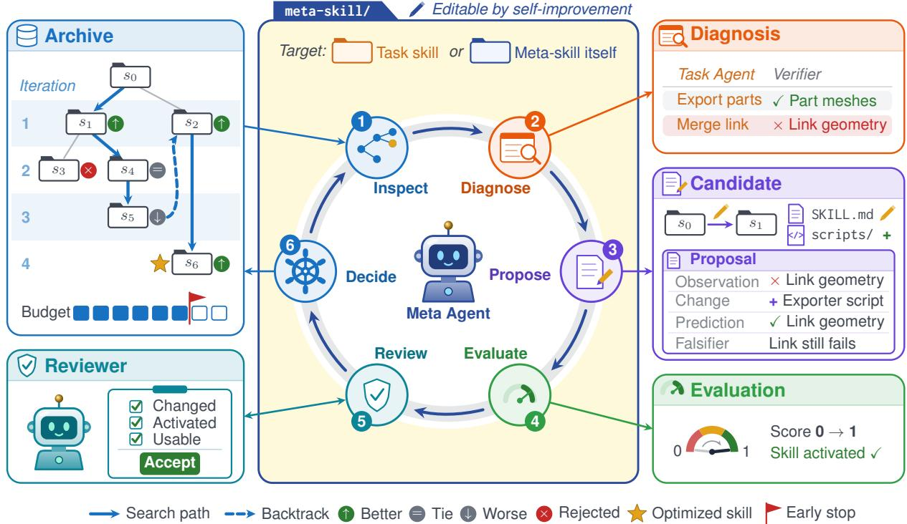
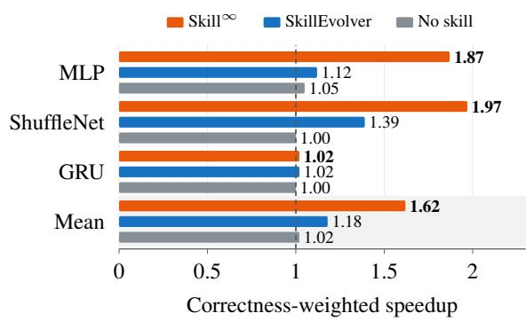
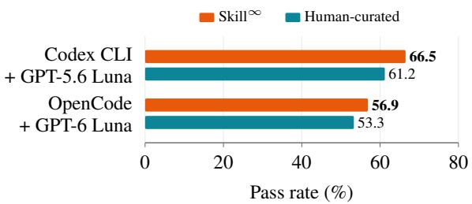
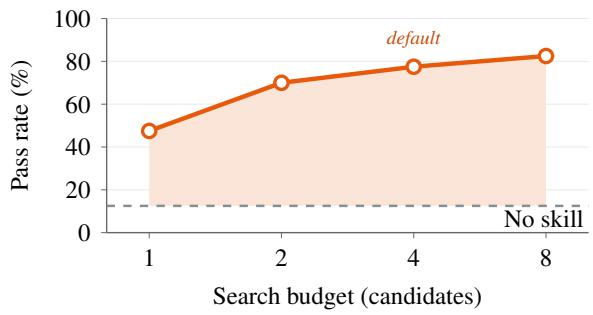

# Skill<sup>∞</sup>: Recursive Self-Improvement for Agent Skill Optimization

Wangcheng Tao National University of Singapore taowangcheng@u.nus.edu

Han Wu\* City University of Hong Kong hanwu.cs@my.cityu.edu.hk

Zhanglu Yan National University of Singapore zlyan@nus.edu.sg

Weng-Fai Wong National University of Singapore wongwf@nus.edu.sg

## Abstract

Recursive self-improvement (RSI), in which a system also improves the way it improves, is a long-standing aspiration on the path to AGI. Language agents increasingly store procedural knowledge in reusable skills. Optimizing skills offers a direct way to achieve RSI, because the optimization procedure itself can be encoded as a skill. Existing skill optimizers, however, follow a hand-designed procedure. Even methods that evolve a meta-skill confine it to a fixed pipeline and relearn it for each task. We present Skill<sup>∞</sup>, which makes skill optimization recursively self-improving: a meta agent follows a meta-skill to optimize task skills and optimizes the meta-skill itself using the same procedure. The optimization is agent-led. The meta agent diagnoses execution traces, proposes candidates, requests indepen dent reviews, and allocates the search budget. The meta-skill defines these steps, allowing self-improvement to rewrite them. This metaskill is also decoupled from task skills, refined on multiple skill optimization tasks and then reused to optimize task skills across diverse domains. As in deployment, skills at both levels are standard packages loaded through native skill discovery. On 83 SkillsBench tasks, Skill<sup>∞</sup> reaches a pass rate of 60.7%, compared with 56.4% for human-curated skills and 54.5% for SkillEvolver.

## 1 Introduction

Recursive self-improvement (RSI) refers to a system that improves not only its performance on tasks but also the procedure that produces these improvements (Yudkowsky, 2007; Chen et al., 2026). Because each gain can then accelerate the next, RSI has figured prominently in visions of artificial general intelligence (AGI), from the intelligence explosion envisioned by Good (1966)

to Gödel machines (Schmidhuber, 2003). More recently, skills have emerged as a common format for capturing the reusable procedural knowledge of language agents (Anthropic, 2025b). This format can also encode the procedure that optimizes skills. Skills can thus encode both the target of improvement and the procedure that improves it, making skill optimization a direct and interpretable way to achieve RSI. Skills also serve as a harness-agnostic medium for RSI, since Claude Code (Anthropic, 2025a), Codex (OpenAI, 2025), and OpenCode (Anomaly, 2025) all load them through the same open specification (Agent Skills, 2025). To realize this potential, skill optimization must improve not only skills but also the procedure that optimizes them.

Recent approaches such as SkillOpt (Yang et al., 2026), CoEvoSkills (Zhang et al., 2026b), and SkillEvolver (Zhang et al., 2026a) already optimize skills from execution feedback. Despite differences in what they edit and how they verify candidates, these methods share one design choice. The optimizer follows a hand-designed procedure, and what it learns while optimizing one skill does not transfer to the next. MetaSkill-Evolve (Wang et al., 2026b) goes a step further: each search branch carries a meta-skill that configures the five agents of its pipeline, and the same pipeline refines this meta-skill. However, the pipeline’s roles and wiring remain fixed, and each meta-skill is bound to the task skill it evolves with. Some methods also optimize skills in a setting that differs from deployment (Yang et al., 2026; Zhang et al., 2026b). They inject the skill or prompt the agent to load it, so optimization never tests whether the agent would load the skill on its own.

We believe that an optimizer that improves skills but not its own procedure will eventually stagnate. RSI targets exactly this limitation. In this work, we propose Skill<sup>∞</sup>, a framework for recursively selfimproving skill optimization. A meta agent follows a meta-skill to optimize task skills and applies the same procedure to the meta-skill itself. The “∞” in Skill<sup>∞</sup> stands for two loops that meet at the meta-skill and feed into each other, as illustrated in Figure 1. Optimization in Skill<sup>∞</sup> is agent-led: in each iteration, the meta agent diagnoses the parent skill from execution traces, proposes and evaluates candidates within the search budget, submits each candidate to an independent reviewer, and selects the next parent. Self-improvement of the meta-skill refines this procedure, which in turn optimizes task skills more effectively. We further decouple the meta-skill from task skills. The meta-skill is refined on a set of skill optimization tasks and then reused to optimize diverse task skills. This decoupling amortizes the cost of self-improvement over task skill optimization. Skills at both levels are also provided to agents through native skill discovery, as in deployment. We neither inject a skill nor prompt an agent to load one. Agents see only a skill’s name and description and decide whether to load it. The description is therefore also included in the scope of optimization.

  
Figure 1: Recursively self-improving skill optimization. Left: most skill optimizers follow a hand-designed procedure. Methods that evolve a meta-skill keep it inside a fixed pipeline and bound to the task skill it evolves with. Center: the ∞ shape shows the two loops of Skill<sup>∞</sup>, which meet at the meta-skill. In the left loop, the meta-skill optimizes itself on a set of skill optimization tasks, improving from $m _ { 0 }$ to $m ^ { \star }$ . In each stacked loop on the right, the refined meta-skill is reused to optimize one task skill from $s _ { 0 }$ to $s ^ { \star }$ . Right: the meta-skill at the crossing is a standard skill package loaded through native skill discovery, like any other skill. Each of its parts, from instructions to scripts, falls within the scope of self-improvement.

We evaluate Skill<sup>∞</sup> on 83 agentic tasks from SkillsBench (Li et al., 2026a), spanning eight domains, and on GPU kernel optimization from KernelBench (Ouyang et al., 2025). In the main comparison, all methods share the Codex CLI (OpenAI, 2025) as the harness and GPT-6 Luna (OpenAI, 2026b) as the backbone model. On SkillsBench, Skill<sup>∞</sup> reaches a pass rate of 60.7%, compared with 56.4% for human-curated skills and 54.5% for SkillEvolver, and on KernelBench it reaches a mean speedup of 1.62. Without the selfimprovement of the meta-skill, the pass rate falls to 55.9%. Skill<sup>∞</sup> still outperforms human-curated skills when the backbone model or the harness is replaced. Case studies in Appendix C show that self-improvement changes how the meta agent acts, not only the wording of its instructions.

## 2 Related Work

Recursive Self-Improvement The idea of RSI dates back to the argument for an intelligence explosion (Good, 1966). Gödel machines (Schmidhuber, 2003) later formalized it as a program that rewrites its own code once a rewrite is proven useful. Long a vision of AGI, RSI has since been partly realized in agents built on language models. STOP (Zelikman et al., 2024) runs a code-improving scaffold on its own code but notes that this is not full RSI, because the language model itself is not altered. Research on selfevolving agents (Gao et al., 2026) has introduced systems that rewrite their own logic or code (Yin et al., 2025; Zhang et al., 2026c; Wang et al., 2026a) or search over agent designs (Hu et al., 2025). More recent systems make the meta-level modification procedure itself editable (Zhang et al., 2026d) or compose data, harness, and model updates (Tan et al., 2026). $\mathtt { R } ^ { 2 }$ Flow (Zhang et al., 2026e) trains a policy that orchestrates a skill library and commits verified edits to it. These systems implement the optimizer as a program or a trained policy. Skill<sup>∞</sup>, however, encodes the optimizer’s procedure as a skill, which makes its recursive self-improvement direct, interpretable, and harness-agnostic.

Agent Skills and Skill Optimization Agent skills package reusable procedures as portable directories that agents load on demand (Anthropic, 2025b; Agent Skills, 2025; Xu and Yan, 2026). This format has precedents in skill libraries, induced workflows, and programmatic web skills (Wang et al., 2024, 2025b,a; Zheng et al., 2025). A growing line of work learns skills from experience (Ni et al., 2026; Xia et al., 2026) or optimizes them from execution feedback (Alzubi et al., 2026; Yang et al., 2026; Lin et al., 2026b; Tian et al., 2026; Zhang et al., 2026b; Feng et al., 2026). SkillEvolver (Zhang et al., 2026a) writes its optimization procedure as a fixed meta-skill that audits candidate skills in separate agents. Some methods go further and operate at the meta level, evolving meta-skills that guide skill optimization (Wang et al., 2026b; Li et al., 2026b), multiagent system design (Lin et al., 2026a), or context engineering (Ye et al., 2026). These methods still evolve the meta-skill with a hand-designed procedure. MetaSkill-Evolve (Wang et al., 2026b), for instance, fixes the roles and wiring of its fiveagent pipeline and binds each meta-skill to the task skill it evolves with. Skill<sup>∞</sup> instead writes an agentled optimization procedure into the meta-skill and refines it through self-improvement on several skill optimization tasks. Decoupled from task skills, the same meta-skill then optimizes diverse task skills.

Prompt and Context Optimization Skill optimization builds on prompt optimization. Early methods select instructions that a language model proposes (Zhou et al., 2023; Yang et al., 2024) or evolve populations of prompts (Guo et al., 2024; Fernando et al., 2024). Subsequent methods optimize compound systems of model calls (Yuksekgonul et al., 2025; Khattab et al., 2024; Agrawal et al., 2026), accumulate strategies in evolving contexts (Suzgun et al., 2026; Zhang et al., 2026f), or meta-learn system prompts that transfer across tasks (Choi et al., 2025; Tao et al., 2026). These methods optimize text that the surrounding system inserts into the model’s context. By contrast, Skill<sup>∞</sup> optimizes skills, which bundle executable scripts and reference files, are loaded only when the agent judges them useful, and can even package the procedure that optimizes them.

## 3 Method

We first formalize skills, native skill discovery, and task skill optimization by a meta-skill. We then make the meta-skill an optimization target in its own right, so that a single agent-led procedure optimizes task skills and the meta-skill alike. Finally, we decouple the meta-skill from task skills and extend native skill discovery to both levels.

## 3.1 Preliminaries

Skill Packages and Native Skill Discovery We adopt the Agent Skills specification (Agent Skills, 2025), an open format through which agents across harnesses share reusable procedural knowledge. A skill package is a directory built around the SKILL.md file. The front matter of SKILL.md declares the skill’s name and description, while the body holds the instructions. The package may also bundle scripts, reference files, and other resources that the instructions invoke or cite. With these resources, a skill can provide executable procedures and detailed conventions in addition to textual guidance. An agent loads skills in stages, following a design principle known as progressive disclosure (Anthropic, 2025b). Initially, it sees only the name and description of each installed skill. For a skill it judges useful for the current task, it then loads the full instructions and opens the bundled resources as needed. A skill thus takes effect only when the agent activates it by loading its instructions. We term this mechanism native skill discovery because it is built into agent harnesses and underlies skill use during deployment.

Tasks and Task Skills A task τ consists of an instruction, an environment, and a verifier that returns a scalar reward for each trial, one execution by a task agent. A task agent is an agent harness with a backbone model and an installed task skill s. The score of s on a set of tasks T is the mean reward over n trials per task, macro-averaged across tasks:

$$
S ( s ; T ) = { \frac { 1 } { | T | } } \sum _ { \tau \in T } { \frac { 1 } { n } } \sum _ { j = 1 } ^ { n } r _ { j } ( s , \tau ) ,\tag{1}
$$

where $r _ { j } ( s , \tau )$ is the reward of the j-th trial on task τ with skill s.

Task Skill Optimization by a Meta-Skill Given a seed task skill $s _ { 0 }$ and a set of tasks T, task skill optimization seeks a skill $s ^ { \star }$ that maximizes the score on test tasks. Our optimizer is a meta agent built on the same harness and backbone model as the task agent rather than a stronger one. Its procedure is itself a skill: the meta agent follows a meta-skill $m .$ , a skill package whose instructions describe how to optimize skills.

  
Figure 2: Overview of Skill<sup>∞</sup>. Center: in each iteration, the meta agent follows six steps defined in the meta-skill, which is editable by self-improvement. The target is a task skill or the meta-skill itself. In the latter case, the meta agent revises the meta-skill while following it. Left: the archive records the optimization history. Drawing on this history, the meta agent steers the search and decides when to stop. An independent reviewer accepts or rejects each candidate. Right: the panels show one iteration on a task that exports the parts of a 3D scene. The meta agent attributes a failed check to one action of the task agent and proposes an exporter script as the fix.

## 3.2 Recursively Self-Improving Skill Optimization

Skill Optimization Tasks We make skill optimization recursively self-improving by optimizing the meta-skill with the same procedure that optimizes task skills. Just as a task skill is evaluated on tasks, a meta-skill is evaluated on skill optimization tasks. A skill optimization task $\boldsymbol { q } = ( s _ { 0 } ^ { q } , T _ { q } , B _ { q } )$ asks the meta agent to optimize a seed task skill $s _ { 0 } ^ { q }$ on tasks $T _ { q }$ within a search budget $B _ { q }$ . Following meta-skill m, the meta agent produces an optimized task skill $s _ { q } ^ { \star } ( m )$ for $q .$ The reward of m on $q$ is the gain of the optimized task skill over the seed:

$$
g ( m , q ) = S \bigl ( s _ { q } ^ { \star } ( m ) ; T _ { q } \bigr ) - S \bigl ( s _ { 0 } ^ { q } ; T _ { q } \bigr ) .\tag{2}
$$

The meta score of m on a set of skill optimization tasks $Q$ is the mean gain:

$$
S ( m ; Q ) = \frac { 1 } { | Q | } \sum _ { q \in Q } g ( m , q ) .\tag{3}
$$

Skill optimization tasks and the meta score are the meta-level counterparts of tasks and the score. The agent-led procedure of Section 3.3 therefore applies directly to the meta-skill itself.

The Recursive Loop When the meta-skill improves itself, it is both the procedure that the meta agent follows and the target that this procedure optimizes. The meta agent thus diagnoses and revises this procedure while following it. The revised metaskill is then evaluated on skill optimization tasks, where the optimizations it guides reveal whether it surpasses the predecessor. Such a loop makes selfimprovement recursive, since improvements to the meta-skill are self-reinforcing. Each strengthens the procedure from which further improvements arise, yielding an increasingly capable meta-skill.

## 3.3 Agent-Led Optimization

Anatomy of an Iteration We place the meta agent at the helm of skill optimization, following a meta-skill that is editable by self-improvement. Algorithm 1 outlines the procedure, and Figure 2 depicts one of its iterations. The meta agent first inspects the optimization history recorded in the archive. It then diagnoses the parent skill from the execution traces of its rollouts. Informed by this diagnosis, it creates one or two candidates from the parent, each justified by a proposal. The meta agent evaluates the candidates and submits each to an independent reviewer. Finally, it decides whether to continue and selects either the next parent or the optimized skill.

Algorithm 1 Agent-led optimization in $\overline { { \mathrm { S k i l l } ^ { \infty } } }$   
Input: target skill $s _ { 0 }$ (a task skill or the meta-skill),   
meta-skill m, tasks $T ,$ search budget B   
Output: optimized skill $s ^ { \star }$   
$\mathcal { A }  \{ s _ { 0 } \} , p  s _ { 0 }$ ▷ archive and parent   
$b  B$ ▷ remaining budget   
repeat ▷ lines 1 to 6: defined in the meta-skill   
Install m for the meta agent, or $p$ if the   
target is the meta-skill   
1: Inspect the optimization history in A   
2: Request rollouts of $p$ and diagnose them   
3: Create $1 \leq k \leq$ min(2, b) candidates from   
$p$ with proposals, and set $b  b - k$   
4: Evaluate the candidates and add them to $\mathcal { A }$   
5: Submit each candidate to an independent   
reviewer   
6: Decide whether to continue, and select $p$   
from A   
until the meta agent decides to stop or $b = 0$   
return $s ^ { \star }  p$

Search as Reasoning Agent-led optimization entrusts the search to the meta agent’s reasoning rather than to a hand-designed heuristic driven by scores. A score reveals whether a candidate improved but not why, so the meta agent interprets it in light of the diagnoses and reviews recorded in the archive. The diagnoses can uncover a promising change that the score has yet to reflect, such as a tied candidate that makes progress on the failure it targets. Much as evolutionary search retains less fit candidates to escape local optima, the meta agent can build on such candidates instead of discarding them. It may likewise keep the parent when a candidate’s gain cannot be attributed to its change, or backtrack to an earlier skill when a line of revisions stalls. Beyond choosing parents, the meta agent decides which failures to address next, redirecting the search as new evidence emerges. In sum, search becomes reasoning about the failure modes of each target skill rather than a heuristic applied to all.

Independent Review Only candidates that pass an independent review are eligible for selection. The reviewer operates in an isolated context, shielded from both the meta agent’s deliberation and its partiality toward its own changes. The verdict rests solely on the parent and candidate packages, the proposal, and the supporting evidence. The reviewer rejects candidates that make no substantive change, that are never activated, or that are unusable as written. Any gain from such candidates can arise only by chance, and rejecting them prevents selection from mistaking noise for progress. For a meta-skill candidate, the reviewer further verifies that the core responsibilities of a meta-skill, including the review itself, remain intact.

Adaptive Budget Allocation The meta agent allocates the search budget itself, deciding how many candidates to create in each iteration and when to stop. The number of candidates per iteration sets the balance between exploration and exploitation. Several candidates probe alternative revisions side by side, whereas a single candidate pursues one line of revisions in depth. Across target skills, a fixed schedule would allocate the same budget regardless of how much headroom remains. The meta agent instead adapts its spending to each target skill, continuing while failures persist and stopping once the diagnosis finds little left to improve.

End-to-End RSI The steps of Algorithm 1 are encoded in the meta-skill rather than hard-coded, so the recursive loop of Section 3.2 can rewrite the procedure itself. Any part of the package, from the instructions to the bundled scripts, is open to revision. Freed from any predefined design space, the procedure can evolve beyond the foresight of human designers and realize its full potential. Selfimprovement can remedy a weak step wherever it lies, even in the review and selection of candidates, which a fixed pipeline would leave untouched. Optimizing task skills reveals the shortcomings of the procedure, and each refinement in turn yields better task skills, rendering the two levels mutually reinforcing. To keep the mutual reinforcement genuine, scoring lies beyond the reach of selfimprovement, so gains can arise only from better optimization, never from reward tampering.

## 3.4 Decoupling Meta-Skill from Task Skills

Skill<sup>∞</sup> decouples the meta-skill from the task skills it optimizes. The meta agent first refines a seed meta-skill $m _ { 0 }$ into $m ^ { \star }$ on a set of skill optimization tasks Q drawn from different domains. Each candidate meta-skill is scored by Equation (3) on the inner optimizations it guides, one for each $q \in Q$ within the inner budget $B _ { q }$ . The refined meta-skill $m ^ { \star }$ then guides the optimization of each target task skill from its seed.

This decoupling separates concerns: the metaskill captures how to optimize skills, and each task skill how to solve its tasks. Averaging gains over Q, the meta score favors revisions that help across domains over those tailored to one. As a standard skill package, the refined meta-skill serves all task skills optimized afterwards, amortizing the cost of self-improvement across them.

## 3.5 Native Skill Discovery at Both Levels

Skills at both levels are installed in the harness’s standard skill location and loaded through native skill discovery, as in deployment. No skill is injected into a prompt, nor is any agent instructed to load one. Gains measured under these conditions need no injection to materialize in deployment. For task skills and the meta-skill alike, activation thus hinges on the description, which joins the instructions within the scope of optimization. Like any skill, the meta-skill is portable across harnesses that support native skill discovery.

## 4 Experiments

We evaluate Skill<sup>∞</sup> on SkillsBench (Li et al., 2026a) and KernelBench (Ouyang et al., 2025) against baselines with and without skills. Beyond the main results, we ablate self-improvement and test generality across harnesses and models. We further locate where Skill<sup>∞</sup> helps and measure how performance scales with the search budget and what optimization costs.

## 4.1 Experimental Setup

Benchmarks SkillsBench quantifies how much skills improve agent performance across diverse agentic tasks by pairing each task with humancurated skills. We optimize task skills on the dataset released with SkillEvolver (Zhang et al., 2026a) and test them on its 83 SkillsBench tasks from eight domains. KernelBench challenges an agent to replace a PyTorch reference model with a faster implementation that computes the same outputs. Following SkillEvolver, we optimize one task skill shared across three level-3 problems whose reference models are a deep narrow MLP, ShuffleNet, and a GRU.

Baselines All baselines use the same harness and backbone model as $\mathrm { S k i l l } ^ { \infty }$ . No skill and

Human-curated evaluate the task agent without a skill and with the human-curated skills of SkillsBench, respectively. Self-generated asks the task agent to write its own skills before using them to solve the task (Li et al., 2026a). SkillCreator authors a skill with Anthropic’s skill-creator (Anthropic, 2025c), which CoEvoSkills (Zhang et al., 2026b) adapted to run without human interaction. SkillEvolver (Zhang et al., 2026a) uses its released meta-skill to author, deploy, and revise a skill over two rounds.

Configurations The main experiments use the Codex CLI (OpenAI, 2025) with GPT-6 Luna (OpenAI, 2026b) at high reasoning effort, and Harbor (Harbor Framework Team, 2026) executes the trials. Seed task skills are instantiated from the template in Appendix F, which identifies the task but carries no task-specific guidance. We measure the search budget in candidates and cap it at four per task skill. For self-improvement, the meta agent refines the seed meta-skill in Appendix G on skill optimization tasks drawn from different domains, with the budgets given in Appendix B. We choose tasks that the seed task skill has not saturated, since a saturated task offers no gain by which a stronger meta-skill could distinguish itself.

Metrics As in SkillEvolver, we evaluate performance on SkillsBench by avg@5, the pass rate over five trials per task. The metric counts a trial as passed when its reward is positive. On KernelBench, we report the correctness-weighted speedup, which is the speedup over the PyTorch reference for a correct implementation and zero for an incorrect one. All reported results are averaged over 5 independent runs.

## 4.2 Main Results

SkillsBench Our main comparison asks whether automatically optimized skills can rival those curated by humans. Table 1 reports pass rates on SkillsBench, overall and per domain. Skill<sup>∞</sup> attains the highest overall pass rate, 60.7%, surpassing both human-curated skills (56.4%) and SkillEvolver (54.5%). By contrast, SkillCreator (48.0%) and self-generated skills (42.9%) remain close to the agent without a skill (45.5%). Across domains, Skill<sup>∞</sup> leads in software engineering, media, and mathematics. From a generic seed, Skill<sup>∞</sup> alone among automatic methods builds taskspecific procedural knowledge that serves the agent better than human-curated skills.

<table><tr><td>Method</td><td>Overall ↑ (83)</td><td>SWE (14)</td><td>Cyber (7)</td><td>Science (14)</td><td>Finance (9)</td><td>Office (14)</td><td>Media (9)</td><td>Industrial (11)</td><td>Math (5)</td></tr><tr><td>No skill</td><td>45.5</td><td>40.0</td><td>51.4</td><td>50.0</td><td>28.9</td><td>68.6</td><td>55.6</td><td>23.6</td><td>36.0</td></tr><tr><td>Human-curated</td><td>56.4</td><td>47.1</td><td>68.6</td><td>67.1</td><td>37.8</td><td>70.0</td><td>68.9</td><td>41.8</td><td>40.0</td></tr><tr><td>Self-generated</td><td>42.9</td><td>41.4</td><td>45.7</td><td>42.9</td><td>17.8</td><td>67.1</td><td>51.1</td><td>29.1</td><td>36.0</td></tr><tr><td>SkillCreator</td><td>48.0</td><td>55.7</td><td>51.4</td><td>48.6</td><td>24.4</td><td>61.4</td><td>53.3</td><td>27.3</td><td>60.0</td></tr><tr><td>SkillEvolver</td><td>54.5</td><td>60.0</td><td>42.9</td><td>52.9</td><td>28.9</td><td>74.3</td><td>66.7</td><td>34.5</td><td>72.0</td></tr><tr><td>Skill∞ w/o self-improvement</td><td>55.9</td><td>54.3</td><td>54.3</td><td>60.0</td><td>22.2</td><td>70.0</td><td>62.2</td><td>52.7</td><td>68.0</td></tr><tr><td> $\mathrm { S k i l l } ^ { \infty }$ </td><td>60.7</td><td>65.7</td><td>51.4</td><td>57.1</td><td>26.7</td><td>70.0</td><td>84.4</td><td>47.3</td><td>92.0</td></tr></table>

Table 1: Main results on SkillsBench. Test pass rate (avg@5, %) overall and per domain, with the number of tasks in parentheses. Domains follow the SkillsBench taxonomy: software engineering (SWE), cybersecurity, natural science, finance and economics, office and white-collar work, media and content production, industrial and physical systems, and mathematics and formal reasoning. All methods use the Codex CLI with GPT-6 Luna.

  
Figure 3: Results on KernelBench. Correctnessweighted speedup over the PyTorch reference, averaged over five trials, on three level-3 problems. The dashed line marks the speed of the reference. Runtimes are measured as in KernelBench on an NVIDIA A100 GPU. All methods use the Codex CLI with GPT-6 Luna.

KernelBench KernelBench probes the same procedure under an unbounded, continuous reward. Figure 3 shows the correctness-weighted speedups. Skill<sup>∞</sup> reaches a mean speedup of 1.62, compared with 1.18 for SkillEvolver and 1.02 without a skill. On the deep narrow MLP and ShuffleNet, Skill<sup>∞</sup> attains 1.87 and 1.97, against 1.12 and 1.39 for SkillEvolver, respectively. Beyond whether the agent succeeds, Skill<sup>∞</sup> also improves how well it performs, nearly quadrupling the gain of SkillEvolver over the agent without a skill.

## 4.3 Ablation of Self-Improvement

Self-improvement refines the procedure that subsequently optimizes task skills. To quantify its contribution, we replace the refined meta-skill with its seed and report the result as Skill<sup>∞</sup> w/o self-improvement in Table 1. Even with the seed meta-skill, Skill<sup>∞</sup> reaches an overall pass rate of 55.9%, which is higher than those of SkillEvolver and the other automatic baselines. The refined meta-skill improves the pass rate further to 60.7%. Self-improvement helps most in mathematics, media, and software engineering, by 24.0, 22.2, and 11.4 points, respectively. We attribute these gains to a stricter standard of evidence that selfimprovement wrote into the meta-skill. The refined meta-skill confirms a fix only when the candidate’s rollout shows progress on the targeted failure, not when the revised skill merely mentions it. The agent-led procedure alone surpasses the automatic baselines, and by refining it, self-improvement places Skill<sup>∞</sup> above human-curated skills.

  
Figure 4: Results with another backbone model or harness. Test pass rate (avg@5, %) on SkillsBench. Appendix D gives the per-domain results.

## 4.4 Generality across Harnesses and Models

The meta-skill is agnostic to the harness and the backbone model, so Skill<sup>∞</sup> extends to other settings. We evaluate it in two further settings that replace either the backbone model with GPT-5.6 Luna (OpenAI, 2026a) or the harness with OpenCode (Anomaly, 2025). Figure 4 compares Skill<sup>∞</sup> with human-curated skills under the same harness and model. Skill<sup>∞</sup> reaches 66.5% with GPT-5.6 Luna and 56.9% with OpenCode, against 61.2% and 53.3% for human-curated skills, respectively. Built on standard skill packages, Skill<sup>∞</sup> keeps its advantage over human-curated skills across harnesses and backbone models.

<table><tr><td>Method</td><td>A B1 B2 B3 C1 C2 D (33) (8) (6) (2) (13) (2) (19)</td></tr><tr><td>No skill 95.2 Human-curated 92.1</td><td>37.5 36.7 60.0 0.0 0.0 0.0 70.036.7 30.0 58.5 20.0 0.0</td></tr><tr><td>Self-generated</td><td>85.5 50.030.0 40.0 1.5 20.0 1.1</td></tr><tr><td>SkillCreator SkillEvolver</td><td>89.1 52.5 43.3 10.0 6.2 30.0 10.5 91.5 65.0 33.3 20.0 15.4 60.0 22.1</td></tr><tr><td>Skill∞</td><td>90.9 72.5 40.0 70.0 29.2 60.0 30.5</td></tr></table>

Table 2: Pass rate by skill-utility category. Test pass rate (avg@5, %) on SkillsBench, with the number of tasks in parentheses. Appendix A defines the categories.

## 4.5 Where Skill<sup>∞</sup> Helps

An overall pass rate does not show which tasks benefit from Skill<sup>∞</sup>. Following SkillEvolver (Zhang et al., 2026a), we group tasks by skill utility as defined in Appendix A. Category A holds tasks that the agent solves without a skill. B1, B2, and B3 hold partly solved tasks on which human-curated skills improve, preserve, or degrade the pass rate, respectively. C1 and C2 hold tasks that only humancurated skills solve, at pass rates of at least 40% and below 40%, respectively. D holds tasks that neither the agent alone nor human-curated skills solve. Table 2 reports the pass rate per category. The improvements of Skill<sup>∞</sup> concentrate on tasks beyond the agent’s reach. On tasks that neither the agent nor human-curated skills solve (D), Skill<sup>∞</sup> reaches 30.5%, against 22.1% for SkillEvolver. On tasks that only human-curated skills solve at a pass rate of at least 40% (C1), Skill<sup>∞</sup> reaches 29.2%, against 15.4% for SkillEvolver. Skill<sup>∞</sup> provides the procedural knowledge that the agent lacks, even on tasks that human-curated skills fail to solve.

## 4.6 Budget Scaling and Amortized Cost

Scaling the Search Budget We ask whether a larger budget yields further gains, given that the meta agent allocates the budget itself. We run this analysis on a subset of tasks, where the default budget substantially improves the seed task skill. We then optimize their task skills with budgets of one, two, and eight candidates under otherwise identical settings. As shown in Figure 5, the pass rate rises with each doubling of the budget, from 47.5% with one candidate to 82.5% with eight. Even with a single candidate, the optimized task skills far exceed the agent without a skill (12.5%). The meta agent allocates each budget itself, so these gains require no retuning of the procedure. Agent-led optimization scales with the search budget.

  
Figure 5: Pass rate under different search budgets. Test pass rate (avg@5, %) on a subset of SkillsBench tasks. The solid line shows the optimized task skills, and the dashed line the agent without a skill.

Cost We measure cost by the tokens that all agents consume during optimization, as itemized in Appendix E. Optimizing a task skill with the refined meta-skill requires 8.7M input and 66k output tokens on average, close to 8.1M and 76k for SkillEvolver. The cost of self-improvement is amortized across all task skills optimized afterwards. Self-improvement consumes about as many tokens as eleven task skill optimizations. Spread over the 83 task skills, this cost adds less than 15% to each optimization, a share that shrinks with each further reuse of the meta-skill. By reusing its refined meta-skill, Skill<sup>∞</sup> surpasses SkillEvolver at a comparable cost.

## 5 Conclusion

Skill optimizers have so far followed handdesigned procedures. Even methods that evolve a meta-skill fix the pipeline around it and relearn it for each task. We presented Skill<sup>∞</sup>, which makes skill optimization recursively self-improving. A meta agent follows a meta-skill to optimize task skills, and the same agent-led procedure optimizes the meta-skill itself. The meta-skill, decoupled from task skills, is refined on skill optimization tasks and then reused to optimize task skills across domains. At both levels, agents load their skills through native skill discovery, as in deployment. On SkillsBench, Skill<sup>∞</sup> outperforms humancurated skills and SkillEvolver, and it improves kernel speedups on KernelBench. Encoding the optimizer’s procedure as a skill makes recursive self-improvement direct, interpretable, and harnessagnostic. We hope that this view invites further work on agents that improve the way they improve.

## Limitations

Skill<sup>∞</sup> makes skill optimization recursively selfimproving while the backbone model stays fixed. The resulting gains are therefore bounded by the expressiveness of skill packages.

Both levels of optimization rely on automatic verifiers, since the meta score is computed from task rewards. Skill<sup>∞</sup> therefore applies to domains in which such rewards can be computed reliably.

Finally, agent-led optimization trades enforcement for flexibility. The meta agent follows its procedure rather than executing it as code. The effect of the meta-skill thus depends on how reliably the backbone model follows long instructions. No tool enforces this adherence, which rests instead on the meta-skill and on independent review.

## Ethical Considerations

Optimized skills bundle instructions and executable scripts that agents follow with tool access, and an agent may activate them without user approval. We therefore recommend reviewing what these skills do and when they are activated before deploying them. Some SkillsBench tasks concern cybersecurity and are used only in the form the benchmark provides. SkillsBench is released under the Apache 2.0 license, and KernelBench and the dataset of SkillEvolver under the MIT license. We use these artifacts for research evaluation, consistent with their intended use.

## References

Agent Skills. 2025. Agent Skills specification. https: //agentskills.io/specification. Accessed 2026-10-04.

Lakshya A Agrawal, Shangyin Tan, Dilara Soylu, Noah Ziems, Rishi Khare, Krista Opsahl-Ong, Arnav Singhvi, Herumb Shandilya, Michael J Ryan, Meng Jiang, Christopher Potts, Koushik Sen, Alex Dimakis, Ion Stoica, Dan Klein, Matei Zaharia, and Omar Khattab. 2026. GEPA: Reflective prompt evolution can outperform reinforcement learning. In The Fourteenth International Conference on Learning Representations.

Salaheddin Alzubi, Noah Provenzano, Jaydon Bingham, Christian Alexander Calvo, Weiyuan Chen, and Tu Vu. 2026. EvoSkill: Automated skill discovery for multi-agent systems. In Third Conference on Language Modeling.

Anomaly. 2025. OpenCode. https://github.com/a nomalyco/opencode. Accessed 2026-10-07.

Anthropic. 2025a. Claude Code. https://code .claude.com/docs/en/overview. Accessed 2026-10-04.

Anthropic. 2025b. Equipping agents for the real world with Agent Skills. https://www.anthropic.co m/engineering/equipping-agents-for-the -real-world-with-agent-skills. Accessed 2026-10-04.

Anthropic. 2025c. skill-creator. https://github.com /anthropics/skills/tree/main/skills/skil l-creator. Accessed 2026-10-12.

Mingguang Chen, Licheng Wang, and Bo Qu. 2026. Recursive self-improvement in AI: From bounded self-refinement to autonomous research loops. Preprint, arXiv:2607.07663.

Yumin Choi, Jinheon Baek, and Sung Ju Hwang. 2025. System prompt optimization with meta-learning. In Advances in Neural Information Processing Systems, volume 38. Curran Associates, Inc.

Yuru Feng, Yaoqi Chen, Beidi Zhao, Qianxi Zhang, Xinjiang Wang, Jianan Lu, Zhirui Wang, Shusen Xu, Zengzhong Li, and Qi Chen. 2026. SkillHEX: Improving agent skills via hypothesis-driven autonomous exploration and exploitation. Preprint, arXiv:2608.05628.

Chrisantha Fernando, Dylan Sunil Banarse, Henryk Michalewski, Simon Osindero, and Tim Rocktäschel. 2024. Promptbreeder: Self-referential selfimprovement via prompt evolution. In Proceedings of the 41st International Conference on Machine Learning, volume 235 of Proceedings of Machine Learning Research, pages 13481–13544. PMLR.

Huan-ang Gao, Jiayi Geng, Wenyue Hua, Mengkang Hu, Xinzhe Juan, Hongzhang Liu, Shilong Liu, Jiahao Qiu, Xuan Qi, Qihan Ren, Yiran Wu, Hongru Wang, Han Xiao, Yuhang Zhou, Shaokun Zhang, Jiayi Zhang, Jinyu Xiang, Yixiong Fang, Qiwen Zhao, and 8 others. 2026. A survey of self-evolving agents: What, when, how, and where to evolve on the path to artificial super intelligence. Transactions on Machine Learning Research.

Irving John Good. 1966. Speculations concerning the first ultraintelligent machine. In Advances in Computers, volume 6, pages 31–88. Elsevier.

Qingyan Guo, Rui Wang, Junliang Guo, Bei Li, Kaitao Song, Xu Tan, Guoqing Liu, Jiang Bian, and Yujiu Yang. 2024. Connecting large language models with evolutionary algorithms yields powerful prompt optimizers. In The Twelfth International Conference on Learning Representations.

Harbor Framework Team. 2026. Harbor: A framework for evaluating and optimizing agents and models in container environments. https://github.com/har bor-framework/harbor. Accessed 2026-10-04.

Shengran Hu, Cong Lu, and Jeff Clune. 2025. Automated design of agentic systems. In The Thirteenth International Conference on Learning Representations.

Omar Khattab, Arnav Singhvi, Paridhi Maheshwari, Zhiyuan Zhang, Keshav Santhanam, Sri Vardhamanan A, Saiful Haq, Ashutosh Sharma, Thomas T. Joshi, Hanna Moazam, Heather Miller, Matei Zaharia, and Christopher Potts. 2024. DSPy: Compiling declarative language model calls into state-of-the-art pipelines. In The Twelfth International Conference on Learning Representations.

Xiangyi Li, Yimin Liu, Wenbo Chen, Bingran You, Zonglin Di, Yifeng He, Shenghan Zheng, Kyoung Whan Choe, Jiankai Sun, Shuyi Wang, Chujun Tao, Binxu Li, Xuandong Zhao, Hejia Geng, Xiaojun Wu, Junwei Zhou, Xiaokun Chen, Hanwen Xing, Yubo Li, and 59 others. 2026a. SkillsBench: Benchmarking how well agent skills work across diverse tasks. Preprint, arXiv:2602.12670.

Xujun Li, Kehan Zheng, Mingyuan Zhao, Yize Geng, Jinfeng Zhou, Qi Zhu, Fei Mi, Lifeng Shang, Minlie Huang, and Hongning Wang. 2026b. You live more than once: Towards hierarchical skill meta-evolving. Preprint, arXiv:2605.28390.

Hehai Lin, Qi Yang, and Chengwei Qin. 2026a. Skill-MAS: Evolving meta-skill for automatic multi-agent systems. Preprint, arXiv:2606.18837.

Hongqiang Lin, Chao Liu, Xiaofan Bai, Xuan Jin, Yuhong Li, Nenggan Zheng, and Xipeng Cao. 2026b. Rethinking self-evolution: A constrained explorationexploitation process for mitigating skill overfitting. Preprint, arXiv:2607.26643.

Jingwei Ni, Yihao Liu, Xinpeng Liu, Yutao Sun, Mengyu Zhou, Pengyu Cheng, Dexin Wang, Erchao Zhao, Xiaoxi Jiang, and Guanjun Jiang. 2026. Trace2Skill: Distill trajectory-local lessons into transferable agent skills. Preprint, arXiv:2603.25158.

OpenAI. 2025. Codex CLI. https://github.com/o penai/codex. Accessed 2026-10-04.

OpenAI. 2026a. GPT-5.6 Luna. https://developers .openai.com/api/docs/models/gpt-5.6-luna. Accessed 2026-10-10.

OpenAI. 2026b. GPT-6 Luna. https://develope rs.openai.com/api/docs/models/gpt-6-luna. Accessed 2026-10-04.

Anne Ouyang, Simon Guo, Simran Arora, Alex L Zhang, William Hu, Christopher Re, and Azalia Mirhoseini. 2025. KernelBench: Can LLMs write efficient GPU kernels? In Proceedings of the 42nd International Conference on Machine Learning, volume 267 of Proceedings of Machine Learning Research, pages 47356–47415. PMLR.

Juergen Schmidhuber. 2003. Goedel machines: Self-referential universal problem solvers making provably optimal self-improvements. Preprint, arXiv:cs/0309048.

Mirac Suzgun, Mert Yuksekgonul, Federico Bianchi, Dan Jurafsky, and James Zou. 2026. Dynamic cheatsheet: Test-time learning with adaptive memory. In Proceedings of the 19th Conference of the European Chapter of the Association for Computational Linguistics (Volume 1: Long Papers), pages 7080–7106, Rabat, Morocco. Association for Computational Linguistics.

Zihan Tan, Leixin Sun, Zitong Shi, Yitao Liu, Jiajun Wu, Nathaniel Brooks, Jiaru Qian, Xiaoran Shang, Suyuan Huang, Yi Ding, Yangxu Liao, Mukai Li, Qiushi Sun, Shudong Liu, Xuankun Rong, Xiaohang Yu, Zhuo Chen, Hejia Geng, Chenxin Li, and 12 others. 2026. MetaRSI / RSI2: A meta-recursive self-improving system for recursive self-improving systems themselves. Preprint, arXiv:2609.06396.

Wangcheng Tao, Han Wu, and Weng-Fai Wong. 2026. SePO: Self-evolving prompt agent for system prompt optimization. Preprint, arXiv:2606.04465.

Yu Tian, Jiawei Chen, Lifan Zheng, Mingxiang Tao, Xinyi Zeng, Zhaoxia Yin, Hang Su, and Xian Sun. 2026. Skills-Coach: A self-evolving skill optimizer via training-free GRPO. Preprint, arXiv:2604.27488.

Guanzhi Wang, Yuqi Xie, Yunfan Jiang, Ajay Mandlekar, Chaowei Xiao, Yuke Zhu, Linxi Fan, and Anima Anandkumar. 2024. Voyager: An openended embodied agent with large language models. Transactions on Machine Learning Research.

Wenyi Wang, Piotr Pi˛ekos, Li Nanbo, Firas Laakom, Yimeng Chen, Mateusz Ostaszewski, Mingchen Zhuge, and Jürgen Schmidhuber. 2026a. Huxley-Gödel machine: Human-level coding agent development by an approximation of the optimal selfimproving machine. In The Fourteenth International Conference on Learning Representations.

Zefeng Wang, Minxi Yan, Jinhe Bi, Sikuan Yan, Volker Tresp, and Yunpu Ma. 2026b. MetaSkill-Evolve: Recursive self-improvement of LLM agents via two-timescale meta-skill evolution. Preprint, arXiv:2607.05297.

Zora Zhiruo Wang, Apurva Gandhi, Graham Neubig, and Daniel Fried. 2025a. Inducing programmatic skills for agentic tasks. In Second Conference on Language Modeling.

Zora Zhiruo Wang, Jiayuan Mao, Daniel Fried, and Graham Neubig. 2025b. Agent workflow memory. In Proceedings ofthe 42nd International Conference on Machine Learning, volume 267 of Proceedings ofMachine Learning Research, pages 63897–63911. PMLR.

Peng Xia, Jianwen Chen, Hanyang Wang, Jiaqi Liu, Kaide Zeng, Yu Wang, Siwei Han, Yiyang Zhou,

Xujiang Zhao, Haifeng Chen, Zeyu Zheng, Cihang Xie, and Huaxiu Yao. 2026. SkillRL: Evolving agents via recursive skill-augmented reinforcement learning. Preprint, arXiv:2602.08234.

Renjun Xu and Yang Yan. 2026. Agent skills for large language models: Architecture, acquisition, security, and the path forward. Preprint, arXiv:2602.12430.

Chengrun Yang, Xuezhi Wang, Yifeng Lu, Hanxiao Liu, Quoc V Le, Denny Zhou, and Xinyun Chen. 2024. Large language models as optimizers. In The Twelfth International Conference on Learning Representations.

Yifan Yang, Ziyang Gong, Weiquan Huang, Qihao Yang, Ziwei Zhou, Zisu Huang, Yan Li, Xuemei Gao, Qi Dai, Bei Liu, Kai Qiu, Yuqing Yang, Dongdong Chen, Xue Yang, and Chong Luo. 2026. SkillOpt: Executive strategy for self-evolving agent skills. Preprint, arXiv:2605.23904.

Haoran Ye, Xuning He, Vincent Arak, Haonan Dong, and Guojie Song. 2026. Meta context engineering via agentic skill evolution. In Forty-third International Conference on Machine Learning.

Xunjian Yin, Xinyi Wang, Liangming Pan, Li Lin, Xiaojun Wan, and William Yang Wang. 2025. Gödel agent: A self-referential agent framework for recursively self-improvement. In Proceedings of the 63rd Annual Meeting of the Association for Computational Linguistics (Volume 1: Long Papers), pages 27890–27913, Vienna, Austria. Association for Computational Linguistics.

Eliezer Yudkowsky. 2007. Levels of organization in general intelligence. In Ben Goertzel and Cassio Pennachin, editors, Artificial General Intelligence, Cognitive Technologies, pages 389–501. Springer.

Mert Yuksekgonul, Federico Bianchi, Joseph Boen, Sheng Liu, Pan Lu, Zhi Huang, Carlos Guestrin, and James Zou. 2025. Optimizing generative AI by backpropagating language model feedback. Nature, 639(8055):609–616.

Eric Zelikman, Eliana Lorch, Lester Mackey, and Adam Tauman Kalai. 2024. Self-taught optimizer (STOP): Recursively self-improving code generation. In First Conference on Language Modeling.

Genrui Zhang, Erle Zhu, Jinfeng Zhou, Caiyan Jia, and Hongning Wang. 2026a. SkillEvolver: Skill learning as a meta-skill. Preprint, arXiv:2605.10500.

Hanrong Zhang, Shicheng Fan, Henry Peng Zou, Yankai Chen, Zhenting Wang, Jiayu Zhou, Chengze Li, Wei-Chieh Huang, Yifei Yao, Kening Zheng, Xue Liu, Xiaoxiao Li, and Philip S. Yu. 2026b. CoEvoSkills: Self-evolving agent skills via co-evolutionary verification. In Third Conference on Language Modeling.

Jenny Zhang, Shengran Hu, Cong Lu, Robert Tjarko Lange, and Jeff Clune. 2026c. Darwin Gödel machine: Open-ended evolution of self-improving

agents. In The Fourteenth International Conference on Learning Representations.

Jenny Zhang, Bingchen Zhao, Wannan Yang, Jakob Foerster, Jeff Clune, Minqi Jiang, Sam Devlin, and Tatiana Shavrina. 2026d. Hyperagents. Preprint, arXiv:2603.19461.

Mingda Zhang, Qiang Huang, Yanjin Li, Zijia Wang, Qika Lin, Xiaoying Tang, and Tiesunlong Shen. 2026e. R<sup>2</sup> Flow: Recursive self-improvement via recursive skill evolution. Preprint, arXiv:2609.33867.

Qizheng Zhang, Changran Hu, Shubhangi Upasani, Boyuan Ma, Fenglu Hong, Vamsidhar Kamanuru, Jay Rainton, Chen Wu, Mengmeng Ji, Hanchen Li, Urmish Thakker, James Zou, and Kunle Olukotun. 2026f. Agentic context engineering: Evolving contexts for self-improving language models. In The Fourteenth International Conference on Learning Representations.

Boyuan Zheng, Michael Y. Fatemi, Xiaolong Jin, Zora Zhiruo Wang, Apurva Gandhi, Yueqi Song, Yu Gu, Jayanth Srinivasa, Gaowen Liu, Graham Neubig, and Yu Su. 2025. SkillWeaver: Web agents can self-improve by discovering and honing skills. Preprint, arXiv:2504.07079.

Yongchao Zhou, Andrei Ioan Muresanu, Ziwen Han, Keiran Paster, Silviu Pitis, Harris Chan, and Jimmy Ba. 2023. Large language models are human-level prompt engineers. In The Eleventh International Conference on Learning Representations.

## A Skill-Utility Categories

Following SkillEvolver, we assign tasks to skillutility categories by the pass rates of No skill and Human-curated in Table 1. Category A contains tasks on which No skill reaches a pass rate of at least 80%. Categories B1, B2, and B3 contain tasks on which the pass rate of No skill lies strictly between 0% and 80%. On these tasks, Humancurated achieves a higher, equal, or lower pass rate, respectively. Categories C1 and C2 contain tasks that No skill never passes. On these tasks, Humancurated reaches at least 40% or remains strictly between 0% and 40%, respectively. Category D contains tasks that neither method passes.

## B Implementation Details

The inner budget is two candidates per skill optimization task, and self-improvement may create at most four meta-skill candidates. In each iteration, the meta agent receives the request below.

Request to the meta agent   
Optimize the Task Skill in this workspace.   
Workspace: <absolute path>   
Complete optimization iteration <id>, write   
its decision, and then return.

## C Case Studies

The Meta-Skill Rewrites Its Selection Rule During self-improvement, the meta agent diagnosed the seed meta-skill from the inner optimizations it had guided. For the 3D scene task, the inner optimization had accepted two consecutive candidates while the verifier still reported the same link-geometry failure. It had also selected the second candidate, which only tied the parent. The meta agent located this weakness in the inspection and selection of evaluated candidates rather than in diagnosis. The candidate meta-skill it wrote requires checking the rollout of each tied or worse candidate for the targeted failure. A tied candidate can then be selected only when that rollout shows progress. The candidate improved the meta score from 0.55 to 0.83.

In the next iteration, the meta agent followed this candidate and proposed a further change that tracks intermediate scores and verifier failures across candidates. The new candidate tied its parent. Applying the rule it had just written, the meta agent selected the tied candidate only after checking its inner optimization on the 3D scene task. There, the targeted failure had been addressed, and the task skill had reached a perfect score. Self-improvement then stopped after two further candidates and retained this candidate as the refined meta-skill. Across the 83 task skill optimizations, the refined meta-skill selected 54% of tied candidates, against 83% for the seed meta-skill. Self-improvement changes the behavior of the meta agent, not merely the text of its instructions.

A Task Skill Gains a Script For a SkillsBench task that exports the parts of a Three.js scene as OBJ files, the seed task skill fails all test trials. In the first iteration, a rollout of the seed showed that each individual mesh passed while a merged link file failed the verifier’s geometry check. The meta agent attributed this failure to group ownership and coordinate transforms. It added an exporter script, wrote the ownership and transform rules into SKILL.md, and rewrote the description to specify the files the skill produces. Its proposal states a falsifying outcome in terms of the verifier’s check.

The reviewer confirmed that the script exists and matches the documented interface before accepting the candidate. The optimized skill passes all five test trials. The boxes below show the optimized task skill and its proposal.

Optimized task skill (SKILL.md, packaged with   
scripts/export\_scene.mjs)   
name: threejs-structure-parser   
description: Export named Three.js group   
parts and transformed OBJ mesh and link   
files. Load before inspecting files or   
running commands.   
# Task Execution   
Read the task instruction and inspect every   
provided input before changing files.   
Treat the scene hierarchy and verifier   
as the source of truth for what counts   
as a part, how nested meshes are   
assigned, and which coordinate space   
exports must use.   
For a scene module that exports \`createScene   
()\`, use the bundled exporter:   
\`\`\`bash   
node /root/.agents/skills/threejs-structure  
parser/scripts/export\_scene.mjs /root/   
data/object.js /root/output   
Replace the paths with the task's actual   
input module and output directory. The   
script requires \`three\` to be resolvable   
from the input module's location. For   
other module formats or output formats,   
follow the same rules below in an   
appropriate exporter.   
## Export rules   
A mesh belongs to its nearest named   
ancestor group. Do not assign nested  
group meshes to every ancestor. Export   
each nonempty group as a part directory   
and a combined link file.   
Apply each mesh's full world matrix before   
writing either an individual mesh OBJ or   
a merged link OBJ. Group-local vertices   
omit parent transforms and will   
misplace parts in world space.   
Write one individually named OBJ for every   
mesh in its assigned part directory.   
Merge the transformed geometries   
assigned to that group for its link OBJ;   
preserve all component vertices.   
- Keep names and directory structure required   
by the instruction. Detect duplicate   
group or mesh output names instead of   
silently overwriting files.   
Before finishing, inspect the exporter output   
and validate it against the task's

supplied tests or verifier. Check that all expected group directories and mesh filenames exist, each OBJ contains vertices and faces, and link geometry matches the required coordinate space and membership. Read verifier failures and fix their underlying cause before reporting completion.

```csv
Proposal written by the meta agent for the optimized
skill
{
"observation": "Training activation was
confirmed and all 60 individual part
OBJs passed, but link validation failed:
slewing_unit.obj had Chamfer distance
103.0 against a 0.0002 threshold. The
rollout exporter selected only direct
children and kept group-local transforms;
the supplied ground-truth generator
assigns each mesh to its nearest named
ancestor group and applies mesh.
matrixWorld before merging.",
"change": "Added a reusable Three.js OBJ
export script and explicit skill
guidance for nearest-named-group
ownership, full world-matrix transforms
on individual and merged geometry,
duplicate-name checks, and verifier
guided validation.",
"predicted_effect": "The exporter will
retain the passing per-mesh output while
making link OBJ membership and
coordinates match the verifier's
expected world-space aggregates,
eliminating the observed link Chamfer
failure.",
"falsifying_outcome": "Validation still
reports a link OBJ Chamfer distance at
or above 0.0002, especially for a group
with a translated or nested parent, or
the exporter fails to produce the
expected mesh and link filenames."
}
```

## D Results with Another Model or Harness

Table 3 reports the results of Section 4.4 by domain.

## E Optimization Cost

Table 4 lists the tokens consumed while optimizing a task skill, together with those of selfimprovement. Neither Self-generated nor Humancurated appears in the table, since the former writes its skills within the test trials and the latter needs no optimization.

## F Seed Task Skills

All SkillsBench seed task skills are instantiated from a single template. Its description identifies the task, and its body prescribes only generic inspection, execution, and validation, with no knowledge specific to the task. The KernelBench task skill starts from a similar seed whose description refers to KernelBench tasks and whose body provides generic advice on profiling, correctness checks, and timing.

## G Seed Meta-Skill

The seed meta-skill is the starting point of selfimprovement, and Skill<sup>∞</sup> w/o self-improvement uses it to optimize all task skills. Its package contains SKILL.md, three reference files, and a Python script. SKILL.md defines the iteration of Algorithm 1, the diagnostic procedure for both kinds of targets, and the scores. The reference files define the workspace and the decision record, the interface of the rollout and evaluation tools, and the review criteria. The script assembles the archive from the files in the workspace and initializes each candidate as a copy of its parent. SKILL.md and the reference files on the workspace and the tools are reproduced verbatim below. The front matter retains the package’s internal name. The names Meta Agent, Task Agent, and Reviewer Subagent in the files correspond to the meta agent, task agent, and reviewer in the paper, respectively.

Seed meta-skill: SKILL.md   
name: skill-self-evolver   
description: Optimize a Task Skill or this   
Meta Skill from rollout reports and   
evaluation results through candidate   
generation, scoring, review, and   
selection.   
# Optimize skills   
Act as the Meta Agent in the supplied   
workspace.   
Read this skill's instruction references   
before applying them.   
The [workspace guide](references/workspace.md   
) defines candidates, the archive, the   
candidate budget, and decisions. The [   
evoctl interface](references/evoctl.md)   
defines evaluation commands and their   
results.   
## Complete one iteration   
1. \*\*Inspect the archive.\*\* Inspect the   
archive for the optimization target,   
parent, active iteration, prior outcomes,   
and remaining candidate budget.

<table><tr><td>Method</td><td>Overall ↑ (83)</td><td>SWE (14)</td><td>Cyber (7)</td><td>Science (14)</td><td>Finance (9)</td><td>Office (14)</td><td>Media (9)</td><td>Industrial (11)</td><td>Math (5)</td></tr><tr><td colspan="10">Codex CLI with GPT-5.6 Luna</td></tr><tr><td>Human-curated</td><td>61.2</td><td>40.0</td><td>74.3</td><td>71.4</td><td>37.8</td><td>64.3</td><td>77.8</td><td>61.8</td><td>76.0</td></tr><tr><td>Skill∞</td><td>66.5</td><td>54.3</td><td>62.9</td><td>68.6</td><td>40.0</td><td>87.1</td><td>75.6</td><td>60.0</td><td>88.0</td></tr><tr><td colspan="10">OpenCode with GPT-6 Luna</td></tr><tr><td>Human-curated</td><td>53.3</td><td>52.9</td><td>65.7</td><td>58.6</td><td>28.9</td><td>62.9</td><td>64.4</td><td>38.2</td><td>52.0</td></tr><tr><td>Skill∞</td><td>56.9</td><td>67.1</td><td>68.6</td><td>57.1</td><td>22.2</td><td>72.9</td><td>55.6</td><td>41.8</td><td>64.0</td></tr></table>

Table 3: Per-domain results with another backbone model or harness. Test pass rate (avg@5, %) on SkillsBench, with the number of tasks in parentheses. Domains follow Table 1.

<table><tr><td>Method</td><td>Input (M)</td><td>Cached (M)</td><td>Output (k)</td></tr><tr><td>Skill∞</td><td>8.74</td><td>8.23</td><td>66.3</td></tr><tr><td>SkillEvolver</td><td>8.06</td><td>7.64</td><td>75.8</td></tr><tr><td>SkillCreator</td><td>2.86</td><td>2.69</td><td>30.6</td></tr><tr><td>Self-improvement</td><td></td><td></td><td></td></tr><tr><td>Total</td><td>97.65</td><td>92.00</td><td>778.6</td></tr><tr><td>Per task skill</td><td>1.18</td><td>1.11</td><td>9.4</td></tr></table>

Table 4: Tokens consumed during optimization. Means per task skill over the 83 SkillsBench tasks with the Codex CLI and GPT-6 Luna. Token counts cover all agents involved in optimization and exclude the test trials. Input tokens include cached ones. Selfimprovement is given in total and spread over the 83 task skills.

2. \*\*Diagnose the parent.\*\* Obtain its rollout with \`evoctl rollout\`, and also the rollouts of its children from earlier iterations that scored no higher than it. Complete the [diagnostic procedure](#analyze-the-rollout), then form falsifiable improvement hypotheses.

3. \*\*Create candidates.\*\* Create one or two candidates in the active iteration within the remaining candidate budget, each containing a complete copy of the parent's \`skill/\` directory. Use the rollout diagnosis to improve the skill's instructions and resources. Keep the skill's name unchanged and its resource links valid. Write \`proposal.json\` in each candidate directory with the supporting observation, change, predicted effect, and falsifying outcome. A Meta Skill candidate preserves the [ required responsibilities](references/ reviewer-policy.md#meta-skillresponsibilities).

4. \*\*Evaluate candidates.\*\* Evaluate ready candidates in parallel with \`evoctl evaluate\`. Obtain and read each completed result.

5. \*\*Review evaluated candidates.\*\* For each scored candidate, start a fresh Reviewer Subagent without inheriting your

conversation. Provide absolute paths to the parent directory, the candidate directory, the candidate's \`evaluation. json\`, the parent's \`rollout.md\`, and the currently installed [reviewer policy ](references/reviewer-policy.md). Run ready reviews alongside independent work. Wait for each reviewer to finish and read the candidate's \`review.json\`; use the same reviewer for corrections to that review.

6. \*\*Select and return.\*\* After every submitted evaluation and the review of every scored candidate finish, refresh the archive. Compare the validation scores of the parent and reviewed candidates, considering reviews, history, and remaining candidate budget, then select whichever \`seed\` or \`accepted\` node you judge best. Select a candidate that only ties its parent when its change addresses a failure or requirement identified in the diagnosis. Write the active iteration's [decision. json](references/workspace.md#record-thedecision), then return.

## ## Analyze the rollout

Analyze the parent's rollout to decide how to improve its skill. Treat the supplied reports, complete task packages including tests and reference solutions, and exported artifacts as read-only materials.

Start with the rollout overview and follow relevant trajectory links. Use search and contextual reading to verify the actions and tool results behind an outcome, including subsequent recovery. Expand your reading when evidence is incomplete or conflicting.

\### Task Skill

1. \*\*Understand the tasks and rewards.\*\* Identify the skill's supplied training tasks in the report. Read their instructions and tests/verifier source, including helpers that define the reward conditions. Inspect inputs and

reference solutions as needed to \`\`\`text   
understand the required behavior. task\_score(s, t) = mean of trial rewards for   
task t   
2. \*\*Analyze the execution.\*\* Choose trials S(s; T) = mean of task\_score(s, t) over the   
covering the relevant success and supplied tasks t in T   
failure outcomes. Match the Task Agent's   
actions, tool results, recovery   
attempts, and final outputs to the task A \`timeout\` trial is scored on the artifacts   
requirements and verifier checks, and present when the Task Agent reached its   
note avoidable detours. deadline; trials without a verifier   
reward, including \`verifier\_error\`,   
3. \*\*Identify skill improvements.\*\* Compare count as zero when averaging trial   
the Task Skill's guidance with the Task rewards.   
Agent's actual behavior. Identify   
missing, unclear, misleading, or For a \*\*Meta Skill\*\*, the evaluation set   
unnecessary guidance, separating skill contains skill optimization tasks. Each   
issues from execution, environment, and optimization task provides an initial   
verifier issues. When the Task Agent Task Skill with its training and   
rewrites or gets wrong a procedure that validation sets, and fixed optimization   
code can perform, provide that procedure conditions. The Meta Agent uses the Meta   
as a script; when it needs detailed Skill and its reviewer policy to   
conventions or data, provide them in a optimize that Task Skill. Measure the   
reference file linked from \`SKILL.md\`. improvement in its validation score:   
Propose reusable changes supported by   
the recorded evidence, preserving \`\`\`text   
guidance that worked. gain(m, q) = S(final Task Skill produced by m   
; V\_q) - S(initial Task Skill; V\_q)   
### Meta Skill S(m; Q) = mean of gain(m, q) over the   
supplied skill optimization tasks q in Q   
1. \*\*Locate optimization strengths and 、、   
weaknesses.\*\* Compare every supplied   
Task Skill's initial and final Here \`V\_q\` is the validation set for the Task   
validation scores, gains, and the Meta Skill in optimization task \`q\`.   
Skill's training score. Select   
optimization trajectories that explain   
Seed meta-skill: references/workspace.md   
improvements, regressions, or missed   
opportunities. # Optimization workspace   
2. \*\*Analyze the optimization process.\*\* \`WORKSPACE\` is the path supplied in the   
Trace how the Meta Agent and Reviewer   
optimization request. \`context.json   
Subagent used evidence, modified skills,   
supplies \`optimization\_target\` (\`   
and responded to feedback through their task\_skill\` or \`meta\_skill\`) and this   
messages, actions, and tool results. run's candidate budget (\`budget.   
Consult the Task Skill versions, max\_candidates\_per\_run\`). Each node   
available Task Skill rollouts, and node   
holds one complete skill version.   
and iteration records linked from \`   
rollout.md\` as needed to verify their \`META\_SKILL\_DIR\` is the directory containing   
diagnoses and changes. the installed \`SKILL.md\` you are running.   
Use that location for this skill's   
3. \*\*Identify Meta Skill improvements.\*\* scripts and references.   
Relate the current Meta Skill's   
instructions to the observed diagnosis, \`\`\`text   
candidate generation, review, and WORKSPACE/   
selection. Determine which guidance +-- context.json   
would help the Meta Agent produce better   
+-- tasks/<task-skill-id>/<task-id>/ #   
Task Skills across the supplied tasks. Training task packages   
+-- seed/   
## Interpret scores +-- node.json   
+-- skill/<skill-name>/   
The score, \`S(skill; evaluation\_set)\`, +-- evaluation.json   
aggregates performance on a fixed +-- rollout.md # Created   
training or validation set. A gain is by a rollout request   
the difference between two scores under +-- rollout/   
the same evaluation conditions. +-- iterations/000/   
+-- candidates/i000-c1/   
For a \*\*Task Skill\*\*, the evaluation set | +-- node.json   
contains tasks. The verifier produces a +-- skill/<skill-name>/   
reward for each trial: +-- proposal.json

```erb
+-- evaluation.json ## Create a candidate
+-- review.json
+-- rollout.md # Created by Choose a new directory under the active
a rollout request candidate_root`. Name it `iNNN-cK`,
+-- rollout/ where `NNN` is the iteration number and
+-- decision.json `K` is a positive candidate number. Use
the active parent as the source for this
iteration.
The archive is derived from these files. Use
the currently installed [archive helper ```bash
](../scripts/archive.py), or read and python META_SKILL_DIR/scripts/archive.py
organize the files directly. create --workspace WORKSPACE --parent
dir PARENT_DIR --candidate-dir
## Task Skill rollout CANDIDATE_DIR
`rollout.md` summarizes training results and
links to each task trial's trajectory The helper copies `PARENT_DIR/skill/` to `
and supporting materials: CANDIDATE_DIR/skill/`, writes
CANDIDATE_DIR/node.json`, and returns
``text the candidate's paths. Edit the copied
<node>/rollout/<task-id>/<trial-index>/ skill and write `CANDIDATE_DIR/proposal.
+-- trajectory.md # Task Agent json`. Node metadata has this form, with
and subagent executions `name` identifying the directory under
+-- verifier/ # Recorded `skill/`:
verifier results and diagnostics
+-- artifacts/ # Collected `json
task outputs {
-- media/ # Recorded "node_id": "i000-c1",
images "parent_id": "seed",
"iteration_id": "i000",
"name": "skill-name"
## Meta Skill rollout }
`rollout.md` summarizes training results and
links to the optimization trajectory and A scored and reviewed candidate is `accepted
supporting materials for each Task or `rejected` according to its review;
Skill being optimized: unresolved candidates are `proposed`.
The archive exposes each scored node's
``text validation_score` from its `evaluation.
<node>/rollout/<task-skill-id>/ json`.
+-- trajectory.md # Meta Agent
and Reviewer Subagent executions ## Record the decision
+-- nodes/<node-id>/ # Task Skill
, node records, and available rollout Write one `decision.json` in the active
reports iteration:
iterations/ # Per
iteration decisions and other recorded ```json
files {
media/ # Recorded "action": "continue",
images "selected_node_id": "i000-c1",
"reason": "Evidence-grounded selection
rationale and next optimization
## Inspect the archive direction."
```bash
python META_SKILL_DIR/scripts/archive.py view
--workspace WORKSPACE Write exactly these three keys. Use `continue
` when the run continues:
selected_node_id` becomes the next
The archive view includes `context` from iteration's parent. Use `stop` when the
context.json`, nodes, scores, review run ends, because the candidate budget
status, generated-candidate counts, is exhausted or you choose to finish:
previous decisions, the active parent, selected_node_id` is the run's final
candidate_root`, `decision_path`, and ` skill. If the candidate budget is later
remaining_candidates`. Creating a raised, a new iteration continues from
candidate consumes one candidate unit, that node. Ground the selection in the
including an unevaluated draft; keep it evidence in `reason`: for `continue`,
in the archive. add the next optimization direction; for
`stop`, add why the search ends here.
```

Seed meta-skill: references/evoctl.md   
# evoctl evaluation tools   
Successful commands return JSON. A   
correctable input error returns JSON   
with an \`error\` message string and a   
nonzero exit status. Keep a node's skill   
unchanged once submitted to either   
command; further edits belong in a new   
candidate.   
## Obtain a rollout   
\`\`\`bash   
evoctl rollout --workspace WORKSPACE --node  
dir NODE\_DIR   
\`NODE\_DIR\` identifies the skill node to run   
on the supplied training set. The   
response contains \`optimization\_target   
(as defined in the [workspace guide](   
workspace.md)), \`node\_id\`, and   
rollout\_path\`. \`rollout\_path\` points to   
\`NODE\_DIR/rollout.md\`, which provides   
the training score, skill activation,   
usage, elapsed time, and links to   
trajectories and supporting materials.   
Skill activation is reported as \`Yes\`, \`No\`,   
or \`Unknown\`.   
## Evaluate a candidate   
\`\`\`bash   
evoctl evaluate --workspace WORKSPACE --   
candidate-dir CANDIDATE\_DIR   
\`CANDIDATE\_DIR\` identifies a [candidate node   
](workspace.md#create-a-candidate).   
The command evaluates the candidate on the   
supplied validation set and returns JSON   
containing \`node\_id\`, \`validation\_score   
\`, and \`skill\_activated\`. The result is   
saved to \`CANDIDATE\_DIR/evaluation.json\`.   
\`skill\_activated\` is \`true\` when activation   
is confirmed across the evaluated   
executions, \`false\` when any execution   
lacks activation, and \`null\` when   
unknown.