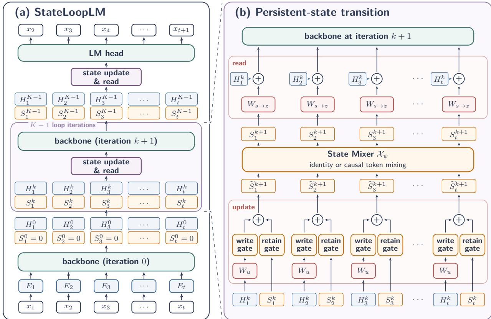
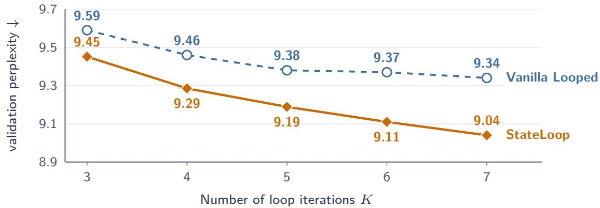
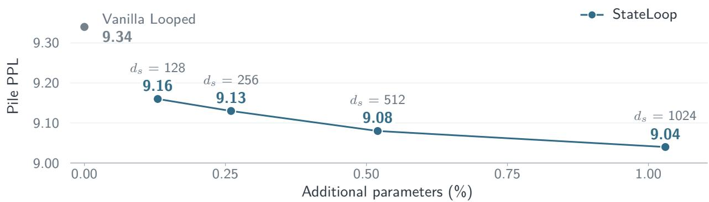
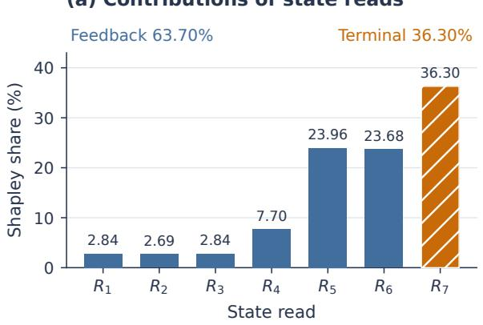
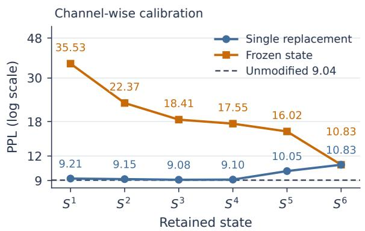

# StateLoop: Persistent State for Looped Transformers

Feichen Song1, Boyi Zeng1, He Li1, Shixiang Song1, Yiqin Hao1, Zitong Wang2, Yizhou Yang1, Yifan Liu1, Ziwei He3, Zhouhan Lin1

1Shanghai Jiao Tong University

2Sun Yat-sen University 3Shanghai Innovation Institute

Abstract Looped Transformers ofer a parameter-eficient approach to language modeling by repeatedly applying a shared backbone. Vanilla looped Transformers use each backbone output directly as the input to the next iteration. These outputs may contain information useful several iterations later, but retaining it across the loop depends entirely on the single hidden state. We introduce StateLoop, which maintains one additional persistent state per token to retain information across iterations. At each iteration, a learned gate controls how much of the previous state is retained and how much information from the backbone output is incorporated. The updated state is projected back and added to the backbone output for subsequent iterations and final prediction. This design reduces Pile perplexity and improves average accuracy across eight zero-shot tasks over Vanilla Looped. Its perplexity advantage over Vanilla Looped grows with trained loop depth, consistent with persistent state becoming increasingly useful as recurrent computation deepens.

## 1. Introduction

Looped Transformers increase computation by repeatedly applying a shared backbone (Dehghani et al., 2019). Saunshi et al. (2025) show that looped models improve language modeling over non-looped models with the same number of parameters. Ouro demonstrates this approach at larger scale, with 1.4B and 2.6B looped models achieving performance comparable to larger standard Transformers across downstream benchmarks (Zhu et al., 2025).

The design of connections between iterations is a central architectural consideration in looped Transformers. Vanilla looped Transformers use each backbone output directly as the input to the next iteration. As Pagliardini et al. (2024) show, DenseFormer achieves lower perplexity when later layers can access much earlier outputs than when access is restricted to recent outputs. This finding motivates the hypothesis that information produced in one iteration may likewise remain useful several iterations later. In vanilla looped Transformers, retaining such information across iterations relies entirely on the same hidden state that also supplies the input for subsequent backbone computation.

We therefore propose StateLoop, which maintains an additional persistent state for each token. The state is carried across iterations and updated by combining its previous value with a projection of the backbone output. A gate determined by the same output controls how much of the previous state is retained and how much new information is written. An optional state mixer uses causal attention or Mamba-2 to exchange information across token positions before readout. The updated state is projected back and added to the backbone output, making the retained information available to later iterations and final prediction.

We evaluate StateLoop at 410M and 1.4B scales to assess both its performance and the contribution of the persistent state. Compared with Vanilla Looped, StateLoop reduces Pile perplexity by 0.18 and improves average accuracy across eight zero-shot tasks by 0.97 percentage points at 1.4B. Adding causal attention and Mamba-2 state mixers further increases the accuracy gains over Vanilla Looped to 1.43 and 1.44 percentage points, respectively. We further analyze the role of the persistent state. Resetting the state at every iteration increases perplexity, supporting the value of carrying information across iterations. Moreover, StateLoop’s advantage over Vanilla Looped grows with trained loop depth, suggesting that persistent state becomes increasingly useful as recurrent computation deepens.

## 2. Related Work

Looped Transformers and recurrent depth. The Universal Transformer introduced recurrent computation across depth by repeatedly applying a shared block (Dehghani et al., 2019). Subsequent work shows that looped Transformers can learn iterative algorithms for in-context learning (Yang et al., 2024). Ouro extends this approach to large-scale language-model pretraining with learned depth allocation (Zhu et al., 2025).

Connections between iterations. Recent looped language models difer in how they carry information across iterations and construct the next backbone input. Parcae stabilizes the recurrent hidden state by constraining the spectral norm of its state-transition matrix (Prairie et al., 2026). PonderLM feeds back a weighted sum of token embeddings, with weights given by the predicted token probabilities (Zeng et al., 2026). Hyperloop carries multiple residual streams across iterations and uses loop-specific hyper-connections to read the backbone input from these streams and write the output back (Zeitoun et al., 2026). These methods modify or enrich the recurrent stream itself, whereas StateLoop retains the direct backbone stream and introduces a separate persistent state.

Persistent state and memory. LSTMs, GRUs, and selective state-space models update recurrent state along a sequence (Hochreiter and Schmidhuber, 1997; Cho et al., 2014; Gu and Dao, 2024), while Recurrent Memory Transformers carry memory tokens between sequence segments (Bulatov et al., 2022). In looped architectures, Adaptive Loops and Memory augments repeated computation with gated access to static learned memory banks (Frey et al., 2026), while Universal Transformers Need Memory studies dynamically updated memory tokens as a computational scratchpad for recursive reasoning (Sapunov, 2026). MeSH externalizes recurrent state management into a multi-slot bufer with iteration-specific read and write routers (Yu et al., 2026). StateLoop explores a simpler design point: it maintains a single continuously updated state per token, retains the main recurrent hidden stream as a direct path, and shares all state-update and feedback parameters at every iteration.

## 3. Method

StateLoop adds a persistent state to each token. At each iteration, a gated update incorporates the backbone output into the state, which is then read to form the next backbone input or the final prediction. Figure 1 shows this computation.

## 3.1. Backbone Feedback and Persistent State

Let $x = ( x _ { 1 } , \ldots , x _ { n } )$ be a token sequence and � the shared Transformer backbone, with backbone width � and state width $d _ { s }$ . We use $K \geq 1$ loop iterations in total, indexed by $k = 0 , \ldots , K - 1$ . Initialization is

$$
E = \sqrt { d } \mathrm { ~ E m b e d } ( x ) , \qquad S ^ { 0 } = 0 , \qquad H ^ { 0 } = T ( E ) .\tag{1}
$$

  
Figure 1 | StateLoop architecture. (a) The looped model with a persistent state per token. (b) State update, optional token mixing, and readout. $W _ { s  z }$ feeds the next iteration, whereas $W _ { s  o u t }$ supplies the final prediction.

Here $H ^ { k } \in \mathbb { R } ^ { n \times d }$ is the backbone output at iteration $k ,$ and $S ^ { k } \in \mathbb { R } ^ { n \times d _ { s } }$ is the state after � updates, before incorporating $H ^ { k }$ . Updating it with $H ^ { k }$ produces $S ^ { k + 1 }$ . Linear projections act on each token’s feature vector.

At iteration $k = 0 , \ldots , K - 1$ , the state branch receives the backbone output normalized with RMSNorm (Zhang and Sennrich, 2019),

$$
\begin{array} { r } { U ^ { k } = \mathrm { R M S N o r m } _ { h } ( H ^ { k } ) . } \end{array}\tag{2}
$$

The state update $\mathcal { V } _ { \phi }$ combines $S ^ { k }$ and $U ^ { k }$ independently at each token. The operator $\chi _ { \psi }$ then applies identity or causal token mixing. The resulting state is normalized for readout, giving

$$
\widetilde { S } ^ { k + 1 } = \mathcal { V } _ { \phi } ( S ^ { k } , U ^ { k } ) , \qquad S ^ { k + 1 } = \mathcal { X } _ { \psi } ( \widetilde { S } ^ { k + 1 } ) , \qquad N ^ { k + 1 } = \mathrm { R M S N o r m } _ { s } ( S ^ { k + 1 } ) .\tag{3}
$$

Section 3.2 defines the state update and the mixing options.

For $k = 0 , \ldots , K - 2$ , the backbone output $H ^ { k }$ and the projected state read form the input $Z ^ { k + 1 } \in \mathbb { R } ^ { n \times d }$ to the next iteration. The backbone then computes its next output from this input,

$$
\boxed { \begin{array} { l } { \boldsymbol { Z } ^ { k + 1 } = \boldsymbol { H } ^ { k } + \boldsymbol { N } ^ { k + 1 } \boldsymbol { W } _ { s  z } ^ { \top } , } \\ { \boldsymbol { H } ^ { k + 1 } = \boldsymbol { T } ( \boldsymbol { Z } ^ { k + 1 } ) . } \end{array} }\tag{4}
$$

The projection $W _ { s  z } \in \mathbb { R } ^ { d \times d _ { s } }$ maps the state read to the backbone width. The backbone, state update, feedback projection, and optional token mixer share their parameters across iterations.

## 3.2. State Update

## 3.2.1. Selective SSM Update

The selective-SSM recurrence operates along the loop axis independently for each token, while $\chi _ { \psi }$ provides optional mixing along the token axis. A learned projection maps the normalized backbone output to the state width, giving

$$
\begin{array} { r } { P ^ { k } = U ^ { k } W _ { u } ^ { \top } , \qquad W _ { u } \in \mathbb { R } ^ { d _ { s } \times d } . } \end{array}\tag{5}
$$

The normalized backbone output $U ^ { k }$ determines an input-dependent step size, following selective SSMs (Gu and Dao, 2024). We use the update

$$
\begin{array} { r l } & { \begin{array} { c c } { \Delta ^ { k } = \mathrm { s o f t p l u s } \left( U ^ { k } W _ { \Delta } ^ { \top } + b _ { \Delta } \right) , } & { \lambda = \mathrm { e x p } ( A _ { \mathrm { l o g } } ) , } \end{array} } \\ & { \begin{array} { r l } & { \widehat { S } ^ { k + 1 } = \mathrm { e x p } ( - \lambda \odot \Delta ^ { k } ) \odot S ^ { k } + \left( 1 - \mathrm { e x p } ( - \lambda \odot \Delta ^ { k } ) \right) \odot P ^ { k } . } \end{array} } \end{array}\tag{6}
$$

Here $W _ { \Delta } \in \mathbb { R } ^ { d _ { s } \times d } , b _ { \Delta } , A _ { \mathrm { l o g } } \in \mathbb { R } ^ { d _ { s } }$ , and ⊙ denotes elementwise multiplication. The positive rate � is learned per channel. The retention gate $g ^ { k } = \exp ( - \lambda \odot \Delta ^ { k } )$ weights the previous state, while the write gate $\eta ^ { k } = 1 - g ^ { k }$ weights the projected output $P ^ { k }$ . Because $\Delta ^ { k }$ depends on $U ^ { k }$ , these weights can vary with the token and the iteration.

We initialize $W _ { \Delta } = 0$ and $b _ { \Delta } = \log ( e ^ { 0 . 3 } - 1 )$ , so that $\Delta = 0 . 3$ initially, and initialize $\lambda = \exp ( A _ { \log } )$ logarithmically from 0.01 to 4 across channels. These parameters are shared across iterations and remain trainable. The resulting initial write rate is $\eta _ { c } = 1 - \exp ( - 0 . 3 \lambda _ { c } )$ .

## 3.2.2. Optional Token-Axis Mixing

StateLoop uses identity mixing, so the updated state is normalized and read out directly, with

$$
\begin{array} { r } { S ^ { k + 1 } = \chi _ { \mathrm { i d } } ( \widetilde { S } ^ { k + 1 } ) = \widetilde { S } ^ { k + 1 } . } \end{array}\tag{7}
$$

Adding causal attention or Mamba-2 gives StateLoop + Attn Mixer or StateLoop + Mamba-2 Mixer, respectively, allowing updated states to exchange information across token positions. Both preserve the shape $n \times d _ { s }$ and compute the output at position � from the updated-state prefix $\widetilde { S } _ { \le t } ^ { k + 1 }$

The causal-attention mixer uses self-attention (Vaswani et al., 2017) with pre-normalization and a residual connection, giving

$$
S ^ { k + 1 } = \widetilde { S } ^ { k + 1 } + \mathsf { C a u s a l A t t e n t i o n } _ { \psi } \Big ( \mathsf { R M S N o r m } _ { m } ( \widetilde { S } ^ { k + 1 } ) \Big ) .\tag{8}
$$

The Mamba-2 mixer applies a residual Mamba-2/SSD block along the token axis (Dao and Gu, 2024) to obtain

$$
S ^ { k + 1 } = \mathrm { M a m b a } 2 \mathrm { B l o c k } _ { \psi } ( \widetilde { S } ^ { k + 1 } ) .\tag{9}
$$

## 3.3. Final Prediction and Training

At the final iteration $k = K - 1 , H ^ { K - 1 }$ updates $S ^ { K - 1 }$ to $S ^ { K }$ . A separate readout projection $W _ { s  o u t } \in \mathbb { R } ^ { d \times d _ { s } }$ combines the normalized state with $\bar { H } ^ { K - 1 }$ to produce

$$
\boxed { Y = H ^ { K - 1 } + \mathrm { R M S N o r m } _ { s } ( S ^ { K } ) W _ { s  o u t } ^ { \top } = H ^ { K - 1 } + N ^ { K } W _ { s  o u t } ^ { \top } . }\tag{10}
$$

The LM head maps � to vocabulary logits. All parameters are trained end-to-end by minimizing the standard autoregressive loss,

$$
p _ { \theta } ( { \bf \cdot } | { \bf \Delta } x _ { \leq t } ) = \mathrm { s o f t m a x } \big ( \mathrm { L M H e a d } ( Y _ { t } ) \big ) ,\tag{11}
$$

$$
\mathcal { L } _ { \mathrm { L M } } = - \frac { 1 } { n - 1 } \sum _ { t = 1 } ^ { n - 1 } \log p _ { \theta } ( x _ { t + 1 } \mid x _ { \le t } ) .\tag{12}
$$

## 4. Experiments

We evaluate language modeling and downstream accuracy, examine performance across trained loop depths, and measure autoregressive decoding eficiency. Section 5 examines the design and behavior of the persistent state.

## 4.1. Experimental Setup

Training configuration. All models are trained from scratch on the Pile (Gao et al., 2020) with a LLaMA-style backbone (Touvron et al., 2023). All 1.4B comparisons use the same GPT-NeoX tokenizer, data pipeline, 30B-token training budget, batch size 256, sequence length 2,048, and cosine-decay schedule with peak learning rate $2 \times 1 0 ^ { - 4 }$ . The shared Transformer backbone contains 24 layers, with hidden width $d = 2 0 4 8 ,$ , SwiGLU intermediate width 5504, and 32 attention heads of dimension 64. StateLoop uses persistent-state width $d _ { s } = 2 0 4 8 _ { \colon }$ , and the full-backbone recurrent models use $K = 4$ iterations of the shared backbone. The 410M studies use 25B training tokens and a peak learning rate of $3 \times 1 0 ^ { - 4 }$ , with the same batch size, sequence length, and cosine-decay schedule. Training budgets count original language-model tokens.

State-branch configuration. Both token-axis mixers consist of a single residual module whose parameters are shared across iterations. In the 1.4B model, the attention mixer uses pre-normalized causal self-attention with rotary position embeddings (RoPE), 32 heads of dimension 64, and no FFN. The Mamba-2 mixer uses an expansion factor of 2, an internal SSM state dimension of 128, a convolution width of 4, a head dimension of 64, and 8 groups, without additional positional embeddings.

Comparison models. All baselines are implemented in the same codebase. Vanilla Looped (Dehghani et al., 2019) and PonderLM (Zeng et al., 2026) apply the full backbone for four iterations. Vanilla Looped + FFN increases the SwiGLU intermediate width from 5,504 to 5,818, yielding approximately the same parameter count as StateLoop + Mamba-2 Mixer. Our Hyperloop (Zeitoun et al., 2026), MeSH (Yu et al., 2026), and Parcae (Prairie et al., 2026) baselines retain the partial-loop structures used in their original studies. Hyperloop follows its original begin–middle–end structure, with only the middle block applied recurrently. For MeSH and Parcae, we use eight layers each for the prelude, recurrent core, and coda, with ten core repetitions, matching the 96 layer applications of four StateLoop iterations, each with 24 layers. Pause Token inserts three pause tokens after each input token to provide additional computation before predicting the next token (Goyal et al., 2024).

Evaluation metrics. We report perplexity (PPL) on Pile validation data, LAMBADA-OpenAI (LAMBADA-OAI), and WikiText-2. PPL is the exponential of mean negative log-likelihood (NLL). Pile and LAMBADA-OAI use token PPL, while WikiText-2 uses word PPL (Paperno et al., 2016; Radford et al., 2019; Merity et al., 2017). Downstream evaluation covers LAMBADA-OAI, ARC-Easy, ARC-Challenge, WinoGrande, PIQA, HellaSwag, SciQ, and RACE-high (RACE in the tables) under both zero-shot and five-shot settings (Clark et al., 2018; Sakaguchi et al., 2020; Bisk et al., 2020;

Zellers et al., 2019; Welbl et al., 2017; Lai et al., 2017). We report task accuracy and Avg-8, the unweighted average across these eight tasks.

## 4.2. Main Results

Tables 1 and 2 compare three StateLoop variants with the baselines under the common 1.4B training setup. The variants share the selective-SSM update and feedback rule and apply identity, causal attention, or Mamba-2 to the updated state.

Table 1 | Language-modeling PPL at 1.4B (30B training tokens). Full-backbone models use $K = 4 _ { \cdot }$ with MeSH and Parcae matched at 96 layer applications. LAMBADA-OpenAI uses zero-shot token PPL and WikiText-2 uses word PPL.
<table><tr><td></td><td colspan="2">Parameters</td><td colspan="3">Perplexity ↓</td></tr><tr><td>Model</td><td>Params (M)</td><td>vs. Vanilla Looped</td><td>Pile</td><td>LAMBADA OAI</td><td>WikiText-2</td></tr><tr><td>Vanilla Looped</td><td>1420.92</td><td>0.00%</td><td>7.79</td><td>6.94</td><td>16.50</td></tr><tr><td>Vanilla Looped + FFN</td><td>1467.22</td><td>+3.26%</td><td>7.75</td><td>7.00</td><td>16.34</td></tr><tr><td>Hyperloop</td><td>1421.32</td><td>+0.03%</td><td>7.77</td><td>6.84</td><td>16.66</td></tr><tr><td>MeSH</td><td>1421.51</td><td>+0.04%</td><td>7.74</td><td>6.77</td><td>16.43</td></tr><tr><td>PonderLM</td><td>1420.92</td><td>0.00%</td><td>7.85</td><td>7.31</td><td>16.72</td></tr><tr><td>Parcae</td><td>1429.32</td><td>+0.59%</td><td>7.87</td><td>7.38</td><td>16.83</td></tr><tr><td>Pause Token</td><td>1420.92</td><td>0.00%</td><td>8.20</td><td>7.74</td><td>17.87</td></tr><tr><td>StateLoop</td><td>1437.71</td><td>+1.18%</td><td>7.61</td><td>6.71</td><td>15.96</td></tr><tr><td>StateLoop + Attn</td><td>1454.49</td><td>+2.36%</td><td>7.60</td><td>6.64</td><td>15.93</td></tr><tr><td>StateLoop + Mamba-2</td><td>1467.23</td><td>+3.26%</td><td>7.60</td><td>6.88</td><td>15.95</td></tr></table>

Relative to Vanilla Looped, StateLoop lowers perplexity on all three datasets and improves average downstream accuracy under both prompting settings (Tables 1 and 2). Both token mixers further improve Avg-8, with similar scores in each setting.

In this parameter-control comparison, allocating the additional parameters to the state branch yields better performance than widening the FFN. StateLoop outperforms Vanilla Looped + FFN in Pile PPL and both downstream averages with fewer parameters, while StateLoop + Mamba-2 Mixer does so at a comparable parameter count (Tables 1 and 2).

## 4.3. Loop Depth

We next test whether the benefit of the additional state grows with the number of iterations, holding state width fixed. With $d = d _ { s } = 1 0 2 4$ , we train paired 410M Vanilla Looped and StateLoop models using $K = 3 , \ldots , 7$ iterations. Each model uses 25B training tokens and is evaluated at the depth used during training. With identity mixing, StateLoop has 411.10M parameters at every tested loop depth.

Both models benefit from more iterations, with larger gains for StateLoop (Figure 2). Its PPL advantage over Vanilla Looped grows from approximately 0.14 at � = 3 to 0.30 at $K = 7$ , consistent with persistent state becoming increasingly useful as recurrent depth increases.

## 4.4. Decoding Eficiency

Table 3 compares the three StateLoop variants and wider-FFN baseline at � = 4 with Vanilla Looped at $K = 4$ and $K = 5$ , measuring the cost of the state branch against an additional backbone iteration.

Table 2 | Zero-shot and five-shot accuracy (%) at 1.4B after 30B training tokens. Full-backbone models use � = 4; MeSH and Parcae match their 96 layer applications. Avg-8 is the unweighted eight-task mean. LAMBADA-OAI denotes LAMBADA-OpenAI.
<table><tr><td colspan="8">LAMBADA</td></tr><tr><td>Model</td><td>OAI</td><td>ARC-E</td><td>ARC-C</td><td>WinoG.</td><td>PIQA</td><td>Hella.</td><td>SciQ RACE</td><td>Avg-8</td></tr><tr><td>Zero-shot</td></tr><tr><td>Vanilla Looped 58.24</td><td>52.57</td><td>28.16</td><td>54.85</td><td>70.02</td><td>50.39</td><td>77.90</td><td>34.35 53.31</td></tr><tr><td>Vanilla Looped + FFN</td><td>59.05</td><td>50.93</td><td>26.71</td><td>56.91 69.42</td><td>50.50</td><td>75.60</td><td>33.68 52.85</td></tr><tr><td>Hyperloop</td><td>61.28</td><td>51.05</td><td>27.56 55.72</td><td>70.46</td><td>49.69</td><td>80.70</td><td>34.16 53.83</td></tr><tr><td>MeSH</td><td>60.94</td><td>50.88</td><td>26.62 59.67</td><td>69.70</td><td>50.52</td><td>78.10 34.55</td><td>53.87</td></tr><tr><td>PonderLM</td><td>58.26</td><td>50.59</td><td>28.58 55.41</td><td>68.93</td><td>48.96</td><td>78.00 33.68</td><td>52.80</td></tr><tr><td>Parcae</td><td>57.40</td><td>50.04 26.71</td><td>53.83</td><td>70.46</td><td>49.34</td><td>78.00 34.45</td><td>52.53</td></tr><tr><td>Pause Token</td><td>57.05</td><td>49.45 25.77</td><td>53.12</td><td>68.28</td><td>45.42</td><td>75.00 32.25</td><td>50.79</td></tr><tr><td>StateLoop</td><td>60.68</td><td>52.27</td><td>28.33 56.43</td><td>70.13</td><td>51.19</td><td>80.60</td><td>34.64 54.28</td></tr><tr><td>StateLoop + Attn</td><td>59.91</td><td>53.79</td><td>29.35 56.43</td><td>70.40</td><td>51.61</td><td>81.50 34.93</td><td>54.74</td></tr><tr><td>StateLoop + Mamba-2</td><td>58.99</td><td>55.39</td><td>27.90 59.04</td><td>71.06</td><td>52.14</td><td>79.20</td><td>34.26 54.75</td></tr><tr><td colspan="8">Five-shot</td></tr><tr><td>Vanilla Looped</td><td>51.64</td><td>60.23</td><td>29.69 55.17</td><td>69.53</td><td>50.02</td><td>90.90</td><td>33.78</td><td>55.12</td></tr><tr><td>Vanilla Looped + FFN</td><td>53.15</td><td>60.06</td><td>29.52</td><td>57.06 70.62</td><td>50.85</td><td>91.40</td><td>31.67</td><td>55.54</td></tr><tr><td>Hyperloop</td><td>55.81</td><td>58.84</td><td>31.66</td><td>58.25</td><td>69.80</td><td>50.45 92.00</td><td>34.35</td><td>56.39</td></tr><tr><td>MeSH</td><td>54.94</td><td>59.81</td><td>29.86</td><td>58.41</td><td>69.21</td><td>51.55</td><td>92.70 35.50</td><td>56.50</td></tr><tr><td>PonderLM</td><td>52.53</td><td>57.95</td><td>29.35</td><td>55.33</td><td>68.93</td><td>49.36</td><td>91.80 33.30</td><td>54.82</td></tr><tr><td>Parcae</td><td>50.94</td><td>59.51</td><td>30.63</td><td>54.93</td><td>70.08</td><td>49.59</td><td>91.50 33.01</td><td>55.02</td></tr><tr><td>Pause Token</td><td>50.79</td><td>55.98</td><td>28.16</td><td>53.28</td><td>68.50</td><td>45.45</td><td>88.60 32.44</td><td>52.90</td></tr><tr><td>StateLoop</td><td>53.89</td><td>61.49</td><td>30.55</td><td>58.09</td><td>70.02</td><td>52.24</td><td>92.20 34.35</td><td>56.60</td></tr><tr><td>StateLoop + Attn</td><td>54.71</td><td>60.86</td><td>31.91</td><td>59.04</td><td>71.11</td><td>52.62</td><td>91.90 35.02</td><td>57.15</td></tr><tr><td>StateLoop + Mamba-2</td><td>53.81</td><td>62.58</td><td>30.80</td><td>58.80</td><td>71.71</td><td>52.18</td><td>92.40 34.74</td><td>57.13</td></tr></table>

  
Figure 2 | Loop depth and Pile PPL at 410M. Models are trained for 25B tokens at each plotted �. StateLoop uses identity mixing and $d = d _ { s } = 1 0 2 4$ . The PPL advantage over Vanilla Looped grows with trained loop depth.

During autoregressive decoding, StateLoop inherits the per-loop backbone KV caches of Vanilla Looped. In addition, its identity-mixer variant maintains only a transient $d _ { s }$ -dimensional state for the current token across recurrent iterations. Attention and Mamba-2 mixers additionally maintain loop-specific token-axis caches.

The state branch adds only 1.42%–2.11% latency at $K = 4 ,$ compared with 25.00% for a fifth Vanilla Looped iteration. StateLoop thus has 18.86% lower latency than the � = 5 baseline.

Table 3 | Decoding eficiency at 1.4B. Measurements use BF16, batch size 1, and a 1,024-token prefill followed by a 1,024-token continuation on one GPU. Latency is mean ± standard deviation over five runs; changes are relative to Vanilla Looped at � = 4.
<table><tr><td>Model</td><td>Params (M)</td><td>K</td><td>Latency  $\mathrm { ( m s / t o k e n ) \downarrow }$ </td><td>Throughput (tok/s) ↑</td><td>Latency change</td></tr><tr><td>Vanilla Looped</td><td>1420.92</td><td>4</td><td> $1 2 1 . 2 2 4 \pm 1 . 0 9 9$ </td><td>8.249</td><td>baseline</td></tr><tr><td>Vanilla Looped</td><td>1420.92</td><td>5</td><td> $1 5 1 . 5 2 7 \pm 1 . 0 6 4$ </td><td>6.599</td><td>+24.997%</td></tr><tr><td>Vanilla  $\mathrm { L o o p e d + F F N }$ </td><td>1467.22</td><td>4</td><td> $1 2 1 . 1 6 7 \pm 1 . 2 9 3$ </td><td>8.253</td><td>-0.047%</td></tr><tr><td>StateLoop</td><td>1437.71</td><td>4</td><td> $1 2 2 . 9 4 3 \pm 1 . 4 8 3$ </td><td>8.134</td><td>+1.418%</td></tr><tr><td> $\mathrm { S t a t e L o o p + A t t n }$ </td><td>1454.49</td><td>4</td><td> $1 2 3 . 7 7 8 \pm 1 . 3 4 8$ </td><td>8.079</td><td>+2.106%</td></tr><tr><td> $\mathrm { S t a t e L o o p + M a m b a { - } 2 }$ </td><td>1467.23</td><td>4</td><td> $1 2 3 . 3 9 7 \pm 0 . 9 2 3$ </td><td>8.104</td><td>+1.792%</td></tr></table>

## 5. Ablation and Analysis

We analyze 410M models at � = 7, using identity mixing for the StateLoop variants. We first vary state width, then compare feedback designs, state persistence, and update rules. Interventions on a trained model examine how retained information and continued state updates contribute to prediction.

## 5.1. State Width

We vary the persistent-state width $d _ { s } \in \{ 1 2 8 , 2 5 6 , 5 1 2 , 1 0 2 4 \}$ to test whether a smaller state preserves the language-modeling gains. Backbone width $d = 1 0 2 4$ and loop depth � = 7 are fixed. StateLoop uses the selective-SSM update with identity mixing. Figure 3 reports PPL and parameter cost.

  
Figure 3 | State width at 410M (� = 7, 25B tokens). Pile PPL versus parameter overhead for identity mixing and backbone width $d = 1 0 2 4$ . Points are labeled with state width $d _ { s }$ and PPL; overhead is relative to the 406.90M-parameter Vanilla Looped baseline.

Halving the state width preserves most of the PPL gain while roughly halving the added parameter cost (Figure 3). Even the narrowest state improves over Vanilla Looped, showing that a compact persistent state is suficient to provide gains.

## 5.2. Persistent-State Design

We examine which aspects of the persistent-state design contribute to these gains, considering feedback design, state persistence, and the update rule. All models are trained from scratch at 410M scale with $K = 7$ iterations and 25B training tokens. The StateLoop variants use identity mixing.

Table 4 | Persistent-state ablations on Pile at 410M. All models use $K = 7$ and 25B training tokens. State variants use $d _ { s } = 1 0 2 4$ and identity mixing. State-only feedback uses the recurrent state as the next backbone input, whereas reset state sets the previous state to zero before each update. The GRU variant replaces the selective-SSM update while keeping feedback and final readout unchanged. Parameter counts are in millions.
<table><tr><td>Ablation</td><td>Variant</td><td>Params (M)</td><td>PPL ↓</td></tr><tr><td rowspan="2">Feedback</td><td>State only</td><td>409.00</td><td>9.44</td></tr><tr><td>StateLoop</td><td>411.10</td><td>9.04</td></tr><tr><td rowspan="2">Persistence</td><td>Reset state</td><td>411.10</td><td>9.25</td></tr><tr><td>Persistent state</td><td>411.10</td><td>9.04</td></tr><tr><td rowspan="3">Update rule</td><td>Vanilla Looped</td><td>406.90</td><td>9.34</td></tr><tr><td>StateLoop (GRU)</td><td>416.34</td><td>9.09</td></tr><tr><td>StateLoop</td><td>411.10</td><td>9.04</td></tr></table>

Feedback design. The state-only alternative uses a gated state itself as the next backbone input $Z ^ { k + 1 }$ From $X ^ { 0 } = 0$ and $H ^ { 0 } = T ( E )$ , its recurrence for $k = 0 , \ldots , K - 2$ is

$$
\begin{array} { l } { { \boldsymbol { X } ^ { k + 1 } = \operatorname { C e l l } ( H ^ { k } , \boldsymbol { X } ^ { k } ) , } } \\ { { \boldsymbol { Z } ^ { k + 1 } = \boldsymbol { X } ^ { k + 1 } , \qquad H ^ { k + 1 } = T ( \boldsymbol { Z } ^ { k + 1 } ) . } } \end{array}\tag{13}
$$

Here $X ^ { k } \in \mathbb { R } ^ { n \times d }$ has the backbone width, and Cell applies the selective-SSM update in Equation 6 at this width, with $H ^ { k }$ as its input and $X ^ { k }$ as its previous state. In StateLoop, $Z ^ { k + 1 }$ instead combines $H ^ { k }$ with a projected read from the additional persistent state, as in Equation 4.

StateLoop achieves lower PPL than state-only feedback (Table 4). This result suggests an advantage for retaining the direct connection between iterations and adding a state read, rather than replacing that path with the recurrent state.

State persistence. We test persistence by setting the old state to zero before every update. The reset and persistent variants follow

$$
\begin{array} { r l } { \mathrm { R e s e t ~ s t a t e } } & { S ^ { k + 1 } = \eta ^ { k } \odot P ^ { k } , } \\ { \mathrm { P e r s i s t e n t ~ s t a t e } } & { S ^ { k + 1 } = ( 1 - \eta ^ { k } ) \odot S ^ { k } + \eta ^ { k } \odot P ^ { k } . } \end{array}\tag{14}
$$

Resetting the state still improves over Vanilla Looped (9.25 vs. 9.34), showing that the state branch within each iteration can improve performance even without state persistence across iterations. Carrying the state across iterations yields a further improvement to 9.04 under the same parameter count and training setup, isolating an additional benefit from persistence (Table 4).

State update rule. We retain the same projected input $P ^ { k } = U ^ { k } W _ { u } ^ { \top }$ and replace the selective-SSM update in Equation 6 with a GRU (Cho et al., 2014), keeping the feedback, final readout, and identity mixer unchanged. The GRU variant preserves most of the improvement over Vanilla Looped (Table 4), indicating that the benefit is not specific to the selective-SSM parameterization. The selective-SSM update achieves lower PPL with fewer parameters.

## 5.3. Analysis of the Persistent State

We analyze a trained 410M StateLoop with identity mixing and $K = 7$ on the full Pile validation set to examine how the persistent state supports later iterations and why continued state updates matter. All analyses share an unmodified baseline of 9.04 PPL.

(a) Contributions of state reads

  
(b) State reuse and updating

  
Figure 4 | State analysis at 410M $( K = 7 ,$ , identity mixing). Evaluated on the full Pile validation set. (a) Shapley shares of the NLL increase from masking reads. (b) Calibrated single replacement versus frozen-state reuse; the dashed line marks the unmodified model.

State readouts. We mask a state read by setting its projected output to zero. To account for interactions, we evaluate all $2 ^ { 7 }$ masking combinations. Each read’s exact Shapley value (Shapley, 1953) averages the extra NLL increase from masking it across all removal orderings. Feedback reads account for 63.70% of the attributed NLL increase, and the terminal read accounts for 36.30% (Figure 4a). Contributions concentrate in $R _ { 5 } , R _ { 6 } , R _ { 7 }$ , indicating greater reliance on the state in the final backbone transitions and prediction.

State replacement and freezing. To test whether earlier states remain usable at later boundaries, we first account for diferences in channel scale and ofset. Let $\mu _ { i , c }$ and $\sigma _ { i , c }$ be the mean and standard deviation of channel � at boundary �, estimated from unmodified model evaluations on a separate calibration sample. To use $S ^ { i }$ at boundary �, we calibrate it as

$$
\widehat { S } _ { t , c } ^ { i  j } = \frac { \sigma _ { j , c } } { \sigma _ { i , c } + \epsilon } ( S _ { t , c } ^ { i } - \mu _ { i , c } ) + \mu _ { j , c } .\tag{15}
$$

Here $\epsilon = 1 0 ^ { - 6 }$ ensures numerical stability. Calibration applies the same scale and ofset to all token positions � within each channel.

Single replacement reuses an earlier state once by replacing $S ^ { i + 1 }$ with ${ \widehat { S } } ^ { i  i + 1 }$ , then resumes normal updates. Freezing reuses the same saved $S ^ { i }$ at all remaining boundaries $j > i ,$ , recalibrating it to each target boundary. Both interventions continue running the backbone.

Single replacement causes small PPL increases at early boundaries but larger increases at $S ^ { 6 }$ and $s ^ { 7 }$ indicating that later updates become more important for prediction. Replacing $S ^ { 4 }$ once with calibrated $S ^ { 3 }$ yields 9.08 PPL, whereas freezing at $S ^ { 3 }$ raises PPL to 18.41 (Figure 4b). This contrast suggests that earlier states remain partially usable at nearby boundaries, while continued state updates are important as the backbone computation proceeds.

## 6. Conclusion

StateLoop equips each token with one additional persistent state to retain information across iterations. It reduces perplexity and improves average downstream accuracy over Vanilla Looped, with optional state mixers based on causal attention or Mamba-2 providing further downstream gains. The gains obtained with both selective-SSM and GRU updates support the persistent-state design. Its growing perplexity advantage over Vanilla Looped at greater trained depths further highlights the value of persistent state for deeper recurrent computation. State interventions show that earlier states remain partially usable at later boundaries, while continued state updates are important for prediction. These findings support explicit persistent state as a promising design choice for looped Transformers.

Our experiments cover models up to the 1.4B scale, with the controlled loop-depth analysis conducted at 410M. Extending this analysis to larger models can further characterize how persistent state interacts with recurrent depth.

## References

Yonatan Bisk, Rowan Zellers, Ronan Le Bras, Jianfeng Gao, and Yejin Choi. PIQA: Reasoning about physical commonsense in natural language. In Proceedings of the AAAI Conference on Artificial Intelligence, volume 34, pages 7432–7439, 2020. doi: 10.1609/aaai.v34i05.6239. URL https: //ojs.aaai.org/index.php/AAAI/article/view/6239.

Aydar Bulatov, Yury Kuratov, and Mikhail Burtsev. Recurrent memory transformer. In Advances in Neural Information Processing Systems, volume 35, pages 11079–11091, 2022. doi: 10.52202/068 431-0805. URL https://proceedings.neurips.cc/paper\_files/paper/2022/hash/4 7e288629a6996a17ce50b90a056a0e1-Abstract-Conference.html.

Kyunghyun Cho, Bart van Merriënboer, Caglar Gulcehre, Dzmitry Bahdanau, Fethi Bougares, Holger Schwenk, and Yoshua Bengio. Learning phrase representations using RNN encoder–decoder for statistical machine translation. In Proceedings of the 2014 Conference on Empirical Methods in Natural Language Processing, pages 1724–1734. Association for Computational Linguistics, 2014. doi: 10.3115/v1/D14-1179. URL https://aclanthology.org/D14-1179/.

Peter Clark, Isaac Cowhey, Oren Etzioni, Tushar Khot, Ashish Sabharwal, Carissa Schoenick, and Oyvind Tafjord. Think you have solved question answering? Try ARC, the AI2 reasoning challenge. arXiv preprint arXiv:1803.05457, 2018. URL https://arxiv.org/abs/1803.05457.

Tri Dao and Albert Gu. Transformers are SSMs: Generalized models and eficient algorithms through structured state space duality. In Proceedings of the 41st International Conference on Machine Learning, volume 235 of Proceedings of Machine Learning Research, pages 10041–10071. PMLR, 2024. URL https://proceedings.mlr.press/v235/dao24a.html.

Mostafa Dehghani, Stephan Gouws, Oriol Vinyals, Jakob Uszkoreit, and Lukasz Kaiser. Universal transformers. In International Conference on Learning Representations, 2019. URL https://iclr .cc/virtual/2019/poster/1068.

Markus Frey, Behzad Shomali, Ali Hamza Bashir, David Berghaus, Joachim Koehler, and Mehdi Ali. Adaptive loops and memory in transformers: Think harder or know more? In Latent & Implicit Thinking Workshop at ICLR 2026, 2026. URL https://arxiv.org/abs/2603.08391.

Leo Gao, Stella Biderman, Sid Black, Laurence Golding, Travis Hoppe, Charles Foster, Jason Phang, Horace He, Anish Thite, Noa Nabeshima, Shawn Presser, and Connor Leahy. The pile: An 800GB

dataset of diverse text for language modeling. arXiv preprint arXiv:2101.00027, 2020. URL https://arxiv.org/abs/2101.00027.

Sachin Goyal, Ziwei Ji, Ankit Singh Rawat, Aditya Krishna Menon, Sanjiv Kumar, and Vaishnavh Nagarajan. Think before you speak: Training language models with pause tokens. In International Conference on Learning Representations, 2024. URL https://openreview.net/forum?id=ph 04CRkPdC.

Albert Gu and Tri Dao. Mamba: Linear-time sequence modeling with selective state spaces. In First Conference on Language Modeling, 2024. URL https://openreview.net/forum?id=tEYskw 1VY2.

Sepp Hochreiter and Jürgen Schmidhuber. Long short-term memory. Neural Computation, 9(8): 1735–1780, 1997. doi: 10.1162/neco.1997.9.8.1735.

Guokun Lai, Qizhe Xie, Hanxiao Liu, Yiming Yang, and Eduard Hovy. RACE: Large-scale ReAding comprehension dataset from examinations. In Proceedings of the 2017 Conference on Empirical Methods in Natural Language Processing, pages 785–794. Association for Computational Linguistics, 2017. doi: 10.18653/v1/D17-1082. URL https://aclanthology.org/D17-1082/.

Stephen Merity, Caiming Xiong, James Bradbury, and Richard Socher. Pointer sentinel mixture models. In International Conference on Learning Representations, 2017. URL https://openreview.net /forum?id=Byj72udxe.

Matteo Pagliardini, Amirkeivan Mohtashami, Francois Fleuret, and Martin Jaggi. DenseFormer: Enhancing information flow in transformers via depth weighted averaging. In Advances in Neural Information Processing Systems, volume 37, 2024. doi: 10.52202/079017-4336. URL https: //papers.nips.cc/paper\_files/paper/2024/hash/f67449c7ab72f441d3a713b046c 6818c-Abstract-Conference.html.

Denis Paperno, Germán Kruszewski, Angeliki Lazaridou, Ngoc Quan Pham, Rafaella Bernardi, Sandro Pezzelle, Marco Baroni, Gemma Boleda, and Raquel Fernández. The LAMBADA dataset: Word prediction requiring a broad discourse context. In Proceedings of the 54th Annual Meeting of the Association for Computational Linguistics (Volume 1: Long Papers), pages 1525–1534. Association for Computational Linguistics, 2016. doi: 10.18653/v1/P16-1144. URL https://aclantholo gy.org/P16-1144/.

Hayden Prairie, Zachary Novack, Taylor Berg-Kirkpatrick, and Daniel Y. Fu. Parcae: Scaling laws for stable looped language models. arXiv preprint arXiv:2604.12946, 2026. URL https://arxiv.or g/abs/2604.12946.

Alec Radford, Jefrey Wu, Rewon Child, David Luan, Dario Amodei, and Ilya Sutskever. Language models are unsupervised multitask learners. Technical report, OpenAI, 2019. URL https: //cdn.openai.com/better-language-models/language-models.pdf.

Keisuke Sakaguchi, Ronan Le Bras, Chandra Bhagavatula, and Yejin Choi. WinoGrande: An adversarial Winograd schema challenge at scale. In Proceedings of the AAAI Conference on Artificial Intelligence, volume 34, pages 8732–8740, 2020. doi: 10.1609/aaai.v34i05.6399. URL https://ojs.aaai .org/index.php/AAAI/article/view/6399.

Grigory Sapunov. Universal transformers need memory: Depth-state trade-ofs in adaptive recursive reasoning. arXiv preprint arXiv:2604.21999, 2026. URL https://arxiv.org/abs/2604.21999.

Nikunj Saunshi, Nishanth Dikkala, Zhiyuan Li, Sanjiv Kumar, and Sashank J. Reddi. Reasoning with latent thoughts: On the power of looped transformers. In International Conference on Learning Representations, 2025. URL https://openreview.net/forum?id=din0lGfZFd.

Lloyd S. Shapley. A value for n-person games. In Harold W. Kuhn and Albert W. Tucker, editors, Contributions to the Theory of Games II, pages 307–317. Princeton University Press, Princeton, NJ, 1953.

Hugo Touvron, Thibaut Lavril, Gautier Izacard, Xavier Martinet, Marie-Anne Lachaux, Timothée Lacroix, Baptiste Rozière, Naman Goyal, Eric Hambro, Faisal Azhar, Aurélien Rodriguez, Armand Joulin, Edouard Grave, and Guillaume Lample. LLaMA: Open and eficient foundation language models. arXiv preprint arXiv:2302.13971, 2023. URL https://arxiv.org/abs/2302.13971.

Ashish Vaswani, Noam Shazeer, Niki Parmar, Jakob Uszkoreit, Llion Jones, Aidan N. Gomez, Lukasz Kaiser, and Illia Polosukhin. Attention is all you need. In Advances in Neural Information Processing Systems, volume 30, pages 5998–6008, 2017. URL https://proceedings.neurips.cc/pap er\_files/paper/2017/hash/3f5ee243547dee91fbd053c1c4a845aa-Abstract.html.

Johannes Welbl, Nelson F. Liu, and Matt Gardner. Crowdsourcing multiple choice science questions. In Proceedings of the 3rd Workshop on Noisy User-generated Text, pages 94–106. Association for Computational Linguistics, 2017. doi: 10.18653/v1/W17-4413. URL https://aclanthology .org/W17-4413/.

Liu Yang, Kangwook Lee, Robert D. Nowak, and Dimitris Papailiopoulos. Looped transformers are better at learning learning algorithms. In International Conference on Learning Representations, 2024. URL https://openreview.net/forum?id=HHbRxoDTxE.

Chengting Yu, Xiaobo Shu, Yadao Wang, Yizhen Zhang, Haoyi Wu, Jiaang Li, Rujiao Long, Ziheng Chen, Yuchi Xu, Wenbo Su, and Bo Zheng. MeSH: Memory-as-state-highways for recursive transformers. In International Conference on Learning Representations, 2026. URL https://openreview.net/forum?id=IhTrFvY7p3.

Abbas Zeitoun, Lucas Torroba-Hennigen, and Yoon Kim. Hyperloop transformers. arXiv preprint arXiv:2604.21254, 2026. URL https://arxiv.org/abs/2604.21254.

Rowan Zellers, Ari Holtzman, Yonatan Bisk, Ali Farhadi, and Yejin Choi. HellaSwag: Can a machine really finish your sentence? In Proceedings of the 57th Annual Meeting of the Association for Computational Linguistics, pages 4791–4800. Association for Computational Linguistics, 2019. doi: 10.18653/v1/P19-1472. URL https://aclanthology.org/P19-1472/.

Boyi Zeng, Shixiang Song, Siyuan Huang, Yixuan Wang, He Li, Ziwei He, Xinbing Wang, Zhiyu Li, and Zhouhan Lin. PonderLM: Pretraining language models to ponder in continuous space. In International Conference on Learning Representations, 2026. URL https://openreview.net/f orum?id=UrM4MNRYZm.

Biao Zhang and Rico Sennrich. Root mean square layer normalization. In Advances in Neural Information Processing Systems, volume 32, 2019. URL https://proceedings.neurips.cc/p aper/2019/hash/1e8a19426224ca89e83cef47f1e7f53b-Abstract.html.

Rui-Jie Zhu, Zixuan Wang, Kai Hua, Tianyu Zhang, Ziniu Li, Haoran Que, Boyi Wei, Zixin Wen, Fan Yin, He Xing, Lu Li, Jiajun Shi, Kaijing Ma, Shanda Li, Taylor Kergan, Andrew Smith, Xingwei Qu, Mude Hui, Bohong Wu, Qiyang Min, Hongzhi Huang, Xun Zhou, Wei Ye, Jiaheng Liu, Jian Yang, Yunfeng Shi, Chenghua Lin, Enduo Zhao, Tianle Cai, Ge Zhang, Wenhao Huang, Yoshua

Bengio, and Jason Eshraghian. Scaling latent reasoning via looped language models. arXiv preprint arXiv:2510.25741, 2025. URL https://arxiv.org/abs/2510.25741.