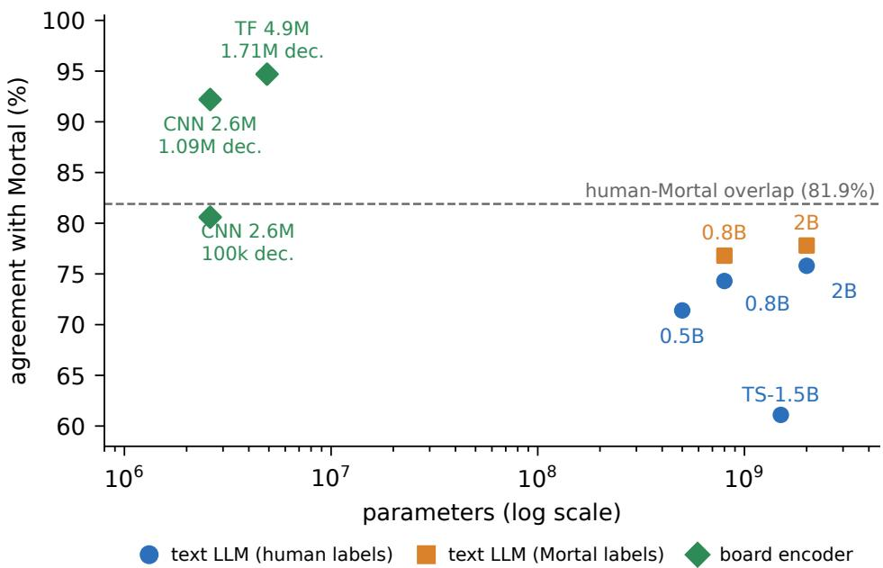
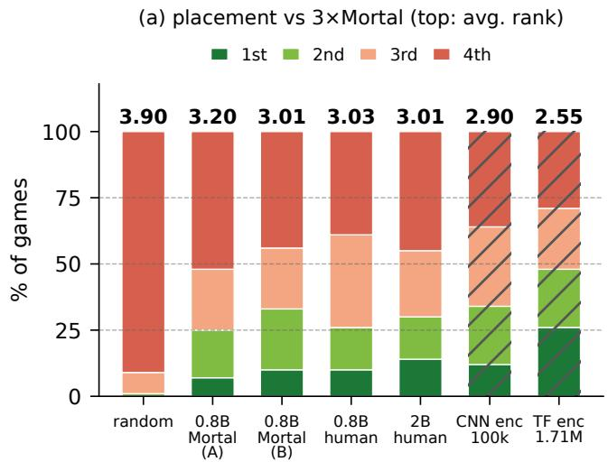
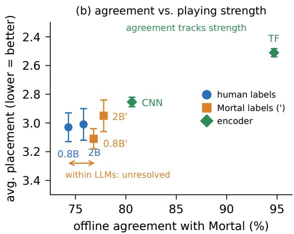
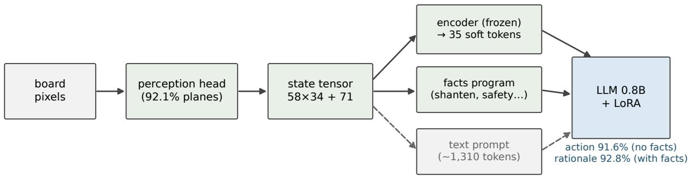

# Text Is the Bottleneck: A Small-Scale Replication of LLM Game Playing in Riichi Mahjong

Mingge Xu

October 2026

## Abstract

We replicate the riichi-mahjong track of Can Large Language Models Master Complex Card Games? [12] under a drastically smaller budget: models of at most 2B parameters, a single 16 GB consumer GPU, about five GPU-days. (1) With matched data and labels (LLMs LoRA-tuned for one epoch), text is the bottleneck. On the same 100k-decision training set, a 2.6M-parameter convolutional board encoder agrees with the strong AI Mortal on 80.6% of test decisions, above every text-prompt LLM we train (best 77.8%), and places better at the table (2.85 over 1,000 games vs. ≈3.0 for the LLMs; paired diference at �=100 not significant). Scaled to 1.71M decisions and distilled from Mortal’s Q-values, a 4.9M-parameter Transformer reaches 94.7% agreement, beats the 0.8B LLMs on identical seeds (sign test, −0.45 ranks, �=0.005), and is statistically equivalent to parity against three Mortal champions (TOST, ±0.10 ranks, $\scriptstyle p = 6 \times 1 0 ^ { - 4 } )$ —noting that parity against a teacher-opponent is roughly the ceiling of pure imitation. (2) Training toward the teacher raises teacher agreement more than a 2.5× parameter increase does (+2.5 for labels at 0.8B vs. +1.5 for 0.8B→2B under human labels, McNemar $p \approx 2 \times 1 0 ^ { - 9 }$ / 0.012); on human-record agreement both efects are +1.0, and neither is visible at the table. (3) Few-point agreement diferences do not resolve into playing strength within a family. Across families the ordering is clean (scaled encoder: 94.7% agreement, placement 2.51, TOST-equivalent to parity; matched-data encoder 80.6%, 2.85; LLMs 74.3–77.8%, 2.95–3.20 across blocks)—though only the scaled encoder separates significantly, and it also has 17× more data. Within the text-LLM family, +2.5 agreement points coincide with a paired placement diference of $+ 0 . 0 2 \pm 0 . 1 2$ ranks (sign test �=1.0) and +2.0 points at 2B with −0.06 (�=0.37)—both far below the ≈0.25-rank resolution of 100 paired games. We also document a paper–code mismatch in the original “winner filter”, reconstruct its two private engine patches, and show that a divide-and-conquer pipeline (encoder for decisions, program-supplied facts for the rationale) makes template-generated Japanese rationales 93% sentence-exact (43% without facts)—a measure of faithful integration of program-supplied facts, since a template copier would also ace the checkable categories. Per Tenhou’s terms we release no trained weights—only code, configurations, and evaluation protocols.

## 1 Introduction

Wang et al. [12] trained 7B–9B instruction-tuned LLMs with LoRA [4] on text descriptions of eight card games, including four-player riichi mahjong, and conclude that “LLMs can approach the performance of strong game AIs through supervised fine-tuning on high-quality data.” The mahjong track was trained on 8×H100 with expert game records from Tenhou, and evaluated by playing against Mortal [2] (50 games per agent, scored 3/2/1/0 by placement; the best mahjong model reaches ≈1.4 reward, ≈2.6 average placement, against their own—unreleased—Mortal checkpoint).

This paper asks what survives of that conclusion when the budget shrinks by roughly two orders of magnitude: one RTX 5070 Ti (16 GB), models up to 2B parameters (Qwen3.5-0.8B/2B, Qwen2.5-0.5B, TinySwallow-1.5B), and LoRA rather than full fine-tuning. Small-scale replications are useful twice over: they test whether the claimed efect needs scale, and they isolate representation and supervision efects that large runs smooth over.

Our contributions:

• A faithful replication of the mahjong data pipeline, including a reconstruction of the two engine patches the original code omits (§3), with per-game decision counts matching the paper (654.6 vs. 656.92).

• Representation results, ofline and at the table (§4, §5): on identical data and labels, a tiny board encoder beats all text-prompt LLMs at imitating Mortal (80.6% vs. 77.8%) and is nominally better at the table (2.85 vs. 2.95–3.03; paired diference not significant at �=100); the scaled, distilled Transformer encoder is statistically equivalent to parity against three Mortal champions (2.51±0.03 over 1,000 games, TOST) and beats the 0.8B LLMs on identical seeds (�=0.005).

• Supervision results (§4): teacher-label training raises teacher agreement more than a 2.5× parameter increase does; on human-record agreement the two efects are about equal.

• The game-play evaluation the original protocol prescribes (§5): trained LLMs reach ≈3.0 average placement against three Mortal agents—far above a random-legal floor (3.90) and below parity (2.50)— while the scaled encoder reaches parity (TOST-equivalent over 1,000 games). Agreement with Mortal orders the agents across representation families; within the text-LLM family, few-point agreement diferences do not resolve into placement diferences at 100-game power.

• A divide-and-conquer pipeline (§6): freezing the encoder and letting a program supply checkable facts makes the LLM’s Japanese-language rationales 93% sentence-exact (43% without facts; a template copier would also ace the checkable categories); a perception module extends the same pipeline from pixels (92.7% agreement with Mortal).

• Replication notes and negative results (§7, §8), including a paper–code mismatch in the original winner filter and several silent-failure pitfalls of modern tooling.

We release the full evaluation harness—including the reconstructed arena integration that the original artifact omits—alongside every arena game log.

## 2 Background and Related Work

LLMs playing cards. Wang et al. [12] is the direct target of our replication; its mahjong track uses text prompts of 36 state fields and legal-action lists, SFT on (state, expert action) pairs, and evaluation vs. Mortal. Related game AIs built by RL include DouZero for DouDizhu [13], Suphx for mahjong [6], and Mortal itself [2], which provides both our teacher signal and our arena opponent; other open mahjong-AI stacks include kanachan [1] and the mjx simulator [5]. Ruoss et al. [9] reach grandmaster-level chess with a from-scratch transformer over a compact FEN tokenization—closer in spirit to our board encoder than to a pretrained LLM reading prose. The open contrast is compact-encoding-plus-from-scratch-model versus prose-prompt-pluspretrained-LLM, and at what parameter scale the latter catches up. Suphx combines supervised pretraining with RL [6], as does Mortal itself [2]—which is why, in §5, we read parity against Mortal as the ceiling of pure imitation.

Riichi mahjong. A four-player, imperfect-information game with 136 tiles and rich conventions (riichi declarations, dora, furiten). A full hanchan lasts ≈650–660 decisions in the LLM4CardGame encoding.

Mahjong AIs as teachers. Mortal is a distributed RL agent over the libriichi engine. We use a community checkpoint (192 channels × 40 blocks, 10.8M parameters, trained 298k steps) [11]. Tenhou phoenix-table (houou) players agree with Mortal’s first choice on 81.1% of 153,244 logged decisions and place the human action in its top two 94.73% of the time (81.9% top-1 on our 5k test set; the top-2 figure coincides numerically with the TF encoder’s top-1 in Table 1, but they are unrelated quantities). We use Mortal as teacher and arena opponent because VoidShine-298k is, to our knowledge, the strongest publicly available Mortal checkpoint; we have no independent rating for it.

## 3 Replication Setup

Data. We use a 2026 dump of Tenhou houou (top-tier) games, 12,188 hanchan in total. Games 1–7,000 form the training pool (1,086,758 SFT decisions after the released code’s filtering), games 7,001–8,000 are held out, and 5,000 decisions sampled from them (fixed seed, after the same winner filter—so every agreement number here, including the 81.9% overlap, is computed on the decisions of hand-leading players; the 81.1% figure in §2 is unfiltered) form the unified test set on which every ofline number in this paper is computed. Games 8,001–12,188 (655,557 decisions) are added only for the best encoders: 1,742,315 raw, 1,708,593 after the validation split (3% of games, 1.9% of decisions) (the “1.09M” CNN set likewise counts 1,086,758 raw). The training subset for LLM experiments is a fixed 100k-decision sample; 1k of it is split of for validation.

Prompt and training. We reuse the original prompt verbatim (rules, 36 state fields, legal-action list, JSON output instruction). Models are Qwen2.5-0.5B [7], TinySwallow-1.5B [10], and Qwen3.5-0.8B/2B— successors of Qwen3 [8]; no technical report at the time of writing, so we cite the model cards.1 All LLMs are trained with LoRA [4] (rank 8 on all linear layers: 5.4M trainable parameters for the 0.8B, 8.4M for the 2B—the same order as the encoders they compete with—1 epoch, lr 10−4 cosine, efective batch 16) using LLaMA-Factory [14]; no label smoothing. A 0.8B model trains in 9.8 h; a 2B model in 13.1 h, on the single GPU (the one exception in the whole project: the 2B Mortal-label run, whose training briefly exceeded local memory, was finished on a rented A100-40 GB for \$21; all evaluation is local).

Reconstructing the missing engine patches. The released LLM4CardGame code calls two libriichi extensions that only exist in the authors’ private fork: an observation extractor (take obs raw) on the data side, and a mortal2 engine type that lets a Python LLM agent drive one seat of the Mortal arena on the evaluation side. We re-implemented both against the open libriichi and verified behavior: per-game decision counts 654.6 vs. the paper’s 656.92, and a stub-agent smoke test exercising all action paths (including kan double-asks).

Metrics. Ofline agreement: fraction of test decisions whose predicted action equals the reference (human record, or Mortal’s first choice). Game play: the original protocol—one challenger seat vs. three Mortal champions, seat-rotated seeds, placement points 90/45/0/−135 (§5).

Table 1: Ofline results on the unified 5,000-decision test set. Agreement is with the human record (H) or with Mortal’s first choice (M). All LLMs use text prompts; the encoder consumes a 58 × 34 plane + 71-scalar tensor computed from the same prompt. “Hard” = Mortal’s first choice only (identical supervision to the text LLMs, plus label smoothing 0.05); “soft” = additionally distilling Mortal’s Q-value distribution. TinySwallow is trained on 20k decisions (memorylimited) and listed for reference.
<table><tr><td>Model</td><td>Supervision</td><td>H (%) M (%)</td></tr><tr><td>human record (reference)</td><td>100</td><td>81.9</td></tr><tr><td>Text-prompt LLMs (LoRA, 100k decisions unless noted) Qwen2.5-0.5B TinySwallow-1.5B (20k) Qwen3.5-0.8B human</td><td>human 68.5 human 59.9</td><td>71.4 61.1 74.3 76.8</td></tr><tr><td>Qwen3.5-2B Qwen3.5-2B Board encoders (no LLM)</td><td>human 71.6 Mortal labels 72.2</td><td>75.8 77.8</td></tr><tr><td>CNN 2.6M, 100k decisions CNN 2.6M, 1.09M Transformer 4.9M, 1.71M</td><td>Mortal hard Mortal soft Mortal hard</td><td>74.0 80.6 80.5 92.2 80.7 91.6</td></tr></table>

## 4 Ofline: Representation, Labels, and Scale

Text is the bottleneck—with matched data and labels. Table 1 and Figure 1 show the central result. On the same 100k decisions, the 2.6M-parameter CNN encoder reaches 80.6% agreement with Mortal—2.8 points above the best text LLM (77.8%), which has 310–770× the total parameters (trainable: 5.4–8.4M vs. 2.6M) and trains ∼370× longer in wall clock (9.8 h for the 0.8B, 13.1 h for the 2B, vs. 1.6 min for the encoder). Three caveats scope the claim. (i) Supervision is matched: the encoder’s “hard” row uses Mortal’s first choice only, exactly the labels the text LLMs see; the encoders additionally use label smoothing 0.05 over the 46-action space while the LLMs use none. (ii) Optimization is not matched: the encoder trains all parameters for up to 16 epochs with early stopping, while each LLM is tuned once with LoRA rank 8 (≈10M trainable parameters) for one epoch; we did not run multi-epoch or full fine-tuning ablations, so the claim is about text prompting with matched data and labels under one-epoch LoRA, not about the architectures in general; the output heads also difer (46-way classifier with a legal mask vs. free-form JSON generation), which we cannot separate from the interface. (iii) Information is matched by construction: every plane and scalar is a deterministic function of the same 36 prompt fields (the featurizer consumes the prompt; quantities the prompt already reports, such as shanten and waits, are re-encoded, not invented), so the gap measures what serializing those fields into ∼1,310 tokens of prose costs a learner at this scale. At larger data scales the encoders additionally distill Mortal’s Q-distribution (“soft”); a hard-label control trained on the same 1.71M decisions reaches 91.6%, so the label mixture accounts for only the last 3 points of the 94.7% ofline (the arena uses the distilled model; the hard control was not played). Scaling encoder data and switching to a small Transformer reaches 94.7% agreement—higher than the 81.9% overlap between human experts and Mortal (a behavioral coincidence rate, not a human ceiling)—in 28 minutes of training.

Teacher labels raise teacher agreement—more than scale does. Reading the 2×2 of Table 1 on the Mortal-agreement column: at 0.8B, human→Mortal labels give +2.50 points $( p \approx 2 \times 1 0 ^ { - 9 }$ , McNemar, treating test decisions as exchangeable—they cluster mildly within games); under human labels, 0.8B→2B gives +1.50 (�=0.012); under Mortal labels the scale efect is +1.00; both changes together give +3.50 $( p \approx 1 \times 1 0 ^ { - 1 3 } )$ . The label efect is partly definitional—training toward Mortal’s action raises agreement with Mortal—and on the human-record column the picture flattens: the label efect at 0.8B is +1.0 and the scale efect under human labels also +1.0. Neither efect is visible at the table (§5), and each configuration is trained once, so single-run training noise (unmeasured) applies to all cells.

  
Figure 1: Agreement with Mortal’s first choice vs. parameter count (log scale). Text-prompt LLMs (circles: human labels; squares: Mortal labels) reach 71–78% across the 0.5B–2B range (TS-1.5B, 61%, was trained on 20k decisions— its 100k run was interrupted at step 5,005/6,188 and is not evaluated), while board encoders (diamonds) consuming the same prompt fields as tensors reach 80.6–94.7%; the dashed line marks human houou experts (81.9% on this test set). Encoder annotations give training-set size in decisions

Zero-shot. The untrained Qwen3.5-0.8B base never emits valid action JSON (0% parseable within 64 or even 512 tokens); the untrained 2B base does emit valid JSON but agrees with the record on only 13.1% of decisions (below a first-legal-action policy’s 14.4%). Post-training is what makes the small models operational at all.

## 5 Playing the Game: Arena Evaluation

The original paper’s headline metric is game play against Mortal; their reported numbers (50 games per agent, 3/2/1/0 reward, best ≈1.4 reward = ≈2.6 average placement—the reward is an afine transform of placement, so the metric is comparable) difer from ours in opponent checkpoint (theirs is unreleased) and game count, so we compare ranges, not points. We implement the protocol with the reconstructed mortal2 arena, decoding greedily (the paper’s own configuration) with the exact chat template used in training. The board encoders play through the same interface, replacing the LLM with a single forward pass. Every LLM query across the campaign (74,535 in total) returned parseable, legal JSON (the encoders are legal by construction).

Four observations. First, the trained small LLMs genuinely play: average placement ≈3.0 is far from the random floor (3.90); they finish 1st or 2nd in 25–33% of games against three copies of a strong opponent. Second, the scaled encoder is statistically equivalent to parity, and beats the LLMs on identical seeds. Over 1,000 games the Transformer encoder averages $2 . 5 1 1 { \pm } 0 . 0 2 8$ (seed-clustered s.e.; 95% CI [2.46 2.57]) vs. parity 2.50—a two-one-sided-tests (TOST) equivalence test with margin ±0.10 ranks gives $\scriptstyle p = 6 \times 1 0 ^ { - 4 }$ i.e. equivalence, not merely failure to reject (the margin was fixed before reading the results, at roughly the between-block s.d. of a diference, ≈0.14; the paired-power note: 100 paired games resolve ≈0.25-rank efects at 50% power, ≈0.34 at 80%). Two framing caveats: the opponent is also the teacher, and a perfect clone seated against three copies of itself scores 2.50 by symmetry, so parity here is roughly the ceiling of pure imitation rather than an independent strength benchmark; and the scaled encoder sees 17× more decisions than the LLMs, so this row is not a matched comparison. The matched-data picture: CNN encoder 2.85–2.96 over 1,200 games vs. LLMs 2.95–3.03, paired diferences against the two 0.8B models −0.05/−0.03 (per-game log recomputation; sign tests $\scriptstyle p = 0 . 6 / 0 . 8 :$ within about half a standard error); on the same 92k seeds the TF encoder beats both 0.8B models by $- 0 . 4 7 / - 0 . 4 5$ ranks $( p { = } 0 . 0 0 5 )$ , and on the 91k block it beats the matched-data CNN by −0.34 $( p { = } 0 . 0 2 )$ . All of this is cheap: 1,000 encoder games take 19–23 minutes, versus 1.5–4 GPU-hours per 100 LLM games (0.5 s per decision). Third, all five LLM blocks (four configurations) remain clearly below parity (2.50): text-prompt LLMs at this scale are substantially weaker than Mortal, consistent with the ofline gap (74–78% agreement vs. 81–95% for the encoders). Pooling the two Mortal-labeled blocks gives $3 . 1 1 \pm 0 . 0 7 \ ( n { = } 2 0 0 )$ , within 0.1 ranks of the human-labeled models’ 3.01–3.03. Because the arena opponent is the teacher, we add two checks with other opponents: against a pool of the weaker matched-data encoders the TF encoder wins clearly $( 2 . 2 6 \pm 0 . 1 1 )$ and against an alternative opponent—three copies of a small network we distilled ourselves from Mortal-298k’s Q-values (weaker than 298k, used only as a sparring partner)—it is indistinguishable from parity $( 2 . 4 8 \pm 0 . 1 2 ) $ . Fourth: within the text-LLM family, few-point agreement diferences do not resolve into placement diferences (Figure 2b). On 100 exactly paired games (identical seeds and seats, 92k block) the two 0.8B models split 29–30 with 41 ties (29 wins for the Mortal-labeled model, 30 for the human-labeled): mean rank diference $+ 0 . 0 2 \pm 0 . 1 2$ under the convention diference = Mortal-labeled minus human-labeled (sign test $p { = } 1 . 0 )$ . The 95% CI (≈ $[ - 0 . 2 2 , + 0 . 2 6 ] )$ ) is wider than the ≈0.1-rank efect the cross-family trend would predict for a 2.5-point gap—100 paired games cannot resolve diferences below ≈0.25 ranks, so the correct reading is undetectable, not zero. The 2B pair (94k block, same convention) replicates this: +2.0 agreement points coincide with $- 0 . 0 6 \pm 0 . 1 3$ paired ranks (�=0.37), with the Mortal-labeled 2B (2.95) nominally the best LLM at the table. Our first campaign ran the 0.8B pair on disjoint seed blocks and we initially read a 0.17-rank inversion (3.03 vs. 3.20) into it—about 1.2 s.e., consistent with ordinary sampling noise (≈0.14-rank between-block s.d.), and a lesson about single-block evaluations that we took literally. What the paired logs do resolve are style diferences: the Mortal-labeled 0.8B melds far more (3.3 vs. 2.2 per game; paired Wilcoxon on per-game counts, $p < 1 0 ^ { - 3 } )$ and wins more (1.81 vs. 1.55; =0.02), with a higher but individually non-significant deal-in rate (80% vs. 75% of games). We read this as an aggressive tempo style; whether it stems from the teacher’s labels or from single-run training noise, the paired design cannot say. No multiple-comparison correction is applied to the many tests in this section; they are descriptive.

Table 2: Game-play results: one agent vs. three Mortal (VoidShine-298k) champions. 100 games each (25 seeds × 4 seat rotations), greedy decoding. Placement distribution $[ 1 ^ { \mathrm { s t } } , 2 ^ { \mathrm { n d } } , 3 ^ { \mathrm { r d } } , 4 ^ { \mathrm { t h } } ]$ , average placement ± s.e., average Tenhou-style points $( 9 0 / 4 5 / 0 / - 1 3 5 )$ . Parity with the champion pool is 2.50. Our primary metric is average placement (the original paper’s protocol); the points column can rank diferently because a 4th place costs −135 (e.g., the 2B model’s extra first places do not ofset its extra last places). Encoder rows are 1,000 games (250 seeds × 4 rotations, distributions as percentages) on the disjoint 95k seed block with seed-clustered s.e.; all other rows are 100 games. The encoders’ 100-game blocks (91k/92k) give 2.55/2.56 (TF) and 2.90/2.96 (CNN), consistent with the 1,000-game values.
<table><tr><td>Agent</td><td>Placement dist.</td><td>Avg. rank</td><td>1st rate</td><td>Avg. pt</td></tr><tr><td>random legal action</td><td>[0,1,8,91]</td><td>3.90±0.03</td><td>0%</td><td>-122</td></tr><tr><td>Qwen3.5-0.8B, human labels</td><td>[10, 16,35,39]</td><td>3.03±0.10</td><td>10%</td><td>-36</td></tr><tr><td>Qwen3.5-0.8B, Mortal labels (block A)</td><td>[7,18,23,52]</td><td>3.20±0.10</td><td>7%</td><td>-56</td></tr><tr><td>Qwen3.5-0.8B, Mortal labels (block B, paired w. above)</td><td>[10,23,23,44]</td><td> $3 . 0 1 { \pm } 0 . 1 0 $ </td><td>10%</td><td>-40</td></tr><tr><td>Qwen3.5-2B, human labels</td><td>[14, 16, 25, 45]</td><td> $3 . 0 1 { \pm } 0 . 1 1 $ </td><td>14%</td><td>-41</td></tr><tr><td>Qwen3.5-2B, Mortal labels (paired w. 2B-human)</td><td>[14,17,29,40]</td><td>2.95±0.11</td><td>14%</td><td>-34</td></tr><tr><td>CNN encoder 2.6M (100k dec.), 1,000 games</td><td>[16.9, 19.9, 24.1, 39.1]</td><td> $2 . 8 5 { \pm } 0 . 0 3 $ </td><td>17%</td><td>-29</td></tr><tr><td>Transformer enc. 4.9M (1.71M dec.), 1,000 games</td><td>[25.6, 24.3,23.6,26.5]</td><td> $2 . 5 1 { \pm } 0 . 0 3 $ </td><td>26%</td><td>-2</td></tr></table>

  
Figure 2: Game-play evaluation vs. three Mortal champions (100 games per bar unless noted). (a) Placement distributions with average ranks above the bars; hatched bars are board encoders; dashed lines mark the cumulative placement boundaries under parity (25/50/75%). (b) Ofline Mortal-agreement vs. average placement (error bars: ±1 s.e.; H = human labels, M = Mortal labels pooled over two seed blocks): across representation families agreement tracks strength; within the text-LLM family few-point agreement diferences do not resolve into placement diference (paired $+ 0 . 0 2 \pm 0 . 1 2$ ranks for +2.5 agreement points).

Cost of evaluation. Each 100-game LLM run costs ≈1.5–4 GPU-hours (0.5 s per decision, ≈169 decisions per seat-game); 1,000 encoder games take 19–23 minutes. The full campaign—five LLM blocks plus a random floor, four encoder 100-game blocks, two encoder 1,000-game runs, two extra-opponent matches, and a 32-game symmetry check, ≈3,230 games and 74,535 LLM queries in total (inventory in Appendix B)— costs under one GPU-day: the prescribed evaluation is cheap enough not to skip.

## 6 Divide-and-Conquer: Structured State, Program Facts, Pixels

The representation result motivates replacing the text prompt with structure, while keeping the LLM for what it is good at (Figure 3).

Encoder tokens. We encode the position with the (frozen) CNN encoder trained on 1.09M decisions—the 92.2% M-agreement checkpoint of Table 1, whose outputs are 34 per-tile vectors plus 1 global vector—and inject these 35 vectors as soft tokens into the same Qwen3.5-0.8B via a 1.3M-parameter projector, training only the projector+LoRA on Japanese rationales + actions. Without any auxiliary facts the model reaches

  
Figure 3: The divide-and-conquer pipeline. A small perception head turns pixels into the structured state; a frozen CNN encoder compresses it into 35 soft tokens; a program appends checkable facts (including the encoder’s ranking in the rationale setting); the LLM integrates them. The percentages shown are from the clean-state pipeline: action 91.6% without facts, rationale sentences 92.8% with facts. The dashed path is the original paper’s text-only baseline.

91.6% Mortal-agreement—0.6 points below its frozen encoder (92.2%), i.e. the LLM learns to read of the encoder’s decision but adds nothing.

Program facts. We then let a program append checkable facts (acceptances/shanten, safety, score gaps) to the rationale target; the rationale targets themselves are template-generated Japanese captions built from the game records, and “sentence precision” is an exact string match per sentence against the program’s ground truth. Rationale sentence precision rises 43.1%→88.7% (candidate lists only) →92.8% (with the encoder’s value-head ranking of the top actions appended—the same ranking that feeds the action, which is why the action then equals the encoder’s by construction); every sentence category that is programmatically checkable (tile eficiency, situation, calls, safety, riichi) reaches 100%, and the one imperfect category (79.5%) is the teacher-comparison phrasing, whose identity is given by the ranking but whose magnitude wording (“narrowly better than. . . ”) is not. Without facts the model hallucinates numbers (“47 acceptances” when there are 46); with facts, the checkable sentences are correct by construction of the metric—a template copier would also score 100% there—so the quantity measured is faithful integration (the model binds the right numbers to the right tiles), not judgment. The 92.8% claim is about the rationale; the LLM’s own decision ability without the ranking is the 91.6% figure.

From pixels. Rendering the board (synthetic, self-rendered; we make no claims about real clients) and training a perception head with dense tile-level supervision plus rule-based assembly reproduces all encoderinput planes exactly for 92.1% of test states; feeding the perceived state through the frozen Transformer encoder of Table 1 and the rationale LLM yields 92.7% Mortal-agreement end-to-end—1.96 points below the same encoder on clean states (94.7%), i.e. the perception head’s error budget. Two construction notes: this e2e path regenerates the fact string (including the ranking) from the perceived state, so the action equals the encoder’s argmax on the perceived state by construction and 92.7% measures perception fidelity, not LLM skill; the LLM’s role in this path is the rationale text (90.7% sentences exact). The comparison baseline is a trained VLM: Qwen3.5-0.8B’s native vision tower (0.1B visual parameters) with LoRA, trained on the same 100k human-labeled decisions, acting directly from the image: 68.6% (the untrained VLM never produces valid JSON). The 24-point gap is confounded with both training-data scale (1.71M vs. 100k decisions) and supervision (the encoder distills Mortal, the VLM imitates human records), so it measures this pipeline’s division of labor, not VLMs in general.

## 7 Replication Notes on the Original Pipeline

The “winner filter”: a paper–code mismatch. The paper states that only the game winner’s decisions are kept; the released code in fact keeps, within every hand (kyoku), the decisions of the player ranked first by score at the end of that hand. Both rules are outcome-conditioned data selection, a standard filteredbehavior-cloning practice. The mismatch still matters for replication: what is replicated is the code’s rule (which we follow for comparability), not the paper’s description, and we did not ablate either filter against no filter. We note the filter’s purpose is unclear in the original even for Mortal-labeled training, where the labels come from the teacher rather than the filtered winner.

Private patches. Both the observation API and the LLM-in-arena engine hook described in §3 are absent from the public repository; any independent replication must rebuild them, which we release.

## 8 Negative Results and Practical Pitfalls

Each item below cost hours and is documented with logs: (1) a policy-KL regularizer routed through a frozen encoder trained on 0/1 inputs harms perception training (plane BCE 0.22 vs. 0.135 without); (2) DETR-style query-token decoders fail to learn tile reading within 1,000 steps, while a simple grid convolution works; (3) AutoModelForCausalLM silently misloads a hybrid-attention multimodal model so that LoRA patches nothing (first token reverts to <think>); loading via AutoModelForImageTextToText is required—the bug was caught only because the patched model’s logits came out identical to the base’s; (4) label smoothing in cross-entropy spreads probability over illegal actions masked $\mathrm { t o } - 1 0 ^ { 4 }$ , exploding the loss to 300+; (5) fused liger losses do not apply at validation time, doubling peak memory (7.4→15.6 GB) and crashing 2B training at step 400; (6) an evaluation harness must self-check: our first strength evaluation returned four games with placement distribution [0, 0, 0, 0] and “average placement $5 0 . 0 ' - \mathrm { a }$ parsing bug that a sanity assertion catches immediately.

## 9 Limitations and Ethics

Data and licensing. Game records are from Tenhou’s paid phoenix tables; their terms (https://tenhou. net/man/, accessed 2026-10-25) do not expressly authorize redistribution of derived artifacts, so with holding weights is our conservative reading, not a claimed legal necessity: we release no trained weights (LoRA adapters, encoders, perception modules)—only code, configurations, evaluation protocols, and results. We are contacting Tenhou before posting this preprint and will report their response. The reconstructed libriichi patches are derivative works of the AGPL-3.0 engine, so the released harness inherits AGPL-3.0; reproducing the arena additionally requires the user to supply a Mortal checkpoint such as VoidShine-298k, which we do not distribute. Scale. Our claims are about ≤2B models; the original 7B–9B result is not re-evaluated here. Within the text-LLM family, the absence of a detectable placement diference rests on 100 paired games per pair $\left( { p = 1 . 0 / 0 . 3 7 } \right)$ . Across families, only the scaled encoder separates from the LLMs significantly—and it difers in data (17×), labels (distilled), and architecture simultaneously; the matched data CNN-vs-LLM gap is not significant. Single 100-game blocks have ≈0.10-rank s.e. each, so diferences of independent blocks carry an s.d. of ≈0.14 ranks—we report both blocks for the Mortal-labeled 0.8B. Supervision detail. The two scaled encoders also distill Mortal’s Q-distribution; a hard-label control (§4) bounds this efect, and the matched-data CNN-vs-LLM comparison is hard-vs-hard throughout. Opponent. Arena placements are against a specific community Mortal checkpoint, not the original paper’s (unreleased) Mortal; absolute placements are not directly comparable to the paper’s figure. Vision. The pixel pipeline uses self-rendered boards, not real client screenshots. Seeds. One training run per configuration; one greedy decoding pass; arena SEs reflect game sampling only.

## 10 Conclusion

On one consumer GPU, the mahjong conclusions of Wang et al. [12] shrink but do not collapse: small text-prompt LLMs do learn to play (placements far above chance), yet a two-order-of-magnitude smaller structured encoder beats them at imitation under matched data and labels, teacher labels raise teacher agreement more than a 2.5× parameter increase does, and—once the prescribed game-play evaluation is actually run—few-point agreement gains within the LLM family do not translate into a detectable placement diference at 100-game power, while the scaled encoder reaches parity with the champions. Notably, the original paper’s 7–9B models (≈2.6 average placement against their own Mortal, metric-comparable to ours) sit between our encoders (2.51) and our LLMs (2.95–3.03), so whether text is a bottleneck at their scale is a genuinely open question—one this budget could not test. The constructive lesson is division of labor: let structure carry decisions, let programs carry facts, and keep the language model for what it demonstrably does here—faithfully integrating program-supplied facts into readable rationales. We release everything we can within Tenhou’s terms.

Reproducibility statement. Code, configurations, the reconstructed engine patches, all ≈3,230 arena game logs, per-run logs with line-numbered provenance for every number in this paper, and the full internal audit trail are included in the artifact. Training requires only the public code plus a licensed copy of the data.

## References

[1] Cryolite. kanachan: mahjong annotation and ai training toolkit. https://github.com/Cryolite/ kanachan. Accessed 2026-10-25.

[2] Equim-chan and contributors. Mortal: a riichi mahjong ai based on reinforcement learning. https: //github.com/Equim-chan/Mortal. libriichi engine; AGPL-3.0; accessed 2026-10-25.

[3] Pin-Lun Hsu, Yun Dai, Vignesh Kothapalli, Qingquan Song, Shao Tang, Siyu Zhu, Steven Shimizu, Shivam Sahni, Haowen Ning, and Yanning Chen. Liger kernel: Eficient Triton kernels for LLM training. arXiv preprint arXiv:2410.10989, 2024. ICML 2025.

[4] Edward J Hu, Yelong Shen, Phillip Wallis, Zeyuan Allen-Zhu, Yuanzhi Li, Shean Wang, Lu Wang, and Weizhu Chen. LoRA: Low-rank adaptation of large language models. In International Conference on Learning Representations (ICLR), 2022. arXiv:2106.09685.

[5] Sotetsu Koyamada, Keigo Habara, Nao Goto, Shinri Okano, Soichiro Nishimori, and Shin Ishii. Mjx: A framework for mahjong AI research. In IEEE Conference on Games (CoG), pages 504–507, 2022.

[6] Junjie Li, Sotetsu Koyamada, Qiwei Ye, Guoqing Liu, Chao Wang, Ruihan Yang, Li Zhao, Tao Qin, Tie-Yan Liu, and Hsiao-Wuen Hon. Suphx: Mastering mahjong with deep reinforcement learning. arXiv preprint arXiv:2003.13590, 2020.

[7] Qwen Team. Qwen2.5 technical report. arXiv preprint arXiv:2412.15115, 2024.

[8] Qwen Team. Qwen3 technical report. arXiv preprint arXiv:2505.09388, 2025.

[9] Anian Ruoss, Gregoire Del´ etang, Sourabh Medapati, Jordi Grau-Moya, Li Kevin Wenliang, Elliot Catt,´ John Reid, Cannada A. Lewis, Joel Veness, and Tim Genewein. Amortized planning with large-scale transformers: A case study on chess. In Advances in Neural Information Processing Systems (NeurIPS), 2024. arXiv:2402.04494.

[10] Makoto Shing, Kou Misaki, Han Bao, Sho Yokoi, and Takuya Akiba. TAID: Temporally adaptive interpolated distillation for eficient knowledge transfer in language models. arXiv preprint arXiv:2501.16937, 2025. Introduces the TinySwallow-1.5B model used here; card: https: //huggingface.co/SakanaAI/TinySwallow-1.5B.

[11] VoidShine. Voidshine/mortal-298k. https://huggingface.co/VoidShine/mortal-298k. Community Mortal v4 checkpoint (192ch×40, 298k steps); AGPL-3.0; accessed 2026-10-25.

[12] Wei Wang, Fuqing Bie, Junzhe Chen, Dan Zhang, Shiyu Huang, Evgeny Kharlamov, and Jie Tang. Can large language models master complex card games? In Advances in Neural Information Processing Systems (NeurIPS), 2025. arXiv:2509.01328. Code: https://github.com/THUDM/LLM4CardGame.

[13] Daochen Zha, Jingru Xie, Wenye Ma, Sheng Zhang, Xiangru Lian, Xia Hu, and Ji Liu. Douzero: Mastering DouDizhu with self-play deep reinforcement learning. In International Conference on Machine Learning (ICML), 2021. arXiv:2106.06135.

[14] Yaowei Zheng, Richong Zhang, Junhao Zhang, Yanhan Ye, Zheyan Luo, Zhangchi Feng, and Yongqiang Ma. Llamafactory: Unified eficient fine-tuning of 100+ language models. In Proceedings ofthe 62nd Annual Meeting ofthe Associationfor Computational Linguistics (Volume 3: System Demonstrations), 2024. URL https://aclanthology.org/2024.acl-demos.38. arXiv:2403.13372.

## A Hyperparameters and Run Inventory

Board encoders. Input is a 58 × 34 uint8 plane stack + 71 scalars computed deterministically from the 36 prompt fields. CNN: Conv1d 58→192 + positional embedding + FiLM conditioning on the scalars + 10 residual blocks (Conv1d–GroupNorm–SE attention), policy head over 46 actions; 2.61M parameters. Transformer: one token per tile kind (34) + one context token, 6 encoder layers, width 256, 8 heads, prenorm; 4.85M parameters. Both: AdamW, lr $1 0 ^ { - 3 }$ , weight decay 0.05, batch 1024, up to 16 epochs, early stopping on a per-game 3% validation split; label smoothing 0.05; “soft” adds a CE term to softmax(�/�) with �=1, �=0.5 (plus a value head for the TF row). The matched-data CNN (100k) trains in 1.6 min; the TF on 1.71M decisions in 28 min.

Table 3: Common LLM SFT configuration (LLaMA-Factory).
<table><tr><td>LoRA rank / target</td><td>8 (default) / all linear layers</td></tr><tr><td>template</td><td>qwen3_5 _nothink (assistant answers directly; no think block)</td></tr><tr><td>epochs / steps</td><td>1 / 6,188 (100k decisions, effective batch 16)</td></tr><tr><td>optimizer / lr</td><td>AdamW / 10-4 cosine, 10% warmup</td></tr><tr><td>length / precision</td><td>4,096 tokens / bf16 + liger kernels [3]</td></tr></table>

Training wall-clock on the single RTX 5070 Ti: 0.8B 9.8 h; 0.8B (Mortal labels) 10.1 h; 2B 13.1 h (one run rented an A100-40GB for \$21); encoders 1.6–33 min; perception v5 175 min; the tri-modal (pixels+tokens+facts) SFT 307 min; each arena campaign ≈1.5–4 h per 100 games.

## B Arena Protocol Details

Challenger occupies one seat per game; 25 seeds × 4 seat rotations = 100 games per agent, game seed constant. LLM agents ran on disjoint 100-game seed blocks (92,000/93,000/94,000, plus the Mortal-labeled 0.8B rerun on 92,000 and the Mortal-labeled 2B’s first arena run on 94,000, both for paired tests); the encoders additionally ran 100-game blocks on 91,000 and 92,000 (exactly paired with each other and with the 0.8B rerun) and 1,000-game runs on 95,000–95,249, plus two extra-opponent matches (vs. a pool of three matched-data CNN encoders, and vs. three copies of our own distilled Mortal-derivative checkpoint). s.e.’s for the 1,000-game runs are clustered by seed (4 games per seed). Run inventory: random floor; 0.8B-human (92k); 0.8B-Mortal A/B (93k/92k); 2B-human and 2B-Mortal (94k, paired); encoders TF/CNN on 91k, 92k, and 95k×10; TF vs. encoder pool; TF vs. distilled Mortal; 32-game Mortal self-symmetry. Greedy decoding throughout matches the original protocol’s configuration. Decoding: greedy, max new tokens=32, chat template identical to training; encoders take a single argmax over the engine’s legal mask. Unparseable or illegal LLM outputs would fall back to a random legal action (the original engine’s behavior); in practice the fallback never triggered (format validity 100%). Placement points follow the original arena (90/45/0/−135). The random-legal floor validates the harness end to end; a Mortal-vs-Mortal check ([8, 8, 8, 8] over 32 games) additionally validates the bookkeeping (identical deterministic agents under seat rotation are exchangeable by construction; Mortal here plays greedily, as in all our matches). Behavior statistics (deal-in, riichi, meld, win rates) are computed from the mjai game logs.

## C Number Provenance

Every number in this paper maps to a line in a log file in the artifact; the mapping table is shipped as NUMBERS.md (41 audited entries covering every quantitative claim; further intermediate numbers trace to the same logs) alongside a full internal audit report that re-verified ∼150 citations against raw logs.